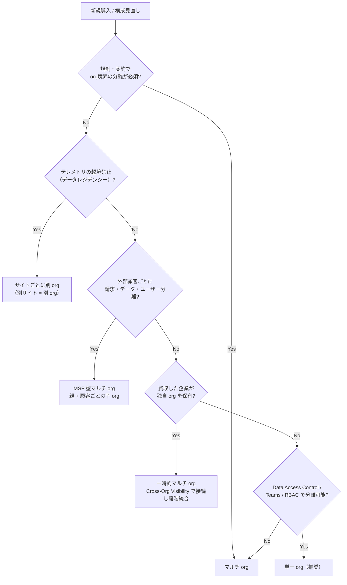
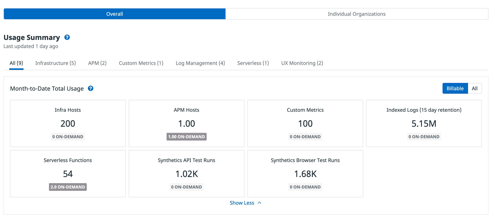
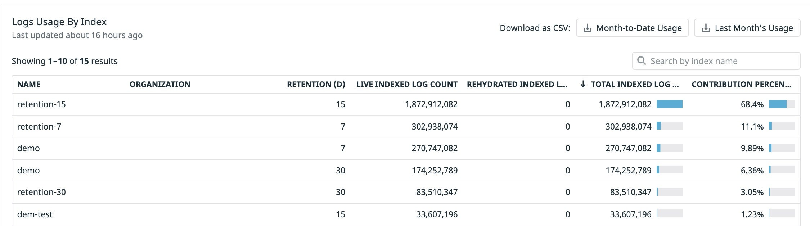
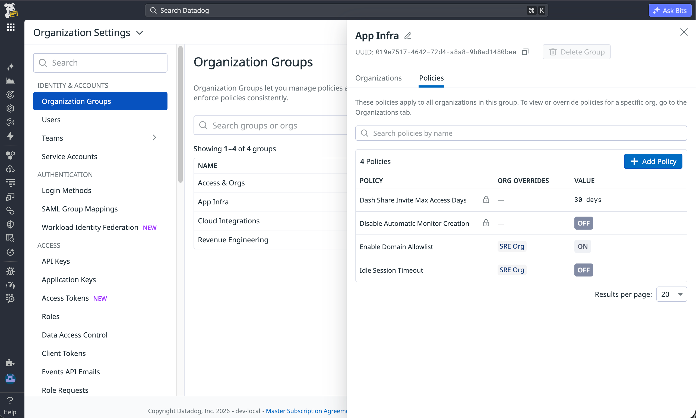
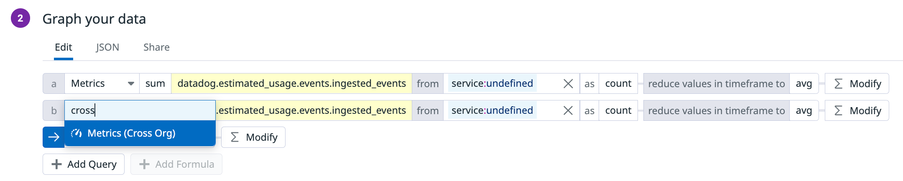
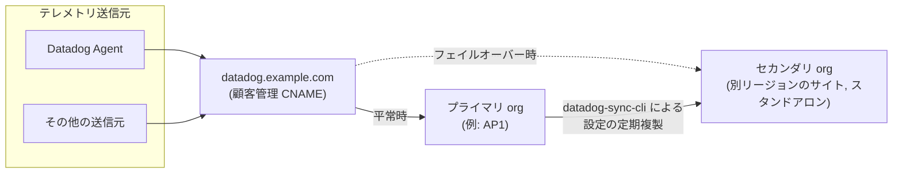

# 大規模・マルチorg運用

## 概要

本ファイルは、Datadog を **数百〜数千ユーザー・多数の事業部門・複数リージョン** で運用する場合、または **複数の Organization（org、組織）** を持つ場合の設計・運用知見をまとめた応用編である。対象とする問いは次のとおり。

- 単一 org とマルチ org（親子 org 構成）のどちらを選ぶべきか。判断基準は何か。
- マルチ org にしたときに **何が継承され、何が継承されないか**（SAML、IP 許可リスト、ロール、課金など）。
- org をまたいでデータを見る **Cross-Organization Visibility（組織横断の可視化）** の仕様と制約。
- 多数の org を一元統制する **Organization Groups**【Preview】と Shared Roles。
- 大規模環境で効いてくる **制限値**（API キー数、レート制限、送信ペイロード上限、Restricted Dataset 数など）。
- **グローバル展開**（Datadog サイト選定、データレジデンシー、Dual Shipping、Datadog Disaster Recovery）。
- **M&A（合併・買収）** 時に、別々の Datadog org をどう接続し、どう統合するか。

Datadog 公式の基本方針は **「原則は単一 org。マルチ org は単一 org のアクセス制御では満たせない“ハードな要件”がある場合のみ」** である [出典](https://docs.datadoghq.com/account_management/organization_topology/)。本ファイルもこの方針を前提に、マルチ org を選ぶ場合の具体的な設計と運用を整理する。

ユーザー・ロール・権限の仕様そのものは [組織・ユーザー・権限管理](../02_リファレンス/platform/account-and-access-management.md)、キーの仕様は [API とキー管理](../02_リファレンス/platform/api-and-keys.md)、サイトの仕様は [Datadog Sites](../02_リファレンス/platform/datadog-sites.md)、使用量の按分は [Usage・Usage Attribution・Cost Visibility](../02_リファレンス/platform/usage-and-cost-attribution.md) を参照。

---

## 1. 用語の整理

Datadog のマルチ org 運用で使う用語は次のとおり [出典](https://docs.datadoghq.com/account_management/multi_organization/)、[出典](https://docs.datadoghq.com/account_management/org_settings/cross_org_visibility/)、[出典](https://docs.datadoghq.com/account_management/organization_groups/)。

| 用語 | 意味 |
|---|---|
| Organization（org、組織） | ユーザー・設定・テレメトリデータの論理的なまとまり。データ・ダッシュボード・モニター・ユーザー・キーは org 単位で存在する |
| Account（アカウント） | 契約・請求の単位。親 org とその子 org 群が同じアカウントに属する |
| Parent organization（親 org） | マルチ org 機能が有効な org。子 org を作成し、子 org 全体の使用量を参照できる |
| Child organization（子 org、サブ org） | 親 org の配下に作られる org。親のプランを継承し、親の請求アカウントに追加される |
| Site（サイト） | データが保存されるリージョン（US1、US3、US5、EU1、AP1、AP2、UK1、US1-FED、US2-FED）。サイト間でデータ共有はできない |
| Organization connection（組織接続） | Cross-Organization Visibility で、source org のデータを destination org から参照できるようにする接続 |
| Source org / Destination org | データを公開する側 / 参照する側の org |
| Organization Group（組織グループ） | 複数 org を 1 単位としてポリシー・共有ロールを配布する統制レイヤー。Owner org と Member org で構成 |
| Custom sub-domain（カスタムサブドメイン） | `https://<name>.datadoghq.com` のような org 固有 URL |
| Spin-off（スピンオフ） | 子 org を親の階層から切り離す操作（API 名は `downgrade`。MSP 顧客限定） |

---

## 2. トポロジー判断：単一 org か マルチ org か

### 2.1 Datadog 公式の推奨

Datadog の組織トポロジー（Organization Topology）ガイドは、**大企業でも単一 org を既定とし、Teams・RBAC・Data Access Control・Granular Access Control・IP allowlist で分離する** ことを推奨している。例として「12 事業部・5,000 ユーザーの企業でも 1 org。事業部ごとに Team を作りテレメトリにアクセス制限を掛け、プラットフォーム管理者だけがグローバルロールを持つ」構成が示されている [出典](https://docs.datadoghq.com/account_management/organization_topology/)。

単一 org の利点（公式記載）:

| 観点 | 単一 org の利点 |
|---|---|
| 相関分析 | 分散トレース・メトリクス・ログ・トレースが追加設定なしに端から端までつながる |
| 設定面 | モニター・ダッシュボード・パイプライン・SLO が 1 か所に集約され、重複やドリフトがない |
| ユーザー管理 | SSO 設定 1 つ、SCIM 連携 1 つ、ロールと Team のセット 1 つ |
| コスト可視化 | タグ（`team:`、`service:`、`cost_center:` 等）による Usage Attribution でチーム別コストが見える |
| 運用コスト | org ごとの Terraform モジュール、org 横断の回避策、アラート経路の重複が不要 |

単一 org の限界（公式記載）:

- インフラなどコア機能は全ユーザーから見える。
- すべてのテレメトリ種別が行レベル制限（Data Access Control）に対応しているわけではない（対応種別は 8.4 節）。

[出典](https://docs.datadoghq.com/account_management/organization_topology/)

### 2.2 マルチ org を選ぶ正当な理由

公式ガイドが挙げるマルチ org のシナリオと推奨パターンは次の 5 つである [出典](https://docs.datadoghq.com/account_management/organization_topology/)。

| # | シナリオ | 内容 | 推奨パターン |
|---|---|---|---|
| 1 | 規制・契約上の隔離 | 規制・契約で org 境界での分離が求められ、行レベル制限では不十分 | 規制対象ワークロードごと・必要リージョンごとに 1 org、残りを 1 org。Cross-Org Visibility で接続。規制対象 org はアクセス・IP allowlist・監査を厳格化 |
| 2 | データレジデンシー | テレメトリを特定地域から出せない | サイト（US1・EU1・AP1 など）ごとに別 org |
| 3 | チーム間のデータ遮断 | 他チームのトレースが見えること自体がリスク | 別 org（RBAC とアクセス制御では全テレメトリ・資産メタデータを完全には分離できないため） |
| 4 | MSP の顧客隔離 | 外部顧客ごとに請求・データ・ユーザーを分ける | 社内運用用の親 org ＋ 顧客ごとの子 org。親から Cross-Org Visibility で集約表示 |
| 5 | 買収企業 | 買収先が独自 org を持ち込む | 統合期間中の**一時的な**マルチ org。Cross-Org Visibility で接続し、段階的に 1 org へ統合（例示期間 3〜6 か月） |

判断表（公式）:

| 条件 | トポロジー |
|---|---|
| 規制・契約が物理的に分離された org 境界を要求 | マルチ org |
| 一部テレメトリの越境転送が禁止 | マルチ org |
| RBAC・アクセス制御があっても混在ゼロが必須 | マルチ org |
| 外部顧客ごとに請求・データ・ユーザーを分離 | マルチ org（MSP） |
| 独自 org を持つ買収企業の統合 | 一時的なマルチ org |
| 上記いずれにも該当しない | 単一 org |

[出典](https://docs.datadoghq.com/account_management/organization_topology/)

さらに Enterprise 向けガイド「Choosing Your Datadog Topology」は、判断の核となる問いとして **「それらのグループはサービス・インフラ・運用コンテキストを共有しているか？」** を挙げ、共有しているなら同じ org に置くべきとしている。また、**org 内アクセス制御が未対応の製品を回避するための一時的なマルチ org** はあり得るが、Datadog の org 内制御の拡充に合わせて統合を再検討すべきとしている [出典](https://docs.datadoghq.com/getting_started/access_for_enterprises/choosing_topology/)。

### 2.3 単一 org とマルチ org の機能比較

| 機能 | 単一 org | マルチ org | Organization Groups 併用時 |
|---|---|---|---|
| 分散トレース（端から端） | 完全 | **org 境界を越えられない** | 変化なし |
| テレメトリの相互参照 | 完全 | Cross-Org Visibility でダッシュボードに共有（メトリクス・ログ・CI データ等） | 変化なし |
| ダッシュボード共有 | 完全 | org 間は招待制共有ダッシュボード | 変化なし |
| 複数ソースにまたがるモニター評価 | 完全 | **org 横断のモニター評価は不可** | 変化なし |
| サービス横断の SLO | 完全 | **org をまたげない** | 変化なし |
| ユーザー管理 | 連携 1 つ | **org ごとに SCIM** | グループから集中管理 |
| RBAC・カスタムロール | 設定 1 つ | **org ごとに重複定義** | グループから集中管理（Shared Roles） |
| SSO / SAML | 設定 1 つ（multi-SAML で複数 IdP 可） | **org ごとに SAML** | 変化なし |
| 請求と使用量 | org 単位で使用量を按分 | 子 org の使用量を集約し親で請求 | 変化なし |
| 機能ロールアウト | 即時 | **org ごとに有効化** | グループから集中管理 |

[出典](https://docs.datadoghq.com/account_management/organization_topology/)

### 2.4 実務上の構成モデル（Volkswagen Group の事例）

Datadog 公式ブログに掲載された Volkswagen Group（dx.one）のゲスト寄稿（2025-03-14 公開）は、2,000 以上の AWS アカウント・500 人以上の Datadog ユーザーを抱える組織での経験から、次の 4 モデルを紹介している [出典](https://www.datadoghq.com/blog/volkswagen-organizations/)（2025-03-14 公開）。

| モデル | 構成 | 典型的な適用 |
|---|---|---|
| 単一 org モデル | 1 org にすべてのデータ | 中小規模の顧客の多く |
| ステージ別マルチ org | 本番前（テスト等）用の子 org と、本番用の子 org | ステージ間で利用者・権限を分けたい場合 |
| 部門別マルチ org | 法人（リーガルエンティティ）ごとに子 org。部門・プロジェクト単位も可 | 法的理由で事業体を分離 |
| データ機密度別マルチ org | 機密度（社内・機密・決済など）ごとに子 org | 決済処理、PII・車両データなど |

同記事の推奨事項:

- **子 org 数はできる限り少なく保つ**。
- 法的要件でデータ共有に制限がある場合、まず **Restricted Datasets（Data Access Control）** を検討し、完全隔離が必要な場合のみ子 org を分ける。
- **親 org はテレメトリを取り込まず、中央管理と請求専用にする**。ユーザー削除などの人的ミスが子 org 全体へ波及するのを防ぐため。

> 注意: Datadog パートナー向けガイドは「dev・test・prod を別 org にすることは推奨しない。1 org でタグにより分離する」としている [出典](https://docs.datadoghq.com/partners/getting_started/laying-the-groundwork/)。ステージ別マルチ org を採用する場合は、トレースの連続性やモニター・ダッシュボードの二重管理といったコストを理解したうえで判断する。【経験則】環境分離は `env` タグと RBAC で行い、org 分割は規制・契約・請求の要件がある場合に限るのが一般的である。

### 2.5 判断フロー



---

## 3. マルチ org 機能の仕様

### 3.1 有効化と子 org の作成

| 項目 | 仕様 |
|---|---|
| 有効化 | マルチ org 機能は**既定で無効**。Datadog サポートへの依頼で有効化 |
| 子 org 作成権限 | `org_management`（Org Management）権限 |
| 作成方法（UI） | New Organization ページで名前を入力し、任意で管理者を招待して Create |
| 子 org 名の上限 | **32 文字** |
| 招待ユーザーのロール | 作成時に招待したユーザーは Datadog Admin ロール |
| 作成方法（API） | `POST /api/v1/org`（Create a child organization） |
| 作成方法（Terraform） | `datadog_child_organization` リソース（作成後の設定は `datadog_organization_settings`） |
| API の応答 | 新 org の `org.public_id`、`api_key.key`、`application_key.hash`、作成ユーザー情報、SAML 等の `settings` |
| 課金 | 子 org は親のプランを継承し、親の請求アカウントに追加される。請求形態の変更は営業（success@datadoghq.com）へ |
| 削除 | Terraform の `datadog_child_organization` は destroy しても org を削除せず、「Cannot delete organization. Remove organization by contacting support」という警告を返す。org 削除はサポート経由 |

[出典](https://docs.datadoghq.com/account_management/multi_organization/)、[出典](https://docs.datadoghq.com/api/latest/organizations/)、[出典](https://github.com/DataDog/terraform-provider-datadog/blob/master/docs/resources/child_organization.md)、[出典](https://github.com/DataDog/terraform-provider-datadog/blob/master/datadog/resource_datadog_child_organization.go)

`POST /api/v1/org` のリクエストでは `name`（必須、最大 32 文字）のみが実質的なパラメータで、`billing`（`parent_billing` のみ）と `subscription`（`trial` / `free` / `pro`）は **Deprecated** である [出典](https://docs.datadoghq.com/api/latest/organizations/create-a-child-organization/)。

### 3.2 親から子へ「継承されるもの・されないもの」

マルチ org 設計で最も誤解が多いのが継承範囲である。公式ドキュメントで明示されている事項は次のとおり。

| 項目 | 親 → 子の継承 | 備考 |
|---|---|---|
| プラン・請求 | **継承される** | 子 org は親のプランを継承し、親の請求アカウントに追加 |
| SAML 設定 | **継承されない** | 子 org ごとに設定が必要 |
| IP 許可リスト（allow-listed IP addresses）等のアカウント設定 | **継承されない** | org ごとに設定 |
| ユーザー | 継承されない | ユーザーは複数 org に所属可能（UI 右下のアカウントメニューから切替） |
| データ | 共有されない | 子 org 同士は互いのデータにアクセス不可。org 横断クエリは Cross-Org Visibility が必要 |
| ダッシュボード・モニター | 継承されない | API・Terraform でベースラインを各 org に投入するのが推奨 |
| ロール・カスタムロール | 継承されない（Organization Groups の Shared Roles で配布可能） | 4 章参照 |
| Usage Attribution のタグ設定 | 子 org 単位で設定したタグは親へロールアップされない | 7.2 節参照 |
| API キー・アプリケーションキー | 継承されない（org ごと） | 子 org 作成時に API キーとアプリケーションキーが 1 つずつ発行される |

[出典](https://docs.datadoghq.com/account_management/multi_organization/)、[出典](https://docs.datadoghq.com/api/latest/organizations/create-a-child-organization/)

### 3.3 SAML とログイン（マルチ org 固有の注意）

| 項目 | 仕様 |
|---|---|
| SAML の設定単位 | org ごと。子 org の手順は「① org 作成 → ② SAML ユーザーを招待 → ③ SAML ユーザーでログインして SAML を設定」 |
| 異なる IdP を使うユーザー群 | SAML は org 単位のため、**異なる SAML プロバイダのユーザー群は別 org に分ける必要がある**（ただし Enterprise の multi-SAML は 1 org で最大 3 構成。8.2 節） |
| IdP-initiated login | org ごとに SP メタデータがあり、`AssertionConsumerService` エンドポイントが org 固有。古いメタデータのままだと `InResponseTo` 属性欠落のエラーになる |
| SP-initiated login | カスタムサブドメインのない org では、ワンタイムのメール確認コードが必要 |
| SAML strict の親 org でのロックアウト回避 | 親 org の Organization Settings > Users で自分のプロファイルを選び、Override Default Login Methods をオンにして Password を選択し、パスワードを設定しておく |
| JIT プロビジョニング | 初回ログイン時にユーザー作成。既定ロールは Standard（Read-Only・Admin・カスタムロールに変更可）。Role Mapping 有効時はマッピングが優先 |
| 政府系サイト | `app.ddog-gov.com`、`us2.ddog-gov.com` は SAML ログインのみ |

[出典](https://docs.datadoghq.com/account_management/multi_organization/)、[出典](https://docs.datadoghq.com/account_management/saml/)、[出典](https://docs.datadoghq.com/partners/getting_started/laying-the-groundwork/)

### 3.4 カスタムサブドメイン

| 項目 | 仕様 |
|---|---|
| 有効化 | 既定で無効。Datadog サポートへ依頼 |
| URL 例 | `https://account-a.datadoghq.com` |
| 効果 | 通知・アラートのリンクから発生元 org を識別でき、リンクを開くと該当 org のコンテキストに切り替わる |
| 未設定時の挙動 | 別 org の URL を開くと **404**。ユーザーが手動で org を切り替える必要がある |
| 運用上の注意 | カスタムサブドメイン導入後は、Runbook 等の社内ドキュメントのリンクをサブドメイン付きに更新する |

[出典](https://docs.datadoghq.com/account_management/multi_organization/)、[出典](https://docs.datadoghq.com/partners/getting_started/laying-the-groundwork/)

【経験則】複数 org に所属するオンコール担当者が多い組織では、カスタムサブドメインがないとアラート通知のリンクから 404 になり初動が遅れる。マルチ org にした時点でカスタムサブドメインを申請するのが望ましい。

### 3.5 マルチ org の使用量画面

親 org では **Plan & Usage > Usage & Cost** から全 org の使用量を参照できる [出典](https://docs.datadoghq.com/account_management/multi_organization/)。

| タブ / 表示 | 内容 |
|---|---|
| Overall > Month-to-Date Total Usage | 全 org 合計の当月使用量。製品別にフィルタ可、CSV ダウンロード可 |
| Overall > Overall Usage | 過去 6 か月の月次集計（「All」ビュー基準） |
| Billable / All 切替 | Billable（多くのアカウントで既定）はコミットメント・割当を超えたオンデマンド分を表示。All はトライアル等の非課金分も含む生の使用量 |
| Log Management サブタブ > Logs Usage by Index | インデックス名・org・保持日数・ライブ／リハイドレート件数・寄与率。CSV 可 |
| Individual Organizations | 子 org ごとの使用量（絶対値／割合）。org 名クリックで Usage Details へ |



- **キャプション:** 親 org の Plan & Usage > Usage & Cost 画面（Overall タブ）。
- **画面説明:** 上部に「Overall」と「Individual Organizations」の切替タブ。その下に「Usage Summary」と製品カテゴリのタブ（All、Infrastructure、APM、Custom Metrics、Log Management、Serverless、UX Monitoring。括弧内は項目数）。「Month-to-Date Total Usage」パネルには Infra Hosts、APM Hosts、Custom Metrics、Indexed Logs (15 day retention)、Serverless Functions、Synthetics API Test Runs、Synthetics Browser Test Runs などのタイルが並び、各タイルに当月の使用量とオンデマンド分（例「1.00 ON-DEMAND」）が表示される。右上に「Billable / All」の切替ボタンがある。
- **出典:** https://docs.datadoghq.com/account_management/multi_organization/ （取得日 2026-11-02）



- **キャプション:** Log Management サブタブの「Logs Usage by Index」表。
- **画面説明:** インデックスごとに、インデックス名、所属 org、保持日数、ライブ／リハイドレートのログ件数、全体に対する寄与率（%）を一覧表示する表。CSV ダウンロード可能。どの子 org のどのインデックスがログ課金を押し上げているかを特定するのに使う。
- **出典:** https://docs.datadoghq.com/account_management/multi_organization/ （取得日 2026-11-02）

---

## 4. Organization Groups【Preview】と Shared Roles

### 4.1 概要

Organization Groups は、マルチ org のまま運用を続ける組織向けに、**複数 org を 1 単位として統制する**ガバナンス機能である。2026-11-02 時点で、機能ページ（英語版）には Preview 等のステータス表記はない。一方、API リファレンスでは `/api/v2/org_groups` 系 24 エンドポイントがすべて「preview」と表示されている（本ファイルの【Preview】ラベルはこの API 表記を根拠とする）。Enterprise 向けガイドでは、Organization Groups の詳細はアカウントチームに問い合わせるよう案内されている [出典](https://docs.datadoghq.com/account_management/organization_groups/)、[出典](https://docs.datadoghq.com/api/latest/org-groups/)、[出典](https://docs.datadoghq.com/getting_started/access_for_enterprises/sharing_across_organizations/)。

| 機能 | 内容 |
|---|---|
| メンバー管理 | グループからすべてのメンバー org を一覧し、org 間を移動できる |
| ポリシー配布 | Owner org で定義した org 設定（ポリシー）をメンバー org に適用 |
| Shared Roles | カスタムロールを Owner org で 1 回定義し、全メンバー org にプロビジョニング |

### 4.2 org の種類と強制レベル

| 種類 | 役割 |
|---|---|
| Owner | グループを作成・管理。ポリシー・強制レベル・共有ロールを設定。Owner 自身もメンバーになれる |
| Member | グループに統制される org。**1 つの org が同時に所属できるグループは 1 つ** |

| 強制レベル（Enforcement tier） | 挙動 |
|---|---|
| Group managed | グループの値でロック。メンバー org は変更不可 |
| Override allowed | グループ値をベースラインとし、メンバー org が自 org の設定で上書き可能 |

Shared Roles は常に **Group managed**（Override allowed なし）。メンバー org は共有ロールをユーザー・Team に割り当てられるが、編集・削除はできない。Owner はメンバー org が独自カスタムロールを作成することを禁止できる [出典](https://docs.datadoghq.com/account_management/organization_groups/)。

### 4.3 要件と制限

| 項目 | 内容 |
|---|---|
| 必要権限 | Owner org のユーザーに **Org Group Read** と **Org Group Write** |
| メンバー org 側の権限 | 追加不要 |
| 管理画面 | Owner org の Organization Settings > Organization Groups |
| リージョン | **単一リージョンのグループのみ**。別リージョン（別サイト）の org はそのリージョン内で別グループを作る |
| 所有者 | 組織階層のルートにある親 org が所有。Owner org からのみ表示・管理可能 |
| ポリシー上書き API | `/api/v2/org_group_policy_overrides` 系（preview） |

[出典](https://docs.datadoghq.com/account_management/organization_groups/)、[出典](https://docs.datadoghq.com/api/latest/org-groups/)



- **キャプション:** Organization Settings > Organization Groups でグループを開き、Policies タブを表示した画面。
- **画面説明:** 左ナビの「IDENTITY & ACCOUNTS」配下に「Organization Groups」があり、中央にグループ一覧（例: Access & Orgs、App Infra、Cloud Integrations、Revenue Engineering）。右側パネルに選択グループ（App Infra）の UUID と「Delete Group」ボタン、「Organizations」「Policies」タブ。Policies タブには「These policies apply to all organizations in this group」という説明と「Add Policy」ボタン、ポリシー一覧（列: POLICY、ORG OVERRIDES、VALUE）。例として「Dash Share Invite Max Access Days = 30 days（鍵アイコン＝Group managed）」「Disable Automatic Monitor Creation = OFF（鍵アイコン）」「Enable Domain Allowlist = ON（SRE Org が上書き）」「Idle Session Timeout = OFF（SRE Org が上書き）」が表示されている。
- **出典:** https://docs.datadoghq.com/account_management/organization_groups/ （取得日 2026-11-02）

### 4.4 位置付け

公式ガイドは Organization Groups を「既存のマルチ org 顧客が、移行なしに統合の中間地点を得る手段」と位置付けている。多数の org を持つ場合は Organization Groups でポリシー管理を集中させ、設定ドリフトを減らすことが推奨される [出典](https://docs.datadoghq.com/account_management/organization_groups/)、[出典](https://docs.datadoghq.com/getting_started/access_for_enterprises/sharing_across_organizations/)。

---

## 5. Cross-Organization Visibility（組織横断の可視化）

### 5.1 概要とステータス

Cross-Organization Visibility は、**同一アカウント内の org 間でデータを共有し、複数 org の情報を 1 か所に表示する**機能である。source org が organization connection を通じて destination org にデータを公開する [出典](https://docs.datadoghq.com/account_management/org_settings/cross_org_visibility/)。

- 2024-06-26 公開の DASH 2024 新機能まとめでは「currently in Preview」とされていた [出典](https://www.datadoghq.com/blog/dash-2024-new-feature-roundup-teams/)（2024-06-26 公開）。
- 2026-11-02 時点の機能ページには Preview 等のステータス表記は見当たらない。一方、Enterprise 向けガイドは「アカウントチームによる設定が必要。Customer Success Manager に連絡」と記載している [出典](https://docs.datadoghq.com/getting_started/access_for_enterprises/sharing_across_organizations/)。正式な提供ステータスは公開情報では確認できず。

### 5.2 動作仕様

| 項目 | 仕様 |
|---|---|
| データの所在 | データは source org に残り、destination org が表示時に直接クエリする（コピーしない） |
| 追加料金 | 接続はデータを複製せず、**追加料金は発生しない** |
| 参照可能期間 | source データが保持されている任意の期間（接続作成前のデータも参照可） |
| 接続削除時 | destination のアクセスは終了し、そのデータを使ったクエリ・ダッシュボードは動作しなくなる可能性がある |
| destination 側の扱い | destination org のアクセス制御設定に従って source データを扱える。例: source 側が許可していなくても、destination 側で公開ダッシュボードを作れてしまう |
| 方向 | source は複数の destination を持て、destination は複数の source を持てる |
| 性能 | org 横断クエリの性能は単一 org クエリと異なる場合があり、特に多数 org にまたがる大規模集計で差が出る |

[出典](https://docs.datadoghq.com/account_management/org_settings/cross_org_visibility/)、[出典](https://docs.datadoghq.com/getting_started/access_for_enterprises/sharing_across_organizations/)

### 5.3 要件・制限

| 項目 | 仕様 |
|---|---|
| アカウント | source と destination は**同一アカウント** |
| サイト | source と destination は**同一サイト**（例: AP1 の org と US1 の org は接続不可） |
| 非 Enterprise の上限 | 非 Enterprise の org は**最大 5 つ**の他 org と共有可能 |
| Enterprise の上限 | 公開情報では確認できず |
| 対応する表示面 | Dashboard と Notebook のウィジェット |
| モニター | **org 横断のモニター評価は不可**（トポロジーガイドの比較表） |
| SLO | org をまたげない |
| 分散トレース | org 境界を越えられない |
| Terraform | Terraform Provider では接続を作成できない。org 横断クエリを含むダッシュボードは JSON エクスポートで管理可能 |

[出典](https://docs.datadoghq.com/account_management/org_settings/cross_org_visibility/)、[出典](https://docs.datadoghq.com/account_management/organization_topology/)

### 5.4 対応データ種別

| データ種別 | 備考 |
|---|---|
| Metrics | 全種別（カスタムメトリクス、トレースメトリクス、ログから生成したメトリクスを含む） |
| Logs | |
| CI Visibility pipelines | |
| Test Optimization tests | |
| Audit Trail | |

[出典](https://docs.datadoghq.com/account_management/org_settings/cross_org_visibility/)

### 5.5 接続の設定（UI・API）

| 操作 | 手順 |
|---|---|
| 一覧 | Organization Settings > Cross-Organization Visibility |
| 作成 | source org にサインイン → New Connection → destination org を選択 → Connect |
| 更新 | source org で鉛筆（Edit）アイコン → データ種別を選択 → Save |
| 削除 | ゴミ箱（Delete）アイコン → 確認 |
| API | Cross-Organizations Connections API。サービスアカウントのアプリケーションキーを使用可能 |

**サービスアカウントでの作成を推奨**：接続は作成者に紐づき、作成者のアカウントが無効化（deactivate）されると接続も削除され、データフローが中断するため [出典](https://docs.datadoghq.com/account_management/org_settings/cross_org_visibility/)。

### 5.6 org 横断ウィジェットの作り方

- destination として 1 つ以上の接続を持つ org でのみ作成可能。
- 1 クエリにつき source org は 1 つ。複数 org のクエリは formula（数式）で結合する（例: `query2 + query1`）。
- UI ではデータ種別のドロップダウン（例: 「Metrics (Cross Org)」）とメトリクス名の間に org 選択ドロップダウンが表示される。
- API / JSON では各クエリオブジェクトに任意フィールド `cross_org_uuids` を付ける。**配列要素は必ず 1 つ**（複数指定は 400 エラー）。省略時はウィジェットを定義した org で実行。
- `cross_org_uuids` は Metrics API の formula クエリ（Query timeseries data across multiple products / Query scalar data across multiple products）でも使える。
- org の識別子は Organizations API の「List your managed organizations」（`GET /api/v2/org`）で取得。

[出典](https://docs.datadoghq.com/account_management/org_settings/cross_org_visibility/)



- **キャプション:** ダッシュボードウィジェットのクエリエディタで org 横断クエリを選ぶ画面。
- **画面説明:** 「Graph your data」セクションの Edit タブ。クエリ a は通常の「Metrics」で `sum` / `datadog.estimated_usage.events.ingested_events` / `from service:undefined` / `as count`。クエリ b ではデータソースのドロップダウンに「cross」と入力し、候補「Metrics (Cross Org)」を選択している。下部に「Add Query」「Add Formula」ボタンがある。
- **出典:** https://docs.datadoghq.com/account_management/org_settings/cross_org_visibility/ （取得日 2026-11-02）

JSON の構造例（公式例を簡略化）:

```json
{
  "definition": {
    "type": "timeseries",
    "requests": [{
      "response_format": "timeseries",
      "queries": [
        { "name": "query1", "data_source": "metrics",
          "query": "sum:datadog.estimated_usage.hosts{*}",
          "cross_org_uuids": ["<source-org-A-uuid>"] },
        { "name": "query2", "data_source": "metrics",
          "query": "sum:datadog.estimated_usage.hosts{*}",
          "cross_org_uuids": ["<source-org-B-uuid>"] }
      ],
      "formulas": [{ "formula": "query2 + query1" }]
    }]
  }
}
```

### 5.7 権限とデータアクセス

| 項目 | 内容 |
|---|---|
| Org Connection Read | 接続一覧の閲覧（既定では本権限を持つロールのユーザーのみ閲覧可） |
| Org Connection Write | 接続の作成・削除 |
| Granular Access Control | 南京錠アイコン > Restrict Access。source 側は接続の編集者、destination 側は共有データの閲覧者と接続の編集者を制御。既定はメンバー Viewer。保存前に自分が属するロールか Team を最低 1 つ含める必要あり。解除は Restore Full Access |
| データアクセス制限の継承 | 接続は**作成者の**データアクセス制限（Data Access Control、Log Restriction Queries）を継承する。作成者のアカウントが無効化されると接続は削除され、データフローは中断するが、継承したデータアクセス制限は解除されない |
| HIPAA | HIPAA 対応 org からの接続は PHI を共有し得る。機微データの転送は顧客責任 |

[出典](https://docs.datadoghq.com/account_management/org_settings/cross_org_visibility/)

【経験則】接続作成者の権限が広すぎると、制限付きデータが destination へ露出する。接続は「source 側で必要最小限のデータアクセスを持つ専用サービスアカウント」で作成し、destination 側では Restrict Access で閲覧者を絞る。

### 5.8 その他の org 間共有手段

| 手段 | 内容 |
|---|---|
| Shared Dashboards（公開 URL） | リンクを知る誰でも閲覧可（読み取り専用）。いつでも失効可能 |
| Shared Dashboards（招待制） | 指定メールアドレス／ドメインのみ。招待者は Datadog アカウント不要 |
| Embedded | iframe で外部アプリ・ポータル・他 org のダッシュボードに埋め込み |
| 推奨 | 中央ビューは Cross-Org Visibility を使い、不要な org へのアカウント付与を避ける。公開 URL は定期棚卸し。機微データは招待制で |

[出典](https://docs.datadoghq.com/getting_started/access_for_enterprises/sharing_across_organizations/)

詳細なダッシュボード共有仕様は [Dashboards](../02_リファレンス/platform/dashboards.md) を参照。

---

## 6. マルチ org の自動化（Organization as Code）

### 6.1 自動化の対象と手段

| 対象 | API | Terraform リソース |
|---|---|---|
| 子 org 作成 | `POST /api/v1/org` | `datadog_child_organization` |
| org 設定（SAML、ウィジェット共有等） | `PUT /api/v1/org/{public_id}`、`/api/v2/org_configs` | `datadog_organization_settings` |
| 管理下 org の一覧 | `GET /api/v2/org` | — |
| セッション最大長 | `PUT /api/v2/login/org_configs/max_session_duration` | 公開情報では確認できず |
| SAML IdP メタデータ | `POST /api/v2/saml_configurations/idp_metadata` | — |
| Organization Groups | `/api/v2/org_groups` ほか（preview） | 公開情報では確認できず |
| ダッシュボード・モニター等のベースライン | 各 API | `datadog_dashboard`、`datadog_monitor` ほか |

[出典](https://docs.datadoghq.com/api/latest/organizations/)、[出典](https://github.com/DataDog/terraform-provider-datadog)

`datadog_organization_settings` で管理できる主な設定: `name`、`security_contacts`、`settings.private_widget_share`（既定 `false`）、`settings.saml`、`settings.saml_autocreate_access_role`（`st` / `adm` / `ro`）、`settings.saml_autocreate_users_domains`、`settings.saml_idp_initiated_login`、`settings.saml_strict_mode` [出典](https://github.com/DataDog/terraform-provider-datadog/blob/master/docs/resources/organization_settings.md)。

Terraform 全般は [Terraform と IaC](../02_リファレンス/platform/terraform-and-iac.md)、運用設計は [Monitoring as Code](./09-monitoring-as-code.md) を参照。

### 6.2 新規チーム／子 org のオンボーディング自動化（Volkswagen 事例）

Volkswagen 事例が推奨するセルフサービス型のオンボーディング手順は次のとおり。Terraform で各ステップの状態を管理し、失敗時にロールバックできるようにする [出典](https://www.datadoghq.com/blog/volkswagen-organizations/)（2025-03-14 公開）。

| # | ステップ |
|---|---|
| 1 | 子 org のオーナー情報（氏名・メール）を定義・維持 |
| 2 | Organizations API または `datadog_child_organization` で子 org／ユーザーを作成 |
| 3 | カスタムドメイン付き SAML 2.0 と JIT プロビジョニングを設定 |
| 4 | メトリクス・ログへの RBAC 用標準ロールを作成 |
| 5 | タグベースのログ制限クエリ（log restriction queries）を作成し標準ロールに割当 |
| 6 | コンプライアンス・コスト区分のための標準ログインデックスを作成 |
| 7 | 標準タグの付与状況を監視するモニターを作成 |
| 8 | ユーザー用 API 認証情報を作成 |

同記事のガバナンス上の教訓:

- SSO に集約し、パスワード・Google ログインを無効化する。
- タグ準拠、コスト急増（Cloud Cost モニター、異常検知モニター）、ログ中の機微データ（Sensitive Data Scanner）を継続的に監視する。
- ガバナンス設定は定期的に再適用（Lambda Step Functions や Terraform テンプレート）してドリフトを戻す。
- クラウドアカウント接続（AWS インテグレーション等）を標準化・自動化する（GitHub Actions 等）。

### 6.3 datadog-sync-cli（org 間の設定同期）

`datadog-sync-cli` は Datadog 公式 GitHub の、**org 間でリソース（設定）を同期する CLI** である。マルチ org のベースライン配布、M&A 時の資産移行、Datadog Disaster Recovery の設定複製に使われる [出典](https://github.com/DataDog/datadog-sync-cli)。

| コマンド | 動作 |
|---|---|
| `import` | source org のリソースを読み取りローカル `resources/source` に JSON 保存（Datadog 側は変更しない） |
| `diffs` | `sync` が行う変更をプレビュー |
| `sync` | ローカルファイルから destination org にリソースを作成・更新し、`resources/destination` に保存 |
| `migrate` | `import` の直後に `sync` |
| `reset` | destination のリソースを削除（既定でバックアップしてから） |
| `prune` | source から消えたリソースの状態ファイルを削除 |
| `sync --cleanup` | source から削除されたリソースを destination からも削除 |

主な仕様・注意点:

- **取り込み済みのテレメトリ（ログ・メトリクス等）は移行対象外**（ツールの目的外と明記）。
- 認証は `DD_SOURCE_API_KEY` / `DD_SOURCE_APP_KEY` / `DD_SOURCE_API_URL`、`DD_DESTINATION_*` の環境変数で指定（サイトをまたいだ同期も可能。例: US1 → EU1）。
- `resources` ディレクトリが source と destination の対応関係（状態）を保持するため、削除・破損させない。複数の destination org に同期する場合は作業ディレクトリを分ける。
- `--filter 'Type=<resource>;Name=<attribute>;Value=<regex>'` でリソースを絞り込める。
- 依存関係（例: dashboards → monitors・roles・powerpacks・SLO、downtime_schedules → monitors、logs_restriction_queries → roles）を考慮し、部分同期時は依存リソースも同期する。
- 既定で source／destination の DDR（Disaster Recovery）ステータスを確認する（`--verify-ddr-status`）。

対応リソース（2026-11-02 時点の README）: `authn_mappings`、`dashboard_lists`、`dashboards`、`downtime_schedules`、`host_tags`、`logs_archives`（クラウドインテグレーションの手動設定が前提）、`logs_archives_order`、`logs_indexes`、`logs_indexes_order`、`logs_metrics`、`logs_pipelines`、`logs_pipelines_order`、`logs_restriction_queries`、`metric_percentiles`、`metric_tag_configurations`、`metrics_metadata`、`monitors`、`notebooks`、`powerpacks`、`restriction_policies`、`roles`、`sensitive_data_scanner_groups`／`_order`／`_rules`、`service_level_objectives`、`slo_corrections`、`spans_metrics`、`synthetics_global_variables`、`synthetics_private_locations`、`synthetics_tests`、`teams`（権限を除く）、`team_memberships`、`users` [出典](https://github.com/DataDog/datadog-sync-cli)。

---

## 7. 大規模環境のコスト管理とマルチ org

### 7.1 請求の構造

| 項目 | 内容 |
|---|---|
| 請求単位 | 子 org の使用量は集約され、親で請求される |
| 子 org のプラン | 親のプランを継承 |
| 個別請求 | 独立した請求・契約が必要な場合は別 org（別契約）とする。MSP では DPN ポータルで顧客を登録し、新しい親 org と顧客の子 org を請求契約に紐付ける |
| Cross-Org Visibility | 追加料金なし（データ複製なし） |
| Dual Shipping | 複数 org に送ると、それぞれの org で課金対象になり得る（公式は「billing に影響し得る。サポートに確認」と記載） |

[出典](https://docs.datadoghq.com/account_management/organization_topology/)、[出典](https://docs.datadoghq.com/account_management/multi_organization/)、[出典](https://docs.datadoghq.com/account_management/org_settings/cross_org_visibility/)、[出典](https://docs.datadoghq.com/agent/configuration/dual-shipping/)、[出典](https://docs.datadoghq.com/partners/getting_started/laying-the-groundwork/)

### 7.2 Usage Attribution とマルチ org

| 項目 | 内容 |
|---|---|
| 場所 | Plan & Usage > Usage Attribution |
| 権限 | 管理者、または Usage Read 権限を持つユーザー |
| タグキー数 | **最大 3 つ**（変更可能。月途中で変えると期間ごとの部分レポートになる） |
| 親での集計 | 親で有効化すると全 org の使用量を集約 |
| 子 org での設定 | 子 org 単位でも有効化可能だが、そのタグは親にロールアップされない |
| 粒度 | 月次（UI、ファイル）、時間単位（API、CSV）。日次も多くの使用量種別でファイル提供 |
| 初回レポート | タグ設定後 24 時間 |
| 対象外の例 | Incident Management Users、Parallel Testing Slots、Audit Trail |
| プラン | マルチ org ページでは Enterprise プランの機能と記載（他プランはアカウント担当へ問い合わせ） |
| Cost Attribution | 直接請求顧客のみ。前月分のコストデータは当月 19 日までに提供 |

[出典](https://docs.datadoghq.com/account_management/multi_organization/)、[出典](https://docs.datadoghq.com/account_management/billing/usage_attribution/)

【経験則】マルチ org では「org 単位の按分」と「タグ単位の按分」が二重になる。Usage Attribution のタグキー 3 つは全 org 共通の基準（例: `team`、`cost_center`、`env`）で親 org に設定し、子 org 個別設定は避けると全社集計が崩れない。タグ設計は [タグ戦略の実践](./02-tagging-strategy.md)、コスト施策は [コスト最適化](./01-cost-optimization.md) を参照。

---

## 8. 大規模環境の ID・権限・キー管理

### 8.1 推奨の基本構成

| 領域 | 推奨 | 出典 |
|---|---|---|
| 認証 | SAML SSO ＋ JIT または SCIM。パスワード／Google ログインは無効化（SAML strict） | [出典](https://www.datadoghq.com/blog/volkswagen-organizations/)（2025-03-14 公開） |
| ロール | 既定 3 ロール（Admin / Standard / Read Only）で足りない場合はカスタムロール | [出典](https://docs.datadoghq.com/partners/getting_started/laying-the-groundwork/) |
| 所有権 | Teams で資産・テレメトリの所有を表現 | [出典](https://docs.datadoghq.com/account_management/organization_topology/) |
| データ分離 | Data Access Control（Restricted Datasets）、Logs RBAC | [出典](https://docs.datadoghq.com/account_management/rbac/data_access/) |
| 自動化用の認証情報 | サービスアカウント＋スコープ付きアプリケーションキー | [出典](https://docs.datadoghq.com/account_management/api-app-keys/) |

### 8.2 multi-SAML（1 org で複数 IdP）

| 項目 | 仕様 |
|---|---|
| 対象 | **Enterprise 顧客のみ** |
| 上限 | **1 org あたり同時に最大 3 つ**の SAML 構成 |
| 想定用途 | IdP 移行、**合併（M&A）**、委託先のオンボーディング |
| 追加手順 | Organization Settings > Login Methods > SAML の Update > Add SAML → 表示名を入力 → IdP メタデータ XML（ASCII のみ）をアップロード → Save |
| 制約 | すべてのユーザーがすべての IdP を選択肢として見る（特定ユーザー群に特定 IdP を割り当て不可）。既定 IdP は設定不可 |
| マッピング | Role / Team マッピング使用時は、新 IdP が既存マッピングに合う属性を送るか、新 IdP 用のマッピングを追加 |

[出典](https://docs.datadoghq.com/account_management/saml/configuration/)

multi-SAML により、**「IdP が違うので org を分ける」必要性は Enterprise では最大 3 IdP まで解消できる**。M&A で買収先の IdP を統合する前に Datadog org だけ先に統合する、という順序が取りやすくなる。

### 8.3 キー管理のスケール

| 項目 | 仕様 |
|---|---|
| API キー数 | **1 org あたり既定 50 個**（"Managed" ラベルの管理キーは対象外）。増枠はサポートへ |
| 最小数 | 1 org に最低 1 つの API キーが必要 |
| 失効した API キー | 失効後 7 日間は復元可能、その後完全削除 |
| One-Time Read（OTR） | 2025-08-20 以降に作成された新規親 org とその子 org では既定で有効・変更不可。既存 org は有効化後 3 か月間は切替可能、その後恒久化 |
| アプリケーションキー数 | 公開情報では確認できず |
| ユーザー無効化時 | そのユーザーが作成したアプリケーションキーは失効するが、API キーは失効しない |
| 伝播 | 新規・失効キーの反映に数秒。リトライ（短い指数バックオフ）と `/api/v1/validate`・`/api/v2/validate_keys` で検証 |
| スコープ | アプリケーションキーにスコープを付けて最小権限化。スコープ名は大文字小文字を区別 |

[出典](https://docs.datadoghq.com/account_management/api-app-keys/)

【経験則】マルチ org では「org 数 × 用途別キー」でキー数が増え、所有者不明のキーが残りやすい。用途（Kubernetes、Terraform、CI 等）ごとに API キーを分け、アプリケーションキーはサービスアカウントに寄せる。詳細は [API とキー管理](../02_リファレンス/platform/api-and-keys.md)。

### 8.4 Data Access Control（Restricted Datasets）による「単一 org での分離」

マルチ org を避けるための主要手段が Data Access Control（Restricted Datasets）である。

| 項目 | 仕様 |
|---|---|
| 対応テレメトリ | APM traces、Cloud costs、カスタムメトリクス（標準メトリクスは非対応）、Error Tracking issues、Logs、RUM sessions、Security signals（Cloud SIEM・Workload Protection）、Software Delivery のリポジトリ情報（CI Visibility pipelines 内。Test Optimization のテストは非対応）、Workload Protection Agent Events、Agent Observability 関連 |
| 申請により Preview | Database Monitoring、Hosts、Processes、Containers、Security findings、Serverless |
| Dataset あたりのプリンシパル | 最大 50（ロールまたは Team） |
| Dataset あたりの key:value | 最大 10 |
| org あたりの Dataset 数 | Enterprise 100、その他 10。Enterprise でテレメトリ種別を Restricted に設定した場合は最大 1,000 |
| フィルタ | 各 Dataset 内で、テレメトリ種別ごとに使えるタグ／属性は 1 つ |
| 必要権限 | Datadog Admin ロールまたは `user_access_manage` |
| Logs RBAC との関係 | 別機能。ログの制限はどちらか一方に寄せることを推奨。併用時は両方の制限が適用 |

[出典](https://docs.datadoghq.com/account_management/rbac/data_access/)

---

## 9. 大規模環境での制限・性能

### 9.1 API・データ送信の制限

| 項目 | 値 | 出典 |
|---|---|---|
| Event 送信 | **250,000 events/分/org** | [出典](https://docs.datadoghq.com/api/latest/rate-limits/) |
| メトリクス送信 | レート制限なし（契約のカスタムメトリクス数に依存） | [出典](https://docs.datadoghq.com/api/latest/rate-limits/) |
| ログ送信 | レート制限なし | [出典](https://docs.datadoghq.com/api/latest/rate-limits/) |
| その他 API（クエリ等） | エンドポイントごとに異なり、レスポンスヘッダで通知。数値は公開されていない | [出典](https://docs.datadoghq.com/api/latest/rate-limits/) |
| メトリクス送信ペイロード（`/api/v2/series`） | 最大 500 KB（512,000 bytes）。圧縮時は展開後 5 MB（5,242,880 bytes）未満 | [出典](https://docs.datadoghq.com/api/latest/metrics/submit-metrics/) |
| メトリクスのタイムスタンプ | 未来 10 分以内、過去 1 時間以内 | [出典](https://docs.datadoghq.com/api/latest/metrics/submit-metrics/) |
| ログ送信ペイロード | 非圧縮 5 MB/リクエスト（超過で 413） | [出典](https://docs.datadoghq.com/api/latest/logs/send-logs/) |
| ログ 1 件のサイズ | 1 MB（超過分は切り詰めて 2xx 応答） | [出典](https://docs.datadoghq.com/api/latest/logs/send-logs/) |
| ログ配列件数 | 1 リクエスト最大 1,000 件 | [出典](https://docs.datadoghq.com/api/latest/logs/send-logs/) |
| ログのタイムスタンプ（v2） | 過去 18 時間以内 | [出典](https://docs.datadoghq.com/api/latest/logs/send-logs/) |

### 9.2 レート制限の運用

| 項目 | 内容 |
|---|---|
| ヘッダ | `X-RateLimit-Limit`、`X-RateLimit-Period`（秒、カレンダー整列）、`X-RateLimit-Remaining`、`X-RateLimit-Reset`、`X-RateLimit-Name` |
| 超過時 | HTTP 429。`X-RateLimit-Period` 分待って再試行 |
| 可視化 | `datadog.apis.rate_limit.usage.*` メトリクスと「Datadog API Rate Limit Visibility」ダッシュボード（メトリクス・ログ・イベント送信は対象外） |
| 増枠 | Help > New Support Ticket で、エンドポイント名、呼び出し例、理由、目標値を添えて申請。ケースバイケースで審査され、上限あり |

[出典](https://docs.datadoghq.com/api/latest/rate-limits/)

【経験則】レート制限は **org 単位**でかかるため、単一 org に多数のチームの Terraform・CI・社内ツールが集中すると 429 が発生しやすい。マルチ org に分けるのではなく、(1) `X-RateLimit-Name` で逼迫している制限を特定、(2) Terraform の `-parallelism` 調整や plan 対象の分割、(3) ポーリング系ツールの間隔見直し、(4) 必要ならサポートに増枠申請、の順で対処する。

### 9.3 その他、大規模化で効く制限値（関連ファイル）

| 領域 | 主な論点 | 参照先 |
|---|---|---|
| カスタムメトリクスのカーディナリティ | タグ組み合わせ数が課金とクエリ性能を左右 | [Custom Metrics と DogStatsD](../02_リファレンス/platform/custom-metrics-and-dogstatsd.md)、[Metrics](../02_リファレンス/platform/metrics.md) |
| ログのインデックス・日次クォータ | インデックスごとの日次上限、除外フィルタ | [Indexes・保持・アーカイブ](../02_リファレンス/logs/log-indexes-retention-archives.md) |
| APM の取り込み量 | サンプリングと保持フィルタ | [APM の概念とインジェスト制御](../02_リファレンス/apm/apm-concepts-and-ingestion.md) |
| モニター・ダッシュボードの数と管理 | as Code、命名規約 | [Monitoring as Code](./09-monitoring-as-code.md) |
| Agent の大規模展開 | Fleet Automation、Remote Configuration | [Fleet Automation と Remote Configuration](../02_リファレンス/platform/fleet-automation.md)、[Agent 展開設計](../03_導入編/10-agent-rollout-design.md) |

---

## 10. グローバル展開

### 10.1 サイト選定とデータレジデンシー

| サイト | URL | 所在地 |
|---|---|---|
| US1 | `https://app.datadoghq.com` | 米国 |
| US3 | `https://us3.datadoghq.com` | 米国 |
| US5 | `https://us5.datadoghq.com` | 米国 |
| EU1 | `https://app.datadoghq.eu` | EU（ドイツ） |
| AP1 | `https://ap1.datadoghq.com` | 日本 |
| AP2 | `https://ap2.datadoghq.com` | オーストラリア |
| UK1 | `https://uk1.datadoghq.com` | 英国 |
| US1-FED | `https://app.ddog-gov.com` | 米国（FedRAMP High） |
| US2-FED | `https://us2.ddog-gov.com` | 米国（IL5 認可取得手続き中） |

[出典](https://docs.datadoghq.com/getting_started/site/)

> **サイト差異:** 各サイトは完全に独立しており、**サイト間でデータを共有できない**。そのため、Cross-Organization Visibility（同一サイト必須）や Organization Groups（単一リージョンのみ）もサイトをまたげない。サイトごとに機能提供状況が異なる場合がある [出典](https://docs.datadoghq.com/getting_started/site/)、[出典](https://docs.datadoghq.com/account_management/org_settings/cross_org_visibility/)、[出典](https://docs.datadoghq.com/account_management/organization_groups/)。

| 論点 | 内容 |
|---|---|
| org とサイトの関係 | org は 1 つのサイトに属する。データレジデンシーのためにサイトを分けると必然的に別 org になる |
| サイト移行 | 既存 org のサイトを変更できるかは公開情報では確認できず（【経験則】実務上は新サイトに新 org を作り、設定を datadog-sync-cli 等で移し、Agent の送信先を切り替える） |
| グローバル企業の典型構成 | 【経験則】規制のないリージョンは 1 サイト（例: US1 または AP1）の 1 org に集約し、EU 等のレジデンシー要件があるワークロードのみ別サイトの org に置く |
| サイト別の横断ビュー | サイトをまたいだ Cross-Org Visibility は不可。全社ビューが必要な場合は、使用量 API・メトリクスの集約エクスポートなど別手段を検討（公式の統合手段は公開情報では確認できず） |

サイトの詳細は [Datadog Sites](../02_リファレンス/platform/datadog-sites.md)、規制対応は [セキュリティとコンプライアンス](../03_導入編/12-security-and-compliance.md)、接続要件は [ネットワーク・接続要件](../03_導入編/11-network-and-connectivity.md) を参照。

### 10.2 Dual Shipping（複数 org／複数サイトへの同時送信）

Agent は `additional_endpoints` 系の設定で、同じデータを複数の org（別サイトを含む）に送信できる。移行期間の並行稼働や、親会社・子会社双方での監視に使う [出典](https://docs.datadoghq.com/agent/configuration/dual-shipping/)。

| 製品 | `datadog.yaml` のキー | 最低 Agent | 環境変数 |
|---|---|---|---|
| Metrics・Service checks | `additional_endpoints` | 6.17 / 7.17 | `DD_ADDITIONAL_ENDPOINTS`（6.18 / 7.18） |
| APM（traces） | `apm_config.additional_endpoints` | 6.7.0 | `DD_APM_ADDITIONAL_ENDPOINTS`（6.19 / 7.19） |
| Continuous Profiler | `apm_config.profiling_additional_endpoints` | 6.7.0 | `DD_APM_PROFILING_ADDITIONAL_ENDPOINTS`（6.19 / 7.19） |
| Live Processes | `process_config.additional_endpoints` | 6.4.0 | `DD_PROCESS_ADDITIONAL_ENDPOINTS`（6.20 / 7.20） |
| Cluster Agent metrics | Helm の `clusterAgent.env` で `DD_ADDITIONAL_ENDPOINTS` を設定 | 公開情報では確認できず | `DD_ADDITIONAL_ENDPOINTS` |
| Cluster Agent metrics provider | `external_metrics_provider.endpoints`（`cluster-agent-deployment.yaml` に `api_key`・`app_key`・`url` を指定） | 公開情報では確認できず | 公開情報では確認できず |
| Orchestrator | `process_config.additional_endpoints` と `orchestrator_explorer.orchestrator_additional_endpoints`（Helm の `values.yaml`） | 公開情報では確認できず | `DD_ORCHESTRATOR_EXPLORER_ORCHESTRATOR_ADDITIONAL_ENDPOINTS` |
| CI Visibility | `evp_proxy_config.additional_endpoints` | 6.38 / 7.38 | `DD_EVP_PROXY_CONFIG_ADDITIONAL_ENDPOINTS` |
| Logs | `logs_config.force_use_http` ＋ `logs_config.additional_endpoints` | TCP 6.6、HTTPS 6.13 | `DD_LOGS_CONFIG_ADDITIONAL_ENDPOINTS`（6.18 / 7.18） |
| Database Monitoring | `database_monitoring.samples` / `.activity` / `.metrics` | 6.29 / 7.29 | `DD_DATABASE_MONITORING_*_ADDITIONAL_ENDPOINTS` |
| Network Devices | `network_devices.metadata` / `.snmp_traps.forwarder` / `.netflow.forwarder` | 6.29 / 7.29 | `DD_NETWORK_DEVICES_METADATA_ADDITIONAL_ENDPOINTS` |
| Network Path | `network_path.forwarder` | 6.55 / 7.55 | `DD_NETWORK_PATH_FORWARDER_ADDITIONAL_ENDPOINTS` |
| Cloud Security Misconfigurations | `compliance_config.endpoints` | 公開情報では確認できず | `DD_COMPLIANCE_CONFIG_ENDPOINTS_ADDITIONAL_ENDPOINTS` |
| Workload Protection | `runtime_security_config.endpoints` | 公開情報では確認できず | `DD_RUNTIME_SECURITY_CONFIG_ENDPOINTS_ADDITIONAL_ENDPOINTS` |

設定例（メトリクスとログを EU1 の別 org にも送る）:

```yaml
# datadog.yaml
additional_endpoints:
  "https://app.datadoghq.eu":
    - "<EU_ORG_API_KEY>"

logs_config:
  force_use_http: true
  additional_endpoints:
    - api_key: "<EU_ORG_API_KEY>"
      Host: "agent-http-intake.logs.datadoghq.eu"
      Port: 443
      is_reliable: true
```

重要な挙動:

| 項目 | 内容 |
|---|---|
| 課金 | 複数 org に送ると課金に影響し得る（公式はサポートへの確認を推奨） |
| `is_reliable` | Agent 7.34.0 で導入、7.37.0 以降の既定は `true`。reliable なエンドポイントはプライマリと同優先度。unreliable は reliable が 1 つ以上利用可能なときのみ送信。reliable がすべて失敗すると Agent は読み取り・送信を停止 |
| トランスポート | HTTP を明示（`force_use_http` / `use_http`）。追加エンドポイントはすべて同じトランスポート設定を共有 |
| Profiler | 追加先への送信はベストエフォート（主送信成功後に開始、エラーは Agent ログのみ） |
| Kubernetes | Helm は `agents.customAgentConfig` か、Secret から `DD_ADDITIONAL_ENDPOINTS` を注入。Operator は `spec.override.nodeAgent` で設定 |
| 外部宛先 | Datadog 以外への送信は Observability Pipelines を推奨 |

[出典](https://docs.datadoghq.com/agent/configuration/dual-shipping/)

Agent 設定の詳細は [Agent 設定リファレンス](../02_リファレンス/platform/agent-configuration.md)、パイプライン経由の分岐は [Observability Pipelines](../02_リファレンス/logs/observability-pipelines.md) を参照。

### 10.3 Datadog Disaster Recovery（DDR）【Limited Availability】

DDR は、クラウドリージョンまたは当該リージョンの Datadog サービス障害時に観測を継続するため、**別リージョン（別サイト）にセカンダリ org を用意し、設定を複製しておく** active-passive 型の仕組みである。**フェイルオーバーは自動ではなく、顧客が判断して切り替える** [出典](https://docs.datadoghq.com/agent/guide/datadog-disaster-recovery/)。

| 項目 | 内容 |
|---|---|
| 提供状況 | Limited Availability（アカウントチームに確認） |
| 対応サイト | US1、US3、US5、EU1、AP1、AP2、UK1 で Limited Availability。`app.ddog-gov.com`、`us2.ddog-gov.com` は非対応 |
| Agent 要件 | Logs 7.54 以上、Infrastructure メトリクス 7.54 以上、APM traces 7.68 以上 |
| セカンダリ org | **スタンドアロン（子 org 不可）**、プライマリと別リージョン・別データセンターのサイト |
| 設定の同期 | Datadog が datadog-sync-cli で定期的に複製（ダッシュボード、モニター、ユーザー、ノートブック、ロール、ログ設定など） |
| 対応テレメトリ | APM traces、logs、metrics、processes、profiling、Synthetic Monitoring |
| 非対応 | RUM などその他のテレメトリ、Cloud SIEM の検知ルール・シグナル設定、Observability Pipelines の設定、インテグレーション設定・認証情報の自動同期 |
| トラフィック切替 | 顧客管理の DNS（CNAME `datadog.<YOUR_DOMAIN>` → `mrf.<DATA_CENTER>.datadoghq.com`）を切り替える。DNS を無期限にキャッシュする送信元は非対応 |
| org の紐付け | プライマリのアプリケーションキーに `disaster_recovery_status_write` スコープを付け、`POST /api/v2/hamr` で紐付け（Datadog 側では代行不可） |
| クラウドインテグレーション | 両 org に設定。平常時はプライマリのみ収集。フェイルオーバー時はセカンダリで「Fail over your integrations」を実行（プライマリ側の収集は停止） |
| 訓練 | DNS フェイルオーバー訓練を少なくとも年 1 回（訓練時はクラウドインテグレーションをフェイルオーバーしない） |
| 料金 | 公開情報では確認できず |

[出典](https://docs.datadoghq.com/agent/guide/datadog-disaster-recovery/)



---

## 11. M&A（合併・買収）時の統合

### 11.1 公式の基本方針

- 買収企業が独自の Datadog org を持ち込んだ場合、公式トポロジーガイドは **「一時的なマルチ org → Cross-Org Visibility で接続 → 段階的に 1 org へ統合（例示 3〜6 か月）」** を推奨し、具体策はアカウントチームに相談するよう案内している [出典](https://docs.datadoghq.com/account_management/organization_topology/)。
- 一方、「共有インフラ・サービス・人員を持たない無関係な会社や買収先」は別 org の正当な理由になり得る [出典](https://docs.datadoghq.com/getting_started/access_for_enterprises/choosing_topology/)。
- **ダッシュボード・モニター等の構成・資産は移行できるが、過去のテレメトリ（履歴データ）は移行できない** [出典](https://docs.datadoghq.com/getting_started/access_for_enterprises/choosing_topology/)。datadog-sync-cli も取り込み済みデータの移行は目的外と明記している [出典](https://github.com/DataDog/datadog-sync-cli)。

### 11.2 統合パターンの選択

| 状況 | 推奨 | 理由 |
|---|---|---|
| 買収先と親会社でサービス・インフラを共有／今後共有する | 親会社 org へ統合 | 分散トレース、モニター、SLO が org 境界を越えられないため |
| 事業的に独立し、将来も共有予定がない | 別 org のまま（請求のみ統合を検討） | 統合コストに見合わない |
| 買収先が別サイト（例: 買収先 US1、親会社 AP1） | データレジデンシー要件を確認のうえ、統合先サイトを決定 | サイト間では Cross-Org Visibility 不可・データ共有不可 |
| 規制上、買収先データを隔離する必要あり | 別 org ＋ Cross-Org Visibility（同サイトの場合）＋ Organization Groups | 規制要件はマルチ org の正当な理由 |
| 売却・カーブアウト（子 org を切り離す） | MSP 顧客なら Spin-off API。それ以外はアカウントチームに相談 | Spin-off は MSP 限定 |

【経験則】買収先 org が別契約（別アカウント）のままだと、Cross-Org Visibility（同一アカウント必須）が使えない。まず契約・アカウントの統合（買収先 org を親会社アカウントの子 org として紐付ける等）が可能かをアカウントチームに確認するのが初手になる。既存 org を別アカウントの親配下へ移す手順は公開情報では確認できず。

### 11.3 段階的統合の進め方

公式の推奨（一時マルチ org → 接続 → 段階統合）と、公開されているツール・機能を組み合わせた進め方の例を示す。各フェーズの具体的手順は公式に定型化されていないため、【経験則】として扱う。

| フェーズ | 主な作業 | 使う機能・ツール |
|---|---|---|
| 0. 現状調査 | 双方の org のサイト、契約、使用量（ホスト数・ログ量・カスタムメトリクス数）、SSO/IdP、ロール、Terraform 管理範囲、タグ規約を棚卸し | Usage & Cost、Usage Attribution、Audit Trail |
| 1. 接続（可視化の統合） | 同一アカウント・同一サイトなら Cross-Org Visibility で親会社の中央ダッシュボードに買収先メトリクス・ログを表示 | Cross-Org Visibility、Shared Dashboards |
| 2. ガバナンス統一 | ロール・ポリシー・セッション設定を揃える。タグ規約（`env`、`service`、`team`）を統一 | Organization Groups【Preview】、Terraform |
| 3. ID 統合 | 統合先 org に買収先 IdP を追加し、買収先ユーザーがログインできるようにする | multi-SAML（Enterprise、最大 3 IdP）、SCIM、Role/Team マッピング |
| 4. 資産移行 | ダッシュボード、モニター、SLO、ログパイプライン・インデックス、Synthetics、ロール、Team 等を統合先 org へコピー。重複・命名衝突を整理 | datadog-sync-cli（`import` → `diffs` → `sync`）、Terraform |
| 5. データ送信の並行稼働 | Agent を両 org に送信し、統合先で同等に観測できることを確認 | Dual Shipping（`additional_endpoints`） |
| 6. 切替 | Agent・クラウドインテグレーション・APM トレーサー・RUM 等の送信先を統合先 org のキーとサイトに変更し、旧 org への送信を停止 | Fleet Automation / Remote Configuration、構成管理 |
| 7. 旧 org の扱い | 履歴データは移行できないため、旧 org を参照用に一定期間残すか、必要データをアーカイブ（ログアーカイブ等）で保全したうえで、削除はサポートに依頼 | ログアーカイブ、サポート |

注意点:

- **Dual Shipping 期間中は両 org で課金対象**になり得るため、期間を短く区切る [出典](https://docs.datadoghq.com/agent/configuration/dual-shipping/)。
- **履歴が断絶する**ため、SLO の評価期間・前年比比較・異常検知のベースラインは統合後しばらく不安定になる【経験則】。切替日を四半期境界などに合わせ、関係者に周知する。
- datadog-sync-cli の `users` 同期では、ユーザーは作成されても SSO 側の設定は別途必要。`logs_archives` はクラウドインテグレーションの手動設定が前提 [出典](https://github.com/DataDog/datadog-sync-cli)。
- Cross-Org Visibility の接続は作成者に紐づくため、統合作業担当者の個人アカウントで作らない（サービスアカウントを使う）[出典](https://docs.datadoghq.com/account_management/org_settings/cross_org_visibility/)。

### 11.4 カーブアウト（事業売却）と Spin-off

| 項目 | 仕様 |
|---|---|
| API | `POST /api/v1/org/{public_id}/downgrade`（Spin-off Child Organization） |
| 対象 | **MSP 顧客のみ** |
| 動作 | 子 org を親の階層から外し、**30 日間のトライアル**に置く |
| 認証 | Personal Access Token または Service Access Token（Bearer） |
| MSP での用途 | 顧客ごとに子 org を作成 → Org ID 取得 → スタンドアロンの親としてスピンオフ → DPN ポータルに顧客登録 → 新しい親の下に顧客の子 org を作成 |

[出典](https://docs.datadoghq.com/api/latest/organizations/spin-off-child-organization/)、[出典](https://docs.datadoghq.com/partners/getting_started/laying-the-groundwork/)

MSP 以外の顧客が事業売却で子 org を切り離す方法は公開情報では確認できず（アカウントチームへの相談が必要）。

---

## 12. 課金への影響

| 施策 | 課金への影響 | 出典 |
|---|---|---|
| 子 org の作成 | 子 org 自体の作成料金は公開情報では確認できず。子 org の使用量は親に集約されて請求される（親のプランを継承） | [出典](https://docs.datadoghq.com/account_management/multi_organization/) |
| Cross-Org Visibility | 追加料金なし（データ複製なし） | [出典](https://docs.datadoghq.com/account_management/org_settings/cross_org_visibility/) |
| Dual Shipping | 送信先の各 org で課金対象になり得る | [出典](https://docs.datadoghq.com/agent/configuration/dual-shipping/) |
| Datadog Disaster Recovery | 公開情報では確認できず（アカウントチームに確認） | [出典](https://docs.datadoghq.com/agent/guide/datadog-disaster-recovery/) |
| Usage Attribution | マルチ org ページでは Enterprise プランの機能と記載 | [出典](https://docs.datadoghq.com/account_management/multi_organization/) |
| multi-SAML、Data Access Control の上位上限 | Enterprise 向け | [出典](https://docs.datadoghq.com/account_management/saml/configuration/)、[出典](https://docs.datadoghq.com/account_management/rbac/data_access/) |
| ホスト課金 | 同一ホストを複数 org で監視した場合の扱いは公開情報では確認できず【推定】各 org で別々に計数される可能性が高く、移行期間の並行稼働は短期に限るべき | — |

製品別の単価は [製品別料金表](../03_導入編/02-pricing-by-product.md)（料金の正本）、課金計算の仕組みは [課金計算の仕組み](../03_導入編/03-billing-mechanics.md)、Enterprise 等のエディション差は [エディション・プラン](../03_導入編/04-editions-and-plans.md)、契約形態は [購入経路と契約](../03_導入編/06-procurement-and-contracts.md) を参照。

---

## 13. 制限値・クォータ・デフォルト値

| 項目 | 値 / 既定 | 出典 |
|---|---|---|
| マルチ org 機能 | 既定で無効（サポートに依頼） | [出典](https://docs.datadoghq.com/account_management/multi_organization/) |
| 子 org 名 | 最大 32 文字 | [出典](https://docs.datadoghq.com/account_management/multi_organization/) |
| 子 org 数の上限 | 公開情報では確認できず | — |
| カスタムサブドメイン | 既定で無効（サポートに依頼） | [出典](https://docs.datadoghq.com/account_management/multi_organization/) |
| Cross-Org Visibility の共有先数（非 Enterprise） | 最大 5 org | [出典](https://docs.datadoghq.com/account_management/org_settings/cross_org_visibility/) |
| Cross-Org Visibility の共有先数（Enterprise） | 公開情報では確認できず | — |
| `cross_org_uuids` の要素数 | 1 クエリにつき 1（複数で 400） | [出典](https://docs.datadoghq.com/account_management/org_settings/cross_org_visibility/) |
| Cross-Org Visibility の範囲 | 同一アカウント・同一サイト | [出典](https://docs.datadoghq.com/account_management/org_settings/cross_org_visibility/) |
| Organization Groups | 1 org は同時に 1 グループのみ。単一リージョンのみ | [出典](https://docs.datadoghq.com/account_management/organization_groups/) |
| multi-SAML | 1 org あたり同時に最大 3（Enterprise） | [出典](https://docs.datadoghq.com/account_management/saml/configuration/) |
| JIT の既定ロール | Standard | [出典](https://docs.datadoghq.com/account_management/saml/) |
| API キー数 | 1 org あたり既定 50（Managed キーは除外） | [出典](https://docs.datadoghq.com/account_management/api-app-keys/) |
| 失効 API キーの復元期間 | 7 日 | [出典](https://docs.datadoghq.com/account_management/api-app-keys/) |
| OTR | 2025-08-20 以降作成の親・子 org は既定有効・変更不可 | [出典](https://docs.datadoghq.com/account_management/api-app-keys/) |
| Usage Attribution のタグキー | 最大 3 | [出典](https://docs.datadoghq.com/account_management/billing/usage_attribution/) |
| Usage Attribution 初回レポート | 設定後 24 時間 | [出典](https://docs.datadoghq.com/account_management/billing/usage_attribution/) |
| Restricted Datasets 数 | Enterprise 100（Restricted 設定時 1,000）、その他 10 | [出典](https://docs.datadoghq.com/account_management/rbac/data_access/) |
| Restricted Dataset あたり | プリンシパル 50、key:value 10 | [出典](https://docs.datadoghq.com/account_management/rbac/data_access/) |
| Event 送信レート | 250,000 events/分/org | [出典](https://docs.datadoghq.com/api/latest/rate-limits/) |
| メトリクス・ログ送信のレート制限 | なし | [出典](https://docs.datadoghq.com/api/latest/rate-limits/) |
| メトリクス送信ペイロード | 500 KB（展開後 5 MB 未満） | [出典](https://docs.datadoghq.com/api/latest/metrics/submit-metrics/) |
| ログ送信 | 5 MB/リクエスト、1 MB/件、1,000 件/配列、過去 18 時間 | [出典](https://docs.datadoghq.com/api/latest/logs/send-logs/) |
| Dual Shipping の `is_reliable` | 7.37.0 以降の既定 `true` | [出典](https://docs.datadoghq.com/agent/configuration/dual-shipping/) |
| Spin-off 後の状態 | 30 日間のトライアル（MSP 限定） | [出典](https://docs.datadoghq.com/api/latest/organizations/spin-off-child-organization/) |
| DDR の Agent 要件 | Logs・メトリクス 7.54+、APM 7.68+ | [出典](https://docs.datadoghq.com/agent/guide/datadog-disaster-recovery/) |
| DDR 訓練頻度（推奨） | 少なくとも年 1 回 | [出典](https://docs.datadoghq.com/agent/guide/datadog-disaster-recovery/) |

---

## 14. アンチパターン

| アンチパターン | 何が起きるか | 推奨 | 出典 |
|---|---|---|---|
| dev / stg / prod を別 org に分ける | モニター・ダッシュボードの二重管理、比較困難 | 1 org で `env` タグと RBAC により分離 | [出典](https://docs.datadoghq.com/partners/getting_started/laying-the-groundwork/) |
| チームごとに org を作る（共有サービスあり） | 分散トレースが org 境界で途切れる、org 横断モニター・SLO が作れない | Teams ＋ Data Access Control | [出典](https://docs.datadoghq.com/account_management/organization_topology/) |
| 親 org にテレメトリを取り込み日常運用にも使う | 親 org での操作ミス（ユーザー削除等）が子 org 全体に波及 | 親 org は管理・請求専用 | [出典](https://www.datadoghq.com/blog/volkswagen-organizations/)（2025-03-14 公開） |
| 子 org の SAML・IP 許可リストが親から継承されると思い込む | 子 org がパスワードログイン可能なまま放置される | org 作成手順に SAML・IP allowlist 設定を組み込む／Organization Groups のポリシーで統制 | [出典](https://docs.datadoghq.com/account_management/multi_organization/) |
| Cross-Org 接続を個人アカウントで作成 | 担当者の退職・アカウント削除で接続が消え、中央ダッシュボードが壊れる | サービスアカウントで作成 | [出典](https://docs.datadoghq.com/account_management/org_settings/cross_org_visibility/) |
| 広いデータ権限を持つユーザーで Cross-Org 接続を作成 | source の制限データが destination で見える／公開ダッシュボード化され得る | 最小権限のサービスアカウント＋Restrict Access | [出典](https://docs.datadoghq.com/account_management/org_settings/cross_org_visibility/) |
| カスタムサブドメインなしで多 org 運用 | アラートのリンクが 404、初動遅延 | カスタムサブドメインを申請 | [出典](https://docs.datadoghq.com/account_management/multi_organization/) |
| Dual Shipping を長期間放置 | 二重課金 | 並行期間を区切り、切替完了後に停止 | [出典](https://docs.datadoghq.com/agent/configuration/dual-shipping/) |
| M&A で履歴データも移せる前提で計画 | 切替後に過去比較・SLO 履歴が失われ混乱 | 旧 org を参照用に残す／アーカイブ保全／切替日を周知 | [出典](https://docs.datadoghq.com/getting_started/access_for_enterprises/choosing_topology/) |
| Usage Attribution を子 org ごとにばらばらに設定 | 子 org のタグは親にロールアップされず全社按分ができない | 親 org で全社共通の 3 タグキーを設定 | [出典](https://docs.datadoghq.com/account_management/multi_organization/) |

その他の失敗パターンは [よくある失敗とアンチパターン](./12-common-pitfalls.md) を参照。

---

## 15. 設計・運用チェックリスト

**トポロジー決定時**

- [ ] マルチ org の理由が、規制・契約／データレジデンシー／完全分離／MSP／M&A のいずれかに該当するか
- [ ] Data Access Control、Teams、RBAC、Logs RBAC で代替できないか検証したか（対応テレメトリ種別を確認）
- [ ] 子 org 数を最小化したか。親 org を管理・請求専用にするか
- [ ] サイト（データ保存リージョン）を要件ごとに決めたか。サイトをまたぐ集約ビューが不要か

**マルチ org 構築時**

- [ ] マルチ org 機能、カスタムサブドメインをサポートに申請したか
- [ ] 子 org 作成を Terraform（`datadog_child_organization`）／API で自動化したか
- [ ] 子 org ごとに SAML（strict）、IP 許可リスト、ロール、ログ制限クエリ、インデックス、標準モニターを投入する手順があるか
- [ ] Organization Groups【Preview】の利用可否をアカウントチームに確認したか
- [ ] Cross-Org Visibility の接続をサービスアカウントで作成し、Restrict Access で閲覧者を絞ったか
- [ ] Usage Attribution の 3 タグキーを親 org で全社共通に設定したか

**大規模運用時**

- [ ] API レート制限の逼迫を `datadog.apis.rate_limit.usage.*` で監視しているか
- [ ] API キー数（既定 50/org）を超えそうな場合に増枠申請したか
- [ ] 所有者不明のキー・ユーザーを定期棚卸ししているか（Audit Trail）
- [ ] DR 要件がある場合、DDR（Limited Availability）の適用可否を確認したか

**M&A 時**

- [ ] 買収先 org のサイト・契約（同一アカウント化の可否）を確認したか
- [ ] Cross-Org Visibility で先行して可視化を統合したか
- [ ] multi-SAML（最大 3 IdP）で買収先ユーザーのログイン経路を用意したか
- [ ] datadog-sync-cli で資産を移行し、`diffs` で差分確認したか
- [ ] 履歴データが移行されないことを関係者に周知し、旧 org の保持期間を決めたか

---

## 16. 関連ファイル

- [組織・ユーザー・権限管理](../02_リファレンス/platform/account-and-access-management.md)
- [API とキー管理](../02_リファレンス/platform/api-and-keys.md)
- [Datadog Sites（サイト）](../02_リファレンス/platform/datadog-sites.md)
- [Usage・Usage Attribution・Cost Visibility](../02_リファレンス/platform/usage-and-cost-attribution.md)
- [Terraform と IaC](../02_リファレンス/platform/terraform-and-iac.md)
- [Audit Trail](../02_リファレンス/platform/audit-trail.md)
- [Dashboards](../02_リファレンス/platform/dashboards.md)
- [Agent 設定リファレンス](../02_リファレンス/platform/agent-configuration.md)
- [Fleet Automation と Remote Configuration](../02_リファレンス/platform/fleet-automation.md)
- [Observability Pipelines](../02_リファレンス/logs/observability-pipelines.md)
- [要件定義とアーキテクチャ設計](../03_導入編/09-requirements-and-architecture-design.md)
- [セキュリティとコンプライアンス](../03_導入編/12-security-and-compliance.md)
- [他製品からの移行](../03_導入編/14-migration-from-other-tools.md)
- [製品別料金表](../03_導入編/02-pricing-by-product.md)
- [Monitoring as Code](./09-monitoring-as-code.md)
- [タグ戦略の実践](./02-tagging-strategy.md)
- [コスト最適化](./01-cost-optimization.md)
- [組織への定着](./14-organizational-adoption.md)
- [導入事例](./13-case-studies.md)

---

## 参照元

すべて 2026-11-02 取得。

**Datadog 公式ドキュメント**

- Managing Multiple-Organization Accounts: https://docs.datadoghq.com/account_management/multi_organization/
- Cross-Organization Visibility: https://docs.datadoghq.com/account_management/org_settings/cross_org_visibility/
- Organization Topology: https://docs.datadoghq.com/account_management/organization_topology/
- Organization Groups: https://docs.datadoghq.com/account_management/organization_groups/
- Access for Enterprises: https://docs.datadoghq.com/getting_started/access_for_enterprises/
- Choosing Your Datadog Topology: https://docs.datadoghq.com/getting_started/access_for_enterprises/choosing_topology/
- Sharing Across Organizations: https://docs.datadoghq.com/getting_started/access_for_enterprises/sharing_across_organizations/
- Organizations API: https://docs.datadoghq.com/api/latest/organizations/
- Create a child organization: https://docs.datadoghq.com/api/latest/organizations/create-a-child-organization/
- Spin-off Child Organization: https://docs.datadoghq.com/api/latest/organizations/spin-off-child-organization/
- Org Groups API: https://docs.datadoghq.com/api/latest/org-groups/
- Rate Limits: https://docs.datadoghq.com/api/latest/rate-limits/
- Submit metrics: https://docs.datadoghq.com/api/latest/metrics/submit-metrics/
- Send logs: https://docs.datadoghq.com/api/latest/logs/send-logs/
- API and Application Keys: https://docs.datadoghq.com/account_management/api-app-keys/
- SAML Single Sign-On: https://docs.datadoghq.com/account_management/saml/
- SAML Configuration（Multiple SAML Providers）: https://docs.datadoghq.com/account_management/saml/configuration/
- Data Access Control: https://docs.datadoghq.com/account_management/rbac/data_access/
- Usage Attribution: https://docs.datadoghq.com/account_management/billing/usage_attribution/
- Getting Started with Datadog Sites: https://docs.datadoghq.com/getting_started/site/
- Dual Shipping: https://docs.datadoghq.com/agent/configuration/dual-shipping/
- Datadog Disaster Recovery: https://docs.datadoghq.com/agent/guide/datadog-disaster-recovery/
- Partners – Laying the groundwork: https://docs.datadoghq.com/partners/getting_started/laying-the-groundwork/

**Datadog 公式 GitHub**

- datadog-sync-cli: https://github.com/DataDog/datadog-sync-cli
- terraform-provider-datadog `datadog_child_organization`: https://github.com/DataDog/terraform-provider-datadog/blob/master/docs/resources/child_organization.md
- terraform-provider-datadog `datadog_organization_settings`: https://github.com/DataDog/terraform-provider-datadog/blob/master/docs/resources/organization_settings.md
- terraform-provider-datadog child organization 実装（削除時の挙動）: https://github.com/DataDog/terraform-provider-datadog/blob/master/datadog/resource_datadog_child_organization.go

**Datadog 公式ブログ**

- Best practices for managing Datadog organizations at scale（Volkswagen Group 寄稿、2025-03-14 公開）: https://www.datadoghq.com/blog/volkswagen-organizations/
- DASH 2024 new feature roundup: Teams（2024-06-26 公開。Cross-Org Visibility を Preview と記載。現行仕様と異なる可能性あり）: https://www.datadoghq.com/blog/dash-2024-new-feature-roundup-teams/

**画像（いずれも Datadog, Inc. 著作。社内参照目的で保存）**

- `assets/images/large-scale-and-multi-org/multi-org-usage-month-to-date.png` ← https://docs.datadoghq.com/account_management/multi_organization/
- `assets/images/large-scale-and-multi-org/multi-org-logs-usage-by-index.jpg` ← https://docs.datadoghq.com/account_management/multi_organization/
- `assets/images/large-scale-and-multi-org/cross-org-query.png` ← https://docs.datadoghq.com/account_management/org_settings/cross_org_visibility/
- `assets/images/large-scale-and-multi-org/org-groups-policies.png` ← https://docs.datadoghq.com/account_management/organization_groups/
