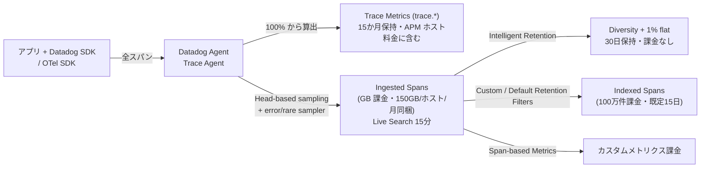
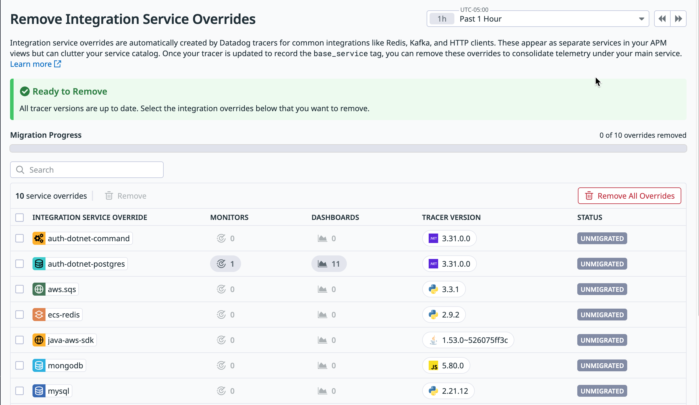
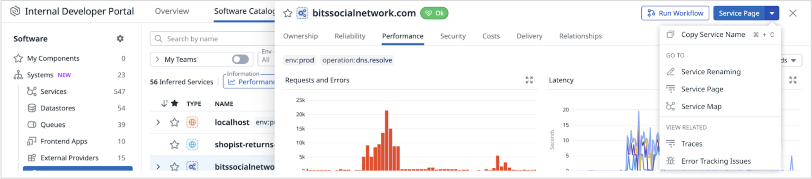
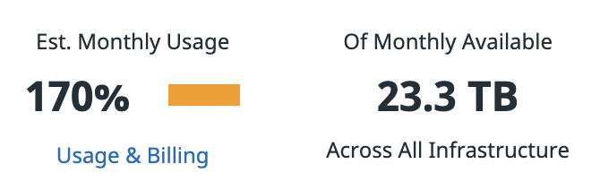
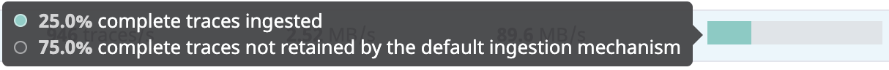

# APM 運用の実践

## 概要

本ファイルは、Datadog APM（Application Performance Monitoring、分散トレーシング）を**導入した後に本番で安定運用するための実践知見**をまとめる。仕様の詳細（設定キーの全一覧、画面の項目、制限値）はリファレンスに譲り、本ファイルでは「何をどの順で、どういう判断基準で決めるか」に焦点を当てる。

| 本ファイルで扱う論点 | 主な問い |
|---|---|
| 計装の進め方 | どのサービスから、どの方式（SSI / SDK 手動 / OpenTelemetry）で、どういう段階で計装するか |
| サンプリング戦略 | 取り込み（Ingestion）と保持（Retention）をどう分けて設計し、どのサービスをどれだけ残すか |
| サービス命名 | `service` 名をどう決め、Integration override・Inferred Services・Remapping Rules をどう扱うか |
| トレースとログの相関 | `dd.trace_id` 注入を確実に機能させ、サンプリングとの関係をどう理解するか |
| コストと可視性のバランス | 無料で得られる可視性と有料の可視性を区別し、どこにお金をかけるか |

前提となる仕様は以下を参照する。

- APM の用語・インジェスト・リテンションの仕様：[APM の概念とインジェスト制御](../02_リファレンス/apm/apm-concepts-and-ingestion.md)
- SDK・SSI・ログ相関の設定：[APM インスツルメンテーション](../02_リファレンス/apm/apm-instrumentation.md)
- 画面と分析機能：[APM 画面と分析機能](../02_リファレンス/apm/apm-ui-and-analysis.md)
- コスト削減の施策全般（APM を含む）：[コスト最適化](cost-optimization.md)
- タグ設計全般：[タグ戦略の実践](tagging-strategy.md)
- OpenTelemetry の採用判断：[OpenTelemetry 活用戦略](opentelemetry-strategy.md)

> 本ファイルの「【経験則】」は一般に語られる実務上の知見、「【推定】」は複数情報からの推定であり、Datadog の公式見解ではない。公式ドキュメントに基づく記述には出典を付けている。基準日は 2026-11-02。

---

## 1. APM 運用の全体像

### 1.1 APM データの流れと「お金がかかる場所」

Datadog APM の運用設計は、データが「計装 → 取り込み（Ingestion）→ 保持（Retention / Indexing）→ 活用」の各段階でどう減り、どこで課金されるかを理解することから始まる。Trace Metrics（`trace.*`）は取り込みサンプリングの**前**に 100% のトラフィックから計算されるため、サンプリングを絞っても RED メトリクス（Requests / Errors / Duration）とそれを使うモニター・SLO の精度は保たれる [出典](https://docs.datadoghq.com/tracing/guide/trace_ingestion_volume_control/)。ただしこれは Datadog SDK と Agent で計装・送信する場合の話である。OpenTelemetry の SDK や Collector でサンプリングする場合、APM メトリクスは既定でサンプル済みデータから計算される。`span_metrics` connector（または Datadog Connector）をサンプリングより前に置く必要がある（§2.4）。



出典：[Trace Retention](https://docs.datadoghq.com/tracing/trace_pipeline/trace_retention/)、[Trace Ingestion Volume Control](https://docs.datadoghq.com/tracing/guide/trace_ingestion_volume_control/)、[APM Billing](https://docs.datadoghq.com/account_management/billing/apm_tracing_profiler/)

### 1.2 運用成熟度モデル【経験則】

APM 導入は一度に完成させず、以下の段階で成熟度を上げていくのが一般的である。各段階の「完了条件」を満たしてから次へ進むと、手戻り（サービス名の付け直し、ダッシュボード・モニターの作り直し）を最小化できる。

| 段階 | 目的 | 主な作業 | 完了条件（例） |
|---|---|---|---|
| 0. 規約策定 | 後で変えにくいものを先に決める | `service` 命名規約、`env` 値の固定リスト、`version` の採番ルール、チーム（`team`）タグ、サンプリング既定方針 | 規約文書がレビュー済み。[タグ戦略の実践](tagging-strategy.md) と整合 |
| 1. パイロット | 計装方式の検証 | 1〜3 サービス（1 つの業務トランザクションを構成する上流〜下流）を計装 | サービスマップがつながる、ログ相関が動く、オーバーヘッドが許容範囲 |
| 2. 横展開 | 重要トランザクションの網羅 | Tier 1 サービスから順に計装。SSI のターゲティングで範囲を制御 | Tier 1 の全サービスで RED メトリクスとモニターがある |
| 3. 最適化 | コストと可視性の調整 | Ingestion Control で取り込み量を予算内に、Retention Filters を目的別に整理、Integration override 削除 | 月間取り込みが同梱枠（または予算）内。不要なカスタムフィルターがない |
| 4. 定着 | 開発プロセスへの組込み | Deployment Tracking / Faulty Deployment Detection、APM Recommendations のレビュー、IaC 化 | リリース判定・ポストモーテムで APM データが日常的に使われる |

組織面の定着策は [組織への定着](organizational-adoption.md)、全体の導入手順は [導入方法論](../03_導入編/implementation-methodology.md) を参照。

---

## 2. 計装の進め方

### 2.1 計装方式の選び方

Datadog APM の計装方式は大きく 4 つある。各方式の詳細仕様は [APM インスツルメンテーション](../02_リファレンス/apm/apm-instrumentation.md) を参照。

| 方式 | 概要 | 向くケース | 注意点 |
|---|---|---|---|
| Single Step Instrumentation（SSI） | Agent 導入時に APM SDK をプロセス／Pod に自動注入。コード・イメージ変更不要 | 多数のサービスを短期間で計装したい。プラットフォームチームが中央管理したい | 既定では全プロセス・全 Namespace が対象になるため、ターゲティングで範囲を制御する。言語・ランタイムの対応要件あり |
| SDK の手動導入（Manual / Local） | アプリのビルド・起動設定に SDK を組み込む | 計装をアプリチームが所有する。SDK バージョンや設定を厳密に管理したい | サービスごとに導入作業が必要。設定のばらつきが出やすい |
| Kubernetes の Local SDK Injection | Pod 単位のアノテーション／ラベルで SDK を注入（SSI を使わない） | クラスタ全体ではなく一部ワークロードだけ注入したい | Admission Controller が必要 |
| OpenTelemetry（OTel SDK / Collector） | OTel で計装し、Datadog Agent の OTLP 受信、DDOT Collector、OTel Collector 等で送信 | ベンダー中立性が要件。既に OTel 計装済み | Agent の自動サンプリング（`auto`）が適用されない。Trace Metrics の算出位置に注意（§2.4） |

出典：[APM インスツルメンテーション](../02_リファレンス/apm/apm-instrumentation.md)、[Ingestion Mechanisms](https://docs.datadoghq.com/tracing/trace_pipeline/ingestion_mechanisms/)

**方式選定の判断基準【経験則】**

| 判断軸 | SSI 寄り | SDK 手動寄り | OTel 寄り |
|---|---|---|---|
| 計装の責任者 | プラットフォーム／SRE チーム | アプリ開発チーム | 全社標準化チーム |
| サービス数 | 多い（数十〜数百） | 少〜中 | 任意 |
| ベンダーロックイン回避要件 | 低 | 低 | 高 |
| Datadog 固有機能（Continuous Profiler、Dynamic Instrumentation、App and API Protection 等）の利用 | 容易（SDK 機能を環境変数で有効化） | 容易 | 機能により制約あり。[OpenTelemetry サポート](../02_リファレンス/platform/opentelemetry.md) 参照 |

混在構成も現実的である。公開事例として、自動計装が効く PHP は Datadog のライブラリ、コード変更が必要な Go は OpenTelemetry と使い分け、Agent の OTLP ポートへ送る構成が報告されている【第三者情報】[出典](https://zenn.dev/ymtdzzz/articles/7f161d59072290)（2023-12-18 公開。2 年近く前の情報のため、現行の OTel 対応状況とは異なる可能性がある）。

### 2.2 段階的ロールアウトの進め方

**ステップ 1：業務トランザクション単位でパイロット対象を選ぶ【経験則】**

単一サービスではなく「ログイン」「決済」のように**1 つのリクエストが通過する上流〜下流の一式**をパイロット対象にする。分散トレースの価値（サービスマップ、ボトルネック特定、トレース連続性の検証）は複数サービスがつながって初めて確認できるためである。

**ステップ 2：サービスをティア分けして順序を決める【経験則】**

| ティア | 例 | 計装の優先度 | サンプリング・保持の方針（§4.3） |
|---|---|---|---|
| Tier 1 | 決済、認証、注文、公開 API ゲートウェイ | 最優先。パイロット直後 | 重要エンドポイントは高めのレート、カスタム Retention Filter を検討 |
| Tier 2 | 社内向け業務 API、通知、検索 | 次点 | 既定（Agent 自動）＋ Intelligent Retention |
| Tier 3 | バッチ、管理画面、ヘルスチェック主体のサービス | 最後、または対象外 | 低レート。必要なら Single Span Sampling のみ |

Zendesk はトレーシング用ダッシュボードでサービスを重要度・深刻度でグループ化し、サービスごとに「デバッグや運用判断にとってのデータの重要度」に基づくウェイトを与え、下位ティアのサービスほど積極的にサンプリングを絞った【第三者情報】[出典](https://www.datadoghq.com/blog/zendesk-cost-optimization/)（2025-12-26 公開、Datadog 公式ブログへの Zendesk 社員の寄稿）。

**ステップ 3：SSI のターゲティングで範囲を絞って広げる**

| 環境 | 範囲制御の手段 | 要件 |
|---|---|---|
| Kubernetes | `targets`（Namespace・Pod ラベル等で対象を指定し、言語ごとの SDK バージョンも指定可能） | Agent 7.64 以降 |
| Kubernetes | `DatadogInstrumentation` CRD | Agent／Cluster Agent 7.85 以降 |
| Linux / Windows ホスト | Instrumentation Rules（計装ルール。プロセスの包含・除外） | Agent 7.73 以降 |

出典：[APM インスツルメンテーション](../02_リファレンス/apm/apm-instrumentation.md)（SSI の各節）

- 既定では SSI はすべての Namespace のすべてのサービスを計装する。最初は対象 Namespace を限定し、検証後に範囲を広げる【経験則】。
- SDK バージョンは固定（ピン留め）し、検証環境で新バージョンを確認してから本番のピンを更新する運用が安全である【経験則】。手順は [APM インスツルメンテーション](../02_リファレンス/apm/apm-instrumentation.md) の「SSI：SDK バージョンの固定と更新」を参照。
- 計装していないノードは APM ホストとして課金されない（APM ホストは「トレースを Datadog に送信しているホスト」）。計装範囲はそのまま APM ホスト数＝コストに直結する [出典](https://docs.datadoghq.com/account_management/billing/apm_tracing_profiler/)。

**ステップ 4：計装品質を確認してから横展開する**

| 確認項目 | 確認方法 | 期待状態 |
|---|---|---|
| Unified Service Tagging | Service Page のタグ、ログ・インフラメトリクスとの相互遷移 | `env`・`service`・`version` が全テレメトリでそろう |
| トレースの連続性 | Trace View で上流→下流が 1 トレースにつながるか | サービス境界でトレースが分断されない |
| コンテキスト伝播形式 | 他ベンダー SDK・プロキシ・メッシュとの境界 | `DD_TRACE_PROPAGATION_STYLE`（既定 `datadog,tracecontext,baggage`）が双方で合っている |
| ログ相関 | Trace View の Logs タブ | `trace_id` でログが表示される（§5） |
| 設定の実値 | Service Page → Service Config → SDK Configuration タブ | 想定どおりの設定値が反映 |
| オーバーヘッド | 計装前後の CPU・メモリ・レイテンシ比較 | 許容範囲内（閾値は組織で定義） |

出典：[APM インスツルメンテーション](../02_リファレンス/apm/apm-instrumentation.md)、[Unified Service Tagging](https://docs.datadoghq.com/getting_started/tagging/unified_service_tagging/)

### 2.3 カスタム計装（スパン属性の追加）の指針

自動計装だけでは業務文脈（顧客ティア、注文金額、テナント ID 等）が分からない。カスタムタグを付けると、Trace Explorer での絞り込みや Retention Filter・Span-based Metrics の条件に使えるようになる。

| 指針 | 理由・根拠 |
|---|---|
| 分析用の属性は**ルートスパン（Service Entry Span）に集約**する | Zendesk はモノリスのルートスパンに `@zendesk.db.time`、`@zendesk.db.cluster_name`、`@zendesk.db.cluster_version`、`@zendesk.search.time` 等を付与し（100 を超えるカスタムファセット）、フルトレースなしでも遅延・失敗リクエストの切り分けや DB アップグレード後の劣化検知を可能にした【第三者情報】[出典](https://www.datadoghq.com/blog/zendesk-cost-optimization/)（2025-12-26 公開） |
| サンプリング判定に使うタグは**ルートスパンに付ける** | サンプリングルールはトレースの最初のスパンで判定されるため、タグがルートスパンにないとルールが効かない [出典](https://docs.datadoghq.com/tracing/guide/ignoring_apm_resources/) |
| 高カーディナリティ値（ユーザー ID、リクエスト ID）はスパンタグとしては可、**Span-based Metrics の Group by には使わない** | Span-based Metrics はカスタムメトリクスとして課金され、高カーディナリティの Group by は課金増につながる [出典](https://docs.datadoghq.com/tracing/trace_pipeline/generate_metrics/) |
| Primary Tag（追加の第 2 プライマリタグ）は値の種類が少ないもの（リージョン、データセンター等）に限る | 追加 Primary Tag 1 つあたりの一意な値は 100 まで、反映に最大 2 時間 [出典](https://docs.datadoghq.com/tracing/troubleshooting/) |
| 1 スパンのタグ数を抑える | 1 スパンあたりのスパンタグは 1,024 以下 [出典](https://docs.datadoghq.com/tracing/troubleshooting/) |
| 個人情報・機密値をタグにしない。必要なら Agent の `replace_tags` や難読化、Sensitive Data Scanner で保護 | [Sensitive Data Scanner](../02_リファレンス/security/sensitive-data-scanner.md)、[APM の概念とインジェスト制御](../02_リファレンス/apm/apm-concepts-and-ingestion.md) §4.1 |

### 2.4 OpenTelemetry と Datadog SDK が混在する場合の実務ポイント

| 論点 | 実務ポイント |
|---|---|
| コンテキスト伝播 | Datadog SDK は既定で Datadog 形式と W3C `tracecontext` の両方を注入・抽出するため、OTel SDK との境界でもトレースがつながる。プロキシやメッシュが `traceparent` を書き換えないか確認する [出典](https://docs.datadoghq.com/tracing/trace_collection/trace_context_propagation/) |
| サンプリング | OTel SDK には Agent の自動サンプリング（`auto`、`DD_APM_TARGET_TPS`）が効かない。OTel 側（SDK / Collector）または Agent の Probabilistic sampler（Agent 7.70.0 以降）で設定する [出典](https://docs.datadoghq.com/tracing/trace_pipeline/ingestion_mechanisms/) |
| Trace Metrics の正確性 | Collector でサンプリングする場合、`span_metrics` connector（または Datadog Connector）をサンプリングプロセッサーより**前**に置かないと、メトリクスがサンプル済みデータから計算される [出典](https://docs.datadoghq.com/tracing/guide/trace_ingestion_volume_control/) |
| UST | OTel では `service.name`→`service`、`service.version`→`version`、`deployment.environment.name`→`env` に対応付けられる（`deployment.environment.name` は Agent 7.58.0 以降、Datadog Exporter v0.110.0 以降、または Datadog OTLP intake）。`DD_SERVICE` 等の Datadog 固有変数は OTel 構成では標準ではサポートされない [出典](https://docs.datadoghq.com/getting_started/tagging/unified_service_tagging/) |

詳細は [OpenTelemetry 活用戦略](opentelemetry-strategy.md) を参照。

---

## 3. サービス命名

### 3.1 命名がなぜ重要か

Datadog APM の `service` 名は、Trace Metrics のタグ、Software Catalog（旧称：Service Catalog）のエンティティ、モニター・ダッシュボード・SLO のクエリ、Retention Filter・サンプリングルールの条件、ログ・プロファイル等との相関キーとして使われる。後から変更すると、これらすべての参照を直す必要がある。また Service Remapping Rules による改名は**過去データを書き換えない**ため、改名前後でメトリクスが分断される [出典](https://docs.datadoghq.com/tracing/services/service_remapping_rules/)。

### 3.2 命名の原則

| 原則 | 内容 | 根拠 |
|---|---|---|
| `service` は**論理的なサービス（デプロイ単位・オーナー単位）**を表す | 1 つのコードベース／デプロイ単位に 1 つの `service`。ホスト名や Pod 名を入れない | 【経験則】 |
| 環境・リージョン・バージョンを `service` 名に含めない | `env`、リージョン（Primary Tag や通常タグ）、`version` は別タグで表現する。`payments-prod` のような命名は `env` × `service` の組み合わせを無駄に増やす | `env`×`service` の一意な組み合わせは 40 分間隔あたり 5,000 まで [出典](https://docs.datadoghq.com/tracing/troubleshooting/) |
| `version` は**デプロイごとに変わる値**にする | Deployment Tracking と Faulty Deployment Detection の前提。`env`×`service` あたりの一意な `version` は 40 分間隔あたり 30 まで | [Unified Service Tagging](https://docs.datadoghq.com/getting_started/tagging/unified_service_tagging/)、[APM Troubleshooting](https://docs.datadoghq.com/tracing/troubleshooting/) |
| 長さは 100 文字以内 | `service` は 100 文字で切り詰められる | [APM Troubleshooting](https://docs.datadoghq.com/tracing/troubleshooting/) |
| 大文字小文字を統一する（小文字推奨） | サンプリングルールのサービス名照合は大文字小文字を区別する（公式に明記されているのは Java SDK のみ。他言語でも同様と考えて統一しておくのは【経験則】） | [Ingestion Mechanisms](https://docs.datadoghq.com/tracing/trace_pipeline/ingestion_mechanisms/) |
| DB・キャッシュ・外部 API を独立した `service` にしない | 依存先は Inferred Services（`peer.*` タグ）で表現する（§3.4） | [Inferred Services](https://docs.datadoghq.com/tracing/services/inferred_services/) |
| `service` 名を Software Catalog のエンティティと一致させ、オーナー（`team`）を登録する | 所有者不明のサービスを作らない | [Software Catalog](../02_リファレンス/platform/software-catalog.md) |

**命名規約テンプレート（例）【経験則】**

| 要素 | 規約例 | 例 |
|---|---|---|
| 書式 | 小文字・ハイフン区切り、`<ドメイン>-<機能>[-<種別>]` | `payments-api`、`payments-worker`、`catalog-search-api` |
| 種別サフィックス | `-api`（同期 API）、`-worker`（非同期処理）、`-batch`（定期バッチ）、`-web`（SSR フロント） | `orders-worker` |
| 禁止 | 環境名（`prod`、`stg`）、リージョン名、バージョン、ホスト名、チーム名 | `payments-api-prod` は不可 |
| `env` の値 | 固定リスト（例：`prod`、`staging`、`dev`） | `env:prod` |
| `version` | イメージタグ、または `<semver>` / Git SHA | `version:1.42.0` |

規約全体の作り方は [タグ戦略の実践](tagging-strategy.md) の「標準タグ辞書」を参照。

### 3.3 `service` 名が決まる優先順位

Datadog で `service` 名が決まる優先順位（上ほど優先）は以下のとおり [出典](https://docs.datadoghq.com/tracing/services/service_remapping_rules/)。

| 優先順位 | 設定場所 | 例 |
|---|---|---|
| 1 | Service Remapping Rules（Datadog 側、取り込み時に適用） | APM > Catalog > Manage > Service Remapping |
| 2 | コード内でのサービス指定 | `tracer.Start(WithService("xx"))` |
| 3 | システムプロパティ | `-Ddd.service=xx` |
| 4 | 環境変数 | `DD_SERVICE` |
| 5 | 設定ファイル | `application_monitoring.yaml` |

- `DD_SERVICE` を設定しない場合、SDK は自動検出した名前を使う（例：Node.js は `package.json` の `name`、Go はプロセス名）。意図しない名前で大量のサービスが登録されることを避けるため、**`DD_SERVICE` は必ず明示する**【経験則】[出典](https://docs.datadoghq.com/tracing/trace_collection/library_config/)。
- Kubernetes では `tags.datadoghq.com/env`、`tags.datadoghq.com/service`、`tags.datadoghq.com/version` ラベルをワークロードと Pod テンプレートに付け、Admission Controller または Downward API で `DD_ENV`・`DD_SERVICE`・`DD_VERSION` を注入するのが標準パターンである [出典](https://docs.datadoghq.com/getting_started/tagging/unified_service_tagging/)。
- Agent 7.52.0 以降は、`version` を手動設定していない場合に `{image_tag}_{git commit SHA の先頭 7 桁}` 等で自動付与される（手動設定値は上書きされない）[出典](https://docs.datadoghq.com/getting_started/tagging/unified_service_tagging/)。

### 3.4 Integration override の削除（base service への統一）

**背景**：従来の Datadog SDK は、DB・キャッシュ・キュー・HTTP クライアント等のクライアントスパンに `my-service-postgres`、`mysql`、`grpc-client` のような**統合ごとのサービス名（Integration override）**を自動付与していた。これはサービス一覧やサービスマップを「汚す」要因となる。現在は Inferred Services で依存先を表現できるため、Integration override は不要とされる [出典](https://docs.datadoghq.com/tracing/guide/service_overrides/)。

| 用語 | 意味 |
|---|---|
| Base service | 初期のサービス名。既定の `DD_SERVICE` の値 |
| Custom override | 開発者がスパンに手動で設定したサービス名（共有ライブラリやミドルウェア層の可視化用） |
| Integration override | SDK がクライアントスパンに自動設定するサービス名 |
| Inferred entity | `peer.*` タグから推論された依存先（DB、キュー、外部 API） |

出典：[Service Overrides](https://docs.datadoghq.com/tracing/guide/service_overrides/)

**削除後のサービス名の変化**

| 例 | Override あり | Override 削除後 | 依存先の表現 |
|---|---|---|---|
| gRPC | `my-service-grpc-client` または `grpc-client` | `myservice` | `@peer.service:otherservice` |
| MySQL | `my-service-mysql` または `mysql` | `myservice` | `@peer.db.name:user-db`、`@peer.db.system:mysql` |

出典：[Integration Override Removal](https://docs.datadoghq.com/tracing/services/service_override_removal/)

**削除手順**

| 方法 | 手順 | 備考 |
|---|---|---|
| UI | **Catalog > Manage > Manage Remapping Rules** → **Manage Overrides**。各 override に紐づくモニター・ダッシュボードを確認し、個別に削除するか **Finish Migration** で一括削除 | 一括削除は今後新たな Integration override が現れることも止める。Custom override は対象外。削除は元に戻せる |
| 設定 | `DD_TRACE_REMOVE_INTEGRATION_SERVICE_NAMES_ENABLED=true` | UI にアクセスできない場合。Custom override はコード側で削除が必要 |

- 前提：`apm_service_renaming_write` 権限、および以下の SDK 最低バージョン [出典](https://docs.datadoghq.com/tracing/services/service_override_removal/)。

| 言語 | 最低バージョン |
|---|---|
| C++ | 全バージョン |
| .NET | 3.4.0 |
| Go | 1.55.0 |
| Java | 1.20.0 |
| Node.js | 3.37.0（3.x）または 4.16.0 |
| PHP | 0.94.1 |
| Python | 1.19.0 |
| Ruby | 1.15.0 |

> **サイト差異:** Integration Override Removal は `app.ddog-gov.com` および `us2.ddog-gov.com`（US1-FED 等の GovCloud 系）では非対応 [出典](https://docs.datadoghq.com/tracing/services/service_override_removal/)。



- **キャプション**：Integration service override の削除画面（Remove Integration Service Overrides）
- **画面の説明**：上部に「Integration service overrides は Redis、Kafka、HTTP クライアント等の共通統合に対して Datadog トレーサーが自動作成し、APM 画面で別サービスとして表示されサービスカタログを散らかす。トレーサーが `base_service` タグを記録するよう更新されれば override を削除してメインサービスに集約できる」旨の説明。緑色の「Ready to Remove（All tracer versions are up to date）」バナー、「Migration Progress（0 of 10 overrides removed）」の進捗バー、検索ボックス。一覧は INTEGRATION SERVICE OVERRIDE（例：`auth-dotnet-command`、`auth-dotnet-postgres`、`aws.sqs`、`ecs-redis`、`java-aws-sdk`、`mongodb`、`mysql`）、MONITORS（参照モニター数。例：`auth-dotnet-postgres` は 1）、DASHBOARDS（参照ダッシュボード数。例：11）、TRACER VERSION（言語アイコンとバージョン）、STATUS（UNMIGRATED）の列を持ち、右上に「Remove All Overrides」ボタンがある。
- **出典**：https://docs.datadoghq.com/tracing/services/service_override_removal/ （2026-11-02 取得）

**実践手順（推奨順）**

1. SDK を最低バージョン以上に更新する（§2.2 の SDK ピン更新と同時に行うと効率的）【経験則】。
2. 画面の MONITORS / DASHBOARDS 列で参照があるものを洗い出し、クエリを `service:<DD_SERVICE>` と `peer.*` 属性（`peer.service`、`peer.db.name`、`peer.db.system` 等）を使う形に書き換える [出典](https://docs.datadoghq.com/tracing/services/service_override_removal/)。
3. 影響の小さい override から**個別に**削除して影響を確認し、問題なければ **Finish Migration** で一括削除する [出典](https://docs.datadoghq.com/tracing/services/service_override_removal/)。
4. Retention Filter、サンプリングルール、Span-based Metrics、Sensitive Data Scanner のスキャン条件、Notebook も旧サービス名を参照していないか確認する（`DD_TRACE_REMOVE_INTEGRATION_SERVICE_NAMES_ENABLED` の影響範囲として公式が列挙）[出典](https://docs.datadoghq.com/tracing/services/inferred_services/)。
5. Terraform 等で管理しているモニター・ダッシュボードはコード側も修正する（[Monitoring as Code](monitoring-as-code.md)）。

### 3.5 Inferred Services と `peer.*` タグ

Datadog は計装済みサービスの外向きリクエストを解析し、計装されていない DB・キュー・外部 API を Inferred Services として推論し、性能メトリクスを収集する [出典](https://docs.datadoghq.com/tracing/services/inferred_services/)。

| Agent バージョン | 必要な設定 |
|---|---|
| 7.60.0 以降 | 不要（`apm_config.compute_stats_by_span_kind` と `apm_config.peer_tags_aggregation` が既定で有効） |
| 7.55.1〜7.59.1 | `compute_stats_by_span_kind: true`、`peer_tags_aggregation: true`（または `DD_APM_COMPUTE_STATS_BY_SPAN_KIND=true`、`DD_APM_PEER_TAGS_AGGREGATION=true`） |
| 7.50.3〜7.54.1 | 上記 2 つに加え `peer_tags`（`DD_APM_PEER_TAGS`）の明示 |
| OTel Datadog Connector（contrib v0.95.0 以降） | `connectors.datadog/connector.traces` に `compute_stats_by_span_kind`、`peer_tags_aggregation`、`peer_tags` |

出典：[Inferred Services](https://docs.datadoghq.com/tracing/services/inferred_services/)

**Inferred entity の名前の決まり方（上ほど優先）**

| 種別 | 優先順位 |
|---|---|
| データベース | `peer.db.name` > S3 バケット・DynamoDB テーブル・Cassandra contact points・Couchbase seed nodes > `peer.hostname` > `peer.db.system` |
| キュー | `peer.messaging.destination` > Kafka bootstrap servers・SQS キュー・Kinesis ストリーム > `peer.messaging.system` |
| 推論サービス（外部 API 等） | `peer.service` > `peer.rpc.service` > `peer.hostname` |

- 既定では外部 API は `net.peer.name`（例：`api.stripe.com`）、DB は `db.instance` から命名される。IP アドレス形式のピア値は `blocked-ip-address` に置き換えられる [出典](https://docs.datadoghq.com/tracing/services/inferred_services/)。
- **実務ポイント【経験則】**：Agent を 7.60.0 以降にそろえるのが最も簡単。IP 直指定の接続先が多い環境では `blocked-ip-address` にまとめられて依存先が区別できないため、接続文字列をホスト名（DNS 名）にそろえる。

> **サイト差異:** GovCloud 系サイト（`app.ddog-gov.com`、`us2.ddog-gov.com`）では Inferred Services は既定で無効で、利用には申請が必要 [出典](https://docs.datadoghq.com/tracing/services/inferred_services/)。

### 3.6 Service Remapping Rules の使いどころ

Service Remapping Rules は、トレーサー設定の変更や再デプロイなしに、Datadog 側でサービスの改名・統合・分割や、インフラタグによるサービスの特定を行う機能である。APM（トレース）だけでなく Logs、Metrics、USM、DSM、DJM、DBM、Profiling、NPM、Live Processes、Live Containers、Kubernetes、Events にも適用される（`service` タグ、Inferred entity の場合は `peer.service` タグを上書き）[出典](https://docs.datadoghq.com/tracing/services/service_remapping_rules/)。

| 項目 | 内容 |
|---|---|
| 作成場所 | **APM > Catalog > Manage > Service Remapping** → **Add Service Rule**（Inferred entity は Inferred Entity Rules タブ）。サービスのサイドパネルからも可 |
| アクション | Remap services（分割・改名・統合）、Correlate telemetry（インフラタグでサービスを特定） |
| 名前の生成 | 固定名、`{{tagName}}` によるタグからの生成、正規表現による抽出（キャプチャグループ内の貪欲量指定子は不可） |
| 評価順 | 上から順に評価、最初に一致したルールのみ適用（積み重ならない） |
| 反映 | 約 1 分 |
| 遡及 | **しない**。ルール有効中に取り込まれたデータのみ。削除・変更しても取り込み済みの名前は戻らない |
| 上限 | 組織あたり 100 ルール |
| 権限 | APM Service Remapping Write（`apm_service_renaming_write`） |
| SDK 要件 | 計装サービスは Integration Override Removal と同じ最低バージョン表（§3.4）。Inferred entity は要件なし |
| 既存クエリ | モニター・ダッシュボードの旧名参照は自動更新されないため手動で見直す |
| Bits AI | Bits Chat の `service-remapping` スキルを有効化するとプロンプトでルールを作成・更新・削除できる |

出典：[Service Remapping Rules](https://docs.datadoghq.com/tracing/services/service_remapping_rules/)



- **キャプション**：Software Catalog（Internal Developer Portal）でサービスのサイドパネルから Service Renaming を開く操作
- **画面の説明**：左ペインに Software の分類（My Components、Systems、Services 547、Datastores 54、Queues 39、Frontend Apps 10、External Providers 15）。中央は「56 Inferred Services」の一覧（TYPE、NAME 列。例：`localhost`、`shopist-returns`、`bitssocialnetwork.com`）。右側に `bitssocialnetwork.com` のサイドパネルが開き、Ownership・Reliability・Performance・Security・Costs・Delivery・Relationships タブ、`env:prod` `operation:dns.resolve` のフィルター、「Requests and Errors」と「Latency」のグラフ。右上の **Service Page** ボタンのドロップダウンに Copy Service Name、GO TO（**Service Renaming**、Service Page、Service Map）、VIEW RELATED（Traces、Error Tracking Issues）が並ぶ。
- **出典**：https://docs.datadoghq.com/tracing/services/service_remapping_rules/ （2026-11-02 取得）

**Remapping Rules と設定変更の使い分け【経験則】**

| 状況 | 推奨 |
|---|---|
| 新規サービスの命名 | 計装側（`DD_SERVICE`）で正しく付ける。Remapping に頼らない |
| すぐに再デプロイできないサービスの誤命名を急ぎ直したい | Remapping Rules で暫定対応し、次回デプロイで `DD_SERVICE` を修正したらルールを削除 |
| 共有ホスト上の複数アプリを分割したい、インフラタグからサービスを特定したい | Remapping Rules（Correlate telemetry） |
| 外部 API・DB の推論名を分かりやすくしたい | Inferred Entity Rules |
| 組織全体の命名を大規模に変える | ルール上限 100 に注意。計装側の修正を基本とする |

### 3.7 サービス改名時の移行チェックリスト【経験則】

| # | 作業 | 理由 |
|---|---|---|
| 1 | 旧名を参照するモニター・SLO・ダッシュボード・Notebook・Retention Filter・サンプリングルール・Span-based Metrics・Workflow を洗い出す | 改名は既存クエリに自動反映されない [出典](https://docs.datadoghq.com/tracing/services/service_remapping_rules/) |
| 2 | 移行期間は `service:(old OR new)` のように両方を対象にしたクエリにする | 新旧データが混在するため |
| 3 | SLO は履歴の連続性が途切れることを関係者に周知（必要なら新旧 SLO を並行運用） | 過去データは書き換わらない |
| 4 | Software Catalog のエンティティ定義（オーナー、リンク）を新名で登録 | 所有者情報の欠落を防ぐ |
| 5 | Ingestion Control のリモートサンプリング設定を新名で再設定 | サンプリングルールはサービス名で照合される |

---

## 4. サンプリング戦略

### 4.1 前提：「取り込み」と「保持」の 2 段階で考える

Datadog APM のデータ量制御は 2 段階に分かれる。この区別が曖昧なまま運用すると、「取り込みを絞ったのに Indexed Spans の請求が減らない」「Retention Filter を絞ったのに Ingested Spans が超過する」といった誤解が起きる。

| 段階 | 制御する機能 | 影響する課金 | 影響を受けない／受けるもの |
|---|---|---|---|
| 取り込み（Ingestion） | Agent 自動サンプリング（`DD_APM_TARGET_TPS`）、SDK のサンプリングルール（`DD_TRACE_SAMPLING_RULES`）、Adaptive Sampling、Error / Rare sampler、Single Span Sampling、`filter_tags` 等 | Ingested Spans（GB） | Trace Metrics は影響を受けない。Span-based Metrics の Count 型や Count ベースの Trace Analytics Monitor は影響を受ける |
| 保持（Retention） | Retention Filters（カスタム・既定）、Intelligent Retention | Indexed Spans（100 万件）。Intelligent Retention は課金なし | 取り込み量は変わらない |

出典：[Trace Ingestion Volume Control](https://docs.datadoghq.com/tracing/guide/trace_ingestion_volume_control/)、[Trace Retention](https://docs.datadoghq.com/tracing/trace_pipeline/trace_retention/)

**なぜサンプリングしてよいのか**：トレースデータは非常に反復的であり、重大な問題は複数のトレースに現れるため、サンプリングされたトレースでも調査に十分であることが多い、と Datadog は説明している [出典](https://docs.datadoghq.com/tracing/guide/trace_ingestion_volume_control/)。Datadog の顧客全体では、サンプリング前のトレース量は取り込みログ量の約 5 倍、サンプリング後の取り込みトレース量でも約 2 倍とされる [出典](https://www.datadoghq.com/architecture/mastering-distributed-tracing-data-volume-challenges-and-datadogs-approach-to-efficient-sampling/)（2025-03-18 公開、Datadog Architecture Center）。

### 4.2 Head-based と Tail-based の比較

Datadog APM（Datadog SDK + Agent）の既定は Head-based sampling で、ルートスパンで判定してその決定を下流に伝播するため、残されたトレースは必ず完全な形になる [出典](https://docs.datadoghq.com/tracing/trace_pipeline/ingestion_mechanisms/)。

| 観点 | Head-based | Tail-based |
|---|---|---|
| 効率・コスト | 送信量が少なく、通信・保存コストが低い | すべてのスパンをバッファするためコストが高い |
| インフラ | 単一の Agent で完結し単純 | 追加のストレージと処理（Collector のゲートウェイ構成等）が必要 |
| エラー・高レイテンシーの捕捉 | 判定後に発生するため難しい（Datadog は Error sampler・Intelligent Retention で補完） | トレース全体を評価できるため強い |
| トレースの完全性 | サンプルされたトレースは完全 | 不完全なトレースのリスク（1 トレースのスパンが同一 Collector に届く必要がある） |
| 業務上重要なトレース | 明示的なルールやカスタムタグが必要 | トレース内容で狙えるが複雑 |

出典：[Mastering Distributed Tracing](https://www.datadoghq.com/architecture/mastering-distributed-tracing-data-volume-challenges-and-datadogs-approach-to-efficient-sampling/)（2025-03-18 公開）、[Ingestion Sampling with OpenTelemetry](https://docs.datadoghq.com/opentelemetry/guide/ingestion_sampling_with_opentelemetry/)

**Datadog の推奨する考え方**：成功リクエストは代表サンプルを残し、エラーと高レイテンシーのトレースは常に残し、業務上重要なエンドポイントは 100% 残す。Head-based だけで後者 2 つを実現するには明示的なルールかカスタム計装が必要になる [出典](https://www.datadoghq.com/architecture/mastering-distributed-tracing-data-volume-challenges-and-datadogs-approach-to-efficient-sampling/)。Datadog ではエラーと高レイテンシーについて、Error sampler（取り込み段階）と Intelligent Retention の Diversity sampling（保持段階）が自動で補完する。

### 4.3 ティア別のサンプリング方針（テンプレート）【経験則】

以下は §2.2 のティアに対応した初期値のテンプレートである。具体的な数値は組織のトラフィック量・予算で調整する。

| ティア | 取り込み（Ingestion） | 保持（Retention） | 補足 |
|---|---|---|---|
| Tier 1（重要トランザクション） | 重要エンドポイント（例：`POST /cart/checkout`）はリソース単位ルールで高レート（〜100%）、その他は既定または低レート | Intelligent Retention ＋ 必要に応じ目的別カスタムフィルター（例：重要エンドポイントの遅延 `@duration:>2s`） | Trace Analytics Monitor を使うならカスタムフィルターが必須（§4.6） |
| Tier 2 | Agent 自動（`auto`）のまま、または Adaptive Sampling に登録 | Intelligent Retention のみ | Error Default の率を必要に応じて調整 |
| Tier 3 | 低レート（例：数 %）。ヘルスチェックは 0 | Intelligent Retention のみ | 単一スパンだけ欲しい場合は Single Span Sampling |

Datadog Architecture Center の記事でも、収益に直結するエンドポイント（決済）、顧客向け機能（サインアップ、ログイン）、コンプライアンス上重要なワークフローを最優先で高レートにし、全体には基準レートを適用、ヘルスチェックや定期同期ジョブは低くする、という優先順位付けを推奨している。同記事の例では `POST /cart/checkout` を 100%、その他のリソースを 10% に設定している [出典](https://www.datadoghq.com/architecture/optimizing-distributed-tracing-best-practices-for-remaining-within-budget-and-capturing-critical-traces/)（2025-05-19 公開）。

**リソース単位ルールの設定例（ローカル設定）**

```bash
# my-service の GET /checkout は 100%、それ以外は 20%（具体的なルールを先に書く）
DD_TRACE_SAMPLING_RULES='[{"service": "my-service", "resource": "GET /checkout", "sample_rate": 1},{"service": "my-service", "sample_rate": 0.2}]'
```

出典：[Ingestion Mechanisms](https://docs.datadoghq.com/tracing/trace_pipeline/ingestion_mechanisms/)

- ルールは先頭から評価され最初に一致したものが適用されるため、具体的なルールを先に置く。
- Remote 設定（Ingestion Control 画面の **Manage Ingestion Rate**）はローカル設定より優先され、サービス再起動なしで反映できる。SDK の最低バージョン（例：Java 1.34.0、Python 2.9.0、Go 1.64.0、Node.js 5.16.0）が必要 [出典](https://docs.datadoghq.com/tracing/trace_pipeline/ingestion_mechanisms/)。
- **運用上の推奨【経験則】**：設定の「正」をどこに置くか（Remote か環境変数か）をチームで決める。両方に設定があると、Remote が優先されるため環境変数を変えても効かず混乱しやすい。

### 4.4 ユースケース別の設定

| やりたいこと | 推奨手段 | 設定例 | 注意点 |
|---|---|---|---|
| 完全なトランザクショントレースを全体として一定量残す | Agent の Head-based sampling | `DD_APM_TARGET_TPS=<値>`（既定 10、Agent あたり） | その Agent に送る全サービスのレートに影響。目標は平均値でありハードリミットではない（スパイク時に一時的に大きく超え得る） |
| 特定サービスのトレースを多く残す | SDK のサンプリングルール | `DD_TRACE_SAMPLING_RULES='[{"service": "my-service", "sample_rate": 0.2}]'` | ルールはそのサービスから**開始された**トレースに適用 |
| エラートレースを多く残す | Agent の Error sampler | `DD_APM_ERROR_TPS=<値>`（既定 10、`0` で無効） | Agent ローカルで判定するため分散トレースの一部が欠ける場合がある。Agent 6/7.41.0 以降は `DD_APM_FEATURES=error_rare_sample_tracer_drop` で SDK ルール・`manual.drop` で捨てたスパンも対象にできる |
| DB・キャッシュのスパン量を減らす | DB を呼ぶ**上流の**サービスでサンプリング | `DD_TRACE_SAMPLING_RULES='[{"service": "web-store", "sample_rate": 0.1}]'` | DB サービス自身はトレースを開始しない。Service Ingestion Summary の Top Sampling Decision Makers で起点サービス（例では `web-store` と `shipping-worker` で約 99%）を特定し、すべてに設定 |
| トレース全体は不要だが特定スパンは残したい | Single Span Sampling | `DD_SPAN_SAMPLING_RULES='[{"service": "web-store", "sample_rate": 1}]'` | Agent 7.40.0 以降。Span-based Metrics の元データとして特に有用 |

出典：[Trace Sampling Use Cases](https://docs.datadoghq.com/tracing/guide/ingestion_sampling_use_cases/)

### 4.5 ヘルスチェック等のノイズ除外

ヘルスチェックの除外は「Trace Metrics に残すか」で手段を選ぶ。

| 方式 | Trace Metrics | 使いどころ |
|---|---|---|
| サンプリングルールで `sample_rate: 0` | **残る**（リクエスト数・レイテンシは見える） | ヘルスチェックの成功率・応答時間も監視したい |
| Agent の `filter_tags` / `ignore_resources` | **消える** | その Agent 配下の全サービスで完全に無視したい |
| SDK 側のフィルター（言語別） | **消える** | サービス単位でアプリの文脈に応じて除外したい |

出典：[Ignoring Unwanted Resources](https://docs.datadoghq.com/tracing/guide/ignoring_apm_resources/)

【経験則】ロードバランサーのヘルスチェックはリクエスト数が非常に多く、スループットやレイテンシの平均を歪める（実ユーザーのレイテンシより極端に速い）ことがある。SLO を `trace.*` メトリクスで定義するサービスでは、`filter_tags` で除外するか、SLO クエリ側で該当 `resource_name` を除外するかを明示的に決めておく。

### 4.6 Retention Filters の設計

**基本方針：まず無料の Intelligent Retention で足りるかを確認する**

Intelligent Retention Filter は常時有効で、Diversity sampling（`env`×`service`×オペレーション×`resource` ごとに最大 15 分に 1 回、p75・p90・p95 の高レイテンシーと代表的なエラーを保持）と 1% flat sampling を **30 日**保持し、Indexed Spans の課金に計上されない [出典](https://docs.datadoghq.com/tracing/trace_pipeline/trace_retention/)。

| 要件 | Intelligent Retention で足りるか | カスタム Retention Filter が必要な理由 |
|---|---|---|
| エラーの原因調査 | 多くの場合足りる（ステータスコードごとの代表エラーを保持） | 特定エラーの全件を追いたい場合 |
| 遅いリクエストの調査 | 多くの場合足りる（p75/p90/p95） | 特定エンドポイントの遅延を網羅的に追いたい場合 |
| 重要エンドポイントの全件追跡（監査・顧客問い合わせ対応） | 足りない | 100% の保持が必要 [出典](https://docs.datadoghq.com/tracing/guide/leveraging_diversity_sampling/) |
| APM Trace Analytics Monitor | **使えない**（モニターはカスタムフィルターのスパンのみ評価） | モニター用のフィルターが必須 [出典](https://docs.datadoghq.com/tracing/troubleshooting/) |
| 比率の分析（例：顧客ティア別の構成比） | Diversity sampling はエラー・高レイテンシーに偏るため、`-retained_by:diversity_sampling` で除外して分析 | 正確な比率が必要ならカスタムフィルター |
| 一意な値の数え上げ（例：影響を受けた加盟店数） | Diversity sampling を**含めて**数える方がカスタムフィルターで漏れる ID を拾える | — |

出典：[Leveraging Diversity Sampling](https://docs.datadoghq.com/tracing/guide/leveraging_diversity_sampling/)

**カスタム Retention Filter の設計ルール【経験則】**

| ルール | 理由 |
|---|---|
| フィルターごとに「目的」「オーナー」「期限」を名前か説明に含める（例：`[payments][monitor] checkout slow >2s`） | 誰が何のために作ったか分からないフィルターが残り続けるのを防ぐ |
| 具体的なフィルターを上位に置く | 一覧の順に直列評価され、上位で決まったスパンは下位で評価されない [出典](https://docs.datadoghq.com/tracing/trace_pipeline/trace_retention/) |
| Trace rate は原則 0%。Trace Queries が必要な場合のみ低率で | Trace rate はトレース全体をインデックスするため Indexed Spans が大幅に増え得る（公式警告）[出典](https://docs.datadoghq.com/tracing/trace_pipeline/trace_retention/) |
| 調査用の一時フィルターは終わったら無効化 | 「全スパン 100%」のフィルターの放置はコスト増の典型 |
| Error Default の率を見直す | 既知のエラーを返し続けるサービスでは Indexed Spans を押し上げやすい（[コスト最適化](cost-optimization.md) §5.3） |
| `apm_retention_filter_write` 権限を限定する | 作成・変更・有効化には同権限が必要 [出典](https://docs.datadoghq.com/tracing/trace_pipeline/trace_retention/) |

> **注意（公開事例）:** 上流サービスの判断で下流のトレースが捨てられることや、他チームの Retention Filter が自分のサービスのスパン保持に影響することがあるため、サンプリングと保持の設定は組織横断で確認する必要がある、という指摘がある【第三者情報】[出典](https://utf9k.net/blog/sampling-all-the-way-down/)（2022-08-08 公開。2 年以上前の記事で、当時のアプリ側既定 100 traces/秒の記述など現行仕様と異なる部分がある）。

### 4.7 Adaptive Sampling の使い方

Adaptive Sampling は、月間の取り込み目標（GB）に収まるよう Datadog がサービス単位のサンプリングレートを自動調整する機能で、各 `service`×`resource`×`env` について 5 分ごとに少なくとも 1 トレースを取り込むことを目指す [出典](https://docs.datadoghq.com/tracing/trace_pipeline/adaptive_sampling/)。

| 項目 | 内容 |
|---|---|
| 要件 | Agent 7.53.0 以降＋ Remote Configuration。SDK 最低バージョン（例：Java 1.34.0、Go 1.68.0、Python 3.14.2、Node.js 5.16.0、.NET 2.54.0） |
| 目標の決め方 | Option 1：APM ホスト数ベースの割当に対する %（推奨、30 分ごと再計算）。Option 2：固定 GB/月 |
| 対象 | 登録したサービスのみ。ローカルのサンプリングルールや未登録サービスの量は目標に含まれない |
| 併用 | 登録時にリソース単位の明示レート（例：チェックアウトは 100%、ヘルスチェックは 0.1%）を併記できる |
| 再計算 | 10 分ごと。変更の反映は約 5〜6 分 |
| 上限 | `service/env` ペア 800 まで |
| 権限 | 既定は Datadog Admin のみ。カスタムロールは `APM Remote Configuration Write` と `APM Service Ingest Write` |

出典：[Adaptive Sampling](https://docs.datadoghq.com/tracing/trace_pipeline/adaptive_sampling/)、詳細は [APM の概念とインジェスト制御](../02_リファレンス/apm/apm-concepts-and-ingestion.md) §6

> **サイト差異:** Adaptive Sampling は `app.ddog-gov.com`、`us2.ddog-gov.com` では非対応 [出典](https://docs.datadoghq.com/tracing/trace_pipeline/adaptive_sampling/)。

**導入の進め方【経験則】**

1. まず Tier 2・Tier 3 のサービスを登録し、Tier 1 は明示ルールで管理する（重要サービスのレートが自動で下がるのを避ける）。
2. Option 1（割当の %）を 80〜90% 程度から始め、月次で実績を見て調整する（数値は【推定】による目安）。
3. 予算の固定上限が必要な組織（予算超過が許されない）は Option 2 を使い、サービス追加時に目標を手動で増やす運用ルールを決める。

### 4.8 インシデント時の一時的な引き上げ

Datadog Architecture Center は、インシデント中に重要サービスのサンプリングを一時的に緩めて詳細な情報を得ること、Remote 設定ならコード変更や再起動なしにレートを変えられることを挙げている [出典](https://www.datadoghq.com/architecture/optimizing-distributed-tracing-best-practices-for-remaining-within-budget-and-capturing-critical-traces/)（2025-05-19 公開）。

【経験則】一時的な引き上げは「誰が・いつ戻すか」をインシデント対応手順（Runbook）に含める。戻し忘れは翌月の取り込み超過の典型的な原因になる。Ingestion Control の Configuration 列（`CONFIGURED REMOTE` 等）を定期的に確認し、意図しない Remote 設定が残っていないか点検する。

### 4.9 サンプリング変更の影響範囲

| 対象 | 取り込みサンプリングを下げた場合 |
|---|---|
| `trace.*` の RED メトリクス・それを使うモニター・SLO | 影響なし（100% から算出。Datadog SDK + Agent の場合。OTel SDK／Collector でサンプリングする場合は、`span_metrics` connector をサンプリングより前に置かないとサンプル済みデータから計算される（§2.4）） |
| Span-based Metrics（Count 型） | 値が減る |
| Span-based Metrics（Distribution 型、例：duration） | 概ね一様サンプリングのため大きな影響なし |
| Count ベースの Trace Analytics Monitor | 影響を受ける（Manage Monitors で `type:trace-analytics` を検索して洗い出す） |
| Live Search（15 分） | 検索対象スパンが減る |

出典：[Trace Ingestion Volume Control](https://docs.datadoghq.com/tracing/guide/trace_ingestion_volume_control/)

【経験則】モニターは可能な限り `trace.*` メトリクス（APM Metric Monitor）で作り、Trace Analytics Monitor は「特定の属性（顧客ティア等）で絞り込む必要がある」場合に限定する。こうするとサンプリング変更がアラートに影響しない。アラート設計全般は [アラート設計とノイズ削減](alert-design-and-noise-reduction.md) を参照。

---

## 5. トレースとログの相関

### 5.1 相関の仕組みと必須要件

Datadog SDK はアプリケーションログにトレース ID・スパン ID・`env`・`service`・`version` を属性として注入し、トレースからログ、ログからトレースへ移動できるようにする。言語レベルのログは Datadog の属性に変換されている必要があり、JSON で送るか、言語に合ったログパイプラインでパースされなければならない [出典](https://docs.datadoghq.com/tracing/other_telemetry/connect_logs_and_traces/)。

| 要件 | 内容 |
|---|---|
| 注入される属性 | `dd.trace_id`、`dd.span_id`、`dd.service`、`dd.env`、`dd.version` |
| UST | SDK に `DD_ENV`、`DD_SERVICE`、`DD_VERSION` を設定 |
| ログ形式 | JSON（推奨）、または `source` を言語名（`java`、`python`、`ruby` 等）にしてインテグレーションパイプラインでパース |
| 独自形式 | トレース ID・スパン ID を**文字列として**抽出し、Trace ID Remapper で予約属性 `trace_id` にマッピング |
| 自動注入の既定 | 言語・SDK バージョンで異なる（例：Java 0.74.0 以降は JSON ログに自動、.NET 3.24.0 以降は既定で有効、PHP 1.12.0 以降は自動）。一覧は [APM インスツルメンテーション](../02_リファレンス/apm/apm-instrumentation.md)「言語別の自動注入」 |

出典：[Connect Logs and Traces](https://docs.datadoghq.com/tracing/other_telemetry/connect_logs_and_traces/)、[Correlated Logs Not Showing Up](https://docs.datadoghq.com/tracing/troubleshooting/correlated-logs-not-showing-up-in-the-trace-id-panel/)

### 5.2 実装パターンの選び方【経験則】

| パターン | 内容 | 長所 | 短所 |
|---|---|---|---|
| A. JSON 構造化ログ＋SDK 自動注入（推奨） | ロガーを JSON 出力にし、`DD_LOGS_INJECTION` 等で自動注入 | 抽出・リマップが自動。パイプライン保守が最小 | 既存ログ形式の変更が必要 |
| B. テキストログ＋フォーマット文字列で埋め込み | ログフォーマットに `dd.trace_id=%(dd.trace_id)s` 等を追加 | 既存のテキスト形式を維持できる | Grok パーサーと Trace ID Remapper の保守が必要 |
| C. OTel のログブリッジ／アペンダー | otelzap（Go）、Logback appender（Java）、Winston/Pino 計装（Node.js）等で `trace_id`・`span_id` を付与 | OTel 標準に沿う | ID 形式（16 進）と UST 属性のマッピングに注意（§5.3） |

ログ収集・パイプラインの設計は [ログ収集](../02_リファレンス/logs/log-collection.md)、[Log Pipelines と処理](../02_リファレンス/logs/log-pipelines-and-processing.md)、[ログ管理の実践](log-management-practices.md) を参照。

### 5.3 OpenTelemetry の場合

| 項目 | 内容 |
|---|---|
| 推奨属性名 | `trace_id`、`span_id`（OTel 標準）。Datadog Agent は `dd.trace_id`、`dd.span_id` も検出する |
| ID 形式 | `trace_id` は 32 文字の小文字 16 進（128 ビット）、`span_id` は 16 文字の小文字 16 進（64 ビット）。`0x` 接頭辞なし |
| 変換 | SDK が整数やバイト列を返す場合のみ必要（Python 例：`f'{span_context.trace_id:032x}'`）。ブリッジ／アペンダーは自動で処理 |
| 他の属性名 | 上記以外の名前を使う場合は、ログの前処理設定（JSON preprocessing）の Trace ID 属性に追加する |
| UST | Agent は OTel のリソース属性（`service.name` 等）を Datadog 標準タグに自動変換しないため、ログパイプラインでリマップが必要な場合がある |

出典：[Correlating OpenTelemetry Traces and Logs](https://docs.datadoghq.com/tracing/other_telemetry/connect_logs_and_traces/opentelemetry/)

> **注意:** 過去の公開記事では、OTel の 16 進 ID を Datadog の 10 進形式に変換してログに出力する手法が紹介されている【第三者情報】[出典](https://zenn.dev/ymtdzzz/articles/7f161d59072290)（2023-12-18 公開）。現行の公式ドキュメントでは 16 進の `trace_id` / `span_id` を推奨しており、新規実装では公式の方式に従う。

### 5.4 Trace View の Logs タブがログを探す方法

| 検索キー | 内容 |
|---|---|
| `trace_id` | トレース ID を持つログを表示 |
| `host` | トレースのホストから、トレースの時間範囲内に出たログを表示 |
| `container_id` | トレースのコンテナから、時間範囲内に出たログを表示 |
| `pod_name` | トレースの Pod から、時間範囲内に出たログを表示 |

出典：[Correlated Logs Not Showing Up](https://docs.datadoghq.com/tracing/troubleshooting/correlated-logs-not-showing-up-in-the-trace-id-panel/)

【経験則】`trace_id` 相関が未整備のサービスでも、`host` / `container_id` / `pod_name` による時間範囲ベースの表示で調査の手がかりは得られる。ただし同じ Pod の別リクエストのログも混ざるため、本格運用では `trace_id` 相関を整備する。

### 5.5 トラブルシューティング

| 症状 | 主な原因 | 対処 |
|---|---|---|
| ログにトレース ID があるのにトレースが表示されない（「trace is missing」） | トレースがサンプリングで捨てられた（トレースとログは独立にサンプリングされる）。設定ミスとは限らない | 想定どおりの動作。重要トランザクションはサンプリング率・Retention Filter を見直す |
| Trace View の Logs タブにログが出ない（JSON ログ） | 属性名が `dd.trace_id` でない、または予約属性の Trace ID 設定に含まれていない | 属性名を確認し、ログの予約属性設定（Trace ID）に追加 |
| 同上（テキストログ＋インテグレーション） | `source` が言語名でない、フォーマットがパイプラインで認識されない | `source` を設定。パイプラインを複製してパース規則を調整 |
| 同上（独自形式） | ID を数値として抽出している、Trace ID Remapper がない | 文字列として抽出し Trace remapper を追加 |
| 同上（ホスト・コンテナ相関） | ログのタイムスタンプがずれている、ログが該当ホストから送られていない | Log Explorer で該当ホスト・時間範囲のログを確認、タイムスタンプのパースを修正 |
| ログに `env` / `service` / `version` が付かない | SDK に UST が設定されていない、またはログ側のタグとトレース側の値が異なる | `DD_ENV`・`DD_SERVICE`・`DD_VERSION` を SDK とログ収集設定でそろえる |

出典：[Connect Logs and Traces](https://docs.datadoghq.com/tracing/other_telemetry/connect_logs_and_traces/)、[Correlated Logs Not Showing Up](https://docs.datadoghq.com/tracing/troubleshooting/correlated-logs-not-showing-up-in-the-trace-id-panel/)

### 5.6 ログとトレースの役割分担とコスト【経験則】

ログとトレースは独立にサンプリング・インデックスされるため、「相関リンクはあるが片方が保持されていない」状態は常に起こり得る。費用対効果の高い役割分担の例を示す。

| 情報 | 主に残す場所 | 理由 |
|---|---|---|
| リクエスト数・エラー率・レイテンシの傾向 | `trace.*` メトリクス（APM 料金に含まれる） | 100% 精度で 15 か月保持（Datadog SDK + Agent の場合。OTel でサンプリングする場合は §2.4） |
| 代表的なエラー・遅延の詳細 | Intelligent Retention のトレース（30 日、課金なし） | 追加コストなし |
| エラー時の詳細文脈（例外メッセージ、入力値の概要） | エラーログ（インデックス対象） | ログの方が検索・パターン分析（Log Patterns）に向く |
| 正常系の詳細ログ | インデックスしない（アーカイブ、Flex Logs 等）か、ログベースメトリクス化 | 量が多くコストがかかる |
| 業務上重要な取引の全件追跡 | 対象を絞ったカスタム Retention Filter、または業務ログ | 監査・問い合わせ対応 |

ログのコスト設計は [ログ管理の実践](log-management-practices.md)、[コスト最適化](cost-optimization.md) §3 を参照。

---

## 6. コストと可視性のバランス

### 6.1 APM のコスト構造（要約）

料金の数値の正本は [製品別料金表](../03_導入編/pricing-by-product.md) §5 である。以下は 2026-11-02 時点の公式定価（US、Infrastructure 併用）の要約。

| 課金単位 | 同梱枠 | 定価 |
|---|---|---|
| APM ホスト/月 | — | APM $31、APM Pro $35、APM Enterprise $40（年契約）。月契約・オンデマンドは $36 / $42 / $48 |
| Ingested Spans（超過分） | 150 GB/APM ホスト/月（全 APM ホストで合算） | $0.10/GB（年契約・月契約・オンデマンド共通） |
| Indexed Spans（15 日保持） | 100 万件/APM ホスト/月（全 APM ホストで合算） | $1.70/100 万件（年契約）、$2.04（月契約）、$2.55（オンデマンド） |

出典：[Pricing Comparison](https://www.datadoghq.com/pricing/list/)、[APM Billing](https://docs.datadoghq.com/account_management/billing/apm_tracing_profiler/)（取得日 2026-11-02）。AP1 等サイト別の価格、7 日・30 日保持の単価、スタンドアロン価格、Fargate・サーバーレスの単価は [製品別料金表](../03_導入編/pricing-by-product.md) を参照。

> **サイト差異:** 料金はサイトにより異なる。AP1 の単価は [製品別料金表](../03_導入編/pricing-by-product.md) の AP1 列を参照。

### 6.2 無料で得られる可視性と有料の可視性

APM ホスト料金の範囲内で得られる可視性を最大限使い、追加課金は目的が明確なものに限るのが基本方針である【経験則】。

| 可視性 | 追加課金 | 保持 | 用途 |
|---|---|---|---|
| Trace Metrics（`trace.*`、RED） | なし（APM 価格に含まれる） | 15 か月 | ダッシュボード、モニター、SLO |
| Service Map、Service Page、Deployment Tracking | なし | — | 依存関係、リリース影響 |
| Intelligent Retention（Diversity + 1% flat） | なし | 30 日 | 代表的なエラー・遅延の調査、Trace Queries |
| Live Search（全取り込みスパン） | 取り込み量に依存（同梱枠内なら追加なし） | 直近 15 分 | 障害発生中のリアルタイム調査 |
| Error Tracking（APM トレース由来） | なし | — | エラーのグルーピング |
| カスタム Retention Filter | Indexed Spans（同梱枠超過分） | 既定 15 日 | Trace Analytics Monitor、重要トランザクションの網羅 |
| Span-based Metrics | カスタムメトリクス | 15 か月 | 業務属性での集計 |
| 同梱枠を超える取り込み | Ingested Spans $0.10/GB | — | 高いサンプリング率 |

出典：[Trace Retention](https://docs.datadoghq.com/tracing/trace_pipeline/trace_retention/)、[Pricing - APM](https://www.datadoghq.com/pricing/?product=apm)、[製品別料金表](../03_導入編/pricing-by-product.md) §5

### 6.3 予算の立て方と監視

**ステップ 1：同梱枠を把握する**

月間の取り込み同梱枠は `150 GB × APM ホスト数`（全ホストで合算）。Ingestion Control 画面の月間使用量 KPI で、推定使用量が同梱枠の何 % かを確認できる [出典](https://docs.datadoghq.com/tracing/guide/trace_ingestion_volume_control/)。



- **キャプション**：Ingestion Control 画面上部の月間取り込み使用量 KPI（同梱枠を超過している例）
- **画面の説明**：左に「Est. Monthly Usage」として **170%**（オレンジ色のバー）と「Usage & Billing」リンク、右に「Of Monthly Available」として **23.3 TB**、「Across All Infrastructure」と表示される。すなわち全インフラ合計の月間同梱枠 23.3 TB に対し、推定使用量が 170% に達している状態を示す。
- **出典**：https://docs.datadoghq.com/tracing/guide/trace_ingestion_volume_control/ （2026-11-02 取得）

**ステップ 2：超過の起点を特定する**

Ingestion Control の表を **Downstream Bytes/s** で並べ替え、Traffic Breakdown 列でサンプリング率の高いサービスを探す。`datadog.estimated_usage.apm.ingested_bytes` の `sampling_service` タグは、スパンを発したサービスではなく Head-based の判定をしたサービスにバイトを帰属させるため、真の発生源の特定に使える [出典](https://docs.datadoghq.com/tracing/guide/trace_ingestion_volume_control/) [出典](https://docs.datadoghq.com/tracing/trace_pipeline/metrics/)。



- **キャプション**：Ingestion Control のサービス行の Traffic Breakdown 列にカーソルを合わせたツールチップ
- **画面の説明**：横棒グラフ（青緑色の塗りつぶし部分が約 4 分の 1）に対し、ツールチップで「25.0% complete traces ingested（完全なトレースの 25% を取り込み）」「75.0% complete traces not retained by the default ingestion mechanism（既定の取り込みメカニズムで保持されなかった 75%）」と表示される。背後の行には traces/s、MB/s（例：2.52 MB/s、89.6 MB/s）の列が見える。
- **出典**：https://docs.datadoghq.com/tracing/guide/trace_ingestion_volume_control/ （2026-11-02 取得）

**ステップ 3：使用量モニターで予算超過を早期検知する**

| 監視対象メトリクス | 用途 |
|---|---|
| `datadog.estimated_usage.apm.ingested_bytes`（`service`、`env`、`sampling_service`、`ingestion_reason` タグ） | 取り込み量の急増検知、発生源の特定 |
| `datadog.estimated_usage.apm.indexed_spans`（`service`、`env` タグ） | Retention Filter による索引量の急増検知 |
| `datadog.estimated_usage.apm.ingested_spans` | 取り込みスパン数 |

出典：[Usage Metrics](https://docs.datadoghq.com/tracing/trace_pipeline/metrics/)。予算アラートの具体例は [コスト最適化](cost-optimization.md) §2.3、組織全体の使用量管理は [Usage・Usage Attribution・Cost Visibility](../02_リファレンス/platform/usage-and-cost-attribution.md) を参照。

【経験則】`ingestion_reason` 別に見ると、`rum`（RUM 起点トレース、既定 100%）や `synthetics`（既定 100%）が想定外に大きいことがある。これらは Agent の設定では制御できず、RUM SDK の `traceSampleRate` 等、起点製品側で調整する（[コスト最適化](cost-optimization.md) §7.2）。

**ステップ 4：オンデマンド契約の注意**

オンデマンドでは取り込み・インデックスの同梱枠が時間ごとに計量され、月全体で合算されない（各ホスト時間あたり取り込み 0.205 GB、インデックス約 1,370 件）。時間帯によるスパイクで超過が出やすい [出典](https://www.datadoghq.com/pricing/?product=apm)。

### 6.4 要件別の「最小コスト手段」早見表【経験則】

| 要件 | 最小コストの手段 | 避けたい手段 |
|---|---|---|
| サービスのエラー率・レイテンシを監視したい | `trace.*` メトリクスの APM Metric Monitor | 全スパンをインデックスして Trace Analytics Monitor |
| 特定の顧客ティア別にエラー件数を見たい | ルートスパンにタグ付与 → Span-based Metrics（低カーディナリティのタグで Group by） | 全件インデックス |
| 代表的なエラー・遅延の例を 1 か月以内に見たい | Intelligent Retention（無料、30 日） | Error Default を 100% のまま全サービスに適用 |
| 決済エンドポイントの全リクエストを 15 日追いたい | リソース単位サンプリング 100% ＋ そのリソースに限定したカスタム Retention Filter（Trace rate 0%） | サービス全体を 100% 取り込み＋ Trace rate 付きフィルター |
| 低トラフィックのエンドポイントも漏れなく見たい | Adaptive Sampling（5 分ごとに最低 1 トレース）、Diversity sampling | 全体のサンプリング率を上げる |
| DB スパンの量を減らしたい | DB を呼ぶ上流サービスのサンプリングを下げる | DB サービス名でルールを書く（効かない） |
| モノリスの性能を詳細に分析したい | ルートスパンにフィールドを集約し Single Span Sampling（Zendesk の手法） | フルトレースを高率で取り込み |

### 6.5 公式の計算例

APM の課金ドキュメントの計算例（年契約、15 日保持）：APM ホスト 5 台、インデックススパン 3,000 万件、取り込み 900 GB の場合、`5 × $31 + (30M − 5M) × $1.70/M + (900 − 750) GB × $0.10 = $212.50` [出典](https://docs.datadoghq.com/account_management/billing/apm_tracing_profiler/)。他の計算例は [製品別料金表](../03_導入編/pricing-by-product.md) §5、見積り手法は [コスト見積り手法](../03_導入編/cost-estimation.md) を参照。

### 6.6 公開事例：Zendesk

Zendesk は以下の方針で、モノリス由来のトレース量が倍増しても全体のトレースコストの傾向を横ばいに保った【第三者情報】[出典](https://www.datadoghq.com/blog/zendesk-cost-optimization/)（2025-12-26 公開、著者：Anatoly Mikhaylov〔Zendesk Principal Engineer、Datadog Ambassador〕、Nick Hefty〔Zendesk Senior Engineer〕）。

| 施策 | 内容 |
|---|---|
| スループット連動のサンプリング | スループットが高いサービスほどサンプリング頻度を下げた |
| 重要パスの保護 | モノリスのサンプリングは維持し、他の高ボリュームサービスで下げた |
| サービスのティア分け | 重要度・深刻度でグループ化し、下位ティアほど積極的に絞った |
| 単一スパン取り込み | フルトレースは低率、それ以外はルートスパンのみ単一スパンとして取り込み |
| ルートスパンの強化 | DB 時間・クラスタ名・検索時間等のカスタムファセット（100 超）をルートスパンに付与 |
| ガバナンス | 課金・使用量メトリクスからサービス・チーム別のコスト配賦ダッシュボードを作り、エンジニアリングと財務の共通指標にした |

同記事では、主要データベースの総保有コストを半減しつつ性能を改善したとしている。他の事例は [導入事例](case-studies.md) を参照。

---

## 7. 日常運用のプラクティス

### 7.1 デプロイと APM

| 機能 | 実践ポイント | 根拠 |
|---|---|---|
| Deployment Tracking | `version` タグを全テレメトリに付ける。Service Page の Versions deployed は選択期間内に 2 つ以上のバージョンが報告された場合のみ表示。比較は過去 30 日の任意の 2 バージョン | [Deployment Tracking](https://docs.datadoghq.com/tracing/services/deployment_tracking/) |
| カナリア | カナリアに別 `version` を付け、エラー率・トレースを既存バージョンと比較。カナリア撤去後もトレースは調査可能 | 同上 |
| Automatic Faulty Deployment Detection | 新バージョンを過去バージョンと比較し、新しいエラー型やエラー率の増加を数分以内に検出。Event Explorer にイベントとして記録 | [Faulty Deployment Detection](https://docs.datadoghq.com/watchdog/faulty_deployment_detection/) |
| Faulty Deployment のモニター | New Monitor → Events で `tags:deployment_analysis` を含むクエリ。再通知を防ぐため回復時間 60 分を推奨。モニター未設定のサービスでは Suggested Monitors から有効化も可 | 同上 |

**Faulty Deployment Detection が検出しない場合**（公式記載）：エラー型が過去バージョンにも存在する、エラーが少数・一時的、ベースラインとなるデプロイ履歴が不足、エラー率の増加が有意でない、デプロイ時によくあるエラーパターン [出典](https://docs.datadoghq.com/watchdog/faulty_deployment_detection/)。【経験則】このため Faulty Deployment Detection だけに頼らず、`version` 別のエラー率・レイテンシのモニターや CI/CD 側のゲートと併用する（[DORA Metrics・Quality Gates・Code Coverage](../02_リファレンス/software-delivery/software-delivery-insights.md)）。

### 7.2 APM Recommendations の定期レビュー

APM Recommendations（**APM > Recommendations**）は、トレース（APM）・DB テレメトリ（DBM）・RUM セッションから最適化の機会を優先度スコア付きで提示する [出典](https://docs.datadoghq.com/tracing/recommendations/)。

| 区分 | 推奨の種類 | 必要な製品 |
|---|---|---|
| Performance | N+1 Queries on Database、Repeated Sequential API calls、Persistent Retries | APM |
| Performance | Missing index、Unbalanced Read Load | APM + DBM |
| Reliability | Aggressive Retries | APM |
| Reliability | High Exception Volumes | APM + Continuous Profiler |
| Reliability | Dependency Timeouts | APM + RUM |

- 各推奨のステータスを FOR REVIEW（初期状態）/ REVIEWED / IGNORED / RESOLVED で管理でき、ダッシュボードの List ウィジェットにも表示できる。AI による推奨タイプは非 Gov サイトで申請制の【Preview】[出典](https://docs.datadoghq.com/tracing/recommendations/)。
- 【経験則】スプリント計画やパフォーマンス改善の定例で、チーム（`team`）単位に推奨を確認し、ステータスを更新する運用にすると放置されにくい。

> **サイト差異:** APM Recommendations は `app.ddog-gov.com`、`us2.ddog-gov.com` では非対応 [出典](https://docs.datadoghq.com/tracing/recommendations/)。

### 7.3 権限設計

APM の設定変更はコストと可視性に直結するため、権限を限定する【経験則】。

| 権限 | 対象操作 | 推奨付与先【経験則】 |
|---|---|---|
| `apm_retention_filter_write` | Retention Filter の作成・変更・有効化・無効化 | プラットフォーム／オブザーバビリティチーム |
| `APM Remote Configuration Write` | Remote でのサンプリング設定 | 同上＋サービスオーナー（サービス単位の Restrict access と併用） |
| `APM Service Ingest Write` | Adaptive Sampling の登録・変更（`APM Remote Configuration Write` と併せて必要） | プラットフォームチーム |
| `apm_service_renaming_write` | Service Remapping Rules、Integration override の削除 | プラットフォームチーム（命名規約の管理者） |

出典：[Trace Retention](https://docs.datadoghq.com/tracing/trace_pipeline/trace_retention/)、[Adaptive Sampling](https://docs.datadoghq.com/tracing/trace_pipeline/adaptive_sampling/)、[Service Remapping Rules](https://docs.datadoghq.com/tracing/services/service_remapping_rules/)。権限管理全般は [組織・ユーザー・権限管理](../02_リファレンス/platform/account-and-access-management.md) を参照。

- Retention Filter（Terraform の `datadog_spans_metric` 等、APM 関連リソース）やモニターは IaC で管理するとレビューと変更履歴が残る（[Terraform と IaC](../02_リファレンス/platform/terraform-and-iac.md)、[Monitoring as Code](monitoring-as-code.md)）。設定変更の追跡は [Audit Trail](../02_リファレンス/platform/audit-trail.md) を使う。

### 7.4 定期レビューのサイクル【経験則】

| 頻度 | レビュー項目 | 見る場所 |
|---|---|---|
| 週次 | 取り込み量の急増、`ingestion_reason` 別の内訳、新規サービスの命名規約違反 | Ingestion Control、APM Traces Estimated Usage ダッシュボード、Software Catalog |
| 月次 | 同梱枠に対する取り込み・インデックスの実績、Retention Filter の棚卸し（目的・オーナー・期限）、Remote サンプリング設定の残存、APM Recommendations | Ingestion Control、Retention Filters、Plan & Usage |
| 四半期 | ティア分けの見直し、SDK バージョンの更新（SSI ピンの更新）、Integration override の残存、Remapping Rules の整理（暫定ルールの削除） | Service Override 画面、Remapping Rules、Fleet Automation |
| リリースごと | `version` 別比較、Faulty Deployment の有無 | Service Page の Deployments |

運用設計全般は [運用設計](../03_導入編/operations-design.md) を参照。

---

## 8. よくある失敗とアンチパターン

| # | アンチパターン | 何が起きるか | 対策 |
|---|---|---|---|
| 1 | `DD_SERVICE` を設定せず自動検出名に任せる | プロセス名等で意図しないサービスが大量に登録され、モニター・SLO の対象が安定しない | `DD_SERVICE` を必ず明示（§3.3） |
| 2 | `service` 名に環境名を含める（`api-prod`） | `env` タグと二重管理になり、`env`×`service` の組み合わせが増える | `env` タグで表現（§3.2） |
| 3 | `version` を設定しない、または固定値 | Deployment Tracking・Faulty Deployment Detection が使えない | デプロイごとに変わる値を付ける（Agent 7.52.0 以降は自動付与もあり） |
| 4 | Integration override を放置 | サービス一覧・マップが `*-postgres`、`*-redis` で埋まる | Override を削除し Inferred Services で表現（§3.4） |
| 5 | DB サービス名でサンプリングルールを書く | DB はトレースを開始しないため効かない | 上流の起点サービスで設定（§4.4） |
| 6 | 取り込みを絞れば Indexed Spans も減ると誤解 | 請求が想定どおり下がらない | 取り込みと保持を分けて管理（§4.1） |
| 7 | Trace rate 付きの「全スパン 100%」Retention Filter | Indexed Spans が急増 | 目的別・期限付きのフィルターにし、Trace rate は原則 0%（§4.6） |
| 8 | Trace Analytics Monitor を多用 | サンプリング変更でアラートが変動、モニター用にインデックスが必要 | `trace.*` メトリクスのモニターを基本に（§4.9） |
| 9 | ヘルスチェックを除外するつもりで `filter_tags` を使い、ヘルスチェックの監視も消える | ヘルスチェック自体の失敗が見えなくなる | メトリクスに残すならサンプリングで `sample_rate: 0`（§4.5） |
| 10 | インシデント時に上げたサンプリングを戻し忘れ | 月末に取り込み超過 | Runbook に戻し手順、月次で Remote 設定を棚卸し（§4.8） |
| 11 | Remote 設定と環境変数の両方でサンプリングを管理 | 環境変数を変えても効かない（Remote が優先） | 設定の正をどちらかに決める（§4.3） |
| 12 | ログが JSON でもテキストのパースでもなく、相関が動かない | Trace View の Logs タブが空 | JSON 化、または Trace ID Remapper（§5.5） |
| 13 | 「ログのトレース ID に対応するトレースがない」を設定ミスと判断して時間を浪費 | 実際はサンプリングによる正常動作 | 独立サンプリングを前提に運用（§5.5） |
| 14 | コンテナごとに Agent を置く | 各コンテナが APM ホストとして課金される | ホストごとに 1 Agent（DaemonSet）[出典](https://docs.datadoghq.com/account_management/billing/apm_tracing_profiler/) |
| 15 | OTel Collector で Tail sampling の後に span metrics を計算 | RED メトリクスがサンプル済みデータから計算され不正確 | `span_metrics` connector をサンプリングの前に配置（§2.4） |

横断的な失敗パターンは [よくある失敗とアンチパターン](common-pitfalls.md) を参照。

---

## 9. 制限値・デフォルト値（本ファイルで扱う設定）

| 項目 | 値 | 出典 |
|---|---|---|
| Agent の Head-based sampling 目標（`DD_APM_TARGET_TPS`） | 既定 10 traces/秒（Agent あたり） | [Ingestion Mechanisms](https://docs.datadoghq.com/tracing/trace_pipeline/ingestion_mechanisms/) |
| Error sampler（`DD_APM_ERROR_TPS`） | 既定 10 traces/秒（Agent あたり）、`0` で無効 | 同上 |
| Rare sampler | 最大 5 traces/秒、Agent 7.41.0 以降は既定無効 | 同上 |
| SDK のレートリミッター（`DD_TRACE_RATE_LIMIT`） | 既定 100 traces/秒（サービスインスタンスあたり） | 同上 |
| Single Span Sampling | Agent 7.40.0 以降 | 同上 |
| Remote でのサンプリング設定（Agent パラメーター） | Agent 7.42.0 以降 | [Ingestion Controls](https://docs.datadoghq.com/tracing/trace_pipeline/ingestion_controls/) |
| Adaptive Sampling | Agent 7.53.0 以降、`service/env` ペア 800 まで、再計算 10 分、反映約 5〜6 分 | [Adaptive Sampling](https://docs.datadoghq.com/tracing/trace_pipeline/adaptive_sampling/) |
| Remote サンプリング設定の対象 | `service/env` ペア 1,000 まで | 同上 |
| Live Search | 直近 15 分 | [Trace Explorer](https://docs.datadoghq.com/tracing/trace_explorer/) |
| カスタム Retention Filter のインデックス保持 | 既定 15 日（契約により 7 / 30 日） | [Trace Retention](https://docs.datadoghq.com/tracing/trace_pipeline/trace_retention/) |
| Intelligent Retention | 30 日、課金なし | 同上 |
| Trace Metrics | 15 か月 | [Glossary](https://docs.datadoghq.com/glossary/) |
| `env`×`service` の一意な組み合わせ | 40 分間隔あたり 5,000 | [APM Troubleshooting](https://docs.datadoghq.com/tracing/troubleshooting/) |
| `env`×`service` あたりの一意な `version` | 40 分間隔あたり 30 | 同上 |
| 追加 Primary Tag の一意な値 | 100 | 同上 |
| `service` 名の長さ | 100 文字で切り詰め | 同上 |
| 1 スパンあたりのタグ数 | 1,024 以下 | 同上 |
| Service Remapping Rules | 組織あたり 100、反映約 1 分、遡及なし | [Service Remapping Rules](https://docs.datadoghq.com/tracing/services/service_remapping_rules/) |
| Inferred Services の自動有効 | Agent 7.60.0 以降 | [Inferred Services](https://docs.datadoghq.com/tracing/services/inferred_services/) |
| `version` の自動付与 | Agent 7.52.0 以降 | [Unified Service Tagging](https://docs.datadoghq.com/getting_started/tagging/unified_service_tagging/) |
| Unified Service Tagging の Agent 要件 | Agent 6.19.x / 7.19.x 以降 | 同上 |
| Deployment のバージョン比較範囲 | 過去 30 日 | [Deployment Tracking](https://docs.datadoghq.com/tracing/services/deployment_tracking/) |
| Faulty Deployment モニターの推奨回復時間 | 60 分 | [Faulty Deployment Detection](https://docs.datadoghq.com/watchdog/faulty_deployment_detection/) |
| OTel ログ相関の ID 形式 | `trace_id` 32 文字 16 進、`span_id` 16 文字 16 進 | [OTel Logs and Traces](https://docs.datadoghq.com/tracing/other_telemetry/connect_logs_and_traces/opentelemetry/) |

その他の制限値は [APM の概念とインジェスト制御](../02_リファレンス/apm/apm-concepts-and-ingestion.md)「制限値・クォータ・デフォルト値」を参照。

---

## 10. 課金への影響

| 本ファイルの施策 | 影響する課金単位 | 方向 |
|---|---|---|
| 計装範囲の拡大・縮小（SSI ターゲティング、ノードプール） | APM ホスト数（K8s はノード単位） | 範囲に比例 |
| サンプリング（`DD_APM_TARGET_TPS`、サンプリングルール、Adaptive Sampling） | Ingested Spans（GB、同梱枠 150 GB/ホスト/月超過分 $0.10/GB） | 下げれば減少 |
| Error / Rare sampler の調整 | Ingested Spans | 上げれば増加 |
| RUM・Synthetics 起点のトレース率 | Ingested Spans | 起点製品側で調整 |
| カスタム Retention Filter、Error Default の率、Trace rate | Indexed Spans（同梱枠 100 万件/ホスト/月超過分。15 日保持 $1.70/100 万件・年契約） | 絞れば減少 |
| Intelligent Retention の活用 | なし | — |
| Span-based Metrics | カスタムメトリクス | タグのカーディナリティに比例 |
| Integration override 削除・Service Remapping Rules | 直接の課金影響は公開情報では確認できず | — |
| Continuous Profiler・Data Streams Monitoring の利用 | APM Pro / APM Enterprise のエディション | [エディション・プラン](../03_導入編/editions-and-plans.md) |

価格の正本は [製品別料金表](../03_導入編/pricing-by-product.md)、計算の仕組みは [課金計算の仕組み](../03_導入編/billing-mechanics.md)、削減策の全体は [コスト最適化](cost-optimization.md) を参照。

---

## 11. 公開情報では確認できなかった事項

| 事項 | 状況 |
|---|---|
| ティア別のサンプリング率・Adaptive Sampling 目標 % の公式推奨値 | 公開情報では確認できず（本ファイルの数値は【経験則】【推定】） |
| Faulty Deployment Detection の検出までの正確な時間、最低トラフィック要件 | 公式は「数分以内」とのみ記載。詳細は公開情報では確認できず |
| Service Remapping Rules の Datadog サイト別の提供状況 | 公開情報では確認できず（Integration Override Removal・Inferred Services は Gov 系の制約が明記） |
| Integration override 削除・Remapping による課金への影響 | 公開情報では確認できず |
| APM SDK の計装オーバーヘッドの公式な目安値 | 公開情報では確認できず |
| 日本企業による APM サンプリング・コスト最適化の具体的な数値事例 | 今回の調査範囲では確認できず |

---

## 関連ファイル

- [APM の概念とインジェスト制御](../02_リファレンス/apm/apm-concepts-and-ingestion.md)
- [APM インスツルメンテーション](../02_リファレンス/apm/apm-instrumentation.md)
- [APM 画面と分析機能](../02_リファレンス/apm/apm-ui-and-analysis.md)
- [Universal Service Monitoring](../02_リファレンス/apm/universal-service-monitoring.md)
- [Continuous Profiler](../02_リファレンス/apm/continuous-profiler.md)
- [Error Tracking](../02_リファレンス/apm/error-tracking.md)
- [Software Catalog（旧 Service Catalog）](../02_リファレンス/platform/software-catalog.md)
- [OpenTelemetry サポート](../02_リファレンス/platform/opentelemetry.md)
- [Fleet Automation と Remote Configuration](../02_リファレンス/platform/fleet-automation.md)
- [製品別料金表](../03_導入編/pricing-by-product.md)
- [Agent 展開設計](../03_導入編/agent-rollout-design.md)
- [コスト最適化](cost-optimization.md)
- [タグ戦略の実践](tagging-strategy.md)
- [ログ管理の実践](log-management-practices.md)
- [Kubernetes 監視の実践](kubernetes-monitoring-practices.md)
- [SLO 運用の実践](slo-practices.md)
- [OpenTelemetry 活用戦略](opentelemetry-strategy.md)
- [よくある失敗とアンチパターン](common-pitfalls.md)

---

## 参照元

公式ドキュメント（いずれも 2026-11-02 取得）

- Trace Ingestion Volume Control: https://docs.datadoghq.com/tracing/guide/trace_ingestion_volume_control/
- Trace Sampling Use Cases: https://docs.datadoghq.com/tracing/guide/ingestion_sampling_use_cases/
- Ingestion Mechanisms: https://docs.datadoghq.com/tracing/trace_pipeline/ingestion_mechanisms/
- Ingestion Controls: https://docs.datadoghq.com/tracing/trace_pipeline/ingestion_controls/
- Adaptive Sampling: https://docs.datadoghq.com/tracing/trace_pipeline/adaptive_sampling/
- Trace Retention: https://docs.datadoghq.com/tracing/trace_pipeline/trace_retention/
- Usage Metrics: https://docs.datadoghq.com/tracing/trace_pipeline/metrics/
- Generate Metrics from Spans: https://docs.datadoghq.com/tracing/trace_pipeline/generate_metrics/
- Leveraging Diversity Sampling: https://docs.datadoghq.com/tracing/guide/leveraging_diversity_sampling/
- Ignoring Unwanted Resources: https://docs.datadoghq.com/tracing/guide/ignoring_apm_resources/
- Trace Explorer: https://docs.datadoghq.com/tracing/trace_explorer/
- APM Troubleshooting: https://docs.datadoghq.com/tracing/troubleshooting/
- Inferred Services: https://docs.datadoghq.com/tracing/services/inferred_services/
- Service Overrides: https://docs.datadoghq.com/tracing/guide/service_overrides/
- Integration Override Removal: https://docs.datadoghq.com/tracing/services/service_override_removal/
- Service Remapping Rules: https://docs.datadoghq.com/tracing/services/service_remapping_rules/
- Unified Service Tagging: https://docs.datadoghq.com/getting_started/tagging/unified_service_tagging/
- Library Configuration: https://docs.datadoghq.com/tracing/trace_collection/library_config/
- Trace Context Propagation: https://docs.datadoghq.com/tracing/trace_collection/trace_context_propagation/
- Connect Logs and Traces: https://docs.datadoghq.com/tracing/other_telemetry/connect_logs_and_traces/
- Correlating OpenTelemetry Traces and Logs: https://docs.datadoghq.com/tracing/other_telemetry/connect_logs_and_traces/opentelemetry/
- Correlated Logs Not Showing Up in the Trace ID Panel: https://docs.datadoghq.com/tracing/troubleshooting/correlated-logs-not-showing-up-in-the-trace-id-panel/
- Ingestion Sampling with OpenTelemetry: https://docs.datadoghq.com/opentelemetry/guide/ingestion_sampling_with_opentelemetry/
- Deployment Tracking: https://docs.datadoghq.com/tracing/services/deployment_tracking/
- Faulty Deployment Detection: https://docs.datadoghq.com/watchdog/faulty_deployment_detection/
- APM Recommendations: https://docs.datadoghq.com/tracing/recommendations/
- APM Billing: https://docs.datadoghq.com/account_management/billing/apm_tracing_profiler/
- Glossary: https://docs.datadoghq.com/glossary/

公式サイト・料金（2026-11-02 取得）

- Pricing Comparison: https://www.datadoghq.com/pricing/list/
- Pricing - APM: https://www.datadoghq.com/pricing/?product=apm

公式ブログ・Architecture Center

- Mastering Distributed Tracing: Data Volume Challenges and Datadog's Approach to Efficient Sampling（2025-03-18 公開、Stefano Mazzone）: https://www.datadoghq.com/architecture/mastering-distributed-tracing-data-volume-challenges-and-datadogs-approach-to-efficient-sampling/
- Optimizing Distributed Tracing: Best practices for remaining within budget and capturing critical traces（2025-05-19 公開、Stefano Mazzone）: https://www.datadoghq.com/architecture/optimizing-distributed-tracing-best-practices-for-remaining-within-budget-and-capturing-critical-traces/
- Optimizing Datadog at scale: Cost-efficient observability at Zendesk（2025-12-26 公開）: https://www.datadoghq.com/blog/zendesk-cost-optimization/

第三者情報

- OpenTelemetryをDatadog APMで仲良く運用する（Zenn、2023-12-18 公開）: https://zenn.dev/ymtdzzz/articles/7f161d59072290
- Sampling all the way down（utf9k、2022-08-08 公開）: https://utf9k.net/blog/sampling-all-the-way-down/

画像（いずれも 2026-11-02 取得、著作権は Datadog, Inc. に帰属）

- `assets/images/apm-practices/service-override-removal.png`：https://docs.datadoghq.com/tracing/services/service_override_removal/
- `assets/images/apm-practices/service-remapping-side-panel.png`：https://docs.datadoghq.com/tracing/services/service_remapping_rules/
- `assets/images/apm-practices/ingestion-overage.png`：https://docs.datadoghq.com/tracing/guide/trace_ingestion_volume_control/
- `assets/images/apm-practices/sampling-25-percent.png`：https://docs.datadoghq.com/tracing/guide/trace_ingestion_volume_control/
