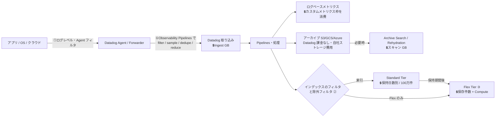
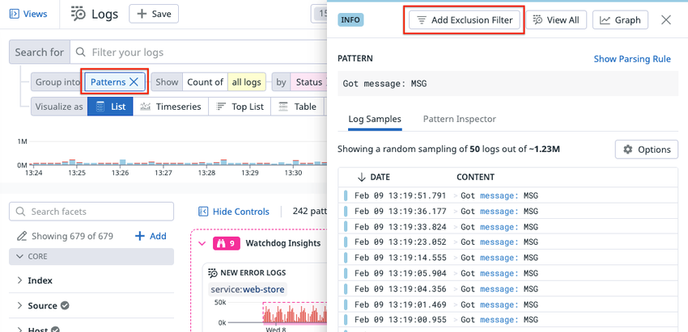
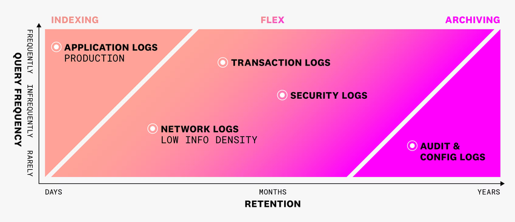
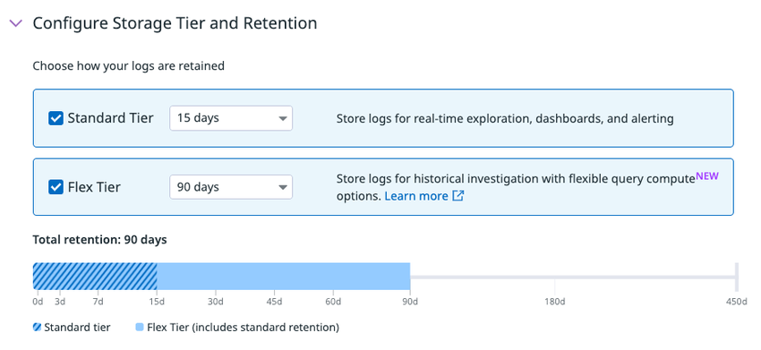
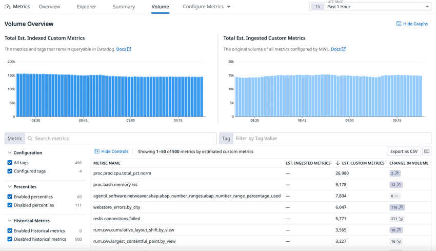
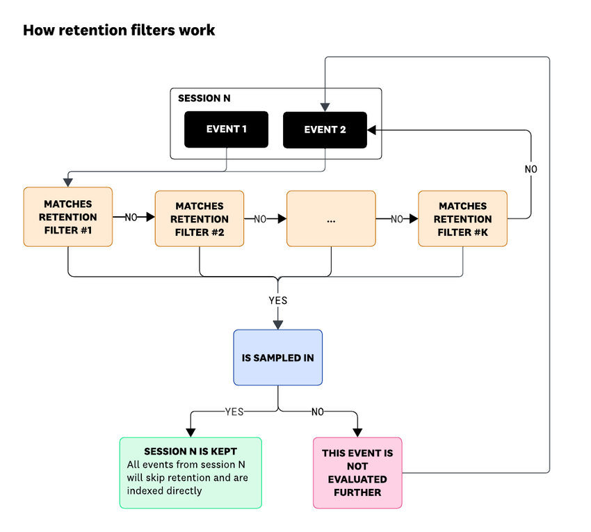

# コスト最適化

## 概要

本ファイルは、Datadog の請求額を「必要な可視性を保ったまま」下げるための実践知をまとめる。対象は次の領域である。

| 領域 | 主な論点 | 本ファイルの節 |
|---|---|---|
| 可視化 | どこにいくら掛かっているかを日次で把握する（Plan & Usage、推定使用量メトリクス、Usage Attribution、Datadog Costs） | [§2](#2-まず計測するコストの可視化と予算アラート) |
| ログ | 送らない・索引しない・安い層に置く（Agent 側フィルタ、Observability Pipelines、除外フィルタ、Daily quota、Flex Logs、アーカイブ） | [§3](#3-ログのコスト最適化) |
| カスタムメトリクス | カーディナリティ（タグ値の組み合わせ数）を抑える（タグ設計、Distribution / Histogram、Metrics without Limits） | [§4](#4-カスタムメトリクスのコスト最適化) |
| APM | 取り込み（Ingested Spans）と保持（Indexed Spans）を分けて制御する | [§5](#5-apm-のコスト最適化) |
| ホスト・コンテナ | 課金対象ホスト / コンテナを意図したものに限定する | [§6](#6-ホストコンテナのコスト最適化) |
| RUM・Synthetic | RUM without Limits の保持フィルタ、Session Replay の比率、Synthetic の実行頻度 | [§7](#7-rumsession-replaysynthetic-のコスト最適化) |
| 契約 | 年契約 / 月契約 / オンデマンドの単価差とコミット量の決め方 | [§8](#8-契約コミットの最適化) |
| 運用 | 定期レビュー、権限、変更監査（FinOps） | [§9](#9-継続的なコスト管理の運用finops) |

本ファイルは「何をすれば下がるか」に焦点を当てる。課金計算の仕組みは [課金計算の仕組み](../03_導入編/billing-mechanics.md)、**料金の数値の正本**は [製品別料金表](../03_導入編/pricing-by-product.md)、導入前の見積りは [コスト見積り手法](../03_導入編/cost-estimation.md) を参照すること。本ファイルの料金は `pricing-by-product.md` と同じ、公式料金ページの掲載値（**2026-11-02 時点**、US/EU1 と AP1 の各サイト価格）である。

> **サイト差異:** Datadog の料金はサイトごとに異なる。AP1（日本）の掲載単価は多くの SKU で US/EU1 の 1.25 倍の水準である（比率は掲載値どうしの割り算で、公式に倍率が明言されているわけではない）。見積りでは必ず AP1 列の掲載値を使う [出典](https://www.datadoghq.com/pricing/list/)。また、Flex Logs の Compute サイズは US3 / US5 / AP1 / AP2 / US1-FED / US2-FED では Starter・XS・XS+・S のみ提供される [出典](https://docs.datadoghq.com/logs/log_configuration/flex_logs/)。

---

## 1. コスト最適化の全体方針

### 1.1 Datadog のコストを動かす「4 つのレバー」

Datadog の多くの製品は「取り込み（Ingest）」と「保持・索引（Index / Retain）」を分けて課金する設計（Logging without Limits™、Metrics without Limits™、APM の Ingested / Indexed Spans、RUM without Limits）になっている。このため、コスト削減のレバーは次の 4 種類に整理できる。

| レバー | 意味 | 効く課金単位 | 代表的な手段 |
|---|---|---|---|
| ① 送らない（Don't send） | Datadog に届く前に捨てる・減らす | 取り込み課金（Logs Ingest GB、Ingested Spans GB、取り込みカスタムメトリクス）と、その後段のすべて | ログレベル、Agent の `log_processing_rules`、`DD_CONTAINER_EXCLUDE_LOGS`、Observability Pipelines、APM の取り込みサンプリング、DogStatsD のタグ削減 |
| ② 取り込むが索引しない（Ingest, don't index） | 取り込みは課金されるが、高価な索引・保持をしない | Indexed Logs、Indexed Spans、インデックス済みカスタムメトリクス、RUM Investigate | ログの除外フィルタ、APM 保持フィルタ、Metrics without Limits のタグ許可リスト、RUM 保持フィルタ |
| ③ 安い層・短い期間に置く（Cheaper tier） | 保持期間を短くする、低頻度用の層に移す | 保持期間別の索引単価 | インデックスの保持期間短縮、Flex Logs、アーカイブ + Archive Search、RUM Managed Archive |
| ④ 単価を下げる（Contract） | 同じ使用量をより安い単価で買う | すべて | 年契約・コミット、プリペイドコンテナ、ボリューム / 複数年割引 |

一般に、①に近いほど削減効果は大きいが「後から見たくなっても見られない」リスクも大きい。②③は「必要になったら見られる」余地を残せるのが利点である【経験則】。

### 1.2 データフローと課金ポイント（ログの例）



除外フィルタで索引から外したログも、Live Tail・ログベースメトリクス生成・アーカイブには流れる（ただし Ingest 課金は発生済み）[出典](https://docs.datadoghq.com/logs/log_configuration/indexes/)。

### 1.3 優先順位の付け方

| 手順 | 内容 | 根拠 |
|---|---|---|
| 1. 計測 | 製品別・チーム別・サービス別のコストを日次で見える化する（[§2](#2-まず計測するコストの可視化と予算アラート)） | Zendesk は標準の課金・使用量メトリクスからサービス別・チーム別のコストダッシュボードを作り、テンプレート変数で絞り込めるようにした [出典](https://www.datadoghq.com/blog/zendesk-cost-optimization/)（2025-12-26 公開、Datadog 公式ブログのゲスト寄稿） |
| 2. 大口から着手 | 上位の少数（メトリクス名、サービス、インデックス）が大半のコストを占めることが多い。パレートの法則（80/20）で上位から手を付ける | Zendesk はパレートの法則とアムダールの法則に従い、最大の寄与者から着手した（同上）。Metrics without Limits の公式ドキュメントも「まず上位 20 メトリクスを設定する」ことを推奨 [出典](https://docs.datadoghq.com/metrics/metrics-without-limits/) |
| 3. 無駄の除去 | 重複・未使用（誰もクエリしない）データの除去は、可視性を失わずに削減できる | Zendesk は Live Tail で全ログが二重送信されていることを発見し、重複経路を除去した（同上） |
| 4. 層の最適化 | 頻繁に検索するものは Standard、長期だが時々検索するものは Flex、まれにしか見ないものはアーカイブ | [出典](https://docs.datadoghq.com/logs/log_configuration/flex_logs/) |
| 5. 契約の最適化 | 使用量が安定してからコミット量を見直す | [§8](#8-契約コミットの最適化) |
| 6. 再発防止 | 予算アラート、権限、変更監査、定期レビュー | [§9](#9-継続的なコスト管理の運用finops) |

### 1.4 製品別のコストドライバーと主要レバー早見表

| 製品 | 主な課金単位 | よくある増加要因 | 主要レバー | 詳細 |
|---|---|---|---|---|
| Log Management | 取り込み GB、索引 100 万件（保持日数別）、Flex 保存件数 | debug ログ、ヘルスチェック、アクセスログ、重複送信、Agent 自身のログ、全量 15 日以上の索引 | Agent フィルタ、除外フィルタ、保持短縮、Flex、アーカイブ | [§3](#3-ログのコスト最適化) |
| Custom Metrics | インデックス済みカスタムメトリクス（100 個単位）、取り込みカスタムメトリクス | 高カーディナリティタグ（`user_id`、`request_id`、`pod_name`、`host` 等）、Distribution のパーセンタイル、ログ / スパンベースメトリクス、OpenMetrics の全量収集 | タグ設計、Metrics without Limits、パーセンタイル無効化、未使用メトリクスの空許可リスト | [§4](#4-カスタムメトリクスのコスト最適化) |
| APM | APM ホスト、取り込みスパン GB、索引スパン 100 万件 | 高スループットサービスの 100% 取り込み、trace rate 付き保持フィルタ、RUM 連携トレースの 100% 送信 | `DD_APM_TARGET_TPS`、サンプリングルール、保持フィルタ、Single Span | [§5](#5-apm-のコスト最適化) |
| Infrastructure | ホスト（99 パーセンタイル）、コンテナ（同梱枠超過）、カスタムメトリクス | クラウド連携で監視不要な VM まで課金、コンテナごと Agent、短命コンテナの大量起動 | クラウド連携のタグフィルタ、Container Discovery Management、プリペイド | [§6](#6-ホストコンテナのコスト最適化) |
| RUM | RUM Measure（全セッション）、RUM Investigate（保持セッション）、Session Replay | 保持率 100%、Replay 比率が高い | 保持フィルタ、保持クォータ、Replay サンプル率 | [§7](#7-rumsession-replaysynthetic-のコスト最適化) |
| Synthetic | API テスト 1 万回、ブラウザテスト 1,000 回 | 高頻度 × 多ロケーション × 多デバイス、長いブラウザテスト | 頻度・ロケーション・ステップ数の見直し | [§7.4](#74-synthetic-monitoring) |

---

## 2. まず計測する：コストの可視化と予算アラート

### 2.1 コストを見る画面・機能

| 機能 | 何が分かるか | 粒度・遅延 | 必要権限・前提 | 出典 |
|---|---|---|---|---|
| Plan & Usage（Usage タブ） | 製品別の使用量、COMMITTED / ALLOTTED / ON-DEMAND の内訳、日次推移とコミットライン | 時間・日次 | 課金ページは Datadog Admin ロール、または `billing_read` / `billing_edit` 権限を持つロール | [出典](https://docs.datadoghq.com/account_management/billing/) |
| Usage Attribution | タグ（最大 3 つのタグキー、例：`team`、`service`）別の使用量。月次レポートは日次更新、時間単位データは API で取得 | 月次（MTD 日次更新）・時間 | Admin または Usage Read 権限。タグ設定後、初回レポート生成に 24 時間 | [出典](https://docs.datadoghq.com/account_management/billing/usage_attribution/) |
| Datadog Costs（CCM / Plan & Usage の Cost Summary・Cost Chargebacks） | Datadog 自身の利用料を日次で、製品（`datadog_product`）・課金次元（`dimension`）・組織・Usage Attribution タグ・`pricing_category`（`committed` / `on-demand`）別に表示。ダッシュボード・ノートブック・コストモニター・予算で利用可 | 日次。データ遅延は約 48 時間、15 か月分。前月分は毎月 16 日頃に確定 | **追加料金なし**。`billing_read` と `usage_read` の両方が必要。直接契約または Marketplace のドローダウン契約が対象 | [出典](https://docs.datadoghq.com/cloud_cost_management/datadog_costs/) |
| 推定使用量メトリクス（`datadog.estimated_usage.*`） | ほぼリアルタイムの使用量。モニター・ダッシュボードで使える | ほぼリアルタイム。請求値との差は平均 10〜20%（小規模ほど誤差大） | — | [出典](https://docs.datadoghq.com/account_management/billing/usage_metrics/) |
| Metrics Volume Management（Metrics → Volume） | カスタムメトリクスのメトリクス名別推定カーディナリティ上位 500、変化量上位 500、未クエリメトリクス | ほぼリアルタイム | — | [出典](https://docs.datadoghq.com/metrics/volume/) |
| APM Ingestion Control | サービス別の取り込み量（Downstream Bytes/s）、取り込み理由の内訳、設定（AUTOMATIC / ルール） | — | — | [出典](https://docs.datadoghq.com/tracing/guide/trace_ingestion_volume_control/) |
| Log Management - Estimated Usage ダッシュボード | ログの取り込み・索引の推定使用量（Dashboards List から開ける標準ダッシュボード） | — | — | [出典](https://docs.datadoghq.com/logs/guide/best-practices-for-log-management/) |

各画面の詳細は [Usage・Usage Attribution・Cost Visibility](../02_リファレンス/platform/usage-and-cost-attribution.md) と [Cloud Cost Management](../02_リファレンス/infrastructure/cloud-cost-management.md) を参照。

### 2.2 コスト最適化で使う主要な推定使用量メトリクス

| 対象 | メトリクス名 | 使い方 |
|---|---|---|
| ホスト | `datadog.estimated_usage.hosts`、`datadog.estimated_usage.hosts.by_tag` | チーム別ホスト数の把握、急増検知 |
| コンテナ | `datadog.estimated_usage.containers`、`datadog.estimated_usage.containers.by_tag` | 同梱枠超過の監視 |
| カスタムメトリクス（索引） | `datadog.estimated_usage.metrics.custom`、`datadog.estimated_usage.metrics.custom.by_metric`、`datadog.estimated_usage.metrics.custom.by_tag` | メトリクス名別のカーディナリティ急増検知 |
| カスタムメトリクス（取り込み） | `datadog.estimated_usage.metrics.custom.ingested`、`.ingested.by_metric`、`.ingested.by_tag` | Metrics without Limits 設定済みメトリクスの取り込み量 |
| ログ | `datadog.estimated_usage.logs.ingested_bytes`、`datadog.estimated_usage.logs.ingested_events`、`datadog.estimated_usage.logs.drop_count`、`datadog.estimated_usage.logs.truncated_count` | `datadog_is_excluded:false` で索引分のみ、`service`・`datadog_index` 別に集計 |
| APM | `datadog.estimated_usage.apm_hosts`、`datadog.estimated_usage.apm.ingested_bytes`、`datadog.estimated_usage.apm.ingested_spans`、`datadog.estimated_usage.apm.indexed_spans` | 取り込み理由（ingestion reason）タグ別、保持フィルタ別の内訳 |
| RUM | `datadog.estimated_usage.rum.sessions`、`datadog.estimated_usage.rum.ingested_sessions`、`datadog.estimated_usage.rum.indexed_sessions` | Measure（全量）と Investigate（保持）の比率監視 |
| Synthetic | `datadog.estimated_usage.synthetics.api_test_runs`、`datadog.estimated_usage.synthetics.browser_test_runs` | テスト実行回数の監視 |
| Observability Pipelines | `datadog.estimated_usage.observability_pipelines.ingested_bytes` | OP の処理量 |

出典：[Estimated Usage Metrics](https://docs.datadoghq.com/account_management/billing/usage_metrics/)

- `.by_tag` 系は Usage Attribution ページで設定したタグ（例：`team`、`env`）で分解される。Pro プランではカスタマーサクセスマネージャー経由で有効化を依頼する。タグ変更は次の 00:00 UTC から反映される [出典](https://docs.datadoghq.com/account_management/billing/usage_metrics/)。
- 多くのメトリクスは複数の時系列に分かれるため、合計を見るときは空間集約に **`sum`**（`sum by`）を使う。ログの取り込みバイト数はメトリクスサマリーで単位を `byte` に設定すると見やすい [出典](https://docs.datadoghq.com/logs/guide/best-practices-for-log-management/)。
- マルチ org では親 org から子 org の使用量をまとめて監視できる [出典](https://docs.datadoghq.com/account_management/billing/usage_metrics/)。
- **Metric Name pricing の組織の注意:** カーディナリティベースの推定使用量メトリクス（`datadog.estimated_usage.metrics.custom` と関連メトリクス）は使えず、これらを使うモニター・ダッシュボードにはデータが届かなくなる。代わりにポイントベースのメトリクス（`datadog.estimated_usage.billable.metrics`、`datadog.estimated_usage.billable.points`、`datadog.estimated_usage.metrics.points.indexed`、`datadog.estimated_usage.metrics.points.ingested` など）を使う [出典](https://docs.datadoghq.com/metrics/guide/metric_name_pricing_experience/)。詳細は §4.4。

### 2.3 予算アラート（使用量モニター）の例

| 目的 | モニター種別 | クエリ / 設定 | 出典 |
|---|---|---|---|
| 索引ログの急増（サービス別） | Anomaly（異常検知） | `sum:datadog.estimated_usage.logs.ingested_events{datadog_is_excluded:false} by {service,datadog_index}.as_count()` | [出典](https://docs.datadoghq.com/logs/guide/best-practices-for-log-management/) |
| 月初からの索引ログ累計がコミットを超えそう | Metric（cumulative window） | 上記メトリクスを `datadog_is_excluded:false` で絞り、累積ウィンドウ（月初から）で評価。閾値はコミット量の例えば 80%【経験則】 | 同上 |
| インデックスの Daily quota 到達 | Event | `source:datadog datadog_index:* "daily quota reached"` を `datadog_index` でグループ化、当日（インデックスのリセット時刻起点）で 1 件以上 | 同上 |
| カスタムメトリクスの急増 | Change（`% change`） | Volume ページで見つけた急増メトリクスについて `% change` の Change モニターを作成（任意）[出典](https://docs.datadoghq.com/metrics/volume/)。対象を全メトリクスに広げる場合は `datadog.estimated_usage.metrics.custom.by_metric`（[Estimated Usage Metrics](https://docs.datadoghq.com/account_management/billing/usage_metrics/)）をメトリクス名別に監視する【経験則】。Metric Name pricing の組織ではポイントベースのメトリクスに置き換える（§2.2 の注意） | 左記のとおり |
| APM 取り込み量の超過 | Metric | `sum:datadog.estimated_usage.apm.ingested_bytes{*}` の月累計と「APM ホスト数 × 150 GB」の比較 | [出典](https://docs.datadoghq.com/tracing/guide/trace_ingestion_volume_control/) |
| RUM 保持クォータでブロックされたセッション | Metric | `rum.measure.usage.quota_blocked_sessions` | [出典](https://docs.datadoghq.com/real_user_monitoring/rum_without_limits/retention_quotas/) |

- 推定値は請求値と平均 10〜20% ずれるため、閾値には余裕を持たせる [出典](https://docs.datadoghq.com/account_management/billing/usage_metrics/)。
- Datadog Costs を有効にしている場合は、金額ベースのコストモニター・予算（Budgets）も使える [出典](https://docs.datadoghq.com/cloud_cost_management/datadog_costs/)。

### 2.4 コスト配賦（チャージバック）の実践

- **タグを先に決める**：Usage Attribution / Datadog Costs のチーム別配賦は、計装時に付与できるタグに依存する。`team`、`service`、`env` を統一タグとして全データに付けておくことが前提になる（タグ設計は [タグ戦略の実践](tagging-strategy.md)）。Usage Attribution が使えるタグキーは最大 3 つ [出典](https://docs.datadoghq.com/account_management/billing/usage_attribution/)。
- **対象外の使用量**：Incident Management のユーザー、Parallel Testing Slots、Audit Trail など、計装時にタグを付けられない使用量は Usage Attribution の対象外 [出典](https://docs.datadoghq.com/account_management/billing/usage_attribution/)。
- **相対コストの簡易式**：Zendesk は「サービスの年間コスト ÷ 全体 × 12」のような相対コスト式でサービス間の比較を行った [出典](https://www.datadoghq.com/blog/zendesk-cost-optimization/)（2025-12-26 公開）。
- **見せ方**【経験則】：チーム別の月次コストと前月比をダッシュボードに出し、上位チームのオーナーと月次でレビューする。金額を見せるだけでなく「どのレバーで下げられるか」（本ファイルの各節）をセットで提示すると行動につながりやすい。

---

## 3. ログのコスト最適化

### 3.1 ログのコスト構造（再掲）

| SKU | 課金単位 | US/EU1 年契約 | US/EU1 オンデマンド | AP1 年契約 | AP1 オンデマンド |
|---|---|---|---|---|---|
| Logs - Ingestion | 取り込み 1 GB（非圧縮） | $0.10 | $0.10 | $0.125 | $0.125 |
| Indexed（Standard 3 日） | 索引 100 万件/月 | $1.06 | $1.59 | $1.325 | $1.9875 |
| Indexed（Standard 7 日） | 索引 100 万件/月 | $1.27 | $1.91 | $1.5875 | $2.3875 |
| Indexed（Standard 15 日） | 索引 100 万件/月 | $1.70 | $2.55 | $2.125 | $3.1875 |
| Indexed（Standard 30 日） | 索引 100 万件/月 | $2.50 | $3.75 | $3.125 | $4.6875 |
| Flex Logs Storage | 保存 100 万件/月 | $0.05 | $0.075 | $0.0625 | $0.09375 |
| Flex Logs Starter（3/6/12/15 か月） | 保存 100 万件/月 | $0.60 | $0.90 | $0.75 | $1.125 |
| Archive Search | スキャン 1 GB | $0.05 | $0.07 | $0.0625 | $0.0875 |

出典：[Pricing Comparison](https://www.datadoghq.com/pricing/list/)、[Pricing - Log Management](https://www.datadoghq.com/pricing/?product=log-management)（2026-11-02 時点の掲載値。月契約の値と詳細は [製品別料金表 §7](../03_導入編/pricing-by-product.md#7-log-management-と関連製品)）

この構造から導かれる要点：

- **索引単価は取り込み単価よりずっと高い**。1 イベント 1 KB と仮定すると 100 万件 ≒ 1 GB で、取り込み $0.10 に対し 15 日索引は $1.70（約 17 倍）【推定】（イベントサイズは環境依存）。このため「取り込むが索引しない」（除外フィルタ）だけでも効果が大きい。
- **保持日数で索引単価が変わる**（3 日 $1.06 → 30 日 $2.50）。「全ログ 30 日」より「アプリログ 7 日 + 監査系は Flex / アーカイブ」のように用途別にインデックスを分ける。
- **取り込み課金は除外フィルタでは減らない**。取り込みまで減らすには Datadog に送る前（Agent / Observability Pipelines / アプリ側）で減らす必要がある。Zendesk は最大 88% のログを索引から除外していたが、それらの取り込み料金は払い続けていたと述べている [出典](https://www.datadoghq.com/blog/zendesk-cost-optimization/)（2025-12-26 公開）。
- **コミット超過は +50%**。ログの索引はコミット量を差し引いた超過分に年契約単価の 50% 増しが課金される [出典](https://docs.datadoghq.com/account_management/billing/log_management/)。コミットは月単位なので、1 日だけのスパイクで超過するとは限らない（同上）。

### 3.2 段階別のログ削減手段

| 段階 | 手段 | 減る課金 | 主な設定 | 注意点 |
|---|---|---|---|---|
| アプリ | ログレベルの適正化（本番で `debug` を出さない）、1 行ログのまとめ（バッチ化）、重複出力の除去 | Ingest + Index | アプリのロガー設定 | Zendesk は関連する単一行ログを複数行の 1 エントリにまとめてイベント数を削減した [出典](https://www.datadoghq.com/blog/zendesk-cost-optimization/) |
| Agent（ソース単位） | `log_processing_rules` の `exclude_at_match` / `include_at_match` | Ingest + Index | ログ設定（`conf.d/<integration>.d/conf.yaml`）、コンテナはアノテーション `ad.datadoghq.com/<CONTAINER_NAME>.logs` | 正規表現はメッセージ本文に対して評価される。Docker / K8s のラベル・アノテーションでは `\d` を `\\d` にエスケープ |
| Agent（全体） | グローバル処理ルール `logs_config.processing_rules` / `DD_LOGS_CONFIG_PROCESSING_RULES` | Ingest + Index | `datadog.yaml` または環境変数（JSON 配列） | インテグレーション固有ルールがあるとグローバルルールは上書きされる。書式エラーがあるとログ収集が起動しない（`agent status` で確認） |
| Agent（コンテナ単位） | `DD_CONTAINER_EXCLUDE_LOGS` / `DD_CONTAINER_INCLUDE_LOGS`、Pod アノテーション `ad.datadoghq.com/logs_exclude: "true"` | Ingest + Index | Helm：`datadog.containerExcludeLogs` | アノテーション除外は Agent 7.45 以降 |
| 送信前パイプライン | Observability Pipelines の `filter` / `sample` / `dedupe` / `reduce` / フィールド削除（`remap` の `del()`）/ `log_to_metric` | Ingest + Index（OP 自体の費用は別途） | OP の構成 | データがネットワーク外に出る前に削減できる。フィールド削除で 1 件あたりのサイズも縮む |
| 取り込み後 | インデックスの除外フィルタ（サンプリング率 0〜100%） | Index のみ | Logs → Configuration → Indexes | Live Tail・ログベースメトリクス・アーカイブには残る |
| 取り込み後 | Daily quota | Index のみ（上限保護） | インデックスごとに 100 万件単位 | 到達後は索引されない（障害時に最重要ログが欠ける恐れ） |
| 保持 | 保持期間の短縮、インデックス分割 | Index 単価 | インデックスごとの保持日数 | 契約にない保持期間は CSM 経由で追加 |
| 保持 | Flex Logs、アーカイブ + Archive Search / Rehydration | Index → Flex / 自社ストレージ | §3.6、§3.7 | Flex は Monitor・Watchdog 非対応 |

出典：[Advanced Log Collection](https://docs.datadoghq.com/agent/logs/advanced_log_collection/)、[Container Discovery Management](https://docs.datadoghq.com/containers/guide/container-discovery-management/)、[Control log volume and size（Observability Pipelines）](https://docs.datadoghq.com/observability_pipelines/guide/control_log_volume_and_size)、[Indexes](https://docs.datadoghq.com/logs/log_configuration/indexes/)

#### Agent 側フィルタの設定例

```yaml
# conf.d/nginx.d/conf.yaml（ソース単位）
logs:
  - type: file
    path: /var/log/nginx/access.log
    service: web
    source: nginx
    log_processing_rules:
      - type: exclude_at_match
        name: exclude_healthcheck
        pattern: GET /healthz
```

```yaml
# Kubernetes Pod アノテーション（コンテナ単位）
metadata:
  annotations:
    ad.datadoghq.com/app.logs: '[{"source":"java","service":"orders","log_processing_rules":[{"type":"exclude_at_match","name":"exclude_debug","pattern":"\\bDEBUG\\b"}]}]'
```

```shell
# Agent 全体（グローバル）。Datadog Agent 自身のコンテナログを収集対象外にする例
DD_CONTAINER_EXCLUDE_LOGS="name:datadog-agent"
DD_LOGS_CONFIG_PROCESSING_RULES='[{"type":"exclude_at_match","name":"drop_debug","pattern":"level=debug"}]'
```

出典：[Advanced Log Collection](https://docs.datadoghq.com/agent/logs/advanced_log_collection/)、[Container Discovery Management](https://docs.datadoghq.com/containers/guide/container-discovery-management/)。Agent 自身のログの除外は Vantage のブログでも推奨されている【第三者情報】[出典](https://www.vantage.sh/blog/datadog-cost-optimization-tips)（2022-11-06 公開。2 年以上前の記事のため、価格等の記述は現行と異なる可能性がある）。

収集設定の詳細は [ログ収集](../02_リファレンス/logs/log-collection.md)、Observability Pipelines は [Observability Pipelines](../02_リファレンス/logs/observability-pipelines.md) を参照。

### 3.3 除外フィルタの実践

Log Management の除外フィルタ（Exclusion Filters）は、インデックスごとに設定し、該当ログを索引から外す（またはサンプリングして一部だけ索引する）機能である。

| 項目 | 仕様 |
|---|---|
| クエリ | 既定は `*`（インデックスに流れる全ログを除外）。ログ検索クエリで対象を絞る |
| サンプリング率 | 既定は「100% 除外」。0〜100% で調整可 |
| Sample by | 個々のログ単位、または任意の属性の一意値（例：`@http.request_id`、`trace_id`）でまとめてサンプリング。個々のログ単位のサンプリングは、ログに trace ID があればその有無に基づいて行われる |
| 有効 / 無効 | 既定は有効。無効にすると新規ログには適用されない |
| 評価順 | ログは**最初にマッチした有効な除外フィルタ**だけで処理される。ドラッグ&ドロップで並べ替え |
| 除外されたログの行き先 | 索引からは破棄されるが、Live Tail、ログベースメトリクス生成、アーカイブには流れる |

出典：[Indexes](https://docs.datadoghq.com/logs/log_configuration/indexes/)

**大量ログの見つけ方**：Log Explorer で「Group into: Patterns」を選ぶとパターン別の件数が出る。量の多いパターンを開き、サイドパネルの **Add Exclusion Filter** から除外フィルタを作成できる [出典](https://docs.datadoghq.com/logs/guide/best-practices-for-log-management/)。



- **キャプション**: Log Explorer の Patterns ビューと、パターン詳細サイドパネルの「Add Exclusion Filter」ボタン。
- **画面説明**: 左側は Log Explorer。検索バー下の「Group into」で **Patterns** が選択され（赤枠）、件数（Count of all logs）の時系列と、パターン一覧・ファセット（Index、Source、Host など）が表示されている。右側はパターン `Got message: MSG` を開いたサイドパネルで、上部に **Add Exclusion Filter**（赤枠）、View All、Graph のボタンがあり、「Log Samples」タブに約 123 万件中 50 件のサンプル（`Feb 09 13:19:51.791 Got message: MSG` など）が並ぶ。ここから同パターンを索引から除外するフィルタを直接作れる。
- **出典**: [Best Practices for Log Management](https://docs.datadoghq.com/logs/guide/best-practices-for-log-management/)（画像取得日 2026-11-03）

**除外フィルタ設計のパターン**【経験則】

| 対象ログ | 推奨設定 | 理由 |
|---|---|---|
| ヘルスチェック・ロードバランサのプローブ | 100% 除外。件数推移はログベースメトリクスで残す | 調査価値が低く量が多い |
| `status:info` の成功系アクセスログ | 90〜99% 除外（`Sample by` を `@http.request_id` 等にしてリクエスト単位で一貫させる） | 傾向はメトリクスで、個別調査はサンプルで足りることが多い |
| `status:debug` | 100% 除外（本来はソース側で止める） | — |
| エラーログ（`status:error`） | 除外しない | 障害調査に必須 |
| APM と相関させたいログ | `Sample by` に trace ID を使い、トレースとログの保持を揃える | ログとトレースの一方だけ残る状態を避ける |
| 監査・セキュリティ系 | Standard から外し Flex またはアーカイブへ | 長期保持が必要だが検索頻度は低い |

- Zendesk の事例では、2024 年 2 月時点で除外フィルタが 1,435 個あり、最も多いパターンは「マッチしたログの 99〜100% を除外」するものだった。Log Patterns を使ってフィルタ数を約 3 分の 1 削減し、パイプラインに紐付かないログ（`datadog.pipelines:false`）の棚卸しも行った [出典](https://www.datadoghq.com/blog/zendesk-cost-optimization/)（2025-12-26 公開）。
- 「99〜100% 除外」が大量にあるログは、そもそも取り込み不要である可能性が高い。Agent / Observability Pipelines 側の削減に移すと Ingest 料金も減る【経験則】。

### 3.4 ログベースメトリクスで「索引せずに傾向を残す」

除外フィルタで索引から外したログも、ログベースメトリクス（Generate Metrics）の生成には使える。件数・レイテンシ分布などの傾向はメトリクスで 15 か月残し、生ログは索引しない、という組み合わせが基本形である [出典](https://docs.datadoghq.com/logs/guide/best-practices-for-log-management/)。

| 注意点 | 内容 |
|---|---|
| カスタムメトリクスとして課金 | ログベースメトリクスはカスタムメトリクスの同梱枠を消費する [出典](https://www.datadoghq.com/pricing/?product=log-management)。`group by` に高カーディナリティ属性（`@usr.id`、`@http.url` 等）を使うと、ログ索引より高くつくことがある |
| 集計軸の選定 | `service`、`env`、`status`、`@http.status_code` 程度に絞る【経験則】 |
| 過去分は遡れない | 生成開始以降のログからのみ作られる【経験則】 |

Experian は DASH 2026 で「メトリクスファースト」に移行し、3,000 を超えるログベースのアラートを Metrics / RUM / APM / Infrastructure ベースのアラートへ移行、Standard インデックスに送るログを全体の 1% にして残りを Flex Logs にルーティングしたと発表している（削減額の具体値は公開ページに記載なし）[出典](https://dash.datadoghq.com/sessions/how-experian-simplified-observability-and-cut-log-costs-by-migrating-to-datadog/)（DASH 2026 講演）。

### 3.5 Daily quota と使用量の監視

| 項目 | 仕様 |
|---|---|
| 目的 | インデックスごとに 1 日あたりの索引件数を上限で抑える |
| 単位 | 100 万件単位 |
| リセット時刻 | 既定は **14:00 UTC**（日本時間 23:00）。任意の時刻に変更可 |
| 警告しきい値 | Daily quota に対する % で設定（**最小 50%**）、任意 |
| 到達時の動作 | 以降は索引されないが、Live Tail・アーカイブ・ログベースメトリクス生成には流れる |
| 変更の反映 | 即時 |
| イベント | quota 到達時・警告しきい値到達時にイベントが生成される |
| インデックス数の上限 | 既定で 1 アカウント 100 個（サポートに依頼して引き上げ可） |

出典：[Indexes](https://docs.datadoghq.com/logs/log_configuration/indexes/)

**Daily quota の使い方**【経験則】

- Daily quota は「暴走ログからの保険」であり、通常運用で毎日到達させる設計にはしない。到達すると、その日の残り時間に発生した障害ログが索引されない。
- 本番エラーログ用インデックスには quota を付けない（または非常に大きくする）、暴走しやすいサービスは専用インデックスに分けて quota を付ける、と分離する。
- リセット時刻 14:00 UTC は日本の業務時間とずれる。日本のピーク帯直前にリセットされるよう調整するか、警告しきい値（例：80%）でアラートを受ける。公式ガイドも「過去 24 時間で quota の 80% に達したら通知」を推奨している [出典](https://docs.datadoghq.com/logs/guide/best-practices-for-log-management/)。

**誰がどのインデックスを検索しているか**：Audit Trail で `@evt.name:"Log Management" @action:queried` を検索し、`@asset.new_value.query.indexes` で集計すると、実際に検索されているインデックスが分かる。ほとんど検索されないインデックスは保持短縮・Flex 化の候補になる [出典](https://docs.datadoghq.com/logs/guide/best-practices-for-log-management/)（Audit Trail は別課金。[Audit Trail](../02_リファレンス/platform/audit-trail.md)）。

### 3.6 Flex Logs の使いどころ

Flex Logs は、ストレージとコンピュート（検索能力）を分離した長期保持用のログ層である。Standard Indexing と同様のクエリ体験で長期間検索できるが、課金は「保存件数」と「Compute（検索用リソース）」に分かれる [出典](https://docs.datadoghq.com/logs/log_configuration/flex_logs/)。



- **キャプション**: 検索頻度と保持期間によるログの置き場所の使い分け図。
- **画面説明**: 縦軸が QUERY FREQUENCY（上から FREQUENTLY / INFREQUENTLY / RARELY）、横軸が RETENTION（DAYS / MONTHS / YEARS）。左上の **INDEXING** 領域に「APPLICATION LOGS（PRODUCTION）」、中央の **FLEX** 領域に「TRANSACTION LOGS」「SECURITY LOGS」「NETWORK LOGS（LOW INFO DENSITY）」、右下の **ARCHIVING** 領域に「AUDIT & CONFIG LOGS」が配置されている。頻繁に検索し短期保持するものは Standard、長期保持で時々検索するものは Flex、まれにしか見ないものはアーカイブ、という指針を示す。
- **出典**: [Flex Logs](https://docs.datadoghq.com/logs/log_configuration/flex_logs/)（画像取得日 2026-11-03）

| 項目 | Standard Indexing | Flex Logs | Archive（自社ストレージ） |
|---|---|---|---|
| 想定用途 | 頻繁に検索・短期保持（アプリログ） | 長期保持・時々緊急検索（セキュリティ、トランザクション、ネットワーク） | まれにしか検索しない長期保存（監査、設定変更） |
| 保持期間 | 3 / 7 / 15 / 30 日など（契約による） | Starter：3 / 6 / 12 / 15 か月。スケーラブル（XS〜L）：30〜450 日 | 自社ストレージのライフサイクル次第 |
| Monitor | 対応 | **非対応**（Monitor クエリを含む） | 非対応 |
| Watchdog Insights | 対応 | **非対応** | 非対応 |
| ダッシュボード | 対応 | 対応（クエリ負荷を Compute サイズに考慮） | 非対応 |
| 検索方法 | Log Explorer | Log Explorer で **Include Flex Logs** をオン | Archive Search / Rehydration |
| 課金 | 保持日数別の索引件数 | 保存件数 + Compute（Starter は同梱） | Archive Search / Rehydration のスキャン量 + 自社ストレージ費 |

出典：[Flex Logs](https://docs.datadoghq.com/logs/log_configuration/flex_logs/)、[Archive Search](https://docs.datadoghq.com/logs/log_configuration/archive_search/)

#### Compute サイズの選び方

| サイズ | 推奨される累積保存イベント数 |
|---|---|
| Starter | 100 億件未満 |
| XS | 100 億〜500 億件 |
| XS+ | 500 億〜1,000 億件 |
| S | 1,000 億〜2,000 億件 |
| M | 2,000 億〜5,000 億件 |
| L | 5,000 億〜1 兆件 |
| 1 兆件超 | カスタマーサクセスマネージャーに相談 |

出典：[Flex Logs](https://docs.datadoghq.com/logs/log_configuration/flex_logs/)

- 各サイズは 1 つ前のサイズの約 2 倍のクエリ性能・容量。Compute は同時クエリ数と 1 クエリでスキャンするログ件数の上限を決める（数値は公開情報では確認できず）。
- Starter は保存 100 億件未満（月 20〜30 億件程度未満）の組織向け。スケーラブルサイズは定額課金、Starter はストレージと Compute を束ねた料金 [出典](https://docs.datadoghq.com/logs/log_configuration/flex_logs/)。料金ページでは Flex Starter に「月 20 億件未満（保存総計 100 億件）向けの Starter Compute 同梱」とある [出典](https://www.datadoghq.com/pricing/?product=log-management)。
- Compute のアップグレードはいつでも可、**ダウングレードは 15 日に 1 回まで**。マルチ org では org ごとに 1 サイズで、org 間で Compute を共有できない。Starter とスケーラブルは同一 org で併用不可 [出典](https://docs.datadoghq.com/logs/log_configuration/flex_logs/)。
- 同時クエリ容量に達するとクエリは再試行で遅くなり、失敗すると「Flex Logs compute capacity is constrained」が表示される（同上）。Flex をダッシュボードで多用する場合は Compute サイズに余裕を持たせる。
- Flex Storage の課金は 100 万保存イベントごとに時間単位で計量し、**各 100 万件は最低 30 日分課金**、60 日保持なら 30 日ごとに課金される [出典](https://www.datadoghq.com/pricing/?product=log-management)。
- サイト差異：US3 / US5 / AP1 / AP2 / US1-FED / US2-FED では Starter・XS・XS+・S のみ提供 [出典](https://docs.datadoghq.com/logs/log_configuration/flex_logs/)。

#### インデックスでの設定（Standard → Flex の段階保持）



- **キャプション**: ログインデックス編集画面の「Configure Storage Tier and Retention」セクション。
- **画面説明**: 「Choose how your logs are retained」の下に 2 つの層がチェックボックスで並ぶ。**Standard Tier**（プルダウン「15 days」、説明「Store logs for real-time exploration, dashboards, and alerting」）と **Flex Tier**（プルダウン「90 days」、説明「Store logs for historical investigation with flexible query compute options」）。下部に「Total retention: 90 days」と、0d〜450d の目盛りのバーがあり、0〜15 日が斜線（Standard tier）、15〜90 日が水色（Flex Tier（includes standard retention））で示される。
- **出典**: [Flex Logs](https://docs.datadoghq.com/logs/log_configuration/flex_logs/)（画像取得日 2026-11-03）

| 既存設定 | 操作 | 結果 |
|---|---|---|
| Standard のみ | Flex を有効化 | 既存・新規ログの保持が延長される |
| Flex のみ | Standard を有効化 | 既存の Flex ログはそのまま。新規ログは Standard と Flex の両方へ |
| Standard のみ | Flex を有効化し Standard を外す | ログは Monitor・Watchdog Insights から参照できなくなる |

出典：[Flex Logs](https://docs.datadoghq.com/logs/log_configuration/flex_logs/)

- 両層を選んだ場合、ログは Standard の保持期間だけ Standard にあり、残りの期間は Flex に移る（例：Standard 3 日 + Flex 90 日 → Standard 3 日・Flex 87 日）。
- Flex の有効化には `flex_logs_config_write` 権限が必要。契約に Flex がない場合、Starter はセルフサービスで有効化できる（同上）。
- **Flex 直送に向くソースの例**（公式ドキュメント記載）：CDN（Akamai、Cloudflare、Fastly、CloudFront）、ロードバランサ（ALB / NLB、F5、NGINX）、DNS（Route 53 等）、ネットワーク機器・VPC Flow Logs・WAF、監査ログ（CloudTrail、Kubernetes 監査、Microsoft 365）、CI/CD、ID サービス（Okta 等）、サービスメッシュ（Istio 等）[出典](https://docs.datadoghq.com/logs/log_configuration/flex_logs/)。

**Flex を使うときの落とし穴**【経験則】

- Monitor が使えないため、アラートが必要なログは Standard に残すか、ログベースメトリクスを作ってメトリクスモニターにする。
- Cloud SIEM の検知対象ログを Flex のみにする場合の扱いは [Cloud SIEM](../02_リファレンス/security/cloud-siem.md) で確認する（SIEM の分析は取り込み時に行われるが、調査時の検索体験が変わる）。
- Compute（スケーラブル）は保存量にかかわらず定額のため、保存量が少ないうちは Starter の方が割安になりやすい【推定】。

### 3.7 アーカイブ・Archive Search・Rehydration

| 機能 | 内容 | 課金 | 制限 |
|---|---|---|---|
| Log Archives | 取り込んだログを Amazon S3 / Azure Storage / Google Cloud Storage に転送 | Datadog 側はアーカイブ転送に追加料金なし（Ingest 料金に含まれる）。ストレージ費用は自社クラウドに発生 | — |
| Archive Search | Rehydrate せずにアーカイブを直接検索。結果はスキャン中にストリーミング表示 | スキャン GB（年契約 $0.05/GB、オンデマンド $0.07/GB、AP1 年契約 $0.0625/GB）。**結果は 24 時間・最大 10 万件まで追加費用なし** | 集計・分析不可。結果は専用ページのみ（ダッシュボード・ノートブック・Log Explorer 不可）。プレビューは最大 1,000 件 |
| Rehydration | アーカイブからログを取り出しインデックスに戻す（バックグラウンドのバッチジョブ） | スキャンした**圧縮** GB あたり $0.10 + 戻したイベントの索引料金 | — |

出典：[Archive Search](https://docs.datadoghq.com/logs/log_configuration/archive_search/)、[Pricing - Log Management](https://www.datadoghq.com/pricing/?product=log-management)、[製品別料金表 §7](../03_導入編/pricing-by-product.md#7-log-management-と関連製品)

**コスト事故を防ぐ設定**

- 管理者（`Logs Write Archives` 権限）は**アーカイブごとの最大スキャンサイズ**と、Rehydration の既定ボリューム上限（100 万件単位）を設定できる [出典](https://docs.datadoghq.com/logs/log_configuration/archive_search/)。広範囲・長期間のスキャンで想定外の課金が出ないよう、必ず設定する【経験則】。
- 権限を分ける：`logs_archive_search` は Search モードのみ、`logs_write_historical_view` は Search と Search & Rehydration の両方、加えて各アーカイブの `logs_read_archives` が必要 [出典](https://docs.datadoghq.com/logs/log_configuration/archive_search/)。
- Archive Search を高速化する属性（Partition Attributes / Lookup Attributes）は各アーカイブ最大 2 つずつ（同上）。よく絞り込む `service`、`env` などを指定すると、スキャン量（＝費用）を抑えやすい【推定】。
- アーカイブ先ストレージ側では、S3 のライフサイクル（Glacier 系への移行）を使う場合、Rehydration / Archive Search の対象外になるストレージクラスがある点に注意（詳細は [Indexes・保持・アーカイブ](../02_リファレンス/logs/log-indexes-retention-archives.md)）。

### 3.8 試算例：ログ構成の見直し

前提【推定】：1 日 1 億件・約 100 GB（平均 1 KB/件）のログ、月 30 日 → 月 30 億件・3,000 GB。年契約単価、同梱枠・コミット超過は考慮しない。単価は [§3.1](#31-ログのコスト構造再掲) の掲載値。

| ケース | 構成 | US/EU1 月額 | AP1 月額 |
|---|---|---|---|
| A. 全量 15 日索引 | Ingest 3,000 GB + 索引 3,000M 件（15 日） | 300 + 5,100 = **$5,400** | 375 + 6,375 = **$6,750** |
| B. 70% を除外フィルタで除外 | Ingest 3,000 GB + 索引 900M 件（15 日） | 300 + 1,530 = **$1,830** | 375 + 1,912.5 = **$2,287.5** |
| C. B + 保持を 7 日に短縮 | Ingest 3,000 GB + 索引 900M 件（7 日） | 300 + 1,143 = **$1,443** | 375 + 1,428.75 = **$1,803.75** |
| D. C + 除外分 2,100M 件を Flex（30 日）へ | C + Flex Storage 2,100M 件 | 1,443 + 105 = **$1,548 + Flex Compute** | 1,803.75 + 131.25 = **$1,935 + Flex Compute** |
| E. C の除外分を Agent で送信前に削減（Ingest も 70% 減） | Ingest 900 GB + 索引 900M 件（7 日） | 90 + 1,143 = **$1,233** | 112.5 + 1,428.75 = **$1,541.25** |

- Flex の Compute（XS 以上）は要問合せ。Starter の場合は Flex Logs Starter 単価（$0.60/100 万件/月）で Storage + Compute を束ねて課金されるが、保持 3 か月以上が前提。
- 実際の削減率はログ構成次第である。ここでは「索引の削減が最も効き、次いで保持日数、送信前削減は Ingest 分だけ追加で効く」という感度を示す目的で計算している。
- アーカイブ（S3 等）のストレージ費用は Datadog の請求外で、別途クラウド側に発生する。

### 3.9 ログのアンチパターン

| アンチパターン | 何が起きるか | 対策 |
|---|---|---|
| 全ログを 1 つのインデックス・長期保持 | 調査価値の低いログまで高単価で保持 | 用途別インデックス、保持短縮、Flex |
| 除外フィルタだけで対処 | 索引費は減るが Ingest 費は残る（Zendesk の例：除外率最大 88%） | 「100% 除外」の常連は送信前に止める |
| 重複送信（複数の収集経路、新旧サービスの並行稼働） | 同じログに 2 倍以上課金 | Live Tail で重複確認。Zendesk は並行稼働中の重複を除去して該当サービスのログ量を 4 分の 1 にした [出典](https://www.datadoghq.com/blog/zendesk-cost-optimization/) |
| `logs_config.container_collect_all: true` で全コンテナのログを無差別収集 | システム系・Agent 自身のログまで課金 | `DD_CONTAINER_EXCLUDE_LOGS`、アノテーションで除外 |
| Daily quota を常時到達させる | 障害時に重要ログが索引されない | quota は保険として設定し、警告でアラート |
| 高カーディナリティ属性で group by したログベースメトリクス | カスタムメトリクス費が急増 | 集計軸を絞る |

詳細な運用ノウハウは [ログ管理の実践](log-management-practices.md)、失敗例は [よくある失敗とアンチパターン](common-pitfalls.md) を参照。

---

## 4. カスタムメトリクスのコスト最適化

### 4.1 カウントの仕組み（要点）

カスタムメトリクスは「メトリクス名 + タグ値の組み合わせ（`host` タグを含む）」で一意に数えられる。課金対象数は 1 時間ごとの一意なカスタムメトリクス数の**月平均**で、送信頻度やクエリ回数は課金に影響しない [出典](https://docs.datadoghq.com/account_management/billing/custom_metrics/)。

| メトリクス型 | タグの組み合わせ 1 つあたりのカスタムメトリクス数 | 例：組み合わせ 4 つの場合 |
|---|---|---|
| Count / Rate | 1 | 4 |
| Gauge | 1 | 4 |
| Histogram（Agent 側集計） | 既定 5（avg、count、median、95percentile、max）。`datadog.yaml` の `histogram_aggregates` と `histogram_percentiles` で増減 | 20 |
| Distribution（サーバー側集計） | 5（count、sum、min、max、avg） | 20 |
| Distribution + パーセンタイル（p50、p75、p90、p95、p99） | 10 | 40 |

出典：[Custom Metrics Billing](https://docs.datadoghq.com/account_management/billing/custom_metrics/)

| 料金の要点 | 内容 |
|---|---|
| 同梱枠 | Infrastructure Pro：100 個/ホスト、Enterprise：200 個/ホスト（取り込み・索引とも）。アカウント全体でプール |
| 索引の超過 | 料金比較表では $5/100 個/月（US 年契約）、AP1 $6.25。ドキュメントでは「契約で定める」 |
| 取り込みの超過 | $0.10/100 個（US）、AP1 $0.125。**Metrics without Limits を設定したメトリクスのみ**取り込み量にカウント |
| ログ / スパンベースメトリクス | カスタムメトリクスの同梱枠を消費 |

出典：[Custom Metrics Billing](https://docs.datadoghq.com/account_management/billing/custom_metrics/)、[製品別料金表 §2.3](../03_導入編/pricing-by-product.md#23-infrastructure-の追加-skuコンテナカスタムメトリクスイベントほか)

**カーディナリティは「最も細かいタグ」で決まる**：`city` タグが既にあるメトリクスに `state` タグを足しても数は増えないが、`city` より細かいタグ（`store_id` 等）を足すと増える [出典](https://docs.datadoghq.com/account_management/billing/custom_metrics/)。タグ値の種類数が掛け算で効くため、タグキーの数よりも「値の種類数」が支配的である（Indeed の SRE の記事でも同様の指摘）【第三者情報】[出典](https://dev.to/jack0lantern/why-youre-spending-too-much-money-on-datadog-metrics-1m4e)（2025-10-02 公開）。

詳細なカウント例は [Custom Metrics と DogStatsD](../02_リファレンス/platform/custom-metrics-and-dogstatsd.md) と [課金計算の仕組み](../03_導入編/billing-mechanics.md) を参照。

### 4.2 発生源別の削減策

| 発生源 | よくある問題 | 対策 |
|---|---|---|
| DogStatsD / アプリ計装 | `user_id`、`request_id`、`session_id`、URL フルパス、タイムスタンプ等をタグにしている | 無制限に値が増えるタグは付けない。必要ならログ / トレースの属性にする。URL はルートテンプレート（`/users/{id}`）に正規化【経験則】 |
| `host` タグ | アプリケーション・ビジネスメトリクスに `host` タグが付き、ホスト数倍に膨らむ | Metrics without Limits の許可リストで `host` を落とす（公式ドキュメントが例として挙げる）[出典](https://docs.datadoghq.com/metrics/metrics-without-limits/) |
| Kubernetes のタグ | `pod_name`、`container_id` などが自動付与され、Pod の入れ替わりのたびに新しい組み合わせが生まれる | 必要なメトリクス以外では許可リストから外す。Agent のタグカーディナリティ設定（`DD_CHECKS_TAG_CARDINALITY`、`DD_DOGSTATSD_TAG_CARDINALITY`）は [Agent 設定リファレンス](../02_リファレンス/platform/agent-configuration.md) を参照 |
| Histogram | 既定で 5 個/組み合わせ。不要な集計（median 等）も送っている | `histogram_aggregates` / `histogram_percentiles` を必要最小限に。グローバルなパーセンタイルが必要なら Distribution を検討 |
| Distribution のパーセンタイル | パーセンタイルを有効にすると 5 → 10 個/組み合わせに倍増 | 実際に p95/p99 を見ているメトリクスだけ有効化。Volume ページの「Percentiles」ファセットで有効化済みを洗い出す [出典](https://docs.datadoghq.com/metrics/volume/) |
| OpenMetrics / Prometheus チェック | エンドポイントの全メトリクスを収集（`metrics: [".*"]`）するとカスタムメトリクス扱いで大量発生 | 収集するメトリクスを明示的に列挙する【経験則】 |
| ログ / スパンベースメトリクス | 高カーディナリティ属性で group by | 集計軸を `service`・`env`・`status` 程度に絞る |
| クラウド連携 | CloudWatch のカスタム名前空間など、インテグレーションの標準外メトリクス | AWS Integration の `collect_custom_metrics`（既定 `false`）を必要時だけ有効化。詳細は [AWS Integration](../02_リファレンス/platform/aws-integration.md) |
| 使われていないメトリクス | 誰もクエリしないメトリクスが課金され続ける | Metrics without Limits の空の許可リストでインデックス量をほぼゼロにする（§4.3） |

### 4.3 Metrics without Limits™ による削減手順

Metrics without Limits™（MWL）は、カスタムメトリクスの取り込み（Ingest）と索引（Index）を分離し、クエリ可能にするタグを許可リスト（Include tags）またはブロックリスト（Exclude tags）で選べる機能である。コード変更なしにインデックス済みカスタムメトリクス数を減らせる [出典](https://docs.datadoghq.com/metrics/metrics-without-limits/)。



- **キャプション**: Metrics → Volume タブの「Volume Overview」画面。
- **画面説明**: 上部タブは Overview / Explorer / Summary / **Volume** / Configure Metrics。左のグラフ「Total Est. Indexed Custom Metrics」（Datadog でクエリ可能なメトリクスとタグ、約 15 万）と右のグラフ「Total Est. Ingested Custom Metrics」（MWL 設定済みメトリクスの元の量、約 1.5 万）が並ぶ。その下に Metric / Tag の検索バー、左側ファセット（Configuration：All tags / Configured tags、Percentiles：Enabled / Disabled percentiles、Historical Metrics など）、右側にメトリクス名ごとの EST. INGESTED METRICS、**EST. CUSTOM METRICS**（降順、例：`proc.prod.cpu.total_pct.norm` 26,980）、CHANGE IN VOLUME の表があり、「Showing 1–50 of 500 metrics by estimated custom metrics」と Export as CSV ボタンがある。
- **出典**: [Metrics Volume Management](https://docs.datadoghq.com/metrics/volume/)（画像取得日 2026-11-03）

| 手順 | 操作 | ポイント |
|---|---|---|
| 1. 対象の特定 | Metrics → Volume で「Top 500 Metric Names by Estimated Real-time Cardinality」を降順に見る。急増は「Change in Volume」列 | まず上位 20 メトリクス。カーディナリティの推移をグラフで見るときの推奨表示期間は Past 1 Day または Past 4 Weeks |
| 2. 未クエリの発見 | Query Activity ファセットで過去 30 / 60 / 90 日にクエリされていないメトリクスを抽出（ダッシュボード、ノートブック、モニター、SLO、Metrics Explorer、API が対象） | — |
| 3. 利用状況の確認 | メトリクスのサイドパネルの **Related Assets** で、そのメトリクスを使うダッシュボード・ノートブック・モニター・SLO と、使われているタグを確認 | 資産で使われているタグを落とすとグラフ・モニターが壊れる |
| 4. 高カーディナリティタグの特定 | Custom Metrics Tags Cardinality Explorer で、急増を起こしているタグキーを特定 | — |
| 5. タグ設定 | サイドパネル → **Manage Tags** → Include tags（許可リスト）または Exclude tags（ブロックリスト） | 許可リストのモーダルには過去 30 日にクエリされたタグ（折れ線アイコン）が事前入力される。資産で使われているが最近クエリされていないタグ（ターゲットアイコン）も追加する。公式ドキュメントの例：インデックス 7,139 個のメトリクスに過去 30 日にクエリされたタグだけの許可リストを設定すると、推定 3 個になる（Metrics Volume Management） |
| 6. 見積り確認 | **Estimated New Volume** を確認して Save | 推定インデックス量が取り込み量より大きくなる設定は保存しない |
| 7. 一括設定 | Configure Metrics → Manage Tags で名前空間（`*` 構文）単位の一括設定。過去 30 / 60 / 90 日にクエリされたタグだけを残すオプションあり | 一括ジョブは非同期で完了時に通知。既存設定を上書き（Override）か保持（Keep）か選ぶ |
| 8. 未使用メトリクス | 未クエリのメトリクスは **空の許可リスト**（Include tags でタグを何も選ばない）にする | — |
| 9. 効果確認 | サイドパネルでインデックス量 < 取り込み量になっていること、約 24 時間後に Plan & Usage の Top Custom Metrics で減少を確認 | — |

出典：[Metrics without Limits™](https://docs.datadoghq.com/metrics/metrics-without-limits/)、[Metrics Volume Management](https://docs.datadoghq.com/metrics/volume/)

**MWL を使うときの注意**

- MWL を設定するには、メトリクスの型（Count / Rate / Gauge / Distribution）が宣言されている必要がある [出典](https://docs.datadoghq.com/metrics/metrics-without-limits/)。
- MWL を設定したメトリクスは**取り込みカスタムメトリクス**（$0.10/100 個）としても課金される。未設定のメトリクスは索引量のみで課金される。したがって、タグをほとんど落とせないメトリクスに MWL を設定すると、取り込み料金の分だけ逆に高くなりうる【推定】（公式ドキュメントの「推定インデックス量が取り込み量より大きい設定は保存しない」という注意と同趣旨）[出典](https://docs.datadoghq.com/account_management/billing/custom_metrics/)。
- 課金への影響が大きいため、RBAC で MWL を使えるユーザーを制限できる [出典](https://docs.datadoghq.com/metrics/metrics-without-limits/)。設定変更は Audit Trail と Events Stream（`tags:audit`）で追跡できる。
- API：タグ設定の作成・編集・削除・見積もり（tag configuration cardinality estimator）が Metrics API で可能。一括設定では `include_actively_queried_tags_window` で「指定期間にクエリされたタグのみ」を残せる。ブロックリストは `exclude_tags_mode: true` [出典](https://docs.datadoghq.com/metrics/metrics-without-limits/)。Terraform での管理は [Terraform と IaC](../02_リファレンス/platform/terraform-and-iac.md) を参照。

### 4.4 Metric Name pricing 契約の場合

Custom Metrics には従来の「カーディナリティ（タグ組み合わせ数）課金」とは別に、**Metric Name pricing**（メトリクス名 + データポイント数で課金）の契約形態があり、両者は相互排他である [出典](https://docs.datadoghq.com/account_management/billing/metric_name_pricing/)。

| 項目 | Metric Name pricing の仕様 | 最適化の観点 |
|---|---|---|
| 課金対象のメトリクス名 | 月内に 100 点を超えるインデックス済みデータポイントを持つメトリクス名 | 使われていないメトリクス名を送らない |
| 同梱 | 課金対象メトリクス名 1 つあたり 1,000 万インデックスデータポイント。超過分は全メトリクス合算の 1 つのバケット | — |
| 取り込み | 取り込みデータポイントはインデックス量の 5 倍まで無料。MWL の設定にかかわらず全データポイントが取り込みにカウント | 送信頻度・送信量の削減が取り込み側に効く【推定】 |
| Distribution 倍率 | 既定 5 倍、パーセンタイル有効時 10 倍（取り込み・インデックスの両方） | 不要なパーセンタイルの無効化で倍率が 10 → 5 になる【推定】（倍率の記述からの推論） |
| MWL の役割 | 不要タグの除外でインデックス量を減らせるが、取り込み量は減らない | — |
| 契約形態 | メトリクス名・インデックスデータポイントとも 5 段階の限界逓減型ボリューム割引（上の段階に入った分だけその段階の単価。段階境界と単価は契約で定める）。月契約 +20%、オンデマンド +40%（年契約比） | — |

出典：[Metric Name Pricing](https://docs.datadoghq.com/account_management/billing/metric_name_pricing/)

Metric Name pricing の顧客向けには、公式ガイド「Metrics Experience Changes for Metric Name Pricing」がある [出典](https://docs.datadoghq.com/metrics/guide/metric_name_pricing_experience/)。要点は次のとおり。

| 観点 | 内容 |
|---|---|
| 課金対象メトリクス名を減らす | Agent 側フィルタで、使わないカスタムメトリクスを Datadog に送らない |
| インデックスデータポイントを減らす | Metrics without Limits™ でメトリクスごとにタグの許可リスト / ブロックリストを設定する |
| 組織全体のタグ設定 | Tag Indexing Rules でメトリクス群にまとめてタグ設定を適用し、インデックス量とメトリクスごとの超過を減らす |
| 使用量の監視 | カーディナリティベースの推定使用量メトリクス（`datadog.estimated_usage.metrics.custom` など）は使えず、これを使うモニター・ダッシュボードにはデータが届かなくなる。代わりに `datadog.estimated_usage.billable.metrics`、`datadog.estimated_usage.billable.points`、`datadog.estimated_usage.metrics.points.ratio`、`datadog.estimated_usage.metrics.points.indexed`（`.by_tag`、`.hourly`）、`datadog.estimated_usage.metrics.points.ingested`（`.hourly`）を使う |

出典：[Metrics Experience Changes for Metric Name Pricing](https://docs.datadoghq.com/metrics/guide/metric_name_pricing_experience/)

### 4.5 ガバナンスの実践

| 施策 | 内容 | 出典・確度 |
|---|---|---|
| 新規メトリクスのレビュー | タグ設計（値の種類数の上限）をコードレビューの観点に入れる | 【経験則】 |
| タグの命名・許可リスト | 標準タグ（`env`、`service`、`version`、`team`）と、メトリクスに付けてよいタグの一覧を定める | [タグ戦略の実践](tagging-strategy.md)【経験則】 |
| 定期棚卸し | 月次で Volume ページの上位・急増・未クエリをレビュー。メトリクスの肥大化は再発するため継続が必要 | Indeed の SRE は、メトリクス名・タグ・カーディナリティ・削減見込みの表を作り、削減額の大きいメトリクスのオーナーと個別に交渉して、約 1 か月で年間約 10 万ドルのメトリクス費を削減したと報告【第三者情報】[出典](https://dev.to/jack0lantern/why-youre-spending-too-much-money-on-datadog-metrics-1m4e)（2025-10-02 公開） |
| オーナーとの合意 | デバッグ用にタグを残したいオーナーもいるため、削減前に合意する | 同上【第三者情報】 |
| 急増アラート | Volume ページで見つけた急増メトリクスに `% change` の Change モニターを作成する [出典](https://docs.datadoghq.com/metrics/volume/)。全体監視には `datadog.estimated_usage.metrics.custom.by_metric`（Metric Name pricing の組織ではポイントベースのメトリクス）を使う【経験則】 | 左記のとおり（§2.3） |

### 4.6 試算例：Distribution メトリクスのタグ整理

前提【推定】：Distribution メトリクス `checkout.latency`、パーセンタイル有効。タグは `endpoint`（50 種）× `status_code`（5 種）× `host`（100 台）で、全組み合わせが実在すると仮定。同梱枠は考慮しない。US 年契約の料金比較表単価（索引 $5/100 個、取り込み $0.10/100 個）。

| 状態 | インデックス済みカスタムメトリクス | 取り込みカスタムメトリクス | 月額（US） | 月額（AP1） |
|---|---|---|---|---|
| 現状（MWL 未設定） | 50×5×100×10 = 250,000 | （未設定のため課金対象外） | $12,500 | $15,625 |
| MWL で `host` を除外（`endpoint`・`status_code` のみ許可） | 50×5×10 = 2,500 | 250,000 | $125 + $250 = **$375** | $156.25 + $312.5 = **$468.75** |
| さらにパーセンタイルを無効化 | 50×5×5 = 1,250 | 125,000 | $62.5 + $125 = **$187.5** | $78.125 + $156.25 = **$234.375** |

- 実際には全組み合わせが同時に存在するとは限らないため、Volume ページの推定値（Estimated New Volume）で確認する。
- この例のように「ホスト単位で見る必要のないアプリメトリクスから `host` を落とす」ことが、最も典型的で効果の大きい MWL の使い方である【経験則】。

---

## 5. APM のコスト最適化

### 5.1 APM のコスト構造（再掲）

| 課金単位 | 同梱枠 | 超過単価（US 年契約 / AP1 年契約） | 備考 |
|---|---|---|---|
| APM ホスト | — | APM $31、APM Pro $35、APM Enterprise $40（Infrastructure 併用時、US 年契約） | 99 パーセンタイルで課金。K8s ではノード単位 |
| Ingested Spans（取り込みスパン） | 150 GB/APM ホスト/月（全ホストで合算） | $0.10/GB / $0.125/GB | Live Search（15 分）の対象 |
| Indexed Spans（索引スパン、15 日保持） | 100 万件/APM ホスト/月（全ホストで合算） | $1.70/100 万件 / $2.125/100 万件 | Intelligent Retention Filter による保持分は課金対象外 |

出典：[製品別料金表 §5](../03_導入編/pricing-by-product.md#5-apmapplication-performance-monitoringと関連製品)、[Trace Retention](https://docs.datadoghq.com/tracing/trace_pipeline/trace_retention/)

APM のコスト最適化は「**取り込み（サンプリング）で GB を同梱枠内に収める**」「**保持フィルタで索引スパンを必要なものに絞る**」の 2 段階で考える。なお、サービスの RED メトリクス（リクエスト数・エラー数・レイテンシ、`trace.*`）はサンプリング前の 100% のトラフィックから計算されるため、取り込みを絞ってもメトリクスとそのモニターの精度は保たれる [出典](https://docs.datadoghq.com/tracing/guide/trace_ingestion_volume_control/)。

APM の概念とインジェスト制御の仕様は [APM の概念とインジェスト制御](../02_リファレンス/apm/apm-concepts-and-ingestion.md)、運用全般は [APM 運用の実践](apm-practices.md) を参照。

### 5.2 取り込み（Ingestion）の制御

**手順 1：どのサービスが多いかを特定する**

APM → Ingestion Control（`tracing/trace_pipeline/ingestion_controls`）で、表を **Downstream Bytes/s** で並べ替えると、取り込み量の多いサンプリング決定元サービスが分かる。**Traffic Breakdown** 列でサンプリング率の高い（青塗りの多い）サービスほど、率を下げたときの効果が大きい。月間使用量の KPI で「APM ホスト数 × 150 GB」の同梱枠と比較する [出典](https://docs.datadoghq.com/tracing/guide/trace_ingestion_volume_control/)。

**手順 2：取り込みの仕組みごとに調整する**

| 取り込み理由（`ingestion_reason`） | 仕組み | 既定値 | 調整方法 |
|---|---|---|---|
| `auto` | Agent が全体目標に合わせて SDK にサンプリング率を配布（ヘッドベース） | Agent あたり 10 トレース/秒 | `DD_APM_TARGET_TPS`（既定 `10`）。Datadog SDK のみ対象（OTLP 経由の OpenTelemetry SDK は対象外） |
| `rule` | SDK のサンプリングルール（サービス / リソース単位） | なし | `DD_TRACE_SAMPLING_RULES`（JSON。`sample_rate` をサービス・リソース別に指定）。`DD_TRACE_RATE_LIMIT`（サービスインスタンスあたり最大トレース/秒、未設定時 `100`） |
| `error` | Agent のエラーサンプラー（ヘッドベースで落ちたエラートレースを拾う） | Agent あたり 10 トレース/秒 | `DD_APM_ERROR_TPS`（`0` で無効） |
| `rare` | Agent のレアサンプラー（低トラフィックの組み合わせを拾う） | Agent 7.41.0 以降は既定で無効（有効時 Agent あたり最大 5 トレース/秒） | `DD_APM_ENABLE_RARE_SAMPLER`（7.41.0 以降、既定 `false`）。7.33〜7.40.x は `DD_APM_DISABLE_RARE_SAMPLER` |
| `manual` | コード内での keep / drop | — | コード |
| `single_span` | ヘッドベースで落ちたスパンを個別に保持 | — | `DD_SPAN_SAMPLING_RULES`（`sample_rate`、`max_per_second`）。Agent 7.40.0 以降 |
| `rum`、`synthetics`、`lambda`、`xray`、`appsec`、`otel` など | 他製品・他経路由来 | — | 各製品側で調整（RUM は §7.2） |

出典：[Ingestion Mechanisms](https://docs.datadoghq.com/tracing/trace_pipeline/ingestion_mechanisms/)、[Trace Ingestion Volume Control](https://docs.datadoghq.com/tracing/guide/trace_ingestion_volume_control/)

- `DD_TRACE_SAMPLE_RATE`（グローバルサンプル率）は Java / Python / Go で非推奨となり、`DD_TRACE_SAMPLING_RULES` が推奨される [出典](https://docs.datadoghq.com/tracing/trace_pipeline/ingestion_mechanisms/)。
- **Remote Configuration**：Agent のサンプリング率・エラー / レアサンプリングは Agent 7.42.0 以降でリモート設定でき、リモート設定はローカル設定（環境変数・`datadog.yaml`）より優先される。SDK 側のサービス・リソース別サンプリング率のリモート設定には SDK ごとの最低バージョン（例：Java 1.34.0、Python 2.9.0、Go 1.64.0）が必要 [出典](https://docs.datadoghq.com/tracing/trace_pipeline/ingestion_mechanisms/)。リモート設定の仕組みは [Fleet Automation と Remote Configuration](../02_リファレンス/platform/fleet-automation.md)。
- Ingestion Control 画面の **Manage Ingestion Rate** からもサービス単位のサンプリング率を設定できる（環境変数での反映にはアプリの再デプロイが必要）[出典](https://docs.datadoghq.com/tracing/guide/trace_ingestion_volume_control/)。
- **OpenTelemetry の場合**：SDK では TraceIdRatioBased / ParentBased サンプラー、Collector では Tail Sampling Processor / Probabilistic Sampling Processor を使う。サンプリング前の全データから APM メトリクスを計算するには、`span_metrics` コネクタをサンプリングプロセッサより前に置く [出典](https://docs.datadoghq.com/tracing/guide/trace_ingestion_volume_control/)。詳細は [OpenTelemetry 活用戦略](opentelemetry-strategy.md)。

**サンプリングを下げたときの影響**

| 影響を受けるもの | 内容 |
|---|---|
| 影響を受けない | `trace.*` の RED メトリクス（100% トラフィックから計算）と、それを使うモニター |
| 影響を受ける | スパンから生成した Count 型のカスタムメトリクス（Distribution 型の duration などは大きな影響なし）、Count ベースの Trace Analytics モニター（Manage Monitors で `type:trace-analytics` を検索して洗い出す） |

出典：[Trace Ingestion Volume Control](https://docs.datadoghq.com/tracing/guide/trace_ingestion_volume_control/)

**サンプリング率の決め方**【経験則】

- 高スループットのサービスほど低いサンプリング率でも統計的に十分なトレースが残る。Zendesk も「高スループットのサービスはサンプリング率を低く、下位ティアのサービスはより積極的に絞る」方針を取った [出典](https://www.datadoghq.com/blog/zendesk-cost-optimization/)（2025-12-26 公開）。
- まず `auto`（`DD_APM_TARGET_TPS`）で全体を抑え、重要なエンドポイント（決済等）だけ `DD_TRACE_SAMPLING_RULES` で高めにする。
- エラーは `error` サンプラーで別途拾われるため、ヘッドベースのサンプリング率を下げてもエラートレースはある程度残る。

### 5.3 保持フィルタ（Retention Filters）による索引スパンの制御

| フィルタ | 内容 | 課金 |
|---|---|---|
| Intelligent Retention Filter | 常時有効。多様性サンプリング（サービスのエントリスパンを走査）と 1% のフラットサンプリングで、**30 日**保持 | **索引スパンとして課金されない** |
| `Error Default` | `status:error` のエラースパンを索引。率とクエリは変更可 | 索引スパンとして課金 |
| `App and API Protection Default` | AAP 有効時、セキュリティ影響のあるトレースのスパンを保持 | 同上 |
| `Synthetics Default` | Synthetic Monitoring 利用時に有効 | 同上 |
| `Dynamic Instrumentation Default` | Dynamic Instrumentation 利用時に有効 | 同上 |
| Custom Retention Filters | 任意の数を作成可能。クエリ + span rate（0〜100%）+ 任意の trace rate | 同上。**trace rate を設定すると索引スパンが大きく増えうる** |

出典：[Trace Retention](https://docs.datadoghq.com/tracing/trace_pipeline/trace_retention/)

- 保持フィルタは上から順に評価され、並び順でどのフィルタがスパンを捕捉するかが変わる。span rate が先に評価され、trace rate は span rate で選ばれたトレースにのみ適用される [出典](https://docs.datadoghq.com/tracing/trace_pipeline/trace_retention/)。
- 各保持フィルタの「Spans Indexed」列は `datadog.estimated_usage.apm.indexed_spans` に基づく。保持されたスパンには `retained_by` 属性が付く（例：`retained_by:retention_filter`）[出典](https://docs.datadoghq.com/tracing/trace_pipeline/trace_retention/)。
- **実践**【経験則】：
  - まず Intelligent Retention Filter（無料）で足りる調査が多いことを確認し、カスタムフィルタは「特定サービスのエラー」「遅いリクエスト（`@duration:>2s`）」「重要な顧客・エンドポイント」など目的を絞って作る。
  - 「全スパン 100%」のフィルタは作らない。作る場合も短期間の調査に限定し、終わったら無効化する。
  - `Error Default` の率は、エラーが大量発生するサービス（既知のエラーを返し続けるもの）で索引スパンを押し上げやすい。サービス別に率を下げるフィルタを上位に置く。

### 5.4 Single Span（単一スパン）保持の活用

Zendesk は、モノリスのルートスパンに DB 時間・検索クラスタ名などの性能フィールドを付与（100 を超えるカスタムファセット）したうえで、**フルトレースは低い率でサンプリングし、それ以外はルートスパンだけを単一スパンとして保持**する方式を取った。これにより、トレース全体を保持せずにサービス全体の性能分析を可能にした [出典](https://www.datadoghq.com/blog/zendesk-cost-optimization/)（2025-12-26 公開）。

- 単一スパンの取り込みルールは `DD_SPAN_SAMPLING_RULES`（`service`、`name`、`sample_rate`、`max_per_second`）で設定し、Agent 7.40.0 以降が必要 [出典](https://docs.datadoghq.com/tracing/trace_pipeline/ingestion_mechanisms/)。
- ルートスパンに分析用の属性を集約すると、少ないスパン数で多くの分析ができる【経験則】。

### 5.5 APM ホストの削減

- APM ホストは「APM がインストールされトレースを送信しているホスト」で、1 ホスト上のサービス数に関係なく 1 として数える。Kubernetes ではノード単位 [出典](https://docs.datadoghq.com/account_management/billing/apm_tracing_profiler/)。
- **コンテナごとに Agent を入れると各コンテナが 1 ホストとして課金される**。ホストごとに 1 つのコンテナ化 Agent（DaemonSet）を推奨 [出典](https://docs.datadoghq.com/account_management/billing/)。
- 開発・検証環境でトレースが常時不要なノードには計装しない、または計装するノードをノードプールで限定する【経験則】。
- 少数のサービスが多数のノードに薄く散らばっていると APM ホスト数が増える。トレースが必要なワークロードをノードプールに寄せると APM ホスト数を抑えられる【経験則】。

### 5.6 試算例：APM の取り込み超過

前提【推定】：APM Pro 20 ホスト（Infrastructure 併用、US 年契約）。同梱枠は取り込み 20×150 = 3,000 GB、索引 20×100 万 = 2,000 万件。

| 状態 | 取り込み | 索引 | 超過額（US） | 超過額（AP1） |
|---|---|---|---|---|
| 現状：全サービス 100% 取り込み、trace rate 付きの全量保持フィルタあり | 8,000 GB | 1 億件 | (5,000×$0.10) + (80×$1.70) = **$636** | (5,000×$0.125) + (80×$2.125) = **$795** |
| `DD_APM_TARGET_TPS` とルールで取り込みを削減、保持フィルタを目的別に | 3,000 GB | 2,000 万件 | **$0** | **$0** |

- APM ホスト料金（20×$35 = $700、AP1 は [製品別料金表](../03_導入編/pricing-by-product.md) の AP1 列）は別途。
- オンデマンド契約では同梱枠が時間ごとに按分され月全体で合算されないため、時間帯によるスパイクで超過が出やすい [出典](https://www.datadoghq.com/pricing/?product=apm)。

---

## 6. ホスト・コンテナのコスト最適化

### 6.1 ホスト課金の性質を理解する

| 性質 | 内容 | 最適化への示唆 |
|---|---|---|
| 時間単位計測・99 パーセンタイル | ホスト数は 1 時間ごとに計測され、月末に「下位 99% の中の最大値（ハイウォーターマーク）」で課金。上位 1% の時間（月約 7 時間）のスパイクは無視される | 短時間のスパイクは気にしなくてよいが、**1 日以上続く増加はそのまま請求に乗る**。オートスケールの最大台数・ロードテスト期間に注意 |
| 二重課金なし | Agent 導入済みの EC2 / VM は、クラウド連携でも監視されていても 1 ホスト | — |
| 非レポートホストは非課金 | `INACTIVE` のホストは課金対象外（Infrastructure List から消えるまで最大 2 時間） | 不要になったホストの Agent・連携を止めれば課金されない |
| ホストの範囲 | 物理 / 仮想 OS インスタンス。Azure App Service Plan インスタンス、Heroku dyno も含む | クラウド連携で自動的に「ホスト」として数えられるものがある |

出典：[Billing](https://docs.datadoghq.com/account_management/billing/)、[課金計算の仕組み §2](../03_導入編/billing-mechanics.md#2-ホスト数の計算99-パーセンタイル--ハイウォーターマーク)

### 6.2 クラウド連携で「監視不要なホスト」を課金対象から外す

AWS / Azure / Google Cloud の連携は、Agent を入れていない VM もホストとして検出・課金する。監視不要な VM（開発環境、短命のバッチ、Spot のワーカー等）が多い場合は、連携側でタグフィルタを設定する。

| クラウド | 設定箇所 | 内容 | 詳細 |
|---|---|---|---|
| AWS | AWS Integration → Metric Collection → **Limit Metric Collection to Specific Resources**（API / Terraform では `metrics_config.tag_filters`） | 名前空間（例：EC2）ごとにリソースタグでフィルタ（`?`、`*`、`!` 対応） | [AWS Integration](../02_リファレンス/platform/aws-integration.md) |
| Azure | Azure Integration の Metric Collection のタグフィルタ（VM、App Service Plan 等） | リソースタグで収集対象を限定 | [Azure Integration](../02_リファレンス/platform/azure-integration.md) |
| Google Cloud | Google Cloud Integration の Metric Collection の制限フィルタ | Compute Engine インスタンス等をラベルで限定 | [Google Cloud Integration](../02_リファレンス/platform/gcp-integration.md) |

**事例：ログ収集は続けつつホスト課金を止める**【第三者情報】

クラスメソッドの技術ブログは、EC2 で「ログだけ欲しく、ホストメトリクスは不要」な場合に、次の 2 つを両方行うことでホスト課金を止めつつログ収集を継続する方法を紹介している [出典](https://dev.classmethod.jp/articles/datadog-Infrastructure-cost-continuing-logcollection)（2024-12-22 公開）。

1. AWS Integration の「Limit Metric Collection to Specific Resources」で EC2 を対象タグ（例：`env:prd`）に限定し、対象外インスタンスからメトリクスを収集しない。
2. 対象外インスタンスの Agent で、メトリクス系ペイロードの送信を止める。

```yaml
# /etc/datadog-agent/datadog.yaml
enable_payloads:
  series: false
  events: false
  service_checks: false
  sketches: false
```

- 両方を止めないと、どちらか一方がメトリクスを送る限りホストとして課金される。設定後、ホストは `ACTIVE` → `INACTIVE` になり、Log Explorer ではログが引き続き届く（同記事）。
- CloudWatch Metric Streams を使っている場合はこの方法は当てはまらない（同記事）。
- 注意【経験則】：この構成ではそのホストのインフラメトリクス・Live Process・ホストマップが使えなくなる。障害調査でホストメトリクスが必要になる可能性がある本番ホストには適用しない。また記事公開から時間が経っているため、適用前に現行の Agent ドキュメントと課金ドキュメントで挙動を確認すること。

### 6.3 Infrastructure エディションの混在

- Infrastructure Basic ホストは Pro / Enterprise ホストと同一アカウント内で混在できる（Basic は価格非公開・要問合せ）。Basic ではコンテナ監視・カスタムメトリクス同梱枠が使えない [出典](https://www.datadoghq.com/pricing/?product=infrastructure)。
- Enterprise は Pro より 1 ホストあたりの単価が高い（US 年契約 $23 vs $15）が、コンテナ同梱枠（10 vs 5）とカスタムメトリクス同梱枠（200 vs 100）が大きい。コンテナ・カスタムメトリクスの超過料金が大きい環境では、エディションを上げた方が総額で安くなる場合がある【推定】。比較は [エディション・プラン](../03_導入編/editions-and-plans.md) と [製品別料金表 §2](../03_導入編/pricing-by-product.md#2-infrastructure-monitoringインフラ監視) の値で試算する。
- DevSecOps バンドルは環境全体が対象で、単体の Infrastructure・コンテナ・Cloud Security 製品と組み合わせられない [出典](https://www.datadoghq.com/pricing/?product=infrastructure)。

### 6.4 コンテナの最適化

| 項目 | 仕様 | 出典 |
|---|---|---|
| 同梱枠 | Pro 5 / Enterprise 10 コンテナ/ホスト。アカウント全体で平均（プール） | [出典](https://docs.datadoghq.com/account_management/billing/containers/) |
| 計量 | 5 分間隔で計測し、1 時間ごとの平均から同梱枠を差し引く。例：ある 5 分間に 1,200 のオンデマンドコンテナ → 100 コンテナ時間 | 同上 |
| 対象外 | Datadog Agent のコンテナ、Kubernetes の pause コンテナ（Agent 5.8 以降、EKS は 7.20 以降）。Pod 内のコンテナは 10 秒超稼働したものだけカウント | 同上 |
| 単価 | オンデマンド $0.002/コンテナ時間、プリペイド $1/コンテナ/月（US）。AP1 は $0.0025 / $1.25 | [製品別料金表 §2.3](../03_導入編/pricing-by-product.md#23-infrastructure-の追加-skuコンテナカスタムメトリクスイベントほか) |
| 監視対象の限定 | Container Discovery Management（`DD_CONTAINER_EXCLUDE`、`DD_CONTAINER_EXCLUDE_METRICS`、`DD_CONTAINER_EXCLUDE_LOGS` など）で制限 | [出典](https://docs.datadoghq.com/containers/guide/container-discovery-management/) |

**Container Discovery Management の主要設定**

| 設定 | 用途 | 備考 |
|---|---|---|
| `DD_CONTAINER_EXCLUDE` / `DD_CONTAINER_INCLUDE` | 全データ（メトリクス・ログ等）の除外 / 許可 | Agent 7.20 以降。値はスペース区切りの正規表現。接頭辞 `name:` / `image:` / `kube_namespace:` が必須（`.*` 単体は不可） |
| `DD_CONTAINER_EXCLUDE_METRICS` / `DD_CONTAINER_INCLUDE_METRICS` | メトリクスのみ | Helm：`datadog.containerExcludeMetrics` |
| `DD_CONTAINER_EXCLUDE_LOGS` / `DD_CONTAINER_INCLUDE_LOGS` | ログのみ | Helm：`datadog.containerExcludeLogs` |
| Pod アノテーション `ad.datadoghq.com/exclude`、`ad.datadoghq.com/logs_exclude`、`ad.datadoghq.com/metrics_exclude`（コンテナ単位は `ad.datadoghq.com/<CONTAINER_NAME>.exclude` 等） | Pod / コンテナ単位の除外。最優先 | Agent 7.45 以降 |
| `DD_EXCLUDE_PAUSE_CONTAINER` | pause コンテナの除外（既定で除外） | — |
| `DD_CEL_WORKLOAD_EXCLUDE` | CEL 式によるワークロード除外 | Agent 7.73 以降 |

出典：[Container Discovery Management](https://docs.datadoghq.com/containers/guide/container-discovery-management/)

```shell
# 例：システム系 Namespace のコンテナをすべての収集対象から外す
DD_CONTAINER_EXCLUDE="kube_namespace:^kube-system$ kube_namespace:^istio-system$"
```

> **注意:** Container Discovery Management で除外したコンテナが**コンテナ課金の対象から外れるか**は、公式ドキュメントに明記がない（pause コンテナは「メトリクス収集されず課金されない」と明記）。また、`kubernetes.containers.running` などのコンテナ数メトリクスは常に全コンテナを数える [出典](https://docs.datadoghq.com/containers/guide/container-discovery-management/)。除外による課金効果は、推定使用量メトリクス `datadog.estimated_usage.containers` の変化で確認すること。

**プリペイドとオンデマンドの損益分岐**【推定】

- オンデマンド $0.002/コンテナ時間で 1 か月（約 730 時間）稼働すると約 $1.46。プリペイドは $1/コンテナ/月。
- 損益分岐は $1 ÷ $0.002 = **500 コンテナ時間/月**（月の約 68%）。常時稼働するベースライン分はプリペイド、スパイク分はオンデマンドにするのが合理的である。Vantage も同様にプリペイドで約 33% 安くなると試算している【第三者情報】[出典](https://www.vantage.sh/blog/datadog-cost-optimization-tips)（2022-11-06 公開。2 年以上前の記事）。
- AP1 では $1.25 ÷ $0.0025 = 同じく 500 コンテナ時間が損益分岐。

**短命コンテナ**【経験則】：CronJob や CI ランナーなど短時間に大量起動するコンテナは、5 分間隔の計量の 1 時間平均でカウントされる。CI ランナーなど監視価値の低い Namespace は除外を検討する。

### 6.5 サーバーレス・Fargate

- Fargate は同時監視タスク数（ECS）・Pod 数（EKS）で課金、GKE Autopilot は Serverless カテゴリで課金 [出典](https://docs.datadoghq.com/account_management/billing/containers/)。
- Lambda は「1 時間に 1 回以上実行された関数数の月平均」で課金されるため、監視不要な関数（開発用・テスト用）を連携対象から外す【経験則】。単価・同梱は [製品別料金表 §4](../03_導入編/pricing-by-product.md#4-serverless-monitoringサーバーレス監視)、設定は [Serverless Monitoring](../02_リファレンス/infrastructure/serverless.md) を参照。

---

## 7. RUM・Session Replay・Synthetic のコスト最適化

### 7.1 RUM without Limits の考え方

RUM without Limits は、セッションデータの取り込み（RUM Measure：全セッション課金）と索引・保持（RUM Investigate：保持フィルタを通過したセッションに課金）を分離する仕組みである。SDK 側で事前にサンプリングせず、UI 上の保持フィルタで「エラーや性能問題のあるセッションを残し、操作の少ないセッションを捨てる」ことができ、性能メトリクスは取り込んだ全セッションから算出される [出典](https://docs.datadoghq.com/real_user_monitoring/rum_without_limits/)。

| SKU | 課金対象 | US/EU1 年契約 | AP1 年契約 |
|---|---|---|---|
| RUM Measure | SDK が送った全セッション（1,000 セッション単位） | $0.15 | $0.1875 |
| RUM Investigate | 保持フィルタで保持したセッション（1,000 セッション単位） | $3 | $3.75 |
| Session Replay | 1,000 セッション単位（Investigate または Product Analytics のアドオン） | $2.50 | $3.125 |

出典：[製品別料金表 §11](../03_導入編/pricing-by-product.md#11-digital-experiencerumproduct-analyticsexperimentssynthetic)

- RUM without Limits を使うには `sessionSampleRate` を 100% にする。非コミットの RUM プランでは自動で有効、それ以外はアカウントチームまたはサポートに有効化を依頼 [出典](https://docs.datadoghq.com/real_user_monitoring/rum_without_limits/)。
- 既存アプリの移行では、`sessionSampleRate` を 100% に上げると同時に `sessionReplaySampleRate` を下げて Replay 件数を維持する（例：20% / 10% → 100% / 2%）[出典](https://docs.datadoghq.com/real_user_monitoring/rum_without_limits/)。

### 7.2 RUM 連携による APM コスト増に注意

`sessionSampleRate` を 100% に上げると、RUM と APM の連携でフロントエンドから始まるトレースも増え、APM の取り込み量が増える。スパン量を維持するには、`traceSampleRate`（ブラウザ）/ `traceSampler`（Android）/ `sampleRate`（iOS）を以前の `sessionSampleRate` と同じ値（例：10%）に下げ、`traceContextInjection: sampled` を設定してバックエンド SDK が自らサンプリング判断できるようにする [出典](https://docs.datadoghq.com/real_user_monitoring/rum_without_limits/)。

### 7.3 保持フィルタと保持クォータ



- **キャプション**: 「How retention filters work」— RUM 保持フィルタがセッションを保持するかどうかを決める流れ図。
- **画面説明**: 上部の「SESSION N」の中に EVENT 1、EVENT 2 があり、各イベントが「MATCHES RETENTION FILTER #1 → #2 → … → #K」の順に評価される（マッチしなければ次のフィルタへ、最後までマッチしなければ次のイベントへ）。いずれかにマッチすると「IS SAMPLED IN」（保持率による抽選）に進み、YES なら「SESSION N IS KEPT（以降のセッション内イベントは評価をスキップして直接索引）」、NO なら「THIS EVENT IS NOT EVALUATED FURTHER」となり次のイベントの評価に戻る。
- **出典**: [Retention Filters](https://docs.datadoghq.com/real_user_monitoring/rum_without_limits/retention_filters/)（画像取得日 2026-11-03）

| 項目 | 仕様 |
|---|---|
| 保持期間 | 保持セッションは標準 30 日。保持されなかったセッションは保存されない |
| 恒久フィルタ（変更・削除不可） | **RUM-APM Flat Sampling**（分散トレースを持つセッションの 1% を保持。RUM・APM とも**課金対象外**）、**Synthetics Sessions**（Synthetic 由来。Synthetic Monitoring 側で課金）、**Sessions with forced replays** |
| 評価順 | 恒久フィルタ → 除外フィルタ（マッチしたイベントはカスタムフィルタをスキップ）→ カスタム保持フィルタ（上から順） |
| 保持率 | カスタムフィルタは 0% 不可（最小 0.1%）。「Generate Estimate」で率の見積り |
| Cross-product（APM traces） | 親 RUM フィルタで保持したセッションのうち、トレースがあるものの一定割合の APM トレースを索引。**APM の索引量を増やしうる** |
| Session Replay | Replay 付きセッションが課金されると、セッションイベントと録画の両方が保持・課金される |
| 保持クォータ | アプリごとに 1 日の保持セッション数の上限、リセット時刻、到達時の動作（**Stop retention**：その日は保持停止 / **Slow down retention**：通常の 10% だけ保持）を設定。恒久フィルタには適用されない。変更は即時反映。ブロック数はメトリクス `rum.measure.usage.quota_blocked_sessions` |

出典：[Retention Filters](https://docs.datadoghq.com/real_user_monitoring/rum_without_limits/retention_filters/)、[Retention Quotas](https://docs.datadoghq.com/real_user_monitoring/rum_without_limits/retention_quotas/)

**保持フィルタ設計の例**【経験則】

| 順 | フィルタ | 保持率 | 目的 |
|---|---|---|---|
| 1 | エラーを含むセッション（`@type:error`） | 50〜100% | 障害調査 |
| 2 | 遅いビュー（例：LCP が閾値超） | 20〜50% | 性能調査 |
| 3 | 重要フロー（決済、ログイン）を含むセッション | 10〜30% | ファネル調査 |
| 4 | その他のセッション（`*`） | 1〜5% | ベースラインの比較 |

- 設定経路：Digital Experience → Real User Monitoring → Manage Applications → アプリ選択 → Product Settings → Retention Filters [出典](https://docs.datadoghq.com/real_user_monitoring/rum_without_limits/retention_quotas/)。
- モバイルはアプリのバージョンが混在するため、全バージョンに同じ保持フィルタを作る [出典](https://docs.datadoghq.com/real_user_monitoring/rum_without_limits/)。

**試算例**【推定】：月 500 万セッション（US 年契約）。

| 構成 | 計算 | 月額（US） | 月額（AP1） |
|---|---|---|---|
| 全セッションを保持（Measure + Investigate 100%） | 5,000×$0.15 + 5,000×$3 | $15,750 | $19,687.5 |
| 保持率 20%（エラー・遅延を優先） | 5,000×$0.15 + 1,000×$3 | $3,750 | $4,687.5 |
| 上記 + Session Replay 2% | + 100×$2.50 | $4,000 | $5,000 |

RUM の仕様は [RUM（ブラウザ）](../02_リファレンス/dem/rum-browser.md)、[RUM（モバイル）](../02_リファレンス/dem/rum-mobile.md)、[Session Replay と Product Analytics](../02_リファレンス/dem/session-replay-and-product-analytics.md) を参照。

### 7.4 Synthetic Monitoring

Synthetic は「実行回数 × 単価」で課金されるため、**頻度 × ロケーション数 × デバイス数 × （ブラウザテストは 25 ステップごとの実行数）** を見直すと直接下がる。

| テスト | 課金単位 | 単価（US/EU1 年契約 / AP1 年契約） | 実行数の数え方 |
|---|---|---|---|
| API テスト | 1 万回 | $5 / $6.25 | マルチステップ API テストは各ステップが 1 実行 |
| ブラウザテスト | 1,000 回 | $12 / $15 | 25 ステップまでで 1 実行（51〜75 ステップは 3 実行）× ロケーション × デバイス |

出典：[製品別料金表 §11.2](../03_導入編/pricing-by-product.md#112-synthetic-monitoringmobile-app-testingcontinuous-testing)

**試算例**【推定】（30 日、US 年契約）

| テスト | 変更前 | 変更後 | 月額（変更前 → 変更後） |
|---|---|---|---|
| API テスト（3 ロケーション） | 毎分：3×60×24×30 = 129,600 回 | 5 分ごと：25,920 回 | $64.80 → $12.96 |
| ブラウザテスト（20 ステップ、3 ロケーション、1 デバイス） | 5 分ごと：3×12×24×30 = 25,920 回 | 15 分ごと：8,640 回 | $311.04 → $103.68 |

**実践**【経験則】

- 本番の重要フローは高頻度・少ロケーション、補助的なページは低頻度にする。ロケーションは「利用者のいる地域 + 1」程度に絞る。
- ブラウザテストは 25 ステップ境界を意識する（26 ステップにすると実行数が 2 倍）。
- CI からのテスト（Continuous Testing）も実行回数として課金されるため、全 PR ではなくマージ前・デプロイ前に限定する。
- 同じ確認を RUM（実ユーザー）で代替できるなら、Synthetic は可用性確認に絞る。

詳細は [Synthetic Monitoring](../02_リファレンス/dem/synthetic-monitoring.md)。

---

## 8. 契約・コミットの最適化

### 8.1 契約形態による単価差

| 契約形態 | 特徴 | 単価の例（US） |
|---|---|---|
| 年契約（Billed Annually） | 年間コミット。最も安い | Infrastructure Pro $15、Logs 15 日索引 $1.70 |
| 月契約（Billed Month-to-month） | 月単位のコミット | Infrastructure Pro $18、Logs 15 日索引 $2.04 |
| オンデマンド（Billed On-demand） | コミットなし。コミット超過分にも適用 | Infrastructure Pro $18、Logs 15 日索引 $2.55 |

出典：[Pricing Comparison](https://www.datadoghq.com/pricing/list/)（2026-11-02 時点）、[製品別料金表 §1](../03_導入編/pricing-by-product.md#1-前提契約形態サイト別価格表の読み方)

- Log Management の索引は、コミット超過分が「年契約単価の +50%」で課金される [出典](https://docs.datadoghq.com/account_management/billing/log_management/)。
- Metric Name pricing は月契約 +20%、オンデマンド +40%（年契約比）[出典](https://docs.datadoghq.com/account_management/billing/metric_name_pricing/)。
- Infrastructure には「500 ホスト/月以上で複数年 / ボリューム割引あり」と料金ページに記載がある [出典](https://www.datadoghq.com/pricing/?product=infrastructure)。割引率は非公開。
- コミットにより従量利用より約 20〜50% 安くなるとする第三者の解説もある【第三者情報】[出典](https://www.vantage.sh/blog/datadog-cost-optimization-tips)（2022-11-06 公開。2 年以上前の記事で、現行の契約条件と異なる可能性がある）。

### 8.2 コミット量の決め方

コミット量の決定は「コミットしすぎ（使わない分を払う）」と「コミット不足（超過分を高い単価で払う）」のトレードオフである。

| 観点 | 考え方【経験則】 |
|---|---|
| 基準となる使用量 | 直近 2〜3 か月の実績（Plan & Usage / Datadog Costs）を、課金の集計方法（ホストは 99 パーセンタイル、カスタムメトリクス・Fargate は月平均、ログは月合計）で算出する |
| どこに置くか | 安定したベースライン（最低水準付近）にコミットし、季節変動・成長分はオンデマンドで吸収する。超過単価の割増率が大きい製品（ログ +50%）ほど、コミットを実績に近づける価値が大きい |
| 最適化の順序 | **先に使用量を最適化してから**コミット量を決める。最適化前の水準でコミットすると、削減しても請求が下がらない |
| 成長の見込み | 新規サービスのオンボード計画、ログの Flex 移行計画などを反映する |
| 製品間の配分 | 製品ごとのコミットであり、製品間で余り・不足を相殺できるかは契約次第（公開情報では確認できず） |
| 更新時期 | 契約更新の数か月前から使用量の傾向を整理し、商談に臨む。Vantage も事前に使用量レポートを作ってからアカウントマネージャーと話すことを推奨【第三者情報】[出典](https://www.vantage.sh/blog/datadog-cost-optimization-tips)（2022-11-06 公開） |

**試算例**【推定】：Infrastructure Pro（US）で 99 パーセンタイルの請求ホスト数が毎月 100〜140 台で推移している場合。

| コミット | 140 台の月 | 100 台の月 |
|---|---|---|
| 100 台（年 $15）+ 超過オンデマンド（$18） | 100×15 + 40×18 = $2,220 | $1,500 |
| 140 台（年 $15） | $2,100 | $2,100（40 台分は未使用でも課金） |
| 120 台（年 $15）+ 超過 | 120×15 + 20×18 = $2,160 | $1,800 |

- 年平均では、使用量の分布に応じて最適なコミット点が変わる。ホスト課金は年契約とオンデマンドの差が 20% なので、「使用量が 83% 以上の月が多い水準」まではコミットした方が得になる計算になる（$15 ÷ $18 ≈ 0.83）【推定】。
- 実際の超過単価は契約書の On-Demand Price に従う。超過の計算方式は [課金計算の仕組み §7](../03_導入編/billing-mechanics.md#7-コミットと超過オンデマンド単価) を参照。

### 8.3 その他の契約上のレバー

| レバー | 内容 | 出典・確度 |
|---|---|---|
| プリペイドコンテナ | 常時稼働分はプリペイド（$1/コンテナ/月）が有利（損益分岐 500 コンテナ時間/月） | §6.4【推定】 |
| エディション選択 | Pro / Enterprise の同梱枠差で総額が逆転する場合がある | §6.3【推定】 |
| ログの Flex 契約 | 長期保持が必要なログが多いなら、Standard の保持延長より Flex を契約する | §3.6 |
| 購入経路 | AWS Marketplace 等のクラウドマーケットプレイス経由での購入（クラウドのコミット消化に充当できる場合がある） | [購入経路と契約](../03_導入編/procurement-and-contracts.md) |
| 複数 org の集約 | 親 org でコミットをまとめる | [大規模・マルチorg運用](large-scale-and-multi-org.md) |

---

## 9. 継続的なコスト管理の運用（FinOps）

### 9.1 レビューのサイクル

| 頻度 | 活動 | 使う機能 |
|---|---|---|
| 常時 | 使用量の急増アラート（ログ・カスタムメトリクス・APM・RUM・コンテナ） | 推定使用量メトリクスのモニター（§2.3） |
| 週次 | 急増アラートの原因調査（新規デプロイ、ログレベル変更、タグ追加） | Metrics Volume、Log Patterns、APM Ingestion Control |
| 月次 | チーム別コストレビュー、上位メトリクス・インデックス・サービスの棚卸し、未クエリメトリクスの空許可リスト化 | Datadog Costs、Usage Attribution、Metrics Volume（Query Activity） |
| 四半期 | 保持期間・層（Standard / Flex / Archive）の見直し、Synthetic テストの棚卸し、エディションの見直し | Audit Trail（インデックスの検索状況）、Plan & Usage |
| 契約更新前 | 使用量の傾向分析、コミット量の決定 | Plan & Usage、Datadog Costs |

【経験則】。運用設計全般は [運用設計](../03_導入編/operations-design.md)、組織への定着は [組織への定着](organizational-adoption.md) を参照。

### 9.2 コストに影響する設定の権限管理

| 設定 | 誤操作時の影響 | 権限による統制 |
|---|---|---|
| ログインデックス・除外フィルタ・保持期間 | 除外フィルタの無効化で索引量が急増 | カスタムロールで Logs のインデックス設定権限を限定（Admin / Standard / Read-only の既定ロールに加え、カスタムロールを作成）[出典](https://docs.datadoghq.com/logs/guide/best-practices-for-log-management/) |
| Flex Logs の設定 | Compute サイズ変更（ダウングレードは 15 日に 1 回） | `flex_logs_config_write` |
| Metrics without Limits | 許可リストの解除でインデックス量が急増 | RBAC で MWL 利用者を限定 [出典](https://docs.datadoghq.com/metrics/metrics-without-limits/) |
| Archive Search / Rehydration | 大量スキャン | `logs_archive_search`、`logs_write_historical_view`、最大スキャンサイズ |
| APM 保持フィルタ | trace rate 付きフィルタで索引スパン急増 | APM の設定権限を限定 |
| RUM 保持フィルタ・クォータ | 保持率 100% で Investigate が急増 | RUM の設定権限を限定 |

- 変更履歴は Audit Trail で追跡できる（インデックスの保持変更、除外フィルタの編集など）[出典](https://docs.datadoghq.com/logs/guide/best-practices-for-log-management/)。権限の詳細は [組織・ユーザー・権限管理](../02_リファレンス/platform/account-and-access-management.md)。
- 除外フィルタ・保持フィルタ・MWL 設定を Terraform で管理し、変更をレビュー対象にすると、意図しない設定変更を防ぎやすい【経験則】（[Monitoring as Code](monitoring-as-code.md)）。

---

## 10. 施策チェックリスト（優先度順）

| # | 施策 | 対象 | 期待効果 | 可視性への影響 | 工数 |
|---|---|---|---|---|---|
| 1 | 推定使用量メトリクスの急増アラートと Datadog Costs ダッシュボードを作る | 全体 | 予防 | なし | 小 |
| 2 | 重複ログ・Agent 自身のログ・debug ログを送信元で止める | ログ | 大（Ingest + Index） | ほぼなし | 小〜中 |
| 3 | Log Patterns で上位パターンを特定し除外フィルタ（またはサンプリング）+ ログベースメトリクス | ログ | 大（Index） | 小（傾向はメトリクスで残る） | 小 |
| 4 | インデックスを用途別に分け、保持期間を短縮。長期保持は Flex / アーカイブへ | ログ | 中〜大 | 小（Flex は Monitor 不可） | 中 |
| 5 | 未クエリのカスタムメトリクスを空の許可リストに | メトリクス | 中〜大 | なし（未使用） | 小 |
| 6 | 上位メトリクスから `host` 等の不要タグを MWL で除外、不要なパーセンタイルを無効化 | メトリクス | 大 | 小（Related Assets で確認） | 中 |
| 7 | APM の取り込みを同梱枠内に（`DD_APM_TARGET_TPS`、サンプリングルール） | APM | 中 | 小（RED メトリクスは 100%） | 中 |
| 8 | APM 保持フィルタを目的別に整理（trace rate の見直し） | APM | 中 | 小 | 小 |
| 9 | クラウド連携のタグフィルタで監視不要 VM を除外 | ホスト | 中 | 対象 VM のメトリクスが消える | 小 |
| 10 | Container Discovery Management で不要コンテナを除外、常時分をプリペイドに | コンテナ | 小〜中 | 対象コンテナが見えなくなる | 小 |
| 11 | RUM without Limits の保持フィルタ・クォータ、Session Replay 率 | RUM | 中〜大 | 小 | 小 |
| 12 | Synthetic の頻度・ロケーション・ステップ数の見直し | Synthetic | 小〜中 | 小 | 小 |
| 13 | 使用量の最適化後にコミット量を見直し | 契約 | 中 | なし | 中 |
| 14 | 権限統制・Audit Trail・Terraform 化による再発防止 | 全体 | 予防 | なし | 中 |

期待効果・工数は環境により大きく異なる【経験則】。

---

## 11. 制限値・デフォルト値（本ファイルで扱う設定）

| 対象 | 項目 | 値 | 出典 |
|---|---|---|---|
| ログ | 除外フィルタのクエリ既定値 | `*`（全ログ） | [Indexes](https://docs.datadoghq.com/logs/log_configuration/indexes/) |
| ログ | 除外フィルタの既定サンプリング | 100% 除外 | 同上 |
| ログ | Daily quota の単位 | 100 万件 | 同上 |
| ログ | Daily quota の既定リセット時刻 | 14:00 UTC | 同上 |
| ログ | Daily quota 警告しきい値 | quota の % で設定、最小 50% | 同上 |
| ログ | インデックス数の上限 | 既定 100 / アカウント（サポートで引き上げ可） | 同上 |
| ログ | オンデマンド顧客のデフォルト保持 | 15 日 | [製品別料金表 §7](../03_導入編/pricing-by-product.md#7-log-management-と関連製品) |
| Flex | 保持期間 | Starter：3 / 6 / 12 / 15 か月。スケーラブル：30〜450 日 | [Flex Logs](https://docs.datadoghq.com/logs/log_configuration/flex_logs/) |
| Flex | Compute ダウングレード | 15 日に 1 回 | 同上 |
| Flex | Flex Storage の最低課金 | 各 100 万件は最低 30 日分 | [Pricing - Log Management](https://www.datadoghq.com/pricing/?product=log-management) |
| Flex | Compute の同時クエリ数・スキャン上限 | 公開情報では確認できず | — |
| Archive Search | 無料で保持される結果 | 24 時間・最大 10 万件 | [Archive Search](https://docs.datadoghq.com/logs/log_configuration/archive_search/) |
| Archive Search | 高速化属性 | Partition / Lookup 各最大 2 / アーカイブ | 同上 |
| カスタムメトリクス | Histogram の既定集計数 | 5 / タグ組み合わせ | [Custom Metrics Billing](https://docs.datadoghq.com/account_management/billing/custom_metrics/) |
| カスタムメトリクス | Distribution | 5、パーセンタイル有効時 10 / タグ組み合わせ | 同上 |
| カスタムメトリクス | 同梱枠 | Pro 100 / Enterprise 200 / ホスト（取り込み・索引とも） | 同上 |
| MWL | 推奨タグの判定期間 | 過去 30 日（一括設定は 30 / 60 / 90 日から選択） | [Metrics without Limits](https://docs.datadoghq.com/metrics/metrics-without-limits/) |
| Metrics Volume | 表示メトリクス数 | 上位 500 | [Metrics Volume](https://docs.datadoghq.com/metrics/volume/) |
| APM | `DD_APM_TARGET_TPS` | 10 | [Ingestion Mechanisms](https://docs.datadoghq.com/tracing/trace_pipeline/ingestion_mechanisms/) |
| APM | `DD_APM_ERROR_TPS` | 10（`0` で無効） | 同上 |
| APM | レアサンプラー | Agent 7.41.0 以降は既定無効。有効時最大 5 トレース/秒/Agent | 同上 |
| APM | `DD_TRACE_RATE_LIMIT` | 未設定時 100 トレース/秒/サービスインスタンス | 同上 |
| APM | Intelligent Retention Filter の保持 | 30 日（索引スパン課金対象外） | [Trace Retention](https://docs.datadoghq.com/tracing/trace_pipeline/trace_retention/) |
| APM | 索引スパンの保持（保持フィルタ） | 15 日 | 同上 |
| APM | 取り込み / 索引の同梱枠 | 150 GB、100 万件 / APM ホスト / 月 | [製品別料金表 §5.2](../03_導入編/pricing-by-product.md#52-apm-の同梱枠allotment) |
| APM | カスタム保持フィルタの数 | 上限の記載なし（「任意の数」） | [Trace Retention](https://docs.datadoghq.com/tracing/trace_pipeline/trace_retention/) |
| ホスト | 課金集計 | 下位 99% の最大値（ハイウォーターマーク） | [Billing](https://docs.datadoghq.com/account_management/billing/) |
| ホスト | 非レポートホストが一覧から消えるまで | 最大 2 時間 | 同上 |
| コンテナ | 同梱枠 | Pro 5 / Enterprise 10 / ホスト（アカウント全体で平均） | [Container Billing](https://docs.datadoghq.com/account_management/billing/containers/) |
| コンテナ | 計量間隔 | 5 分間隔、1 時間平均 | 同上 |
| コンテナ | カウント対象となる最短稼働 | 10 秒超 | 同上 |
| RUM | 保持セッションの保持期間 | 30 日 | [Retention Filters](https://docs.datadoghq.com/real_user_monitoring/rum_without_limits/retention_filters/) |
| RUM | カスタム保持フィルタの最小保持率 | 0.1%（0% 不可） | 同上 |
| RUM | RUM-APM Flat Sampling | 1%（RUM・APM とも課金対象外） | 同上 |
| RUM | 保持クォータ到達時の Slow down | 通常の 10% を保持 | [Retention Quotas](https://docs.datadoghq.com/real_user_monitoring/rum_without_limits/retention_quotas/) |
| 使用量 | 推定使用量メトリクスと請求値の差 | 平均 10〜20% | [Usage Metrics](https://docs.datadoghq.com/account_management/billing/usage_metrics/) |
| 使用量 | Datadog Costs のデータ遅延 / 期間 | 約 48 時間 / 15 か月 | [Datadog Costs](https://docs.datadoghq.com/cloud_cost_management/datadog_costs/) |
| 使用量 | Usage Attribution のタグキー数 | 最大 3 | [Usage Attribution](https://docs.datadoghq.com/account_management/billing/usage_attribution/) |

---

## 12. 課金への影響（施策と課金単位の対応）

| 施策 | 減る課金単位 | 増える可能性がある課金単位 |
|---|---|---|
| Agent / OP での送信前削減 | Logs Ingest GB、Indexed Logs | Observability Pipelines の処理量（OP 利用時） |
| 除外フィルタ | Indexed Logs | ログベースメトリクスを作ればカスタムメトリクス |
| 保持短縮・インデックス分割 | 索引単価（保持日数別） | — |
| Flex 移行 | Indexed Logs（Standard） | Flex Storage、Flex Compute |
| アーカイブ化 | Indexed Logs | Archive Search / Rehydration のスキャン、クラウドストレージ費 |
| Metrics without Limits | インデックス済みカスタムメトリクス | 取り込みカスタムメトリクス（設定したメトリクスのみ） |
| APM サンプリング | Ingested Spans（GB） | — |
| APM 保持フィルタ整理 | Indexed Spans | — |
| クラウド連携フィルタ・Agent 停止 | Infrastructure ホスト | — |
| Container Discovery Management | コンテナ（課金効果は要確認） | — |
| RUM 保持フィルタ | RUM Investigate、Session Replay | RUM Measure（`sessionSampleRate` 100% 化で増加）、APM（RUM 連携トレース） |
| Synthetic 頻度見直し | API / ブラウザテスト実行数 | — |
| コミット最適化 | 単価 | 過剰コミット時の未使用分 |

料金の正本は [製品別料金表](../03_導入編/pricing-by-product.md)、計算方法は [課金計算の仕組み](../03_導入編/billing-mechanics.md)。

---

## 13. 公開情報では確認できなかった事項

| 事項 | 状況 |
|---|---|
| Container Discovery Management で除外したコンテナ（pause 以外）がコンテナ課金から外れるか | 公式ドキュメントに明記なし。推定使用量メトリクスで確認が必要 |
| Flex Logs Compute（XS〜L）の単価、同時クエリ数・スキャン件数の上限 | 料金は要問合せ、上限値は非公開 |
| Metric Name pricing の段階別単価・段階境界 | 5 段階であることは公開。各段階の境界と単価は非公開（契約で定める） |
| 製品間でコミットの余り・不足を相殺できるか | 公開情報では確認できず（契約次第） |
| ボリューム割引・複数年割引の割引率 | 非公開 |
| Rehydration の AP1 単価 | 本ファイルでは確認できず（[製品別料金表](../03_導入編/pricing-by-product.md) を参照） |
| RUM 保持クォータの既定値と必要権限 | 公開ドキュメントに記載なし |
| APM カスタム保持フィルタの作成数上限 | 「任意の数」とのみ記載 |
| Zendesk・Experian 事例の削減額 | 公開ページに具体的な削減額の記載なし |

---

## 関連ファイル

- [課金計算の仕組み](../03_導入編/billing-mechanics.md) — 99 パーセンタイル、同梱枠のプール、コミットと超過
- [製品別料金表（料金の正本）](../03_導入編/pricing-by-product.md)
- [料金体系の全体像](../03_導入編/pricing-overview.md)
- [コスト見積り手法](../03_導入編/cost-estimation.md)
- [エディション・プラン](../03_導入編/editions-and-plans.md)
- [購入経路と契約](../03_導入編/procurement-and-contracts.md)
- [Usage・Usage Attribution・Cost Visibility](../02_リファレンス/platform/usage-and-cost-attribution.md)
- [Cloud Cost Management](../02_リファレンス/infrastructure/cloud-cost-management.md)
- [Indexes・保持・アーカイブ](../02_リファレンス/logs/log-indexes-retention-archives.md)
- [ログ収集](../02_リファレンス/logs/log-collection.md)
- [Observability Pipelines](../02_リファレンス/logs/observability-pipelines.md)
- [Custom Metrics と DogStatsD](../02_リファレンス/platform/custom-metrics-and-dogstatsd.md)
- [APM の概念とインジェスト制御](../02_リファレンス/apm/apm-concepts-and-ingestion.md)
- [コンテナ/Kubernetes向けAgent](../02_リファレンス/platform/kubernetes-and-containers-agent.md)
- [RUM（ブラウザ）](../02_リファレンス/dem/rum-browser.md)
- [Synthetic Monitoring](../02_リファレンス/dem/synthetic-monitoring.md)
- [ログ管理の実践](log-management-practices.md)
- [APM 運用の実践](apm-practices.md)
- [Kubernetes 監視の実践](kubernetes-monitoring-practices.md)
- [タグ戦略の実践](tagging-strategy.md)
- [よくある失敗とアンチパターン](common-pitfalls.md)
- [大規模・マルチorg運用](large-scale-and-multi-org.md)

## 参照元

**Datadog 公式ドキュメント**

- Best Practices for Log Management: https://docs.datadoghq.com/logs/guide/best-practices-for-log-management/
- Log Indexes: https://docs.datadoghq.com/logs/log_configuration/indexes/
- Flex Logs: https://docs.datadoghq.com/logs/log_configuration/flex_logs/
- Archive Search: https://docs.datadoghq.com/logs/log_configuration/archive_search/
- Advanced Log Collection Configurations: https://docs.datadoghq.com/agent/logs/advanced_log_collection/
- Observability Pipelines - Control log volume and size: https://docs.datadoghq.com/observability_pipelines/guide/control_log_volume_and_size
- Billing: https://docs.datadoghq.com/account_management/billing/
- Log Management Billing: https://docs.datadoghq.com/account_management/billing/log_management/
- Custom Metrics Billing: https://docs.datadoghq.com/account_management/billing/custom_metrics/
- Metric Name Pricing for Custom Metrics: https://docs.datadoghq.com/account_management/billing/metric_name_pricing/
- Container Billing: https://docs.datadoghq.com/account_management/billing/containers/
- APM Billing: https://docs.datadoghq.com/account_management/billing/apm_tracing_profiler/
- Estimated Usage Metrics: https://docs.datadoghq.com/account_management/billing/usage_metrics/
- Usage Attribution: https://docs.datadoghq.com/account_management/billing/usage_attribution/
- Datadog Costs: https://docs.datadoghq.com/cloud_cost_management/datadog_costs/
- Metrics without Limits™: https://docs.datadoghq.com/metrics/metrics-without-limits/
- Metrics Volume Management: https://docs.datadoghq.com/metrics/volume/
- Metrics Experience Changes for Metric Name Pricing: https://docs.datadoghq.com/metrics/guide/metric_name_pricing_experience/
- Ingestion Mechanisms: https://docs.datadoghq.com/tracing/trace_pipeline/ingestion_mechanisms/
- Trace Retention: https://docs.datadoghq.com/tracing/trace_pipeline/trace_retention/
- Trace Ingestion Volume Control: https://docs.datadoghq.com/tracing/guide/trace_ingestion_volume_control/
- Container Discovery Management: https://docs.datadoghq.com/containers/guide/container-discovery-management/
- RUM without Limits: https://docs.datadoghq.com/real_user_monitoring/rum_without_limits/
- RUM Retention Filters: https://docs.datadoghq.com/real_user_monitoring/rum_without_limits/retention_filters/
- RUM Retention Quotas: https://docs.datadoghq.com/real_user_monitoring/rum_without_limits/retention_quotas/

**Datadog 公式サイト・料金ページ（2026-11-02 時点）**

- Pricing: https://www.datadoghq.com/pricing/
- Pricing Comparison: https://www.datadoghq.com/pricing/list/
- Pricing - Log Management: https://www.datadoghq.com/pricing/?product=log-management
- Pricing - Infrastructure: https://www.datadoghq.com/pricing/?product=infrastructure
- Pricing - APM: https://www.datadoghq.com/pricing/?product=apm

**公式ブログ・講演**

- Optimizing Datadog at scale: Cost-efficient observability at Zendesk（Datadog 公式ブログ、Zendesk によるゲスト寄稿、2025-12-26 公開）: https://www.datadoghq.com/blog/zendesk-cost-optimization/
- How Experian Simplified Observability and Cut Log Costs by Migrating to Datadog（DASH 2026 講演）: https://dash.datadoghq.com/sessions/how-experian-simplified-observability-and-cut-log-costs-by-migrating-to-datadog/

**第三者情報**

- クラスメソッド「ログ収集を継続しながら Datadog のインフラストラクチャー料金を削減してみた」（2024-12-22 公開）: https://dev.classmethod.jp/articles/datadog-Infrastructure-cost-continuing-logcollection
- Jack Jiang（Indeed SRE）"Why you're spending too much money on Datadog metrics"（DEV Community、2025-10-02 公開）: https://dev.to/jack0lantern/why-youre-spending-too-much-money-on-datadog-metrics-1m4e
- Vantage "Datadog Cost Optimization Tips"（2022-11-06 公開。2 年以上前の記事のため現行仕様・価格と異なる可能性あり）: https://www.vantage.sh/blog/datadog-cost-optimization-tips
