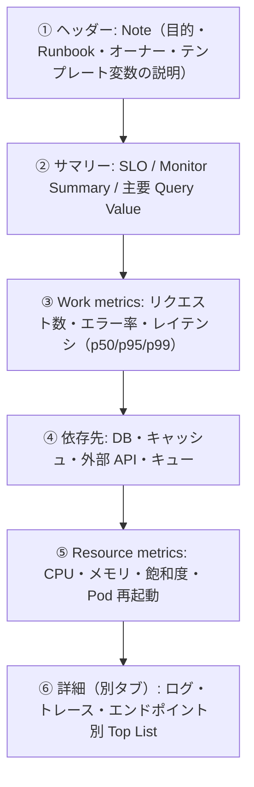
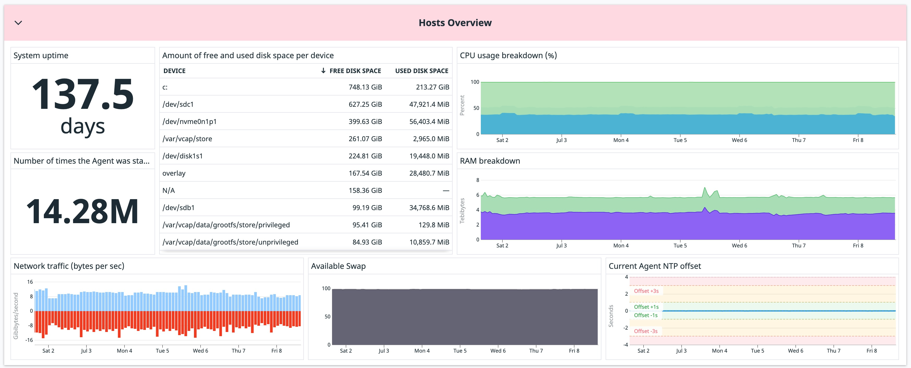
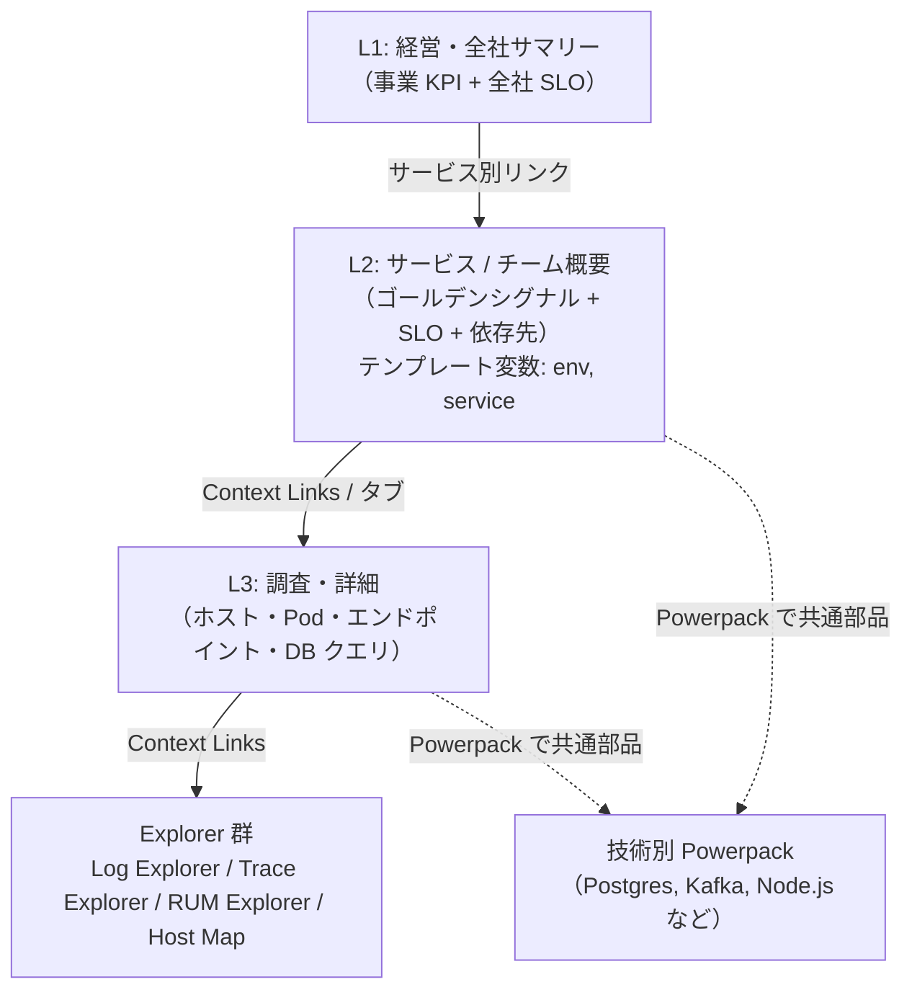
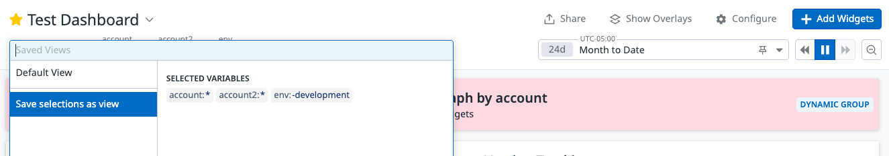
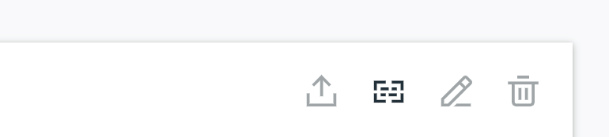
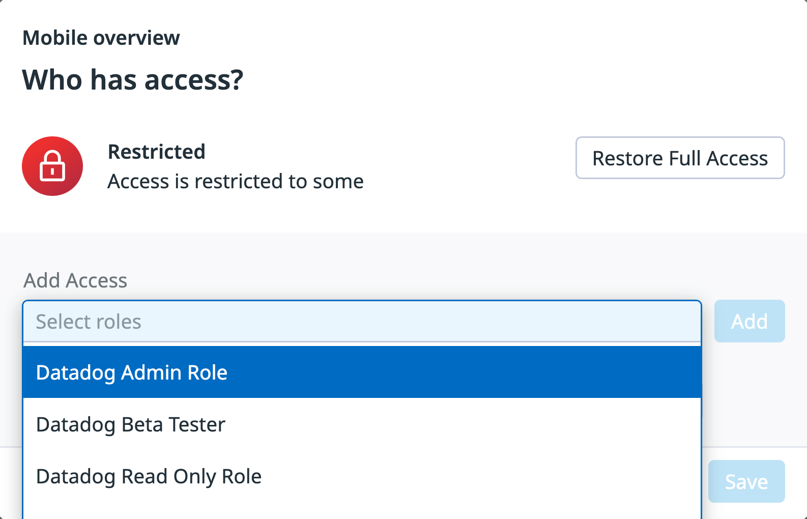
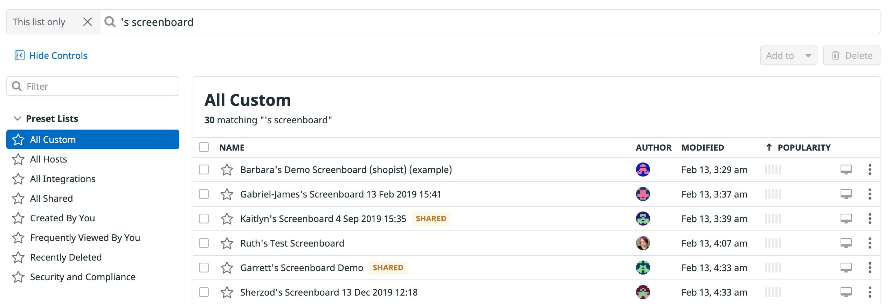

# ダッシュボード設計の実践

## 概要

Datadog の Dashboards（ダッシュボード）は、メトリクス・ログ・トレース・RUM・SLO などを 1 画面に集約する可視化機能である。機能そのもの（ウィジェット種別、レイアウト種別、API、共有方法など）の仕様は [Dashboards（ダッシュボード）](../02_リファレンス/platform/dashboards.md) にまとめており、本ファイルは **「どう設計し、どう運用し続けるか」** という実践知見に絞る。

本ファイルが答える主な問い:

| 問い | 該当節 |
|---|---|
| 経営・サービス運用・障害調査で、ダッシュボードの作りはどう変えるべきか | [用途別の設計](#用途別の設計) |
| ダッシュボードが乱立しないよう、どう階層化・導線設計するか | [階層化と導線設計](#階層化と導線設計) |
| 1 枚のダッシュボードを多数のサービス・環境で使い回すには | [テンプレート変数の活用](#テンプレート変数の活用) |
| 共通部品を全社で標準化するには | [Powerpack による部品化と標準化](#powerpack-による部品化と標準化) |
| ダッシュボードが重い・読みにくいときに何を見直すか | [パフォーマンスと可読性](#パフォーマンスと可読性) |
| 誰が編集できるか、不要なダッシュボードをどう片付けるか | [ガバナンス](#ガバナンス) |
| 社外・経営層へどう共有・配信するか | [共有と配信](#共有と配信) |

前提として押さえるべき基本方針（公式ドキュメント・公式ブログで繰り返し述べられているもの）:

1. **ダッシュボードの目的（ゴール）を先に決める。** 目的がウィジェットとデータの取捨選択を決める。目的上必要なら少数ウィジェットでもよく、詰め込みは避ける。[出典](https://github.com/DataDog/effective-dashboards/blob/master/guidelines.md)
2. **定常的に問う「質問」から逆算して作る。** [出典](https://docs.datadoghq.com/getting_started/dashboards/)
3. **別々の問題には別々のダッシュボードを用意し、相互にリンクする。** [出典](https://docs.datadoghq.com/getting_started/dashboards/)
4. **アラートの主役は Monitor（モニター）であり、ダッシュボードは人が見て判断・相関分析するための道具。** 「まずモニター、ダッシュボードは複数人が使う場合やアラート後の相関分析が必要な場合に作る」という整理が実務で語られる。【第三者情報】[出典](https://www.issoh.co.jp/tech/details/16594/)（2026-08 公開、2026-09 更新）

関連ファイル:

- 仕様: [Dashboards（ダッシュボード）](../02_リファレンス/platform/dashboards.md)、[メトリクスクエリと関数](../02_リファレンス/platform/metrics-query-and-functions.md)、[Notebooks・DDSQL・Reference Tables](../02_リファレンス/platform/notebooks-and-data-tools.md)
- 前提となるタグ設計: [タグ戦略の実践](./tagging-strategy.md)、[Tagging（タグ）](../02_リファレンス/platform/tagging.md)
- コード管理: [Monitoring as Code](./monitoring-as-code.md)、[Terraform と IaC](../02_リファレンス/platform/terraform-and-iac.md)
- 権限: [組織・ユーザー・権限管理](../02_リファレンス/platform/account-and-access-management.md)
- SLO 表示: [SLO 運用の実践](./slo-practices.md)
- アラートとの役割分担: [アラート設計とノイズ削減](./alert-design-and-noise-reduction.md)
- 失敗例: [よくある失敗とアンチパターン](./common-pitfalls.md)

---

## 前提: ダッシュボードのレイアウト種別と選び方

Datadog Dashboards には 3 つのレイアウト種別がある。設計の出発点として、新規作成ではどれを選ぶかを決めておく。[出典](https://docs.datadoghq.com/dashboards/)

| 種別 | レイアウト | 公式が示す主な用途 | 設計上の特徴 |
|---|---|---|---|
| Dashboards（グリッド型、現行の標準） | 12 マス幅のグリッド | ステータスボード、ストーリーテリング、デバッグ | Group（グループ）の色付きヘッダー、High density mode（高密度モード）、Tabs（タブ）等の新機能はこの型が前提 |
| Timeboards（自動レイアウト、旧来型） | 自動配置 | トラブルシューティング、相関分析、データ探索 | ダッシュボード全体が 1 つの時点（固定またはリアルタイム）を表す |
| Screenboards（フリーフォーム、旧来型） | 自由配置（ピクセル単位） | ステータスボード、ストーリーテリング | 自由配置が可能。ただし Screenboard のウィジェットは Group に入れられない。Powerpack も非対応 |

実務上の選び方:

- **新規ダッシュボードは原則「Dashboards（グリッド型）」を使う。** Datadog 公式の Effective Dashboards ガイドラインは、色付きグループや高密度モード等をサポートする新しい「Dashboards」レイアウトの利用を推奨している。[出典](https://github.com/DataDog/effective-dashboards/blob/master/guidelines.md)（同リポジトリは 2024-10-07 にアーカイブ済み。内容は現行仕様と大きく食い違わないが、最新仕様は公式ドキュメントで確認すること）
- **障害対応用は自動リフロー（ordered レイアウト）、自由配置（free）は固定様式のレポートや構成図風の画面に限定する**、という整理が実務で語られる。【第三者情報】[出典](https://www.issoh.co.jp/tech/details/16594/)（2026-08 公開）
- **TV 表示で画面の縦横比に厳密に合わせたい場合は Screenboard も選択肢。** TV mode のガイドは、細かな配置制御が必要なら Screenboard（ピクセル単位配置）を検討するよう述べている。[出典](https://docs.datadoghq.com/dashboards/guide/tv_mode/)
- Powerpack は Screenboard 非対応、Powerpack レイアウトの編集は Timeboard 上では不可である。部品化を前提にするなら「Dashboards（グリッド型）」を選ぶ。[出典](https://docs.datadoghq.com/dashboards/widgets/powerpack/)

---

## 用途別の設計

ダッシュボードは読み手と目的によって作り方がまったく異なる。Datadog の Getting Started も「チームダッシュボードは SLO/SLI の詳細」「経営ダッシュボードは高レベルの問いに答え、相互にリンク」「トラブルシューティング用は小さく始めて育てる」と用途を分けて述べている。[出典](https://docs.datadoghq.com/getting_started/dashboards/)

### 用途別の比較表

| 観点 | 経営・ビジネス向け（Executive） | サービス運用向け（Service / Team） | 調査・トラブルシューティング向け（Investigation） |
|---|---|---|---|
| 主な読み手 | C レベル、VP、事業責任者 | サービスオーナー、SRE、オンコール | オンコール、開発者、SRE |
| 問い | 事業は順調か、信頼性は売上にどう影響しているか | サービスは健全か、SLO は守れているか | 何が・どこで・いつから壊れているか |
| 粒度（altitude） | 高高度（成果・トレンド） | 中高度（サービス単位のゴールデンシグナル） | 低高度（ホスト・Pod・エンドポイント・クエリ単位） |
| 時間軸 | 週・月・四半期のトレンド | 直近 1 時間〜1 週間 | 直近数分〜数時間、インシデント区間 |
| 代表ウィジェット | Query Value、SLO、Geomap、Timeseries（トレンド・予測）、Table | Timeseries、Query Value、SLO、Monitor Summary、Top List | Timeseries（多系列）、Heatmap、Distribution、Top List、Log Stream / List、Host Map |
| テンプレート変数 | `region`、`business_unit`、`env` 程度に絞る | `env`、`service`、`version`、`team` | `env`、`service`、`host`、`kube_cluster_name`、`pod_name` など細かく |
| 更新頻度・変化 | 安定（変更は少ない） | 中程度 | 高い（育てる・捨てる） |
| 管理方式の推奨【経験則】 | コード管理（Terraform）＋編集制限 | コード管理または Powerpack で標準化 | UI 編集中心。一時的なものは Notebook を使う |
| 配信 | Scheduled Reports（PDF）、共有ダッシュボード | チャット共有、TV mode | 個人の閲覧、インシデントへの添付 |

### 経営・ビジネス向けダッシュボード

Datadog 公式ブログ「Design effective executive dashboards with Datadog」（2026-01-09 公開）は、経営向けダッシュボードを次の手順で設計するよう推奨している。[出典](https://www.datadoghq.com/blog/datadog-executive-dashboards/)

**1. 読み手と高度（altitude）を最初に決める**

| 高度 | 読み手 | 内容 |
|---|---|---|
| High-altitude（高高度） | C レベル、VP | 成果中心のサマリー |
| Lower-altitude（低高度） | マネージャー、オペレーションリーダー | サービスが成果にどう影響しているかの詳細 |

- 2 つの高度のダッシュボードを **リンクで接続**し、経営層が全体像からワンクリックで診断ビューに移れるようにする。
- 各ウィジェットは「事業は順調か」を判断できる成果志向にし、低レベルのテレメトリを読ませない。

**2. データ準備**

- `env`、`region`、`team`、`service`、プロダクトライン等のタグを一貫して付与し、事業の切り口（例: US と EMEA の売上、本番と検証）で分割できるようにする。タグ設計は [タグ戦略の実践](./tagging-strategy.md) を参照。
- `checkout.revenue_per_minute` のような説明的なメトリクス名を使い、ほぼ重複したメトリクスを避け、単位を揃える。
- 既製インテグレーションにない事業 KPI（セッションあたり売上など）は、RUM イベント・ログ・カスタム送信からカスタムメトリクスとして作る（課金への影響は [課金への影響](#課金への影響) を参照）。

**3. 推奨メトリクス（公式ブログの分類）**

| 分類 | 例 |
|---|---|
| ビジネス | 売上、ユーザーあたり売上、平均注文額、注文数、コンバージョン率、カート放棄率、解約率、アクティブユーザー |
| エンゲージメント | ユニークログイン、新規/リピーター、プロダクト採用率 |
| 信頼性 | SLO 稼働率、エラーバジェット消費、重要サービスのレイテンシ・エラー率、MTTD、MTTR、インシデント件数 |
| 顧客体験 | Apdex スコア、セッション長、ページビュー |
| 財務リスク | カート・チェックアウトのエラーによる推定逸失売上 |

**4. 推奨セクション構成とウィジェット**

| セクション（グループ） | 内容 |
|---|---|
| Overview | 総売上、注文数、ユニークログイン、主要 SLO（SLO は Gauge が有効） |
| Traffic and Engagement | ユーザー推移、トラフィック予測、異常検知を Timeseries・Distribution で |
| Financial Analysis | ユーザーあたり売上、平均注文額、逸失売上の推定 |
| Reliability | SLO 稼働率、エラーバジェット消費、重要サービスのレイテンシ |

補足（地域別の可視化）: ブログが挙げるセクションは上の 4 つで、「地域」という独立したセクションはない。ただし同記事の例（Financial Analysis の説明に続く段落）では、Geomap と国別テーブルを並べると成長市場や不振地域をすぐ把握できると紹介している。地域別に比較したい場合は、このペアを Overview または Financial Analysis の近くに置くか、独自のグループとして追加する【経験則】。

- **技術指標と事業指標を隣に並べる**（例: チェックアウトのレイテンシとカート放棄率・分あたり売上）。
- セクションはグループにまとめ、詳細は折りたためるようにする。
- `region`、`environment`、`business_unit` などのテンプレート変数で、1 枚を複数の読み手に使い回す。
- 計算方法と「健全」とみなす閾値を Note（注記）で定義し、関連ダッシュボード・Runbook・ドキュメントへのリンクを置く。
- 小さなウィジェットを大量に並べず、余白を残す。

**5. 設計時のガイド質問（公式ブログより）**

- 高高度: アクティブユーザー数とピーク時間帯は? 売上と信頼性の関係は? 主要ワークフロー（チェックアウト・サインアップ）の完了数は? 伸びている/苦戦している地域・事業部は? 週・四半期の売上・インシデント・採用率の推移は? 顧客は応答性に満足しているか? インフラとアプリの全体健全性は?
- 低高度: コアサービスの稼働率・レイテンシ・エラー率は安定しているか? エラーや遅延はセッション長・コンバージョン・カート放棄にどう影響しているか? 検索・アカウント作成・チェックアウト等の重要フローに監視が集中しているか? どのサービス/チームが最も多くアラートを出しているか（アラート疲れが本当の問題を隠していないか）? 環境・地域間で性能と採用率はどう違うか?

**経営向けの実務上の注意【経験則】**

- 経営向けは「見る頻度は低いが誤解されると影響が大きい」ため、値の定義（分母・期間・除外条件）を Note に必ず書く。
- Query Value は既定で約 150 ポイントを目標に集計されるため、同じ時間窓でも Timeseries より粗いロールアップになる（[パフォーマンスと可読性](#パフォーマンスと可読性) 参照）。ユニーク数（cardinality）系の値は時間窓で値が変わるので、期間を明示する。
- 定期配信は Scheduled Reports（PDF）を使い、画面を開いてもらう前提にしない（[共有と配信](#共有と配信) 参照）。

### サービス運用向けダッシュボード

サービス運用向けは「サービスが健全か」を数秒で判断できることが目的である。指標の選び方は、Datadog の Monitoring 101 シリーズ（2015-06-30 公開）が示す **Work metrics（仕事のメトリクス）と Resource metrics（リソースのメトリクス）と Events（イベント）** の 3 分類が今も有効な枠組みである（公開から年数が経っているが、考え方の枠組みとして現行でも公式に参照されている）。[出典](https://www.datadoghq.com/blog/monitoring-101-collecting-data/)

| 分類 | サブタイプ | 意味 | 例 |
|---|---|---|---|
| Work metrics | Throughput | 単位時間あたりの処理量 | 312 req/s |
| | Success | 成功した処理の割合 | 2xx が 99.1% |
| | Error | 失敗の率・割合 | 5xx が 0.1% |
| | Performance | 処理効率（多くはレイテンシ） | p90 応答時間 0.4 秒 |
| Resource metrics | Utilization | 使用率（時間・容量） | ディスク I/O ビジー率 |
| | Saturation | 処理待ちの量 | キューに積まれたリクエスト数 |
| | Errors | 内部エラー | DB のレプリケーションエラー |
| | Availability | 応答可能な割合 | DB に到達可能な時間割合 |
| Events | — | 変化の文脈（デプロイ、ビルド失敗、アラート、スケール） | コードリリース、ホスト追加 |

**推奨レイアウト（上から下へ「症状 → 原因」）**



- ゴールデンシグナルは **レイテンシとトラフィックを上段、エラーと飽和度を中段**のように固定パターンで配置し、レイテンシは平均ではなくパーセンタイル、エラーは件数ではなく比率で表示する、という実務知見がある。【第三者情報】[出典](https://www.issoh.co.jp/tech/details/16594/)（2026-08 公開）
- ダッシュボードの最上部は「状態判断に必要な指標」だけにして、詳細調査用グラフは別タブに移す。【第三者情報】[出典](https://www.issoh.co.jp/tech/details/16594/)
- `env`・`service`・`version` をテンプレート変数にし、本番向けダッシュボードは既定値を `env:prod` にして、開いた瞬間に検証環境のノイズを見せない。【第三者情報】[出典](https://www.issoh.co.jp/tech/details/16594/)
- SLO ウィジェット・SLO List ウィジェットでサービスの信頼性目標を並べる。SLO の設計は [SLO 運用の実践](./slo-practices.md) を参照。
- イベントオーバーレイ（デプロイイベントなど）を Timeseries に重ねると、変更と症状の相関がすぐ分かる。テンプレート変数はイベント検索でも使える。ウィジェットのイベントオーバーレイ検索ボックスでは `$<NAME>`（例: `$region`）、ダッシュボードのイベント検索では `<TAG_KEY>:$<NAME>.value`（例: `region:$region.value`）と書く。[出典](https://docs.datadoghq.com/dashboards/template_variables/)
- APM を導入済みなら、サービスの基本画面は APM の Service Page（サービスページ）が自動で提供する。カスタムダッシュボードは「サービスページにない事業指標・依存関係・チーム固有の観点」を足す位置付けにすると重複が減る【経験則】。APM 画面は [APM 画面と分析機能](../02_リファレンス/apm/apm-ui-and-analysis.md) を参照。
- Kubernetes の運用ダッシュボードの観点は [Kubernetes 監視の実践](./kubernetes-monitoring-practices.md) を参照。

### 調査・トラブルシューティング向けダッシュボード

- **小さく始めて、追跡すべき対象が見つかるたびに育てる**のが公式の推奨である。[出典](https://docs.datadoghq.com/getting_started/dashboards/)
- Timeboard 的な「ダッシュボード全体が同じ時刻を指す」性質は相関分析に向く。グリッド型 Dashboards でもカーソル位置が全グラフで同期するため、同じ考え方で使える【経験則】。
- 一回限りの探索は **Notebooks（ノートブック）または Quick Graphs** を使い、後で削除が必要なダッシュボードを増やさない。Notebooks は既定で保存されない。[出典](https://docs.datadoghq.com/dashboards/guide/maintain-relevant-dashboards/)
- 調査で頻繁に使うフィルタの組み合わせ（例: 特定クラスタ＋特定サービス）は Saved Views（保存ビュー）として保存する（[テンプレート変数の活用](#テンプレート変数の活用) 参照）。
- Context Links（コンテキストリンク）で、グラフの系列クリックからログ・トレース・ホスト・外部ツール（AWS コンソール等）へ同じ条件のまま移動できるようにする（[階層化と導線設計](#階層化と導線設計) 参照）。
- インシデント発生時に定型の調査ダッシュボードを Dashboards API で JSON から生成する、という使い方も公式に例示されている。[出典](https://docs.datadoghq.com/getting_started/dashboards/)

### 用途別に共通する「書くべきもの」

| 項目 | 推奨内容 | 出典 |
|---|---|---|
| ダッシュボードの Description（説明） | 目的・使い方・テンプレート変数の説明を必ず書く。Markdown（見出し、リスト、リンク）が使える。たまにしか使わないチームの助けになる | [出典](https://github.com/DataDog/effective-dashboards/blob/master/guidelines.md)、[出典](https://docs.datadoghq.com/dashboards/guide/maintain-relevant-dashboards/) |
| Teams（チーム）の関連付け | 1 ダッシュボードに最大 5 チームを関連付けられる。オーナーを明示する | [出典](https://docs.datadoghq.com/dashboards/configure/) |
| `[[suggested_dashboards]]` | Description に記述すると、ユーザーの導線に基づく推奨ダッシュボードが表示される | [出典](https://docs.datadoghq.com/dashboards/configure/) |
| Note / Free Text ウィジェット | グラフの読み方、正常範囲、判断基準、Runbook へのリンク | [出典](https://docs.datadoghq.com/dashboards/guide/powerpacks-best-practices/) |
| Markers（マーカー） | 期待値・異常値の閾値を水平線（Line）や範囲（Range）で示し、閲覧者に許容範囲を推測させない | [出典](https://docs.datadoghq.com/dashboards/guide/powerpacks-best-practices/) |
| グラフタイトル | 何を表示しているかを短く明確に | [出典](https://docs.datadoghq.com/dashboards/guide/powerpacks-best-practices/) |



**図: 水平マーカーで閾値を示した Timeseries の例（hosts overview の NTP offset グラフ）**
画面説明: ホスト群の NTP オフセットを示す Timeseries グラフに、許容範囲を示す水平マーカー（閾値線・範囲）を重ねた例。閲覧者はグラフを見ただけで「どこからが異常か」を判断できる。マーカーはウィジェット編集画面の Markers 設定で Line または Range、線種（solid / bold / dashed）、ラベルを指定して追加する。
出典: https://docs.datadoghq.com/dashboards/guide/powerpacks-best-practices/ （取得日: 2026-11-02）

---

## 階層化と導線設計

ダッシュボードが増えるほど「どれを見ればよいか分からない」問題が起きる。公式の推奨は「別々の問題には別々のダッシュボード」「経営ダッシュボードは相互にリンク」であり、これを **階層（ドリルダウン）** として設計する。[出典](https://docs.datadoghq.com/getting_started/dashboards/)

### 推奨する 3 階層モデル【経験則】



| 階層 | 数の目安【経験則】 | オーナー | 主な機能 |
|---|---|---|---|
| L1 全社サマリー | 数枚 | プラットフォーム/SRE 部門 | Note のリンク、SLO List、Scheduled Reports |
| L2 サービス概要 | サービス数ではなく「サービス種別」数（テンプレート変数で切替） | 各サービスチーム | テンプレート変数、Powerpack、Tabs |
| L3 調査 | 必要に応じて | 各チーム | Context Links、Saved Views、Notebooks |

### 1 枚の中の階層: Groups と Tabs

| 機能 | 仕様・推奨 | 出典 |
|---|---|---|
| Group（グループ）ウィジェット | 類似グラフをまとめ、カスタムヘッダーを持ち、折りたたみ可能。ヘッダー色（`background_color`: white, blue, purple, pink, orange, yellow, green, gray, vivid_*, transparent）やバナー画像（`banner_img`）を設定できる | [出典](https://docs.datadoghq.com/dashboards/widgets/group/) |
| すべてのウィジェットをグループに入れる | 1 ウィジェットだけでもグループに入れる。グループ化は低密度/高密度モードでの表示に影響する | [出典](https://github.com/DataDog/effective-dashboards/blob/master/guidelines.md) |
| High density mode（高密度モード） | 大画面でグループを横に並べる。12 列グリッドを 2 つ並べる（24 列ではない）ため、ウィジェットの最大幅は 12 列のまま。グループウィジェットを持つダッシュボードでは大画面で既定 ON、右上のボタンで手動 OFF 可 | [出典](https://github.com/DataDog/effective-dashboards/blob/master/guidelines.md)、[出典](https://docs.datadoghq.com/dashboards/configure/) |
| Tabs（タブ） | ウィジェットを名前付きセクションに分ける。1 ダッシュボード最大 100 タブ、タブ名最大 100 文字。編集モードで共有メニュー > **Move to tab** で移動。グループを移すと中のウィジェットも移動 | [出典](https://docs.datadoghq.com/dashboards/configure/) |
| 大きなダッシュボード | タブでスクロールを減らす。ウィジェットは業務・議論の流れに沿って並べる | [出典](https://docs.datadoghq.com/getting_started/dashboards/) |

実務上の指針:

- **新しいダッシュボードを作る前にタブで足りないか検討する。** 原則「1 サービス 1 ダッシュボード」とし、環境やバージョンの違いはテンプレート変数で吸収する。【第三者情報】[出典](https://www.issoh.co.jp/tech/details/16594/)（2026-08 公開）
- 1 枚目のタブ（Overview）は判断用、2 枚目以降を調査用（ログ・トレース・依存先・インフラ）にすると、L2 と L3 を 1 枚で兼ねられる【経験則】。
- Screenboard ではグループが使えないため、Free Text ウィジェットで見出しを作る。Timeboard では折りたたみ可能なグループを使う。[出典](https://docs.datadoghq.com/getting_started/dashboards/)

### ウィジェット幅の推奨値

Effective Dashboards ガイドラインは、小さい画面で潰れないための最小幅を示している。[出典](https://github.com/DataDog/effective-dashboards/blob/master/guidelines.md)

| ウィジェット | 推奨最小幅（12 列中） |
|---|---|
| Timeseries | 4 列以上 |
| Stream 系（ログ等） | 6 列以上（ダッシュボード幅の半分） |

### 画面間の導線: リンク・Context Links・URL パラメータ

| 手段 | 使いどころ | 仕様 |
|---|---|---|
| Note / Free Text の Markdown リンク | 上位・下位ダッシュボード、Runbook、関連ドキュメントへのリンク | Markdown で記述 |
| ダッシュボード URL のテンプレート変数 | 変数値を引き継いだ画面遷移 | 変数を変更すると URL に `&tpl_var_<NAME>=<VALUE>` が付与される。[出典](https://docs.datadoghq.com/dashboards/template_variables/) |
| Context Links（既定） | グラフからホスト・コンテナ・プロセス・トレース・RUM・プロファイル・ログへ | Host Map / Host Dashboard、Live Containers、Live Processes、Trace Explorer、RUM Explorer、Profile Explorer、Log Explorer へ、ウィジェットのフィルタ・テンプレート変数・クリックした系列・時間範囲を引き継いで遷移。[出典](https://docs.datadoghq.com/dashboards/guide/context-links/) |
| Context Links（カスタム） | 下位ダッシュボードや外部ツール（AWS コンソール、Zendesk 等）へ | 編集権限のあるユーザーが Label と URL を設定。変数は下表 |

Context Links で使える変数: [出典](https://docs.datadoghq.com/dashboards/guide/context-links/)

| 変数 | 意味 |
|---|---|
| `{{timestamp_start}}`、`{{timestamp_end}}` | ウィジェットの時間範囲 |
| `{{@attribute}}`、`{{@attribute.value}}` | クリックしたグループのクエリ変数 |
| `{{$env}}`、`{{$env.value}}` | 現在のダッシュボードのテンプレート変数値 |
| `{{tags}}` | 上記すべての既定の組み合わせ |

`{{something}}` はキーと値（例: `env:prod`）、`{{something.value}}` は値のみ（例: `prod`）を返す。URL エンコードは Datadog が自動で行う。複数値は `service:backend (env:{{$env.value}})` のように括弧で囲む。[出典](https://docs.datadoghq.com/dashboards/guide/context-links/)

**L2 から L3 へのドリルダウン例【経験則】**: L2 の「サービス別エラー率 Top List」に、カスタム Context Link として L3 ダッシュボードの URL に `?tpl_var_service={{service.value}}&tpl_var_env={{$env.value}}&from_ts={{timestamp_start}}&to_ts={{timestamp_end}}` を付与すると、クリックしたサービス・環境・時間範囲のまま調査画面に移れる（`from_ts` / `to_ts` のパラメータ名は Datadog の URL 慣行に基づくもので、Context Links ガイド上での明記は確認できず。実装時に動作確認すること）。

---

## テンプレート変数の活用

Template Variables（テンプレート変数）は、タグやファセットでダッシュボード内のウィジェットを動的に絞り込む機能であり、「1 枚のダッシュボードを多数のサービス・環境・チームで使い回す」ための中核機能である。[出典](https://docs.datadoghq.com/dashboards/template_variables/)

### 変数の種類

| 種類 | 定義 | 例 |
|---|---|---|
| タグベース | タグキーを指定（推奨形式 `<KEY>:<VALUE>` のキー） | `env`、`service`、`kube_cluster_name` |
| 属性ベース | ファセットやメジャーを指定。Log・APM・RUM のファセットは `@` で始まる | `@http.status_code` |
| Team filter | `team` タグキーの変数は、階層を考慮した選択・検索・Shift+クリックでサブチーム除外ができるチームフィルタとして表示される | `team` |

[出典](https://docs.datadoghq.com/dashboards/template_variables/)

### 構文

| 構文 | 動作 |
|---|---|
| `$<NAME>` | ウィジェットクエリの `from`（フィルタ）や `by`（グループ化）で動的選択肢として使う。テキストウィジェットではキーと値（例: `environment:dev`）を表示 |
| `$<NAME>.key` | テキストウィジェットでキーのみ（例: `environment`）を表示 |
| `$<NAME>.value` | 選択値をクエリに埋め込む（例: `env:staging-$service.value`）。テキストウィジェットでは値のみ（例: `dev`）を表示 |
| URL パラメータ | 値を変えると URL が `&tpl_var_<NAME>=<VALUE>` に更新される |
| イベント検索・オーバーレイ | ダッシュボードのイベント検索では `<TAG_KEY>:$<NAME>.value`（例: `region:$region.value`。複数の変数はカンマ区切りで `role:$role.value,env:$env.value`。該当イベントの発生時刻は各グラフにピンクのバーで示される）。ウィジェットのイベントオーバーレイ検索ボックスでは `$<NAME>`（例: `$region`）。変数はイベントタグではなくメトリクスのタグである必要がある |
| `$team.value` | 選択されたすべてのチームハンドルを、クエリのタグキーを使って `OR` で連結して展開する。`attributes.team` や `team_attribution` など別キーのデータの絞り込みにも使える |

[出典](https://docs.datadoghq.com/dashboards/template_variables/)

### 既定値・候補値・制限

| 項目 | 仕様 | 出典 |
|---|---|---|
| Default value（既定値） | `*`（すべて） | [出典](https://docs.datadoghq.com/dashboards/template_variables/) |
| Available values（選択可能値） | 既定は `(all)`。リストには常に `*` が含まれる。`team` 変数では、選択可能値は全チームリストに「追加」される（制限ではない） | [出典](https://docs.datadoghq.com/dashboards/template_variables/) |
| 候補値の探索範囲（メトリクス・Cloud Cost） | 現在から過去 48 時間 | [出典](https://docs.datadoghq.com/dashboards/template_variables/) |
| 候補値の探索範囲（その他のデータソース） | ダッシュボードの時間枠 | [出典](https://docs.datadoghq.com/dashboards/template_variables/) |
| 保持期間との関係 | 変数クエリは各データのデータ保持ポリシーに従う。最近報告されたデータの値のみ表示 | [出典](https://docs.datadoghq.com/dashboards/template_variables/) |
| ワイルドカード | Log・APM・RUM ウィジェットは値の途中（例: `eng*@example.com`）や複数（例: `*prod*`）のワイルドカードに対応。テキストウィジェットでは変数後ろのワイルドカード不可（`$env*` はリテラル `dev*` になる） | [出典](https://docs.datadoghq.com/dashboards/template_variables/) |
| 複数選択 | 公式ドキュメントで明記されているのは Team filter の複数選択（`OR` 展開）。それ以外の変数種別の複数選択の仕様は当該ページでは確認できず | [出典](https://docs.datadoghq.com/dashboards/template_variables/) |
| ヘッダーの表示数 | ヘッダーには一部のみ表示され、**+ N** ボタンで残り、**Expand template variables** で全件表示 | [出典](https://docs.datadoghq.com/dashboards/template_variables/) |
| 1 ダッシュボードあたりの変数数の上限 | 公開情報では確認できず | — |

### Associated Template Variables（関連値）

ある変数の値を選ぶと、他の変数の候補のうち関連する値がリスト上部に表示される（関連値の下に「その他の値」）。設定不要で自動計算される。cluster → deployment → service → node のように変数を追加するたびに候補が絞られ、データが存在しない組み合わせを選ぶリスクが下がる。[出典](https://docs.datadoghq.com/dashboards/template_variables/)、[出典](https://www.datadoghq.com/blog/template-variable-associated-values/)（2021-02-17 公開）

設計上の含意【経験則】: 変数は **上位概念 → 下位概念**（`env` → `kube_cluster_name` → `service` → `pod_name`）の順にヘッダーへ並べると、関連値の効果を最大化できる。

### Saved Views（保存ビュー）

| 操作 | 手順 |
|---|---|
| 作成 | Saved Views ドロップダウンで **Save selections as view** を選び、一意の名前と任意の説明を入力。変数を変えても自動保存されない |
| 値の変更 | ビューを選択 → 変数を変更 → **Save Changes**。Default ビューは既定値を変更して **Done** |
| 名前・説明の変更 | ビューにホバー → **Edit** → **Save** |
| 削除 | ビューにホバー → **Delete View** |

[出典](https://docs.datadoghq.com/dashboards/template_variables/)



**図: Saved Views ドロップダウンから「Save selections as view」を選ぶ画面**
画面説明: ダッシュボード上部のテンプレート変数バーの左側にある Saved Views ドロップダウンを開いた状態。現在のテンプレート変数の選択内容を名前付きビューとして保存するメニュー項目（Save selections as view）が表示されている。保存したビューは同じダッシュボードを開く他のユーザーも選択できる。
出典: https://docs.datadoghq.com/dashboards/template_variables/ （取得日: 2026-11-02）

### テンプレート変数の設計パターン

| パターン | 内容 | 根拠 |
|---|---|---|
| 統合タグ 3 点セット | `env`、`service`、`version` を変数化し、1 枚で多数サービスを扱う | 【第三者情報】[出典](https://www.issoh.co.jp/tech/details/16594/)（2026-08 公開）。Unified Service Tagging については [タグ戦略の実践](./tagging-strategy.md) |
| 本番を既定値に | 本番運用ダッシュボードは既定値 `env:prod` | 【第三者情報】同上 |
| 部分文字列での集約 | `env:staging-web-store` と `service:web-store` のような命名なら `staging-$service.value` で該当環境を引く。未選択時はパターンに合う全環境が表示される | [出典](https://www.datadoghq.com/blog/dynamic-template-variable-syntax-dashboards/)（2021-05-11 公開） |
| タグキー移行期の吸収 | 旧キー `environment` と新キー `env` を同じ変数の `.value` で OR 条件に書き、両方のデータを表示する | [出典](https://www.datadoghq.com/blog/dynamic-template-variable-syntax-dashboards/)（2021-05-11 公開。記事中の構文表記に揺れあり。現行構文は `$<NAME>.value`） |
| 送信元・送信先の同時指定 | ネットワーク系クエリで `service:$service.value` を送信元・送信先の両方に使う | [出典](https://www.datadoghq.com/blog/dynamic-template-variable-syntax-dashboards/) |
| チーム別ビュー | `team` 変数（Team filter）でチーム階層単位に絞り込み、`$team.value` で別キーのデータにも適用 | [出典](https://docs.datadoghq.com/dashboards/template_variables/) |
| 定番の組み合わせを保存 | オンコールがよく使う組み合わせを Saved Views 化 | [出典](https://www.issoh.co.jp/tech/details/16594/)【第三者情報】 |
| 変数は Description で説明 | 各テンプレート変数の意味を Description に書く | [出典](https://github.com/DataDog/effective-dashboards/blob/master/guidelines.md) |

### テンプレート変数でよくある落とし穴

| 症状 | 原因 | 対策 |
|---|---|---|
| 変数を切り替えるとグラフが空になる | サービス間でメトリクス名や `service` タグが不統一 | ダッシュボードを複製する前にメトリクス名と `service` タグを標準化する【第三者情報】[出典](https://www.issoh.co.jp/tech/details/16594/)。[タグ戦略の実践](./tagging-strategy.md) |
| 候補に出ないサービスがある | メトリクスの候補値は過去 48 時間に報告された値のみ | 長期間静かなサービスはログ・トレースのファセットで代替、または Saved Views を使う【第三者情報】[出典](https://www.issoh.co.jp/tech/details/16594/)。仕様は [出典](https://docs.datadoghq.com/dashboards/template_variables/) |
| 一部ウィジェットだけ絞り込まれない | ウィジェットのクエリに `$<NAME>` が入っていない | テンプレート変数を適用すべきウィジェットを編集画面で確認する【経験則】 |
| テキストで `$env*` と書いたのに期待通りにならない | テキストウィジェットは変数後ろのワイルドカード非対応 | 仕様。[出典](https://docs.datadoghq.com/dashboards/template_variables/) |
| 既定値 `*` のまま全量を表示して重い | 全ホスト・全サービスを一度にクエリしている | 既定値を絞る（例: `env:prod`、主要クラスタ）【経験則】 |

---

## Powerpack による部品化と標準化

Powerpacks（パワーパック）は、テンプレート化されたウィジェットグループで、ダッシュボードの再利用可能な部品である。Datadog 提供の **Preset** Powerpack と、組織内でのみ使える **Custom** Powerpack がある。[出典](https://docs.datadoghq.com/dashboards/widgets/powerpack/)

### 仕様の要点

| 項目 | 仕様 |
|---|---|
| 作成 | ダッシュボードのグループヘッダーにある **Save as Powerpack** アイコンから。元のグループは Powerpack のインスタンスに置き換わる |
| 追加 | **Add Widgets** → **Powerpacks** タブ → 選択 → フィルタ設定 → **Confirm**。複数ダッシュボードに追加可能 |
| 同期 | Powerpack の変更は使用中の全ダッシュボードに同期。複数ダッシュボードで使用中の場合は影響インスタンスの確認プロンプトが出る |
| インスタンス単位のカスタマイズ | 1 インスタンスの変更（表示オプション、タグ値）は他に影響しない。**Detach Instance** で切り離し可 |
| 削除 | 作成者のみ削除可。既存インスタンスは残るが削除済みの警告が出る（Detach してウィジェットグループ化で解消） |
| 権限 | 既定では作成者のみ編集可。**Modify Permissions** で変更 |
| 非対応 | Screenboard では Powerpack ウィジェット非対応。Timeboard では Powerpack レイアウトの編集不可 |
| テンプレート変数 | Powerpack のフィルタはインスタンス内ウィジェットにのみ適用。API では `controlled_by_powerpack`（Powerpack 側で制御）と `controlled_externally`（ホストダッシュボード側で制御）を区別 |
| 上限 | 公開情報では確認できず |

[出典](https://docs.datadoghq.com/dashboards/widgets/powerpack/)、[出典](https://docs.datadoghq.com/dashboards/guide/powerpacks-best-practices/)



**図: グループウィジェットのヘッダーに表示されるアイコン群**
画面説明: ダッシュボード編集時、グループウィジェットのヘッダー右側に並ぶアイコン。この中の「Save as Powerpack」アイコンを押すと、グループを Powerpack として保存するモーダルが開き、名前・説明・検索カテゴリ（タグ）・利用者が設定可能なフィルタを指定できる。
出典: https://docs.datadoghq.com/dashboards/widgets/powerpack/ （取得日: 2026-11-02）

### Powerpack 運用のベストプラクティス（公式ガイド）

[出典](https://docs.datadoghq.com/dashboards/guide/powerpacks-best-practices/)

| 観点 | 推奨 |
|---|---|
| 使いどころ | 特定技術（Postgres、Kafka、Node.js 等）や関心事（コンプライアンス、セキュリティ）を組織横断で所有するチームが Custom Powerpack を作り、各チームが自分のフルスタック/事業ダッシュボードに組み込む。監視の標準化と、オンコール・SRE・経営層が関連ビューを見つけやすくなる |
| 自己説明的にする | 短く明確なグラフタイトル、読み方を説明する Note、期待/異常範囲を示す水平マーカー、マーカーや forecast 関数等のグラフ上の文脈 |
| 見つけやすくする | タイトル・説明・タグは検索対象。「performance」など検索されそうなキーワードを入れる。説明は 80 文字未満（何を追跡し、何の入力が要るか）。タグは `key:value` ではなくプレーン文字列（例: `aws`、`k8s`、`app`）で 80 文字まで。ウィジェットトレイでは `tag:` 接頭辞で検索可 |
| カスタマイズ可能にする | 構成変数を設定し、各チームが自分の文脈（例: `service`）にスコープできるようにする。変数は「追加前のスコープ指定」と「追加後のフィルタ（例: `prod`/`staging` 切替）」の 2 用途。各ユーザーがダッシュボードのテンプレート変数にするかを選べる |
| 慎重に更新する | 変更は全インスタンスに同期されるため、影響範囲を確認してから **Edit Powerpack Layout** で更新 |
| 権限管理 | 既定で作成者のみ編集可。ウィジェットトレイのケバブメニューまたはインスタンスヘッダーから変更 |
| 周知する | メールやチャットで存在・対象読者・置くべき場所を告知し、質問窓口にもする |

**Powerpack と Terraform の使い分け【経験則】**

| 手段 | 向いている用途 |
|---|---|
| Powerpack | UI 中心の組織で、「技術別の定番グラフ群」を各チームのダッシュボードに差し込む。更新が自動同期される |
| Terraform モジュール（`datadog_dashboard` を生成） | ダッシュボード全体をコードで標準化し、レビュー・バージョン管理したい場合。詳細は [Monitoring as Code](./monitoring-as-code.md) |
| ダッシュボードの Clone / JSON | 一度きりの複製。複製後は元と無関係（unlinked copy）になる。[出典](https://docs.datadoghq.com/getting_started/dashboards/) |

Datadog 提供の Preset ダッシュボード（インテグレーション・機能別）は、Configuration Actions メニューから Clone して出発点にできる。クローンは元ダッシュボードとリンクしないコピーで、変更は元に影響しない。[出典](https://docs.datadoghq.com/getting_started/dashboards/) インテグレーション側の更新はクローンに反映されないため、クローン元の改善を取り込みたい場合は定期的に差分を確認する必要がある【経験則】。

---

## パフォーマンスと可読性

Datadog はダッシュボード単位の「パフォーマンスチューニングガイド」を公式ドキュメントとして公開していない（2026-11-02 時点で確認できず）。以下は、公式に記載された仕様（ポイント上限、リフレッシュ間隔、ロールアップ等）と、そこから導かれる実務上の指針である。

### 関連する仕様値

| 項目 | 値 | 出典 |
|---|---|---|
| 1 系列あたりのポイント上限（折れ線・棒グラフ） | 1,500 ポイント | [出典](https://docs.datadoghq.com/dashboards/functions/rollup/) |
| Query Value ウィジェットの目標ポイント数 | 150 ポイント（同じ時間窓でも粗いロールアップになる） | [出典](https://docs.datadoghq.com/dashboards/functions/rollup/) |
| 既定のロールアップ集計 | `avg` | [出典](https://docs.datadoghq.com/dashboards/functions/rollup/) |
| 既定ロールアップ間隔の例 | 過去 1 時間: 折れ線 20 秒、棒グラフ 1 分 | [出典](https://docs.datadoghq.com/dashboards/functions/rollup/) |
| カスタムロールアップ間隔 | クエリが強制する間隔より大きい場合のみ有効。1,500 ポイント上限まで（例: 1 日で 1 分 1 点） | [出典](https://docs.datadoghq.com/dashboards/functions/rollup/) |
| COUNT / RATE 型メトリクス | `.as_count()` が自動適用され、集計は `sum`、補間なし | [出典](https://docs.datadoghq.com/dashboards/functions/rollup/) |
| Timeseries のラベル | 系列あたり最大 3 ラベル。6 系列を超えるとラベル非表示 | [出典](https://docs.datadoghq.com/dashboards/widgets/timeseries/) |
| Timeseries の最大系列数・最大クエリ数 | 公開情報では確認できず（クエリごとの `limit` で上位 N 件を指定する方式） | [出典](https://docs.datadoghq.com/dashboards/widgets/timeseries/) |
| 1 ダッシュボードあたりのウィジェット数上限 | 公開情報では確認できず | — |
| 1 ダッシュボードあたりのタブ数 | 最大 100 | [出典](https://docs.datadoghq.com/dashboards/configure/) |

### 自動リフレッシュ間隔（非共有ダッシュボード）

| 表示時間枠 | リフレッシュ間隔 |
|---|---|
| 1〜10 分 | 10 秒 |
| 30 分〜1 時間 | 20 秒 |
| 3〜4 時間 | 1 分 |
| 1 日 | 3 分 |
| 2 日 | 10 分 |
| 1 週間〜1 年 | 1 時間 |

[出典](https://docs.datadoghq.com/dashboards/)

- 共有（公開）ダッシュボードのリフレッシュ間隔は、Dashboards 概要ページでは「時間枠に関係なく 30 秒」、Shared Dashboards ページでは「約 60 秒ごと、変更不可」と記載されており、**公式ドキュメント内で記述が食い違っている**（2026-11-02 時点）。より詳細な Shared Dashboards ページの記述（約 60 秒）を優先し、要件上重要な場合は Datadog サポートに確認すること。[出典](https://docs.datadoghq.com/dashboards/)、[出典](https://docs.datadoghq.com/dashboards/sharing/shared_dashboards/)
- **Pause Auto-Refresh**: 相対時間範囲での自動更新を既定で一時停止する設定。全閲覧者に適用される。常時開いておく必要のない重いダッシュボードで有効。[出典](https://docs.datadoghq.com/dashboards/configure/)
- **Default timeframe**: 全ユーザーに適用される既定時間範囲を設定できる。重いダッシュボードは既定を短め（例: 1 時間）にしておくとよい【経験則】。[出典](https://docs.datadoghq.com/dashboards/configure/)

### 重い・遅いダッシュボードの見直しチェックリスト【経験則】

| # | 見直し項目 | 理由 |
|---|---|---|
| 1 | 既定のテンプレート変数を `*` から絞る（`env:prod` 等） | 全量クエリを避ける |
| 2 | 高カーディナリティなタグ（`host`、`pod_name`、`container_id`、`@usr.id` 等）での `by` グループ化を減らし、Top List や `limit`（上位 N）で絞る | 系列数が増えるほど返却データと描画負荷が増える。6 系列超ではラベルも消え可読性も落ちる |
| 3 | ログ・トレース・RUM の生イベントに対する集計は、長期・高頻度に見るならメトリクス化（Generate Metrics）を検討 | メトリクスの方がクエリが軽く長期保持も可能。ただしカスタムメトリクス課金が発生（[課金への影響](#課金への影響)） |
| 4 | 詳細系ウィジェット（Log Stream、多系列 Timeseries、Host Map 等）はタブに分ける | 判断用の 1 枚目を軽く保つ |
| 5 | 不要になったウィジェット・同一クエリの重複を削除 | 1 ウィジェット = 1 つ以上のクエリ |
| 6 | 長期間表示（1 週間〜）では `.rollup()` を明示 | 意図した粒度での集計と可読性の確保 |
| 7 | Flex Logs 対象ウィジェットは **Include Flex Logs** の要否を確認 | OFF なら Standard Indexed ログのみを対象にする（ユーザー単位・ダッシュボード単位の設定）。[出典](https://docs.datadoghq.com/dashboards/configure/)。Flex Logs は [Indexes・保持・アーカイブ](../02_リファレンス/logs/log-indexes-retention-archives.md) |
| 8 | 常時表示の TV 用ダッシュボードは表示時間枠を短めにし、ウィジェットを絞る | リフレッシュ間隔は表示時間枠で決まる |

### 可読性のための指針

| 指針 | 内容 | 出典 |
|---|---|---|
| パーセンタイルを使う | レイテンシは平均ではなく p50 / p95 / p99。パーセンタイル表示はディストリビューションメトリクスで行う | 【第三者情報】[出典](https://www.issoh.co.jp/tech/details/16594/)、公式ガイド「Graphing percentiles in Datadog」[出典](https://docs.datadoghq.com/dashboards/guide/) |
| エラーは比率で | 件数ではなくエラー率（Formula で `errors / hits`） | 【第三者情報】[出典](https://www.issoh.co.jp/tech/details/16594/) |
| ウィジェットを目的に合わせる | Timeseries=傾向、Query Value=行動につながる現在値、Top List=ランキング、Table/Heatmap=多次元比較、Note=判断基準 | 【第三者情報】[出典](https://www.issoh.co.jp/tech/details/16594/) |
| 軸・色・凡例・マーカー | Y 軸範囲、色、凡例、マーカー、イベントオーバーレイで読みやすくする | [出典](https://docs.datadoghq.com/getting_started/dashboards/) |
| 色の一貫性 | 公式ガイド「Selecting the right colors for your graphs」「Consistent Palette」を参照。Timeseries の配色には Classic と Consistent がある | [出典](https://docs.datadoghq.com/dashboards/guide/)、[出典](https://docs.datadoghq.com/dashboards/widgets/timeseries/) |
| 単位を揃える | Unit override で単位を明示 | [出典](https://docs.datadoghq.com/dashboards/guide/) |
| ユニーク数の時間窓に注意 | `cardinality` 系はロールアップ間隔で値が変わる（日別ユニークの合計は週ユニークを上回り得る。例: 1 日 100 ユーザー × 7 日 = 700 だが週のユニークは 400）。期間を明記する | [出典](https://docs.datadoghq.com/dashboards/guide/rollup-cardinality-visualizations/) |
| 不完全区間 | Timeseries の最後の不完全な区間は既定で網掛け・「partial data」表示される。直近値の下落を誤読しない | [出典](https://docs.datadoghq.com/dashboards/widgets/timeseries/) |
| Y 軸の 0 | 「Always include zero」は既定 ON。小さな変動を見たい場合のみ OFF を検討 | [出典](https://docs.datadoghq.com/dashboards/widgets/timeseries/) |

---

## ガバナンス

ダッシュボードは誰でも作れるため、放置すると「誰も開かない画面が積み上がる」。ガバナンスは **所有（誰のものか）・編集権限（誰が変えられるか）・変更管理（何が変わったか）・棚卸し（いつ消すか）** の 4 点で設計する。

### 所有と分類

| 手段 | 仕様 | 出典 |
|---|---|---|
| Teams の関連付け | 1 ダッシュボード最大 5 チーム。ダッシュボード一覧の Team フィルタで所有チームのものだけを表示。一覧で複数選択して **Edit Teams** で一括関連付け | [出典](https://docs.datadoghq.com/dashboards/configure/)、[出典](https://docs.datadoghq.com/dashboards/list/) |
| Lists（リスト） | **+ New List** で作成、一括選択して **Add to** で追加。既定名はユーザー名（例: "John's list"） | [出典](https://docs.datadoghq.com/dashboards/list/) |
| Favorite Lists | 自分がスター付けしたリスト | [出典](https://docs.datadoghq.com/dashboards/list/) |
| Preset Lists | All Custom、All Hosts、All Integrations、All Shared、Created By You、Recently Deleted、Security and Compliance | [出典](https://docs.datadoghq.com/dashboards/list/) |
| 命名規則【経験則】 | `[チーム] サービス名 - 用途`（例: `[Payments] checkout - Service Overview`）のようにプレフィックスで所有と用途を示す。一覧検索の `title:` で抽出しやすくなる | — |

### 編集権限の制御

| 項目 | 仕様 | 出典 |
|---|---|---|
| 編集制限の設定 | **Configure > Permissions > Restrict Access**。既定で組織メンバー全員が Viewer。ロール・チーム・ユーザーを Editor として追加し **Save** | [出典](https://docs.datadoghq.com/dashboards/configure/) |
| 自己ロックアウト防止 | 保存前に自分が属するロールを最低 1 つ含める必要がある | [出典](https://docs.datadoghq.com/dashboards/configure/) |
| 制限解除 | **Configure > Permissions > Restore Full Access** → Save | [出典](https://docs.datadoghq.com/dashboards/configure/) |
| 閲覧制限 | 閲覧アクセスの制限は有償プランで、Datadog サポートまたはアカウントチームによる有効化が必要 | [出典](https://docs.datadoghq.com/dashboards/configure/) |
| 旧「read only」ダッシュボード | アクセスリストに `user_access_manage` 権限を持つロールが事前設定される | [出典](https://docs.datadoghq.com/dashboards/configure/) |
| `is_read_only`（API / Terraform） | 非推奨。Dashboards API は 2024-12-13 までに `is_read_only` から移行するよう告知。`restricted_roles` または Restriction Policy【Preview】を使う | [出典](https://docs.datadoghq.com/dashboards/guide/)、[出典](https://docs.datadoghq.com/dashboards/guide/how-to-use-terraform-to-restrict-dashboards/) |
| 制限中の表示 | 制限付きダッシュボードの右上にアクセス表示（権限に応じて "Gain Edit Access" または "Request Edit Access"） | [出典](https://docs.datadoghq.com/dashboards/configure/) |



**図: ダッシュボードの Permissions（アクセス制限）設定ポップアップ**
画面説明: ダッシュボード右上の Configure メニュー > Permissions から開くポップアップ。組織全体（既定は Viewer）の行と、Editor として追加するロール・チーム・ユーザーを検索・追加する入力欄、各行のアクセスレベル選択、Save ボタンが並ぶ。自分が属するロールを Editor に含めないと保存できない。
出典: https://docs.datadoghq.com/dashboards/configure/ （取得日: 2026-11-02）

Terraform での編集制限（2 方式）: [出典](https://docs.datadoghq.com/dashboards/guide/how-to-use-terraform-to-restrict-dashboards/)

```hcl
# 方式1: restricted_roles 属性
resource "datadog_dashboard" "example" {
  title            = "Example dashboard"
  restricted_roles = ["<role_id_1>", "<role_id_2>"]
  # ...
}

# 方式2: Restriction Policy（ダッシュボード側では restricted_roles / is_read_only を使わない）
resource "datadog_restriction_policy" "example" {
  resource_id = "dashboard:${datadog_dashboard.example.id}"
  bindings {
    principals = ["org:<org_id>"]
    relation   = "viewer"
  }
  bindings {
    principals = ["role:<role_id_1>", "role:<role_id_2>"]
    relation   = "editor"
  }
}
```

- `datadog_restriction_policy` はロール・チーム・ユーザー・サービスアカウントを principal に指定できる。Restriction Policy は【Preview】で、利用するには Datadog Support または Customer Success Manager（CSM）への連絡が必要。Org ID は `GET /api/v2/current_user` の `data.relationships.org.data.id` で取得する。[出典](https://docs.datadoghq.com/dashboards/guide/how-to-use-terraform-to-restrict-dashboards/)
- 権限モデル全般は [組織・ユーザー・権限管理](../02_リファレンス/platform/account-and-access-management.md) を参照。

**権限設計の推奨【経験則】**

| ダッシュボード種別 | 編集権限 | 管理方式 |
|---|---|---|
| L1 経営・全社 | プラットフォーム/SRE ロールのみ | Terraform 管理＋編集制限 |
| L2 サービス概要（標準テンプレート由来） | 所有チーム | Terraform または Powerpack |
| L3 調査・個人用 | 制限なし | UI 編集。定期棚卸し対象 |

- **コード管理しているダッシュボードは UI で編集しない**（次の `terraform apply` で上書きされる）。編集制限を付けて UI 編集を物理的に防ぐのが確実。【第三者情報】[出典](https://www.issoh.co.jp/tech/details/16594/)（2026-08 公開）。詳細は [Monitoring as Code](./monitoring-as-code.md)

### 変更管理と追跡

| 機能 | 仕様 | 出典 |
|---|---|---|
| Version History（バージョン履歴） | 既定で 30 日分。Audit Trail 有効時は 90 日。各版で変更者・日時・差分の概要と詳細を表示。プレビュー（保存されない）、**Restore this version**（全ユーザーに反映、復元自体も新しい版として記録）、版からの Clone | [出典](https://docs.datadoghq.com/dashboards/guide/version_history/) |
| 変更通知 | 権限に関係なく任意のユーザーが自分宛の変更通知を有効化できる。テキスト変更・ウィジェット変更・複製・削除が Events Explorer にイベントとして記録され、`tags:(audit AND dash) <DASHBOARD_NAME>` で検索可 | [出典](https://docs.datadoghq.com/dashboards/configure/) |
| View audit events | ダッシュボードの利用者を表示（個人は自分の操作のみ表示） | [出典](https://docs.datadoghq.com/dashboards/configure/) |
| JSON の Copy / Import / Export | Configure または Share メニューから。Import はダッシュボード全体を置き換える | [出典](https://docs.datadoghq.com/dashboards/configure/) |
| Audit Trail | 組織横断の操作記録。詳細は [Audit Trail](../02_リファレンス/platform/audit-trail.md) | — |

### 棚卸し（クリーンアップ）

公式ガイド「Best practices for maintaining relevant dashboards」の手順: [出典](https://docs.datadoghq.com/dashboards/guide/maintain-relevant-dashboards/)

| ステップ | 内容 |
|---|---|
| 対象の絞り込み | **All Custom** プリセットリストから始める（削除できるのはカスタムダッシュボードのみ） |
| 人気度で逆ソート | Popularity 列で逆ソートし、人気度が低く **3 か月以上更新されていない**ものは削除候補 |
| 既定タイトルの検索 | `'s timeboard`、`'s screenboard`、`'s dashboard` で検索（例: "Stephanie's Dashboard Thu, Jun 3, 1:41:44 pm"）。名前を変えずに作られたテスト用の可能性が高い |
| 一時利用のキーワード検索 | `test`、`cloned`。ただし稼働中のものにも使われるので年数・人気度と合わせて判断 |
| 共有中は避ける | 名前の横に **SHARED** と表示されるものは公開ビューに影響するため削除を避ける |
| 復元 | **Recently Deleted** に 30 日間残り、**Restore to** で復元可。API で一括削除・一括復元も可能 |



**図: ダッシュボード一覧で「's screenboard」を検索した画面**
画面説明: Dashboards > Dashboard List 画面。左サイドバーで All Custom プリセットリストを選択し、上部の検索ボックスに `'s screenboard` を入力した結果、「<ユーザー名>'s Screenboard <日時>」という既定名のままのダッシュボードが一覧表示されている。一覧の列は Star、Name、Author、Teams、Modified、Popularity で、Popularity で並べ替えると利用の少ないものを特定できる。
出典: https://docs.datadoghq.com/dashboards/guide/maintain-relevant-dashboards/ （取得日: 2026-11-02）

Popularity（人気度）の仕様: 最も人気のダッシュボードが 5 本バー、他は相対値。トラフィックに基づき日次更新。新規ダッシュボードは最大 24 時間 0 本。公開 URL へのトラフィックは除外される。[出典](https://docs.datadoghq.com/dashboards/list/)

ダッシュボード一覧の検索構文【Preview】: [出典](https://docs.datadoghq.com/dashboards/list/)

| 種類 | 例 |
|---|---|
| フリーテキスト | タイトル・説明・作成者・タグ・ウィジェットに一致。引用符フレーズ、ワイルドカード（`elastic*`） |
| key:value | `author:`、`title:`、`description:`、`team:`、`favorites:true`、`type:`、`is_shared:true`、`popularity:`、`widgets.count:`、`widgets.title:`、`widgets.type:`、`widgets.metrics:`、`template_variables.*` |
| ブール演算 | `AND`、`OR`、`NOT`（大文字小文字を区別）。`-` と `!` も NOT。`field:(A OR B)` |
| 範囲 | `<`、`>`、`<=`、`>=`（`widgets.count`、`popularity` など数値フィールド） |

棚卸しに使える検索例【経験則】（構文は上表に基づく。Preview 機能のため挙動は変わり得る）:

| 目的 | 検索例 |
|---|---|
| チーム未割り当てのダッシュボードを探す | 公開情報では「team が空」の検索構文は確認できず。Team フィルタ未選択の一覧と比較する |
| ウィジェットが極端に多い重いダッシュボード | `widgets.count:>100` |
| 特定メトリクスを使っているダッシュボード（メトリクス廃止・改名の影響調査） | `widgets.metrics:<metric_name>` |
| 共有中のダッシュボード | `is_shared:true`（またはプリセットリスト All Shared） |
| 利用が少ないもの | `popularity:<1` |

**運用ルールの例【経験則】**

| ルール | 内容 |
|---|---|
| 四半期ごとの棚卸し | 未使用ダッシュボードを四半期ごとに見直す。削除後 30 日は復元できるので削除のリスクは限定的【第三者情報】[出典](https://www.issoh.co.jp/tech/details/16594/) |
| 一時的な探索は Notebook | ダッシュボードを作らずに Notebook / Quick Graphs を使う（公式推奨）[出典](https://docs.datadoghq.com/dashboards/guide/maintain-relevant-dashboards/) |
| Description 必須 | 目的・オーナー・使い方の記載をレビュー条件にする |
| 削除前のスター解除 | スター付きのダッシュボードは削除前にスター解除が必要 [出典](https://docs.datadoghq.com/dashboards/configure/) |
| 自動化 | Datadog の非公式スクリプト集 Miscellany に「古いダッシュボード・モニターの削除」「タイトル検索による削除」があるが、Datadog が積極的に保守していない非公式ツールである点に注意 [出典](https://docs.datadoghq.com/dashboards/guide/maintain-relevant-dashboards/) |

大規模・複数 org でのダッシュボード配布・統制は [大規模・マルチorg運用](./large-scale-and-multi-org.md)、組織への定着施策は [組織への定着](./organizational-adoption.md) を参照。

---

## 共有と配信

経営層・顧客・協力会社など Datadog アカウントを持たない相手への共有は、用途に応じて手段を選ぶ。手段一覧: Shared dashboards（公開・招待制・埋め込み）、Share graphs（埋め込みコード）、Widget Share URLs（画像コピー）、Scheduled reports（メール等の定期配信）。[出典](https://docs.datadoghq.com/dashboards/sharing/)

### 共有手段の比較

| 手段 | 対象 | 主な仕様 |
|---|---|---|
| Public（公開リンク） | リンクを知る誰でも | 既定で 1 年後に失効して Paused 状態になる（変更・解除可） |
| Invite-only（招待制） | 指定メールアドレス・メールドメイン | 招待メールのリンクは 1 時間以内にクリックが必要。クリック後は同じブラウザ・PC で 30 日間アクセス可能で更新可。有効期限日の現地時間 0:00 に失効。管理者は Maximum Access Period で上限を設定可（未設定なら招待は失効しない） |
| Embed（iFrame）Basic | 許可したリファラーからの埋め込み | Safari 非対応 |
| Embed（iFrame）Secure | バックエンド生成トークンで認証 | サードパーティ Cookie をブロックするブラウザ（Safari 含む）でも動作 |
| Scheduled reports | メール、Slack、Microsoft Teams | 定期 PDF（後述） |

[出典](https://docs.datadoghq.com/dashboards/sharing/shared_dashboards/)

### 共有ダッシュボード設計上の注意

| 項目 | 仕様 | 設計上の含意 |
|---|---|---|
| データの見え方 | 閲覧者は **共有者の権限** でデータを見る | 共有者のロールが広いと、見せるべきでないデータが見える可能性。共有専用のダッシュボードを作る【経験則】 |
| 共有者の無効化 | 共有者が無効化されると、アクティブユーザーが Claim するまでデータが表示されない | 退職・異動時に共有ダッシュボードの所有者を棚卸しする【経験則】 |
| テンプレート変数 | 閲覧者が使える変数を選択可能。既定で共有者の選択値・選択可能値を継承。既定値と選択可能値を同じにすると閲覧者側で固定（`*` も同様） | 顧客別に共有する場合は顧客タグを固定する |
| 時間枠 | 既定時間枠を設定。「Allow viewers to change the timeframe」OFF で固定、ON で固定リストから選択。カスタム時間枠・スクラブは不可 | — |
| 変更の反映 | ダッシュボードの内容・レイアウト変更は共有版に即時反映。設定変更の反映は最大 5 分 | 共有前に機微データがないか確認（公式の注意喚起） |
| 対応ウィジェット | Timeseries、Bar Chart、Distribution、Heatmap、Scatter Plot、Sankey、Query Value、Change、Top List、Alert Value、Alert Graph、Service Summary、Table、Treemap、Pie Chart、Funnel、Retention、Geomap、Host Map、Monitor Summary、Check Status、SLO、SLO List、Notes and Links、Free Text、Image、Iframe、Event Timeline、Wildcard。これ以外はデータなし表示（共有自体は成功し、API も拒否しない） | Log Stream 等を含むダッシュボードはそのまま共有しない |
| リフレッシュ | 約 60 秒ごと、変更不可（概要ページでは 30 秒と記載あり。上記「パフォーマンス」節参照） | — |
| 一時停止・解除 | Pause で一時的に遮断、Unshare で URL と設定を削除（再共有は新 URL） | — |
| IP 許可リスト | Datadog サポートでの有効化が必要。その後、管理者が Public Sharing 設定で管理 | — |
| 一覧 | Organization Settings > Public Sharing > Shared Dashboards（Shared Graphs タブもある）。所有者不在の共有ダッシュボードはここで Claim 可 | 定期的に棚卸し |

[出典](https://docs.datadoghq.com/dashboards/sharing/shared_dashboards/)、[出典](https://docs.datadoghq.com/dashboards/sharing/)

### Scheduled Reports（スケジュールレポート）

| 項目 | 仕様 |
|---|---|
| 形式 | 高密度 PDF（縦向き 8.5 × 11 インチ）。メールではサイズに応じて添付またはリンク |
| 配信先 | メール（自分のアドレスが自動追加、削除可。Enterprise / Pro は組織外にも送信可）、Slack（Slack インテグレーション必須、プライベートチャンネルは Datadog ボットの招待が必要）、Microsoft Teams（Teams インテグレーションと Datadog アプリが必要） |
| スケジュール | 頻度を設定、次の 5 回の日付をプレビュー、いつでも一時停止可 |
| 時間枠 | ダッシュボードとは別に設定可 |
| テンプレート変数 | Edit Variables でレポート専用に変更可（ダッシュボードの既定値に影響しない） |
| 複数レポート | 1 ダッシュボードに異なる設定の複数レポートを作成可 |
| 権限 | 作成・編集に `Dashboards Report Write`。組織での有効化/無効化（レポート、Slack 宛先、Teams 宛先）は Org Management 権限で Organization Settings > Public Sharing から |
| 非対応ウィジェット | Iframe、Image、Hostmap、Run Workflow（空で表示） |
| 宛先数・ファイルサイズ・レポート数の上限 | 公開情報では確認できず |

[出典](https://docs.datadoghq.com/dashboards/sharing/scheduled_reports/)

**経営向け配信の設計例【経験則】**: L1 経営ダッシュボードに、テンプレート変数を `region` ごとに変えた複数の Scheduled Report を作成し、地域責任者ごとに週次 PDF を配信する。PDF は縦向きで高密度レイアウトになるため、経営向けダッシュボードは横に広げすぎず、グループ単位で縦に積む構成が読みやすい。

### TV mode（大画面表示）

| 項目 | 仕様 |
|---|---|
| 有効化 | Configure メニューの TV mode。TV に接続しフルスクリーンにした状態で有効化すると、手動調整なしで画面に収まる |
| 動作 | 全ウィジェットをスクロールなしで表示するよう縮小。縦横比が固定され、中央寄せになることがある |
| レイアウト制約 | 12 列固定グリッド。高密度モードでは 12 列グリッド × 2 で、ウィジェット追加は縦方向に伸びる。縦横比が合わないと余白が出てウィジェットが小さく見える |
| 微調整 | ブラウザのズーム（CMD/CTRL + −/+）後に TV mode を再適用。ただし遠くから文字が読みにくくなる |
| 精密配置 | Screenboard（ピクセル単位配置）を検討 |

[出典](https://docs.datadoghq.com/dashboards/guide/tv_mode/)

TV 用ダッシュボードの設計【経験則】: 遠目で判断できる Query Value（条件付き色付け）、Monitor Summary、SLO を中心にし、ウィジェット数を絞る。TV 用は専用ダッシュボード（または専用タブ）として分け、作業用ダッシュボードと兼用しない。

### モバイル

Datadog Mobile App（iOS / Android）でダッシュボードをモバイル向け表示で閲覧でき、Web と同じテンプレート変数でフィルタできる。ダッシュボードの作成・編集はブラウザ UI が必要。ホーム画面ウィジェットも提供される。[出典](https://docs.datadoghq.com/dashboards/)、[出典](https://docs.datadoghq.com/getting_started/dashboards/)

---

## 制限値・クォータ・デフォルト値（本ファイルで扱った値のまとめ）

| 項目 | 値 | 出典 |
|---|---|---|
| グリッド型 Dashboards の最大幅 | 12 マス | [出典](https://docs.datadoghq.com/dashboards/) |
| 高密度モード | 12 列グリッド × 2（ウィジェット最大幅は 12 列のまま）。グループを含むダッシュボードで大画面時に既定 ON | [出典](https://docs.datadoghq.com/dashboards/configure/)、[出典](https://github.com/DataDog/effective-dashboards/blob/master/guidelines.md) |
| 1 ダッシュボードに関連付けられるチーム数 | 最大 5 | [出典](https://docs.datadoghq.com/dashboards/configure/) |
| タブ数 / タブ名 | 最大 100 タブ / 最大 100 文字 | [出典](https://docs.datadoghq.com/dashboards/configure/) |
| ウィジェット数の上限 | 公開情報では確認できず | — |
| テンプレート変数の数の上限 | 公開情報では確認できず | — |
| テンプレート変数の既定値 | `*` | [出典](https://docs.datadoghq.com/dashboards/template_variables/) |
| テンプレート変数の候補探索範囲 | メトリクス・Cloud Cost は過去 48 時間、その他はダッシュボードの時間枠 | [出典](https://docs.datadoghq.com/dashboards/template_variables/) |
| 1 系列のポイント上限（折れ線・棒） | 1,500 | [出典](https://docs.datadoghq.com/dashboards/functions/rollup/) |
| Query Value の目標ポイント数 | 150 | [出典](https://docs.datadoghq.com/dashboards/functions/rollup/) |
| Timeseries のラベル | 系列あたり最大 3、6 系列超で非表示 | [出典](https://docs.datadoghq.com/dashboards/widgets/timeseries/) |
| 自動リフレッシュ | 表示時間枠により 10 秒〜1 時間（上表） | [出典](https://docs.datadoghq.com/dashboards/) |
| 共有ダッシュボードのリフレッシュ | 約 60 秒（Shared Dashboards ページ）/ 30 秒（概要ページ）— 記述不一致 | [出典](https://docs.datadoghq.com/dashboards/sharing/shared_dashboards/)、[出典](https://docs.datadoghq.com/dashboards/) |
| 公開共有の既定失効 | 1 年（失効後 Paused） | [出典](https://docs.datadoghq.com/dashboards/sharing/shared_dashboards/) |
| 招待制リンクの有効時間 / アクセス持続 | メールのリンクは 1 時間以内にクリック / 同一ブラウザ・PC で 30 日（更新可） | [出典](https://docs.datadoghq.com/dashboards/sharing/shared_dashboards/) |
| 共有設定変更の反映 | 最大 5 分 | [出典](https://docs.datadoghq.com/dashboards/sharing/shared_dashboards/) |
| Version History 保持 | 30 日（Audit Trail 有効時 90 日） | [出典](https://docs.datadoghq.com/dashboards/guide/version_history/) |
| Recently Deleted 保持 | 30 日 | [出典](https://docs.datadoghq.com/dashboards/list/) |
| 削除候補の目安（公式ガイド） | 人気度が低く 3 か月以上未更新 | [出典](https://docs.datadoghq.com/dashboards/guide/maintain-relevant-dashboards/) |
| 人気度の更新 | 日次。新規は最大 24 時間 0 本 | [出典](https://docs.datadoghq.com/dashboards/list/) |
| Powerpack の説明文・タグ | 説明は 80 文字未満を推奨、タグは 80 文字まで | [出典](https://docs.datadoghq.com/dashboards/guide/powerpacks-best-practices/) |
| Scheduled Reports の PDF | 縦向き 8.5 × 11 インチ | [出典](https://docs.datadoghq.com/dashboards/sharing/scheduled_reports/) |
| Dashboards API の `is_read_only` | 非推奨（2024-12-13 までに移行告知） | [出典](https://docs.datadoghq.com/dashboards/guide/) |

---

## 課金への影響

- **ダッシュボードの作成数・閲覧数そのものを課金単位とする料金項目は、公式料金ページでは確認できない**（2026-11-02 時点）。ダッシュボードは Infrastructure 等の各製品に含まれるプラットフォーム機能として提供されている。料金体系は [料金体系の全体像](../03_導入編/pricing-overview.md)、[製品別料金表](../03_導入編/pricing-by-product.md) を参照。
- ただし、ダッシュボードの **ために作るデータ** は課金に影響する。

| ダッシュボード設計上の行為 | 課金への影響 | 参照 |
|---|---|---|
| 事業 KPI 用のカスタムメトリクス送信（DogStatsD、API） | カスタムメトリクス課金（タグの組み合わせ数＝カーディナリティで増える） | [Custom Metrics と DogStatsD](../02_リファレンス/platform/custom-metrics-and-dogstatsd.md)、[製品別料金表](../03_導入編/pricing-by-product.md) |
| ログ・スパン・RUM からのメトリクス生成（Generate Metrics） | 生成メトリクスはカスタムメトリクスとして課金 | [Log Pipelines と処理](../02_リファレンス/logs/log-pipelines-and-processing.md) |
| ダッシュボードで高カーディナリティなタグで集計したいがためのタグ追加 | カスタムメトリクスの時系列数が増加 | [タグ戦略の実践](./tagging-strategy.md)、[コスト最適化](./cost-optimization.md) |
| ログウィジェットで長期間のログを表示するためのインデックス保持延長・Flex Logs | ログのインデックス/保持の課金 | [Indexes・保持・アーカイブ](../02_リファレンス/logs/log-indexes-retention-archives.md) |
| Cloud Cost のダッシュボード | Cloud Cost Management の課金 | [Cloud Cost Management](../02_リファレンス/infrastructure/cloud-cost-management.md) |

具体的な単価は本ファイルでは記載しない（正本: [製品別料金表](../03_導入編/pricing-by-product.md)）。

---

## 設計レビューのチェックリスト【経験則】

新規ダッシュボードの公開前、または四半期棚卸し時に使うチェックリスト。

| # | 観点 | チェック項目 |
|---|---|---|
| 1 | 目的 | Description に目的・読み手・使い方・オーナーが書かれているか |
| 2 | 所有 | Teams が関連付けられているか（最大 5） |
| 3 | 重複 | 同目的の既存ダッシュボード・Preset ダッシュボード・APM サービスページで代替できないか |
| 4 | 階層 | 上位/下位ダッシュボードへのリンク（Note、Context Links）があるか |
| 5 | 構成 | すべてのウィジェットがグループに入っているか、1 枚目は判断用に絞られているか、詳細はタブに分かれているか |
| 6 | 変数 | `env` / `service` 等のテンプレート変数があり、既定値が適切（本番なら `env:prod`）か、全ウィジェットに適用されているか |
| 7 | 指標 | レイテンシはパーセンタイル、エラーは比率、単位が明示されているか |
| 8 | 閾値 | マーカーや Note で「正常範囲」が示されているか |
| 9 | 幅 | Timeseries 4 列以上、ログ等 6 列以上か |
| 10 | 負荷 | 高カーディナリティなグループ化に `limit` があるか、既定時間枠が妥当か |
| 11 | 権限 | 重要ダッシュボードに編集制限があるか、コード管理なら UI 編集を防いでいるか |
| 12 | 共有 | 共有中なら共有者が在籍しているか、機微データ・非対応ウィジェットがないか |
| 13 | 一時物 | テスト用・既定名（`'s dashboard`）のまま残っていないか |

アンチパターンの詳細は [よくある失敗とアンチパターン](./common-pitfalls.md) を参照。

---

## 参照元

公式ドキュメント（取得日: 2026-11-02）

- Dashboards: https://docs.datadoghq.com/dashboards/
- Dashboard Configure: https://docs.datadoghq.com/dashboards/configure/
- Dashboard List: https://docs.datadoghq.com/dashboards/list/
- Template Variables: https://docs.datadoghq.com/dashboards/template_variables/
- Powerpack Widget: https://docs.datadoghq.com/dashboards/widgets/powerpack/
- Group Widget: https://docs.datadoghq.com/dashboards/widgets/group/
- Timeseries Widget: https://docs.datadoghq.com/dashboards/widgets/timeseries/
- Rollup: https://docs.datadoghq.com/dashboards/functions/rollup/
- Dashboards Guides 一覧: https://docs.datadoghq.com/dashboards/guide/
- Best practices for maintaining relevant dashboards: https://docs.datadoghq.com/dashboards/guide/maintain-relevant-dashboards/
- Powerpacks best practices: https://docs.datadoghq.com/dashboards/guide/powerpacks-best-practices/
- Using Terraform to restrict the editing of a dashboard: https://docs.datadoghq.com/dashboards/guide/how-to-use-terraform-to-restrict-dashboards/
- Version History: https://docs.datadoghq.com/dashboards/guide/version_history/
- Using TV mode for Dashboards: https://docs.datadoghq.com/dashboards/guide/tv_mode/
- Context Links: https://docs.datadoghq.com/dashboards/guide/context-links/
- Understanding rollup function and cardinality in visualizations: https://docs.datadoghq.com/dashboards/guide/rollup-cardinality-visualizations/
- Share（共有の概要）: https://docs.datadoghq.com/dashboards/sharing/
- Shared Dashboards: https://docs.datadoghq.com/dashboards/sharing/shared_dashboards/
- Scheduled Reports: https://docs.datadoghq.com/dashboards/sharing/scheduled_reports/
- Getting Started with Dashboards: https://docs.datadoghq.com/getting_started/dashboards/

Datadog 公式ブログ・公式 GitHub

- Design effective executive dashboards with Datadog（2026-01-09 公開）: https://www.datadoghq.com/blog/datadog-executive-dashboards/
- Monitoring 101: Collecting the right data（2015-06-30 公開。考え方の枠組みとして参照）: https://www.datadoghq.com/blog/monitoring-101-collecting-data/
- Template variable associated values（2021-02-17 公開）: https://www.datadoghq.com/blog/template-variable-associated-values/
- Dynamic template variable syntax（2021-05-11 公開）: https://www.datadoghq.com/blog/dynamic-template-variable-syntax-dashboards/
- DataDog/effective-dashboards guidelines.md（2024-10-07 アーカイブ）: https://github.com/DataDog/effective-dashboards/blob/master/guidelines.md

第三者情報

- 株式会社一創 技術ブログ（Datadog ダッシュボード設計）（2026-08-16 公開、2026-09-27 更新）: https://www.issoh.co.jp/tech/details/16594/

画像（取得日: 2026-11-02、著作権は Datadog, Inc. に帰属）

- `../assets/images/dashboard-design-practices/horizontal-marker-example.png` ← https://docs.datadoghq.com/dashboards/guide/powerpacks-best-practices/
- `../assets/images/dashboard-design-practices/saved-view-create.png` ← https://docs.datadoghq.com/dashboards/template_variables/
- `../assets/images/dashboard-design-practices/powerpack-group-header-icons.png` ← https://docs.datadoghq.com/dashboards/widgets/powerpack/
- `../assets/images/dashboard-design-practices/access-popup.png` ← https://docs.datadoghq.com/dashboards/configure/
- `../assets/images/dashboard-design-practices/screenboard-search.jpeg` ← https://docs.datadoghq.com/dashboards/guide/maintain-relevant-dashboards/
