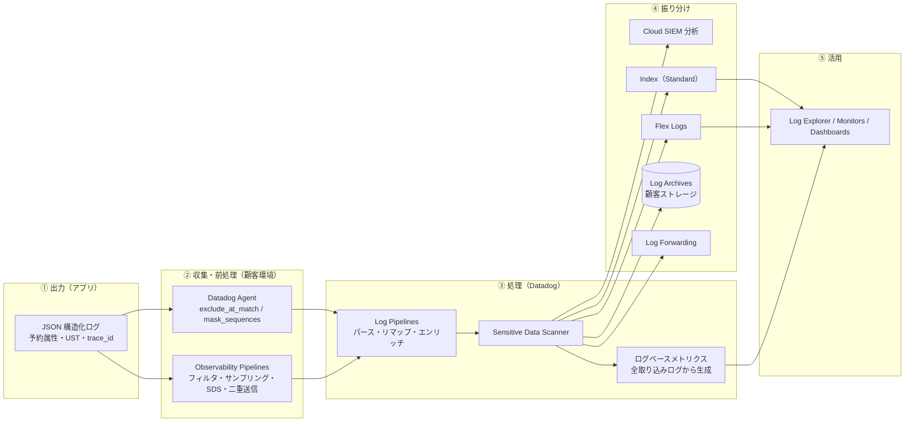
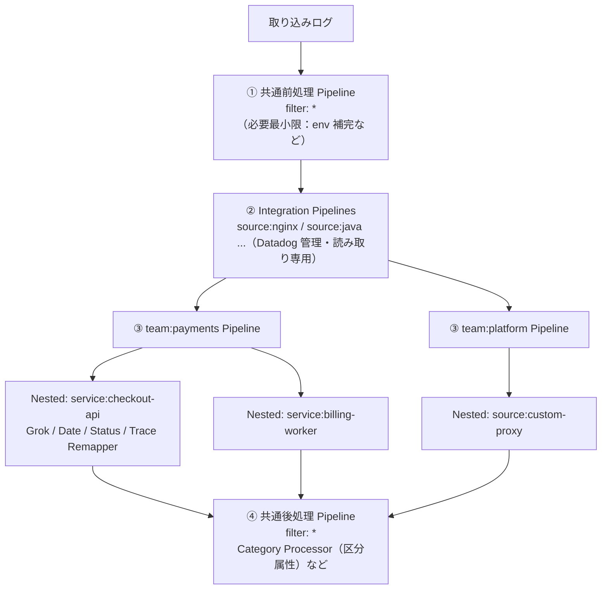
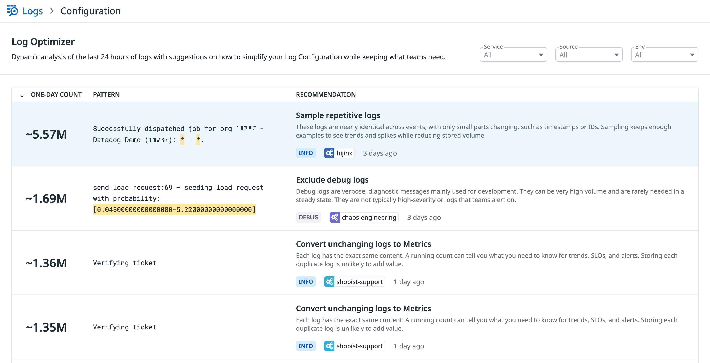
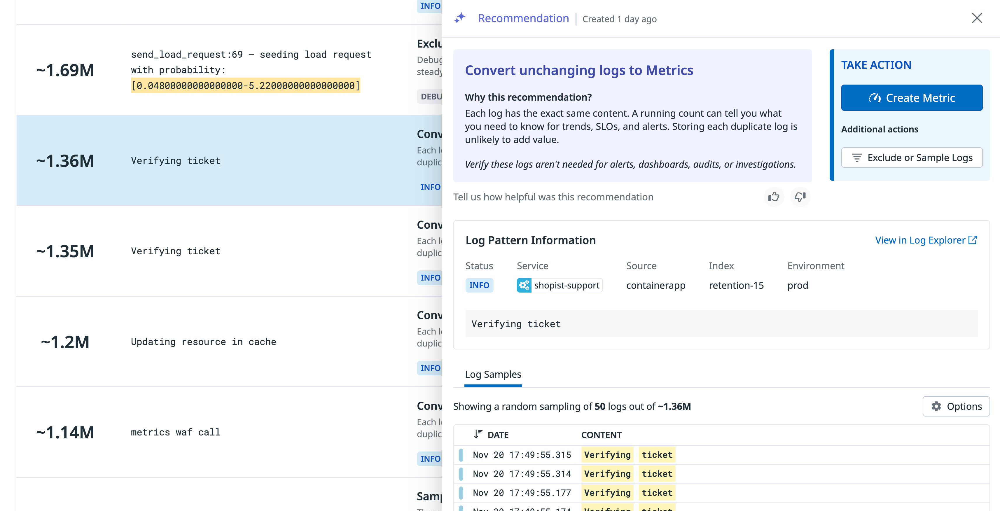
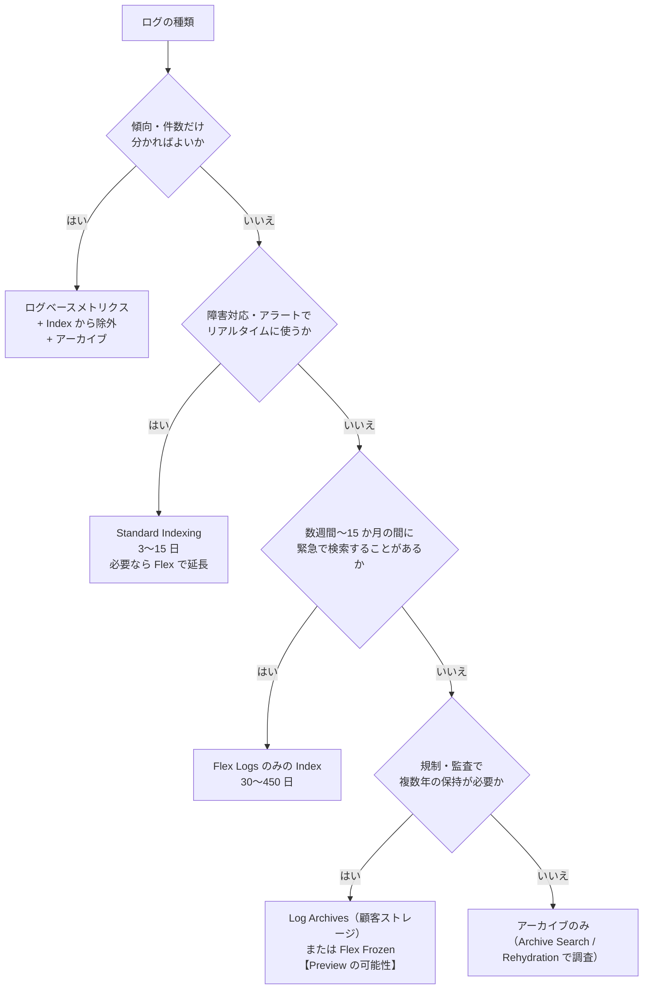

# ログ管理の実践

## 概要

本ファイルは、Datadog Log Management を本番で使い続けるための **設計と運用の知見** をまとめる。対象は次の 5 つである。

| テーマ | 本ファイルで答える問い | 節 |
|---|---|---|
| ログ設計（構造化） | アプリはどんな形式・項目でログを出すべきか。トレースとどう結び付けるか | [§2](#2-ログ設計構造化) |
| パイプライン設計 | Log Pipelines をどの単位で分け、どの順で処理するか。Agent / Observability Pipelines とどう役割分担するか | [§3](#3-パイプライン設計) |
| インデックス戦略 | Index をどの軸で分けるか。Exclusion Filters・Daily Quota・ログベースメトリクスをどう組み合わせるか | [§4](#4-インデックス戦略) |
| 保持期間の階層化 | Standard / Flex / Flex Frozen / Archive をログ種別ごとにどう使い分けるか | [§5](#5-保持期間の階層化) |
| セキュリティログとの共存 | Cloud SIEM・監査ログと運用ログをどう同居させるか。アクセス制御・機微データ・変更監査をどう設計するか | [§6](#6-セキュリティログとの共存) |

本ファイルは応用編であり、製品仕様の網羅は次のリファレンスに任せる。仕様の値（制限値・既定値）はリファレンスと一致させている。

| 仕様の詳細 | 参照先 |
|---|---|
| Agent・クラウド・API からの収集、`log_processing_rules`、マルチライン | [ログ収集](../02_リファレンス/logs/log-collection.md) |
| Pipeline・Processor・Grok・Standard Attributes の仕様 | [Log Pipelines と処理](../02_リファレンス/logs/log-pipelines-and-processing.md) |
| Indexes・Exclusion Filters・Daily Quota・Flex・Archives・Rehydration・BYOC Logs | [Indexes・保持・アーカイブ](../02_リファレンス/logs/log-indexes-retention-archives.md) |
| Log Explorer・Patterns・Analytics | [ログ検索と分析](../02_リファレンス/logs/log-search-and-analytics.md) |
| 取り込み前のルーティング・削減・マスキング | [Observability Pipelines](../02_リファレンス/logs/observability-pipelines.md) |
| ログのコスト削減の施策一覧と試算 | [コスト最適化](cost-optimization.md) |
| 料金の数値（正本） | [製品別料金表](../03_導入編/pricing-by-product.md) |

本ファイルの記述は、公式ドキュメント（docs.datadoghq.com）、Datadog Architecture Center の設計ガイド、公式ブログを主な根拠とする。第三者の知見には `【第三者情報】`、本ナレッジの推定には `【推定】`、一般的な実務知見には `【経験則】` を付ける。

## 1. ログ管理設計の全体像

### 1.1 ログが通る 5 つの層と設計の判断点

Datadog Log Management では、ログは「出力 → 収集 → 処理 → 振り分け（保持・転送） → 活用」の順に流れる。**取り込み（Ingest）と保持（Index）が分離している**（Datadog はこれを Logging without Limits™ と呼ぶ）ため、各層で「何を残し、何を捨て、何をメトリクスに変えるか」を決められる。[出典](https://docs.datadoghq.com/logs/log_configuration/indexes/)



上図の「SDS → 各行き先」は、Sensitive Data Scanner がインデックス前・他のルーティング判断より前にスキャンする仕様を表す。[出典](https://docs.datadoghq.com/security/sensitive_data_scanner/setup/telemetry_data/)

| 層 | 主な設計判断 | 課金への影響（要点） |
|---|---|---|
| ① 出力 | 形式（JSON か）、必須項目、ログレベルの基準、メッセージの書き方 | 1 件あたりのサイズ（Ingest GB）と件数（Index 件数）を決める |
| ② 収集・前処理 | 送らないログ（Agent / OP で落とす）、送る前にマスクする値 | Agent・OP で落としたログは Ingest も発生しない（OP は別製品として課金） |
| ③ 処理 | Pipeline の分割単位、属性名の統一、メトリクス化するログ | Pipeline 処理は Ingest 料金に含まれる。ログベースメトリクスは Custom Metrics として課金 |
| ④ 振り分け | Index の分割軸と順序、除外・サンプリング率、保持期間、Flex・アーカイブの使い分け | Index 件数 × 保持期間別単価、Flex 保存件数、転送 GB |
| ⑤ 活用・統制 | 誰が何を見られるか、誰が設定を変えられるか、使用量の監視 | 設定変更の権限を絞らないと予期しないコスト増につながる |

[出典](https://www.datadoghq.com/pricing/?product=log-management)、[出典](https://docs.datadoghq.com/logs/log_configuration/logs_to_metrics/)（2026-11-02 取得）

### 1.2 公式ガイドが示す 4 つの基本原則

Datadog Architecture Center の「A guide to log management indexing strategies with Datadog」（2024-10-09 公開、著者 Chris Kelner）は、インデックス戦略の前提として次の 4 原則を挙げる。[出典](https://www.datadoghq.com/architecture/a-guide-to-log-management-indexing-strategies-with-datadog/)

| 原則 | 内容 | 本ファイルでの展開 |
|---|---|---|
| 重複の多い大量ログはサンプリングする | ほぼ同一のログは全件ではなく一部を残す | [§4.4](#44-exclusion-filters-の設計パターン) |
| すべてをインデックスしない | debug ログなど価値の低いログは Index に入れない | [§4.4](#44-exclusion-filters-の設計パターン) |
| 一部のログはメトリクスに変える | 時間変化を見るだけの低カーディナリティなログはログベースメトリクスにする | [§4.6](#46-ログベースメトリクスの併用) |
| 量の大きい順に手を付ける | 80/20 の法則で上位から。全体の約 1% 未満の小さな集合は追わない（"Don't chase the tail"） | [§4.8](#48-使用量の監視とガバナンス) |

> **注記:** 同ガイドは 2024-10 公開であり、その後 Flex Starter・Flex Frozen・Archive Search・Log Optimizer などが追加されている。本ファイルでは 2026-11-02 時点の公式ドキュメントで補っている。

### 1.3 導入時の基本方針：Include-by-default か Exclude-by-default か

公式ブログ「Log management policies」（2020-05-08 公開、Pierre Cariou・Paul Gottschling）は、ログを Index に入れる既定方針として次の 2 案を比較している。[出典](https://www.datadoghq.com/blog/log-management-policies/)

| 方針 | 長所 | 短所 | 公式ブログの推奨 |
|---|---|---|---|
| Exclude-by-default（既定で Index に入れず、必要なものだけ入れる） | 予算を守りやすい | 障害時に必要なログが Index に無いことがある | — |
| Include-by-default（既定で Index に入れ、不要なものを除外する） | 障害対応で困りにくい | 予算超過のリスク | 採用する場合は **チームを 1 つずつオンボードする** |

同ブログは、全ログを既定でコールドストレージ（アーカイブ）に送り、低コストのフォールバックにすることも推奨している。チームごとの予算（GB / 月や 100 万行 / 月）を決め、緑・黄・赤のしきい値で一時的なスパイクを許容する運用も紹介している。[出典](https://www.datadoghq.com/blog/log-management-policies/)（2020-05 公開。5 年以上前の記事で、Flex Logs 登場前の内容である点に注意）

第三者のテックブログは、初期導入時に「Daily Quota を低く設定して 1〜2 日ログ件数の内訳を計測 → 上位を占めるログを除外 → 上限を運用値へ上げる → 件数だけを使うログはログベースメトリクスへ移す」という順序を推奨している。【第三者情報】[出典](https://www.issoh.co.jp/tech/details/16595/)（2026-08-16 公開、2026-09-27 更新）

## 2. ログ設計（構造化）

### 2.1 JSON で出す理由

Datadog はサーバー側アプリケーションについて、ロガーで **JSON 形式** のログをファイルまたは stdout に出し、Agent に収集させる構成を基本としている。JSON で出すと、予約属性（日付・ステータス・メッセージ等）が JSON Preprocessing で自動的に解釈され、Grok パースルールを書かずに済む。[出典](https://docs.datadoghq.com/logs/log_collection/)

| 観点 | プレーンテキスト | JSON（構造化） |
|---|---|---|
| パース | Grok ルールの作成・保守が必要。形式変更でパースが壊れる | 属性として自動取り込み。Pipeline は補正だけで済む |
| マルチライン（スタックトレース） | `multi_line` ルールまたは自動検出が必要 | JSON の 1 行が 1 イベントとして扱われ、スタックトレースは属性に入る |
| トレース相関 | ロガーのフォーマット文字列に `dd.trace_id` 等を埋め込みパースが必要 | Java トレーサー 0.74.0 以降などは JSON ログへ自動注入 |
| Facet・Measure | パース後の属性からのみ作れる | 出力時点で属性があるので即座に作れる |
| サイズ | 小さい | キー名の分だけ大きい（Ingest GB が増える）【経験則】 |

[出典](https://docs.datadoghq.com/logs/log_collection/)、[出典](https://docs.datadoghq.com/tracing/other_telemetry/connect_logs_and_traces/java/)、マルチラインの仕様は [ログ収集](../02_リファレンス/logs/log-collection.md) を参照。

> **補足【経験則】:** Ingest は非圧縮 GB 課金のため、JSON のキー名を冗長にすると取り込み料金が増える。キー名は Standard Attributes に合わせて短く一貫させ、同じ値を複数キーに重複させない。

### 2.2 1 件のログに必ず含める項目

Datadog のログには、取り込み時に特別な意味を持つ **予約属性（Reserved Attributes）** がある。これらが欠けると、検索・相関・課金の内訳がすべて弱くなる。[出典](https://docs.datadoghq.com/logs/log_configuration/attributes_naming_convention/)

| 項目 | Datadog での名前 | 役割 | 設計上の注意 |
|---|---|---|---|
| ホスト | `host` | 送信元ホスト。一致するホストタグが付く | 通常は Agent が付与。Kubernetes で JSON に `host` / `hostname` を含めると Agent のホスト名が上書きされ、ホストタグが付かなくなる |
| ソース | `source` | 技術・インテグレーション名。一致すると Integration Pipeline が適用される | `java`、`nginx` など。自社アプリは言語名を使うと既定パースが効く【経験則】 |
| ステータス | `status` | ログレベル。Patterns とステータス表示に使われる | 後述の [§2.5](#25-ログレベル設計) |
| サービス | `service` | 生成元アプリ。APM・Software Catalog への連携キー | `DD_SERVICE` と同じ値にする |
| トレース ID | `trace_id` | ログとトレースの相関 | [§2.8](#28-トレースとの相関) |
| メッセージ | `message` | ログ本文。全文検索の対象 | 可変値を埋め込みすぎない（[§2.6](#26-メッセージの書き方patterns-と除外を効かせる)） |
| 日時 | `timestamp` 等 | 公式タイムスタンプ | [§2.7](#27-タイムスタンプとタイムゾーン) |

[出典](https://docs.datadoghq.com/logs/log_configuration/attributes_naming_convention/)、[出典](https://docs.datadoghq.com/logs/log_configuration/pipelines/)

これに加えて、トレースやメトリクスも収集する場合、Datadog は **Unified Service Tagging（統合サービスタグ）** の `env`・`service`・`version` を推奨している。[出典](https://docs.datadoghq.com/logs/log_configuration/attributes_naming_convention/) タグ全体の設計は [タグ戦略の実践](tagging-strategy.md) を参照。

Architecture Center のガイドが紹介する実アカウント分析（匿名化）では、**約 15% のログに `service` タグが無く**、一部は `${service}` のような未展開のプレースホルダが値として入っていた。[出典](https://www.datadoghq.com/architecture/a-guide-to-log-management-indexing-strategies-with-datadog/)（2024-10-09 公開） `service` の欠落は、Index 単位・サービス単位の使用量分析（`datadog.estimated_usage.logs.ingested_events` の `service` タグ）を不能にするため、ログ設計の段階で必須項目として扱う。

### 2.3 推奨スキーマの例

以下は、Standard Attributes の命名に合わせた Web API のアクセスログの例である。属性名は Datadog の Standard Attributes 一覧に基づく。[出典](https://docs.datadoghq.com/standard-attributes/?product=log)

```json
{
  "timestamp": "2026-11-02T05:12:33.481Z",
  "status": "error",
  "service": "checkout-api",
  "env": "prod",
  "version": "2026.11.1",
  "message": "Payment authorization failed",
  "logger": { "name": "com.example.checkout.PaymentClient", "thread_name": "http-nio-8080-exec-7" },
  "error": { "kind": "PaymentTimeoutException", "message": "upstream timeout after 3000ms", "stack": "..." },
  "http": { "method": "POST", "status_code": 502, "url": "/v1/checkout", "request_id": "c0a8012e-..." },
  "network": { "client": { "ip": "203.0.113.10" } },
  "usr": { "id": "u-123456" },
  "duration": 3004000000,
  "dd": { "trace_id": "6905b5d1000000004e4c3e3f4c1a2b3c", "span_id": "4611686018427387904" }
}
```

| 属性グループ | 主な Standard Attributes（抜粋） | 効果 |
|---|---|---|
| HTTP | `http.method`、`http.status_code`、`http.url`、`http.referer`、`http.request_id`、`http.useragent` | URL Parser・User-Agent Parser の既定入力。HTTP 系 OOTB ダッシュボードと揃う |
| ネットワーク | `network.client.ip`、`network.bytes_read`、`network.bytes_written` | GeoIP Parser の既定入力（`network.client.ip` → `network.client.geoip`） |
| ソースコード | `logger.name`、`logger.thread_name`、`logger.method_name`、`error.kind`、`error.message`、`error.stack` | Error Tracking・スタックトレース表示 |
| データベース | `db.instance`、`db.statement`、`db.user` | DB 起因の調査 |
| パフォーマンス | `duration`（**ナノ秒**） | トレース検索の既定 Measure と一致 |
| ユーザー | `usr.id`、`usr.name`、`usr.email` | ユーザー単位の調査・サンプリング（機微情報の扱いは [§6.5](#65-機微データの扱い)） |
| イベント | `evt.name`、`evt.outcome` | 監査・セキュリティ系イベントの分類 |

[出典](https://docs.datadoghq.com/standard-attributes/?product=log)、[出典](https://docs.datadoghq.com/logs/log_configuration/attributes_naming_convention/)

> **注意:** `duration` の単位はナノ秒である。ミリ秒で出しているアプリは、Pipeline の Arithmetic Processor で変換してから `duration` にリマップする。Datadog はログの所要時間を Performance 属性（`duration`）へリマップすることを推奨している。[出典](https://docs.datadoghq.com/logs/log_configuration/attributes_naming_convention/)

### 2.4 命名規約の統一：Standard Attributes・Remapper・Aliasing

同じ値（例：クライアント IP）がチームごとに `clientIP`、`client_ip_address`、`remote_address`、`client.ip` のように別名で出ると、横断検索・ダッシュボード・除外フィルターが作りにくくなる。Datadog は **Standard Attributes** を組織の命名規約の土台とし、**Aliasing** で各チームの技術スタックを変えずに規約を実装することを推奨している。[出典](https://docs.datadoghq.com/logs/log_configuration/attributes_naming_convention/)

| 手段 | 実行タイミング | 元の属性 | 適する場面 |
|---|---|---|---|
| アプリ側で Standard Attributes 名で出力 | 出力時 | — | 新規開発。最も確実【経験則】 |
| Attribute Remapper（Pipeline 内） | Pipeline 処理中 | 既定で削除（`preserve_source=false`） | ソースごとに確実に名前を変えたい。後続の Processor で新しい名前を使いたい |
| Aliasing（Standard Attributes の Remapping list） | **Pipeline 処理の後** | 残る（両方を持つ） | 既存のダッシュボードや保存ビューを壊さずに規約へ寄せたい |

[出典](https://docs.datadoghq.com/logs/log_configuration/attributes_naming_convention/)、Remapper の既定値は [Log Pipelines と処理](../02_リファレンス/logs/log-pipelines-and-processing.md) を参照。

Aliasing の挙動（公式仕様）は次のとおりで、設計時に注意が要る。[出典](https://docs.datadoghq.com/logs/log_configuration/attributes_naming_convention/)

| 仕様 | 設計への影響 |
|---|---|
| エイリアス先の型を強制し、型変換できない場合はエイリアスしない | 文字列で出したステータスコードを `integer` の Standard Attribute にする場合、変換できない値は落ちる |
| ログが既にエイリアス先の属性を持つ場合は上書きする | 正しい値を持つログが別名の値で上書きされうる |
| 複数のソース属性が同じ Standard Attribute を指し、1 つのログが複数持つ場合は 1 つだけエイリアスされる | どれが採用されるかに依存しない設計にする |
| Standard Attributes の変更は新規取り込みログにだけ効く | 過去ログには遡及しない。切替日を記録する |
| Standard Attribute 同士で親子関係にできない（`user` と `user.name` を両方標準にできない） | 階層を先に決める |

Aliasing を使っている場合、Log Explorer ではエイリアス元とエイリアス先のどちらの Facet でも検索できるが、Datadog は **標準側の Facet を使う** ことを勧めている。非標準名で保存ビューやダッシュボードが作られるのを防ぐためである。[出典](https://docs.datadoghq.com/logs/log_configuration/attributes_naming_convention/)

### 2.5 ログレベル設計

ログレベル（`status`）は、Index の分割・Exclusion Filters・Daily Quota の設計の起点になる。公式ガイドのインデックス戦略も「error / warn」「info」「debug」の区分を前提にしている（[§4.2](#42-公式の-index-構成パターン)）。[出典](https://www.datadoghq.com/architecture/a-guide-to-log-management-indexing-strategies-with-datadog/)

| レベル | 使い方の基準（推奨）【経験則】 | Datadog 上の扱い（公式ガイドの例） |
|---|---|---|
| `critical` / `error` | 利用者影響のある失敗、要対応 | 本番 7 日の Standard Index。サンプリングは必要なアプリに限る |
| `warn` | 自動回復した異常、閾値接近 | error と同じ Index。同一メッセージの大量 warn は原因修正の対象 |
| `info` | 業務イベント、リクエスト単位の要約 | 本番 3 日の Standard Index（ソースごとに 30〜75% サンプリング）、または Flex |
| `debug` / `trace` | 開発・調査用 | 原則 Index しない。Live Tail で見る。保持するとしても 3 日以内 |

[出典](https://www.datadoghq.com/architecture/a-guide-to-log-management-indexing-strategies-with-datadog/)（2024-10-09 公開）

設計上の注意点は次のとおり。

- **ステータス値は英語の標準値で出す。** Log Status Remapper は、規定のパターン（`err` で始まる文字列は error 等）に一致しない値をすべて `info` にする。[出典](https://docs.datadoghq.com/logs/log_configuration/processors/log_status_remapper/) このため日本語のステータス値（「エラー」等）は `info` 扱いになる。実務では Category Processor で英語の区分に変換してからリマップする。【第三者情報】[出典](https://dev.classmethod.jp/articles/datadog-pipelines-processors-guide/)（2024-12 公開）、Status Remapper の既定は [Log Pipelines と処理](../02_リファレンス/logs/log-pipelines-and-processing.md)
- **error を乱発しない。** 公式ブログは「error ログは件数が少なく予算への影響が小さく、問題を明示するため調査価値が高い」としている。[出典](https://www.datadoghq.com/blog/log-management-policies/)（2020-05 公開） 逆に、正常系を error で出すと error 用 Index（長期保持・サンプリングなし）の件数が膨らむ。【経験則】
- **debug は「必要時だけ ON」にする。** 公式ドキュメントの Exclusion Filter 例は、`status:DEBUG` を 100% 除外するフィルターを UI または API（Update an index）で切り替える運用を示している。[出典](https://docs.datadoghq.com/logs/log_configuration/indexes/)

### 2.6 メッセージの書き方：Patterns と除外を効かせる

Log Patterns と Log Optimizer は、メッセージの「変わらない部分」でログをまとめる。可変値（ID、件数、時刻）をメッセージ本文に埋め込むほどパターンが割れ、除外・メトリクス化の判断がしにくくなる。【経験則】

| 書き方 | 例 | 評価 |
|---|---|---|
| 可変値を本文に埋め込む | `"message": "User u-123 paid 3200 JPY for order o-999"` | パターンは抽出されるが、金額・ID で Facet 検索するには Grok が必要 |
| 固定文言 + 属性 | `"message": "Payment completed", "usr.id": "u-123", "order.id": "o-999", "amount": 3200` | 固定文言でパターン化・除外しやすく、属性で集計できる |

Log Optimizer は、メッセージの変化の少なさ（message consistency）を最適化候補の判断材料にしている。固定文言のログは「メトリクスに変換」の推奨を受けやすい。[出典](https://docs.datadoghq.com/logs/log_configuration/log_optimizer/)

### 2.7 タイムスタンプとタイムゾーン

| 仕様 | 値 | 出典 |
|---|---|---|
| 受け付けるタイムスタンプ | 過去 18 時間まで（【Preview】で 7 日まで）。範囲外のログはインデックスされない | [Log Collection](https://docs.datadoghq.com/logs/log_collection/) |
| 認識される日付形式 | ISO8601、UNIX エポックミリ秒、RFC3164 | [Log Date Remapper](https://docs.datadoghq.com/logs/log_configuration/processors/log_date_remapper/) |
| Grok で抽出した日付 | そのままでは公式タイムスタンプにならない。Log Date Remapper が必要 | [Parsing](https://docs.datadoghq.com/logs/log_configuration/parsing/) |

- **UTC オフセット付きの ISO8601 で出す。** タイムゾーン情報の無い日本時間の文字列を UTC として解釈されると、ログが 9 時間ずれて表示・保存される。【経験則】 非 UTC の日付を Grok で読む場合は、`date` Matcher にタイムゾーン引数を指定する。[出典](https://docs.datadoghq.com/logs/log_configuration/parsing/)
- **未来日時にも注意する。** Architecture Center のガイドの実アカウント分析では、**約 20 億件のログが 2 時間以上未来のタイムスタンプのために破棄** されていた。[出典](https://www.datadoghq.com/architecture/a-guide-to-log-management-indexing-strategies-with-datadog/)（2024-10-09 公開） ホストの時刻同期とタイムゾーン設定を確認する。

### 2.8 トレースとの相関

ログとトレースを相関させると、APM のトレース画面から関連ログへ、ログからトレースへ移動できる。Datadog トレーサーはトレース ID、スパン ID、`env`、`service`、`version` をログ属性として注入する。ログは JSON で送るか、言語に対応したログ処理で Datadog 属性に変換されている必要がある。[出典](https://docs.datadoghq.com/tracing/other_telemetry/connect_logs_and_traces/)

| 言語 | 自動注入の有効化（公式ドキュメント記載） | 注入される属性 |
|---|---|---|
| Java | トレーサー **0.74.0 以降** は JSON 形式のログに自動注入。それ以前は `dd.logs.injection=true` または `DD_LOGS_INJECTION=true`。1.18.3 以降は Remote Configuration 有効時に Catalog UI から `DD_LOGS_INJECTION` を設定可能。対応：Log4j2、Log4j、SLF4J、Logback | `dd.trace_id`、`dd.span_id` ほか |
| Python | `ddtrace` 3.11 未満は `DD_LOGS_INJECTION=true` が必要（3.11 以降の既定値はドキュメント上で明記されず）。`ddtrace-run` または `import ddtrace.auto` で logging 連携が有効 | `dd.env`、`dd.service`、`dd.version`、`dd.trace_id`、`dd.span_id` |
| Go / Ruby / Node.js / .NET / PHP | 言語別ページを参照 | 言語別ページを参照 |

[出典](https://docs.datadoghq.com/tracing/other_telemetry/connect_logs_and_traces/java/)、[出典](https://docs.datadoghq.com/tracing/other_telemetry/connect_logs_and_traces/python/)（2026-11-02 取得）

運用上の注意点は次のとおり。

| 注意点 | 内容 | 出典 |
|---|---|---|
| 独自パースの場合は文字列で扱う | Datadog のログインテグレーションを使わず独自にパースする場合、`dd.trace_id` と `dd.span_id` は **文字列としてパース** し、Trace Remapper でリマップする | [Java](https://docs.datadoghq.com/tracing/other_telemetry/connect_logs_and_traces/java/)、[Python](https://docs.datadoghq.com/tracing/other_telemetry/connect_logs_and_traces/python/) |
| サンプリングは独立 | トレースとログは独立にサンプリングされるため、ログの trace ID に対応するトレースが保持されていないことがある。設定ミスではない | [Connect Logs and Traces](https://docs.datadoghq.com/tracing/other_telemetry/connect_logs_and_traces/) |
| ログ側のサンプリングをトレースに揃える | Exclusion Filter はログに Trace ID があれば Trace ID でサンプリングする。残ったログがサンプリング済みトレースと相関しやすい | [Indexes](https://docs.datadoghq.com/logs/log_configuration/indexes/) |
| OpenTelemetry の場合 | ログに `trace_id`（32 文字の小文字 16 進数）と `span_id` が必要 | [OTel correlate](https://docs.datadoghq.com/opentelemetry/correlate/logs_and_traces/) |

APM 側の設計は [APM 運用の実践](apm-practices.md)、OpenTelemetry でのログ収集は [OpenTelemetry サポート](../02_リファレンス/platform/opentelemetry.md) と [OpenTelemetry 活用戦略](opentelemetry-strategy.md) を参照。

### 2.9 サイズ・属性数の制限を踏まえた設計

ログ設計は Datadog の取り込み制限の内側に収める必要がある。超過したログは変換・切り詰めされるか、時間範囲外の場合はインデックスされない。[出典](https://docs.datadoghq.com/logs/log_collection/)

| 項目 | 制限値 | 設計上の対策【経験則】 |
|---|---|---|
| 1 ログの最大サイズ（HTTPS API） | 1 MB（超過分は切り詰め） | 巨大なリクエスト / レスポンス本文をログに入れない |
| 推奨する 1 ログのサイズ | 25 KB 以下 | スタックトレースは `error.stack` に 1 つだけ |
| Agent のログ分割サイズ | 900 KB（`max_message_size_bytes` 既定） | — |
| 1 ログの属性数（JSON 変換後） | 2,048 未満 | 動的キー（ユーザー ID をキー名にする等）を作らない |
| 属性キーの長さ | 50 文字未満 | — |
| ネストの深さ | 20 階層未満 | オブジェクトをそのままダンプしない |
| Facet 化する属性値の長さ | 1,024 文字未満 | — |
| 1 ログのタグ数 / タグ長 | 100 以下 / 256 文字以下 | 高カーディナリティ値はタグでなく属性にする |
| ユニークタグ数 | 1 日 1,000 万まで | 同上 |
| インデックス済みログのフィールド切り詰め | `message` 75 KiB、その他 25 KiB | — |

[出典](https://docs.datadoghq.com/logs/log_collection/)（値は [ログ収集](../02_リファレンス/logs/log-collection.md) と一致）

### 2.10 ログ設計のアンチパターン

| アンチパターン | 何が起きるか | 対策 |
|---|---|---|
| `service` を付けない、未展開の `${service}` が入る | サービス単位の使用量分析・APM 連携ができない | 出力時に必須化。Pipeline の Service Remapper で補完【経験則】 |
| 正常系を `error` で出す | error 用 Index が膨らみ、アラートのノイズになる | レベルの基準を文書化しレビューする【経験則】 |
| 可変値をメッセージ本文に埋め込む | Patterns・除外・メトリクス化が効きにくい | 固定文言 + 属性（[§2.6](#26-メッセージの書き方patterns-と除外を効かせる)） |
| タイムゾーン無しのローカル時刻 | 表示が 9 時間ずれる、18 時間超の過去扱いで破棄される | ISO8601 + オフセット |
| 秘密情報・個人情報を平文で出す | 閲覧権限を持つ全員に見える、アーカイブにも残る | 出力しない。やむを得ない場合は収集前・取り込み時にマスク（[§6.5](#65-機微データの扱い)） |
| 1 リクエストで同じ内容を何行も出す | 件数課金が倍増する | リクエスト単位の要約ログ 1 件にまとめる【経験則】 |

## 3. パイプライン設計

### 3.1 処理を置く場所の役割分担

ログの加工・削減は、Agent、Observability Pipelines（OP）、Log Pipelines（Datadog 側）のいずれでも行える。どこで行うかでコストとリスクが変わる。

| 処理場所 | できること | 課金への影響 | 向く処理 |
|---|---|---|---|
| Datadog Agent（`log_processing_rules`） | `exclude_at_match` / `include_at_match` による行単位の除外・選択、`mask_sequences` によるマスク、マルチライン集約 | 落としたログは Ingest 課金も発生しない | 明らかに不要なログ（ヘルスチェック等）の除外、送信前マスク |
| Observability Pipelines | フィルタ、サンプリング、重複排除、クォータ、メトリクス生成、SDS（環境内）、複数宛先への送信 | OP 自体が別製品（取り込み GB または vCPU 課金）。Datadog への Ingest は減る | 大規模環境での集中制御、SIEM 等への二重送信、環境外へ出す前のマスク |
| Log Pipelines（Datadog） | パース、リマップ、エンリッチ（GeoIP・Lookup・Reference Table）、OCSF 正規化 | Ingest 料金に含まれる。処理単体の課金なし | 構造化、属性名の統一、検索性の向上 |
| Index の Exclusion Filters | Index に入れない・サンプリング | Ingest は発生、Index 課金だけ減る | 「取り込むが保持しない」ログ。Live Tail・アーカイブ・ログベースメトリクスには残る |

[出典](https://docs.datadoghq.com/logs/log_configuration/indexes/)、[出典](https://www.datadoghq.com/pricing/?product=log-management)、OP の料金は [製品別料金表](../03_導入編/pricing-by-product.md)（OP：年契約 $0.095 / 取り込み GB、2026-11-02 時点）

> **注意:** 取り込み前（Agent・OP）でログを落とすと、Datadog 側ではそのログを二度と参照できない（アーカイブにも残らない。アーカイブは「取り込んだ全ログ」が対象であるため）。[出典](https://docs.datadoghq.com/logs/log_configuration/archives/) 送信前に落とすのは「障害調査でも監査でも絶対に使わない」と合意できたログに限るのが安全である。【経験則】

Agent 側フィルタの設定例は [コスト最適化](cost-optimization.md) と [ログ収集](../02_リファレンス/logs/log-collection.md)、OP の構成は [Observability Pipelines](../02_リファレンス/logs/observability-pipelines.md) を参照。

### 3.2 Pipeline の分割単位と階層

Log Pipelines では、各ログが **すべての Pipeline のフィルタ** に対して上から順に評価され、一致した Pipeline の Processor が順に適用される（Index と異なり「最初の 1 つだけ」ではない）。Nested Pipeline を使うと 2 階層に分けられる。[出典](https://docs.datadoghq.com/logs/log_configuration/pipelines/)

公式ドキュメントの Nested Pipeline の例は「1 段目を `team:backend` のような上位フィルタ、2 段目をインテグレーションやサービス単位」とする構成である。これを組織設計に当てはめると次のようになる。



| 設計項目 | 推奨 | 根拠 |
|---|---|---|
| トップレベルの単位 | チーム（`team:`）または事業単位。チームごとに編集権限を分けられる | Pipeline 単位のアクセス制御は `logs_write_processors`（レガシー）で Pipeline ごとに付与可能 [出典](https://docs.datadoghq.com/logs/guide/logs-rbac-permissions/) |
| Nested の単位 | `source` または `service` | 公式例 [出典](https://docs.datadoghq.com/logs/log_configuration/pipelines/) |
| 1 Pipeline の Processor 数 | 20 以下を目安 | 公式推奨 |
| 1 Grok Parser のルール数 | 10 以下を目安 | 公式推奨 |
| 抽出した属性で分岐したい | 抽出用 Pipeline の **後ろ** に別 Pipeline を置く（同じ Pipeline 内で抽出した属性はフィルタに使えない） | 公式仕様 |
| Remapper の重複 | Status / Service / Message / Trace / Span Remapper は先勝ち。前段で設定済みなら後段は効かない | 公式仕様 |

[出典](https://docs.datadoghq.com/logs/log_configuration/pipelines/)。Datadog は、サービス性能に影響するパースルール・Processor・Pipeline を無効化する権利を留保している。

### 3.3 カスタム Pipeline 内の処理順序（テンプレート）

テキストログを構造化する Pipeline の典型的な順序を示す。各 Processor の仕様は [Log Pipelines と処理](../02_リファレンス/logs/log-pipelines-and-processing.md) を参照。

| 順 | Processor | 目的 | 注意 |
|---|---|---|---|
| 1 | Grok Parser | 本文から属性を抽出 | JSON ログなら不要なことが多い |
| 2 | Log Date Remapper | 公式タイムスタンプを設定 | Grok で日付を抽出しただけでは反映されない |
| 3 | Log Status Remapper | `status` を設定 | 日本語の値は先に Category Processor で変換 |
| 4 | Service Remapper | `service` を設定 | Integration Pipeline 側で設定済みなら効かない |
| 5 | Trace ID Remapper / Span Remapper | トレース相関 | 文字列として抽出 |
| 6 | Attribute Remapper | Standard Attributes 名へ統一 | Aliasing で代替するかを決める（[§2.4](#24-命名規約の統一standard-attributesremapperaliasing)） |
| 7 | Arithmetic Processor | 単位変換（ms → ns の `duration` 等） | — |
| 8 | URL / User-Agent / GeoIP Parser | エンリッチ | 既定入力は Standard Attributes 名 |
| 9 | Lookup Processor / Reference Table | 所有チーム・重要度などを付与 | Manual Mapping は全 Lookup 合計 100KB まで。大きい表は Reference Table |
| 10 | Category Processor | 区分属性（例：`log_class:audit` / `noise` / `business`）を作る | 後段の Index Filter・Exclusion Filter・Security Filter の判定に使える【経験則】 |
| 11 | Message Remapper | 本文を整える | — |

[出典](https://docs.datadoghq.com/logs/log_configuration/pipelines/)

> **実践のヒント【経験則】:** 手順 10 の「区分属性」は、Index・Exclusion Filters・Cloud SIEM・アーカイブのフィルタを `source` や `service` の列挙ではなく **意味でまとめる** のに役立つ。たとえば `@log_class:audit` で監査ログ用 Index とアーカイブへ振り分ければ、新しい監査ソースを追加するときに Pipeline の Category Processor を 1 か所直すだけで済む。

### 3.4 Integration Pipeline・Auto-Processing の扱い

| 機能 | 仕様の要点 | 運用の勧め |
|---|---|---|
| Integration Pipelines | `source` が一致すると自動適用。読み取り専用。カスタマイズはクローンで行い、クローン元は自動で無効化される | `source` 値を正しく付け、まず OOTB の処理を使う。クローンすると Datadog による今後の改善が自動反映されなくなる【経験則】 |
| Auto-Processing【Preview】 | 既存のどの Pipeline にも一致しないログだけを source / service ごとに自動パース。エントリーは組織あたり最大 100。新規エントリーを「自動で有効化」または「レビュー後に有効化」 | 本番では「Review new entries before enabling」を選び、変換結果を確認してから有効化する【経験則】 |
| Pipeline Scanner | 15 分のセッションで、どの Pipeline・Processor がログを変更したかを追跡。同時 3 セッション、12 時間に 12 セッションまで | パース不具合・競合ルールの調査に使う |
| Preview pipeline changes | 変更前後のログを Live Tail で比較（`Your changes` / `Entire pipeline`） | 本番 Pipeline の変更前に必ず確認する |

[出典](https://docs.datadoghq.com/logs/log_configuration/pipelines/)、[出典](https://docs.datadoghq.com/logs/log_configuration/pipeline_scanner/)（2026-11-02 取得）

### 3.5 Pipeline の変更管理

| 項目 | 推奨 | 根拠 |
|---|---|---|
| コード管理 | Terraform（`datadog_logs_custom_pipeline`、`datadog_logs_pipeline_order` など）で管理し、レビューを通す | [Terraform と IaC](../02_リファレンス/platform/terraform-and-iac.md)、[Monitoring as Code](monitoring-as-code.md) |
| API で作る Processor | `is_enabled: true` を明示（既定は `false`） | 公式 API 仕様（[Log Pipelines と処理](../02_リファレンス/logs/log-pipelines-and-processing.md)） |
| 権限 | Pipeline の作成・順序変更は `logs_write_pipelines`、Processor の編集は `logs_write_processors`（レガシー、Pipeline 単位で付与可） | [出典](https://docs.datadoghq.com/logs/guide/logs-rbac-permissions/) |
| 変更の監査 | Audit Trail で誰がパース設定を変えたかを追跡 | [出典](https://docs.datadoghq.com/logs/guide/best-practices-for-log-management/) |
| 移行時 | 収集経路を切り替える際は `service` / `source` の値が変わらないか、新旧経路を並走させて確認してから旧経路を止める（モニターや保存検索が空振りするため） | 【第三者情報】[出典](https://www.issoh.co.jp/tech/details/16595/)（2026-08 公開） |

公式のベストプラクティスガイドは、カスタムロールで「ログのパース設定の変更」を制限し、定義済みのログ構造を守ることを勧めている。[出典](https://docs.datadoghq.com/logs/guide/best-practices-for-log-management/)

## 4. インデックス戦略

### 4.1 Index を分ける軸

Log Management の Index は、**保持期間・Daily Quota・使用量監視・課金** をグループごとに変えるための単位である。公式ガイドは「7 日保持が必要なログと 30 日保持が必要なログを別の Index に入れる」ことを例に、複数 Index でのセグメント化を推奨している。[出典](https://docs.datadoghq.com/logs/guide/best-practices-for-log-management/)

| 分割軸 | 評価 | 理由 |
|---|---|---|
| 保持期間（3 / 7 / 15 / 30 日、Flex の有無） | ◎ 主軸 | Index の存在理由そのもの |
| 予算単位（事業部・プロダクト） | ○ | Daily Quota と使用量をユニットごとに管理できる |
| 環境（本番 / 非本番） | ○ | 非本番は短い保持・強いサンプリングにできる |
| ステータス（error・warn / info） | ○ | error・warn だけ長く残す構成が公式例 |
| サービス・ソースごと | × | Index が数千になりうる、多くが全体の 1% 未満で管理不能。上限 100 にも抵触 |

[出典](https://www.datadoghq.com/architecture/a-guide-to-log-management-indexing-strategies-with-datadog/)（2024-10-09 公開）

第三者のテックブログも「インデックスは保持期間の要件だけで分け、環境やサービスの区別はタグで行うとインデックスとフィルタの増殖を抑えられる」としている。【第三者情報】[出典](https://www.issoh.co.jp/tech/details/16595/)（2026-08 公開）

Index の仕様上の制約（[Indexes・保持・アーカイブ](../02_リファレンス/logs/log-indexes-retention-archives.md) と同じ値）は次のとおり。

| 項目 | 値 |
|---|---|
| Index の最大数 | 既定でアカウントあたり 100（サポートで引き上げ可） |
| 振り分け | フィルターに一致した **最初の 1 つ** の Index にだけ入る（重複格納なし） |
| どの Index にも一致しないログ | インデックスされない（Ingest 課金は発生）。Logs to Metrics では `datadog_index` / `datadog_is_excluded` が `N/A`（取り込まれたが、どの包含・除外条件にも一致しなかったログ）として現れる |
| Index 名 | 英字始まり、英小文字・数字・`-`。削除した Index と同名の Index は再作成不可 |

[出典](https://docs.datadoghq.com/logs/log_configuration/indexes/)。どの Index にも一致しないログの扱いは [出典](https://docs.datadoghq.com/logs/log_configuration/logs_to_metrics/)、Ingest 課金は [出典](https://www.datadoghq.com/pricing/?product=log-management)

> **実践のヒント【経験則】:** 削除した Index 名は再利用できないため、Index 名に保持期間を入れる（例：`prod-errors-7d`）と、保持期間を変えたときに名前と実態がずれる。用途名（例：`prod-errors`）にして、保持期間はタグや説明で管理するとよい。

### 4.2 公式の Index 構成パターン

Architecture Center のガイドは、3 つの構成パターンを示している。[出典](https://www.datadoghq.com/architecture/a-guide-to-log-management-indexing-strategies-with-datadog/)（2024-10-09 公開）

#### パターン A：組織全体・Flex なし

| 順 | Index | 保持 | 対象 | サンプリング・除外 |
|---|---|---|---|---|
| 1 | 本番 critical / error / warn | Standard 7 日（要件により 15 日 / 3 日） | 全アプリ・ベンダーの error / warn | 必要なアプリのみサンプリング。トレース相関が要るなら `trace_id` で一貫サンプリング。重要サービスはログベースメトリクスで 15 か月の傾向を残す |
| 2 | 本番 info | Standard 3 日 | info 全般 | ソースごとに 30〜75% サンプリング。ヘルスチェック等の低密度ログは 90% 以上（または 100%）除外。アーカイブへ |
| 3 | 非本番（全ステータス） | Standard 3 日 | 開発・検証環境 | 30〜75% サンプリング、debug は全除外、低密度ログは 90% 以上除外。アーカイブへ |
| — | debug | 原則保存しない | — | Live Tail で見る |

#### パターン B：組織全体・Flex あり

| 順 | Index | 保持 | 対象 | サンプリング・除外 |
|---|---|---|---|---|
| 1 | 本番 critical / error / warn | Standard 3 日（Flex で 30 日以上に延長可） | error / warn | 必要に応じて |
| 2 | （任意）本番の重要 info | Standard 3 日（Flex で延長可） | 障害対応に必須の info | 必要に応じて |
| 3 | 本番の非重要 info | Flex 30 日以上（Standard なし） | その他の info | 30〜75% サンプリング、ヘルスチェック 90% 以上除外、アーカイブへ、重要サービスはメトリクス化 |
| 4 | 非本番 | Flex 30 日以上 | 開発・検証環境 | 30〜75% サンプリング、debug 除外 |

同ガイドは、**本番アプリログの 10〜30%（場合によっては error のみ）を Standard に入れて Flex で 30 日に延長し、残りは直接 Flex に送る** 構成をよくあるパターンとして挙げている。一方、障害対応でリアルタイムに使うアプリログを直接 Flex に送ることは避けるよう明記している。debug を残す場合も 3 日以内とする。

#### パターン C：ユニット（事業部・プロダクト）単位

| Index（ユニットごと） | Flex なしの場合 | Flex ありの場合 |
|---|---|---|
| Prod Errors | Standard 7 日、5〜25% サンプリング、重要サービスはメトリクス化 | Standard 3 日（Flex で 30 日以上に延長可）、5〜25% サンプリング |
| （任意）重要 Prod Info | — | Standard 3 日（Flex 延長可）、5〜25% サンプリング |
| Prod Info | Standard 3 日、info を 20〜50% サンプリング | Flex 30 日以上、info を 20〜50% サンプリング |
| Non-prod | Standard 3 日、info を 50〜80% サンプリング | Flex 30 日以上、50〜80% サンプリング |

ユニット単位では、サービスやソース単位でなく事業部・プロダクトなどの上位単位で Index を切り、**Index 数を上限 100 を十分下回る数に保つ**。debug は除外してアーカイブに送り、Live Tail で見る。

> **注記:** ガイドのサンプリング率（「30〜75% サンプリング」等）が「残す割合」か「除外する割合」かは、原文の表現（"sample 30–75% per source"）からは一意に決まらない。Exclusion Filter の UI は「除外する割合」で指定するため、設定時に読み替えること。【推定】

### 4.3 Index の順序とキャッチオール Index

Index は上から順に評価され、最初に一致した Index に入る。順序設計の原則は次のとおり。

| 原則 | 内容 | 根拠 |
|---|---|---|
| 特別な要件のログを上に | 監査・セキュリティ・長期保持のログ（例：Cloud SIEM Index、CloudTrail 用 Flex Index）を先頭側に置く。下に置くと汎用 Index に先に吸われる | 公式仕様（先勝ち）。Cloud SIEM Standalone はセットアップで SIEM Index を先頭に移すよう警告する [出典](https://docs.datadoghq.com/getting_started/security/cloud_siem/)（[§6.2](#62-cloud-siem-の製品形態ごとの共存方法)） |
| 条件の狭いものから広いものへ | `status:error` → `env:prod` → `*` の順 | [出典](https://docs.datadoghq.com/logs/log_configuration/indexes/) |
| 最下段にキャッチオール | どの Index にも一致しない未知のソースを受ける | [出典](https://www.datadoghq.com/architecture/a-guide-to-log-management-indexing-strategies-with-datadog/) |

キャッチオール Index について、公式ガイドは次を推奨している。[出典](https://www.datadoghq.com/architecture/a-guide-to-log-management-indexing-strategies-with-datadog/)（2024-10-09 公開）

- Index 順序の最下段に置き、一致しないログを捕捉する。
- **Daily Quota を低めに設定** し、事故的なスパイクに備える。
- しきい値を超えたら通知するモニターを置き、**新しい未知のソースの出現を検知** する。
- 「すべてを除外するキャッチオール」はアンチパターン。不一致ログを捨てたいならアーカイブに送る。

### 4.4 Exclusion Filters の設計パターン

Exclusion Filters は Index ごとに上から評価され、**最初に一致した有効なフィルターだけ** が処理される。除外率は 0〜100% で、ログ単位、または任意属性の一意な値ごと（例：`@user.email`、Trace ID）にサンプリングできる。除外されたログも Live Tail・ログベースメトリクス・アーカイブには使える。[出典](https://docs.datadoghq.com/logs/log_configuration/indexes/)

| パターン | 設定例 | 出典 |
|---|---|---|
| 必要時だけ ON / OFF | `status:DEBUG` を 100% 除外し、調査時だけ無効化（UI または API） | 公式ドキュメント例 |
| 成功系を間引き、失敗系は全件 | `source:nginx AND http.status_code:[200 TO 299]` を 95% 除外 | 公式ドキュメント例 |
| 2xx アクセスログは 10% だけ残す | 2xx を約 90% 除外し、4xx / 5xx は全件 | 公式ブログ [出典](https://www.datadoghq.com/blog/log-management-policies/)（2020-05） |
| ユーザー単位 | `env:production` の Index で `@user.email` 単位に 90% 除外（あるユーザーのログは全部残るか全部消える） | 公式ドキュメント例 |
| トレース単位 | `service:my_python_app` で Trace ID 単位に 50% 除外（上流で Trace ID Remapper） | 公式ドキュメント例 |
| ヘルスチェック等の低密度ログ | 90% 以上（または 100%）除外 | Architecture Center |
| 既定は全除外・調査時だけ一部残す | 100% 除外を既定とし、調査が必要なときだけ例えば 10% を残す | 【第三者情報】[出典](https://zenn.dev/ymiz/articles/3965aeb6aa86e0)（2025-04-30 公開） |

[出典](https://docs.datadoghq.com/logs/log_configuration/indexes/)

#### 除外ルールの順序設計（「必ず残す」を先に）

最初に一致したフィルターしか効かないため、**残したいログを「0% 除外」のフィルターで先に捕まえる** と、後続の除外ルールから守れる。公式ドキュメントの複数 Index にまたがる一貫サンプリング例は、`threat:true` や `compliance:true` のログを `request_id` に関係なく残し、2xx で `request_id` を持つアクセスログは 50%、それ以外の 2xx は 90% 除外とする構成を示している。[出典](https://docs.datadoghq.com/logs/log_configuration/indexes/)

| 順 | フィルター名（例） | Query | 除外率 | 意図 |
|---|---|---|---|---|
| 1 | keep-security | `@threat:true OR @compliance:true` | 0% | 必ず残す（後続ルールから保護） |
| 2 | sample-by-request | `@http.status_code:[200 TO 299] @request_id:*` | 50%（`@request_id` 単位） | リクエスト単位で一貫して残す |
| 3 | drop-other-2xx | `@http.status_code:[200 TO 299]` | 90% | その他の成功ログを間引く |
| 4 | drop-debug | `status:debug` | 100% | debug は保存しない |

[出典](https://docs.datadoghq.com/logs/log_configuration/indexes/)（例は公式例を表形式に整理したもの。Query 文字列は本ナレッジで作成した記述例）

複数 Index で同じ上位エンティティ（`request_id` 等）を一括で残す / 捨てるには、各 Index に Exclusion Filter を 1 つずつ作り、**同じサンプリング率と同じ属性** を使う必要がある。[出典](https://docs.datadoghq.com/logs/log_configuration/indexes/)

#### サンプリングを決めるときの注意

- サンプリングと除外は、各システムの知識に基づくときに最も効果的である。自分がオーナーでないサービスはサービスオーナーに相談する。[出典](https://www.datadoghq.com/architecture/a-guide-to-log-management-indexing-strategies-with-datadog/)
- 除外したログはあとから Log Explorer で遡って検索できない。後から調べる可能性があるなら Flex Logs やアーカイブ（Archive Search / Rehydration）を併用する。【第三者情報】[出典](https://www.issoh.co.jp/tech/details/16595/)（2026-08 公開）
- Rehydrate したログ（Historical Views）には Index の Exclusion Filters が適用されない。Rehydrate のために除外フィルターを変更する必要はない。[出典](https://docs.datadoghq.com/logs/log_configuration/rehydrating/)
- Log Explorer の Log Patterns でパターンのサイドパネルを開き **Add Exclusion Filter** を押すのが最も手早い追加方法である。[出典](https://docs.datadoghq.com/logs/guide/best-practices-for-log-management/)

### 4.5 Daily Quota の設計

Daily Quota は Index ごとの 1 日のインデックス件数の上限で、Exclusion Filters 適用後にカウントされる。到達するとその日はそれ以上インデックスされないが、Live Tail・アーカイブ・ログベースメトリクスには流れ続ける。既定のリセット時刻は 14:00 UTC で、警告しきい値は最小 50%。[出典](https://docs.datadoghq.com/logs/log_configuration/indexes/)

| 設計項目 | 推奨 | 根拠 |
|---|---|---|
| 設定する Index | すべての Index に Daily Quota と警告しきい値を設定 | Architecture Center [出典](https://www.datadoghq.com/architecture/a-guide-to-log-management-indexing-strategies-with-datadog/) |
| 目的 | 新しいログソースの追加や、debug ログの消し忘れによる超過を防ぐ | 公式ガイド [出典](https://docs.datadoghq.com/logs/guide/best-practices-for-log-management/) |
| 値の決め方 | 通常日の最大値 + 余裕。最初は低めに置いて 1〜2 日計測してから運用値へ | 【第三者情報】[出典](https://www.issoh.co.jp/tech/details/16595/)（2026-08 公開） |
| リセット時刻 | 既定 14:00 UTC = **日本時間 23:00**。日本の業務時間中に上限到達しても翌日 23:00 まで復帰しない点を考慮し、業務に合わせて変更を検討 | 既定値は公式。JST 換算と運用判断は【経験則】 |
| 監視 | 直近 24 時間で 80% 到達を通知、到達イベントを Event Monitor で通知 | 公式ガイド（[§4.8](#48-使用量の監視とガバナンス)） |
| 重要 Index | error 用 Index は上限を高めにし、上限到達で障害調査ができなくなる事態を避ける【経験則】 | — |

> **注意:** Daily Quota に達すると新しいログは検索できなくなるため、警告の通知運用とセットにする必要がある。【第三者情報】[出典](https://www.issoh.co.jp/tech/details/16595/)（2026-08 公開） 障害時はエラーログが急増して上限に達しやすいので、error 用 Index と大量 info 用 Index を分けておくと、info の急増で error が検索できなくなる事態を避けられる。【経験則】

### 4.6 ログベースメトリクスの併用

ログベースメトリクスは **取り込みストリーム全体** から生成されるため、Exclusion Filters で Index に入れないログでも傾向を 15 か月残せる。[出典](https://docs.datadoghq.com/logs/log_configuration/logs_to_metrics/)

| 仕様 | 値・内容 |
|---|---|
| 対象 | Index の有無に関係なく全取り込みログ（クエリは取り込み時に評価される。Index 条件はクエリに入れない） |
| 種類 | Count（`*` で件数）、Distribution（数値属性の count / min / max / sum / avg、任意で p50 / p75 / p90 / p95 / p99） |
| 粒度 | 10 秒ごとにデータポイント |
| 保持 | 15 か月 |
| 集計対象の時刻 | 直近 20 分以内のタイムスタンプのログのみ |
| 非対応 | 全文検索（`*:search_term`）。Log Explorer で動くクエリが一致しないことがある |
| 変更 | フィルタ・グループ・パーセンタイルは変更可。型と名前の変更は再作成 |
| 課金 | Custom Metrics として課金（パーセンタイルを含む） |

[出典](https://docs.datadoghq.com/logs/log_configuration/logs_to_metrics/)

| 使いどころ | 例 | 根拠 |
|---|---|---|
| 応答時間・ステータスの推移 | 約 270 億件の「応答時間を報告する info ログ」をメトリクス化 | Architecture Center の実アカウント分析 |
| キャッシュヒットなどの定型イベント | 約 7.6 億件の `CACHE_HIT` info ログをメトリクス化 | 同上 |
| Flex のみのログでアラート | Flex は Monitors 非対応のため、取り込み時にメトリクス化してアラート | [Indexes・保持・アーカイブ](../02_リファレンス/logs/log-indexes-retention-archives.md) |
| SLO の分子・分母 | 成功 / 失敗件数を Count メトリクスに | 【経験則】（[SLO 運用の実践](slo-practices.md)） |

[出典](https://www.datadoghq.com/architecture/a-guide-to-log-management-indexing-strategies-with-datadog/)（2024-10-09 公開）

> **注意:** group by にタイムスタンプ、ユーザー ID、リクエスト ID、セッション ID などの高カーディナリティ属性を使うと Custom Metrics の課金が増える。[出典](https://docs.datadoghq.com/logs/log_configuration/logs_to_metrics/) ログベースメトリクスは Custom Metrics の同梱枠を消費する（[製品別料金表](../03_導入編/pricing-by-product.md)）。カーディナリティ管理は [Custom Metrics と DogStatsD](../02_リファレンス/platform/custom-metrics-and-dogstatsd.md) と [タグ戦略の実践](tagging-strategy.md) を参照。

### 4.7 Log Optimizer による継続的な見直し

Log Optimizer は、インデックス済みログ（Standard・Flex の Index）から大量で反復的なパターンを見つけ、件数削減の方法を推奨する機能である。画面は Logs > Log Optimizer（`/logs/optimizer`）にある。提供状況（Preview / GA）はドキュメント上で明記されていない。[出典](https://docs.datadoghq.com/logs/log_configuration/log_optimizer/)



*キャプション:* Log Optimizer の一覧画面（Logs > Configuration > Log Optimizer）。
*画面説明:* 見出し「Log Optimizer」の下に「Dynamic analysis of the last 24 hours of logs with suggestions on how to simplify your Log Configuration while keeping what teams need.」と表示され、右上に Service / Source / Env の絞り込みドロップダウンがある。表は 3 列で、**ONE-DAY COUNT**（1 日の件数。例：~5.57M、~1.69M、~1.36M）、**PATTERN**（ログパターン。可変部分は `*` やハイライトで表示。例：`Verifying ticket`）、**RECOMMENDATION**（推奨）。推奨には「Sample repetitive logs」（ほぼ同一でタイムスタンプや ID だけが変わるログはサンプリング）、「Exclude debug logs」（debug は冗長で平常時はほぼ不要）、「Convert unchanging logs to Metrics」（完全に同一内容のログは件数を数えれば傾向・SLO・アラートに足りる）があり、各行にステータス（INFO / DEBUG）、サービス名（例：`shopist-support`）、検出時期（例：1 day ago）が付く。
*出典:* https://docs.datadoghq.com/logs/log_configuration/log_optimizer/ （画像取得日 2026-11-03）



*キャプション:* Log Optimizer の推奨（Recommendation）サイドパネル。
*画面説明:* 一覧の行（例：`Verifying ticket`、~1.36M）を選ぶと右側にパネルが開く。上部に推奨名「Convert unchanging logs to Metrics」と「Why this recommendation?」の説明、および「Verify these logs aren't needed for alerts, dashboards, audits, or investigations.」という確認の注意書きがある。右上の **TAKE ACTION** に **Create Metric** ボタンと、Additional actions として **Exclude or Sample Logs** ボタンがある。中段の「Log Pattern Information」に Status（INFO）、Service（`shopist-support`）、Source（`containerapp`）、Index（`retention-15`）、Environment（`prod`）が並び、「View in Log Explorer」リンクがある。下段の Log Samples タブには「Showing a random sampling of 50 logs out of ~1.36M」として DATE / CONTENT のサンプルが並ぶ。
*出典:* https://docs.datadoghq.com/logs/log_configuration/log_optimizer/ （画像取得日 2026-11-03）

| 仕様 | 内容 |
|---|---|
| 分析頻度 | 1 日 1 回。高ボリュームのパターンを Datadog のベストプラクティスと照合 |
| 判断材料 | 全体量に占める割合、メッセージの一貫性（変化の少なさ）、アクティブなモニターに一致するか |
| 推奨の種類 | Exclude（除外）、Sample（サンプリング）、Convert to metric（メトリクス化） |
| 適用 | サイドパネルの Exclude Logs / Sample Logs / Create Metric。変更は即時反映、一覧の更新は次回の日次分析後 |
| 反映先 | 除外は Logs Indexes ページ、メトリクス化は Metrics Configuration ページ |
| 連携 | Jira チケット、Datadog Work Management の項目を作成してレビュー。対応済みは resolved にして非表示 |
| 注意 | **既存の Exclusion Filters・ログベースメトリクスを考慮しない** ため、重複設定にならないよう既存設定を確認してから適用 |
| 公式の例 | `shopist-support` の「Verifying ticket」が複数ホストで 1 日 130 万回以上 → メトリクス化して Index から除外、重要なエラーログは残す |

[出典](https://docs.datadoghq.com/logs/log_configuration/log_optimizer/)（2026-11-02 取得）

> **運用の勧め【経験則】:** Log Optimizer の推奨をそのまま一括適用せず、週次・月次のログレビュー（[§4.8](#48-使用量の監視とガバナンス)）の入力として使い、サービスオーナーの合意を取ってから適用する。サイドパネルの注意書きのとおり、アラート・ダッシュボード・監査・調査で使っていないかを確認する。

### 4.8 使用量の監視とガバナンス

公式のベストプラクティスガイドが推奨する監視の一覧を、運用に組み込みやすい形に整理する。[出典](https://docs.datadoghq.com/logs/guide/best-practices-for-log-management/)

| 監視 | 設定 | 目的 |
|---|---|---|
| 使用量メトリクス | `datadog.estimated_usage.logs.ingested_bytes`、`datadog.estimated_usage.logs.ingested_events`（無料・15 か月保持）。`ingested_bytes` の単位を `byte` に設定 | 基礎データ |
| 標準ダッシュボード | 「Log Management - Estimated Usage」 | 全体把握（値は推定で請求額と異なりうる） |
| 異常検知 | `datadog.estimated_usage.logs.ingested_events` を `datadog_is_excluded:false` で絞り、`service`・`datadog_index` ごとに合計して Anomaly Monitor。通知に該当サービスの Log Patterns と Exclusion Filter 設定へのリンクを入れる | 予期しないスパイクの早期検知 |
| しきい値 | Log Explorer で `index:main` 等を検索 → More… → Create monitor。`service` / `host` でグループ化。通知タイトル例 `Unexpected spike on indexed logs for service {{service.name}}` | Index 単位の急増 |
| 月次累積 | 上記メトリクスを `datadog_is_excluded:false` で絞り、cumulative ウィンドウで評価 | 月間コミットとの比較 |
| Daily Quota 80% | 直近 24 時間で Quota の 80% に達したら通知 | 上限到達の予防 |
| Quota 到達 | Event Monitor：`source:datadog datadog_index:* "daily quota reached"`、`datadog_index` で Multi Alert、評価期間は当日（Index のリセット時刻起点）、`>= 1` | 到達の即時把握 |
| 使われていない Index | Audit Trail で `@evt.name:"Log Management" @action:queried`、Table 表示で `@asset.new_value.query.indexes` ごとに集計 | ほとんど検索されない Index は保持短縮・Flex・アーカイブへの移行候補 |

[出典](https://docs.datadoghq.com/logs/guide/best-practices-for-log-management/)、`datadog_index` / `datadog_is_excluded` が `N/A` の場合はどの包含・除外条件にも一致しなかったログを表す。[出典](https://docs.datadoghq.com/logs/log_configuration/logs_to_metrics/)

ガバナンスの推奨（Architecture Center）は次のとおり。[出典](https://www.datadoghq.com/architecture/a-guide-to-log-management-indexing-strategies-with-datadog/)（2024-10-09 公開）

| 項目 | 推奨 |
|---|---|
| Index 変更権限 | Modify Index 権限（`logs_modify_indexes`）をユニットのリードまたは中央の管理者に限定 |
| 変更の検知 | Audit Trail で保持期間・除外フィルターの値が変わったらアラート |
| 量の大きい順 | 実アカウント分析では **上位 10 Index がログの 80%、コストの 90%** を占め、0.01% 未満の Index も複数あった。上位から手を付け、小さな Index はキャッチオール的なグループに統合する |
| 除外の度合い | 同分析では除外率（exclusion ratio）が 7% にとどまっていた |

#### 定期レビューのサイクル【経験則】

| 頻度 | 実施内容 | 使う機能 |
|---|---|---|
| 日次 | Quota 警告・到達、異常検知アラートの確認 | Monitors |
| 週次 | 件数上位パターンの確認、新規ソース（キャッチオール Index に入ったログ）の振り分け | Log Patterns、Log Optimizer |
| 月次 | Index ごとの件数・コストと予算の比較、使われていない Index の見直し、サンプリング率の調整 | Usage、Audit Trail、[Usage・Usage Attribution・Cost Visibility](../02_リファレンス/platform/usage-and-cost-attribution.md) |
| 四半期 / 契約更新前 | 保持期間の要件見直し、Flex・アーカイブ構成の見直し、コミット量の見直し | [コスト最適化](cost-optimization.md)、[コスト見積り手法](../03_導入編/cost-estimation.md) |

## 5. 保持期間の階層化

### 5.1 保持の選択肢一覧

Datadog のログ保持は、検索頻度・検索速度・保持期間・コストの異なる複数の層から選ぶ。仕様の詳細は [Indexes・保持・アーカイブ](../02_リファレンス/logs/log-indexes-retention-archives.md) を参照。

| 層 | 保持期間 | 検索 | Monitors | 課金単位（US 年契約、2026-11-02 時点） | 向くログ |
|---|---|---|---|---|---|
| ログベースメトリクス | 15 か月 | メトリクスとして即時 | ○ | Custom Metrics | 件数・応答時間などの傾向 |
| Standard Indexing | 契約による。定価掲載は 3 / 7 / 15 / 30 日（30 日超は要問い合わせ） | 最速 | ○（Watchdog も） | 100 万件あたり 3 日 $1.06 / 7 日 $1.27 / 15 日 $1.70 / 30 日 $2.50 | 障害対応・アラートに使うログ |
| Flex Logs（Scalable Compute） | 30〜450 日 | 即時（Compute 容量に依存、Standard より遅い） | × | Storage $0.05 / 100 万件 / 月 + Compute（要問い合わせ） | 量が多く、時々緊急に検索するログ |
| Flex Starter | 3 / 6 / 12 / 15 か月 | 同上 | × | $0.60 / 100 万件 / 月（Compute 込み） | 保存ログ 100 億件未満の組織 |
| Flex Frozen | 7 年超（プレスリリース） | Archive Search 経由（リハイドレート不要） | × | 公開情報では確認できず | 規制・監査で複数年保持が必要なログ |
| Log Archives（S3 / Azure Storage / GCS） | 顧客のストレージ設定次第 | Archive Search または Rehydration | × | 転送は Ingest 料金に含む（ストレージ料金は各クラウド） | ほぼ検索しない長期保管 |
| Archive Search | 結果は先頭 10 万件を 24 時間保持 | アーカイブを直接検索 | × | スキャン GB あたり $0.05（年契約。オンデマンド $0.07） | アーカイブのスポット調査 |
| Rehydration（Historical View） | 既定 15 日（契約による） | Index として検索 | × | スキャンした圧縮 GB あたり $0.10 + インデックス件数（保持期間別単価） | アーカイブの本格調査 |
| BYOC Logs（旧称：CloudPrem） | 顧客環境次第 | 即時（顧客環境のエンジン） | ○（UI 全体を利用可） | 公開料金表に単価なし | データ所在地・規制要件 |

[出典](https://docs.datadoghq.com/logs/log_configuration/flex_logs/)、[出典](https://docs.datadoghq.com/logs/log_configuration/archive_search/)、[出典](https://docs.datadoghq.com/logs/log_configuration/rehydrating/)、[出典](https://www.datadoghq.com/pricing/list/)、[出典](https://www.datadoghq.com/pricing/?product=log-management)、[出典](https://www.datadoghq.com/about/latest-news/press-releases/datadog-expands-log-management-offering-with-new-long-term-retention-search-and-data-residency-capabilities/)（2025-06-10 公開）。料金はすべて [製品別料金表](../03_導入編/pricing-by-product.md) と一致（取得日 2026-11-02〜03）。

> **サイト差異:** AP1（日本）の定価は US / EU1 と異なる（例：Ingest 年契約 $0.125 / GB、Standard 15 日保持 年契約 $2.125 / 100 万件、Flex Storage 年契約 $0.0625 / 100 万件）。また Flex Logs の Scalable Compute は US3・US5・**AP1**・AP2・US1-FED では **Starter / XS / XS+ / S のみ** 提供され、M / L は選べない。BYOC Logs は GovCloud サイトでは提供されない。[出典](https://docs.datadoghq.com/logs/log_configuration/flex_logs/)、AP1 の価格は [製品別料金表](../03_導入編/pricing-by-product.md)

> **Flex Frozen の提供状況:** 2025-06-10 のプレスリリースは「launched」としているが、Product Preview ページにも掲載されており、同日の公式ブログは Flex Frozen と Archive Search を「preview」と記載している。2026-11-02 時点で Flex Frozen の正式な GA 告知・設定ドキュメント・料金は公開情報では確認できず【Preview】の可能性がある。[出典](https://www.datadoghq.com/blog/flex-logs/)（2025-06-10 公開）、[出典](https://www.datadoghq.com/product-preview/flex-frozen-archive-search/)

### 5.2 層を選ぶ判断フロー

公式ドキュメントは、ログを「検索頻度」と「保持期間」で Standard Indexing（頻繁に検索・短期）、Flex Logs（長期保持・時々緊急に検索）、Archiving（ほとんど検索せず長期保管）に分ける考え方を示している。[出典](https://docs.datadoghq.com/logs/log_configuration/flex_logs/) これを判断フローにすると次のようになる。



[出典](https://docs.datadoghq.com/logs/log_configuration/flex_logs/)、[出典](https://www.datadoghq.com/architecture/a-guide-to-log-management-indexing-strategies-with-datadog/)（フローは公式の考え方を本ナレッジで図式化したもの）

### 5.3 ログ種別ごとの配置例

| ログ種別 | 推奨配置 | 根拠 |
|---|---|---|
| 本番アプリの error / warn | Standard 7 日（または 3 日 + Flex 30 日以上） | Architecture Center パターン A / B |
| 本番アプリの info | Standard 3 日（サンプリング）、または 10〜30% だけ Standard・残りは Flex | 同上 |
| 非本番の全ログ | Standard 3 日または Flex 30 日以上、強いサンプリング、debug 除外 | 同上 |
| debug | 原則 Index しない、Live Tail、アーカイブ | 同上 |
| CI/CD ログ | 1 日程度の短い保持 | 公式ブログ [出典](https://www.datadoghq.com/blog/log-management-policies/)（2020-05） |
| ヘルスチェック・定型の成功ログ | 90% 以上除外 + ログベースメトリクス | Architecture Center |
| CDN・ロードバランサー・VPC Flow Logs・DNS | Flex に直接（量が多く検索頻度が低い） | Flex Logs ドキュメントの候補ソース例 |
| 監査ログ（CloudTrail、Kubernetes 監査、Microsoft 365 監査） | 専用 Index で Flex のみ（例：CloudTrail を 90 日 Flex）+ アーカイブ。セキュリティ用途は Cloud SIEM と調整（[§6](#6-セキュリティログとの共存)） | Architecture Center、Flex Logs ドキュメント |
| トランザクションログ（決済等） | Standard で失敗をアラート、Flex で最長 15 か月の不正調査、Flex Frozen で 7 年のコンプライアンス保持 | 公式ブログの EC 決済の例 [出典](https://www.datadoghq.com/blog/flex-logs/)（2025-06-10） |
| IdP（Okta 等）のログ | Flex（＋ Cloud SIEM 分析） | Flex Logs ドキュメントの候補ソース例 |
| コンプライアンス目的（例：13 か月保持） | コールドストレージ（アーカイブ）。要件は法務・コンプライアンス部門に確認 | 公式ブログ [出典](https://www.datadoghq.com/blog/log-management-policies/)（2020-05） |

[出典](https://www.datadoghq.com/architecture/a-guide-to-log-management-indexing-strategies-with-datadog/)（2024-10-09 公開）、[出典](https://docs.datadoghq.com/logs/log_configuration/flex_logs/)

### 5.4 Standard と Flex の組み合わせ方

Index の **Configure Storage Tier and Retention** で、Standard Tier と Flex Tier の有無と保持期間を設定する。Flex の日数は総保持期間で、例えば Standard 3 日・Flex 90 日なら Standard 3 日 + Flex 87 日になる。[出典](https://docs.datadoghq.com/logs/log_configuration/flex_logs/)

| 構成 | 使いどころ | 注意 |
|---|---|---|
| Standard のみ | アラート・障害対応の主力 | 30 日超は要問い合わせ |
| Standard + Flex（段階保持） | 直近は高速検索・アラート、過去は低コストで即時検索 | Standard 期間中も Flex 側の保存が課金されるかは公開情報では確認できず |
| Flex のみ | 大量・低頻度検索のソース | **Monitors と Watchdog Insights で使えない**。アラートが要るならログベースメトリクス |
| 既存の Standard Index に Flex を追加 | 保持延長 | 既存ログ・新規ログとも延長される |
| ソースを Standard から外して Flex 専用にする | 公式手順：既存 Index でそのソースを除外し、そのソースに一致する Flex のみの新 Index を作る | Index は先勝ちのため、Flex 専用 Index を除外元より **上** に置く方法もある【経験則】 |

[出典](https://docs.datadoghq.com/logs/log_configuration/flex_logs/)、[出典](https://www.datadoghq.com/architecture/a-guide-to-log-management-indexing-strategies-with-datadog/)

Flex の Compute サイズ選定は、保存イベント累計（Starter：100 億件未満、XS：100〜500 億件、XS+：500〜1,000 億件、S：1,000〜2,000 億件、M：2,000〜5,000 億件、L：5,000 億〜1 兆件）が目安である。Flex クエリを使うダッシュボードも Compute を消費し、容量を超えるとクエリが遅くなり「Flex Logs compute capacity is constrained」エラーで失敗することがある。[出典](https://docs.datadoghq.com/logs/log_configuration/flex_logs/) 運用上は、Flex を参照するダッシュボードを常時表示の TV モニター等に置かない、時間範囲を必要最小限にする、などで Compute を節約する。【経験則】

Flex の課金は 100 万件ごとに最低 30 日分（または最低 $0.05）である（料金ページ FAQ）。Architecture Center も「Flex Logs は 30 日単位で提供される（"available in 30 day increments"）」としている。[出典](https://www.datadoghq.com/pricing/?product=log-management)、[出典](https://www.datadoghq.com/architecture/a-guide-to-log-management-indexing-strategies-with-datadog/) したがって **Flex の保持期間は 30 日の倍数で設計** すると無駄が出にくい。【推定】

### 5.5 アーカイブの設計

Log Archives には、**インデックスされたかどうかに関係なく取り込んだすべてのログ** が送られる。[出典](https://docs.datadoghq.com/logs/log_configuration/archives/) アーカイブは「最後の受け皿」として最初に設計しておく。

| 設計項目 | 推奨 | 根拠 |
|---|---|---|
| 分割単位 | ユニットごとに環境別（本番 / QA / テスト / 開発）、またはユニットごとに本番・非本番の 2 つ | Architecture Center |
| 分割の代替案 | 環境 + ステータス（管理対象が増える）、ユニットのみ（Rehydrate で範囲を誤るリスク増） | 同上 |
| 保持期間 | アーカイブごとに保存先のライフサイクルで設定（公式ブログ例：本番 13 か月、非本番 3 か月） | 公式ブログ（2020-05） |
| Max Scan Size | 各アーカイブに設定し、過大な Archive Search / Rehydration を防ぐ（推奨値の記載なし） | 公式ガイド、Architecture Center |
| Datadog タグを含める | ON（新規アーカイブの既定）。Rehydrate の範囲を狭く絞れる | 同上 |
| Partition / Lookup Attributes | 各最大 2。Partition は `service`・`env`・`status` 等の低カーディナリティ、Lookup は `trace_id`・`@usr.id` 等の高カーディナリティ。設定後のログにだけ効く | [Archives](https://docs.datadoghq.com/logs/log_configuration/archives/) |
| 圧縮 | zstd（既定、Archive Search 向け推奨）。gzip は互換性重視 | 同上 |
| S3 ストレージクラス | Archive Search 対応は Standard、Standard-IA、One Zone-IA、Glacier Instant Retrieval、Intelligent-Tiering（非同期アーカイブ層を無効にした場合）。それ以外へライフサイクル移行したログは検索前に戻す必要がある | 同上 |
| 不変性（WORM） | **Azure Storage では immutability policy を設定しない、GCS では retention policy を付けない**（タイムアウト時などにまれに最後のデータを書き直すため）。S3 Object Lock への言及はドキュメントに無い | 同上 |
| 失敗の検知 | アップロード失敗は Events Explorer にイベントが出るので Monitor を作る | 同上 |

[出典](https://docs.datadoghq.com/logs/log_configuration/archives/)、[出典](https://www.datadoghq.com/architecture/a-guide-to-log-management-indexing-strategies-with-datadog/)、[出典](https://docs.datadoghq.com/logs/guide/best-practices-for-log-management/)

> **実践のヒント【経験則】:** 規制要件で改ざん防止（WORM）が必要な場合、Datadog が書き込むバケットに直接不変性ポリシーをかけるのは上記の注意に反する。書き込み用バケットとは別に、クラウド側のレプリケーションで不変性を設定した保管用バケットへコピーする構成を検討し、Datadog サポートにも確認する。

### 5.6 コスト比較の試算例

以下は、層の組み合わせによるコスト差を示す **概算** である。単価は US / EU1 の年契約定価（2026-11-02 時点、[製品別料金表](../03_導入編/pricing-by-product.md)）を用い、Flex の Compute、クラウドストレージ料金、ログベースメトリクスの Custom Metrics 料金、ボリュームディスカウントは含めない。【推定】

前提：月間 30 億件（3,000 百万件）、平均 1 KB / 件（月 3,000 GB）。内訳は error / warn 5%（150 百万件）、info 60%（1,800 百万件）、debug・ヘルスチェック 35%（1,050 百万件）。

| 構成 | 計算 | 月額（概算） |
|---|---|---|
| ① 全件 Standard 15 日 | Ingest 3,000 GB × $0.10 = $300、Index 3,000 × $1.70 = $5,100 | **$5,400** |
| ② パターン A 型 | Ingest $300、error / warn 7 日 150 × $1.27 = $190.5、info の 30% を 3 日 540 × $1.06 = $572.4、debug 等は除外（アーカイブのみ） | **約 $1,063** |
| ③ パターン B 型（info を Flex 90 日） | ②から info の Standard を外し、info 全件を Flex 90 日：定常状態の保存件数 1,800 × 3 か月 = 5,400 百万件 × $0.05 = $270。合計 $300 + $190.5 + $270 | **約 $761 + Flex Compute** |

計算式の考え方：Standard は「月間インデックス件数（百万）× 保持期間別単価」。Flex Storage は「保存されている件数（百万）× $0.05 / 月」で、保持 R か月なら定常状態で「月間件数 × R」件が保存される。[出典](https://www.datadoghq.com/pricing/?product=log-management)

> **注意:** ③の Flex Compute は「要問い合わせ」（Flex Starter を選ぶ場合は Storage と Compute 込みで $0.60 / 100 万件 / 月）。また ③では info ログに Monitors を使えなくなる。単価は契約形態・サイト（AP1 は約 1.25 倍）で変わるため、見積もりは [コスト見積り手法](../03_導入編/cost-estimation.md) と [課金計算の仕組み](../03_導入編/billing-mechanics.md) に従う。ログ件数の見積もりは「トライアル中に 24 時間の件数を数えて 30 倍」が公式の推奨である（[製品別料金表](../03_導入編/pricing-by-product.md)）。より詳しい試算は [コスト最適化](cost-optimization.md) を参照。

第三者のテックブログの試算では、1 件 500 バイトのログ約 2 億件を全件インデックスすると、インデックス費が取り込み費の約 34 倍になる。【第三者情報】[出典](https://www.issoh.co.jp/tech/details/16595/)（2026-08 公開） 本ナレッジで検算すると、2 億件 × 500 B = 100 GB → Ingest $10、15 日保持の Index 200 × $1.70 = $340 で約 34 倍となり、US 年契約の定価と整合する。【推定】

## 6. セキュリティログとの共存

### 6.1 共存の課題

同じログ（例：CloudTrail、IdP、WAF、Kubernetes 監査ログ）を、運用チーム（障害調査）とセキュリティチーム（脅威検知・監査）が異なる要件で使う。主な対立点は次のとおり。

| 観点 | 運用チームの要件 | セキュリティチームの要件 | 共存の論点 |
|---|---|---|---|
| 保持期間 | 数日〜数週間 | 12 か月以上、規制によって複数年 | 同じログを別の層で長く残す |
| 量の削減 | サンプリング・除外したい | 検知・監査のため全量が必要 | 除外とセキュリティ分析の独立 |
| 閲覧者 | 開発者全員 | 限定されたアナリスト | 閲覧範囲の分離 |
| 機微データ | 調査に必要な最小限 | 証跡としての完全性 | マスキングの方針 |
| 設定変更 | 柔軟に変えたい | 変更を監査したい | 権限と Audit Trail |

### 6.2 Cloud SIEM の製品形態ごとの共存方法

Cloud SIEM は契約時期により製品形態が異なり、**分析対象ログの選び方が Log Management の Index と連動するかどうか** が変わる。2026-11-02 時点で新規組織の既定は Standalone（12 か月）である。[出典](https://docs.datadoghq.com/security/cloud_siem/guide/determine-cloud-siem-product/) 詳細は [Cloud SIEM](../02_リファレンス/security/cloud-siem.md) を参照。

| 製品形態 | 分析対象の選び方 | 保持 | Log Management との関係 |
|---|---|---|---|
| Standalone（12 か月 / 15 か月） | Cloud SIEM 用ログ Index（`cloud-siem-xxxx`）の **インデックスフィルタ**。一致しないログは Index されず分析もされない | 365 日 / 450 日 | SIEM Index は Log Management の Index 順序の中にある。Cloud SIEM のインジェスト料金は分析ログ料金に含まれる |
| Add-on with Flex Logs | **Security Filters**（包含型。Index とは独立） | 公開情報では明示されず | 運用側の Index・除外とは独立に分析対象を選べる |
| Legacy | Security Filters（API のみ。既定で全ログ `*` が対象） | 公開情報では明示されず | 同上。除外フィルタの追加が推奨 |

[出典](https://docs.datadoghq.com/security/cloud_siem/guide/determine-cloud-siem-product/)、[出典](https://docs.datadoghq.com/security/cloud_siem/guide/customize-which-logs-cloud-siem-analyzes/)

#### Standalone での Index 順序の扱い

Standalone のセットアップでは、Activate 時にカスタムの Cloud SIEM Index `cloud-siem-xxxx` が作られ、「The Cloud SIEM index is not in the first position」の警告が出た場合は Logs Configuration の Reorder index で先頭（Position 1）に移動するよう案内される。[出典](https://docs.datadoghq.com/getting_started/security/cloud_siem/)（2026-11-04 取得。仕様の詳細は [Cloud SIEM](../02_リファレンス/security/cloud-siem.md)）Index は先勝ちで、ログは 1 つの Index にしか入らないため、設計上は次の点を考慮する。

| 論点 | 設計 | 確度 |
|---|---|---|
| SIEM Index を先頭に置く | SIEM のフィルタに一致したセキュリティログは、運用側の Index（その下に並ぶ）に入らなくなると考えられる | 【推定】（先勝ち仕様からの推論。公式に明記なし） |
| 運用チームもそのログを検索したい | SIEM Index のログを運用チームが Log Explorer で検索できるか、Restriction Queries で誰に見せるかを事前に確認する | 公開情報では確認できず（要検証） |
| SIEM Index のフィルタを広げすぎない | Standalone は分析ログ量（GB または百万イベント）で課金されるため、アプリの全ログを SIEM Index に入れるとコストが大きく増える | 課金単位は公式 [出典](https://www.datadoghq.com/pricing/?product=cloud-siem) |
| Content Packs で管理 | 分析対象は Content Pack の有効 / 無効で管理するのが最も簡単（Add-on では Security Filter が自動追加・削除） | 公式 [出典](https://docs.datadoghq.com/security/cloud_siem/guide/customize-which-logs-cloud-siem-analyzes/) |

#### 分析対象になったかの確認

Cloud SIEM は取り込んだすべてのログに `datadog.cloud_siem:true` または `datadog.cloud_siem:false` タグを付ける。Log Explorer でこのタグを見れば分析対象になったかを確認できる。Workload Protection 用（`source:runtime-security-agent`）と Cloud Security Misconfigurations 用（`source:compliance-agent`）のログは、フィルタ設定にかかわらず分析ログとして課金されない。[出典](https://docs.datadoghq.com/security/cloud_siem/guide/customize-which-logs-cloud-siem-analyzes/)

> **重要な誤解の回避:** Add-on / Legacy の Security Filters は Index とは独立しているため、運用側で Exclusion Filter や Daily Quota をかけても、Security Filters に一致するログは Cloud SIEM で分析される【推定】（Security Filters はエンリッチ前に評価され、Index の設定とは別の仕組みとして説明されているため）。逆に、Agent や Observability Pipelines で取り込み前に落としたログは Cloud SIEM でも分析できない。運用チームが送信前フィルタを追加するときは、セキュリティチームとの合意を必須にする。【経験則】

### 6.3 セキュリティ・監査ログの配置パターン

| パターン | 構成 | 向く組織 |
|---|---|---|
| P1：SIEM 一元型 | セキュリティ関連ソースは Cloud SIEM（Standalone）の Index に入れ、12 か月保持と検知を SIEM に任せる。運用側 Index はアプリログ中心 | Cloud SIEM を新規導入する組織 |
| P2：Flex 監査 Index 型 | CloudTrail 等の監査ログ専用 Index を Flex のみで作成（例：90 日）。Standard は使わない。セキュリティ分析は Security Filters で別途 | Add-on with Flex Logs 契約、または SIEM 未導入で監査調査用に保持したい組織 |
| P3：外部 SIEM 併用型 | Log Forwarding（$0.25 / GB / 宛先）または Observability Pipelines で既存 SIEM（Splunk、Sentinel 等）へ転送し、Datadog 側は運用目的の保持にとどめる | 既存 SIEM を持つ組織 |
| P4：長期証跡型 | すべてのセキュリティログをアーカイブ（または Flex Frozen）に残し、調査時に Archive Search / Rehydration | 複数年の保持義務がある組織 |

[出典](https://www.datadoghq.com/architecture/a-guide-to-log-management-indexing-strategies-with-datadog/)、[出典](https://www.datadoghq.com/blog/flex-logs/)（2025-06-10、金融サービスの例：CloudTrail を Flex と Flex Frozen に送り、DevOps の障害対応には不要なので Standard Indexing を省く）、Log Forwarding の単価は [製品別料金表](../03_導入編/pricing-by-product.md)。P1〜P4 は公式の例を本ナレッジでパターン化したもの。

セキュリティ運用全体（検知ルール、トリアージ、SOAR）は [セキュリティ運用の実践](security-operations-practices.md)、Datadog Security の全体像は [Datadog Security 概要](../02_リファレンス/security/security-platform-overview.md) を参照。

### 6.4 アクセス制御（Data Access と RBAC）

ログの閲覧範囲は、現在は **`logs_read_data` 権限と Restriction Queries（Data Access ページ）** で制御するのが推奨である。Index 単位の閲覧権限 `logs_read_index_data` はレガシーと位置付けられている。[出典](https://docs.datadoghq.com/logs/guide/logs-rbac-permissions/)

#### Restriction Queries の仕様と設計上の注意

| 仕様 | 設計への影響 |
|---|---|
| 1 つのロールに付けられる Restriction Query は 1 つ。新しいクエリに付けると前のクエリから外れる | 「チーム A のログ」と「共通基盤のログ」を見せたいなら、ロールを分けてユーザーに両方付ける |
| ユーザーの権限は全ロールの和集合 | 制限付きロールと、`logs_read_data` を持つ無制限ロールを両方持つと、全ログが見える |
| 制限の和：あるロールが `service:sandbox`、別ロールが `env:prod` なら両方見える | 制限を絞るつもりで広げてしまう事故に注意 |
| Data Access ページは Restricted / Unrestricted / No Access の 3 区分 | 定期的に Unrestricted の一覧を棚卸しする【経験則】 |
| 画面表示は 1 区分あたり Restriction Query 50 件・ロール 50 件まで | 多い場合はフィルタで絞る |
| API は Roles API で管理 | IaC 化しやすい |

[出典](https://docs.datadoghq.com/logs/guide/logs-rbac-permissions/)、[出典](https://docs.datadoghq.com/logs/guide/logs-rbac/)

公式の RBAC ガイドは、`team:acme` タグでログを識別し、「ACME Admin」（収集・Pipeline・除外フィルターを管理）と「ACME User」（ログ閲覧、モニター・ダッシュボード作成）の 2 ロールを作る構成を示している。ACME ユーザーの権限を広げて他のログに届かせたり、`team:acme` のクエリを他ロールと共有したりせず、ユーザーを複数ロールに割り当てる方法を勧めている。[出典](https://docs.datadoghq.com/logs/guide/logs-rbac/)

#### 運用・セキュリティ共存のためのロール設計例

| ロール（例） | 主な権限 | Restriction Query（例） | 用途 |
|---|---|---|---|
| app-team-user | `logs_read_data`、`logs_live_tail` | `team:payments` | 自チームのアプリログ閲覧 |
| app-team-admin | 上記 + `logs_write_exclusion_filters`（自チーム Index のみ、UI）、`logs_write_processors`（自チーム Pipeline）、`logs_read_archives`（自チームアーカイブ）、`logs_write_historical_view` | `team:payments` | 自チームのログ設定 |
| security-analyst | `logs_read_data`、`logs_archive_search`、`logs_read_archives`、Cloud SIEM 関連権限 | `@log_class:security OR source:(cloudtrail OR okta)` | セキュリティログの調査 |
| log-platform-admin | `logs_modify_indexes`、`logs_write_pipelines`、`logs_write_archives`、`logs_generate_metrics`、`flex_logs_config_write` | なし（Unrestricted） | 中央のログ基盤管理 |

権限名は公式の権限一覧による。[出典](https://docs.datadoghq.com/logs/guide/logs-rbac-permissions/)、`flex_logs_config_write` は [Indexes・保持・アーカイブ](../02_リファレンス/logs/log-indexes-retention-archives.md)。ロール構成とクエリ文字列は本ナレッジの設計例であり、組織の要件に合わせて調整する。ロール設計全般は [組織・ユーザー・権限管理](../02_リファレンス/platform/account-and-access-management.md) を参照。

| 権限 | 内容 | スコープ |
|---|---|---|
| `logs_modify_indexes` | Index の作成・変更（フィルタ、保持期間、他ロールへの Index 単位の権限付与を含む） | グローバル |
| `logs_write_exclusion_filters` | Index 内の Exclusion Filters の作成・変更 | グローバル、または Index 単位（UI のみ） |
| `logs_write_pipelines` | Pipeline の作成・変更（名前、フィルタ、順序、Standard Attributes、Aliasing） | — |
| `logs_write_processors`（レガシー） | Processor・Nested Pipeline の編集 | グローバル、または Pipeline 単位 |
| `logs_write_archives` | アーカイブの作成・変更（フィルタ、順序、閲覧ロールの制限を含む） | グローバル |
| `logs_read_archives` | アーカイブ設定の閲覧。`logs_archive_search` / `logs_write_historical_view` と組み合わせて検索・Rehydrate | アーカイブ単位で付与可 |
| `logs_archive_search` | Archive Search（Search モードのみ、Rehydrate 不可） | グローバル |
| `logs_write_historical_view` | Archive Search（Search と Search & Rehydration）、Rehydrate の実行 | グローバル |
| `logs_generate_metrics` | ログベースメトリクスの作成・編集・削除 | グローバル |
| `logs_read_data`（推奨） | ログデータの閲覧（Restriction Queries で制限） | — |
| `logs_read_index_data`（レガシー） | Index 単位のログ閲覧 | グローバル、または Index 単位 |
| `logs_live_tail`（レガシー） | Live Tail（結果は `logs_read_data` の制限に従う） | グローバル |

[出典](https://docs.datadoghq.com/logs/guide/logs-rbac-permissions/)（2026-11-02 取得）

> **注意:** アーカイブを Rehydrate すると、Rehydrate したログは Restriction Queries の対象になる。アーカイブ設定で「Datadog タグを含める」を ON にしておくと、Rehydrate したログにもタグが付き、閲覧制御を維持しやすい。[出典](https://docs.datadoghq.com/logs/log_configuration/archives/)（詳細は [Indexes・保持・アーカイブ](../02_リファレンス/logs/log-indexes-retention-archives.md)）

### 6.5 機微データの扱い

機微データ（クレジットカード番号、API キー、個人情報など）は、どこでマスクするかで「Datadog に届くか」「誰が見られるか」が変わる。

| マスク位置 | 仕組み | Datadog に平文が届くか | 向く場面 |
|---|---|---|---|
| アプリ（出力しない） | ロガーで出さない、マスクして出す | 届かない | 最優先【経験則】 |
| Agent（`mask_sequences`） | `log_processing_rules` の正規表現で置換 | 届かない | 定型のパターン（カード番号等） |
| Observability Pipelines（SDS プロセッサ） | 顧客環境内で Sensitive Data Scanner のルールを適用 | 届かない | 環境外に出す前にマスクしたい。OP 価格に含まれる |
| Sensitive Data Scanner（SaaS） | 取り込み時、**インデックス前かつ他のルーティング判断より前** にスキャンし、mask / redact / partially redact / hash | **届く**（マスク前に顧客環境を出る） | 網羅的な検出・タグ付け、既存ログへの安全網 |

[出典](https://docs.datadoghq.com/security/sensitive_data_scanner/setup/telemetry_data/)、[出典](https://docs.datadoghq.com/logs/guide/best-practices-for-log-management/)、詳細は [Sensitive Data Scanner](../02_リファレンス/security/sensitive-data-scanner.md)

| 注意点 | 内容 |
|---|---|
| Agent ルールと SDS は独立 | SDS は Agent 上で定義したルールに影響しない |
| Rehydration で再スキャンされない | アーカイブ時点のマスク結果のまま復元される。後から SDS ルールを追加しても過去のアーカイブには遡及しない |
| タグ内の機微データ | タグに機微データを入れない（ログ属性とは扱いが異なる） |
| 公式ガイドの位置付け | Architecture Center は「インデックス前に SDS で機微データを除去する」ことをガバナンスの推奨に挙げている。ログが環境を出る前にマスクしたい場合、公式ガイドは Observability Pipelines を案内している |
| 課金 | SDS は別課金（Full：スキャン GB あたり年契約 $0.30、Detect：取り込み GB あたり年契約 $0.03。US、2026-11-02 時点） |

[出典](https://docs.datadoghq.com/security/sensitive_data_scanner/setup/telemetry_data/)、[出典](https://www.datadoghq.com/architecture/a-guide-to-log-management-indexing-strategies-with-datadog/)、料金は [製品別料金表](../03_導入編/pricing-by-product.md)

日本の個人情報保護法や業界基準への対応方針は [セキュリティとコンプライアンス](../03_導入編/security-and-compliance.md) を参照。

### 6.6 設定変更の監査（Audit Trail）

ログ設定の変更は、コストとセキュリティの両方に影響する（保持期間の短縮で証跡が消える、除外フィルターの追加でセキュリティログが Index から消える等）。公式ガイドは、Audit Trail で「誰が Index の保持期間を変えたか」「誰が除外フィルターを変えたか」を記録し、変更時にアラートを出すことを推奨している。[出典](https://docs.datadoghq.com/logs/guide/best-practices-for-log-management/)、[出典](https://www.datadoghq.com/architecture/a-guide-to-log-management-indexing-strategies-with-datadog/)

| 監査対象（例） | 目的 | 使う機能 |
|---|---|---|
| Index の保持期間・フィルタ・Daily Quota の変更 | 予期しないコスト増・証跡消失の検知 | Audit Trail + Monitor |
| Exclusion Filters の追加・変更 | セキュリティログの除外・サンプリングの検知 | 同上 |
| Pipeline・Processor の変更 | パース崩れ、属性名変更による検知ルール・モニターの空振りの検知 | 同上 |
| Restriction Queries・ロールの変更 | 閲覧範囲の拡大の検知 | 同上 |
| ログの検索（`@evt.name:"Log Management" @action:queried`） | 誰がどの Index を検索したか、使われていない Index の把握 | Audit Trail |

Audit Trail は別課金の製品である（月額利用料の 2%〜3%。[製品別料金表](../03_導入編/pricing-by-product.md)）。仕様は [Audit Trail](../02_リファレンス/platform/audit-trail.md) を参照。

### 6.7 セキュリティログ共存のチェックリスト【経験則】

| # | 確認項目 |
|---|---|
| 1 | セキュリティ用途のログソースの一覧（Content Packs 対象）と、それぞれの保持要件・閲覧者を定義したか |
| 2 | Cloud SIEM の製品形態（Standalone / Add-on / Legacy）を Settings ページで確認したか |
| 3 | Standalone の場合、SIEM Index が Index 順序の先頭にあり、運用側 Index の設計がそれを前提にしているか |
| 4 | Agent / OP で取り込み前に落とすログに、セキュリティで必要なログが含まれていないか（変更時の合意プロセスがあるか） |
| 5 | 監査ログを残すアーカイブが本番用と分かれ、保存先の保持期間・暗号化（SSE-KMS 等）が要件を満たすか |
| 6 | Restriction Queries で、セキュリティログを閲覧できるロールが限定されているか。Unrestricted ロールの保持者を棚卸ししたか |
| 7 | 機微データのマスク位置（アプリ / Agent / OP / SDS）を決め、Rehydration で再スキャンされない前提で運用しているか |
| 8 | Index・除外フィルター・Pipeline・Restriction Queries の変更を Audit Trail で通知しているか |
| 9 | 属性名（OCSF 正規化を含む）の変更が検知ルールに影響しないか、Pipeline 変更時に Cloud SIEM 担当がレビューしているか |

## 7. ログ管理のアンチパターンまとめ

| アンチパターン | 何が起きるか | 推奨 | 根拠 |
|---|---|---|---|
| サービス / ソースごとに Index を作る | Index 数が管理不能、上限 100 に抵触、多くが 1% 未満 | 保持期間・ユニット・環境で分ける | Architecture Center |
| 全体の 1% 未満の Index の最適化に時間を使う | 効果が小さい | 上位 10 Index（ログの 80%）から着手 | 同上 |
| debug を長期保持する | 件数課金の浪費 | 原則 Index しない、Live Tail、保持するなら 3 日以内 | 同上 |
| 障害対応で使うアプリログを直接 Flex に送る | アラート不可・検索が遅い | Standard に一部を残し、Flex で延長 | 同上 |
| 全部を除外するキャッチオール Index | 未知のソースに気付けない | 低い Quota + しきい値モニター。不要ならアーカイブへ | 同上 |
| Index フィルタでタグの使い方が不統一 | 振り分け漏れ、二重管理 | タグ・属性の規約（[§2.4](#24-命名規約の統一standard-attributesremapperaliasing)、[タグ戦略の実践](tagging-strategy.md)） | 同上 |
| Daily Quota を設定しない / 通知しない | 突発的な超過、または上限到達に気付かない | 全 Index に Quota・警告しきい値・モニター | 公式ガイド |
| 除外だけしてメトリクス化しない | 傾向が失われる | ログベースメトリクスを先に作る | 公式ドキュメント、【第三者情報】Zenn（2025-04） |
| 送信前フィルタを独断で追加する | セキュリティ・監査に必要なログが消える | 関係者合意、アーカイブを最後の受け皿に | 【経験則】 |
| Index 変更権限を広く配る | 保持期間変更などによる予期しないコスト増 | カスタムロールで制限 | 公式ガイド |

[出典](https://www.datadoghq.com/architecture/a-guide-to-log-management-indexing-strategies-with-datadog/)（2024-10-09 公開）、[出典](https://docs.datadoghq.com/logs/guide/best-practices-for-log-management/)。その他の失敗例は [よくある失敗とアンチパターン](common-pitfalls.md) を参照。

## 8. 本ファイルで扱う設定の制限値・デフォルト値

本ファイルの設計判断に関わる主な値を再掲する（正本は各リファレンス）。

| 対象 | 項目 | 値 | 出典 |
|---|---|---|---|
| Indexes | 最大数 | 既定 100 / アカウント（サポートで引き上げ可） | [Indexes](https://docs.datadoghq.com/logs/log_configuration/indexes/) |
| Indexes | 振り分け | 最初に一致した 1 つ | 同上 |
| Exclusion Filters | 評価 | 最初に一致した有効なフィルターのみ。除外率 0〜100% | 同上 |
| Exclusion Filters | 1 Index あたりの最大数 | 公開情報では確認できず | — |
| Daily Quota | 既定リセット時刻 | 14:00 UTC（JST 23:00） | 同上 |
| Daily Quota | 警告しきい値の最小値 | 50% | 同上 |
| Pipelines | 1 Pipeline の Processor 数 / 1 Grok のルール数 | 20 以下 / 10 以下を推奨 | [Pipelines](https://docs.datadoghq.com/logs/log_configuration/pipelines/) |
| Auto-Processing | エントリー数 | 組織あたり最大 100【Preview】 | 同上 |
| ログイベント | 最大サイズ / 推奨サイズ | 1 MB / 25 KB 以下 | [Log Collection](https://docs.datadoghq.com/logs/log_collection/) |
| ログイベント | 属性数 / キー長 / ネスト | 2,048 未満 / 50 文字未満 / 20 階層未満 | 同上 |
| ログイベント | タイムスタンプ | 過去 18 時間まで（【Preview】で 7 日） | 同上 |
| ログベースメトリクス | 粒度 / 保持 / 集計対象 | 10 秒 / 15 か月 / 直近 20 分のタイムスタンプ | [Logs to Metrics](https://docs.datadoghq.com/logs/log_configuration/logs_to_metrics/) |
| 使用量メトリクス | 保持・料金 | 15 か月・無料 | [Best practices](https://docs.datadoghq.com/logs/guide/best-practices-for-log-management/) |
| Log Optimizer | 分析頻度 | 1 日 1 回 | [Log Optimizer](https://docs.datadoghq.com/logs/log_configuration/log_optimizer/) |
| Flex Logs | 保持期間 | Scalable 30〜450 日、Starter 3 / 6 / 12 / 15 か月 | [Flex Logs](https://docs.datadoghq.com/logs/log_configuration/flex_logs/) |
| Flex Logs | 課金の最小期間 | 100 万件ごとに最低 30 日分（最低 $0.05） | [Pricing](https://www.datadoghq.com/pricing/?product=log-management) |
| Flex Logs | ダウングレード頻度 | 15 日に 1 回まで | [Flex Logs](https://docs.datadoghq.com/logs/log_configuration/flex_logs/) |
| Flex Frozen | 保持 | 7 年超（プレスリリース）。設定上限・料金は公開情報では確認できず | [Press release](https://www.datadoghq.com/about/latest-news/press-releases/datadog-expands-log-management-offering-with-new-long-term-retention-search-and-data-residency-capabilities/) |
| Archives | Partition / Lookup Attributes | 各最大 2 / アーカイブ | [Archives](https://docs.datadoghq.com/logs/log_configuration/archives/) |
| Archive Search | 結果の保持 | 先頭 10 万件・24 時間 | [Archive Search](https://docs.datadoghq.com/logs/log_configuration/archive_search/) |
| Rehydration | 既定保持 / 1 Historical View の上限 | 15 日 / 10 億イベント | [Rehydrating](https://docs.datadoghq.com/logs/log_configuration/rehydrating/) |
| Restriction Queries | ロールあたり | 1 つ | [Logs RBAC permissions](https://docs.datadoghq.com/logs/guide/logs-rbac-permissions/) |
| Restriction Queries | 組織あたりの上限数 | 公開情報では確認できず | — |
| Cloud SIEM Standalone | 保持 | 12 か月版 365 日 / 15 か月版 450 日 | [Determine Cloud SIEM product](https://docs.datadoghq.com/security/cloud_siem/guide/determine-cloud-siem-product/) |

## 9. 課金への影響（設計判断と課金単位の対応）

料金の数値の正本は [製品別料金表](../03_導入編/pricing-by-product.md) である。以下は US / EU1 の **年契約** 定価（2026-11-02 時点、USD）。月契約・オンデマンドは割高（例：Standard 15 日は月契約 $2.04、オンデマンド $2.55）で、AP1 は別単価（[§5.1](#51-保持の選択肢一覧) のサイト差異参照）。

| 設計判断 | 影響する課金単位 | 単価（US 年契約） |
|---|---|---|
| ログの出力量・サイズ（[§2](#2-ログ設計構造化)） | Log Ingestion（非圧縮 GB） | $0.10 / GB |
| Agent / OP で送信前に削減（[§3.1](#31-処理を置く場所の役割分担)） | Ingest が減る。OP は別課金 | OP $0.095 / GB |
| Pipeline 処理（[§3](#3-パイプライン設計)） | Ingest に含む（処理単体の課金なし） | — |
| Index の保持期間・件数（[§4](#4-インデックス戦略)） | Indexed Logs（100 万件、保持期間別） | 3 日 $1.06 / 7 日 $1.27 / 15 日 $1.70 / 30 日 $2.50 |
| Exclusion Filters・Daily Quota | Indexed Logs が減る（Ingest は変わらない） | — |
| ログベースメトリクス | Custom Metrics（同梱枠を消費） | [製品別料金表](../03_導入編/pricing-by-product.md) |
| Flex Logs | Flex Storage（保存 100 万件 / 月）+ Compute | Storage $0.05、Compute 要問い合わせ、Starter $0.60 |
| アーカイブ | 転送は Ingest に含む。ストレージは各クラウド | — |
| Archive Search | スキャン GB | $0.05 / GB（オンデマンド $0.07） |
| Rehydration | スキャンした圧縮 GB + Rehydrate 後のインデックス件数 | $0.10 / GB + 保持期間別単価 |
| Log Forwarding（外部 SIEM 等） | 転送 GB / 宛先 | $0.25 / GB |
| Cloud SIEM | 分析イベント 100 万件（料金一覧・公式ドキュメントの表記。/pricing/ の製品カードは「Per GB analyzed」と表記） | 年契約 $5 / 100 万分析イベント（オンデマンド $7.50）。12 か月保持込み |
| Sensitive Data Scanner | スキャン GB（Full）/ 取り込み GB（Detect） | $0.30 / $0.03 |
| Audit Trail | 月額利用料に対する % | 2% |
| コミット超過 | 超過分は年契約単価の +50% | — |

[出典](https://www.datadoghq.com/pricing/list/)、[出典](https://www.datadoghq.com/pricing/?product=log-management)、[出典](https://www.datadoghq.com/pricing/?product=cloud-siem)（2026-11-02〜03 取得）。課金計算の詳細は [課金計算の仕組み](../03_導入編/billing-mechanics.md)、全体像は [料金体系の全体像](../03_導入編/pricing-overview.md) を参照。

## 10. 公開情報では確認できなかった事項

| 事項 | 状況 |
|---|---|
| Flex Frozen の GA 時期・設定手順・料金 | プレスリリース（2025-06）と Product Preview ページのみ。公式ドキュメントに記載なし |
| Standard + Flex 構成で、Standard 保持期間中に Flex Storage も課金されるか | 公開情報では確認できず |
| Standalone の Cloud SIEM Index に入ったログを運用チームが通常の Log Explorer でどう扱えるか（他 Index との関係） | 公式ドキュメントに明記なし（本ファイルでは【推定】として記載） |
| Add-on with Flex Logs / Legacy の Cloud SIEM の保持期間・課金単位 | 公開情報では明示されず（[Cloud SIEM](../02_リファレンス/security/cloud-siem.md) 参照） |
| Exclusion Filters の 1 Index あたりの上限数、Restriction Queries の組織あたりの上限数 | 公開情報では確認できず |
| Log Optimizer の提供状況（Preview / GA）と必要な権限 | ドキュメントに記載なし |
| Python トレーサー 3.11 以降の `DD_LOGS_INJECTION` の既定値 | ドキュメント上で明記されず |
| S3 Object Lock を有効にしたバケットへのアーカイブ可否 | アーカイブのドキュメントに記載なし（Azure の immutability、GCS の retention policy は非推奨と明記） |
| Architecture Center ガイドのサンプリング率が「残す割合」か「除外する割合」か | 原文から一意に判断できず |
| 日本企業の Datadog ログ設計の公開事例（具体的な Index 構成・削減実績） | 今回の調査では一次情報を確認できず。事例は [導入事例](case-studies.md) を参照 |

## 関連ファイル

- [ログ収集](../02_リファレンス/logs/log-collection.md)
- [Log Pipelines と処理](../02_リファレンス/logs/log-pipelines-and-processing.md)
- [Indexes・保持・アーカイブ](../02_リファレンス/logs/log-indexes-retention-archives.md)
- [ログ検索と分析](../02_リファレンス/logs/log-search-and-analytics.md)
- [Observability Pipelines](../02_リファレンス/logs/observability-pipelines.md)
- [Cloud SIEM](../02_リファレンス/security/cloud-siem.md)
- [Sensitive Data Scanner](../02_リファレンス/security/sensitive-data-scanner.md)
- [Datadog Security 概要](../02_リファレンス/security/security-platform-overview.md)
- [Audit Trail](../02_リファレンス/platform/audit-trail.md)
- [組織・ユーザー・権限管理](../02_リファレンス/platform/account-and-access-management.md)
- [Custom Metrics と DogStatsD](../02_リファレンス/platform/custom-metrics-and-dogstatsd.md)
- [OpenTelemetry サポート](../02_リファレンス/platform/opentelemetry.md)
- [Terraform と IaC](../02_リファレンス/platform/terraform-and-iac.md)
- [Usage・Usage Attribution・Cost Visibility](../02_リファレンス/platform/usage-and-cost-attribution.md)
- [Datadog Sites（サイト）](../02_リファレンス/platform/datadog-sites.md)
- [製品別料金表](../03_導入編/pricing-by-product.md)
- [課金計算の仕組み](../03_導入編/billing-mechanics.md)
- [コスト見積り手法](../03_導入編/cost-estimation.md)
- [セキュリティとコンプライアンス](../03_導入編/security-and-compliance.md)
- [運用設計](../03_導入編/operations-design.md)
- [コスト最適化](cost-optimization.md)
- [タグ戦略の実践](tagging-strategy.md)
- [アラート設計とノイズ削減](alert-design-and-noise-reduction.md)
- [APM 運用の実践](apm-practices.md)
- [SLO 運用の実践](slo-practices.md)
- [Monitoring as Code](monitoring-as-code.md)
- [OpenTelemetry 活用戦略](opentelemetry-strategy.md)
- [セキュリティ運用の実践](security-operations-practices.md)
- [よくある失敗とアンチパターン](common-pitfalls.md)
- [大規模・マルチorg運用](large-scale-and-multi-org.md)

## 参照元

公式ドキュメント（2026-11-02 取得）

- Best Practices for Log Management: https://docs.datadoghq.com/logs/guide/best-practices-for-log-management/
- Attributes and Aliasing（Naming convention）: https://docs.datadoghq.com/logs/log_configuration/attributes_naming_convention/
- Standard Attributes: https://docs.datadoghq.com/standard-attributes/?product=log
- Log Collection and Integrations: https://docs.datadoghq.com/logs/log_collection/
- Pipelines: https://docs.datadoghq.com/logs/log_configuration/pipelines/
- Pipeline Scanner: https://docs.datadoghq.com/logs/log_configuration/pipeline_scanner/
- Parsing: https://docs.datadoghq.com/logs/log_configuration/parsing/
- Log Date Remapper: https://docs.datadoghq.com/logs/log_configuration/processors/log_date_remapper/
- Log Status Remapper: https://docs.datadoghq.com/logs/log_configuration/processors/log_status_remapper/
- Indexes: https://docs.datadoghq.com/logs/log_configuration/indexes/
- Flex Logs: https://docs.datadoghq.com/logs/log_configuration/flex_logs/
- Log Archives: https://docs.datadoghq.com/logs/log_configuration/archives/
- Archive Search: https://docs.datadoghq.com/logs/log_configuration/archive_search/
- Rehydrating from Archives: https://docs.datadoghq.com/logs/log_configuration/rehydrating/
- Generate Metrics from Ingested Logs: https://docs.datadoghq.com/logs/log_configuration/logs_to_metrics/
- Log Optimizer: https://docs.datadoghq.com/logs/log_configuration/log_optimizer/
- Correlate Logs and Traces: https://docs.datadoghq.com/tracing/other_telemetry/connect_logs_and_traces/
- Correlating Java Logs and Traces: https://docs.datadoghq.com/tracing/other_telemetry/connect_logs_and_traces/java/
- Correlating Python Logs and Traces: https://docs.datadoghq.com/tracing/other_telemetry/connect_logs_and_traces/python/
- Correlate OpenTelemetry Traces and Logs: https://docs.datadoghq.com/opentelemetry/correlate/logs_and_traces/
- How to Set Up RBAC for Logs: https://docs.datadoghq.com/logs/guide/logs-rbac/
- Logs RBAC Permissions: https://docs.datadoghq.com/logs/guide/logs-rbac-permissions/
- Determine your Cloud SIEM product: https://docs.datadoghq.com/security/cloud_siem/guide/determine-cloud-siem-product/
- Customize which logs Cloud SIEM analyzes: https://docs.datadoghq.com/security/cloud_siem/guide/customize-which-logs-cloud-siem-analyzes/
- Sensitive Data Scanner - Telemetry Data: https://docs.datadoghq.com/security/sensitive_data_scanner/setup/telemetry_data/
- Getting Started with Cloud SIEM（2026-11-04 取得）: https://docs.datadoghq.com/getting_started/security/cloud_siem/

公式サイト・ブログ・Architecture Center

- A guide to log management indexing strategies with Datadog（Datadog Architecture Center、2024-10-09 公開）: https://www.datadoghq.com/architecture/a-guide-to-log-management-indexing-strategies-with-datadog/
- Log management policies（公式ブログ、2020-05-08 公開）: https://www.datadoghq.com/blog/log-management-policies/
- Store and analyze high-volume logs efficiently with Flex Logs（公式ブログ、2025-06-10 公開）: https://www.datadoghq.com/blog/flex-logs/
- Datadog Expands Log Management Offering with New Long-Term Retention, Search and Data Residency Capabilities（プレスリリース、2025-06-10）: https://www.datadoghq.com/about/latest-news/press-releases/datadog-expands-log-management-offering-with-new-long-term-retention-search-and-data-residency-capabilities/
- Flex Frozen & Archive Search（Product Preview）: https://www.datadoghq.com/product-preview/flex-frozen-archive-search/
- Pricing Comparison（2026-11-02 取得）: https://www.datadoghq.com/pricing/list/
- Pricing - Log Management（2026-11-02 取得）: https://www.datadoghq.com/pricing/?product=log-management
- Pricing - Cloud SIEM（2026-11-02 取得）: https://www.datadoghq.com/pricing/?product=cloud-siem

第三者情報

- Datadogでログからメトリクスを生成しログ料金を節約（Zenn、ymiz、2025-04-30 公開）: https://zenn.dev/ymiz/articles/3965aeb6aa86e0
- Datadogログ収集の3経路とパイプライン設計：インデックス制御で保管費を抑える実装手順（株式会社一創 テックブログ、2026-08-16 公開、2026-09-27 更新）: https://www.issoh.co.jp/tech/details/16595/
- Datadog Pipelines Processors ガイド（DevelopersIO、2024-12 公開）: https://dev.classmethod.jp/articles/datadog-pipelines-processors-guide/
