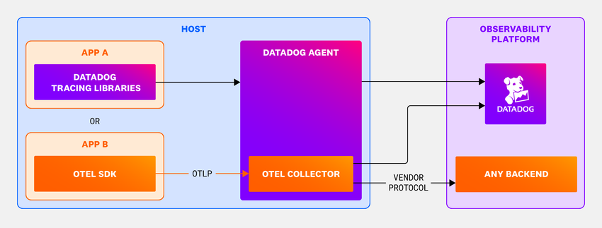
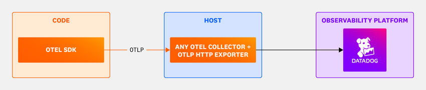
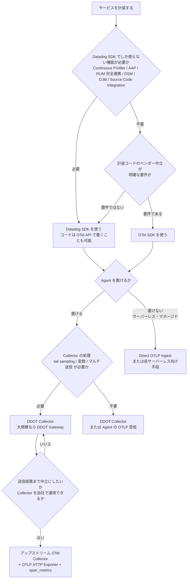
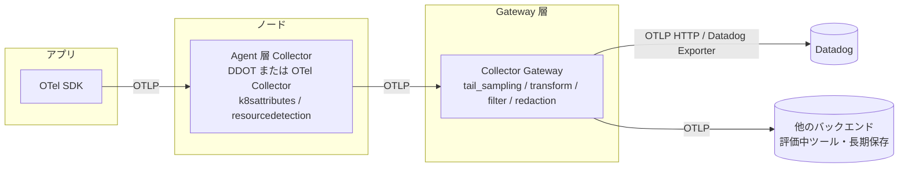

# OpenTelemetry 活用戦略

## 概要

OpenTelemetry（OTel、オープンテレメトリー）は、テレメトリ（トレース、メトリクス、ログ）の生成と送信をベンダー共通にするための CNCF のオープンソースプロジェクトである（2026-05-21 に CNCF の Graduated プロジェクトに昇格）[出典](https://www.cncf.io/announcements/2026/05/21/cloud-native-computing-foundation-announces-opentelemetrys-graduation/)。Datadog は OTel で計装したデータを受け取れる。ただし、Datadog で OTel を使うかどうか、どこまで使うかによって、使える Datadog の機能、運用の手間、課金、ベンダーロックインの度合いが大きく変わる。

Datadog の公式ドキュメントは、OTel を使うときに決めることを次の2つに整理している [出典](https://docs.datadoghq.com/opentelemetry/)。

1. **計装方法**：OTel SDK でベンダー中立に計装するか、OTel API の実装として Datadog SDK（Datadog トレーサー、dd-trace 系）を使うか
2. **データの送信経路**：DDOT Collector（Datadog Agent に組み込まれた OTel Collector）、自前で運用する OTel Collector、Agent も Collector も使わない Direct OTLP Ingest（ほかに Agent の OTLP 受信機能）のどれを使うか

本ファイルは、この2つの決定を**戦略として**どう判断するかを扱う。扱う内容は次のとおり。

- Datadog SDK と OTel SDK の比較と選び方（シグナル別、ユースケース別）
- 送信経路が戦略面で持つ意味（機能、運用負荷、中立性）
- ハイブリッド構成の代表パターンと、混在させるときに守るルール
- ベンダーロックインを分解して考える方法、避けられる部分と避けにくい部分、出口戦略
- 課金と運用の落とし穴、段階的な導入・移行の手順

設定キー、ポート、最低バージョン、機能互換性マトリクスの全体、セマンティック規約のマッピング表などの**仕様の詳細は [OpenTelemetry サポート](../02_リファレンス/platform/opentelemetry.md) にある**。本ファイルではそれを前提に、判断に必要な部分だけを引用する。

> **2026-11-02 時点の要点**
> - Datadog の公式推奨は **「Datadog SDK + DDOT Collector」**。DDOT は「OTel のベンダー中立性」と「Datadog エコシステムの機能」を両立する構成と位置付けられている [出典](https://docs.datadoghq.com/opentelemetry/)。
> - 2026 年に入り、Datadog は OTel ネイティブなデータをそのまま扱う方向を強めている。標準の **OTLP HTTP Exporter での取り込み**（Datadog Exporter や Datadog Agent が不要）、**Direct OTLP Intake の GA**、OTel のセマンティック規約で APM を検索できる機能などが 2026-07-20 の公式ブログで発表された [出典](https://www.datadoghq.com/blog/native-otel-with-datadog/)（2026-07-20 公開）。
> - それでも、Continuous Profiler、App and API Protection、RUM 連携の一部、Data Streams Monitoring など、**Datadog SDK でしか使えない機能が残っている**。そのため「全部 OTel」にするとこれらの機能を手放すことになる [出典](https://docs.datadoghq.com/opentelemetry/compatibility/)。

---

## 1. 判断の全体像

### 1.1 2つの軸と4つの典型構成

Datadog の公式分類では、計装（SDK）と送信経路（Collector / Agent）の組み合わせで4つのセットアップがある [出典](https://docs.datadoghq.com/opentelemetry/compatibility/)。

| セットアップ | 計装コードが呼ぶ API | 実装（SDK） | 送信経路 | 戦略上の位置付け |
|---|---|---|---|---|
| ① Datadog SDK + DDOT（公式推奨） | Datadog API または OTel API | Datadog SDK | DDOT Collector（Agent 内蔵） | Datadog の機能を最大限に使う。OTel API でコードを書けば、計装コードの中立性はある程度保てる |
| ② OTel SDK + DDOT | OTel API | OTel SDK | DDOT Collector | アプリ側は完全に中立。Agent 由来の機能（ホスト、コンテナ、CNM、USM、DBM 等）は使える |
| ③ OTel SDK + アップストリーム Collector | OTel API | OTel SDK | 自前の OTel Collector Contrib | 送信経路も含めて中立。Agent 由来の機能（DBM、CNM、USM、Live Containers 等）を失い、4つの中では④ Direct OTLP に次いで Datadog 機能が少ない（§2.3）。Collector の運用は自社の責任 |
| ④ Direct OTLP Ingest | OTel API | OTel SDK | なし（Datadog の OTLP エンドポイントへ直接） | サーバーレス、マネージドプラットフォーム向け。前処理ができない。Datadog 機能は4つの中で最も少ない（Host List、Kubernetes Monitoring も非対応） |

このほか、Datadog Agent が OTLP を直接受け取る **OTLP Ingest in the Agent** もある。公式は「Kubernetes の Linux 以外のプラットフォームのユーザー、または Collector パイプラインを管理したくないユーザー」向けとしている [出典](https://docs.datadoghq.com/opentelemetry/setup/)。

*図: Datadog Agent と DDOT Collector の構成（公式 OpenTelemetry 概要ページ）*
画面説明: 左の「HOST」枠に「APP A」と「APP B」が「OR」で並ぶ。APP A は「DATADOG TRACING LIBRARIES」（Datadog SDK）で計装され、Datadog Agent へ送る。APP B は「OTEL SDK」で計装され、OTLP で Datadog Agent 内の「OTEL COLLECTOR」（DDOT）へ送る。Agent は右の「OBSERVABILITY PLATFORM」枠の Datadog へ送信する。Agent 内の OTel Collector は Datadog にも、「VENDOR PROTOCOL」で「ANY BACKEND」（Datadog 以外の任意のバックエンド）にも送れる。つまり DDOT を使っても、送信先を Datadog 以外に増やす余地がある。
出典: https://docs.datadoghq.com/opentelemetry/ （取得日: 2026-11-02）

*図: アップストリーム OTel Collector から OTLP HTTP Exporter で Datadog に送る構成*
画面説明: 左の「CODE」枠の「OTEL SDK」が OTLP で、中央の「HOST」枠にある「ANY OTEL COLLECTOR + OTLP HTTP EXPORTER」へ送る。Collector は右の「OBSERVABILITY PLATFORM」枠の Datadog へ送信する。Datadog 独自のコンポーネントを使わない、最も中立的な構成を示している。
出典: https://docs.datadoghq.com/opentelemetry/ （取得日: 2026-11-02）

### 1.2 判断フロー

次の図は、公式の互換性情報と実務での判断軸をもとにした、選択の目安である【経験則】。

### 1.3 判断の前提として確認すること

| 確認項目 | 確認する理由 | 確認先 |
|---|---|---|
| 使う予定の Datadog 製品 | Profiler、AAP、RUM 連携、DSM、DJM、Source Code Integration は Datadog SDK が前提 | [機能互換性](https://docs.datadoghq.com/opentelemetry/compatibility/) |
| 言語・ランタイム | Datadog SDK の OTel API 対応、OTel インスツルメンテーションライブラリの対応は言語ごとに違う | [OpenTelemetry サポート](../02_リファレンス/platform/opentelemetry.md) の互換性表 |
| 実行基盤 | アップストリーム Collector + OTLP HTTP Exporter 構成は、ECS Fargate、EKS Fargate、AWS Lambda のようなサーバーレス・タスク型のコンテナ実行環境に非対応（GKE は Standard、Autopilot とも対応。Autopilot では `host_metrics` receiver を外すなどの制約あり）。互換性表も EKS Fargate のアップストリーム Collector を非対応としている。DDOT Gateway は EKS Fargate と GKE Autopilot に非対応 | [出典](https://docs.datadoghq.com/opentelemetry/setup/collector_exporter/) / [出典](https://docs.datadoghq.com/opentelemetry/compatibility/) / [出典](https://docs.datadoghq.com/opentelemetry/setup/ddot_collector/install/kubernetes_gateway/) |
| Datadog サイト | アップストリーム Collector + OTLP HTTP Exporter 構成は `app.ddog-gov.com`、`us2.ddog-gov.com` では非サポート | [出典](https://docs.datadoghq.com/opentelemetry/setup/collector_exporter/) |
| 既存の OTel 資産 | 既に OTel で計装済みなら、その資産を活かす構成（②③④）が自然 | — |
| マルチバックエンドの要否 | 他ツールへの同時送信が必要なら Collector（DDOT か自前）が要る | — |
| Collector の運用体制 | 自前 Collector はバージョン管理、設定配布、障害対応を自社で担う | [出典](https://www.datadoghq.com/blog/otel-deployments/)（2025-05-12 公開） |

---

## 2. Datadog トレーサー（Datadog SDK）と OTel SDK の選択

### 2.1 計装の選択肢は4つある

「Datadog か OTel か」の二択ではない。2026-11-02 時点で、Datadog の公式ドキュメントは次の計装方法を示している [出典](https://docs.datadoghq.com/opentelemetry/instrument/)。

| 計装方法 | 内容 | 計装コードの中立性 | Datadog 機能 | 主な注意 |
|---|---|---|---|---|
| A. Datadog SDK（Datadog API） | 従来の dd-trace。自動計装、Single Step Instrumentation（SSI）を含む | 低い（Datadog API に依存） | すべて | 手動計装を Datadog API で書くと、その部分が Datadog 専用になる |
| B. OTel API + Datadog SDK | コードは OTel API で書き、実装に Datadog SDK を使う | 高い（API 層） | すべて | 実行時には Datadog SDK に依存する。言語ごとの対応状況の確認が必要 |
| C. OTel インスツルメンテーションライブラリ + Datadog SDK | Datadog SDK が未対応のフレームワークを、OTel のインスツルメンテーションライブラリで補う | 部分的 | すべて | 重複スパンを避けるため、対応する Datadog 側のインスツルメンテーションを無効にする |
| D. OTel SDK（フル OTel） | OTel API と OTel SDK で完結させる | 高い | 一部が使えない | 互換性表で使えない機能を事前に確認する |

公式ドキュメントは、B について「ベンダー中立な計装を保ちながら Datadog の全機能を使える」と説明している。一方 D については「アプリを完全に OTel で計装すると、一部の Datadog 機能はサポートされない」と明記している [出典](https://docs.datadoghq.com/opentelemetry/instrument/)。

**C の対応言語と最低バージョン**（Datadog SDK 側、Traces API）[出典](https://docs.datadoghq.com/opentelemetry/instrument/dd_sdks/instrumentation_libraries/)

| 言語 | Datadog SDK の最低バージョン | 有効化の要点 |
|---|---|---|
| Java | 1.35.0 | `DD_TRACE_OTEL_ENABLED=true`。インスツルメンテーションごとに extension JAR を用意し、`OTEL_JAVAAGENT_EXTENSIONS` で指定する。OTel の incubator API は非対応。OTel インスツルメンテーションの 2.6.0-alpha 以降は非対応 |
| Python | 2.10.0 | `DD_TRACE_OTEL_ENABLED=true`。ddtrace の OTel API 設定のうえで `opentelemetry-python-contrib` のライブラリを使う |
| Ruby | 2.1.0 | `DD_TRACE_OTEL_ENABLED` は不要。`opentelemetry-ruby-contrib` を使う |
| Go | 1.67.0 | `DD_TRACE_OTEL_ENABLED` は不要。トレーサー v2 を推奨。`opentelemetry-go-contrib` を使う |
| Node.js | 4.3.0 | `DD_TRACE_OTEL_ENABLED=true`。重複する Datadog インスツルメンテーションは `DD_TRACE_DISABLED_INSTRUMENTATIONS` で無効にする |
| PHP | 0.94.0 | `DD_TRACE_OTEL_ENABLED=true`。重複するインテグレーションは `DD_TRACE_<INTEGRATION>_ENABLED=false` で無効にする |
| .NET | 2.53.0 | `DD_TRACE_OTEL_ENABLED=true`。`ActivitySource` でスパンを出すライブラリを構成する（Azure SDK は `AZURE_EXPERIMENTAL_ENABLE_ACTIVITY_SOURCE=true`） |

C の共通の制限として、SpanProcessor や OTLP Trace Exporter のような「OTel SDK 固有の操作」は使えない [出典](https://docs.datadoghq.com/opentelemetry/instrument/dd_sdks/instrumentation_libraries/)。

**【Preview】Datadog SDK からの OTLP トレース出力**：Datadog SDK がトレースを OTLP 形式で DDOT や OTel Collector に送る機能がプレビュー中である（Java 1.62.0+、Python 4.8.0+、Node.js 5.98.0+、Go 2.8.0+、.NET 3.41.0+）。`OTEL_TRACES_EXPORTER=otlp` と `DD_TRACE_OTEL_ENABLED=true` で有効にする。ただし**トレースは Datadog のセマンティクスで出力される**（例：HTTP ステータスは `http.response.status_code` ではなく `http.status_code`）。そのため、この機能を使っても OTel のセマンティック規約に揃うわけではない [出典](https://docs.datadoghq.com/opentelemetry/instrument/dd_sdks/otlp_trace_export/)。

### 2.2 観点別の比較

| 観点 | Datadog SDK（A / B / C） | OTel SDK（D） |
|---|---|---|
| Datadog 機能の網羅性 | すべて使える | Profiler、AAP、DJM、DSM、RUM 完全連携、Source Code Integration が使えない（互換性表で「非対応」）[出典](https://docs.datadoghq.com/opentelemetry/compatibility/) |
| 導入の手軽さ | SSI や自動計装で、コードを変えずに導入できることが多い | 言語ごとに SDK、エクスポーター、リソース検出器、伝播方式を構成する |
| 計装コードの中立性 | A は低い。B は API 層で中立 | 高い |
| 送信先の自由度 | 原則 Datadog。OTLP 出力はプレビュー（§2.1） | OTLP を受け付ける任意のバックエンドに送れる |
| サンプリング制御 | Agent の自動サンプリング（`DD_APM_TARGET_TPS`）、Remote Configuration のサンプリングルールなどが使える | Agent の自動サンプリング（`auto`）は効かない。OTel SDK、Collector、Agent の Probabilistic sampler で制御する [出典](https://docs.datadoghq.com/opentelemetry/guide/ingestion_sampling_with_opentelemetry/) |
| 命名（スパン名、リソース名、属性） | Datadog の規約。画面やダッシュボードの前提と一致する | OTel のセマンティック規約。Datadog 側で変換される。インスツルメンテーションライブラリによっては見え方が変わる |
| Runtime Metrics | DogStatsD（UDP `8125`）で送る | OTel Runtime Metrics 仕様で、通常は OTLP で送る |
| サポート | 言語 SDK は Datadog のサポート対象 | OTel SDK と既定外のコンポーネントは OTel コミュニティが主体。Datadog は DDOT に含まれるコンポーネントの安全性と互換性を支援する |
| アップグレードの頻度 | Datadog SDK のリリースに追随する | OTel SDK、インスツルメンテーション、Collector をそれぞれ追随する（OTel は更新が速い）【経験則】 |

### 2.3 OTel SDK を選んだときに失う機能

公式の互換性表のうち、セットアップによって可否が分かれる項目だけを抜き出す（全体は [OpenTelemetry サポート](../02_リファレンス/platform/opentelemetry.md#機能互換性マトリクス)）[出典](https://docs.datadoghq.com/opentelemetry/compatibility/)。

| 機能 | ① Datadog SDK + DDOT | ② OTel SDK + DDOT | ③ OTel SDK + 自前 Collector | ④ Direct OTLP |
|---|---|---|---|---|
| Database Monitoring | 対応 | 対応 | 非対応 | 非対応 |
| Infrastructure Host List | 対応 | 対応 | 対応 | 非対応 |
| Cloud Network Monitoring | 対応 | 対応 | 非対応 | 非対応 |
| Kubernetes Monitoring | 対応 | 対応 | 対応 | 非対応 |
| Live Containers / Live Processes | 対応 | 対応 | 非対応 | 非対応 |
| Universal Service Monitoring | 対応 | 対応 | 非対応 | 非対応 |
| App and API Protection（旧称：Application Security Management / ASM） | 対応 | 非対応 | 非対応 | 非対応 |
| Continuous Profiler | 対応 | 非対応 | 非対応 | 非対応 |
| Data Jobs Monitoring | 対応 | 非対応 | 非対応 | 非対応 |
| Data Streams Monitoring | 対応 | N/A（OTel に相当機能がない） | N/A | 非対応 |
| Real User Monitoring（RUM との完全な連携） | 対応 | 非対応 | 非対応 | 非対応 |
| Source Code Integration | 対応 | 非対応 | 非対応 | 非対応 |
| Trace Metrics | 対応 | 対応 | 対応 | 対応（サンプリング後のスパンから計算） |

読み方のポイント：

- **②（OTel SDK + DDOT）で失うのは「アプリ内の Datadog SDK に依存する機能」だけ**である。インフラ系の機能（DBM、CNM、USM、Live Containers など）は Agent が提供するので残る。アプリ側の中立性を優先しつつ Datadog の機能を多く残したいなら、②が落としどころになる。
- **③（自前 Collector）では Agent 由来の機能も失う**。Kubernetes Monitoring と Host List は、`hostmetrics` などのレシーバーを構成すれば対応する。
- **④（Direct OTLP）はインフラの文脈をほぼ持たない**。Trace Metrics も、Datadog に届いたスパン（サンプリング後）から計算される。

RUM については補足がある。RUM SDK は `propagatorTypes` に `tracecontext` を指定すれば、OTel で計装したバックエンドともトレースを接続できる。ただし CORS の `Access-Control-Allow-Headers` で `traceparent`、`tracestate` を許可する必要がある [出典](https://docs.datadoghq.com/opentelemetry/correlate/rum_and_traces/)。互換性表で RUM が「非対応」とされているのは、RUM の機能をフルに使うには対応ヘッダーの注入が必要、という意味の注記付きである [出典](https://docs.datadoghq.com/opentelemetry/compatibility/)。

### 2.4 ユースケース別の推奨

| 状況 | 推奨する計装 | 推奨する送信経路 | 理由 |
|---|---|---|---|
| Datadog を全面的に使い、Profiler や AAP も使う | A（必要に応じて B） | DDOT または通常の Agent | 公式推奨。機能制約がない |
| Datadog を使うが、手動計装のコードは中立にしておきたい | B（OTel API + Datadog SDK） | DDOT | 手動計装の部分だけ OTel API で書けば、将来 SDK を差し替えるときに書き直しが少ない |
| Datadog SDK が未対応のライブラリがある | C | DDOT または Agent | OTel のインスツルメンテーションで補える |
| 既に OTel で計装済みのサービス群を Datadog に取り込む | D | DDOT（②）。Collector 運用の体制があれば③ | 計装をやり直さずに済む。②ならインフラ系の機能も残る |
| マルチベンダー（複数のバックエンドに送る）が要件 | D | 自前 Collector（③）または DDOT の追加 Exporter | Collector で送信先を分岐できる |
| サーバーレス、マネージドプラットフォーム（Vercel、Cloudflare 等） | D | Direct OTLP（④） | Agent も Collector も置けない |
| SaaS 製品・OSS を配布する側（顧客がどのバックエンドを使うか分からない） | D（OTel API のみ同梱） | 利用者に任せる | ライブラリ作者は OTel API だけに依存するのが OTel の基本方針【経験則】 |
| PoC、短期間での価値検証 | A（SSI） | 通常の Agent | 立ち上げが最も速い。中立化は後から B に寄せられる【経験則】 |

### 2.5 シグナル別の考え方

OTel 化はシグナル（トレース、メトリクス、ログ、プロファイル）ごとに進み具合が違う。全シグナルを同時に揃える必要はない【経験則】。

| シグナル | Datadog 側の状況（2026-11-02 時点） | 戦略上のポイント |
|---|---|---|
| トレース | OTel トレースは APM でファーストクラスに扱われる方向。OTel のスパンのセマンティクスと属性で検索できる [出典](https://www.datadoghq.com/blog/native-otel-with-datadog/)（2026-07-20 公開） | 中立化の効果が最も大きい。計装がアプリのコードに深く入るため、ロックインもここに集中する |
| メトリクス（アプリ独自） | OTel Metrics API のメトリクスは Datadog SDK 経由でも OTel SDK 経由でも送れる。Datadog インテグレーション由来でないメトリクスは**カスタムメトリクス**として課金される [出典](https://docs.datadoghq.com/account_management/billing/custom_metrics/) | DogStatsD から OTel Metrics API への移行は中立化に効く。ただし属性（タグ）のカーディナリティ管理が必要 |
| メトリクス（インフラ） | Datadog がサポートする OTel レシーバー（host、kubeletstats、Docker、MySQL、PostgreSQL、Kafka 等）のメトリクスは**追加料金なし**。設定を誤るとカスタムメトリクス扱いになりうる [出典](https://docs.datadoghq.com/opentelemetry/integrations/) | Datadog Agent のインテグレーション（1,000 以上）のほうが対象が広い。中立化のために Agent を捨てると監視範囲が狭まりやすい【経験則】 |
| ログ | OTLP ログを受け付ける。Agent の OTLP ログ取り込みは予期しない課金を避けるため既定で無効 [出典](https://docs.datadoghq.com/opentelemetry/setup/otlp_ingest_in_the_agent/) | ログ収集は Agent でも OTel Collector の `filelog` receiver でもできる。トレース相関に必要な `trace_id`、`span_id` を出すことのほうが重要 |
| プロファイル | Datadog の Continuous Profiler は Datadog SDK が前提。OTel Profiles は 2026-03 にアップストリームでアルファ版が出て、Datadog も共著した。OTel eBPF プロファイラーを使う Full Host Profiler は【Preview】[出典](https://www.datadoghq.com/blog/native-otel-with-datadog/)（2026-07-20 公開） | 現時点でプロファイルを中立化するのは時期尚早。Profiler が必要なサービスは Datadog SDK を使う【経験則】 |
| RUM（フロントエンド） | Datadog RUM SDK を使う。OTel バックエンドとは W3C `tracecontext` で接続する [出典](https://docs.datadoghq.com/opentelemetry/correlate/rum_and_traces/) | ブラウザやモバイルの OTel 化は、移行の最後に回すのが一般的とする第三者の指摘がある【第三者情報】[出典](https://www.guance.com/learn/articles/datadog-to-opentelemetry)（2026-08-10 公開。競合ベンダーの記事） |
| LLM / エージェント | OTel の GenAI セマンティック規約に沿ったトレースは自動で Agent Observability（LLM Observability）のトレースに変換される（無効化も可能）[出典](https://docs.datadoghq.com/opentelemetry/compatibility/) | GenAI 計装は OTel 規約で書いても Datadog の機能を使える |

---

## 3. 送信経路の選択が戦略に与える影響

送信経路そのものの仕様（ポート、設定キー、最低バージョン）は [OpenTelemetry サポート](../02_リファレンス/platform/opentelemetry.md#データ送信経路の比較) を参照。ここでは戦略面の違いだけを比べる。

### 3.1 経路ごとの戦略上の意味

| 経路 | 中立性 | Datadog 機能 | 運用負荷 | 向く組織 |
|---|---|---|---|---|
| DDOT Collector | Collector の設定は OTel 標準。他のバックエンド向けの Exporter も追加できる。ただし Agent に同梱されるため、Datadog Agent の存在が前提 | 最大（Agent 機能 + OTel パイプライン）。Fleet Automation で管理できる | Datadog が保守するディストリビューションを使う。Agent の更新と一緒に Collector も更新される | Datadog を主軸にしつつ OTel を使いたい組織（大多数）|
| Agent の OTLP 受信 | アプリ側は中立。パイプラインは Agent の固定処理 | Agent 機能はある。Collector の Processor は使えない。OTel SDK のデータは Ingestion Rules、AAP、Profiler で使えない [出典](https://docs.datadoghq.com/opentelemetry/setup/otlp_ingest_in_the_agent/) | 最小 | Collector を管理したくない、または DDOT 非対応のプラットフォーム |
| アップストリーム Collector + OTLP HTTP Exporter | 最も高い。2026 年からは Datadog Exporter / Connector なしで、標準の OTLP HTTP Exporter と `span_metrics` Connector で送れる [出典](https://docs.datadoghq.com/opentelemetry/setup/collector_exporter/) | Agent 由来の機能（CNM、USM、DBM、Live Containers 等）は使えない | Collector のビルド、更新、設定配布、障害対応を自社で行う | プラットフォームチームが OTel パイプラインを社内標準として運用している組織 |
| Direct OTLP Ingest | アプリから直接送る。送信先の切り替えには再デプロイが必要 | 最小。Host List も非対応 | 最小 | サーバーレス、マネージドプラットフォーム |

公式ブログは、OTLP HTTP Exporter による取り込みについて「Datadog Agent、Datadog Exporter、Datadog Connector のような独自コンポーネントに頼らない」構成であり、「完全なベンダー中立性への道のりを支援する」と説明している [出典](https://www.datadoghq.com/blog/native-otel-with-datadog/)（2026-07-20 公開）。

> **注意:** Datadog は、新規にアップストリーム Collector を使うなら OTLP HTTP Exporter + `span_metrics` Connector の構成を推奨している。従来の Datadog Exporter / Datadog Connector も引き続きサポートされ、既存構成を移行する必要はない [出典](https://docs.datadoghq.com/opentelemetry/setup/collector_exporter/datadog_exporter/)。

### 3.2 Collector のデプロイパターン

Datadog の公式ブログは、OTel のデプロイを3パターンに整理している [出典](https://www.datadoghq.com/blog/otel-deployments/)（2025-05-12 公開）。

| パターン | 内容 | 長所 | 短所 | 向く場面 |
|---|---|---|---|---|
| Collector なし | アプリから OTLP でバックエンドへ直接送る | 構成と管理が最小 | アプリがバックエンドと密結合になる。バックエンド障害時にデータを失いやすい。エンリッチ、マスク、ルーティングを一か所で行えない。変更には開発サイクルが必要 | OTLP に対応し、前処理が不要なバックエンド。サーバーレス |
| Agent パターン | アプリと同じホストや Pod の近くに Collector を置く | 一時的なローカルキャッシュになる。アプリを再デプロイせずに処理を変えられる | 多数の Collector の設定管理が複雑でミスしやすい。テイルサンプリングのようにトレース全体が必要な処理はできない | 信頼性の向上、アプリごとの前処理 |
| Gateway パターン | Agent 層の Collector から、ロードバランサー配下の Gateway 層へ集約する | テイルサンプリング、集中的なエンリッチ、スパンメトリクス計算、機密データのスキャン、外向き通信の出口の集約 | `hostmetrics` の収集や `k8sattributes`、`resourcedetection` によるエンリッチは Gateway ではできず、Agent 層に残す必要がある | 大規模環境。全体で同じ処理パイプラインを適用したい場合 |

Datadog は DDOT でも Gateway 構成を提供している（Kubernetes、Helm chart 3.160.1+ または Datadog Operator 1.23.0+）。詳細は [OpenTelemetry サポート](../02_リファレンス/platform/opentelemetry.md#gateway-構成kubernetes) を参照。

多段構成の課題について、Datadog の Sales Engineer による 2026-06-05 の講演資料は「どの層でどの処理をしているか把握しにくい」「どこで詰まっているか特定しにくい」点を挙げ、対策として DDOT の利用と、Fleet Automation の Pipeline Visualization（同資料では 2026-04 GA と説明）の活用を勧めている [出典](https://speakerdeck.com/kn_to_maxpno/datadog-x-opentelemetry-ru-men-toshi-jian-noaida)（2026-06-05 公開）。Pipeline Visualization の GA 日付は、公式ドキュメントでは確認できなかった。Fleet Automation で Collector の構成、パイプライン、トポロジーを表示するには Datadog Extension が必要である [出典](https://docs.datadoghq.com/agent/fleet_automation/fleet_view/)。

---

## 4. ハイブリッド構成のパターン

実際の導入では、組織全体を1つのセットアップに揃えることはまれで、複数の方式を組み合わせることが多い【経験則】。代表的なパターンを示す。

### 4.1 パターン一覧

| # | パターン | 概要 | 向く状況 | 主なリスク |
|---|---|---|---|---|
| H1 | Datadog SDK + OTel API（コードの中立化） | 実行は Datadog SDK。手動計装やカスタムメトリクスは OTel API で書く | Datadog を主軸にしつつ、将来の差し替えに備えたい | 言語ごとに OTel API の対応範囲が違う（Ruby の Metrics API は Alpha 等） |
| H2 | サービス単位の使い分け | 自動計装が効く言語は Datadog SDK、コード変更が必要な言語や既存 OTel 資産は OTel SDK | 多言語のマイクロサービス。既存資産が混在 | 伝播方式、サンプリング、命名の不統一 |
| H3 | OTel SDK + DDOT | アプリは完全に OTel。ノードには Datadog Agent（DDOT 内蔵） | アプリの中立性が要件だが、インフラ監視は Datadog の機能を使いたい | Profiler、AAP 等は使えない。ホスト名の不一致による二重カウント |
| H4 | Collector を抽象化層にしたマルチバックエンド | Collector（DDOT または自前）から Datadog と他のバックエンドへ同時に送る | 移行期間、部門ごとに違うツール、長期保存を別ストレージへ | 送信量とコストが倍になる。Collector の運用負荷 |
| H5 | 環境別の使い分け | 本番は Datadog、ローカル開発や検証環境は OSS のバックエンド（Jaeger 等）。計装は OTel で共通 | 開発者の手元でトレースを見たい | 本番と開発で見え方が違う |
| H6 | サーバーレスとホスト型の併用 | ホスト型は Agent / DDOT、Lambda やマネージドプラットフォームは Direct OTLP | クラウドネイティブとマネージドサービスの混在 | Direct OTLP 側はインフラの文脈が薄い。課金体系が異なる |

### 4.2 H1：Datadog SDK に OTel API を載せる

- **やること**：Datadog SDK（自動計装を含む）を入れ、手動計装を OTel Tracing API で書く。Java、Python、.NET、PHP では `DD_TRACE_OTEL_ENABLED=true`（Java はシステムプロパティ `dd.trace.otel.enabled` でも可）を設定する。Node.js、Go、Ruby、Rust のトレース設定手順にはこの設定の記載がない [出典](https://docs.datadoghq.com/opentelemetry/instrument/api_support/)。
- **得られるもの**：Datadog の全機能を使いながら、手動計装コードを OTel 標準に寄せられる。将来 OTel SDK に差し替えるときに、手動計装の書き直しが少ない。
- **残る依存**：自動計装の部分（Datadog SDK のインテグレーション）、Datadog 固有のタグや命名、`DD_*` 環境変数。
- **注意点**：
  - .NET、Node.js、Go、Rust、Java の Metrics API では、Datadog SDK が OTel API のネイティブ実装を提供する。このとき**公式 OTel SDK や OTLP Exporter のパッケージを追加してはいけない**（競合やデータ重複の原因になる）。Python、Ruby、PHP は既存の OTel SDK と併用する [出典](https://docs.datadoghq.com/opentelemetry/instrument/api_support/)。
  - Datadog SDK が OTel API を実装していても、OTLP のメトリクスとログを処理・転送するには DDOT Collector か Agent の OTLP 受信が必要 [出典](https://docs.datadoghq.com/opentelemetry/setup/ddot_collector/install/linux/)。

### 4.3 H2：サービス単位の使い分け

公開事例として、自動計装が効く PHP は Datadog のライブラリ、クライアント差し替えやミドルウェアの変更が必要な Go は OTel ライブラリと使い分け、Agent の OTLP エンドポイントへ送る構成が報告されている。この事例ではサンプリングを Datadog 側の仕組みに一本化し、「複雑化を避けるためどちらかの仕組みを使う」としている【第三者情報】[出典](https://zenn.dev/ymtdzzz/articles/7f161d59072290)（2023-12-18 公開。2年近く前の情報で、その後 Datadog の OTel 対応が大きく進んでいるため、現行仕様と異なる可能性がある）。

H2 を成立させるためのルール：

| 項目 | ルール | 根拠 |
|---|---|---|
| 1 アプリ 1 SDK | 1 つのアプリで Datadog SDK と OTel SDK を同時に使わない（動作が未定義になる）。Python は両方のインストールを前提とする例外 | [出典](https://docs.datadoghq.com/opentelemetry/compatibility/) |
| コンテキスト伝播 | Datadog SDK の伝播形式の既定は `datadog,tracecontext,baggage`。OTel 側は W3C `tracecontext` を使えば、境界でもトレースがつながる | [出典](https://docs.datadoghq.com/tracing/trace_collection/trace_context_propagation/) |
| トレース ID | 128 ビットのトレース ID を使う。Datadog SDK は既定で 128 ビット ID を生成する | [出典](https://docs.datadoghq.com/opentelemetry/reference/trace_ids/) |
| サンプリング | サンプリングの決定箇所を一か所に寄せる（§6.2） | [出典](https://docs.datadoghq.com/opentelemetry/guide/ingestion_sampling_with_opentelemetry/) |
| Unified Service Tagging | Datadog SDK 側は `DD_SERVICE`、`DD_ENV`、`DD_VERSION`、OTel 側は `service.name`、`deployment.environment.name`、`service.version` を、同じ値の体系で付ける | [出典](https://docs.datadoghq.com/opentelemetry/mapping/semantic_mapping/) |
| 環境変数 | 同じ概念を `DD_*` と `OTEL_*` の両方で設定しない（同じタグキーに重複した値が付くことがある） | [出典](https://docs.datadoghq.com/opentelemetry/config/environment_variable_support/) |

### 4.4 H3：OTel SDK + DDOT

- **やること**：アプリは OTel SDK だけで計装し、OTLP で同じノードの DDOT Collector へ送る。Kubernetes では `hostPort` とノード IP（`status.hostIP`）を使うのが一般的。
- **得られるもの**：アプリ側の完全な中立性と、Agent 由来の機能（DBM、CNM、USM、Live Containers、Kubernetes 監視、1,000 以上のインテグレーション、Fleet Automation）。
- **実例と注意**：OTel で計装した Go アプリから DDOT 経由で Datadog に送った事例では、狙いを「将来的に他のオブザーバビリティツールに切り替えたり、ローカル開発環境だけ別のツールを利用したい場合でもアプリケーション側の変更を最小限に抑えられる」ことと説明している。一方で、Container Agent と DDOT が同じノードを別のホスト名で報告し、**Infrastructure ホストが二重に課金される可能性**があった。`infraattributes` processor の `allow_hostname_override: true` で解消したとしている。また筆者は、運用負荷が増えるため「本番環境では強い目的がない限り推奨はしません」とも述べている【第三者情報】[出典](https://zenn.dev/tetsuya28/articles/datadog-ddot)（2025-09-18 公開）。

### 4.5 H4：Collector を抽象化層にしたマルチバックエンド

- **やること**：送信先の切り替えや追加を Collector の Exporter の設定だけで行えるようにする。アプリは常に「近くの Collector」へ OTLP を送る。
- **得られるもの**：送信先を変えるときにアプリを再デプロイしなくてよい。移行期間の並行稼働（dual shipping）、部門ごとのツール分離、コストの安いストレージへの長期保存が可能になる。
- **注意点**：
  - DDOT には `otlpexporter`、`otlphttpexporter`、`loadbalancingexporter` などが既定で含まれる。DDOT の図でも Agent 内の OTel Collector から「ANY BACKEND」へ送れることが示されている [出典](https://docs.datadoghq.com/opentelemetry/setup/ddot_collector/)。ただし既定に含まれるコンポーネントは「Community Supported」、既定外は「Custom Components」で、Datadog の直接サポートの範囲は Datadog 製コンポーネントに限られる [出典](https://docs.datadoghq.com/opentelemetry/compatibility/)。
  - 送信量が送信先の数だけ増える。Datadog 側の取り込み課金は変わらないが、ネットワークの egress 費用や他ツールの費用が加わる【経験則】。
  - テイルサンプリングは Gateway で行い、同じ traceID のスパンを同じ Gateway に集める（`loadbalancing` Exporter）。Trace Metrics（`span_metrics` または Datadog Connector）は**サンプリングの前**で計算する（§6.2）。

### 4.6 H6：サーバーレス・マネージドプラットフォームとの併用

- ホスト型は Agent / DDOT、Lambda、Cloud Run、Vercel、Cloudflare などは Direct OTLP（または各サーバーレス向けの Datadog 製の手段）を使う。
- マネージドプラットフォームには専用エンドポイント `https://{subdomain}.integrations.otlp.<DD_SITE>` がある。料金ページによると、専用エンドポイントは「マネージドプラットフォーム向けの課金を適用するかどうかの識別」に使われるため、**実際のアーキテクチャに合ったエンドポイントを使う** [出典](https://www.datadoghq.com/pricing/?product=managed-platform-otlp#products)。
- Direct OTLP のトレースは、`compute_stats=true` を付けないと Trace Metrics が計算されない。サーバーレスでは `OTEL_SERVICE_NAME` を設定しないと `unknown_service` になる（詳細は [OpenTelemetry サポート](../02_リファレンス/platform/opentelemetry.md#direct-otlp-ingestdatadog-otlp-intake-endpoint)）。

### 4.7 ハイブリッド構成で必ず守るルール

| # | ルール | 違反したときに起きること | 出典 |
|---|---|---|---|
| 1 | 1 つのアプリで Datadog SDK と OTel SDK を同時に使わない（Python を除く） | 動作が未定義になる。スパンの重複や欠落 | [出典](https://docs.datadoghq.com/opentelemetry/compatibility/) |
| 2 | 同じホストで Datadog Agent と別の OTel Collector を動かさない（同じフリートの別ホストなら可） | 問題が起きる可能性があると公式が警告。OTel のサンプリングガイドでは「サポートしない」と明記 | [出典](https://docs.datadoghq.com/opentelemetry/compatibility/) / [出典](https://docs.datadoghq.com/opentelemetry/guide/ingestion_sampling_with_opentelemetry/) |
| 3 | Agent と Collector を同じホストで両方使いたいなら DDOT を使う | — | 【経験則】ルール2からの帰結 |
| 4 | OTel インスツルメンテーションライブラリを Datadog SDK と併用するときは、重複する Datadog 側インスツルメンテーションを無効にする | 重複スパン | [出典](https://docs.datadoghq.com/opentelemetry/instrument/dd_sdks/instrumentation_libraries/) |
| 5 | 伝播は W3C `tracecontext` を共通形式にし、128 ビット ID を使う | トレースが途中で切れる | [出典](https://docs.datadoghq.com/opentelemetry/reference/trace_ids/) |
| 6 | サンプリングの決定箇所を一か所に寄せる | 必要なトレースが落ちる。Trace Metrics が不正確になる | [出典](https://docs.datadoghq.com/opentelemetry/guide/ingestion_sampling_with_opentelemetry/) |
| 7 | UST（`service`、`env`、`version`）を全方式で同じ値の体系にする | サービスが分裂して見える。ホストの誤帰属、想定外のコスト増 | [出典](https://docs.datadoghq.com/opentelemetry/guide/ingestion_sampling_with_opentelemetry/) |
| 8 | ホスト名の決め方を経路ごとに揃える（DDOT では `allow_hostname_override: true`） | 同じノードが2ホストとして数えられ、ホスト課金が増えうる | [出典](https://docs.datadoghq.com/opentelemetry/config/hostname_tagging/) |
| 9 | Kubernetes で Datadog の自動注入（SSI / Admission Controller）と OTel Operator の自動計装の対象を重ねない | 1 つの Pod に 2 つのトレーシングライブラリが入るおそれ | 【推定】ルール1からの帰結。両者の同時適用時の挙動を明示した公式情報は公開情報では確認できず |

---

## 5. ベンダーロックイン回避の実践

### 5.1 ロックインを層に分けて考える

「OTel を使えばロックインしない」は正確ではない。ロックインは複数の層にあり、OTel が解消するのはその一部である【経験則】。

| 層 | Datadog でのロックインの例 | OTel で回避できるか | 回避策 |
|---|---|---|---|
| L1 計装コード | Datadog API で書いた手動計装、Datadog 固有のタグ付けコード | **回避できる** | OTel API で書く（Datadog SDK 上でも可：H1） |
| L2 SDK・実行時 | dd-trace の自動計装、SSI | 回避できる（OTel SDK に替える） | ただし Profiler、AAP 等を手放すことになる |
| L3 送信経路 | Datadog Agent、Datadog Exporter / Connector | **回避できる** | OTLP HTTP Exporter + `span_metrics`、または Collector の Exporter 差し替え |
| L4 データモデル・命名 | `trace.<operation>.*` などの Datadog 固有メトリクス名、Datadog のタグ規約（`env`、`kube_namespace` 等）、スパンの operation name / resource name の付け方 | 部分的 | OTel のセマンティック規約を社内標準にし、Datadog 側は変換に任せる。Collector の `transform` で正規化する |
| L5 可視化・検知の資産 | ダッシュボード、モニター、SLO、Notebook、Watchdog、クエリ言語 | **回避できない** | Terraform などで定義をコード化して移行コストを見積もれるようにする（[Monitoring as Code](monitoring-as-code.md)） |
| L6 製品固有機能 | Profiler、AAP、DBM、CNM、USM、RUM、Session Replay、Cloud SIEM、Workflow Automation など | 回避できない | 「使う価値があるから使う」と割り切り、依存先を一覧化しておく |
| L7 運用プロセス・人 | オンコール、インシデント運用、チームの習熟 | 回避できない | 運用手順を製品名ではなく役割で記述する【経験則】 |
| L8 契約 | 年契約のコミット量、エディション | 回避できない | 契約期間と移行計画を合わせる（[購入経路と契約](../03_導入編/procurement-and-contracts.md)） |

OTel がはっきり効くのは **L1〜L3（アプリとパイプライン）** である。これらは変更にアプリの改修や再デプロイが必要なため、移行コストの大部分を占めやすい。一方、L5〜L8 は OTel を使っても残る【経験則】。

### 5.2 「ほどほどの中立性」が現実解

ロックインの回避は無料ではない。公開事例でも「ベンダーロックインを気にしすぎると実装コストが増える」「組織やサービスの状況によってどれくらい考慮するのか見極めが必要」と指摘されている【第三者情報】[出典](https://zenn.dev/ymtdzzz/articles/7f161d59072290)（2023-12-18 公開）。

| 中立性のレベル | 構成 | コスト | 得られる自由度 |
|---|---|---|---|
| レベル 0 | Datadog SDK（Datadog API）+ Agent | 最小 | 低い |
| レベル 1 | Datadog SDK + **OTel API** + DDOT（H1） | 小さい（手動計装の書き方を変えるだけ） | 手動計装と OTel メトリクスのコードが移植可能になる。DDOT で他の送信先も追加できる |
| レベル 2 | **OTel SDK** + DDOT（H3） | 中程度（SDK 構成、命名差の吸収、Profiler 等の放棄） | アプリ側は完全に移植可能。インフラ監視は Datadog の機能を使う |
| レベル 3 | OTel SDK + **自前 Collector** + OTLP HTTP Exporter | 大きい（Collector の運用、Agent 機能の放棄） | 送信経路まで中立。送信先の切り替えは Collector の設定変更だけで済む |

目安として、Datadog を主軸に据える組織はレベル 1 から始め、既に OTel を社内標準にしている組織や、マルチバックエンドが要件の組織はレベル 2〜3 を選ぶのが現実的である【経験則】。

### 5.3 中立性を高める具体策

| 施策 | 内容 | 効果 |
|---|---|---|
| 命名を OTel のセマンティック規約に揃える | `service.name`、`deployment.environment.name`、`service.version`、`http.route` などを社内標準にする | Datadog は主要な属性を自動で Datadog の規約に変換する（例：`deployment.environment.name`→`env`、`http.response.status_code`→`http.status_code`）[出典](https://docs.datadoghq.com/opentelemetry/mapping/semantic_mapping/) |
| 正規化を Collector に集約する | 命名の差や不要属性の削除を Collector の `transform` / `attributes` processor で一か所で行う | 送信先ごとに個別に直さずに済む。第三者の移行ガイドでも推奨されている【第三者情報】[出典](https://www.guance.com/learn/articles/datadog-to-opentelemetry)（2026-08-10 公開。競合ベンダーの記事） |
| サービス名の後付け修正を Datadog 側で行う | 【GA】Service Remapping で、コードを変えずにサービスの名前変更、重複の統合、タグ値による分割ができる | 計装側に Datadog 都合の命名を入れずに済む [出典](https://www.datadoghq.com/blog/dash-2026-new-feature-roundup-observability/)（2026-06-09 公開） |
| 監視定義のコード化 | ダッシュボード、モニター、SLO を Terraform 等で管理する | 移行時に「何を作り直すか」の棚卸しができる（[Monitoring as Code](monitoring-as-code.md)） |
| OTel のメトリクス API を使う | アプリ独自のメトリクスを DogStatsD ではなく OTel Metrics API で出す | メトリクスのコードが移植可能になる。ただしカスタムメトリクス課金は同じ（§7） |
| 依存の台帳を作る | 使っている Datadog 固有機能（Profiler、AAP 等）をサービスごとに一覧化する | 移行時の影響範囲が分かる【経験則】 |

### 5.4 出口戦略（Datadog から別ツールへ移る、または併用する）

出口戦略は、使わなくても用意しておくことに価値がある【経験則】。

| 手段 | 内容 | 成熟度・注意 |
|---|---|---|
| Collector での二重送信 | Collector に別バックエンド向けの Exporter を追加し、Datadog と並行稼働させる | OTel 標準の機能。最も確実 |
| OTel Collector の Datadog Receiver（`datadogreceiver`） | Datadog Agent や Datadog SDK が送るデータを OTel Collector が受け取り、OTel のデータモデルに変換して任意のバックエンドへ送る。計装を変えずに並行評価できる | OTel Collector Contrib のコンポーネントで、README の安定度は traces / metrics とも **alpha**（v0.135.0 時点）。v0.132.0 の README ではメトリクスのエンドポイントが Development とされていた【第三者情報】[出典](https://pkg.go.dev/github.com/open-telemetry/opentelemetry-collector-contrib/receiver/datadogreceiver@v0.135.0)。ClickHouse 社のブログは、ログとトレースは広く検証済み、メトリクスはさらなる検証が必要、Agent 7.59 以降の zstd 圧縮に対応、と説明している【第三者情報】[出典](https://clickhouse.com/ja/blog/datadog-receiver-opentelemetry-collector-jp)（2026-07-21 公開。競合ベンダーの記事）。大規模本番の移行の基盤とするには時期尚早とされる |
| 計装の段階的置き換え | Datadog SDK を言語ごとに OTel SDK へ置き換え、1 リリースサイクル程度両方を比較する | 第三者の移行ガイドは、代表的なトランザクション約 20 件の比較、主要モニター上位 10 件を 5 営業日シャドー運用して発報結果を一致させる、といった検証を提案している【第三者情報】[出典](https://www.guance.com/learn/articles/datadog-to-opentelemetry)（2026-08-10 公開。競合ベンダーの記事のため、客観性に注意） |
| 監視定義の移植 | Terraform 等で管理している定義を移行先の形式へ変換する | クエリ言語が違うため自動変換は難しい【経験則】 |

逆方向（他ツールから Datadog への移行）は [他製品からの移行](../03_導入編/migration-from-other-tools.md) を参照。既存の OTel 計装を持つ組織は、計装を変えずに Collector の Exporter を追加するだけで Datadog を評価できる。

---

## 6. 注意点と落とし穴

### 6.1 落とし穴一覧

| # | 落とし穴 | 何が起きるか | 対策 | 出典 |
|---|---|---|---|---|
| 1 | 「全部 OTel」にしてから、Profiler や AAP が必要になる | 該当サービスだけ Datadog SDK に戻すことになる | 選定時に互換性表で必要な機能を確認する | [出典](https://docs.datadoghq.com/opentelemetry/compatibility/) |
| 2 | Datadog SDK と OTel SDK を同じアプリに入れる | 未定義動作 | 1 アプリ 1 SDK（Python を除く） | [出典](https://docs.datadoghq.com/opentelemetry/compatibility/) |
| 3 | Datadog Agent と OTel Collector を同じホストに置く | 問題が起きる可能性（公式は非サポート） | DDOT を使う。または別ホストに分ける | [出典](https://docs.datadoghq.com/opentelemetry/guide/ingestion_sampling_with_opentelemetry/) |
| 4 | ホスト名の不一致 | 同じノードが別ホストとして数えられ、Infrastructure ホストが二重課金されうる | DDOT で `allow_hostname_override: true`。`datadog.host.name` で統一 | [出典](https://docs.datadoghq.com/opentelemetry/config/hostname_tagging/) / 【第三者情報】[出典](https://zenn.dev/tetsuya28/articles/datadog-ddot)（2025-09-18 公開） |
| 5 | サンプリング後に Trace Metrics を計算する | RED メトリクスがサンプル済みのデータから計算され、実トラフィックより小さく見える | `span_metrics` / Datadog Connector をサンプリングより前に置く。Direct OTLP の Trace Metrics はサンプリング後になることを理解する | [出典](https://docs.datadoghq.com/opentelemetry/setup/collector_exporter/) |
| 6 | OTel 側と Datadog 側で別々にサンプリングする | クロスサービスのトレースが欠ける | 決定箇所を一か所に寄せる（§6.2） | 【第三者情報】[出典](https://zenn.dev/ymtdzzz/articles/7f161d59072290)（2023-12-18 公開） |
| 7 | Agent の Probabilistic sampler を古い Agent で OTLP と併用する | Agent 7.70.0 未満では、サンプラー有効時に受信した OTLP トレースがすべて落ちることがある | Agent 7.70.0 以上にする | [出典](https://docs.datadoghq.com/opentelemetry/guide/ingestion_sampling_with_opentelemetry/) |
| 8 | `resource_attributes_as_tags` を安易に有効にする | タグのカーディナリティが大きく増えることがある（公式の警告）。カスタムメトリクスはメトリクス名 × タグ値の組み合わせで数えるため、課金も増えうる【推定】。公式の OTLP HTTP 構成例ではこの値が `true` になっている点に注意 | 必要な属性だけをタグにする。Collector で不要な属性を落とす | [出典](https://docs.datadoghq.com/opentelemetry/mapping/semantic_mapping/) / [出典](https://docs.datadoghq.com/account_management/billing/custom_metrics/) / [出典](https://docs.datadoghq.com/opentelemetry/setup/collector_exporter/) |
| 9 | アプリ独自の OTel メトリクスを大量に出す | カスタムメトリクス（メトリクス名 × タグ値の組み合わせ）として課金される | 属性設計を事前にレビューする。Metrics without Limits を検討する | [出典](https://docs.datadoghq.com/account_management/billing/custom_metrics/) |
| 10 | OTel レシーバーの設定ミス | 本来は無料のインテグレーションのメトリクスがカスタムメトリクス扱いになる | サポート対象のレシーバーとマッピング表を確認する | [出典](https://docs.datadoghq.com/opentelemetry/integrations/) |
| 11 | 累積（cumulative）テンポラリティのまま送る | 起動直後のデータ点が欠ける。Direct OTLP のメトリクスはデルタのみ受け付ける | `OTEL_EXPORTER_OTLP_METRICS_TEMPORALITY_PREFERENCE=delta`、または `cumulativetodelta` processor | [出典](https://docs.datadoghq.com/metrics/open_telemetry/otlp_metric_types/) |
| 12 | 命名差でダッシュボードやモニターが静かに壊れる | 移行後に `http.status_code` など旧名を前提にしたクエリが空になる | 移行前に、移行対象サービスに紐づくモニターとダッシュボードを棚卸しする。Collector で正規化する | 【第三者情報】[出典](https://www.guance.com/learn/articles/datadog-to-opentelemetry)（2026-08-10 公開） |
| 13 | OTel インスツルメンテーションの既定のスパン名、リソース名が Datadog で分かりにくい | 例：Go の `net/http` 計装でリソース名がメソッド名だけになった事例 | ライブラリごとに見え方を確認する。operation / resource name の新ロジック（`enable_operation_and_resource_name_logic_v2`）を検討する | 【第三者情報】[出典](https://zenn.dev/ymtdzzz/articles/7f161d59072290)（2023-12-18 公開。現行では改善されている可能性あり） |
| 14 | `deployment.environment` を使い続ける | 後継の `deployment.environment.name` が推奨。古い経路では `env` に変換されないことがある | `deployment.environment.name` を使う（Agent 7.58.0+、Datadog Exporter v0.110.0+、OTLP Intake） | [出典](https://docs.datadoghq.com/opentelemetry/mapping/semantic_mapping/) |
| 15 | `DD_*` と `OTEL_*` を両方設定する | 同じタグキーに重複した値 | どちらかの規約に揃える | [出典](https://docs.datadoghq.com/opentelemetry/config/environment_variable_support/) |
| 16 | Datadog SDK の OTLP トレース出力【Preview】を「OTel 準拠」と誤解する | 属性名が Datadog のセマンティクスのまま出る | 他のバックエンドに送るなら Collector で変換するか OTel SDK を使う | [出典](https://docs.datadoghq.com/opentelemetry/instrument/dd_sdks/otlp_trace_export/) |
| 17 | EKS Fargate にアップストリーム Collector を置く | インフラホストの課金が正しく計算されない（非対応） | DDOT（サイドカー）を使う | [出典](https://docs.datadoghq.com/opentelemetry/compatibility/) |
| 18 | Agent の OTLP 受信で、別ホストの Agent に送る | サポートされない | テレメトリを生成するホストごとに Agent を置く | [出典](https://docs.datadoghq.com/opentelemetry/setup/otlp_ingest_in_the_agent/) |
| 19 | RUM とバックエンドの接続で CORS を考慮しない | ブラウザのリクエストが CORS エラーになる | `traceparent`、`tracestate` を `Access-Control-Allow-Headers` で許可する。RUM と接続すると APM の取り込み量が増える点も考慮する | [出典](https://docs.datadoghq.com/opentelemetry/correlate/rum_and_traces/) |
| 20 | ログとトレースの相関 ID の形式を誤る | ログとトレースがつながらない | `trace_id`（32 桁の 16 進）と `span_id` を出す。詳細は [APM 運用の実践](apm-practices.md) | [出典](https://docs.datadoghq.com/opentelemetry/correlate/logs_and_traces/) |
| 21 | 多段 Collector の構成が把握できなくなる | 障害の切り分けが難しい | DDOT と Fleet Automation（Datadog Extension、パイプライン・トポロジー表示）で可視化する | [出典](https://docs.datadoghq.com/agent/fleet_automation/fleet_view/) / [出典](https://speakerdeck.com/kn_to_maxpno/datadog-x-opentelemetry-ru-men-toshi-jian-noaida)（2026-06-05 公開） |
| 22 | Datadog for Government のサイトで OTLP HTTP Exporter 構成を前提にする | `app.ddog-gov.com`、`us2.ddog-gov.com` では非サポート | 事前にサイトごとの対応を確認する | [出典](https://docs.datadoghq.com/opentelemetry/setup/collector_exporter/) |

### 6.2 サンプリングと Trace Metrics の設計

サンプリングは、ハイブリッド構成で最もトラブルになりやすい領域である【経験則】。公式ガイドの要点を整理する [出典](https://docs.datadoghq.com/opentelemetry/guide/ingestion_sampling_with_opentelemetry/)。

| サンプリング方式 | 決定する場所 | Trace Metrics への影響 | 使いどころ |
|---|---|---|---|
| ヘッドベース（SDK） | OTel SDK の `TraceIdRatioBased` / `ParentBased` | **影響する**。サンプリングされたトレースだけが Collector や Agent に届くため、メトリクスは率で補正する必要がある | アプリ側の負荷も下げたい場合 |
| テイルベース（Collector） | Collector の Tail Sampling / Probabilistic Sampling processor | `span_metrics` をサンプリング processor の**前**に置けば、100% のトラフィックから計算できる | エラーや高レイテンシのトレースを確実に残したい。分散構成では Gateway で同じ traceID を同じ Collector に集める |
| Probabilistic（Datadog Agent） | `DD_APM_PROBABILISTIC_SAMPLER_ENABLED`、`DD_APM_PROBABILISTIC_SAMPLER_SAMPLING_PERCENTAGE`（Agent 7.54.0 で導入、OTLP と併用するなら 7.70.0+） | SDK 側のサンプリング優先度を無視するため、ヘッドベースとは両立しない。エラーやレアなスパンは Agent の error / rare サンプラーで残ることがある | Datadog と OTel が混在する環境の簡易な統一 |

混在環境の推奨事項（公式）：

- Agent（`DD_APM_PROBABILISTIC_SAMPLER_HASH_SEED`）と Collector（`hash_seed`）で同じハッシュシードを設定し、Agent の APM 機能に `probabilistic_sampler_full_trace_id` を追加する。これでどちらの経路でも同じトレースが同じ判定になる。
- `probabilistic_sampler_full_trace_id` を使う場合、すべての SDK が 128 ビットのトレース ID を生成・伝播している必要がある。
- `DD_OTLP_CONFIG_TRACES_PROBABILISTIC_SAMPLER_SAMPLING_PERCENTAGE` は非推奨。`DD_APM_PROBABILISTIC_SAMPLER_SAMPLING_PERCENTAGE` を使う。
- 取り込み量は APM Estimated Usage ダッシュボードと `datadog.estimated_usage.apm.ingested_bytes` で監視する。

Datadog SDK 側のサンプリングと取り込み制御の全体像は [APM の概念とインジェスト制御](../02_リファレンス/apm/apm-concepts-and-ingestion.md) と [APM 運用の実践](apm-practices.md) を参照。

### 6.3 命名とタグの設計

| 項目 | OTel 側で付けるもの | Datadog で変換される先 | 補足 |
|---|---|---|---|
| サービス | `service.name` | `service` | 未設定だと `unknown_service` |
| 環境 | `deployment.environment.name` | `env` | 旧 `deployment.environment` は非推奨 |
| バージョン | `service.version` | `version` | Deployment Tracking に使う |
| ホスト | `datadog.host.name`（推奨）、`host.name`、`host.id` | ホスト名 | 経路ごとの決定ロジックは [OpenTelemetry サポート](../02_リファレンス/platform/opentelemetry.md#ホスト名の決定ロジック) |
| Kubernetes | `k8s.namespace.name`、`k8s.pod.name` 等 | `kube_namespace`、`pod_name` 等 | `k8sattributes` processor または DDOT の `infraattributes` で付ける |
| カスタムタグ（ログ） | `ddtags` 属性 | Datadog タグ | Datadog 固有の書き方なので、中立性を重視するなら Collector 側で付ける【経験則】 |

[出典](https://docs.datadoghq.com/opentelemetry/mapping/semantic_mapping/)

タグ体系全体の設計は [タグ戦略の実践](tagging-strategy.md) を参照。

---

## 7. 課金への影響

OTel 専用の課金体系はほとんどなく、OTel 経由のデータにも通常の製品課金が適用される。数値の正本は [製品別料金表](../03_導入編/pricing-by-product.md)。以下の定価は 2026-11-02 時点の料金ページ掲載値（US サイト）である。

| 項目 | 課金の扱い | 戦略上の注意 |
|---|---|---|
| インフラホスト | OTel 経由のホストも Infrastructure Monitoring のホスト課金の対象。Infrastructure Pro は $15 / ホスト / 月（年契約）、$18（オンデマンド） | ホスト名の不一致による二重カウントに注意（§6.1 #4） |
| APM ホスト | 課金対象は「Datadog にトレースを送っているホスト（OpenTelemetry Collector を含む）」。APM は $31 / APM ホスト / 月（年契約、Infrastructure 併用） | Gateway 構成の Collector ホストも APM ホストとして数えられうる点を見積もりに入れる【推定】 |
| Ingested / Indexed Spans | OTel のスパンも同じ。APM ホストあたり 150 GB の取り込みと 100 万件のインデックスが同梱。超過は取り込み $0.10 / GB | OTel SDK には Agent の自動サンプリングが効かないので、取り込み量を自分で制御する |
| OTLP APM Ingest（Managed Platform OTLP） | マネージドプラットフォーム、ホストレス環境向け。**$0.50 / GB（US）**、同梱枠なし、ボリューム・複数年割引なし。AP1 の掲載値は $0.625 / GB | 専用エンドポイントの使用が課金の識別に使われる。アーキテクチャに合ったエンドポイントを使う |
| アプリ独自の OTel メトリクス | カスタムメトリクス。Pro は 1 ホストあたり 100、Enterprise は 200 が同梱（アカウント全体でプール）。超過は 100 個あたり $5 / 月（年契約） | DogStatsD から OTel Metrics API に変えても課金は同じ。属性のカーディナリティが同じなら費用も同じ |
| サポート対象の OTel レシーバーのメトリクス | 追加料金なし | 設定ミスでカスタムメトリクス扱いになる |
| 自動マッピングで生成されるメトリクス | 課金に影響しない | — |
| OTLP ログ | 通常の Log Management 課金 | Agent の OTLP ログ受信は既定で無効 |
| 二重送信（H4） | Datadog 側の課金は変わらない | 他のバックエンドの費用とネットワーク費用が増える【経験則】 |

[出典](https://www.datadoghq.com/pricing/) / [出典](https://www.datadoghq.com/pricing/?product=managed-platform-otlp#products) / [出典](https://docs.datadoghq.com/account_management/billing/custom_metrics/) / [出典](https://docs.datadoghq.com/opentelemetry/integrations/)

> **AP1 の価格:** AP1（日本）では多くの製品の単価が US と異なる（例：Infrastructure Pro 年契約は AP1 で $18.75）。AP1 の値は [製品別料金表](../03_導入編/pricing-by-product.md) を参照。

コスト削減の具体策（Collector 側でのフィルタ、属性削減、サンプリング）は [コスト最適化](cost-optimization.md) を参照。

---

## 8. 段階的な導入・移行の進め方

### 8.1 Datadog 中心の組織が OTel を取り入れる場合

| フェーズ | やること | 完了の目安 |
|---|---|---|
| 0. 方針決め | 中立性のレベル（§5.2）を決める。必要な Datadog 固有機能を棚卸しする | サービスごとの「計装方法 × 送信経路」の対応表ができている |
| 1. 基盤 | Agent を DDOT 有効で展開する（Kubernetes なら Helm / Operator の `otelCollector`）。Fleet Automation で構成を確認できるようにする | OTLP（`4317`/`4318`）を受け付ける Agent が全ノードにある |
| 2. 標準化 | 伝播（`tracecontext` + `datadog`）、128 ビット ID、UST、ホスト名、サンプリングの決定箇所を全社ルールにする | ルールが文書化され、Terraform や Helm の値に反映されている |
| 3. コードの中立化 | 新規の手動計装とカスタムメトリクスを OTel API で書く（H1） | Datadog API の新規利用がない |
| 4. OTel SDK サービスの取り込み | 既存 OTel サービスや新規の OTel サービスを DDOT へ送る（H3） | APM でサービスが分裂せず、ホスト数が増えていない |
| 5. 高度化 | 必要なら DDOT Gateway でテイルサンプリング、二重送信 | Trace Metrics がサンプリング前で計算されている |

### 8.2 OTel 中心の組織が Datadog を導入する場合

| フェーズ | やること | 注意 |
|---|---|---|
| 1. 評価 | 既存 Collector に Datadog 向けの OTLP HTTP Exporter と `span_metrics` Connector を追加し、並行送信する | 推奨構成は Collector Contrib v0.154.0 以上で検証されている。Gov サイトでは非サポート |
| 2. ギャップ分析 | 互換性表で、使えない機能（DBM、CNM、USM、Live Containers 等）が要件にあるか確認する | 必要なら DDOT（同一ホストに別 Collector を置かない）に切り替える |
| 3. 命名・ホストの調整 | `deployment.environment.name`、`service.version`、ホスト名属性を整える | ホストの二重カウントを Usage 画面で確認する |
| 4. 本番切り替え | 不要な送信先を外す。モニターとダッシュボードを整備する | `resource_attributes_as_tags` によるカスタムメトリクス増加を監視する |

### 8.3 移行時の検証チェックリスト

| 確認項目 | 確認方法 |
|---|---|
| サービス一覧が移行前後で一致しているか（重複や `unknown_service` がないか） | Software Catalog、APM のサービス一覧 |
| Trace Metrics（リクエスト数、エラー率、レイテンシ）が移行前と同等か | サービスページ、メトリクスエクスプローラー |
| 分散トレースがサービス境界で切れていないか | 代表的なトランザクションのトレースを比較する |
| ホスト数が増えていないか | Plan & Usage、Infrastructure Host List |
| カスタムメトリクス数が急増していないか | Usage の Custom Metrics、`datadog.estimated_usage.metrics.custom` |
| 取り込みスパン量が想定どおりか | `datadog.estimated_usage.apm.ingested_bytes` |
| ログとトレースが相関しているか | ログの詳細からトレースへ遷移できるか |
| 既存のモニターが同じ条件で発報するか | 一定期間のシャドー運用（第三者ガイドでは主要モニター上位 10 件を 5 営業日）【第三者情報】[出典](https://www.guance.com/learn/articles/datadog-to-opentelemetry)（2026-08-10 公開） |

[出典](https://docs.datadoghq.com/opentelemetry/guide/ingestion_sampling_with_opentelemetry/) / [出典](https://docs.datadoghq.com/account_management/billing/custom_metrics/)

---

## 9. Datadog の OTel 対応の動向（2025〜2026）

戦略を立てるときは、Datadog 側の OTel 対応が速く変わっていることを前提にする。主な出来事を時系列で示す。

| 時期 | 出来事 | 状態 | 出典 |
|---|---|---|---|
| 2025-05-06 | DDOT（Datadog Distribution of OpenTelemetry Collector）を発表（Agent v7.65 以上で利用可能と案内） | — | [出典](https://www.datadoghq.com/blog/datadog-distribution-otel-collector/)（2025-05-06 公開） |
| 2025-05-12 | OTel のデプロイパターン（Collector なし / Agent / Gateway）の解説ブログ | — | [出典](https://www.datadoghq.com/blog/otel-deployments/)（2025-05-12 公開） |
| 2025-12-01 | Fleet Automation で OTel Collector（DDOT とアップストリームの互換ディストリビューション）の一覧と構成を表示 | 【Preview】（公開時点） | [出典](https://www.datadoghq.com/blog/manage-opentelemetry-collectors-with-datadog-fleet-automation/)（2025-12-01 公開） |
| 2025-12-01 | DDOT Gateway の発表 | — | [出典](https://www.datadoghq.com/blog/ddot-gateway/)（2025-12-01 公開） |
| 2026-03 | OTel Profiles のアルファ版がアップストリームでリリース（Datadog のエンジニアが共著） | アップストリームの alpha | [出典](https://www.datadoghq.com/blog/native-otel-with-datadog/)（2026-07-20 公開） |
| 2026-05-21 | OpenTelemetry が CNCF の Graduated プロジェクトに昇格 | Graduated | [出典](https://www.cncf.io/announcements/2026/05/21/cloud-native-computing-foundation-announces-opentelemetrys-graduation/)（2026-05-21 公開） / [出典](https://opentelemetry.io/blog/2026/otel-graduates/) |
| 2026-06-09 | DASH 2026：OTel のセマンティック規約をプラットフォーム全体でネイティブに解決（【Preview】）、Host List の OTel ネイティブ対応、Kubernetes Explorer の OTel 対応、APM の OTel ネイティブ RED メトリクス（【Preview】）、Fleet Automation からの DDOT リモート構成（【Preview】）、OTel Gateway の Topology View、Service Remapping（GA） | 項目ごとに異なる | [出典](https://www.datadoghq.com/blog/dash-2026-new-feature-roundup-observability/)（2026-06-09 公開） |
| 2026-07-20 | 標準の OTLP HTTP Exporter での取り込み、Direct OTLP Intake の GA、OTel スパンのセマンティクスでの APM 検索、OTel データでの Kubernetes Explorer、Full Host Profiler（【Preview】） | Direct OTLP Intake は GA | [出典](https://www.datadoghq.com/blog/native-otel-with-datadog/)（2026-07-20 公開） |

DASH 2026 の発表では「OTel のデータは、Datadog のセマンティクスや RED メトリクスの源と同等のファーストクラスのデータとして扱われる」とされている [出典](https://www.datadoghq.com/blog/dash-2026-new-feature-roundup-observability/)（2026-06-09 公開）。この方向が続けば、OTel SDK を選んだときに失う機能の差は縮まっていく可能性がある【推定】。ただし 2026-11-02 時点の互換性表では、§2.3 の差が残っている。

---

## 10. 判断チェックリスト

| # | 質問 | Yes の場合の示唆 |
|---|---|---|
| 1 | Continuous Profiler、App and API Protection、DSM、DJM、Source Code Integration のどれかを使うか | 該当サービスは Datadog SDK（H1 で OTel API を併用） |
| 2 | 計装コードの中立性が契約上・方針上の要件か | OTel API を必須にする（レベル 1 以上） |
| 3 | 既に OTel で計装済みのサービスが多いか | OTel SDK + DDOT（H3）を基本にする |
| 4 | Datadog 以外のバックエンドにも送る必要があるか | Collector（DDOT または自前）で二重送信（H4） |
| 5 | Collector を自社で運用できるチームがいるか | いなければ DDOT を選ぶ。いれば自前 Collector も選択肢 |
| 6 | DBM、CNM、USM、Live Containers が必要か | 自前 Collector や Direct OTLP ではなく、Agent（DDOT）を置く |
| 7 | サーバーレスやマネージドプラットフォームがあるか | Direct OTLP を併用（H6）。課金体系を確認する |
| 8 | テイルサンプリングが必要か | Gateway 構成。`span_metrics` をサンプリングの前に置く |
| 9 | 同じホストで Agent と別の Collector を動かす計画があるか | 見直す（DDOT にする） |
| 10 | Datadog for Government のサイトを使うか | OTLP HTTP Exporter 構成が使えない。FIPS イメージ等を確認する |
| 11 | ダッシュボードとモニターはコード化されているか | されていなければ、ロックインの最大の要因（L5）が見えていない |

---

## 関連ファイル

- [OpenTelemetry サポート](../02_リファレンス/platform/opentelemetry.md)：送信経路、設定キー、機能互換性、セマンティック規約、制限値の正本
- [APM インスツルメンテーション](../02_リファレンス/apm/apm-instrumentation.md) / [APM の概念とインジェスト制御](../02_リファレンス/apm/apm-concepts-and-ingestion.md)
- [APM 運用の実践](apm-practices.md)：混在環境のサンプリング、ログ相関の実務
- [Datadog Agent](../02_リファレンス/platform/agent.md) / [コンテナ/Kubernetes向けAgent](../02_リファレンス/platform/kubernetes-and-containers-agent.md)
- [Fleet Automation と Remote Configuration](../02_リファレンス/platform/fleet-automation.md)
- [Custom Metrics と DogStatsD](../02_リファレンス/platform/custom-metrics-and-dogstatsd.md)
- [Observability Pipelines](../02_リファレンス/logs/observability-pipelines.md)：ログの前処理とルーティング
- [Serverless Monitoring](../02_リファレンス/infrastructure/serverless.md)
- [LLM Observability](../02_リファレンス/ai/llm-observability.md)
- [RUM（ブラウザ）](../02_リファレンス/dem/rum-browser.md)
- [Datadog Sites（サイト）](../02_リファレンス/platform/datadog-sites.md)
- [タグ戦略の実践](tagging-strategy.md) / [コスト最適化](cost-optimization.md) / [Monitoring as Code](monitoring-as-code.md) / [Kubernetes 監視の実践](kubernetes-monitoring-practices.md) / [よくある失敗とアンチパターン](common-pitfalls.md)
- [製品選定と競合比較](../03_導入編/selection-and-competitive-comparison.md) / [他製品からの移行](../03_導入編/migration-from-other-tools.md) / [要件定義とアーキテクチャ設計](../03_導入編/requirements-and-architecture-design.md)
- [製品別料金表](../03_導入編/pricing-by-product.md) / [課金計算の仕組み](../03_導入編/billing-mechanics.md) / [購入経路と契約](../03_導入編/procurement-and-contracts.md)

---

## 参照元

### Datadog 公式ドキュメント

- OpenTelemetry in Datadog: https://docs.datadoghq.com/opentelemetry/
- Datadog and OpenTelemetry Compatibility: https://docs.datadoghq.com/opentelemetry/compatibility/
- Instrument Your Applications: https://docs.datadoghq.com/opentelemetry/instrument/
- Use the Datadog SDK with OpenTelemetry API: https://docs.datadoghq.com/opentelemetry/instrument/api_support/
- Use OpenTelemetry Instrumentation Libraries with the Datadog SDK: https://docs.datadoghq.com/opentelemetry/instrument/dd_sdks/instrumentation_libraries/
- Export traces from the Datadog SDK in OTLP format: https://docs.datadoghq.com/opentelemetry/instrument/dd_sdks/otlp_trace_export/
- Send Data to Datadog: https://docs.datadoghq.com/opentelemetry/setup/
- DDOT Collector: https://docs.datadoghq.com/opentelemetry/setup/ddot_collector/
- DDOT Collector（Linux）: https://docs.datadoghq.com/opentelemetry/setup/ddot_collector/install/linux/
- DDOT Collector Gateway（Kubernetes）: https://docs.datadoghq.com/opentelemetry/setup/ddot_collector/install/kubernetes_gateway/
- OpenTelemetry Collector（OTLP HTTP Exporter）: https://docs.datadoghq.com/opentelemetry/setup/collector_exporter/
- Datadog Exporter: https://docs.datadoghq.com/opentelemetry/setup/collector_exporter/datadog_exporter/
- Direct OTLP Ingest: https://docs.datadoghq.com/opentelemetry/setup/otlp_ingest/
- OTLP Ingest in the Agent: https://docs.datadoghq.com/opentelemetry/setup/otlp_ingest_in_the_agent/
- Ingestion Sampling with OpenTelemetry: https://docs.datadoghq.com/opentelemetry/guide/ingestion_sampling_with_opentelemetry/
- Semantic Mapping: https://docs.datadoghq.com/opentelemetry/mapping/semantic_mapping/
- Hostname Mapping: https://docs.datadoghq.com/opentelemetry/mapping/hostname/
- Hostname Tagging: https://docs.datadoghq.com/opentelemetry/config/hostname_tagging/
- Environment Variable Support: https://docs.datadoghq.com/opentelemetry/config/environment_variable_support/
- Trace IDs: https://docs.datadoghq.com/opentelemetry/reference/trace_ids/
- Trace Context Propagation: https://docs.datadoghq.com/tracing/trace_collection/trace_context_propagation/
- Correlate RUM and Traces: https://docs.datadoghq.com/opentelemetry/correlate/rum_and_traces/
- Correlate Logs and Traces: https://docs.datadoghq.com/opentelemetry/correlate/logs_and_traces/
- OTLP Metric Types: https://docs.datadoghq.com/metrics/open_telemetry/otlp_metric_types/
- OpenTelemetry Integrations: https://docs.datadoghq.com/opentelemetry/integrations/
- Custom Metrics Billing: https://docs.datadoghq.com/account_management/billing/custom_metrics/
- Fleet View: https://docs.datadoghq.com/agent/fleet_automation/fleet_view/

### Datadog 公式サイト・ブログ・講演

- Pricing: https://www.datadoghq.com/pricing/
- Pricing - Managed Platform OTLP: https://www.datadoghq.com/pricing/?product=managed-platform-otlp#products
- How to select your OpenTelemetry deployment（2025-05-12 公開）: https://www.datadoghq.com/blog/otel-deployments/
- Datadog Distribution of OpenTelemetry Collector（2025-05-06 公開）: https://www.datadoghq.com/blog/datadog-distribution-otel-collector/
- Manage OpenTelemetry Collectors with Datadog Fleet Automation（2025-12-01 公開）: https://www.datadoghq.com/blog/manage-opentelemetry-collectors-with-datadog-fleet-automation/
- DDOT Gateway（2025-12-01 公開）: https://www.datadoghq.com/blog/ddot-gateway/
- DASH 2026 End-to-End Observability（2026-06-09 公開）: https://www.datadoghq.com/blog/dash-2026-new-feature-roundup-observability/
- Use OpenTelemetry-native observability with Datadog from ingestion to investigation（2026-07-20 公開）: https://www.datadoghq.com/blog/native-otel-with-datadog/
- Datadog × OpenTelemetry 入門と実践のあいだ（Datadog Sales Engineer 講演資料、2026-06-05 公開）: https://speakerdeck.com/kn_to_maxpno/datadog-x-opentelemetry-ru-men-toshi-jian-noaida

### OpenTelemetry / CNCF

- CNCF Announces OpenTelemetry's Graduation（2026-05-21 公開）: https://www.cncf.io/announcements/2026/05/21/cloud-native-computing-foundation-announces-opentelemetrys-graduation/
- OpenTelemetry is a CNCF Graduated Project: https://opentelemetry.io/blog/2026/otel-graduates/

### 第三者情報

- OpenTelemetryをDatadog APMで仲良く運用する（Zenn、2023-12-18 公開）: https://zenn.dev/ymtdzzz/articles/7f161d59072290
- Datadog へのトレースデータの送信に OpenTelemetry Collector を使ってみる（Zenn、2025-09-18 公開）: https://zenn.dev/tetsuya28/articles/datadog-ddot
- OpenTelemetry Collector Datadog Receiver README（v0.135.0）: https://pkg.go.dev/github.com/open-telemetry/opentelemetry-collector-contrib/receiver/datadogreceiver@v0.135.0
- ClickHouse ブログ：OpenTelemetry Collector の Datadog レシーバー（2026-07-21 公開、競合ベンダー）: https://clickhouse.com/ja/blog/datadog-receiver-opentelemetry-collector-jp
- Guance：Datadog to OpenTelemetry: The 2026 Migration Playbook（2026-08-10 公開、競合ベンダー）: https://www.guance.com/learn/articles/datadog-to-opentelemetry
