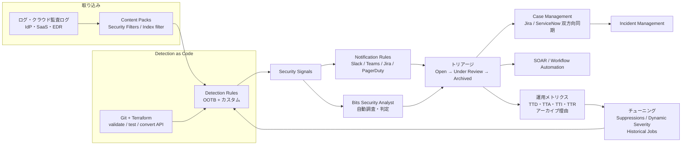
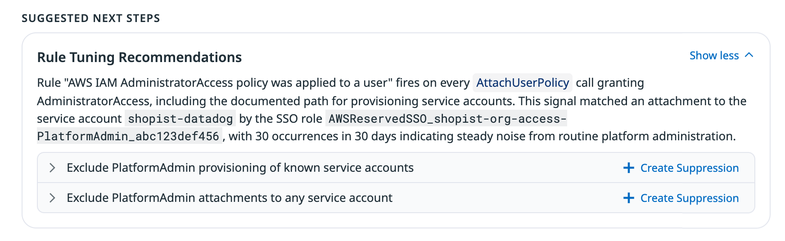
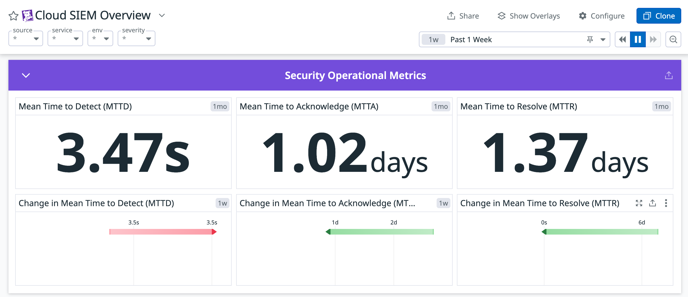
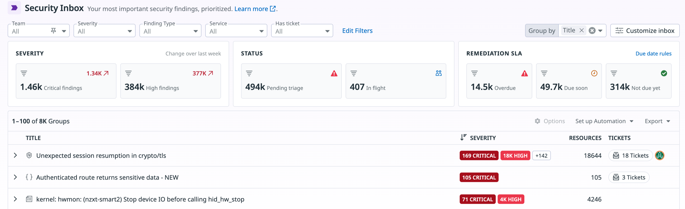
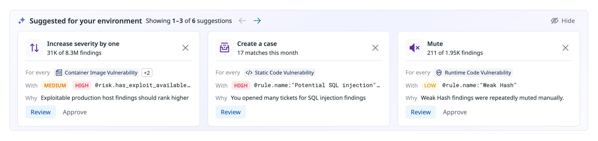

# セキュリティ運用の実践

## 概要

このファイルは、Datadog のセキュリティ製品群を**導入した後に、どう運用し続けるか**を扱う応用編である。対象製品は Cloud SIEM、Cloud Security（旧称：Cloud Security Management / CSM）、Workload Protection（旧称：Cloud Workload Security / CWS）、App and API Protection（旧称：Application Security Management / ASM）、Code Security の 5 つ。次の問いに答える。

- Cloud SIEM にどのログから分析させるべきか。分析量（＝課金）をどう抑えるか。
- 誤検知（False Positive）が多い検知ルールを、検知の観点を失わずにどうチューニングするか。
- 検知ルールをコードで管理し、テストしてからデプロイするにはどうするか（Detection as Code）。
- SOC（Security Operations Center）や当番が、シグナルをどんな手順でトリアージし、ケース化・チケット化・インシデント化するか。
- Bits Security Analyst（AI による自動調査）と SOAR（Workflow Automation）を運用にどう組み込むか。
- TTD / TTA / TTI / TTR などの運用メトリクスで、SOC の効率をどう測るか。
- Cloud Security などの Findings（脆弱性・設定不備）を、期限（SLA）付きで開発チームに渡すにはどうするか（DevSecOps）。

製品仕様（画面・設定項目・制限値）は各リファレンスにまとめてある。本ファイルでは仕様を繰り返さず、**運用の判断基準と手順**を中心に書き、詳細は次のリファレンスへリンクする。

| 製品・領域 | 仕様の正本 |
|---|---|
| Datadog Security 全体、Signals と Findings の違い、RBAC、API・Terraform | [Datadog Security 概要](../02_リファレンス/security/security-platform-overview.md) |
| Cloud SIEM（Content Packs、検知ルール、Suppressions、Historical Jobs、Signals、Investigator） | [Cloud SIEM](../02_リファレンス/security/cloud-siem.md) |
| Cloud Security（Misconfigurations、Identity Risks、Vulnerabilities、Agentless Scanning） | [Cloud Security](../02_リファレンス/security/cloud-security.md) |
| Workload Protection（Agent Rules、ポリシー、自動応答） | [Workload Protection](../02_リファレンス/security/workload-protection.md) |
| App and API Protection（In-App WAF、ブロック、ATO 対策） | [App and API Protection](../02_リファレンス/security/app-and-api-protection.md) |
| Code Security（SAST、SCA、Secret Scanning、IaC、PR Gates） | [Code Security](../02_リファレンス/security/code-security.md) |
| ケース・ワークフロー | [Case Management](../02_リファレンス/service-management/case-management.md)、[Workflow Automation](../02_リファレンス/service-management/workflow-automation.md)、[Incident Management](../02_リファレンス/service-management/incident-management.md) |
| 料金（数値の正本） | [製品別料金表](../03_導入編/pricing-by-product.md) |
| 導入時のセキュリティ・コンプライアンス要件（データ保護、認証、監査） | [セキュリティとコンプライアンス](../03_導入編/security-and-compliance.md) |

> **確度について:** 本ファイルの記述は、基本的に公式ドキュメントと公式ブログ（出典に公開日を併記）に基づく。公式以外の知見には `【第三者情報】`、一般に語られる実務上の知見には `【経験則】` を付ける。

---

## 1. セキュリティ運用の全体像

### 1.1 2 種類の「処理対象」：Signals と Findings

Datadog Security の運用では、性質の異なる 2 種類の処理対象を扱う。運用設計はまずこの 2 つを分けて考える。定義の詳細は [Datadog Security 概要 §3](../02_リファレンス/security/security-platform-overview.md#3-共通データモデルsecurity-signals-と-findings) を参照。

| 観点 | Security Signals（シグナル） | Findings（検出結果） |
|---|---|---|
| 意味 | 進行中の**脅威**（攻撃・不審な振る舞い）の検知 | 静的な**リスク**（脆弱性・設定不備・ID リスク・コードの欠陥） |
| 主な発生源 | Cloud SIEM、Workload Protection、App and API Protection | Cloud Security、Code Security、Workload Protection（Workload Activity）、AAP（API Security） |
| 求められる応答速度 | 分〜時間（当番による即時トリアージ） | 日〜週（期限 SLA に沿った計画的な修復） |
| 主な担当 | SOC・セキュリティ当番・検知エンジニア | 開発チーム・プラットフォームチーム（セキュリティチームは優先度付けと追跡） |
| 主な画面 | Signals Explorer、Cases | Security Inbox、各 Findings エクスプローラー |
| ノイズ制御の手段 | Suppressions、Dynamic Severity、ルールのチューニング | Automation Pipelines（Mute・Severity modifier・Due date・Inbox・Ticket ルール） |
| 運用 KPI | TTD / TTA / TTI / TTR、誤検知率 | 期限超過数（Overdue）、未トリアージ数（Pending triage） |

[出典](https://docs.datadoghq.com/security/security_inbox/) [出典](https://docs.datadoghq.com/security/cloud_siem/respond_and_report/security_operational_metrics/)

### 1.2 運用ライフサイクル

Datadog の公式機能を、検知から改善までのループに当てはめると次の図になる。

---

## 2. 運用体制と役割分担

### 2.1 役割の定義

Datadog は、DevOps チームとセキュリティチームが同じプラットフォームでログ・メトリクス・トレースにピボットできることを Cloud SIEM の特徴としている。[出典](https://docs.datadoghq.com/security/cloud_siem/) そのため、体制は「セキュリティチームだけで閉じない」設計にする。次の表は役割分担の一例である【経験則】。

| 役割 | 主な責任 | Datadog 上の主な作業 |
|---|---|---|
| セキュリティ当番（SOC Tier 1） | シグナルの初動トリアージ、エスカレーション | Signals Explorer の保存ビューの確認、トリアージ状態の変更、ケース作成、Bits Security Analyst の判定の確認 |
| インシデント対応担当（Tier 2 / IR） | 深掘り調査、封じ込め、インシデント指揮 | Investigator、IOC Explorer、SOAR ワークフローの実行、Declare Incident |
| 検知エンジニア（Detection Engineering） | ルールの作成・チューニング・テスト、カバレッジ管理 | Detection Rules、Suppressions、Historical Jobs、MITRE ATT&CK Map、Detection as Code リポジトリ |
| セキュリティプラットフォーム担当 | 取り込み・分析対象の管理、権限、コスト | Content Packs、Security Filters / インデックスフィルタ、RBAC、使用量の監視 |
| クラウドセキュリティ / 脆弱性管理担当 | Findings の優先度付けと期限管理 | Security Inbox、Automation Pipelines、チケット連携 |
| 開発チーム・SRE | Findings の修復、自サービスのアラート対応 | PR コメント・PR Gates、割り当てられた Findings とチケット |

### 2.2 RBAC 設計の勘所

Datadog Security の権限は Datadog 共通の RBAC で管理する。検知ルール、Suppressions、Dynamic Severity ルールにはリソース単位の編集制限（Granular Access Control）がある。[出典](https://docs.datadoghq.com/security/access_control/) 主な権限と既定ロールは [Datadog Security 概要 §10](../02_リファレンス/security/security-platform-overview.md#10-アクセス制御rbac) にある。運用上は次の点に注意する。

| 論点 | 公式仕様 | 運用上の推奨 |
|---|---|---|
| Suppressions の編集権限 | 既定では**全ユーザーが閲覧・編集できる**。三点メニュー → **Permissions** → **Restrict Access** でロール・チーム・ユーザー単位に制限できる。保存前に自分の所属ロールを最低 1 つ含める必要がある [出典](https://docs.datadoghq.com/security/suppressions/) | Standard ロールの開発者が抑制を追加して検知を止めてしまわないよう、本番用の Suppressions と重要ルールは検知エンジニアのチームに編集を限定する【経験則】 |
| 検知ルールの編集権限 | ルールの三点メニュー → **Permissions** → **Restrict Access** で制限できる（既定は全員が閲覧・編集可）[出典](https://docs.datadoghq.com/security/detection_rules/) | Detection as Code に移行したルールは UI 編集を制限し、変更を PR 経由に寄せる |
| シグナルの状態変更 | `Security Signals Write` 権限が必要。変更履歴は Audit Trail に残る [出典](https://docs.datadoghq.com/security/cloud_siem/triage_and_investigate/investigate_security_signals/) | 当番ローテーションに入る人全員に付与する |
| Security Filters の書き込み | `security_monitoring_filters_write` の既定ロールは Admin（[Datadog Security 概要 §10](../02_リファレンス/security/security-platform-overview.md#10-アクセス制御rbac)） | 分析対象（＝課金量）の変更なので、変更手順を決めて記録する |
| Bits Security Analyst の設定 | **Bits Security Analyst Config Write** 権限が必要 [出典](https://docs.datadoghq.com/bits_ai/bits_security_analyst/) | 調査対象ルールと Knowledge Sources の変更者を限定する |
| Workload Protection の応答アクション | `security_monitoring_cws_agent_rules_actions`（既定 Admin）が必要（[Workload Protection](../02_リファレンス/security/workload-protection.md)） | プロセス kill やネットワーク隔離を実行できる人を少数に限定する |
| セキュリティデータの閲覧制限 | Data Access Control の Restricted Dataset で Security Signals、Workload Protection Agent Events、Security Findings【Preview】を制限できる [出典](https://docs.datadoghq.com/security/access_control/) | 内部不正調査などの機微なシグナルを、一般ユーザーから見えなくする必要があるときに使う |

権限・ロール全般は [組織・ユーザー・権限管理](../02_リファレンス/platform/account-and-access-management.md)、操作の監査は [Audit Trail](../02_リファレンス/platform/audit-trail.md) を参照。

---

## 3. 段階的な立ち上げ

### 3.1 推奨する立ち上げ順序

Cloud SIEM の導入は、公式の Getting Started でもセットアップ → 検知 → 調査 → 対応の段階で説明されている（[Cloud SIEM](../02_リファレンス/security/cloud-siem.md#セットアップ手順)）。運用の立ち上げは、次の順に進めるのが安全である。

| フェーズ | 目的 | 主な作業 | 完了の目安 |
|---|---|---|---|
| 0. 体制 | シグナルを閉じる担当を決める | 当番ローテーション、エスカレーション先、トリアージ SOP の作成 | 担当者に `Security Signals Write` 権限があり、通知先が決まっている |
| 1. 取り込み | 「誰が何をしたか」が分かるログを先に集める | クラウド監査ログ、IdP、SaaS 管理ログ、パイプラインで属性が展開されることの確認 | ログが Datadog に届き、標準属性（`@usr.*`、`@network.client.ip`、`@evt.name` 等）に正規化されている |
| 2. 有効化 | Content Packs で OOTB ルールを動かす | Content Pack の有効化、ヘルス状態の確認 | 対象ソースのログが分析されている（`datadog.cloud_siem:true`） |
| 3. 通知 | 重要なシグナルだけを人に届ける | Notification Rules を重大度・ソースで作成 | High / Critical が当番チャネルに届く |
| 4. 慣らし運用 | ノイズを把握する | 2〜4 週間、ルール別のシグナル量とアーカイブ理由を記録【経験則】 | ノイズの多いルールの一覧がある |
| 5. チューニング | ノイズを減らす | Suppressions、Dynamic Severity、ルールの複製・修正 | 当番 1 人で 1 日分を捌ける量になっている |
| 6. 自動化 | 調査と初動を速くする | Bits Security Analyst、SOAR ブループリント、ケース自動作成 | TTA・TTR が測定され、改善傾向にある |
| 7. 継続改善 | カバレッジを広げる | Detection as Code、MITRE ATT&CK のギャップ分析、カスタムルール追加 | ルール変更が PR で管理されている |

日本語の導入解説記事も同じ順序を勧めている。具体的には、Cloud SIEM は届いていないログを検知できないため、先に CloudTrail や IdP のログを届けてパイプラインで属性が展開されることを確認し、ある程度データがたまってから有効化する。シグナルを閉じる担当が決まっていない場合は、Open が積み上がるだけになると指摘している【第三者情報】。[出典](https://www.issoh.co.jp/tech/details/16600/)（2026-08-16 公開、2026-10-12 更新）

### 3.2 自組織の Cloud SIEM 製品形態を最初に確認する

Cloud SIEM には **Standalone / Add-on with Flex Logs / Legacy** の 3 つの製品形態がある。製品形態によって、分析対象ログの制御方法（インデックスフィルタか Security Filters か）や使える機能（Historical Jobs、Sequence 検知、Bits Security Analyst など）が異なる。2026-11-02 時点で新規組織の既定は Standalone（12 か月保持）である。運用手順書を書く前に、**Cloud SIEM > Settings** の表示（Index Configuration / Security Filters Configuration / Sources テーブル）で製品形態を確認する。[出典](https://docs.datadoghq.com/security/cloud_siem/guide/determine-cloud-siem-product/) 判別方法と機能差の表は [Cloud SIEM の「製品形態」節](../02_リファレンス/security/cloud-siem.md#製品形態standalone--add-on-with-flex-logs--legacy) を参照。

> **注意:** Bits Security Analyst は「non-legacy 版の Cloud SIEM」が前提であり、Legacy の組織では使えない。[出典](https://docs.datadoghq.com/bits_ai/bits_security_analyst/)

---

## 4. 分析対象ログの選定とコスト管理

### 4.1 優先して分析させるログ

公式ガイドは、Cloud SIEM の分析対象の管理には原則として **Content Packs** を使うよう勧めている。Content Pack を有効化すると、そのソース用のフィルタが自動で追加・削除される。Security Filters（Add-on with Flex Logs / Legacy）やインデックスフィルタ（Standalone）は、特定環境の除外などの細かい調整にだけ使う。[出典](https://docs.datadoghq.com/security/cloud_siem/guide/customize-which-logs-cloud-siem-analyzes/)

公式ガイドが「重要なセキュリティソース」として示しているクエリは次のとおり。優先順位の列は本ファイルによる整理である【経験則】。

| 優先順位 | ソース | 公式ガイドのクエリ例 | 主に検知できる脅威 |
|---|---|---|---|
| 1 | クラウド監査ログ（AWS） | `source:(cloudtrail OR guardduty OR route53)` | 権限昇格、認証情報の悪用、設定変更、防御回避 |
| 1 | クラウド監査ログ（Google Cloud / Azure） | `source:gcp*`、`source:azure*` | 同上 |
| 1 | ID プロバイダー | `source:(okta OR gsuite OR auth0)` | アカウント乗っ取り、MFA 疲労攻撃、不可能な移動 |
| 2 | Kubernetes 監査ログ | `source:kubernetes.audit` | Secret の不正取得、特権 Pod、exec |
| 2 | ネットワーク（AWS） | `source:(vpc OR waf OR elb OR alb)` | スキャン、C2 通信、データ持ち出し |
| 3 | CDN | `source:(cloudfront OR cloudflare OR fastly)` | Web 攻撃、ボット |
| 3 | Web サーバー | `source:(nginx* OR apache OR iis)` | Web 攻撃（AAP を使っていない場合の補完） |

[出典](https://docs.datadoghq.com/security/cloud_siem/guide/customize-which-logs-cloud-siem-analyzes/)

日本語の導入解説記事は、最初に入れるべきログとして「クラウドの監査ログ・ID プロバイダーのログ・SaaS の管理操作ログ」の 3 系統を挙げている。アプリケーションのデバッグログは検知を増やさず分析量だけを増やすため後回しにする、としている【第三者情報】。[出典](https://www.issoh.co.jp/tech/details/16600/)（2026-08-16 公開）

### 4.2 除外してはいけない属性

分析量を減らそうとして除外フィルタを書くときは、ユーザー・IP・ホストを含むログを誤って除外しないよう注意する。公式ガイドは、次の「重要なユーザーとエンティティ」のクエリを示している。[出典](https://docs.datadoghq.com/security/cloud_siem/guide/customize-which-logs-cloud-siem-analyzes/)

| 対象 | クエリ |
|---|---|
| 名前付きイベント全般 | `@evt.name:*` |
| クライアント IP | `@network.client.ip:*` |
| 宛先 IP | `@network.destination.ip:*` |
| ユーザー | `@usr.id:* OR @usr.name:* OR @usr.email:*` |
| ホスト | `host:* OR instance-id:*` |

### 4.3 Security Filters の落とし穴

Security Filters は **geoIP・脅威インテリジェンス・OCSF のエンリッチメントより前に評価される**。そのため、エンリッチメントで付く属性をフィルタ条件に使うと、何も一致しない。[出典](https://docs.datadoghq.com/security/cloud_siem/guide/customize-which-logs-cloud-siem-analyzes/)

| 区分 | 属性 | フィルタでの扱い |
|---|---|---|
| フィルタ時点で存在しない | `network.ip.list`、`network.ip.attributes`、`network.client.is_private_network_ip`、`network.destination.is_private_network_ip`、`ocsf.observables`、`ocsf.type_uid` | 何も一致しない。`source`・`service`・`host`・タグ・パース済み属性で書き直す |
| ログパイプラインの設定次第 | `network.client.geoip`（とサブ属性）、`threat_intel.results`、`threat_intel.indicators_matched` | ログパイプラインに GeoIP Parser / Threat Intel 系のプロセッサーがある場合のみ使える。脅威インテリジェンスは自組織のソースによるため、Cloud SIEM 側の Datadog 管理の脅威インテリジェンスとは一致結果が異なりうる |

検知ルール、抑制ルール、シグナルクエリはエンリッチメントの**後**に動くので、これらの属性を参照できる。[出典](https://docs.datadoghq.com/security/cloud_siem/guide/customize-which-logs-cloud-siem-analyzes/)

**変更の検証手順**（公式のトラブルシューティング）：

1. Logs Explorer で `datadog.cloud_siem` タグを確認する。`false` なら Security Filters で除外されている。`true` なら分析されているので、検知ルール側を調べる。
2. フィルタ時点で存在しない属性を条件に使っていないか確認する。
3. UI の Preview ペイン、または API で全フィルタを GET し、組み合わせの効果を確認する。

[出典](https://docs.datadoghq.com/security/cloud_siem/guide/customize-which-logs-cloud-siem-analyzes/)

### 4.4 Standalone のインデックス順序

Standalone では、Cloud SIEM のインデックスに入るログがそのまま分析対象になる（インデックスフィルタで制御）。[出典](https://docs.datadoghq.com/security/cloud_siem/guide/customize-which-logs-cloud-siem-analyzes/) ログのインデックスは上から順に照合され、最初に一致したインデックスにだけ入る（[Indexes・保持・アーカイブ](../02_リファレンス/logs/log-indexes-retention-archives.md)）。日本語の解説記事は、有効化時に作られる Cloud SIEM 専用インデックスを一覧の先頭に置かないと、既存インデックスにログが入ってシグナルが出ない原因になると注意している【第三者情報】。[出典](https://www.issoh.co.jp/tech/details/16600/)（2026-08-16 公開）

### 4.5 分析量を抑える施策

| 施策 | 内容 | 根拠 |
|---|---|---|
| 課金対象外のソースを把握する | Workload Protection の Agent のログ（`source:runtime-security-agent`）と Cloud Security Misconfigurations のログ（`source:compliance-agent`）は、フィルタ設定に関係なく分析ログとして課金されない | [出典](https://docs.datadoghq.com/security/cloud_siem/guide/customize-which-logs-cloud-siem-analyzes/) |
| Content Pack 単位で入れる | 使っていない Content Pack を有効にしない。有効化と無効化でフィルタが自動で変わる | [出典](https://docs.datadoghq.com/security/cloud_siem/guide/customize-which-logs-cloud-siem-analyzes/) |
| 環境単位で除外する | 例：既定フィルタに `env:staging` の除外フィルタを追加（Add-on with Flex Logs / Legacy） | [出典](https://docs.datadoghq.com/security/cloud_siem/guide/customize-which-logs-cloud-siem-analyzes/) |
| 取り込み前に削る | Observability Pipelines で、VPC Flow Logs などの大量ログをフィルタ・重複排除・フィールド削減してから送る。セキュリティ向けのログと運用向けのログで送り先を分けることもできる（Split Logs テンプレート） | [出典](https://www.datadoghq.com/blog/manage-high-volume-logs-with-observability-pipeline-packs/)（2025-11 公開）、送り先の分割は[出典](https://docs.datadoghq.com/observability_pipelines/)、[Observability Pipelines](../02_リファレンス/logs/observability-pipelines.md) |
| 分析量を監視する | Usage 画面の Cloud SIEM タイルを定期的に確認し、急増時に原因ソースを特定する | [Usage・Usage Attribution・Cost Visibility](../02_リファレンス/platform/usage-and-cost-attribution.md) |

コスト最適化の全体像は [コスト最適化](./cost-optimization.md) を、ログの取り込み・保持の設計は [ログ管理の実践](./log-management-practices.md) を参照。

---

## 5. 検知ルールの運用とチューニング

### 5.1 ルール整備の基本方針

| 方針 | 内容 | 根拠 |
|---|---|---|
| まず OOTB ルールを一巡させる | Content Packs に既製ルールが含まれる。一般的な攻撃パターンを自作すると OOTB ルールと重複して保守だけが残るので、自作は自社固有のタグ・資産命名・業務ロジックに依存する条件に絞る | 【第三者情報】[出典](https://www.issoh.co.jp/tech/details/16600/)（2026-08-16 公開） |
| クエリを先に Log Explorer で確かめる | 検知ルールのクエリは Datadog 共通の検索構文なので、Log Explorer で期待どおりのログが返るかを確認してからルールにする | [出典](https://www.datadoghq.com/blog/writing-datadog-security-detection-rules/)（2021-12-15 公開、2023-10-02 更新。2 年以上前の情報のため UI 名称等が現行と異なる可能性あり） |
| 前処理で標準属性に寄せる | ログを前処理して標準属性（例：`evt.name`、`evt.outcome`、`network.client.geoip`）にそろえると、環境をまたいで使える汎用ルールを書ける | 同上 |
| 新ルールはバックテストしてから有効化 | Historical Jobs で過去ログに当て、件数を見てから有効化する | [出典](https://docs.datadoghq.com/security/cloud_siem/detect_and_monitor/historical_jobs/)、【第三者情報】[出典](https://www.issoh.co.jp/tech/details/16600/)（2026-08-16 公開、2026-10-12 更新） |
| 学習型の検知は平常データがたまってから | New Value・Anomaly・Impossible Travel など学習期間が必要な検知方式は、平常時のデータがたまってから評価する | 【第三者情報】[出典](https://www.issoh.co.jp/tech/details/16600/)（2026-08-16 公開、2026-10-12 更新） |
| シグナルのメッセージを定型化する | ルールの目的、検知の考え方、修復手順、MITRE ATT&CK・CIS などへのタグ付けを含むテンプレートで書く。テンプレート変数（例：`{{@network.client.ip}}`）で、その IP に絞ったダッシュボードへのリンクを埋め込む | [出典](https://www.datadoghq.com/blog/writing-datadog-security-detection-rules/) |
| MITRE のタグを正しく付ける | カスタムルールを MITRE ATT&CK Map に表示するには、正しい組の `tactic:` と `technique:` タグが必要（アクティブソースに表示するには `source` タグも必要） | [出典](https://docs.datadoghq.com/security/cloud_siem/detection_rules/mitre_attack_map/) |

### 5.2 誤検知への対処の判断表

ノイズの多いルールへの対処は、**ルールを無効化するのではなく、最小範囲で除外する**のが原則である。ルールを無効化すると、その検知の観点がまるごと失われる【第三者情報】。[出典](https://www.issoh.co.jp/tech/details/16600/)（2026-08-16 公開、2026-10-12 更新）

| 症状 | 第一の対処 | Datadog の機能 |
|---|---|---|
| 正当な特定の主体（CI 用ロール、踏み台、スキャナー、社内 VPN の出口 IP 等）が繰り返し一致する | その主体だけを除外する | Suppressions（ログ / イベント属性の抑制クエリ） |
| 負荷試験・メンテナンスなど一時的な作業で大量に発火する | 期限付きで除外する | Suppressions の有効期限、または短時間の抑制を UI で作成 |
| 本番以外の環境で発火するが、重要度は低い | 環境ごとに重大度を変える | Dynamic Severity（Decrease / Increase） |
| 重要資産（本番 DB、管理者アカウント）での発火を見逃したくない | 重大度を上げる | Dynamic Severity（Increase、または特定の重大度を常に適用） |
| ルールのクエリやしきい値そのものが広すぎる | ルールを修正する（OOTB は複製して修正） | Clone rule、ルールのケース・しきい値の変更、Historical Jobs で再検証 |
| 正しく発火しているが、対応不要な既知の状況である | アーカイブ理由を記録して閉じ、件数が多ければ抑制する | Archived（理由と説明）＋ Suppressions |
| ノイズの原因が分からない | Bits Security Analyst の Rule Tuning Recommendations を参照する | Bits Security Analyst（§7.5） |

Dynamic Severity の仕様は [Cloud SIEM の Dynamic Severity 節](../02_リファレンス/security/cloud-siem.md#dynamic-severity動的重大度) を参照。

### 5.3 Suppressions の設計原則

Suppressions は Cloud SIEM・Workload Protection・App and API Protection で共通の仕組みである。[出典](https://docs.datadoghq.com/security/suppressions/) 仕様の一覧は [Cloud SIEM の Suppressions 節](../02_リファレンス/security/cloud-siem.md#suppressions抑制) にある。運用上の原則は次のとおり。

| 原則 | 理由・根拠 |
|---|---|
| **ログ / イベント属性の抑制を使う** | シグナル属性の抑制はシグナル作成時にしか評価されず、シグナル更新時には再評価されない。ログ / イベント属性の抑制は、一致イベントが新規シグナルにも既存シグナルの更新にも影響しない。公式は確実な除外にログ / イベント属性の抑制を勧めている [出典](https://docs.datadoghq.com/security/suppressions/) |
| **条件は特定できる属性に絞る** | 踏み台ホスト、CI 実行ロール、VPN の出口 IP のように特定できる属性に限定し、重大度でまとめて落とすような粗い条件は避ける【第三者情報】[出典](https://www.issoh.co.jp/tech/details/16600/)（2026-08-16 公開、2026-10-12 更新） |
| **説明欄に理由を書く** | Suppression ルールには説明欄があり、なぜ抑制するのかを記録できる [出典](https://docs.datadoghq.com/security/suppressions/)。チケット番号や承認者も書いておくと棚卸しが楽になる【経験則】 |
| **有効期限を付ける** | 有効期限は任意だが、期限を設定すると期限日に自動で無効化される [出典](https://docs.datadoghq.com/security/suppressions/)。恒久的な除外以外は期限を付け、四半期ごとに棚卸しする【経験則】 |
| **複数ルールに共通の除外は Suppression ルールにまとめる** | 1 つの Suppression ルールを複数の検知ルールに適用できる [出典](https://docs.datadoghq.com/security/suppressions/)。例：脆弱性スキャナーの送信元 IP は、全 Web 系ルールに対して 1 か所で管理する |
| **長期の抑制はコード、短期の抑制は UI** | Datadog 社内の検知エンジニアリングチームは、長期の抑制を Terraform（`datadog_security_monitoring_suppression`）で管理し、4 時間やメンテナンス時間帯のような短期の抑制は速さを優先して UI で作成している [出典](https://www.datadoghq.com/blog/datadog-detection-as-code/)（2024-10-11 公開） |
| **編集権限を絞る** | 既定では全ユーザーが編集できる。三点メニュー → Permissions → Restrict Access で制限する [出典](https://docs.datadoghq.com/security/suppressions/) |

シグナルから抑制を作るには、サイドパネルの What Happened セクションにあるファネルアイコンを使う。[出典](https://docs.datadoghq.com/security/cloud_siem/triage_and_investigate/investigate_security_signals/)

### 5.4 ルールの時間パラメータの考え方

検知ルールには、評価ウィンドウ（`evaluationWindow`）、シグナルを更新し続ける期間（`keepAlive`）、シグナルの最大継続時間（`maxSignalDuration`）などのオプションがある。各オプションの選択肢と既定値は [Cloud SIEM の「その他のパラメータ」節](../02_リファレンス/security/cloud-siem.md#その他のパラメータother-parameters) を参照。公式ブログに掲載された実例は次のとおり。

| 出典の例 | 設定 | 読み取れる考え方 |
|---|---|---|
| Kubernetes の Secret アクセス拒否検知（Datadog 社内ルール） | evaluation window 300 秒、keep alive 600 秒、max signal duration 900 秒。拒否が 2 回以上（`> 1`）で Low のシグナル | 短い窓で検知し、同じ事象の続きは同じシグナルにまとめて通知の重複を防ぐ [出典](https://www.datadoghq.com/blog/datadog-detection-as-code/)（2024-10-11 公開） |
| New Value 検知の例（Snowflake の外部アクセス） | `learningDuration` 7 日。`forgetAfter` は最大 30 日で、34 を指定すると validation API がエラーを返した（修正後は 28） | New Value 系は学習期間と忘却期間の上限を意識して設定する [出典](https://www.datadoghq.com/blog/detection-as-code-cloud-siem/)（2025-06-11 公開） |
| 認証のブルートフォース検知 | `evt.name:authentication` と `evt.outcome` で 5 分間の失敗・成功を集計し、「複数回の失敗後に成功」をケースで高い重大度にする | ルールのケース（条件分岐）で重大度を付け分ける [出典](https://www.datadoghq.com/blog/writing-datadog-security-detection-rules/)（2023-10-02 更新） |

### 5.5 Historical Jobs によるバックテスト

Historical Jobs は、保存済みの過去ログに対して検知ルールを 1 回だけ実行する機能である。結果はシグナルの軽量版（job result）で、必要なものだけをシグナルに変換できる。[出典](https://docs.datadoghq.com/security/cloud_siem/detect_and_monitor/historical_jobs/) 運用では次の場面で使う。

| 場面 | 使い方 |
|---|---|
| 新規ルールの有効化前 | 過去 1 日〜数週間に当て、件数と内容を見てからリアルタイムルールとして有効化する |
| チューニングの効果確認 | 抑制条件やしきい値を変えたルールを過去ログに当て、減った件数と残った件数を比べる |
| 新しい脅威情報が出たとき | 公開された IOC や手口をクエリにして過去ログに当て、侵害の有無を遡って調べる（脅威ハンティング） |
| インシデント後の振り返り | 「このルールがあれば検知できたか」を確かめる |

API からは `POST /api/v2/siem-historical-detections/jobs` で、`from`・`to`・`index`・ルール `id` を指定して実行できる。[出典](https://www.datadoghq.com/blog/detection-as-code-cloud-siem/)（2025-06-11 公開）

> **サイト差異:** Historical Jobs は `app.ddog-gov.com`（US1-FED）と `us2.ddog-gov.com` では提供されない。[出典](https://docs.datadoghq.com/security/cloud_siem/detect_and_monitor/historical_jobs/)

### 5.6 ルール品質の測り方

| 指標 | 取得方法 | 使い方 |
|---|---|---|
| ルール別のシグナル量と推移 | Signals Explorer の Visualize by：**Rules List** | 量の多い上位ルールからチューニングする |
| 誤検知率・真陽性率 | アーカイブ理由（True Positive: Malicious / True Positive: Benign / False Positive 等）を記録し、Cloud SIEM Overview の Detection rules performance モジュールで確認 | 誤検知率の高いルールを優先してチューニングする（[Cloud SIEM のトリアージ状態](../02_リファレンス/security/cloud-siem.md#トリアージ状態)） |
| MITRE ATT&CK カバレッジ | MITRE ATT&CK Map（アクティブソースのルール密度） | ルールのない戦術・技術を洗い出し、ログソースの追加かカスタムルールで埋める |
| 検知の実働確認 | Threatest 等による定期的な攻撃エミュレーション（§6.4） | 「ログが届かなくなってルールが沈黙している」状態を検出する |

アーカイブ理由をつけずに閉じる運用だと、誤検知率が測れなくなる。トリアージ SOP で「アーカイブ時は必ず理由を選ぶ」と決めておく【経験則】。

### 5.7 OOTB ルールの更新と廃止への追従

OOTB ルールは Datadog が更新・追加・廃止する。廃止の扱いは [Datadog Security 概要 §4.8](../02_リファレンス/security/security-platform-overview.md#48-ルールの廃止deprecation) を参照。OOTB ルールもカスタムルールと同様に編集できる（三点メニュー → Edit default rule）。元のルールを残したい場合は、複製して変更し、元のルールを無効化する方法が公式に示されている。[出典](https://docs.datadoghq.com/security/detection_rules/) 大きく変える場合は、OOTB ルールを直接編集するより、複製したカスタムルールとして管理し元の OOTB ルールを無効化するほうが、Datadog の更新と自社の変更が混ざらず追跡しやすい【経験則】。

---

## 6. Detection as Code

### 6.1 なぜコードで管理するか

検知ルールは JSON で定義されている。Terraform などのコードで管理すると、デプロイの標準化と変更履歴の追跡がしやすくなる。[出典](https://www.datadoghq.com/blog/detection-as-code-cloud-siem/)（2025-06-11 公開） 一般的な Monitoring as Code の考え方は [Monitoring as Code](./monitoring-as-code.md)、Terraform 全般は [Terraform と IaC](../02_リファレンス/platform/terraform-and-iac.md) を参照。

### 6.2 公式が示すワークフローと API

公式ブログ「Build, test, and scale detections as code with Datadog Cloud SIEM」（2025-06-11 公開）は、次の 6 ステップを示している。

| ステップ | 内容 | API・ツール |
|---|---|---|
| 1. 形式の検証（Lint） | デプロイ前にスキーマエラーを見つける | `POST /api/v2/security_monitoring/rules/validation` |
| 2. モックデータでの単体テスト | クエリのロジックを単独で検証する。各ペイロードに `expectedResult`・`index`・`payload` を持たせ、レスポンスの `results`（真偽値の配列）を比べる。**検証対象はクエリのロジックで、ケース（条件）のロジックは対象外** | `POST /api/v2/security_monitoring/rules/test` |
| 3. 過去データでのバックテスト | 過去ログに当てて挙動を見る | `POST /api/v2/siem-historical-detections/jobs` |
| 4. Terraform への変換 | JSON のルールを Terraform 形式に変換する（UI の Export メニューでも可） | `POST /api/v2/security_monitoring/rules/convert`（結果は `terraformContent`） |
| 5. デプロイ | API で動的にデプロイするか、Terraform で管理する | ルール作成 API、Terraform `datadog_security_monitoring_rule` |
| 6. バージョン管理と監査 | 更新内容と更新者の履歴を確認する | `GET /api/v2/security_monitoring/rules/{id}/version_history`（`page[size]`・`page[number]`） |

[出典](https://www.datadoghq.com/blog/detection-as-code-cloud-siem/)

Datadog Security の Terraform リソース（`datadog_security_monitoring_rule`、`datadog_security_monitoring_default_rule`、`datadog_security_monitoring_suppression`、`datadog_security_monitoring_filter`、`datadog_security_notification_rule`、`datadog_security_monitoring_critical_asset`、`datadog_csm_threats_agent_rule` 等）の一覧は [Datadog Security 概要 §11](../02_リファレンス/security/security-platform-overview.md#11-api-と-infrastructure-as-code) を参照。Findings 側の自動化ルールも `datadog_security_findings_mute_rule`、`datadog_security_findings_due_date_rule` で管理できる。[出典](https://docs.datadoghq.com/security/automation_pipelines/mute/) [出典](https://docs.datadoghq.com/security/automation_pipelines/set_due_date/)

### 6.3 Datadog 社内の実装例

Datadog 自身の検知エンジニアリングチームの実践が、公式ブログ「How we use Datadog for detection as code」（2024-10-11 公開）で紹介されている。

**リポジトリ構成**

| ディレクトリ・ファイル | 内容 |
|---|---|
| `rules/` | データソース別（例：`aap`、`azure`、`cws`、`github`、`k8s`）。各ディレクトリの `config.tf` が再利用可能な Terraform モジュールになっており、同じ定義を複数の Datadog 組織に配布できる |
| `organizations/` | 環境（`prod`、`staging`）ごとのディレクトリ、その下にデータソース別のサブディレクトリ。それぞれに `backend.tf`（リモートステート）と `main.tf` |
| `main.tf` | ルールモジュールを参照し、`rules` マップで組織ごとに個別ルールを無効化できる（例：`permission_elevation = false`） |
| `tests/` | データソース別のエンドツーエンドテスト定義 |
| `.gitlab-ci.yml` | CI/CD パイプライン |

**Terraform ステートの分割**：当初は全ルールを 1 つのステートで管理していたが、1 つの apply の失敗が後続のすべての変更を止めた。現在は**組織 × ルールセット**ごとにステートを分け、1 つの組織・データソースの失敗が他に波及しないようにしている。

**CI/CD パイプライン（GitLab）**

| ステージ | 内容 |
|---|---|
| `.pre` | パイプラインのトレースを CI Visibility に送る |
| `lint` | Terraform プロバイダーの構文チェックとタグ付けの強制 |
| `test` | サンドボックスにルールを apply し、合成ログのジョブを実行して破棄する（`apply`・`destroy`・`synthetic-logs`） |
| `check` | 変更が影響する組織を特定し、変更モジュールの一覧を成果物として出す。後続ジョブは影響する組織だけで動く |
| `plan` | フィーチャーブランチで組織ごとに `terraform plan` を実行する |
| `deploy` | `main` へのマージ後に影響組織で `terraform apply`。定期実行の apply で UI からの手動変更（ドリフト）を検出・修正する。MITRE ATT&CK の技術カバレッジを JSON に出力し、社内の ATT&CK Navigator に反映する |

**開発の流れ**：(1) Log Search でクエリを作る → (2) サンプルログと（可能なら）Stratus Red Team でテスト → (3) UI でルールを作る → (4) 所定の形式で Terraform にエクスポート → (5) PR を作成し lint・test・plan を自動実行 → (6) コードレビューと承認 → (7) `main` にマージして対象組織にデプロイ → (8) Cloud SIEM でシグナルを確認。

[出典](https://www.datadoghq.com/blog/datadog-detection-as-code/)

### 6.4 攻撃エミュレーションによる継続テスト

Datadog は検知のテスト用に 2 つの OSS を公開している。どちらも Apache-2.0 ライセンスである。

| ツール | 内容 | 運用での使い方 |
|---|---|---|
| **Stratus Red Team** | 「クラウド版の Atomic Red Team」。MITRE ATT&CK に対応付けた攻撃手法を、単体の Go バイナリで粒度細かく再現する。AWS、Azure、GCP、Entra ID、Kubernetes が対象（リポジトリのトピック等による） | 新しいルールが実際の攻撃操作で発火するかを確かめる [出典](https://github.com/DataDog/stratus-red-team) |
| **Threatest** | 検知ルールのエンドツーエンドテスト用の CLI・Go フレームワーク。Detonator（ローカルコマンド、SSH、Stratus Red Team、AWS CLI など）で攻撃を実行し、Matcher（Datadog のセキュリティシグナル、ログ、Agent イベント等）で期待するシグナルが出たかを確認する。実行ごとに UUID を付け、Stratus Red Team と AWS の Detonator では user-agent に入れてシグナルと実行を対応付ける。シナリオは YAML で書き、`threatest lint` で検証、`threatest run` で実行する | 定期実行して「ログが来なくなった」「ルールが壊れた」ことを検知する [出典](https://github.com/DataDog/threatest) |

Datadog 社内では、Stratus Red Team と Threatest をもとにした社内サービスがデータソースごとのテスト（例：毎時の cron で専用のテスト組織に対して `authorized_keys` を変更するコマンドを実行し、期待するルール名のシグナルを待つ）を実行する。期待したシグナルが出なければアラートが上がり、検知エンジニアがログ収集かルールを調べる。[出典](https://www.datadoghq.com/blog/datadog-detection-as-code/)（2024-10-11 公開）

### 6.5 Detection as Code の導入判断

| 状況 | 推奨【経験則】 |
|---|---|
| カスタムルールが十数本以下、編集者が少数 | UI 管理＋ルールの Version History で十分。Export to Terraform でバックアップだけ取る |
| カスタムルールが多い、または複数組織（本番・検証、子組織）に同じルールを配る | Terraform モジュール化と CI での validate / test を導入する。複数組織の運用は [大規模・マルチorg運用](./large-scale-and-multi-org.md) を参照 |
| 監査でルール変更の承認証跡が求められる | PR レビューを必須にし、UI 編集を Restrict Access で制限、定期 apply でドリフトを戻す |

---

## 7. トリアージと SOC 連携

### 7.1 トリアージ状態と SOP

Cloud SIEM のシグナルのトリアージ状態は `Open`（既定）→ `Under Review` → `Archived` の 3 つである。`Archived` には理由と説明を記録でき、再発したら `Open` に戻せる。**すべてのシグナルは作成から 30 日後にロックされる。**[出典](https://docs.datadoghq.com/security/cloud_siem/triage_and_investigate/investigate_security_signals/)

これを前提にしたトリアージ SOP の例を示す【経験則】。

| ステップ | 当番の作業 | Datadog の操作 |
|---|---|---|
| 1. 受信 | 通知（Slack / Teams / PagerDuty 等）または保存ビューでシグナルを確認する | Open だけに絞った保存ビュー（例：`status:(high OR critical OR medium) @workflow.triage.state:open`）を当番が毎回開く |
| 2. 着手 | 担当を宣言する | **Assign Signal** で自分を割り当て、状態を `Under Review` にする（これが TTA の終点 T2 になる） |
| 3. 一次判断 | Bits Security Analyst の判定（Benign / Suspicious）と根拠を確認する | Bits Security Analyst タブ、サイドパネル |
| 4. 調査 | 関連ログ・エンティティ・関連シグナルを確認する | Logs / Entities / Related Signals タブ、Investigator、IP ダッシュボード |
| 5a. 誤検知・対応不要 | 理由を付けて閉じ、繰り返すなら抑制を起票する | `Archived` ＋理由、ファネルアイコンから Suppression |
| 5b. 要対応 | ケースを作るかインシデントを宣言する | Create Case / Declare Incident、SOAR ワークフロー実行 |
| 6. 30 日ルール | 30 日でロックされるので、長期化する調査はケース側で継続する | Case Management |

日本語の解説記事は、ケースを作成するとシグナルが自動で `Under Review` に移ることを利用し、担当の割り当てとケース作成を同じ操作にまとめる運用を提案している【第三者情報】。[出典](https://www.issoh.co.jp/tech/details/16600/)（2026-08-16 公開）

### 7.2 通知の設計

通知は、検知ルールごとに宛先を設定するよりも **Notification Rules** で重大度・ルール種別・タグ・属性ごとにまとめて設定するほうが管理しやすい。Notification Rules は Cloud SIEM・Cloud Security・AAP・Workload Protection で共通である（仕様は [Cloud SIEM の Notification Rules 節](../02_リファレンス/security/cloud-siem.md#notification-rules通知ルール)）。

| 重大度 | 通知の例【経験則】 |
|---|---|
| Critical | 当番のページング（PagerDuty / Datadog On-Call）＋セキュリティチャネル |
| High | セキュリティチャネル＋ケース自動作成 |
| Medium | セキュリティチャネル（Bits Security Analyst の結論を待ってから判断） |
| Low / Info | 通知しない。保存ビューで日次確認、または週次レビュー |

- Bits Security Analyst の調査完了を通知するには、Notification Rule の条件に `@workflow.bits_investigator.state:*` を追加する。[出典](https://docs.datadoghq.com/bits_ai/bits_security_analyst/)
- Slack や Jira にシグナル通知を送っている場合、Bits Security Analyst がその通知に調査結論と調査へのリンクを返信として自動追加する。[出典](https://docs.datadoghq.com/bits_ai/bits_security_analyst/)
- アラート疲れを避ける一般的な考え方は [アラート設計とノイズ削減](./alert-design-and-noise-reduction.md)、通知チャネルは [通知・コラボレーション連携](../02_リファレンス/platform/collaboration-integrations.md)、当番体制は [On-Call](../02_リファレンス/service-management/on-call.md) を参照。

> **サイト差異・契約差異:** HIPAA が有効なアカウントでは、セキュリティ通知を Webhook で送れず、通知先に `@webhook-...` を使えない。[出典](https://docs.datadoghq.com/security/cloud_siem/guide/automate-the-remediation-of-detected-threats/)

### 7.3 ケース管理とチケット連携

Cloud SIEM のシグナルは Case Management のケースに集約できる。公式ブログ（2026-05-05 公開）は、Cloud SIEM のケース機能として次を挙げている。[出典](https://www.datadoghq.com/blog/cloud-siem-cases/)

| 機能 | 内容 |
|---|---|
| ケース表示 | Signals Explorer の各シグナルに、既存ケースへの紐付けの有無が表示され、ホバーで状態・担当・タイムラインを確認できる |
| シグナルからのエスカレーション | シグナルのページからケースを作成すると、シグナルのメタデータと調査内容が入る |
| Cases ワークスペース | 担当、状態、証拠、活動を追跡し、進行中・ブロック中・解決済みのケースが分かる |
| Jira / ServiceNow 同期 | ケースとチケットを 1 対 1 で双方向同期（状態変更、担当、コメント） |
| Slack 連携 | ケースの通知を Slack チャネルに投稿し、スレッドの返信をケースのタイムラインに追加 |
| ケースの自動作成 | 通知設定と自動化ルールで、条件（例：高重大度）に合うシグナルから自動でケースを作る |
| Workflow Automation | ケースから対応ワークフロー（情報収集、関係者への通知、チケット更新、修復ランブック）を実行 |

**設定上の注意**（[Cloud SIEM の Case Management 節](../02_リファレンス/security/cloud-siem.md#case-management-とインシデント連携) より）

- ケースを作成すると、シグナルの状態が `Under Review`、担当が作成者になる（設定で変更可能）。
- セキュリティケースのプロジェクトは最大 20 個まで選択できる。
- 「case to signal archive reason mapping」で、ケースの解決理由がシグナルのアーカイブ理由にどう対応するかを確認できる。ケース側で解決理由を正しく選べば、§5.6 の誤検知率の集計に反映される。

**チケット連携の仕様差**（Security 共通の Ticketing Integrations）

| 項目 | 内容 |
|---|---|
| 対応チケットシステム | Jira、ServiceNow、Linear |
| チケットを作れる製品 | Code Security、Cloud Security、Cloud SIEM、App and API Protection、Workload Protection |
| 双方向同期の対象 | Code / Cloud Security の Findings、App and API Protection、Workload Protection（**Cloud SIEM はこのページの双方向同期の対象に記載なし**。Cloud SIEM のケースと Jira / ServiceNow の同期は上記ケース機能で行う） |
| 正となるデータ | Datadog が正。Findings はチケットを閉じても、修復されるかミュートされるまで開いたまま。修復されると関連するケースとチケットは閉じる |
| 一括作成 | 最大 50 件の Findings を選んでチケットを作れる |
| ServiceNow の制約 | 双方向同期と既存チケットへの紐付けは ITSM モードのみ。ITOM のイベントは同期されない。指定できる URL は incident のみ |

[出典](https://docs.datadoghq.com/security/ticketing_integrations/)

> **サイト差異:** Ticketing Integrations は `us2.ddog-gov.com` では提供されない。Linear は `app.ddog-gov.com` と `us2.ddog-gov.com` で使えない。[出典](https://docs.datadoghq.com/security/ticketing_integrations/)

### 7.4 インシデントへのエスカレーション

シグナルのサイドパネルの Next Steps にある **Declare Incident** から、インシデントテンプレートに入力して宣言するか、既存インシデントにシグナルを追加する。ケースが重大と判断されたら、ケースから Declare Incident でエスカレーションできる。[出典](https://docs.datadoghq.com/security/cloud_siem/triage_and_investigate/investigate_security_signals/) セキュリティインシデントを障害対応と同じ Incident Management で扱う場合は、重大度定義・宣言基準・連絡体制をセキュリティ用に別途決めておく（[Incident Management](../02_リファレンス/service-management/incident-management.md)、[運用設計](../03_導入編/operations-design.md)）【経験則】。

### 7.5 Bits Security Analyst の運用

Bits Security Analyst（Bits AI Security Analyst とも表記）は、Cloud SIEM のシグナルをエンドツーエンドで自律的に調査する AI エージェントである。シグナルとログを照会し、データに基づく推論で判定を推奨する。[出典](https://docs.datadoghq.com/bits_ai/bits_security_analyst/) 2026-03-23 の公式ブログで、Cloud SIEM での一般提供（GA）が発表された。[出典](https://www.datadoghq.com/blog/cloud-siem-whats-new-rsa-2026/)

| 項目 | 仕様 |
|---|---|
| 判定 | **Benign**（セキュリティ上の懸念なし）/ **Suspicious**（追加調査が必要）。判定が出るまで Severity 列は「Investigating」と表示 |
| 調査結果パネル | 全体の結論と主要な根拠、推奨される次のステップ（修復、**ルールの抑制・チューニングの推奨**を含む）、調査の各ステップ（クエリと結果、分析） |
| パネルからの操作 | 調査結果入りの作業項目の作成、SOAR ブループリントのワークフロー実行、インシデント宣言、ルールの抑制追加、シグナルのアーカイブ、フィードバック |
| 自動調査の対象 | 有効化すると、Datadog がルール（カスタムルールを含む）を分析し、調査できるかを判定する。**Medium より上の重大度**の対象ルールは自動で調査が始まる |
| 対象の絞り込み | Rule Settings（最小重大度、ルール単位の有効 / 無効）または Query Filter（シグナルクエリ） |
| 設定場所 | Security > Settings > Bits Security Analyst > Analyst Configuration |
| 外部ツールの認証情報 | 一部のソース（例：SentinelOne、CrowdStrike）は Actions Catalog の HTTP 接続が必要 |
| Knowledge Sources | **General Org Context（Bits.md）**：全調査に適用する組織全体の指示。**Situational Context**：特定状況で使う事実（タイトル、説明、有効 / 無効、任意の有効期限） |
| 前提 | non-legacy 版の Cloud SIEM、Bits Security Analyst Config Write 権限 |
| 無効化 | Analyst Configuration の最下部で無効化。**無効化するとすべての設定が恒久的にリセットされる** |

[出典](https://docs.datadoghq.com/bits_ai/bits_security_analyst/)

**対応ログソース（2026-11-02 時点）**：1Password、Amazon GuardDuty（対応する検出タイプのみ）、Atlassian Event Logs、Auth0、AWS CloudTrail、Azure、Claude Compliance Logs、Cloudflare、Confluence Audit Records、CrowdStrike、Email phishing、GCP、GitHub、GitLab、Google Workspace、Jira Audit Records、JumpCloud、Kubernetes、Microsoft 365、Microsoft Defender for EDR、Microsoft Entra ID、Okta、Salesforce、SentinelOne、Slack、Snowflake、Windows、Zendesk。対応ソースの OOTB ルールでも、SIEM 以外のテレメトリが必要なために対象外となる場合がある（**Show currently ineligible rules** で確認）。[出典](https://docs.datadoghq.com/bits_ai/bits_security_analyst/)

**運用上の勘所**

| 論点 | 推奨 |
|---|---|
| 判定の扱い | Benign 判定でも、Critical のシグナルや重要資産に関するシグナルは人が確認してから閉じる。判定を自動アーカイブの条件にするかどうかは、一定期間 Benign 判定と人の判断の一致率を記録してから決める【経験則】 |
| 組織固有の文脈 | 「この IP 帯は社内 VPN」「このロールは CI 専用」などの既知の正当な活動を General Org Context や Situational Context に書くと、調査の前提として使われる。期間限定の事情（ペネトレーションテスト期間など）は有効期限付きの Situational Context にする【経験則】 |
| チューニングへの活用 | 調査結果の Rule Tuning Recommendations から、そのまま抑制を作成できる（下図）。ただし抑制の範囲は §5.3 の原則で確認してから採用する |
| フィードバック | 判定が誤っていたらパネルからフィードバックを送る |
| 料金 | Cloud SIEM の料金ページでは、Bits Security Analyst の調査が分析 1 TB あたり月 100 回まで無料（最低 月 50 回）とされている（[製品別料金表](../03_導入編/pricing-by-product.md)）。超過分の扱いは [Bits AI と AI 機能](../02_リファレンス/ai/bits-ai.md) と料金ページで確認する |

- **キャプション:** Bits Security Analyst の調査結果パネルにある「SUGGESTED NEXT STEPS」の **Rule Tuning Recommendations**（ルールのチューニング推奨）。
- **画面の説明:** 「Rule "AWS IAM AdministratorAccess policy was applied to a user" fires on every `AttachUserPolicy` call granting AdministratorAccess…」のように、どのルールがなぜノイズになっているかを文章で説明している。例では、SSO ロール（`AWSReservedSSO_shopist-org-access-PlatformAdmin_…`）によるサービスアカウント `shopist-datadog` へのポリシー付与が 30 日で 30 回発生しており、定常的な管理作業によるノイズと判断している。その下に除外案が 2 件（「Exclude PlatformAdmin provisioning of known service accounts」「Exclude PlatformAdmin attachments to any service account」）並び、それぞれ右端に **+ Create Suppression** ボタンがある。前者は対象を既知のサービスアカウントに限った狭い除外、後者は広い除外であり、§5.3 の原則に従えば前者を選ぶ。
- **出典:** https://docs.datadoghq.com/bits_ai/bits_security_analyst/ （画像：`docs.dd-static.net/images/bits_ai/bits_security_analyst_example_tuning_suggestions...png`、取得日 2026-11-03）

> **サイト差異:** Bits Security Analyst は `app.ddog-gov.com`（US1-FED）と `us2.ddog-gov.com` では提供されない。[出典](https://docs.datadoghq.com/bits_ai/bits_security_analyst/)

### 7.6 外部 SOC・MSSP・他 SIEM との連携パターン

外部の SOC ベンダーや既存 SIEM と組み合わせる場合の代表的なパターンを示す。パターンの整理は本ファイルによるもので、個々の機能は公式情報に基づく。

| パターン | 構成 | 使う機能 | 注意点 |
|---|---|---|---|
| A. Datadog で一次検知、外部 SOC に通知 | Cloud SIEM のシグナルを外部 SOC のチケットシステムや SOAR に送る | Notification Rules の Webhook、Jira / ServiceNow 連携、Content Pack（例：Palo Alto Networks Cortex XSOAR） | 外部 SOC に Datadog のアカウントを発行するか（調査のためにログを見せるか）を決める。見せる範囲は Data Access Control で制限する |
| B. 他製品のアラートを Datadog に集約 | EDR・メールセキュリティ・CSPM 等のアラートを Cloud SIEM のシグナルに変換する | Content Packs の Third-party alerts、Third Party 検知方式 | 二重通知にならないよう、元製品側の通知と役割を分ける |
| C. ログを複数の送り先に振り分け | セキュリティログを Datadog と別 SIEM（または Security Lake）の両方へ、運用ログは Datadog だけへ送る | Observability Pipelines | 移行期間の並行運用に向く。二重課金に注意 |
| D. Datadog は運用監視、SIEM は別製品 | Datadog はセキュリティの Findings（Cloud Security、Code Security）だけを使う | Security Inbox、Ticketing Integrations | Signals 側の運用は不要。Findings の期限管理を §10 で設計する |

[出典](https://docs.datadoghq.com/security/cloud_siem/ingest_and_enrich/content_packs/) [出典](https://www.datadoghq.com/product/observability-pipelines/)

日本語の解説記事は、Datadog に相乗りするのが有利な条件として「既に Datadog で監視している」「対象がクラウド監査ログと IdP ログに収まる」「専任のセキュリティ担当が 2 名以下」を挙げ、専用 SIEM を選ぶ条件として「契約上の長期保管や改ざん防止が求められる」「オンプレミス機器中心の検知が必要」「SOC ベンダーが特定製品を前提にしている」を挙げている【第三者情報】。[出典](https://www.issoh.co.jp/tech/details/16600/)（2026-08-16 公開） 製品選定の観点は [製品選定と競合比較](../03_導入編/selection-and-competitive-comparison.md)、他 SIEM からの移行は [他製品からの移行](../03_導入編/migration-from-other-tools.md) を参照。

---

## 8. SOAR と自動対応

### 8.1 Datadog SOAR の位置付け

Datadog Security の SOAR は Workflow Automation を使い、セキュリティ運用の調整、シグナルの調査、脅威の修復を行う。[出典](https://docs.datadoghq.com/security/cloud_siem/respond_and_report/) 2025-04-30 の公式ブログで、SOAR を Cloud SIEM に組み込み、カスタマイズできる既製ブループリント（enrich・triage・escalate・respond）を提供することが発表された。[出典](https://www.datadoghq.com/blog/soar/)

| ブループリントのカテゴリ | 対応製品（ブログ記載） | 主なアクション | 代表例 |
|---|---|---|---|
| IAM（ID・アクセス管理） | Microsoft Entra ID、Google Workspace、Okta、Auth0、JumpCloud | アカウント無効化、セッション終了、MFA 強制、パスワードリセット | 「Remove Okta user from assigned groups and apps」：ユーザー確認 → 割り当てアプリ・グループ取得 → 管理者に承認依頼 → 承認時のみ削除 |
| EDR | CrowdStrike、Microsoft Defender for Endpoint、SentinelOne | ホスト隔離、アーティファクト取得、プロセス終了 | 「Kill suspicious process with CrowdStrike」：アラート詳細取得 → 関連プロセス特定 → 実行中か確認 → 終了 |
| 脅威インテリジェンスによるエンリッチ | Google Safe Browsing、AbuseIPDB、Censys、PhishTank、APIVoid、Malshare | URL・IP・ドメイン・ハッシュの評判確認 | 「Assess URL threat with Google Safe Browsing」：URL 検証 → API 照会 → 危険な URL をデータストアに保存 → Slack 通知 |

[出典](https://www.datadoghq.com/blog/soar/)

ワークフローはシグナルのサイドパネルから手動実行するか、自動で実行できる。サイドパネルの Workflows タブには、シグナルとのタグの類似度に基づく推奨ワークフローが上位 3 件表示される。[出典](https://docs.datadoghq.com/security/cloud_siem/triage_and_investigate/investigate_security_signals/) Notification Rule にセキュリティトリガー付きのワークフローを紐付けると、通知の送信時にワークフローが起動する（[Cloud SIEM の Notification Rules 節](../02_リファレンス/security/cloud-siem.md#notification-rules通知ルール)）。Workflow Automation 自体の仕様は [Workflow Automation](../02_リファレンス/service-management/workflow-automation.md) を参照。

### 8.2 自動化の段階的な進め方

自動対応は、誤った自動処理が業務を止めるリスクがあるため、段階的に進める【経験則】。

| 段階 | 自動化の範囲 | 例 |
|---|---|---|
| 1. エンリッチ | 情報を集めて付け加えるだけ（副作用なし） | IP・ハッシュの評判照会、ユーザーの所属・権限の取得、ケースへの記録、重複ケースのクローズ |
| 2. 通知・割り当て | 人に知らせ、担当を決める | 該当ユーザー本人や上長への Slack 確認、当番への割り当て |
| 3. 承認付きの封じ込め | 人の承認後に変更する | 承認ステップ付きの Okta グループ削除、セッション失効 |
| 4. 完全自動の封じ込め | 誤りの余地がない条件に限り自動実行する | 公開された認証情報の即時無効化、明確なクリプトマイニングのプロセス kill |

Workload Protection の公式ブログ（2026-09-04 公開）も、自動応答は「曖昧さがなく、決して正当でない」アクティビティに限って使うよう勧めている。[出典](https://www.datadoghq.com/blog/stop-runtime-threats-with-workload-protection-response-actions/)

### 8.3 Webhook による自動修復（公式ガイドの例）

公式ガイド「Automate the remediation of detected threats with Cloud SIEM」は、検知ルールから Webhook を送って外部サービスで修復する 3 つの例を示している。[出典](https://docs.datadoghq.com/security/cloud_siem/guide/automate-the-remediation-of-detected-threats/)

| シナリオ | 検知 | 修復 |
|---|---|---|
| 設定不備のセキュリティグループを削除 | 過剰に許可されたセキュリティグループやロールの作成を検知 | Webhook → Amazon API Gateway → AWS Lambda がリソースを削除 |
| 不審な IP の遮断 | New Value 検知で未知の IP からのサインインを検知 | Webhook で IAM サービスに IP の遮断を指示（ペイロードに `SECURITY_RULE_NAME`、`SECURITY_SIGNAL_ID`、`SECURITY_SIGNAL_ATTRIBUTES` を含む） |
| アプリの不正利用 | 無効なカード情報での購入試行の繰り返しを検知 | Webhook で該当ユーザーの認証情報を無効化 |

現在は同じことを Workflow Automation で実装でき、承認ステップや実行履歴を持てる。新規に作る場合は Workflow Automation を優先し、Webhook は既存の外部 SOAR に渡す場合に使う【経験則】。

### 8.4 製品別の自動ブロック機能

| 製品 | 機能 | 運用上の進め方 | 詳細 |
|---|---|---|---|
| App and API Protection | In-App WAF のポリシー（Datadog Monitoring-only が既定、Datadog Recommended、Datadog Block Attack Tools、カスタム）、IP・ユーザーのブロック、Denylist / Passlist | 監視のみで始め、誤ブロックがないことを確認してから攻撃ツールのブロック → 推奨ポリシーへ進める。ATO 対策では IP のブロックを 15 分以下の短時間にすることが公式に推奨されている | [App and API Protection](../02_リファレンス/security/app-and-api-protection.md) |
| Workload Protection | Agent Rule の自動応答（Kill process / Network isolation）、シグナルからの手動応答 | OOTB ルールは自動応答なしの Active が既定。自動応答は遡及しない。Managed deployment（最大 10 ステージ）で段階的に配布する | [Workload Protection](../02_リファレンス/security/workload-protection.md) |
| Cloud SIEM | SOAR ワークフロー、Webhook | §8.2 の段階に沿って進める | [Cloud SIEM](../02_リファレンス/security/cloud-siem.md) |

---

## 9. 運用メトリクスと報告

### 9.1 Security operational metrics

Cloud SIEM は SOC の効率を測る 4 つのメトリクスを提供する。いずれも DISTRIBUTION 型（単位は秒）である。[出典](https://docs.datadoghq.com/security/cloud_siem/respond_and_report/security_operational_metrics/)

| メトリクス | 名称 | 計算式 | 改善の手段 |
|---|---|---|---|
| `datadog.security.siem_signal.time_to_detect` | Time to Detect（TTD） | T1 − T0 | ログの取り込み遅延の削減、スケジュールルールをリアルタイムルールに置き換える |
| `datadog.security.siem_signal.time_to_acknowledge` | Time to Acknowledge（TTA） | T2 − T1 | 通知ルーティングの見直し、当番体制、ノイズ削減 |
| `datadog.security.siem_signal.time_to_investigate` | Time to Investigate（TTI） | T3 − T2 | Bits Security Analyst、SOAR のエンリッチ、調査用ダッシュボード |
| `datadog.security.siem_signal.time_to_resolve` | Time to Resolve（TTR） | T3 − T1 | 上記すべて |

タイムスタンプの定義：T0 はシグナルのトリガーとなったログ、T1 はシグナルの生成、T2 はシグナルの状態が `under_review` に変わった時刻、T3 は `archived` に変わった時刻。[出典](https://docs.datadoghq.com/security/cloud_siem/respond_and_report/security_operational_metrics/)

これらのメトリクスは OOTB の Cloud SIEM ダッシュボード（Cloud SIEM Overview）と Cloud SIEM の週次ダイジェストレポートに表示される。タグでチーム・ソース・環境別に絞り込み、独自のダッシュボードやモニターにも使える。[出典](https://docs.datadoghq.com/security/cloud_siem/respond_and_report/security_operational_metrics/)

- **キャプション:** Cloud SIEM Overview ダッシュボードの **Security Operational Metrics** セクション。
- **画面の説明:** 上部にテンプレート変数 `source`・`service`・`env`・`severity` のドロップダウンと、期間セレクター（例：Past 1 Week）、Share / Show Overlays / Configure / Clone ボタンがある。紫色のセクション見出し「Security Operational Metrics」の下に、上段 3 枚のクエリ値ウィジェット「Mean Time to Detect (MTTD)」（例：3.47s）、「Mean Time to Acknowledge (MTTA)」（例：1.02 days）、「Mean Time to Resolve (MTTR)」（例：1.37 days）が 1 か月（1mo）の値で並ぶ。下段に「Change in Mean Time to Detect / Acknowledge / Resolve」の 3 枚があり、1 週間（1w）の変化を矢印付きのバーで示す（悪化は赤、改善は緑）。画面上の名称は MTTD / MTTA / MTTR で、ドキュメントのメトリクス名 TTD / TTA / TTR の平均値に当たる。
- **出典:** https://docs.datadoghq.com/security/cloud_siem/respond_and_report/security_operational_metrics/ （画像：`docs.dd-static.net/images/security/security_monitoring/secops_metrics...png`、取得日 2026-11-03）

### 9.2 メトリクスを正しく取るための運用ルール

TTA と TTI はトリアージ状態の変更時刻から計算されるため、運用の作法がそのまま数値に表れる【経験則】。

| ルール | 理由 |
|---|---|
| 着手したらすぐに `Under Review` にする | `Under Review` にしないと T2 が記録されず、TTA が測れない |
| 対応が終わったら `Archived` にする（理由付き） | Open のまま放置すると TTR が測れず、誤検知率も集計できない |
| 一括アーカイブは理由を分けて行う | まとめて同じ理由で閉じると、ルール別の誤検知率が歪む |
| ケースとシグナルの状態を連動させる | ケース作成時の自動 `Under Review`、ケース解決理由からアーカイブ理由への対応付けを使う（§7.3） |

### 9.3 モニター化と定期レポート

- TTA の p90 が目標（例：High で 30 分）を超えたら通知するメトリクスモニターを作ると、当番体制の破綻を早く検知できる【経験則】。モニターの作り方は [Monitors](../02_リファレンス/platform/monitors.md) を参照。
- 経営層への報告では、運用メトリクスに加えて、MITRE ATT&CK のカバレッジの変化、Security Inbox の期限超過数（§10.4）、主要インシデントの件数を並べると、検知と予防の両面を示せる【経験則】。ダッシュボード設計は [ダッシュボード設計の実践](./dashboard-design-practices.md) を参照。

---

## 10. Cloud Security の運用（Findings の管理）

### 10.1 Security Inbox を起点にする

Security Inbox は、Datadog のセキュリティ製品全体の Findings（脆弱性、設定不備、ID リスク、攻撃経路など）を 1 つの優先順位付きリストにまとめた画面である。「次に何をすべきか」「何が期限切れか」「なぜ Inbox に入っているか」に答えることを目的としている。[出典](https://docs.datadoghq.com/security/security_inbox/)

| 項目 | 仕様 |
|---|---|
| Inbox に入る条件 | Inbox ルール（Datadog Security Research チームが作った既定ルール＋カスタムルール）。上から順に評価し、最初に一致したルールで決まる。どのルールにも一致しない Finding は表示されない |
| 考慮されるリスク | 公開アクセス可能、特権アクセス、攻撃を受けている（過去 15 日以内にそのリソースでシグナル）、公開エクスプロイトあり（CISA、Exploit-DB、NVD 等で確認）、本番環境（`env` / `environment` タグから算出） |
| 並び順 | (1) 重大度 → (2) 検出リスクの数 → (3) 影響するリソース・サービスの数 |
| 重大度の基準 | 設定不備・ID リスクは Datadog Security Scoring Framework、脆弱性は CVSS 3.1 |
| Remediation SLA カード | Overdue（期限超過）、Due soon（7 日以内）、Not due yet（7 日より先） |
| Status カード | Pending triage（チケットも担当者もない）、In flight（どちらかがある） |
| 一括操作 | チケット作成・解除（Jira、ServiceNow、Linear、Datadog のセキュリティケース）、担当者の設定、ミュート、重大度の調整 |
| エクスポート | Datadog Sheets、DDSQL Editor、CSV、cURL |
| 表示範囲 | ユーザーが読み取り権限を持つ Finding タイプだけが表示される |

[出典](https://docs.datadoghq.com/security/security_inbox/)

- **キャプション:** Security Inbox（「Your most important security findings, prioritized.」）。
- **画面の説明:** 上部に Team・Severity・Finding Type・Service・Has ticket のフィルタと **Edit Filters**、右側に **Group by**（既定は Title）と **Customize inbox** ボタンがある。その下に 3 枚のサマリーカードが並ぶ。**SEVERITY**（Critical findings と High findings の件数と、前週からの変化）、**STATUS**（Pending triage と In flight の件数）、**REMEDIATION SLA**（Overdue・Due soon・Not due yet の件数。右上に **Due date rules** へのリンク）。下部の一覧は「1–100 of 8K Groups」のようにグループ数を示し、右上に Options、**Set up Automation**、**Export** がある。列は TITLE（例：「Unexpected session resumption in crypto/tls」）、SEVERITY（例：169 CRITICAL / 18K HIGH）、RESOURCES（影響リソース数）、TICKETS（紐付いたチケット数）。
- **出典:** https://docs.datadoghq.com/security/security_inbox/ （画像：`docs.dd-static.net/images/security/security_inbox_8...png`、取得日 2026-11-03）

> **サイト差異:** `app.ddog-gov.com` では Code Security の Findings が Inbox に入らず、Linear も使えない。`us2.ddog-gov.com` では Code Security と App and API Protection の Findings が Inbox に入らず、Linear、Datadog Case Management、担当者管理も使えない。[出典](https://docs.datadoghq.com/security/security_inbox/)

### 10.2 Automation Pipelines（Findings Automation）の設計

Automation Pipelines は、Findings に対するルールベースの自動処理である。設定場所は **Security > Settings > Findings Automation**。[出典](https://docs.datadoghq.com/security/automation_pipelines/)

| ルール種別 | 用途 |
|---|---|
| Severity modifier | Finding の既定の重大度を上書きする |
| Mute | 条件に合う Finding をミュートする |
| Set due date | 重大度ごとに修復期限を設定する |
| Add to Security Inbox | Inbox に載せる |
| Ticket creation | Jira または Case Management にチケットを起票する |

**共通の評価仕様**

- 対象の Finding タイプ（12 種）：Runtime Code Vulnerability、Static Code Vulnerability、Library Vulnerability、Secret、Infrastructure as Code、Container Image Vulnerability、Host Vulnerability、Misconfiguration、Attack Path、Identity Risk、API Security、Workload Activity。
- ルールは並び順に評価され、**Finding ごとに最初に一致したルールで評価が止まる**。ルール内の条件は AND、1 つの条件内の複数の値は OR。
- 新しい Finding には即時に適用され、既存の Finding への反映には最大 2 時間かかる（Mute / Due date のページでは「1 時間以内に既存 Finding の確認を開始」と記載）。

[出典](https://docs.datadoghq.com/security/automation_pipelines/) [出典](https://docs.datadoghq.com/security/automation_pipelines/mute/) [出典](https://docs.datadoghq.com/security/automation_pipelines/set_due_date/)

**ルール提案（AI）**：AI エージェントが、Findings、既存ルール、手動のトリアージ履歴をもとにルールを提案する。**Review** を押すと、提案された範囲とアクションが入った作成フォームが開き、編集してから保存できる。[出典](https://docs.datadoghq.com/security/automation_pipelines/)

- **キャプション:** Findings Automation の「Suggested for your environment」（環境に合わせたルール提案）。
- **画面の説明:** 「Showing 1–3 of 6 suggestions」と表示され、左右の矢印で提案を切り替え、右上の **Hide** で非表示にできる。カードは 3 枚。(1)「Increase severity by one」（31K of 8.3M findings）：For every Container Image Vulnerability ほか 2 種、With MEDIUM / HIGH かつ `@risk.has_exploit_available…`、Why「Exploitable production host findings should rank higher」。(2)「Create a case」（17 matches this month）：For every Static Code Vulnerability、With HIGH かつ `@rule.name:"Potential SQL injection"…`、Why「You opened many tickets for SQL injection findings」。(3)「Mute」（211 of 1.95K findings）：For every Runtime Code Vulnerability、With LOW かつ `@rule.name:"Weak Hash"`、Why「Weak Hash findings were repeatedly muted manually.」。各カードに **Review** と **Approve**（Create a case は Review のみ）のボタンがある。手作業のトリアージの繰り返しがルール化の候補になることが分かる。
- **出典:** https://docs.datadoghq.com/security/automation_pipelines/ （画像：`docs.dd-static.net/images/security/automation_pipelines/suggestions...png`、取得日 2026-11-03）

> **サイト差異:** Automation Pipelines のルール提案は US1/US3/US5/EU1/AP1/AP2 等で提供され、US1-FED・US2-FED での提供は記載されていない（[Datadog Security 概要 §12](../02_リファレンス/security/security-platform-overview.md#12-サイト差異のまとめ)）。

### 10.3 ルールの並べ方（first-match を前提にした設計）

最初に一致したルールで評価が止まるため、**具体的なルールを上に、汎用的なルールを下に**置く【経験則】。Mute ルールの例を示す。

| 順位 | ルール | 条件の例 | 理由 |
|---|---|---|---|
| 1 | 例外の承認済みリスク | `team:legacy-batch` かつ特定ルール、Mute 理由「Risk Accepted」、期限 90 日 | 個別に承認された例外を先に処理する |
| 2 | サンドボックス環境 | `env:sandbox` のすべての Misconfiguration、Mute 理由「Other」 | 検証用アカウントのノイズを除く |
| 3 | 修正待ち | 特定 CVE、Mute 理由「Pending fix」、ベンダーの修正予定日までの期限 | 修正の目処が立つまで一時的に外す |

Mute ルールの理由は **False Positive / Risk Accepted / Pending fix / No Fix / Duplicate / Other** から選び、ルールの有効期限（Rule expiration）と補足説明を設定できる。[出典](https://docs.datadoghq.com/security/automation_pipelines/mute/) 理由を正しく選んでおくと、後の監査で「なぜこのリスクを放置しているか」を説明できる【経験則】。

### 10.4 修復期限（SLA）の設計

Set due date ルールで、重大度ごとに修復期限を設定する。[出典](https://docs.datadoghq.com/security/automation_pipelines/set_due_date/)

| 項目 | 仕様 |
|---|---|
| 設定項目 | ルール名、対象 Finding タイプ、タグ・属性、重大度ごとの期限 |
| 期限の起算日（CVE 系のみ） | Library・Container Image・Host の脆弱性では **First Seen Date**（初検出日）か **Fix-Available Date**（修正版の公開日）を選べる。後者を選ぶと、修正できない段階の脆弱性で開発チームが期限超過扱いにならない。その他のタイプは常に First Seen Date |
| 期限が外れる条件 | Finding を生んだルールが合格（修復）した、Finding がミュートされた、ルールが無効化・削除された、ルールの条件に一致しなくなった |
| 期限の表示先 | エクスプローラーのファセット、Finding のサイドパネル、通知、Jira チケットの説明、レポートのメトリクス（`overdue` の真偽値） |
| 既定の期限日数 | **公開情報では確認できず**（自組織で決める） |
| IaC | Terraform `datadog_security_findings_due_date_rule`、API |

[出典](https://docs.datadoghq.com/security/automation_pipelines/set_due_date/)

期限日数は、自組織の脆弱性管理ポリシーや準拠すべき基準（例：PCI DSS、FedRAMP）に合わせて決める。公式ドキュメントは FedRAMP や PCI を例に挙げているが、具体的な日数は示していない。[出典](https://docs.datadoghq.com/security/automation_pipelines/) 重大度ごとの期限の例を示す【経験則】（数値は社内ポリシーで置き換えること）。

| 重大度 | 期限の例 | 起算日の例 |
|---|---|---|
| Critical | 7〜15 日 | 脆弱性は Fix-Available Date、その他は First Seen Date |
| High | 30 日 | 同上 |
| Medium | 90 日 | 同上 |
| Low | 期限なし（Inbox に載せない） | — |

### 10.5 Findings を開発チームに渡す

| 手段 | 内容 |
|---|---|
| 所有者の明確化 | Findings の `team` タグで担当チームを決める。`team` タグに基づき、所属チームの Findings だけを見せる Ownership-based access control【Preview、申請制】もある [出典](https://docs.datadoghq.com/security/access_control/)。所有者推定（Ownership Agent）は [Cloud Security §10.6](../02_リファレンス/security/cloud-security.md) を参照。タグ付けの全体方針は [タグ戦略の実践](./tagging-strategy.md) |
| チケットの自動起票 | Ticket creation ルールで、条件に合う Findings を Jira または Case Management に起票する [出典](https://docs.datadoghq.com/security/automation_pipelines/) |
| 双方向同期 | チケットを閉じても、Finding は修復されるかミュートされるまで開いたまま（Datadog が正）。修復されると関連するチケットは自動で閉じ、閉じたチケットに未修復の Finding が付くと自動で再オープンする [出典](https://docs.datadoghq.com/security/ticketing_integrations/) |
| 進捗の可視化 | Security Inbox の Reporting タブで、検出と修復のペースを時系列で比べる [出典](https://docs.datadoghq.com/security/security_inbox/) |

「チケットを閉じたのに Datadog 上は Open のまま」という問い合わせは、Datadog を正とする同期の仕様によるものである。開発チームには、チケットのクローズではなく**修復（再スキャンで合格）かミュート**で Finding が閉じることを最初に説明しておく【経験則】。

---

## 11. Workload Protection と App and API Protection の段階導入

### 11.1 Workload Protection

| 段階 | 作業 | 根拠・詳細 |
|---|---|---|
| 1. 検知のみで開始 | Datadog 管理ポリシーを適用し、OOTB ルールを自動応答なしの Active で動かす | [Workload Protection](../02_リファレンス/security/workload-protection.md) |
| 2. ノイズの把握 | Agent Events Explorer とシグナルで、正当なプロセス・ファイル操作による一致を把握する | 同上 |
| 3. 除外 | 正当な活動を Suppressions、または Agent Rule の条件（SECL）で除外する | 同上、[出典](https://docs.datadoghq.com/security/suppressions/) |
| 4. 段階配布 | Remote Configuration の Managed deployment（最大 10 ステージ、アラート時にロールアウトを止めるモニターを紐付け可能）でポリシー変更を配る | [Workload Protection の Policies 節](../02_リファレンス/security/workload-protection.md) |
| 5. 自動応答 | 誤りの余地がないルールに限り Kill process / Network isolation を追加する。自動応答は有効化後に検知された脅威だけが対象（遡及しない） | 同上 |

Datadog 管理ポリシーは Datadog の更新で自動配布される。Agent 7.71.0 以降は現行バージョンに固定（pin）できるので、本番では固定し、検証環境で新バージョンを確かめてから上げる運用もできる【経験則】（仕様は [Workload Protection](../02_リファレンス/security/workload-protection.md)）。

### 11.2 App and API Protection

| 段階 | 作業 | 根拠・詳細 |
|---|---|---|
| 1. 監視のみ | Remote Configuration を有効にしたサービスは既定で **Datadog Monitoring-only** ポリシーに割り当てられる | [App and API Protection §6](../02_リファレンス/security/app-and-api-protection.md#6-in-app-wafポリシーとルール) |
| 2. 誤ブロックの確認 | ブロックされる予定のリクエストに正当なものがないかを確認する。社内スキャナーや多数のユーザーを抱える拠点は Passlist に Monitored エントリとして登録する | 同上 §10.4 |
| 3. 部分的なブロック | **Datadog Block Attack Tools**（攻撃ツールのみブロック）を適用する | 同上 §6.1 |
| 4. 推奨ポリシー | **Datadog Recommended** またはカスタムポリシーに移行する。1 つのサービスに適用できるポリシーは 1 つだけ | 同上 |
| 5. 攻撃者のブロック | IP・ユーザー単位のブロックを、短時間（ATO では 15 分以下）から始める。脅威インテリジェンスの IOC だけを根拠に IP をブロックしない | 同上 §10.4 |

---

## 12. DevSecOps の実践

### 12.1 「左」と「右」をつなぐ

Datadog では、開発時のスキャン（Code Security）と実行時の検知（Cloud Security、Workload Protection、AAP）の Findings が、同じ Security Inbox と Automation Pipelines で扱われる。[出典](https://docs.datadoghq.com/security/security_inbox/) DevSecOps の運用は次の 3 つの接点で設計する。

| 接点 | 開発者が触れる場所 | Datadog の機能 | 詳細 |
|---|---|---|---|
| コードを書くとき | IDE、Git フック | Code Security の IDE 連携・Git hook | [Code Security](../02_リファレンス/security/code-security.md) |
| PR を出すとき | PR のレビューコメント、マージ可否 | PR コメント（修正提案付き）、**PR Gates**（旧称：Quality Gates） | [Code Security](../02_リファレンス/security/code-security.md)、[DORA Metrics・Quality Gates・Code Coverage](../02_リファレンス/software-delivery/software-delivery-insights.md) |
| デプロイ後 | チケット、Slack 通知 | ランタイム SCA・IAST、コンテナイメージ・ホストの脆弱性、設定不備の Findings と期限 SLA | §10 |

### 12.2 PR Gates の段階導入

PR Gates は、SAST・SCA・IaC・Secret Scanning などの結果に条件を適用して PR の合否を判定する仕組みで、ゲート自体は検査を行わない（各ソース製品が対象リポジトリで動いている必要がある）。条件の例は「重大度 High 以上の新しいコード脆弱性がない」「禁止ライセンスのライブラリを追加しない」など。既定は情報表示で、ブロッキングに変更できる（[DORA Metrics・Quality Gates・Code Coverage](../02_リファレンス/software-delivery/software-delivery-insights.md)、[Code Security](../02_リファレンス/security/code-security.md)）。

| 段階 | 設定の例【経験則】 | 目的 |
|---|---|---|
| 1 | 全リポジトリで PR コメントのみ（ゲートは情報表示） | 開発者に指摘の傾向と誤検知の程度を知ってもらう |
| 2 | Secret Scanning の新規検出でブロック | 誤検知が少なく、影響が大きいものから強制する |
| 3 | Critical の新規 SAST / SCA 脆弱性でブロック | 既存の負債ではなく「新しく入れない」ことを強制する |
| 4 | High 以上・禁止ライセンス・IaC の重大な設定不備でブロック | 重要リポジトリから順に広げる |

PR Gates の条件は「新規に追加されたもの」を対象にするため、既存の負債があっても導入できる（[DORA Metrics・Quality Gates・Code Coverage](../02_リファレンス/software-delivery/software-delivery-insights.md)）。既存の負債は §10 の期限 SLA で別途管理する。

### 12.3 誤検知と例外の扱い

| 対象 | 手段 |
|---|---|
| SAST の誤検知 | Code Security の偽陽性報告、`code-security.datadog.yaml` でのルール・パスの除外（[Code Security](../02_リファレンス/security/code-security.md)） |
| 承認済みの例外 | Automation Pipelines の Mute ルール（理由「Risk Accepted」、期限付き） |
| 繰り返し手動でミュートしている指摘 | ルール提案（AI）の「Mute」提案を確認してルール化する（§10.2） |

### 12.4 検知ルール自体の DevSecOps

検知ルールのリポジトリも DevSecOps の対象である。Datadog 社内では、検知ルールの CI パイプラインのトレースを CI Visibility に送り、パイプラインの性能と傾向を見ている。[出典](https://www.datadoghq.com/blog/datadog-detection-as-code/)（2024-10-11 公開） CI の可視化は [CI Visibility](../02_リファレンス/software-delivery/ci-visibility.md) を参照。

---

## 13. 定期運用のカレンダー

Datadog の機能に沿った定期作業の例を示す【経験則】。

| 頻度 | 作業 | 使う機能 |
|---|---|---|
| 毎日 | Open のシグナルの確認と引き継ぎ。Bits Security Analyst の Suspicious 判定の確認 | 保存ビュー、Bits Security Analyst タブ |
| 毎日 | Security Inbox の Pending triage と Overdue の確認 | Security Inbox |
| 毎週 | ルール別シグナル量の上位 10 ルールのレビューと、チューニング案の起票 | Signals Explorer（Rules List）、週次ダイジェスト |
| 毎週 | 運用メトリクス（TTA・TTR）の確認 | Cloud SIEM Overview |
| 毎月 | Content Pack のヘルス状態と、分析量（Usage）の確認 | Content Packs、Usage |
| 毎月 | 新しい OOTB ルール・廃止予定ルールの確認 | Detection Rules |
| 四半期 | Suppressions と Mute ルールの棚卸し（期限、理由、まだ必要か） | Suppressions、Findings Automation |
| 四半期 | MITRE ATT&CK のカバレッジレビューと、追加するログソース・ルールの計画 | MITRE ATT&CK Map |
| 四半期 | 攻撃エミュレーション（Stratus Red Team / Threatest）の結果レビュー | §6.4 |
| 半期 | 権限の棚卸し（ルール・抑制の編集者、応答アクションの実行者） | RBAC、Audit Trail |

---

## 14. よくある失敗とアンチパターン

| アンチパターン | 何が起きるか | 対策 |
|---|---|---|
| すべてのログを Cloud SIEM に分析させる | 分析量（課金）とトリアージ待ちが同時に膨らむ【第三者情報】[出典](https://www.issoh.co.jp/tech/details/16600/)（2026-08-16 公開、2026-10-12 更新） | §4 の優先順位で Content Pack 単位に入れる |
| シグナルを閉じる担当を決めずに有効化する | Open が積み上がり、誰も見なくなる【第三者情報】[出典](https://www.issoh.co.jp/tech/details/16600/)（2026-08-16 公開、2026-10-12 更新） | §3.1 のフェーズ 0（体制）を先に済ませる |
| ノイズの多いルールを無効化する | その検知の観点がまるごと失われる | 抑制や Dynamic Severity で最小範囲を除外する（§5.2） |
| シグナル属性で抑制する | シグナル更新時に再評価されず、除外漏れが起きる | ログ / イベント属性の抑制を使う [出典](https://docs.datadoghq.com/security/suppressions/) |
| 期限のない抑制・ミュートを増やす | 前提が変わっても除外が残り、本物の攻撃を見逃す | 有効期限と理由を必須にし、四半期ごとに棚卸しする |
| Security Filters でエンリッチ後の属性を使う | フィルタが何にも一致せず、ログが分析されない | ingestion 時点の属性で書く（§4.3） |
| アーカイブ理由を付けずに閉じる | 誤検知率が測れず、チューニングの優先度が決められない | SOP で理由の選択を必須にする |
| `Under Review` を使わない | TTA が測れない | 着手時に必ず状態を変える（§9.2） |
| 自動対応をいきなり完全自動にする | 誤検知で正当なユーザーやプロセスを止める | §8.2 の段階に沿い、承認ステップから始める |
| UI とコードの両方でルールを編集する | Terraform の apply で UI の変更が消える（またはその逆） | コード管理のルールは UI 編集を制限し、定期 apply でドリフトを戻す（§6.3） |
| Findings のチケットを閉じれば終わりと考える | Datadog 上は Open のまま期限超過になる | 修復かミュートで閉じることを開発チームに周知する（§10.5） |

一般的な失敗パターンは [よくある失敗とアンチパターン](./common-pitfalls.md) も参照。

---

## 15. 立ち上げチェックリスト

| # | 確認項目 | 参照 |
|---|---|---|
| 1 | 自組織の Cloud SIEM 製品形態（Standalone / Add-on with Flex Logs / Legacy）を確認した | §3.2 |
| 2 | シグナルの当番・エスカレーション先・トリアージ SOP が決まっている | §2、§7.1 |
| 3 | クラウド監査ログ・IdP・SaaS 管理ログが取り込まれ、標準属性に正規化されている | §4.1 |
| 4 | 必要な Content Packs を有効化し、ヘルス状態が正常である | §4.1 |
| 5 | `datadog.cloud_siem` タグで、対象ログが分析されていることを確認した | §4.3 |
| 6 | Notification Rules を重大度別に作り、テスト通知を送った | §7.2 |
| 7 | Suppressions と重要ルールの編集権限を制限した | §2.2、§5.3 |
| 8 | ケースのプロジェクトと Jira / ServiceNow の同期を設定した | §7.3 |
| 9 | Bits Security Analyst の対象ルールと Knowledge Sources を設定した（non-legacy の場合） | §7.5 |
| 10 | 運用メトリクス（TTD / TTA / TTI / TTR）をダッシュボードで確認できる | §9 |
| 11 | Findings の Mute / Due date / Inbox / Ticket ルールを、first-match を意識した順序で設定した | §10 |
| 12 | 分析量（Usage）の監視と、急増時の対応手順がある | §4.5 |
| 13 | （必要なら）検知ルールを Terraform で管理し、CI で validate / test している | §6 |

---

## 制限値・クォータ・デフォルト値

本ファイルに関係する主な制限値と既定値を再掲する。各製品の網羅的な一覧は各リファレンスの「制限値・クォータ・デフォルト値」節を参照。

| 項目 | 値 | 出典 |
|---|---|---|
| シグナルのロック | 作成から 30 日後にすべてのシグナルがロックされる | [出典](https://docs.datadoghq.com/security/cloud_siem/triage_and_investigate/investigate_security_signals/) |
| セキュリティケースのプロジェクト選択 | 最大 20 プロジェクト | 同上 |
| SOAR の推奨ワークフロー表示 | タグの類似度で上位 3 件 | 同上 |
| Suppressions の既定の編集権限 | 全ユーザーが閲覧・編集可（制限は任意） | [出典](https://docs.datadoghq.com/security/suppressions/) |
| Suppressions の有効期限 | 任意。期限日に無効化 | 同上 |
| Suppressions の作成数の上限 | 公開情報では確認できず | — |
| New Value 検知の `forgetAfter` | 最大 30 日（validation API のエラーメッセージによる） | [出典](https://www.datadoghq.com/blog/detection-as-code-cloud-siem/) |
| ルールテスト API の検証範囲 | クエリのロジックのみ（ケースのロジックは対象外） | 同上 |
| Bits Security Analyst の自動調査対象 | 対象と判定されたルールのうち、Medium より上の重大度 | [出典](https://docs.datadoghq.com/bits_ai/bits_security_analyst/) |
| Bits Security Analyst の無料調査枠 | 分析 1 TB あたり月 100 回（最低 月 50 回）（料金ページ） | [製品別料金表](../03_導入編/pricing-by-product.md) |
| Bits Security Analyst の調査件数の上限 | 公開情報では確認できず | — |
| Security operational metrics の型 | DISTRIBUTION（秒） | [出典](https://docs.datadoghq.com/security/cloud_siem/respond_and_report/security_operational_metrics/) |
| Security Inbox の「攻撃を受けている」判定 | 過去 15 日以内にそのリソースでシグナル | [出典](https://docs.datadoghq.com/security/security_inbox/) |
| Security Inbox の Due soon | 期限まで 7 日以内 | 同上 |
| Security Inbox の Group by | 最大 2 フィールド（既定は Title） | 同上 |
| Automation Pipelines の既存 Finding への反映 | 最大 2 時間（Mute / Due date のページでは 1 時間以内に確認開始） | [出典](https://docs.datadoghq.com/security/automation_pipelines/) |
| Automation Pipelines の対象 Finding タイプ | 12 種 | 同上 |
| 修復期限（Due date）の既定日数 | 公開情報では確認できず（ユーザーが設定） | [出典](https://docs.datadoghq.com/security/automation_pipelines/set_due_date/) |
| Automation Pipelines のルール数の上限 | 公開情報では確認できず | — |
| Findings からのチケット一括作成 | 最大 50 件 | [出典](https://docs.datadoghq.com/security/ticketing_integrations/) |
| Workload Protection の Managed deployment | 最大 10 ステージ | [Workload Protection](../02_リファレンス/security/workload-protection.md) |
| AAP の ATO 対策での IP ブロック期間 | 15 分以下が推奨 | [App and API Protection](../02_リファレンス/security/app-and-api-protection.md) |
| Cloud SIEM のデータ保持 | セキュリティログ 12 か月（Standalone 12 か月版）、シグナル 15 か月 | [製品別料金表](../03_導入編/pricing-by-product.md)、[Cloud SIEM](../02_リファレンス/security/cloud-siem.md) |

---

## 課金への影響

運用の判断が課金に影響する点を整理する。料金の数値は 2026-11-02 時点の公式料金ページの定価で、**正本は [製品別料金表](../03_導入編/pricing-by-product.md)** とする。

| 運用上の判断 | 課金への影響 | 料金の目安（US サイト） |
|---|---|---|
| Cloud SIEM に分析させるログの範囲（Content Packs、Security Filters、インデックスフィルタ） | 分析量に比例して課金される。料金一覧ページの単位は「分析イベント 100 万件/月」、料金ページの製品カードは「分析 GB/月」と表記が異なる | 年契約 $5、オンデマンド $7.50（AP1 年契約 $6.25） |
| Workload Protection と Cloud Security Misconfigurations のログ | フィルタ設定に関係なく、分析ログとして課金されない [出典](https://docs.datadoghq.com/security/cloud_siem/guide/customize-which-logs-cloud-siem-analyzes/) | — |
| カスタム検知ルールの追加 | 追加費用なし | — |
| Bits Security Analyst の利用 | 分析 1 TB あたり月 100 回まで無料（最低 月 50 回） | 超過分は [Bits AI と AI 機能](../02_リファレンス/ai/bits-ai.md) と料金ページで確認 |
| SOAR（セキュリティの Findings・シグナル起点のワークフロー） | 無料。それ以外のイベント起点のワークフローは別途課金 | [出典](https://www.datadoghq.com/pricing/) |
| Cloud Security のプラン選択（CSM Pro / Enterprise、DevSecOps バンドル） | ホスト単位。CSM Pro と CSM Enterprise は組織内で混在できない（組織としてどちらか一方を選ぶ）。DevSecOps バンドルは Cloud Security 単体製品と併用できない | CSM Pro 年契約 $10、CSM Enterprise $25／ホスト／月 |
| Workload Protection の適用範囲 | ホスト単位（コンテナ・Fargate は追加単位あり） | 年契約 $15／ホスト／月 |
| App and API Protection を有効化するサービスの範囲 | AAP が有効でスパンを送るホスト単位。サービス単位で有効化でき、全 APM ホストへの展開は不要 | 年契約 $31／ホスト／月 |
| Code Security・PR Gates の対象リポジトリ | コミッター単位（SAST・SCA・Secret・IaC）。PR Gates は各ソース製品の課金が前提 | [Code Security](../02_リファレンス/security/code-security.md) |
| Observability Pipelines で取り込み前に削減 | Cloud SIEM の分析量とログの取り込み量を両方減らせるが、Observability Pipelines 自体の料金がかかる | [Observability Pipelines](../02_リファレンス/logs/observability-pipelines.md) |

料金の全体像は [料金体系の全体像](../03_導入編/pricing-overview.md)、見積り方法は [コスト見積り手法](../03_導入編/cost-estimation.md)、削減策は [コスト最適化](./cost-optimization.md) を参照。

---

## 関連ファイル

- [Datadog Security 概要](../02_リファレンス/security/security-platform-overview.md)
- [Cloud SIEM](../02_リファレンス/security/cloud-siem.md)
- [Cloud Security（旧 CSM）](../02_リファレンス/security/cloud-security.md)
- [Workload Protection（旧 CWS）](../02_リファレンス/security/workload-protection.md)
- [App and API Protection（旧 ASM）](../02_リファレンス/security/app-and-api-protection.md)
- [Code Security](../02_リファレンス/security/code-security.md)
- [Sensitive Data Scanner](../02_リファレンス/security/sensitive-data-scanner.md)
- [Case Management](../02_リファレンス/service-management/case-management.md)
- [Workflow Automation](../02_リファレンス/service-management/workflow-automation.md)
- [Incident Management](../02_リファレンス/service-management/incident-management.md)
- [On-Call](../02_リファレンス/service-management/on-call.md)
- [Bits AI と AI 機能](../02_リファレンス/ai/bits-ai.md)
- [Audit Trail](../02_リファレンス/platform/audit-trail.md)
- [Terraform と IaC](../02_リファレンス/platform/terraform-and-iac.md)
- [セキュリティとコンプライアンス](../03_導入編/security-and-compliance.md)
- [運用設計](../03_導入編/operations-design.md)
- [製品別料金表](../03_導入編/pricing-by-product.md)
- [Monitoring as Code](./monitoring-as-code.md)
- [アラート設計とノイズ削減](./alert-design-and-noise-reduction.md)
- [ログ管理の実践](./log-management-practices.md)
- [コスト最適化](./cost-optimization.md)
- [大規模・マルチorg運用](./large-scale-and-multi-org.md)
- [よくある失敗とアンチパターン](./common-pitfalls.md)

---

## 参照元

**Datadog 公式ドキュメント（取得日 2026-11-02〜03）**

- Cloud SIEM: https://docs.datadoghq.com/security/cloud_siem/
- Customize which logs Cloud SIEM analyzes: https://docs.datadoghq.com/security/cloud_siem/guide/customize-which-logs-cloud-siem-analyzes/
- Determine the Cloud SIEM product your organization is using: https://docs.datadoghq.com/security/cloud_siem/guide/determine-cloud-siem-product/
- Automate the remediation of detected threats with Cloud SIEM: https://docs.datadoghq.com/security/cloud_siem/guide/automate-the-remediation-of-detected-threats/
- Content Packs: https://docs.datadoghq.com/security/cloud_siem/ingest_and_enrich/content_packs/
- Suppressions: https://docs.datadoghq.com/security/suppressions/
- Historical Jobs: https://docs.datadoghq.com/security/cloud_siem/detect_and_monitor/historical_jobs/
- MITRE ATT&CK Map: https://docs.datadoghq.com/security/cloud_siem/detection_rules/mitre_attack_map/
- Detection Rules: https://docs.datadoghq.com/security/detection_rules/
- 検出ルール（日本語版）: https://docs.datadoghq.com/ja/security/detection_rules/
- Investigate Security Signals: https://docs.datadoghq.com/security/cloud_siem/triage_and_investigate/investigate_security_signals/
- Respond (SOAR) and Report: https://docs.datadoghq.com/security/cloud_siem/respond_and_report/
- Security operational metrics: https://docs.datadoghq.com/security/cloud_siem/respond_and_report/security_operational_metrics/
- Bits Security Analyst: https://docs.datadoghq.com/bits_ai/bits_security_analyst/
- Security Inbox: https://docs.datadoghq.com/security/security_inbox/
- Automation Pipelines: https://docs.datadoghq.com/security/automation_pipelines/
- Mute rules: https://docs.datadoghq.com/security/automation_pipelines/mute/
- Set due date rules: https://docs.datadoghq.com/security/automation_pipelines/set_due_date/
- Ticketing Integrations: https://docs.datadoghq.com/security/ticketing_integrations/
- Access Control（Datadog Security）: https://docs.datadoghq.com/security/access_control/
- Observability Pipelines: https://docs.datadoghq.com/observability_pipelines/

**Datadog 公式ブログ・料金ページ**

- Build, test, and scale detections as code with Datadog Cloud SIEM（2025-06-11 公開）: https://www.datadoghq.com/blog/detection-as-code-cloud-siem/
- How we use Datadog for detection as code（2024-10-11 公開）: https://www.datadoghq.com/blog/datadog-detection-as-code/
- Best practices for creating custom detection rules with Datadog Cloud SIEM（2021-12-15 公開、2023-10-02 更新）: https://www.datadoghq.com/blog/writing-datadog-security-detection-rules/
- Automate identity protection, threat containment, and threat intelligence with Datadog SOAR workflows（2025-04-30 公開）: https://www.datadoghq.com/blog/soar/
- Cloud SIEM cases（2026-05-05 公開）: https://www.datadoghq.com/blog/cloud-siem-cases/
- Cloud SIEM: What's new at RSA 2026（2026-03-23 公開）: https://www.datadoghq.com/blog/cloud-siem-whats-new-rsa-2026/
- Stop runtime threats with Workload Protection response actions（2026-09-04 公開）: https://www.datadoghq.com/blog/stop-runtime-threats-with-workload-protection-response-actions/
- Manage high-volume logs with Observability Pipelines Packs（2025-11 公開）: https://www.datadoghq.com/blog/manage-high-volume-logs-with-observability-pipeline-packs/
- Observability Pipelines 製品ページ: https://www.datadoghq.com/product/observability-pipelines/
- Pricing: https://www.datadoghq.com/pricing/

**Datadog 公式 GitHub**

- Stratus Red Team: https://github.com/DataDog/stratus-red-team
- Threatest: https://github.com/DataDog/threatest

**第三者情報**

- 株式会社一創「Datadog Cloud SIEM導入設計：検出ルールとログ取り込み経路、専用SIEMを選ぶ判断基準」（2026-08-16 公開、2026-10-12 更新）: https://www.issoh.co.jp/tech/details/16600/
