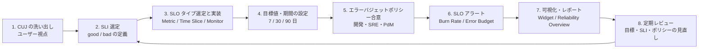
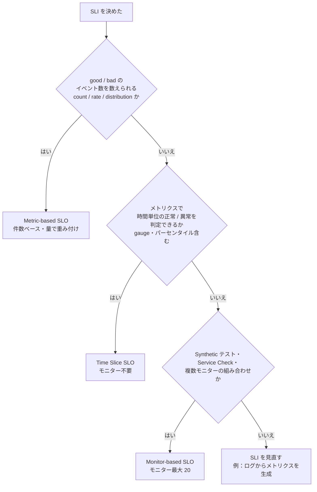

# SLO 運用の実践

## 概要

本ファイルは、Datadog の Service Level Objectives（SLO、サービスレベル目標）を「作って終わり」にせず、意思決定に使われる仕組みとして運用するための実践知見をまとめたものである。扱う範囲は次の 5 つ。

| 範囲 | 本ファイルで答える問い |
|---|---|
| SLI 選定 | 何を測るか。どこで測るか。Datadog のどの SLO タイプ・どのメトリクスで実装するか |
| 目標設定 | 目標値（99.9% など）と期間（7 / 30 / 90 日）をどう決め、どう見直すか |
| エラーバジェットポリシー | バジェットを使い切ったら組織として何をするか。それを Datadog の機能にどう対応付けるか |
| バーンレートアラート | どの閾値・ウィンドウで、誰に、どの手段で通知するか |
| 組織への定着 | タグ・命名・IaC・Scorecards・レポートを使い、全チームに SLO を広げて続けるには |

SLO の仕様（3 つの SLO タイプの計算方法、Status Corrections の上限、API、Terraform リソースの項目、制限値）は [Service Level Objectives（SLO）リファレンス](../02_リファレンス/platform/slo.md) が正本である。本ファイルは仕様を繰り返さず、「どう使うか」に絞る。仕様値を引用する場合はリファレンスと値を一致させている。

応用編の規約に従い、公式情報以外の記述には確度ラベル（`【第三者情報】` `【推定】` `【経験則】`）と出典の公開日を付ける。

### 関連ファイルとの役割分担

| 知りたいこと | 参照先 |
|---|---|
| SLO の仕様・制限値・API | [Service Level Objectives（SLO）](../02_リファレンス/platform/slo.md) |
| モニター一般の仕様（Composite Monitor など） | [Monitors（モニター）](../02_リファレンス/platform/monitors.md) |
| 通知先・Downtime | [通知と Downtime](../02_リファレンス/platform/notifications-and-downtimes.md) |
| SLO 以外も含むアラート設計全般 | [アラート設計とノイズ削減](./alert-design-and-noise-reduction.md) |
| SLO を Terraform で管理する詳細 | [Monitoring as Code](./monitoring-as-code.md)、[Terraform と IaC](../02_リファレンス/platform/terraform-and-iac.md) |
| タグ設計全般 | [タグ戦略の実践](./tagging-strategy.md) |
| SLO を含むダッシュボード設計 | [ダッシュボード設計の実践](./dashboard-design-practices.md) |
| 組織的な定着全般（SLO 以外も） | [組織への定着](./organizational-adoption.md) |
| インシデント対応・On-Call | [Incident Management](../02_リファレンス/service-management/incident-management.md)、[On-Call](../02_リファレンス/service-management/on-call.md) |

## SLO 運用のライフサイクル

Datadog における SLO 運用は、次のサイクルを回すことで定着する。各ステップの詳細は後続の節で説明する。



| ステップ | Datadog の主な機能 | 成果物 |
|---|---|---|
| 1. CUJ の洗い出し | Software Catalog（サービス・チームの把握）、RUM、APM Service Map | CUJ 一覧、CUJ と依存サービスの対応表 |
| 2. SLI 選定 | APM トレースメトリクス、ログ由来メトリクス、RUM 由来メトリクス、インテグレーションメトリクス | SLI 定義書（good / bad の判定条件） |
| 3. 実装 | SLO（Metric-based / Time Slice / Monitor-based）、Terraform | SLO オブジェクト |
| 4. 目標設定 | SLO の Target / Warning、Calendar View、SLO data source | 目標値と根拠 |
| 5. ポリシー | Status Corrections、SLO 権限（`slos_write`、`slos_corrections`） | エラーバジェットポリシー文書 |
| 6. アラート | SLO アラート（`slo alert`）、Composite Monitor、通知連携、On-Call、Incident Management | アラート定義、Runbook |
| 7. 可視化 | SLO widget、SLO List widget、SLO data source、Reliability Overview、Scheduled Reports | SLO ダッシュボード、定期レポート |
| 8. レビュー | Audit Trail / 監査イベント、SLO 履歴（最大 15 か月） | レビュー議事録、変更履歴 |

## 最小限の計算式（運用で使うもの）

SLO 運用の判断で頻繁に使う式を以下にまとめる。仕様の詳細は [SLO リファレンス](../02_リファレンス/platform/slo.md#エラーバジェットerror-budget) を参照。

| 項目 | 式 | 例 |
|---|---|---|
| エラーバジェット | `100% − 目標値` | 目標 99.9% → 0.1% |
| 残りエラーバジェット | `100 × (現在のステータス − 目標値) / (100 − 目標値)` | ステータス 99.95%、目標 99.9% → 50% |
| バーンレート | `観測エラー率 / (1 − 目標値)` | エラー率 1%、目標 99.9% → 10 |
| バジェット枯渇までの時間 | `SLO 期間 / バーンレート` | 30 日 SLO でバーンレート 3 → 10 日 |
| バーンレート上限 | `1 / (1 − 目標値)` | 目標 99.9% → 1,000、目標 96% → 25 |
| 閾値の逆算（消費率方式） | `(SLO 期間[時間] × 消費率%) / (ロングウィンドウ[時間] × 100%)` | 7 日 SLO、1 時間で 10% 消費 → 16.8 |
| 閾値の逆算（枯渇時間方式） | `SLO 期間 / 許容できる対応時間` | 7 日 SLO、2 日で対処できるなら 3.5 |

[出典（SLO）](https://docs.datadoghq.com/service_management/service_level_objectives/)、[出典（Burn Rate）](https://docs.datadoghq.com/service_management/service_level_objectives/burn_rate/)、[出典（公式ブログ、2022-07-05 公開）](https://www.datadoghq.com/blog/monitor-service-performance-with-slo-alerts/)

Datadog 公式ブログは、バーンレートが「より良いエラー率」である理由として、観測エラー率とサービスオーナーが期待するエラー率の両方を 1 つの値に含むため、「1 を超えたら悪い」という共通の閾値をサービス横断で使え、ダッシュボードやアラートを標準化しやすい点を挙げている。[出典](https://www.datadoghq.com/blog/burn-rate-is-better-error-rate/)（2024-09-04 公開）

## SLI 選定

### 出発点はクリティカルユーザージャーニー（CUJ）

Datadog の公式 SLO チェックリストは、SLI 選定の最初のステップとして「ユーザーの視点で考える」ことを求めている。具体的には、ユーザーがアプリケーションとどう関わるか、どのような経路（ジャーニー）をたどるか、その経路がどのインフラに触れるか、ユーザーが何を期待し何を達成したいか、を考える。[出典](https://docs.datadoghq.com/service_management/service_level_objectives/guide/slo-checklist/)

実務では次の順で進めると、SLI が「測りやすいもの」ではなく「ユーザーにとって重要なもの」になりやすい。【経験則】

| 手順 | 内容 | Datadog で使える情報 |
|---|---|---|
| 1 | 事業上重要なユーザー操作を 3〜10 個程度に絞って列挙する（例：ログイン、検索、カート投入、決済、メッセージ送信） | RUM のアクション・ビュー、Product Analytics |
| 2 | 各 CUJ が通るエンドポイント・サービス・データストアを特定する | APM Service Map、Software Catalog の依存関係 |
| 3 | CUJ ごとに「ユーザーが失敗と感じる状態」を定義する（エラー、遅延、古いデータ） | APM のエラー率・レイテンシー分布、RUM のエラー |
| 4 | 失敗状態を good / bad のイベントまたは時間で判定できる SLI に落とす | 次節の SLI 種類表 |
| 5 | CUJ を `journey:<名前>` タグで SLO に付与する | SLO タグ |

Datadog 公式ブログは、SLO に最低限付けるタグとして `journey:<JOURNEY_NAME>`（クリティカルユーザージャーニー）、`team:<TEAM_NAME>`（責任チーム）、`service` / `env` などのシステムタグ、`sli:<SLI_TYPE>`（latency や availability など）を推奨している。[出典](https://www.datadoghq.com/blog/define-and-manage-slos/)（2020-06-22 公開、2024-06-24 更新）

### システム種別ごとの SLI（公式チェックリスト）

Datadog の公式 SLO チェックリストは、システムの種類ごとに次の SLI を挙げている。[出典](https://docs.datadoghq.com/service_management/service_level_objectives/guide/slo-checklist/)

| システム種別 | SLI | 問い |
|---|---|---|
| Response / Request（API、Web） | Availability（可用性） | サーバーはリクエストに正常に応答できるか |
| | Latency（レイテンシー） | 応答にどれくらい時間がかかるか |
| | Throughput（スループット） | どれだけのリクエストを処理できるか |
| Storage（ストレージ） | Availability | 必要なときにデータへアクセスできるか |
| | Latency | 読み書きにどれくらい時間がかかるか |
| | Durability（耐久性） | 必要なときにデータが残っているか |
| Pipeline（データパイプライン、バッチ） | Correctness（正確性） | 正しいデータが返されたか |
| | Freshness（鮮度） | 新しいデータや処理済みデータが現れるまでどれくらいかかるか |

### 測定点の選び方

同じ「可用性」でも、どこで測るかによって SLI が捉える障害の範囲が変わる。Datadog で選べる主な測定点と特徴は次のとおり。

| 測定点 | Datadog のデータ例 | 捉えられる障害 | 捉えにくい障害 | 備考 |
|---|---|---|---|---|
| ロードバランサー / CDN | AWS ALB、Google Cloud Load Balancing などのインテグレーションメトリクス | アプリ到達前の障害を含む 5xx | クライアント側の失敗、LB に到達しないリクエスト | 追加コストが小さい。エンドポイント別の内訳が取れないことがある |
| アプリケーション（APM） | APM のトレースメトリクス（`trace.<SPAN_NAME>.hits`、`.errors`、レイテンシー分布） | アプリ内部のエラー・遅延。エンドポイント（`resource_name`）単位 | アプリに到達しなかったリクエスト | メルカリ（Merpay SRE）は、トレース由来メトリクスはアプリに到達したリクエストしか捉えないため上流の障害を検知できない場合があると指摘している 【第三者情報】 [出典](https://engineering.mercari.com/en/blog/entry/20211215-practical_alerting_methods_based_on_customer_impact/)（2021-12-16 日本語版公開、英語版 2022-05-27） |
| ログ | Logs to Metrics で生成したカウント / ディストリビューションメトリクス | アクセスログに記録される全リクエスト | ログが出ない障害 | 生成メトリクスはカスタムメトリクスとして課金。パスの正規化が必須（後述） |
| クライアント（RUM） | RUM イベントから生成したメトリクス | ユーザーが実際に体験したエラー・遅延 | サンプリング外のセッション | ユーザー体験に最も近い |
| 合成監視（Synthetic） | Synthetic テストを使う Monitor-based SLO | 外形からの到達性、トラフィックが少ない時間帯の障害 | 合成テストがカバーしない操作 | トラフィックが少ないサービスの補完に有効 |

APM・ログ・RUM 由来のメトリクスは、いずれも Metric-based SLO の SLI に使える。[出典](https://docs.datadoghq.com/service_management/service_level_objectives/metric/)

実務では「LB またはアプリ（APM）で可用性」「APM またはログで レイテンシー」から始め、重要な CUJ だけ RUM や Synthetic で補完する構成が多い。【経験則】

### SLO タイプの選び方

Datadog は可能な限り Metric-based SLO を使うことを推奨している。理由は、エラーバジェットが「残りの bad イベント数」を表し、計算がイベント量で重み付けされるためである。[出典](https://docs.datadoghq.com/service_management/service_level_objectives/guide/slo_types_comparison/)



| 状況 | 推奨タイプ | 理由・注意 |
|---|---|---|
| リクエスト成功率 | Metric-based | 件数ベースでトラフィック量に比例してバジェットが減る |
| 「250ms 以内に返したリクエストの割合」 | Metric-based（パーセンタイル有効の Distribution メトリクスに `count values...` の閾値指定＝Threshold Queries） | 件数ベースのレイテンシー SLI を作れる [出典](https://docs.datadoghq.com/service_management/service_level_objectives/metric/) |
| 「1 分ごとの p95 が 2.5 秒以下だった時間の割合」 | Time Slice | gauge やパーセンタイルを含む全メトリクス型に対応。モニター不要 [出典](https://docs.datadoghq.com/service_management/service_level_objectives/guide/slo_types_comparison/) |
| データパイプラインの鮮度（遅延が N 分以内だった時間） | Time Slice | 鮮度は gauge で表されることが多い 【経験則】 |
| Synthetic テストによる外形監視 | Monitor-based | Synthetic・Service Check は Monitor-based のみ対応 |
| 複数モニターをまとめた稼働率 | Monitor-based | モニター最大 20 |

運用面で重要な SLO タイプ別の違いを次に示す（仕様の全体は [SLO リファレンス](../02_リファレンス/platform/slo.md#slo-タイプの比較) を参照）。[出典](https://docs.datadoghq.com/service_management/service_level_objectives/guide/slo_types_comparison/)

| 運用上の観点 | Metric-based | Time Slice | Monitor-based |
|---|---|---|---|
| SLO アラート（Error Budget / Burn Rate） | 対応。グループ付きの場合は全体 SLO のみ | 対応。グループ単位または全体 SLO | Metric 系モニターのみで構成した場合のみ対応（Synthetic・Service Check は不可）。グループ付きの場合は全体 SLO のみ |
| Status Corrections の扱い | 期間中のイベントを計算から除外 | 期間を Uptime として扱う | 期間を計算から除外 |
| 欠損データ | 計算から除外 | Uptime として扱う | 基になるモニターの設定に従う |
| Calendar View・SLO data source | 対応 | 対応 | 非対応 |
| バーンレートの消費量計算 | ロングウィンドウ内の発生件数から外挿 | 時間ベース | 時間が一定速度で進むため正確 |

Monitor-based SLO はアラートの制約が大きい（Synthetic ベースでは Burn Rate アラートが使えない）ため、アラートまで含めて設計する場合は Metric-based または Time Slice を優先するとよい。【経験則】

> 注意：Merpay SRE の記事（2021 年）は、Metric-based はリクエストベース、Monitor-based は時間ベースであり、メトリクスによっては Metric-based SLO を作れないためデータに合わせて選ぶべきとしている。【第三者情報】 [出典](https://engineering.mercari.com/en/blog/entry/20211215-practical_alerting_methods_based_on_customer_impact/) この記事は Time Slice SLO 登場以前のものであり、現在は gauge 等の時間ベース SLI には Time Slice SLO が第一候補になる。

### good / bad イベント定義の注意点

Metric-based SLO の現行の定義方法は「good イベントの合計」と「bad イベントの合計」の 2 つのクエリを指定し、SLI を `good / (good + bad)` として計算する。「total イベント」クエリによる定義はレガシーとされ、既存 SLO の UI / API での編集は可能だが、新規作成は API でのみ可能である。[出典](https://docs.datadoghq.com/service_management/service_level_objectives/metric/)

| 論点 | 推奨 | 根拠 |
|---|---|---|
| 4xx の扱い | 原則 good（クライアント起因）。ただし 429（レート制限）や 404 の急増など、サービス側の問題を示すコードは個別に判断 | 公式例は `code:2xx` と `code:4xx` を good、`code:5xx` を bad としている [出典](https://docs.datadoghq.com/service_management/service_level_objectives/metric/)。429 等の判断は【経験則】 |
| 3xx の扱い | good にも bad にも含めない | 公式例で「通常リダイレクトであり SLI に影響させるべきでない」として除外 [出典](https://docs.datadoghq.com/service_management/service_level_objectives/metric/) |
| ヘルスチェック・ボット・負荷試験 | `FROM` 句のタグで除外する | 実ユーザーの体験ではないため。Google のポリシー例も負荷試験等による消費は対象外としている 【経験則】 |
| タイムアウト | bad として数える。クライアント側でしか観測できない場合は LB や RUM で補う | アプリ側メトリクスにはタイムアウトが記録されないことがある 【経験則】 |
| レイテンシーの閾値 | 「平均」ではなく「閾値以内の割合」で定義する | 平均はロングテールを隠すため。Threshold Queries で件数ベースにできる 【経験則】 |

### カーディナリティとコストを意識する

SLI 用にログやスパンからメトリクスを生成する場合、エンドポイント（URL パス）をそのままタグにすると時系列が爆発し、カスタムメトリクスのコストが増える。

- Wantedly のインフラチームは、リクエストログからカスタムメトリクスを生成する際に URL を `/id/:id` のようなプレースホルダーにまとめてタグのカーディナリティとコストを抑えた。Log Pipelines に置換用プロセッサーがなかったため、Grok Parser でパスを分割し Category Processor でグルーピングしたと報告している。【第三者情報】 [出典](https://sg.wantedly.com/companies/wantedly/post_articles/944549)（2024-12-20 公開）
- Zenn の実装記事も、Datadog のカスタムメトリクスはタグの組み合わせで課金されるためカーディナリティに注意すべきとしている。【第三者情報】 [出典](https://zenn.dev/nhiguchi/articles/85c17a00d790b1)（2023-12-07 公開）
- パーセンタイルを有効にした Distribution メトリクスは追加の時系列を生む（課金の考え方は [Custom Metrics と DogStatsD](../02_リファレンス/platform/custom-metrics-and-dogstatsd.md) を参照）。

タグ設計の詳細は [タグ戦略の実践](./tagging-strategy.md)、ログ由来メトリクスの設計は [ログ管理の実践](./log-management-practices.md) を参照。

### Datadog での SLI 実装パターン

| SLI | 推奨タイプ | 実装例 | 補足 |
|---|---|---|---|
| HTTP 可用性（APM） | Metric-based | good：`sum:trace.<span>.hits{service:web-store}` から `.errors` を差し引いた件数、bad：`sum:trace.<span>.errors{service:web-store}`（具体的なクエリ形は公式ガイドを確認） | 公式ガイド「Scope metric-based SLO queries」に APM トレースメトリクスの例がある（[SLO リファレンス](../02_リファレンス/platform/slo.md) 参照） |
| HTTP 可用性（ステータスコード別カウンター） | Metric-based | good：`sum:httpservice.hits{code:2xx} + sum:httpservice.hits{code:4xx}`、bad：`sum:httpservice.hits{code:5xx}` | 公式ドキュメントの例 [出典](https://docs.datadoghq.com/service_management/service_level_objectives/metric/) |
| HTTP 可用性（LB） | Metric-based | Google Cloud の `gcp.loadbalancing.https.request_count` を 5xx 以外 / 全体で集計し 30 日 99.9% | Zenn 記事の例 【第三者情報】 [出典](https://zenn.dev/nhiguchi/articles/85c17a00d790b1)（2023-12-07 公開） |
| レイテンシー（件数ベース） | Metric-based | パーセンタイル有効の Distribution メトリクスで `count values...` に閾値を指定 | Threshold Queries [出典](https://docs.datadoghq.com/service_management/service_level_objectives/metric/) |
| レイテンシー（時間ベース） | Time Slice | `p95` が 1 分スライスで閾値以下なら Uptime | スライス幅は 1 分 / 5 分 |
| レイテンシー（ログ由来、旧来の方法） | Monitor-based | ログの `@duration` から Distribution メトリクスを生成 → p90 > 500ms のメトリクスモニター → Monitor-based SLO（98%、30 日） | Zenn 記事の例。リソースが増えて複雑になったと振り返っている 【第三者情報】 [出典](https://zenn.dev/nhiguchi/articles/85c17a00d790b1)（2023-12-07 公開）。現在は Threshold Queries や Time Slice で同等のことをより簡潔に実装できる |
| 外形可用性 | Monitor-based | Synthetic API / Browser テスト | Burn Rate アラートは使えない |
| パイプライン鮮度 | Time Slice | 最終処理時刻からの経過時間（gauge）が N 分以内 | 【経験則】 |

## 目標設定

### 目標値の決め方

Datadog は、SLO の目標値を SLA より厳しく設定することを推奨している。また、目標値は 100% 未満でなければならない（100% はエラーバジェット 0% となり、アラート評価でゼロ除算になる）。[出典](https://docs.datadoghq.com/service_management/service_level_objectives/)

公式チェックリストは目標値の例として 99%、99.5%、99.9%、99.95% などを挙げ、要件に合う値を選ぶよう求めている。[出典](https://docs.datadoghq.com/service_management/service_level_objectives/guide/slo-checklist/)

実務での決め方は次の手順が一般的である。

| 手順 | 内容 | Datadog での作業 | 確度 |
|---|---|---|---|
| 1 | 過去の実績を測る（最低 30 日、可能なら 90 日） | SLO を作成し Calendar View（最大 12 か月）や SLO data source（最大 15 か月）で過去の推移を確認。メトリクス自体は SLO 作成前から存在すれば遡って計算される | 【経験則】 |
| 2 | 実績値より少し低い値を初期目標にする（「今の水準を守る」目標から始める） | Target を設定 | 【経験則】 |
| 3 | SLA がある場合は SLA より厳しい値にする | Target と Warning | 公式推奨 |
| 4 | 依存サービスの SLO と矛盾しないか確認する | 依存先 SLO のステータス | 【経験則】 |
| 5 | 1〜2 四半期運用して見直す（厳しすぎ・緩すぎ） | SLO 履歴、Audit History | 【経験則】 |

- メルカリ（Merpay SRE）は、SLO 目標は最初から適切に決めるのが難しいため、まずはデフォルト的な値で始め、定期的に見直すべきとしている。【第三者情報】 [出典](https://engineering.mercari.com/en/blog/entry/20211215-practical_alerting_methods_based_on_customer_impact/)（2021-12-16 公開）
- エムスリーの BIR チームは、目標値をチーム内で合意し、改善余地のある SLO は期ごとに目標を引き上げる方針を報告している。【第三者情報】 [出典](https://www.m3tech.blog/entry/2022/08/31/104925)（2022-08-31 公開）

> 注意：ログ由来のカスタムメトリクスは**メトリクスを作成した時点以降**のログからしか生成されない。Wantedly は、新しく作った SLO は有効なデータ期間が短く、90 日分のデータが貯まるまでエラーバジェットの消費が実態と異なって見えることがあると報告している。【第三者情報】 [出典](https://sg.wantedly.com/companies/wantedly/post_articles/944549)（2024-12-20 公開）。新規 SLI の場合、データが貯まるまではアラートを通知のみにする運用が安全である。【経験則】

### 目標値と許容ダウンタイムの対応

時間ベース SLO（Time Slice / Monitor-based、Corrections なし）の許容ダウンタイムは次のとおり（`期間 × (1 − 目標値)` による計算値。[SLO リファレンス](../02_リファレンス/platform/slo.md#時間ベース-slo-の許容ダウンタイム参考計算) と同値）。

| 目標値 | 7 日 | 30 日 | 90 日 |
|---|---|---|---|
| 99% | 100.8 分 | 432 分（7.2 時間） | 1,296 分（21.6 時間） |
| 99.5% | 50.4 分 | 216 分（3.6 時間） | 648 分（10.8 時間） |
| 99.9% | 10.08 分 | 43.2 分 | 129.6 分 |
| 99.95% | 5.04 分 | 21.6 分 | 64.8 分 |
| 99.99% | 約 1.0 分 | 4.32 分 | 12.96 分 |

目標値を決める際は、この表を使って「人が気づいてから復旧するまでの現実的な時間」と比較するとよい。例えば 30 日 99.99% の許容ダウンタイムは 4.32 分であり、手動対応が前提の運用では 1 回の障害で使い切る。【経験則】

> Time Slice SLO を 5 分スライス・7 日・99.99% で設定すると、許容ダウンタイム（約 1 分）が 1 スライス（5 分）より短いため、1 スライスの違反で目標割れになる。スライス幅と目標値の組み合わせに注意する（[SLO リファレンス](../02_リファレンス/platform/slo.md) 参照）。

### 依存関係と目標値の整合

あるサービスが複数の依存先すべてに同期的に依存している場合、依存先がそれぞれ独立に故障すると仮定すると、達成可能な可用性の上限はおおむね依存先の可用性の積になる。例えば 99.9% の依存先が 3 つ直列にあると `0.999^3 ≈ 0.997`、すなわち約 99.70% が上限の目安になる（本ファイルでの計算値）。上位サービスの SLO を依存先より厳しく設定する場合は、リトライ、キャッシュ、フォールバックなどの設計で補う必要がある。【経験則】

### 期間（7 / 30 / 90 日）の選び方

Datadog の SLO の期間はローリング 7 日 / 30 日 / 90 日から選ぶ（複数指定可。最短の期間がデフォルトの Primary になる）。カレンダー月単位の期間は SLO の期間としては選べないが、Metric-based と Time Slice では Calendar View で日次・週次・月次の履歴（最大 12 か月）を確認できる。[出典](https://docs.datadoghq.com/service_management/service_level_objectives/)

| 期間 | 向いている用途 | 注意 |
|---|---|---|
| 7 日 | 新規リリース直後のサービス、週次スプリントでの判断、早期の傾向把握 | 1 回の障害の影響が大きく、バジェットの回復も早い |
| 30 日 | 安定したサービスの標準。月次の振り返りと相性がよい | 最も一般的 【経験則】 |
| 90 日 | 四半期計画・OKR との連動、トラフィックが少ないサービス | 障害の影響が長く残る。新規 SLO ではデータが揃うまで実態とずれる |

- Merpay SRE は、新規リリースのサービスには短い期間（7 日）、安定したサービスには長い期間（30 日）が向き、エラーバジェットを優先度判断に使うならスプリントの長さに合わせるとよいとしている。【第三者情報】 [出典](https://engineering.mercari.com/en/blog/entry/20211215-practical_alerting_methods_based_on_customer_impact/)（2021-12-16 公開）
- 複数期間を設定しておくと、7 日で直近の悪化、30 日 / 90 日で長期の傾向を同時に見られる。SLO アラートは期間ごとに対象を選んで作成する（`.over("7d")` など）。

### Warning（警告値）の使い方

Datadog の SLO には任意で Warning を設定でき、目標割れが近づいた SLO を黄色で表示する。API の `warning_threshold` は `target_threshold` より大きい（厳しい）値である必要がある（例：目標 99.9%、Warning 99.95%）。[出典（SLO リファレンス）](../02_リファレンス/platform/slo.md#共通設定項目)

kubell の Terraform モジュール例では、7 日・30 日の 2 期間で目標 99.9%、Warning 99.95% を設定している。【第三者情報】 [出典](https://creators-note.chatwork.com/entry/2025/12/23/100000)（2025-12-23 公開）

## エラーバジェットポリシー

### エラーバジェットポリシーとは

エラーバジェットポリシーは、「エラーバジェットが残っている間は通常どおりリリースし、使い切ったら信頼性の作業を優先する」といった判断ルールを、関係者間で事前に合意して文書化したものである。Datadog の SLO はエラーバジェットを自動計算するが、ポリシー自体は製品機能ではなく組織の取り決めであり、Datadog の機能（アラート、Corrections、権限、レポート）で運用を支える形になる。

Datadog の製品ページは、エラーバジェットを機能開発とプラットフォーム安定化のバランスを取るために使うことを打ち出している。[出典](https://www.datadoghq.com/product/service-level-objectives/)

### Google SRE Workbook のポリシー例の構成

Google の SRE Workbook は、エラーバジェットポリシーの例として次の構成を示している。【第三者情報】 [出典](https://sre.google/workbook/error-budget-policy/)（SRE Workbook、2018 年刊行）

| 節 | 内容（要約） |
|---|---|
| Service Overview | 対象サービスとリリース頻度 |
| Goals | 顧客を繰り返しの SLO 違反から守る。信頼性と機能開発のバランスを取るインセンティブを与える |
| Non-Goals | SLO 違反への罰ではない。変更の停止そのものが目的ではない |
| SLO Miss Policy | SLO 内なら通常どおりリリース。直近 4 週間でバジェットを超過したら、P0 と セキュリティ修正以外の変更・リリースを SLO 内に戻るまで停止 |
| 信頼性作業が必須となる条件 | コードのバグや手順ミスが原因、ポストモーテムで緩和可能なハード依存が見つかった、誤分類でバジェットに計上されなかったエラーがある |
| 機能開発を継続してよい条件 | 全社的なネットワーク障害、他チームのサービスが原因（そのチームがリリースを止めている）、対象外ユーザー（負荷試験・ペネトレーションテスト）による消費、誤分類でユーザー影響がない |
| Outage Policy | 単一インシデントが 4 週間のバジェットの 20% 超を消費したら、根本原因に対する P0 アクションを含むポストモーテムを必須にする。単一の障害クラスが四半期で 20% 超を消費したら次四半期計画に P0 項目を入れる |
| Escalation Policy | 計算や必要なアクションに関する意見の相違は CTO が裁定 |
| Background | エラーバジェット = 1 − SLO。変更が障害の約 70% を引き起こすため、バジェットを機能と安定性の間で注意を移す制御手段とする |

### ポリシーを Datadog の機能に対応付ける

ポリシーの各条項は、Datadog の機能に次のように対応付けると運用しやすい。【経験則】（各機能の仕様は公式ドキュメントに基づく）

| ポリシー条項 | Datadog の機能 | 設定例 |
|---|---|---|
| バジェット消費の段階通知 | Error Budget アラート（`error_budget("<slo_id>").over("30d") > N`） | Warning 50〜75%、Alert 90〜100% |
| 「使い切ったら機能リリース停止」 | Error Budget アラート 100%（枯渇）＋通知メッセージにポリシーの手順を記載 | Zenn の例は Critical 100 で設定 【第三者情報】 [出典](https://zenn.dev/nhiguchi/articles/85c17a00d790b1) |
| 急激な消費（障害）への即時対応 | Burn Rate アラート（Fast burn）→ On-Call / Incident Management | 30 日 SLO なら 14.4（1h / 5m） |
| 計画メンテナンス・対象外トラフィックの除外 | Status Corrections（一度限り / 繰り返し）、Downtime 連動の Corrections | カテゴリ：Scheduled Maintenance / Outside Business Hours / Deployment / Other |
| 「単一インシデントで 20% 超消費 → ポストモーテム必須」 | Burn Rate アラートの閾値を 20% 消費相当に設定、または Incident Management のポストモーテムテンプレートで SLO 影響を記録 | 30 日 SLO で 6 時間 20% → `720 × 20 / (6 × 100) = 24` |
| 目標値変更・Corrections の統制 | 権限（`slos_write`、`slos_corrections`）、SLO 単位のきめ細かいアクセス制御、監査イベント | Corrections 作成権限を SRE リードに限定 |
| 経営層への報告 | Reliability Overview（SLO Summary score）、Scheduled Reports | 月次 PDF 配信 |
| 判断の記録 | SLO の説明欄（Markdown）にポリシー文書・Runbook へのリンク | — |

Datadog 公式ブログのエラーバジェットアラートの例では、Alert 90%・Warn 75% を設定し、通知メッセージで「90% 超消費：機能開発を止めて信頼性作業に集中」「75% 超消費：機能開発を減速し信頼性作業を優先することを検討」と、ポリシーに沿った行動を指示している（下の画像参照）。また、エラーバジェットアラートでは誰かをページングする必要はなく、メールやコラボレーションツールに送ってチームが対応を判断すればよいとしている。[出典](https://www.datadoghq.com/blog/monitor-service-performance-with-slo-alerts/)（2022-07-05 公開）


- **キャプション:** SLO アラート（Error Budget）の作成画面。
- **画面説明:** パンくずは `Monitors > New Monitor > SLO Monitor`。ステップ 1「Select SLO」で対象 SLO（例：Latency SLO for web-store service）を選び、右に「View SLO」リンクがある。ステップ 2「Set alert conditions」で **Error Budget** / **Burn Rate** のタブを切り替える。Error Budget タブでは「Alert if `90` % of budget for `7-day target (primary)` is consumed.」「Warn if `75` % is consumed.」のように、消費率の閾値と対象期間を指定する。ステップ 3「Notify your team」では通知メッセージを編集でき、`{{#is_alert}}` / `{{#is_warning}}` の条件ブロックでポリシーに沿った行動（機能開発の停止、信頼性作業の優先）を記載している。
- **出典:** https://docs.datadoghq.com/service_management/service_level_objectives/error_budget/ （2026-11-02 取得）

### Status Corrections の運用ルール

Status Corrections は SLO 計算から特定期間を除外（Time Slice では Uptime として扱う）する機能であり、使い方を誤ると SLO が実態を表さなくなる。ポリシーに次のようなルールを含めておくとよい。【経験則】

| 区分 | Corrections を使う | Corrections を使わない |
|---|---|---|
| 計画メンテナンス | 事前告知済みで、ユーザーへの影響が合意済みのもの | 告知なしの作業 |
| 営業時間外 | 業務システムで営業時間外の利用がそもそも想定されない場合（繰り返し Corrections） | 24 時間サービス |
| デプロイ | デプロイ中の計測上のノイズが明らかな場合 | デプロイによる実際のユーザー影響（これこそバジェットで捉えるべき） |
| 対象外トラフィック | 負荷試験、ペネトレーションテスト | 実ユーザーのトラフィック |
| 外部要因 | 原則使わず、ポリシーの「機能開発を継続してよい条件」で扱う | — |

- Zenn の実装例では、`datadog_slo_correction` で毎日 22:00〜08:00（Asia/Tokyo）を RRULE と 36,000 秒の duration で除外している。【第三者情報】 [出典](https://zenn.dev/nhiguchi/articles/85c17a00d790b1)（2023-12-07 公開）
- Wantedly は、計画メンテナンスをクエリの編集ではなく Datadog の Downtime でエラーバジェットから除外し、Terraform で管理している。【第三者情報】 [出典](https://sg.wantedly.com/companies/wantedly/post_articles/944549)（2024-12-20 公開）。Datadog では、モニタータグでスコープした Downtime から対応するタグベースの Corrections を作成できる。[出典](https://docs.datadoghq.com/service_management/service_level_objectives/)
- Corrections には上限がある（SLO 名指定の場合、過去 90 日で一度限り 100 件、日次繰り返し 2 件など）。作成後はスコープの変更や一度限り / 繰り返しの切り替えができない。[出典](https://docs.datadoghq.com/service_management/service_level_objectives/)
- `slos_corrections` 権限は `slos_write` なしで Corrections を作成・編集・削除できるため、誰に付与するかをポリシーで決めておく。タグベースの Corrections はきめ細かいアクセス制御を無視する点にも注意する。[出典](https://docs.datadoghq.com/service_management/service_level_objectives/)

### ポリシー文書のひな形

以下は、上記の要素を Datadog 運用向けにまとめたひな形である。【経験則】（構成は Google SRE Workbook の例を参考にしている）

```markdown
# <サービス名> エラーバジェットポリシー

## 対象
- SLO: <SLO 名>（Datadog SLO ID: xxxxx、期間: 30 日ローリング、目標: 99.9%）
- 関係者: 開発チーム <team:xxx>、SRE、プロダクトマネージャー

## 目的 / 目的外
- 目的: ユーザーを繰り返しの SLO 違反から守り、信頼性と機能開発のバランスを取る
- 目的外: 個人やチームへの罰ではない。変更を止めること自体が目的ではない

## バジェット残量に応じた行動
| 残りバジェット | Datadog での検知 | 行動 |
|---|---|---|
| 50% 超 | — | 通常リリース |
| 25〜50% | Error Budget アラート Warning（消費 50%） | リリース前のリスク確認を強化 |
| 0〜25% | Error Budget アラート Alert（消費 75%） | 新機能リリースを減速、信頼性タスクを優先 |
| 0% 以下 | Error Budget アラート（消費 100%） | P0・セキュリティ修正以外のリリースを停止。SLO 内に戻るまで継続 |

## 障害ポリシー
- Fast burn アラート発報時はインシデントを宣言する
- 単一インシデントで 30 日バジェットの 20% 超を消費したらポストモーテム必須

## 除外（Status Corrections）
- 計画メンテナンス（事前告知済み）のみ。作成者は SRE リード

## エスカレーション
- 判断が割れた場合は <責任者> が裁定する

## 見直し
- 四半期ごとに目標値・SLI・本ポリシーを見直す
```

## バーンレートアラート設計

### なぜバーンレートアラートか

エラーレートに直接閾値を置くアラートは、SLO 上は問題にならない短時間のスパイクで鳴り（適合率が低い）、逆に閾値未満の緩やかな悪化を見逃す。Google SRE Workbook は 6 つのアラート方式を比較し、マルチウィンドウ・マルチバーンレート方式を推奨している。【第三者情報】 [出典](https://sre.google/workbook/alerting-on-slos/)

| # | 方式 | 適合率 | 再現率 | 検知時間 | リセット時間 |
|---|---|---|---|---|---|
| 1 | エラー率 ≥ SLO 閾値 | 低い（10 分間 0.1% のエラー率は月間バジェットの 0.02% しか消費しない） | 良い | 良い | — |
| 2 | アラートウィンドウを延長（36 時間） | 1 より良い | — | 良い | 非常に悪い（100% 障害後 36 時間鳴り続ける） |
| 3 | アラート継続時間を増やす（`for: 1h`） | 高い | 低い | 悪い（100% 障害でも 1 時間後） | — |
| 4 | バーンレートでアラート（1 時間で 36 倍） | 良い | 低い（35 倍では鳴らない） | 良い | 58 分（長すぎる） |
| 5 | 複数バーンレート | 良い | 良い | — | 長い |
| 6 | マルチウィンドウ・マルチバーンレート | 良い | 良い | — | 改善（ページは障害終息後約 5 分で解除） |

Datadog の Burn Rate アラートは、この方式 6 の「マルチウィンドウ」を標準で実装している。ロングウィンドウとショートウィンドウの両方でバーンレートが閾値以上のときにのみ発報する。[出典](https://docs.datadoghq.com/service_management/service_level_objectives/burn_rate/)

```
(ロングウィンドウのエラー率 / (1 − SLO 目標)) ≥ 閾値
  AND
(ショートウィンドウのエラー率 / (1 − SLO 目標)) ≥ 閾値
  → ALERT
```

- ロングウィンドウは一時的なスパイクを除外する役割を持つ。
- ショートウィンドウは、修正後に古いエラーがロングウィンドウから抜けるのを待たず、アラートを早く解除する役割を持つ。

[出典](https://www.datadoghq.com/blog/burn-rate-is-better-error-rate/)（2024-09-04 公開）

スタディサプリ（Quipper SRE）は、当初バーンレート ≥ 1 の単純な閾値で試したところ常時アラートが鳴る状態になり、SRE Workbook のマルチウィンドウ方式に切り替えたと報告している。また、バーンレート監視は不具合のあるリリースなどの劣化を、バジェット枯渇型の監視（数日後に鳴り原因調査が難しくなる）よりはるかに早く検知できたとしている。【第三者情報】 [出典](https://blog.studysapuri.jp/entry/slo-burn-rate-monitoring)（2022-12-01 公開）

### Datadog の設定可能範囲（設計の前提）

| 項目 | 値 | 出典 |
|---|---|---|
| ロングウィンドウ | 1〜48 時間 | [出典](https://docs.datadoghq.com/service_management/service_level_objectives/burn_rate/) |
| ショートウィンドウ | UI ではロングウィンドウの 1/12 に自動設定。API / Terraform ではロングウィンドウ未満の任意値 | 同上 |
| 閾値 | `0 < 閾値 ≤ 1 / (1 − 目標)`。上限超は作成不可 | 同上 |
| 対応 SLO タイプ | Metric-based、Time Slice、Metric 系モニターのみで構成した Monitor-based | 同上 |
| グループ単位のアラート | Metric-based / Time Slice のグループ付き SLO で個別グループまたは全体。Monitor-based は全体のみ | 同上（Error Budget アラートでグループ単位に対応するのは Time Slice のみ） |
| 対象期間 | `7d` / `30d` / `90d`（SLO に設定済みの期間） | 同上 |
| Warning 閾値 | 設定可能（画面例：Alert 14.4、Warn 7.2） | [出典](https://docs.datadoghq.com/monitors/types/slo/) |

> 注意：グループ単位のアラート対応状況は、公式ドキュメントのページ間で表記が異なる（Burn Rate ページは「Metric-based と Time Slice はグループ単位可」、SLO タイプ比較ガイドは「Metric-based はグループ付きでも全体 SLO のみ」）。2026-11-02 時点で両方の記載があるため、実装前に UI で確認すること。[出典（Burn Rate）](https://docs.datadoghq.com/service_management/service_level_objectives/burn_rate/)、[出典（比較ガイド）](https://docs.datadoghq.com/service_management/service_level_objectives/guide/slo_types_comparison/)

### 公式推奨値

Datadog 公式ドキュメントの推奨値（目標 99.9% を前提とし、96% 程度までの目標なら妥当とされる）は次のとおり。[出典](https://docs.datadoghq.com/service_management/service_level_objectives/burn_rate/)

**7 日の SLO**

| バーンレート | ロングウィンドウ | ショートウィンドウ | 理論上のバジェット消費 |
|---|---|---|---|
| 16.8 | 1 時間 | 5 分 | 10% |
| 5.6 | 6 時間 | 30 分 | 20% |
| 2.8 | 24 時間 | 120 分 | 40% |

**30 日の SLO**

| バーンレート | ロングウィンドウ | ショートウィンドウ | 理論上のバジェット消費 |
|---|---|---|---|
| 14.4 | 1 時間 | 5 分 | 2% |
| 6 | 6 時間 | 30 分 | 5% |
| 3 | 24 時間 | 120 分 | 10% |

**90 日の SLO**

| バーンレート | ロングウィンドウ | ショートウィンドウ | 理論上のバジェット消費 |
|---|---|---|---|
| 21.6 | 1 時間 | 5 分 | 1% |
| 10.8 | 6 時間 | 30 分 | 3% |
| 4.5 | 24 時間 | 120 分 | 5% |

目標が 96% 未満の場合は、より低い閾値を使うか、消費率方式でより小さい消費率またはより長いウィンドウで閾値を計算する。[出典](https://docs.datadoghq.com/service_management/service_level_objectives/burn_rate/)

### Google SRE Workbook の推奨値との違い

SRE Workbook は目標 99.9% について次の 3 段構成を推奨している。【第三者情報】 [出典](https://sre.google/workbook/alerting-on-slos/)

| 重大度 | ロングウィンドウ | ショートウィンドウ | バーンレート | バジェット消費 | 通知 |
|---|---|---|---|---|---|
| Page | 1 時間 | 5 分 | 14.4 | 2% | ページング |
| Page | 6 時間 | 30 分 | 6 | 5% | ページング |
| Ticket | 3 日 | 6 時間 | 1 | 10% | チケット |

Datadog の Burn Rate アラートのロングウィンドウ上限は 48 時間のため、3 日（72 時間）の Ticket 段はそのままでは実装できない。代替案は次のとおり。【推定】（計算は本ファイルによる）

| 代替案 | 設定 | 特徴 |
|---|---|---|
| A. 公式推奨の 24 時間段を使う | 30 日 SLO：閾値 3、24h / 120m（10% 消費） | 最も簡単。Workbook の Ticket 段（バーンレート 1）より検知感度は低い |
| B. 48 時間で閾値を下げる | 30 日 SLO：48h で 10% 消費 → `720 × 10 / (48 × 100) = 1.5`、ショート 4h（API / Terraform で指定可） | Workbook に近いがリセットが遅い |
| C. Error Budget アラートで代替 | 消費 50% / 75% などの段階通知 | 緩やかな消費を確実に捉えられる。「速度」ではなく「累積」で判断 |

### 推奨するアラート構成（テンプレート）

上記を踏まえ、1 つの SLO に対して次の 3〜4 本の SLO アラートを標準セットとする構成が実務でよく使われる。【経験則】（閾値は公式推奨値）

| 本数 | 種類 | 30 日 SLO の設定 | 7 日 SLO の設定 | 通知先 | 期待する行動 |
|---|---|---|---|---|---|
| 1 | Burn Rate（Fast burn） | 14.4、1h / 5m | 16.8、1h / 5m | On-Call ページング、インシデントチャネル | インシデント宣言、ロールバック等の即時緩和 |
| 2 | Burn Rate（Medium burn） | 6、6h / 30m | 5.6、6h / 30m | On-Call（営業時間内）またはチームチャネル | 当日中の調査 |
| 3 | Burn Rate（Slow burn） | 3、24h / 120m | 2.8、24h / 120m | チケット（Jira / Case Management 等）、チームチャネル | 優先度低の調査 |
| 4 | Error Budget | Warn 50〜75%、Alert 90〜100% | 同左 | チームチャネル、メール、PdM | ポリシーに従った開発計画の調整 |

- Datadog 公式ブログは、7 日・99.9% SLO の例として Fast burn（16.8、1h / 5m、約 10% 消費）と Slow burn（2.8、24h / 120m、約 40% 消費）の 2 本構成を示し、Fast burn はインシデント対応手順の起動、Slow burn は優先度の低い調査チケットに向くとしている。[出典](https://www.datadoghq.com/blog/monitor-service-performance-with-slo-alerts/)（2022-07-05 公開）
- Merpay SRE は 30 日 SLO に対して 14.4（1h / 5m）と 6（6h / 30m）の 2 本を作成し、別々に通知されるのを避けるため Composite Monitor で OR 結合して 1 本のアラートにまとめ、Slack に通知している。通知メッセージには SLO ステータスへのリンクと、顧客影響の確認・調査・プレイブックによる緩和の指示を含めている。【第三者情報】 [出典](https://engineering.mercari.com/en/blog/entry/20211215-practical_alerting_methods_based_on_customer_impact/)（2021-12-16 公開。記事執筆時点で Burn Rate アラートは Public Beta であり、現在は GA）
- Zenn の実装例は 30 日 SLO に 6（6h / 30m）の Burn Rate アラートと、100% の Error Budget アラートを Terraform で作成している。【第三者情報】 [出典](https://zenn.dev/nhiguchi/articles/85c17a00d790b1)（2023-12-07 公開）


- **キャプション:** SLO アラート（Burn Rate）の作成画面。
- **画面説明:** パンくずは `Monitors > New Monitor > SLO Monitor`。ステップ 2「Set alert conditions」で **Burn Rate** タブを選ぶと「Get notified when the rate of error budget consumption is too fast.」と表示され、「Evaluate the last `1` h and the last `5m` for `7-day target (primary)`」でロングウィンドウ（時間）と対象期間を指定する（ショートウィンドウ `5m` はロングウィンドウの 1/12 として自動表示）。「Alert when both burn rates are `14.4` or more.」「Warn if they are `7.2` or more.」で閾値を設定し、「Advanced options」を展開できる。ステップ 3「Notify your team」の通知メッセージ例は「Burn rate has exceeded 14.4 in the past hour! Declare an incident and block deployments until the issue is resolved.」。
- **出典:** https://docs.datadoghq.com/service_management/service_level_objectives/burn_rate/ （2026-11-02 取得）

### 閾値の決め方（独自に決める場合）

公式推奨値が合わない場合、Datadog は 2 つのアプローチを示している。[出典](https://docs.datadoghq.com/service_management/service_level_objectives/burn_rate/)、[出典（ブログ）](https://www.datadoghq.com/blog/monitor-service-performance-with-slo-alerts/)

| アプローチ | 式 | 例 | 使いどころ |
|---|---|---|---|
| 枯渇時間方式 | `SLO 期間 / 許容できる対応時間` | 7 日 SLO で 2 日以内に対処可能 → 3.5、半日（ロールバックで解決）→ 14 | 「どれくらいの速さで対応できるか」から逆算したい |
| 消費率方式 | `(SLO 期間[時間] × 消費率%) / (ロングウィンドウ[時間] × 100%)` | 7 日・4 時間で 80% 消費 → 33.6 | 「このウィンドウでバジェットの何 % を失ったら起こすか」で決めたい |

- 高いバーンレートは短いロングウィンドウと組み合わせる。[出典](https://docs.datadoghq.com/service_management/service_level_objectives/burn_rate/)
- 実際のトラフィックは理論値どおりに消費されないため、閾値は経験的に調整するのがよい（公式ブログ）。[出典](https://www.datadoghq.com/blog/burn-rate-is-better-error-rate/)（2024-09-04 公開）
- アラートがフラッピングする場合はショートウィンドウを長くする。ただしショートウィンドウを長くすると障害終息後の回復が遅くなる。[出典](https://docs.datadoghq.com/service_management/service_level_objectives/burn_rate/)
- Metric-based SLO のバジェット消費量はロングウィンドウ内の発生件数から外挿されるため、時間帯でトラフィックが大きく変わるサービスでは理論値とずれる。Monitor-based SLO は時間が一定速度で進むため計算が正確になる。[出典](https://docs.datadoghq.com/service_management/service_level_objectives/burn_rate/)

### 閾値の上限に注意する

バーンレート閾値の上限は `1 / (1 − 目標)` であり、目標が低いほど上限が低くなる（例：96% → 25、99% → 100）。[出典](https://docs.datadoghq.com/service_management/service_level_objectives/burn_rate/)。目標 95%（上限 20）の SLO に 90 日用の推奨値 21.6 をそのまま適用しようとすると作成できない。目標値を引き下げた際には、既存の Burn Rate アラートの閾値が上限を超えていないか確認する。【経験則】

### 通知メッセージとルーティング

SLO アラートでは、モニター共通のテンプレート変数に加えて `{{timeframe}}`、`{{value}}`（Error Budget のみ）、`{{short_window_burn_rate}}`、`{{long_window_burn_rate}}`（Burn Rate のみ）が使える。[出典](https://docs.datadoghq.com/monitors/types/slo/)

通知メッセージの例（Fast burn）【経験則】：

```text
{{#is_alert}}
[SLO Fast Burn] {{timeframe}} SLO のエラーバジェットが急速に消費されています。
- 1h バーンレート: {{long_window_burn_rate}} / 5m バーンレート: {{short_window_burn_rate}}
- この速度が続くと約 2 日でバジェットが枯渇します（30 日 SLO / 14.4）
対応:
1. 直近のデプロイを確認し、必要ならロールバック
2. インシデントを宣言（Sev 判定は Runbook 参照）
Runbook: https://wiki.example.com/runbooks/web-store-slo
@oncall-web-store @slack-web-store-incident
{{/is_alert}}
{{#is_recovery}}
バーンレートが閾値を下回りました。インシデントの記録を更新してください。
{{/is_recovery}}
```

| 設計項目 | 推奨 | 確度 |
|---|---|---|
| Fast burn の通知先 | On-Call（ページング）＋インシデントチャネル | 公式ブログ（インシデント対応の起動） |
| Slow burn / Error Budget の通知先 | チームのチャネル、チケット、メール。ページングしない | 公式ブログ（Error Budget アラートはページング不要） |
| タグ | アラートにも SLO と同じ `team`、`service`、`journey` を付ける | 公式ブログ（チームタグ付与と一貫したタグ） |
| 重複通知 | Fast / Medium を Composite Monitor で OR 結合して 1 本にまとめる、または通知先を分ける | 【第三者情報】Merpay SRE |
| Runbook | 通知メッセージと SLO の説明欄の両方にリンク | 【経験則】 |
| ステータスの共有 | `service` タグ付き SLO はサービスページにリンクされるため、通知から APM へ辿れるようにする | 公式 |

通知先・Downtime の仕様は [通知と Downtime](../02_リファレンス/platform/notifications-and-downtimes.md)、ページングとエスカレーションは [On-Call](../02_リファレンス/service-management/on-call.md) を参照。

### Terraform による定義例

SLO アラートは `datadog_monitor` リソースに `type = "slo alert"` を指定して作成する。Terraform provider v2.7.0 以前または v2.13.0 以降で対応し、その間のバージョンは非対応。[出典](https://docs.datadoghq.com/service_management/service_level_objectives/burn_rate/)

```hcl
# 30 日 SLO に対する Fast burn / Slow burn / Error Budget の標準セット（例）
resource "datadog_monitor" "slo_fast_burn" {
  name    = "[SLO][web-store] Fast burn (30d)"
  type    = "slo alert"
  query   = "burn_rate(\"${datadog_service_level_objective.web_store.id}\").over(\"30d\").long_window(\"1h\").short_window(\"5m\") > 14.4"
  message = "Fast burn. @oncall-web-store"
  monitor_thresholds {
    critical = 14.4
  }
  tags = ["team:web", "service:web-store", "journey:checkout", "slo_alert:fast_burn"]
}

resource "datadog_monitor" "slo_slow_burn" {
  name    = "[SLO][web-store] Slow burn (30d)"
  type    = "slo alert"
  query   = "burn_rate(\"${datadog_service_level_objective.web_store.id}\").over(\"30d\").long_window(\"24h\").short_window(\"2h\") > 3"
  message = "Slow burn. @slack-web-store"
  monitor_thresholds {
    critical = 3
  }
  tags = ["team:web", "service:web-store", "journey:checkout", "slo_alert:slow_burn"]
}

resource "datadog_monitor" "slo_error_budget" {
  name    = "[SLO][web-store] Error budget (30d)"
  type    = "slo alert"
  query   = "error_budget(\"${datadog_service_level_objective.web_store.id}\").over(\"30d\") > 90"
  message = "Error budget 90% consumed. Follow the error budget policy. @slack-web-store"
  monitor_thresholds {
    critical = 90
    warning  = 75
  }
  tags = ["team:web", "service:web-store", "journey:checkout", "slo_alert:error_budget"]
}
```

クエリ構文（`burn_rate(...).over(...).long_window(...).short_window(...)`、`error_budget(...).over(...)`）は公式ドキュメントに基づく。[出典（Burn Rate）](https://docs.datadoghq.com/service_management/service_level_objectives/burn_rate/)、[出典（Error Budget）](https://docs.datadoghq.com/service_management/service_level_objectives/error_budget/)。`slo_alert:*` タグやメッセージは本ファイルでの例示である。IaC 全般は [Monitoring as Code](./monitoring-as-code.md) を参照。

### トラフィックが少ないサービスの扱い

トラフィックが少ないサービスでは、1 件のエラーでエラー率（バーンレート）が大きく跳ね、アラートがノイズになりやすい。公式ブログも低トラフィックサービスではパーセンテージベースのバーンレートがノイジーになり得るとして SRE Workbook を参照している。[出典](https://www.datadoghq.com/blog/burn-rate-is-better-error-rate/)（2024-09-04 公開）

SRE Workbook が挙げる対策と、Datadog での実装は次のとおり。【第三者情報】 [出典](https://sre.google/workbook/alerting-on-slos/)

| 対策 | 内容 | Datadog での実装 |
|---|---|---|
| 人工トラフィックの生成 | 合成プローブでシグナルを増やす。ただしカバーできるリクエスト種別は限られ、成功した合成リクエストが実ユーザーのエラーを隠すこともある | Synthetic API / Browser テスト、Monitor-based SLO |
| サービスの統合 | 共通の障害ドメイン（共有 DB など）を持つサービスをまとめて監視する | 複数サービスを `FROM` 句で束ねた Metric-based SLO、Monitor-based SLO（モニター最大 20） |
| プロダクトの変更 | 指数バックオフとジッター付きリトライ、フォールバック経路で単発の失敗の影響を減らす | — |
| SLO またはウィンドウの調整 | 目標を下げる（例：99.9% → 99%）、アラートウィンドウを延ばす。目標の引き下げはプロダクトの判断 | 長めのロングウィンドウ、Error Budget アラートを主にする |

Datadog 固有の選択肢として、Time Slice SLO で「1 分 / 5 分のスライス内にエラーがあれば Downtime」と時間ベースにすると、トラフィック量に左右されにくくなる。【経験則】

### グループ（エンドポイント別・リージョン別）の使い方

Metric-based / Time Slice SLO は `sum by` などでグループ別に SLI を分割できる。Monitor-based SLO はグループ化した Multi Alert Monitor を使い「Calculate on selected groups」で最大 20 グループを選べる。[出典](https://www.datadoghq.com/blog/define-and-manage-slos/)（2020-06-22 公開、2024-06-24 更新）

- Wantedly は、パスタグでグルーピングしたことで、どのエンドポイントがバジェットを消費しているか特定できるという副次的な効果があったと報告している。【第三者情報】 [出典](https://sg.wantedly.com/companies/wantedly/post_articles/944549)（2024-12-20 公開）
- グループ単位のアラートを全グループに設定すると、低トラフィックのグループでノイズが増える。全体 SLO でアラートし、グループは調査時の切り分けに使う構成が無難である。【経験則】

## 可視化とレポーティング

SLO の可視化は「チームが日々見るもの」と「経営層・他部門に報告するもの」を分けて設計する。【経験則】ウィジェットの仕様は [Dashboards](../02_リファレンス/platform/dashboards.md) と [SLO リファレンス](../02_リファレンス/platform/slo.md#ダッシュボードでの可視化) を参照。

| 対象者 | 手段 | 内容 |
|---|---|---|
| 開発チーム・SRE | サービスダッシュボードに SLO widget、SLO List widget、SLO data source | ステータス、残りバジェット、バーンレートを、インフラ・アプリのメトリクスと並べて表示 [出典](https://www.datadoghq.com/blog/define-and-manage-slos/) |
| 開発チーム | SLO 一覧画面の Burn Rate インジケーター | 直近 2 時間のバーンレートで Critical（> 6）/ Elevated（1〜6）/ Healthy を表示 [出典](https://docs.datadoghq.com/service_management/service_level_objectives/) |
| チームリーダー | SLO 一覧のタグによるグループ化・Saved Views | `team` や `journey` でまとめた残りバジェット |
| 経営層・横断組織 | Reliability Overview（Internal Developer Portal の Engineering Reports） | サービス / チーム単位の SLO と インシデントの集約、SLO Summary score |
| 定期報告 | Scheduled Reports（ダッシュボードの PDF 定期配信）、Reliability Overview の定期配信 | Email・Slack・Microsoft Teams へ PDF 配信 |

### Reliability Overview の SLO Summary score

Reliability Overview は、経営層が信頼性を一目で把握するために SLO とインシデントを集約するレポートである。主な仕様は次のとおり。[出典](https://docs.datadoghq.com/internal_developer_portal/eng_reports/reliability_overview/)

| 項目 | 内容 |
|---|---|
| 集約単位 | Service または Team（SLO の `service` / `team` タグ、インシデントの `services` / `teams` プロパティに依存） |
| SLO Summary score | 対象 SLO の平均残りエラーバジェットを 0〜100 に写像。平均残りバジェットは −200% を下限とする。残りバジェット 0% がスコア 66.667 に相当 |
| 色分け | Red：0〜66.667 未満、Yellow：66.667〜80 未満、Green：80〜100 |
| 除外 | 「No Data」状態の SLO はスコアから除外 |
| トレンド | 過去 12 か月の日次 / 週次 / 月次 |
| カスタマイズ | 「Clone as a Dashboard」でダッシュボード化し、SLO Summary テーブルを任意の SLO タグ（例：user journey）でグループ化 |
| 定期配信 | PDF を Email・Slack・Microsoft Teams に配信 |

> **サイト差異:** Reliability Overview は `app.ddog-gov.com` および `us2.ddog-gov.com`（US1-FED 等の Government サイト）ではサポートされない。[出典](https://docs.datadoghq.com/internal_developer_portal/eng_reports/reliability_overview/)

Reliability Overview は `team` / `service` タグに依存するため、タグ標準を守っていない SLO は集計から漏れる。SLO の `team` タグの付与率を定着の KPI にするとよい。【経験則】

## 組織への定着

### 段階的な展開ロードマップ

SLO を一度に全サービスへ展開すると、SLI の質が低いまま数だけ増え、アラート疲れと形骸化を招きやすい。次のように段階を踏むのが一般的である。【経験則】

| フェーズ | 期間目安 | 対象 | 実施内容 | 完了条件 |
|---|---|---|---|---|
| 0. 準備 | 2〜4 週 | SRE / プラットフォームチーム | Unified Service Tagging（`env` / `service` / `version`）と `team` タグの整備、SLO の命名・タグ標準の策定、Terraform モジュールの作成 | 標準文書とモジュールが利用可能 |
| 1. パイロット | 1〜2 か月 | 1〜3 チーム、重要 CUJ 1〜2 個 | SLI 定義、SLO 作成、アラートは通知のみ（ページングなし）で閾値を調整 | 誤報・見逃しの傾向が把握できている |
| 2. ポリシー合意 | 1 か月 | パイロットチーム＋PdM・管理職 | エラーバジェットポリシーの合意、Fast burn のページング開始 | ポリシー文書の承認 |
| 3. 横展開 | 3〜6 か月 | 主要サービス | モジュールによるセルフサービス化、Scorecards で SLO 定義状況を可視化 | 主要サービスの SLO 定義率が目標に到達 |
| 4. 定着・高度化 | 継続 | 全社 | Reliability Overview による経営報告、四半期レビュー、SLO を計画（OKR・ロードマップ）に組み込む | SLO が優先度判断に使われている |

組織的な定着全般（推進体制、教育、KPI）は [組織への定着](./organizational-adoption.md)、導入プロジェクト全体の進め方は [導入方法論](../03_導入編/implementation-methodology.md) と [運用設計](../03_導入編/operations-design.md) を参照。

### 役割分担（RACI の例）

| 活動 | 開発チーム | SRE / プラットフォーム | プロダクトマネージャー | 経営層 |
|---|---|---|---|---|
| CUJ の定義 | C | C | A / R | I |
| SLI の実装 | R | A（標準・レビュー） | I | — |
| 目標値の決定 | R | C | A | I |
| エラーバジェットポリシーの承認 | C | R | A | C（エスカレーション先） |
| SLO アラート対応 | R | C | I | — |
| Corrections の作成 | C | A / R | I | — |
| 四半期レビュー | R | R | A | I |

R：実行責任、A：説明責任、C：相談、I：報告。【経験則】

### 命名規約とタグ標準

Datadog 公式ブログは、SLO の目的が一目で分かる短い名前を付け、SLO が増えるにつれて一貫した命名規約を採用すること、説明欄（Markdown 対応）に SLO が何を測り、なぜ重要で、エンドユーザーのジャーニーとどう関係するかを書き、関連ダッシュボード・Runbook・ドキュメントへのリンクを載せることを推奨している。[出典](https://www.datadoghq.com/blog/define-and-manage-slos/)（2020-06-22 公開、2024-06-24 更新）

| 要素 | 標準の例 | 根拠 |
|---|---|---|
| 名前 | `<サービス> - <CUJ> - <SLI 種別>`（例：`web-store - checkout - availability`） | 【経験則】 |
| `team:` | 責任チーム。Reliability Overview の集計キー | 公式ブログ推奨・Reliability Overview |
| `service:` | 対象サービス。サービスページとの連携キー | 公式ブログ推奨・公式ドキュメント |
| `env:` | 環境（原則 `prod`） | 公式ブログ推奨 |
| `journey:` | CUJ 名 | 公式ブログ推奨 |
| `sli:` | `availability` / `latency` / `freshness` など | 公式ブログ推奨 |
| `tier:` / `criticality:` | 重要度。アラートのルーティングやレビュー対象の絞り込みに使う | 【経験則】 |
| 説明欄 | 何を測るか、good / bad の定義、目標の根拠、ポリシー・Runbook・ダッシュボードへのリンク | 公式ブログ推奨 |

公式チェックリストも、SLO に `team` と `service` のタグを付けることを一般的なプラクティスとして挙げている。[出典](https://docs.datadoghq.com/service_management/service_level_objectives/guide/slo-checklist/)。タグは SLO 一覧のフィルター、Saved Views、グループ化サマリーに使われる。

### SLO を IaC で管理する

SLO と SLO アラートを Terraform で管理すると、変更履歴の追跡、レビュー、一貫性の確保ができる。

- kubell（Chatwork）は、SLO を手動設定していたことで変更履歴が追えない、コードレビューが効かない、サービス構成の変化に SLO 定義が追随せず陳腐化する、という課題から Terraform モジュール化した。モジュールは `type` 変数で `monitor` / `count` / `time_slices` の 3 タイプを切り替える単一インターフェースを持ち、`burn_rate_alert_config` を渡すと SLO ID を参照する Burn Rate アラート（例：Critical 14.4）を自動生成する。これによりアラートの設定漏れや SLO との不整合を防いでいる。【第三者情報】 [出典](https://creators-note.chatwork.com/entry/2025/12/23/100000)（2025-12-23 公開）
- Wantedly は SLO 定義、カスタムメトリクスのパイプライン、Downtime を Terraform で管理し、変更がレビューされるようにしている。【第三者情報】 [出典](https://sg.wantedly.com/companies/wantedly/post_articles/944549)（2024-12-20 公開）

モジュール設計のポイント【経験則】：

| ポイント | 内容 |
|---|---|
| SLO とアラートを 1 モジュールで生成 | SLO だけあってアラートがない状態を防ぐ |
| タグを必須変数にする | `team`、`service`、`env`、`journey`、`sli` が欠けた SLO を作れないようにする |
| 閾値は期間ごとの推奨値をデフォルトにする | 30 日なら 14.4 / 6 / 3。チームは必要な場合のみ上書き |
| Corrections もコード管理する | 繰り返しの Corrections（営業時間外など）をレビュー対象にする |
| `force_delete` の扱い | ダッシュボード等から参照されている SLO の削除可否を明示的に決める |

Terraform リソースの項目は [SLO リファレンス](../02_リファレンス/platform/slo.md#terraform-リソース)、IaC の運用は [Monitoring as Code](./monitoring-as-code.md) を参照。

### Scorecards で SLO の定義状況を可視化する

Internal Developer Portal の Scorecards には、デフォルトの「Production Readiness」セットに **Have any SLOs defined**（SLO が定義されているか）ルールが含まれる。デフォルトの Scorecards は 24 時間ごとに評価され、初期スコープは `kind:service` である。[出典](https://docs.datadoghq.com/internal_developer_portal/scorecards/scorecard_configuration/)、[出典](https://docs.datadoghq.com/internal_developer_portal/scorecards/)

| デフォルトセット | SLO 運用に関係するルール |
|---|---|
| Production Readiness | Have any SLOs defined、Have any monitors defined、Specified on-call |
| Ownership & Documentation | Team defined、Contacts defined、Docs defined |

デフォルトルールは「SLO があるか」だけを判定し、「SLO を満たしているか」「アラートがあるか」は判定しない。必要なら Scorecards API や Workflow Automation でカスタムルールを作る。[出典](https://docs.datadoghq.com/internal_developer_portal/scorecards/)。Scorecards の詳細は [Software Catalog](../02_リファレンス/platform/software-catalog.md) を参照。

### レビュー会議の運用

SLO を意思決定に使うには、定期的に見る場を作る必要がある。【経験則】

| 会議 | 頻度 | 参加者 | アジェンダ | Datadog で見るもの |
|---|---|---|---|---|
| チーム SLO レビュー | 週次（スプリント単位） | 開発チーム | 残りバジェット、発報したアラートと対応、次スプリントの優先度調整 | チームダッシュボード、SLO 一覧（`team:` で絞り込み） |
| SLO 定義レビュー | 月次〜四半期 | 開発チーム、SRE、PdM | 目標値・SLI の妥当性（厳しすぎ / 緩すぎ）、アラートの誤報率、Corrections の妥当性 | SLO 履歴、Calendar View、監査イベント（Audit History タブ） |
| 経営報告 | 月次〜四半期 | 管理職・経営層 | 全社の信頼性傾向、バジェット枯渇サービスと対策 | Reliability Overview、Scheduled Reports |

- Wantedly は、以前はインフラチームが週次でダッシュボードを確認するだけでアラートがなく、属人化と判断のばらつきが生じていたが、Burn Rate アラートで監視方法を定義したことで解消を図ったと報告している。【第三者情報】 [出典](https://sg.wantedly.com/companies/wantedly/post_articles/944549)（2024-12-20 公開）
- エムスリーの BIR チームは、APM のエンドポイント別メトリクスで改善対象が明確になり、レイテンシーや SLO 値の改善が目に見えることがエンジニアのモチベーション向上につながったとしている。【第三者情報】 [出典](https://www.m3tech.blog/entry/2022/08/31/104925)（2022-08-31 公開）

### 変更の統制と監査

| 統制の目的 | Datadog の機能 | 出典 |
|---|---|---|
| SLO 作成・編集・削除の権限を絞る | `slos_write` 権限 | [出典](https://docs.datadoghq.com/service_management/service_level_objectives/) |
| Corrections の権限を分離する | `slos_corrections` 権限（`slos_write` 不要） | 同上 |
| SLO ごとに編集者を限定する | きめ細かいアクセス制御（ロール・チーム・ユーザー単位） | 同上 |
| 目標値の無断変更を検知する | 監査イベント（`SLO Modified` など）に対する Event Monitor | 同上 |
| SLO ごとの変更履歴を確認する | SLO 詳細の Audit History タブ | 同上 |
| 誤削除からの復旧 | 削除した SLO は 30 日間保持され復元可能（Synthetic テストスイート由来の SLO と Corrections は復元不可） | 同上 |

監査イベントは `tags:(audit AND slo)` で全 SLO、`tags:audit,slo_id:<SLO ID>` で特定 SLO を検索できる。[出典](https://docs.datadoghq.com/service_management/service_level_objectives/)。権限管理全般は [組織・ユーザー・権限管理](../02_リファレンス/platform/account-and-access-management.md)、監査は [Audit Trail](../02_リファレンス/platform/audit-trail.md) を参照。

### 教育リソース

| リソース | 内容 | 出典 |
|---|---|---|
| Datadog Learning Center「Understanding Service Level Objectives (SLOs)」 | SLO の概念とバーンレート | [出典](https://learn.datadoghq.com/courses/understanding-slos)（Burn Rate ドキュメントからリンク） |
| Datadog Learning Center「Introduction to Service Level Objectives」 | SLO 入門 | SLO チェックリストからリンク |
| Datadog Technical Enablement Session（日本語） | SLI / SLO 設計、エラーバジェット活用、3 タイプの SLO 構築 | [出典](https://www.datadoghq.com/technical-enablement/sessions/slosjp) |
| Google SRE Workbook「Alerting on SLOs」「Error Budget Policy」 | バーンレートアラートとポリシーの原典 | [出典](https://sre.google/workbook/alerting-on-slos/)、[出典](https://sre.google/workbook/error-budget-policy/) |

教育全般は [サポートと教育](../03_導入編/support-and-training.md) を参照。

## 事例から得られた知見

以下は国内企業の公開記事から得られる Datadog SLO 運用の知見である。すべて【第三者情報】であり、各記事の公開時点の仕様に基づく。

| 組織（記事） | 公開日 | SLI / SLO | アラート | 主な知見 |
|---|---|---|---|---|
| メルカリ（Merpay SRE）[出典](https://engineering.mercari.com/en/blog/entry/20211215-practical_alerting_methods_based_on_customer_impact/) | 2021-12-16（英語版 2022-05-27） | 成功リクエスト比率、100ms 以内のリクエスト比率。例：30 日 99.9% | 14.4（1h / 5m）と 6（6h / 30m）を Composite Monitor で OR 結合し Slack 通知 | 不要なアラートは集中力・運用コスト・睡眠を損なう。目標は最初はデフォルト値で始めて定期的に見直す。トレース由来メトリクスは上流障害を捉えない |
| エムスリー（BIR チーム）[出典](https://www.m3tech.blog/entry/2022/08/31/104925) | 2022-08-31 | 可用性（成功リクエスト比率）とレイテンシー | Burn Rate アラート（閾値は非公開） | 目標値をチームで合意し期ごとに引き上げ。APM のエンドポイント別メトリクスで改善対象が明確に |
| スタディサプリ（Quipper SRE）[出典](https://blog.studysapuri.jp/entry/slo-burn-rate-monitoring) | 2022-12-01 | HTTP エラー率（5xx 比率）と応答時間。目標とバジェット枯渇時の対応は各チームが決定 | バーンレート ≥ 1 の単純閾値 → マルチウィンドウ方式へ移行 | 単純閾値は常時発報。マルチウィンドウでフラッピング減少・早期解除。リリース起因の劣化を早期検知 |
| 個人（Zenn）[出典](https://zenn.dev/nhiguchi/articles/85c17a00d790b1) | 2023-12-07 | Cloud Run：LB の非 5xx 比率 30 日 99.9%（Metric-based）、ログ由来 p90 レイテンシー 98%（Monitor-based） | 6（6h / 30m）の Burn Rate、100% の Error Budget | Metric-based はシンプル。ログ由来レイテンシー SLO は構成が複雑。カーディナリティに注意。記事中のクエリにはタグ名の誤記があり、転用時は検証が必要 |
| Wantedly（Infrastructure Squad）[出典](https://sg.wantedly.com/companies/wantedly/post_articles/944549) | 2024-12-20 | 重要エンドポイントの成功率、90 日 99.9%（ログ由来メトリクス、Metric-based） | Burn Rate アラート（閾値は非公開） | URL 正規化でカーディナリティ抑制。新規 SLO はデータ蓄積まで実態とずれる。パス別グルーピングで原因箇所を特定。Terraform 管理 |
| kubell（Chatwork）[出典](https://creators-note.chatwork.com/entry/2025/12/23/100000) | 2025-12-23 | メッセージ送信可用性など。7 日・30 日、目標 99.9%、Warning 99.95% | モジュールで Burn Rate アラート（例：14.4）を自動生成 | 手動設定の課題（履歴・レビュー・陳腐化）を Terraform モジュールで解決。将来は各開発チームが自ら SLO を管理する方針 |

## アンチパターン

| アンチパターン | 何が起きるか | 対策 | 確度 |
|---|---|---|---|
| インフラメトリクス（CPU 使用率など）を SLI にする | ユーザー影響と相関しない SLO になり、誰も意思決定に使わない | CUJ から SLI を導く | 【経験則】 |
| 目標 100% や過度に高い目標 | 100% は作成不可（ゼロ除算）。99.99% などはわずかな障害で枯渇し、ポリシーが常時発動して形骸化 | 実績ベースで初期値を決める | 公式（100% 不可）／【経験則】 |
| バーンレート ≥ 1 の単一閾値 | 常時アラートが鳴る | マルチウィンドウ・マルチバーンレート、公式推奨値 | 【第三者情報】スタディサプリ |
| Error Budget アラートでページング | 夜間に「緊急でない」通知で起こされる | Error Budget はチャネル・メール、Fast burn のみページング | 公式ブログ |
| SLO はあるがアラートがない | ダッシュボードを見る人に依存し、判断がばらつく | SLO とアラートを IaC で同時生成 | 【第三者情報】Wantedly・kubell |
| エラーバジェットポリシーがない | バジェットが枯渇しても何も変わらず、SLO が「眺めるだけの数字」になる | ポリシーを文書化し PdM・管理職の承認を得る | 【経験則】 |
| Corrections の乱用 | 都合の悪い期間を除外し SLO が実態を表さない | Corrections の権限分離、作成ルール、監査イベントの監視 | 【経験則】 |
| デプロイ起因の劣化を Corrections で除外 | 最も重要な障害要因（変更）をバジェットから外してしまう | デプロイの影響はバジェットで捉える | 【経験則】（Google のポリシー例は変更が障害の約 70% と指摘） |
| 高カーディナリティタグでの SLI メトリクス生成 | カスタムメトリクスのコストが急増 | URL 正規化、必要なタグのみ | 【第三者情報】Wantedly・Zenn |
| 全グループにアラート | 低トラフィックのグループでノイズ | 全体 SLO でアラートし、グループは調査に使う | 【経験則】 |
| SLO を作りっぱなし | サービス構成の変化に追随せず陳腐化 | 四半期レビュー、Scorecards、IaC | 【第三者情報】kubell |
| 目標値を下げた後に Burn Rate アラートを放置 | 閾値が上限 `1/(1−目標)` を超え得る | 目標変更時にアラートも見直す | 公式（上限）／【経験則】 |
| SLO 数を増やしすぎる | 1 サービスに数十の SLO があり誰も見ない | 1 サービスあたり CUJ × SLI 種別で数個に絞る | 【経験則】 |

SLO 以外も含む失敗パターンは [よくある失敗とアンチパターン](./common-pitfalls.md)、アラートノイズ全般は [アラート設計とノイズ削減](./alert-design-and-noise-reduction.md) を参照。

## 課金への影響

- Datadog の公式料金ページ（https://www.datadoghq.com/pricing/list/ 、2026-11-02 時点）には、SLO 単体や SLO アラートに対する独立した課金項目は掲載されていない。SLO 機能そのものに課金単位があるかは公開情報では確認できず（[SLO リファレンス](../02_リファレンス/platform/slo.md#課金への影響) と同じ扱い）。
- SLO 運用でコストに影響するのは、SLI のためのデータ生成である。

| SLI の実装 | 課金への影響 |
|---|---|
| ログから生成したメトリクス（Logs to Metrics） | カスタムメトリクスとして課金。URL 等の高カーディナリティタグで時系列が増える |
| スパンから生成したメトリクス | カスタムメトリクスとして課金（APM 標準のトレースメトリクスは別扱い。詳細は [APM の概念とインジェスト制御](../02_リファレンス/apm/apm-concepts-and-ingestion.md)） |
| パーセンタイル有効の Distribution メトリクス（Threshold Queries 用） | パーセンタイル分の追加時系列が発生 |
| Synthetic テストを使う Monitor-based SLO | Synthetic Monitoring のテスト実行数で課金 |
| インテグレーションメトリクス（LB 等） | 多くは標準メトリクスとして追加課金なし（クラウド側の API 費用は別） 【経験則】 |

料金の数値は [製品別料金表](../03_導入編/pricing-by-product.md)（正本）、計算の考え方は [課金計算の仕組み](../03_導入編/billing-mechanics.md)、削減策は [コスト最適化](./cost-optimization.md) を参照。

## サイト差異

> **サイト差異:** SLO 機能（3 タイプ、Corrections、SLO アラート、ウィジェット）について、公式ドキュメント上でサイトによる提供差は明記されていない（2026-11-02 時点）。ただし Reliability Overview は `app.ddog-gov.com` および `us2.ddog-gov.com` ではサポートされない。[出典](https://docs.datadoghq.com/internal_developer_portal/eng_reports/reliability_overview/)。AP1（日本）での SLO 関連機能の提供差は公開情報では確認できず。サイトの一覧は [Datadog Sites](../02_リファレンス/platform/datadog-sites.md) を参照。

## よくある質問

| 質問 | 回答 | 出典 / 確度 |
|---|---|---|
| 最初に作る SLO は何がよいか | 最重要 CUJ のエンドポイントに対する可用性（Metric-based、30 日）。次にレイテンシー | 公式（Metric-based 推奨）／【経験則】 |
| 30 日 SLO の Burn Rate アラートの標準値は | 14.4（1h / 5m）、6（6h / 30m）、3（24h / 120m） | [公式](https://docs.datadoghq.com/service_management/service_level_objectives/burn_rate/) |
| 7 日 SLO の標準値は | 16.8（1h / 5m）、5.6（6h / 30m）、2.8（24h / 120m） | 同上 |
| 90 日 SLO の標準値は | 21.6（1h / 5m）、10.8（6h / 30m）、4.5（24h / 120m） | 同上 |
| SRE Workbook の 3 日ウィンドウを使えるか | 使えない。ロングウィンドウ上限は 48 時間。24 時間段・48 時間で閾値を下げる・Error Budget アラートで代替 | 公式（上限）／【推定】（代替案） |
| Error Budget アラートでページングすべきか | 不要。メールやコラボレーションツールに送る | [公式ブログ](https://www.datadoghq.com/blog/monitor-service-performance-with-slo-alerts/) |
| Synthetic ベースの SLO に Burn Rate アラートを設定できるか | できない。Burn Rate / Error Budget アラートは Metric 系モニターで構成した Monitor-based SLO のみ | [公式](https://docs.datadoghq.com/service_management/service_level_objectives/guide/slo_types_comparison/) |
| Fast / Medium burn の通知が二重になる | Composite Monitor で OR 結合して 1 本にする方法がある | 【第三者情報】Merpay SRE |
| レイテンシー SLO を件数ベースで作るには | パーセンタイル有効の Distribution メトリクスで `count values...` に閾値を指定（Threshold Queries） | [公式](https://docs.datadoghq.com/service_management/service_level_objectives/metric/) |
| 夜間を SLO から除外したい | 繰り返しの Status Corrections（RRULE）。24 時間サービスでは除外しない | 公式／【経験則】 |
| 経営層向けに SLO を 1 つの数値で示したい | Reliability Overview の SLO Summary score（平均残りバジェットを 0〜100 に写像） | [公式](https://docs.datadoghq.com/internal_developer_portal/eng_reports/reliability_overview/) |
| SLO が定義されていないサービスを見つけたい | Scorecards の「Have any SLOs defined」ルール | [公式](https://docs.datadoghq.com/internal_developer_portal/scorecards/scorecard_configuration/) |
| 目標値の変更を監視したい | 監査イベント `SLO Modified` に Event Monitor | [公式](https://docs.datadoghq.com/service_management/service_level_objectives/) |
| SLO 機能自体に料金はかかるか | 公式料金ページに独立した課金項目はない。SLI 用のカスタムメトリクス等は課金対象 | 公開情報では SLO 単体の課金単位を確認できず |

## 関連ファイル

- [Service Level Objectives（SLO）リファレンス](../02_リファレンス/platform/slo.md)
- [Monitors（モニター）](../02_リファレンス/platform/monitors.md)
- [通知と Downtime](../02_リファレンス/platform/notifications-and-downtimes.md)
- [Custom Metrics と DogStatsD](../02_リファレンス/platform/custom-metrics-and-dogstatsd.md)
- [Dashboards（ダッシュボード）](../02_リファレンス/platform/dashboards.md)
- [Software Catalog（旧 Service Catalog）](../02_リファレンス/platform/software-catalog.md)
- [組織・ユーザー・権限管理](../02_リファレンス/platform/account-and-access-management.md)
- [Audit Trail](../02_リファレンス/platform/audit-trail.md)
- [Terraform と IaC](../02_リファレンス/platform/terraform-and-iac.md)
- [APM の概念とインジェスト制御](../02_リファレンス/apm/apm-concepts-and-ingestion.md)
- [Synthetic Monitoring](../02_リファレンス/dem/synthetic-monitoring.md)
- [Incident Management](../02_リファレンス/service-management/incident-management.md)
- [On-Call](../02_リファレンス/service-management/on-call.md)
- [運用設計](../03_導入編/operations-design.md)
- [製品別料金表](../03_導入編/pricing-by-product.md)
- [アラート設計とノイズ削減](./alert-design-and-noise-reduction.md)
- [ダッシュボード設計の実践](./dashboard-design-practices.md)
- [タグ戦略の実践](./tagging-strategy.md)
- [APM 運用の実践](./apm-practices.md)
- [ログ管理の実践](./log-management-practices.md)
- [Monitoring as Code](./monitoring-as-code.md)
- [組織への定着](./organizational-adoption.md)
- [よくある失敗とアンチパターン](./common-pitfalls.md)
- [導入事例](./case-studies.md)

## 参照元

**Datadog 公式ドキュメント（2026-11-02 参照）**

- Service Level Objectives: https://docs.datadoghq.com/service_management/service_level_objectives/
- Metric-based SLOs: https://docs.datadoghq.com/service_management/service_level_objectives/metric/
- Burn Rate Alerts: https://docs.datadoghq.com/service_management/service_level_objectives/burn_rate/
- Error Budget Alerts: https://docs.datadoghq.com/service_management/service_level_objectives/error_budget/
- SLO Checklist: https://docs.datadoghq.com/service_management/service_level_objectives/guide/slo-checklist/
- Comparison of Datadog SLO Types: https://docs.datadoghq.com/service_management/service_level_objectives/guide/slo_types_comparison/
- SLO Alerts（Monitor）: https://docs.datadoghq.com/monitors/types/slo/
- Reliability Overview: https://docs.datadoghq.com/internal_developer_portal/eng_reports/reliability_overview/
- Scorecards: https://docs.datadoghq.com/internal_developer_portal/scorecards/
- Configure Scorecards: https://docs.datadoghq.com/internal_developer_portal/scorecards/scorecard_configuration/

**Datadog 公式サイト・ブログ**

- Best Practices for Managing Your SLOs With Datadog（2020-06-22 公開、2024-06-24 更新）: https://www.datadoghq.com/blog/define-and-manage-slos/
- Proactively Monitor Service Performance With SLO Alerts（2022-07-05 公開）: https://www.datadoghq.com/blog/monitor-service-performance-with-slo-alerts/
- Burn rate is a better error rate（2024-09-04 公開）: https://www.datadoghq.com/blog/burn-rate-is-better-error-rate/
- Service Level Objectives 製品ページ: https://www.datadoghq.com/product/service-level-objectives/
- 料金ページ（2026-11-02 時点）: https://www.datadoghq.com/pricing/list/
- Technical Enablement Session（SLO、日本語）: https://www.datadoghq.com/technical-enablement/sessions/slosjp
- Learning Center「Understanding Service Level Objectives (SLOs)」: https://learn.datadoghq.com/courses/understanding-slos

**第三者情報**

- Google SRE Workbook「Alerting on SLOs」: https://sre.google/workbook/alerting-on-slos/
- Google SRE Workbook「Example Error Budget Policy」: https://sre.google/workbook/error-budget-policy/
- メルカリ（Merpay SRE）「Practical alerts based on user impact」（日本語版 2021-12-16、英語版 2022-05-27）: https://engineering.mercari.com/en/blog/entry/20211215-practical_alerting_methods_based_on_customer_impact/
- エムスリーテックブログ「Datadog導入によるSLOの設定」（2022-08-31）: https://www.m3tech.blog/entry/2022/08/31/104925
- スタディサプリ Product Team Blog「SLO の監視に Burn Rate Monitoring を導入してみた話」（2022-12-01）: https://blog.studysapuri.jp/entry/slo-burn-rate-monitoring
- Zenn「Cloud RunのSLOをTerraformを用いてDatadog上に作成する」（2023-12-07）: https://zenn.dev/nhiguchi/articles/85c17a00d790b1
- Wantedly「Datadog で始める SLO 監視と運用」（2024-12-20）: https://sg.wantedly.com/companies/wantedly/post_articles/944549
- kubell Creator's Note「Datadog の SLO を Terraform Module 化した話」（2025-12-23）: https://creators-note.chatwork.com/entry/2025/12/23/100000

**画像（2026-11-02 取得、著作権は Datadog, Inc. に帰属）**

- `assets/images/slo-practices/slo-burn-rate-alert.png`: https://docs.dd-static.net/images/service_level_objectives/burn_rate/slo-burn-rate-alert-v2.edc1db477c1f30aacf25bcf1d29e7283.png
- `assets/images/slo-practices/slo-error-budget-alert.png`: https://docs.dd-static.net/images/service_level_objectives/error_budget/slo-error-budget-alert-v2.49905110b1ca41a1b9b39fae160c35ff.png
