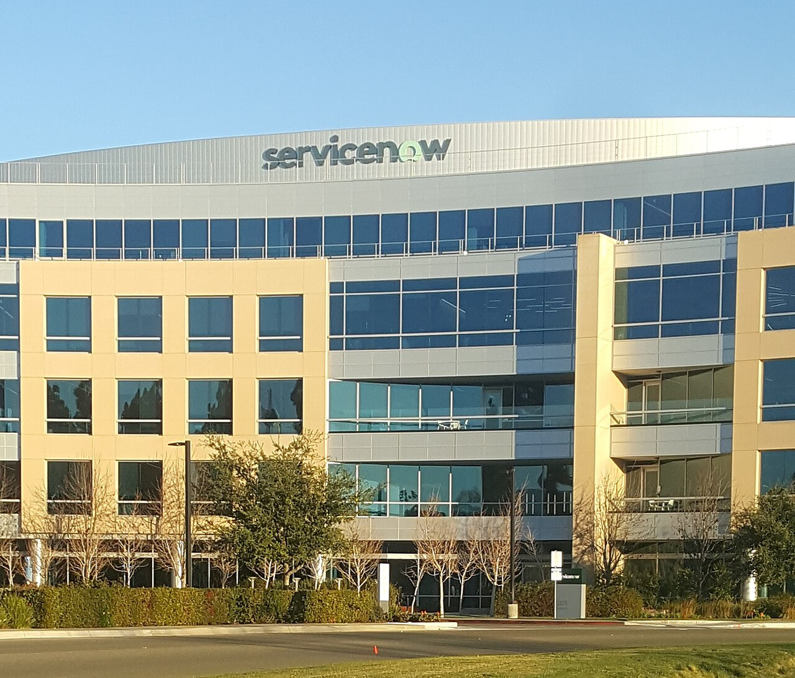
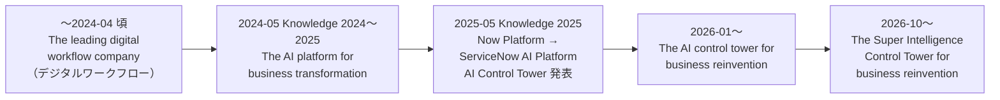

# ServiceNowとは（会社概要・沿革・市場ポジション・日本法人）

## 概要

ServiceNow（サービスナウ、正式社名 ServiceNow, Inc.）は、米国カリフォルニア州サンタクララに本社を置くエンタープライズ向け SaaS（Software as a Service）企業である。ServiceNow は単一のクラウドプラットフォーム（現在の名称は **ServiceNow AI Platform**、旧称 **Now Platform**）の上で、IT・従業員・顧客・セキュリティ／リスク・業務アプリ開発などのワークフロー（業務の流れ）をデジタル化・自動化する製品群を提供している。

ServiceNow は IT サービス管理（ITSM: IT Service Management）製品で市場を確立し、その後 ITOM・HR・顧客サービス・GRC などへ領域を広げ、2023 年以降は生成 AI（Now Assist）と AI エージェント（AI Agents）、さらに企業内の AI を統制する **AI Control Tower** を中核メッセージに据えている。

本ファイルは次の問いに答える。

| 問い | 該当セクション |
|---|---|
| ServiceNow はどんな会社か（規模・本社・上場市場） | [会社の基本情報](#会社の基本情報) |
| いつ、誰が創業し、どう成長したか | [沿革](#沿革) |
| どのくらいの売上・顧客数か | [業績と顧客規模](#業績と顧客規模) |
| どんな顧客が使っているか | [主要顧客層](#主要顧客層) |
| 市場でどう評価されているか（Gartner MQ 等） | [市場ポジション](#市場ポジションgartner-magic-quadrant-等) |
| 自社をどう位置づけているか（"AI platform for business transformation" 等） | [ビジョンと位置づけ](#ビジョンと位置づけ) |
| 日本法人はどうなっているか | [日本法人（ServiceNow Japan）](#日本法人servicenow-japan) |

プラットフォームの技術的な全体像は [02-platform-overview.md](./02-platform-overview.md)、製品群の一覧は [03-product-portfolio.md](./03-product-portfolio.md)、リリース名と年2回のリリースサイクルは [07-release-cycle.md](./07-release-cycle.md) を参照。

---

## 会社の基本情報

ServiceNow, Inc. の基本情報を以下にまとめる。数値は「いつ時点か」を必ず併記している（ServiceNow は成長が速く、数値はすぐに古くなるため）。

| 項目 | 内容 | 時点・出典 |
|---|---|---|
| 正式社名 | ServiceNow, Inc. | [Form 10-K FY2025](https://www.sec.gov/Archives/edgar/data/1373715/000137371526000007/now-20251231.htm) |
| 本社（Principal executive offices） | 2225 Lawson Lane, Santa Clara, California 95054, USA | 同上 |
| 設立準拠法 | 米国デラウェア州（Delaware）法人 | 同上 |
| 創業者 | Fred Luddy（フレッド・ラディ）。現在は取締役（Director、2004 年〜。非独立取締役）。2018-04〜2022-10 は取締役会会長（Chairman）を務めた | [Proxy Statement（DEF 14A、2026-04-06 提出）](https://www.sec.gov/Archives/edgar/data/1373715/000137371526000039/now-20260406.htm) |
| CEO | Bill McDermott（ビル・マクダーモット、元 SAP SE CEO）。2019 年 11 月 CEO 就任、2022 年 10 月から取締役会会長を兼務（Chairman and CEO） | 同上 |
| President 兼 CFO | Gina Mastantuono（2020 年 1 月 CFO 就任、2025 年に President を兼務） | 【第三者情報】[Wikipedia](https://en.wikipedia.org/wiki/ServiceNow) |
| 上場市場・ティッカー | ニューヨーク証券取引所（NYSE）、ティッカー `NOW` | [Q4 FY2025 決算リリース](https://investor.servicenow.com/news/news-details/2026/ServiceNow-Reports-Fourth-Quarter-and-Full-Year-2025-Financial-Results-Board-of-Directors-Authorizes-Additional-5B-for-Share-Repurchase-Program/default.aspx) |
| 株式分割 | 1 株 → 5 株の株式分割。2025-10-29 に取締役会が承認（Q3 2025 決算リリースで発表）、2025-12-05 の臨時株主総会（Special Meeting of Stockholders）で分割のための定款変更（Amended and Restated Certificate of Incorporation）を株主が承認、2025-12-17 16:05 ET に効力発生（基準日 2025-12-16）、2025-12-18 頃から分割調整後で取引 | [Q3 2025 決算リリース](https://newsroom.servicenow.com/press-releases/details/2025/ServiceNow-Reports-Third-Quarter-2025-Financial-Results-Board-of-Directors-Authorizes-Five-for-One-Stock-Split/default.aspx)、[Form 8-K（2025-12-05）](https://www.sec.gov/Archives/edgar/data/1373715/000137371525000321/now-20251205.htm)、[Form 10-K FY2025](https://www.sec.gov/Archives/edgar/data/1373715/000137371526000007/now-20251231.htm) |
| 従業員数 | 29,187 名（うち米国 14,601 名、米国外 14,586 名） | 2025-12-31 時点、Form 10-K |
| 従業員数（最新） | 約 30,000 名 | 2026-06-30 時点、[Q2 2026 Fact Sheet](https://s205.q4cdn.com/916135447/files/doc_downloads/2026/07/Q2-2026-Fact-Sheet-final.pdf) |
| 顧客数 | 約 8,700 社 | 2025-12-31 時点、Form 10-K |
| 顧客数（最新公表値） | 約 8,800 社、Fortune 500 の約 90% が利用 | 2026-05 時点、Q2 2026 Fact Sheet |
| 特許 | 発行済み特許 2,000 件超、出願中 580 件超 | 2025-12-31 時点、Form 10-K |
| データセンター | 北米・南米・欧州・アジア・オーストラリアに所在。冗長化のため 2 拠点をペアで構成 | Form 10-K（詳細は [instance-architecture.md](../02_リファレンス/platform/instance-architecture.md)） |
| 年次ユーザーカンファレンス | Knowledge（毎年 5 月前後、米国ラスベガス）。地域イベントとして World Forum を開催 | Form 10-K |
| 主な表彰（2026 年） | Fortune 500（4 年連続ランクイン）、Fortune 100 Best Companies to Work For、Fast Company Most Innovative Companies 2026（Applied AI 部門） ほか | Q2 2026 Fact Sheet |

### 画像：ServiceNow のロゴ

- **キャプション:** ServiceNow のワードマーク（文字ロゴ）。
- **説明:** 小文字の "servicenow" を濃い灰緑色（#293e40）で描き、末尾 "now" の "o" だけを電源ボタン風の淡い緑（#81b5a1）で表現したロゴ。2018 年頃から使われているデザインで、2026 年時点の公式資料（Fact Sheet 等）でも同系統の "o" を強調したワードマークが使われている。ServiceNow が "now"（今すぐ）という即時性を社名に込めていることを示すデザインである。
- **出典:** Wikimedia Commons "File:ServiceNow logo.svg" https://commons.wikimedia.org/wiki/File:ServiceNow_logo.svg （取得日: 2026-11-02）。商標は ServiceNow, Inc. に帰属。

### 画像：米国本社（サンタクララ）

- **キャプション:** ServiceNow グローバル本社（Global HQ、カリフォルニア州サンタクララ）の外観。
- **説明:** 5〜6 階建てのオフィスビルで、最上部の湾曲した外壁に "servicenow" のロゴが掲げられている。手前は植栽と道路。2012 年の IPO 後にサンディエゴからサンタクララへ本社を移転しており、Form 10-K 上の本社住所は 2225 Lawson Lane, Santa Clara である。
- **出典:** Wikimedia Commons "File:ServiceNowGlobalHQ.jpg"（撮影: Donny Gonzo、2019-01-24、CC0 1.0） https://commons.wikimedia.org/wiki/File:ServiceNowGlobalHQ.jpg （取得日: 2026-11-02）

---

## 沿革

### 創業から IPO まで

ServiceNow は、Peregrine Systems（サンディエゴの IT 管理ソフトウェア企業）の CTO を 2002 年まで務めた Fred Luddy が 2003 年に **Glidesoft, Inc.** として創業した会社である。2004 年にカリフォルニア州で法人化されたため、「2004 年創業」と書かれる資料も多い。【第三者情報】[Wikipedia](https://en.wikipedia.org/wiki/ServiceNow)

Fred Luddy は当初、汎用的なワークフロー基盤（"Glide" プラットフォーム）を作り、その上で ITIL に準拠した ITSM アプリケーションに特化する方針を選んだ。現在でも ServiceNow のサーバーサイド API が `GlideRecord`、`GlideSystem`（`gs`）など "Glide" の名前を持つのはこの名残である（API の詳細は [scripting-server-side.md](../02_リファレンス/platform/scripting-server-side.md)）。【第三者情報】同上

### 年表

| 年 | 出来事 | 出典 |
|---|---|---|
| 2003 | Fred Luddy が Glidesoft, Inc. を創業 | 【第三者情報】Wikipedia |
| 2004 | カリフォルニア州で法人化 | 【第三者情報】Wikipedia |
| 2005 | JMI Equity から 250 万ドルの資金調達。それまで社員は Luddy 1 名のみ | 【第三者情報】Wikipedia |
| 2006 | 社名を Service-now.com に変更 | 【第三者情報】Wikipedia |
| 2007 | 年間売上約 1,300 万ドル、キャッシュフロー黒字化 | 【第三者情報】Wikipedia |
| 2011-04 | Frank Slootman が CEO に就任 | 【第三者情報】Wikipedia |
| 2012-06 | IPO（約 2.1 億ドル調達、主幹事 Morgan Stanley）。その後、本社をサンディエゴからサンタクララへ移転 | 【第三者情報】Wikipedia |
| 2013-09 | 日本法人 ServiceNow Japan 合同会社を設立（後述） | 同社プレスリリースの会社概要（後述） |
| 2017 | John Donahoe が CEO に就任（Slootman の後任） | 【第三者情報】Wikipedia |
| 2017 | DxContinuum（機械学習）を買収。後の Predictive Intelligence の基盤 | 【第三者情報】Wikipedia |
| 2019-11 | Bill McDermott が CEO に就任（当初予定の年末より前倒し） | 【第三者情報】Wikipedia |
| 2020-11 | Element AI（カナダの AI 企業）の買収を発表（2021-01 完了） | 【第三者情報】Wikipedia |
| 2021 | Lightstep（オブザーバビリティ）を買収 | 【第三者情報】Wikipedia |
| 2023 | 生成 AI 機能 Now Assist を投入（Vancouver リリース以降） | 詳細は [now-assist-ai-agents.md](../02_リファレンス/platform/now-assist-ai-agents.md) |
| 2024 | 年間売上が 100 億ドルを突破 | 【第三者情報】Wikipedia |
| 2025-01〜05 | Cuein（AI）、Logik.ai（CPQ）、data.world（データカタログ）を買収 | 【第三者情報】Wikipedia |
| 2025-03-10 | Moveworks（AI アシスタント）の買収を発表（約 28.5 億ドル、現金と株式） | 【第三者情報】[Seedtable](https://seedtable.com/exits/moveworks) ほか |
| 2025-05 | Knowledge 2025 で、プラットフォーム名を **ServiceNow AI Platform** にリブランドし、**AI Control Tower** と AI Agent Fabric を発表 | 【第三者情報】[CX Today](https://cxtoday.com/crm/servicenow-knowledge-2025-announcements) |
| 2025-12-15 | Moveworks の買収完了 | [Q4 FY2025 決算リリース](https://investor.servicenow.com/news/news-details/2026/ServiceNow-Reports-Fourth-Quarter-and-Full-Year-2025-Financial-Results-Board-of-Directors-Authorizes-Additional-5B-for-Share-Repurchase-Program/default.aspx) |
| 2025-12 | Veza（アイデンティティセキュリティ、2025-12-02 発表）と Armis（サイバーエクスポージャー管理、同月中旬発表）の買収を発表（Q4 FY2025 決算リリース時点の完了見込みは Veza が 2026 年上半期、Armis が 2026 年下半期）。5 対 1 の株式分割を実施（2025-12-17 効力発生） | 同上、Form 10-K |
| 2026-01 | Anthropic および OpenAI との提携を発表（LLM をプラットフォームに統合） | 【第三者情報】Wikipedia、[Business Wire](https://www.businesswire.com/news/home/20260120785434/en/ServiceNow-and-OpenAI-collaborate-to-deepen-and-accelerate-enterprise-AI-outcomes) |
| 2026-03-02 | Veza の買収完了 | [Q1 FY2026 決算 8-K](https://www.sec.gov/Archives/edgar/data/0001373715/000137371526000054/erq1fy26.htm)（"ServiceNow closed its acquisition of Veza on March 2, 2026."） |
| 2026-04 | 製品ティアを Foundation / Advanced / Prime の 3 段階に刷新（全ティアに AI を組み込み） | [Product tiers（公式 Docs）](https://www.servicenow.com/docs/r/australia/intelligent-experiences/ai-native-sku-overview.html)。導入時期（2026-04）は【第三者情報】[Redress Compliance](https://redresscompliance.com/servicenow-foundation-advanced-prime-compared) |
| 2026-04-20 | Armis の買収完了（約 77.5 億ドル、現金） | [Armis 買収完了リリース](https://newsroom.servicenow.com/press-releases/details/2026/ServiceNow-completes-Armis-acquisition-closing-the-gap-between-asset-visibility-and-cyber-risk/default.aspx) |
| 2026-05-05 | **Australia** リリース GA（本ナレッジの基準リリース）。同時期の Knowledge 2026 で AI Control Tower を拡張 | [Australia Release Notes PDF](https://downloads.docs.servicenow.com/pdf/enus/servicenow-australia-release-notes-enus.pdf) |
| 2026-10-28 | **Super Intelligence Control Tower** の名称で Control Tower Alliance を発表。Super Intelligence Control Tower は AI Control Tower の改称とされる【第三者情報】 | [Control Tower Alliance リリース](https://newsroom.servicenow.com/press-releases/details/2026/ServiceNow-launches-Control-Tower-Alliance-to-help-enterprises-adopt-AI-safely-at-scale/default.aspx)（Alliance の発表）、改称は【第三者情報】[Techzine](https://www.techzine.eu/blogs/analytics/141044/servicenow-moves-beyond-control-tower-to-govern-and-kill-enterprise-ai/) |

> 補足: Pyramid Analytics（BI／分析プラットフォーム）の買収は、ServiceNow 公式ブログで 2026-02-12 に発表され、2026-03-10 に完了したと追記されている（買収額は非開示）。[ServiceNow 公式ブログ](https://www.servicenow.com/blogs/2026/pyramid-analytics-expanding-data-driven-ai)。詳細は [製品ポートフォリオ](./03-product-portfolio.md) を参照。Wikipedia には 2026 年の買収として Ai.Work（2026-07）、Sweep（2026-09）なども列挙されているが、ServiceNow 公式の発表では本ナレッジ作成時点で確認できていない。【第三者情報】

### CEO の変遷

| 期間 | CEO | 備考 |
|---|---|---|
| 2003〜2011 | Fred Luddy | 創業者。プラットフォームの設計者。現在は取締役（2018-04〜2022-10 は会長） |
| 2011〜2017 | Frank Slootman | IPO を主導。のちに Snowflake CEO |
| 2017〜2019 | John Donahoe | 退任後 Nike CEO |
| 2019-11〜現在 | Bill McDermott | 元 SAP CEO。2022-10 から会長を兼務。AI プラットフォーム化を推進 |

【第三者情報】[Wikipedia](https://en.wikipedia.org/wiki/ServiceNow)。会長職の時期は [DEF 14A（2026-04-06）](https://www.sec.gov/Archives/edgar/data/1373715/000137371526000039/now-20260406.htm) による。

---

## 業績と顧客規模

ServiceNow の売上はほぼすべてがサブスクリプション（年間契約型）収入であり、年 20% 前後の成長を続けている。以下は公式決算資料に基づく数値である（単位は米ドル）。

### 2025 年度（FY2025、2025-12-31 終了）

| 指標 | 値 | 出典 |
|---|---|---|
| サブスクリプション売上（Subscription revenues, GAAP） | 128.83 億ドル（前年比 +21%） | [Q4 FY2025 決算リリース](https://investor.servicenow.com/news/news-details/2026/ServiceNow-Reports-Fourth-Quarter-and-Full-Year-2025-Financial-Results-Board-of-Directors-Authorizes-Additional-5B-for-Share-Repurchase-Program/default.aspx)（2026-01-28） |
| 総売上（Total revenues, GAAP） | 132.78 億ドル（前年比 +21%） | 同上 |
| cRPO（今後 12 か月で売上計上予定の契約残高） | 128.5 億ドル（前年比 +25%） | 同上 |
| RPO（残存履行義務の総額） | 282 億ドル | Form 10-K |
| ACV 500 万ドル超の顧客数 | 603 社（2024 年末 502 社、2023 年末 420 社） | Form 10-K |
| Non-GAAP フリーキャッシュフロー | 46.36 億ドル | Form 10-K |
| 北米以外の売上比率 | 37%（2024 年も 37%） | Form 10-K |

### 2026 年度の直近実績（Q3 2026、2026-09-30 終了）

| 指標 | 値 | 出典 |
|---|---|---|
| サブスクリプション売上 | 39.88 億ドル（前年同期比 +21%） | [Q3 2026 決算 8-K](https://www.sec.gov/Archives/edgar/data/0001373715/000137371526000092/erq3fy26.htm)（2026-10-28） |
| 総売上 | 41.06 億ドル（同 +20.5%） | 同上 |
| cRPO / RPO | 136.5 億ドル（+20.5%）／ 297 億ドル（+22%） | 同上 |
| ACV 500 万ドル超の顧客数 | 680 社（約 +23%） | 同上 |
| FY2026 サブスクリプション売上ガイダンス | 157.80〜157.90 億ドル（前年比 +22.5%） | 同上 |
| ServiceNow AI の ACV | 2026 年 Q2 に 10 億ドルを突破 | [Q2 2026 Fact Sheet](https://s205.q4cdn.com/916135447/files/doc_downloads/2026/07/Q2-2026-Fact-Sheet-final.pdf) |
| AI ACV の年末目標 | 17 億ドル（年初目標 10 億ドルから 2 度上方修正） | 【第三者情報】Q3 2026 決算説明会の報道（[Finviz 等](https://finviz.com/news/410638/servicenow-reports-third-quarter-2026-financial-results)） |

> 用語: **ACV**（Annual Contract Value、年間契約額）は ServiceNow が大口顧客の数を示す際に使う指標。「ACV 500 万ドル超の顧客」は、年間 500 万ドル（約 7〜8 億円）以上を ServiceNow に支払う顧客を指す。

### 事業領域（Workflow の 4 区分）

ServiceNow は Form 10-K で、製品群を次の 4 つのワークフロー区分で説明している。各製品の詳細は [03-product-portfolio.md](./03-product-portfolio.md) を参照。

| 区分（英語） | 日本語 | 代表的な製品 |
|---|---|---|
| Technology | テクノロジー（IT・セキュリティ・リスク） | ITSM、ITOM、Security Operations、Risk Management（IRM） |
| CRM and Industry | CRM と業界別ソリューション | Customer Service Management、Field Service Management、Sales and Order Management、金融・医療・製造・公共・小売・通信向け業界ソリューション |
| Core Business | コアビジネス（従業員・バックオフィス） | HR Service Delivery、Legal and Contract Operations、Source-to-Pay Operations、Workplace Service Delivery |
| Creator and Other | 開発者向けほか | App Engine、Workflow Data Fabric、Platform Privacy and Security |

出典: [Form 10-K FY2025](https://www.sec.gov/Archives/edgar/data/1373715/000137371526000007/now-20251231.htm)

### プラットフォームの 3 本柱

Form 10-K は ServiceNow AI Platform を「人・プロセス・データをつなぎ、サイロを解消するプラットフォーム」と説明し、次の 3 本柱で構成されるとしている。

| 柱 | 主な構成要素 | 関連ファイル |
|---|---|---|
| AI | Now Assist（生成 AI）、AI Agents | [now-assist-ai-agents.md](../02_リファレンス/platform/now-assist-ai-agents.md) |
| Data（データ） | Workflow Data Fabric、RaptorDB | [workflow-data-fabric.md](../02_リファレンス/platform/workflow-data-fabric.md) |
| Workflows（ワークフロー） | 各製品のワークフロー、Workflow Studio | [flow-designer-workflow-studio.md](../02_リファレンス/platform/flow-designer-workflow-studio.md) |

出典: [Form 10-K FY2025](https://www.sec.gov/Archives/edgar/data/1373715/000137371526000007/now-20251231.htm)

---

## 主要顧客層

### 顧客の特徴

ServiceNow の顧客は、大企業・グローバル企業・政府機関が中心である。公式資料から読み取れる顧客層の特徴は次のとおり。

| 観点 | 内容 | 出典 |
|---|---|---|
| 企業規模 | 大企業中心。2026-05 時点で Fortune 500 の約 90% が ServiceNow を利用 | [Q2 2026 Fact Sheet](https://s205.q4cdn.com/916135447/files/doc_downloads/2026/07/Q2-2026-Fact-Sheet-final.pdf) |
| 大口顧客 | ACV 500 万ドル超の顧客が 680 社（2026-09 末） | [Q3 2026 決算 8-K](https://www.sec.gov/Archives/edgar/data/0001373715/000137371526000092/erq3fy26.htm) |
| 政府機関 | 政府系顧客の売上比率が増加傾向（比率は非開示） | [Form 10-K FY2025](https://www.sec.gov/Archives/edgar/data/1373715/000137371526000007/now-20251231.htm) |
| 地域 | 売上の 63% が北米、37% が北米以外（2025 年） | 同上 |
| 業界 | 金融、医療・ライフサイエンス、製造、公共、小売、テクノロジー、通信・メディアなど（業界別ソリューションを提供） | 同上 |

### 販売チャネルとパートナー

ServiceNow は、グローバルな直販組織によるエンタープライズ向けサブスクリプション販売を基本とし、一部の AI・データ製品では従量課金（consumption-based pricing）も併用している。マネージドサービスプロバイダー（MSP）や再販パートナー経由の販売もある。[Form 10-K FY2025](https://www.sec.gov/Archives/edgar/data/1373715/000137371526000007/now-20251231.htm)

| パートナー種別 | Form 10-K に記載の例 |
|---|---|
| 戦略パートナー（Strategic partners） | AWS、Google、Microsoft、NVIDIA |
| グローバル SI（Global system integrators） | Accenture、Cognizant、Deloitte、EY、Infosys、KPMG |

日本のパートナー動向は [05-project-organization.md](../03_導入編/05-project-organization.md) と [15-japan-market.md](../03_導入編/15-japan-market.md) を参照。

### 競合

ServiceNow は Form 10-K で、競合として Microsoft、Oracle、SAP、Salesforce、Workday を名指しし、加えて AI 特化型のポイントソリューション／プラットフォーム、自社開発（内製）、コンサルティング会社・SI・再販業者を競争相手に挙げている。ITSM 領域ではこれに加えて BMC Helix、Freshworks、Atlassian などが比較対象となる。詳細な比較は [16-competitor-comparison.md](../03_導入編/16-competitor-comparison.md) を参照。[Form 10-K FY2025](https://www.sec.gov/Archives/edgar/data/1373715/000137371526000007/now-20251231.htm)

---

## 市場ポジション（Gartner Magic Quadrant 等）

### Gartner Magic Quadrant とは

Gartner Magic Quadrant（ガートナー・マジック・クアドラント、MQ）は、調査会社 Gartner が特定市場のベンダーを「Completeness of Vision（ビジョンの完全性）」と「Ability to Execute（実行能力）」の 2 軸で評価し、Leaders（リーダー）・Challengers（チャレンジャー）・Visionaries（ビジョナリー）・Niche Players（ニッチプレイヤー）の 4 象限に配置するレポートである。製品選定時の参考資料として広く使われる。

> 注意: Gartner のレポート本体は有償であり、本ナレッジでは ServiceNow 公式発表・他ベンダー発表・業界メディアの報道から評価結果を確認している。

### ServiceNow の主な評価（2024〜2026 年）

| 年 | レポート名（英語） | 日本語訳 | ServiceNow の位置 | 出典 |
|---|---|---|---|---|
| 2026 | Magic Quadrant for IT Service Management Platforms（2026-07-27） | ITSM プラットフォーム | **Leader**。併せて同日付の Critical Capabilities for IT Service Management Platforms で Service Desk Operations、Intermediate ITSM、Advanced ITSM の 3 ユースケースで 1 位（ServiceNow の発表による） | [ServiceNow 公式（Workflow ニュース）](https://www.servicenow.com/workflow/news/magic-quadrant-leader-itsm-why-that-matters.html) |
| 2026 | Magic Quadrant for AI Applications in IT Service Management（2026-08-17） | ITSM 向け AI アプリケーション | **Leader**（3 年連続） | 【第三者情報】[TechTarget 掲載資料](https://www.techtarget.com/hub/asset/1787326466_420)、[Gartner 要旨](https://www.gartner.com/en/documents/8270821) |
| 2026 | Magic Quadrant for AI Governance Platforms（2026-06-16） | AI ガバナンスプラットフォーム | **Leader** | [ServiceNow 公式ランディングページ](https://www.servicenow.com/lpayr/gartner-mq-aigovernance.html) |
| 2026 | Magic Quadrant for SaaS Management Platforms（2026-06-18） | SaaS 管理プラットフォーム | **Leader**（2025 年版の Niche Players から昇格） | [ServiceNow Community（SAM ブログ）](https://www.servicenow.com/community/sam-blog/servicenow-named-a-leader-in-the-2026-gartner-magic-quadrant-for/ba-p/3612219) |
| 2026 | Magic Quadrant for Workplace Experience (WEX) Applications（2026-04-06） | ワークプレイス体験アプリケーション | **Leader** | [ServiceNow 公式ランディングページ](https://www.servicenow.com/lpayr/gartner-magic-quadrant-workplace-experience-applications.html) |
| 2026 | Magic Quadrant for Digital Employee Experience (DEX) Tools | デジタル従業員体験ツール | Visionary（Leader ではない） | 【第三者情報】[TechTarget 掲載資料](https://www.techtarget.com/hub/asset/1790792829_899) |
| 2025 | Magic Quadrant for AI Applications in IT Service Management | ITSM 向け AI アプリケーション | **Leader**（ServiceNow によれば Leader は同社のみ。2 年連続）。Critical Capabilities で 2 ユースケース 1 位 | [ServiceNow ブログ](https://www.servicenow.com/blogs/2025/leader-ai-applications-itsm) |
| 2025 | Magic Quadrant for Business Orchestration and Automation Technologies（初版） | ビジネスオーケストレーション・自動化技術（BOAT） | **Leader** | [Q3 2025 決算リリース](https://newsroom.servicenow.com/press-releases/details/2025/ServiceNow-Reports-Third-Quarter-2025-Financial-Results-Board-of-Directors-Authorizes-Five-for-One-Stock-Split/default.aspx) |
| 2025 | Magic Quadrant for the CRM Customer Engagement Center（2025-10-27） | CRM カスタマーエンゲージメントセンター | **Leader** | 同上 |
| 2025 | Magic Quadrant for Enterprise Low-Code Application Platforms | エンタープライズ・ローコード開発基盤 | **Leader**（6 回目） | 同上 |
| 2024 | Magic Quadrant for AI Applications in IT Service Management（初版） | ITSM 向け AI アプリケーション | **Leader** | [Business Wire](https://www.businesswire.com/news/home/20241015627717/en/ServiceNow-Named-a-Leader-in-the-2024-Gartner-Magic-Quadrant-for-AI-Applications-in-IT-Service-Management) |

> 注記: 2025 年版 AI Applications in ITSM について、第三者サイトでは Aisera も Leader とする記述があるが、ServiceNow 公式は「Leader に選ばれた唯一のベンダー」と発表している。本ナレッジでは公式発表を優先し、Gartner 原本では確認できていない旨を付記する。

### ITSM の Magic Quadrant の経緯

ServiceNow の市場ポジションを語るうえで、ITSM 分野の Magic Quadrant の名称変遷を押さえておくとよい。

| 時期 | レポート | ServiceNow の評価 |
|---|---|---|
| 〜2021 | Magic Quadrant for IT Service Management Tools | 2021 年版で 8 年連続 Leader（[Business Wire](https://www.businesswire.com/news/home/20210908005127/en/5042764/ServiceNow-Named-a-Leader-in-the-2021-Gartner%C2%AE-Magic-Quadrant%E2%84%A2-for-IT-Service-Management-Tools-for-Eighth-Consecutive-Year)） |
| 2022 | Magic Quadrant for IT Service Management Platforms | 9 年連続 Leader（[Business Wire](https://businesswire.com/news/home/20221108005400/en/ServiceNow-Named-a-Leader-in-the-2022-Gartner-Magic-Quadrant-for-IT-Service-Management-Platforms-for-Ninth-Consecutive-Year)） |
| 2023 | MQ は廃止され、ベンダーを順位付けしない Market Guide for ITSM Platforms に置き換え | 【第三者情報】[ManageEngine](https://www.manageengine.com/products/service-desk/itsm/itsm-gartner-magic-quadrant.md) |
| 2024〜 | Magic Quadrant for AI Applications in IT Service Management を新設 | 2024・2025・2026 年版で Leader |
| 2026 | Magic Quadrant for IT Service Management Platforms が復活（評価対象 16 社、Leader 4 社） | Leader（[ServiceNow 公式](https://www.servicenow.com/workflow/news/magic-quadrant-leader-itsm-why-that-matters.html)）。同年の Leader には BMC Helix、Freshworks も含まれる |

【第三者情報】2026 年版 ITSM Platforms MQ の評価対象数・Leader 数は [itsm.tools（2026-09-03）](https://itsm.tools/?p=38195)、他社の Leader 位置づけは[Freshworks 発表](https://www.freshworks.com/pressrelease/freshworks-named-a-leader-in-the-2026-gartner-magic-quadrant-for-it-service-management-platforms/)、[BMC Helix 発表](https://www.helixops.ai/newsroom/releases/bmc-helix-named-leader-gartner-magic-quadrant-it-service-management-platforms.html) に基づく。2026 年版の Leader の全社名は公開情報では確認できず。

### 市場ポジションのまとめ

- ServiceNow は **ITSM 市場で長期にわたり Leader 評価を受けてきた代表的ベンダー**であり、「ITSM といえば ServiceNow」という認知の根拠になっている。
- 2024 年以降は **ITSM 向け AI**、**AI ガバナンス**、**ローコード開発**、**CRM カスタマーエンゲージメント**、**業務オーケストレーション（BOAT）** など、IT 以外の領域でも Leader 評価を得ており、「IT のツール」から「全社の業務・AI プラットフォーム」へ評価軸が広がっている。
- 一方で、DEX（デジタル従業員体験）ツールのように Leader ではない領域もある。製品選定時は領域ごとに評価を確認する必要がある。【経験則】

---

## ビジョンと位置づけ

### パーパス（企業の存在意義）

ServiceNow は企業のパーパス（Purpose）として **"make the world work better for everyone"（世界の働き方をすべての人にとってより良くする）** を掲げている。創業者 Fred Luddy のビジョンに由来するとされ、[ServiceNow 公式ストーリー（servicenow.com/workflow/culture）](https://www.servicenow.com/nl/workflow/culture/creating-access-better-world.html)。なお、創業者 Fred Luddy のビジョンに由来するという点と、2010 年代前半の表現は第三者の公開情報に基づく。【第三者情報】

### 自社の位置づけ（タグライン）の変遷

ServiceNow は、プレスリリース冒頭の記述（"ServiceNow (NYSE: NOW), the ... ,"）や末尾の "About ServiceNow" で自社をどう表現するかを、AI 戦略の進化に合わせて変えてきた。以下はプレスリリース上の表現の変遷である。

| 時期 | 自社の位置づけ（英語） | 日本語訳 | 確認できた出典 |
|---|---|---|---|
| 〜2024-04 頃 | "the leading digital workflow company making the world work better for everyone" | 世界の働き方をすべての人にとってより良くする、デジタルワークフローのリーディングカンパニー | Vancouver リリース発表（2023-09-20、[Business Wire](https://www.businesswire.com/news/home/20230920657771/en)） |
| 2024-05（Knowledge 2024）〜2025 年 | **"the AI platform for business transformation"** | ビジネス変革のための AI プラットフォーム | [Knowledge 2024 公式リリース](https://www.servicenow.com/company/media/press-room/now-platform-innovations-knowledge-24.html)（2024-05-07）、[Form 10-K FY2024](https://www.sec.gov/Archives/edgar/data/1373715/000137371525000010/now-20241231.htm)（"As an AI platform for business transformation, the Now Platform ..."） |
| 2024〜2025 年 | "ServiceNow (NYSE: NOW) is putting AI to work for people." | AI を人々のために役立てる | [Q3 2025 決算リリース](https://newsroom.servicenow.com/press-releases/details/2025/ServiceNow-Reports-Third-Quarter-2025-Financial-Results-Board-of-Directors-Authorizes-Five-for-One-Stock-Split/default.aspx) の About ServiceNow |
| 2026-01〜2026-09 頃 | **"the AI control tower for business reinvention"** | ビジネス再創造のための AI コントロールタワー | [Q4 FY2025 決算リリース](https://investor.servicenow.com/news/news-details/2026/ServiceNow-Reports-Fourth-Quarter-and-Full-Year-2025-Financial-Results-Board-of-Directors-Authorizes-Additional-5B-for-Share-Repurchase-Program/default.aspx)（2026-01-28）、[Armis 買収完了リリース](https://newsroom.servicenow.com/press-releases/details/2026/ServiceNow-completes-Armis-acquisition-closing-the-gap-between-asset-visibility-and-cyber-risk/default.aspx)（2026-04-20）、[Q2 2026 Fact Sheet](https://s205.q4cdn.com/916135447/files/doc_downloads/2026/07/Q2-2026-Fact-Sheet-final.pdf) |
| 2026-10〜（最新） | **"the Super Intelligence Control Tower for business reinvention"** | ビジネス再創造のためのスーパーインテリジェンス・コントロールタワー | [Q3 2026 決算 8-K](https://www.sec.gov/Archives/edgar/data/0001373715/000137371526000092/erq3fy26.htm)、[Control Tower Alliance リリース](https://newsroom.servicenow.com/press-releases/details/2026/ServiceNow-launches-Control-Tower-Alliance-to-help-enterprises-adopt-AI-safely-at-scale/default.aspx)（いずれも 2026-10-28） |

> 注記: Q4 FY2025 決算リリース（2026-01-28）では、冒頭で "the AI control tower for business reinvention"、About 欄で "AI platform for business transformation" の両方が使われており、2026 年初頭は新旧表現が併存していた。

> 図の左端の表現は、2023-09 の Vancouver リリース発表でも使われている（"the leading digital workflow company making the world work better for everyone"）。この表現を使い始めた時期は公開情報では確認できず。

### "The AI platform for business transformation" の意味

"The AI platform for business transformation"（ビジネス変革のための AI プラットフォーム）は、ServiceNow が 2024-05 の Knowledge 2024 から 2025 年にかけて用いた自社の位置づけであり、次の 3 つの主張を含んでいる。【経験則】（公式資料の記述を要約）

| 主張 | 内容 | 裏付けとなる公式記述 |
|---|---|---|
| 1. 単一プラットフォーム | IT・人事・顧客・セキュリティなど全社のワークフローを 1 つのプラットフォーム・1 つのデータモデルで動かす | Fact Sheet "One platform, ready for anything."、Form 10-K の「サイロを解消する」 |
| 2. AI をワークフローに組み込む | AI を単体ツールではなく、業務フローの中で実際に仕事をさせる（Now Assist、AI Agents） | "putting AI to work for people" |
| 3. 変革（transformation） | 既存システム（SAP、Oracle、Workday、Salesforce 等の System of Record）を置き換えるのではなく、その上で業務をつなぎ変革する | Fact Sheet のプラットフォーム図（Any System of Record） |

### "AI Control Tower" への進化（2025〜2026）

2025 年以降、ServiceNow は「AI を作る・使うプラットフォーム」から「企業内のあらゆる AI を統制するプラットフォーム」へとメッセージを進めた。

| 時期 | 出来事 | 出典 |
|---|---|---|
| 2025-05（Knowledge 2025） | AI Control Tower を初めて発表。プラットフォーム名を ServiceNow AI Platform に変更 | 【第三者情報】[CX Today](https://cxtoday.com/crm/servicenow-knowledge-2025-announcements) |
| 2026-05（Knowledge 2026） | AI Control Tower を拡張し、ServiceNow 以外のシステムで動く AI も含めて Discover（発見）・Observe（観測）・Govern（統制）・Secure（保護）・Measure（測定）の 5 領域を担うと発表 | [ServiceNow Newsroom](https://newsroom.servicenow.com/press-releases/details/2026/ServiceNow-expands-AI-Control-Tower-to-discover-observe-govern-secure-and-measure-AI-deployed-across-any-system-in-the-enterprise/default.aspx) |
| 2026-10 | Super Intelligence Control Tower の名称で打ち出す（AI Control Tower からの改称とされる【第三者情報】[Techzine](https://www.techzine.eu/blogs/analytics/141044/servicenow-moves-beyond-control-tower-to-govern-and-kill-enterprise-ai/)）。Anthropic、AWS、Cisco、NVIDIA、Okta、OpenAI、Stripe などを創設メンバーとする Control Tower Alliance を発表。About ServiceNow で「年間 1,000 億件超のワークフローがプラットフォーム上で稼働」と記載 | [Control Tower Alliance リリース](https://newsroom.servicenow.com/press-releases/details/2026/ServiceNow-launches-Control-Tower-Alliance-to-help-enterprises-adopt-AI-safely-at-scale/default.aspx) |

Q2 2026 Fact Sheet のプラットフォーム図では、ServiceNow AI Platform を次のレイヤー構造で表現している。

| レイヤー（上から） | 内容 |
|---|---|
| 体験（Experience） | Voice、Enterprise Search、Video、**ServiceNow Otto**、Chat、Web、Apps |
| 業界（Industry） | Any Industry（各業界向けソリューション） |
| ワークフロー領域 | IT、CRM、Security & Risk、Autonomous Workflows、Employee Experience、App Development |
| Sense / Decide / Act | Sense = Any Data（あらゆるデータ）、Decide = Any AI Model（あらゆる AI モデル）、Act = Any Workflow（あらゆるワークフロー） |
| Secure | Any System, Identity, Asset（あらゆるシステム・ID・資産の保護。Veza・Armis 買収と対応） |
| 基盤 | Any Cloud（AWS、Azure、Google Cloud、ServiceNow）、Any System of Record（SAP、Oracle、Salesforce、Workday 等）の上に ServiceNow AI Platform が乗る |

出典: [Q2 2026 Fact Sheet](https://s205.q4cdn.com/916135447/files/doc_downloads/2026/07/Q2-2026-Fact-Sheet-final.pdf)（2 ページ目の図を文章化）

> **ServiceNow Otto:** Australia リリースのリリースノートでは「ServiceNow Otto is the new AI experience brand（ServiceNow Otto は新しい AI 体験ブランド）」と記載されており、Now Assist などの会話型 AI 体験が Otto ブランドに整理されつつある。詳細は [now-assist-ai-agents.md](../02_リファレンス/platform/now-assist-ai-agents.md) を参照。[Australia Highlights](https://www.servicenow.com/docs/r/australia/release-notes/rn-summary-highlights.html)

> **Brazil での変更:** Brazil ファミリー（2026-09-24 EA）の時期に合わせ、2026-10 から AI Control Tower は **Super Intelligence Control Tower** として打ち出されている。ランタイム監視や AI エージェントを即時停止する "kill switch"、エージェントごとの "AI Passport" などの機能拡張が発表されているが、各機能がどのリリースで GA になるかは公開情報では確認できず。【第三者情報】[Techzine](https://www.techzine.eu/blogs/analytics/141044/servicenow-moves-beyond-control-tower-to-govern-and-kill-enterprise-ai/)

### AI をすべての製品に組み込む製品ティア（2026 年）

ServiceNow は 2026 年に製品の提供形態を **Foundation / Advanced / Prime** の 3 ティアに刷新し、最下位の Foundation を含むすべてのティアに AI を組み込んだ。これは「AI を追加オプションではなく標準機能にする」という位置づけの変化を示している。

| ティア | AI の水準（公式 Docs の記述） |
|---|---|
| Foundation | AI skills と定型的な AI エージェント（routine AI agents）によるタスク単位の支援 |
| Advanced | ワークフローの工程全体を自動化するエージェント型ワークフロー（agentic workflows） |
| Prime | 自律的に判断・実行する AI ワークフォース（autonomous AI workforce）。自然言語指示による独自エージェントの構築が可能 |

出典: [ServiceNow product tiers（公式 Docs、Australia）](https://www.servicenow.com/docs/r/australia/intelligent-experiences/ai-native-sku-overview.html)。公式 Docs は「新ティアの展開はインスタンスのアップグレードサイクルとは独立している」と記載している。発表日（2026-04-09）と旧エディション（Standard / Pro / Enterprise 等）の販売終了日（2026-07-01）は【第三者情報】（[Info-Tech](https://www.infotech.com/software-reviews/vendor-technology-notes/servicenow-bundles-ai-into-every-product-and-bets-that-context-is-the-missing-piece)、[Redress Compliance](https://redresscompliance.com/servicenow-foundation-advanced-prime-compared)）。ライセンスの詳細は [01-licensing-model.md](../03_導入編/01-licensing-model.md) と [03-edition-comparison.md](../03_導入編/03-edition-comparison.md) を参照。

### 入門者向けの理解のポイント

ServiceNow を初めて説明する場面では、次の 4 点を押さえておくとよい。【経験則】

1. **出自は ITSM**：ServiceNow は ITIL ベースの IT サービス管理ツールとして成長した。現在でも ITSM が中核製品であり、日本でも IT 部門から導入が始まるケースが多い（[06-itil-itsm-basics.md](./06-itil-itsm-basics.md)）。
2. **単一プラットフォーム**：全製品が同じプラットフォーム・同じデータベース（テーブル）・同じ権限モデルの上で動く。ITSM で作った CMDB やユーザー情報を HR や CSM でもそのまま使える（[02-platform-overview.md](./02-platform-overview.md)、[04-core-concepts.md](./04-core-concepts.md)）。
3. **年 2 回のリリース**：プラットフォームは年 2 回メジャーアップグレードされ、リリースには都市名（現在は国名）が付く。本ナレッジの基準は Australia（2026-05-05 GA）。次期 Brazil は 2026-11-05 に Brazil Patch 2 が「Available」で公開され、この日に GA したとみられる【推定】（[07-release-cycle.md](./07-release-cycle.md)）。
4. **AI と AI ガバナンスへの重心移動**：2023 年以降は生成 AI、2025 年以降は AI エージェントと AI Control Tower が戦略の中心である。ServiceNow を「IT のチケット管理ツール」としてだけ説明すると、2026 年時点の同社の戦略・価格体系とずれる。

---

## 日本法人（ServiceNow Japan）

### 基本情報

ServiceNow の日本法人は **ServiceNow Japan 合同会社**（英語表記: ServiceNow Japan LLC）である。

| 項目 | 内容 | 出典・確度 |
|---|---|---|
| 法人名 | ServiceNow Japan 合同会社（ServiceNow Japan LLC） | [同社プレスリリース（PR TIMES、2026-06-04）](https://prtimes.jp/main/html/rd/p/000000206.000029239.html)、[キンドリルジャパン・ServiceNow Japan 共同発表（2026-03-26）](https://www.kyndryl.com/jp/ja/about-us/news/2026/03/megmilk-workflow-modernization-servicenow) |
| 設立 | 2013 年 9 月 | ServiceNow Japan 合同会社のプレスリリース（[PR TIMES、2026-06-04](https://prtimes.jp/main/html/rd/p/000000206.000029239.html)）の会社概要による。2013 年 1 月とする第三者情報（[日本の人事部](https://jinjibu.jp/corporate/servicenow-ewf/)、ビズリーチ企業概要）もあるが、本 KB は同社発表を採る。2018 年の公式発表で「日本での 5 年間の成長」と言及しており、2013 年設立と整合する |
| 代表者 | 鈴木正敏（社長執行役員）。日本オラクル、SAP ジャパン、シマンテック、UiPath などを経て、2023 年 1 月に James McCready 氏の後任として就任 | 【第三者情報】[日経ビジネス電子版 Special](https://special.nikkeibp.co.jp/atcl/ONB/23/servicenow1120/?P=2)、[EnterpriseZine](https://enterprisezine.jp/news/detail/19469) |
| 組織上の位置づけ | 2023-01-05 付で米国本社直轄の独立事業体に昇格（それ以前はアジア太平洋地域の一部） | 【第三者情報】同上 |
| 本社所在地 | 2026 年 4 月上旬に **東京ミッドタウン日比谷**（東京都千代田区）へ移転。それ以前は東京都港区 | 【第三者情報】[クラウド Watch（2026-04-23）](https://cloud.watch.impress.co.jp/docs/news/2104011.html) |
| 顧客向け施設 | 新本社内に「Tokyo Innovation Center」を開設（顧客経営層向けブリーフィング、デモ、ワークショップ） | 【第三者情報】同上 |
| COO | 原智宏（専務執行役員） | 【第三者情報】同上 |

> 注記: 2026-03-26 の Kyndryl との共同発表では本社を「東京都港区」と記載しているが、これは 2026-04 の移転前の発表である。一方、移転後の 2026-06-04 の同社プレスリリース（PR TIMES）でも、会社概要の所在地は旧所在地（東京都港区赤坂 1-12-32 アーク森ビル）のままで、本文には「本社: 東京都千代田区」と書かれており、同じリリース内で記載が食い違っている。登記上の本店移転が済んでいるかどうかは公開情報では確認できず。

### 日本におけるデータセンター

ServiceNow は 2018-10-17 に、NTT Communications と協業して **東京と大阪に 2 つのクラウドデータセンター**を開設すると発表した（2019 年上半期完成予定）。日本の顧客は、日本国内 2 拠点のペア構成で ServiceNow のクラウド（当時の名称 "Nonstop Cloud"）を利用でき、日本語対応のサポート体制も強化された。【第三者情報】[APMdigest（2018-10-17）](https://www.apmdigest.com/servicenow-establishes-new-data-centers-in-japan)

データセンターのペア構成・データ所在地の考え方は [instance-architecture.md](../02_リファレンス/platform/instance-architecture.md)、セキュリティ・データレジデンシーは [10-security-compliance.md](../03_導入編/10-security-compliance.md) を参照。

### 日本への投資

日本経済新聞（2024-11-18）は、Bill McDermott CEO が今後数年間で日本に約 20 億ドル（約 3,000 億円）を投資し、データセンターの拡張と東京拠点の拡大、生成 AI サービスの強化に充てる計画であると報じた。2026 年 4 月の東京ミッドタウン日比谷への本社移転はこの拠点拡大計画に対応する（当初報道では 2025 年下半期移転予定）。【第三者情報】[TechNews（日経報道の要約）](https://technews.tw/2024/11/19/servicenow-to-expand-investment-in-japan/)、[GuruFocus](https://gurufocus.com/news/2608954/servicenow-now-plans-2-billion-investment-in-japan-to-expand-data-centers)。ServiceNow 自身の一次発表は確認できず。

### 2026 年の日本事業戦略

ServiceNow Japan は 2026-04-22 に東京ミッドタウン日比谷の新本社で 2026 年事業戦略説明会を開催した。報道で確認できた要点は次のとおり。【第三者情報】[クラウド Watch（2026-04-23）](https://cloud.watch.impress.co.jp/docs/news/2104011.html)、[EnterpriseZine](https://enterprisezine.jp/news/detail/24199)

| 項目 | 内容 |
|---|---|
| 成長 | 鈴木社長は「日本市場はグローバルを上回る高成長を継続している」と説明（具体的な成長率・顧客数は非開示） |
| 戦略テーマ | 「AI エージェント時代のエンタープライズ OS」。AI を自律的に業務を担う「AI 社員」と位置づける |
| 3 つの柱 | ① AI ネイティブな業務起点と体験（EmployeeWorks、Moveworks を統合）② AI 社員による自律的な業務実行（Autonomous Workforce）③ AI 活用の全社管理・統制（AI Control Tower） |
| 提供形態 | Foundation / Advanced / Prime の 3 ティア。最下位の Foundation にも AI 機能を標準搭載。定額サブスクリプションに従量課金を組み合わせる |
| 課題認識 | 同社調査で企業の AI 成熟度が前年比で低下し、1 社あたり 360 以上のアプリが乱立して業務がサイロ化していることを主因に挙げた |

### 日本の顧客・パートナーの例

日本でも大企業を中心に導入が進んでいる。公開されている事例の一部を示す（いずれも【第三者情報】、パートナー企業の公開事例による）。

| 企業 | 内容 | 出典 |
|---|---|---|
| デンソー | ヘルプデスク対応を月あたり約 1,250 時間削減 | [日立ソリューションズ 導入事例](https://www.hitachi-solutions.co.jp/servicenow/cases/) |
| 大林組 | サポートデスクへの電話問い合わせを約 30% 削減 | 同上 |
| 三菱 HC キャピタル | 紙ベースの手続きを Web サービス化し、運用効率約 15% 向上 | 同上 |
| 雪印メグミルク | Kyndryl と ServiceNow がワークフローシステムの刷新を支援（App Engine で稟議・労務・マスタ申請などを構築、2025 年中に移行完了） | [キンドリルジャパン・ServiceNow Japan 共同発表（2026-03-26）](https://www.kyndryl.com/jp/ja/about-us/news/2026/03/megmilk-workflow-modernization-servicenow) |

日本市場における導入の特徴（日本語化、商習慣、パートナー構造）は [15-japan-market.md](../03_導入編/15-japan-market.md)、日本語ローカライゼーションの仕様は [localization.md](../02_リファレンス/platform/localization.md) を参照。

---

## よくある質問（FAQ）

**Q1. ServiceNow はいつ創業された会社か。**
ServiceNow は 2003 年に Fred Luddy が Glidesoft, Inc. として創業し、2004 年に法人化した。資料によって「2003 年創業」「2004 年創業」の両方の記載がある。【第三者情報】[Wikipedia](https://en.wikipedia.org/wiki/ServiceNow)

**Q2. ServiceNow の売上規模はどのくらいか。**
ServiceNow の 2025 年度の総売上は 132.78 億ドル、サブスクリプション売上は 128.83 億ドル（いずれも前年比 +21%）。2026 年度のサブスクリプション売上は 157.8〜157.9 億ドルの見込み（2026-10-28 時点のガイダンス）。[Q4 FY2025 決算リリース](https://investor.servicenow.com/news/news-details/2026/ServiceNow-Reports-Fourth-Quarter-and-Full-Year-2025-Financial-Results-Board-of-Directors-Authorizes-Additional-5B-for-Share-Repurchase-Program/default.aspx)、[Q3 2026 決算 8-K](https://www.sec.gov/Archives/edgar/data/0001373715/000137371526000092/erq3fy26.htm)

**Q3. "Now Platform" と "ServiceNow AI Platform" は別物か。**
同じプラットフォームの新旧名称である。ServiceNow は 2025-05 の Knowledge 2025 で Now Platform を ServiceNow AI Platform にリブランドした。製品ドキュメントやコミュニティでは旧称 Now Platform も引き続き見られる。詳細は [02-platform-overview.md](./02-platform-overview.md)。

**Q4. Gartner の ITSM の Magic Quadrant で ServiceNow は Leader か。**
Leader である。2026 年に復活した Magic Quadrant for IT Service Management Platforms（2026-07-27）と、Magic Quadrant for AI Applications in IT Service Management（2024・2025・2026 年版）のいずれでも Leader と評価されている。ITSM Platforms 版は [ServiceNow 公式](https://www.servicenow.com/workflow/news/magic-quadrant-leader-itsm-why-that-matters.html) で確認。AI Applications in ITSM の 2026 年版は【第三者情報】。詳細は [市場ポジション](#市場ポジションgartner-magic-quadrant-等) を参照。

**Q5. "AI Control Tower" と "Super Intelligence Control Tower" の違いは何か。**
同じ製品の新旧名称とされる。AI Control Tower は 2025-05（Knowledge 2025）に発表され、2026-05（Knowledge 2026）に、他社システム上の AI も含めて発見・観測・統制・保護・測定（Discover / Observe / Govern / Secure / Measure）する形へ拡張された。2026-10 からは Super Intelligence Control Tower として打ち出されている。【第三者情報】[Techzine](https://www.techzine.eu/blogs/analytics/141044/servicenow-moves-beyond-control-tower-to-govern-and-kill-enterprise-ai/)詳細は [now-assist-ai-agents.md](../02_リファレンス/platform/now-assist-ai-agents.md)。

**Q6. 日本法人の正式名称と代表者は。**
ServiceNow Japan 合同会社。2026-11 時点の公開情報では社長執行役員は鈴木正敏氏（2023 年 1 月就任）。【第三者情報】

---

## 確認できなかった事項

- 2026 年版 Magic Quadrant for IT Service Management Platforms の Leader 全社名（ServiceNow、BMC Helix、Freshworks 以外）は公開情報では確認できず。
- 2026 年版 Magic Quadrant for AI Applications in IT Service Management で ServiceNow が Leader である点は、ServiceNow が配信する第三者掲載資料（TechTarget）のみで確認しており、ServiceNow 公式プレスリリースは確認できず。
- servicenow.com のアナリストレポート一覧ページ（/company/analyst-reports.html）は本調査時にアクセスできず、全レポートの網羅的な一覧は確認できていない。
- ServiceNow Japan 合同会社の登記上の本店移転（港区から千代田区へ）が済んでいるかどうかは公開情報では確認できず。2026-06-04 の同社プレスリリースでも、会社概要は旧所在地（港区赤坂 アーク森ビル）、本文は千代田区となっている。
- ServiceNow Japan 合同会社の設立日（日付単位。年月は 2013 年 9 月）、日本の従業員数、日本の顧客数は公開情報では確認できず。
- "the leading digital workflow company ..." を使い始めた時期は一次情報で特定できず（2023-09 の使用は確認済み）。
- 2026 年版 ITSM Platforms の Critical Capabilities で 3 ユースケース 1 位という点は ServiceNow の発表に基づき、Gartner 原本では確認できていない。
- 2026 年に Wikipedia が列挙する一部買収（Ai.Work、Sweep 等。Pyramid Analytics は公式ブログで確認済み）は ServiceNow 公式発表で未確認。

---

## 参照元

### ServiceNow 公式（IR・SEC 提出書類・ニュースルーム・ドキュメント）

- ServiceNow, Inc. Form 10-K（FY2025）: https://www.sec.gov/Archives/edgar/data/1373715/000137371526000007/now-20251231.htm
- ServiceNow, Inc. Proxy Statement（DEF 14A、2026-04-06 提出、取締役・会長）: https://www.sec.gov/Archives/edgar/data/1373715/000137371526000039/now-20260406.htm
- ServiceNow, Inc. Form 10-K（FY2024、"AI platform for business transformation"）: https://www.sec.gov/Archives/edgar/data/1373715/000137371525000010/now-20241231.htm
- ServiceNow opens Knowledge 2024 with innovations that power AI-driven transformation（2024-05-07）: https://www.servicenow.com/company/media/press-room/now-platform-innovations-knowledge-24.html
- Business Wire: ServiceNow Vancouver release（2023-09-20、"the leading digital workflow company"）: https://www.businesswire.com/news/home/20230920657771/en
- ServiceNow 公式: Leader in the 2026 Gartner Magic Quadrant for ITSM Platforms: https://www.servicenow.com/workflow/news/magic-quadrant-leader-itsm-why-that-matters.html
- ServiceNow Reports Fourth Quarter and Full-Year 2025 Financial Results（2026-01-28）: https://investor.servicenow.com/news/news-details/2026/ServiceNow-Reports-Fourth-Quarter-and-Full-Year-2025-Financial-Results-Board-of-Directors-Authorizes-Additional-5B-for-Share-Repurchase-Program/default.aspx
- ServiceNow Q3 2026 Financial Results（Form 8-K、2026-10-28）: https://www.sec.gov/Archives/edgar/data/0001373715/000137371526000092/erq3fy26.htm
- ServiceNow Q2 2026 Fact Sheet: https://s205.q4cdn.com/916135447/files/doc_downloads/2026/07/Q2-2026-Fact-Sheet-final.pdf
- ServiceNow Reports Third Quarter 2025 Financial Results（Gartner 評価一覧、株式分割）: https://newsroom.servicenow.com/press-releases/details/2025/ServiceNow-Reports-Third-Quarter-2025-Financial-Results-Board-of-Directors-Authorizes-Five-for-One-Stock-Split/default.aspx
- ServiceNow completes Armis acquisition（2026-04-20）: https://newsroom.servicenow.com/press-releases/details/2026/ServiceNow-completes-Armis-acquisition-closing-the-gap-between-asset-visibility-and-cyber-risk/default.aspx
- ServiceNow launches Control Tower Alliance（2026-10-28）: https://newsroom.servicenow.com/press-releases/details/2026/ServiceNow-launches-Control-Tower-Alliance-to-help-enterprises-adopt-AI-safely-at-scale/default.aspx
- ServiceNow expands AI Control Tower（Knowledge 2026）: https://newsroom.servicenow.com/press-releases/details/2026/ServiceNow-expands-AI-Control-Tower-to-discover-observe-govern-secure-and-measure-AI-deployed-across-any-system-in-the-enterprise/default.aspx
- ServiceNow product tiers（公式 Docs、Australia）: https://www.servicenow.com/docs/r/australia/intelligent-experiences/ai-native-sku-overview.html
- Highlights for all Australia features and products: https://www.servicenow.com/docs/r/australia/release-notes/rn-summary-highlights.html
- Australia Release Notes（PDF）: https://downloads.docs.servicenow.com/pdf/enus/servicenow-australia-release-notes-enus.pdf
- ServiceNow is the only vendor to be named a Leader by Gartner in AI applications in ITSM（2025）: https://www.servicenow.com/blogs/2025/leader-ai-applications-itsm
- ServiceNow Community: Leader in the 2026 Gartner Magic Quadrant for SaaS Management Platforms: https://www.servicenow.com/community/sam-blog/servicenow-named-a-leader-in-the-2026-gartner-magic-quadrant-for/ba-p/3612219
- Business Wire: Leader in 2024 Gartner MQ for AI Applications in ITSM: https://www.businesswire.com/news/home/20241015627717/en/ServiceNow-Named-a-Leader-in-the-2024-Gartner-Magic-Quadrant-for-AI-Applications-in-IT-Service-Management
- Business Wire: Leader in 2021 Gartner MQ for ITSM Tools: https://www.businesswire.com/news/home/20210908005127/en/5042764/ServiceNow-Named-a-Leader-in-the-2021-Gartner%C2%AE-Magic-Quadrant%E2%84%A2-for-IT-Service-Management-Tools-for-Eighth-Consecutive-Year
- Business Wire: Leader in 2022 Gartner MQ for ITSM Platforms: https://businesswire.com/news/home/20221108005400/en/ServiceNow-Named-a-Leader-in-the-2022-Gartner-Magic-Quadrant-for-IT-Service-Management-Platforms-for-Ninth-Consecutive-Year
- Business Wire: ServiceNow and OpenAI collaborate（2026-01-20）: https://www.businesswire.com/news/home/20260120785434/en/ServiceNow-and-OpenAI-collaborate-to-deepen-and-accelerate-enterprise-AI-outcomes
- ServiceNow, Inc. Form 8-K（2025-12-05、臨時株主総会で株式分割のための定款変更を承認）: https://www.sec.gov/Archives/edgar/data/1373715/000137371525000321/now-20251205.htm
- ServiceNow Q1 2026 Financial Results（Form 8-K、Veza 買収完了 2026-03-02）: https://www.sec.gov/Archives/edgar/data/0001373715/000137371526000054/erq1fy26.htm
- ServiceNow 公式ランディングページ（2026 Gartner MQ for AI Governance Platforms）: https://www.servicenow.com/lpayr/gartner-mq-aigovernance.html
- ServiceNow 公式ランディングページ（2026 Gartner MQ for Workplace Experience Applications）: https://www.servicenow.com/lpayr/gartner-magic-quadrant-workplace-experience-applications.html
- ServiceNow 公式ストーリー（パーパス）: https://www.servicenow.com/nl/workflow/culture/creating-access-better-world.html
- PR TIMES（ServiceNow Japan 合同会社プレスリリース、2026-06-04。会社概要に設立 2013 年 9 月・所在地 港区赤坂 アーク森ビル、本文に本社 千代田区・社長執行役員 鈴木正敏）: https://prtimes.jp/main/html/rd/p/000000206.000029239.html
- キンドリルジャパン・ServiceNow Japan 共同発表「キンドリルとServiceNow、雪印メグミルクのワークフローシステムを刷新」（2026-03-26）: https://www.kyndryl.com/jp/ja/about-us/news/2026/03/megmilk-workflow-modernization-servicenow

### 第三者情報（調査会社・メディア・パートナー）

- Wikipedia "ServiceNow": https://en.wikipedia.org/wiki/ServiceNow
- Gartner 要旨（2026 MQ for AI Applications in ITSM）: https://www.gartner.com/en/documents/8270821
- TechTarget 掲載資料（DEX Tools 2026 / AI Applications in ITSM 2026 言及）: https://www.techtarget.com/hub/asset/1787326466_420 , https://www.techtarget.com/hub/asset/1790792829_899
- itsm.tools「The 2026 Gartner Magic Quadrant for IT Service Management Platforms」: https://itsm.tools/?p=38195
- ManageEngine（ITSM MQ の経緯）: https://www.manageengine.com/products/service-desk/itsm/itsm-gartner-magic-quadrant.md
- Freshworks（2026 ITSM Platforms MQ Leader）: https://www.freshworks.com/pressrelease/freshworks-named-a-leader-in-the-2026-gartner-magic-quadrant-for-it-service-management-platforms/
- BMC Helix（2026 ITSM Platforms MQ Leader）: https://www.helixops.ai/newsroom/releases/bmc-helix-named-leader-gartner-magic-quadrant-it-service-management-platforms.html
- CX Today「ServiceNow Knowledge 2025: All 11 Major Announcements」: https://cxtoday.com/crm/servicenow-knowledge-2025-announcements
- Techzine（Super Intelligence Control Tower）: https://www.techzine.eu/blogs/analytics/141044/servicenow-moves-beyond-control-tower-to-govern-and-kill-enterprise-ai/
- Seedtable（Moveworks 買収）: https://seedtable.com/exits/moveworks
- Finviz（Q3 2026 決算報道）: https://finviz.com/news/410638/servicenow-reports-third-quarter-2026-financial-results
- Info-Tech（AI をすべての製品にバンドル）: https://www.infotech.com/software-reviews/vendor-technology-notes/servicenow-bundles-ai-into-every-product-and-bets-that-context-is-the-missing-piece
- Redress Compliance（Foundation / Advanced / Prime 比較）: https://redresscompliance.com/servicenow-foundation-advanced-prime-compared
- クラウド Watch（ServiceNow Japan 2026 年事業戦略、2026-04-23）: https://cloud.watch.impress.co.jp/docs/news/2104011.html
- EnterpriseZine（ServiceNow Japan 2026 年事業戦略）: https://enterprisezine.jp/news/detail/24199
- EnterpriseZine（鈴木正敏氏の社長就任）: https://enterprisezine.jp/news/detail/19469
- 日経ビジネス電子版 Special（ServiceNow Japan）: https://special.nikkeibp.co.jp/atcl/ONB/23/servicenow1120/?P=2
- 日本の人事部（ServiceNow Japan 企業情報）: https://jinjibu.jp/corporate/servicenow-ewf/
- APMdigest（日本の新データセンター、2018-10-17）: https://www.apmdigest.com/servicenow-establishes-new-data-centers-in-japan
- TechNews（日本への投資、日経報道の要約）: https://technews.tw/2024/11/19/servicenow-to-expand-investment-in-japan/
- GuruFocus（日本への 20 億ドル投資）: https://gurufocus.com/news/2608954/servicenow-now-plans-2-billion-investment-in-japan-to-expand-data-centers
- 日立ソリューションズ ServiceNow 導入事例: https://www.hitachi-solutions.co.jp/servicenow/cases/

### 画像

- Wikimedia Commons "File:ServiceNow logo.svg": https://commons.wikimedia.org/wiki/File:ServiceNow_logo.svg （取得日: 2026-11-02）
- Wikimedia Commons "File:ServiceNowGlobalHQ.jpg"（CC0 1.0）: https://commons.wikimedia.org/wiki/File:ServiceNowGlobalHQ.jpg （取得日: 2026-11-02）
