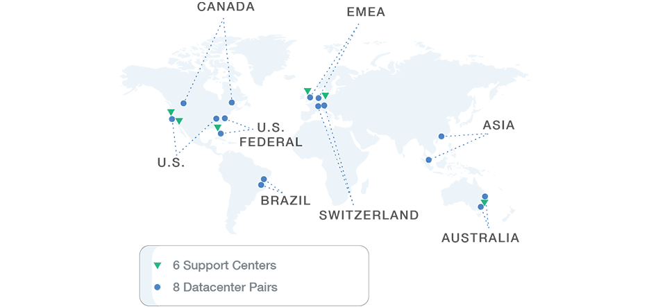
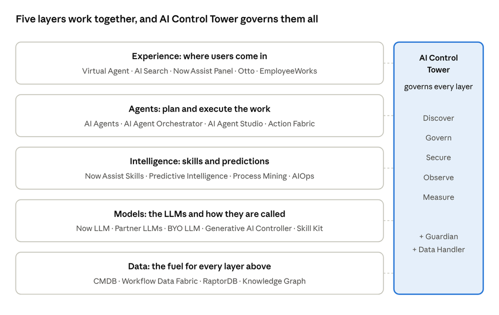
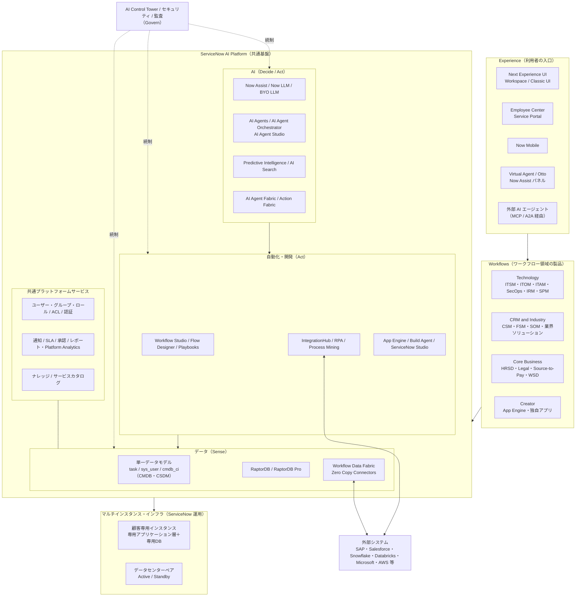
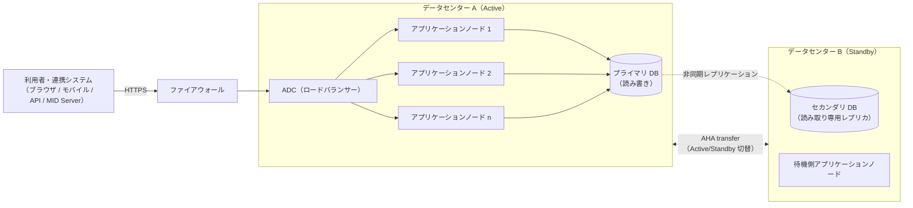

# Now Platform（ServiceNow AI Platform）の全体像

## 概要

**ServiceNow AI Platform（ServiceNow AI プラットフォーム）** は、ITSM・HR・CSM・セキュリティ・リスク・アプリ開発など、ServiceNow のすべての製品が共通で乗る基盤である。2025 年 5 月の Knowledge 2025 までは **Now Platform（ナウ・プラットフォーム）** と呼ばれており、現在も現場や Community、古い資料では「Now Platform」の呼称が広く使われている。本ナレッジでは両者を同じものとして扱う。

ServiceNow AI Platform を理解するうえでの要点は次の 5 つである。

| # | 要点 | 一言でいうと |
|---|---|---|
| 1 | **One platform / single data model / single architecture**（単一プラットフォーム・単一データモデル・単一アーキテクチャ） | すべての製品が同じ基盤・同じデータベース・同じ実行環境で動く |
| 2 | **Multi-instance architecture（マルチインスタンス・アーキテクチャ）** | 顧客ごとに専用のアプリケーション層とデータベース（＝インスタンス）が割り当てられる |
| 3 | **SaaS（サブスクリプション型クラウドサービス）** | ServiceNow が運用し、年 2 回のファミリーリリースで機能が追加される |
| 4 | **Workflow（ワークフロー）が中心** | 部門・システムをまたぐ業務の流れを、レコードと自動化で端から端まで管理する |
| 5 | **AI・データ・自動化が基盤に組み込まれている** | Now Assist、AI Agents、AI Control Tower、Workflow Data Fabric、RaptorDB などがプラットフォーム機能として提供される |

ServiceNow 公式ドキュメントは ServiceNow AI Platform を「すべての ServiceNow 製品の統合された基盤（unified foundation）」であり、「AI、データ、ワークフロー、セキュリティを単一データモデル上にまとめる」ものと説明している。[出典](https://www.servicenow.com/docs/r/zurich/platform-administration/how-now-platform-works.html)

本ファイルは入門編として「全体像」を説明する。個々の構成要素の仕様は、本文中のリンク先（リファレンス編）を参照すること。

---

## 1. 名称の変遷：Now Platform から ServiceNow AI Platform へ

### 1.1 名称の変遷

ServiceNow のプラットフォーム名称は、ServiceNow AI Platform に至るまで次のように変わってきた。

| 時期 | 名称 | 備考 |
|---|---|---|
| 〜2010 年代後半 | ServiceNow Platform / Glide（内部フレームワーク名） | サーバーサイド API が `GlideRecord` など「Glide」接頭辞を持つのはこの名残 |
| 2017 年頃〜2025 年 5 月 | **Now Platform** | リリースノートや製品資料で長く使われた名称 |
| 2025 年 5 月（Knowledge 2025）〜 | **ServiceNow AI Platform** | 「AI、データ、ワークフローを一つにまとめた再設計」として発表 |

- ServiceNow は 2025-05-06 に「新しい ServiceNow AI Platform」を発表し、AI（intelligence）・データ・オーケストレーションを統合したものと位置づけた。[出典](https://s205.q4cdn.com/537566246/files/doc_news/ServiceNow-Unveils-the-New-ServiceNow-AI-Platform-to-Put-Any-AI-Any-Agent-Any-Model-to-Work-Across-the-Enterprise-2025.pdf)
- Australia リリースのドキュメントも「ServiceNow AI Platform」の名称で統一されている。[出典](https://www.servicenow.com/docs/r/8_SIK58xmFJIEc2bL5YTYg/iD2im0ZC56onMtNgXRDJXg)
- 「Now Platform」の名称が使われ始めた正確な時期は、公開情報では確認できず（上表の「2017 年頃」は【推定】）。

### 1.2 「Now」が付く用語

ServiceNow AI Platform の名称変更後も、多くの機能名に「Now」が残っている。主なものは以下である。

| 用語 | 意味 |
|---|---|
| Now Assist | 生成 AI 機能群（要約、生成、会話など）の製品名。2023 年 9 月の Vancouver リリースで一般提供開始 [出典](https://www.businesswire.com/news/home/20230920980105/en) |
| Now LLM | ServiceNow 自社開発の大規模言語モデル群 |
| Now Mobile | 従業員向けモバイルアプリ（[モバイル](../02_リファレンス/platform/mobile.md) を参照） |
| Now Experience / Next Experience | UI フレームワーク（[Next Experience UI](../02_リファレンス/platform/next-experience-ui.md) を参照） |
| Now Create | ServiceNow の導入方法論（[導入方法論](../03_導入編/04-implementation-methodology.md) を参照） |
| NOW | ServiceNow の NYSE ティッカーシンボル |

---

## 2. 単一プラットフォーム・単一データモデル・単一アーキテクチャ

### 2.1 ServiceNow 自身による説明

ServiceNow AI Platform の最大の特徴は、「一つのプラットフォーム、一つのデータモデル、一つのアーキテクチャ」でエンタープライズ全体のワークフローを提供する点にある。ServiceNow 自身の説明は以下のとおりである。

| 情報源 | 記述（要旨） |
|---|---|
| 年次報告書 10-K（FY2025） | 「one platform architecture（単一プラットフォーム・アーキテクチャ）」が AI・データ・ワークフローを統合する基盤となる。外部データソースへの接続も「single data model（単一データモデル）」にマッピングされ、データを移動せずに統一された体験を提供する。[出典](https://www.sec.gov/Archives/edgar/data/1373715/000137371526000007/now-20251231.htm) |
| 公式ドキュメント「How the ServiceNow AI Platform works」 | すべての ServiceNow 製品の統合基盤であり、AI・データ・ワークフロー・セキュリティを単一データモデル上にまとめる。単一データモデルが数百のシステムとつながり、AI が部門横断で動くための業務コンテキストを提供する。[出典](https://www.servicenow.com/docs/r/zurich/platform-administration/how-now-platform-works.html) |
| 技術白書「ServiceNow's Blueprint for Agentic Business」（2026） | 企業が必要としているのは「データ、AI、ワークフロー、セキュリティが共通の運用モデル・統合ガバナンスのもと単一プラットフォームで動くこと」であるとし、すべてのワークフローが同じリレーショナルスキーマ（CSDM）に対して実行されると説明する。[出典](https://s205.q4cdn.com/916135447/files/doc_downloads/2026/ServiceNow-s-Blueprint-for-Agentic-Business-The-Technical-Foundation.pdf) |
| CEO Bill McDermott の発言 | 「one platform, one data model, one architecture（一つのプラットフォーム、一つのデータモデル、一つのアーキテクチャ）」を繰り返し強調している。【第三者情報】（インタビュー記事）[出典](https://leadersmag.com/issues/2022.1_Jan/PDFs/LEADERS-Bill-McDermott-ServiceNow.pdf) |

### 2.2 「単一プラットフォーム」とは

ServiceNow AI Platform における「単一プラットフォーム」とは、ITSM、HR Service Delivery、Customer Service Management などの製品が、それぞれ独立した別システムではなく、**同じインスタンス上で動くアプリケーション（プラグイン／スコープアプリ）** として提供されることを意味する。

- 製品を追加購入しても、新しいサーバーや別データベースを用意するのではなく、既存インスタンスにプラグインやアプリケーションを有効化・インストールする形になる。
- ユーザー（`sys_user`）、グループ（`sys_user_group`）、ロール（`sys_user_role`）、承認、通知、SLA、レポート、セキュリティ（ACL）などの共通機能は、すべての製品で共有される。
- そのため、例えば「IT のインシデント」から「HR のケース」や「施設の作業依頼」へ、同じ画面体系・同じ権限モデル・同じ自動化エンジンで連携できる。

この仕組みの実務的な影響（製品間連携が容易、ライセンスの組み合わせ方など）は [製品ポートフォリオ一覧](03-product-portfolio.md) と [プラットフォームのパッケージ構成](../02_リファレンス/platform/platform-licensing-packaging.md) を参照。

### 2.3 「単一データモデル」とは

ServiceNow AI Platform の「単一データモデル」とは、すべての製品のデータが **インスタンスごとに一つのデータベース内のテーブル群** として定義され、共通のルール（System Dictionary、継承、参照）で管理されることを指す。

| 仕組み | 説明 | 例 |
|---|---|---|
| すべてはテーブルとレコード | 画面に表示されるデータも、設定（スクリプト、フロー、ACL）も、テーブルのレコードとして保存される | `incident`、`sys_script`（Business Rule）、`sys_security_acl` |
| `sys_id` による一意識別 | すべてのレコードは 32 文字の一意キー `sys_id` を持ち、テーブル間の参照に使われる | 参照フィールドは相手レコードの `sys_id` を保持する |
| テーブル継承（Table extension） | 親テーブルの項目を子テーブルが引き継ぐ。業務チケットは `task` テーブルを親とする | `task` → `incident`、`problem`、`change_request`、`sc_req_item`、`hr_case`（HRSD）など |
| 共通マスタの共有 | ユーザー、グループ、所在地、部署、会社などのマスタは全製品で共有される | `sys_user`、`sys_user_group`、`cmn_location`、`cmn_department`、`core_company` |
| CMDB と CSDM | IT 資産・サービスの構成情報を `cmdb_ci` 配下のクラス階層で管理し、CSDM（Common Service Data Model）でサービスとの関係を標準化する | `cmdb_ci` → `cmdb_ci_server`、`cmdb_ci_service` など |

- ServiceNow 社員の Community 回答では、「各インスタンスは独自のデータベースを持ち、users、`cmdb_ci`、task などのテーブルがアプリケーション間で共有され、すべてのレコードが主キーとして `sys_id` を持つことで、ビジネスサービスとプロセスを一つのシステムで関連づけられる」と説明されている。[出典](https://www.servicenow.com/community/itom-forum/what-does-single-data-model-and-single-system-of-record-means-in/m-p/968123)
- Blueprint 白書は、CSDM を「デジタル資産、ビジネスサービス、人、場所、契約、課題をリアルタイムに結ぶ統合リレーショナルスキーマ」と表現し、例えばネットワークスイッチ障害時に影響するビジネスサービスを自動特定し、担当チームへの通知とインシデント作成まで行えるのはこのデータモデルのおかげだと説明している。[出典](https://s205.q4cdn.com/916135447/files/doc_downloads/2026/ServiceNow-s-Blueprint-for-Agentic-Business-The-Technical-Foundation.pdf)

単一データモデルの詳細（System Dictionary、フィールド型、継承、参照）は [データモデルと System Dictionary](../02_リファレンス/platform/data-model-dictionary.md)、`task` テーブル等の基本概念は [必須の基本概念](04-core-concepts.md)、CMDB/CSDM は [CMDB と CSDM](../02_リファレンス/platform/cmdb-csdm.md) を参照。

### 2.4 「単一コードベース／単一アーキテクチャ」とは

「single code base（単一コードベース）」という表現は、ServiceNow の差別化要因として業界でよく語られるが、**ServiceNow の公式資料（10-K、公式ドキュメント）で「single code base」という語そのものは確認できなかった**。公式に使われている表現は「one platform architecture」「one architecture」「single architecture」である。[出典](https://www.sec.gov/Archives/edgar/data/1373715/000137371526000007/now-20251231.htm)

本ナレッジでは「単一コードベース」を次の意味で用いる。【経験則】

- すべての顧客インスタンスは、ServiceNow が開発する**同一のプラットフォーム・ソフトウェア**（ファミリーリリース＋パッチ）を実行している。顧客ごとに異なる製品版を個別開発しているのではない。
- 顧客固有の設定・カスタマイズは、プラットフォームのソースコードを書き換えるのではなく、**インスタンスのテーブルにメタデータ（レコード）として保存**される（例：Business Rule は `sys_script` テーブルのレコード）。そのため、アップグレードでプラットフォームのコードを入れ替えても、顧客の設定はデータとして残る。
- ただし、顧客がベースシステム（out-of-box）のレコードを直接変更すると、アップグレード時にその変更箇所が「スキップ」扱いとなり、レビューが必要になる。これが「カスタマイズは技術的負債になりやすい」と言われる理由である。詳細は [アップグレード管理](../03_導入編/13-upgrade-management.md) と [カスタマイズと技術的負債](../04_応用編/02-customization-technical-debt.md) を参照。

なお近年は、Now Assist、Workflow Studio などの多くのアプリケーションが **ServiceNow Store 経由で、ファミリーリリースとは独立して更新** される。例えば Workflow Studio は Washington DC Patch 3 以降、Workflow Studio を更新すると Flow Designer、Playbook、Decision Builder など依存アプリも自動更新される。[出典](https://www.servicenow.com/docs/r/Iru_OmfY8svQHlgM89Nuiw/2Rckx3Xvsd7mXL3x3C912Q) したがって「単一コードベース」は「プラットフォーム（コア）が全顧客で共通」という意味であり、「インスタンス上のすべてのアプリが常に同じバージョン」という意味ではない点に注意する。

### 2.5 単一プラットフォームのメリットと注意点

| 観点 | メリット | 注意点 |
|---|---|---|
| データ | 部門・製品をまたいでデータが最初からつながっている（インシデントと CI、HR ケースと従業員など） | データ品質（特に CMDB、ユーザーマスタ）が悪いと全製品に波及する |
| 開発 | 一つのスキル（JavaScript、Flow Designer、UI Builder）で全製品を拡張できる | 共通テーブル（`task`、`sys_user`）への変更は影響範囲が広い |
| セキュリティ | ACL、ロール、監査ログが一元化される | 権限設計を誤ると製品横断で情報が見えてしまう |
| AI | AI がプラットフォーム内のデータ・ワークフロー・権限をそのまま利用できる | AI の効果は元データ（ナレッジ記事、過去チケット）の質に依存する |
| 運用 | アップグレード・クローン・バックアップが製品単位ではなくインスタンス単位で一括 | 一つのアップグレードで全製品に影響するため、回帰テストの範囲が広い |

上表の「注意点」列は【経験則】。

---

## 3. マルチインスタンス・アーキテクチャ

### 3.1 インスタンスとは

**Instance（インスタンス）** は、顧客が契約すると割り当てられる、ServiceNow AI Platform の独立した実行環境である。通常 `https://<インスタンス名>.service-now.com` という URL でアクセスする。

- 1 社が複数のインスタンスを持つのが一般的で、典型的には本番（Production）と、開発（Development）・テスト（Test/QA）などのサブプロダクション（Sub-production）インスタンスで構成する。インスタンス構成の設計は [インスタンス戦略と環境](../03_導入編/07-instance-strategy.md) を参照。
- インスタンスごとにデータベースが独立しているため、インスタンス間でデータや設定を移すには、Update Set（アップデートセット）、アプリケーションの公開、クローン（Clone）などの仕組みを使う。[アップデートセットとクローン](../02_リファレンス/platform/update-sets-cloning.md) を参照。

### 3.2 マルチインスタンスとマルチテナントの違い

ServiceNow は自社のアーキテクチャを **multi-instance（マルチインスタンス）** と呼んでいる。多くの SaaS が採用する **multi-tenant（マルチテナント）** との違いは次のとおり。

| 観点 | マルチテナント（一般的な SaaS） | マルチインスタンス（ServiceNow） |
|---|---|---|
| データベース | 複数顧客が一つのデータベース（スキーマ）を共有し、テナント ID で論理分離 | **顧客ごとに専用のデータベース**（インスタンス単位） |
| アプリケーション層 | 全顧客で共有 | **顧客ごとに専用のアプリケーション層**（アプリケーションノード） |
| アップグレード | ベンダーが全顧客を一斉に更新 | インスタンス単位で実施。顧客がサポート期間内で時期を選べる |
| 障害の影響 | 共有基盤の障害が全顧客に波及しうる | 原則として当該インスタンスに限定される |
| 分離・回復 | 顧客単位の復元・移設は難しい | インスタンス単位でバックアップ・復元・データセンター切替が可能 |

- ServiceNow の 10-K（FY2025）は「各顧客に専用のアプリケーション層とデータベースを提供するマルチインスタンス・アーキテクチャを運用している」と明記している。[出典](https://www.sec.gov/Archives/edgar/data/1373715/000137371526000007/now-20251231.htm)
- 公式ドキュメントも「サービスは、一つのインスタンスを複数ユーザーで動かすのではなく、マルチインスタンス方式で提供される」と説明している。[出典](https://www.servicenow.com/docs/r/zurich/platform-administration/how-now-platform-works.html)
- Blueprint 白書は、マルチインスタンスによる顧客分離を「独立したスケーリング、メンテナンス、ディザスタリカバリのための、テナントごとに分離されたデータベースを持つ専用環境」と説明している。[出典](https://s205.q4cdn.com/916135447/files/doc_downloads/2026/ServiceNow-s-Blueprint-for-Agentic-Business-The-Technical-Foundation.pdf)
- 「マルチテナントかマルチインスタンスか」は 2016 年頃から業界で議論されてきたテーマで、アナリストからはマルチインスタンスは顧客ごとのアップグレード時期の自由度が高い反面、ベンダー側は複数バージョンを並行サポートする負担があるとの指摘もある。【第三者情報】[出典](https://diginomica.com/2016/05/27/multi-tenant-or-multi-instance-servicenow-exposes-the-debate/)

> **用語の混同に注意:** ServiceNow のインスタンス内で、MSP（マネージドサービスプロバイダ）などが複数の顧客・組織のデータを論理分離する機能は **Domain Separation（ドメインセパレーション）** と呼ばれる。これは一つのインスタンスの中での「マルチテナント的な使い方」であり、プラットフォームのマルチインスタンス方式とは別の概念である。[ドメインセパレーション](../02_リファレンス/platform/domain-separation.md) を参照。

また、ServiceNow には **Multi-instance Management（マルチインスタンス管理）** という、複数インスタンス間で情報共有を制御する機能群（インスタンスごと・アプリケーションごとの trust 設定でデータ可視性を保護）もある。これはアーキテクチャ方式ではなく管理機能の名称である。[出典](https://www.servicenow.com/docs/r/UrSRFFKWBbfQBgoRlt~ltw/7WiCOw4QPgr0WdpeF9LClg)

### 3.3 インスタンスの内部構成（概略）

1 つのインスタンスは、概略として以下の要素で構成される。詳細は [インスタンスアーキテクチャ](../02_リファレンス/platform/instance-architecture.md) を参照。

| 構成要素 | 説明 | 情報源の確度 |
|---|---|---|
| ファイアウォール／ADC（Application Delivery Controller、ロードバランサー） | 利用者からの HTTPS リクエストを受け、アプリケーションノードに振り分ける | 【第三者情報】 |
| Application node（アプリケーションノード） | Java ベースのアプリケーションサーバー。各インスタンスに最低 2 ノード。スレッドプールと DB 接続プールを持つ | 【第三者情報】 |
| ノード種別 | 標準は全ワークロードを処理する Generic。要求に応じて対話処理用 UI ノードとバッチ処理用 Worker ノードに分けることもある | 【第三者情報】 |
| Database（データベース） | インスタンス専用。プライマリ DB はインスタンス全体の共有資源であり、性能ボトルネックになりやすい | 10-K（専用 DB）＋【第三者情報】 |
| RaptorDB / RaptorDB Pro | ServiceNow の高性能データベース。トランザクション処理と分析処理を同じデータで実行する HTAP エンジン | 公式 |
| Hermes Messaging Service | Kafka ベースのメッセージング基盤。StreamConnect、IDR（Instance Data Replication）などを有効化すると利用される | 公式 |

- ファイアウォール→ADC→複数アプリケーションノード→データベースというリクエスト経路、および各インスタンスに最低 2 つのアプリケーションノードがある点は、ServiceNow Community の開発者ブログによる。【第三者情報】[出典](https://www.servicenow.com/community/developer-blog/designing-for-performance-part-1/ba-p/3177582)
- Generic／UI／Worker ノードの区別は Community 記事による。【第三者情報】[出典](https://www.servicenow.com/community/developer-articles/understanding-application-nodes/ta-p/2586823)
- RaptorDB は 10-K で「スケールの大きいワークロードを管理するための高性能データベース」とされ、Blueprint 白書では HTAP エンジンとして説明されている。[出典](https://s205.q4cdn.com/916135447/files/doc_downloads/2026/ServiceNow-s-Blueprint-for-Agentic-Business-The-Technical-Foundation.pdf)
- 既存インスタンスのデータベースが MySQL/MariaDB 系か RaptorDB かといった個別インスタンスの DB 製品の内訳は、公開情報では確認できず。

### 3.4 データセンターと高可用性

ServiceNow AI Platform のインスタンスは、**地理的に離れた 2 つのデータセンターのペア** で冗長化される。

- 10-K（FY2025）：データセンターおよびパブリッククラウド上の環境は、レプリケーション・冗長性・高可用性のためにペアで構成されている。データセンターは北米・南米・欧州・アジア・オーストラリアにある。[出典](https://www.sec.gov/Archives/edgar/data/1373715/000137371526000007/now-20251231.htm)
- 公式ドキュメント（Hermes の AHA 切替の説明）：本番インスタンスは地理的に離れたデータセンターで稼働し、各データセンターは冗長化とフェイルオーバーのために別のデータセンターとペアになっている。ペアの一方が Active（稼働側）、もう一方が Standby（待機側）となる。Active と Standby を入れ替える操作を **AHA（Advanced High Availability）transfer** と呼ぶ。[出典](https://www.servicenow.com/docs/r/zS6yb8e~gR8BPjeviYdV9g/KufA2mI6WfAIsf2ymqoWdg)
- Blueprint 白書（2026）：エンタープライズ SLA として 99.99% の稼働率（年間の計画外停止 52.6 分以内）、RTO は分単位・RPO は秒単位の自動フェイルオーバー、日次バックアップを挙げている。なお、個々の契約上の SLA 値は契約によるため、契約書・サービス記述書で確認すること。[出典](https://s205.q4cdn.com/916135447/files/doc_downloads/2026/ServiceNow-s-Blueprint-for-Agentic-Business-The-Technical-Foundation.pdf)

**図 1：ServiceNow のデータセンター配置（2018 年時点の Community 記事掲載図）**
世界地図上に、青い丸で「8 Datacenter Pairs（8 つのデータセンターペア）」、緑の三角で「6 Support Centers（6 つのサポートセンター）」を示した図。ラベルは CANADA、U.S.、U.S. FEDERAL、BRAZIL、EMEA、SWITZERLAND、ASIA、AUSTRALIA で、各地域に 2 つずつの青丸（＝ペア）が置かれている。同記事は、ペアの両データセンターが常時稼働し、本番データはペアの両方に保存され、プライマリ DB（読み書き）からセカンダリ DB（読み取り専用）へ非同期で継続的にレプリケーションされると説明している。**2018 年時点の情報であり、現在のデータセンター数・所在地とは異なる**（現在の所在地域は上記 10-K を参照）。【第三者情報】
出典：https://www.servicenow.com/community/developer-articles/servicenow-datacenters/ta-p/2330303 （取得日：2026-11-02）

- 現在のデータセンターペアの数・所在都市の一覧は、公開情報では確認できず。日本リージョン（国内データセンター）の扱いは [日本市場における導入](../03_導入編/15-japan-market.md) を参照。

### 3.5 ホスティングの選択肢

ServiceNow AI Platform は、標準では ServiceNow が運用するクラウドで提供されるが、規制要件などに応じて以下の選択肢がある。

| 形態 | 概要 | 出典 |
|---|---|---|
| ServiceNow のプライベートクラウド（標準） | ServiceNow 自身のデータセンターで運用 | 10-K |
| パブリッククラウド上のホスティング | ServiceNow がパブリッククラウド事業者の環境上でもサービスを提供 | 10-K |
| 専用ハードウェア | ServiceNow のデータセンター内で顧客専用ハードウェアを利用 | 10-K |
| 顧客管理／第三者データセンター（Self-hosted） | 規制・セキュリティ要件がある場合、顧客自身または第三者のデータセンターに展開 | 10-K |
| ServiceNow Protected Platform | 規制市場向けの国内クラウド（in-country cloud）提供。Australia リリースでは、オーストラリア・EU・シンガポール向けに Build Agent 等が対応 | Australia リリースノート |

[出典（10-K）](https://www.sec.gov/Archives/edgar/data/1373715/000137371526000007/now-20251231.htm) ／ [出典（Australia リリースノート）](https://www.servicenow.com/docs/r/IDeOjpA1hzonPLWG~inEpg/BfkValYqIHzALsrccdn~cQ)

- 公式ドキュメントは、グローバル規制に対応するためのデータレジデンシー（データ所在地）オプションがあると説明している。[出典](https://www.servicenow.com/docs/r/zurich/platform-administration/how-now-platform-works.html)
- 米国政府向け（FedRAMP、IL4/IL5 等）やオーストラリアの IRAP など、地域の規制枠組みに対応した提供形態もある。[出典](https://s205.q4cdn.com/916135447/files/doc_downloads/2026/ServiceNow-s-Blueprint-for-Agentic-Business-The-Technical-Foundation.pdf) 詳細は [セキュリティとコンプライアンス](../03_導入編/10-security-compliance.md) を参照。

---

## 4. SaaS としての ServiceNow AI Platform

### 4.1 提供モデル

ServiceNow AI Platform は、サブスクリプション契約で提供される SaaS である。

| 項目 | 内容 | 出典 |
|---|---|---|
| 契約形態 | サブスクリプション契約。直販、MSP（マネージドサービスプロバイダ）、再販パートナー経由で販売 | 10-K |
| 従量課金 | 一部の AI・データソリューションは、サブスクリプションに含まれるクレジットを超えた利用に対して従量課金（consumption-based pricing）要素を持つ | 10-K |
| 顧客数 | 2025-12-31 時点で約 8,700 社 | 10-K |
| リリース頻度 | 年 2 回のメジャーリリース（ファミリーリリース） | 10-K |
| 運用責任 | インフラ、OS、DB、プラットフォームソフトウェア、バックアップ、高可用性は ServiceNow が運用。顧客は設定、データ、ユーザー、カスタマイズ、アップグレード時期の判断を担う | 【経験則】 |

[出典](https://www.sec.gov/Archives/edgar/data/1373715/000137371526000007/now-20251231.htm)

ライセンス体系と価格は [ライセンスモデル](../03_導入編/01-licensing-model.md)、[価格情報](../03_導入編/02-pricing.md)、[エディション比較](../03_導入編/03-edition-comparison.md) を参照。

### 4.2 リリースとアップグレード

ServiceNow AI Platform は年 2 回、都市名をアルファベット順に付けたファミリーリリースを提供する。

| リリース | EA（Early Availability） | GA（General Availability） | 備考 |
|---|---|---|---|
| Zurich | 2025 年 | 2025 年 | 前リリース |
| **Australia**（本ナレッジの基準） | 2026-03-12 | **2026-05-05** | Xanadu／Yokohama／Zurich からのアップグレードパスあり |
| Brazil | 2026-09-24 | 2026 年第 4 四半期 | Yokohama／Zurich／Australia からのアップグレードパスあり |

[出典（Australia）](https://www.servicenow.com/docs/r/8_SIK58xmFJIEc2bL5YTYg/iD2im0ZC56onMtNgXRDJXg) ／ [出典（Brazil）](https://www.servicenow.com/docs/r/7GoNY9eeDRD0FzxldbEmXw/OlI5rYTxJ6XUksEmE_Lerg)

- マルチインスタンス方式のため、アップグレードはインスタンスごとに実施し、顧客はサポート対象期間内で時期を選べる。サポート期間の規則やアップグレードの進め方は [リリースサイクルとバージョン](07-release-cycle.md) と [アップグレード管理](../03_導入編/13-upgrade-management.md) を参照。
- 公式ドキュメントは、予測可能なリリースサイクル、自動テストツール（ATF）、アップグレードオプションを提供すると説明している。[出典](https://www.servicenow.com/docs/r/zurich/platform-administration/how-now-platform-works.html)

> **Brazil での変更:** Brazil の「Learn about the Brazil release」ページ（2026-09-10 更新）は、Brazil が ServiceNow AI Platform 上に構築された新機能と改善を含むと記載するのみで、プラットフォーム全体像（単一データモデル、マルチインスタンス方式など）に関わる変更は、本ファイル作成時点の公開情報では確認できず。[出典](https://www.servicenow.com/docs/r/7GoNY9eeDRD0FzxldbEmXw/OlI5rYTxJ6XUksEmE_Lerg)

---

## 5. ワークフロー：プラットフォームの中心概念

### 5.1 ServiceNow にとっての「ワークフロー」

ServiceNow のいう **Workflow（ワークフロー）** は、単なる承認フロー機能ではなく、「部門やシステムをまたぐ業務を、依頼から完了まで端から端（end-to-end）でつなぐ仕組み」全体を指す。10-K は、プラットフォームのオーケストレーション機能が「複雑な部門横断ワークフローを端から端まで管理する」と説明し、例として社内外の機能をまたぐ従業員オンボーディングを挙げている。[出典](https://www.sec.gov/Archives/edgar/data/1373715/000137371526000007/now-20251231.htm)

ServiceNow AI Platform 上のワークフローは、通常次の要素の組み合わせで構成される。

| 要素 | 役割 | 主な機能（英語名） |
|---|---|---|
| レコード | 業務の単位（依頼、インシデント、ケース、タスク）。状態（State）を持つ | `task` を親とするテーブル群 |
| 割り当て | 誰が対応するか | Assignment group（割り当てグループ）、Assignment rules、Advanced Work Assignment |
| 自動化 | 承認、通知、外部連携、タスク生成 | Workflow Studio、Flow Designer、Playbooks、IntegrationHub |
| 時間管理 | 期限と達成状況 | SLA（Service Level Agreement）、Schedules |
| セルフサービス | 依頼の入口 | Service Catalog、Service Portal、Employee Center、Virtual Agent |
| 可視化 | 進捗・実績の把握 | Platform Analytics、レポート、Process Mining |
| AI | 要約、分類、提案、自律実行 | Now Assist、AI Agents、Predictive Intelligence |

- Blueprint 白書は、ServiceNow のワークフローエンジンが承認・SLA・コンプライアンスゲート・監査証跡・ロールバックを「ネイティブな実行要素」として扱い、Flow Designer、Process Automation Designer、Integration Hub が同じガバナンスされた実行環境で動くと説明している。[出典](https://s205.q4cdn.com/916135447/files/doc_downloads/2026/ServiceNow-s-Blueprint-for-Agentic-Business-The-Technical-Foundation.pdf)
- 自動化ツールの詳細は [Workflow Studio / Flow Designer](../02_リファレンス/platform/flow-designer-workflow-studio.md)、[IntegrationHub](../02_リファレンス/platform/integrationhub.md)、[SLA とスケジュール](../02_リファレンス/platform/sla-schedules.md) を参照。
- Workflow Studio は Washington DC リリース（2024 年 3 月）で導入された、プロセス自動化アプリケーションを一元的に扱うアプリケーションである。[出典](https://www.servicenow.com/docs/r/Iru_OmfY8svQHlgM89Nuiw/2Rckx3Xvsd7mXL3x3C912Q)

### 5.2 ワークフロー領域（製品カテゴリ）

ServiceNow はプラットフォーム上の製品群をいくつかのワークフロー領域に分類している。分類の仕方は資料・時期によって異なる。

**10-K（FY2025）の 4 分類** [出典](https://www.sec.gov/Archives/edgar/data/1373715/000137371526000007/now-20251231.htm)

| 分類 | 主な製品 |
|---|---|
| Technology（テクノロジー） | IT Service Management、IT Operations Management、IT Asset Management、Security Operations、リスク管理（Integrated Risk Management 等）、Strategic Portfolio Management |
| CRM and Industry（CRM・業界） | Customer Service Management、Field Service Management、Sales and Order Management、業界ソリューション（金融、医療、製造、公共、小売、テクノロジー、通信） |
| Core Business（コアビジネス） | HR Service Delivery、Legal and Contract Operations、Source-to-Pay Operations、Workplace Service Delivery |
| Creator and Other（クリエイター・その他） | App Engine（ローコード／ノーコード開発）、Platform Privacy and Security、RaptorDB、Workflow Data Fabric |

- 以前は「Technology workflows／Customer and Industry workflows／Employee workflows／Creator workflows」の 4 分類が広く使われていた。【第三者情報】[出典](https://www.appsruntheworld.com/apps-top-500-software-vendors/servicenow/)
- 公式ドキュメントの説明では「IT、CRM、従業員体験（employee experience）、リスクとセキュリティ、アプリケーション開発」の領域で業務を実行するとしている。[出典](https://www.servicenow.com/docs/r/zurich/platform-administration/how-now-platform-works.html)

各製品の一覧と位置づけは [製品ポートフォリオ一覧](03-product-portfolio.md) を参照。

---

## 6. AI・データ・自動化の位置づけ

### 6.1 基本的な考え方：AI は「ワークフローの中」で動く

ServiceNow AI Platform の AI 戦略の中心は、AI を外付けの助言ツールとしてではなく、**ワークフロー・データ・権限と同じプラットフォーム内で動かす** ことにある。

- 公式ドキュメント：AI エージェントは推奨にとどまらず、ビジネスルールとポリシーのもとでエンタープライズシステムをまたいでワークフローを実行する。単一データモデルが AI に部門横断で動くためのコンテキストを与える。[出典](https://www.servicenow.com/docs/r/zurich/platform-administration/how-now-platform-works.html)
- Blueprint 白書：「エンタープライズ AI には、AI の確率的な知性とワークフローの決定論的な制御の両方が必要」であり、AI エージェントは低レベル API ではなく既存ワークフロー（例：ユーザープロビジョニング）を高レベルの操作として呼び出す、と説明している。[出典](https://s205.q4cdn.com/916135447/files/doc_downloads/2026/ServiceNow-s-Blueprint-for-Agentic-Business-The-Technical-Foundation.pdf)
- 10-K：ServiceNow のソリューションで開発された AI エージェントは「human-in-the-loop（人間が関与する）」ガバナンスモデルに従う。[出典](https://www.sec.gov/Archives/edgar/data/1373715/000137371526000007/now-20251231.htm)

### 6.2 Sense・Decide・Act・Govern の 4 機能

ServiceNow は 2026 年の Knowledge 2026 および技術白書で、ServiceNow AI Platform の AI ネイティブ・アーキテクチャを **Sense（感知）・Decide（判断）・Act（実行）・Govern（統制）** の 4 つの相互接続された機能で説明している。[出典](https://s205.q4cdn.com/916135447/files/doc_downloads/2026/ServiceNow-s-Blueprint-for-Agentic-Business-The-Technical-Foundation.pdf)

| 機能 | 役割 | 主な構成要素 |
|---|---|---|
| **Sense（感知）** | 企業データをリアルタイムに把握する | CMDB、CSDM、RaptorDB Pro、Workflow Data Fabric、Zero Copy Connectors、Data Catalog（data.world 由来） |
| **Decide（判断）** | AI をビジネスの現実（関係、ポリシー、過去の判断）に基づかせる | Context Engine、CMDB、ワークフロー履歴、Multi-agent orchestration |
| **Act（実行）** | 企業全体で自律的に業務を実行する | AI Agents、AI Agent Orchestrator、AI Agent Studio、Agentic Playbooks、Workflow Studio、App Engine、Build Agent、Autonomous Workforce |
| **Govern（統制）** | 大規模でも信頼できる状態を保つ | AI Control Tower、ACL・ロール、監査証跡、Now Assist Guardian |

- 業界メディアの Knowledge 2026 報道では、4 本柱は Sense／Decide／Act／**Secure** と表記され、その上位に会話型インターフェース **Otto** が置かれている。Decide の中核として **Context Engine** が「関係、ポリシー、過去の判断を結びつけ、エージェントが何をすべきか分かるようにする」と説明されている。【第三者情報】[出典](https://nojitter.com/ai-automation/servicenow-ai-platform-any-agent-any-system)
- 白書・報道ともに、Armis（サイバーフィジカル資産の可視化）と Veza（アイデンティティ・アクセスガバナンス）の買収による機能拡張に言及している。白書作成時点では両買収は規制当局の承認等を条件としていた。[出典](https://s205.q4cdn.com/916135447/files/doc_downloads/2026/ServiceNow-s-Blueprint-for-Agentic-Business-The-Technical-Foundation.pdf)

### 6.3 主要な AI・データ・自動化コンポーネント

ServiceNow AI Platform に組み込まれている主な AI・データ・自動化コンポーネントは以下である。詳細はそれぞれのリファレンスを参照。

| コンポーネント | 概要 | 登場時期 | 詳細 |
|---|---|---|---|
| **Now Assist** | プラットフォーム統合の生成 AI 機能群（要約、生成、会話、検索） | 2023-09（Vancouver で GA） | [Now Assist と AI Agents](../02_リファレンス/platform/now-assist-ai-agents.md) |
| **AI Agents** | 目的を与えると計画・実行する自律型エージェント。既製エージェント、他社アプリ組み込みエージェント、独自作成が可能 | 公開情報で GA リリースの特定はできず | 同上 |
| **AI Agent Orchestrator / AI Agent Studio** | 複数エージェントの協調、およびエージェントの作成・テスト・評価環境 | Australia で Studio が再設計 | 同上 |
| **AI Control Tower** | ServiceNow 製・他社製の AI エージェント、モデル、ワークフローを一元的に統制・管理・保護する司令塔 | 2025-05（Knowledge 2025 で GA） | 同上 |
| **AI Agent Fabric** | エージェント間・エージェントとツール間の通信層。MCP（Model Context Protocol）、A2A（Agent2Agent）に対応 | 2025-05 発表（早期採用者向け、2025 年第 3 四半期 GA 予定と発表） | 同上 |
| **Action Fabric / MCP Server** | Claude、Copilot など外部 AI エージェントが ServiceNow 上でガバナンスされたアクションを実行するための仕組み。MCP サーバーは GA | 2026-05（Knowledge 2026）【第三者情報】 | 同上 |
| **Otto（ServiceNow Otto）** | マルチモーダルな会話型 AI 体験の新ブランド。AI Search は「ServiceNow Otto for AI Search」に改称 | Australia リリースノートに記載 | 同上 |
| **Predictive Intelligence / AI Search** | 機械学習による分類・類似検索、AI による検索 | — | [Predictive Intelligence と AI Search](../02_リファレンス/platform/predictive-intelligence-ai-search.md) |
| **Virtual Agent** | チャットボット・会話型 AI | — | [Virtual Agent と会話型AI](../02_リファレンス/platform/virtual-agent.md) |
| **Workflow Data Fabric** | 外部システムのデータをデータ移動なしで利用・更新できるデータ層。Zero Copy Connectors、IntegrationHub、ストリーミング（Kafka）等を含む | 2024-10 発表 | [Workflow Data Fabric](../02_リファレンス/platform/workflow-data-fabric.md) |
| **Zero Copy Connectors** | Snowflake、Databricks 等の外部データをレプリケーションせずにフェデレーテッドクエリで参照 | 2024-10 発表 | 同上 |
| **RaptorDB / RaptorDB Pro** | トランザクションと分析を同じライブデータで処理する HTAP データベース | 2024-09 発表 | [インスタンスアーキテクチャ](../02_リファレンス/platform/instance-architecture.md) |
| **Workflow Studio / Flow Designer / Playbooks** | ノーコード／ローコードのワークフロー自動化 | Workflow Studio は Washington DC（2024-03） | [Workflow Studio / Flow Designer](../02_リファレンス/platform/flow-designer-workflow-studio.md) |
| **IntegrationHub** | スポーク（Spoke）による外部システム連携 | — | [IntegrationHub](../02_リファレンス/platform/integrationhub.md) |
| **RPA Hub / Process Mining / Document Intelligence** | デスクトップ操作の自動化、プロセス分析、文書からのデータ抽出 | — | [プロセス自動化](../02_リファレンス/platform/process-automation-rpa-mining.md) |
| **App Engine / Build Agent** | ローコード開発、AI による対話型アプリ構築 | Build Agent は Australia で ServiceNow Studio に統合 | [アプリケーション開発](../02_リファレンス/platform/app-development.md) |

主な出典：
- Now Assist の Vancouver GA：[出典](https://www.businesswire.com/news/home/20230920980105/en)
- AI Control Tower・AI Agent Fabric（Knowledge 2025）：[出典](https://newsroom.servicenow.com/press-releases/details/2025/ServiceNow-Launches-AI-Control-Tower-a-Centralized-Command-Center-to-Govern-Manage-Secure-and-Realize-Value-From-Any-AI-Agent-Model-and-Workflow/)
- Workflow Data Fabric の機能拡充（240 以上のスポーク／コネクタ、ゼロコピー、Apache Kafka ストリーミング、SharePoint・Confluence 等の非構造化データ連携、100 社以上のパートナーが参加する Workflow Data Network）：【第三者情報】[出典](https://itbrief.co.uk/story/servicenow-unveils-agentic-ai-platform-built-for-trust-and-scale)
- Workflow Data Fabric・Zero Copy の発表（2024-10）：[出典](https://s205.q4cdn.com/537566246/files/doc_news/ServiceNow-introduces-Workflow-Data-Fabric-forging-a-new-generation-of-AI-fueled-productivity-for-the-enterprise-10-23-2024-traffic-2024.pdf)
- RaptorDB の発表（2024-09）：[出典](https://s205.q4cdn.com/537566246/files/doc_news/ServiceNow-announces-powerful-data-enhancements-to-unlock-value-with-ultra-scale-and-performance-09-10-2024-traffic-2024.pdf)
- Action Fabric・Otto・Context Engine（Knowledge 2026）：【第三者情報】[出典](https://nojitter.com/ai-automation/servicenow-ai-platform-any-agent-any-system)
- Australia の Otto、AI Agent Studio、Build Agent、Protected Platform：[出典](https://www.servicenow.com/docs/r/IDeOjpA1hzonPLWG~inEpg/BfkValYqIHzALsrccdn~cQ)
- ServiceNow が MCP と A2A のプロダクションサポートを追加したのは 2025 年 5 月と白書に記載：[出典](https://s205.q4cdn.com/916135447/files/doc_downloads/2026/ServiceNow-s-Blueprint-for-Agentic-Business-The-Technical-Foundation.pdf)

### 6.4 オープン性：Any AI・Any Data・Any Cloud

ServiceNow AI Platform は、自社製に閉じない「オープン性」を打ち出している。Blueprint 白書は次の 3 点を挙げる。[出典](https://s205.q4cdn.com/916135447/files/doc_downloads/2026/ServiceNow-s-Blueprint-for-Agentic-Business-The-Technical-Foundation.pdf)

| 観点 | 内容 |
|---|---|
| Any AI model | NVIDIA、OpenAI、Google、Anthropic、ServiceNow 自社モデルなど任意の LLM を、企業コンテキストとガバナンスのもとで利用できる。AI Agent Fabric がツール・チーム・ベンダーをまたぐエージェント連携を提供 |
| Any data | Workflow Data Fabric と Zero Copy Connectors が、データウェアハウス、データレイク、トランザクションシステムに対しレプリケーションなしでライブクエリを実行 |
| Any cloud | オンプレミス、プライベートクラウド、パブリッククラウドに展開可能で、データレジデンシーと主権（ソブリン）要件に対応 |

### 6.5 AI のライセンス階層（Australia）

Australia リリースでは、ServiceNow AI Platform の AI ネイティブ体験として、3 つのライセンス階層（product tiers）が提供される。[出典](https://www.servicenow.com/docs/r/IDeOjpA1hzonPLWG~inEpg/BfkValYqIHzALsrccdn~cQ)

| 階層 | 概要 |
|---|---|
| Foundation | インサイト（情報提供）のための AI エージェントとスキル |
| Advanced | 関連ユースケースで生産性を高める AI エージェントとスキル |
| Prime | すべての AI エージェントとスキルによる自律的アクション、および独自エージェント作成 |

- それ以前は、AI エージェントは Pro Plus／Enterprise Plus のライセンス階層で提供され、サブスクリプションと従量課金を組み合わせていたと報じられている。【第三者情報】[出典](https://itbrief.co.uk/story/servicenow-unveils-agentic-ai-platform-built-for-trust-and-scale)
- 階層ごとの具体的な対象製品・SKU は [ライセンスモデル](../03_導入編/01-licensing-model.md) と [エディション比較](../03_導入編/03-edition-comparison.md) を参照。

### 6.6 AI を構成するレイヤー（実務者による整理）

ServiceNow AI Platform 上の AI 機能を、レイヤー別に整理した図が ServiceNow Community で公開されている。公式のアーキテクチャ図ではないが、AI 関連機能の位置関係をつかむのに有用である。

**図 2：ServiceNow AI アーキテクチャの 5 層と AI Control Tower（Community 投稿、2026-10）**
見出しは「Five layers work together, and AI Control Tower governs them all」。左側に上から 5 つの層が積み重なり、右側の縦長の枠「AI Control Tower — governs every layer」が全層を統制する構成。
- Experience（ユーザーの入口）：Virtual Agent、AI Search、Now Assist Panel、Otto、EmployeeWorks
- Agents（業務の計画と実行）：AI Agents、AI Agent Orchestrator、AI Agent Studio、Action Fabric
- Intelligence（スキルと予測）：Now Assist Skills、Predictive Intelligence、Process Mining、AIOps
- Models（LLM と呼び出し方）：Now LLM、Partner LLMs、BYO LLM、Generative AI Controller、Skill Kit
- Data（上位すべての層の燃料）：CMDB、Workflow Data Fabric、RaptorDB、Knowledge Graph
- AI Control Tower の機能：Discover、Govern、Secure、Observe、Measure、および Guardian、Data Handler

この図は個人の実務者による整理であり、ServiceNow の公式成果物ではない。【第三者情報】
出典：https://www.servicenow.com/community/enterprise-architecture-forum/ai-in-servicenow-the-complete-guide-2026/m-p/3611990 （取得日：2026-11-02）

- EmployeeWorks は旧 Moveworks 製品のリブランドとされる。【第三者情報】[出典](https://www.servicenow.com/workflow/enterprise-it/knowledge-2026-through-it-lens.html)

---

## 7. 全体アーキテクチャ図

### 7.1 論理アーキテクチャ（概念図）

以下は、本ファイルの内容をもとに ServiceNow AI Platform の全体像を整理した概念図である。公式の図ではなく、公式資料（10-K、公式ドキュメント、Blueprint 白書）の記述を本ナレッジ用に構成したもの。【推定】

**図 3 の読み方（文章による説明）**

1. **Experience（体験層）**：社員・顧客・エージェント（担当者）・管理者は、Next Experience の Workspace、Employee Center などのポータル、Now Mobile、Virtual Agent や Otto などの会話型 UI から ServiceNow を使う。Knowledge 2026 以降は、外部の AI エージェントも MCP 経由で ServiceNow のアクションを呼び出せる。
2. **Workflows（ワークフロー層）**：ITSM、CSM、HRSD などの製品は、すべて同じプラットフォーム上のアプリケーションである。
3. **ServiceNow AI Platform（共通基盤）**：AI（Now Assist、AI Agents）、自動化（Workflow Studio、IntegrationHub）、共通サービス（ユーザー・権限・通知・SLA・レポート）、データ（単一データモデル、RaptorDB、Workflow Data Fabric）を全製品が共有する。
4. **Govern（統制）**：AI Control Tower、ACL、監査証跡が、AI・自動化・データのすべてを横断して統制する。
5. **Infrastructure（インフラ層）**：各顧客のインスタンスは専用のアプリケーション層とデータベースを持ち、データセンターペアで冗長化される。
6. **外部システム**：Workflow Data Fabric（Zero Copy）や IntegrationHub により、外部データをコピーせずに参照、または双方向に連携する。

### 7.2 物理アーキテクチャ（インスタンスの概略）

以下は 1 つの顧客インスタンスの物理構成を簡略化した図である。ノード数や DB 構成はインスタンスによって異なる。【第三者情報】【推定】（出典は 3.3・3.4 節を参照）

- 社内ネットワーク内のシステム（オンプレミスのサーバー、Active Directory 等）との連携では、顧客側に **MID Server（Management, Instrumentation, and Discovery Server）** を設置し、MID Server からインスタンスへ HTTPS で接続する方式が一般的である。[MID Server](../02_リファレンス/platform/mid-server.md) を参照。
- 公式ドキュメントは、Workflow Data Fabric が MID Server を介してインスタンスと外部サービスをつなぎ、一方向・双方向の連携やメールベースの接続を支えると説明している。[出典](https://www.servicenow.com/docs/r/zurich/platform-administration/how-now-platform-works.html)

---

## 8. 入門者が押さえるべきポイント（まとめ）

| 質問 | 答え |
|---|---|
| ServiceNow AI Platform と Now Platform は別物か | 同じもの。2025 年 5 月（Knowledge 2025）に Now Platform から ServiceNow AI Platform へ名称を変更した |
| 製品ごとに別システムなのか | 違う。ITSM、HRSD、CSM などは同じインスタンス上のアプリケーションで、データ・権限・自動化エンジンを共有する |
| 「単一データモデル」とは | インスタンスごとに一つの DB にすべての製品のテーブルがあり、`sys_id`・テーブル継承（`task` など）・共通マスタ（`sys_user`、`cmdb_ci`）でつながっていること |
| マルチテナントか | ServiceNow は「マルチインスタンス」と称し、顧客ごとに専用のアプリケーション層と DB を割り当てる |
| 冗長化は | 地理的に離れたデータセンターのペア（Active／Standby）で構成 |
| 誰がインフラを運用するのか | ServiceNow（SaaS）。規制要件に応じて国内クラウドや顧客管理環境の選択肢もある |
| バージョンアップは | 年 2 回のファミリーリリース。インスタンス単位で、顧客がサポート期間内で時期を選んでアップグレードする |
| AI はどこにあるのか | プラットフォームに組み込まれている（Now Assist、AI Agents、AI Control Tower 等）。ワークフロー・データ・権限と同じ基盤で動くことが特徴 |
| 外部データはどう扱うか | IntegrationHub による連携、および Workflow Data Fabric／Zero Copy Connectors によるデータ移動なしの参照 |

---

## 9. 確認できなかった事項

以下は本ファイル作成時点（2026-11-02）の公開情報では確認できなかった。

- 「single code base（単一コードベース）」という語を用いた ServiceNow 公式の記述（公式には「one platform architecture」「single architecture」）。
- 現在のデータセンターペアの総数と所在都市の一覧（2018 年時点では 8 ペア。2020 年の公式ブログでは 11 ペアとの記述もあるとされるが未確認）。
- 個々のインスタンスのデータベース製品の内訳（RaptorDB への移行状況を含む）。
- AI Agents の GA リリースの特定。
- Brazil リリースにおける、プラットフォーム全体像（データモデル、マルチインスタンス方式、ホスティング形態）に関わる変更。
- 「Now Platform」名称の正確な使用開始時期。

---

## 参照元

公式（ServiceNow ドキュメント・IR 資料・プレスリリース）
- How the ServiceNow AI Platform works（ServiceNow Docs）：https://www.servicenow.com/docs/r/zurich/platform-administration/how-now-platform-works.html
- ServiceNow, Inc. Form 10-K（FY2025）：https://www.sec.gov/Archives/edgar/data/1373715/000137371526000007/now-20251231.htm
- ServiceNow's Blueprint for Agentic Business: The Technical Foundation（2026）：https://s205.q4cdn.com/916135447/files/doc_downloads/2026/ServiceNow-s-Blueprint-for-Agentic-Business-The-Technical-Foundation.pdf
- ServiceNow Unveils the New ServiceNow AI Platform（2025-05-06）：https://s205.q4cdn.com/537566246/files/doc_news/ServiceNow-Unveils-the-New-ServiceNow-AI-Platform-to-Put-Any-AI-Any-Agent-Any-Model-to-Work-Across-the-Enterprise-2025.pdf
- ServiceNow Launches AI Control Tower（2025-05-06）：https://newsroom.servicenow.com/press-releases/details/2025/ServiceNow-Launches-AI-Control-Tower-a-Centralized-Command-Center-to-Govern-Manage-Secure-and-Realize-Value-From-Any-AI-Agent-Model-and-Workflow/
- ServiceNow introduces Workflow Data Fabric（2024-10-23）：https://s205.q4cdn.com/537566246/files/doc_news/ServiceNow-introduces-Workflow-Data-Fabric-forging-a-new-generation-of-AI-fueled-productivity-for-the-enterprise-10-23-2024-traffic-2024.pdf
- ServiceNow announces powerful data enhancements（RaptorDB、2024-09-10）：https://s205.q4cdn.com/537566246/files/doc_news/ServiceNow-announces-powerful-data-enhancements-to-unlock-value-with-ultra-scale-and-performance-09-10-2024-traffic-2024.pdf
- Now Assist / Vancouver リリース（2023-09-20）：https://www.businesswire.com/news/home/20230920980105/en
- Advanced High Availability transfer with Hermes（ServiceNow Docs）：https://www.servicenow.com/docs/r/zS6yb8e~gR8BPjeviYdV9g/KufA2mI6WfAIsf2ymqoWdg
- Multi-instance Management（ServiceNow Docs）：https://www.servicenow.com/docs/r/UrSRFFKWBbfQBgoRlt~ltw/7WiCOw4QPgr0WdpeF9LClg
- Learn about the Australia release（ServiceNow Docs）：https://www.servicenow.com/docs/r/8_SIK58xmFJIEc2bL5YTYg/iD2im0ZC56onMtNgXRDJXg
- Learn about the Brazil release（ServiceNow Docs）：https://www.servicenow.com/docs/r/7GoNY9eeDRD0FzxldbEmXw/OlI5rYTxJ6XUksEmE_Lerg
- New features and products in Australia（ServiceNow Docs）：https://www.servicenow.com/docs/r/IDeOjpA1hzonPLWG~inEpg/BfkValYqIHzALsrccdn~cQ
- ServiceNow AI Platform capabilities release notes（Australia）：https://www.servicenow.com/docs/r/IDeOjpA1hzonPLWG~inEpg/IP6UgARAIlIjQdhsbLZdKg
- Workflow Studio release notes（ServiceNow Docs）：https://www.servicenow.com/docs/r/Iru_OmfY8svQHlgM89Nuiw/2Rckx3Xvsd7mXL3x3C912Q
- One unified AI platform, ready for anything（ServiceNow ブログ、2025）：https://www.servicenow.com/blogs/2025/unified-ai-platform-ready-anything
- Knowledge 2026 through the IT lens（ServiceNow Workflow）：https://www.servicenow.com/workflow/enterprise-it/knowledge-2026-through-it-lens.html

ServiceNow Community
- What does single data model and single system of record mean：https://www.servicenow.com/community/itom-forum/what-does-single-data-model-and-single-system-of-record-means-in/m-p/968123
- Servicenow Datacenters（2018-08-23）：https://www.servicenow.com/community/developer-articles/servicenow-datacenters/ta-p/2330303
- Designing for Performance – Part 1（2025-02-13）：https://www.servicenow.com/community/developer-blog/designing-for-performance-part-1/ba-p/3177582
- Understanding Application Nodes（2023-06-13）：https://www.servicenow.com/community/developer-articles/understanding-application-nodes/ta-p/2586823
- AI in ServiceNow: The Complete Guide (2026)（2026-10-19）：https://www.servicenow.com/community/enterprise-architecture-forum/ai-in-servicenow-the-complete-guide-2026/m-p/3611990

第三者情報
- No Jitter「ServiceNow AI Platform: Any agent, any system」（2026-05-05）：https://nojitter.com/ai-automation/servicenow-ai-platform-any-agent-any-system
- IT Brief UK「ServiceNow unveils agentic AI platform built for trust and scale」（2025-05-06）：https://itbrief.co.uk/story/servicenow-unveils-agentic-ai-platform-built-for-trust-and-scale
- Diginomica「Multi-tenant or multi-instance? ServiceNow exposes the debate」（2016-05-27）：https://diginomica.com/2016/05/27/multi-tenant-or-multi-instance-servicenow-exposes-the-debate/
- LEADERS Magazine「Bill McDermott, ServiceNow」（2022）：https://leadersmag.com/issues/2022.1_Jan/PDFs/LEADERS-Bill-McDermott-ServiceNow.pdf
- Apps Run The World「ServiceNow」：https://www.appsruntheworld.com/apps-top-500-software-vendors/servicenow/
