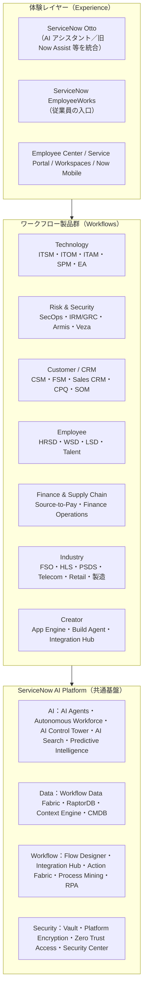
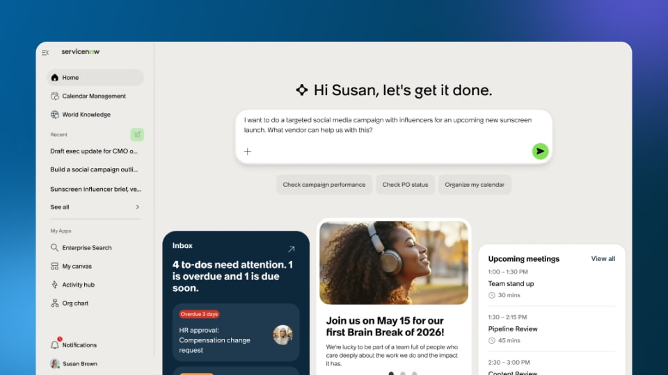
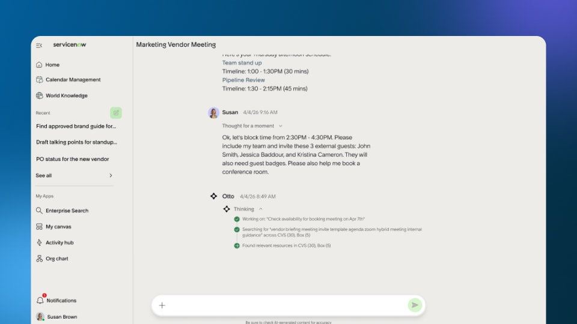

# 製品ポートフォリオ一覧（Product Portfolio）

## 概要

ServiceNow の製品はすべて単一の基盤 **ServiceNow AI Platform（旧称 Now Platform）** の上で動くアプリケーション群である。ServiceNow は製品群を「ワークフロー（Workflows）」と呼ばれる業務領域ごとに分類してきた。本ファイルは次の問いに答える。

- ServiceNow にはどのような製品があり、どの業務領域に属するか（全製品の一覧）。
- 各製品は1〜2行で言うと何か。
- 各製品の詳細は本ナレッジのどのリファレンスファイルを読めばよいか。
- 2025〜2026 年に何が改名・統合・追加されたか（Now Assist → ServiceNow Otto 等）。

本ファイルの一覧は、ServiceNow 公式サイトの「Products by Category」ページの **All products A-Z**（2026-10-13 時点のスナップショット、177 製品）を網羅の基準とし、Australia リリースノートの製品別情報で補っている。[出典](https://web.archive.org/web/20261013200331/https://www.servicenow.com/products-by-category.html)

> **注意:** 製品マーケティング上の名称（servicenow.com の製品名）と、インスタンス上のアプリケーション名・プラグイン名・ライセンス SKU 名は一致しないことがある。契約上の権利（エンタイトルメント）は必ず契約書・Order Form と ServiceNow 営業担当で確認すること。ライセンスの考え方は [ユーザー・ロール・ライセンスの基本](./08-users-roles-licensing-basics.md) と [ライセンスモデル](../03_導入編/01-licensing-model.md) を参照。

### 本ファイルの読み方

| 知りたいこと | 読む節 |
|---|---|
| 分類の全体像だけ知りたい | 「1. ポートフォリオの分類体系」 |
| 2026 年の大きな変化（Otto、ティア、買収、改名） | 「2. 2025〜2026 年の主要な変化」 |
| 領域別の製品と説明・リファレンスの対応 | 「3」〜「9」 |
| 製品名から引きたい | 「10. 全製品 A-Z 対応表」 |
| 旧名称から新名称を引きたい | 「11. 名称変更・統合・掲載終了の対応表」 |

### 一覧表の説明文について

- 公式サイトのナビゲーションに1行説明が掲載されている製品は、その説明を日本語訳して記載している（出典：Products by Category ページ、2026-10-13 スナップショット）。
- それ以外の製品の説明は、公式ドキュメント・リリースノートの記述を要約したものである。公式説明を確認できず執筆者の理解で補った箇所には `【推定】` を付けた。

---

## 1. ポートフォリオの分類体系

### 1.1 従来の「5 つのワークフロー」分類（〜2025 年）

ServiceNow 公式サイトは 2025 年時点で、製品を **By Workflow（ワークフロー別）** に次の 5 区分で掲載していた（2025-03-05 時点のスナップショットで確認）。業界向け製品は別途 **Industries（業界別）** として整理されていた。[出典](https://web.archive.org/web/20250305120135/https://www.servicenow.com/products-by-category.html)

| ワークフロー（英語） | 日本語 | 公式の説明（2025 年版の訳） | 代表製品 |
|---|---|---|---|
| Technology workflows | テクノロジーワークフロー | IT 運用を自動化して問題を予防し、スケーラブルなサービスを提供する | ITSM, ITOM, ITAM, SPM, SecOps, IRM, EA, OT Management |
| Employee workflows | 従業員ワークフロー | 生産性を高める統一された従業員体験を提供する | HRSD, Workplace Service Delivery, Legal Service Delivery, Talent Development |
| Customer workflows | 顧客ワークフロー | 顧客ニーズを先取りし、シンプルな体験を提供する | CSM, FSM, Sales and Order Management, Retail, Manufacturing Commercial Operations |
| Creator workflows | クリエイターワークフロー | ローコード／ノーコードで企業をつなぐワークフローアプリを構築する | App Engine, Automation Engine, Integration Hub |
| Finance and supply chain workflows | 財務・サプライチェーンワークフロー | （説明文なし） | Accounts Payable Operations, Sourcing and Procurement Operations, Supplier Lifecycle Operations |

入門者向けの説明や、パートナー資料・社内資料・過去の提案書では今もこの 5 区分（＋Industry）が広く使われている。本ファイルの第 3〜9 節もこの区分を骨格にしている。

### 1.2 2026 年時点の公式分類（Solutions／Featured products）

2026-10-13 時点の公式サイトでは「By Workflow」の区分が消え、**Solutions（ソリューション）** 単位の整理に変わっている。同ページの「Solutions」欄は次の 7 区分である。[出典](https://web.archive.org/web/20261013200331/https://www.servicenow.com/products-by-category.html)

| Solutions 区分（英語） | 日本語 | 公式説明（訳） | 旧 5 区分との対応 |
|---|---|---|---|
| CRM | 顧客関係管理 | AI で顧客体験・サービス・営業を変革する | Customer workflows |
| Risk and Security | リスクとセキュリティ | 新サービス・AI・技術を追加しながら、セキュリティ確保のリスク・影響・コストを最小化する | Technology workflows（SecOps・IRM 部分） |
| Human Resources | 人事 | 従業員セルフサービスを促進し、定型作業を自動化し、AI で人材判断を高度化する | Employee workflows |
| Finance and Supply Chain | 財務とサプライチェーン | バックオフィス全体で人・プロセス・システムを単一プラットフォームに統合する | Finance and supply chain workflows |
| IT and Digital Operations | IT とデジタル運用 | 効率的な IT・デジタル運用でニーズを先取りする | Technology workflows（ITSM/ITOM/ITAM/SPM 部分） |
| App Development | アプリ開発 | 開発者と業務エキスパートの生産性を高め、カスタムアプリを高速に構築する | Creator workflows |
| Core Business Transformation | 中核業務の変革 | チームを結び、サイロをなくし、業務横断の体験を刷新する | Employee＋Finance（Core Business Suite 等） |

同じページのグローバルナビゲーションでは、ソリューションを **IT／CRM／Security and Risk／Employee Experience／App Development** の 5 区分で表示しており、ページ内の箇所によって区分名が微妙に異なる。区分名は営業・マーケティング上の整理であり、製品の技術的な構成（アプリケーション・プラグイン）とは別物と理解するのがよい。

### 1.3 全体構造の図

図の階層は本ナレッジ独自の整理であり、公式の階層図ではない。公式サイトは AI Platform を「AI」「Data」「Workflows」の 3 要素で説明している。[出典](https://web.archive.org/web/20261013200331/https://www.servicenow.com/products-by-category.html) プラットフォーム全体の説明は [Now Platform（ServiceNow AI Platform）の全体像](./02-platform-overview.md) を参照。

---

## 2. 2025〜2026 年の主要な変化

ポートフォリオを読むうえで前提になる変化を先にまとめる。各項目の詳細は対応するリファレンスに譲る。

### 2.1 ServiceNow Otto（AI 体験ブランドの統合）

- **ServiceNow Otto** は 2026-05-05 の Knowledge 2026 で発表された AI アシスタント／AI 体験ブランドである。公式プレスリリースは Otto を「Now Assist、Moveworks、AI Experience の知能を組み合わせ、部門・システムを横断して仕事を完了させる」統一 AI 体験と位置付けている。[出典](https://newsroom.servicenow.com/press-releases/details/2026/ServiceNow-Otto-creates-the-unified-AI-experience-for-the-enterprise/default.aspx)
- Australia のリリースノートは「Now Assist は、AI 体験ブランドの変更に伴い ServiceNow Otto としてブランド化された」と明記している。製品名も順次置き換わっており、例として `Now Assist in AI Search` は `ServiceNow Otto for AI Search` に、Now Assist for IRM（プラグイン `sn_irm_gen_ai`）は `ServiceNow Otto for IRM` に改名された。[出典](https://www.servicenow.com/docs/r/australia/release-notes/rn-summary-new-features.html) [出典](https://www.servicenow.com/docs/r/australia/release-notes/rn-summary-changes.html)
- 改名は段階的に進んでおり、ドキュメントの URL や一部 UI には「Now Assist」が残る。ServiceNow Community の公式クイックスタート記事も「切り替えは不均一になる場合がある」と述べている。[出典](https://www.servicenow.com/community/servicenow-otto-articles/otto-now-assist-quick-start-guide/ta-p/2685044)
- ServiceNow Developer Advocate のブログ記事は、Otto を「新しい受付（intake）レイヤー」と説明している。この記事によると、Otto は月次 AI リリースで 2026-08 から展開が始まり、Brazil リリースでの全面提供を目標とする。AI Agents は Otto に置き換わらず、Otto が依頼を振り分ける実行側として AI Agent Studio に残る。[出典](https://www.servicenow.com/community/developer-advocate-blog/otto-vs-now-assist-what-actually-changed/ba-p/3594171)

本ナレッジでは、2026 年 5 月以前の資料に合わせて「Now Assist」の名称も併記する。詳細は [Now Assist と AI Agents](../02_リファレンス/platform/now-assist-ai-agents.md) を参照。

### 2.2 製品ティア（Foundation / Advanced / Prime）

- 公式ドキュメント「ServiceNow product tiers」によると、製品は **Foundation（AI スキルと定型的な AI エージェント）**、**Advanced（エージェント型ワークフロー）**、**Prime（自律型 AI ワークフォース）** の 3 ティアで構成される。上位ティアは下位ティアの内容を包含する。[出典](https://www.servicenow.com/docs/r/australia/intelligent-experiences/ai-native-sku-overview.html)
- 同ページによると、AI Control Tower は全ティアに含まれる。Moveworks for ServiceNow（EmployeeWorks）は各ティアに見合った水準で同梱される。Inbound MCP Server Console（AI Action Fabric）は Prime の機能である。
- 同ページは「新しい製品ティアの展開は、組織のアップグレードサイクルとは独立している」と注記している。
- 第三者情報によると、このティアは 2026-04 に導入され、旧 SKU（Standard / Professional / Enterprise 等）は 2026 年半ばに販売終了となる。ITOM・CSM には Foundation がないという報告もある `【第三者情報】`。[出典](https://redresscompliance.com/servicenow-foundation-advanced-prime-compared)

エディション・ティアの比較は [エディション比較](../03_導入編/03-edition-comparison.md) と [プラットフォームのパッケージ構成](../02_リファレンス/platform/platform-licensing-packaging.md) を参照。

### 2.3 Autonomous Workforce（自律型 AI ワークフォース）

公式サイトは **Autonomous Workforce** を「単発のタスクではなく、役割を割り当てられ、業務コンテキストと権限を持って複雑なワークフローを端から端まで処理する AI スペシャリスト」と説明している。製品ティアの Prime はこの Autonomous Workforce に相当する。[出典](https://web.archive.org/web/20261013200331/https://www.servicenow.com/products-by-category.html) [出典](https://www.servicenow.com/docs/r/australia/intelligent-experiences/ai-native-sku-overview.html)

### 2.4 買収による製品追加

| 製品 | 内容 | 時期 | 出典 |
|---|---|---|---|
| Moveworks from ServiceNow | 従業員向け AI アシスタント・エンタープライズ検索。EmployeeWorks・Otto の構成要素となった | 買収完了 2025-12-15 | [出典](https://newsroom.servicenow.com/press-releases/details/2025/ServiceNow-completes-acquisition-of-Moveworks/default.aspx) |
| Veza™ from ServiceNow | 人・非人間・AI エージェントの ID（アイデンティティ）のリスクを管理する Identity Security | 買収完了 2026-03-02 | [出典](https://www.sec.gov/Archives/edgar/data/0001373715/000137371526000056/now-20260331.htm) |
| Armis™ from ServiceNow | サイバーエクスポージャー管理（資産可視化）。Armis Centrix は単体製品としても販売継続 `【第三者情報】` [出典](https://www.itpro.com/business/acquisition/servicenow-wraps-up-usd7-75-billion-armis-acquisition) | 買収完了 2026-04-20（Form 10-Q では現金対価 約 78 億ドル。発表・報道ベースでは約 77.5 億ドル） | [出典](https://www.sec.gov/Archives/edgar/data/0001373715/000137371526000056/now-20260331.htm)（Form 10-Q Note 19 Subsequent Events） |
| Pyramid Analytics | セマンティックレイヤーを持つ BI／分析プラットフォーム（データ準備・データサイエンスを含む）。Autonomous Data Analytics の基盤 | 2026-02-12 に買収発表、2026-03-10 に買収完了（公式ブログの追記による）。買収額は非開示 | [出典](https://www.servicenow.com/blogs/2026/pyramid-analytics-expanding-data-driven-ai)／セマンティックレイヤーの説明は `【第三者情報】` [出典](https://www.theregister.com/2026/02/14/servicenow_buys_pyramid_analytics_to/) |

### 2.5 Flow by ServiceNow（スタンドアロン AI サービスデスク）

- **Flow by ServiceNow** は 2026-10-01 に発表された、会話型のスタンドアロン AI サービスデスクである。Slack や Microsoft Teams など、チームが既に使っているチャットチャネル上の会話で従業員の依頼を解決する。[出典](https://newsroom.servicenow.com/press-releases/details/2026/Introducing-Flow-by-ServiceNow-a-new-AI-service-desk-that-deploys-instantly/default.aspx)
- 新規顧客は既存の ServiceNow 契約やプラットフォームがなくても直接購入できる。AI ネイティブ SKU を持つ既存顧客は、消費量ベースの利用で追加の調達なしに導入できる。発表時点ではコントロールドアベイラビリティ（限定提供）であり、北米・EMEA での GA は 2026 年 Q4 の予定とされた。
- Flow は IT サービスデスクから始まり、他部門へ拡張する計画である。フル規模の ITSM を使う顧客も、特定部門・リモートチーム・買収した事業部門向けに Flow を併用でき、既存のナレッジ・資産・チケットシステムと連携する。
- 名称が似ている **Flow Designer**（プラットフォームのローコードワークフロー作成ツール）とは別製品である。

### 2.6 Australia で追加された新製品

Australia リリースノートの「Features and changes by product」では、次の製品・アプリケーションが Australia で新しく加わったもの（"is a new application / solution / capability / plugin in the Australia release" 等）とされている。[出典](https://www.servicenow.com/docs/r/australia/release-notes/new-features-changes.html)

| 製品領域 | Australia の新製品・新アプリケーション |
|---|---|
| Core Business Suite | Core Business Suite（CBS。新アプリケーション） |
| Employee Service Management | Now Assist for Employee Center Pro、Enterprise Service Management Foundation（新ソリューション） |
| Healthcare and Life Sciences | Care Team Work Management, ServiceNow Otto for Care Team Operations |
| HR Service Delivery | Recommended Actions for HRSD |
| Industrial Connected Workforce | Industrial Connected Workforce Core, Industrial Connected Workforce Mobile Experience, Industrial Guided Tasks, Industrial Standards |
| Manufacturing | Manufacturing Commercial Operations（新アプリケーション） |
| Operational Technology | ServiceNow Otto for Operational Technology (OT) Service Management |
| Sales Customer Relationship Management | Activity Management（新機能）, Advanced Approval Management, Buying Group |
| ServiceNow AI Platform Capabilities | Knowledge Center |
| Source-to-Pay Operations | ServiceNow Otto for Purchase Order Management (POM)（新プラグイン） |
| Telecommunications, Media, and Technology | Telecommunications Customer 360 |

同じページで、新製品ではなく「Australia で強化・更新された（enhanced and updated / updated in the Australia release）」とされている主な製品は次のとおりである。

| 製品領域 | Australia で強化・更新 |
|---|---|
| IT Operations Management | ITOM Visibility |
| Sales Customer Relationship Management | Quote Management |
| Telecommunications, Media, and Technology | Service Exchange (formerly Service Bridge) |
| Source-to-Pay Operations | ServiceNow Otto for Source-to-Pay Operations |

Core Business Suite と Manufacturing Commercial Operations は Australia 以前から製品名として公式サイトに掲載されているが（Core Business Suite は 2025-05-07 の Knowledge 2025 で発表）、Australia リリースノートではアプリケーションとして新規提供と記載されている。[出典](https://newsroom.servicenow.com/press-releases/details/2025/ServiceNow-Introduces-Core-Business-Suite-With-AI-powered-Solutions-to-Quickly-Transform-Key-Business-Functions-and-Scale-With-Growing-Companies/default.aspx)

> **Brazil での変更:** Brazil の「New features and products」ページ（2026-09-10 更新）は、製品領域として Autonomous Workforce、Build Agent and Autonomous Engineer、Data Catalog、Developer Sandboxes、Customer Success Management、Customer Engagement Sequences などを挙げている。同ページは個別製品に「新製品」のラベルを付けていない。単独の新しい提供物としては、AI Inventory Intelligence Agent、Contract Management Pro MCP Server、Enterprise Architecture for AICT プラグインが確認できる。[出典](https://www.servicenow.com/docs/r/brazil/release-notes/rn-summary-new-features.html)

---

## 3. ServiceNow AI Platform（共通基盤製品）

ServiceNow AI Platform は、すべての製品が載る共通基盤である。公式サイトは「ServiceNow AI Platform は、すべての ServiceNow 製品が動くクラウド基盤」と説明している。[出典](https://web.archive.org/web/20261013200331/https://www.servicenow.com/products-by-category.html) 基盤機能の多くは個別のワークフロー製品のライセンスに含まれる。一方、上位機能（Integration Hub の上位パック、Workflow Data Fabric の Zero Copy Connectors 等）は別ライセンスまたは上位ティアで提供される。

### 3.1 AI

| 製品（英語名） | 日本語での説明 | 詳細リファレンス |
|---|---|---|
| ServiceNow Otto | 依頼をテキスト・音声・画像で受け付け、スキルやエージェントに振り分けて仕事を完了させる AI アシスタント。旧 Now Assist・Moveworks・AI Experience を統合した | [Now Assist と AI Agents](../02_リファレンス/platform/now-assist-ai-agents.md) |
| ServiceNow AI Agents | 自律的に行動する AI エージェント。AI Agent Studio で構成する | [Now Assist と AI Agents](../02_リファレンス/platform/now-assist-ai-agents.md) |
| Autonomous Workforce | 役割・権限・業務コンテキストを持ち、業務をエンドツーエンドで遂行する AI スペシャリスト群 | [Now Assist と AI Agents](../02_リファレンス/platform/now-assist-ai-agents.md) |
| ServiceNow AI Control Tower | 社内外のすべての AI について、戦略・ガバナンス・管理・パフォーマンスをつなぐ管理基盤 | [Now Assist と AI Agents](../02_リファレンス/platform/now-assist-ai-agents.md) |
| Action Fabric（AI Action Fabric） | MCP・A2A などのプロトコルで外部 AI エージェントを接続し、統制された ServiceNow のアクションを実行させる接続層。MCP Server Console・MCP Client・A2A から成る | [Now Assist と AI Agents](../02_リファレンス/platform/now-assist-ai-agents.md) |
| AI Search | 生成 AI と連携するエンタープライズ検索。Genius Results 等を提供する | [Predictive Intelligence と AI Search](../02_リファレンス/platform/predictive-intelligence-ai-search.md) |
| Predictive Intelligence | 機械学習による分類・類似検索・クラスタリング | [Predictive Intelligence と AI Search](../02_リファレンス/platform/predictive-intelligence-ai-search.md) |
| Task Intelligence | タスクのフィールド予測（分類・割当等）をノーコードで構成する機能 `【推定】` | [Predictive Intelligence と AI Search](../02_リファレンス/platform/predictive-intelligence-ai-search.md) |
| Virtual Agent | 会話型チャットボット基盤（Topic 設計・NLU/LLM 対話） | [Virtual Agent と会話型AI](../02_リファレンス/platform/virtual-agent.md) |
| Dynamic Translation | チャット・レコード等の動的な機械翻訳 | [ローカライゼーション](../02_リファレンス/platform/localization.md) |
| Knowledge Center | ナレッジのギャップや古い記事を可視化し、インシデント・ケースから記事を生成してナレッジを最新に保つ（Australia の新製品） | [ナレッジ管理](../02_リファレンス/platform/knowledge-management.md) |

Knowledge Center の説明は公式サイトの Australia リリース紹介に基づく。[出典](https://www.servicenow.com/uk/platform/latest-release.html)

### 3.2 Data（データ・分析）

| 製品（英語名） | 日本語での説明 | 詳細リファレンス |
|---|---|---|
| Workflow Data Fabric | 任意のデータソースにリアルタイムでアクセスし、ワークフロー・AI・分析に供給するデータ統合層（Zero Copy Connectors 等） | [Workflow Data Fabric](../02_リファレンス/platform/workflow-data-fabric.md) |
| RaptorDB | ServiceNow のワークロード向けに最適化された高性能データベース。データと分析を統合する（Standard / Professional） | [インスタンスアーキテクチャ](../02_リファレンス/platform/instance-architecture.md) |
| Context Engine | 企業内の人・役割・資産・サービス・ポリシーをリアルタイムにマッピングし、CMDB・ワークフローデータ・分析・サードパーティシステムを統合するセマンティックレイヤー。AI に業務コンテキストを与える（Knowledge 2026 で発表） | [Workflow Data Fabric](../02_リファレンス/platform/workflow-data-fabric.md) |
| Autonomous Data Analytics | 買収した Pyramid Analytics（2.4 参照）の技術を活用し、人と AI エージェントが自然言語で企業データ全体を問い合わせられる分析製品。Community の Knowledge 2026 まとめ記事は、Platform Analytics・CXO Dashboards・AI Data Explorer・Pyramid Analytics を統合するものと説明している。同時発表の Autonomous Data Governance は 2026 年下期の提供予定（Workflow Data Fabric with ServiceNow Otto と ServiceNow Data Catalog は発表時点で提供済み） | [レポートとアナリティクス](../02_リファレンス/platform/reporting-analytics.md) |
| Configuration Management Database (CMDB) | 構成アイテム（CI）とその関係を管理する中核データベース | [CMDB と CSDM](../02_リファレンス/platform/cmdb-csdm.md) |
| Service Graph Connectors | 外部ツールのデータを CMDB に正しく取り込むための認定コネクター | [Service Graph Connectors](../02_リファレンス/itom/service-graph-connectors.md) |
| Stream Connect for Apache Kafka | Kafka との双方向ストリーミング連携 | [IntegrationHub](../02_リファレンス/platform/integrationhub.md) |
| Performance Analytics | KPI の時系列収集・ダッシュボード・目標管理（Australia リリースノートでは関連領域が Platform Analytics として扱われる） | [レポートとアナリティクス](../02_リファレンス/platform/reporting-analytics.md) |
| Reporting | 標準のレポート・ダッシュボード | [レポートとアナリティクス](../02_リファレンス/platform/reporting-analytics.md) |
| Benchmarks | 同業他社と KPI を比較するベンチマーク | [レポートとアナリティクス](../02_リファレンス/platform/reporting-analytics.md) |

Context Engine と Autonomous Data Analytics の説明は 2026-05-06 の公式発表に基づく。[出典](https://newsroom.servicenow.com/press-releases/details/2026/ServiceNow-launches-the-real-time-data-foundation-that-puts-autonomous-AI-to-work-across-the-enterprise/default.aspx) Autonomous Data Analytics が統合する 4 製品の記述は ServiceNow Community の記事に基づく。[出典](https://www.servicenow.com/community/workflow-data-fabric-articles/knowledge-2026-data-amp-analytics-recap/ta-p/3554070) Context Engine を構成するグラフの種類は、公式発表には記載がなく、公開情報では確認できなかった。

### 3.3 Workflows（自動化・連携）

| 製品（英語名） | 日本語での説明 | 詳細リファレンス |
|---|---|---|
| Flow Designer | ローコードでフロー（トリガー＋アクション）を作成するツール（Workflow Studio に統合） | [Workflow Studio / Flow Designer](../02_リファレンス/platform/flow-designer-workflow-studio.md) |
| Playbooks | 複数の担当者・システムにまたがるプロセスをステージ単位で可視化・実行する（旧 Process Automation Designer） | [Workflow Studio / Flow Designer](../02_リファレンス/platform/flow-designer-workflow-studio.md) |
| Integration Hub | 外部システム連携用のスポーク（Spoke）とアクションを提供する | [IntegrationHub](../02_リファレンス/platform/integrationhub.md) |
| APIs and Integration Tools | REST/SOAP API、Import Set 等の連携機能 | [Web Services / REST API](../02_リファレンス/platform/web-services-api.md) |
| RPA Hub | デスクトップ／UI 操作を自動化するロボティックプロセスオートメーション | [プロセス自動化](../02_リファレンス/platform/process-automation-rpa-mining.md) |
| Process Mining | ワークフローや AI エージェントの実際の実行経路を分析し、改善する | [プロセス自動化](../02_リファレンス/platform/process-automation-rpa-mining.md) |
| Automation Center | 自動化の取り組みとその価値を一元管理する | [プロセス自動化](../02_リファレンス/platform/process-automation-rpa-mining.md) |
| Automation Discovery | インシデント等のデータを分析して自動化候補を見つける | [プロセス自動化](../02_リファレンス/platform/process-automation-rpa-mining.md) |
| Surveys and Assessments | アンケート・評価 | [Survey・Assessment](../02_リファレンス/platform/surveys-assessments.md) |
| Visual Task Boards | カンバン形式のタスクボード | [UIの基本](./05-ui-basics.md) |
| Guided Tour Designer | 画面上のガイド付きツアーを作成する | [システム管理](../02_リファレンス/platform/system-administration.md) |

### 3.4 体験・UI・モバイル

| 製品（英語名） | 日本語での説明 | 詳細リファレンス |
|---|---|---|
| Workspaces | 役割別に最適化されたエージェント向け作業画面（Next Experience） | [Workspace と UI Builder](../02_リファレンス/platform/workspaces-ui-builder.md) |
| UI Builder | Workspace やポータルのページをローコードで作成する | [Workspace と UI Builder](../02_リファレンス/platform/workspaces-ui-builder.md) |
| Service Portal | エンドユーザー向けポータルの構築基盤 | [Service Portal と Employee Center](../02_リファレンス/platform/portals-employee-center.md) |
| Now Mobile | 従業員向けモバイルアプリ | [モバイル](../02_リファレンス/platform/mobile.md) |
| Mobile Agent | 担当者（フルフィラー）向けモバイルアプリ | [モバイル](../02_リファレンス/platform/mobile.md) |
| Mobile App Builder | モバイルアプリの画面・機能を構成するツール | [モバイル](../02_リファレンス/platform/mobile.md) |

### 3.5 セキュリティ・管理

| 製品（英語名） | 日本語での説明 | 詳細リファレンス |
|---|---|---|
| ServiceNow Vault | 暗号化・鍵管理・データ保護機能のスイート | [プラットフォームセキュリティと暗号化](../02_リファレンス/platform/platform-security-encryption.md) |
| ServiceNow Platform Encryption | プラットフォームのデータ暗号化 | [プラットフォームセキュリティと暗号化](../02_リファレンス/platform/platform-security-encryption.md) |
| Cloud Encryption | 顧客管理鍵による保存データ暗号化 `【推定】` | [プラットフォームセキュリティと暗号化](../02_リファレンス/platform/platform-security-encryption.md) |
| Field Encryption Enterprise | フィールド単位の暗号化（2025 年の一覧にあった Column Level Encryption Enterprise の後継名称と見られる `【推定】`） | [プラットフォームセキュリティと暗号化](../02_リファレンス/platform/platform-security-encryption.md) |
| ServiceNow Zero Trust Access | 文脈（デバイス・ネットワーク等）に応じてアクセスを制御する | [認証とSSO](../02_リファレンス/platform/authentication-sso.md) |
| ServiceNow Security Center | インスタンスのセキュリティ設定状況を監視・評価する | [プラットフォームセキュリティと暗号化](../02_リファレンス/platform/platform-security-encryption.md) |
| Admin Center | 管理者がアプリの発見・導入・設定を行うハブ | [システム管理](../02_リファレンス/platform/system-administration.md) |
| Subscription Management | ServiceNow のサブスクリプション（ライセンス）の割当・使用状況を管理する `【推定】` | [プラットフォームのパッケージ構成](../02_リファレンス/platform/platform-licensing-packaging.md) |
| ServiceNow Impact | ServiceNow による成功支援サービス（Impact success plans）。製品というより支援プログラム | [サポートと監視](../03_導入編/14-support-monitoring.md) |

---

## 4. Technology workflows（IT とデジタル運用）

Technology workflows は、IT 部門が技術ライフサイクル全体（計画・構築・運用・サービス提供）を管理する製品群である。2026 年の公式分類では「IT and Digital Operations」と「Risk and Security」に分かれている。

### 4.1 IT Service Management（ITSM）

公式説明：「サービス管理を変革し、生産性と ROI を高める」。[出典](https://web.archive.org/web/20261013200331/https://www.servicenow.com/products-by-category.html)

| 製品・機能（英語名） | 日本語での説明 | 詳細リファレンス |
|---|---|---|
| IT Service Management | インシデント・問題・変更・リクエストを単一プラットフォームで管理する ITSM 製品の総称 | [ITSM 概要とパッケージ](../02_リファレンス/itsm/itsm-overview.md) |
| Incident Management | サービス中断からの早期復旧 | [Incident Management](../02_リファレンス/itsm/incident-management.md) |
| Problem Management | 根本原因の特定と再発防止 | [Problem Management](../02_リファレンス/itsm/problem-management.md) |
| Change Management | 変更のリスク評価・承認・実施管理 | [Change Management](../02_リファレンス/itsm/change-management.md) |
| Request Management | サービスカタログ経由の依頼の処理 | [Request Management](../02_リファレンス/itsm/request-management.md) |
| Service Catalog | 依頼可能なサービス・物品のカタログ | [サービスカタログ](../02_リファレンス/platform/service-catalog.md) |
| Service Level Management | SLA・OLA の定義と達成状況の計測 | [SLAとスケジュール](../02_リファレンス/platform/sla-schedules.md) |
| Continual Improvement Management | 継続的改善（CSI）の取り組みを管理する | [ITSM Pro/Enterprise 固有機能](../02_リファレンス/itsm/itsm-pro-features.md) |
| Service Operations Workspace | インシデントを予測・予防・解決するための単一ワークスペース | [ITSM 概要とパッケージ](../02_リファレンス/itsm/itsm-overview.md) |
| Service Owner Workspace | サービスオーナー向けにサービスの健全性・リスクを可視化する `【推定】` | [ITSMにおけるサービスレベル管理](../02_リファレンス/itsm/service-level-management-itsm.md) |
| Digital End-user Experience (DEX) | 従業員端末の体験（性能・安定性）を計測・改善する | [Digital End-user Experience](../02_リファレンス/itom/digital-end-user-experience.md) |
| Walk-Up Experience | 対面 IT サポート窓口（IT バー）の受付・待ち行列管理 | [ITSM Pro/Enterprise 固有機能](../02_リファレンス/itsm/itsm-pro-features.md) |
| Workforce Optimization | 担当者のスケジュール・スキル・品質・コーチングを管理する | [Workforce Optimization](../02_リファレンス/itsm/workforce-optimization.md) |
| Flow by ServiceNow | Slack/Teams などのチャットチャネルで動くスタンドアロンの会話型 AI サービスデスク（2026-10 発表） | 本ファイル「2.5」 |

ITSM の基礎概念は [ITILとITSMの基礎](./06-itil-itsm-basics.md) を参照。

### 4.2 DevOps・リリース

| 製品（英語名） | 日本語での説明 | 詳細リファレンス |
|---|---|---|
| DevOps Change Velocity | CI/CD パイプラインと変更管理を連携し、変更承認を自動化する | [Release Management と DevOps](../02_リファレンス/itsm/release-management.md) |
| DevOps Config | アプリ構成データの検証・管理 | [Release Management と DevOps](../02_リファレンス/itsm/release-management.md) |
| DevOps Insights | DevOps の各種メトリクスの可視化 | [Release Management と DevOps](../02_リファレンス/itsm/release-management.md) |
| DevOps Agile Team Planning | アジャイルチームの計画（外部ツール連携を含む） | [Agile Development・APM・EAM](../02_リファレンス/spm/agile-apm-eam.md) |
| Digital Product Release | デジタルプロダクトのリリース計画・実行管理 | [Release Management と DevOps](../02_リファレンス/itsm/release-management.md) |

### 4.3 IT Operations Management（ITOM）

公式説明：「AIOps によるプロアクティブなデジタル運用を実現する」。[出典](https://web.archive.org/web/20261013200331/https://www.servicenow.com/products-by-category.html)

| 製品（英語名） | 日本語での説明 | 詳細リファレンス |
|---|---|---|
| IT Operations Management | 可視化・AIOps・クラウド管理を含む ITOM 製品の総称 | [ITOM 概要とパッケージ](../02_リファレンス/itom/itom-overview.md) |
| Discovery | ネットワーク上の機器・ソフトウェアを自動検出して CMDB に登録する | [Discovery](../02_リファレンス/itom/discovery.md) |
| Service Mapping | アプリケーションサービスを構成する CI と依存関係を自動マッピングする | [Service Mapping](../02_リファレンス/itom/service-mapping.md) |
| Agent Client Collector | エージェント型でデータ収集・監視を行う（ACC） | [Agent Client Collector](../02_リファレンス/itom/agent-client-collector.md) |
| Certificate Management | 証明書の棚卸し・期限管理（リリースノート上は Certificate Inventory and Management） | [ITOM 概要とパッケージ](../02_リファレンス/itom/itom-overview.md) |
| Firewall Audits and Reporting | ファイアウォールルールの監査とレポート | [ITOM 概要とパッケージ](../02_リファレンス/itom/itom-overview.md) |
| Event Management | 監視ツールのイベントを集約・相関し、アラートを管理する | [Event Management と AIOps](../02_リファレンス/itom/event-management-aiops.md) |
| Predictive AIOps | 機械学習による異常検知・アラート相関 | [Event Management と AIOps](../02_リファレンス/itom/event-management-aiops.md) |
| AIOps LEAP | 過去インシデントを AI で分析し、解決用の自動化プレイブックを生成する（Learning Enhanced Automation Playbook） | [Event Management と AIOps](../02_リファレンス/itom/event-management-aiops.md) |
| Health Log Analytics | ログの機械学習分析による異常検知 | [Event Management と AIOps](../02_リファレンス/itom/event-management-aiops.md) |
| Metric Intelligence | メトリクスの異常検知 | [Event Management と AIOps](../02_リファレンス/itom/event-management-aiops.md) |
| Service Observability | メトリクス・ログ・トレース・合成監視をサービス単位のダッシュボードで可視化する | [Event Management と AIOps](../02_リファレンス/itom/event-management-aiops.md) |
| Synthetic Monitoring | サービスのエンドポイントを定期的に自動テストする（ACC・MID Server・プラットフォーム上で実行） | [Event Management と AIOps](../02_リファレンス/itom/event-management-aiops.md) |
| ServiceNow Cloud Observability | クラウドネイティブアプリの変化を検知・対応する（旧 Lightstep） | [Event Management と AIOps](../02_リファレンス/itom/event-management-aiops.md) |
| Service Reliability Management | SRE 実践（SLO・エラーバジェット・オンコール）を支援する | [ITOM 概要とパッケージ](../02_リファレンス/itom/itom-overview.md) |
| Cloud Cost Management | クラウドコストの可視化・最適化 | [Cloud Management](../02_リファレンス/itom/cloud-management.md) |
| Cloud Governance Suite | クラウドガバナンスを自動化し、コンプライアンス・セキュリティ・コストを改善する | [Cloud Management](../02_リファレンス/itom/cloud-management.md) |
| Cloud Accelerate | クラウド導入の加速を支援する `【推定】` | [Cloud Management](../02_リファレンス/itom/cloud-management.md) |

Synthetic Monitoring の説明は公式ドキュメントに基づく。[出典](https://www.servicenow.com/docs/r/sPnEbors95h6DhgBlE~f0A/ZvYQesKEgoSjF4F17vZx2w) AIOps LEAP の説明は公式ドキュメントに基づく。[出典](https://www.servicenow.com/docs/r/yokohama/it-operations-management/aiops-leap-learning-enhanced-automation-playbooks/aiops-leap.html)

> **Australia での変更:** **ITOM Visibility** は Australia で強化・更新された（Australia リリースノートでは新製品ではなく "enhanced and updated" とされている）。[出典](https://www.servicenow.com/docs/r/australia/release-notes/new-features-changes.html)

### 4.4 IT Asset Management（ITAM）

公式説明：「IT 資産のライフサイクル全体で技術の利用と支出を改善する」。

| 製品（英語名） | 日本語での説明 | 詳細リファレンス |
|---|---|---|
| IT Asset Management | HAM・SAM・クラウド／SaaS 資産を含む ITAM 製品の総称 | [ITAM 概要](../02_リファレンス/itam/itam-overview.md) |
| Asset Management Core | 資産管理の基本機能（資産レコード、モデル、契約等） | [ITAM 概要](../02_リファレンス/itam/itam-overview.md) |
| Hardware Asset Management | ハードウェア資産の調達から廃棄までのライフサイクル管理 | [Hardware Asset Management](../02_リファレンス/itam/hardware-asset-management.md) |
| Software Asset Management | ソフトウェアライセンスのコンプライアンスと最適化 | [Software Asset Management](../02_リファレンス/itam/software-asset-management.md) |
| SaaS License Management | SaaS のライセンス利用状況の把握と最適化 | [Software Asset Management](../02_リファレンス/itam/software-asset-management.md) |
| Engineering License Manager | エンジニアリング系ソフトウェア（同時使用ライセンス等）の利用管理 `【推定】` | [Software Asset Management](../02_リファレンス/itam/software-asset-management.md) |
| Enterprise Asset Management | IT 以外の複雑な資産（設備・機器等）のライフサイクル管理 | [Enterprise Asset Management](../02_リファレンス/itam/enterprise-asset-management.md) |
| Inventory Management | 在庫（部品・物品）の管理 `【推定】` | [Field Service Management](../02_リファレンス/customer/field-service-management.md) |

### 4.5 Strategic Portfolio Management（SPM）と Enterprise Architecture

公式説明：「戦略からビジネス成果へ移行するための洞察を得る」。

| 製品（英語名） | 日本語での説明 | 詳細リファレンス |
|---|---|---|
| Strategic Portfolio Management | 戦略計画・需要・ポートフォリオ・プロジェクト・アジャイルを統合管理する製品の総称（旧 ITBM） | [Strategic Portfolio Management](../02_リファレンス/spm/strategic-portfolio-management.md) |
| Strategic Planning | 戦略目標と投資の整合を図る | [Strategic Portfolio Management](../02_リファレンス/spm/strategic-portfolio-management.md) |
| Demand Management | 投資要求（デマンド）の受付・評価 | [Strategic Portfolio Management](../02_リファレンス/spm/strategic-portfolio-management.md) |
| Project Portfolio Management | プロジェクトとポートフォリオの管理 | [Strategic Portfolio Management](../02_リファレンス/spm/strategic-portfolio-management.md) |
| Resource Management | 要員の需要と供給の管理 | [Strategic Portfolio Management](../02_リファレンス/spm/strategic-portfolio-management.md) |
| Scenario Planning | 予算・要員制約のもとでのポートフォリオのシナリオ比較 | [Strategic Portfolio Management](../02_リファレンス/spm/strategic-portfolio-management.md) |
| Digital Portfolio Management | デジタルプロダクト／サービスのポートフォリオ管理 | [Strategic Portfolio Management](../02_リファレンス/spm/strategic-portfolio-management.md) |
| Innovation Management | アイデアの収集と評価 | [Strategic Portfolio Management](../02_リファレンス/spm/strategic-portfolio-management.md) |
| Collaborative Work Management | チームの作業計画・進捗を共同で管理する（CWM） `【推定】` | [Strategic Portfolio Management](../02_リファレンス/spm/strategic-portfolio-management.md) |
| Agile Development | スクラム型のアジャイル開発管理 | [Agile Development・APM・EAM](../02_リファレンス/spm/agile-apm-eam.md) |
| Scaled Agile Framework (SAFe) | SAFe に準拠した大規模アジャイル管理 | [Agile Development・APM・EAM](../02_リファレンス/spm/agile-apm-eam.md) |
| Application Portfolio Management | アプリケーション資産の評価と合理化 | [Agile Development・APM・EAM](../02_リファレンス/spm/agile-apm-eam.md) |
| Enterprise Architecture | 業務プロセスと IT アーキテクチャを橋渡しする | [Agile Development・APM・EAM](../02_リファレンス/spm/agile-apm-eam.md) |
| Strategic Portfolio Management for Telecommunications | 通信事業者向け SPM | [業界向けソリューション](../02_リファレンス/industry/industry-solutions.md) |

### 4.6 Security Operations（SecOps）

公式説明：「セキュリティ上の脅威と攻撃から防御する」。

| 製品（英語名） | 日本語での説明 | 詳細リファレンス |
|---|---|---|
| Security Operations (SecOps) | セキュリティ運用製品の総称 | [Security Operations](../02_リファレンス/secops/security-operations.md) |
| Security Incident Response | 進化する脅威に迅速に対応し、セキュリティ運用を最適化する | [Security Operations](../02_リファレンス/secops/security-operations.md) |
| Unified Security Exposure Management | 業務全体の脆弱性を特定・優先順位付け・修復する（旧 Vulnerability Response の後継） | [Security Operations](../02_リファレンス/secops/security-operations.md) |
| Threat Intelligence Security Center | ServiceNow AI Platform 上での高度な脅威ハンティング・モデリング・分析 | [Security Operations](../02_リファレンス/secops/security-operations.md) |
| Security Posture Control | オンプレミスとクラウドの資産のセキュリティを管理する | [Security Operations](../02_リファレンス/secops/security-operations.md) |
| Armis™ from ServiceNow | サイバーエクスポージャー管理（IT/OT/IoT の資産可視化とリスク評価）。2026-04 に買収完了 | [Security Operations](../02_リファレンス/secops/security-operations.md) |
| Veza™ from ServiceNow（Identity Security） | 人・非人間・AI エージェントの ID にまたがるリスクを管理する | [Security Operations](../02_リファレンス/secops/security-operations.md) |

USEM の位置付けは公式リリースノートに基づく。[出典](https://www.servicenow.com/docs/r/australia/release-notes/secops-sem-rn.html)

### 4.7 Integrated Risk Management（IRM／GRC）

公式説明（Governance, Risk, and Compliance）：「運用レジリエンスを構築し、リスクを軽減する統合アプローチ」。

| 製品（英語名） | 日本語での説明 | 詳細リファレンス |
|---|---|---|
| Integrated Risk Management | リスクを踏まえた意思決定と、効率・レジリエンスの向上を両立する（GRC 製品の総称） | [Integrated Risk Management](../02_リファレンス/irm/integrated-risk-management.md) |
| Policy and Compliance Management | ポリシー・統制・コンプライアンスの管理 | [Integrated Risk Management](../02_リファレンス/irm/integrated-risk-management.md) |
| Risk Management | リスクの識別・評価・対応 | [Integrated Risk Management](../02_リファレンス/irm/integrated-risk-management.md) |
| Operational Risk Management | オペレーショナルリスク（損失事象、KRI 等）の管理 | [Integrated Risk Management](../02_リファレンス/irm/integrated-risk-management.md) |
| Audit Management | 内部監査の計画・実施・指摘事項管理 | [Integrated Risk Management](../02_リファレンス/irm/integrated-risk-management.md) |
| Regulatory Change Management | 規制変更の取り込みと影響評価 | [Integrated Risk Management](../02_リファレンス/irm/integrated-risk-management.md) |
| Business Continuity Management | 事業継続計画（BIA・BCP）の策定と演習 | [Integrated Risk Management](../02_リファレンス/irm/integrated-risk-management.md) |
| Operational Resilience Management | 重要業務サービスのレジリエンス管理（DORA 等への対応） | [Integrated Risk Management](../02_リファレンス/irm/integrated-risk-management.md) |
| Third-party Risk Management | サードパーティ（取引先）リスクのライフサイクル管理（旧 Vendor Risk Management） | [Integrated Risk Management](../02_リファレンス/irm/integrated-risk-management.md) |
| Privacy Management | 全社リスクプログラムの一部としてデータプライバシーを管理する | [Integrated Risk Management](../02_リファレンス/irm/integrated-risk-management.md) |
| Continuous Authorization and Monitoring | 米国連邦機関の継続的な ATO（運用認可）と監視（RMF 対応） | [Integrated Risk Management](../02_リファレンス/irm/integrated-risk-management.md) |
| AI Risk and Compliance | AI システムのリスク分類・コンプライアンス管理（AI Control Tower と連携） | [Integrated Risk Management](../02_リファレンス/irm/integrated-risk-management.md) |

AI Risk and Compliance は公式サイトの A-Z 一覧には載っていないが、Australia リリースノートに製品領域として現れる。[出典](https://www.servicenow.com/docs/r/australia/release-notes/rn-summary-new-features.html)

### 4.8 Operational Technology（OT）

| 製品（英語名） | 日本語での説明 | 詳細リファレンス |
|---|---|---|
| Operational Technology Management | OT 環境（工場設備・制御系）を保護し、稼働率を高める | [Operational Technology Management](../02_リファレンス/itom/operational-technology-management.md) |
| ServiceNow Otto for Operational Technology (OT) Service Management | OT サービス管理向けの AI 機能（Australia の新製品） | [Operational Technology Management](../02_リファレンス/itom/operational-technology-management.md) |

---

## 5. Customer workflows（CRM）

Customer workflows は、顧客サービス・フィールドサービス・営業・受注を一貫して扱う製品群である。2026 年の公式分類では「CRM」と呼ばれる。公式説明は「シームレスでパーソナライズされたエンドツーエンドの顧客体験を提供する」。[出典](https://web.archive.org/web/20261013200331/https://www.servicenow.com/products-by-category.html)

### 5.1 Customer Service Management（CSM）

| 製品（英語名） | 日本語での説明 | 詳細リファレンス |
|---|---|---|
| Customer Service Management | セルフサービスを強化し、エージェントの生産性を上げ、解決を早める | [Customer Service Management](../02_リファレンス/customer/customer-service-management.md) |
| Communities | 顧客コミュニティ（Q&A・フォーラム） | [Customer Service Management](../02_リファレンス/customer/customer-service-management.md) |
| Workforce Optimization | 顧客サービス担当者のスケジュール・品質管理（ITSM と共通） | [Workforce Optimization](../02_リファレンス/itsm/workforce-optimization.md) |
| Service Exchange（旧 Service Bridge） | プロバイダーと顧客の ServiceNow インスタンス間を、個別連携なしでサービス接続する | [Service Bridge と eBonding](../02_リファレンス/customer/service-bridge-ebonding.md) |

Service Exchange の説明は公式リリースノートに基づく。[出典](https://www.servicenow.com/docs/r/release-notes/service-bridge-rn.html)

### 5.2 Field Service Management（FSM）

公式説明：「スケジューリングを最適化し、技術者を支援し、不要な訪問を減らす」。

| 製品（英語名） | 日本語での説明 | 詳細リファレンス |
|---|---|---|
| Field Service Management | 現場作業（訪問修理・保守）の受付から完了までの管理 | [Field Service Management](../02_リファレンス/customer/field-service-management.md) |
| Dispatcher Workspace | ディスパッチャー（配車・割当担当）向けワークスペース | [Field Service Management](../02_リファレンス/customer/field-service-management.md) |
| Dynamic Scheduling | 作業指示への技術者の動的な割当 | [Field Service Management](../02_リファレンス/customer/field-service-management.md) |
| Schedule Optimization | 大量の作業を対象にスケジュールを最適化する | [Field Service Management](../02_リファレンス/customer/field-service-management.md) |
| Field Service Crew Operations | 複数人の作業クルー単位での作業管理 | [Field Service Management](../02_リファレンス/customer/field-service-management.md) |
| Field Service Contractor Management | 外部委託業者の作業管理 | [Field Service Management](../02_リファレンス/customer/field-service-management.md) |
| Field Service Multi-Day Task Scheduling | 複数日にわたる作業のスケジューリング | [Field Service Management](../02_リファレンス/customer/field-service-management.md) |
| Field Service Management for Telecommunications | 通信事業者向け FSM | [Field Service Management](../02_リファレンス/customer/field-service-management.md) |

### 5.3 Sales・CPQ・Order Management

| 製品（英語名） | 日本語での説明 | 詳細リファレンス |
|---|---|---|
| Sales CRM（Sales Customer Relationship Management） | リードから受注・入金までのサイクルを加速し、売上を伸ばす | [Sales and Order Management（CRM）](../02_リファレンス/customer/sales-order-management-crm.md) |
| Configure, Price, Quote (CPQ) | AI で全チャネルの販売（見積作成）を簡素化・高速化する | [Sales and Order Management（CRM）](../02_リファレンス/customer/sales-order-management-crm.md) |
| ServiceNow Sales Automation | 定型作業を自動化し、商談のクローズを早める | [Sales and Order Management（CRM）](../02_リファレンス/customer/sales-order-management-crm.md) |
| Sales and Order Management | 営業から受注までのライフサイクル管理 | [Sales and Order Management（CRM）](../02_リファレンス/customer/sales-order-management-crm.md) |
| Sales and Order Management for Technology Providers | テクノロジープロバイダー向け SOM | [Sales and Order Management（CRM）](../02_リファレンス/customer/sales-order-management-crm.md) |
| Sales and Order Management for Telecommunications | 通信事業者向け SOM | [Sales and Order Management（CRM）](../02_リファレンス/customer/sales-order-management-crm.md) |
| Order Management | 受注のオーケストレーションと履行管理 | [Sales and Order Management（CRM）](../02_リファレンス/customer/sales-order-management-crm.md) |

> **Australia での追加:** Sales CRM 領域に Activity Management（新機能）と Advanced Approval Management・Buying Group（新アプリケーション）が加わった。Quote Management は Australia で強化・更新された。[出典](https://www.servicenow.com/docs/r/australia/release-notes/new-features-changes.html)

---

## 6. Employee workflows（従業員体験）

Employee workflows は、人事・職場・法務などの社内サービスを従業員に提供する製品群である。2026 年の公式分類では「Employee Experience」「Human Resources」と呼ばれる。公式説明は「定型作業を自動化し、人材を大きな仕事に集中させる」。

| 製品（英語名） | 日本語での説明 | 詳細リファレンス |
|---|---|---|
| HR Service Delivery | 従業員に即時の回答・ガイダンスと迅速な問題解決を提供する | [HR Service Delivery](../02_リファレンス/employee/hr-service-delivery.md) |
| Case and Knowledge Management | HR ケースと HR ナレッジの管理（HRSD の中核機能） `【推定】` | [HR Service Delivery](../02_リファレンス/employee/hr-service-delivery.md) |
| Employee Journey Management | 入社・異動・退職などのライフイベントを、部門横断のジャーニーとして管理する | [HR Service Delivery](../02_リファレンス/employee/hr-service-delivery.md) |
| Performance Analytics for HR Service Delivery | HRSD 向けの KPI 分析 | [HR Service Delivery](../02_リファレンス/employee/hr-service-delivery.md) |
| Talent Development | AI とスキルに基づく人材計画・育成の判断を支援する | [HR Service Delivery](../02_リファレンス/employee/hr-service-delivery.md) |
| Employee Center | IT・HR・職場サービス等を 1 か所にまとめた従業員ポータル | [Service Portal と Employee Center](../02_リファレンス/platform/portals-employee-center.md) |
| ServiceNow EmployeeWorks | 全従業員がシステム横断で検索・実行するための入口となる会話型 AI 体験（Moveworks を統合） | [Service Portal と Employee Center](../02_リファレンス/platform/portals-employee-center.md) |
| Enterprise Service Management | IT・HR・職場サービスを AI で 1 つのプラットフォームに統合する | [Workplace・Legal 等](../02_リファレンス/employee/workplace-legal-other.md) |
| Core Business Suite | HR・職場・安全衛生・法務・購買・財務の社内サービスを、ティア別のパッケージで提供するスイート（2025-05-07 の Knowledge 2025 で発表。アプリケーションとしては Australia で新規提供） | [Workplace・Legal 等](../02_リファレンス/employee/workplace-legal-other.md) |
| Workplace Service Delivery | デスク予約・施設管理を自動化し、運用を最適化する | [Workplace・Legal 等](../02_リファレンス/employee/workplace-legal-other.md) |
| Workplace Space Management | オフィススペースの計画と利用の最適化 | [Workplace・Legal 等](../02_リファレンス/employee/workplace-legal-other.md) |
| Workplace Maintenance Management | 施設の保守作業の管理 | [Workplace・Legal 等](../02_リファレンス/employee/workplace-legal-other.md) |
| Capacity and Reservations Management | 会議室・座席等の収容能力と予約の管理 `【推定】` | [Workplace・Legal 等](../02_リファレンス/employee/workplace-legal-other.md) |
| Health and Safety | 労働安全衛生（事故・ハザード）の管理 | [Workplace・Legal 等](../02_リファレンス/employee/workplace-legal-other.md) |
| Legal Service Delivery | 法務業務を近代化し、意思決定の高速化と生産性向上を図る | [Workplace・Legal 等](../02_リファレンス/employee/workplace-legal-other.md) |
| Contract Management Pro | 契約の作成・交渉・承認・更新を管理する `【推定】` | [Workplace・Legal 等](../02_リファレンス/employee/workplace-legal-other.md) |

EmployeeWorks の説明は公式製品ページ、Core Business Suite の構成は公式価格ページに基づく。[出典](https://www.servicenow.com/products/employeeworks.html) [出典](https://www.servicenow.com/products/business-suite/pricing.html) Core Business Suite の発表は 2025-05-07 の公式プレスリリース、Australia での新規提供は Australia リリースノートに基づく。[出典](https://newsroom.servicenow.com/press-releases/details/2025/ServiceNow-Introduces-Core-Business-Suite-With-AI-powered-Solutions-to-Quickly-Transform-Key-Business-Functions-and-Scale-With-Growing-Companies/default.aspx) [出典](https://www.servicenow.com/docs/r/australia/release-notes/new-features-changes.html)

> **Australia での追加:** Employee Service Management に Now Assist for Employee Center Pro、HR Service Delivery に Recommended Actions for HRSD が新製品として加わった。Enterprise Service Management Foundation も新ソリューションとして、Core Business Suite も新アプリケーションとして記載されている。[出典](https://www.servicenow.com/docs/r/australia/release-notes/new-features-changes.html)

### 6.1 画面イメージ：ServiceNow EmployeeWorks

**キャプション：** ServiceNow EmployeeWorks のホーム画面（公式製品ページ掲載のイメージ）。

**画面の説明：** 左側のナビゲーションに Home、Calendar Management、World Knowledge があり、その下に Recent（最近の会話履歴）と My Apps（Enterprise Search、My canvas、Activity hub、Org chart）が並ぶ。画面中央上部には「Hi Susan, let's get it done.」という挨拶と自然言語の入力欄があり、従業員は依頼を文章で入力する。入力欄の下には「Check campaign performance」「Check PO status」「Organize my calendar」といった提案ボタンが表示される。下段にはカードが並び、Inbox（「4 to-dos need attention」等の承認待ちタスク）、社内告知、Upcoming meetings（予定一覧）が見える。

**出典：** https://www.servicenow.com/products/employeeworks.html （Internet Archive 2026-10-08 スナップショット経由で取得：https://web.archive.org/web/20261008025904/https://www.servicenow.com/products/employeeworks.html ）／取得日：2026-11-02

**キャプション：** EmployeeWorks 上で ServiceNow Otto と会話している画面（公式製品ページ掲載のイメージ）。

**画面の説明：** 画面上部に会話のタイトル（Marketing Vendor Meeting）が表示されている。ユーザー（Susan）が「午後 2:30〜4:30 に時間を確保し、チームと外部ゲスト 3 名を招待して、ゲストバッジと会議室も手配して」と依頼している。Otto は「Thinking」欄に処理の段階を表示する。段階は、会議日時の空き確認、社内ガイダンスの検索（CVS・Box を横断）、関連リソースの発見である。左側のナビゲーションは前の画像と同じ構成である。

**出典：** https://www.servicenow.com/products/employeeworks.html （Internet Archive 2026-10-08 スナップショット経由で取得：https://web.archive.org/web/20261008025904/https://www.servicenow.com/products/employeeworks.html ）／取得日：2026-11-02

---

## 7. Creator workflows（App Development）

Creator workflows は、ローコード／プロコードでアプリケーションを作り、自動化・連携を構築するための製品群である。2026 年の公式分類では「App Development」と呼ばれる。公式説明は「カスタムアプリを高速に構築し、開発者と業務エキスパートの生産性を高める」。

| 製品（英語名） | 日本語での説明 | 詳細リファレンス |
|---|---|---|
| App Engine | 手作業を自動化し、レガシープロセスを近代化するアプリを構築する（Creator workflows の中核ライセンス） | [アプリケーション開発](../02_リファレンス/platform/app-development.md) |
| App Engine Studio | ガイド付きのローコードアプリ開発環境 | [アプリケーション開発](../02_リファレンス/platform/app-development.md) |
| Creator Studio | 業務部門向けの簡易アプリ作成環境 `【推定】` | [アプリケーション開発](../02_リファレンス/platform/app-development.md) |
| ServiceNow Studio | 開発者向けの統合開発環境（アプリ・ファイルの管理） | [アプリケーション開発](../02_リファレンス/platform/app-development.md) |
| Build Agent | 普段使いのツールからエンタープライズアプリを「バイブコーディング」し、ServiceNow 上で統制・デプロイする | [アプリケーション開発](../02_リファレンス/platform/app-development.md) |
| Delegated Development | 開発権限を特定ユーザー・アプリ単位で委任する | [アプリケーション開発](../02_リファレンス/platform/app-development.md) |
| Source Control and CI/CD | Git 連携と CI/CD API によるアプリの配布 | [アプリケーション開発](../02_リファレンス/platform/app-development.md) |
| Automated Test Framework | 自動テストの作成・実行 | [Automated Test Framework (ATF)](../02_リファレンス/platform/automated-test-framework.md) |
| Integration Hub | 外部システム連携（第 3.3 節も参照） | [IntegrationHub](../02_リファレンス/platform/integrationhub.md) |
| Flow Designer | ローコードのワークフロー作成（第 3.3 節も参照） | [Workflow Studio / Flow Designer](../02_リファレンス/platform/flow-designer-workflow-studio.md) |
| UI Builder | ローコードの UI 作成（第 3.4 節も参照） | [Workspace と UI Builder](../02_リファレンス/platform/workspaces-ui-builder.md) |
| ServiceNow Store | ServiceNow 認定アプリのマーケットプレイス（製品ではなく流通チャネル） | [アプリケーション開発](../02_リファレンス/platform/app-development.md) |

2025 年版の Creator workflows には **Automation Engine**（Integration Hub と RPA Hub 等を束ねた自動化パッケージ）が掲載されていたが、2026-10 時点の A-Z 一覧にはない。[出典](https://web.archive.org/web/20250305120135/https://www.servicenow.com/products-by-category.html)

> **Australia での変更:** Australia リリースノートによると、AI Desktop Actions、Build Agent、Creator Studio の AI 機能は「ServiceNow Otto」ブランドに統一された。また「Agentic Desktop」は「AI Desktop Actions」に改名された。[出典](https://www.servicenow.com/docs/r/australia/release-notes/rn-summary-changes.html)

> **Brazil での変更:** Brazil リリースノートには「Build Agent and Autonomous Engineer」「Developer Sandboxes」「App Engine Management Center」が製品領域として現れる。[出典](https://www.servicenow.com/docs/r/brazil/release-notes/rn-summary-new-features.html)

---

## 8. Finance and Supply Chain workflows（財務・サプライチェーン）

Finance and Supply Chain workflows は、ERP の周辺業務（調達・仕入先管理・買掛金・財務オペレーション）をワークフローと AI エージェントで自動化する製品群である。公式ソリューションページは「財務・調達・サプライチェーンのチームに、シンプルなプロセスと強力な AI エージェントを提供する」と説明している。[出典](https://web.archive.org/web/20261007065046/https://www.servicenow.com/solutions/finance-supply-chain.html)

| 製品（英語名） | 日本語での説明 | 詳細リファレンス |
|---|---|---|
| Source-to-Pay Operations | 会話型の受付から支払済み請求書まで、調達を自動化するスイート。下記 3 製品を包含する | [Finance・Supply Chain・その他](../02_リファレンス/other/finance-supply-chain-esg.md) |
| Sourcing and Procurement Operations (SPO) | AI 支援の購買。従業員が必要な物品・サービスを購入できる | [Finance・Supply Chain・その他](../02_リファレンス/other/finance-supply-chain-esg.md) |
| Supplier Lifecycle Operations (SLO) | 仕入先のオンボーディングと、リスク・コンプライアンス・パフォーマンスの監視 | [Finance・Supply Chain・その他](../02_リファレンス/other/finance-supply-chain-esg.md) |
| Accounts Payable Operations (APO) | 請求書の取り込み・照合と支払処理 | [Finance・Supply Chain・その他](../02_リファレンス/other/finance-supply-chain-esg.md) |
| Procurement Case Management | 購買関連の問い合わせ・依頼をケースとして処理する | [Finance・Supply Chain・その他](../02_リファレンス/other/finance-supply-chain-esg.md) |
| ShoppingHub | 従業員向けのガイド付き購買体験 `【推定】` | [Finance・Supply Chain・その他](../02_リファレンス/other/finance-supply-chain-esg.md) |
| Finance Operations | 財務部門のサービス・オペレーション（Core Business Suite の構成要素として確認） `【推定】` | [Finance・Supply Chain・その他](../02_リファレンス/other/finance-supply-chain-esg.md) |
| ESG Management → Operational Sustainability Management | サステナビリティ（環境・社会・ガバナンス）の目標・指標・開示を管理する（2026-10 の A-Z 掲載名は旧名称の ESG Management のまま） | [Finance・Supply Chain・その他](../02_リファレンス/other/finance-supply-chain-esg.md) |

Source-to-Pay Operations の構成は公式ドキュメント（2026-03-12 更新）に基づく。[出典](https://www.servicenow.com/docs/r/source-to-pay-operations/source-to-pay-operations-overview.html) Operational Sustainability Management への改名は公式ドキュメントに基づく。[出典](https://www.servicenow.com/docs/r/environmental-social-governance/esg-landing-page.html)

公式ソリューションページは、Source-to-Pay を次の 3 つのユースケースで整理している。

- **Source-to-Contract：** AI エージェントで要件収集・コスト削減機会の特定を行い、新規ベンダーを素早くオンボードする。
- **Procure-to-Pay：** AI エージェント、ガイド付き購買、明確な承認で購買を簡素化し、請求書を大量に取り込んで照合する。
- **Supplier Relationship Management：** 仕入先のオンボード・管理・オフボードの手作業をなくし、仕入先のパフォーマンスを一元的に追跡する。

> **Australia での追加:** Source-to-Pay Operations に **ServiceNow Otto for Purchase Order Management (POM)** が新プラグインとして加わり、ServiceNow Otto for Source-to-Pay Operations は更新された。[出典](https://www.servicenow.com/docs/r/australia/release-notes/new-features-changes.html) Accounts Payable Operations には税エンジン連携と、LLM による仕入先メール解析エージェント（Email parser agent for APO）が追加された。[出典](https://www.servicenow.com/docs/r/australia/release-notes/rn-summary-new-features.html)

> **注意:** 2026-10 時点の公式 A-Z 一覧には、Sourcing and Procurement Operations（SPO）・Supplier Lifecycle Operations（SLO）・Accounts Payable Operations（APO）も、Source-to-Pay Operations も掲載されていない。公式ドキュメント（Source-to-Pay Operations overview）では、3 製品は Source-to-Pay Operations の構成要素とされている。公式サイトでは Finance and Supply Chain ソリューションページと Core Business Suite で訴求されている。ドキュメント・リリースノートでは個別製品名が引き続き使われている。

---

## 9. Industry solutions（業界向けソリューション）

業界向けソリューションは、ITSM・CSM・FSM 等の共通ワークフローに、業界固有のデータモデル・プロセス・ワークスペースを加えた製品群である。詳細は [業界向けソリューション](../02_リファレンス/industry/industry-solutions.md) を参照。

| 業界 | 製品（英語名） | 日本語での説明 |
|---|---|---|
| 金融（銀行） | Financial Services Operations for Banking | 銀行向けに、顧客オンボーディングとサービス提供を 1 つの AI プラットフォームで行う |
| 金融（保険） | Financial Services Operations for Insurance | 保険金請求と契約者サービスをパーソナライズする |
| 金融（決済） | ServiceNow Disputes Management, Built with Visa | カード取引の異議申し立て（チャージバック）処理 |
| ヘルスケア・ライフサイエンス | Healthcare and Life Sciences Service Management | 消費者並みの医療体験と業務パフォーマンスの向上（Australia で Care Team Work Management 等が追加） |
| 公共 | Public Sector Digital Services | 行政サービスの提供を近代化・迅速化する |
| 通信 | Telecommunications Service Management | 顧客サービスとネットワーク運用全体で AI 活用の体験を提供する |
| 通信 | Telecommunications Service Operations Management | 通信ネットワーク・サービスの運用管理 |
| 通信 | Telecommunications Network Inventory | 通信ネットワーク資源（論理・物理）のインベントリ |
| テクノロジープロバイダー | Technology Provider Service Management | XaaS 事業向けのサービス管理 |
| 製造 | Manufacturing Commercial Operations | 製造業の収益向上とコスト低減のためのワークフロー |
| 製造（現場） | Industrial Connected Workforce（Australia の新製品群） | 製造現場の作業者向け（Core、Mobile Experience、Guided Tasks、Standards）。2025 年一覧の Manufacturing Connected Workforce に相当すると見られる `【推定】` |
| 小売 | Retail Operations | 小売店舗スタッフの日常業務管理 |
| 小売 | Retail Service Management | AI による小売の顧客体験とサービス運用の改善 |
| OT | Operational Technology Management | 第 4.8 節を参照 |

公式サイトの Industries 区分は、Automotive、Banking、Consumer Goods、Healthcare、Insurance、Life Sciences、Manufacturing、Nonprofit、National Government、Retail、Technology Providers、Telecom の 12 業界である。[出典](https://web.archive.org/web/20261013200331/https://www.servicenow.com/products-by-category.html)

> **Australia での追加:** Telecommunications, Media, and Technology に Telecommunications Customer 360 が新製品として加わった。[出典](https://www.servicenow.com/docs/r/australia/release-notes/new-features-changes.html)

---

## 10. 全製品 A-Z 対応表

ServiceNow 公式サイト「All products A-Z」（2026-10-13 時点、177 製品）の全製品と、本ファイルの分類・詳細リファレンスの対応である。「分類」は本ファイル第 3〜9 節の区分を指す。[出典](https://web.archive.org/web/20261013200331/https://www.servicenow.com/products-by-category.html)

リンク表記の `ref/` は `../02_リファレンス/` の略である（表の幅を抑えるため）。リンク自体は正しい相対パスを指している。

| 製品名（A-Z 掲載名） | 分類 | 詳細リファレンス |
|---|---|---|
| Action Fabric | 3 Platform（AI） | [ref/platform/now-assist-ai-agents.md](../02_リファレンス/platform/now-assist-ai-agents.md) |
| Admin Center | 3 Platform（管理） | [ref/platform/system-administration.md](../02_リファレンス/platform/system-administration.md) |
| Agent Client Collector | 4 Technology（ITOM） | [ref/itom/agent-client-collector.md](../02_リファレンス/itom/agent-client-collector.md) |
| Agile Development | 4 Technology（SPM） | [ref/spm/agile-apm-eam.md](../02_リファレンス/spm/agile-apm-eam.md) |
| AI Search | 3 Platform（AI） | [ref/platform/predictive-intelligence-ai-search.md](../02_リファレンス/platform/predictive-intelligence-ai-search.md) |
| AIOps LEAP | 4 Technology（ITOM） | [ref/itom/event-management-aiops.md](../02_リファレンス/itom/event-management-aiops.md) |
| APIs and Integration Tools | 3 Platform（Workflows） | [ref/platform/web-services-api.md](../02_リファレンス/platform/web-services-api.md) |
| App Engine | 7 Creator | [ref/platform/app-development.md](../02_リファレンス/platform/app-development.md) |
| App Engine Studio | 7 Creator | [ref/platform/app-development.md](../02_リファレンス/platform/app-development.md) |
| Application Portfolio Management | 4 Technology（SPM） | [ref/spm/agile-apm-eam.md](../02_リファレンス/spm/agile-apm-eam.md) |
| Armis™ from ServiceNow | 4 Technology（SecOps） | [ref/secops/security-operations.md](../02_リファレンス/secops/security-operations.md) |
| Asset Management Core | 4 Technology（ITAM） | [ref/itam/itam-overview.md](../02_リファレンス/itam/itam-overview.md) |
| Audit Management | 4 Technology（IRM） | [ref/irm/integrated-risk-management.md](../02_リファレンス/irm/integrated-risk-management.md) |
| Automated Test Framework | 7 Creator | [ref/platform/automated-test-framework.md](../02_リファレンス/platform/automated-test-framework.md) |
| Automation Center | 3 Platform（Workflows） | [ref/platform/process-automation-rpa-mining.md](../02_リファレンス/platform/process-automation-rpa-mining.md) |
| Automation Discovery | 3 Platform（Workflows） | [ref/platform/process-automation-rpa-mining.md](../02_リファレンス/platform/process-automation-rpa-mining.md) |
| Autonomous Data Analytics | 3 Platform（Data） | [ref/platform/reporting-analytics.md](../02_リファレンス/platform/reporting-analytics.md) |
| Autonomous Workforce | 3 Platform（AI） | [ref/platform/now-assist-ai-agents.md](../02_リファレンス/platform/now-assist-ai-agents.md) |
| Benchmarks | 3 Platform（Data） | [ref/platform/reporting-analytics.md](../02_リファレンス/platform/reporting-analytics.md) |
| Business Continuity Management | 4 Technology（IRM） | [ref/irm/integrated-risk-management.md](../02_リファレンス/irm/integrated-risk-management.md) |
| Build Agent | 7 Creator | [ref/platform/app-development.md](../02_リファレンス/platform/app-development.md) |
| Capacity and Reservations Management | 6 Employee（Workplace） `【推定】` | [ref/employee/workplace-legal-other.md](../02_リファレンス/employee/workplace-legal-other.md) |
| Case and Knowledge Management | 6 Employee（HRSD） `【推定】` | [ref/employee/hr-service-delivery.md](../02_リファレンス/employee/hr-service-delivery.md) |
| Certificate Management | 4 Technology（ITOM） | [ref/itom/itom-overview.md](../02_リファレンス/itom/itom-overview.md) |
| Change Management | 4 Technology（ITSM） | [ref/itsm/change-management.md](../02_リファレンス/itsm/change-management.md) |
| Cloud Accelerate | 4 Technology（ITOM） `【推定】` | [ref/itom/cloud-management.md](../02_リファレンス/itom/cloud-management.md) |
| Cloud Cost Management | 4 Technology（ITOM） | [ref/itom/cloud-management.md](../02_リファレンス/itom/cloud-management.md) |
| Cloud Encryption | 3 Platform（Security） | [ref/platform/platform-security-encryption.md](../02_リファレンス/platform/platform-security-encryption.md) |
| Collaborative Work Management | 4 Technology（SPM） `【推定】` | [ref/spm/strategic-portfolio-management.md](../02_リファレンス/spm/strategic-portfolio-management.md) |
| Communities | 5 Customer（CSM） | [ref/customer/customer-service-management.md](../02_リファレンス/customer/customer-service-management.md) |
| Configuration Management Database (CMDB) | 3 Platform（Data） | [ref/platform/cmdb-csdm.md](../02_リファレンス/platform/cmdb-csdm.md) |
| Configure, Price, Quote (CPQ) | 5 Customer（Sales） | [ref/customer/sales-order-management-crm.md](../02_リファレンス/customer/sales-order-management-crm.md) |
| Context Engine | 3 Platform（Data） | [ref/platform/workflow-data-fabric.md](../02_リファレンス/platform/workflow-data-fabric.md) |
| Continual Improvement Management | 4 Technology（ITSM） | [ref/itsm/itsm-pro-features.md](../02_リファレンス/itsm/itsm-pro-features.md) |
| Continuous Authorization and Monitoring | 4 Technology（IRM） | [ref/irm/integrated-risk-management.md](../02_リファレンス/irm/integrated-risk-management.md) |
| Contract Management Pro | 6 Employee（Legal） | [ref/employee/workplace-legal-other.md](../02_リファレンス/employee/workplace-legal-other.md) |
| Core Business Suite | 6 Employee / 8 Finance | [ref/employee/workplace-legal-other.md](../02_リファレンス/employee/workplace-legal-other.md) |
| Creator Studio | 7 Creator | [ref/platform/app-development.md](../02_リファレンス/platform/app-development.md) |
| Customer Service Management | 5 Customer（CSM） | [ref/customer/customer-service-management.md](../02_リファレンス/customer/customer-service-management.md) |
| Delegated Development | 7 Creator | [ref/platform/app-development.md](../02_リファレンス/platform/app-development.md) |
| Demand Management | 4 Technology（SPM） | [ref/spm/strategic-portfolio-management.md](../02_リファレンス/spm/strategic-portfolio-management.md) |
| DevOps Agile Team Planning | 4 Technology（DevOps） | [ref/spm/agile-apm-eam.md](../02_リファレンス/spm/agile-apm-eam.md) |
| DevOps Change Velocity | 4 Technology（DevOps） | [ref/itsm/release-management.md](../02_リファレンス/itsm/release-management.md) |
| DevOps Config | 4 Technology（DevOps） | [ref/itsm/release-management.md](../02_リファレンス/itsm/release-management.md) |
| DevOps Insights | 4 Technology（DevOps） | [ref/itsm/release-management.md](../02_リファレンス/itsm/release-management.md) |
| Digital End-user Experience | 4 Technology（ITSM） | [ref/itom/digital-end-user-experience.md](../02_リファレンス/itom/digital-end-user-experience.md) |
| Digital Portfolio Management | 4 Technology（SPM） | [ref/spm/strategic-portfolio-management.md](../02_リファレンス/spm/strategic-portfolio-management.md) |
| Digital Product Release | 4 Technology（DevOps） | [ref/itsm/release-management.md](../02_リファレンス/itsm/release-management.md) |
| Discovery | 4 Technology（ITOM） | [ref/itom/discovery.md](../02_リファレンス/itom/discovery.md) |
| Dispatcher Workspace | 5 Customer（FSM） | [ref/customer/field-service-management.md](../02_リファレンス/customer/field-service-management.md) |
| Dynamic Scheduling | 5 Customer（FSM） | [ref/customer/field-service-management.md](../02_リファレンス/customer/field-service-management.md) |
| Dynamic Translation | 3 Platform（AI） | [ref/platform/localization.md](../02_リファレンス/platform/localization.md) |
| Employee Center | 6 Employee | [ref/platform/portals-employee-center.md](../02_リファレンス/platform/portals-employee-center.md) |
| Employee Journey Management | 6 Employee（HRSD） | [ref/employee/hr-service-delivery.md](../02_リファレンス/employee/hr-service-delivery.md) |
| Engineering License Manager | 4 Technology（ITAM） | [ref/itam/software-asset-management.md](../02_リファレンス/itam/software-asset-management.md) |
| Enterprise Architecture | 4 Technology（SPM/EA） | [ref/spm/agile-apm-eam.md](../02_リファレンス/spm/agile-apm-eam.md) |
| Enterprise Asset Management | 4 Technology（ITAM/EAM） | [ref/itam/enterprise-asset-management.md](../02_リファレンス/itam/enterprise-asset-management.md) |
| Enterprise Service Management | 6 Employee | [ref/employee/workplace-legal-other.md](../02_リファレンス/employee/workplace-legal-other.md) |
| ESG Management | 8 Finance（Operational Sustainability） | [ref/other/finance-supply-chain-esg.md](../02_リファレンス/other/finance-supply-chain-esg.md) |
| Event Management | 4 Technology（ITOM） | [ref/itom/event-management-aiops.md](../02_リファレンス/itom/event-management-aiops.md) |
| Field Encryption Enterprise | 3 Platform（Security） | [ref/platform/platform-security-encryption.md](../02_リファレンス/platform/platform-security-encryption.md) |
| Field Service Contractor Management | 5 Customer（FSM） | [ref/customer/field-service-management.md](../02_リファレンス/customer/field-service-management.md) |
| Field Service Crew Operations | 5 Customer（FSM） | [ref/customer/field-service-management.md](../02_リファレンス/customer/field-service-management.md) |
| Field Service Management | 5 Customer（FSM） | [ref/customer/field-service-management.md](../02_リファレンス/customer/field-service-management.md) |
| Field Service Management for Telecommunications | 5 Customer（FSM）／9 Industry | [ref/customer/field-service-management.md](../02_リファレンス/customer/field-service-management.md) |
| Field Service Multi-Day Task Scheduling | 5 Customer（FSM） | [ref/customer/field-service-management.md](../02_リファレンス/customer/field-service-management.md) |
| Financial Services Operations for Banking | 9 Industry | [ref/industry/industry-solutions.md](../02_リファレンス/industry/industry-solutions.md) |
| Financial Services Operations for Insurance | 9 Industry | [ref/industry/industry-solutions.md](../02_リファレンス/industry/industry-solutions.md) |
| Firewall Audits and Reporting | 4 Technology（ITOM） | [ref/itom/itom-overview.md](../02_リファレンス/itom/itom-overview.md) |
| Flow Designer | 3 Platform（Workflows）／7 Creator | [ref/platform/flow-designer-workflow-studio.md](../02_リファレンス/platform/flow-designer-workflow-studio.md) |
| Guided Tour Designer | 3 Platform（Workflows） | [ref/platform/system-administration.md](../02_リファレンス/platform/system-administration.md) |
| Hardware Asset Management | 4 Technology（ITAM） | [ref/itam/hardware-asset-management.md](../02_リファレンス/itam/hardware-asset-management.md) |
| Health and Safety | 6 Employee | [ref/employee/workplace-legal-other.md](../02_リファレンス/employee/workplace-legal-other.md) |
| Health Log Analytics | 4 Technology（ITOM） | [ref/itom/event-management-aiops.md](../02_リファレンス/itom/event-management-aiops.md) |
| Healthcare and Life Sciences Service Management | 9 Industry | [ref/industry/industry-solutions.md](../02_リファレンス/industry/industry-solutions.md) |
| HR Service Delivery | 6 Employee（HRSD） | [ref/employee/hr-service-delivery.md](../02_リファレンス/employee/hr-service-delivery.md) |
| Incident Management | 4 Technology（ITSM） | [ref/itsm/incident-management.md](../02_リファレンス/itsm/incident-management.md) |
| Innovation Management | 4 Technology（SPM） | [ref/spm/strategic-portfolio-management.md](../02_リファレンス/spm/strategic-portfolio-management.md) |
| Integrated Risk Management | 4 Technology（IRM） | [ref/irm/integrated-risk-management.md](../02_リファレンス/irm/integrated-risk-management.md) |
| Integration Hub | 3 Platform（Workflows）／7 Creator | [ref/platform/integrationhub.md](../02_リファレンス/platform/integrationhub.md) |
| Inventory Management | 4 Technology（ITAM）／5 Customer（FSM） `【推定】` | [ref/customer/field-service-management.md](../02_リファレンス/customer/field-service-management.md) |
| IT Asset Management | 4 Technology（ITAM） | [ref/itam/itam-overview.md](../02_リファレンス/itam/itam-overview.md) |
| IT Operations Management | 4 Technology（ITOM） | [ref/itom/itom-overview.md](../02_リファレンス/itom/itom-overview.md) |
| IT Service Management | 4 Technology（ITSM） | [ref/itsm/itsm-overview.md](../02_リファレンス/itsm/itsm-overview.md) |
| Knowledge Center | 3 Platform（AI） | [ref/platform/knowledge-management.md](../02_リファレンス/platform/knowledge-management.md) |
| Legal Service Delivery | 6 Employee（Legal） | [ref/employee/workplace-legal-other.md](../02_リファレンス/employee/workplace-legal-other.md) |
| Manufacturing Commercial Operations | 9 Industry | [ref/industry/industry-solutions.md](../02_リファレンス/industry/industry-solutions.md) |
| Metric Intelligence | 4 Technology（ITOM） | [ref/itom/event-management-aiops.md](../02_リファレンス/itom/event-management-aiops.md) |
| Mobile Agent | 3 Platform（UI） | [ref/platform/mobile.md](../02_リファレンス/platform/mobile.md) |
| Mobile App Builder | 3 Platform（UI） | [ref/platform/mobile.md](../02_リファレンス/platform/mobile.md) |
| Now Mobile | 3 Platform（UI） | [ref/platform/mobile.md](../02_リファレンス/platform/mobile.md) |
| Operational Resilience Management | 4 Technology（IRM） | [ref/irm/integrated-risk-management.md](../02_リファレンス/irm/integrated-risk-management.md) |
| Operational Risk Management | 4 Technology（IRM） | [ref/irm/integrated-risk-management.md](../02_リファレンス/irm/integrated-risk-management.md) |
| Operational Technology Management | 4 Technology（OT）／9 Industry | [ref/itom/operational-technology-management.md](../02_リファレンス/itom/operational-technology-management.md) |
| Order Management | 5 Customer（Sales） | [ref/customer/sales-order-management-crm.md](../02_リファレンス/customer/sales-order-management-crm.md) |
| Performance Analytics | 3 Platform（Data） | [ref/platform/reporting-analytics.md](../02_リファレンス/platform/reporting-analytics.md) |
| Performance Analytics for HR Service Delivery | 6 Employee（HRSD） | [ref/employee/hr-service-delivery.md](../02_リファレンス/employee/hr-service-delivery.md) |
| Playbooks | 3 Platform（Workflows） | [ref/platform/flow-designer-workflow-studio.md](../02_リファレンス/platform/flow-designer-workflow-studio.md) |
| Policy and Compliance Management | 4 Technology（IRM） | [ref/irm/integrated-risk-management.md](../02_リファレンス/irm/integrated-risk-management.md) |
| Predictive AIOps | 4 Technology（ITOM） | [ref/itom/event-management-aiops.md](../02_リファレンス/itom/event-management-aiops.md) |
| Predictive Intelligence | 3 Platform（AI） | [ref/platform/predictive-intelligence-ai-search.md](../02_リファレンス/platform/predictive-intelligence-ai-search.md) |
| Privacy Management | 4 Technology（IRM） | [ref/irm/integrated-risk-management.md](../02_リファレンス/irm/integrated-risk-management.md) |
| Problem Management | 4 Technology（ITSM） | [ref/itsm/problem-management.md](../02_リファレンス/itsm/problem-management.md) |
| Process Mining | 3 Platform（Workflows） | [ref/platform/process-automation-rpa-mining.md](../02_リファレンス/platform/process-automation-rpa-mining.md) |
| Procurement Case Management | 8 Finance | [ref/other/finance-supply-chain-esg.md](../02_リファレンス/other/finance-supply-chain-esg.md) |
| Project Portfolio Management | 4 Technology（SPM） | [ref/spm/strategic-portfolio-management.md](../02_リファレンス/spm/strategic-portfolio-management.md) |
| Public Sector Digital Services | 9 Industry | [ref/industry/industry-solutions.md](../02_リファレンス/industry/industry-solutions.md) |
| RaptorDB | 3 Platform（Data） | [ref/platform/instance-architecture.md](../02_リファレンス/platform/instance-architecture.md) |
| Regulatory Change Management | 4 Technology（IRM） | [ref/irm/integrated-risk-management.md](../02_リファレンス/irm/integrated-risk-management.md) |
| Reporting | 3 Platform（Data） | [ref/platform/reporting-analytics.md](../02_リファレンス/platform/reporting-analytics.md) |
| Request Management | 4 Technology（ITSM） | [ref/itsm/request-management.md](../02_リファレンス/itsm/request-management.md) |
| Resource Management | 4 Technology（SPM） | [ref/spm/strategic-portfolio-management.md](../02_リファレンス/spm/strategic-portfolio-management.md) |
| Retail Operations | 9 Industry | [ref/industry/industry-solutions.md](../02_リファレンス/industry/industry-solutions.md) |
| Retail Service Management | 9 Industry | [ref/industry/industry-solutions.md](../02_リファレンス/industry/industry-solutions.md) |
| Risk Management | 4 Technology（IRM） | [ref/irm/integrated-risk-management.md](../02_リファレンス/irm/integrated-risk-management.md) |
| RPA Hub | 3 Platform（Workflows） | [ref/platform/process-automation-rpa-mining.md](../02_リファレンス/platform/process-automation-rpa-mining.md) |
| SaaS License Management | 4 Technology（ITAM） | [ref/itam/software-asset-management.md](../02_リファレンス/itam/software-asset-management.md) |
| Sales and Order Management | 5 Customer（Sales） | [ref/customer/sales-order-management-crm.md](../02_リファレンス/customer/sales-order-management-crm.md) |
| Sales and Order Management for Technology Providers | 5 Customer（Sales）／9 Industry | [ref/customer/sales-order-management-crm.md](../02_リファレンス/customer/sales-order-management-crm.md) |
| Sales and Order Management for Telecommunications | 5 Customer（Sales）／9 Industry | [ref/customer/sales-order-management-crm.md](../02_リファレンス/customer/sales-order-management-crm.md) |
| Scaled Agile Framework (SAFe) | 4 Technology（SPM） | [ref/spm/agile-apm-eam.md](../02_リファレンス/spm/agile-apm-eam.md) |
| Schedule Optimization | 5 Customer（FSM） | [ref/customer/field-service-management.md](../02_リファレンス/customer/field-service-management.md) |
| Scenario Planning | 4 Technology（SPM） | [ref/spm/strategic-portfolio-management.md](../02_リファレンス/spm/strategic-portfolio-management.md) |
| Security Incident Response | 4 Technology（SecOps） | [ref/secops/security-operations.md](../02_リファレンス/secops/security-operations.md) |
| Security Operations (SecOps) | 4 Technology（SecOps） | [ref/secops/security-operations.md](../02_リファレンス/secops/security-operations.md) |
| Security Posture Control | 4 Technology（SecOps） | [ref/secops/security-operations.md](../02_リファレンス/secops/security-operations.md) |
| Service Catalog | 4 Technology（ITSM） | [ref/platform/service-catalog.md](../02_リファレンス/platform/service-catalog.md) |
| Service Graph Connectors | 3 Platform（Data） | [ref/itom/service-graph-connectors.md](../02_リファレンス/itom/service-graph-connectors.md) |
| Service Level Management | 4 Technology（ITSM） | [ref/platform/sla-schedules.md](../02_リファレンス/platform/sla-schedules.md) |
| Service Mapping | 4 Technology（ITOM） | [ref/itom/service-mapping.md](../02_リファレンス/itom/service-mapping.md) |
| Service Observability | 4 Technology（ITOM） | [ref/itom/event-management-aiops.md](../02_リファレンス/itom/event-management-aiops.md) |
| Service Operations Workspace | 4 Technology（ITSM） | [ref/itsm/itsm-overview.md](../02_リファレンス/itsm/itsm-overview.md) |
| Service Owner Workspace | 4 Technology（ITSM） | [ref/itsm/service-level-management-itsm.md](../02_リファレンス/itsm/service-level-management-itsm.md) |
| Service Portal | 3 Platform（UI） | [ref/platform/portals-employee-center.md](../02_リファレンス/platform/portals-employee-center.md) |
| Service Reliability Management | 4 Technology（ITOM） | [ref/itom/itom-overview.md](../02_リファレンス/itom/itom-overview.md) |
| ServiceNow AI Agents | 3 Platform（AI） | [ref/platform/now-assist-ai-agents.md](../02_リファレンス/platform/now-assist-ai-agents.md) |
| ServiceNow AI Control Tower | 3 Platform（AI） | [ref/platform/now-assist-ai-agents.md](../02_リファレンス/platform/now-assist-ai-agents.md) |
| ServiceNow AI Platform | 3 Platform | [01_入門編/02-platform-overview.md](../01_入門編/02-platform-overview.md) |
| ServiceNow EmployeeWorks | 6 Employee | [ref/platform/portals-employee-center.md](../02_リファレンス/platform/portals-employee-center.md) |
| ServiceNow Disputes Management, Built with Visa | 9 Industry | [ref/industry/industry-solutions.md](../02_リファレンス/industry/industry-solutions.md) |
| ServiceNow Impact | 3 Platform（支援サービス） | [03_導入編/14-support-monitoring.md](../03_導入編/14-support-monitoring.md) |
| ServiceNow Otto | 3 Platform（AI） | [ref/platform/now-assist-ai-agents.md](../02_リファレンス/platform/now-assist-ai-agents.md) |
| ServiceNow Platform Encryption | 3 Platform（Security） | [ref/platform/platform-security-encryption.md](../02_リファレンス/platform/platform-security-encryption.md) |
| ServiceNow Sales Automation | 5 Customer（Sales） | [ref/customer/sales-order-management-crm.md](../02_リファレンス/customer/sales-order-management-crm.md) |
| ServiceNow Security Center | 3 Platform（Security） | [ref/platform/platform-security-encryption.md](../02_リファレンス/platform/platform-security-encryption.md) |
| ServiceNow Studio | 7 Creator | [ref/platform/app-development.md](../02_リファレンス/platform/app-development.md) |
| ServiceNow Vault | 3 Platform（Security） | [ref/platform/platform-security-encryption.md](../02_リファレンス/platform/platform-security-encryption.md) |
| ServiceNow Zero Trust Access | 3 Platform（Security） | [ref/platform/authentication-sso.md](../02_リファレンス/platform/authentication-sso.md) |
| ShoppingHub | 8 Finance `【推定】` | [ref/other/finance-supply-chain-esg.md](../02_リファレンス/other/finance-supply-chain-esg.md) |
| Software Asset Management | 4 Technology（ITAM） | [ref/itam/software-asset-management.md](../02_リファレンス/itam/software-asset-management.md) |
| Source Control and CI/CD | 7 Creator | [ref/platform/app-development.md](../02_リファレンス/platform/app-development.md) |
| Strategic Planning | 4 Technology（SPM） | [ref/spm/strategic-portfolio-management.md](../02_リファレンス/spm/strategic-portfolio-management.md) |
| Strategic Portfolio Management | 4 Technology（SPM） | [ref/spm/strategic-portfolio-management.md](../02_リファレンス/spm/strategic-portfolio-management.md) |
| Strategic Portfolio Management for Telecommunications | 4 Technology（SPM）／9 Industry | [ref/spm/strategic-portfolio-management.md](../02_リファレンス/spm/strategic-portfolio-management.md) |
| Stream Connect for Apache Kafka | 3 Platform（Data） | [ref/platform/integrationhub.md](../02_リファレンス/platform/integrationhub.md) |
| Subscription Management | 3 Platform（管理） `【推定】` | [ref/platform/platform-licensing-packaging.md](../02_リファレンス/platform/platform-licensing-packaging.md) |
| Surveys and Assessments | 3 Platform（Workflows） | [ref/platform/surveys-assessments.md](../02_リファレンス/platform/surveys-assessments.md) |
| Synthetic Monitoring | 4 Technology（ITOM） | [ref/itom/event-management-aiops.md](../02_リファレンス/itom/event-management-aiops.md) |
| Talent Development | 6 Employee（HRSD） | [ref/employee/hr-service-delivery.md](../02_リファレンス/employee/hr-service-delivery.md) |
| Task Intelligence | 3 Platform（AI） | [ref/platform/predictive-intelligence-ai-search.md](../02_リファレンス/platform/predictive-intelligence-ai-search.md) |
| Technology Provider Service Management | 9 Industry | [ref/industry/industry-solutions.md](../02_リファレンス/industry/industry-solutions.md) |
| Telecommunications Network Inventory | 9 Industry | [ref/industry/industry-solutions.md](../02_リファレンス/industry/industry-solutions.md) |
| Telecommunications Service Operations Management | 9 Industry | [ref/industry/industry-solutions.md](../02_リファレンス/industry/industry-solutions.md) |
| Telecommunications Service Management | 9 Industry | [ref/industry/industry-solutions.md](../02_リファレンス/industry/industry-solutions.md) |
| Third-party Risk Management | 4 Technology（IRM） | [ref/irm/integrated-risk-management.md](../02_リファレンス/irm/integrated-risk-management.md) |
| Threat Intelligence Security Center | 4 Technology（SecOps） | [ref/secops/security-operations.md](../02_リファレンス/secops/security-operations.md) |
| UI Builder | 3 Platform（UI）／7 Creator | [ref/platform/workspaces-ui-builder.md](../02_リファレンス/platform/workspaces-ui-builder.md) |
| Veza™ from ServiceNow | 4 Technology（SecOps） | [ref/secops/security-operations.md](../02_リファレンス/secops/security-operations.md) |
| Virtual Agent | 3 Platform（AI） | [ref/platform/virtual-agent.md](../02_リファレンス/platform/virtual-agent.md) |
| Visual Task Boards | 3 Platform（Workflows） | [01_入門編/05-ui-basics.md](../01_入門編/05-ui-basics.md) |
| Walk-Up Experience | 4 Technology（ITSM） | [ref/itsm/itsm-pro-features.md](../02_リファレンス/itsm/itsm-pro-features.md) |
| Workflow Data Fabric | 3 Platform（Data） | [ref/platform/workflow-data-fabric.md](../02_リファレンス/platform/workflow-data-fabric.md) |
| Workforce Optimization | 4 Technology（ITSM）／5 Customer（CSM） | [ref/itsm/workforce-optimization.md](../02_リファレンス/itsm/workforce-optimization.md) |
| Workplace Maintenance Management | 6 Employee（Workplace） | [ref/employee/workplace-legal-other.md](../02_リファレンス/employee/workplace-legal-other.md) |
| Workplace Service Delivery | 6 Employee（Workplace） | [ref/employee/workplace-legal-other.md](../02_リファレンス/employee/workplace-legal-other.md) |
| Workplace Space Management | 6 Employee（Workplace） | [ref/employee/workplace-legal-other.md](../02_リファレンス/employee/workplace-legal-other.md) |
| Workspaces | 3 Platform（UI） | [ref/platform/workspaces-ui-builder.md](../02_リファレンス/platform/workspaces-ui-builder.md) |

**A-Z 一覧に載っていないが、ナビゲーション・ドキュメントに現れる製品：** Cloud Governance Suite、ServiceNow Cloud Observability、Unified Security Exposure Management、Identity Security、Source-to-Pay Operations、Sales CRM、Governance, Risk, and Compliance、AI Risk and Compliance、Service Exchange、Industrial Connected Workforce、Flow by ServiceNow。これらは本ファイルの各節に記載した。

---

## 11. 名称変更・統合・掲載終了の対応表

### 11.1 主な名称変更

| 旧名称 | 新名称 | 時期・根拠 |
|---|---|---|
| Now Platform | ServiceNow AI Platform | 公式サイト・ドキュメントで置き換え（2025 年の A-Z 一覧は Now Platform、2026 年は ServiceNow AI Platform） |
| Now Assist | ServiceNow Otto | 2026-05 発表。Australia リリースノートに明記 |
| Now Assist in AI Search | ServiceNow Otto for AI Search | Australia リリースノート |
| Now Assist for IRM（`sn_irm_gen_ai`） | ServiceNow Otto for IRM | Australia リリースノート |
| Now Assist for Vulnerability Response | ServiceNow Otto for Unified Security Exposure Management | 公式ドキュメント |
| Now Assist Center（`sn_na_center`） | AI Admin Center | Australia リリースノート |
| Agentic Desktop | AI Desktop Actions | Australia リリースノート |
| Service Bridge | Service Exchange | Australia リリースノート |
| ESG Management（Environmental, Social, and Governance） | Operational Sustainability Management | 公式ドキュメント [出典](https://www.servicenow.com/docs/r/environmental-social-governance/esg-landing-page.html)。プラグイン ID は `com.sn_esg` のまま変更なし（公式リリースノートの改名一覧に「Environmental, Social, and Governance Management (com.sn_esg): Renamed Operational Sustainability Management (com.sn_esg)」とある）[出典](https://www.servicenow.com/docs/r/de-DE/release-notes/esg-management-rn.html) |
| Vulnerability Response | Unified Security Exposure Management（USEM） | 公式ドキュメント（単純な改名ではなくアーキテクチャ刷新を伴う） |
| Process Automation Designer | Playbooks | 2025 年と 2026 年の A-Z 一覧の比較 |
| Financial Services Operations | Financial Services Operations for Banking ／ for Insurance に分割 | 2025 年と 2026 年の A-Z 一覧の比較 |
| Manufacturing Connected Workforce | Industrial Connected Workforce `【推定】` | Australia で Industrial Connected Workforce が新製品として登場 |
| Column Level Encryption Enterprise | Field Encryption Enterprise `【推定】` | 2025 年と 2026 年の A-Z 一覧の比較 |
| Vendor Risk Management | Third-party Risk Management `【推定】` | 2025 年一覧には両方が掲載され、2026 年は後者のみ |
| GCP Vertex AI connector（AI Control Tower） | Gemini Enterprise Agent Platform | Australia リリースノート |

出典：[Australia 変更点](https://www.servicenow.com/docs/r/australia/release-notes/rn-summary-changes.html)、[Australia 新機能](https://www.servicenow.com/docs/r/australia/release-notes/rn-summary-new-features.html)、[Service Exchange RN](https://www.servicenow.com/docs/r/release-notes/service-bridge-rn.html)、[Operational Sustainability Management](https://www.servicenow.com/docs/r/environmental-social-governance/esg-landing-page.html)、[USEM RN](https://www.servicenow.com/docs/r/australia/release-notes/secops-sem-rn.html)、[Now Assist for USEM](https://www.servicenow.com/docs/r/security-management/now-assist-for-usem-landing-ties.html)

### 11.2 2025-03 → 2026-10 の公式 A-Z 一覧の差分

公式 A-Z 一覧（2025-03-05：180 件、2026-10-13：177 件）を機械的に比較した結果である。

> **注意:** マーケティングサイトの一覧から消えたことは、販売終了やサポート終了を意味しない。多くは改名、上位製品への統合、または一覧への掲載方針の変更である。販売・サポート状況は ServiceNow の契約・サポート情報で確認すること。

**2025 年の一覧にのみあるもの（28 件）：**
Accounts Payable Operations, Agent Workspace, Antivirus Scanning, Automation Engine, Clinical Device Management, Column Level Encryption Enterprise, DevOps, Edge Encryption, Employee Document Management, Enterprise Onboarding and Transitions, Financial Services Operations, Governance, Risk, and Compliance, Guided App Creator, Knowledge Management, Manufacturing Connected Workforce, MetricBase, Now Assist, Now Platform, Orchestration, Process Automation Designer, Service Bridge, Service Creator, ServiceNow Cloud Observability, Sourcing and Procurement Operations, Supplier Lifecycle Operations, Vault, Vendor Management Workspace, Vendor Risk Management

**2026 年の一覧にのみあるもの（25 件）：**
Action Fabric, AIOps LEAP, Armis™ from ServiceNow, Autonomous Data Analytics, Autonomous Workforce, Build Agent, Configure, Price, Quote (CPQ), Context Engine, Core Business Suite, Enterprise Service Management, Field Encryption Enterprise, Financial Services Operations for Banking, Financial Services Operations for Insurance, Knowledge Center, Playbooks, Service Observability, ServiceNow AI Control Tower, ServiceNow AI Platform, ServiceNow EmployeeWorks, ServiceNow Otto, ServiceNow Sales Automation, Strategic Portfolio Management for Telecommunications, Synthetic Monitoring, Veza™ from ServiceNow, Workspaces

主な読み取り：

- **AI の再編：** Now Assist が ServiceNow Otto に置き換わった。AI Control Tower、Autonomous Workforce、Action Fabric が独立した製品として掲載されるようになった。
- **データ基盤の強化：** Context Engine と Autonomous Data Analytics が加わった。
- **Finance：** A-Z 一覧から SPO・SLO・APO の個別掲載がなくなった（Source-to-Pay Operations も A-Z 一覧には掲載されていない）。公式ドキュメントでは 3 製品は Source-to-Pay Operations の構成要素とされ、公式サイトでは Finance and Supply Chain ソリューションページと Core Business Suite で訴求されている。
- **セキュリティ：** 買収した Armis と Veza が加わった。
- **開発：** Guided App Creator・Service Creator がなくなり、Build Agent が加わった。
- **旧称の整理：** 2025 年の一覧には「Vault」と「ServiceNow Vault」が両方載っていたが、2026 年は「ServiceNow Vault」に一本化された。

---

## 12. 入門者向け：どこから読むか

| 立場・目的 | まず読む製品領域 | 次に読むファイル |
|---|---|---|
| IT 部門の ITSM 導入 | 4.1 ITSM | [ITSM 概要とパッケージ](../02_リファレンス/itsm/itsm-overview.md) → [Incident Management](../02_リファレンス/itsm/incident-management.md) |
| 運用監視・CMDB 整備 | 4.3 ITOM、3.2 CMDB | [CMDB と CSDM](../02_リファレンス/platform/cmdb-csdm.md) → [Discovery](../02_リファレンス/itom/discovery.md) |
| 顧客サポート部門 | 5.1 CSM | [Customer Service Management](../02_リファレンス/customer/customer-service-management.md) |
| 人事部門 | 6 Employee | [HR Service Delivery](../02_リファレンス/employee/hr-service-delivery.md) |
| 生成 AI・エージェント活用 | 2.1〜2.3、3.1 AI | [Now Assist と AI Agents](../02_リファレンス/platform/now-assist-ai-agents.md) |
| 独自アプリ開発 | 7 Creator | [アプリケーション開発](../02_リファレンス/platform/app-development.md) |
| ライセンス・見積 | 2.2 製品ティア | [ライセンスモデル](../03_導入編/01-licensing-model.md) → [エディション比較](../03_導入編/03-edition-comparison.md) |

基本概念（テーブル、レコード、ロール、スコープ等）は [必須の基本概念](./04-core-concepts.md)、リリースの考え方は [リリースサイクルとバージョン](./07-release-cycle.md) を参照。

---

## 参照元

公式（ServiceNow ドキュメント・公式サイト・ニュースルーム）

- Products by Category（公式サイト。WebFetch では 403 のため Internet Archive 経由で取得）：https://www.servicenow.com/products-by-category.html
  - 2026-10-13 スナップショット：https://web.archive.org/web/20261013200331/https://www.servicenow.com/products-by-category.html
  - 2025-03-05 スナップショット：https://web.archive.org/web/20250305120135/https://www.servicenow.com/products-by-category.html
- Finance and Supply Chain ソリューションページ（2026-10-07 スナップショット）：https://web.archive.org/web/20261007065046/https://www.servicenow.com/solutions/finance-supply-chain.html
- ServiceNow EmployeeWorks 製品ページ：https://www.servicenow.com/products/employeeworks.html
  - 2026-10-08 スナップショット：https://web.archive.org/web/20261008025904/https://www.servicenow.com/products/employeeworks.html
- Australia family release notes：https://www.servicenow.com/docs/r/australia/release-notes/family-release-notes.html
- Australia Features and changes by product：https://www.servicenow.com/docs/r/australia/release-notes/new-features-changes.html
- New features and products in Australia：https://www.servicenow.com/docs/r/australia/release-notes/rn-summary-new-features.html
- Changes to Australia features and products：https://www.servicenow.com/docs/r/australia/release-notes/rn-summary-changes.html
- Brazil Features and changes by product：https://www.servicenow.com/docs/r/brazil/release-notes/new-features-changes.html
- New features and products in Brazil：https://www.servicenow.com/docs/r/brazil/release-notes/rn-summary-new-features.html
- ServiceNow product tiers：https://www.servicenow.com/docs/r/australia/intelligent-experiences/ai-native-sku-overview.html
- Source-to-Pay Operations overview：https://www.servicenow.com/docs/r/source-to-pay-operations/source-to-pay-operations-overview.html
- Operational Sustainability Management (formerly ESG)：https://www.servicenow.com/docs/r/environmental-social-governance/esg-landing-page.html
- Operational Sustainability Management (formerly ESG Management) release notes（プラグイン ID の改名一覧）：https://www.servicenow.com/docs/r/de-DE/release-notes/esg-management-rn.html
- Unified Security Exposure Management (USEM) notes：https://www.servicenow.com/docs/r/australia/release-notes/secops-sem-rn.html
- Now Assist for USEM：https://www.servicenow.com/docs/r/security-management/now-assist-for-usem-landing-ties.html
- Service Exchange (formerly Service Bridge) release notes：https://www.servicenow.com/docs/r/release-notes/service-bridge-rn.html
- Exploring synthetic monitoring：https://www.servicenow.com/docs/r/sPnEbors95h6DhgBlE~f0A/ZvYQesKEgoSjF4F17vZx2w
- AIOps Learning Enhanced Automation Playbook (LEAP)：https://www.servicenow.com/docs/r/yokohama/it-operations-management/aiops-leap-learning-enhanced-automation-playbooks/aiops-leap.html
- Core Business Suite pricing：https://www.servicenow.com/products/business-suite/pricing.html
- Latest release（Australia）：https://www.servicenow.com/uk/platform/latest-release.html
- Press release: ServiceNow Otto creates the unified AI experience for the enterprise（2026-05-05）：https://newsroom.servicenow.com/press-releases/details/2026/ServiceNow-Otto-creates-the-unified-AI-experience-for-the-enterprise/default.aspx
- Press release: ServiceNow launches the real-time data foundation…（2026-05-06）：https://newsroom.servicenow.com/press-releases/details/2026/ServiceNow-launches-the-real-time-data-foundation-that-puts-autonomous-AI-to-work-across-the-enterprise/default.aspx
- Press release: Introducing Flow by ServiceNow（2026-10-01）：https://newsroom.servicenow.com/press-releases/details/2026/Introducing-Flow-by-ServiceNow-a-new-AI-service-desk-that-deploys-instantly/default.aspx
- Press release: ServiceNow Introduces Core Business Suite…（2025-05-07）：https://newsroom.servicenow.com/press-releases/details/2025/ServiceNow-Introduces-Core-Business-Suite-With-AI-powered-Solutions-to-Quickly-Transform-Key-Business-Functions-and-Scale-With-Growing-Companies/default.aspx
- Press release: ServiceNow completes acquisition of Moveworks（2025-12-15）：https://newsroom.servicenow.com/press-releases/details/2025/ServiceNow-completes-acquisition-of-Moveworks/default.aspx
- ServiceNow Form 10-Q（2026-03-31 四半期。Veza 買収の記載、Note 19 Subsequent Events に Armis 買収完了の記載）：https://www.sec.gov/Archives/edgar/data/0001373715/000137371526000056/now-20260331.htm
- ServiceNow blog: Pyramid Analytics acquisition（2026-02-12 発表、2026-03-10 完了の追記）：https://www.servicenow.com/blogs/2026/pyramid-analytics-expanding-data-driven-ai

ServiceNow Community

- Otto vs. Now Assist: What actually changed（Developer Advocate Blog）：https://www.servicenow.com/community/developer-advocate-blog/otto-vs-now-assist-what-actually-changed/ba-p/3594171
- Otto / Now Assist quick start guide：https://www.servicenow.com/community/servicenow-otto-articles/otto-now-assist-quick-start-guide/ta-p/2685044
- Knowledge 2026 Data & Analytics recap：https://www.servicenow.com/community/workflow-data-fabric-articles/knowledge-2026-data-amp-analytics-recap/ta-p/3554070
- Action Fabric: MCP Server, MCP Client, and A2A explained：https://www.servicenow.com/community/servicenow-otto-articles/action-fabric-mcp-server-mcp-client-and-a2a-explained/ta-p/3557794

第三者情報

- ServiceNow buys Pyramid Analytics（The Register、2026-02-14。セマンティックレイヤーの説明）：https://www.theregister.com/2026/02/14/servicenow_buys_pyramid_analytics_to/
- ServiceNow wraps up $7.75 billion Armis acquisition（ITPro。Armis Centrix の単体販売継続）：https://www.itpro.com/business/acquisition/servicenow-wraps-up-usd7-75-billion-armis-acquisition
- ServiceNow Foundation, Advanced, Prime compared（Redress Compliance）：https://redresscompliance.com/servicenow-foundation-advanced-prime-compared

画像（取得日 2026-11-02）

- `../assets/images/03-product-portfolio/employeeworks-home.jpg`、`employeeworks-otto-conversation.jpg`：https://www.servicenow.com/products/employeeworks.html 掲載画像（Internet Archive 2026-10-08 スナップショット経由：https://web.archive.org/web/20261008025904/https://www.servicenow.com/products/employeeworks.html ）。著作権は ServiceNow, Inc. に帰属する。
