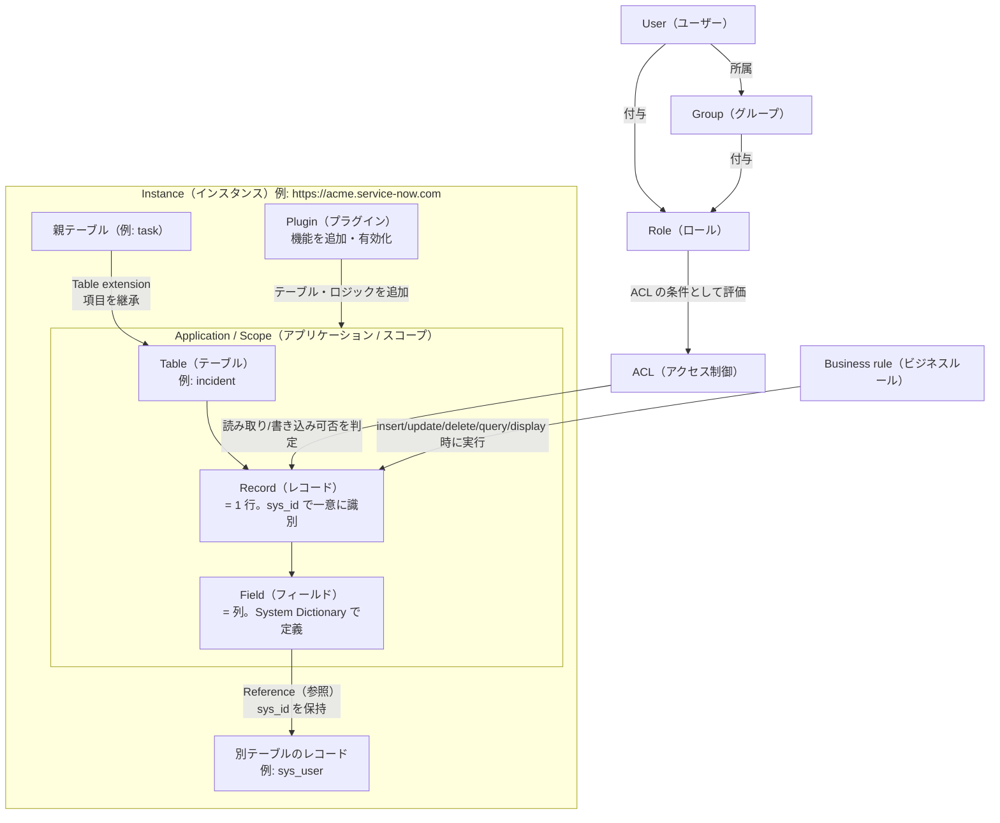
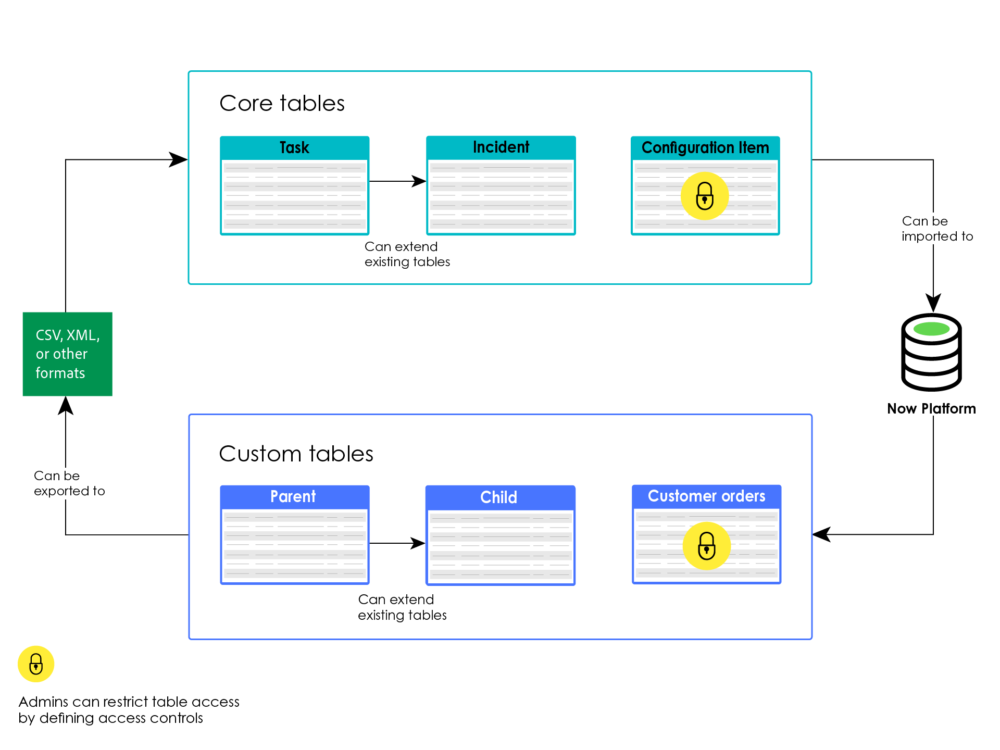
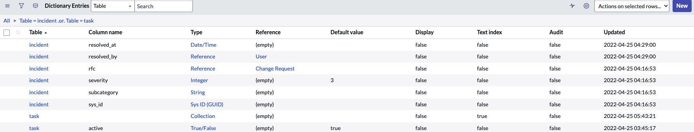
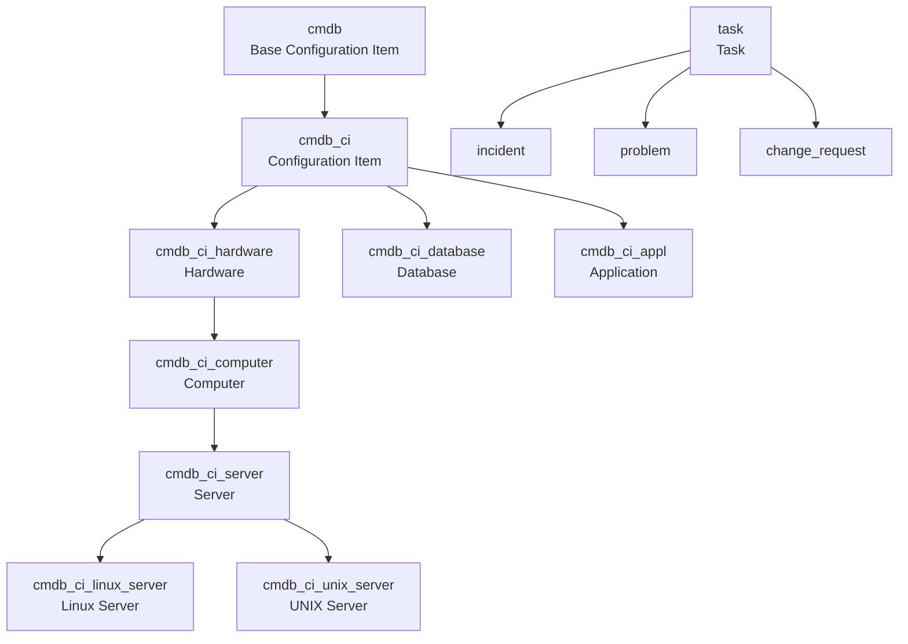
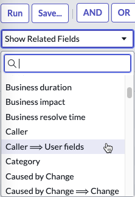
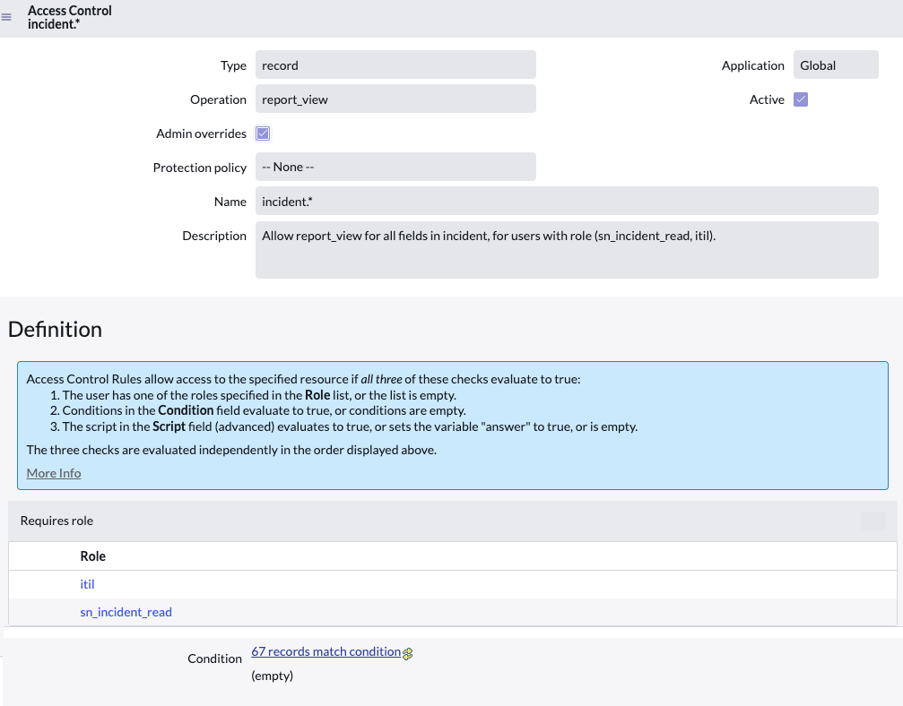
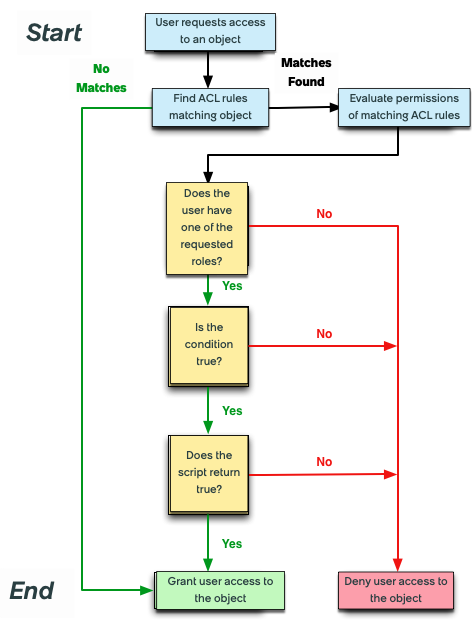
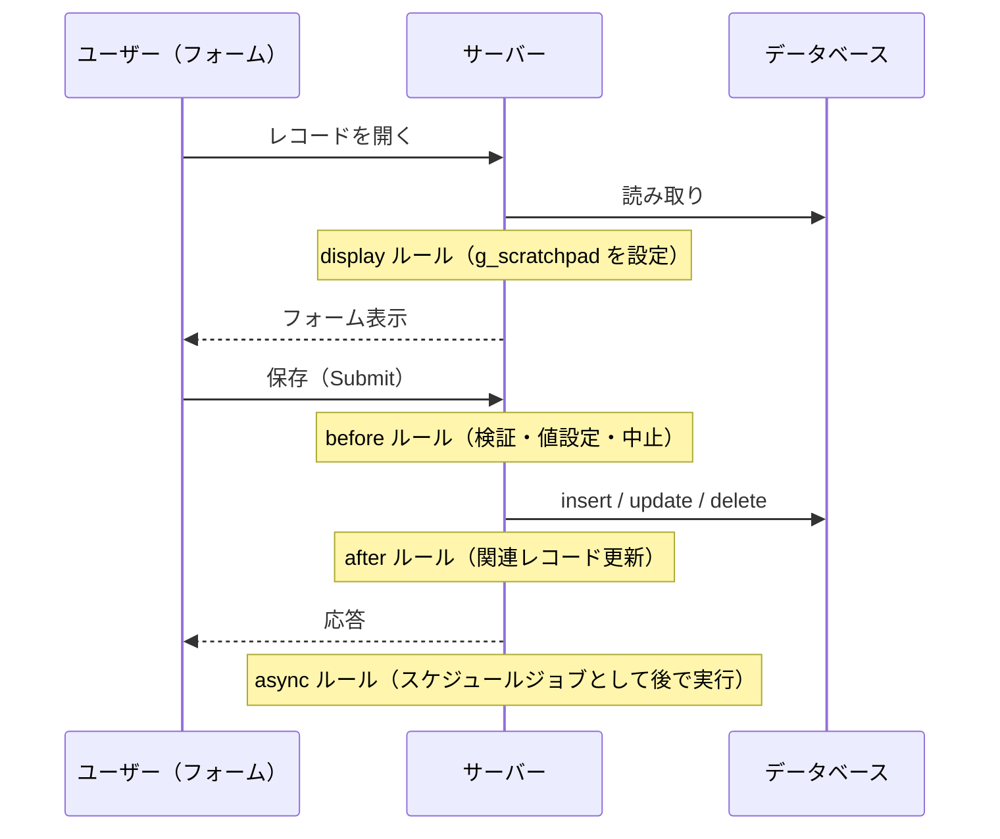

# 必須の基本概念（Core Concepts）

## 概要

本ファイルは、ServiceNow を初めて学ぶ人が「これだけは知らないと会話についていけない」基本概念を、相互の関係が分かるようにまとめた入門ページである。基準リリースは **Australia**（2026-05 GA）で、**Brazil** で判明している変更は併記する。

扱う概念は次の 11 個である。

| # | 概念（英語 / 日本語） | 一言でいうと |
|---|---|---|
| 1 | Instance（インスタンス） | 顧客ごとに割り当てられる ServiceNow の独立した実行環境（URL 単位） |
| 2 | Table / Record / Field（テーブル / レコード / フィールド） | すべてのデータと設定を格納する入れ物。Excel の「シート / 行 / 列」に相当 |
| 3 | sys_id | 全レコードに付く 32 文字の一意 ID（GUID） |
| 4 | Table extension（テーブル拡張） | 親テーブルの項目を子テーブルが継承する仕組み。`task` と `cmdb_ci` が代表例 |
| 5 | Reference（参照）/ Dot-walking（ドットウォーク） | 他テーブルのレコードへのリンクと、それをたどって項目を参照する操作 |
| 6 | Application scope（アプリケーションスコープ） | アプリの名前空間と保護境界 |
| 7 | Plugin（プラグイン） | ServiceNow が提供する機能部品。有効化（Activate）して使う |
| 8 | User / Group / Role（ユーザー / グループ / ロール） | 誰が何をできるかの基本単位 |
| 9 | ACL（Access Control List、アクセス制御リスト） | テーブル・フィールド・レコード単位のアクセス可否ルール |
| 10 | Business rule（ビジネスルール） | レコードの登録・更新・削除・表示・照会時にサーバー側で動くスクリプト |
| 11 | 「設定もレコード」という原則 | カスタマイズはコード改変ではなくメタデータ（レコード）として保存される |

各概念の詳細仕様はリファレンス編に譲り、本ファイルでは「何であるか」「なぜ重要か」「他の概念とどうつながるか」に絞る。

## 1. 概念の全体像

ServiceNow の基本概念は、次のように「インスタンスの中にテーブルがあり、テーブルにレコードが入り、それをロールと ACL が守り、ビジネスルールが動かす」という関係で整理できる。

（本図は本ファイル執筆者が各公式ページの記述をもとに作成した概念図である。）

## 2. Instance（インスタンス）

### 2.1 インスタンスとは

**Instance（インスタンス）** は、顧客が ServiceNow を契約すると割り当てられる、ServiceNow AI Platform（旧称 Now Platform）の独立した実行環境である。通常は `https://<インスタンス名>.service-now.com` という URL でアクセスする。ServiceNow は、一つのインスタンスを複数顧客で共有するのではなく、顧客ごとに専用のアプリケーション層とデータベースを提供する **multi-instance（マルチインスタンス）** 方式を採っている。[出典](https://www.servicenow.com/docs/r/zurich/platform-administration/how-now-platform-works.html)

- ServiceNow の 10-K（FY2025）も「各顧客に専用のアプリケーション層とデータベースを提供するマルチインスタンス・アーキテクチャ」と説明している。[出典](https://www.sec.gov/Archives/edgar/data/1373715/000137371526000007/now-20251231.htm)
- マルチインスタンスとマルチテナントの違い、データセンター構成は [Now Platform（ServiceNow AI Platform）の全体像](02-platform-overview.md) と [インスタンスアーキテクチャ](../02_リファレンス/platform/instance-architecture.md) を参照。

### 2.2 本番インスタンスとサブプロダクションインスタンス

1 社が複数のインスタンスを持つのが一般的で、典型的には **Production（本番）** と、開発・テスト用の **Sub-production（サブプロダクション、非本番）** インスタンスで構成する。開発は非本番インスタンスで行い、Update Set（アップデートセット）やアプリケーションの公開によって本番へ移送する。【経験則】

- 例えば未購入サブスクリプションに関わるプラグインについて、公式ドキュメントは「本番インスタンスでは有効化できないが非本番インスタンスで試すことはでき、本番分は Now Support に依頼する」と記載している（[8 章](#8-pluginプラグイン) 参照）。このように、多くの運用ルールが「本番 / 非本番」の区別を前提にしている。[出典](https://www.servicenow.com/docs/r/australia/platform-administration/c_ServiceNowPlugins.html)
- 学習用には無料の **Personal Developer Instance（PDI、個人開発者インスタンス）** を developer.servicenow.com から取得できる。学習パスは [学習パスと認定資格](09-learning-path.md) を参照。
- インスタンス構成の設計は [インスタンス戦略と環境](../03_導入編/07-instance-strategy.md)、移送とクローンは [アップデートセットとクローン](../02_リファレンス/platform/update-sets-cloning.md) を参照。

### 2.3 インスタンスはアップグレードの単位でもある

インスタンスは、プラットフォームのバージョン（Australia、Brazil などのファミリーリリース）を持つ単位でもある。同じ会社でも、本番は Australia、開発は先行して Brazil、という状態が一時的に生じうる。リリース体系は [リリースサイクルとバージョン](07-release-cycle.md)、アップグレード実務は [アップグレード管理](../03_導入編/13-upgrade-management.md) を参照。

## 3. Table（テーブル）・Record（レコード）・Field（フィールド）

### 3.1 基本構造

ServiceNow AI Platform は **テーブルベースのデータ構造** でデータを保存・整理する。インスタンス上のすべての情報はテーブルに格納され、テーブルは一連の **Record（レコード）** から成り、レコードは個々のデータを保持する **Field（フィールド）** の集まりである。レコードは **List（リスト）** または **Form（フォーム）** として表示できる。[出典](https://www.servicenow.com/docs/r/australia/platform-administration/table-administration-and-data-management/c_DataDictionaryTables.html)

| ServiceNow の用語 | 日本語 | 表計算ソフトでのたとえ | RDB でのたとえ | 例 |
|---|---|---|---|---|
| Table | テーブル | シート | テーブル | `incident`（インシデント） |
| Record | レコード | 行 | 行（row） | INC0010001 というインシデント 1 件 |
| Field（Column とも呼ぶ） | フィールド（列） | 列 | 列（column） | `short_description`（簡単な説明） |
| List | リスト | 表として一覧表示 | SELECT 結果 | Incident の一覧画面 |
| Form | フォーム | 1 行を縦に展開した詳細画面 | 1 行の詳細 | インシデント 1 件の詳細画面 |

- テーブルには **Label（表示名）** と **Name（内部名）** がある。例えば表示名 Incident のテーブルの内部名は `incident`、表示名 User のテーブルの内部名は `sys_user` である。スクリプト、URL、API では内部名を使う。[出典](https://www.servicenow.com/docs/r/australia/platform-administration/c_ReferenceField.html)
- ITSM などの共通プロセス用に、あらかじめ多数のテーブルが用意されている（ベースシステムのテーブル）。管理者は業務要件に合わせて **Custom table（カスタムテーブル）** を作成でき、既存テーブルを変更せずに拡張することもできる。テーブルのデータは CSV、XML などの形式でインポート / エクスポートできる。[出典](https://www.servicenow.com/docs/r/australia/platform-administration/table-administration-and-data-management/exploring-table-administration.html)
- リスト・フォームの操作方法は [UIの基本](05-ui-basics.md) と [リストとフォーム](../02_リファレンス/platform/lists-forms.md) を参照。

**図 1：Core tables（コアテーブル）と Custom tables（カスタムテーブル）の関係（公式ドキュメント「Exploring tables」の Figure 1）**

- 画面の説明：上段の「Core tables」枠に Task、Incident、Configuration Item の 3 テーブルが描かれ、Task から Incident へ「Can extend existing tables（既存テーブルを拡張できる）」の矢印がある。Configuration Item には鍵アイコンが付いている。下段の「Custom tables」枠には Parent → Child の拡張関係と、独立した Customer orders テーブル（鍵アイコン付き）が描かれている。左側の「CSV, XML, or other formats」ボックスと右側の「Now Platform」データベースアイコンの間に「Can be imported to / Can be exported to」の矢印があり、データの入出力を示す。凡例の鍵アイコンは「Admins can restrict table access by defining access controls（管理者はアクセス制御でテーブルへのアクセスを制限できる）」を意味する。
- 出典：https://www.servicenow.com/docs/r/australia/platform-administration/table-administration-and-data-management/exploring-table-administration.html （取得日：2026-11-02）

### 3.2 テーブルとフィールドの定義はどこにあるか（System Dictionary）

ServiceNow では、テーブルやフィールドの「定義情報」自体もテーブルに保存されている。入門段階で知っておくべき定義用テーブルは次の 3 つである。[出典](https://www.servicenow.com/docs/r/australia/platform-administration/table-administration-and-data-management/c_DataDictionaryTables.html)

| テーブル（内部名） | 別名 | 内容 | 開き方 |
|---|---|---|---|
| Tables [`sys_db_object`] | — | データベース内の各テーブルにつき 1 レコード。自動採番形式、拡張可否（Extensible）などを設定 | All > **System Definition > Tables** |
| Dictionary Entries [`sys_dictionary`] | **System Dictionary（システムディクショナリ）** | すべてのテーブルとフィールドを定義する。データ型、最大長、デフォルト値、依存関係などを保持 | All > **System Definition > Dictionary**、またはフィールドラベルを右クリック > **Configure Dictionary** |
| Field Labels [`sys_documentation`] | **Language File（言語ファイル）** | 各テーブル・列のラベルとヒント（言語ごと） | All > **System Definition > Language File** |

- Tables のフォームからは、関連リンク **Show Schema Map** でテーブル間の関係図（Schema map）を表示できる。[出典](https://www.servicenow.com/docs/r/australia/platform-administration/table-administration-and-data-management/c_DataDictionaryTables.html)
- データモデルの詳細（データ型一覧、Dictionary override、Dictionary attribute など）は [データモデルとSystem Dictionary](../02_リファレンス/platform/data-model-dictionary.md) を参照。

**図 2：System Dictionary（Dictionary Entries [`sys_dictionary`]）のリスト画面**

- 画面の説明：リストのタイトルは「Dictionary Entries」、ブレッドクラムは「All > Table = incident .or. Table = task」で、`incident` と `task` の 2 テーブルの定義に絞り込まれている。列は Table、Column name、Type、Reference、Default value、Display、Text index、Audit、Updated。例として `incident` の `resolved_by`（Type = Reference、Reference = User）、`rfc`（Reference、Change Request）、`severity`（Integer、Default value = 3）、`subcategory`（String）、`sys_id`（Sys ID (GUID)）、`task` テーブル自身の定義行（Type = Collection）、`task` の `active`（True/False、Default value = true）が表示されている。Column name が空で Type = Collection の行は「テーブル自体の定義」を表す。
- 出典：https://www.servicenow.com/docs/r/australia/platform-administration/table-administration-and-data-management/c_DataDictionaryTables.html （取得日：2026-11-02）

### 3.3 フィールドのデータ型（入門で頻出するもの）

フィールドには **Type（データ型）** があり、入力欄の見た目と保存形式が決まる。図 2 にも現れる代表的な型を挙げる（網羅的な一覧はリファレンス編を参照）。

| Type（表示名） | 内容 | 例 |
|---|---|---|
| String | 文字列 | `short_description` |
| Integer | 整数（選択肢の内部値に使われることも多い） | `state`、`priority` |
| True/False | 真偽値 | `active` |
| Date/Time | 日時 | `opened_at`、`sys_created_on` |
| Reference | 他テーブルの 1 レコードへの参照（sys_id を保持） | `assigned_to` → `sys_user` |
| Sys ID (GUID) | レコードの一意 ID | `sys_id` |
| Journal Input | 追記型の履歴（作業メモ・コメント） | `work_notes`、`comments` |
| List（glide_list） | 複数レコードへの参照リスト | `watch_list` |

[出典](https://www.servicenow.com/docs/r/fBdxWC~8p08POQuUubVDig/0wR9GHXNkSaxsw8TCJPr7w)

### 3.4 テーブル同士の関係の 4 パターン

テーブル間の関係は、①テーブル拡張（Extend）、②別テーブルのレコードの参照（Reference）、③多対多（Many-to-many）関係、④Database view（データベースビュー）による結合、の 4 つの方法で作れる。[出典](https://www.servicenow.com/docs/r/australia/platform-administration/table-administration-and-data-management/exploring-table-administration.html)

| 方法 | 目的 | 入門での重要度 | 本ファイルでの説明 |
|---|---|---|---|
| Table extension（拡張） | 親の項目を子が継承する「is-a」関係 | 高 | [5 章](#5-table-extensionテーブル拡張と-taskcmdb) |
| Reference（参照） | 「この項目は別テーブルのあのレコード」という「has-a」関係 | 高 | [6 章](#6-reference参照と-dot-walkingドットウォーク) |
| Many-to-many（多対多） | 中間テーブルで複数対複数を表す | 中 | リファレンス編 |
| Database view | レポート用に複数テーブルを結合して見せる | 低 | [レポートとアナリティクス](../02_リファレンス/platform/reporting-analytics.md) |

## 4. sys_id とシステムフィールド

### 4.1 sys_id とは

**sys_id** は、インスタンス内の各レコードを識別する **32 文字の GUID（Globally Unique ID）** である。ServiceNow AI Platform 上で作成されたレコードの sys_id は一意であり、sys_id の値はプラットフォームとデータベースに管理させるべきものとされている。[出典](https://www.servicenow.com/docs/r/australia/platform-administration/c_UniqueRecordIdentifier.html)

| 項目 | 内容 |
|---|---|
| 形式 | 32 文字の GUID（例：`6816f79cc0a8016401c5a33be04be441` のような 16 進文字列） |
| 一意性 | 全テーブル・全インスタンスで重複しないよう生成される |
| 新規作成中の値 | 保存前の新規レコードの sys_id は `-1`。挿入（insert）時に新しい sys_id が割り当てられる |
| 重複が起きる例外 | ①データベースレベルでプラットフォーム外から別インスタンスへコピーした場合、②Update Set や XML でコピーした場合（sys_id が保持されるため） |
| 表示 | フォームのフィールドやリストの列として表示することは想定されていない（問題は KB0690876 を参照） |

[出典](https://www.servicenow.com/docs/r/australia/platform-administration/c_UniqueRecordIdentifier.html)

> 注：上表の sys_id の例示値は形式説明用のサンプルである。

### 4.2 sys_id の確認方法

| 方法 | 手順 |
|---|---|
| URL から | レコードを開き、フォームのヘッダーバーを右クリック > **Copy URL**。URL の `sys_id=` の後ろの値が sys_id |
| サーバーサイドスクリプト（ビジネスルール等） | `current.sys_id` |
| クライアントサイドスクリプト | `g_form.getUniqueValue()` |

[出典](https://www.servicenow.com/docs/r/australia/platform-administration/c_UniqueRecordIdentifier.html)

### 4.3 sys_id が重要な理由

- **参照の実体が sys_id である**：Reference フィールドは、画面上は「表示値（Display value）」を見せるが、データベースには参照先レコードの sys_id を保存している（[6 章](#6-reference参照と-dot-walkingドットウォーク)）。[出典](https://www.servicenow.com/docs/r/australia/platform-administration/c_ReferenceField.html)
- **インスタンス間移送の整合性の鍵である**：Update Set や XML で移したレコードは sys_id が保たれる。そのため、移送元と移送先で同じ sys_id を持つ「同一レコード」として扱われる。逆に、移送先で手作業により同じ内容のレコードを作ると sys_id が異なる別レコードになり、参照が合わなくなる原因になる。【経験則】
- **番号（Number）とは別物である**：インシデントの `INC0010001` のような **Number（番号）** は人が読むための表示値で、システム内部の一意キーは sys_id である。Task テーブルでは `number` がテーブルの表示値（Display value）として定義されている。[出典](https://www.servicenow.com/docs/r/fBdxWC~8p08POQuUubVDig/0wR9GHXNkSaxsw8TCJPr7w)

### 4.4 テーブルに自動で付くシステムフィールド

テーブルを作成すると、次の必須システムフィールドが自動で追加される。これらは削除も変更もできない。ただし `sys_class_name`（Class）は拡張可能（Extensible）なテーブルにのみ追加される。[出典](https://www.servicenow.com/docs/r/australia/platform-administration/table-administration-and-data-management/r_GlobalDefaultFields.html)

| Label | Name | Type | 内容 |
|---|---|---|---|
| Sys_id | `sys_id` | Sys ID | レコードの一意 ID（32 文字 GUID） |
| Created | `sys_created_on` | Date/Time | レコード作成日時 |
| Created by | `sys_created_by` | String | 作成したユーザー |
| Updated | `sys_updated_on` | Date/Time | 最終更新日時 |
| Updated by | `sys_updated_by` | String | 最終更新したユーザー |
| Updates | `sys_mod_count` | Integer | 作成以降の更新回数 |
| Class | `sys_class_name` | System Class Name | 拡張可能なテーブルで、レコードがどの子テーブルに属するかを示す |

- `sys_created_by` と `sys_updated_by` は Reference ではなく **String（ユーザー名の文字列）** である点に注意する。[出典](https://www.servicenow.com/docs/r/australia/platform-administration/table-administration-and-data-management/r_GlobalDefaultFields.html)
- 先頭が `sys_` で始まるテーブル・フィールドは、プラットフォームが使うシステム用のものが多い。【経験則】

## 5. Table extension（テーブル拡張）と Task・CMDB

### 5.1 テーブル拡張とは

**Table extension（テーブル拡張）** は、1 つ以上の **Child table（子テーブル）** が **Parent table（親テーブル）** とフィールドやレコードを共有できるようにする仕組みである。オブジェクト指向の「継承」に近い。[出典](https://www.servicenow.com/docs/r/australia/platform-administration/table-administration-and-data-management/table-extension-and-classes.html)

| 用語 | 意味 |
|---|---|
| Child class（子クラス） | 他のテーブルを拡張したテーブル |
| Parent class（親クラス） | 拡張される側のテーブル |
| Base class（基底クラス） | 他のテーブルを拡張していない親クラス |

- 1 つのテーブルが、親であると同時に子であることもできる（例：`cmdb_ci_computer` は `cmdb_ci` の子であり、`cmdb_ci_server` の親）。[出典](https://www.servicenow.com/docs/r/australia/platform-administration/table-administration-and-data-management/table-extension-and-classes.html)
- **拡張はテーブル作成時にしかできない**。既存テーブルを後から別テーブルの子に付け替えることはできない。[出典](https://www.servicenow.com/docs/r/australia/platform-administration/table-administration-and-data-management/table-extension-and-classes.html)
- 拡張すると、新テーブルが親とリンクされ、システムフィールドが作られ、拡張モデルに応じて 1 つ以上のデータベーステーブルが作られる。[出典](https://www.servicenow.com/docs/r/australia/platform-administration/table-administration-and-data-management/table-extension-and-classes.html)
- 親テーブルのフィールドに加えた変更は、そのテーブルだけでなく全ての子テーブルにも影響する。[出典](https://www.servicenow.com/docs/r/australia/platform-administration/table-administration-and-data-management/r_GlobalDefaultFields.html)

ベースシステムの代表的な拡張例は次のとおりである。[出典](https://www.servicenow.com/docs/r/australia/platform-administration/table-administration-and-data-management/table-extension-and-classes.html)

| 元のテーブル | 拡張された子テーブルの例 |
|---|---|
| Task [`task`] | Incident [`incident`]、Problem [`problem`]、Change Request [`change_request`] |
| Configuration Item [`cmdb_ci`] | Application [`cmdb_ci_appl`]、Computer [`cmdb_ci_computer`]、Database [`cmdb_ci_database`] |

### 5.2 sys_class_name：レコードがどの子テーブルのものかを示す

拡張されたテーブル群では、親テーブル側の **`sys_class_name`** 列に、各レコードがどの子クラスに属するかが入る。例えば Incident のレコードの `sys_class_name` は `incident`、Change のレコードは `change_request` になる（公式ページの例示では「change」と表記）。[出典](https://www.servicenow.com/docs/bundle/zurich-platform-administration/page/administer/table-administration/concept/table-extension-and-classes.html)

このため、`task` テーブルのリストを開くと、インシデント・問題・変更などのレコードが混在して表示され、`sys_class_name`（Task テーブルでは Label が **Task type**）で種類を見分けられる。[出典](https://www.servicenow.com/docs/r/fBdxWC~8p08POQuUubVDig/0wR9GHXNkSaxsw8TCJPr7w)

### 5.3 3 つの拡張モデル（参考）

拡張モデルは、作られるデータベーステーブルの数、親からのフィールドの継承方法、子レコードの複製方法を決める。入門者は「Task 系と CMDB 系で内部の持ち方が違う」程度を押さえれば十分である。[出典](https://www.servicenow.com/docs/r/australia/platform-administration/table-administration-and-data-management/table-extension-and-classes.html)

| モデル | DB テーブル | 親からのフィールド継承 | レコードの持ち方 | 公式ページでの例 |
|---|---|---|---|---|
| Table per class | 親と各子ごとに別テーブル | 継承する | 親が子のレコードを同じ sys_id で複製して保持 | Contract [`ast_contract`] と Lease / Warranty |
| Table per hierarchy | 親子全体で 1 テーブル | 継承する | 親テーブルがすべてのレコードを保持（`sys_class_name` で区別） | Task と Incident / Change |
| Table per partition | 親テーブル＋必要に応じたストレージパーティション | 子は親のフィールドを派生しない（各子が独自のフィールドリストを持ち、親のディクショナリ変更が子にコピーされる） | 親テーブルがすべてのレコードを保持（`sys_class_name`、`sys_class_path` で区別） | Base Configuration Item [`cmdb`] 配下（`cmdb_ci`、`cmdb_ci_hardware` など） |

[出典（Zurich 版の記述を含む）](https://www.servicenow.com/docs/bundle/zurich-platform-administration/page/administer/table-administration/concept/table-extension-and-classes.html)

> 注：公式ページは Task を明示的に「table per hierarchy」と名指ししてはいないが、Incident・Change のレコードを Task が保持し `sys_class_name` で区別する、という記述がこのモデルの説明に該当する。

### 5.4 Task テーブル：「仕事」を表す共通の親

**Task [`task`]** テーブルは、Incident、Problem、Change Management などコア ITSM アプリケーションにフィールドを提供する **base class（基底クラス）** であり、Task を拡張するすべてのアプリケーションはこれらのフィールドを共通に持つ。[出典](https://www.servicenow.com/docs/r/australia/platform-administration/table-administration-and-data-management/task-table-structure.html)

`task` テーブルの主なフィールドは次のとおりである（Australia 版「Important Task table fields」より抜粋）。[出典](https://www.servicenow.com/docs/r/fBdxWC~8p08POQuUubVDig/0wR9GHXNkSaxsw8TCJPr7w)

| Label | Name | Type | 内容 |
|---|---|---|---|
| Number | `number` | String | タスクの識別番号。作成時に自動採番。Task テーブルの表示値 |
| Short description | `short_description` | String | 短いタイトル |
| Description | `description` | String | 作業内容の詳細（複数行） |
| State | `state` | Integer | タスクの状態。ベースの選択肢は Pending、Open、Work in Progress、Closed Complete、Closed Incomplete、Closed Skipped |
| Priority | `priority` | Integer | 優先度。既定では Impact（影響度）と Urgency（緊急度）から計算 |
| Active | `active` | True/False | 作業中か完了済みか。通常はアプリごとのビジネスルールで設定 |
| Assigned to | `assigned_to` | Reference | 担当ユーザー。既定では `itil` ロールを持つユーザーのみ表示 |
| Opened | `opened_at` | Date/Time | 最初に起票された日時 |
| Work notes | `work_notes` | Journal Input | `itil` ユーザーにのみ見える作業メモ。Activity に追記 |
| Additional comments | `comments` | Journal Input | コメント（依頼者にも見えるもの）。Activity に追記 |
| Watch list | `watch_list` | List | 更新時に通知を受けるユーザー |
| Escalation | `escalation` | Integer | SLA に基づく経過度合い（Normal、Moderate、High、Overdue） |
| Task type | `sys_class_name` | System Class Name | タスクの種類（子クラス）。子テーブルで作成すると自動設定 |

- 上記のほか、`assignment_group`（Assignment group、割り当てグループ）も Task のフィールドとして各子テーブルで共通に使われる。Australia 版「Important Task table fields」には掲載がなく、公式ページでの裏付けは確認できなかったため第三者情報として記す。【第三者情報】（Packt『Learning ServiceNow』Chapter 5 等）[参考](https://www.oreilly.com/library/view/learning-servicenow/9781788837040/ch05.html)
- 子テーブル（例：`incident`）は上記を継承したうえで、独自フィールド（例：`caller_id`、`category`）を追加する。子テーブルによって `state` の選択肢は上書き・追加されることがある（例：Incident の New / In Progress / On Hold / Resolved / Closed / Canceled）。【経験則】詳細は [Incident Management](../02_リファレンス/itsm/incident-management.md) を参照。
- Task を拡張しているからこそ、SLA、承認（Approval）、割り当て、通知、Activity（活動履歴）、Workspace など「仕事」に共通の仕組みを、インシデントでも変更でも人事ケースでも同じように使える。【経験則】
- **ベストプラクティス**：独自の「業務の依頼・対応」アプリを作るときは、Task を拡張したテーブルにすると、上記の共通機能を流用できる。一方で、Task 拡張テーブルはライセンス（サブスクリプション）上のカウント対象になりうるため、ライセンス条件の確認が必要である。【経験則】ライセンス面は [ライセンスモデル](../03_導入編/01-licensing-model.md) を参照。

### 5.5 CMDB：構成アイテムのクラス階層

CMDB（Configuration Management Database、構成管理データベース）のテーブル群も、拡張による **クラス階層** を成す。[出典](https://www.servicenow.com/docs/r/australia/servicenow-platform/configuration-management-database-cmdb/c_ConfigurationManagementDatabase.html)

| テーブル | 位置づけ |
|---|---|
| Base Configuration Item [`cmdb`] | 非 IT の CI を含む最上位の基底テーブル。その子孫は非 IT の CI |
| Configuration Item [`cmdb_ci`] | IT の CI の中核テーブル。全 CI の基本属性を保持。アクセスには `sn_cmdb_admin`、`sn_cmdb_editor`、`asset`、`admin`、`itil` のいずれかのロールが必要。その子孫は IT の CI |
| Computer [`cmdb_ci_computer`] → Server [`cmdb_ci_server`] → UNIX Server [`cmdb_ci_unix_server`] | `cmdb_ci` から段階的に特化していく例 |
| Database [`cmdb_ci_database`] | `cmdb_ci` の子の例 |
| CI Relationship [`cmdb_rel_ci`] | CI 間のすべての関係（依存関係など）を定義するテーブル |

[出典](https://www.servicenow.com/docs/r/australia/servicenow-platform/configuration-management-database-cmdb/c_ConfigurationManagementDatabase.html)

（`cmdb_ci_linux_server` → `cmdb_ci_server` → `cmdb_ci_computer` → `cmdb_ci_hardware` → `cmdb_ci` → `cmdb` という祖先の並びは、`GlideRecordUtil.getTables()` の公式例に基づく。[出典](https://www.servicenow.com/docs/r/api-reference/server-api-reference/c_GlideRecordUtilAPI.html)）

- `cmdb_ci` を拡張していない CI は、Dependency Views のマップや CI relation formatter に表示されない。[出典](https://www.servicenow.com/docs/r/australia/servicenow-platform/configuration-management-database-cmdb/c_ConfigurationManagementDatabase.html)
- テーブルの階層は **System Definition > Tables & Columns** でテーブルを選び **Schema Map** を選ぶと図で確認できる。[出典](https://www.servicenow.com/docs/r/australia/servicenow-platform/configuration-management-database-cmdb/c_ConfigurationManagementDatabase.html)
- CMDB と CSDM（Common Service Data Model）の詳細は [CMDB と CSDM](../02_リファレンス/platform/cmdb-csdm.md) を参照。

## 6. Reference（参照）と Dot-walking（ドットウォーク）

### 6.1 Reference フィールド

**Reference field（参照フィールド）** は、別テーブルのレコードへのリンクを保存するフィールドである。例えば Incident テーブルの **Caller（`caller_id`、発信者）** フィールドは、User [`sys_user`] テーブルへの参照である。参照フィールドを定義すると 2 つのテーブル間に関係が作られ、フォームに参照フィールドを置くと参照先テーブルの他のフィールドもフォームで使えるようになる。[出典](https://www.servicenow.com/docs/r/australia/platform-administration/c_ReferenceField.html)

| 項目 | 内容 |
|---|---|
| 保存される値 | 参照先レコードの **sys_id**（画面には表示されない） |
| 画面に見える値 | 参照先テーブルの **Display value（表示値）**（例：ユーザーなら氏名、タスクなら番号） |
| 参照先 | **1 つのテーブルのみ**。任意のテーブルを参照したい場合は **Document ID** 型を使う |
| Reference qualifier（参照修飾子） | 選択できるレコードを絞り込む条件 |
| Cascade delete rules（カスケード削除ルール） | 参照先レコードが削除されたとき、参照元をどうするか |
| Reference key（参照キー） | sys_id 以外のフィールドを一意キーとして保存する設定 |
| Dynamic creation（動的作成） | 存在しない値を入力したとき、エラーにせず参照先に新規レコードを作る設定 |
| Auto-complete | 入力中に候補を自動補完（既定で有効） |

[出典](https://www.servicenow.com/docs/r/australia/platform-administration/c_ReferenceField.html)

- **注意**：Reference qualifier はあくまで選択候補の絞り込みであり、セキュリティ制御ではない。特定ユーザーが見られるデータを制限するには ACL を使う。[出典](https://servicenow.com/docs/bundle/yokohama-platform-administration/page/script/server-scripting/concept/c_ReferenceQualifiers.html)

### 6.2 Dot-walking（ドットウォーク）

**Dot-walking（ドットウォーク）** は、参照フィールドを経由して関連テーブルのフィールドにアクセスする操作である。フォーム、リスト、フィルター、条件ビルダー、スクリプトなどで使える。スクリプトでは JavaScript のドット記法で書く（例：`caller_id.vip` で「発信者の VIP フラグ」）。[出典](https://www.servicenow.com/docs/r/australia/platform-user-interface/dot-walking-examples.html)

- 参照先のフィールドがさらに参照フィールドであれば、続けてたどれる（例：`caller_id.manager.email`）。【経験則】
- データをコピーせずに「関連先の最新値」を表示・条件判定に使えるため、ServiceNow で非常によく使う。【経験則】

**図 3：条件ビルダーでのドットウォーク（Show Related Fields）**

- 画面の説明：フィルター（条件ビルダー）の上部に Run、Save...、AND、OR ボタンがあり、フィールド選択のドロップダウンで **Show Related Fields** が選ばれている。検索ボックスの下にフィールド一覧（Business duration、Business impact、Business resolve time、Caller、**Caller ⟹ User fields**、Category、Caused by Change、Caused by Change ⟹ Change Request fields など）が並ぶ。「Caller ⟹ User fields」は「Caller が参照フィールドで、その先の User レコードのフィールドを選べる」ことを意味し、これを選ぶとユーザーの属性（例：VIP、部署）で条件を組める。
- 出典：https://www.servicenow.com/docs/r/australia/platform-user-interface/dot-walking-examples.html （取得日：2026-11-02）

### 6.3 Table extension と Reference の違い

| 観点 | Table extension（拡張） | Reference（参照） |
|---|---|---|
| 関係の意味 | 「インシデント **は** タスク **である**」（is-a） | 「インシデント **は** 発信者（ユーザー）**を持つ**」（has-a） |
| 設定できる時期 | テーブル作成時のみ | いつでもフィールドとして追加可能 |
| データ | 子レコードは親のフィールドを自分の項目として持つ | 参照先の sys_id だけを持ち、項目はドットウォークでたどる |
| 例 | `incident` extends `task` | `incident.caller_id` → `sys_user` |

## 7. Application scope（アプリケーションスコープ）

### 7.1 スコープとは

**Application scope（アプリケーションスコープ）** は、アプリケーションのファイルとデータを識別し、アクセスを制限することでアプリケーションを保護する仕組みである。既定では、すべてのカスタムアプリケーションは **Private scope（プライベートスコープ）** を持ち、アプリとその成果物（Artifact）は **Namespace identifier（名前空間識別子）** で一意に識別される。スコープは名前の衝突を防ぎ、どの変更を許可するかを開発環境が判断できるようにする。[出典](https://www.servicenow.com/docs/r/australia/application-development/c_ApplicationScope.html)

- 公式の例：会議室予約アプリを独自スコープで作ると、既定ではそのアプリは自分のテーブルとロジックを変更できるが、他のアプリは明示的な許可がない限り変更できない。これにより、会議室予約アプリが中核業務を妨げず、他アプリもそのアプリを妨げない。[出典](https://www.servicenow.com/docs/r/australia/application-development/c_ApplicationScope.html)
- 他アプリにどこまで公開するかは、Custom application レコードと各 Table レコードで指定する。[出典](https://www.servicenow.com/docs/r/australia/application-development/c_ApplicationScope.html)

### 7.2 Global scope（グローバルスコープ）と Private scope の比較

| 観点 | Global scope（グローバル） | Private scope（スコープアプリ） |
|---|---|---|
| 対象 | 主に ServiceNow 提供アプリ、スコープ導入以前に作られたカスタムアプリ、`sn_g_app_creator.app_creator` ロールを持つ開発者が作るアプリ | 新規カスタムアプリの既定 |
| 名前空間 | 固有の名前空間なし（名前衝突・データ衝突の可能性） | `x_<会社コード>_<アプリ名>` 形式の接頭辞（最大 18 文字。例：`x_acme_legal_reque`） |
| スコープ保護 | グローバルアプリ同士は同じスコープを共有するため、スコープ保護を受けない（互いのテーブルを読み、API を実行し、設定レコードを作成できる） | 他スコープからのアクセスは許可した範囲に限定 |
| 配布 | Application repository へはアップロード可能、**ServiceNow Store には不可** | Store / Application repository に公開可能 |
| ソース管理・委任開発 | Delegated development（委任開発）非対応 | Source control 連携、Delegated development に対応 |

[出典（Global scope）](https://www.servicenow.com/docs/r/australia/application-development/c_GlobalScope.html)、[出典（Plan before you build）](https://www.servicenow.com/docs/r/zUlSbxoxKPAWFDGUdAoSCw/LXK5qwxCykj7b7g0ZCKyrg)

- 公式ドキュメントは「グローバルアプリは意図しないデータを変更しうるため、新しいテーブルはスコープアプリで作り、古いものもスコープアプリへの移行を検討すべき」と推奨している。[出典](https://www.servicenow.com/docs/r/australia/application-development/c_ApplicationScope.html)
- スコープ名（名前空間）はアプリの成果物に引き継がれるため後から変えにくい。アプリ名は変更できる。[出典](https://www.servicenow.com/docs/r/zUlSbxoxKPAWFDGUdAoSCw/LXK5qwxCykj7b7g0ZCKyrg)
- スコープアプリのテーブル名は接頭辞付きになる（例：`x_acme_legal_reque_request` のような形）。ServiceNow 提供のスコープアプリは `sn_` で始まる名前空間を持つものが多い（例：ロール `sn_cmdb_admin`、`sn_incident_read`）。【経験則】
- 画面右上（またはユーザーメニュー）の **Application picker（アプリケーションピッカー）** で「現在のアプリケーション」を切り替えて開発する。変更はその時点で選択中のスコープに記録される。【経験則】詳細は [アプリケーション開発](../02_リファレンス/platform/app-development.md) を参照。

## 8. Plugin（プラグイン）

### 8.1 プラグインとは

**Plugin（プラグイン）** は、ServiceNow インスタンス内で機能を提供するソフトウェア部品である。すべてのプラグインは ServiceNow が提供する。公式ドキュメントはプラグインとアプリケーションを次のように区別している。[出典](https://www.servicenow.com/docs/r/australia/platform-administration/c_ServiceNowPlugins.html)

| 区分 | 説明 |
|---|---|
| Plugin（プラグイン） | インストール済みアプリケーションに機能を追加し、ServiceNow AI Platform の機能を拡張する |
| Application（アプリケーション） | 一連の機能を実装する独立したコードのまとまり。**ServiceNow Store** からインストールするか、自分で作成する |

- プラグインには `com.` で始まる ID がある（例：SNC Access Control プラグインの ID は `com.snc.snc_access_control`）。[出典（Configure access control、Australia）](https://www.servicenow.com/docs/r/australia/platform-security/t_ConfigureAccessControl.html)
  - 注：Australia 版「ServiceNow plugins」ページ自体には個別のプラグイン ID の例は載っていない。インスタンス上では All > **System Definition > Plugins**（または Application Manager）で各プラグインの ID を確認できる。【経験則】

### 8.2 有効化（Activate）のルール

| ルール | 内容 |
|---|---|
| 既定で有効なもの | 一部のプラグインはインスタンスで既定で有効化されている |
| 自分で有効化 | 業務に応じて追加のプラグインを有効化できる。admin ロールがあれば **Application Manager**（All Applications ページ）で利用可能なプラグインを確認できる |
| ServiceNow に依頼 | 一部のプラグインは ServiceNow 担当者による有効化が必要。Application Manager に出てこないものは自分では有効化できない |
| サブスクリプション | 未購入のサブスクリプションが必要なプラグインはボタンがグレーアウトする。購入時に自動で有効化されるものもある |
| 本番での有効化 | 公式ページのサブスクリプションに関する説明の中で「本番インスタンスでは有効化できない。非本番インスタンスで試すことはでき（有償サブスクリプションのプラグインを含む）、本番で使う準備ができたら Now Support に依頼する」と記載されている |
| 依存関係 | 依存プラグインがある場合、事前に通知され、続行すると必要なプラグインも自動で有効化される |
| **無効化不可** | **一度有効化したプラグインは無効化・停止できない**。必要ならロールや ACL で機能を隠す。一部はロールバックコンテキストに対応 |
| PDI | 個人開発者インスタンスでは、既定で無効なプラグインも申請・購入なしで有効化できる（一部 PDI で使えないものもある） |

[出典](https://www.servicenow.com/docs/r/australia/platform-administration/c_ServiceNowPlugins.html)

- 「無効化できない」ことは、本番環境に不要な機能やテーブルが残り続けることを意味する。必ず非本番インスタンスで有効化結果（追加されるテーブル・ロール・ACL・ビジネスルール）を確認してから本番に適用する。[出典](https://www.servicenow.com/docs/r/australia/platform-administration/c_ServiceNowPlugins.html)
- 近年は Now Assist や Workflow Studio など多くの製品が、ファミリーリリースとは独立に **ServiceNow Store アプリ** として更新される。製品の提供形態は [Now Platform（ServiceNow AI Platform）の全体像](02-platform-overview.md) と [プラットフォームのパッケージ構成](../02_リファレンス/platform/platform-licensing-packaging.md) を参照。

## 9. User（ユーザー）・Group（グループ）・Role（ロール）

### 9.1 3 つの基本単位

| 概念 | テーブル | 説明 |
|---|---|---|
| User（ユーザー） | `sys_user` | ログインする人（またはシステム連携用アカウント） |
| Group（グループ） | `sys_user_group` | ユーザーの集まり。タスクの割り当て先（Assignment group）や承認者、ロール付与の単位に使う |
| Role（ロール） | `sys_user_role` | 権限の束。ACL やメニュー表示の条件として評価される |
| ユーザーとロールの関連 | `sys_user_has_role` | どのユーザーがどのロールを持つか |
| ユーザーとグループの関連 | `sys_user_grmember` | どのユーザーがどのグループに所属するか |

（`sys_user_has_role` は公式の ACL 一覧に現れる。[出典](https://www.servicenow.com/docs/r/xanadu/platform-security/access-control/r_SecurityJumpStartACLRules.html) その他のテーブル名は【経験則】。詳細は [ユーザー・グループ・ロール](../02_リファレンス/platform/users-groups-roles.md) を参照。）

- **ロールはグループに付与するのが基本**である。グループに付けたロールは所属ユーザー全員に継承されるため、異動時はグループの出入りだけで権限が変わる。【経験則】
- ロールは他のロールを含むことができる（**Contains Roles**）。例えば `admin` ロールは `catalog_admin`、`import_admin`、`sp_admin` など多数のロールを内包している。[出典](https://www.servicenow.com/docs/r/australia/platform-administration/user-administration/r_BaseSystemRoles.html)

### 9.2 入門で必ず出会うロール

| ロール | 説明 |
|---|---|
| `admin` | すべての機能・データにアクセスできる管理者ロール。ACL を上書き（override）でき、すべてのロールチェックを通過する。より限定的なロールがある場合は付与を避けるべきとされる |
| `itil` | ITIL ヘルプデスク技術者の標準ロール（ベースシステムの「技術者」ロール）。インシデント・問題・変更の起票・更新・クローズ、CMDB 関連の一部参照ができる。既定ではこのロールを持つユーザーだけがタスクの担当者になれる |
| `itil_admin` | `itil` より強い権限を持つチームリーダー向けロール。インシデント・問題・変更の削除などが可能 |
| `security_admin` | ACL の作成・更新に必要な **Elevated role（昇格ロール）**。通常は付与されているだけでは有効にならず、セッション中に昇格（Elevate）して使う |
| `approver_user` | 自分宛ての承認依頼を処理できるロール。**有償のロール**であり、付与前に契約上の権利を確認する |
| `catalog_admin` / `knowledge_admin` / `report_admin` / `user_admin` | それぞれサービスカタログ、ナレッジベース、レポート、ユーザー・グループ・所在地・会社の管理 |
| `impersonator` | 他ユーザーへのなりすまし（Impersonate）が可能（admin ユーザーを除く） |
| `public` | ログインなしでのアクセスを許可するための特殊ロール |
| `nobody` | 誰も（admin や maint も）アクセスできないことを表す特殊ロール。ユーザーに付与しない |
| `maint` | ServiceNow 社専用 |

[出典（ベースシステムロール、Australia）](https://www.servicenow.com/docs/r/australia/platform-administration/user-administration/r_BaseSystemRoles.html)、[出典（`nobody` の記述は Brazil 版で確認）](https://www.servicenow.com/docs/r/platform-administration/user-administration/base-system-roles.html)、[出典（security_admin による ACL 作成）](https://www.servicenow.com/docs/r/australia/platform-security/access-control/exploring-access-control-list.html)

- Elevated role は「ユーザーやグループへの割り当てではなく、昇格によって使われる」ロールであり、`admin` ロール自体は Elevated role ではない。[出典](https://www.servicenow.com/docs/r/australia/platform-administration/user-administration/r_BaseSystemRoles.html)
- ロールはライセンス（どのユーザーが有償の Fulfiller とみなされるか）と密接に関係する。基本は [ユーザー・ロール・ライセンスの基本](08-users-roles-licensing-basics.md) を参照。

## 10. ACL（Access Control List、アクセス制御）

### 10.1 ACL とは

**ACL（Access Control List、アクセス制御リスト）** は、テーブル、フィールド、レコード、UI ページ、Scripted REST API などへのユーザーのアクセスを制御するセキュリティルールである。すべての ACL は次の 3 要素を指定する。[出典](https://www.servicenow.com/docs/r/australia/platform-security/access-control/exploring-access-control-list.html)

| 要素 | 内容 | 例 |
|---|---|---|
| Decision type（決定タイプ）と Operation（操作） | **Allow-If**（条件を満たせば許可）または **Deny-Unless**（条件を満たさない限り拒否）。操作は `create`、`read`、`write`、`delete`、`execute` など | Allow-If / `write` |
| Object（対象） | 種類（Type）と名前で特定。`[incident].[--None--]` はテーブル全体、`[incident].[active]` はフィールド。**Applies-to** で特定レコード（例：Priority = P1）に限定可能 | `record` / `incident.*` |
| Conditions（条件） | **Requires role**（必要ロール）、**Security attributes**（例：UserIsAuthenticated）、**Data condition**（例：State is not Closed）、**Script**（true/false を返す） | `itil` ロール必須 |

- ユーザーがアクセスするには、ACL に記載された **すべての条件を満たす** 必要がある。[出典](https://www.servicenow.com/docs/r/australia/platform-security/access-control/exploring-access-control-list.html)
- レコードへのアクセスでは、**テーブルレベルの ACL とフィールドレベルの ACL の両方** を通過する必要がある。[出典](https://www.servicenow.com/docs/r/australia/platform-security/access-control/exploring-access-control-list.html)
- 同じ評価段階で **Allow-If** ACL が複数一致した場合は、**どれか 1 つを通過すれば** アクセスが許可される。[出典](https://www.servicenow.com/docs/r/australia/platform-security/access-control/exploring-access-control-list.html)
- **Deny-Unless** ACL は Allow-If ACL より **先に** 評価され、優先される。一致した Deny-Unless ACL が複数ある場合は **すべて** を満たす必要があり、1 つでも満たさなければ Allow-If の結果にかかわらず拒否される。Deny-Unless を通過しただけでは許可にならず、一致する Allow-If ACL があればその許可が必要になる。なお、公式ページは「一致する Allow-If ACL がなく Deny-Unless ACL を通過した場合は既定で許可される」と「Deny-Unless が一致しても、アクセスは Allow-If ACL が明示的に許可したときにのみ与えられる」の両方を記載しており、ページ内で記述が食い違っている。実際の挙動はベースシステムの既定 ACL やテーブルの Allow-If ACL の有無に左右されるため、「Deny-Unless だけを置けば許可される」と考えず、インスタンスの Access Analyzer や ACL のデバッグで確認すること。詳細は [アクセス制御（ACL）](../02_リファレンス/platform/access-control-acl.md) を参照。[出典（Deny-Unless ACL）](https://www.servicenow.com/docs/r/australia/platform-security/access-control/acl-denial-behavior.html)
- **Deny by default**：ロール・セキュリティ属性・データ条件・スクリプトのいずれも持たない「空の ACL」や、存在しないロールを参照する等の「無効な ACL」は、アクセスを完全に拒否する、と Australia 版の公式ページは説明している（存在しないロールを参照する ACL の扱いについては、[10.3](#103-australia--brazil-での主な変更) の Brazil での変更と注記も参照）。[出典](https://www.servicenow.com/docs/r/australia/platform-security/access-control/exploring-access-control-list.html)
- ACL の作成・更新には **`security_admin` への昇格** が必要。それ以外の管理者は既存 ACL の閲覧とデバッグができる。[出典](https://www.servicenow.com/docs/r/australia/platform-security/access-control/exploring-access-control-list.html)
- ACL レコードは Access Control [`sys_security_acl`] テーブルに保存される。[出典](https://www.servicenow.com/docs/r/australia/application-development/servicenow-sdk/acl-api-now-ts.html)

**図 4：ACL レコードのフォーム（`incident.*` の report_view）**

- 画面の説明：ヘッダーは「Access Control incident.*」。Type = record、Operation = report_view、Admin overrides にチェック、Protection policy = -- None --、Name = incident.*、Description = 「Allow report_view for all fields in incident, for users with role (sn_incident_read, itil).」、右側に Application = Global、Active にチェック。下部の **Definition** 欄の青い説明枠には「Access Control Rules は次の 3 つのチェックがすべて true の場合に許可する：①ユーザーが Role リストのいずれかのロールを持つ（またはリストが空）、②Condition が true（または空）、③Script が true を返すか answer を true にする（または空）。3 つのチェックは表示順に独立して評価される」と書かれている。**Requires role** リストには `itil` と `sn_incident_read`、Condition は空（「67 records match condition」）である。
- 補足：「（またはリストが空）」「（または空）」は、3 つのチェックそれぞれについて「その項目が未設定ならそのチェックは通過とみなす」という意味である。ただし、ロール・セキュリティ属性・データ条件・スクリプトの **すべてが空** の ACL は、10.1 の **Deny by default** により拒否される。[出典](https://www.servicenow.com/docs/r/australia/platform-security/access-control/exploring-access-control-list.html)
- 出典：https://www.servicenow.com/docs/r/australia/platform-security/access-control/exploring-access-control-list.html （取得日：2026-11-02）

**図 5：ACL の評価の流れ（公式ドキュメント Figure「ACL evaluate conditions」）**

- 画面の説明：Start「User requests access to an object（ユーザーがオブジェクトへのアクセスを要求）」→「Find ACL rules matching object（一致する ACL を探す）」。一致する ACL がなければ（No Matches）緑の線で「Grant user access to the object（アクセス許可）」へ進む。一致があれば（Matches Found）「Evaluate permissions of matching ACL rules」へ進み、①「Does the user have one of the requested roles?」②「Is the condition true?」③「Does the script return true?」を順に判定し、すべて Yes なら許可、どこかで No なら「Deny user access to the object（アクセス拒否）」となる。
- 補足：図は「一致する ACL がなければ許可」と描いているが、公式本文は「ベースシステムではデフォルトの ACL がレコード操作を保護しているため、これはまれ」と説明している。[出典](https://www.servicenow.com/docs/r/australia/platform-security/access-control/exploring-access-control-list.html)
- 出典：https://www.servicenow.com/docs/r/australia/platform-security/access-control/exploring-access-control-list.html （取得日：2026-11-02）

### 10.2 ロールと ACL の関係

ロールは「権限の名前」にすぎず、ロールそのものが何かを許可するわけではない。**ACL（やメニュー・モジュールの表示条件など）がロールを条件として参照することで、初めて権限として働く**。例えば図 4 の ACL は「`itil` または `sn_incident_read` を持つユーザーに Incident の report_view を許可する」という形でロールを使っている。【経験則】

| 層 | 役割 |
|---|---|
| Role | 「この人は ITIL 技術者である」というラベル |
| ACL | 「ITIL 技術者ラベルを持つ人は Incident を更新できる」というルール |
| Business rule / Data policy / UI policy | 更新時のデータの整合性やフォームの見た目を制御（アクセス可否そのものではない） |

### 10.3 Australia / Brazil での主な変更

- **Australia**：多くのプラットフォームプラグインで、プラグインのインストール時に事前構成済みの **Query ACL** が自動で読み込まれるようになった（既存のカスタム Query ACL は保持されるが無効状態で読み込まれる）。また、コアのフィールド ACL とデータ型 ACL が、ACL 数を最適化するより包括的なルールに置き換えられた。[出典](https://www.servicenow.com/docs/r/delta-zurich-brazil/brazil-zurich-accessmanagement-release-notes.html)

> **Brazil での変更:** 参照しているロールが **1 つもインスタンスに存在しない** ACL は、厳格にアクセス拒否（strict denial）されるようになった（有効なロールと無効なロールが混在する ACL は対象外）。新規インスタンスでは既定で有効、アップグレードしたインスタンスではシステムプロパティ `glide.security.acl_with_invalid_roles_strict_deny` で有効化する。対象 ACL は Access Findings の Access Checks リストで確認できる。[出典](https://www.servicenow.com/docs/r/delta-zurich-brazil/brazil-zurich-accessmanagement-release-notes.html)

> **注（10.1 の Deny by default との関係）:** Australia 版の「Explore Access Control Lists」は「存在しないロールを参照する ACL は無効な ACL として拒否される」と一般論として説明している。一方、Brazil 版のセキュリティ強化設定のページは、`glide.security.acl_with_invalid_roles_strict_deny` が `true` なら「存在しないロールだけを参照する ACL」は明示的に拒否されてエラーが記録されるが、`false` の場合は既定のロジックにフォールバックし、認証状態だけでアクセスが許可されうる、と説明している。したがって、存在しないロールだけを参照する ACL が **既定で確実に拒否される** のは、Brazil 以降の新規インスタンス、またはアップグレードしたインスタンスでこのプロパティを有効にした場合に限られる。Australia の時点で、この種の ACL が実際にどう評価されていたかを明確に述べた公式記述は、公開情報では確認できず。運用上は、存在しないロールを参照する ACL を放置せず、有効なロールに修正すること。[出典（Explore ACL、Australia）](https://www.servicenow.com/docs/r/australia/platform-security/access-control/exploring-access-control-list.html)、[出典（Enforce deny for ACLs referencing deleted roles）](https://www.servicenow.com/docs/r/platform-security/instance-security-hardening-settings/sc-enforce-deny-acls-referencing-deleted-roles.html)

ACL の評価順序、ワイルドカード ACL、Query ACL、デバッグ方法などの詳細は [アクセス制御（ACL）](../02_リファレンス/platform/access-control-acl.md) を参照。

## 11. Business rule（ビジネスルール）

### 11.1 ビジネスルールとは

**Business rule（ビジネスルール）** は、レコードが **表示（display）・登録（insert）・更新（update）・削除（delete）** されるとき、またはテーブルが **照会（query）** されるときに実行される **サーバーサイドスクリプト** である。All > **System Definition > Business Rules** で作成し、Table、操作（Insert / Update / Delete / Query）、条件、スクリプトを設定する。[出典](https://www.servicenow.com/docs/r/australia/api-reference/business-rules-classic/c_BusinessRules.html)

- Australia の公式ドキュメントは、ビジネスルールを **クラシックな自動化手段** と位置づけ、「新しいプロセス自動化には **Workflow Studio** を使い、ビジネスルールは既存のものの保守に使う」ことを推奨している。[出典](https://www.servicenow.com/docs/r/australia/api-reference/business-rules-classic/c_BusinessRules.html) Workflow Studio は [Workflow Studio / Flow Designer](../02_リファレンス/platform/flow-designer-workflow-studio.md) を参照。
- ビジネスルールのレコード自体も Business Rule [`sys_script`] テーブルに保存される。[出典](https://www.servicenow.com/docs/r/australia/application-development/servicenow-sdk/business-rule-api-now-ts.html)

### 11.2 実行タイミング（When）

| When | 実行タイミング | 主な用途 |
|---|---|---|
| `before` | フォーム送信後、データベースへの書き込み **前** | 入力値の検証、フィールド値の設定、処理の中止 |
| `after` | データベースへの書き込み **後** | 関連レコードの更新（自レコードの更新には使わない） |
| `async` | 送信後に **スケジュールジョブとして非同期** に実行 | 時間のかかる処理。実行順は保証されず、`previous` は使えない |
| `display` | データ読み取り後、フォーム表示 **前** | `g_scratchpad` でクライアントスクリプトにサーバーの値を渡す（フィールドの変更は保存されない） |

[出典](https://www.servicenow.com/docs/r/australia/api-reference/business-rules-classic/c_BusinessRules.html)

- `when` の既定値は `before`、**Order（順序）** の既定値は 100 で、同じ操作に複数のルールがある場合は Order の小さい順に実行される。[出典](https://www.servicenow.com/docs/r/australia/application-development/servicenow-sdk/business-rule-api-now-ts.html)
- When、Order、Condition、Script などは **Advanced** チェックボックスを選ぶと表示される。[出典](https://www.servicenow.com/docs/r/australia/api-reference/business-rules-classic/c_BusinessRules.html)

### 11.3 スクリプトで使う主なオブジェクト

| オブジェクト | 内容 |
|---|---|
| `current` | 実行コンテキストにおける現在のレコード |
| `previous` | 更新前のレコードの状態。update / delete 時のみ（async では使えない） |
| `g_scratchpad` | display ルールからクライアントへデータを渡す |

[出典](https://www.servicenow.com/docs/r/australia/api-reference/business-rules-classic/c_BusinessRules.html)

- **アンチパターン**：ビジネスルール内で `current.update()` を呼ぶと、同じテーブルのビジネスルールが再帰的に動きパフォーマンス問題を起こしうる。before ルールでの変更は自動で保存されるため `update()` は不要である。[出典](https://www.servicenow.com/docs/r/australia/api-reference/business-rules-classic/c_BusinessRules.html)

### 11.4 ビジネスルールとクライアントスクリプトの違い

| 観点 | Business rule | Client script（クライアントスクリプト） |
|---|---|---|
| 実行場所 | サーバー | ブラウザ（主にフォーム上） |
| 効く範囲 | フォーム、リスト、Web サービスなど **すべてのアクセス経路** | 主にフォーム（onLoad / onChange / onSubmit）と検索ページ。リスト編集では **onCellEdit** タイプのみが動く。ブラウザで動くため、Web サービスやインポートなどサーバー経由の更新では動かない |
| 画面への即時反映 | なし（保存後に結果が見える） | あり（入力中にフォームを制御） |
| 推奨される使い分け | データの整合性・強制ルール | 入力補助・フォームの動的制御 |

Client script は一般にフォームと検索ページでのみ動き、リストでは `onCellEdit()` タイプ（リストエディタでセルの値を変更したときに動く）を除いて動かない。[出典（Client scripts）](https://www.servicenow.com/docs/r/australia/api-reference/scripts/client-scripts.html)

公式ドキュメントは、同じフィールドの制御について「フォーム体験のためのクライアントスクリプト」と「すべての経路で強制するためのビジネスルール（またはアクセス制御）」の両方を実装することを推奨している。[出典](https://www.servicenow.com/docs/r/australia/api-reference/business-rules-classic/c_BusinessRules.html)

スクリプトの詳細は [サーバーサイドスクリプト](../02_リファレンス/platform/scripting-server-side.md)、[クライアントサイドスクリプト](../02_リファレンス/platform/scripting-client-side.md)、実践的な注意点は [スクリプトのベストプラクティスとアンチパターン](../04_応用編/07-scripting-best-practices.md) を参照。

## 12. 「設定もレコード」という原則

ServiceNow では、顧客の設定・カスタマイズはプラットフォームのソースコードを書き換えるのではなく、**インスタンスのテーブルにメタデータ（レコード）として保存** される。例えば、テーブル定義は `sys_db_object`、フィールド定義は `sys_dictionary`、ビジネスルールは `sys_script`、ACL は `sys_security_acl` のレコードである。[出典（sys_db_object / sys_dictionary）](https://www.servicenow.com/docs/r/australia/platform-administration/table-administration-and-data-management/c_DataDictionaryTables.html)、[出典（sys_script）](https://www.servicenow.com/docs/r/australia/application-development/servicenow-sdk/business-rule-api-now-ts.html)、[出典（sys_security_acl）](https://www.servicenow.com/docs/r/australia/application-development/servicenow-sdk/acl-api-now-ts.html)

この原則から、次のことが導かれる。【経験則】

| 帰結 | 説明 |
|---|---|
| アップグレードしても設定が残る | プラットフォームのコードを入れ替えても、顧客の設定はデータとして残る（ただし ServiceNow 提供レコードを直接改変すると、アップグレード時に「スキップ」として要確認になる） |
| 設定もリスト・フォームで見られる | ビジネスルールも ACL も、普通のレコードと同じくリストで検索・フィルターできる |
| 設定の移送 = レコードの移送 | Update Set は「設定レコードの変更」を記録し、別インスタンスで再生する仕組み。sys_id が保たれる |
| 設定にもスコープと ACL が効く | 設定レコードもいずれかのアプリケーションスコープに属し、ACL で保護される |

アップグレード時のスキップの扱いは [アップグレード管理](../03_導入編/13-upgrade-management.md) と [アップグレードの教訓](../04_応用編/04-upgrade-lessons.md) を参照。

## 13. その他よく出る用語（一覧）

入門段階で耳にすることが多い周辺用語を、一言説明と参照先に絞って示す。【経験則】

| 用語（英語 / 日本語） | 一言説明 | 詳細 |
|---|---|---|
| Client script（クライアントスクリプト） | ブラウザで動くフォーム制御スクリプト（onLoad / onChange / onSubmit、リスト編集用の onCellEdit） | [クライアントサイドスクリプト](../02_リファレンス/platform/scripting-client-side.md) |
| UI policy（UI ポリシー） | スクリプトなしでフィールドの必須・読み取り専用・表示を切り替える | 同上 |
| Data policy（データポリシー） | 全経路で必須・読み取り専用をサーバー側で強制する | [データモデルとSystem Dictionary](../02_リファレンス/platform/data-model-dictionary.md) |
| Script include（スクリプトインクルード） | 再利用可能なサーバーサイドの関数・クラス | [サーバーサイドスクリプト](../02_リファレンス/platform/scripting-server-side.md) |
| System property（システムプロパティ） | インスタンスの動作を変える設定値（`sys_properties`） | [システム管理](../02_リファレンス/platform/system-administration.md) |
| Update Set（アップデートセット） | 設定変更をまとめてインスタンス間で移送する単位 | [アップデートセットとクローン](../02_リファレンス/platform/update-sets-cloning.md) |
| Import Set / Transform map | 外部データの取り込みとテーブルへの変換 | [データインポート/エクスポート](../02_リファレンス/platform/import-export-data.md) |
| Flow（フロー） | Workflow Studio（旧 Flow Designer）で作るノーコードの自動化 | [Workflow Studio / Flow Designer](../02_リファレンス/platform/flow-designer-workflow-studio.md) |
| Notification（通知） | レコードの変化に応じたメール等の送信 | [通知とメール](../02_リファレンス/platform/notifications-email.md) |
| Domain separation（ドメインセパレーション） | 1 インスタンス内でデータ・設定を論理分離する仕組み | [ドメインセパレーション](../02_リファレンス/platform/domain-separation.md) |
| MID Server | 顧客ネットワーク内に置く中継サーバー | [MID Server](../02_リファレンス/platform/mid-server.md) |

## 14. まとめと、入門者が誤解しやすいポイント

| 誤解 | 正しい理解 |
|---|---|
| 「インシデントの番号（INC…）が主キー」 | 主キーは `sys_id`。番号は表示値 |
| 「インシデントと変更は別々のテーブルなので、共通の項目はない」 | どちらも `task` を拡張しており、`number`、`state`、`assigned_to` などを共有する |
| 「Reference フィールドには名前が保存されている」 | 保存されているのは参照先の `sys_id`。画面には表示値が出ているだけ |
| 「ロールを付ければ権限が付く」 | ロールは ACL 等から参照されて初めて効く。ロールを作っただけでは何も許可されない |
| 「Reference qualifier で見せたくないレコードを隠せば安全」 | Reference qualifier はセキュリティ制御ではない。制限は ACL で行う |
| 「プラグインは試しに入れて、不要なら外せばよい」 | 一度有効化したプラグインは無効化できない。非本番で検証してから |
| 「admin なら ACL も自由に作れる」 | ACL の作成・更新には `security_admin` への昇格が必要 |
| 「新しいカスタムアプリはグローバルで作るのが簡単」 | 公式は新規アプリをスコープアプリで作ることを推奨（Store 公開・委任開発・保護の観点） |
| 「自動化はまずビジネスルールで書く」 | Australia の公式推奨は、新しいプロセス自動化は Workflow Studio。ビジネスルールは既存の保守やデータ整合性向け |

## 関連ファイル

- [ServiceNowとは](01-what-is-servicenow.md)
- [Now Platform（ServiceNow AI Platform）の全体像](02-platform-overview.md)
- [UIの基本](05-ui-basics.md)
- [ユーザー・ロール・ライセンスの基本](08-users-roles-licensing-basics.md)
- [データモデルとSystem Dictionary](../02_リファレンス/platform/data-model-dictionary.md)
- [ユーザー・グループ・ロール](../02_リファレンス/platform/users-groups-roles.md)
- [アクセス制御（ACL）](../02_リファレンス/platform/access-control-acl.md)
- [サーバーサイドスクリプト](../02_リファレンス/platform/scripting-server-side.md)
- [アプリケーション開発](../02_リファレンス/platform/app-development.md)
- [CMDB と CSDM](../02_リファレンス/platform/cmdb-csdm.md)

## 参照元

公式ドキュメント（Australia 版を優先。版を明記したものは当該版）

- Exploring ServiceNow AI Platform tables（Australia）: https://www.servicenow.com/docs/r/australia/platform-administration/table-administration-and-data-management/exploring-table-administration.html
- Data dictionary tables（Australia）: https://www.servicenow.com/docs/r/australia/platform-administration/table-administration-and-data-management/c_DataDictionaryTables.html
- Table extension and classes（Australia）: https://www.servicenow.com/docs/r/australia/platform-administration/table-administration-and-data-management/table-extension-and-classes.html
- Table extension and classes（Zurich）: https://www.servicenow.com/docs/bundle/zurich-platform-administration/page/administer/table-administration/concept/table-extension-and-classes.html
- Global default fields（Australia）: https://www.servicenow.com/docs/r/australia/platform-administration/table-administration-and-data-management/r_GlobalDefaultFields.html
- Unique record identifier (sys_id)（Australia）: https://www.servicenow.com/docs/r/australia/platform-administration/c_UniqueRecordIdentifier.html
- Task table structure（Australia）: https://www.servicenow.com/docs/r/australia/platform-administration/table-administration-and-data-management/task-table-structure.html
- Important Task table fields（Australia）: https://www.servicenow.com/docs/r/fBdxWC~8p08POQuUubVDig/0wR9GHXNkSaxsw8TCJPr7w
- CMDB schema model（Australia）: https://www.servicenow.com/docs/r/australia/servicenow-platform/configuration-management-database-cmdb/c_ConfigurationManagementDatabase.html
- GlideRecordUtil - Global（Brazil）: https://www.servicenow.com/docs/r/api-reference/server-api-reference/c_GlideRecordUtilAPI.html
- Reference field type（Australia）: https://www.servicenow.com/docs/r/australia/platform-administration/c_ReferenceField.html
- Reference qualifiers（Yokohama）: https://servicenow.com/docs/bundle/yokohama-platform-administration/page/script/server-scripting/concept/c_ReferenceQualifiers.html
- Dot-walking examples（Australia）: https://www.servicenow.com/docs/r/australia/platform-user-interface/dot-walking-examples.html
- Application scope（Australia）: https://www.servicenow.com/docs/r/australia/application-development/c_ApplicationScope.html
- Global scope（Australia）: https://www.servicenow.com/docs/r/australia/application-development/c_GlobalScope.html
- Plan before you build: https://www.servicenow.com/docs/r/zUlSbxoxKPAWFDGUdAoSCw/LXK5qwxCykj7b7g0ZCKyrg
- ServiceNow plugins（Australia）: https://www.servicenow.com/docs/r/australia/platform-administration/c_ServiceNowPlugins.html
- Base system roles（Australia）: https://www.servicenow.com/docs/r/australia/platform-administration/user-administration/r_BaseSystemRoles.html
- Base system roles（Brazil）: https://www.servicenow.com/docs/r/platform-administration/user-administration/base-system-roles.html
- Configure access control / SNC Access Control（Australia）: https://www.servicenow.com/docs/r/australia/platform-security/t_ConfigureAccessControl.html
- Explore Access Control Lists（Australia）: https://www.servicenow.com/docs/r/australia/platform-security/access-control/exploring-access-control-list.html
- Deny-Unless ACL（Australia）: https://www.servicenow.com/docs/r/australia/platform-security/access-control/acl-denial-behavior.html
- Client scripts（Australia）: https://www.servicenow.com/docs/r/australia/api-reference/scripts/client-scripts.html
- Access Control List API - ServiceNow Fluent（Australia）: https://www.servicenow.com/docs/r/australia/application-development/servicenow-sdk/acl-api-now-ts.html
- Enforce deny for ACLs referencing deleted roles（セキュリティ強化設定、Brazil）: https://www.servicenow.com/docs/r/platform-security/instance-security-hardening-settings/sc-enforce-deny-acls-referencing-deleted-roles.html
- Security jump-start - ACL rules plugin（Xanadu）: https://www.servicenow.com/docs/r/xanadu/platform-security/access-control/r_SecurityJumpStartACLRules.html
- Access management release notes（Zurich → Brazil 差分）: https://www.servicenow.com/docs/r/delta-zurich-brazil/brazil-zurich-accessmanagement-release-notes.html
- Classic Business rules（Australia）: https://www.servicenow.com/docs/r/australia/api-reference/business-rules-classic/c_BusinessRules.html
- Business Rule API - ServiceNow Fluent（Australia）: https://www.servicenow.com/docs/r/australia/application-development/servicenow-sdk/business-rule-api-now-ts.html
- How the ServiceNow AI Platform works（Zurich）: https://www.servicenow.com/docs/r/zurich/platform-administration/how-now-platform-works.html

公式以外

- ServiceNow, Inc. Form 10-K（FY2025）: https://www.sec.gov/Archives/edgar/data/1373715/000137371526000007/now-20251231.htm
- 【第三者情報】Learning ServiceNow（Packt / O'Reilly）Chapter 5 Tasks and Workflows: https://www.oreilly.com/library/view/learning-servicenow/9781788837040/ch05.html

画像の出典（すべて取得日 2026-11-02、著作権は ServiceNow, Inc. に帰属）

- table-administration-infographic.png: https://www.servicenow.com/docs/r/australia/platform-administration/table-administration-and-data-management/exploring-table-administration.html
- dictionary-entries-incident-task.png: https://www.servicenow.com/docs/r/australia/platform-administration/table-administration-and-data-management/c_DataDictionaryTables.html
- dot-walking-caller-user-fields.png: https://www.servicenow.com/docs/r/australia/platform-user-interface/dot-walking-examples.html
- acl-incident-record-form.png / acl-evaluation-flow.png: https://www.servicenow.com/docs/r/australia/platform-security/access-control/exploring-access-control-list.html
