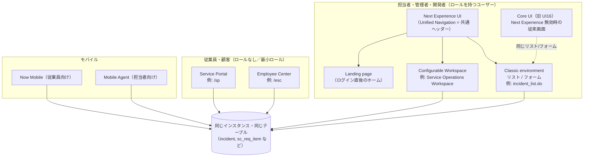
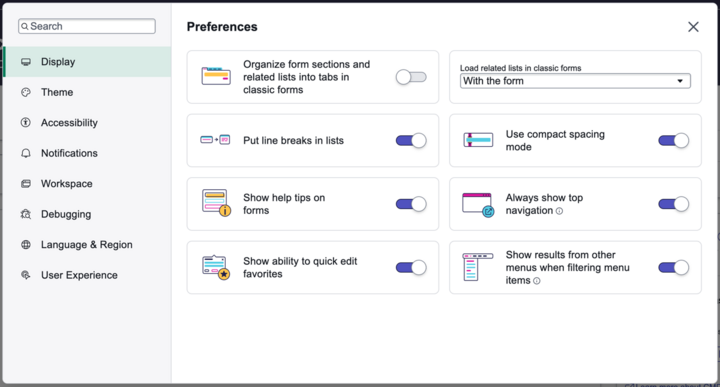
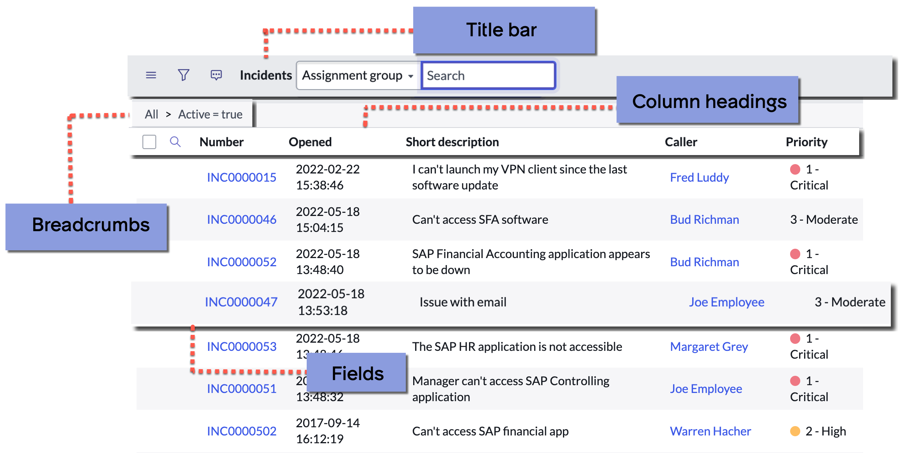
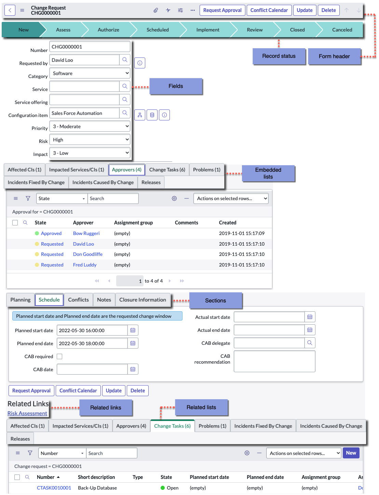
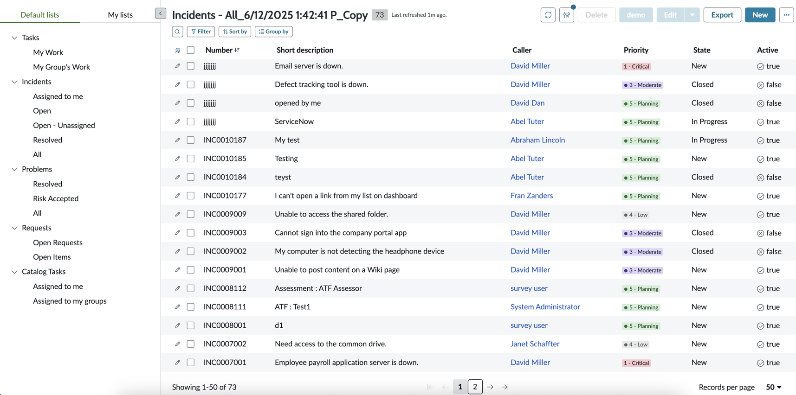

# UIの基本（UI Basics）

## 概要

本ファイルは、ServiceNow を初めて触る人が「どの画面で、誰が、何をするのか」を迷わず理解できるように、ServiceNow の UI（User Interface、ユーザーインターフェース）の種類と基本操作をまとめた入門ページである。基準リリースは **Australia**（2026-05 GA）で、**Brazil** で判明している変更は併記する。

ServiceNow の UI は「1 つの画面」ではなく、**利用者の役割（ペルソナ）ごとに複数の画面体系**が用意されている。入門者が最初に押さえるべき要点は次の 3 つである。

1. **社内の担当者・管理者（Fulfiller / Admin）** は、ブラウザで **Next Experience UI**（旧称 Polaris）にログインし、上部の **Unified Navigation（統合ナビゲーション）** から、従来型の **リストとフォーム（Classic environment）** と、業務特化型の **Workspace（ワークスペース）** を行き来して仕事をする。
2. **一般の従業員・顧客（Requester）** は、**Service Portal（サービスポータル）** や **Employee Center（従業員センター）** といったセルフサービス用ポータルから、申請・問い合わせ・ナレッジ検索を行う。
3. **スマートフォン** では、従業員向けの **Now Mobile** と、担当者向けの **Mobile Agent** という 2 つのネイティブアプリを使う。

| UI（英語 / 日本語） | 主な利用者 | 何をする画面か | 本ファイルの節 |
|---|---|---|---|
| Next Experience UI（ネクストエクスペリエンス UI） | 担当者・管理者・開発者 | 全画面共通の「外枠」。ヘッダー、メニュー、検索、通知、ランディングページ | [2](#2-next-experience-uipolaris) / [3](#3-unified-navigation統合ナビゲーション) |
| Classic environment（クラシック環境） | 担当者・管理者・開発者 | テーブルのレコードを **List（リスト）** と **Form（フォーム）** で直接操作する | [4](#4-classic-environment-と-core-ui) 〜 [7](#7-フォームform) |
| Core UI（コア UI、旧 UI16） | 同上 | Next Experience を無効にしたときの従来画面（左側にアプリケーションナビゲーター） | [4](#4-classic-environment-と-core-ui) |
| Configurable Workspace（構成可能ワークスペース） | サービスデスク担当者・エージェント | 複数レコードをタブで並行処理する業務特化画面（例：Service Operations Workspace） | [8](#8-workspaceワークスペース) |
| Service Portal（サービスポータル） | 従業員・顧客・外部ユーザー | セルフサービスのポータル（申請、ナレッジ、問い合わせ） | [9](#9-service-portalサービスポータル) |
| Employee Center（従業員センター） | 従業員 | IT・HR など複数部門のサービスを一元化した多部門向け従業員ポータル | [10](#10-employee-center従業員センター) |
| Now Mobile / Mobile Agent | 従業員 / 担当者 | iOS・Android のネイティブアプリ | [11](#11-モバイルnow-mobile--mobile-agent) |

> 本ファイルは入門編のため「概要と基本操作」に絞る。画面構成要素・設定・カスタマイズの詳細は以下のリファレンスを参照する。
> - [Next Experience UI（リファレンス）](../02_リファレンス/platform/next-experience-ui.md)
> - [リストとフォーム（リファレンス）](../02_リファレンス/platform/lists-forms.md)
> - [Service Portal と Employee Center（リファレンス）](../02_リファレンス/platform/portals-employee-center.md)
> - [Workspace と UI Builder（リファレンス）](../02_リファレンス/platform/workspaces-ui-builder.md)
> - [モバイル（リファレンス）](../02_リファレンス/platform/mobile.md)

---

## 1. ServiceNow の UI 体系の全体像

### 1.1 ペルソナ別に見た UI の地図

ServiceNow の UI 体系は、「誰が使うか」で整理すると理解しやすい。ServiceNow 公式ドキュメントの「Understand the ServiceNow UI experiences」（Australia 版）は、Next Experience UI、Configurable Workspace UI、Classic environment（Working in the classic environment）、Core UI（Working in Core UI）の 4 つを ServiceNow の UI experiences として説明しており、これに加えてセルフサービス用のポータル（Service Portal / Employee Center）とモバイルアプリがある。[出典](https://www.servicenow.com/docs/r/zUlSbxoxKPAWFDGUdAoSCw/K0eMwv3zgGE4NVgGZ10VhA)

重要なのは、**どの UI から操作しても、裏側のデータ（テーブルとレコード）は同じ**という点である。たとえば従業員が Employee Center から起票したインシデントは、担当者が Classic environment のリスト（`incident` テーブル）でも、Service Operations Workspace でも、Mobile Agent でも同じレコードとして見える。テーブルとレコードの概念は [必須の基本概念](./04-core-concepts.md) を参照。

### 1.2 UI 用語の整理（旧称・別名を含む）

ServiceNow の UI 用語は、リリースごとに名称が変わってきたため、ドキュメントやコミュニティ記事で異なる呼び方が混在する。次の対応表を押さえておくと混乱しない。

| 現在の正式名称 | 旧称・別名・技術名 | 説明 | 確度 |
|---|---|---|---|
| Next Experience UI | Polaris（開発コードネーム）。システムプロパティ名に `glide.ui.polaris.*` として残る | San Diego リリース（2022 年）で導入された現行 UI。Unified Navigation とランディングページが主要機能 | 公式ドキュメント（プロパティ名）＋ServiceNow 社員によるコミュニティ記事（Polaris の旧称、San Diego 導入）[出典](https://www.servicenow.com/community/next-experience-articles/next-experience-ui-overview/ta-p/2332080) |
| Unified Navigation（統合ナビゲーション） | Global header、Next Experience header | Next Experience の画面上部に常に表示されるヘッダー | 公式 |
| Classic environment（クラシック環境） | Platform UI、Classic UI、「バックエンド」と俗称されることもある【経験則】 | リスト・フォームを直接操作する環境。Next Experience 有効時も無効時（Core UI）も存在する | 公式 |
| Core UI（コア UI） | UI16（旧称） | Next Experience 以前の UI。左側のアプリケーションナビゲーターが特徴 | 公式 [出典](https://www.servicenow.com/docs/r/australia/platform-user-interface/working-in-classic-lists-and-forms.html) |
| UI15 / UI11 | — | さらに古い UI。**Australia で非推奨（deprecated）**となった | 公式 [出典](https://www.servicenow.com/docs/r/australia/release-notes/next-experience-rn.html) |
| Configurable Workspace（構成可能ワークスペース） | Next Experience Workspace、Workspace | UI Builder で構成する業務特化画面 | 公式 |
| Agent Workspace（エージェントワークスペース、レガシー） | Classic Workspace | Madrid で導入された旧ワークスペース。新規案件には推奨されず、Configurable Workspace が後継 | 公式（ServiceNow 社員のコミュニティブログ）[出典](https://www.servicenow.com/community/servicenow-ai-platform-blog/best-practices-for-migrating-to-workspaces/ba-p/3428991) |
| ServiceNow Otto | Now Assist（旧ブランド名） | ヘッダーに表示される生成 AI パネル。2026-08 の Australia 更新で表示名が「ServiceNow Otto」に変わった | 公式 [出典](https://www.servicenow.com/docs/r/australia/release-notes/next-experience-rn.html) |
| ServiceNow AI Platform | Now Platform | プラットフォームそのものの名称 | 公式（詳細は [プラットフォーム全体像](./02-platform-overview.md)） |

> **注意:** Australia の公式ドキュメント内でも、新旧の名称（例：「Now Assist」と「ServiceNow Otto」）が混在している箇所がある。本ナレッジでは、ヘッダーの AI パネルを Australia 版 Unified Navigation ページの表記に合わせて「ServiceNow Otto」と記載する。AI 機能の詳細は [Now Assist と AI Agents](../02_リファレンス/platform/now-assist-ai-agents.md) を参照。

### 1.3 ブラウザ対応

ServiceNow のデスクトップ UI はブラウザで利用する。Australia のブラウザ対応は次のとおり。[出典](https://www.servicenow.com/docs/r/australia/platform-user-interface/browser-support.html)

| ブラウザ | Next Experience | Workspace | Core UI | Service Portal |
|---|---|---|---|---|
| Chrome | 最新版と直前 2 リリース | 同左 | 同左 | 同左 |
| Firefox / Firefox ESR | 最新版と直前 2 リリース | 同左 | 同左 | 同左 |
| Microsoft Edge（Chromium） | 最新版と直前 2 リリース | 同左 | 同左 | 同左 |
| Safari | 17.5 以降 | 17.5 以降 | 17.5 以降 | 17.5 以降 |
| Internet Explorer | 非対応 | 非対応 | 非対応 | 非対応 |
| タブレット | 非対応 | 非対応 | 対応 | iOS+Safari / Android+Chrome の最新版 |
| スマートフォン | 非対応 | 非対応 | 非対応 | iOS+Safari / Android+Chrome の最新版 |

- Internet Explorer および Edge の IE モードは Washington DC リリース以降サポート対象外である（公式表記は「Washington release」）。
- スマートフォンのブラウザではデスクトップ版 UI は使えず、モバイル用 UI が使われる。
- iOS 版 Firefox は ServiceNow Community などの Service Portal ページに対応しない。

---

## 2. Next Experience UI（Polaris）

### 2.1 Next Experience UI とは

Next Experience UI は、ServiceNow AI Platform の現行の標準 UI であり、「インスタンス上のアプリを 1 つの統一された画面にまとめ、必要な項目にたどり着くまでのクリック数を減らす」ことを目的とした UI である。[出典](https://www.servicenow.com/docs/r/australia/platform-user-interface/next-experience-landing-page.html)

Next Experience UI の主要な利点として、公式ドキュメントは次の 3 つを挙げている。

| 機能 | 内容 |
|---|---|
| Unified Navigation（統合ナビゲーション） | Contextual app pill（現在地表示）、メニュー、通知、検索などの「アプリシェル（app shell）」要素を、どのアプリを使っていても同じ場所に表示する。メニューのピン留め／解除、お気に入りのフォルダ整理ができる |
| Additional menus（追加メニュー） | Favorites、History、Workspaces メニューで、よく使う画面や最近見た画面にすぐ戻れる。Classic environment のアプリと Configurable Workspace を簡単に切り替えられる。エンドユーザー向けのカスタムメニューも作成できる |
| Landing pages（ランディングページ） | ログイン直後に、ロールやタスクに応じた情報をまとめて表示する。管理者がスタートページを指定することも、ユーザー自身に選ばせることもできる |

### 2.2 有効化と既定状態

- Australia では、Next Experience は **新規構築・アップグレードのどちらでも既定で有効（active by default）** である。既知の問題があり有効化を避けたい場合は、アップグレード前に opt-out 用システムプロパティを作成できる。[出典](https://www.servicenow.com/docs/r/australia/release-notes/next-experience-rn.html)
- Next Experience の有効／無効は、システムプロパティ `glide.ui.polaris.experience`（既定値 `true`）で制御される。公式の説明は「Turns the Next Experience UI on or off for the entire instance」で、このプロパティはインスタンス全体のオン／オフを決め、他のすべての Next Experience プロパティとユーザー設定より優先される。`false` にすると全ユーザーで Next Experience がオフになる。[出典](https://www.servicenow.com/docs/r/australia/platform-user-interface/pol-sys-properties.html)
- `glide.ui.polaris.on_off_user_pref_enabled`（既定値 `true`）が有効なとき、各ユーザーは個人設定のトグルで Next Experience をオフにでき、オフにすると Core UI が表示される（このトグルは user preference `glide.ui.polaris.use` を設定する）。`false` にするとトグルは表示されない。[出典](https://www.servicenow.com/docs/r/australia/platform-user-interface/pol-sys-properties.html) / [出典](https://www.servicenow.com/docs/r/australia/platform-user-interface/configure-next-experience-user-experience.html)
  - **表記ゆれ:** トグルの場所は、プロパティ表では Preferences の **Display** セクション、「Configure Next Experience user experience preferences」ページでは **User Experience** と記載が分かれている。
- 歴史的経緯として、San Diego の時点では新規インスタンスは既定で有効、既存インスタンスのアップグレードでは自動有効化されず管理者がプロパティを設定する必要があった。[出典](https://www.servicenow.com/community/next-experience-articles/next-experience-ui-overview/ta-p/2332080)

> **公式ドキュメント内の表記ゆれ:** Australia の「Understand the ServiceNow UI experiences」ページには「Core UI is the default user interface for new instances」という記述が残っている一方（[出典](https://www.servicenow.com/docs/r/zUlSbxoxKPAWFDGUdAoSCw/K0eMwv3zgGE4NVgGZ10VhA)）、Next Experience のリリースノートとシステムプロパティ表は Next Experience を既定有効としている。本ナレッジでは、より具体的なリリースノートとプロパティ既定値（`glide.ui.polaris.experience` = `true`）に従い、「Australia の既定は Next Experience」と判断する。

### 2.3 主なシステムプロパティ（入門者が知っておくとよいもの）

Next Experience の主要なシステムプロパティは次のとおり（抜粋）。全一覧は [Next Experience UI（リファレンス）](../02_リファレンス/platform/next-experience-ui.md) を参照。[出典](https://www.servicenow.com/docs/r/australia/platform-user-interface/pol-sys-properties.html)

| プロパティ | 既定値 | 説明 |
|---|---|---|
| `glide.ui.polaris.experience` | `true` | インスタンス全体で Next Experience をオン／オフする。他のすべての Next Experience プロパティとユーザー設定より優先される |
| `glide.ui.polaris.on_off_user_pref_enabled` | `true` | ユーザーが個人設定のトグルで Next Experience をオフにできるようにする。`false` でトグル非表示 |
| `glide.ui.polaris.menus` | `true` | ヘッダーのメニュー群の表示。`false` が必要な場合でも、ロール単位でメニューを隠すことが推奨されている |
| `glide.ui.polaris.global_search` | `true` | ヘッダーのグローバル検索の表示 |
| `glide.ui.polaris.dark_themes_enabled` | `true` | ダークテーマを有効にする |
| `glide.ui.polaris.core_ui_exclude_dark_mode` | `true` | Classic environment ではダークテーマを除外する |
| `glide.ui.polaris.nav_filter_accuracy_score` | `75` | メニューのフィルター検索の一致精度。`100` で完全一致が必要になる |
| `glide.ui.polaris.history.url.param_blocklist` | `["tinyId"]` | History メニューで重複 URL を除去する際に無視する URL パラメーター |
| `glide.ui.next_experience.instance_tools_disabled` | （既定では存在しない） | 作成して `false` にすると、アプリケーションスコープとアップデートセットをヘッダー下段に常時表示する（Show instance tools）。このとき Globe アイコンは非表示になる。このプロパティはプロパティ一覧ページには載っておらず、Unified Navigation ページの Show instance tools の説明に記載されている [出典](https://www.servicenow.com/docs/r/australia/platform-user-interface/using-the-next-experience-global-header.html) |

### 2.4 Next Experience でサポートされない機能

Next Experience では次の機能がサポートされない。旧 UI から移行する際は代替手段を検討する。[出典](https://www.servicenow.com/docs/r/australia/platform-user-interface/next-experience-landing-page.html)

| 機能 | 状況と代替 |
|---|---|
| Connect Chat | Next Experience では利用不可。Australia 以降、一部の機能は Sidebar（サイドバー）で代替できる（KB1123615） |
| Connect Support | 利用不可。Advanced Work Assignment（AWA）と Agent Chat への移行が必要。Connect Chat から AWA / Agent Chat への移行は KB1156736 を参照。Australia 版ドキュメントにも「Utah で完全非推奨化予定」という旧記述が残っているが、Utah はすでにリリース済みのため、現行では実質的に利用不可で移行必須とみなす【推定】 |
| Homepages（従来のホームページ） | Responsive dashboards と Analytics Overview dashboards が代替する。アップグレード環境では直接 URL で既存ホームページを閲覧できるが、作成・編集は不可。Homepage deprecation help tool で responsive dashboard に変換できる |
| Live Feed | サポートされない（KB1157068） |
| JavaScript console log | サポートされない |
| ATF（Automated Test Framework） | UI Builder で作ったページ、Configurable Workspace、ランディングページは未サポート（将来対応予定）。Classic environment のリスト・フォームは引き続きサポート |

ATF の詳細は [Automated Test Framework (ATF)](../02_リファレンス/platform/automated-test-framework.md) を参照。

### 2.5 ランディングページ（Landing page）

Landing page（ランディングページ）は、ログイン直後に最初に表示される画面である。既定のランディングページには、ロールやタスクに応じて次のような項目が表示される。なお、既存のダッシュボードやランディングページ、ロジックが構成済みの場合は、そちらが優先して表示される。[出典](https://www.servicenow.com/docs/r/australia/platform-user-interface/exploring-your-next-experience-homepage.html)

- Next Experience の Unified Navigation を学ぶためのリンク付きバナー
- 新規・重要なタスク、優先度別の未完了タスク
- 自分に割り当てられたタスクレコードのリスト
- Performance Analytics and Reporting（PAR）のデータ
- ランディングページ上で処理できる承認（Approvals）
- お気に入り、自分の未完了リクエスト、その他のリソース

ユーザーは **User menu > Preferences > User Experience** でスタートページ（Start page）を選択できる（管理者の設定により選択肢は異なる）。[出典](https://www.servicenow.com/docs/r/australia/platform-user-interface/configure-next-experience-user-experience.html)

### 2.6 テーマ（Theme）

Next Experience の配色やロゴは **Theme Builder（テーマビルダー）** で変更でき、Theme Builder は Next Experience に同梱され既定で有効である。ユーザーは User menu > Preferences > Theme で、管理者が公開したテーマから選べる（ダークテーマを含む）。[出典](https://www.servicenow.com/docs/r/australia/release-notes/next-experience-rn.html)

Australia では標準テーマ **Coral theme** が刷新され、コントラストの改善、角丸のコンポーネント、ダークモードの改善（深い青系）、AI 機能を示すグラデーション表現などが加わった。この刷新は Next Experience と Core UI を使う Web・モバイル・ポータルの体験に適用される。[出典](https://www.servicenow.com/docs/r/australia/release-notes/next-experience-rn.html)

### 2.7 Australia での主な変更点（Next Experience）

Australia の Next Experience リリースノートに記載された主な変更は次のとおり。[出典](https://www.servicenow.com/docs/r/australia/release-notes/next-experience-rn.html)

| 時期 | 区分 | 内容 |
|---|---|---|
| Australia GA | 新機能 | **Next Experience All Menu Editing**：管理者が Next Experience の画面上から、アプリケーションメニューとモジュール（Record、List、Dashboard、Custom page モジュール）を直接作成・編集できる |
| Australia GA | 新機能（アクセシビリティ） | **Enable auto-focus on page alerts** 個人設定：重要なページアラートにキーボードフォーカスを自動移動する。アクセシビリティ設定を案内する Guided tour も追加 |
| Australia GA | 変更 | Coral theme の刷新（2.6 参照） |
| Australia GA | 変更 | カスタムブランディングのアカウントで、User menu に「Works with ServiceNow」バッジが表示される |
| Australia GA | 非推奨 | **UI15 と UI11 が非推奨**。機能強化・不具合修正・サポートの対象外となる。印刷用表示など一部はレガシー描画経路で表示が続く場合がある |
| 2026-06 | 新機能 | **In-Product Surveys**：Next Experience 上でユーザーからフィードバックを収集する。管理者がインスタンス単位で無効化できる |
| 2026-08 | 変更 | **Now Assist から ServiceNow Otto への名称変更**の告知 |

> **Brazil での変更:** Brazil の「ServiceNow AI Platform user interface release notes」（2026-09-10 更新）に掲載されているのは Configurable Workspace と Service Portal のリリースノートのみで、Next Experience 本体（Unified Navigation、ランディングページ）に関する Brazil 固有の変更は、本ファイル作成時点の公開情報では確認できなかった。[出典](https://www.servicenow.com/docs/r/release-notes/now-platform-ui-rn-landing.html)

---

## 3. Unified Navigation（統合ナビゲーション）

### 3.1 ヘッダーの構成要素

Unified Navigation は、Next Experience の **すべてのページ上部に表示される共通ヘッダー**であり、ワークスペースと Classic environment へのアクセス、インスタンス内検索、通知の受信をまとめて担う。

**図 1：Next Experience Unified Navigation（統合ナビゲーション）のヘッダー（公式ドキュメント「Unified Navigation」の Figure 1）**

- 画面の説明：濃紺の横長バーで、左から順に「servicenow」ロゴ、メニュー **All**、**Favorites**、**History**、**Workspaces**、**Admin** が並ぶ。中央には白枠の Contextual app pill があり「Shared admin dashboard ☆」と現在表示中のページ名と星（お気に入り）アイコンが表示されている。右側には「Search」と書かれたグローバル検索欄（右端に検索対象を切り替えるドロップダウン矢印）、地球儀アイコン（Globe：スコープとアップデートセット）、吹き出しアイコン（Sidebar discussions）、ヘルプ（?）アイコン、通知ベル（未読件数バッジ「2」）、ユーザーのアバター（User menu）が並ぶ。
- 出典：https://www.servicenow.com/docs/r/australia/platform-user-interface/using-the-next-experience-global-header.html （取得日：2026-11-02）

Unified Navigation の各要素は次のとおり。表示される項目はユーザーのアクセス権と管理者のカスタマイズによって異なる。[出典](https://www.servicenow.com/docs/r/australia/platform-user-interface/using-the-next-experience-global-header.html)

| 要素（英語 / 日本語） | 機能 |
|---|---|
| Logo（ロゴ） | Next Experience のランディングページに戻る。会社ロゴに差し替え可能 |
| Filter（フィルター） | メニュー内のモジュールを素早く絞り込む。綴りの欠落にもある程度対応する（あいまい一致）。`テーブル名.list` でリスト、`テーブル名.do` でフォームを直接開ける（例：`sys_properties.list`、`sys_user.do`）。既定では History 以外の全メニューから結果を返す |
| All menu（すべて） | インスタンス内の全アプリケーションメニューとモジュールを表示。更新アイコンでキャッシュを手動クリアせずに最新化できる |
| Favorites menu（お気に入り） | お気に入り登録したワークスペース、Classic environment のページ、レコードを表示。編集アイコンで整理用モーダルを開く |
| History menu（履歴） | インスタンス全体での最近の操作履歴 |
| Workspaces menu（ワークスペース） | アクセス可能なワークスペースの一覧。ワークスペースへのアクセス権がある場合のみ表示され、1 つだけの場合はその名前がヘッダーに直接表示される |
| Admin menu（管理） | 管理者向け機能へのアクセス |
| Contextual app pill（コンテキストアプリピル） | 現在インスタンスのどこにいるかを表示。星アイコンで現在のページをお気に入りに追加 |
| Global search（グローバル検索） | インスタンス全体を文字列で検索 |
| Globe（地球儀） | アプリケーションスコープとアップデートセットのスコープを選択。アップデートセットの新規作成も可能。Global 以外のスコープを選択中は赤丸アイコンが付く |
| ServiceNow Otto® | レコード・チャット・ケース・インシデントの要約、ヘルプ、解決メモ作成などを行う AI パネル。幅（標準／ワイド）を切替可能。AI Admin Hub で構成する |
| Show instance tools | スコープとアップデートセットをヘッダー下段に常時表示（2.3 のプロパティで有効化） |
| Sidebar discussions（サイドバー） | Workspace のタスク／インタラクションレコードを軸にしたリアルタイムの共同作業（チャット） |
| Usage analytics（利用状況分析） | アプリや Web ページから利用状況データにアクセス |
| Help（ヘルプ） | Get help と What's new。新着があると青い点が表示される。Provide Feedback で ServiceNow にフィードバックを送れる |
| OpenFrame phone | 埋め込み型の電話発着信（OpenFrame）。通話中はバッジ表示 |
| Notifications menu（通知） | 自分宛ての通知を一か所で確認・個人設定 |
| User menu（ユーザーメニュー） | Profile（プロフィール）、Preferences（個人設定）、Keyboard shortcuts、Impersonate user（ユーザーの偽装、管理者のみ）、Elevate role（ロールの昇格）、Printer friendly version（印刷用表示、Classic environment のみ） |

- メニュー（All / Favorites / History / Workspaces / Admin）は、ピンアイコンでページ左側に**ピン留め**できる（ピン留めしないとオーバーレイ表示で、操作後に閉じる）。
- ヘッダーに表示されるのは Configurable Workspace であり、レガシーの Agent Workspace は Unified Navigation の外枠内には表示されない。[出典](https://www.servicenow.com/community/next-experience-articles/next-experience-ui-overview/ta-p/2332080)

### 3.2 フィルターナビゲーター（Filter）の使い方

入門者が最初に覚えるべき操作は、**All メニューのフィルター欄にテーブル名やモジュール名を入力して目的の画面に移動する**ことである。

| 入力例 | 結果 | 確度 |
|---|---|---|
| `Incident` | モジュール名に一致するメニュー項目（例：Incident > Open）を表示 | 公式（日本語表示の環境で日本語のモジュール名で絞り込めることは【経験則】） |
| `incident.list` | `incident` テーブルのリストを開く | 公式 [出典](https://www.servicenow.com/docs/r/australia/platform-user-interface/using-the-next-experience-global-header.html) |
| `sys_user.do` | `sys_user` テーブルの新規フォームを開く | 公式 |
| `sys_properties.list` | システムプロパティのリストを開く（管理者） | 公式 |
| `incident.LIST` / `incident.FORM`（大文字） | 新しいブラウザタブでリスト／フォームを開く | 【経験則】公式 Australia ドキュメントでは確認できず |

- フィルターの一致精度は `glide.ui.polaris.nav_filter_accuracy_score`（既定 `75`）で調整できる。
- User menu > Preferences > Display の「Show results from other menus when filtering menu items」で、他メニューの結果も表示するかを切り替えられる（図 2 参照）。

### 3.3 グローバル検索（Global search）

Global search（グローバル検索）は、ヘッダーの検索欄から**複数の種類のレコードを一度に検索**する機能である。[出典](https://www.servicenow.com/docs/r/australia/platform-user-interface/using-search-next-experience.html)

| 操作 | 動作 |
|---|---|
| 検索語を入力して Enter（または View results） | 検索結果ページを表示。合計件数と、テーブル（ソース）ごとの結果プレビューが表示される |
| 結果ページ左側のソース一覧を選択 | そのテーブルの結果だけに絞り込む。プレビューより多い場合は View all リンクで全件表示 |
| レコード番号（例：INC0010001）を入力し Enter を押さずに待つ | 「Exact Match」タグ付きのプレビューが表示され、選択すると直接そのレコードを開く |
| 空の検索欄をクリック | Recently Searched（最近の検索語）と Recently Viewed（最近見た検索結果）を表示 |
| 検索欄右の矢印 | 権限があれば、検索結果をワークスペースアプリ（例：CSM/FSM Configurable Workspace）の検索に切り替え |

検索エンジン（AI Search、Zing）の仕組みは [Predictive Intelligence と AI Search](../02_リファレンス/platform/predictive-intelligence-ai-search.md) を参照。

### 3.4 お気に入り（Favorites）と履歴（History）

お気に入りは次の方法で追加できる（ロール不要）。[出典](https://www.servicenow.com/docs/r/australia/platform-user-interface/add-favorites-next-experience.html)

| 追加元 | 操作 |
|---|---|
| 任意のページ | Contextual app pill の星アイコンを選択 |
| All メニュー | モジュール名の横の星で 1 モジュール、アプリケーション名の横の星で配下の全モジュールを追加 |
| Classic environment のリスト／レコード | タイトル横のコンテキストメニューアイコン > **Create Favorite**。リストはビューごとに別のお気に入りにできる |
| ナレッジ記事 | 記事ヘッダーの星アイコン（複数バージョンがある場合は表示中のバージョンのみ） |

追加時のダイアログで名前（Name）と格納先グループ（Location）を変更でき、Favorites メニューはフォルダ（グループ）で整理できる。

History メニューはインスタンス全体の最近の操作を表示する。Core UI のアプリケーションナビゲーターの History タブは既定で 30 件を表示し、`glide.ui.nav.history_length` で変更できる。[出典](https://www.servicenow.com/docs/r/australia/platform-user-interface/t_ConfigureNumberOfHistoryEntries.html)

### 3.5 個人設定（Preferences）

User menu > **Preferences** を開くと、ユーザーごとの表示設定を変更できる。Preferences モーダルは、検索欄・カテゴリパネル・設定パネルの 3 つで構成される。[出典](https://www.servicenow.com/docs/r/australia/platform-user-interface/set-up-preferences-next-experience.html)

**図 2：Next Experience の Preferences（個人設定）モーダル（公式ドキュメント「Next Experience preferences」の Figure 1）**

- 画面の説明：モーダル左側に Search 欄と、カテゴリ一覧 **Display**（選択中）、**Theme**、**Accessibility**、**Notifications**、**Workspace**、**Debugging**、**Language & Region**、**User Experience** が縦に並ぶ。右側の「Preferences」パネルには Display カテゴリのトグルが 2 列のカードで並び、「Organize form sections and related lists into tabs in classic forms（Classic のフォームでセクションと関連リストをタブ化）」（オフ）、「Load related lists in classic forms」（ドロップダウン：With the form）、「Put line breaks in lists（リストで改行表示）」（オン）、「Use compact spacing mode（コンパクト表示）」（オン）、「Show help tips on forms」（オン）、「Always show top navigation」（オン）、「Show ability to quick edit favorites」（オン）、「Show results from other menus when filtering menu items」（オン）が表示されている。右上に閉じる（×）ボタンがある。
- 出典：https://www.servicenow.com/docs/r/australia/platform-user-interface/set-up-preferences-next-experience.html （取得日：2026-11-02）

| カテゴリ | 主な設定内容 |
|---|---|
| Display（表示） | レイアウト、表示密度（コンパクト表示）、Classic フォームのタブ表示など |
| Theme（テーマ） | 利用可能なテーマ（ダークテーマ含む）の選択 |
| Accessibility（アクセシビリティ） | キーボードショートカットの有効化、コントラスト、モーション、ページアラートへの自動フォーカスなど |
| Notifications（通知） | バナー、バッジ、メールなど通知の受け取り方 |
| Workspace | ワークスペース固有の設定（ワークスペースにアクセス権があり、ワークスペースを表示中のときのみ） |
| Debugging（デバッグ） | Next Experience のコンポーネントやスクリプトのデバッグ（**admin ロールのみ表示**） |
| Language & Region（言語と地域） | 言語、タイムゾーン、日付・時刻形式 |
| User Experience | スタートページ、利用状況分析の有効／無効、Next Experience のオフ（`glide.ui.polaris.on_off_user_pref_enabled` が既定の `true` のとき。プロパティ表ではこのトグルを Display セクションと記載。2.2 参照） |

日本語表示への切り替えには日本語の言語プラグインが有効化されている必要がある。詳細は [ローカライゼーション（日本語化）](../02_リファレンス/platform/localization.md) を参照。

### 3.6 キーボードショートカット

Next Experience では、**Control+/（Windows）／ Command+/（macOS）** で、表示中の画面で使えるショートカット一覧（モーダル）を表示できる。ショートカットはブラウザと OS に依存し、Linux は現在サポートされない。有効化は Preferences > Accessibility で行う。[出典](https://www.servicenow.com/docs/r/australia/platform-user-interface/next-experience-keyboard-shortcuts.html)

| 操作 | Windows | macOS |
|---|---|---|
| ショートカット一覧を表示 | Control+/ | Command+/ |
| レコードを保存 | Control+s | Command+s |
| 新規レコードを作成 | Shift+Alt+n | Shift+Option+n |
| リストを更新 | Shift+Alt+r | Shift+Option+r |
| 現在のページをお気に入り登録／解除 | Control+Shift+f | Command+Shift+f |
| ユーザーを偽装（Impersonate） | Control+Shift+i | Command+Shift+i |
| ランディングページを開く | Control+Alt+z | Command+Option+z |
| メールを作成 | Control+Alt+e | Command+Option+e |
| All メニューを開く | Control+Alt+a | Command+Option+a |
| Favorites メニューを開く | Control+Alt+f | Command+Option+f |
| History メニューを開く | Control+Alt+h | Command+Option+h |
| Workspaces メニューを開く | Control+Alt+w | Command+Option+w |
| Admin メニューを開く | Control+Shift+a | Command+Shift+a |
| 通知メニューを開く | Control+Shift+k | Command+Shift+k |
| グローバル検索にフォーカス | Control+Alt+g | Command+Option+g |
| ServiceNow Otto を開く（テキスト入力） | Alt+Shift+a | Option+Shift+a |

---

## 4. Classic environment と Core UI

### 4.1 Classic environment（クラシック環境）とは

Classic environment（クラシック環境）は、**テーブルのレコードを List（リスト）と Form（フォーム）で直接操作する環境**を指す。Configurable Workspace のような業務特化画面とは異なり、ほぼすべてのテーブルに対して共通の操作方法でアクセスでき、アプリケーション開発・設定作業もここで行う。[出典](https://www.servicenow.com/docs/r/australia/platform-user-interface/working-in-classic-lists-and-forms.html)

- Classic environment は、**Next Experience を有効にした状態でも、無効にした状態（＝ Core UI）でも利用できる**。Next Experience 有効時は、Unified Navigation の下（コンテンツ領域）にリスト・フォームが表示される。
- 「Classic environment」と「Core UI」は混同されやすいが、前者は「リスト・フォームで作業する環境」、後者は「Next Experience 以前のヘッダー・ナビゲーションを含む UI 全体」を指す。

### 4.2 Core UI（旧 UI16）

Core UI は Next Experience 以前の UI であり、リアルタイムのフォーム更新、ユーザープレゼンス（同じレコードを見ている人の表示）、お気に入り・履歴タブ付きのピン留め式アプリケーションナビゲーター、アクティビティストリームなどが特徴である。[出典](https://www.servicenow.com/docs/r/australia/platform-user-interface/c_UI16.html)

| 構成要素 | 説明 |
|---|---|
| Banner frame（バナーフレーム） | 画面上部。ロゴ、User menu（プロフィール、個人設定、偽装、ロール昇格）、Connect sidebar アイコン（Connect 有効時）、グローバルテキスト検索、ヘルプ、歯車アイコン（Core UI の System settings）を含む |
| Application navigator（アプリケーションナビゲーター） | 画面左側。All applications、Favorites、History の 3 タブと、上部のナビゲーションフィルターで構成 |
| Content frame（コンテンツフレーム） | リスト、フォーム、ダッシュボード、ウィザードなどを表示 |

- Core UI は Core UI プラグイン（`com.glide.ui.ui16`）で有効化でき、admin ロールが必要である（All > System Applications > All Available Applications > All から検索してインストール）。[出典](https://www.servicenow.com/docs/r/australia/platform-user-interface/t_ActivateUI16.html)
- Core UI のアプリケーションナビゲーターのフィルターに文字を入力すると、一致するアプリケーション・モジュール・お気に入りが表示され、お気に入りが上位に表示される。[出典](https://www.servicenow.com/docs/r/australia/platform-user-interface/c_UI16ApplicationNavigator.html)

### 4.3 Next Experience と Core UI（UI16）の主な違い

| 観点 | Core UI（UI16） | Next Experience |
|---|---|---|
| ナビゲーション | 左側に固定のアプリケーションナビゲーター（折りたたみ可） | 上部ヘッダーの All / Favorites / History / Workspaces / Admin メニュー（オーバーレイ表示、ピン留め可） |
| ワークスペースへの移動 | 集約されていない | Workspaces メニューから切り替え |
| 現在地表示 | ブラウザタブのタイトル等 | Contextual app pill（星アイコンでお気に入り登録） |
| スコープ・アップデートセット選択 | バナーフレームに表示 | Globe アイコン（または Show instance tools で常時表示） |
| チャット | Connect Chat | Sidebar（Australia 以降、一部 Connect Chat 機能を代替） |
| 偽装中の表示 | User menu の「End Impersonation」程度 | 上部の赤いバー、アバターの赤丸と目のアイコンなどで明示【第三者情報】 |
| ホームページ | Homepages | Landing page / Dashboards |

- 「偽装中の表示」と UI16 時代の UI 比較は、San Diego 当時のコミュニティ記事に基づく【第三者情報】。[出典](https://www.servicenow.com/community/now-platform-articles/interface-comparison-between-ui16-the-next-experience/ta-p/2307243)

---

## 5. リスト（List）

### 5.1 リストとは

List（リスト）は、**1 つのテーブルの複数レコードを一覧表示する画面**である。リストの各列（Column）はテーブルのフィールドに対応する。ユーザーはリスト上で検索・並べ替え・フィルター・編集ができ、リストはフォームに埋め込まれたり（Embedded list）、階層化（Hierarchical list：サブリスト付き）されたりする。[出典](https://www.servicenow.com/docs/r/australia/platform-user-interface/c_UseLists.html)

**図 3：Classic environment のリストの構成要素（公式ドキュメント「Lists in the classic environment」の Figure 1「Record list」）**

- 画面の説明：Incident（インシデント）のリストに 4 つの注記ラベルが付いている。**Title bar（タイトルバー）** には左からリストコントロールメニュー（三本線）、フィルターアイコン（漏斗）、アクティビティストリームアイコン、リスト名「Incidents」、検索対象フィールドを選ぶドロップダウン（Assignment group）、Search 入力欄が並ぶ。その下の **Breadcrumbs（ブレッドクラム）** は「All > Active = true」で、現在のフィルター条件を示す。**Column headings（列見出し）** 行には全選択チェックボックス、列検索の虫眼鏡アイコン、Number、Opened、Short description、Caller、Priority が並ぶ。**Fields（フィールド）** の各行には INC0000015 などの番号（リンク）、日時、説明、Caller（参照リンク）、Priority（1 - Critical は赤丸、2 - High は橙丸）が表示されている。
- 出典：https://www.servicenow.com/docs/r/australia/platform-user-interface/c_UseLists.html （取得日：2026-11-02）

### 5.2 リストの開き方

| 方法 | 例 |
|---|---|
| All メニューからモジュールを選ぶ | All > Incident > Open |
| フィルターナビゲーターにテーブル名 + `.list` | `incident.list`、`sys_user.list` |
| URL を直接指定 | `https://<instance>.service-now.com/incident_list.do` |

### 5.3 リストでよく使う操作

| 操作 | やり方 | 補足 |
|---|---|---|
| 並べ替え（Sort） | 列見出しをクリック（昇順／降順） | 列見出しのメニューからも可能【経験則】 |
| 検索（Go to / Search） | タイトルバーの検索欄で、特定フィールドを選んで検索するか「for text」を選んで全文検索 | **Go to** は選んだフィールドで並べ替え、検索語以上の値のレコードを返す。Number フィールドでは末尾一致（例：`4` で INC0000004、INC0000014）。**Search**（for text）はリストのテーブル内の任意フィールドに検索語を含むレコードを返す [出典](https://www.servicenow.com/docs/r/australia/platform-user-interface/t_SearchAList.html) |
| 選択肢フィールドの検索 | ラベル（例：New）または値で検索 | Incident の State は New = `1`、Closed = `7` が既定値。値を入れると「その値以上」を返す（例：`6` で Resolved と Closed） |
| グループ化（Group by） | 列見出しメニューから Group by | フィールド値ごとに件数を集計して表示 |
| 列の表示・順序変更 | リスト右上の Personalize list（歯車）アイコン | 自分だけに適用される Personal list。`personalize_list` または `admin` ロールが必要 [出典](https://www.servicenow.com/docs/r/australia/platform-user-interface/c_PersonalLists.html) |
| リスト上での直接編集 | セルをダブルクリック（List editor） | 一括編集も可能。詳細は [リストとフォーム（リファレンス）](../02_リファレンス/platform/lists-forms.md) |
| 一括操作 | 行のチェックボックスで複数選択し、リスト下部の「Actions on selected rows」から実行 | 削除、割り当てなど |
| 階層表示 | 参照アイコン横の矢印で関連リストを展開 | 管理者が Hierarchical list を有効にしたテーブルのみ |

- Personal list で選べる表示オプション：**Wrap column text**（折り返し表示）、**Compact rows**（行間を詰める）、**Active row highlighting**（マウスオーバー行の強調）、**Modern cell coloring**（新しいフィールド状態表示）。リスト編集オプションとして **Enable list edit**、**Double click to edit** がある。これらのオプションは編集中のビューだけでなく全リストに適用される。
- Personal list の最初の列はリンクになる。最初の列を参照フィールドにすると、参照先テーブルのレコードが開いて紛らわしいため避ける。
- 既定のレイアウトに戻すには Personalize list アイコン > **Reset to column defaults** を選ぶ。

> **用語:** リストの表示列や並びは **View（ビュー）** 単位で定義される。管理者が定義するビュー（例：Default view、`ess` ビュー）と、ユーザー個人の Personal list は別物である。ビューは URL パラメーター `sysparm_view` で指定できる（6.5 参照）。

---

## 6. フィルター（Filter）と条件ビルダー

### 6.1 フィルターの構成

Filter（フィルター）は、**リストに表示するレコードを条件で絞り込む仕組み**である。1 つの条件（Condition）は次の要素で構成される。[出典](https://www.servicenow.com/docs/r/australia/platform-user-interface/c_Filters.html)

| 要素 | 説明 |
|---|---|
| Field（フィールド） | 条件に使う列。参照フィールドを選ぶと、参照先テーブルのフィールドへ **dot-walk（ドットウォーク）** できる |
| Operator（演算子） | フィールド型ごとに有効な演算子が異なる（例：is、is not、contains、greater than、is (dynamic) など）。演算子によって値の要否が決まる |
| Value（値） | フィールド型に応じた値。参照フィールドはオートコンプリート、選択肢フィールドは選択リスト |
| Grouping（グループ化） | 各条件行を AND または OR でつなぐ。AND でつないだ条件はすべて満たす必要があり、OR でつないだ条件は個別に評価される |

フィルターは **Condition builder（条件ビルダー）** で作成する。ドットウォークの考え方は [必須の基本概念](./04-core-concepts.md) を参照。

### 6.2 フィルターの作成手順（Classic environment のリスト）

ロールは不要である。[出典](https://www.servicenow.com/docs/r/australia/platform-user-interface/t_CreatingFilters.html)

1. タイトルバーの **show/hide filter（漏斗）アイコン** をクリックして条件ビルダーを開く。
2. フィールドを選ぶ。
3. 演算子を選ぶ。
4. 必要なら値を選択・入力する。
5. 条件を追加・削除する。条件ビルダー上部ツールバーの **AND / OR** で上位レベル（top-level）の条件を、各条件の横の **AND / OR** で従属（dependent）条件を追加する。**x** で削除する。
6. 並べ替えが必要なら **Add Sort** で並び順を指定する。
7. 必要なら **Save** で保存する（6.4 参照）。
8. **Run** で適用する。

> **よくある落とし穴:** 「値が X ではないレコード」を探すとき、`[field] [is not] [X]` だけでは値が空のレコードが含まれない。空のレコードも含めたい場合は `[field] [is not] [X]` **or** `[field] [is] [empty]` の 2 条件にする。一方、後述の Quick filter の **Filter Out** は自動的に「is empty」の OR 条件を含める。[出典](https://www.servicenow.com/docs/r/australia/platform-user-interface/c_QuickFilters.html)

- List v2 では、ピン（pin/unpin filter）アイコンで、リストを開くたびに条件ビルダーを表示させられる。List v3 ではこの機能はサポートされない。
- List v3 では、関連テーブルの条件で絞り込む **Related Lists Conditions** を条件ビルダーで使える（List v2 は非対応）。

### 6.3 ブレッドクラム（Breadcrumbs）とクイックフィルター

**Breadcrumbs（ブレッドクラム）** は、リスト上部に表示される現在のフィルター条件の階層表示である。左ほど一般的、右ほど具体的な条件が並ぶ。[出典](https://www.servicenow.com/docs/r/australia/platform-user-interface/c_UsingFiltersAndBreadcrumbs.html)

| 操作 | 結果 |
|---|---|
| ブレッドクラムの条件をクリック | その条件より右側の条件をすべて外す |
| 条件の前の区切り記号（`>`）をクリック | その条件だけを外す |
| **All** をクリック | すべての条件を外し全件表示 |
| ブレッドクラムを右クリック | **Open new window**（新しいタブで開く）、**Copy URL**（結果リストの URL をコピー）、**Copy query**（エンコードクエリをコピー。All では不可） |

- 既定では、ロールを持たないユーザーにはブレッドクラムとフィルターが表示されない。
- フィルター済みのリストで **New** をクリックすると、フィルター条件の値が新規レコードにあらかじめ設定される（例：Priority = 1 で絞ったリストから New → Priority が 1 - Critical）。この動作を止めたいフィールドには辞書属性 `ignore_filter_on_new=true` を付ける。

**Quick filter（クイックフィルター）** は、リストのセルを右クリックして **Show Matching**（この値と一致）または **Filter Out**（この値を除外）を選ぶ方法で、ブレッドクラムの右端に条件が追加される。日付フィールドでは **Show Before** / **Show After** も使える。例：State 列の「In Progress」を右クリックして Show Matching を選ぶと `State = In Progress` が追加される。[出典](https://www.servicenow.com/docs/r/australia/platform-user-interface/c_QuickFilters.html)

### 6.4 フィルターの保存

フィルターは、条件ビルダーの **Save...** から名前を付けて保存できる。保存したフィルターは、リストコントロールメニュー（タイトル横の三本線）> **Filters** サブメニューから呼び出す。[出典](https://www.servicenow.com/docs/r/australia/platform-user-interface/t_SavingFilters.html)

| 公開範囲 | 説明 | 必要なロール |
|---|---|---|
| Me（自分） | 自分だけが使える個人フィルター | なし（User フィールドへの書き込み権限が必要） |
| Everyone（全員） | 全ユーザーが使えるグローバルフィルター | `filter_global` |
| Group（グループ） | 選択したグループのメンバーだけが使えるフィルター | `filter_group`（Group フィールドへの書き込み権限も必要。Group フィールドへのアクセスは、`filter_group` ロールを持ち、選択中のグループに所属していることが条件） |

- 新しい Create ACL により、既定では全ユーザーがフィルターを保存できる。この ACL は、管理者がフィルターの利用を制限するために設けたカスタム ACL を上書きする点に注意する。[出典](https://www.servicenow.com/docs/r/australia/platform-user-interface/t_SavingFilters.html)
- 保存されたフィルターは Filters テーブル（`sys_filter`）に格納され、管理者はここで作成・編集・削除できる。[出典](https://www.servicenow.com/docs/r/australia/platform-user-interface/c_UsingFiltersAndBreadcrumbs.html)

### 6.5 エンコードクエリと URL によるナビゲーション

フィルター条件は **Encoded query（エンコードクエリ）** という文字列で表現される。例：アクティブで Impact が High（1）または Medium（2）のインシデントは `active=true^impact=1^ORimpact=2`。条件の区切りは `^`、OR は `^OR` で表す。[出典](https://www.servicenow.com/docs/r/australia/platform-user-interface/c_UsingFiltersAndBreadcrumbs.html)

エンコードクエリは URL に付けてリストを直接開くのにも使える。主な URL スキーマは次のとおり。[出典](https://www.servicenow.com/docs/r/australia/platform-user-interface/navigate-using-url.html)

| 目的 | 書式・例 |
|---|---|
| インスタンスのトップ | `https://<instancename>.service-now.com` |
| 標準 UI の枠付きで表示 | `nav_to.do?uri=<ページ>` |
| リストを開く | `<table>_list.do`（例：`incident_list.do`） |
| フォームを開く | `<table>.do?sys_id=<sys_id>` |
| 新規レコードのフォーム | `<table>.do?sys_id=-1` |
| クエリ指定 | `sysparm_query=priority=2^active=true` |
| グループ化 | `sysparm_query=priority=2^active=true^EQ^GROUPBYcategory` |
| ビュー指定 | `sysparm_view=ess` |
| 並べ替え | `sysparm_order=number`、`sysparm_order_direction=desc` |
| パラメーターの区切り | `&` |

例：`https://<instance>.service-now.com/incident_list.do?sysparm_query=active=true^impact=1^ORimpact=2`

- `sysparm_query` はリストでは「条件に合うレコードを返す」、フォーム（`sys_id=-1` 指定）では「新規レコードに値を設定する」と、動作が異なる。
- Next Experience 有効時、Classic environment のページは `/now/nav/ui/classic/params/target/<ページ>` 形式の URL で Unified Navigation の枠内に表示される【第三者情報】（ServiceNow Community の利用者投稿に基づく。公式ドキュメントでの明示は確認できず）。[出典](https://www.servicenow.com/community/itsm-forum/change-default-homepage-landing-at-the-group-role-level-next/m-p/2385400)

### 6.6 ワークスペースのフィルター（Predicate Builder と AI filter assist）

Configurable Workspace のリストでは、Classic の条件ビルダーではなく **Predicate Builder（述語ビルダー）** コンポーネントでリストヘッダーから条件を設定する。[出典](https://www.servicenow.com/docs/r/australia/platform-user-interface/lists-configurable-workspace.html)

Australia では、自然言語（日常の言葉）からエンコードクエリを生成する **AI filter assist** が利用できる（Australia Early Availability で追加）。必要ロールは `workspace_user`、利用可否は契約（エンタイトルメント）による。[出典](https://www.servicenow.com/docs/r/australia/platform-user-interface/use-ai-filter-assist.html)

1. ワークスペースのリストを開き、リストヘッダーのフィルターボタンを選ぶ。
2. **Add to current filters**（現在のフィルターに追加）、**Edit current filters**（現在のフィルターを修正）、**Start new**（新規作成）のいずれかを選ぶ。
3. 条件を文章で入力するか、マイクアイコンで音声入力し、送信アイコンを選ぶ。
4. 生成されたフィルターを確認し、編集アイコンで修正するか **Apply** で適用する。
5. フィルターボタンのドロップダウン > **Advanced Filter** で条件パネルを表示、履歴アイコンで最近生成したフィルターを表示できる。

---

## 7. フォーム（Form）

### 7.1 フォームとは

Form（フォーム）は、**1 件のレコードの情報を表示・編集する画面**である。表示される内容はレコードの種類（テーブル）によって異なり、管理者がフォームに何を表示するかを構成する。[出典](https://www.servicenow.com/docs/r/australia/platform-user-interface/c_UsingForms.html)

**図 4：Classic environment のフォームの構成要素（公式ドキュメント「Forms in the classic environment」の Figure 1「Form elements」、Change Request の例）**

- 画面の説明：Change Request「CHG0000001」のフォームに注記ラベルが付いている。最上部の **Form header（フォームヘッダー）** には、戻る（<）ボタン、コンテキストメニュー（三本線）、テーブル名「Change Request」とレコード番号、クリップ（添付）・アクティビティ・Personalize form・その他（…）アイコン、ボタン「Request Approval」「Conflict Calendar」「Update」「Delete」、前後レコード移動の矢印が並ぶ。その下の **Record status（レコード状態）** は New → Assess → Authorize → Scheduled → Implement → Review → Closed → Canceled の矢羽型のプロセスフローで、現在は New。**Fields（フィールド）** には Number、Requested by（虫眼鏡付き参照フィールド）、Category（Software）、Service、Service offering、Configuration item（Sales Force Automation）、Priority（3 - Moderate）、Risk（High）、Impact（3 - Low）が並ぶ。中段の **Embedded lists（埋め込みリスト）** は Affected CIs、Impacted Services/CIs、Approvers (4)、Change Tasks (6) などのタブで、Approvers タブに承認者 4 名（Approved / Requested）が表示されている。**Sections（セクション）** は Planning、Schedule（選択中）、Conflicts、Notes、Closure Information のタブで、Planned start date などの日付欄と CAB required チェックボックスがある。下部に **Related Links（関連リンク）**「Risk Assessment」と、**Related lists（関連リスト）** のタブ（Change Tasks (6) を選択中、CTASK0010001 などの行）と New ボタンがある。
- 出典：https://www.servicenow.com/docs/r/australia/platform-user-interface/c_UsingForms.html （取得日：2026-11-02）

| フォームの要素 | 機能 |
|---|---|
| Form header（フォームヘッダー） | レコードに関するナビゲーションと操作（保存、削除、UI アクションのボタン） |
| Fields（フィールド） | レコードの個々のデータ |
| Sections（セクション） | 関連情報をまとめるブロック。タブ表示（Tabbed forms）とセクションの折りたたみを切り替えられ、折りたたみ状態はユーザー設定として保存される |
| Related links（関連リンク） | レコード種別に応じた追加機能へのリンク。管理者が UI action で追加する |
| Related lists（関連リスト） | 現在のレコードと関係する他テーブルのレコード（例：Change に紐づく Change Task） |
| Embedded lists（埋め込みリスト） | フォームを離れずに編集できる関連リスト。変更はフォーム保存時に保存される |
| Response time indicator | フォーム表示にかかった処理時間（一部のフォーム下部） |

### 7.2 フォームヘッダーの操作（Core UI 系のフォームヘッダー）

Classic environment のフォームヘッダーには次のコントロールがある。[出典](https://www.servicenow.com/docs/r/australia/platform-user-interface/form-header-by-version.html)

| コントロール | 動作 |
|---|---|
| Back（戻る） | **保存せずに**直前のページに戻る |
| Form context menu（フォームコンテキストメニュー） | フォームタイトル横のメニューアイコン、またはフォームヘッダーの右クリックで開く（right-click menu とも呼ぶ）。テーブルとアクセス権に応じた操作が表示される |
| Attachments（添付） | 添付ファイルの表示・追加 |
| Show activity stream | ジャーナル（作業メモ等）セクションへ移動。ジャーナルフィールドがない場合はフライアウトで表示 |
| Personalize form | フォームの個人カスタマイズ（Core UI で利用可能） |
| More options | Email、Template bar（テンプレートバー）、Annotations、Tags |
| Submit / Update | **保存して直前のページに戻る**（新規は Submit、既存は Update） |
| Related actions | テーブル固有の標準操作（例：インシデントの Resolve Incident、Close Incident） |
| Delete | レコードを削除 |
| Previous / Next | 遷移元リストの前後のレコードを開く |

> **入門者向けのコツ:** Submit / Update は保存後にフォームを閉じて前のページに戻る。フォームを開いたまま保存したい場合は、フォームコンテキストメニューの **Save** を使うのが一般的である【経験則】。また **Back は保存しない**ので、入力途中で Back を押すと変更が失われる点に注意する。

### 7.3 フィールドの見方

フォームのフィールドには、入門者が知っておくべき表示上の約束事がある。

| 見た目 | 意味 | 確度 |
|---|---|---|
| 虫眼鏡アイコン付きの入力欄 | Reference field（参照フィールド）。他テーブルのレコードを選ぶ | 公式（参照フィールドの概念は [必須の基本概念](./04-core-concepts.md)） |
| 参照フィールド横の (i) アイコン | 参照先レコードのプレビュー表示 | 【経験則】 |
| 項目ラベル横のアスタリスク | 必須入力（Mandatory）。未入力では保存できない | 【経験則】 |
| グレーアウトされた項目 | 読み取り専用（Read-only）。ACL、UI policy、辞書設定などで制御される | 【経験則】（ACL は [アクセス制御（ACL）](../02_リファレンス/platform/access-control-acl.md)） |
| プロセスフロー（矢羽型の状態表示） | レコードの状態遷移における現在位置 | 公式（図 4 の Record status） |

### 7.4 ビュー（View）とフォームの個人設定

- **View（ビュー）** は、同じテーブルのフォーム（またはリスト）に対する複数のレイアウト定義である。管理者はビューを作成し、ロールなどの条件でどのビューを表示するか制御できる。URL では `sysparm_view=<ビュー名>` で指定する。[出典](https://www.servicenow.com/docs/r/australia/platform-user-interface/navigate-using-url.html)
- **Personalize form（フォームの個人設定）** は、フォーム個人設定機能が有効な場合に、ユーザーが特定のフォームビューで表示するフィールドを自分用に調整できる機能で、Core UI で利用できる。[出典](https://www.servicenow.com/docs/r/australia/platform-user-interface/c_UsingForms.html)
- **Watch list（ウォッチリスト）** に自分や他者を追加すると、そのタスクの通知を受け取れる。

フォームレイアウト・UI policy・Client script など構成の詳細は [リストとフォーム（リファレンス）](../02_リファレンス/platform/lists-forms.md) と [クライアントサイドスクリプト](../02_リファレンス/platform/scripting-client-side.md) を参照。

---

## 8. Workspace（ワークスペース）

### 8.1 Workspace とは

Workspace（ワークスペース）は、エージェント、ケースマネージャー、ヘルプデスク担当者、マネージャーが**顧客や従業員からの問い合わせに答え、問題を解決するためのツールを 1 つの作業領域にまとめた画面**である。ServiceNow は対象ユーザーと課題ごとに多数のワークスペースを提供している。[出典](https://www.servicenow.com/docs/r/australia/platform-user-interface/list-of-workspaces.html)

Classic environment が「テーブル単位の汎用画面」であるのに対し、Workspace は「業務（ペルソナ）単位の専用画面」である。主な特徴は次のとおり。

- 複数のレコードを**タブで並行して開き**、切り替えながら処理できる。
- **Contextual sidebar（コンテキストサイドバー）** に、ナレッジ候補（Agent assist）、添付、関連情報などを表示する。
- **Activity Stream（アクティビティストリーム）** でコメント、作業メモ、メールの履歴を時系列に確認し、Compose で投稿する。
- **Declarative actions（宣言型アクション）** により、スクリプトなしでフォームやリストにボタン等を追加できる。
- 画面は **UI Builder（UI ビルダー）** で構成する。UI Builder は Next Experience UI Framework（Web コンポーネント標準ベースの JavaScript フレームワーク）用の Web インターフェースビルダーで、ランディングページや Configurable Workspace、カスタム Web 体験を構築する。[出典](https://www.servicenow.com/community/next-experience-articles/next-experience-ui-overview/ta-p/2332080)

用語は [Configurable Workspace glossary](https://www.servicenow.com/docs/r/australia/platform-user-interface/configurable-workspace-glossary.html) にまとまっている。

### 8.2 主なワークスペース

Australia の公式ドキュメントに掲載されているワークスペースの例は次のとおり（抜粋）。[出典](https://www.servicenow.com/docs/r/australia/platform-user-interface/list-of-workspaces.html)

| ワークスペース | 主な利用者・用途 |
|---|---|
| Workspace | プラットフォーム既定のワークスペース。他のターゲット型ワークスペースの基盤 |
| Service Operations Workspace for ITSM | IT サービスデスク担当者（インシデント、リクエスト、問題、変更など ITSM 業務） |
| Service Operations Workspace for ITOM | IT 運用担当者（ITOM ワークフロー） |
| CSM Configurable Workspace | 顧客サービス担当者（ケース対応） |
| CMDB Workspace | 構成管理担当者（CMDB の検索・健全性確認・ダッシュボード） |
| Platform Analytics Workspace | 分析担当者（Next Experience の分析を管理する Analytics Center） |
| Audit Workspace / Compliance Workspace | 監査担当者 / コンプライアンス担当者 |
| Enterprise Architecture Workspace | APM（Application Portfolio Management）の一部 |
| Digital Portfolio Management Workspace | サービス・アプリケーションのオーナー |
| Resource Management Workspace | リソースマネージャー |
| Workforce Optimization for ITSM | サービスデスクのマネージャー（スキル、シフト、割り当て、パフォーマンス） |
| Cloud Discovery Workspace、DEX Application & Device Health ほか | クラウド運用、デジタル従業員体験（DEX）など |

各製品のワークスペースは、各製品のリファレンス（例：[Incident Management](../02_リファレンス/itsm/incident-management.md)、[Customer Service Management](../02_リファレンス/customer/customer-service-management.md)）を参照。

### 8.3 ワークスペースのリスト画面

**図 5：Configurable Workspace のリストページ（公式ドキュメント「Lists」（Configurable Workspace）の Figure「List page for a Configurable Workspace」）**

- 画面の説明：左ペインは **List menu** コンポーネントで、上部に **Default lists**（選択中）と **My lists** のタブがある。Default lists には Tasks（My Work、My Group's Work）、Incidents（Assigned to me、Open、Open - Unassigned、Resolved、All）、Problems（Resolved、Risk Accepted、All）、Requests（Open Requests、Open Items）、Catalog Tasks（Assigned to me、Assigned to my groups）がツリー表示されている。右側のメイン領域上部には **Record List Header** としてリスト名「Incidents - All_…_Copy」、件数「73」、「Last refreshed 1m ago.」、更新ボタン、列設定ボタン、Delete・Edit・Export・New ボタンが並び、その下に検索アイコン、**Filter**、**Sort by**、**Group by** のボタンがある。表（**Presentational List**）の列は Number、Short description、Caller、Priority（「1 - Critical」は赤、「3 - Moderate」は紫、「5 - Planning」は緑のラベル）、State、Active。各行の先頭に鉛筆（編集）アイコンとチェックボックスがある。下部に「Showing 1-50 of 73」、ページ切替、「Records per page 50」が表示されている。
- 出典：https://www.servicenow.com/docs/r/australia/platform-user-interface/lists-configurable-workspace.html （取得日：2026-11-02）

ワークスペースのリストページは、UI Builder の **List page template** で作成され、次のコンポーネントで構成される。[出典](https://www.servicenow.com/docs/r/australia/platform-user-interface/lists-configurable-workspace.html)

| コンポーネント | 役割 |
|---|---|
| Record List Header | リストの文脈情報（タイトル、件数、操作ボタン）を表示 |
| Presentational List | 任意のデータソースのレコードを表形式で表示 |
| List menu | 選択したソースで利用可能なリスト（Default lists）と保存済みの自分用リスト（My lists）を表示 |
| Predicate Builder | リストヘッダーから条件を設定してレコードを絞り込む |

### 8.4 Agent Workspace（レガシー）との関係

- **Agent Workspace** は Madrid で導入された旧来のワークスペースで、構成の柔軟性が限られるため、新規案件には推奨されない。後継は **Configurable Workspace** である（ServiceNow 社員のコミュニティブログ、2025-11-18）。[出典](https://www.servicenow.com/community/servicenow-ai-platform-blog/best-practices-for-migrating-to-workspaces/ba-p/3428991)
- ServiceNow の Workspace FAQ は、Agent Workspace は代替となる Configurable Workspace が全機能を包含した時点で非推奨化すること、Quebec 以前に作られた Agent Workspace やカスタムワークスペースから自動移行する手段は現時点でないことを述べている。ITSM Agent Workspace の利用者は Service Operations Workspace への移行計画を立てることが推奨されている。[出典](https://www.servicenow.com/community/next-experience-articles/workspace-getting-started-faqs/ta-p/2331982)
- UI Builder と多くのワークスペースは ServiceNow Store アプリとして提供され、ファミリーリリース（年 2 回）とは別に四半期ごとに更新される（ServiceNow 社員のコミュニティブログ）。[出典](https://www.servicenow.com/community/servicenow-ai-platform-blog/best-practices-for-migrating-to-workspaces/ba-p/3428991)
- Service Operations Workspace の URL は `/now/sow/home`（ホーム）、`/now/sow/record/<table>/<sys_id>`（レコード）の形式であることが、コミュニティで広く共有されている【第三者情報】。[出典](https://www.servicenow.com/community/wsd-forum/when-i-impersonate-the-user-servicenow-directly-landing-on-to/m-p/3520573)

### 8.5 ブラウザとデバイスの制約

Configurable Workspace はモバイルデバイスと Internet Explorer をサポートしない（Configurable Workspace リリースノートの Browser requirements）。サポート対象ブラウザは 1.3 の表を参照。[出典](https://www.servicenow.com/docs/r/australia/release-notes/configurable-workspace-rn.html)

> **公式ドキュメント内の表記ゆれ:** 同リリースノートには「Microsoft Edge をサポートしない。代わりに Microsoft Edge Chromium など…を使う」という記述があり、ここでいう非対応の「Microsoft Edge」は旧 EdgeHTML 版を指すと読める。Browser support ページでは Microsoft Edge（Chromium）は Workspace でも対応（最新版と直前 2 リリース）とされている。【推定】

### 8.6 Australia / Brazil での主な変更（Configurable Workspace）

Australia の Configurable Workspace の主な変更は次のとおり。[出典](https://www.servicenow.com/docs/r/australia/release-notes/configurable-workspace-rn.html)

- **UI interactions for declarative actions**（新機能）：ロジック・スクリプト・UI をまとめた UI interaction を、ページイベントや宣言型アクションから適用できる。ページの所有権を取らずに拡張できる。
- **Session tabs**：閉じるアイコンはホバー時のみ表示、あふれたタブは「More」タブに集約。
- **モバイルデバイス向けのリスト表示の改善**、フォームの注釈フィールドのリッチテキスト化、HTML エディタのツールバー刷新。
- **Activity stream**：ユーザーでの絞り込み、レスポンシブデザイン。
- **Email composer**：受信者欄の最小化、下書き保存時のメッセージ表示、書式のコピー（format painter）。
- **Record List component bundle**：列の固定（ピン留め）、リストデータのデータビジュアライゼーション表示、カタログ変数をリスト列として利用可能。
- **AI filter assist**（Australia Early Availability）、**Track record list changes**（2026-04、リストの最近の変更を AI で要約）。

> **Brazil での変更:** Brazil Early Availability（2026-09）で、宣言型アクションボタンへの AI グラデーション表示、フォームの Dynamic schema フィールド型、フォームテンプレートの AI セマンティック検索、ハイライト値の色ラベル、リスト行のコンテキストメニューアクション、類似項目のグループ化、リストの AI インジケーターをシステムプロパティで無効化、Predicate Builder の機能強化（グローバル OR 演算子の非表示、Core UI の全フィールド型のサポート）が追加された。[出典](https://www.servicenow.com/docs/r/release-notes/configurable-workspace-rn.html)

---

## 9. Service Portal（サービスポータル）

### 9.1 Service Portal とは

Service Portal（サービスポータル）は、**アプリケーションポータルやダッシュボードを素早く構築するためのモジュール型 UI フレームワーク**であり、従業員や顧客向けのモバイル対応セルフサービス体験を作るために使う。開発者だけでなく、コーディング経験の少ない管理者でもポータルを構成できるよう設計されている。[出典](https://www.servicenow.com/docs/r/australia/platform-user-interface/service-portal/sp-what-to-know.html)

- Service Portal は ServiceNow AI Platform の機能として**既定で有効**である。[出典](https://www.servicenow.com/docs/r/australia/release-notes/service-portal-rn.html)
- ポータルは URL のサフィックス（URL suffix）で識別される。たとえば URL suffix を `sp` にしたポータルは `https://<instance>.service-now.com/sp` でアクセスする。URL suffix はポータルごとに一意にし、`portal` や `cms` などの予約語を避ける。[出典](https://www.servicenow.com/docs/r/australia/platform-user-interface/service-portal/create-a-portal.html)
- 構成は **All > Service Portal > Service Portal Configuration**（リアルタイムプレビュー付きの構成ページ）、またはプラットフォーム UI（テーブル）で行う。両者は同じデータを編集しており、構成ページで作ったものはプラットフォーム UI のテーブルにも現れる。

### 9.2 基本概念

| 概念 | 説明 |
|---|---|
| Portal（ポータル） | ページ ID でつながったページの集合。タイトル、URL suffix、ホームページ、ログインページ、ロゴ、テーマ、メインメニューなどを持つ |
| Page（ページ） | ポータルのコンテンツを格納する入れ物。ページ自体はポータルレコードと固定的な関係を持たない |
| Widget（ウィジェット） | ポータルの部品。HTML テンプレート、CSS、クライアントスクリプト、サーバースクリプトで機能を定義する。AngularJS の観点では Angular directive の上位集合 |
| Widget instance（ウィジェットインスタンス） | ページに配置された個々のウィジェット。同じウィジェットを別ページで別用途に使える |
| Theme（テーマ） | ポータル全体の見た目。Themes テーブル（`sp_theme`）のレコードで、Branding Editor やウィジェット CSS などの設定で上書きされる |
| Main menu（メインメニュー） | ヘッダーのメニュー。Instances with Menu テーブル（`sp_instance_menu`）を参照 |

出典：[Understanding Service Portal](https://www.servicenow.com/docs/r/australia/platform-user-interface/service-portal/sp-what-to-know.html)、[Service Portal core concepts](https://www.servicenow.com/docs/r/australia/platform-user-interface/service-portal/c_CoreConcepts.html)、[Create a portal](https://www.servicenow.com/docs/r/australia/platform-user-interface/service-portal/create-a-portal.html)

- ポータル、ページ、ウィジェットのレコードは、それぞれ `sp_portal`、`sp_page`、`sp_widget` テーブルに格納される【経験則】（本ファイルで参照した Australia 公式ページではテーブル名の明示を確認できず。詳細は [Service Portal と Employee Center（リファレンス）](../02_リファレンス/platform/portals-employee-center.md)）。
- Service Portal は Twitter Bootstrap、CSS3 Flexbox、AngularJS をベースに構築されている。
- Service Catalog の Catalog client script と UI policy は、mobile GlideForm API を使っている場合にのみ Service Portal で動作する。カタログを大きくカスタマイズしている場合は修正が必要になることがある。

### 9.3 ロール

| ロール | 説明 |
|---|---|
| `sp_admin`（Service Portal administrator） | Service Portal で作成したポータルの構成を管理する。`evam_admin`、`taxonomy_admin`、`search_application_admin`、`announcement_admin` を含む |
| `announcement_admin` | ポータルへのお知らせ（Announcements）の掲載を管理 |
| `portal_analytics_admin` | Service Portal の Usage Insights 設定を作成（`portal_analytics_viewer` を含む） |
| `portal_analytics_viewer` | ポータル分析の閲覧のみ |

ポータルを構成するユーザーは `admin` または `sp_admin` ロールを持つ必要がある。[出典](https://www.servicenow.com/docs/r/australia/platform-user-interface/service-portal/service-portal-roles.html)

### 9.4 Australia / Brazil での主な変更（Service Portal）

Australia の主な変更は次のとおり。[出典](https://www.servicenow.com/docs/r/australia/release-notes/service-portal-rn.html)

- **ポータルごとの認証方式**：ポータル単位で異なる認証構成（例：社内ポータルは Okta、外部ポータルは Microsoft Azure）を適用できる。
- **New Organization Chart widget**：既定・補助フィールド名、所在地、部署などの表示設定を追加。
- **テーマバリアント**の作成、**Coral ダークテーマ**の適用。
- Service Portal Designer で**セマンティックタグ**を追加・編集し、スクリーンリーダーでのナビゲーションを改善。
- `glide.sp.otto_onboarding.suppressed_portals` プロパティ（ポータルの sys_id をカンマ区切りで指定）で、特定ポータルの ServiceNow Otto オンボーディングメッセージを抑止できる。

> **Brazil での変更:** Service Portal で **Identifier-first login（IFL）** が使えるようになった。入力されたユーザー名またはメールアドレスを構成済みの IFL ポリシーと照合して、認証経路を決定する。[出典](https://www.servicenow.com/docs/r/release-notes/service-portal-rn.html)

---

## 10. Employee Center（従業員センター）

### 10.1 Employee Center とは

Employee Center（従業員センター）は、**IT、HR などの複数部門のサービスを 1 つのサイトに集約する、多部門対応の従業員ポータル**であり、単一部門から多部門のサービス提供へ段階的に拡張できる。[出典](https://www.servicenow.com/docs/r/australia/employee-service-management/employee-experience-foundation/explore-emp-center.html)

- Employee Center は**追加ライセンス費用なしで利用できる**（「There is no additional licensing cost associated with the Employee Center」）。[出典](https://www.servicenow.com/docs/r/australia/employee-service-management/employee-experience-foundation/explore-emp-center.html)
- Employee Center は Service Portal の仕組み（ポータルレコード、ページ、ウィジェット）を使ったポータルとして提供され、管理ロール `sn_hr_sp.esc_admin` は `sp_admin` を含む（10.2 参照）。ただし「Service Portal のフレームワーク上に構築」と明示した記述は、本ファイルで参照した Australia 公式ページでは確認できず【経験則】。
- 上位版の **Employee Center Pro** は、Employee Center のポータル体験をサービス提供の枠を超えて広げ、ニュースやイベントの告知、同僚やリーダーとの交流、ターゲットを絞ったコミュニケーション（コンテンツ公開、キャンペーン、従業員コミュニティ）などのエンゲージメント機能を追加する。[出典](https://www.servicenow.com/docs/r/etYGEBUVr6RQYKLnfpRuhw/0qiZTRlj2Qs3Up3rmBfaCQ)（ライセンス条件は同ページでは確認できず。詳細は [HR Service Delivery](../02_リファレンス/employee/hr-service-delivery.md) と [ライセンスモデル](../03_導入編/01-licensing-model.md) を参照）
- Employee Center の既定の URL suffix は `esc`（`https://<instance>.service-now.com/esc`）で、従来の Service Portal（`/sp`）から `/esc` へのリダイレクトや suffix 変更がよく行われる【第三者情報】（ServiceNow Community の利用者投稿に基づく）。[出典](https://www.servicenow.com/community/employee-center-forum/redirecting-from-service-portal-sp-to-employee-center-esc/td-p/3548433)

### 10.2 Employee Center の構成と役割分担

Employee Center の利用の流れは次のとおり。[出典](https://www.servicenow.com/docs/r/australia/employee-service-management/employee-experience-foundation/explore-emp-center.html)

1. **System admin（システム管理者）** がプラグインをインストールし、ロールを割り当てる。
2. **Taxonomy admin（タクソノミー管理者）** が Unified taxonomy（統合分類体系）、動的トピックページ、クイックリンクを構成する。
3. **Employee Center admin** がポータル、ウィジェット、Action framework、Employee profile、Recommended for you、Guided Self-service、Cross-channel favorites などを構成する。
4. **Employee（従業員）** がタスクやトレーニングの完了、リクエストの提出、ナレッジ記事の閲覧などを行う。

| プラグイン | 説明 |
|---|---|
| Employee Center（`sn_ex_sp`） | カスタマイズ可能な多部門ポータルとフレームワーク |
| Employee Center Core（`sn_hr_sp`） | モバイル対応のセルフサービスを構築するポータルフレームワーク |
| Employee experience taxonomy（`sn_ect`） | 多部門サービス提供のための従業員コンテンツ分類 |
| Employee Experience Foundation（`sn_ex_emp_fd`） | ベストプラクティスのメールレイアウトなどの部品 |
| Employee Profile（`sn_employee`） | 統合された構成可能な従業員プロフィール |

- 新規インスタンスには Employee Center と依存プラグインが含まれる。追加インストールは All > System Applications > All Available Applications > All から `sn_ex_sp` を検索して行う（admin ロール）。ServiceNow Store から入手する場合もある。[出典](https://www.servicenow.com/docs/r/australia/employee-service-management/employee-experience-foundation/install-plugins.html)、[出典](https://www.servicenow.com/docs/r/australia/employee-service-management/employee-experience-foundation/activate-ec.html)
- 管理ロールは Employee Center Admin（`sn_hr_sp.esc_admin`）で、`sp_admin`、`catalog_admin` などを含む。`sp_admin` と `esc_admin` はスクリプト権限を持つ（ウィジェットを作成しスクリプトでスコープ外テーブルを更新できる）ため、付与は慎重に行う。[出典](https://www.servicenow.com/docs/r/australia/employee-service-management/employee-experience-foundation/emp-center-personas.html)

### 10.3 Australia / Brazil での主な変更（Employee Center）

Australia の主な変更は次のとおり。[出典](https://www.servicenow.com/docs/r/australia/release-notes/employee-center-rn.html)

- **Simplified Navigation**：左寄せの 1 階層ナビゲーションで、デスクトップとモバイルの両方に適応。
- **Enhanced Requests Experience**：フィルター単位の専用タブを作れるようになり、従業員が自分のリクエストを探しやすくなった。
- **Approval Assistance AI agent**：承認に必要な情報を集約・ポリシー照合し、マネージャーに承認判断を推奨。
- ウィジェットの見出しレベル（H1〜H6）を管理者が設定可能（アクセシビリティ）。
- Moveworks の AI アシスタントプラグインによる Employee Center / Employee Center Pro での会話型サポート。
- アップグレード・新アプリ導入後の動作確認用 **Quick start tests**。

> **Brazil での変更:** Brazil の Employee Center リリースノートでは、Now Mobile を使った従業員コンテンツストア用の既定タクソノミーのインストール（Mobile Employee Service portal〔MESP〕への自動割り当て）、ServiceNow Otto for Employee Experience との連携、ウィジェット見出しレベル設定が記載されている。[出典](https://www.servicenow.com/docs/r/release-notes/employee-center-rn.html)

### 10.4 Service Portal と Employee Center の使い分け

| 観点 | Service Portal（例：`/sp`） | Employee Center（例：`/esc`） |
|---|---|---|
| 位置付け | ポータルを構築するための**フレームワーク**と、標準のセルフサービスポータル | Service Portal の仕組みを使った**多部門対応の従業員ポータル**【経験則】 |
| 対象 | 従業員・顧客・外部ユーザー（用途に応じて任意のポータルを作れる） | 従業員 |
| 情報の整理 | ポータルごとにページ・メニューを設計 | Unified taxonomy（トピック）で部門横断的に整理 |
| 新規導入時の推奨 | 顧客向け・特殊用途のポータルなど | 従業員向けセルフサービスの標準として Employee Center を選ぶケースが多い【経験則】 |

顧客向けポータル（CSM の Customer Service Portal など）は [Customer Service Management](../02_リファレンス/customer/customer-service-management.md) を参照。

---

## 11. モバイル（Now Mobile / Mobile Agent）

### 11.1 2 つのネイティブアプリ

ServiceNow の Mobile Platform は、ペルソナ別に 2 つのネイティブアプリを提供する。いずれも Apple App Store（iOS）と Google Play（Android）から入手できる。Mobile Platform は ServiceNow AI Platform の機能として既定で有効である。[出典](https://www.servicenow.com/docs/r/australia/mobile/explore-mobile-platform-landing.html)

| アプリ | 対象ペルソナ | 主な用途 |
|---|---|---|
| **Now Mobile** | 一般従業員（Requester） | リクエスト・インシデントの提出、タスクの確認と完了、ナレッジ・グローバル検索、自分の資産の確認と問題報告、Agent Chat / Virtual Agent への問い合わせ、画像・添付のアップロード。ITSM、ESM、ITAM、SPM、CSM、Legal、Safe Workplace などのワークフローを含む |
| **Mobile Agent** | 担当者（Fulfiller） | リクエストのトリアージ・対応・解決、オフラインモード、位置情報の記録。ITSM、FSM、CSM、ITAM、ITOM、SPM、SecOps、GRC、Legal、Procurement などのワークフローを含む |

出典：[Now Mobile app](https://www.servicenow.com/docs/r/australia/mobile/now-mobile-app.html)、[Mobile Agent app](https://www.servicenow.com/docs/r/australia/mobile/mobile-experience.html)

Now Mobile の初期状態の画面構成は次のとおり。[出典](https://www.servicenow.com/docs/r/australia/mobile/now-mobile-app.html)

| タブ | 内容 |
|---|---|
| Home | My tasks、My requests、My assets、My assessments and surveys |
| Support | ナレッジベースの閲覧 |
| Notifications | Web UI と同じ通知（通知設定に依存） |
| Settings | 接続先、オフライン、位置情報、言語、通知、PIN・生体認証、テーマ（ダーク）、分析の設定 |

- アプリは **Mobile App Builder** でカスタマイズでき、組織独自の名前・デザインのブランド版アプリ（Mobile Publishing）も作成できる。
- スマートフォンのブラウザでアクセスすると **Mobile web UI** が使われる。Mobile web UI では HTML フィールド、UI スクリプト、フォームテンプレート、埋め込みリスト、一部のカタログ変数（List Collector、UI Page、HTML など）、オーダーガイドなどがサポートされない。[出典](https://www.servicenow.com/docs/r/australia/mobile/c_MobileWebUI.html)

### 11.2 Australia / Brazil での主な変更（Mobile Platform）

Australia の主な変更は次のとおり。[出典](https://www.servicenow.com/docs/r/australia/release-notes/mobile-rn.html)

- **`mobile_admin` ロール**の新設：モバイルアプリを構成する管理者に、広範な `admin` ロールではなく必要最小限の権限を付与できる。
- **共有デバイスでの複数ユーザー利用**（ユーザーごとの PIN）、**PIN タイムアウトの設定**。
- **オフラインの強化**：オンラインで開始したフォームをオフラインで継続し、接続回復後に自動同期。
- **Mobile AI Voice Agent**（音声 AI アシスタント）、ログアウト中ユーザーへのプッシュ通知、モバイル Virtual Agent の Premium Chat。
- **モバイル体験の切り替え（Mobile experience switcher）**：ロールに応じた複数のアプリ構成を Settings で切り替え。
- **用語変更**：Australia 以降、モバイルアプリ上では「instance（インスタンス）」が「**account（アカウント）**」と表記される（機能は同じ）。

> **Brazil での変更:** Brazil の Mobile Platform リリースノート（2026-09-10 更新）の概要ページでは具体的な変更点を確認できなかった。詳細は [モバイル（リファレンス）](../02_リファレンス/platform/mobile.md) を参照。

---

## 12. 基本操作チートシート

入門者が最初の 1 週間で使う操作を、目的別にまとめる。特記のないものは Next Experience 有効時の操作である。

| やりたいこと | 操作 | 参照節 |
|---|---|---|
| ログイン後のホームに戻る | 左上のロゴをクリック（または Control+Alt+z） | 3.1 |
| 目的の画面（モジュール）を探す | All メニューを開き、フィルター欄にモジュール名を入力 | 3.2 |
| テーブルのリストを直接開く | フィルター欄に `incident.list` のように入力 | 3.2 |
| 新規レコードのフォームを開く | フィルター欄に `incident.do` と入力、またはリストの **New** | 3.2 / 5 |
| レコード番号で探す | グローバル検索に番号を入力し、Exact Match のプレビューを選ぶ | 3.3 |
| よく使う画面を登録する | Contextual app pill の星アイコン | 3.4 |
| 最近見た画面に戻る | History メニュー | 3.4 |
| メニューを常時表示する | メニューのピンアイコン | 3.1 |
| リストを絞り込む | 漏斗アイコンで条件ビルダー、またはセルを右クリック > Show Matching / Filter Out | 6 |
| 絞り込みを解除する | ブレッドクラムの **All** をクリック | 6.3 |
| 絞り込み条件を共有する | ブレッドクラムを右クリック > Copy URL / Copy query | 6.3 / 6.5 |
| よく使う条件を保存する | 条件ビルダーの Save... | 6.4 |
| リストの列を変える | Personalize list（歯車）アイコン | 5.3 |
| レコードを保存する | Submit / Update（保存して戻る）、Control+s、フォームコンテキストメニューの Save | 7.2 / 3.6 |
| 表示言語・タイムゾーンを変える | User menu > Preferences > Language & Region | 3.5 |
| ダークテーマにする | User menu > Preferences > Theme | 3.5 |
| 別ユーザーとして動作確認する（管理者） | User menu > Impersonate user（Control+Shift+i） | 3.1 |
| スコープ／アップデートセットを切り替える（開発者） | Globe アイコン | 3.1 |
| ワークスペースに移動する | Workspaces メニュー | 3.1 / 8 |
| ショートカット一覧を見る | Control+/（macOS は Command+/） | 3.6 |

---

## 13. 入門者がつまずきやすいポイント

| つまずき | 原因と対処 | 確度 |
|---|---|---|
| メニューが人によって違う | Unified Navigation の項目やモジュールは、ロール（アクセス権）と管理者のカスタマイズで表示が変わる。同じ画面を見たい場合は、管理者が Impersonate で対象ユーザーとして確認する | 公式 |
| Workspaces メニューが表示されない | ワークスペースへのアクセス権がないと表示されない | 公式 |
| リスト上部にフィルターやブレッドクラムが出ない | 既定ではロールを持たないユーザーにはブレッドクラムとフィルターが表示されない | 公式 |
| 「is not」で絞ったのに件数が合わない | 手動フィルターの `is not` は空値のレコードを含めない。`is empty` を OR で加える | 公式 |
| フォームの Back で入力が消えた | Back は保存せずに戻る。Submit / Update または Save で保存する | 公式（Back の仕様） |
| 古いドキュメントと画面が違う | 旧 UI（UI16 / Core UI）の記事は左側ナビゲーター前提で書かれている。Australia では Next Experience が既定で、UI15 / UI11 は非推奨 | 公式 |
| 「Now Assist」と「ServiceNow Otto」が混在している | 2026-08 の告知で AI 体験のブランド名が ServiceNow Otto に変わった。ドキュメントによって新旧の名称が混在する | 公式 |
| 担当者はリストとワークスペースのどちらを使うべきか | ServiceNow は Configurable Workspace（例：Service Operations Workspace）を担当者向けの現代的な選択肢と位置付けている。一方、設定・開発・一括データ確認は Classic environment のリスト・フォームで行うのが一般的 | 公式（ワークスペースの位置付け）＋【経験則】（使い分け） |
| ATF でワークスペースの画面がテストできない | ATF は UI Builder ページ、Configurable Workspace、ランディングページを未サポート（Classic のリスト・フォームは対応） | 公式 |

UI 導入・定着化の実務知見は [定着化と組織変革](../04_応用編/13-adoption-change-management.md)、UI のカスタマイズが技術的負債になるパターンは [カスタマイズと技術的負債](../04_応用編/02-customization-technical-debt.md) を参照。

---

## 14. Brazil での変更（まとめ）

本ファイル作成時点（2026-11-02）で公開情報から判明した、UI 関連の Brazil での変更は次のとおり。

| 領域 | Brazil での変更 | 出典 |
|---|---|---|
| Next Experience（Unified Navigation 等） | Brazil 固有の変更は公開情報では確認できず | [ServiceNow AI Platform user interface release notes（Brazil）](https://www.servicenow.com/docs/r/release-notes/now-platform-ui-rn-landing.html) |
| Configurable Workspace | 宣言型アクションの AI グラデーション、Dynamic schema フィールド型、フォームテンプレートの AI セマンティック検索、リスト行のコンテキストメニュー、類似項目のグループ化、AI インジケーターの無効化プロパティ、Predicate Builder の機能強化 | [Configurable Workspace release notes（Brazil）](https://www.servicenow.com/docs/r/release-notes/configurable-workspace-rn.html) |
| Service Portal | Identifier-first login（IFL）に対応 | [Service Portal release notes（Brazil）](https://www.servicenow.com/docs/r/release-notes/service-portal-rn.html) |
| Employee Center | Now Mobile 向け既定タクソノミーの導入、ServiceNow Otto for Employee Experience、見出しレベル設定 | [Employee Center release notes（Brazil）](https://www.servicenow.com/docs/r/release-notes/employee-center-rn.html) |
| Mobile Platform | 具体的な変更点は公開情報では確認できず | — |

---

## 関連ファイル

- [ServiceNowとは](./01-what-is-servicenow.md)
- [Now Platform（ServiceNow AI Platform）の全体像](./02-platform-overview.md)
- [必須の基本概念](./04-core-concepts.md)（テーブル、レコード、参照フィールド、ドットウォーク、ロール）
- [ユーザー・ロール・ライセンスの基本](./08-users-roles-licensing-basics.md)
- [Next Experience UI（リファレンス）](../02_リファレンス/platform/next-experience-ui.md)
- [リストとフォーム（リファレンス）](../02_リファレンス/platform/lists-forms.md)
- [Service Portal と Employee Center（リファレンス）](../02_リファレンス/platform/portals-employee-center.md)
- [Workspace と UI Builder（リファレンス）](../02_リファレンス/platform/workspaces-ui-builder.md)
- [モバイル（リファレンス）](../02_リファレンス/platform/mobile.md)
- [サービスカタログ](../02_リファレンス/platform/service-catalog.md)
- [ローカライゼーション（日本語化）](../02_リファレンス/platform/localization.md)

## 参照元

ServiceNow 公式ドキュメント（Australia、取得日：2026-11-02）

- Next Experience UI: https://www.servicenow.com/docs/r/australia/platform-user-interface/next-experience-landing-page.html
- Understand the ServiceNow UI experiences（Australia 版の固定 URL）: https://www.servicenow.com/docs/r/zUlSbxoxKPAWFDGUdAoSCw/K0eMwv3zgGE4NVgGZ10VhA
- Next Experience Unified Navigation: https://www.servicenow.com/docs/r/australia/platform-user-interface/using-the-next-experience-global-header.html
- Exploring your Next Experience default landing page: https://www.servicenow.com/docs/r/australia/platform-user-interface/exploring-your-next-experience-homepage.html
- Using search in Next Experience: https://www.servicenow.com/docs/r/australia/platform-user-interface/using-search-next-experience.html
- Next Experience system properties: https://www.servicenow.com/docs/r/australia/platform-user-interface/pol-sys-properties.html
- Add favorites in Next Experience: https://www.servicenow.com/docs/r/australia/platform-user-interface/add-favorites-next-experience.html
- Next Experience preferences: https://www.servicenow.com/docs/r/australia/platform-user-interface/set-up-preferences-next-experience.html
- Configure Next Experience user experience preferences: https://www.servicenow.com/docs/r/australia/platform-user-interface/configure-next-experience-user-experience.html
- Next Experience keyboard shortcuts: https://www.servicenow.com/docs/r/australia/platform-user-interface/next-experience-keyboard-shortcuts.html
- Working in the classic environment: https://www.servicenow.com/docs/r/australia/platform-user-interface/working-in-classic-lists-and-forms.html
- Core UI: https://www.servicenow.com/docs/r/australia/platform-user-interface/c_UI16.html
- Activate Core UI: https://www.servicenow.com/docs/r/australia/platform-user-interface/t_ActivateUI16.html
- Core UI application navigator: https://www.servicenow.com/docs/r/australia/platform-user-interface/c_UI16ApplicationNavigator.html
- Configure the number of history entries: https://www.servicenow.com/docs/r/australia/platform-user-interface/t_ConfigureNumberOfHistoryEntries.html
- Browser support: https://www.servicenow.com/docs/r/australia/platform-user-interface/browser-support.html
- Lists in the classic environment: https://www.servicenow.com/docs/r/australia/platform-user-interface/c_UseLists.html
- Search a list: https://www.servicenow.com/docs/r/australia/platform-user-interface/t_SearchAList.html
- Personal lists: https://www.servicenow.com/docs/r/australia/platform-user-interface/c_PersonalLists.html
- Filters and breadcrumbs: https://www.servicenow.com/docs/r/australia/platform-user-interface/c_UsingFiltersAndBreadcrumbs.html
- Filters: https://www.servicenow.com/docs/r/australia/platform-user-interface/c_Filters.html
- Create a filter in List: https://www.servicenow.com/docs/r/australia/platform-user-interface/t_CreatingFilters.html
- Quick filters: https://www.servicenow.com/docs/r/australia/platform-user-interface/c_QuickFilters.html
- Save and use filters in a list view: https://www.servicenow.com/docs/r/australia/platform-user-interface/t_SavingFilters.html
- Navigate to a record or module using a URL: https://www.servicenow.com/docs/r/australia/platform-user-interface/navigate-using-url.html
- Forms in the classic environment: https://www.servicenow.com/docs/r/australia/platform-user-interface/c_UsingForms.html
- Form headers for UI versions: https://www.servicenow.com/docs/r/australia/platform-user-interface/form-header-by-version.html
- Configurable Workspace UI: https://www.servicenow.com/docs/r/australia/platform-user-interface/workspace-landing-page.html
- List of workspaces: https://www.servicenow.com/docs/r/australia/platform-user-interface/list-of-workspaces.html
- Lists (Configurable Workspace): https://www.servicenow.com/docs/r/australia/platform-user-interface/lists-configurable-workspace.html
- Use AI filter assist: https://www.servicenow.com/docs/r/australia/platform-user-interface/use-ai-filter-assist.html
- Configurable Workspace glossary: https://www.servicenow.com/docs/r/australia/platform-user-interface/configurable-workspace-glossary.html
- Understanding Service Portal: https://www.servicenow.com/docs/r/australia/platform-user-interface/service-portal/sp-what-to-know.html
- Service Portal core concepts: https://www.servicenow.com/docs/r/australia/platform-user-interface/service-portal/c_CoreConcepts.html
- Create a portal: https://www.servicenow.com/docs/r/australia/platform-user-interface/service-portal/create-a-portal.html
- Service Portal roles: https://www.servicenow.com/docs/r/australia/platform-user-interface/service-portal/service-portal-roles.html
- Exploring Employee Center: https://www.servicenow.com/docs/r/australia/employee-service-management/employee-experience-foundation/explore-emp-center.html
- Employee Center plugins: https://www.servicenow.com/docs/r/australia/employee-service-management/employee-experience-foundation/install-plugins.html
- Employee Center roles: https://www.servicenow.com/docs/r/australia/employee-service-management/employee-experience-foundation/emp-center-personas.html
- Install Employee Center: https://www.servicenow.com/docs/r/australia/employee-service-management/employee-experience-foundation/activate-ec.html
- Exploring Employee Center Pro（Australia 版の固定 URL）: https://www.servicenow.com/docs/r/etYGEBUVr6RQYKLnfpRuhw/0qiZTRlj2Qs3Up3rmBfaCQ
- Exploring the Mobile Platform: https://www.servicenow.com/docs/r/australia/mobile/explore-mobile-platform-landing.html
- Now Mobile app: https://www.servicenow.com/docs/r/australia/mobile/now-mobile-app.html
- Mobile Agent app: https://www.servicenow.com/docs/r/australia/mobile/mobile-experience.html
- Mobile web UI: https://www.servicenow.com/docs/r/australia/mobile/c_MobileWebUI.html

ServiceNow 公式リリースノート（取得日：2026-11-02）

- Next Experience release notes（Australia）: https://www.servicenow.com/docs/r/australia/release-notes/next-experience-rn.html
- Configurable Workspace release notes（Australia）: https://www.servicenow.com/docs/r/australia/release-notes/configurable-workspace-rn.html
- Service Portal release notes（Australia）: https://www.servicenow.com/docs/r/australia/release-notes/service-portal-rn.html
- Employee Center release notes（Australia）: https://www.servicenow.com/docs/r/australia/release-notes/employee-center-rn.html
- Mobile Platform release notes（Australia）: https://www.servicenow.com/docs/r/australia/release-notes/mobile-rn.html
- ServiceNow AI Platform user interface release notes（Brazil）: https://www.servicenow.com/docs/r/release-notes/now-platform-ui-rn-landing.html
- Configurable Workspace release notes（Brazil）: https://www.servicenow.com/docs/r/release-notes/configurable-workspace-rn.html
- Service Portal release notes（Brazil）: https://www.servicenow.com/docs/r/release-notes/service-portal-rn.html
- Employee Center release notes（Brazil）: https://www.servicenow.com/docs/r/release-notes/employee-center-rn.html

ServiceNow Community（ServiceNow 社員による記事・利用者投稿、取得日：2026-11-02）

- Next Experience UI Overview（ServiceNow 社員、2022-02-01 公開）: https://www.servicenow.com/community/next-experience-articles/next-experience-ui-overview/ta-p/2332080
- Interface comparison between UI16 & the Next Experience（コミュニティ記事）: https://www.servicenow.com/community/now-platform-articles/interface-comparison-between-ui16-the-next-experience/ta-p/2307243
- Best Practices for Migrating to Workspaces（ServiceNow 社員、2025-11-18）: https://www.servicenow.com/community/servicenow-ai-platform-blog/best-practices-for-migrating-to-workspaces/ba-p/3428991
- Workspace Getting Started FAQs: https://www.servicenow.com/community/next-experience-articles/workspace-getting-started-faqs/ta-p/2331982
- Change default homepage landing at the group/role level - Next Experience（利用者投稿）: https://www.servicenow.com/community/itsm-forum/change-default-homepage-landing-at-the-group-role-level-next/m-p/2385400
- When I impersonate the user, ServiceNow directly landing on to the now/sow page（利用者投稿）: https://www.servicenow.com/community/wsd-forum/when-i-impersonate-the-user-servicenow-directly-landing-on-to/m-p/3520573
- Redirecting from Service Portal (/sp) to Employee Center (/esc)（利用者投稿）: https://www.servicenow.com/community/employee-center-forum/redirecting-from-service-portal-sp-to-employee-center-esc/td-p/3548433

画像（いずれも ServiceNow 公式ドキュメント Australia 版から取得、取得日：2026-11-02。著作権は ServiceNow, Inc. に帰属）

- `../assets/images/05-ui-basics/unified-navigation-header.png`（Unified Navigation の Figure 1）
- `../assets/images/05-ui-basics/next-experience-preferences.png`（Next Experience preferences の Figure 1）
- `../assets/images/05-ui-basics/classic-list-elements.png`（Lists in the classic environment の Figure 1）
- `../assets/images/05-ui-basics/classic-form-elements.png`（Forms in the classic environment の Figure 1）
- `../assets/images/05-ui-basics/workspace-list-page.png`（Lists〔Configurable Workspace〕の Figure 1）
