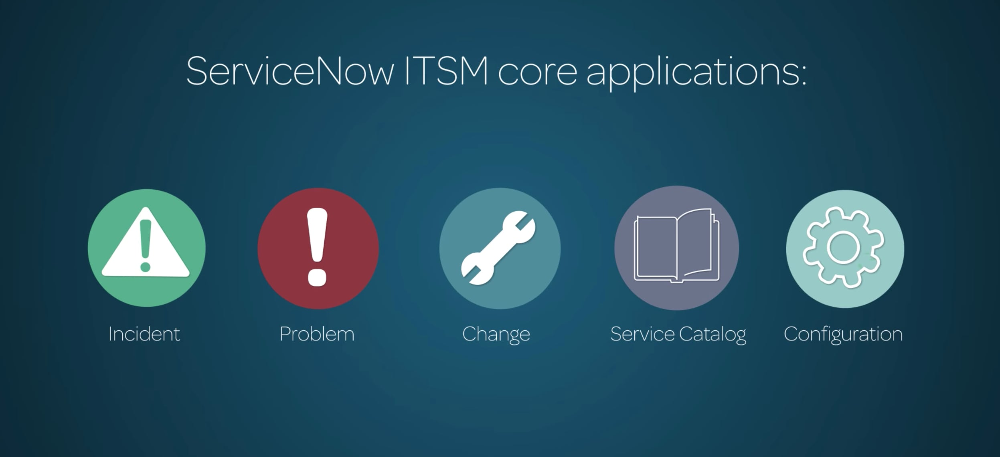
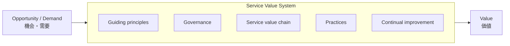
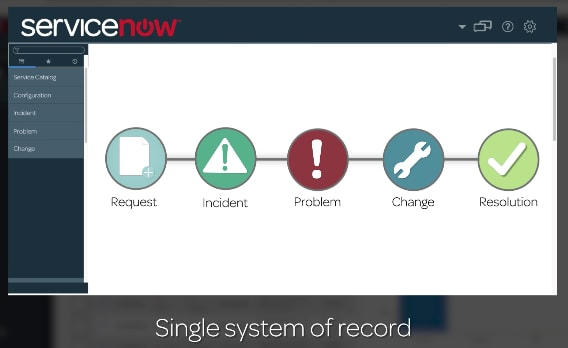
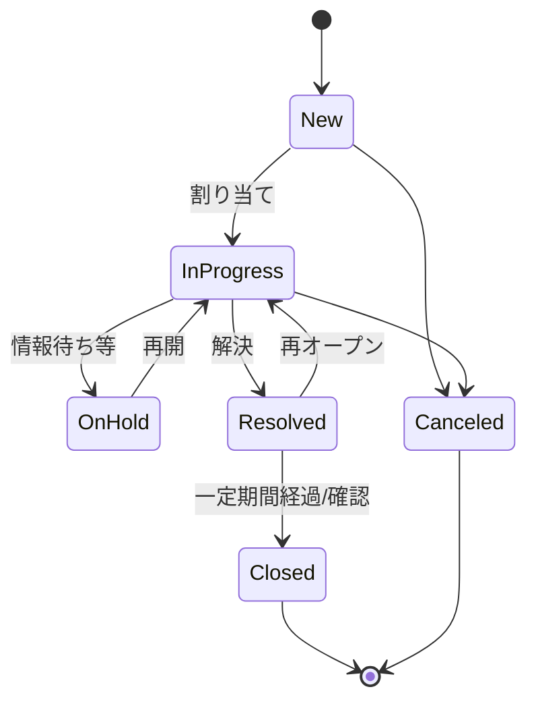
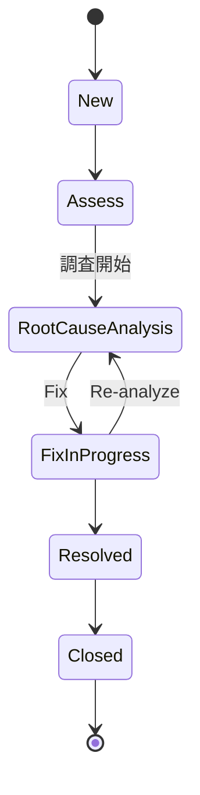
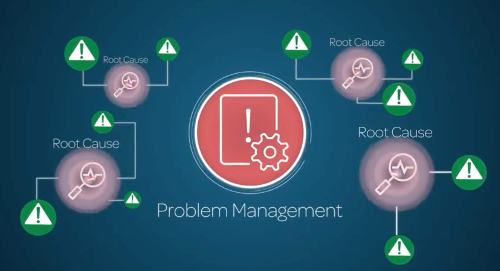
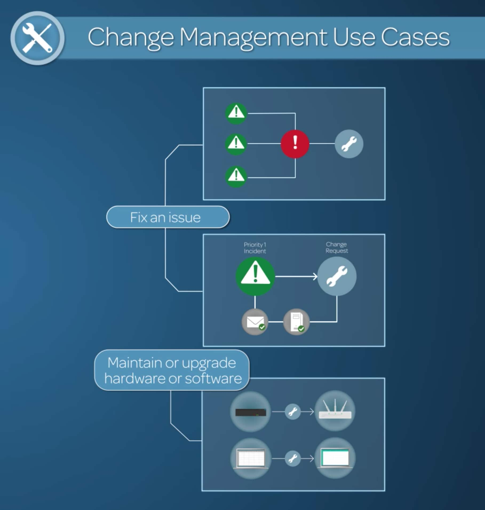
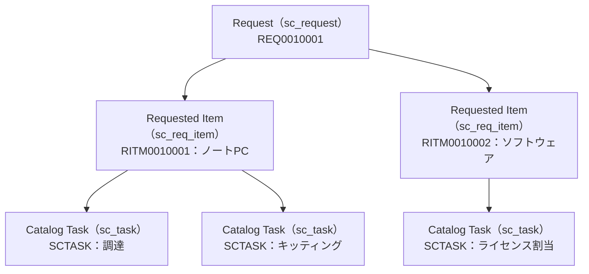
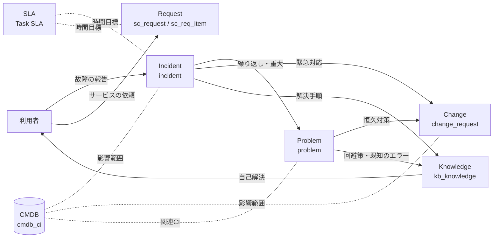

# ITILとITSMの基礎（ITIL 4 と ServiceNow ITSM の対応）

## 概要

本ファイルは、ServiceNow を語るうえで避けて通れない **ITIL（アイティル）** と **ITSM（IT Service Management／ITサービスマネジメント）** の基本を、入門者向けに整理する。主に次の問いに答える。

- ITSM とは何か、ITIL とは何か、両者と ServiceNow はどういう関係か。
- ITIL 4 の基本構造（Service Value System、Service value chain、34 の management practices）は何か。
- ITIL のプラクティス（インシデント／問題／変更／リクエスト／構成／ナレッジ／サービスレベル管理）が、ServiceNow のどのアプリケーション（モジュール）・テーブル・ロールに対応するか。
- 各プラクティス間でレコードがどうつながるか（インシデント → 問題 → 変更 など）。

各モジュールの詳細仕様（全フィールド、プロパティ、設定手順）は `02_リファレンス/itsm/` 配下の各ファイルで扱う。本ファイルは「全体の地図」を提供することを目的とする。

> **基準リリース:** Australia（2026-05 GA）。Brazil で判明している変更は「> **Brazil での変更:**」として併記する。

---

## 1. ITSM と ITIL の関係

### 1.1 ITSM（IT Service Management）とは

ITSM（IT Service Management／ITサービスマネジメント）とは、組織における IT サービスの計画・構築・提供・サポート・運用を行うための考え方と実践である。ServiceNow Community の公式ブログ「ITSM 101」は、ITSM の目的を「適切な人・技術・プロセスを組み合わせて IT をビジネス目標に整合させること」と説明し、その効果として IT コストとリスクの低減、柔軟性・サービス品質・顧客満足度の向上を挙げている。[出典](https://www.servicenow.com/community/itsm-blog/itsm-101-what-is-itsm-and-why-do-you-need-it/ba-p/2267094)

### 1.2 ITIL とは

ITIL（旧称 Information Technology Infrastructure Library）は、IT サービスを管理しビジネスニーズに合わせるためのベストプラクティス・フレームワークである。ITIL は「規格」ではなく「ガイダンス」であり、組織が ITIL 準拠の認証を受ける仕組みはない（組織認証が必要な場合は ISO/IEC 20000-1 が用いられる）。【第三者情報】[出典](https://itsm.tools/the-itil-4-service-value-system-explained/)

ITIL の歴史上の主要な版は次のとおり。

| 版 | 公開 | 特徴 | 確度 |
|---|---|---|---|
| ITIL v3 / ITIL 2011 | 2007 / 2011 | サービスライフサイクル（戦略・設計・移行・運用・継続的改善）中心。「プロセス」という用語を使用 | 【第三者情報】 |
| **ITIL 4** | 2019 | Service Value System（SVS）と 34 の management practices。「プロセス」ではなく「プラクティス」 | 【第三者情報】 |
| ITIL (Version 5) | 2026（Foundation (Version 5) は 2026-02-12 から提供開始。研修会社の解説による） | デジタル「プロダクト」とサービスの管理へ範囲を拡大、拡張モジュールとして AI Governance を追加 | 【第三者情報】 |

[出典](https://itsm.tools/itil-version-5-explained/)、[出典](https://www.itil.org.uk/blog/itil-version-5-a-complete-guide)、[出典](https://peoplecert.org/browse-certifications/it-governance-and-service-management/ITIL-1/itil-5-foundation-version-50-4154)

> **ITIL (Version 5) について:** ITIL (Version 5) は 2026 年に PeopleCert から公開された。PeopleCert の Foundation (Version 5) ページは、guiding principles、four dimensions（2.4 参照）、ITIL management practices、governance・value chain activities をシラバスに含めている。[出典](https://peoplecert.org/browse-certifications/it-governance-and-service-management/ITIL-1/itil-5-foundation-version-50-4154)
> ITSM.tools の解説（2026-02-15）によれば、34 の management practices は維持され、新たに「digital product and service lifecycle」（value chain として実行されると説明）が導入され、AI Governance が拡張モジュールとして加わる。【第三者情報】[出典](https://itsm.tools/itil-version-5-explained/)
> PeopleCert 認定研修機関（ATO）の講座を扱う研修会社の解説によれば、Foundation (Version 5) は 2026-02-12 から提供開始され、ITIL 4 と ITIL (Version 5) は「定められた移行期間」併存する。ITIL 4 の廃止日は同解説では示されていない。【第三者情報】[出典](https://www.itil.org.uk/blog/itil-version-5-a-complete-guide)
> 移行期間の長さと ITIL 4 の廃止日は、PeopleCert の公式発表としては公開情報で確認できず。
> ServiceNow の製品ドキュメントが ITIL (Version 5) への対応を表明した記述は、本調査時点（2026-11-02）の公開情報では確認できず。現場の会話・提案書では引き続き **ITIL 4 の用語**で語られることが多いため【経験則】、本ファイルは ITIL 4 を基準に説明する。

### 1.3 ServiceNow と ITIL の関係

ServiceNow ITSM は ITIL に沿って設計されている。具体的な根拠は次のとおり。

- ServiceNow 公式ブログは「ServiceNow プラットフォームは ITIL と整合し、その採用を支援するよう設計されている」と説明している。[出典](https://www.servicenow.com/community/itsm-blog/itsm-101-what-is-itsm-and-why-do-you-need-it/ba-p/2267094)
- Change Management の公式ドキュメントは、Standard／Emergency／Normal の 3 種類の変更を「ITIL が説明する 3 種類のサービス変更」として実装していると明記している。[出典](https://www.servicenow.com/docs/r/australia/it-service-management/change-management/c_ITILChangeManagement.html)
- Problem Management の公式ドキュメントは、同アプリケーションが「インシデントを引き起こす課題の根本原因を発見し修正する ITIL プロセスをサポートする」と記述している。[出典](https://www.servicenow.com/docs/r/australia/it-service-management/problem-management/c_ProblemManagement.html)
- 標準のロール名 `itil`、`itil_admin` に ITIL の名称が残っている（CMDB の公式ドキュメントが Configuration モジュールへのアクセスに必要なロールとして `asset`、`itil`、`itil_admin` を挙げている）。[出典](https://www.servicenow.com/docs/r/zS6yb8e~gR8BPjeviYdV9g/nyIbTOXlbANhjPInqJAriQ)
- ビジネスルール名（例：`SNC - ITIL - Resolve Related Incidents`）にも ITIL の名称が残っている。[出典](https://www.servicenow.com/docs/r/yokohama/it-service-management/problem-management/c_ProblemManagementProcess.html)

**注意点（ITIL 認証について）:** BMC や ManageEngine などの他社 ITSM ツールは Pink Elephant 社の **PinkVERIFY**（ITIL 適合性のツール評価）取得を公表しているが、ServiceNow ITSM が PinkVERIFY ITIL 4 認証を取得しているという公式発表は、公開情報では確認できず。ServiceNow Community でも「ServiceNow ITSM モジュールはどの組織からも認証されていないと思う」という回答があるが、これはユーザー投稿であり公式見解ではない。【第三者情報】[出典](https://www.servicenow.com/community/new-customers-policy-risk-forum/is-servicenow-itsm-module-itil4-certified-for-organisations-if/m-p/2934962)
RFP で「ITIL 準拠の証明」を求められた場合は、認証の有無ではなく、ITIL プラクティスとモジュールの対応（本ファイル第 3 章）で説明するのが一般的である。【経験則】

- **キャプション:** ServiceNow ITSM core applications の概念図（ServiceNow Community 公式ブログ「ITSM 101」掲載）。
- **画像の説明:** 濃紺の背景に 5 つの丸いアイコンが横一列に並ぶ。左から、緑の警告三角形「Incident」、赤い感嘆符「Problem」、青緑のスパナ「Change」、紫の本「Service Catalog」、水色の歯車「Configuration」。ServiceNow ITSM の中核がこの 5 アプリケーションであることを示す（画面のスクリーンショットではなく説明用イラスト）。
- **出典:** https://www.servicenow.com/community/itsm-blog/itsm-101-what-is-itsm-and-why-do-you-need-it/ba-p/2267094 （取得日：2026-11-02）

---

## 2. ITIL 4 の基本構造

### 2.1 Service Value System（SVS／サービスバリューシステム）

ITIL 4 の中核概念は **Service Value System（SVS／サービスバリューシステム）** であり、「機会（Opportunity）・需要（Demand）」を「価値（Value）」に変える仕組み全体を表す。SVS は次の 5 要素で構成される。【第三者情報】[出典](https://itsm.tools/the-itil-4-service-value-system-explained/)

| # | SVS の構成要素 | 日本語 | 概要 |
|---|---|---|---|
| 1 | Guiding principles | 従うべき原則 | あらゆる状況で判断の拠り所となる 7 原則 |
| 2 | Governance | ガバナンス | 組織を方向付け、統制する仕組み |
| 3 | Service value chain | サービスバリューチェーン | 価値を生み出す 6 つの活動 |
| 4 | Practices | プラクティス | 34 の management practices |
| 5 | Continual improvement | 継続的改善 | すべての階層で行う改善活動 |

### 2.2 7 つの Guiding principles（従うべき原則）

【第三者情報】[出典](https://itsm.tools/the-itil-4-service-value-system-explained/)

| 英語 | 日本語（一般的な訳） | ServiceNow 導入での読み替え例【経験則】 |
|---|---|---|
| Focus on value | 価値に着目する | 機能追加ではなく利用者の成果で判断する |
| Start where you are | 現状から始める | 既存プロセス・データを評価してから設計する |
| Progress iteratively with feedback | フィードバックをもとに反復して進化する | MVP で稼働させ段階的に拡張する |
| Collaborate and promote visibility | 協働し、可視性を高める | ダッシュボードで状況を共有する |
| Think and work holistically | 全体的に思考し、取り組む | インシデント・問題・変更・CMDB を一体で設計する |
| Keep it simple and practical | シンプルかつ実践的に保つ | 標準機能（OOTB）優先でカスタマイズを抑える |
| Optimize and automate | 最適化し、自動化する | 最適化してからフロー・AI で自動化する |

### 2.3 Service value chain（サービスバリューチェーン）の 6 活動

【第三者情報】[出典](https://itsm.tools/the-itil-4-service-value-system-explained/)

| 活動（英語） | 日本語 | 関係の深い ServiceNow 機能（例）【経験則】 |
|---|---|---|
| Plan | 計画 | Strategic Portfolio Management、Service Portfolio Management |
| Improve | 改善 | Continual Improvement Management、Performance Analytics |
| Engage | エンゲージ | Service Portal / Employee Center、Virtual Agent |
| Design and transition | 設計および移行 | Change Management、Release Management |
| Obtain/build | 取得／構築 | Procurement、App Engine、DevOps |
| Deliver and support | 提供およびサポート | Incident / Problem / Request Management、Service Operations Workspace |

> ITIL (Version 5) では digital product and service lifecycle が導入され（lifecycle は value chain として実行されると説明）、「design and transition」が 2 つの活動に分割されたと解説されている。【第三者情報】[出典](https://itsm.tools/itil-version-5-explained/)

### 2.4 Four dimensions（4 つの側面）

ITIL 4 はサービスマネジメントを 4 つの側面から捉える。名称は ITIL (Version 5) Foundation の公式シラバス紹介にも同じ 4 つが記載されている。[出典](https://peoplecert.org/browse-certifications/it-governance-and-service-management/ITIL-1/itil-5-foundation-version-50-4154)

| 英語 | 日本語 | ServiceNow 導入での観点【経験則】 |
|---|---|---|
| Organizations and people | 組織と人材 | ロール設計、グループ設計、教育・定着化 |
| Information and technology | 情報と技術 | CMDB、データモデル、AI |
| Partners and suppliers | パートナーとサプライヤー | 導入パートナー、ベンダー連携、Underpinning contract |
| Value streams and processes | バリューストリームとプロセス | フロー、状態モデル、SLA |

### 2.5 34 の management practices（マネジメントプラクティス）

ITIL 4 は 34 のプラクティスを 3 分類で定義している（14 + 17 + 3）。【第三者情報】[出典](https://itsm.tools/34-itil-4-management-practices/)

| 分類 | 数 | プラクティス |
|---|---|---|
| General management practices（一般マネジメント） | 14 | Architecture management, Continual improvement, Information security management, **Knowledge management**, Measurement and reporting, Organizational change management, Portfolio management, Project management, Relationship management, Risk management, Service financial management, Strategy management, Supplier management, Workforce and talent management |
| Service management practices（サービスマネジメント） | 17 | Availability management, Business analysis, Capacity and performance management, **Change enablement**, **Incident management**, IT asset management, Monitoring and event management, **Problem management**, Release management, **Service catalogue management**, **Service configuration management**, Service continuity management, Service design, **Service desk**, **Service level management**, **Service request management**, Service validation and testing |
| Technical management practices（技術マネジメント） | 3 | Deployment management, Infrastructure and platform management, Software development and management |

太字は本ファイル第 4 章で ServiceNow との対応を詳しく扱うプラクティスである。

> **用語の注意:** ITIL 4 では変更のプラクティス名が **Change enablement（変更実現）** だが、ServiceNow の製品名は一貫して **Change Management** である。両者は同じ領域を指す。[出典](https://itsm.tools/34-itil-4-management-practices/)、[出典](https://www.servicenow.com/docs/r/australia/it-service-management/change-management/c_ITILChangeManagement.html)

---

## 3. ITIL 4 プラクティスと ServiceNow アプリケーションの対応表

### 3.1 主要プラクティスの対応（本ファイルの主対象）

| ITIL 4 プラクティス | ServiceNow アプリケーション | 主なテーブル | 主なロール | 詳細ファイル |
|---|---|---|---|---|
| Incident management（インシデント管理） | Incident Management | `incident` | `itil`, `sn_incident_write`, `incident_manager` | [Incident Management](../02_リファレンス/itsm/incident-management.md) |
| Problem management（問題管理） | Problem Management | `problem`, `problem_task` | `itil`, `sn_problem_write` | [Problem Management](../02_リファレンス/itsm/problem-management.md) |
| Change enablement（変更実現） | Change Management | `change_request`, `change_task` | `itil`, `sn_change_write`, `change_manager` | [Change Management](../02_リファレンス/itsm/change-management.md) |
| Service request management（サービス要求管理） | Request Management（Service Catalog） | `sc_request`, `sc_req_item`, `sc_task` | `itil`, `sn_request_write` | [Request Management](../02_リファレンス/itsm/request-management.md) |
| Service catalogue management（サービスカタログ管理） | Service Catalog | `sc_cat_item`, `sc_category` | `catalog_admin` | [サービスカタログ](../02_リファレンス/platform/service-catalog.md) |
| Service configuration management（サービス構成管理） | CMDB（Configuration Management Database） | `cmdb_ci`（基底）とその拡張クラス、`cmdb_rel_ci` | `itil`, `cmdb_read`, `sn_cmdb_editor`, `sn_cmdb_admin` | [CMDB と CSDM](../02_リファレンス/platform/cmdb-csdm.md) |
| Knowledge management（ナレッジ管理） | Knowledge Management | `kb_knowledge`, `kb_knowledge_base` | `knowledge`, `knowledge_manager`, `knowledge_admin` | [ナレッジ管理](../02_リファレンス/platform/knowledge-management.md) |
| Service level management（サービスレベル管理） | Service Level Management（SLM） | `contract_sla`, `task_sla` | `sla_admin`, `sla_manager` | [SLAとスケジュール](../02_リファレンス/platform/sla-schedules.md)、[ITSMのSLM](../02_リファレンス/itsm/service-level-management-itsm.md) |
| Service desk（サービスデスク） | Service Operations Workspace、Service Portal / Employee Center、Virtual Agent、Walk-up Experience | （各タスクテーブルを横断） | `sn_service_desk_agent` など | [Workspace と UI Builder](../02_リファレンス/platform/workspaces-ui-builder.md)、[Service Portal と Employee Center](../02_リファレンス/platform/portals-employee-center.md) |

出典：アプリケーション一覧は [IT Service Management ランディングページ（Zurich 版。Australia 版では同じ一覧を未確認）](https://www.servicenow.com/docs/bundle/zurich-it-service-management/page/product/it-service-management/reference/r_ITServiceManagement.html)、Incident のロールは [Components installed with ITSM Roles — Incident Management](https://www.servicenow.com/docs/r/QykF2iRSIs6VXztArCSo3w/sIfYKCUFDcCKDH05o3XXNA)、Request のテーブルは [Request Management architecture](https://www.servicenow.com/docs/r/QykF2iRSIs6VXztArCSo3w/57sZCFMepzfRqczlrJWdrg)、CMDB のロールは [Overview of CMDB](https://www.servicenow.com/docs/r/zS6yb8e~gR8BPjeviYdV9g/nyIbTOXlbANhjPInqJAriQ)、SLM のテーブルとロールは [Service Level Management concepts](https://www.servicenow.com/docs/r/australia/it-service-management/service-level-management/service-level-management-concepts.html)。

> **確度に関する注記:** 上表のうち、本調査で参照した公式ページ上で名称を確認できたのは、テーブル `incident`、`sc_request`、`sc_req_item`、`sc_task`、`contract_sla`、`cmdb_ci_service_business`／`service_offering`（4.6 参照）と、ロール `itil`、`itil_admin`、`sn_incident_read`、`sn_incident_write`、`incident_manager`、`sn_incident_admin`、`sn_service_desk_agent`、`sn_problem_write`／`sn_change_write`／`sn_request_write`（`sn_service_desk_agent` の包含ロールとして記載）、`sn_request_admin`（6.1 の Simplified IT Service Management リリースノート v3.2.3 に記載）、`cmdb_read`、`sla_admin`、`sla_manager` である。それ以外（`problem`、`problem_task`、`change_request`、`change_task`、`sc_cat_item`、`sc_category`、`cmdb_ci`、`cmdb_rel_ci`、`kb_knowledge`、`kb_knowledge_base`、`task_sla`、`catalog_admin`、`change_manager`、`sn_cmdb_editor`、`sn_cmdb_admin`、`knowledge` 系ロール）は広く知られた標準名だが、本ファイルの出典ページ上では個別に確認していない。【経験則】詳細は各リファレンスファイルを参照のこと。

### 3.2 その他のプラクティスの対応（参考）

本ファイルの主対象外だが、ITIL 4 の他のプラクティスにも ServiceNow 製品が対応する。対応付けは公式の 1 対 1 対応表ではなく、ITSM ランディングページ（Zurich 版）等の製品説明からの整理である。【推定】[出典](https://www.servicenow.com/docs/bundle/zurich-it-service-management/page/product/it-service-management/reference/r_ITServiceManagement.html)

| ITIL 4 プラクティス | 対応する ServiceNow 製品・機能（例） | 詳細ファイル |
|---|---|---|
| Continual improvement | Continual Improvement Management | [ITSM Pro/Enterprise 固有機能](../02_リファレンス/itsm/itsm-pro-features.md) |
| Measurement and reporting | Reporting、Platform Analytics、ITSM Success Dashboard | [レポートとアナリティクス](../02_リファレンス/platform/reporting-analytics.md) |
| Release management | Release Management、Digital Product Release | [Release Management と DevOps](../02_リファレンス/itsm/release-management.md) |
| Deployment management | DevOps Change Velocity | [Release Management と DevOps](../02_リファレンス/itsm/release-management.md) |
| IT asset management | IT Asset Management（HAM / SAM） | [ITAM 概要](../02_リファレンス/itam/itam-overview.md) |
| Monitoring and event management | Event Management / AIOps（ITOM） | [Event Management と AIOps](../02_リファレンス/itom/event-management-aiops.md) |
| Supplier management | Vendor Management Workspace、Contract Management | [ITSM 概要](../02_リファレンス/itsm/itsm-overview.md) |
| Portfolio management | Strategic Portfolio Management、Service Portfolio Management | [Strategic Portfolio Management](../02_リファレンス/spm/strategic-portfolio-management.md) |
| Information security management | Security Operations | [Security Operations](../02_リファレンス/secops/security-operations.md) |
| Risk management | Integrated Risk Management | [Integrated Risk Management](../02_リファレンス/irm/integrated-risk-management.md) |
| Workforce and talent management | Workforce Optimization for ITSM | [Workforce Optimization](../02_リファレンス/itsm/workforce-optimization.md) |
| Service validation and testing | Automated Test Framework（プラットフォームのテスト用）、Test Management 2.0（手動テスト管理） | [ATF](../02_リファレンス/platform/automated-test-framework.md)、[Test Management 2.0](../02_リファレンス/spm/test-management.md) |

> **Brazil での変更:** Brazil の ITSM リリースノートは、Workforce Optimization for ITSM について「Brazil ではサポートされるが、将来のリリースで非推奨（deprecated）になる」と記載している（代替製品・時期は記載なし）。[出典](https://www.servicenow.com/docs/r/release-notes/it-service-management-rn-landing.html)

---

## 4. 主要プラクティスと ServiceNow モジュールの概要

### 4.1 共通の土台：Task テーブルと `itil` ロール

ServiceNow の ITSM レコード（インシデント、問題、変更、カタログタスクなど）は、いずれも **Task（`task`）テーブル**を拡張したテーブルに格納される。このため、番号（Number）、State（状態）、Assignment group（割り当てグループ）、Assigned to（担当者）、Short description（簡単な説明）、Work notes（作業メモ）、Additional comments（追加コメント）といった共通フィールドを共有し、SLA・承認・通知・アクティビティ履歴を共通の仕組みで扱える。Problem Management の公式ドキュメントも、問題（problem）と問題タスクを「task レコード」として説明している。[出典](https://www.servicenow.com/docs/r/yokohama/it-service-management/problem-management/c_ProblemManagementProcess.html)
タスクテーブルの継承の詳細は [必須の基本概念](04-core-concepts.md) と [データモデルとSystem Dictionary](../02_リファレンス/platform/data-model-dictionary.md) を参照。

`itil` ロールは、ITSM の **fulfiller（処理担当者）** 向けの代表的なロールである。例えば `incident_manager` ロールは `itil` を包含し、CMDB の Configuration モジュールへのアクセスには `asset`、`itil`、`itil_admin` 等のロールが必要とされる。[出典](https://www.servicenow.com/docs/r/QykF2iRSIs6VXztArCSo3w/sIfYKCUFDcCKDH05o3XXNA)、[出典](https://www.servicenow.com/docs/r/zS6yb8e~gR8BPjeviYdV9g/nyIbTOXlbANhjPInqJAriQ)
近年はアプリケーション単位の細分化ロール（`sn_incident_read`／`sn_incident_write` など）も提供されている（4.2 参照）。ロールとライセンスの関係は [ユーザー・ロール・ライセンスの基本](08-users-roles-licensing-basics.md) を参照。

- **キャプション:** 「Single system of record（単一の記録システム）」の説明図（ServiceNow Community 公式ブログ「ITSM 101」掲載、旧 UI16 時代の画面イメージ）。
- **画像の説明:** 上部に ServiceNow ロゴのバナー、左側にアプリケーションナビゲーター（Service Catalog、Configuration、Incident、Problem、Change のメニュー）がある旧 UI 風の画面。右側の本文領域には Request（書類アイコン）→ Incident（緑の警告三角形）→ Problem（赤い感嘆符）→ Change（スパナ）→ Resolution（緑のチェック）の 5 つのアイコンが線でつながり、すべてのプロセスが 1 つのプラットフォーム上でつながることを表している。下部に「Single system of record」の文字。
- **出典:** https://www.servicenow.com/community/itsm-blog/itsm-101-what-is-itsm-and-why-do-you-need-it/ba-p/2267094 （取得日：2026-11-02）

### 4.2 Incident Management（インシデント管理）

**ITIL 4 での目的:** Incident management は、計画外のサービス中断や品質低下（インシデント）による悪影響を、通常のサービス運用をできるだけ早く回復することで最小化するプラクティスである。【第三者情報】[出典](https://itsm.tools/34-itil-4-management-practices/)

**ServiceNow Incident Management の位置付け:** Incident Management は「ビジネス運用への影響を最小化し品質を維持しながら、通常のサービス運用を回復する」アプリケーションであり、インシデントの識別・記録・分類・優先度付け、ユーザー／グループへの割り当て、エスカレーション、解決、レポートを提供する。ITSM guided setup によるフォーム・カテゴリ・UI 動作の構成、Major incident（重大インシデント）の管理（Major incident overview dashboard と workbench）も含まれる。[出典](https://www.servicenow.com/docs/r/australia/it-service-management/incident-management/c_IncidentManagement.html)

**プロセスの流れ（公式ドキュメント「Exploring Incident Management」より）:** [出典](https://www.servicenow.com/docs/r/zurich/it-service-management/incident-management/incident-management-process.html)

1. **Identification（識別）:** メール、SMS、電話、チャット、Walk-up（対面窓口）、アプリケーションなどから報告を受け、サービスデスクがインシデントかリクエストかを判断する。
2. **Logging（記録）:** Caller（発信者）、Service（ビジネスサービス）、Configuration item（構成アイテム）、Contact type（連絡方法）を記録し、Category（カテゴリ）と Subcategory（サブカテゴリ）で分類し、Impact（影響度）と Urgency（緊急度）から Priority（優先度）を決める。優先度は SLA の応答目標の基になる。
3. **Response（対応）:** 初期診断 → 必要に応じて上位サポートへエスカレーション → 調査・診断 → 修正の適用 → 解決と回復（SLA 内でサービス回復を確認）→ クローズ。

**状態（State）:** インシデントのライフサイクル公式ページ（Australia）は次の状態を説明している。[出典](https://www.servicenow.com/docs/r/QykF2iRSIs6VXztArCSo3w/wx13CEpLt~8B1elAmArNyw)

| State | 意味 |
|---|---|
| New（新規） | 記録済みだが未調査 |
| In Progress（進行中） | 割り当て済みで調査中 |
| On Hold（保留） | 情報・証拠・修正の提供のため、責任が一時的に他者へ移っている。On hold reason（保留理由）は Awaiting Caller／Awaiting Change／Awaiting Problem／Awaiting Vendor |
| Resolved（解決済み） | 満足のいく修正が提供された |
| Closed（クローズ） | Resolved から一定期間経過後、解決が確認されてクローズ |
| Canceled（キャンセル） | 重複、不要、またはインシデントではないと判断された |

- On Hold reason が Awaiting Caller の場合は Additional comments が必須になり、Caller が更新すると保留理由がクリアされ State が In Progress に戻る。On Hold は Closed になるまで複数回設定できる。[出典](https://www.servicenow.com/docs/r/QykF2iRSIs6VXztArCSo3w/wx13CEpLt~8B1elAmArNyw)
- State の内部値は上記の公式ページでは示されていない。一般的な既定値は New = 1、In Progress = 2、On Hold = 3、Resolved = 6、Closed = 7、Canceled = 8 とされる。【経験則】カスタマイズで変わることがあるため、実装時は `sys_choice`（`incident` テーブルの `state` 要素）で確認すること。

※ 上図は入門用に主要な遷移を簡略化したもの。厳密な遷移条件はインスタンスの設定（UI Policy、Business Rule、State model）による。Resolved から In Progress への再オープン矢印は一般的な運用例として示したもの。【経験則】

**優先度（Priority）の算出:** 既定では Priority フィールドは読み取り専用で、Impact と Urgency の組み合わせから **Priority Lookup Rules（優先度ルックアップルール）** によって自動設定される。ルールは `All > System Policy > Rules > Priority Lookup Rules` で管理し、変更できるのは `admin` または `data_lookup_admin` ロールである。Australia の公式ドキュメントのサンプルルールは次のとおり。[出典](https://www.servicenow.com/docs/r/QykF2iRSIs6VXztArCSo3w/SVTGmXZSG0eYgyXtJSYSZA)

| Impact ＼ Urgency | 1 - High | 2 - Medium | 3 - Low |
|---|---|---|---|
| **1 - High** | 1 - Critical | 2 - High | 3 - Moderate |
| **2 - Medium** | 2 - High | 3 - Moderate | 4 - Low |
| **3 - Low** | 3 - Moderate | 4 - Low | 4 - Low（※） |

※ Priority の選択肢は 1 - Critical／2 - High／3 - Moderate／4 - Low／5 - Planning の 5 段階である。ServiceNow 社員による Community 公式ブログ（2015 年）では Impact 3 × Urgency 3 を「5 - Planning」としており、公式ドキュメントのサンプルと異なる。実際の値は各インスタンスのルックアップルールで確認すること。[出典](https://www.servicenow.com/community/itsm-blog/managing-incident-priority/ba-p/2294101)

**主なロール（ITSM Roles - Incident Management プラグイン `com.snc.itsm.roles.incident_management`、Australia）:** [出典](https://www.servicenow.com/docs/r/QykF2iRSIs6VXztArCSo3w/sIfYKCUFDcCKDH05o3XXNA)

| ロール | 概要 |
|---|---|
| `sn_incident_read` | Incident Management と関連レコードの読み取り。ESS（セルフサービス）ユーザーは自分が作成した、または自分の代理で作成されたインシデントのみ参照 |
| `sn_incident_write` | Incident Management と関連レコードの書き込み（`sn_incident_read` を包含） |
| `sn_service_desk_agent` | Tier 1 エージェント向け。`sn_incident_write`、`sn_problem_write`、`sn_change_write`、`sn_request_write` を包含 |
| `incident_manager` | 既存ロールに責務を追加。インシデントのプロパティ、重大インシデントのトリガールール、Communication Plan Definition を管理。`itil` を包含 |
| `sn_incident_admin` | Incident Management の全機能を構成（`incident_manager` を包含） |

詳細は [Incident Management](../02_リファレンス/itsm/incident-management.md) を参照。

### 4.3 Problem Management（問題管理）

**ITIL 4 での目的:** Problem management は、インシデントの実際の原因・潜在的な原因を特定し、ワークアラウンド（回避策）と Known error（既知のエラー）を管理することで、インシデントの発生可能性と影響を減らすプラクティスである。【第三者情報】[出典](https://itsm.tools/34-itil-4-management-practices/)

**ServiceNow Problem Management の位置付け:** Problem Management は「関連するインシデントの発生として現れる IT インフラのエラーの原因を見つける」アプリケーションであり、Known error の文書化と伝達、問題・問題タスクの作成から評価・調査・修正、Known Error Portal での既知エラー記事検索を提供する。[出典](https://www.servicenow.com/docs/r/australia/it-service-management/problem-management/c_ProblemManagement.html)

**インシデントとの違い（入門者が最も混同しやすい点）:**

| 観点 | Incident（インシデント） | Problem（問題） |
|---|---|---|
| 目的 | サービスを**早く元に戻す** | **原因**を突き止め再発を防ぐ |
| 時間軸 | 短期（分〜時間） | 中長期（日〜週） |
| 成果物 | 回復・回避策の適用 | 根本原因、Workaround、Known error、恒久対策（多くは変更要求） |
| 典型的な起票 | 利用者からの報告、監視アラート | 繰り返し発生するインシデント、重大インシデントの事後分析 |
| ServiceNow テーブル | `incident` | `problem`（作業単位は `problem_task`） |

**状態（Madrid 以降のベストプラクティス状態モデル）:** 現在の基本ライフサイクルは **Problem Management Best Practice – Madrid – State Model** プラグイン（`com.snc.best_practice.problem.madrid.state_model`）で提供される。[出典](https://www.servicenow.com/community/itsm-blog/problem-management-what-s-new-in-xanadu/ba-p/3039910)
この状態モデルの状態は **New → Assess → Root Cause Analysis → Fix in Progress → Resolved → Closed** の 6 つである。ServiceNow 公式の Problem Management 製品ページ・データシートは、この 6 状態を標準（out-of-the-box）でサポートすると説明している。[出典](https://www.servicenow.com/products/problem-management.html)、[出典](https://www.servicenow.com/content/dam/servicenow-assets/public/en-us/doc-type/resource-center/data-sheet/problem-management-data-sheet.pdf)
なお、Australia の製品ドキュメント（servicenow.com/docs）上で 6 状態を列挙したページは、本調査では取得できなかった。
公式ドキュメントでは、Root Cause Analysis で根本原因分析用の problem task を作成し、原因と修正案を問題に記録したうえで「Fix」を選ぶと Fix in Progress に、「Re-analyze」を選ぶと Root Cause Analysis に戻ると説明されている。[出典](https://www.servicenow.com/docs/r/it-service-management/problem-management/investigate-root-cause.html)

※ 入門用の簡略図。Assess からの重複・キャンセルによるクローズ、リスク受容によるクローズなどの分岐は省略している。

- **Problem models（Xanadu で導入）:** シナリオごとに状態・自動遷移・フローを定義できる問題モデル／問題タスクモデル。既定では無効で、Service Operations Workspace（SOW）6.0 以降が必要。General problem model と、General／Root cause analysis の 2 つの問題タスクモデルが初期提供される。[出典](https://www.servicenow.com/community/itsm-blog/problem-management-what-s-new-in-xanadu/ba-p/3039910)
- **Known error と Knowledge の連携:** Problem Management Best Practice – Madrid – Knowledge Integration（`com.snc.best_practice.problem.madrid.knowledge`）で問題とナレッジ（Known error 記事）を連携する。[出典](https://www.servicenow.com/community/itsm-blog/problem-management-what-s-new-in-xanadu/ba-p/3039910)

- **キャプション:** Problem Management の概念図（ServiceNow Community 公式ブログ「ITSM 101」掲載）。
- **画像の説明:** 中央に赤い丸の「Problem Management」アイコン（感嘆符と歯車）。その周囲に「Root Cause」と書かれた虫眼鏡アイコンが 4 つ配置され、それぞれに緑の警告三角形（インシデント）が複数ぶら下がっている。複数のインシデントの背後にある共通の根本原因を突き止めるのが問題管理であることを示す。
- **出典:** https://www.servicenow.com/community/itsm-blog/itsm-101-what-is-itsm-and-why-do-you-need-it/ba-p/2267094 （取得日：2026-11-02）

詳細は [Problem Management](../02_リファレンス/itsm/problem-management.md) を参照。

### 4.4 Change Management（変更管理）／ITIL 4 の Change enablement

**ITIL 4 での目的:** Change enablement は、リスクを適切に評価し、変更を承認し、変更スケジュールを管理することで、成功する IT 変更の数を最大化するプラクティスである。【第三者情報】[出典](https://itsm.tools/34-itil-4-management-practices/)

**ServiceNow Change Management の位置付け:** Change Management は「すべての変更のライフサイクルを統制する体系的なアプローチ」を提供し、IT サービスへの影響を最小限に抑えながら有益な変更を行うことを目的とする。Vulnerability Response プラグインとも統合される。[出典](https://www.servicenow.com/docs/r/australia/it-service-management/change-management/c_ITILChangeManagement.html)

> **注記（レガシーな状態モデル）:** 以下の 2 つの表は、従来の Change type 別状態モデルの説明である。公式ドキュメントは「Quebec リリース以降、change states の機能は Change models（変更モデル）に置き換えられた」と明記しており、Quebec 以降は Change models が状態遷移を定義し、新規の構成では Change models を使う。下記の Type 別の進み方は、Quebec より前に作成された変更要求や Change models に未移行の変更要求に当てはまる。[出典](https://www.servicenow.com/docs/r/australia/it-service-management/change-management/c_ChangeStateModel.html)
> 状態名と値（-5〜4）は Change models でも共通して使われることが多いが、Change models 上の状態定義は各モデルの設定で確認すること。【経験則】

**変更の 3 種類（Change type）:** [出典](https://www.servicenow.com/docs/r/australia/it-service-management/change-management/c_ChangeStateModel.html)

| Type | 説明 | 状態の進み方 |
|---|---|---|
| Normal（通常変更） | 評価・承認を経て実施する標準的な変更 | New → Assess → Authorize → Scheduled → Implement → Review → Closed のすべてを通る |
| Standard（標準変更） | 事前承認済みの、低リスクで手順が確立した変更 | 承認レコードを生成する Assess・Authorize をスキップする。却下時は New に戻る |
| Emergency（緊急変更） | 直ちに実施が必要な変更 | Standard と同様に扱われるが、実施前に承認（Authorize）が必要。却下時は New に戻る |

**状態（State）と値:** Australia の公式ドキュメントは状態と内部値を次のように示している。[出典](https://www.servicenow.com/docs/r/australia/it-service-management/change-management/c_ChangeStateModel.html)

| State | 値 | 意味 |
|---|---|---|
| New | -5 | 未提出。申請者が何度でも保存できる |
| Assess | -4 | ピアレビューと技術的承認 |
| Authorize | -3 | Change Management と CAB（Change Advisory Board／変更諮問委員会）が日程を確定し最終承認 |
| Scheduled | -2 | 承認済みで計画開始日を待っている |
| Implement | -1 | 計画開始日を迎え作業中 |
| Review | 0 | 作業完了。実施後レビュー（PIR）を行う。この状態ではキャンセル不可 |
| Closed | 3 | レビュー完了 |
| Canceled | 4 | 不要になった変更はキャンセルできる。ただし Review と Closed の状態からはキャンセルできない |

- Change type を変更できるのは New 状態で承認レコードが存在しない場合のみ。Normal は Assess から、Emergency は Authorize から New に戻すことができ、ワークフローが再始動し保留中の承認はキャンセルされる。[出典](https://www.servicenow.com/docs/r/australia/it-service-management/change-management/c_ChangeStateModel.html)
- 公式ドキュメントは、Quebec 以降は **Change models（変更モデル）** が状態の扱いを置き換えたことにも触れている。変更モデル、承認ポリシー（Change approval policies）、CAB Workbench の詳細は [Change Management](../02_リファレンス/itsm/change-management.md) を参照。[出典](https://www.servicenow.com/docs/r/australia/it-service-management/change-management/c_ChangeStateModel.html)

- **キャプション:** Change Management Use Cases の説明図（ServiceNow Community 公式ブログ「ITSM 101」掲載）。
- **画像の説明:** 上部に「Change Management Use Cases」の見出し。「Fix an issue（課題の修正）」の枠には、①3 つのインシデント（緑の三角形）が 1 つの問題（赤い感嘆符）に紐づき、そこから変更（スパナ）が作られる流れ、②「Priority 1 Incident」から「Change Request」が作成される流れが描かれている。下段の「Maintain or upgrade hardware or software（ハードウェア／ソフトウェアの保守・更新）」の枠には、ネットワーク機器や PC 画面がスパナを介して新しいものに置き換わる図がある。変更要求は問題やインシデントの修正だけでなく、計画的な保守・更新でも起票されることを示す。
- **出典:** https://www.servicenow.com/community/itsm-blog/itsm-101-what-is-itsm-and-why-do-you-need-it/ba-p/2267094 （取得日：2026-11-02）

### 4.5 Request Management（リクエスト管理）／ITIL 4 の Service request management

**ITIL 4 での目的:** Service request management は、事前に定義され利用者が起票できるサービス要求（例：PC の申請、アクセス権の申請、情報の問い合わせ）を、効果的かつ利用者に優しい方法で処理するプラクティスである。【第三者情報】[出典](https://itsm.tools/34-itil-4-management-practices/)

**インシデントとの違い:** インシデントは「壊れた・使えない」という計画外の中断、サービス要求は「欲しい・使いたい」という通常のサービス提供の一部である。公式ドキュメントのインシデント管理プロセスでも、識別の段階でサービスデスクが「インシデントかリクエストか」を判断するとされている。[出典](https://www.servicenow.com/docs/r/zurich/it-service-management/incident-management/incident-management-process.html)

**ServiceNow Request Management の位置付け:** Request Management は、従業員がセルフサービスポータルからサービス・製品・情報を依頼できるようにし、Service Catalog のカタログアイテムを定義済みのフローに基づいて依頼・充足（fulfill）する。[出典](https://www.servicenow.com/docs/r/australia/it-service-management/request-management/c_RequestManagement.html)

**3 階層のレコード構造（REQ → RITM → SCTASK）:** [出典](https://www.servicenow.com/docs/r/QykF2iRSIs6VXztArCSo3w/57sZCFMepzfRqczlrJWdrg)

| レコード | テーブル | 番号の接頭辞（一般的な例） | 役割 |
|---|---|---|---|
| Request（リクエスト） | `sc_request` | REQ | 1 回の注文（カート）全体 |
| Requested Item（リクエストアイテム） | `sc_req_item` | RITM | 注文に含まれる個々のカタログアイテム。変数（Variables）はこのテーブルにのみ紐づく |
| Catalog Task（カタログタスク） | `sc_task` | SCTASK | 充足のための作業 |

※ 番号の接頭辞は一般的な既定値。【経験則】

- 公式ドキュメントは、Record producer を使って `sc_request`／`sc_req_item`／`sc_task`（およびその拡張テーブル）にレコードを作成しないこと、これらとカート関連テーブルに「before」ビジネスルールを避けることを推奨している。[出典](https://www.servicenow.com/docs/r/QykF2iRSIs6VXztArCSo3w/57sZCFMepzfRqczlrJWdrg)
- カタログの設計（カタログアイテム、変数、Order guide、Record producer）は [サービスカタログ](../02_リファレンス/platform/service-catalog.md)、ポータルは [Service Portal と Employee Center](../02_リファレンス/platform/portals-employee-center.md) を参照。

**Service catalogue management（サービスカタログ管理）との関係:** ITIL 4 では、Service request management が「依頼を処理する」プラクティスであるのに対し、Service catalogue management は「利用可能なサービスとその提供内容の一貫した情報を提供する」プラクティスとして別に定義されている。【第三者情報】[出典](https://itsm.tools/34-itil-4-management-practices/)
ServiceNow では Service Catalog（サービスカタログ）がこの役割を担い、Request Management はカタログアイテムを定義済みのフローで充足する。[出典](https://www.servicenow.com/docs/r/australia/it-service-management/request-management/c_RequestManagement.html)
カタログの主な構成要素は次のとおり（テーブル名・ロール名は 3.1 の確度注記のとおり本ファイルの出典ページ上では未確認の標準名）。【経験則】

| 要素 | 位置付け | 関連テーブル・ロール |
|---|---|---|
| Catalog item（カタログアイテム） | 依頼できる個々のサービス・製品。注文すると RITM（`sc_req_item`）が作られる | `sc_cat_item` |
| Category（カテゴリ） | カタログアイテムを分類・表示する単位 | `sc_category` |
| Order guide（オーダーガイド） | 複数のカタログアイテムを 1 回の質問・注文にまとめる（例：入社時の一括申請） | — |
| Record producer（レコードプロデューサー） | カタログの画面から、インシデントなど任意のタスクテーブルのレコードを作る。前述のとおり `sc_request` 等の作成には使わない | — |
| カタログの管理 | カタログ・カテゴリ・アイテムの作成と保守 | `catalog_admin` |

詳細は [Request Management](../02_リファレンス/itsm/request-management.md) を参照。

### 4.6 Configuration Management／CMDB（構成管理）

**ITIL 4 での目的:** Service configuration management は、サービスとそれを支える構成アイテム（CI）の構成や関係について、正確で信頼できる情報を必要な時・場所で利用できるようにするプラクティスである。【第三者情報】[出典](https://itsm.tools/34-itil-4-management-practices/)

**ServiceNow CMDB の位置付け:** CMDB（Configuration Management Database／構成管理データベース）は、環境内の **CI（Configuration Item／構成アイテム）** を管理する。CI は物理的なもの（コンピューター、ルーター）、論理的なもの（データベースインスタンス）、概念的なもの（サービス）のいずれでもよい。共通属性を持つ CI は独自のクラステーブルに格納され、テーブル同士が継承関係で CMDB 階層を構成する（例：ラップトップ → コンピューター → 基底 CI クラス）。CI 間の関係（Relationship）をマッピングすることで、障害や変更の影響範囲を把握できる。公式ドキュメントは CMDB が ITIL プロセスを支えると説明している。[出典](https://www.servicenow.com/docs/r/zS6yb8e~gR8BPjeviYdV9g/nyIbTOXlbANhjPInqJAriQ)

**ITSM の各プラクティスと CMDB のつながり:**

| プラクティス | CMDB の使われ方（例） |
|---|---|
| Incident | インシデントに Configuration item（構成アイテム）と Service（サービス）を記録し、影響範囲や担当グループの判断に使う [出典](https://www.servicenow.com/docs/r/zurich/it-service-management/incident-management/incident-management-process.html) |
| Problem | 同じ CI に紐づくインシデントの傾向から問題を特定する【経験則】 |
| Change | 変更対象 CI と、依存関係から影響を受けるサービスを評価する【経験則】 |
| Request | 払い出した資産・CI を記録する【経験則】 |

- **ロール:** CMDB テーブルを直接読むには `cmdb_read`、Configuration モジュールへのアクセスには `asset`、`itil`、`itil_admin` 等が必要。CMDB 関連レコードの参照には通常 `itil` で足りるが、更新には上位ロールが必要になることが多い。[出典](https://www.servicenow.com/docs/r/zS6yb8e~gR8BPjeviYdV9g/nyIbTOXlbANhjPInqJAriQ)
- **CSDM（Common Service Data Model）:** サービスの表現方法の標準モデル。Business service（`cmdb_ci_service_business`）、Technical service（`cmdb_ci_service_technical`、CSDM 5 以降は UI 上「Technology Management Service」と表示）、Service offering（`service_offering`）などを用いる。[出典](https://www.servicenow.com/docs/r/QykF2iRSIs6VXztArCSo3w/E7DwpgD4A4~yCX7ab8fDFA)

CI の自動収集（Discovery、Service Graph Connectors）や CSDM の詳細は [CMDB と CSDM](../02_リファレンス/platform/cmdb-csdm.md)、[Discovery](../02_リファレンス/itom/discovery.md) を、CMDB 運用の成功要因は [CMDB成功の要因](../04_応用編/05-cmdb-success-factors.md) を参照。

### 4.7 Knowledge Management（ナレッジ管理）

**ITIL 4 での目的:** Knowledge management は、組織全体で情報・スキル・知識を効果的・効率的・便利に利用できるよう維持・改善するプラクティスである。ITIL 4 では General management practice に分類される。【第三者情報】[出典](https://itsm.tools/34-itil-4-management-practices/)

**ServiceNow Knowledge Management の位置付け:** Knowledge Management は記事の作成・分類・レビュー・承認と、利用者による検索・閲覧・フィードバックを提供する。ナレッジベースごとに管理者を割り当て、公開・廃止（retirement）のワークフローと、閲覧・投稿のアクセス制御（User criteria）を個別に設定できる。[出典](https://www.servicenow.com/docs/r/zS6yb8e~gR8BPjeviYdV9g/53GCX9rHh5tNwFMLsT~3YA)

**記事のライフサイクル（公式ドキュメントの説明）:** [出典](https://www.servicenow.com/docs/r/zS6yb8e~gR8BPjeviYdV9g/53GCX9rHh5tNwFMLsT~3YA)

1. Knowledge user（ナレッジ利用者）が記事の新規作成・更新を依頼する。
2. Knowledge contributor（ナレッジ投稿者）が記事を作成・更新し、レビューに提出する。
3. Knowledge manager（ナレッジマネージャー）が公開するか、修正のため差し戻す。
4. 利用者が記事を読み共有し、マネージャーが継続的に関連性を確認する。
5. マネージャーが古くなった記事を廃止対象にし、廃止を承認または却下する。

記事の公開・廃止の手順は Knowledge workflows（ナレッジワークフロー）で制御される。[出典](https://www.servicenow.com/docs/r/servicenow-platform/knowledge-management/r_KnowledgeWorkflows.html)

**ITSM プラクティスとの連携:**

- Incident：解決時の手順をナレッジ化し、類似インシデントで記事を推奨する（Australia 向けの **Simplified IT Service Management**（ストアアプリ）v2.0.1 では、フルフィラー向けに解決手順・ナレッジ記事の AI 推奨が提供される。コア ITSM の標準機能とは限らない）。[出典](https://www.servicenow.com/docs/r/IDeOjpA1hzonPLWG~inEpg/25qrl_cqlBpZ4BR44nhlkw)
- Problem：Known error 記事として回避策を公開し、Known Error Portal で検索可能にする。[出典](https://www.servicenow.com/docs/r/australia/it-service-management/problem-management/c_ProblemManagement.html)
- Self-service：Service Portal／Employee Center で利用者が自己解決する。

詳細は [ナレッジ管理](../02_リファレンス/platform/knowledge-management.md) を参照。

### 4.8 Service Level Management（サービスレベル管理）

**ITIL 4 での目的:** Service level management は、サービスレベルに関するビジネスベースの目標を設定し、それに対するサービス提供を適切に評価・監視・管理するプラクティスである。【第三者情報】[出典](https://itsm.tools/34-itil-4-management-practices/)

**ServiceNow SLM の仕組み:** ServiceNow では **SLA Definition（SLA 定義、`contract_sla`）** が SLA を生成する条件を定める。主なパラメーターは、対象タスクテーブル、期間（Duration）、スケジュール（営業時間）、および開始（Start）・一時停止（Pause）・停止（Stop）・リセット（Reset）の条件である。条件に合致すると対象タスクに **Task SLA** レコードが作成され、SLA の進捗を追跡する。1 つのタスクに複数の Task SLA が付くことがある。[出典](https://www.servicenow.com/docs/r/australia/it-service-management/service-level-management/service-level-management-concepts.html)
Task SLA のテーブル名 `task_sla` は広く知られた標準名だが、上記公式ページでは明示されていない（3.1 の確度注記と同じ扱い）。【経験則】

**SLA の種類:** [出典](https://www.servicenow.com/docs/r/zUlSbxoxKPAWFDGUdAoSCw/bhljRzZsOOYk8M_F9ekPTQ)

| Type | 日本語 | 対象 |
|---|---|---|
| SLA（Service Level Agreement） | サービスレベル合意 | サービス提供者と（外部）顧客の間の合意 |
| OLA（Operational Level Agreement） | 運用レベル合意 | 同一組織内のチーム間の合意 |
| Underpinning contract | 支援契約 | サービス提供を支える外部ベンダーとの契約 |

**主なロール:** [出典](https://www.servicenow.com/docs/r/australia/it-service-management/service-level-management/service-level-management-concepts.html)

| ロール | 権限 |
|---|---|
| `sla_admin` | SLM プロパティ、SLA repair、SLA Overview ダッシュボード、SLA 定義を含む完全な管理権限（ワークフローやスケジュールの作成には追加ロールが必要） |
| `sla_manager` | SLA 定義の作成、repair ログ参照、SLA Overview ダッシュボード参照。SLM プロパティの変更や condition type の定義は不可 |

**インシデントとの関係:** インシデントの Priority は SLA の応答目標の基になる（4.2 参照）。典型的には「P1 は 15 分以内に応答、4 時間以内に解決」のように、優先度ごとに Response（応答）SLA と Resolution（解決）SLA を定義する。【経験則】

> **ITIL の SLM と ServiceNow の「SLA」機能の違い:** ITIL の Service level management は、顧客との合意形成、サービスレビュー、改善までを含む広いプラクティスである。ServiceNow の SLA 機能は、その中の「タスク単位の時間目標の計測」を担う仕組みである。サービス単位のコミットメント（可用性など）は Service Portfolio Management の Service offering とその SLA コミットメントで表現する。【推定】[出典](https://www.servicenow.com/docs/r/australia/it-service-management/service-level-management/service-level-management-concepts.html)

詳細は [SLAとスケジュール](../02_リファレンス/platform/sla-schedules.md)、[ITSMにおけるサービスレベル管理とサービスポートフォリオ](../02_リファレンス/itsm/service-level-management-itsm.md) を参照。

### 4.9 Service desk（サービスデスク）

ITIL 4 の Service desk は、インシデントの解決やサービス要求のための需要を受け付ける単一窓口（SPOC）である。【第三者情報】[出典](https://itsm.tools/34-itil-4-management-practices/)
ServiceNow には「Service Desk」という独立アプリケーションはなく、次の機能の組み合わせで実現する。【推定】下表の出典は Zurich 版の ITSM ランディングページであり、Australia 版で同じ一覧は未確認。

| 機能 | 役割 | 出典 |
|---|---|---|
| Service Operations Workspace for ITSM | ITSM と ITOM のワークフローを統合したエージェント用ワークスペース | [ITSM ランディング](https://www.servicenow.com/docs/bundle/zurich-it-service-management/page/product/it-service-management/reference/r_ITServiceManagement.html) |
| Employee Center / Service Portal | 利用者のセルフサービス窓口 | 同上 |
| ITSM Virtual Agent | 利用者と技術者向けのチャットボット | 同上 |
| Walk-up Experience | 対面・リモートでの IT 支援窓口 | 同上 |
| On-call scheduling | サポートグループの当番者を特定 | 同上 |

---

## 5. プラクティス間のつながり（レコードの流れ）

ServiceNow ITSM の価値は、各プラクティスのレコードが 1 つのプラットフォーム上で相互に参照される点にある（Single system of record）。[出典](https://www.servicenow.com/community/itsm-blog/itsm-101-what-is-itsm-and-why-do-you-need-it/ba-p/2267094)

代表的な連携の例は次のとおり。

| 連携 | 内容 | 出典・確度 |
|---|---|---|
| Incident → Problem | 繰り返し発生するインシデントや重大インシデントから問題を起票し、インシデントを問題に関連付ける | 【経験則】 |
| Incident → On Hold（Awaiting Problem / Awaiting Change） | 問題・変更の完了待ちの間、インシデントを保留にする | [出典](https://www.servicenow.com/docs/r/QykF2iRSIs6VXztArCSo3w/wx13CEpLt~8B1elAmArNyw) |
| Problem → Change | 恒久対策を変更要求として起票する | [出典](https://www.servicenow.com/docs/r/yokohama/it-service-management/problem-management/c_ProblemManagementProcess.html) |
| Problem クローズ → Incident 解決 | 問題をクローズすると、その問題を待って保留中だった関連インシデントを Resolved にするビジネスルールがある（公式ドキュメントでは London 以前のリリースの動作として記載） | [出典](https://www.servicenow.com/docs/r/yokohama/it-service-management/problem-management/c_ProblemManagementProcess.html) |
| Incident / Problem → Knowledge | 解決手順・Known error を記事化する | [出典](https://www.servicenow.com/docs/r/australia/it-service-management/problem-management/c_ProblemManagement.html) |

---

## 6. Australia／Brazil リリースにおける ITSM の動向（入門者向け要点）

### 6.1 Australia の主なトピック

- **Simplified IT Service Management（ストアアプリ）:** Australia 向けに ServiceNow Store で配布される **Simplified IT Service Management** アプリケーションのリリースノート（v2.0.1〜3.2.3）には、次のような変更が掲載されている。[出典](https://www.servicenow.com/docs/r/IDeOjpA1hzonPLWG~inEpg/25qrl_cqlBpZ4BR44nhlkw)
  - v2.0.1：生成 AI によるインシデント・チャットの要約、解決手順とナレッジ記事の AI 推奨、Employee Center による簡素化された従業員体験、自然言語から ITSM ワークフローを構成する AI エージェント。
  - v3.0.2：Employee Slate での会話型の従業員体験。Problem Management や Major Incident Management などの高度なワークフローは Service Operations Workspace（SOW）Admin Center へ誘導して構成する。
  - v3.1.1：受信メール構成のガイド付き設定。インシデント・リクエストの通知の主チャネルを Employee Slate にする。
  - v3.2.3：Employee Slate での簡素化されたリクエスト。Incident（`sn_incident_admin`）・Request（`sn_request_admin`）と Change のフォーム・リストを Configuration Console で構成する**ガイド付き管理者構成（guided configuration）**。
  - **注意:** これらは Simplified IT Service Management ストアアプリの機能であり、コア ITSM（ITSM Standard）や ITSM Pro の標準機能とは限らない。対象アプリとライセンスは [ITSM 概要とパッケージ](../02_リファレンス/itsm/itsm-overview.md) を参照。
- **エージェント型 AI:** Australia の Incident Management ドキュメントには、インシデントとインシデントタスクの管理・解決・クローズを自律的に行うエージェント型 AI ワークフローが記載されている。[出典](https://www.servicenow.com/docs/r/australia/it-service-management/incident-management/c_IncidentManagement.html)
- **ブランド名の変更:** ServiceNow は 2026-05-05、ラスベガスで開催した年次イベント Knowledge 2026 で **ServiceNow Otto** を発表した。公式プレスリリースは、Otto を Now Assist、Moveworks、AI Experience の知能を統合したエンタープライズ向けの統一 AI 体験と説明している。[出典](https://investor.servicenow.com/news/news-details/2026/ServiceNow-Otto-creates-the-unified-AI-experience-for-the-enterprise/default.aspx)
  これに伴い、ITSM 関連ストアアプリでは Now Assist 等の表記が ServiceNow Otto に置き換えられている（ITSM - Prime のリリースノートでは 2026 年 8 月のバージョン v2.3.3／2.2.5／2.1.4 で記載）。ドキュメントや画面では新旧の名称が混在しうる。[出典](https://www.servicenow.com/docs/r/store-release-notes/store-rn-itsm-prime.html)
  AI 機能の詳細は [Now Assist と AI Agents](../02_リファレンス/platform/now-assist-ai-agents.md) を参照。

> **Brazil での変更:** Brazil の ITSM リリースノートでは、ServiceNow Otto for ITSM（ITSM にエージェント型 AI をもたらす機能）、Incident Management、On-Call Scheduling が強化対象として挙げられ、ITSM MCP Server（MCP クライアントをインシデント管理・変更管理に接続）や L1 IT Service Desk AI Specialist も掲載されている。Workforce Optimization for ITSM は将来のリリースで非推奨予定とされる。[出典](https://www.servicenow.com/docs/r/release-notes/it-service-management-rn-landing.html)

### 6.2 ITIL の観点での読み方

AI・自動化が進んでも、インシデント／問題／変更／リクエストという ITIL のプラクティスの枠組みと、それを支える `incident`・`problem`・`change_request`・`sc_req_item` などのテーブル構造は変わっていない。AI 機能はこれらのレコードの上で「要約」「推奨」「自律的な処理」を行うものであり、ITIL のプラクティス理解が引き続き設計の前提になる。【経験則】

---

## 7. 入門者がつまずきやすいポイント

| よくある誤解 | 正しい理解 | 出典・確度 |
|---|---|---|
| 「ServiceNow を入れれば ITIL 準拠になる」 | ServiceNow は ITIL に沿った機能を提供するが、プロセス・体制・運用ルールの設計は組織が行う。ITIL 自体も組織認証の仕組みを持たない | 【経験則】、[出典](https://itsm.tools/the-itil-4-service-value-system-explained/) |
| 「インシデントと問題は同じ」 | インシデントは回復、問題は原因究明と再発防止 | 4.3 参照 |
| 「リクエストもインシデントで受ければよい」 | ITIL・ServiceNow とも別プラクティス／別テーブル。混在させると SLA やレポートが歪む | 【経験則】 |
| 「ITIL 4 の Change enablement と ServiceNow の Change Management は別物」 | 同じ領域。名称が異なるだけ | 2.5 参照 |
| 「SLA 機能 = ITIL の SLM」 | SLA 機能は SLM の一部（タスクの時間計測）を担う | 4.8 参照 |
| 「ITIL のプラクティスはすべて ITSM ライセンスに含まれる」 | ITAM、ITOM、SPM、IRM 等は別製品。ITSM にもエディション（Standard／Pro／Enterprise 等）による差がある | [エディション比較](../03_導入編/03-edition-comparison.md)、[ITSM 概要とパッケージ](../02_リファレンス/itsm/itsm-overview.md) |

プロセス設計の実践的な注意点は [ITSMプロセス設計の実践知](../04_応用編/11-itsm-process-design-tips.md) を参照。

---

## 8. 次に読むファイル

| 目的 | ファイル |
|---|---|
| ServiceNow 全体像を知る | [ServiceNowとは](01-what-is-servicenow.md)、[製品ポートフォリオ一覧](03-product-portfolio.md) |
| テーブル・ロール等の基本概念 | [必須の基本概念](04-core-concepts.md)、[ユーザー・ロール・ライセンスの基本](08-users-roles-licensing-basics.md) |
| ITSM のパッケージ構成 | [ITSM 概要とパッケージ](../02_リファレンス/itsm/itsm-overview.md) |
| 各モジュールの詳細 | [Incident](../02_リファレンス/itsm/incident-management.md)、[Problem](../02_リファレンス/itsm/problem-management.md)、[Change](../02_リファレンス/itsm/change-management.md)、[Request](../02_リファレンス/itsm/request-management.md) |
| 認定資格（CIS-ITSM 等）の学習 | [学習パスと認定資格](09-learning-path.md) |

---

## 参照元

ServiceNow 公式ドキュメント（servicenow.com/docs）

- IT Service Management（ランディング、Zurich 版。アプリケーション一覧の出典。Australia 版のランディングページはアプリケーション一覧を別ページに分けた構成で、同じ一覧は Australia 版では未確認）：https://www.servicenow.com/docs/bundle/zurich-it-service-management/page/product/it-service-management/reference/r_ITServiceManagement.html
- IT Service Management（ランディング、Australia 版）：https://www.servicenow.com/docs/r/australia/it-service-management/r_ITServiceManagement.html
- Incident Management（Australia）：https://www.servicenow.com/docs/r/australia/it-service-management/incident-management/c_IncidentManagement.html
- Exploring Incident Management：https://www.servicenow.com/docs/r/zurich/it-service-management/incident-management/incident-management-process.html
- Life cycle of an Incident（Australia）：https://www.servicenow.com/docs/r/QykF2iRSIs6VXztArCSo3w/wx13CEpLt~8B1elAmArNyw
- Define priority lookup rules（Australia）：https://www.servicenow.com/docs/r/QykF2iRSIs6VXztArCSo3w/SVTGmXZSG0eYgyXtJSYSZA
- Components installed with ITSM Roles — Incident Management（Australia）：https://www.servicenow.com/docs/r/QykF2iRSIs6VXztArCSo3w/sIfYKCUFDcCKDH05o3XXNA
- Problem Management（Australia）：https://www.servicenow.com/docs/r/australia/it-service-management/problem-management/c_ProblemManagement.html
- Problem Management process：https://www.servicenow.com/docs/r/yokohama/it-service-management/problem-management/c_ProblemManagementProcess.html
- Investigate root cause：https://www.servicenow.com/docs/r/it-service-management/problem-management/investigate-root-cause.html
- Change Management（Australia）：https://www.servicenow.com/docs/r/australia/it-service-management/change-management/c_ITILChangeManagement.html
- State model and transitions（Change, Australia）：https://www.servicenow.com/docs/r/australia/it-service-management/change-management/c_ChangeStateModel.html
- Request Management（Australia）：https://www.servicenow.com/docs/r/australia/it-service-management/request-management/c_RequestManagement.html
- Request Management architecture（Australia）：https://www.servicenow.com/docs/r/QykF2iRSIs6VXztArCSo3w/57sZCFMepzfRqczlrJWdrg
- Overview of CMDB：https://www.servicenow.com/docs/r/zS6yb8e~gR8BPjeviYdV9g/nyIbTOXlbANhjPInqJAriQ
- Applying the CSDM guidelines to Service Portfolio Management：https://www.servicenow.com/docs/r/QykF2iRSIs6VXztArCSo3w/E7DwpgD4A4~yCX7ab8fDFA
- Exploring Knowledge Management：https://www.servicenow.com/docs/r/zS6yb8e~gR8BPjeviYdV9g/53GCX9rHh5tNwFMLsT~3YA
- Knowledge workflows：https://www.servicenow.com/docs/r/servicenow-platform/knowledge-management/r_KnowledgeWorkflows.html
- Service Level Management concepts（Australia）：https://www.servicenow.com/docs/r/australia/it-service-management/service-level-management/service-level-management-concepts.html
- Service Level Agreement API - ServiceNow Fluent：https://www.servicenow.com/docs/r/zUlSbxoxKPAWFDGUdAoSCw/bhljRzZsOOYk8M_F9ekPTQ
- Simplified IT Service Management release notes（Australia, ストアアプリ v2.0.1〜3.2.3）：https://www.servicenow.com/docs/r/IDeOjpA1hzonPLWG~inEpg/25qrl_cqlBpZ4BR44nhlkw
- IT Service Management release notes（Brazil）：https://www.servicenow.com/docs/r/release-notes/it-service-management-rn-landing.html
- ITSM - Prime release notes：https://www.servicenow.com/docs/r/store-release-notes/store-rn-itsm-prime.html

ServiceNow 公式サイト・プレスリリース

- Problem Management（製品ページ）：https://www.servicenow.com/products/problem-management.html
- Problem Management data sheet：https://www.servicenow.com/content/dam/servicenow-assets/public/en-us/doc-type/resource-center/data-sheet/problem-management-data-sheet.pdf
- ServiceNow Otto creates the unified AI experience for the enterprise（2026-05-05）：https://investor.servicenow.com/news/news-details/2026/ServiceNow-Otto-creates-the-unified-AI-experience-for-the-enterprise/default.aspx

ServiceNow Community

- ITSM 101: What is ITSM and why do you need it?（公式ブログ、画像の出典）：https://www.servicenow.com/community/itsm-blog/itsm-101-what-is-itsm-and-why-do-you-need-it/ba-p/2267094
- Managing incident priority（ServiceNow 社員ブログ、2015）：https://www.servicenow.com/community/itsm-blog/managing-incident-priority/ba-p/2294101
- Problem Management: What's new in Xanadu：https://www.servicenow.com/community/itsm-blog/problem-management-what-s-new-in-xanadu/ba-p/3039910
- Is ServiceNow ITSM module ITIL4 certified?（フォーラム）：https://www.servicenow.com/community/new-customers-policy-risk-forum/is-servicenow-itsm-module-itil4-certified-for-organisations-if/m-p/2934962

ITIL 関連（第三者・認定機関）

- PeopleCert, ITIL Foundation (Version 5)：https://peoplecert.org/browse-certifications/it-governance-and-service-management/ITIL-1/itil-5-foundation-version-50-4154
- ITSM.tools, ITIL 4 Management Practices Explained：https://itsm.tools/34-itil-4-management-practices/
- ITSM.tools, The ITIL 4 Service Value System Explained：https://itsm.tools/the-itil-4-service-value-system-explained/
- ITSM.tools, ITIL (Version 5) Explained（2026-02-15）：https://itsm.tools/itil-version-5-explained/
- ITIL.org.uk（Pentagon Training Limited 運営の研修サイト）, ITIL Version 5: A Complete Guide：https://www.itil.org.uk/blog/itil-version-5-a-complete-guide
