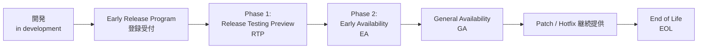
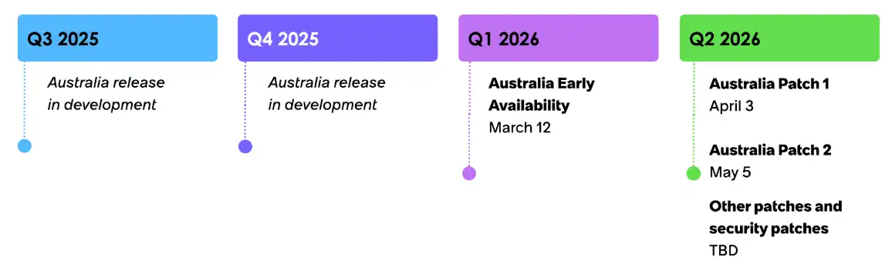
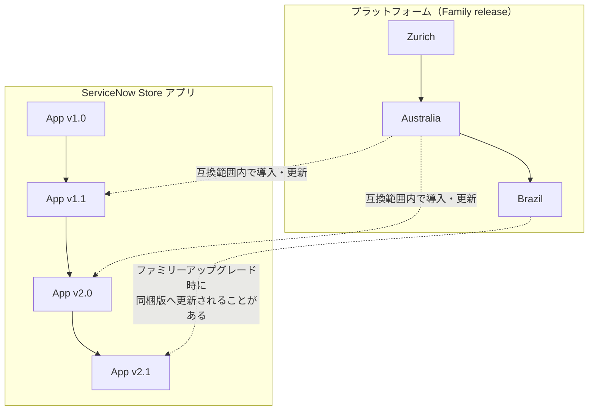
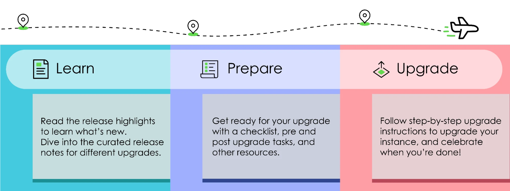
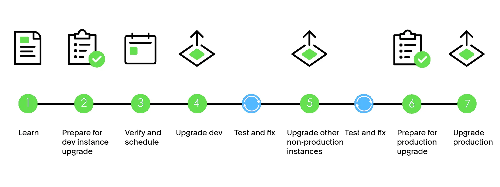

# リリースサイクルとバージョン（Release Cycle and Versions）

## 概要

ServiceNow は SaaS であり、全顧客のインスタンスが同じコードベースの上で動いている。そのコードベースは **年2回の Family release（ファミリーリリース）** で機能追加され、各ファミリーの中で **Patch（パッチ）** と **Hotfix（ホットフィックス）** によって不具合・脆弱性が修正される。本ファイルは、ServiceNow のリリースサイクルについて入門者が最初に押さえるべき以下の事項をまとめる。

| 観点 | 要点（2026-11-02 時点） |
|---|---|
| リリース頻度 | Family release は年2回。ServiceNow Store アプリは別スケジュール（四半期ごと等）で随時リリース |
| 命名規則 | アルファベット順。Aspen〜Zurich は都市名、**Australia 以降は国名**（Australia → Brazil → Canada …） |
| 公開フェーズ | Early Release Program（RTP → EA）を経て GA（General Availability：一般提供） |
| 現行ファミリー | **Australia**（2026-05-05 GA、本ナレッジの基準リリース）。次期 **Brazil** は 2026-09-24 EA、GA は 2026-11 見込み（未確定） |
| 修正の単位 | Patch（累積的な修正集）、Hotfix（個別修正）、Security patch（セキュリティ修正） |
| 用語 | **Upgrade（アップグレード）** = ファミリーをまたぐ移行、**Update（アップデート）** = 同一ファミリー内の Patch/Hotfix 間の移行 |
| サポート | 一般に「N（最新）と N-1（1つ前）」がサポート対象と説明される。契約により N-2 まで保持できる場合がある。EOL 後は Patch/Hotfix が提供されない |

アップグレードの実務手順（計画・テスト・スケジュール）は [アップグレード管理](../03_導入編/13-upgrade-management.md)、教訓は [アップグレードの教訓](../04_応用編/04-upgrade-lessons.md)、クローンやアップデートセットは [アップデートセットとクローン](../02_リファレンス/platform/update-sets-cloning.md) を参照。

---

## 1. Family release（ファミリーリリース）とは

### 1.1 定義

ServiceNow 公式ドキュメントは、リリースを **Family（ファミリー）** という単位で整理している。Family は「主要都市の名前が付けられたリリースの集合」であり、各 Family は Patch と Hotfix を含む。たとえば `Orlando Patch 4` と `Orlando Patch 3 Hotfix 2` はどちらも Orlando ファミリーに属する。[出典](https://www.servicenow.com/docs/r/release-notes/upgrade.html)

> 注：公式ドキュメントの定義文は都市名を前提とした書き方のまま残っているが、Australia 以降は国名が使われている（後述「3. 命名規則」）。

### 1.2 Upgrade と Update の違い

ServiceNow では「アップグレード」と「アップデート」を明確に区別する。この区別はロールバック可否などの運用にも直結するため、入門段階で押さえておく。

| 用語 | 意味 | 例 | ロールバック |
|---|---|---|---|
| **Upgrade（アップグレード）** | 別の Family のリリースへ移行すること | London Patch 7 → Orlando Patch 3 | 不可（汎用的なロールバック手段は無い） |
| **Update（アップデート）** | 同一 Family 内で Patch / Hotfix 間を移行すること | Orlando Patch 1 → Orlando Patch 3 | 可（既定 10 日間。`glide.rollback.expiration_days` で変更可。依頼は Customer Service and Support 経由） |

[出典](https://www.servicenow.com/docs/r/release-notes/upgrade.html)

### 1.3 Feature / Patch / Hotfix の定義

公式ドキュメント「ServiceNow upgrades」は、リリースに含まれる成果物を次のように定義している。[出典](https://www.servicenow.com/docs/r/release-notes/upgrade.html)

| 種類 | 公式定義（要約） | 新機能を含むか |
|---|---|---|
| **Feature（フィーチャー）** | 価値を付加する完全なソリューション。新機能を導入し、既存機能に対する入手可能な全修正を含み、本番利用を前提とする。新機能は一般に Feature release（＝Family release）でのみ提供される | 含む |
| **Patch（パッチ）** | 既存機能に対する問題修正の集合 | 一般に含まない |
| **Hotfix（ホットフィックス）** | Feature release に対する特定の問題修正。以前の修正を含む場合も含まない場合もある | 含まない |

このほか、公式の「Available patches and hotfixes」ページには **Security patch（セキュリティパッチ）** という種別が掲載されており、各 Patch には「Security fixes」として個別 KB（例：Australia Patch 7 → KB3221587）が紐づく。[出典](https://www.servicenow.com/docs/r/australia/release-notes/available-versions.html)

### 1.4 年2回のリズム

ServiceNow のファミリーリリースは **年2回** である。2026 年については、ServiceNow 社員がコミュニティで「年2回のメジャーファミリーリリース」を維持すると回答し、Australia を春（EA は早春、GA は晩春）、Brazil を秋（EA は初秋、GA は晩秋）と案内している。[出典](https://www.servicenow.com/community/product-launch-forum/releases-and-upgrades-schedule-2026/m-p/3473339)

近年の GA 時期を並べると、リリース時期が後ろ倒しになっていることが分かる。

| ファミリー | EA（公式表の Feature Early Availability 行） | GA（目安） |
|---|---|---|
| Xanadu | 2024-08-01 | 2024-09（Patch 1 = 2024-09-10） |
| Yokohama | 2025-01-30 | 2025-03（Patch 1 = 2025-03-12） |
| Zurich | 2025-07-31 | 2025-09（Patch 1 = 2025-09-10） |
| Australia | 2026-03-12 | **2026-05-05**（Patch 2 と同日） |
| Brazil | 2026-09-24 | 2026-11 見込み（未確定） |

EA 日付・Patch 日付は各ファミリーの公式「Available patches and hotfixes」ページ（[Xanadu](https://www.servicenow.com/docs/r/xanadu/release-notes/available-versions.html)、[Yokohama](https://www.servicenow.com/docs/r/yokohama/release-notes/available-versions.html)、[Zurich](https://www.servicenow.com/docs/r/zurich/release-notes/available-versions.html)、[Australia](https://www.servicenow.com/docs/r/australia/release-notes/available-versions.html)、[Brazil](https://www.servicenow.com/docs/r/brazil/release-notes/available-versions.html)）による。GA 日付そのものは公式表に明記されていないため、Yokohama・Zurich・Australia の GA 日は第三者情報（[jitendrazaa.com](https://www.jitendrazaa.com/blog/servicenow/servicenow-release-timeline-upgrade-guide-complete-2025/)、[ServiceNow Community](https://www.servicenow.com/community/servicenow-ai-platform-articles/servicenow-versions-release/ta-p/2312014)）と Patch 日付の一致から判断した。【第三者情報】【推定】

- 2024〜2025 年は「Q1 と Q3（3月・9月）に GA」というリズムだった。
- 2026 年は Australia が 5 月、Brazil が 11 月見込みとなり、**「Q2 と Q4」にずれた**。コミュニティでは「リリース時期が Q1/Q3 か Q2/Q4 か分からない、推測させないでほしい」という声もある。[出典](https://www.servicenow.com/community/product-launch-forum/i-am-on-washington-dc-why-am-i-getting-status-of-quot-nearing/m-p/3112765)【第三者情報】
- 近年は **GA が新しい Patch 番号の公開日と一致** する傾向がある（Xanadu・Yokohama・Zurich は Patch 1、Australia は Patch 2）。【推定】

---

## 2. Early Release Program と GA（リリースのフェーズ）

### 2.1 フェーズの全体像

新しいファミリーは、開発完了後すぐに全顧客へ配布されるのではなく、段階的に公開される。ServiceNow は既存顧客が GA 前に新ファミリーを試せる **Early Release Program（アーリーリリースプログラム）** を用意しており、これは 2 つのフェーズから成る。【第三者情報】（ServiceNow の KB0717787 / KB0635444 を引用した第三者解説による。KB 本文は Now Support へのログインが必要で、本調査では直接確認できず）[出典](https://nowben.com/the-ultimate-guide-to-servicenow-releases/)

| フェーズ | 日本語 | 時期（GA 基準） | 対象環境 | 内容 |
|---|---|---|---|---|
| **Release Testing Preview（RTP）** | リリーステストプレビュー | GA の **少なくとも 60 日前** | サブプロダクション（開発・テスト）インスタンスのみ | プレリリース版でのテスト。KB0717787 |
| **Early Availability（EA）** | 早期提供 | GA の **少なくとも 45 日前** | サブプロダクション **と本番** | 本番利用可能（production-ready）な版へのアップグレード。KB0635444 |
| **General Availability（GA）** | 一般提供 | — | 全顧客 | EA と早期テストの終了。リリースの最終版で、全顧客に本番アップグレードが広く開放される |

上表は第三者解説（ServiceNow 提供資料ベース）による。[出典](https://nowben.com/the-ultimate-guide-to-servicenow-releases/)【第三者情報】

- 公式の「ServiceNow upgrades」ページは、リリース用語と提供フェーズの正式な説明として **ServiceNow Release Cycle [KB0547244]** を参照するよう案内している（Now Support の KB。本調査では本文を閲覧できず）。[出典](https://www.servicenow.com/docs/r/release-notes/upgrade.html)
- 公式の「Available patches and hotfixes」表では、EA 版は **「Feature Early Availability」** という種別で掲載され、EA 期間中に出る Patch/Hotfix は可用性欄が **「Available to Early Availability customers」**（EA 顧客のみ提供）となる。[出典](https://www.servicenow.com/docs/r/brazil/release-notes/available-versions.html)

### 2.2 Australia の実例

ServiceNow が公開した Australia のタイムライン図を以下に示す。

- **キャプション**：Australia release timeline — Australia ファミリーの開発から GA までの四半期別タイムライン（ServiceNow 作成の図）。
- **図の説明**：横軸に 4 つの四半期が並ぶ。Q3 2025 と Q4 2025 は「Australia release in development（開発中）」。Q1 2026 に「Australia Early Availability — March 12」。Q2 2026 に「Australia Patch 1 — April 3」「Australia Patch 2 — May 5」「Other patches and security patches — TBD」が配置されている。つまり **EA（3/12）→ Patch 1（4/3、EA 期間中）→ Patch 2（5/5、GA）** という流れである。
- **出典**：https://nowben.com/the-ultimate-guide-to-servicenow-releases/ （図の元出典は ServiceNow と記載）／画像 URL：https://nowben.com/wp-content/uploads/2026/05/snrel3.webp
- **取得日**：2026-11-02

Australia の公式日程（公式「Available patches and hotfixes」表とコミュニティ情報）：

| マイルストーン | 日付 | 出典 |
|---|---|---|
| Feature Early Availability | 2026-03-12 | [公式](https://www.servicenow.com/docs/r/australia/release-notes/available-versions.html) |
| Australia Patch 1 | 2026-04-03 | [公式](https://www.servicenow.com/docs/r/australia/release-notes/available-versions.html) |
| Australia Patch 2（＝GA） | 2026-05-05 | [公式](https://www.servicenow.com/docs/r/australia/release-notes/available-versions.html)／GA 日は [第三者](https://www.jitendrazaa.com/blog/servicenow/servicenow-release-timeline-upgrade-guide-complete-2025/) |
| Australia Patch 7（最新の番号付き Patch） | 2026-10-08 | [公式](https://www.servicenow.com/docs/r/australia/release-notes/available-versions.html) |
| Q4 2026 Patch target | Australia Patch 5a W44（2026-10-29） | [公式](https://www.servicenow.com/docs/r/australia/release-notes/available-versions.html) |

### 2.3 Brazil の日程（2026-11-02 時点）

> **Brazil での変更:** Brazil は国名ファミリーの 2 番目。日程は以下のとおりで、**GA 日は公式には未確認**である。
>
> | マイルストーン | 日付 | 確度 |
> |---|---|---|
> | Early Release Program 登録開始 | 2026-08 | 【第三者情報】[出典](https://nowben.com/servicenow-brazil-release-key-dates-and-preview-information/) |
> | RTP・暫定リリースノート | 2026-09-10（予定） | 【第三者情報】[出典](https://nowben.com/servicenow-brazil-release-key-dates-and-preview-information/) |
> | Early Availability | 当初 2026-09-10 前後の予定 → **2026-09-24 に変更** | ServiceNow 社員の Community 記事で「Brazil Early Availability has moved to September 24」と告知。[出典](https://www.servicenow.com/community/servicenow-otto-for-creator/what-s-new-in-servicenow-otto-for-creator-brazil-ea-release/ta-p/3596068)。公式表でも Feature Early Availability = 2026-09-24。[出典](https://www.servicenow.com/docs/r/brazil/release-notes/available-versions.html) |
> | Brazil Patch 1 | 2026-10-08 | 公式表 [出典](https://www.servicenow.com/docs/r/brazil/release-notes/available-versions.html) |
> | Brazil Patch 1 Hotfix 1 | 2026-10-15（Available to Early Availability customers） | 公式表 [出典](https://www.servicenow.com/docs/r/brazil/release-notes/available-versions.html) |
> | General Availability | **2026-11 見込み** | 【第三者情報】コミュニティ回答・第三者ブログ。公式の GA 日付は公開情報では確認できず。[出典](https://nowben.com/servicenow-brazil-release-key-dates-and-preview-information/) |
>
> また、公式「ServiceNow upgrades」ページは「Brazil では Update・Upgrade ともに所要時間が大幅に短縮される。ただし速く終わったことを成功とみなさず、必ずテストすること」と記載している。[出典](https://www.servicenow.com/docs/r/release-notes/upgrade.html)

---

## 3. 命名規則

### 3.1 ファミリー名：アルファベット順の都市名 → 国名

ServiceNow のファミリー名は **アルファベット順** に付けられる。

- **第1巡（都市名）**：2011 年の **Aspen** から 2025 年の **Zurich** まで、A〜Z の頭文字を持つ都市名が順に使われた（例：Kingston、London、Madrid、New York、Orlando、Paris、Quebec、Rome、San Diego、Tokyo、Utah、Vancouver、Washington DC、Xanadu、Yokohama、Zurich）。[出典](https://www.jitendrazaa.com/blog/servicenow/servicenow-release-timeline-upgrade-guide-complete-2025/)【第三者情報】
- **第2巡（国名）**：Zurich の後は A に戻り、**国名** が使われる。**Australia が最初の国名ファミリー**、続いて **Brazil**。ServiceNow 社員は 2026 年のスケジュールに関するコミュニティスレッドで、命名が都市名から国名に変わることを前提に Australia / Brazil の時期を案内している。[出典](https://www.servicenow.com/community/product-launch-forum/releases-and-upgrades-schedule-2026/m-p/3473339)
- **今後**：コミュニティのリリース一覧記事では Brazil の次が **Canada（2027 年 Q2 想定）**、その次が **Denmark（「Q4」とのみ記載）** と記載されている。いずれも公式発表は確認できず。[出典](https://www.servicenow.com/community/servicenow-ai-platform-articles/servicenow-versions-release/ta-p/2312014)【第三者情報】

> 補足：第1巡の中でも Utah（州名）や Xanadu（架空の地名）のように厳密な「都市名」でない名前がある。Utah・Xanadu も含めて慣習的に「都市名リリース」と呼ばれる。【経験則】

ファミリー名が出てくる典型的な場面：

| 場面 | 例 |
|---|---|
| 公式ドキュメントの URL | `https://www.servicenow.com/docs/r/australia/...`、`https://www.servicenow.com/docs/r/zurich/...` |
| リリースノートのデルタ（差分）ページ | `delta-zurich-australia`（Zurich → Australia の差分）、`delta-yokohama-brazil` |
| Patch/Hotfix の版名 | `Australia Patch 7 Hotfix 1` |
| 認定資格の Delta exam（差分試験） | ファミリーごとに実施（[学習パスと認定資格](09-learning-path.md) 参照） |

### 3.2 版（バージョン）名の読み方

ファミリー内の個々の版は「**ファミリー名 + Patch 番号 + 修飾子**」で表される。公式「Available patches and hotfixes」表（Australia / Zurich）に実際に掲載されている版名から、次のパターンが読み取れる。[出典](https://www.servicenow.com/docs/r/australia/release-notes/available-versions.html)・[出典](https://www.servicenow.com/docs/r/zurich/release-notes/available-versions.html)

| パターン | 例 | 公式表上の種別 | 意味 |
|---|---|---|---|
| `<Family> Patch N` | Australia Patch 7 | Patch | 番号付きパッチ。各 Patch に Security fixes の KB が紐づく |
| `<Family> Patch N Hotfix M` | Australia Patch 4 Hotfix 3 | Hotfix | Patch N に対する M 番目の Hotfix |
| `<Family> Patch Na` / `Nb` | Australia Patch 5a、Zurich Patch 12a | Security patch | Patch N をベースにしたセキュリティパッチ（a → b と続く） |
| `<Family> Patch N Hotfix Ma` / `Mb` | Zurich Patch 10 Hotfix 3a | Security patch または Hotfix | Hotfix M をベースにした派生版 |
| `<Family> Patch Nm` | Australia Patch 6m、Zurich Patch 12m | Patch | 「m」付きの Patch。**「m」の意味は公開情報では確認できず** |
| `<...> Wnn` | Australia Patch 5a W44、Zurich Patch 13 W42 | Hotfix | ベース版に対し週次で出る Hotfix 系列。`W` に続く数字は掲載日と照合すると **ISO 週番号** に一致する（例：W44 = 2026-10-26〜11-01 の週に 2026-10-28/29 公開）【推定】 |
| `<Family> EA Hotfix N` | Australia EA Hotfix 1 | — | EA 版に対する Hotfix |

- **Patch は累積的（cumulative）** で、同一ファミリーの過去の修正を含むと一般に説明される。一方 Hotfix は「以前の修正を含む場合も含まない場合もある」と公式に定義されている。[出典](https://www.servicenow.com/docs/r/release-notes/upgrade.html)
- 2026 年に入ってから、同じ番号の Patch に対して `W` 付き Hotfix が毎週のように並行公開されている（例：Australia Patch 5 W33〜W43）。古い `W` 版は新しい版が出ると「Unavailable」になる。[出典](https://www.servicenow.com/docs/r/australia/release-notes/available-versions.html)

### 3.3 自インスタンスのバージョンを確認する方法

| 方法 | 手順 | 備考 |
|---|---|---|
| `stats.do` | ブラウザで `https://<instance>.service-now.com/stats.do` を開く、または Application Navigator で `stats.do` と入力 | Build name / Build tag が表示される。通常 admin 相当の権限が必要。【第三者情報】[出典](https://www.servicenow.com/community/developer-forum/where-to-check-service-now-version/td-p/1909998/page/3) |
| システムプロパティ | Background script で `gs.getProperty('glide.war')` を実行 | `glide.war` にリリース名・版・ビルド日が入るとコミュニティで説明されている。【第三者情報】[出典](https://www.servicenow.com/community/developer-forum/how-to-check-servicenow-instance-version-through-rest-api/m-p/2196955) |
| Upgrade Console | Upgrade Console の Overview タブ → **Current version** セクション | 現在のバージョン名と、そのバージョンの End of Life 情報へのリンクが表示される（Zurich 時点の公式ドキュメント）。[出典](https://www.servicenow.com/docs/r/7LhbZn3yz3Q58qhjZoU9iQ/b8xBw9Kx_m6ywoaK~SOCDg) |
| Now Support | Now Support ポータル → Instances → Instances Dashboard | 所有する全インスタンスのバージョンとスケジュール済みアップグレードを確認できる。[出典](https://www.servicenow.com/community/onboarding-hub-articles/getting-started-with-servicenow-patching-and-eol-programs/ta-p/3114925) |

---

## 4. Patch / Hotfix の提供と可用性

### 4.1 「Available patches and hotfixes」ページ

ServiceNow は各ファミリーのリリースノート内に **Available patches and hotfixes（入手可能なパッチとホットフィックス）** ページを公開している。このページには版名・種別（Feature Early Availability / Patch / Hotfix / Security patch）・公開日・**Availability（可用性）** が一覧される。[出典](https://www.servicenow.com/docs/r/release-notes/available-versions.html)

| Availability の値 | 意味 |
|---|---|
| **Available** | 誰でもアップグレード可能。Instance Upgrade Management Dashboard に表示され、エンタイトルメント申請なしでスケジュールできる |
| **Available by request** | アップグレードには Customer Service and Support の承認が必要 |
| **Unavailable** | その版は入手不可（後継の版に置き換えられた等） |
| **Available to Early Availability customers** | EA 期間中、EA 参加顧客のみ入手可能 |

[出典](https://www.servicenow.com/docs/r/brazil/release-notes/available-versions.html)

### 4.2 Patch target（四半期ごとの推奨到達版）

「Available patches and hotfixes」ページには **四半期ごとの Patch target（パッチ目標版）** が記載される。2026 年 Q4 の Patch target は次のとおり（ページ上で「Target versions change only if absolutely necessary＝目標版は絶対に必要な場合のみ変更される」と注記）。[出典](https://www.servicenow.com/docs/r/release-notes/available-versions.html)

| ファミリー | Q4 2026 Patch target |
|---|---|
| Australia | Australia Patch 5a W44（Australia 版ページの記載。共通ページでは W42 表記の時期あり） |
| Zurich | Zurich Patch 12 W42 |
| Yokohama | Yokohama Patch 13 Hotfix 5a W39 |

> 注：共通ページと Australia 版ページで W 番号が異なる（W42 / W44）のは、ページの更新時期の差と考えられる。最新の値は Australia 版ページ（Australia Patch 5a W44、2026-10-29 公開、Available）。[出典](https://www.servicenow.com/docs/r/australia/release-notes/available-versions.html)【推定】

ServiceNow の **Patching Program（パッチ適用プログラム）** では、Patch target に合わせて ServiceNow が顧客インスタンス向けに **Parent Change Request（親 CHG）** を作成し、パッチ適用を連絡・追跡する。顧客は Now Support の Instances Dashboard から該当インスタンスの親 CHG を開き、コメントで質問・延期相談ができる。詳細は KB0995477 / KB1644913 に記載されている（本調査では KB 本文は未確認）。[出典](https://www.servicenow.com/community/onboarding-hub-articles/getting-started-with-servicenow-patching-and-eol-programs/ta-p/3114925)

> 実務上、パッチ適用は月次程度で求められ、延期を申請しない限り自動作成された CHG に沿って適用されると説明されることが多い。【第三者情報】[出典](https://www.servicenow.com/community/upgrades-and-patching-forum/upgrade-timing-for-end-of-life-versions/td-p/319713/page/2)

### 4.3 Patch の公開頻度（Australia の例）

Australia ファミリーでは、公式表に掲載された番号付き Patch の公開日は次のとおりで、**おおむね 3〜6 週間ごと** に新しい Patch が出ている。[出典](https://www.servicenow.com/docs/r/australia/release-notes/available-versions.html)

| 版 | 公開日 | Security fixes KB |
|---|---|---|
| Australia Patch 1 | 2026-04-03 | KB2914133 |
| Australia Patch 2 | 2026-05-05 | KB2977251 |
| Australia Patch 3 | 2026-06-16 | KB3035030 |
| Australia Patch 4 | 2026-07-09 | KB3126028 |
| Australia Patch 5 | 2026-08-07 | KB3138411 |
| Australia Patch 6 | 2026-09-10 | KB3152248 |
| Australia Patch 7 | 2026-10-08 | KB3221587 |

---

## 5. N / N-1 サポートポリシーと End of Life（EOL）

### 5.1 N / N-1 とは

- **N** = 最新の GA 済みファミリー、**N-1** = その 1 つ前のファミリー、**N-2** = 2 つ前。
- ServiceNow は 2018 年の London リリース前後に、サポート対象を N-2 から **N-1** へ縮小したと広く説明されている。【第三者情報】[出典](https://www.servicenow.com/community/now-platform-forum/with-the-new-sn-policy-to-support-only-n-and-n-1-release-how-can/m-p/1033893)
- 一方で、サポート範囲は **契約（エンタイトルメント）によって N-1 または N-2** になる。2024-11 時点のコミュニティ回答では「N-1 エンタイトルメントでは Xanadu（N）と Washington DC（N-1）、N-2 エンタイトルメントでは Xanadu（N）と Vancouver・Washington DC」がサポート対象と説明されている。[出典](https://www.servicenow.com/community/product-launch-forum/i-am-on-washington-dc-why-am-i-getting-status-of-quot-nearing/m-p/3112765)【第三者情報】
- 正式なポリシーは Now Support の **KB0783520（ServiceNow Upgrade and Update Policy Explained）**、**KB0610454（End-of-Life - Unsupported release family upgrades FAQ）**、**KB0598977（Definition of Unsupported Release）** に記載されている（いずれもログインが必要で、本調査では本文未確認）。[出典](https://www.servicenow.com/community/upgrades-and-patching-blogs/what-does-quot-unsupported-quot-really-mean/ba-p/2283644)

2026-11-02 時点で N / N-1 を当てはめると次のようになる（Brazil GA 前）。

| 区分 | ファミリー | 状況 |
|---|---|---|
| N（次期・EA 中） | Brazil | EA 顧客のみ（2026-09-24〜） |
| **N（現行）** | **Australia** | 2026-05-05 GA。基準リリース |
| N-1 | Zurich | Patch 13 まで公開、Q4 2026 Patch target あり |
| N-2 | Yokohama | Q4 2026 Patch target あり（＝少なくとも 2026 Q4 時点で Patch 提供が継続）。第三者情報では EOL は 2026 Q4 とされる【第三者情報】[出典](https://www.jitendrazaa.com/blog/servicenow/servicenow-release-timeline-upgrade-guide-complete-2025/) |
| N-3 | Xanadu | 最終掲載は Xanadu Patch 11 Hotfix 5a（2026-05-20、Available by request）。第三者情報では 2026 Q2 に EOL【第三者情報】 |

> 解釈上の注意：公式の Q4 2026 Patch target が Australia・Zurich・Yokohama の 3 ファミリーに設定されていることから、「N-1 のみ」とする一般的な説明よりも、実際には EOL 到達までの移行期間を含めて 3 ファミリー程度に Patch が提供されている状態と読める。自社がどこまでサポートされるかは、契約と Now Support の EOL 情報で必ず確認すること。【推定】[出典](https://www.servicenow.com/docs/r/release-notes/available-versions.html)

> **Brazil での変更:** Brazil が GA になると、Brazil = N、Australia = N-1、Zurich = N-2 となり、Yokohama は EOL に向かう（N-1 エンタイトルメントなら Zurich も EOL 対象）。Brazil のリリースノートには Yokohama・Zurich・Australia からの差分ページ（`delta-yokohama-brazil` など）が用意されている。[出典](https://www.servicenow.com/docs/r/delta-australia-brazil/brazil-australia-servicenowide-release-notes.html)【推定】

### 5.2 「Unsupported（サポート対象外）」の意味

ServiceNow 公式コミュニティブログ（Upgrades and Patching）によれば、**Unsupported は「EOL に達したファミリーに対して ServiceNow が Patch と Hotfix を提供しなくなる」ことを意味する**。問い合わせに一切応じなくなるという意味ではない。[出典](https://www.servicenow.com/community/upgrades-and-patching-blogs/what-does-quot-unsupported-quot-really-mean/ba-p/2283644)

### 5.3 EOL Program（End of Life プログラム）

| 項目 | 内容 | 出典 |
|---|---|---|
| 目的 | 最新のセキュリティ・性能・可用性修正を受け続けられるよう、EOL ファミリー上の顧客をサポート対象ファミリーへ移行させる | [公式ブログ](https://www.servicenow.com/community/upgrades-and-patching-blogs/what-does-quot-unsupported-quot-really-mean/ba-p/2283644) |
| 顧客の選択肢 | ① 自分で時期と到達版（入手可能な最上位版）を選んでアップグレード ② 自分で実施しない場合、ServiceNow がサポート対象ファミリーへのアップグレードをスケジュールし、実施時にサポートを提供する | [公式ブログ](https://www.servicenow.com/community/upgrades-and-patching-blogs/what-does-quot-unsupported-quot-really-mean/ba-p/2283644) |
| 事前通知 | EOL が近いファミリーのインスタンスで、アップグレードが未スケジュールの場合に **「nearing end of life」** ステータスが表示される。サポート対象ファミリーへ移行すると消える | [Community](https://www.servicenow.com/community/product-launch-forum/i-am-on-washington-dc-why-am-i-getting-status-of-quot-nearing/m-p/3112765)【第三者情報】 |
| 連絡手段 | Parent CHG と EOL Dashboard（Now Support） | [Community（社員投稿）](https://www.servicenow.com/community/onboarding-hub-articles/getting-started-with-servicenow-patching-and-eol-programs/ta-p/3114925) |
| EOL のタイミング | コミュニティのリリース一覧記事では「EOL タイムラインは公式には GA + 60 日」と記載（次のファミリーの GA から約 60 日後、の意と解される） | [Community](https://www.servicenow.com/community/servicenow-ai-platform-articles/servicenow-versions-release/ta-p/2312014)【第三者情報】【推定】 |

> 実務上のポイント：EOL 日付はファミリーごとに事前に固定公表されるものではなく、次のファミリーの GA 後に通知される形が多い。「Yokohama の公式 EOL 日はいつか」というコミュニティの質問（2025-06）に対しても「公式な発表はまだない」との回答だった。[出典](https://www.servicenow.com/community/upgrades-and-patching-forum/what-is-yokohama-s-official-end-of-life-date/m-p/3293994)【第三者情報】

### 5.4 ファミリーを飛ばすアップグレード

- 公式ドキュメントは「最新ファミリーへ直接アップグレードできる。複数バージョンをまたぐ場合は、現行版から目標版までの間にある各バージョンのリリースノートを確認すること」としている。[出典](https://www.servicenow.com/docs/r/release-notes/upgrade.html)
- Australia のリリースノートには、**Zurich・Yokohama・Xanadu の各ファミリーから Australia へ** アップグレードする場合のリリースノート経路が用意されている（＝最大 3 ファミリー前からの移行を想定）。差分をまとめた **Combined product release notes for cross-family upgrades** も提供される。[出典](https://www.servicenow.com/docs/r/australia/release-notes/family-release-notes.html)
- 「年1回だけアップグレードして N-1 を維持する」（1 ファミリー飛ばしで運用する）方針を採る顧客も多い。【経験則】[出典](https://www.servicenow.com/community/developer-forum/how-to-upgrade-and-stay-on-n-1-and-upgrade-only-once-a-year/m-p/2350153)

---

## 6. ServiceNow Store アプリの独立リリース

### 6.1 Family release とは別に動く

ServiceNow の機能の多くは、プラットフォーム本体（ファミリー）ではなく **ServiceNow Store（ストア）経由のアプリケーション** として提供・更新される。

- Australia 版の公式ドキュメント（ITOM Store upgrades）は、**各アプリケーションは異なるリリーススケジュールを持ち得て、Out-of-band（帯域外）、すなわち特定のファミリーリリースに縛られない** と説明している。最新の Out-of-band アップグレードは ServiceNow Store から直接入手する。[出典](https://www.servicenow.com/docs/r/u7nZu9GEUxWr9UkuDmbe6w/p38fsz1iLJIQoyRahdGGTQ)
- ServiceNow 社員による Store Releases フォーラムの FAQ では、**Store リリースは四半期ごと** であり、Q1 と Q3 の Store リリースはファミリーリリースに合わせた Store リリースと重なると説明されている（2024 年時点の記述。ファミリーの時期が Q2/Q4 に移った 2026 年以降の対応関係は公開情報では確認できず）。[出典](https://www.servicenow.com/community/servicenow-store-releases/store-release-forum-faqs/ta-p/2352627)
- HR Service Delivery の公式コミュニティ FAQ（ServiceNow 社員投稿）は、Store アプリは多くの場合 **最新ファミリーに依存せず、複数のファミリーに後方互換** であるため、プラットフォームのアップグレードなしに新機能を採用できると説明している。[出典](https://www.servicenow.com/community/hrsd-articles/servicenow-store-frequently-asked-questions-faqs/ta-p/2313795)

### 6.2 Store アプリの更新方法

| 項目 | 内容 | 出典 |
|---|---|---|
| 管理画面 | **Application Manager**（アプリケーションマネージャー）。ナビゲーション：`All > Admin > Application Manager` | [公式（Zurich）](https://www.servicenow.com/docs/r/7LhbZn3yz3Q58qhjZoU9iQ/YEkm_EKK0HKTdmqjibAY1A) |
| 必要ロール | `admin` | [公式（Zurich）](https://www.servicenow.com/docs/r/7LhbZn3yz3Q58qhjZoU9iQ/YEkm_EKK0HKTdmqjibAY1A) |
| できること | ライセンス済みアプリ・プラグインのインストール、更新、修復（Repair）、アンインストール | 同上 |
| 更新 | 更新可能なアプリ・プラグインを一覧から選び、即時インストールまたは日時指定でスケジュール。多くは Store に戻らずに更新できる | [公式（Zurich）](https://www.servicenow.com/docs/r/7LhbZn3yz3Q58qhjZoU9iQ/bD_XB4s8asdFrDfTqxMJlg) |
| ファミリーとの関係 | Store アプリの版は、インスタンスを新ファミリーへアップグレードする際にも更新され得る。更新は基本的に手動だが、古すぎるアプリはファミリーアップグレード時に強制更新されることがある | [Community FAQ](https://www.servicenow.com/community/servicenow-store-releases/store-release-forum-faqs/ta-p/2352627)【第三者情報】 |
| 互換性の制約 | 自インスタンスのファミリーと互換性のあるアプリ版しか導入できない | [Community（GRC ブログ）](https://www.servicenow.com/community/grc-blog/the-servicenow-store-speeds-access-to-new-grc-applications/ba-p/2273910) |

> 実務上の意味：Now Assist（生成 AI）系、ITOM 系、HRSD 系など多くの機能が Store アプリとして頻繁に更新されるため、「ファミリーが同じでも Store アプリの版によって使える機能が違う」ことがある。機能の有無を議論するときは **ファミリー名＋Store アプリの版** の両方を確認する。【経験則】（Now Assist の詳細は [Now Assist と AI Agents](../02_リファレンス/platform/now-assist-ai-agents.md) を参照）

---

## 7. リリースノートとアップグレードの進め方（入門レベル）

### 7.1 リリースノートの構成

Australia のリリースノート（Australia release notes）は、アップグレードを **Learn → Prepare → Upgrade** の 3 段階で進めるよう構成されている。[出典](https://www.servicenow.com/docs/r/australia/release-notes/family-release-notes.html)

- **キャプション**：How to use release notes — 新しいリリースノートを 3 段階（Learn / Prepare / Upgrade）で使う流れを示す ServiceNow の図。
- **図の説明**：左から 3 つの色付きパネルが並ぶ。**Learn**（学ぶ）：「リリースハイライトを読んで新機能を知り、アップグレード種別ごとに整理されたリリースノートを深掘りする」。**Prepare**（準備する）：「チェックリスト、アップグレード前後のタスク、その他のリソースでアップグレードに備える」。**Upgrade**（アップグレードする）：「ステップバイステップの手順に従ってインスタンスをアップグレードする」。上部には点線の旅程と飛行機のアイコンがあり、旅にたとえている。
- **出典**：https://nowben.com/the-ultimate-guide-to-servicenow-releases/ （図の元出典は ServiceNow と記載）／画像 URL：https://nowben.com/wp-content/uploads/2026/05/snrel1.webp
- **取得日**：2026-11-02

リリースノートのツール（Australia の公式ページに掲載）：[出典](https://www.servicenow.com/docs/r/australia/release-notes/family-release-notes.html)

| ツール | 内容 |
|---|---|
| Build your own release notes | 製品・含まれる修正・アップグレードタスクを選んで独自のリリースノートを作成（ファミリーを飛ばす場合にも対応） |
| Release notes summaries | 全製品横断のカテゴリ別まとめ（例：Australia 全製品のブラウザ要件） |
| Personalized PRB release notes | 現行版から目標版へのアップグレードで修正される Problem（PRB）の累積一覧 |
| Combined product release notes for cross-family upgrades | 任意のファミリーから任意のファミリーへの差分を 1 ページにまとめたもの |

### 7.2 アップグレードの 7 フェーズ

- **キャプション**：Path to successful upgrades — ServiceNow が示すアップグレードの標準的な流れ。
- **図の説明**：左から番号付きのステップが一列に並ぶ。① Learn（学ぶ）→ ② Prepare for dev instance upgrade（開発インスタンスのアップグレード準備）→ ③ Verify and schedule（確認とスケジュール）→ ④ Upgrade dev（開発インスタンスをアップグレード）→（青の循環アイコン）Test and fix（テストと修正）→ ⑤ Upgrade other non-production instances（その他の非本番インスタンスをアップグレード）→（青の循環アイコン）Test and fix → ⑥ Prepare for production upgrade（本番アップグレードの準備）→ ⑦ Upgrade production（本番をアップグレード）。
- **出典**：https://nowben.com/the-ultimate-guide-to-servicenow-releases/ （図の元出典は ServiceNow と記載）／画像 URL：https://nowben.com/wp-content/uploads/2026/05/snrel2.webp
- **取得日**：2026-11-02

公式ドキュメントでは、アップグレードのスケジュールは **Now Support** から行い（例：Phase 3 で開発インスタンス、Phase 7 で本番インスタンスをスケジュール）、作業には `admin` ロールが必要とされる。テストは開発インスタンスでスモークテスト、テストインスタンスで Automated Test Framework（ATF）と UAT、本番では UAT のみ（ATF は非本番向け）が推奨される。[出典](https://www.servicenow.com/docs/r/release-notes/upgrade.html)・[出典](https://www.servicenow.com/docs/r/release-notes/upgrades-phase-7.html)

インスタンス側では、Store アプリの **Upgrade Console（アップグレードコンソール）** が、最新 3 バージョンの表示・Patch 版の選択・スケジュール状況・現行版の EOL 情報・関連ツール（ATF、Cloning、Upgrade History、Upgrade Monitor、Upgrade Preview、Upgrade Skipped Record Rules Editor、Upgrade Plans など）を 1 か所にまとめている（Zurich 時点の公式ドキュメント）。[出典](https://www.servicenow.com/docs/r/7LhbZn3yz3Q58qhjZoU9iQ/b8xBw9Kx_m6ywoaK~SOCDg)

詳細な手順・体制・スキップ判断は [アップグレード管理](../03_導入編/13-upgrade-management.md)、カスタマイズがアップグレードに与える影響（Skipped records 等）は [カスタマイズと技術的負債](../04_応用編/02-customization-technical-debt.md) を参照。

---

## 8. 歴代リリース一覧

ServiceNow の歴代ファミリーリリースを以下にまとめる。**公式に GA 日付を一覧で公開したページは確認できなかった** ため、2024 年以降は公式「Available patches and hotfixes」表の EA / Patch 日付、それ以前はコミュニティのリリース一覧記事・第三者ブログの値を記載する。日付は情報源によって数週間程度ずれることがある。

### 8.1 国名ファミリー（2026〜）

| # | ファミリー | EA | GA | 備考 | 出典 |
|---|---|---|---|---|---|
| 1 | **Australia** | 2026-03-12 | **2026-05-05** | 初の国名ファミリー。本ナレッジの基準 | [公式](https://www.servicenow.com/docs/r/australia/release-notes/available-versions.html)・GA は【第三者情報】 |
| 2 | **Brazil** | 2026-09-24 | 2026-11 見込み | 2026-11-02 時点で EA 中 | [公式](https://www.servicenow.com/docs/r/brazil/release-notes/available-versions.html)・GA は【第三者情報】 |
| 3 | Canada | — | 2027 Q2 想定 | 公式未発表 | 【第三者情報】[Community](https://www.servicenow.com/community/servicenow-ai-platform-articles/servicenow-versions-release/ta-p/2312014) |
| 4 | Denmark | — | 「Q4」とのみ記載（2027 年後半と推定） | 公式未発表 | 【第三者情報】【推定】同上 |

### 8.2 都市名ファミリー（2011〜2025）

| ファミリー | GA（目安） | 備考 |
|---|---|---|
| Aspen | 2011 | 最初の都市名ファミリー |
| Berlin | 2012 | |
| Calgary | 2013 Q2 | |
| Dublin | 2013 Q4 | |
| Eureka | 2014 | |
| Fuji | 2015 Q1 | |
| Geneva | 2015 Q4 | |
| Helsinki | 2016 | |
| Istanbul | 2017 Q1 | |
| Jakarta | 2017 Q2 | |
| Kingston | 2017-11 | |
| London | 2018 Q3 | この前後でサポート方針が N-2 → N-1 に変わったと説明される【第三者情報】 |
| Madrid | 2019 Q1 | |
| New York | 2019 Q2 | |
| Orlando | 2020 Q1 | |
| Paris | 2020 Q3 | |
| Quebec | 2021 Q1 | |
| Rome | 2021 Q3 | |
| San Diego | 2022 Q1 | |
| Tokyo | 2022 Q3 | |
| Utah | 2023 Q1 | |
| Vancouver | 2023 Q3 | |
| Washington DC | 2024 Q1 | 公式ドキュメント上の Washington DC 版「Available patches and hotfixes」URL は 2026-11 時点で最新版ページへリダイレクトされる |
| Xanadu | 2024-09（EA 2024-08-01、Patch 1 2024-09-10） | EA・Patch 日付は [公式](https://www.servicenow.com/docs/r/xanadu/release-notes/available-versions.html) |
| Yokohama | 2025-03（EA 2025-01-30、Patch 1 2025-03-12） | EA・Patch 日付は [公式](https://www.servicenow.com/docs/r/yokohama/release-notes/available-versions.html) |
| Zurich | 2025-09（EA 2025-07-31、Patch 1 2025-09-10） | 最後の都市名ファミリー。EA・Patch 日付は [公式](https://www.servicenow.com/docs/r/zurich/release-notes/available-versions.html) |

Aspen〜Washington DC の GA 時期は第三者ブログによる。【第三者情報】[出典](https://www.jitendrazaa.com/blog/servicenow/servicenow-release-timeline-upgrade-guide-complete-2025/)・[出典](https://www.servicenow.com/community/servicenow-ai-platform-articles/servicenow-versions-release/ta-p/2312014)

### 8.3 ファミリー制以前

Aspen 以前は「GlideSoft 2004」「Spring 2010」「Winter 2011」のように、年・季節・月で版が呼ばれていた。また 2014 年には中堅企業向けの別製品ライン **ServiceNow Express** が存在した（ファミリーリリースとは別系統）。【第三者情報】[出典](https://www.servicenow.com/community/servicenow-ai-platform-articles/servicenow-versions-release/ta-p/2312014)

---

## 9. 入門者向けまとめ（よくある質問）

| 質問 | 回答 |
|---|---|
| 今の最新バージョンは？ | 2026-11-02 時点で GA 済みの最新は **Australia**（2026-05-05 GA）。Brazil は EA 中で、GA は 2026-11 見込み |
| 「Zurich Patch 12」と「Zurich Patch 12 Hotfix 1」の違いは？ | Patch は修正の累積的なまとまり、Hotfix は特定の問題に対する個別修正。どちらも新機能は含まない |
| EA で本番を上げてもよいか？ | EA は本番利用可能（production-ready）な版として提供される。RTP はサブプロダクション専用【第三者情報】 |
| 何バージョンまで遅れてよいか？ | 一般に N-1 まで。ただし契約により N-2 まで認められる場合がある。EOL に達すると Patch/Hotfix が出なくなり、ServiceNow がアップグレードをスケジュールする |
| アップグレードは戻せるか？ | ファミリーをまたぐ Upgrade は戻せない。同一ファミリー内の Update は既定 10 日間ロールバック可能 |
| 新機能はファミリーアップグレードしないと使えないか？ | プラットフォーム機能はファミリーで提供されるが、多くのアプリ機能は Store アプリとして Out-of-band で提供され、現行ファミリーのまま更新できることが多い |
| 自インスタンスの版はどこで分かるか？ | `stats.do`、Upgrade Console の Current version、Now Support の Instances Dashboard |

関連：[ServiceNowとは](01-what-is-servicenow.md)、[Now Platform の全体像](02-platform-overview.md)、[インスタンスアーキテクチャ](../02_リファレンス/platform/instance-architecture.md)、[インスタンス戦略と環境](../03_導入編/07-instance-strategy.md)、[サポートと監視](../03_導入編/14-support-monitoring.md)、[学習パスと認定資格](09-learning-path.md)。

---

## 参照元

### ServiceNow 公式ドキュメント
- ServiceNow upgrades（Family / Upgrade / Update / Feature / Patch / Hotfix の定義、ロールバック、テスト）: https://www.servicenow.com/docs/r/release-notes/upgrade.html
- Available patches and hotfixes（共通・最新）: https://www.servicenow.com/docs/r/release-notes/available-versions.html
- Available patches and hotfixes（Australia）: https://www.servicenow.com/docs/r/australia/release-notes/available-versions.html
- Available patches and hotfixes（Zurich）: https://www.servicenow.com/docs/r/zurich/release-notes/available-versions.html
- Available patches and hotfixes（Brazil）: https://www.servicenow.com/docs/r/brazil/release-notes/available-versions.html
- Available patches and hotfixes（Yokohama）: https://www.servicenow.com/docs/r/yokohama/release-notes/available-versions.html
- Available patches and hotfixes（Xanadu）: https://www.servicenow.com/docs/r/xanadu/release-notes/available-versions.html
- Australia release notes: https://www.servicenow.com/docs/r/australia/release-notes/family-release-notes.html
- Phase 7 - Upgrade the production instance: https://www.servicenow.com/docs/r/release-notes/upgrades-phase-7.html
- Upgrade Console summary（Zurich）: https://www.servicenow.com/docs/r/7LhbZn3yz3Q58qhjZoU9iQ/b8xBw9Kx_m6ywoaK~SOCDg
- Exploring Application Manager（Zurich）: https://www.servicenow.com/docs/r/7LhbZn3yz3Q58qhjZoU9iQ/YEkm_EKK0HKTdmqjibAY1A
- Update an application or plugin（Zurich）: https://www.servicenow.com/docs/r/7LhbZn3yz3Q58qhjZoU9iQ/bD_XB4s8asdFrDfTqxMJlg
- ITOM Store upgrades（Australia, de-DE）: https://www.servicenow.com/docs/r/u7nZu9GEUxWr9UkuDmbe6w/p38fsz1iLJIQoyRahdGGTQ
- Combined ServiceNow IDE release notes for upgrades from Australia to Brazil: https://www.servicenow.com/docs/r/delta-australia-brazil/brazil-australia-servicenowide-release-notes.html

### ServiceNow Community（公式ブログ・社員投稿・フォーラム）
- What does "unsupported" really mean?（Upgrades and Patching Blog）: https://www.servicenow.com/community/upgrades-and-patching-blogs/what-does-quot-unsupported-quot-really-mean/ba-p/2283644
- Getting Started with ServiceNow Patching and EOL Programs（社員投稿）: https://www.servicenow.com/community/onboarding-hub-articles/getting-started-with-servicenow-patching-and-eol-programs/ta-p/3114925
- Releases and Upgrades Schedule 2026: https://www.servicenow.com/community/product-launch-forum/releases-and-upgrades-schedule-2026/m-p/3473339
- What's new in ServiceNow Otto for Creator Brazil EA release（社員投稿、Brazil EA 日程変更）: https://www.servicenow.com/community/servicenow-otto-for-creator/what-s-new-in-servicenow-otto-for-creator-brazil-ea-release/ta-p/3596068
- Store Release Forum FAQs（社員投稿）: https://www.servicenow.com/community/servicenow-store-releases/store-release-forum-faqs/ta-p/2352627
- ServiceNow Store FAQs（HRSD、社員投稿）: https://www.servicenow.com/community/hrsd-articles/servicenow-store-frequently-asked-questions-faqs/ta-p/2313795
- The ServiceNow Store speeds access to new GRC applications: https://www.servicenow.com/community/grc-blog/the-servicenow-store-speeds-access-to-new-grc-applications/ba-p/2273910
- ServiceNow Versions Release（コミュニティ記事）: https://www.servicenow.com/community/servicenow-ai-platform-articles/servicenow-versions-release/ta-p/2312014
- I am on Washington DC - why am I getting status of "nearing end of life"?: https://www.servicenow.com/community/product-launch-forum/i-am-on-washington-dc-why-am-i-getting-status-of-quot-nearing/m-p/3112765
- What is Yokohama's official end-of-life date?: https://www.servicenow.com/community/upgrades-and-patching-forum/what-is-yokohama-s-official-end-of-life-date/m-p/3293994
- Upgrade timing for end of life versions: https://www.servicenow.com/community/upgrades-and-patching-forum/upgrade-timing-for-end-of-life-versions/td-p/319713/page/2
- With the new SN policy to support only N and N-1 release: https://www.servicenow.com/community/now-platform-forum/with-the-new-sn-policy-to-support-only-n-and-n-1-release-how-can/m-p/1033893
- How to upgrade and stay on N-1 and upgrade only once a year?: https://www.servicenow.com/community/developer-forum/how-to-upgrade-and-stay-on-n-1-and-upgrade-only-once-a-year/m-p/2350153
- Where to check ServiceNow version: https://www.servicenow.com/community/developer-forum/where-to-check-service-now-version/td-p/1909998/page/3
- How to check ServiceNow instance version through REST API: https://www.servicenow.com/community/developer-forum/how-to-check-servicenow-instance-version-through-rest-api/m-p/2196955

### 第三者情報
- NowBen, The Ultimate Guide to ServiceNow Releases（画像 3 点の取得元）: https://nowben.com/the-ultimate-guide-to-servicenow-releases/
- NowBen, ServiceNow Brazil Release Key Dates and Preview Information: https://nowben.com/servicenow-brazil-release-key-dates-and-preview-information/
- Jitendra Zaa, ServiceNow Release Timeline & Upgrade Guide: https://www.jitendrazaa.com/blog/servicenow/servicenow-release-timeline-upgrade-guide-complete-2025/

### 参照したが本文を確認できなかった公式 KB（Now Support ログインが必要）
- KB0547244 ServiceNow Release Cycle
- KB0783520 ServiceNow Upgrade and Update Policy Explained
- KB0610454 End-of-Life - Unsupported release family upgrades FAQ
- KB0598977 Patching & Upgrades Program - Definition of Unsupported Release
- KB0717787（Release Testing Preview）、KB0635444（Early Availability）
- KB0995477 / KB1644913（Patching and EOL Programs）
- KB0718545（リリース日程。コミュニティで参照先として案内）
