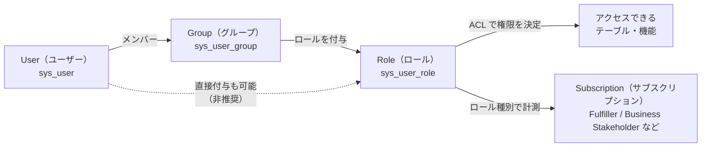
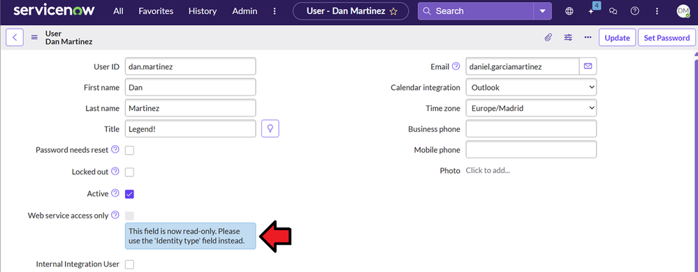
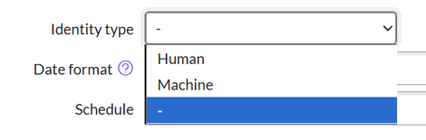
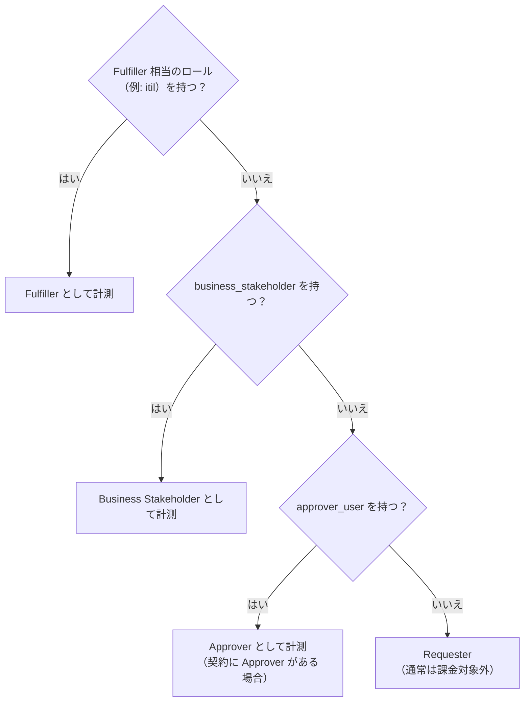
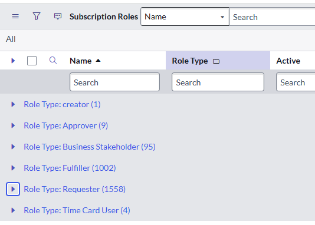
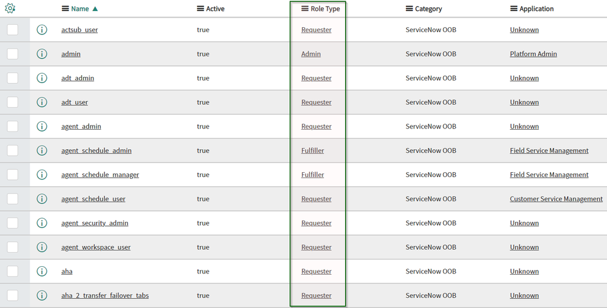

# ユーザー・ロール・ライセンスの基本（Users, Roles and Licensing Basics）

## 概要

ServiceNow のライセンス（正式には **Subscription（サブスクリプション）**）は、多くの製品で「**誰が、どのロール（Role）を持っているか**」によって数えられる。ServiceNow のユーザーは、持っているロールに応じて主に次の種類に分かれる。

- **Requester（リクエスター／依頼者）**：自分の依頼を出して確認するだけの一般ユーザー
- **Business Stakeholder（ビジネスステークホルダー）**：Requester の機能に加えて、承認やレポート閲覧ができる
- **Approver（承認者）**：承認だけを行う（古い契約形態。新規契約では Business Stakeholder に置き換わっていることが多いとされる【第三者情報】。5.2 参照）
- **Fulfiller（フルフィラー／対応者）**：チケットに対応・処理する担当者。最も高価

本ファイルは入門者向けに、次の3点を説明する。

1. ServiceNow のユーザー、グループ、ロールの基本的な関係
2. ユーザー種別とロール、サブスクリプションの対応関係（Subscription Management による計測を含む）
3. 入門者が誤解しやすいポイント

> **注意:** ライセンスの最終的な定義は、**各顧客が ServiceNow と締結した契約（Order Form、Use Rights 文書）** で決まる。本ファイルは公開情報に基づく一般的な説明であり、個別の契約条件に代わるものではない。

関連ファイル：

- ロール、グループの仕様の詳細は [ユーザー・グループ・ロール](../02_リファレンス/platform/users-groups-roles.md)
- ACL（Access Control List）の仕組みは [アクセス制御（ACL）](../02_リファレンス/platform/access-control-acl.md)
- 製品パッケージ、エディション、価格は [プラットフォームのパッケージ構成](../02_リファレンス/platform/platform-licensing-packaging.md)、[ライセンスモデル](../03_導入編/01-licensing-model.md)、[価格情報](../03_導入編/02-pricing.md)、[エディション比較](../03_導入編/03-edition-comparison.md)
- コスト最適化の実務は [ライセンスコスト最適化](../04_応用編/06-license-cost-optimization.md)

---

## 1. 全体像：ユーザー・グループ・ロール・サブスクリプションの関係

ServiceNow では、**ユーザー（User）にロール（Role）を付与することでアクセス権が決まり、そのロールが「どのサブスクリプションを消費するか」も決める**。つまり、ロールは「権限」と「ライセンス計測」の両方の鍵になっている。

上の図は、ユーザーがグループに所属し、グループに付与されたロールを継承する流れを表す。ロールは ACL（Access Control List／アクセス制御リスト）を通じて「何ができるか」を決め、同時に Subscription Management（サブスクリプション管理）では「どの種類のサブスクリプションとして数えるか」の判定材料になる。

### 1.1 主要な構成要素

ServiceNow のユーザー管理（User Administration）は、ユーザー、グループ、ロールの3要素で構成される。[出典](https://www.servicenow.com/docs/r/platform-administration/user-administration/c_UserAdministration.html)

| 要素 | 英語名 | 主なテーブル | 説明 |
|---|---|---|---|
| ユーザー | User | `sys_user` | インスタンスにアクセスする個人（またはシステムアカウント） |
| グループ | Group | `sys_user_group` | ユーザーの集まり。チケットの割り当て先（Assignment group）にも使う |
| グループメンバー | Group member | `sys_user_grmember` | ユーザーとグループの所属関係 |
| ロール | Role | `sys_user_role` | 何を見て何ができるかを制御する権限の単位 |
| ユーザーのロール | User has role | `sys_user_has_role` | ユーザーとロールの対応（グループ経由で継承されたものも含む） |
| ロールの包含 | Role contains | `sys_user_role_contains` | ロールの中に別のロールを含める関係（例：`itil_admin` が `itil` を含む） |

`sys_user_role_contains`（ロールの包含関係）は ServiceNow Community の記事で使われている標準テーブルである。[出典](https://www.servicenow.com/community/now-platform-articles/prevent-direct-assignment-of-licensable-roles-to-users/ta-p/2307963)【第三者情報】 `sys_user_grmember`（グループメンバー）は、1件のレコードが1人のユーザーと1つのグループの組を表す多対多（M2M）テーブルであると Community で説明されている。[出典](https://www.servicenow.com/community/developer-forum/how-to-count-number-of-group-members-in-the-group-for-example/m-p/1521876)【第三者情報】（このテーブル名を明記した公式ドキュメントのページは、今回の調査では確認できず。） 各テーブルの詳細は [ユーザー・グループ・ロール](../02_リファレンス/platform/users-groups-roles.md) を参照。

### 1.2 ロールの継承

ServiceNow のロールは次の2つの方法で「継承」される。

1. **グループからの継承**：ユーザーは、所属するすべてのグループからロールを継承する。グループから継承したロールはユーザーレコードから個別に削除できず、削除するにはグループから外す必要がある。[出典](https://www.servicenow.com/docs/r/platform-administration/user-administration/t_AssignARoleToAUser.html)
2. **ロールの包含（Contains Roles）**：あるロールが別のロールを含むことができる。たとえば `business_stakeholder` ロールは、承認用の `approver_user.business_stakeholder` ロール（基本の `approver_user` とは別のロール）を含む（5.1 参照）。[出典](https://www.servicenow.com/docs/r/it-service-management/incident-management/installed-with-business-stakeholder-incident.html)

ServiceNow 公式ドキュメントは「可能な限り、ロールはグループに割り当ててユーザー管理を簡素化する」ことを推奨している（*"When possible, simplify user administration by assigning roles to groups."*）。[出典](https://www.servicenow.com/docs/r/platform-administration/user-administration/t_AssignARoleToAUser.html)

> **ポイント:** 新しく付与したロールは、ユーザーが**新しいセッションでログインし直してから**有効になる。[出典](https://www.servicenow.com/docs/r/platform-administration/user-administration/t_AssignARoleToAUser.html)

---

## 2. ユーザーレコード（`sys_user`）の基本

### 2.1 ユーザーの作成

ServiceNow のユーザーは **All > User Administration > Users（ユーザー管理 > ユーザー）** で New を選んで作成する。作成には `user_admin` ロールが必要である。必須項目は **User ID** と、**Given name（名）または Family name（姓）のどちらか**である。[出典](https://www.servicenow.com/docs/r/australia/platform-administration/user-administration/t_CreateAUser.html)

実務では、ユーザーは手作業で作るより、Active Directory／Microsoft Entra ID などの ID 基盤からの LDAP 連携や SCIM、SSO 時の自動作成（Just-in-Time provisioning）で取り込むことが多い。詳細は [認証とSSO](../02_リファレンス/platform/authentication-sso.md) を参照。

### 2.2 ライセンスや権限に関係する主なフィールド

`sys_user` テーブルのうち、ライセンスの計測やアクセスに影響する主なフィールドは次のとおり。[出典](https://www.servicenow.com/docs/r/australia/platform-administration/user-administration/t_CreateAUser.html)

| フィールド（英語） | 日本語訳 | 説明 |
|---|---|---|
| User ID | ユーザー ID | 一意のログイン名。重複不可 |
| Active | アクティブ | オフにすると、ユーザー一覧や参照選択、オートコンプリートに表示されなくなる（管理者には見える） |
| Locked out | ロックアウト | オンにするとログインできなくなり、有効なセッションもすべて終了する |
| Password needs reset | パスワードリセット要求 | 初回ログイン時にパスワード変更を求める |
| Web service access only | Web サービスアクセスのみ | 対話的にログインしない（非対話型の）ユーザーとして扱う。Non-Interactive Sessions プラグインが必要 |
| Internal Integration User | 内部連携ユーザー | サービスアカウントを内部連携ユーザーとして扱う。主に MID Server や ODBC など内部の SOAP 連携用 |
| Identity type | ID 種別 | Human（人）、Machine（マシン）、AI のいずれか（後述） |

`Internal Integration User` の用途（MID Server、ODBC Driver などの内部 SOAP 通信向け）は ServiceNow Community での説明に基づく。【第三者情報】

### 2.3 Identity type（ID 種別）フィールド

`sys_user` テーブルには **Identity type（`identity_type`）** というフィールドがあり、ユーザーが人なのか、システムアカウントなのか、AI エージェントなのかを区別する。[出典](https://www.servicenow.com/docs/r/australia/platform-administration/user-administration/t_CreateAUser.html)

| 表示値 | 保存値 | 用途 |
|---|---|---|
| Human | `human` | 従業員、契約社員などの実在する人 |
| Machine | `machine` | システム連携用のサービスアカウントなど、自動化されたリクエストを行うもの |
| AI | `ai_agent` | AI エージェント／AI ユーザー |
| -（未分類） | `unclassified` | 値が未設定の既存レコードなど |

保存値は ServiceNow Community の記事に基づく。[出典](https://www.servicenow.com/community/itsm-articles/new-field-introduction-in-user-sys-user-australia-release/ta-p/3511607)【第三者情報】

- Identity type を **Machine** にすると **Web service access only** が自動的にオンになり、**Human** または **AI** にするとオフになる。AI と他の種別との間の変更は制限されている。[出典](https://www.servicenow.com/docs/r/australia/platform-administration/user-administration/t_CreateAUser.html)
- Australia では Identity type ドロップダウンの **AI** 選択肢で AI エージェント／AI ユーザーを構成できること、および `ai_user_admin` ロールで AI ユーザーの作成・編集・ロール管理ができることがリリースノートに記載されている。[出典](https://www.servicenow.com/docs/r/delta-australia-brazil/brazil-australia-identity-release-notes.html)
- Identity type フィールドの導入リリースは情報源によって記載が異なる（Community の記事で「Australia で導入」とするもの、「Xanadu 以降」とするものがある）。公開情報では確定できず。

**キャプション:** ユーザーフォーム（User 画面）の例。Web service access only が読み取り専用になり、Identity type フィールドの使用を促すメッセージが表示されている。

**画面の説明:** Next Experience UI のユーザーレコード画面（All > User Administration > Users でユーザーを開いた状態）。左列に User ID、First name、Last name、Title、Password needs reset、Locked out、Active、Web service access only、Internal Integration User のチェックボックスが並び、右列に Email、Calendar integration、Time zone、Business phone、Mobile phone、Photo がある。Web service access only の下に「This field is now read-only. Please use the 'Identity type' field instead.」という吹き出しが表示されている。画面右上には Update と Set Password ボタンがある。なお、この画面のフィールドラベルは First name／Last name であり、Australia 版の公式ドキュメント（Create a user）の手順上の表記 Given name／Family name とは異なる（同ドキュメントの本文中には First name／Last name の表記もある。インスタンスのバージョンや設定によって異なる可能性がある）。

**出典:** https://www.servicenow.com/community/in-other-news/recognising-the-types-of-users-that-access-your-instance/bc-p/3403841 （ServiceNow Community ブログ、2025-10-07 投稿。取得日 2026-11-02）【第三者情報】

**キャプション:** Identity type フィールドのドロップダウン（AI 機能が有効でないインスタンスの例）。

**画面の説明:** ユーザーフォーム上の Identity type ドロップダウンを開いた状態。選択肢は Human、Machine、「-」（未設定）の3つで、「-」が選択されている。AI 機能が有効なインスタンスでは、ここに AI の選択肢も表示される。

**出典:** https://www.servicenow.com/community/in-other-news/recognising-the-types-of-users-that-access-your-instance/bc-p/3403841 （ServiceNow Community ブログ。取得日 2026-11-02）【第三者情報】

---

## 3. 入門者が最初に覚えるべき代表的なロール

### 3.1 ベースシステムロール（Base system roles）

ServiceNow には、インスタンスに標準で含まれる **Base system roles（ベースシステムロール）** がある。ベースシステムロールは無効化できるが、変更や名前の変更はできない。[出典](https://www.servicenow.com/docs/r/australia/platform-administration/user-administration/base-system-roles.html)

| ロール | 説明 | ライセンスとの関係 |
|---|---|---|
| `admin` | システム管理者。すべての機能・データにアクセスでき、ACL を上書きしてすべてのロールチェックを通過する。より限定的なロールで足りる場合は付与しないことが推奨されている | 有償の管理者ロール（`license_role` 上の種別は Admin。下記 4.4 参照） |
| `itil` | 標準的なヘルプデスク担当者の操作を行う。インシデント、問題、変更、構成アイテム（CI）を起票・更新できる。標準設定では**タスクに割り当てられるのは `itil` ユーザーのみ** | 代表的な Fulfiller ロール（ITSM） |
| `itil_admin` | `itil` より強い権限を持つチームリーダー向けロール。`itil` と併せて持つと、インシデント、問題、変更などを削除できる | Fulfiller |
| `approver_user` | 自分に回付された承認依頼を変更（承認・却下）できる。Requester のすべての機能も持つ | 公式ドキュメントに「**このロールには料金が発生する**」「**Approver ライセンスが必要**」と明記 |
| `user_admin` | ユーザー、グループ、所在地（Location）、会社（Company）を管理する | — |
| `public` | ログインせずに機能を利用できるようにする | — |

上表の説明は Base system roles ページ（Australia 版。2026-11-02 に Australia 版 URL で内容を確認）に基づく。`approver_user` については「組織が適切な権利（Entitlement）を持っていることを確認せずに付与しないこと」と注意書きがある。[出典](https://www.servicenow.com/docs/r/australia/platform-administration/user-administration/base-system-roles.html)

> **Australia での変更:** `itil_admin` ロールに `sn_cmdb_admin` ロールが標準で含まれるようになり、`itil_admin` を持つユーザーは CMDB の管理権限も自動的に持つ。また、`itil` ロールの包含ロールに `sn_cmdb_editor`、`sn_comm_management.comm_plan_viewer`、`sn_sla_definition_query`、`sn_uib_collab_user` の4ロールが追加されたと報告されている。アップグレード前に `itil_admin` の付与状況を見直すことが勧められている。[出典](https://www.servicenow.com/community/itsm-articles/expanded-role-inheritance-for-itil-and-itil-admin-australia/ta-p/3516134)【第三者情報】（`itil_admin` が CMDB の完全な制御権限を持ち、`sn_cmdb_admin` ロールの権限をすべて含む点は、Australia 版の公式 Base system roles ページでも確認できる）

### 3.2 内部ユーザーと外部ユーザー（`snc_internal`／`snc_external`）

**Explicit Roles（明示的ロール）** プラグイン（`com.glide.explicit_roles`）を有効にすると、ユーザーは内部ユーザーと外部ユーザーに明確に区別される。[出典](https://www.servicenow.com/docs/r/platform-security/explicit-roles.html)

| ロール | 対象 | 主な仕様 |
|---|---|---|
| `snc_internal` | 従業員などの内部ユーザー | プラグイン有効化時に既存の全ユーザーへ自動付与される。既存のアクセス権は変わらない |
| `snc_external` | 顧客、パートナーなどの外部ユーザー | 手動で付与する必要がある。明示的に許可されていない限り、テーブルや UI ページにアクセスできない |

- 1人のユーザーが `snc_internal` と `snc_external` を同時に持つことはできない（Paris 以降。グループやロールの包含によって両方を持つことになる操作も中止される）。
- どちらのロールも持たないユーザーは、公開（Public）リソースにしかアクセスできない。
- 有効化後は、ログイン時（代理ログイン（Impersonation）を含む）にどちらのロールも持たないユーザーへ `snc_internal` または `snc_external` が付与される。

[出典](https://www.servicenow.com/docs/r/platform-security/explicit-roles.html)

`snc_internal` は「社内の一般ユーザー（Requester）であること」を示すロールであり、Fulfiller のような有償ロールではない（後述の `license_role` テーブルでは、多くの標準ロールと同じく Requester 種別に分類されるのが一般的）。【推定】 外部ユーザー（顧客ポータル利用者など）の扱いは [Customer Service Management](../02_リファレンス/customer/customer-service-management.md) を参照。

---

## 4. ユーザー種別（ライセンス上の分類）

### 4.1 ユーザー種別の一覧

ServiceNow の多くの製品（ITSM、CSM、HRSD など）では、ユーザーは持っているロールによって次の種別に分類される。下表は公開されている公式ドキュメント、Community 記事、契約書（Order Form）の公開例をもとにまとめたものである。

| ユーザー種別（英語） | 日本語 | できること（概要） | 代表的なロール | 有償か |
|---|---|---|---|---|
| **Requester** | リクエスター／依頼者 | 自分の依頼（カタログ要求、インシデント）の作成・閲覧・更新、ナレッジの閲覧、ポータルの利用 | ロールなし、`snc_internal` など | 通常は課金されない（契約による） |
| **Approver** | 承認者 | Requester の機能＋自分に回付された承認の処理 | `approver_user` | 有償（Approver ライセンス） |
| **Business Stakeholder** | ビジネスステークホルダー | Requester の機能＋承認＋レコードの閲覧＋レポート・ダッシュボードの閲覧 | `business_stakeholder` | 有償（Fulfiller より安価） |
| **Fulfiller** | フルフィラー／対応者 | 上記以外の機能。レコードの作成・更新・削除、タスクの処理、プロセスの実行 | `itil`、`sn_incident_write`、`sn_customerservice_agent`（CSM）など | 有償（最も高価） |
| **Creator** | クリエイター | Now Assist の開発者向け機能（Creator 向けスキル）の利用 | `now.assist.creator` | 有償（Creator User メーター。Subscription Management のメーター種別一覧では Application user メーターに含まれる。6.2 参照） |
| **Application user** | アプリケーションユーザー | App Engine で作ったカスタムアプリケーションの利用 | アプリごとのロール | 有償（App Engine） |

- Business Stakeholder は「Requester ができることに加え、承認やダッシュボード、レポートに関する作業ができるが、タスクの対応（Fulfill）はできない」と説明されている。Fulfiller は「キューの作業を実際に行う名前付きユーザー（Named user）」であり、多くの製品で中心となる有償ライセンスである。Application user は App Engine のカスタムアプリケーションに適用され、プラットフォームの中核ソリューションには適用されない。[出典](https://www.servicenow.com/community/architect-articles/servicenow-licensing-fundamentals-that-shape-cost-and-design/ta-p/3521055)【第三者情報】（ServiceNow Community の Architect 記事）
- Creator User メーターは `now.assist.creator` ロールを持つユーザーを数える。[出典](https://www.servicenow.com/docs/r/eh2NFokZCOdK5kPblQPzog/WCp1oJbS6O7C2GZBWeqyyA) メーター種別の一覧では、Creator User は Application user メーターに含まれる（*"includes Creator Users"*）。[出典](https://www.servicenow.com/docs/r/UrSRFFKWBbfQBgoRlt~ltw/h4dDh7ZSUVE8MFW~bbdm9w)
- 「Creator」という言葉は、App Engine の Creator 系ライセンス（アプリ開発者向け）を指す文脈でも使われる。上表の Creator（`now.assist.creator`）とは文脈が異なる場合があるので、契約上の定義を確認すること。
- 価格の目安は [価格情報](../03_導入編/02-pricing.md) を参照（本ファイルでは扱わない）。

### 4.2 「上位の種別が優先される」という原則

1人のユーザーが承認用のロールと Fulfiller 用のロールの両方を持つ場合について、第三者の解説（Redress Compliance）では、**Fulfiller シート1つで足りる**（*"An ITSM fulfiller can approve ITSM changes and requests on the same seat."*：Fulfiller は同じシートで承認もできる）と説明されている。ただし、サブスクリプション対象製品の外（Procurement や GRC など）での承認には別途承認の権利が必要とされている。【第三者情報】[出典](https://redresscompliance.com/servicenow-fulfiller-vs-requester-licensing-explained.html)

同じ解説では、**計測はロールで決まり、実際の作業では決まらない**（*"ServiceNow subscriptions count the roles a user holds, not the work the user does."*）とされている。つまり write 系（レコードの更新など）のロールを持っていれば、実際にキューの作業をしていなくても、ほとんどログインしていなくても課金対象になる。【第三者情報】[出典](https://redresscompliance.com/servicenow-fulfiller-vs-requester-licensing-explained.html)

また別の第三者の解説では、Fulfiller User を「Business Stakeholder User や Requester User の機能に加えて何らかの機能を行うユーザー」（*"Without limitation, a Fulfiller User is any 'User' that performs any function in addition to Business Stakeholder User function or Requester User function"*）と紹介している（この解説は原典となる契約書を示していない）。【第三者情報】[出典](https://www.cloudnuro.ai/blog/understanding-servicenow-licensing-a-comprehensive-guide) 種別が重なる場合に上位の種別1つで数えるという考え方は、これらの解説や下の判定フローから導かれる一般的な理解であり、公式ドキュメントで明文化された記述は確認できず。【推定】

上の図は、ユーザーの持つロールから種別が決まる考え方を単純化したものである。実際の判定は製品ごとのロール対応表と Subscription Management の計測ロジック、および契約内容に依存する。【推定】

### 4.3 契約書（Order Form）上の定義の例

> **注意:** この節で紹介する定義の出典 PDF は、2026-11-02 および 2026-11-08 の再確認ではいずれも HTTP 400 となり取得できなかった。**定義の英語原文は未確認**であり、以下は本ファイル初稿作成時のメモに基づく要約である。代わりとなる公開 Order Form や ServiceNow の公式 Use Rights 文書も、今回の調査では見つからなかった。

公共機関の会議資料として公開されていた ServiceNow の Order Form の一例には、次のような定義が記載されていた（現在は確認不能）。【第三者情報】[出典](https://meetings.boardbook.org/Documents/DownloadPDF/169f0aa4-2dce-43d7-9129-2855d99770b0?org=2066)

- **Requester User:** ロールを持たないユーザー、と記載されていた（現在は確認不能）【第三者情報】
- **Fulfiller User:** 顧客によって Approver ロール以外のロールを付与されたユーザー、と記載されていた（現在は確認不能）【第三者情報】
- **Business Stakeholder User:** 自分に回付された承認依頼をメールなどで承認できる、Requester と Fulfiller の中間のユーザー、と記載されていた（現在は確認不能）【第三者情報】

上の要約どおりだとすると、この Order Form の Fulfiller User の定義を文字どおり読むと、`business_stakeholder` ロールを持つユーザーも「Approver 以外のロールを付与されたユーザー」に当たり、Fulfiller になるように読める。しかし同じ契約書で Business Stakeholder User が別に定義されているため、実際には Business Stakeholder は別枠として扱われると考えられる。【推定】

この定義は契約時期や契約形態によって異なる。たとえば別の第三者の解説では、Requester を「Fulfiller や Business Stakeholder User 以外で、サブスクリプションサービスのユーザープロファイルで Active にチェックが入っているユーザー」（*"A Requester is any user checked as 'active' on their user profile in the subscription service other than a Fulfiller or Business Stakeholder User"*）と紹介している（原典の契約書は示されていない）。【第三者情報】[出典](https://www.cloudnuro.ai/blog/understanding-servicenow-licensing-a-comprehensive-guide) **自社の契約書の定義を必ず確認する**こと。

### 4.4 ロールとユーザー種別の対応表（`license_role` テーブル）

ServiceNow インスタンスには、各ロールがどのユーザー種別（Role Type）に当たるかを示すテーブルがある。ServiceNow Community の記事では、このテーブルを `license_role`（リスト名は Subscription Roles）として紹介している。【第三者情報】[出典](https://www.servicenow.com/community/now-platform-articles/prevent-direct-assignment-of-licensable-roles-to-users/ta-p/2307963)

| Role Type（ロール種別） | 有償か（Community 記事による） |
|---|---|
| Admin | 有償 |
| Approver | 有償 |
| Business Stakeholder | 有償 |
| Fulfiller | 有償 |
| Time Card User | 有償 |
| Requester | **非課金**（*"Except for the license type "Requester" all others are licensable."*） |
| creator | 有償と考えられる（Creator User メーターに対応）【推定】。下の画面例で確認できる種別で、Community 記事の一覧には含まれていない |

- 主なフィールドは `name`（ロール名）、`license_role_type`（ロール種別。空欄はライセンス対象外）、`sys_user_role`（ロールへの参照）である。【第三者情報】[出典](https://www.servicenow.com/community/now-platform-articles/prevent-direct-assignment-of-licensable-roles-to-users/ta-p/2307963)
- 関連テーブルとして `license_role_type`、`license_role_discovered`、`license_role_to_custom_table`、`license_unmapped_custom_table`、`licensing_exclusion`、`usageanalytics_count` などが Community で挙げられている。【第三者情報】[出典](https://www.servicenow.com/community/developer-blog/tip-to-identify-the-licensed-roles/bc-p/3128788)
- テーブル名や内容はバージョン、インストール済みプラグインによって異なる可能性があるため、自社インスタンスで確認すること。

**キャプション:** Subscription Roles（`license_role`）リストを Role Type（ロール種別）でグループ化した画面の例。

**画面の説明:** リストのタイトルは「Subscription Roles」。列は Name、Role Type、Active。Role Type でグループ化されており、creator (1)、Approver (9)、Business Stakeholder (95)、Fulfiller (1002)、Requester (1558)、Time Card User (4) の各グループと、それぞれに属するロールの件数が表示されている。件数はインスタンスやインストール済みプラグインによって異なる。

**出典:** https://www.servicenow.com/community/developer-blog/tip-to-identify-the-licensed-roles/bc-p/3128788 （ServiceNow Community ブログ。取得日 2026-11-02）【第三者情報】

**キャプション:** `license_role` テーブルの一覧画面。Role Type 列でロールごとのライセンス種別を確認できる。

**画面の説明:** UI16（クラシック UI）のリスト画面。列は Name（ロール名、昇順）、Active、Role Type、Category、Application。たとえば `admin` は Role Type が Admin で Application が Platform Admin、`agent_schedule_admin` と `agent_schedule_manager` は Fulfiller で Field Service Management、`agent_schedule_user` は Requester で Customer Service Management、`actsub_user` や `adt_user` などは Requester となっている。Category 列はいずれも ServiceNow OOB（標準提供）。Role Type 列が緑の枠で強調されている。

**出典:** https://www.servicenow.com/community/now-platform-articles/prevent-direct-assignment-of-licensable-roles-to-users/ta-p/2307963 （ServiceNow Community 記事。取得日 2026-11-02）【第三者情報】

---

## 5. Business Stakeholder と Approver

### 5.1 ITSM の `business_stakeholder` ロール

ITSM の Business Stakeholder ロールは **Business Stakeholder プラグイン（`com.snc.business_stakeholder`）** で提供される。`business_stakeholder` ロールは「ITSM のすべての製品で、レコードを閲覧し承認できる」ロールである。[出典](https://www.servicenow.com/docs/r/Sx3eYflWQ2rS18vmPDBm0Q/I7JvpzPElb0OBylrCmsUWg)

`business_stakeholder` ロールの **Contains roles（包含ロール）** 列に記載されているロールは次のとおり（Australia 版および Brazil 版のドキュメントによる）。[出典](https://www.servicenow.com/docs/r/Sx3eYflWQ2rS18vmPDBm0Q/I7JvpzPElb0OBylrCmsUWg)、[出典](https://www.servicenow.com/docs/r/it-service-management/incident-management/installed-with-business-stakeholder-incident.html)

| 包含ロール | 意味 |
|---|---|
| `approver_user.business_stakeholder` | 承認（基本ロールの `approver_user` とは別のロール） |
| `pa_viewer.business_stakeholder` | Performance Analytics（Platform Analytics）のダッシュボード閲覧（基本ロールの `pa_viewer` とは別のロール） |
| `cmdb_read.business_stakeholder` | CMDB の参照（基本ロールの `cmdb_read` とは別のロール） |
| `sn_incident_comments_write`、`sn_request_comments_write` | インシデント、リクエストへのコメント書き込み |

- 名前に `.business_stakeholder` が付いたロールは、`approver_user`、`pa_viewer`、`cmdb_read` という基本ロールとは**別のロール**である。そのため、`business_stakeholder` を付与しても、有償の基本ロール `approver_user`（Approver ライセンスが必要）を直接持つことになるとは限らない。
- 一方、同じ公式ページのロールの説明文（Description）には、`business_stakeholder` が `sn_incident_read`、`sn_problem_read`、`sn_change_read`、`sn_request_read`、`approver_user` を含むとも書かれており、Contains roles 列と一致しない（公式ページ内で記述が食い違っている）。実際の包含関係は自社インスタンスの `sys_user_role_contains` で確認すること。
- ライセンス上の扱い（Business Stakeholder ライセンスで承認がどこまで認められるか）は、契約内容で確認すること。

Business Stakeholder は ITSM 以外の製品にもある。たとえば CSM（Customer Service Management）の Business Stakeholder は、顧客の代わりにケースを作成する、ケースや顧客データを閲覧する、承認する、レポートやダッシュボードを見るといった操作ができる。[出典](https://www.servicenow.com/docs/r/customer-service-management/business-stakeholder-for-csm.html)

### 5.2 `approver_user` と `business_stakeholder` の関係

- `approver_user` は古くからある承認専用のロールで、公式ドキュメントに「Approver ライセンスが必要」「料金が発生する」と明記されている。[出典](https://www.servicenow.com/docs/r/australia/platform-administration/user-administration/base-system-roles.html)
- `business_stakeholder` は、承認用の `approver_user.business_stakeholder`（基本の `approver_user` とは別ロール）を含み、さらに参照権限とレポート閲覧権限を持つロールである（5.1 参照）。[出典](https://www.servicenow.com/docs/r/it-service-management/incident-management/installed-with-business-stakeholder-incident.html) 機能面では `approver_user` の上位にあたるが、ライセンス上どう扱われるかは契約で確認すること。
- ServiceNow Community では「新規契約や更新時には、Approver はほぼ Business Stakeholder に移行している」と回答されている（2021年の回答）。【第三者情報】[出典](https://www.servicenow.com/community/itsm-forum/business-stakeholder-vs-approver-user-roles/m-p/635453)
- 自社の契約に Approver ライセンスと Business Stakeholder ライセンスのどちらが含まれているかによって、付与すべきロールが変わる。

---

## 6. サブスクリプションの種類と計測（Subscription Management）

### 6.1 サブスクリプションの種類

ServiceNow のサブスクリプションには次の種類がある（Australia 版ドキュメント）。[出典](https://www.servicenow.com/docs/r/UrSRFFKWBbfQBgoRlt~ltw/h4dDh7ZSUVE8MFW~bbdm9w)

| 種類（英語） | 日本語 | 説明 |
|---|---|---|
| Per-User | ユーザー単位 | ユーザーのロールやアクセス権に応じて権利を割り当てる。Fulfiller、Business Stakeholder などはこれ |
| Unrestricted User | 無制限ユーザー | ロールに関係なく、組織の**アクティブユーザー全体**を対象とする。インスタンスが自動で割り当てる |
| Unlimited | 無制限 | 割り当て可能なユーザー数に上限がない。インスタンスが自動で割り当てる |
| Capacity | キャパシティ | 測定単位、トランザクション数、作成レコード数、管理対象リソース（デバイス、ソフトウェア、ノードなど）で計測 |
| Display Only | 表示のみ | 情報表示のためだけのもので、割り当てやメーターはない |

### 6.2 メーター種別（Meter type）

サブスクリプションの使用量は **Meter type（メーター種別）** で数えられる。[出典](https://www.servicenow.com/docs/r/UrSRFFKWBbfQBgoRlt~ltw/h4dDh7ZSUVE8MFW~bbdm9w)

| メーター種別 | 数える対象 |
|---|---|
| Rights-based user | Fulfiller User と Business Stakeholder User |
| Application user | 製品に何らかのアクセス権を持つユーザー（Creator User を含む） |
| Unrestricted user | インスタンス全体のアクティブユーザー。User ID に値があり、Active が true のユーザー |
| Devices | 管理対象のデバイス |
| Subscription Units | Subscription Unit（サブスクリプションユニット）単位の測定量 |
| Transactions | トランザクション |
| Unlimited | 計測上限なし |
| None | Display Only のサブスクリプション |

製品サブスクリプションの詳細画面の説明では、Fulfiller 相当のアクセスを持つユーザーは **Fulfiller user** メーター、Fulfiller より少ないアクセス権のユーザーは **Business Stakeholder user** メーター、`now.assist.creator` ロールを持つユーザーは **Creator user** メーターで計測されるとされている。[出典](https://www.servicenow.com/docs/r/eh2NFokZCOdK5kPblQPzog/WCp1oJbS6O7C2GZBWeqyyA)

> **ポイント:** Requester 用のメーター種別は公開されている一覧に存在しない。つまり Per-User 型のサブスクリプションでは、Requester は通常は数えられない。ただし **Unrestricted User 型では、ロールに関係なく全アクティブユーザー（Requester を含む）が数えられる**。【推定】（公式ドキュメントのメーター一覧からの推定）

### 6.3 Subscription Management（サブスクリプション管理）

**Subscription Management** は、購入済みのサブスクリプションと実際の利用状況（どのユーザーがどのサブスクリプションを消費しているか）をインスタンス上で確認・管理する機能である。

| 項目 | 内容 |
|---|---|
| メニュー | **Admin > Subscription Management**、または **All > Subscription Management > Subscription Management** |
| 必要なロール | `usage_admin`、`sn_sub_man.admin`、`admin` のいずれか |
| 状態（Status） | Compliant（準拠）、Near capacity（上限に近い。既定は 90%、Settings タブで変更可）、Even（同数）、Over-allocated（超過）、Account-level only（アカウントレベルのみ。割り当て状態を計算しない。Creator Plus 製品のみ） |
| 概要画面のタブ | Overview（概要）、Instance entitlements（インスタンスの権利）、Account entitlements（アカウントの権利）、Settings（設定） |
| 製品詳細画面の主なタブ | Subscribed groups（サブスクライブ済みグループ）、Subscribed users（サブスクライブ済みユーザー）、Bundled items（カスタムテーブルなどの付属品）、Purchase history（購入履歴）など |

[出典](https://www.servicenow.com/docs/r/platform-administration/allocate-subscriptions-v2.html)、[出典](https://www.servicenow.com/docs/r/australia/platform-administration/subscriptions-overview-v2.html)、[出典](https://www.servicenow.com/docs/r/eh2NFokZCOdK5kPblQPzog/WCp1oJbS6O7C2GZBWeqyyA)

Subscription Management の基本的な考え方は、**「サブスクリプションはグループで管理し、ロールで計測・監査する」**である（*"Subscriptions are managed in Subscription Management using groups."* *"Subscriptions are measured and audited in Subscription Management using roles."*）。[出典](https://www.servicenow.com/docs/r/platform-administration/managing-user-subscriptions-v2.html)

### 6.4 割り当て（Allocation）の方法

ユーザー単位（Per-User）のサブスクリプションの割り当て方法は2つある。[出典](https://www.servicenow.com/docs/r/platform-administration/managing-user-subscriptions-v2.html)、[出典](https://www.servicenow.com/docs/r/platform-administration/allocate-subscriptions-v2.html)

| 方法 | 内容 | 対象 |
|---|---|---|
| 自動割り当て（Automatic, role-based） | ユーザーとグループのロールに基づいて自動的に割り当てる | **一度も手動割り当てを使ったことがない顧客の既定** |
| 手動割り当て（Manual, group-based） | 計測対象ロール（Measured roles）を持つグループを製品サブスクリプションに追加する（Add groups） | 過去に手動割り当てを使ったことがある顧客のみ |

- 手動割り当てでは、追加したグループは **Subscribed groups** になり、グループのメンバー全員がその製品の権利を得る。Subscription Management は、ロールの割り当て状況に基づいて追加すべきグループを推奨する（例：ITSM の Fulfiller ロールを持つ Service Desk グループを ITSM サブスクリプションに追加）。
- Subscribed users の更新は**日次のスケジュールジョブ**で行われるため、反映に最大1日かかる。
- 同じユーザーが複数のサブスクライブ済みグループに所属していても、1人として数えられる。【第三者情報】[出典](https://www.servicenow.com/community/admin-experience-forum/subscription-groups-and-subscription-users-in-subscription/m-p/3579917)
- ユーザー単位サブスクリプションの割り当て詳細は、割り当てが不完全な場合の誤解を防ぐため Subscription Management の概要画面では表示されず、詳細はアカウント担当（Account Executive）に問い合わせるよう案内されている。[出典](https://www.servicenow.com/docs/r/australia/platform-administration/subscriptions-overview-v2.html)

### 6.5 「アクティブユーザー」の定義

Subscription Management で数える **アクティブユーザー（Active users）** からは、次のユーザーが除外される。[出典](https://www.servicenow.com/docs/r/eh2NFokZCOdK5kPblQPzog/WCp1oJbS6O7C2GZBWeqyyA)、[出典](https://www.servicenow.com/docs/r/platform-administration/allocate-subscriptions-v2.html)

- 過去 **365日間ログインしていない**ユーザー
- **Web service access only** のユーザー
- **User ID が空**のユーザー

一方、Unrestricted user メーターでは「`sys_user` テーブルで User ID に値があり、Active が true のユーザー」をアクティブユーザーとしている。[出典](https://www.servicenow.com/docs/r/UrSRFFKWBbfQBgoRlt~ltw/h4dDh7ZSUVE8MFW~bbdm9w) どちらの定義で数えるかは画面やサブスクリプションの種類によって異なるため、自社の契約内容と Subscription Management の画面で確認すること。

---

## 7. 入門者が誤解しやすいポイント

### 7.1 「ロールは権限設定だけの話」ではない

ServiceNow では、**ロールを付与すること自体がライセンス消費になる**ことがある。たとえば一般ユーザーに「念のため」`itil` を付けると、そのユーザーは Fulfiller として数えられる。公式ドキュメントにも、ロールの作成や割り当てがサブスクリプションの使用量に影響しうることが記載されている。[出典](https://www.servicenow.com/docs/r/platform-administration/managing-user-subscriptions-v2.html)

### 7.2 「承認だけなら無料」とは限らない

- `approver_user` ロールには料金が発生し、Approver ライセンスが必要である。[出典](https://www.servicenow.com/docs/r/australia/platform-administration/user-administration/base-system-roles.html)
- メールの返信で承認する場合はロールを持たないユーザーでも技術的には処理できる（標準のインバウンドメールアクション「Update Approval Request」は送信者のロールを確認しない）と Community では報告されている。しかし、それがライセンス上許されるかは契約次第であり、「メールで承認する場合も Approver または Fulfiller の使用権が必要」とする古い価格資料の記述も Community で引用されている。【第三者情報】[出典](https://www.servicenow.com/community/servicenow-ai-platform-forum/approval-license-need-for-e-mail-approvals/td-p/1091344/page/2)
- 「技術的にできる」ことと「契約上許される」ことは別である。承認者の扱いは契約内容を ServiceNow の営業担当に確認する。【経験則】

### 7.3 「Requester は常に無料」ではない

- Per-User 型の契約では、Requester は通常数えられない。
- しかし **Unrestricted User 型**の契約では、ロールに関係なく全アクティブユーザーが数えられる。[出典](https://www.servicenow.com/docs/r/UrSRFFKWBbfQBgoRlt~ltw/h4dDh7ZSUVE8MFW~bbdm9w)
- Requester の扱いは「組織と ServiceNow との契約で定義される」とされている。【第三者情報】[出典](https://www.servicenow.com/community/servicenow-ai-platform-forum/are-requestor-not-charged-by-servicenow/m-p/2487515)

### 7.4 「ロールを直接ユーザーに付与」すると管理しにくい

ロールをユーザーに直接付与すると、どのグループ経由でライセンスを消費しているのかが分かりにくくなる。公式ドキュメントは**ロールはグループに付与する**ことを推奨しており、Community では有償ロールの直接付与をビジネスルールで防ぐ方法も紹介されている。[出典](https://www.servicenow.com/docs/r/platform-administration/user-administration/t_AssignARoleToAUser.html)、[出典](https://www.servicenow.com/community/now-platform-articles/prevent-direct-assignment-of-licensable-roles-to-users/ta-p/2307963)【第三者情報】

### 7.5 「カスタムロールなら課金されない」わけではない

自分で作ったカスタムロールでも、**有償ロールを包含している**場合や、**製品のテーブルへのアクセス権（ACL）を持つ**場合は、ライセンス計測の対象になりうる。第三者の解説（Licenseware Wiki）では、カスタムロールは含まれる ACL によって分類され（*"according to the Access Control Lists (ACLs) each role contains"*）、サブスクリプション製品内のテーブルへのアクセスに応じて権利が判定される（*"based on access granted to tables within a subscription product"*）と説明されている。【第三者情報】[出典](https://wiki.licenseware.io/wiki/servicenow-user-roles-and-per-user-subscriptions/) この解説は ServiceNow 公式ドキュメント「Automatic subscription assignment」（`user-subscription-auto-assignment.html`）を根拠として挙げているが、2026-11-02 時点でそのページは取得できず（HTTP 404）、公式ドキュメントでの記述は直接確認できていない。なお公式ドキュメントでは、サブスクリプションが必要なロールを Measured roles（計測対象ロール）と呼び、提供するアクセスのレベルで分類されるとしている。[出典](https://www.servicenow.com/docs/r/platform-administration/managing-user-subscriptions-v2.html)

### 7.6 「インスタンスを増やしてもライセンスは同じ」ではない

ServiceNow のサブスクリプションはインスタンス単位であり、複数の本番インスタンスを持つ構成ではコストが増えると説明されている。【第三者情報】[出典](https://www.servicenow.com/community/architect-articles/servicenow-licensing-fundamentals-that-shape-cost-and-design/ta-p/3521055) 非本番インスタンス（開発、テスト）の扱いは契約によるため、[インスタンス戦略と環境](../03_導入編/07-instance-strategy.md) と契約内容を確認すること。

### 7.7 「上位エディションの機能を1つだけ使う」ことはできない

ITSM Standard／Pro／Enterprise などのエディションは、特定の機能だけをつまみ食いして購入することはできず、上位エディションの料金はライセンス対象ユーザー全体に適用されると説明されている。【第三者情報】[出典](https://www.servicenow.com/community/architect-articles/servicenow-licensing-fundamentals-that-shape-cost-and-design/ta-p/3521055) エディションの違いは [エディション比較](../03_導入編/03-edition-comparison.md) を参照。

### 7.8 「退職者や連携用アカウントも数えられる」可能性

- 退職者を `Active = false` にしないまま残すと、Unrestricted User 型では数えられ続ける可能性がある。【推定】
- 連携用アカウントは **Web service access only**（または Identity type = Machine）にしておくと、Subscription Management のアクティブユーザーから除外される。[出典](https://www.servicenow.com/docs/r/eh2NFokZCOdK5kPblQPzog/WCp1oJbS6O7C2GZBWeqyyA)
- ただし、連携用アカウントに `itil` などの有償ロールを付けた場合にどう数えられるかは、公開情報では確認できず。契約上の扱いを確認すること。

### 7.9 誤解とその正しい理解（まとめ）

| よくある誤解 | 正しい理解 |
|---|---|
| ロールは権限だけの話 | ロールはライセンス計測の基準でもある |
| 承認者は無料 | `approver_user` は有償。メール承認の扱いも契約次第 |
| Requester は常に無料 | Unrestricted User 型では全アクティブユーザーが対象 |
| 1人が複数ロールを持つと複数ライセンスが必要 | 承認と Fulfiller の両方のロールを持つ場合は Fulfiller シート1つで足りると説明されている【第三者情報】 |
| 作業していなければ課金されない | 計測は保持しているロールで決まり、実際の作業量では決まらない【第三者情報】 |
| カスタムロールは課金対象外 | 有償ロールの包含や製品テーブルへのアクセスがあれば対象になりうる |
| ロールは直接付与でよい | グループ経由での付与が推奨 |
| ライセンス定義はドキュメントで決まる | 最終的には契約書（Order Form、Use Rights）で決まる |

---

## 8. 新しいユーザーにロールを付与するときの確認手順（入門者向け）

入門者がユーザーにロールを付与するときは、次の順番で確認すると安全である。【経験則】

1. **そのユーザーは何をする人か**を決める（依頼するだけか、承認するか、チケットを処理するか）。
2. **付与するロールの種別**を `license_role` テーブル（Subscription Roles）で確認する（Requester／Business Stakeholder／Fulfiller など）。
3. **ロールはグループに付与**し、ユーザーはグループに追加する。
4. **Subscription Management** で、該当製品の割り当て状況（Compliant／Near capacity／Over-allocated）を確認する。
5. 反映は日次ジョブのため、**翌日に再確認**する。

ロールの付与手順そのもの（All > User Administration > Users でユーザーを開き、Roles 関連リストの Edit からロールを追加して Save）は公式ドキュメントに記載されている。`admin` ロールを付与するには付与する側も `admin` を持っている必要があり、`security_admin` ロールを付与するには事前に `security_admin` へ昇格（Elevate）する必要がある。[出典](https://www.servicenow.com/docs/r/platform-administration/user-administration/t_AssignARoleToAUser.html)

---

## 9. Brazil での変更（判明分）

> **Brazil での変更:** Identity リリースノート（Australia → Brazil）では、ユーザー種別やライセンスの考え方そのものに関わる変更は記載されていない。判明している主な変更は次のとおり。[出典](https://www.servicenow.com/docs/r/delta-australia-brazil/brazil-australia-identity-release-notes.html)
> - **Federated ID:** User テーブルのフェデレーテッド ID の条件で、User ID 以外の任意の一意なフィールドを識別子として選べるようになった。
> - **Role masking（ロールマスキング）:** AI エージェントやエージェント型ワークフローのツール実行時に、継承されるロールを制限できる（Australia から存在し、Brazil でも継続）。
> - **Conditional Script Writer グループ:** タスクやインシデントの割り当てグループとして選択できなくなった。
> - **User Registration Request プラグイン（`com.snc.user_registration`）:** 将来の廃止に向けた準備中とされた。

Subscription Management について、Brazil での変更点を明記したリリースノートは公開情報では確認できず。

---

## 10. 次に読むもの

| 知りたいこと | ファイル |
|---|---|
| テーブル、ロール、レコードなど基本概念 | [必須の基本概念](04-core-concepts.md) |
| ロール、グループの詳細仕様 | [ユーザー・グループ・ロール](../02_リファレンス/platform/users-groups-roles.md) |
| ロールでアクセスを制御する仕組み | [アクセス制御（ACL）](../02_リファレンス/platform/access-control-acl.md) |
| ユーザーの取り込みと SSO | [認証とSSO](../02_リファレンス/platform/authentication-sso.md) |
| ITSM の製品構成とロール | [ITSM 概要とパッケージ](../02_リファレンス/itsm/itsm-overview.md) |
| AI エージェントの権限、Now Assist のライセンス | [Now Assist と AI Agents](../02_リファレンス/platform/now-assist-ai-agents.md) |
| 契約、ライセンスモデルの詳細 | [ライセンスモデル](../03_導入編/01-licensing-model.md) |
| ライセンスコストの最適化 | [ライセンスコスト最適化](../04_応用編/06-license-cost-optimization.md) |

---

## 参照元

**ServiceNow 公式ドキュメント**

- Base system roles: https://www.servicenow.com/docs/r/australia/platform-administration/user-administration/base-system-roles.html
- Create a user: https://www.servicenow.com/docs/r/australia/platform-administration/user-administration/t_CreateAUser.html
- Assign a role to a user: https://www.servicenow.com/docs/r/platform-administration/user-administration/t_AssignARoleToAUser.html
- User administration: https://www.servicenow.com/docs/r/platform-administration/user-administration/c_UserAdministration.html
- Product subscriptions overview: https://www.servicenow.com/docs/r/australia/platform-administration/subscriptions-overview-v2.html
- Types of subscriptions in Subscription Management（Australia）: https://www.servicenow.com/docs/r/UrSRFFKWBbfQBgoRlt~ltw/h4dDh7ZSUVE8MFW~bbdm9w
- Viewing product subscription details in Subscription Management（Australia）: https://www.servicenow.com/docs/r/eh2NFokZCOdK5kPblQPzog/WCp1oJbS6O7C2GZBWeqyyA
- Allocate subscriptions in Subscription Management: https://www.servicenow.com/docs/r/platform-administration/allocate-subscriptions-v2.html
- Managing per-user subscriptions: https://www.servicenow.com/docs/r/platform-administration/managing-user-subscriptions-v2.html
- Installed with Business Stakeholder（Australia）: https://www.servicenow.com/docs/r/Sx3eYflWQ2rS18vmPDBm0Q/I7JvpzPElb0OBylrCmsUWg
- Installed with Business Stakeholder（Incident Management）: https://www.servicenow.com/docs/r/it-service-management/incident-management/installed-with-business-stakeholder-incident.html
- Business Stakeholder for Customer Service Management: https://www.servicenow.com/docs/r/customer-service-management/business-stakeholder-for-csm.html
- Explicit Roles: https://www.servicenow.com/docs/r/platform-security/explicit-roles.html
- Identity release notes（Australia → Brazil）: https://www.servicenow.com/docs/r/delta-australia-brazil/brazil-australia-identity-release-notes.html

**ServiceNow Community**

- ServiceNow Licensing Fundamentals That Shape Cost and Design: https://www.servicenow.com/community/architect-articles/servicenow-licensing-fundamentals-that-shape-cost-and-design/ta-p/3521055
- Prevent direct assignment of licensable roles to users: https://www.servicenow.com/community/now-platform-articles/prevent-direct-assignment-of-licensable-roles-to-users/ta-p/2307963
- Tip to identify the licensed roles: https://www.servicenow.com/community/developer-blog/tip-to-identify-the-licensed-roles/bc-p/3128788
- Business Stakeholder vs. Approver User Roles: https://www.servicenow.com/community/itsm-forum/business-stakeholder-vs-approver-user-roles/m-p/635453
- Approval license need for e-mail approvals: https://www.servicenow.com/community/servicenow-ai-platform-forum/approval-license-need-for-e-mail-approvals/td-p/1091344/page/2
- Are REQUESTOR not charged by ServiceNow?: https://www.servicenow.com/community/servicenow-ai-platform-forum/are-requestor-not-charged-by-servicenow/m-p/2487515
- Subscription groups and subscription users in Subscription Management: https://www.servicenow.com/community/admin-experience-forum/subscription-groups-and-subscription-users-in-subscription/m-p/3579917
- Expanded role inheritance for itil and itil_admin (Australia): https://www.servicenow.com/community/itsm-articles/expanded-role-inheritance-for-itil-and-itil-admin-australia/ta-p/3516134
- New field introduction in User [sys_user] (Australia release): https://www.servicenow.com/community/itsm-articles/new-field-introduction-in-user-sys-user-australia-release/ta-p/3511607
- Recognising the types of users that access your instance: https://www.servicenow.com/community/in-other-news/recognising-the-types-of-users-that-access-your-instance/bc-p/3403841
- How to count number of group members in the group（`sys_user_grmember`）: https://www.servicenow.com/community/developer-forum/how-to-count-number-of-group-members-in-the-group-for-example/m-p/1521876

**第三者情報**

- Redress Compliance, ServiceNow Fulfiller vs Requester licensing: https://redresscompliance.com/servicenow-fulfiller-vs-requester-licensing-explained.html
- CloudNuro, Understanding ServiceNow Licensing: A Comprehensive Guide: https://www.cloudnuro.ai/blog/understanding-servicenow-licensing-a-comprehensive-guide
- Licenseware Wiki, ServiceNow user roles and per-user subscriptions: https://wiki.licenseware.io/wiki/servicenow-user-roles-and-per-user-subscriptions/
- ServiceNow Order Form（公開されている契約書の例。2026-11-02 の再取得では HTTP 400）: https://meetings.boardbook.org/Documents/DownloadPDF/169f0aa4-2dce-43d7-9129-2855d99770b0?org=2066
