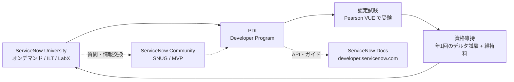
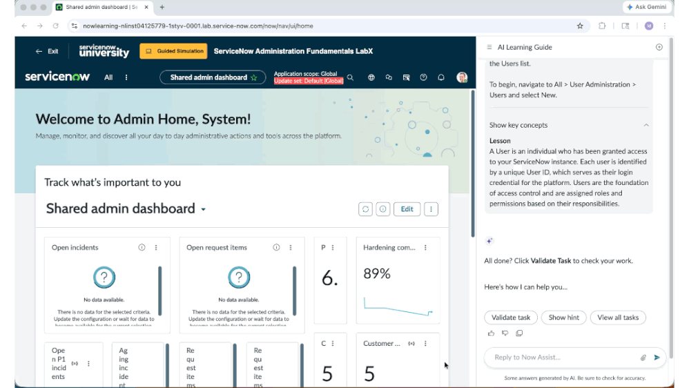
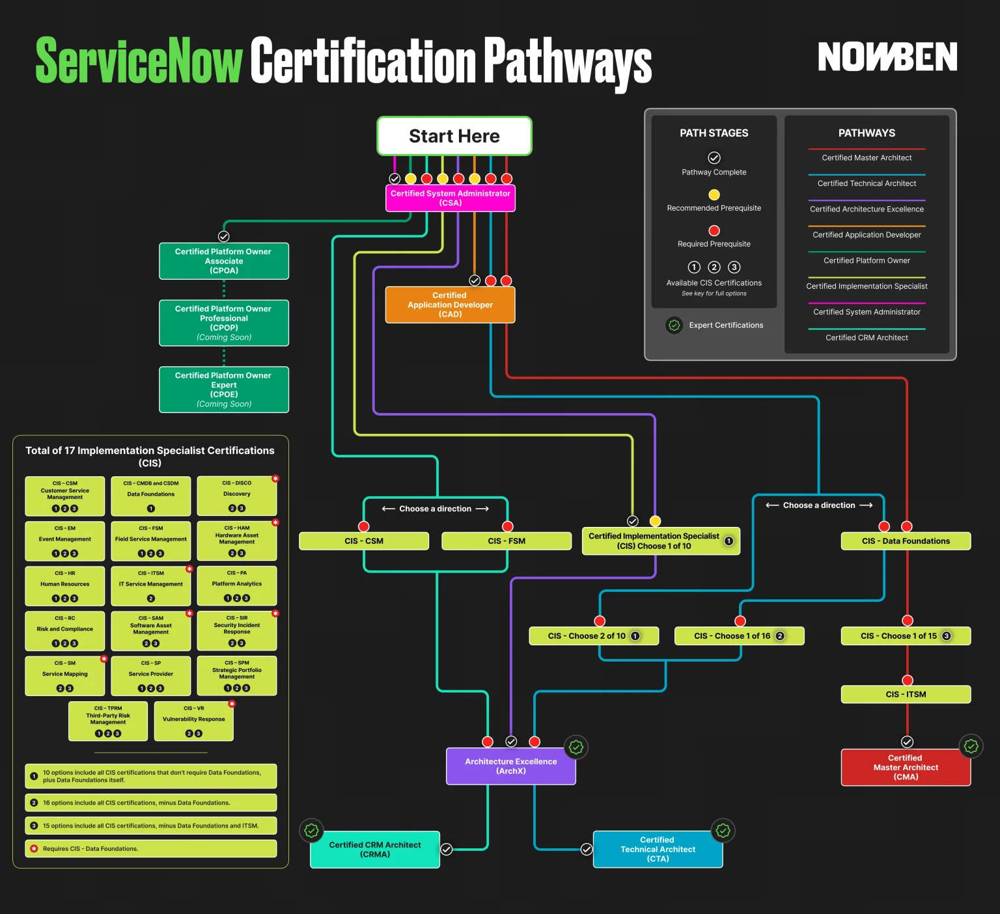
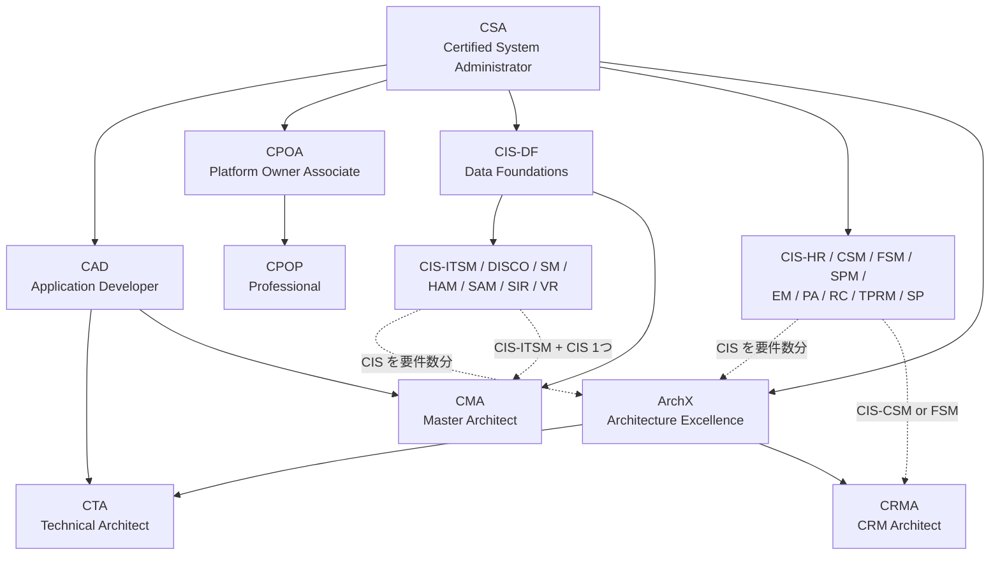
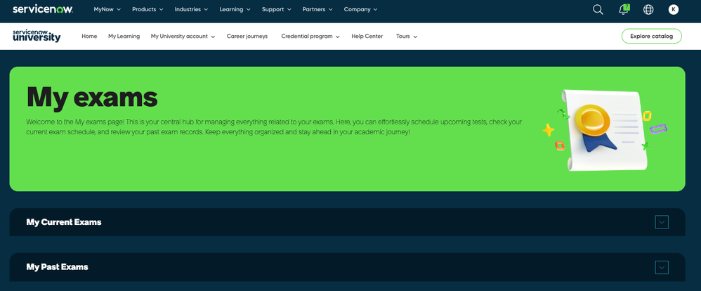
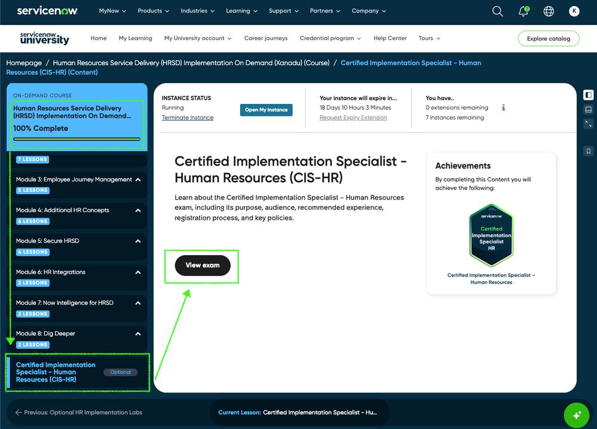

# 学習パスと認定資格（Learning Path & Certifications）

## 概要

ServiceNow の学習と資格取得は、次の 4 つの公式基盤を組み合わせて進める。

| 基盤 | 何をする場所か | 費用 | URL |
|---|---|---|---|
| **ServiceNow University**（サービスナウ・ユニバーシティ。旧 **Now Learning**） | 公式 e ラーニング、ラボ、認定試験の申込み、資格の維持（デルタ試験） | アカウント・多くのオンデマンドコースは無料。講師主導研修（ILT）と認定試験は有料 | `learning.servicenow.com` |
| **Developer Program**（開発者プログラム） | 開発者向けガイド、API リファレンス、無料の **PDI（Personal Developer Instance、個人開発インスタンス）** の払い出し | 無料 | `developer.servicenow.com` |
| **ServiceNow Community**（コミュニティ） | Q&A フォーラム、ブログ、ユーザー会（SNUG）、MVP 制度 | 無料 | `servicenow.com/community` |
| **製品ドキュメント**（ServiceNow Docs） | 製品仕様の一次情報。リリース別・言語別（日本語 `ja-JP` あり） | 無料 | `servicenow.com/docs` |

本ファイルの要点は以下である。

- 学習ポータルは 2025 年 5 月の Knowledge 2025 で **ServiceNow University** として刷新された（旧称 Now Learning）。2026 年 5 月の Knowledge 2026 で AI コーチ **AI Learning Guide** と演習環境 **SimStudio** が追加された。[出典](https://newsroom.servicenow.com/press-releases/details/2026/ServiceNow-University-drives-career-growth-with-real-time-coaching-and-simulation/default.aspx)
- 手を動かす練習には無料の **PDI** を使う。ただし 10 日間ログインがないと回収（reclaim）されうるため、成果物はアップデートセットやソース管理に退避する。[出典](https://www.servicenow.com/docs/r/zUlSbxoxKPAWFDGUdAoSCw/POoFRmMpmmeY2c0J7z2SHg)
- 認定資格の入口は **CSA（Certified System Administrator）**。その上に **CAD**（開発者）、**CIS-xx**（製品別の導入スペシャリスト）、最上位の **CTA / CMA / CRMA**（アーキテクト）がある。
- 2025-11-18 に試験の配信が Webassessor（Kryterion）から **Pearson VUE** に移行し、バウチャー方式は廃止された。2026 年には **CIS-DF（Data Foundations: CMDB and CSDM）** が多くの CIS の前提資格になった。【第三者情報】[出典](https://www.servicenow.com/community/training-and-certifications/article-bye-webassessor-hello-pearson-vue/td-p/3387020)
- メインライン資格は、年 1 回の **デルタ試験（delta exam）** と **認定維持料（Certification Maintenance Program fee）** で維持する。【第三者情報】

> **注意（情報の確度）:** 認定制度の詳細（受験料、再受験規定、前提資格）は ServiceNow University の「Credential program」ページや Certification Program Guide に載っている。ただし、これらはログインが必要なため本調査では直接確認できなかった。本ファイルではコミュニティの公式ロール保持者や長期貢献者の記事、パートナー系メディアから二次的に確認し、`【第三者情報】` を付けている。受験前には必ず ServiceNow University 上で最新情報を確認すること。

---

## 1. 学習エコシステムの全体像

ServiceNow の学習は「知識（University / Docs）→ 実機（PDI / ラボ）→ 証明（認定資格）→ 維持・発信（デルタ試験 / Community）」の循環で進む。

| 段階 | 主な手段 | 関連ファイル |
|---|---|---|
| 基礎概念を知る | 本ナレッジの入門編、University の「Welcome to ServiceNow」 | [ServiceNowとは](01-what-is-servicenow.md)、[必須の基本概念](04-core-concepts.md) |
| 画面操作に慣れる | PDI で一覧・フォームを触る | [UIの基本](05-ui-basics.md) |
| 管理者業務を学ぶ | Administration Fundamentals → CSA | [ユーザー・ロール・ライセンスの基本](08-users-roles-licensing-basics.md) |
| 開発を学ぶ | Application Development Fundamentals → CAD | [アプリケーション開発](../02_リファレンス/platform/app-development.md) |
| 製品別に深める | ITSM / HRSD / CSM 等の Implementation コース → CIS | [ITSM 概要とパッケージ](../02_リファレンス/itsm/itsm-overview.md) ほか |
| リリースを追う | リリースノート、デルタ試験 | [リリースサイクルとバージョン](07-release-cycle.md) |

---

## 2. ServiceNow University（旧 Now Learning）

### 2.1 位置づけと沿革

ServiceNow University は ServiceNow 公式の学習・認定プラットフォームである。

| 時期 | 出来事 | 出典 |
|---|---|---|
| 〜2025-05 | 学習ポータルの名称は **Now Learning**（`nowlearning.servicenow.com`） | [Community](https://www.servicenow.com/community/training-and-certifications/now-learning-vs-servicenow-university/m-p/3258640) 【第三者情報】 |
| 2025-05（Knowledge 2025） | **ServiceNow University** として発表・刷新 | [Press release](https://newsroom.servicenow.com/press-releases/details/2026/ServiceNow-University-drives-career-growth-with-real-time-coaching-and-simulation/default.aspx) |
| 2025-11-18 | 認定試験の配信を Webassessor から **Pearson VUE** に移行 | [Community](https://www.servicenow.com/community/training-and-certifications/article-bye-webassessor-hello-pearson-vue/td-p/3387020) 【第三者情報】 |
| 2026-03 | アラビア語対応を開始 | [Press release](https://newsroom.servicenow.com/press-releases/details/2026/ServiceNow-University-drives-career-growth-with-real-time-coaching-and-simulation/default.aspx) |
| 2026-05-05（Knowledge 2026） | **AI Learning Guide** と **SimStudio** を発表・提供開始 | 同上 |

2026-05-05 のプレスリリースによると、ServiceNow University は次の規模と提供条件になっている。[出典](https://newsroom.servicenow.com/press-releases/details/2026/ServiceNow-University-drives-career-growth-with-real-time-coaching-and-simulation/default.aspx)

- 学習者数は約 200 万人（前年比 80% 増）。認定取得者は数十万人。
- 従業員・顧客・パートナー・個人の誰でも無料で利用できる（URL: `learning.servicenow.com`）。
- ブラジル・ポルトガル語のローカライズを進めている。日本語化の状況はプレスリリースには記載がない（後述「8. 日本語の学習リソース」を参照）。

> **用語の注意:** 社内資料や古いブログでは今も「Now Learning」「NowLearning」と呼ばれることがある。両者は同じ公式学習ポータル（旧称と新称）を指す。

### 2.2 主なメニュー構成

ServiceNow University のヘッダーには、2025-11 時点で次のメニューがある。[出典](https://www.servicenow.com/community/training-and-certifications/gf-2-i-just-scheduled-my-1st-exam-with-pearson-vue-here-s-the/td-p/3429986)（スクリーンショットからの読み取り）【第三者情報】

| メニュー | 内容 |
|---|---|
| Home | おすすめコース、続きから学習（Resume Learning） |
| My Learning | 受講中・修了コース、Achievements（取得資格とステータス） |
| My University account | My company access（会社アカウント連携）、My learning requests、**My exams**（試験の予約・履歴）、Build my team training plan、ServiceNow resume、Friends and family invitations |
| Career journeys | 職種別（管理者、開発者、Platform Owner 等）の推奨学習経路 |
| Credential program | 認定資格の一覧・試験情報 |
| Help Center | FAQ、ケース起票 |
| Explore catalog | コースカタログ検索（言語でのフィルタも可能） |

### 2.3 学習コンテンツの種類

| 種類 | 説明 | 費用（目安） |
|---|---|---|
| **On-demand course**（オンデマンドコース） | 動画・テキスト・ラボの自習型。Fundamentals 系や Implementation 系がある | 多くは無料。【第三者情報】[出典](https://www.servicenow.com/community/training-and-certifications/2026-exam-vouchers-courses-exams-amp-retakes-major-changes/bc-p/3556422) |
| **ILT（Instructor-Led Training、講師主導研修）** | 公開クラスまたは企業向けのクラス。2〜3 日程度 | 有料。2 日 $1,900、3 日 $2,700（1 回分の受験資格を含む）【第三者情報】 同上 |
| **Learning Path**（ラーニングパス） | 複数コースを目的別に束ねた学習経路 | コース単位 |
| **Career journey**（キャリアジャーニー） | 職種別に、学習経路と資格を段階的に示したもの | 無料 |
| **LabX / Guided Simulation**（ガイド付きシミュレーション） | ラボ用インスタンスで課題を解く演習。AI Learning Guide と連動する | コースによる |
| **Lab instance**（コース付属のラボインスタンス） | Implementation 系コースで払い出される期限付きインスタンス。期限延長の回数とインスタンス数に上限がある | コースに含まれる |

> **Learning Credits（ラーニングクレジット、LC）:** Learning Credits は ServiceNow University で研修費・受験料などに使う前払いの通貨で、1 LC = 1 USD とされる。顧客企業がまとめて購入し、従業員は会社アカウントに連携（My company access）すると使える。決済時はクレジットカードか LC を選ぶ。[出典](https://www.servicenow.com/services/training-and-certification/learning-credits.html)（本調査では 403 で本文を取得できず、検索結果の抜粋で確認）【第三者情報】

### 2.4 AI Learning Guide と SimStudio（Knowledge 2026 で追加）

**AI Learning Guide（AILG）** は ServiceNow University に組み込まれた対話型の AI コーチである。プレスリリースでは、学習者のロール・利用状況・スキルをもとに、個別の学習経路やコース・資格を推薦し、リアルタイムでコーチングするとされる。**SimStudio** は、ServiceNow の操作を実際に行うシミュレーション演習環境である。完了したかどうかだけでなく「どのように作業したか」を記録し、ベストプラクティスに沿っているかをフィードバックする。[出典](https://newsroom.servicenow.com/press-releases/details/2026/ServiceNow-University-drives-career-growth-with-real-time-coaching-and-simulation/default.aspx)

コミュニティの解説記事（2026-05-10）によると、AI Learning Guide は次のように動作する。【第三者情報】[出典](https://www.servicenow.com/community/product-launch-blogs/say-hello-to-your-ai-coach-on-servicenow-university/ba-p/3540166)

- SimStudio で構築され、Now Assist で動作する。ラボインスタンスの画面右側にパネルとして固定表示される。
- 主な操作は、**Show hint**（インスタンス上の操作状況に応じたヒント）、**Validate task**（作業結果を検証して次の課題を解放）、**View all tasks**（過去の課題の再確認）、プラットフォームに関する質問への回答である。
- 従来の「PDF の手順書を見ながら別タブのラボで作業する」形式を、1 画面に統合することが狙い。
- 公開時点の対象コースは **ServiceNow Administration Fundamentals LabX** と **ITSM Fundamentals LabX** の 2 つ。

*図 1: AI Learning Guide を表示した Guided Simulation（LabX）のラボ画面（アニメーション GIF）*

- **画面の説明:** 上部には ServiceNow University のバー（「Exit」「Guided Simulation」バッジ、コース名「ServiceNow Administration Fundamentals LabX」）がある。その下に、ラボインスタンス（`*.lab.service-now.com`）の Next Experience UI が表示されている。左側は Admin Home の「Shared admin dashboard」（Open incidents、Open request items 等のウィジェット）である。右側に「AI Learning Guide」パネルが固定表示され、課題の手順（例: 「All > User Administration > Users を開き New を選択」）、「Show key concepts」の解説（User とは何か）、「Validate task」「Show hint」「View all tasks」ボタン、「Reply to Now Assist...」の入力欄が並ぶ。
- **出典:** https://www.servicenow.com/community/product-launch-blogs/say-hello-to-your-ai-coach-on-servicenow-university/ba-p/3540166 （取得日: 2026-11-02）

---

## 3. Developer Program と PDI（Personal Developer Instance）

### 3.1 Developer Program とは

**ServiceNow Developer Program**（`developer.servicenow.com`）は、開発者向けの無料の会員プログラムである。会員になると次のものを利用できる。

- **PDI（Personal Developer Instance、個人開発インスタンス）** の払い出し
- Guides（PDI Guide など）、Learn（学習コンテンツ）、API Reference
- Developer Blog、イベント情報（now[dev]、CreatorCon 等）

PDI の取得手順は公式ドキュメント「Get a development instance」に記載されている。この操作に必要なロールはない（`Role required: none`）。[出典](https://www.servicenow.com/docs/r/ja-JP/application-development/get-dev-instance.html)

1. ブラウザで `developer.servicenow.com` を開く。
2. アカウントがなければ **Sign In or Sign up** または **Start Building** から登録する（ServiceNow ID を作成する）。
3. ログイン後、**Guides** > **Guides Overview** を選ぶ。
4. サイドナビゲーションの **Personal Developer Instance (PDI) Guide** を開き、ガイドに従ってインスタンスを要求する。

コミュニティでは、開発者サイトのヘッダーにある **Request Instance**（または Manage > Instance > Request Instance）からリリースを選んで要求する手順が紹介されている。【第三者情報】

### 3.2 PDI の仕様と制約

| 項目 | 内容 | 出典 |
|---|---|---|
| 所有者 | PDI は ServiceNow が所有する無料インスタンスであり、顧客・パートナーのインスタンスではない | [Understanding PDIs (Australia)](https://www.servicenow.com/docs/r/zUlSbxoxKPAWFDGUdAoSCw/POoFRmMpmmeY2c0J7z2SHg) |
| 台数 | 会員 1 人につき 1 インスタンス | [PDI guide](https://www.servicenow.com/docs/r/application-development/personal_developer_instance_guide.html) |
| 権限 | 全機能に対して管理者（admin）レベルでアクセスできる | 同上 |
| 用途 | 学習・実験・アプリ開発用。業務・本番利用は **Developer Program Agreement 違反** | 同上 |
| リリース | 新規要求時は最新 GA リリース。リリースを選んで要求でき、パッチや新リリースへのアップグレードも可能 | 同上 |
| 休止（Hibernation） | アイドル状態が続くと DB とアプリサーバーが停止する（データは保持）。Developer Site にサインインすると起動し、10 日間のカウントダウンがリセットされる | [Understanding PDIs](https://www.servicenow.com/docs/r/zUlSbxoxKPAWFDGUdAoSCw/POoFRmMpmmeY2c0J7z2SHg) |
| 回収（Reclamation） | **10 日間の非アクティブ**で回収されうる。回収されたインスタンスは初期状態にリセットされ、別の会員に再割り当てされる。可用性は保証されず、非アクティブ期間は変更されうる | 同上 |
| 活動とみなされる操作（公式ドキュメント） | インスタンスへのサインイン、アプリ作成、テーブル作成、テーブルへのフィールド追加、Script Include 作成 | 同上 |
| クローン | 顧客・パートナーインスタンスとの間で、クローン元・クローン先のどちらにもできない | 同上 |
| Team Development | 顧客・パートナーインスタンスとリンクできない | 同上 |
| 公開 | ServiceNow Application Repository / Store には公開できない | 同上 |
| 非対応機能 | Machine Learning、Instance Data Replication、MetricBase は使えない。多くの Store アプリもインストールできない | 同上 |
| メンテナンス | 計画メンテナンス中はアクセスできないことがある（作業内容やデータには影響しない） | 同上 |
| 管理操作 | 解放（Release instance）、初期状態へのリセット、デモデータの削除、プラグインの有効化（インスタンス上または開発者サイトから）、メールプロパティ設定、ユーザーロールを App Engine Studio Creator / Admin に切り替え | [PDI guide](https://www.servicenow.com/docs/r/application-development/personal_developer_instance_guide.html) |

### 3.3 2026 年 7 月の回収ルール変更と供給逼迫

2026-07-10 の Developer Blog（ServiceNow 公式アカウント）は、需要が供給能力を上回っていることを理由に、PDI の回収条件を次のように明示した。[出典](https://www.servicenow.com/community/developer-blog/personal-developer-instance-pdi-lifecycle-changes-what-you-need/ba-p/3572058)

- 回収の対象は、**払い出しから 90 日以上経過**し、かつ**直近 10 日間に PDI へのログインがない**インスタンスである（両方を満たす場合のみ）。
- バックグラウンド処理や開発者サイトへのログインは「活動」とみなさない。PDI そのものへの明示的なログインが必要である。
- 対象者には 3 通の通知メールが送られる（初回は 2026-07-07、前日リマインドは 07-10、回収通知は 07-11）。回収通知を受け取った後にログインしても回収される前提で考える。

> **公式情報どうしの差異:** 公式ドキュメント「Understanding PDIs」は「10 日間の非アクティブで回収されうる」とし、サインイン以外の開発操作（テーブル作成等）も活動として挙げている。一方、上記ブログ（2026-07）は「90 日以上経過」という条件を加え、「PDI への明示的ログインのみが活動」としている。最新の運用はブログ側と考えられるが、安全策として **10 日以内に必ず PDI にログインする** こと。【推定】

2026 年は Australia 版・Brazil 版の PDI に待ち行列（waitlist）が発生しているとの報告が複数ある。待ち行列から抜けると順番を失うため、取り消さないよう助言されている。【第三者情報】[出典](https://www.servicenow.com/community/developer-forum/latest-pdi-waitlist-length/m-p/3609789)

> **Brazil での変更:** Brazil 版の PDI は 2026-09-24 ごろから払い出しが始まったとコミュニティで報告されている。払い出し直後は需要集中で待ち行列が発生した。【第三者情報】[出典](https://www.servicenow.com/community/servicenow-ai-platform-forum/brazil-version-pdi/td-p/3602013) PDI Guide のドキュメント自体は Brazil 版（2026-09-10 更新）でも、Australia 版と同じ構成（取得、解放、アップグレード、リセット、デモデータ削除）である。

### 3.4 PDI 利用時の作業習慣（推奨）

公式ブログは、回収前のバックアップとして次の作業を推奨している。[出典](https://www.servicenow.com/community/developer-blog/personal-developer-instance-pdi-lifecycle-changes-what-you-need/ba-p/3572058)

| 退避対象 | 方法 | 関連ファイル |
|---|---|---|
| 構成変更 | **Update Set**（アップデートセット）を完了させて XML でエクスポートする | [アップデートセットとクローン](../02_リファレンス/platform/update-sets-cloning.md) |
| スコープアプリ | **Source Control**（Git 連携）に接続してコミットする | [アプリケーション開発](../02_リファレンス/platform/app-development.md) |
| データ | リストから XML / CSV でエクスポートする | [データインポート/エクスポート](../02_リファレンス/platform/import-export-data.md) |
| 添付・スクリプト・プロパティ | 個別に保存する | [サーバーサイドスクリプト](../02_リファレンス/platform/scripting-server-side.md) |

- 【経験則】 PDI は「いつ消えてもよい作業場」として扱い、学習成果は Git リポジトリやアップデートセットに残すとよい。
- 【経験則】 PDI はプラグインやデモデータを自由に有効化できるが、顧客環境のライセンス範囲とは関係しない。PDI で動いた機能が、顧客の契約で使えるとは限らない（[プラットフォームのパッケージ構成](../02_リファレンス/platform/platform-licensing-packaging.md) を参照）。
- 【経験則】 PDI は社外の ServiceNow 管理インスタンスである。顧客の実データや個人情報を投入してはならない。

---

## 4. 認定資格の体系

### 4.1 資格の種類（Credential types）

ServiceNow University の資格（credential）は、次の種類に分かれる。[出典](https://www.servicenow.com/community/training-and-certifications/blog5-tm-consolidated-full-amp-up-to-date-servicenow/m-p/3508209)【第三者情報】

| 種類 | 試験形式 | 維持 | 例 |
|---|---|---|---|
| **Mainline Certification**（メインライン資格） | 監督付き（proctored）試験。Pearson VUE のテストセンターまたはオンライン（OnVUE）で受験する | 年 1 回のデルタ試験と維持料が必要 | CSA、CAD、CIS-ITSM |
| **Expert Certification**（エキスパート資格） | ワークショップ・ボードレビュー等を含むプログラム型 | 個別の維持規定がある | CTA、CMA、CRMA |
| **Micro-Certification**（マイクロ認定） | 監督なしのオンライン試験。対象範囲が狭い | デルタ試験はない | Flow Designer、UI Builder、ATF、Integration Hub、Virtual Agent など |
| **Accreditation**（アクレディテーション） | 主に新製品やパートナー向け（Delivery / Bootcamp / Now Assist / Pre-Sales 等） | 個別の規定がある | Now Assist for ITSM、AI Agents の Delivery Accreditation |
| **Suite Certification**（スイート認定） | 構成する資格をすべて取得すると自動付与される | 構成資格に従う | ITSM Professional、HR Professional、CSM Professional |

### 4.2 主要なメインライン資格

| 略称 | 正式名称（日本語訳） | 対象者 | 前提・推奨 |
|---|---|---|---|
| **CSA** | Certified System Administrator（認定システム管理者） | 管理者、全職種の入口 | 前提資格なし。すべての上位資格の起点 |
| **CAD** | Certified Application Developer（認定アプリケーション開発者） | 開発者 | 6 か月以上の実務経験を推奨【第三者情報】 |
| **CPOA** | Certified Platform Owner Associate（認定プラットフォームオーナー・アソシエイト） | Platform Owner、CoE リーダー | 3〜5 年の経験を推奨【第三者情報】。上位に CPOP（Professional、2026 年にベータ）、CPOE（Expert、開発中）がある |
| **CIS-xx** | Certified Implementation Specialist（認定導入スペシャリスト） | 製品別の導入コンサルタント・エンジニア | CSA が前提。多くは CIS-DF も前提（後述） |

出典: [Blog5_TM 資格一覧（2026）](https://www.servicenow.com/community/training-and-certifications/blog5-tm-consolidated-full-amp-up-to-date-servicenow/m-p/3508209)、[NowBen](https://nowben.com/servicenow-certification-updates-crma-data-foundations-and-archx/)【第三者情報】

> **CSA / CAD の試験形式について:** CSA の出題数・試験時間は第三者の情報で「60 問・90 分」とされることが多い。ただし、合格点や出題ドメインの配分は情報源によって食い違う。最新の **Exam Specification**（試験仕様書。Exam Blueprint とも呼ぶ）は、ServiceNow University の該当試験ページで確認すること。公開情報では公式の数値を確認できなかった。【第三者情報】

### 4.3 CIS（Certified Implementation Specialist）一覧

2026 年時点の CIS は 17 種である（NowBen のインフォグラフィックおよびコミュニティの一覧による）。【第三者情報】

| 略称 | 対象製品（英語 / 日本語） | CIS-DF の前提 | 関連ファイル |
|---|---|---|---|
| CIS-DF | Data Foundations: CMDB and CSDM（データ基盤: CMDB と CSDM） | —（本体） | [CMDB と CSDM](../02_リファレンス/platform/cmdb-csdm.md) |
| CIS-ITSM | IT Service Management（IT サービス管理） | **必須** | [ITSM 概要](../02_リファレンス/itsm/itsm-overview.md) |
| CIS-DISCO | Discovery（ディスカバリー） | **必須** | [Discovery](../02_リファレンス/itom/discovery.md) |
| CIS-SM | Service Mapping（サービスマッピング） | **必須** | [Service Mapping](../02_リファレンス/itom/service-mapping.md) |
| CIS-EM | Event Management（イベント管理） | 不要 | [Event Management と AIOps](../02_リファレンス/itom/event-management-aiops.md) |
| CIS-HAM | Hardware Asset Management（ハードウェア資産管理） | **必須** | [HAM](../02_リファレンス/itam/hardware-asset-management.md) |
| CIS-SAM | Software Asset Management（ソフトウェア資産管理） | **必須** | [SAM](../02_リファレンス/itam/software-asset-management.md) |
| CIS-SIR | Security Incident Response（セキュリティインシデント対応） | **必須** | [SecOps](../02_リファレンス/secops/security-operations.md) |
| CIS-VR（CIS-VIR とも表記） | Vulnerability Response（脆弱性対応） | **必須** | 同上 |
| CIS-RC | Risk and Compliance（リスクとコンプライアンス） | 不要 | [IRM](../02_リファレンス/irm/integrated-risk-management.md) |
| CIS-TPRM | Third-Party Risk Management（サードパーティリスク管理） | 不要 | 同上 |
| CIS-HR（CIS-HRSD とも表記） | Human Resources（HR Service Delivery） | 不要 | [HRSD](../02_リファレンス/employee/hr-service-delivery.md) |
| CIS-CSM | Customer Service Management（顧客サービス管理） | 不要 | [CSM](../02_リファレンス/customer/customer-service-management.md) |
| CIS-FSM | Field Service Management（フィールドサービス管理） | 不要 | [FSM](../02_リファレンス/customer/field-service-management.md) |
| CIS-SPM | Strategic Portfolio Management（戦略的ポートフォリオ管理） | 不要 | [SPM](../02_リファレンス/spm/strategic-portfolio-management.md) |
| CIS-PA | Platform Analytics（プラットフォーム分析） | 不要 | [レポートとアナリティクス](../02_リファレンス/platform/reporting-analytics.md) |
| CIS-SP | Service Provider（サービスプロバイダー） | 不要 | [ドメインセパレーション](../02_リファレンス/platform/domain-separation.md) |

**CIS-DF（Data Foundations）の前提化**（2026 年）は次のとおりである。【第三者情報】

- CIS-DF は、CIS-ITSM / CIS-DISCO / CIS-SM / CIS-HAM / CIS-SAM / CIS-SIR / CIS-VR の 7 資格の**受験前提**になった。猶予期間は 2026-01-26 に終了した。[出典](https://nowben.com/servicenow-certification-updates-crma-data-foundations-and-archx/)
- 上記 7 資格の**既存保持者**も、資格を保持し続けるには **2026-12-31 までに CIS-DF に合格**する必要がある。[出典](https://www.servicenow.com/community/training-and-certifications/blog5-tm-consolidated-full-amp-up-to-date-servicenow/m-p/3508209)
- CIS-DF の初回受験は 2026 年 6 月まで無料の期間限定措置だった（現在は終了）。[出典](https://www.servicenow.com/community/training-and-certifications/2026-exam-vouchers-courses-exams-amp-retakes-major-changes/bc-p/3556422)

> 【経験則】 ITSM・ITOM・ITAM・SecOps の資格がいずれも CIS-DF を前提にしたことは、「CMDB / CSDM を正しく設計できること」をこれらの製品導入の共通基盤とみなす方針の表れと読める。CMDB の実務上の重要性は [CMDB成功の要因](../04_応用編/05-cmdb-success-factors.md) を参照。

### 4.4 エキスパート資格（アーキテクト系）

| 略称 | 正式名称 | 前提資格（2026 年時点） | 形式 |
|---|---|---|---|
| **ArchX** | Architecture Excellence（アーキテクチャ・エクセレンス） | CSA（CIS 1 つ以上を推奨） | 1〜3 年程度の経験がある初中級アーキテクト向けのコース。費用 $2,500【第三者情報】 |
| **CTA** | Certified Technical Architect（認定テクニカルアーキテクト） | CSA、CAD、CIS 2 つ（または CIS-DF + CIS 1 つ）、**ArchX**（2026 年から必須） | ワークショップと、パネルへの設計発表（ボードレビュー）を含むプログラム型 |
| **CMA** | Certified Master Architect（認定マスターアーキテクト） | CSA、CAD、CIS-DF、CIS-ITSM、その他 CIS 1 つ（ITIL 資格を挙げる情報もある） | 長期（約半年）のプログラムと、当日渡されるケーススタディに基づくボードレビュー。最高位の資格 |
| **CRMA** | Certified CRM Architect（認定 CRM アーキテクト） | CSA、ArchX、CIS-CSM または CIS-FSM。CRM 案件 5 件以上の実務経験 | 2026 年新設。登録開始 2026-03-04、コース開始 2026-05 上旬、初回定員 50 名、費用 $4,000【第三者情報】 |

出典: [NowBen（CRMA・DF・ArchX）](https://nowben.com/servicenow-certification-updates-crma-data-foundations-and-archx/)、[NowBen インフォグラフィック](https://nowben.com/servicenow-certification-pathways-infographic/)、[Blog5_TM](https://www.servicenow.com/community/training-and-certifications/blog5-tm-consolidated-full-amp-up-to-date-servicenow/m-p/3508209)、[CMA 体験記（2019-2020 年のパイロット期）](https://www.servicenow.com/community/architect-blog/participating-in-the-servicenow-certified-master-architect/ba-p/2272332)【第三者情報】

> **CMA / CTA の前提資格について:** 情報源の時期によって記載が食い違う。例として、CMA の前提に CAD や ITIL を含むかどうか、CTA の CIS が「2 つ」か「CIS-DF + 1 つ」かが異なる。上表は 2026 年時点のインフォグラフィックとコミュニティ一覧を突き合わせたものである。応募前に ServiceNow University の該当ページで確認すること。

### 4.5 資格パスの図

*図 2: ServiceNow 認定資格パスのインフォグラフィック（第三者作成）*

- **画面の説明:** 最上部の「Start Here」から **CSA** に入り、そこから色分けされた線で各資格へ分岐する図である。
  - 左の緑の系統は Platform Owner 系で、CPOA → CPOP（Coming Soon）→ CPOE（Coming Soon）と進む。
  - 中央のオレンジは **CAD** である。
  - CIS の分岐は 3 つある。① CIS-CSM / CIS-FSM の選択、② CIS-DF 不要の CIS から 1 つ選択、③ 右の赤い系統（CIS-DF → CIS を 1 つ（DF・ITSM 以外の 15 種から）→ CIS-ITSM → **CMA**）である。
  - 紫の **ArchX** は「CIS 2 つ（DF 不要の 9 種＋DF の計 10 種から）」または「CIS-DF の後、CIS 1 つ（DF 以外の 16 種から）」を経て到達する。ArchX からは **CTA**（CAD も必要）と **CRMA**（CIS-CSM / FSM も必要）に分岐する。
  - 左下には CIS 全 17 種の一覧がある。赤い「＊」は CIS-DF が必須の資格（DISCO、HAM、ITSM、SAM、SIR、SM、VR）を表す。
  - 凡例は、チェックマークが「パス完了」、黄色の丸が「推奨前提」、赤い丸が「必須前提」を表す。
- **出典:** https://nowben.com/servicenow-certification-pathways-infographic/ （画像: `ServiceNow-Certifications-Pathways-Infographic-2026-1`、2025-10 アップロード。取得日: 2026-11-02）。ServiceNow 公式の図ではない。【第三者情報】

上図の主要パスを、Mermaid で簡略化すると次のようになる。

---

## 5. 受験の流れ（2025-11 以降の Pearson VUE 方式）

### 5.1 Webassessor から Pearson VUE への移行

- 試験配信は **2025-11-18** から Kryterion の Webassessor に代わって **Pearson VUE** になった。移行期間（2025-11-03〜11-17）は新規登録が停止された。[出典](https://www.servicenow.com/community/training-and-certifications/article-bye-webassessor-hello-pearson-vue/td-p/3387020)【第三者情報】
- 試験の申込みと支払いは **ServiceNow University 上で行う**（SSO で連携する。Pearson VUE の別アカウントは不要とされる）。過去の資格記録と受験履歴は移行済みとされる。公式 FAQ は ServiceNow University の KB「Transitioning from Webassessor to Pearson VUE FAQ」（KB0013209）である。同上
- 移行の目的として、テストセンターの増加（世界約 5,500 か所）や監督の強化が挙げられている。[出典](https://nowben.com/servicenow-certification-updates-crma-data-foundations-and-archx/)【第三者情報】
- 従来の**バウチャー（voucher）方式は廃止**された。現在はコース修了などで受験資格（eligibility）が解放され、ServiceNow University 上で支払って登録する方式である。[出典](https://www.servicenow.com/community/training-and-certifications/2026-exam-vouchers-courses-exams-amp-retakes-major-changes/bc-p/3556422)【第三者情報】

### 5.2 申込み手順

コミュニティの受験ガイド（2025-11-18 投稿、2026-01-15 更新）による手順は次のとおり。[出典](https://www.servicenow.com/community/training-and-certifications/gf-2-i-just-scheduled-my-1st-exam-with-pearson-vue-here-s-the/td-p/3429986)【第三者情報】

1. **受験資格を得る**: 対象コース（通常は Implementation / Fundamentals 系のオンデマンドコースまたは ILT）を修了すると、コース末尾に試験コンテンツ（例: 「Certified Implementation Specialist - Human Resources (CIS-HR)」）と **View exam** ボタンが表示される。
2. **My exams を開く**: ServiceNow University の **My University account > My exams** に、My Current Exams（予約中）と My Past Exams（履歴）が表示される。
3. **登録（Register）**: 利用規約への同意、本人確認、必要に応じて受験上の配慮（accommodation）を申請する。
4. **支払い**: Learning Credits またはクレジットカードで支払う。
5. **日時・形式の選択**: テストセンターでの対面受験か、**OnVUE**（オンライン監督付き）かを選ぶ。テストセンターは国・都市・郵便番号で検索し、最大 3 か所の空き枠を比較できる。
6. **言語・規約**: 受験言語を選び、ServiceNow のポリシーに同意する。
7. **確認**: 確認メールが届き、My exams にも予約が表示される。

*図 3: ServiceNow University の「My exams」ページ*

- **画面の説明:** ServiceNow University のヘッダー（Home / My Learning / My University account / Career journeys / Credential program / Help Center / Tours、右上に「Explore catalog」）の下に、緑色のバナー「My exams」がある。バナーには「試験の予約、予約状況の確認、過去の受験記録の確認を一元管理する場所」という趣旨の説明文が表示される。その下に、折りたたみ式の **My Current Exams** と **My Past Exams** の 2 セクションが並ぶ。
- **出典:** https://www.servicenow.com/community/training-and-certifications/gf-2-i-just-scheduled-my-1st-exam-with-pearson-vue-here-s-the/td-p/3429986 （取得日: 2026-11-02）

*図 4: オンデマンドコースを修了した後の試験コンテンツ画面（CIS-HR の例）*

- **画面の説明:** パンくずは「Homepage / Human Resources Service Delivery (HRSD) Implementation On Demand (Xanadu) (Course) / Certified Implementation Specialist - Human Resources (CIS-HR) (Content)」である。
  - 左ペインにはコースのモジュール一覧（Module 3: Employee Journey Management 〜 Module 8: Dig Deeper）と進捗「100% Complete」が表示され、末尾に Optional の「Certified Implementation Specialist - Human Resources (CIS-HR)」がある。
  - 上部には、コース付属のラボインスタンスの状態が表示される（INSTANCE STATUS: Running、Open My Instance、Terminate Instance、残り有効期間「18 Days 10 Hours 3 Minutes」、Request Expiry Extension、「0 extensions remaining」「7 instances remaining」）。
  - 中央には試験の説明文と黒い **View exam** ボタンがある。右側の Achievements 欄には CIS-HR のバッジが表示される。
- **出典:** 図 3 と同じ（取得日: 2026-11-02）

> **コース修了は必須か:** 2026-01 のコミュニティ記事は「メインライン試験はコース修了で受験資格が解放される」としている。一方、別の第三者記事（NowBen）は「関連コースの修了は不要になった」としており、情報が食い違っている。少なくとも、コース画面から試験へ進むのが標準の導線である。【第三者情報】

### 5.3 受験料・再受験の規定（2026 年時点）

| 項目 | 内容 |
|---|---|
| 受験料 | CSA / CAD: 300 USD、CIS 各種: 450 USD（税別。パートナー割引あり） |
| 講師主導研修（ILT） | 2 日 1,900 USD、3 日 2,700 USD（1 回分の受験を含む） |
| オンデマンドコース | 0 USD（受験料は別途） |
| 受験期限 | 登録・支払い後 **90 日以内**に受験する。期限を過ぎると権利は失効し、返金されない |
| キャンセル・返金 | 不可。期限内のリスケジュールは無料 |
| 再受験の待機期間 | 1 回目の不合格後 3 日、2 回目の後 30 日、3 回目以降は 6 か月（旧来の「再受験は最大 3 回」の上限は廃止） |
| 再受験料 | CSA / CAD / CPOA: 150 USD、CIS 各種: 225 USD |
| パートナー特典 | 必要なコースを修了したパートナー社員には、CSA の初回受験が無料になる場合がある |

出典: [2026 Exam vouchers, courses, exams & retakes: major changes（Mark Roethof, 2026-01-18）](https://www.servicenow.com/community/training-and-certifications/2026-exam-vouchers-courses-exams-amp-retakes-major-changes/bc-p/3556422)、[NowBen](https://nowben.com/servicenow-certification-updates-crma-data-foundations-and-archx/)【第三者情報】

- 【第三者情報】 移行前（Webassessor 時代、2025-08）に CSA を受験した日本人の記事では、バウチャー代を 330 USD（返金不可）と記載している。[出典](https://zenn.dev/mirako/articles/0db3f3ee5fdff9)
- 価格は公式に確認できなかった。社内の予算化には ServiceNow University の決済画面で最新額を確認すること。

---

## 6. 資格の維持（Certification Maintenance）

### 6.1 デルタ試験（delta exam）

**デルタ試験**は、新しいリリースの変更点を問う短い試験である。メインライン資格の保持者は、これに合格して資格を「Current（有効）」に保つ。[出典](https://www.servicenow.com/community/training-and-certifications/delta-exam-guide-zurich-version/ta-p/2308148)【第三者情報】

| 項目 | 内容 |
|---|---|
| 対象 | メインライン資格（CSA、CAD、CIS 等）。マイクロ認定は対象外 |
| 受験が必要な人 | 最新の対象リリースより前のリリースで資格を取得した人 |
| 形式 | 20 問以下、制限時間 1〜1.5 時間、**オープンブック・監督なし** |
| 出題範囲 | 対象リリースのリリースノート（デルタ用の Study Guide もある） |
| 受験回数 | 1 デルタにつき最大 5 回。5 回とも不合格だと資格を失い、監督付きの本試験の受け直しが必要 |
| ステータス確認 | ServiceNow University の **My Learning > Achievements**。ステータスは `Current` / `At Risk` / `Expired` / `Never Attained` の 4 種で、`At Risk` はデルタ受験が必要な状態 |
| 合格後 | 24 時間以内に `Current` に戻る |

**実施サイクル**は次のとおりである。

- 従来は年 2 回のリリースごとにデルタ試験があったが、近年は**年 1 回**の運用になっている。直近の **Zurich デルタ**の受験期間は **2026-01-16〜2026-04-16** で、英語・非英語とも同じだった。[出典](https://www.servicenow.com/community/training-and-certifications/delta-exam-guide-zurich-version/ta-p/2308148)【第三者情報】
- 【推定】 過去の周期から考えると、次回（2027 年初頭）のデルタは Australia 以降のリリースを対象にすると見込まれる。ただし、2026-11-02 時点で公式発表は確認できなかった。

### 6.2 認定維持料（Certification Maintenance Program fee）

| 項目 | 内容 |
|---|---|
| 対象者 | 料金期間の開始時点で、メインライン資格を **1 年以上**保持している人 |
| 金額 | 年 200 USD（一部の Tier パートナーは 100 USD）とする情報と、「200 Learning Credits または 100 USD」とする情報があり、食い違っている |
| 支払い | クレジットカードまたは Learning Credits。返金不可。デルタ受験の**前**に支払う |
| 期限 | デルタ期間の終了日（2026 年度は 2026-04-16） |
| 未払い・未受験の場合 | 資格が失効する。再取得には研修と監督付き試験が必要になることがある |

出典: [Delta Exam Guide (Zurich)](https://www.servicenow.com/community/training-and-certifications/delta-exam-guide-zurich-version/ta-p/2308148)、[Before Your ServiceNow Certification Expires: Read This（2026-01-19）](https://servicenow.com/community/developer-blog/before-your-servicenow-certification-expires-read-this/ba-p/3469807)【第三者情報】

> 【経験則】 会社アカウントに連携（My company access）していると、パートナー割引や会社の Learning Credits を維持料に充てられる場合がある。所属組織の教育担当者に確認するとよい。

---

## 7. コミュニティ

### 7.1 ServiceNow Community

**ServiceNow Community**（`servicenow.com/community`）は公式の Q&A・ブログ・ユーザーグループの場である。

| エリア | 内容 |
|---|---|
| 製品別フォーラム | ITSM、Developer、Platform Analytics など。質問は「Ask a Question」から投稿し、Solved / Unsolved / Unreplied で絞り込める |
| Training and Certifications フォーラム | 試験・デルタ・ServiceNow University の質問。本ファイルで参照したガイドの多くがここにある |
| Developer Blog / Developer Articles | PDI の運用告知、SDK・Fluent の情報など |
| SNUGs（ServiceNow User Groups） | 地域別ユーザー会。APJ カテゴリの下に **Japan 日本 SNUG** がある |
| Product Launch blogs | 新機能の紹介（AI Learning Guide など） |

出典: [SNUG APJ](https://www.servicenow.com/community/snug-apj/ct-p/snug-apj)

### 7.2 表彰制度（MVP / Rising Star）

| 制度 | 内容 |
|---|---|
| **ServiceNow MVP** | 前年のコミュニティへの貢献（影響力と技術的信頼性）を表彰する。2026 年の MVP は発表済み。ServiceNow 社員は対象外とされる【第三者情報】 |
| **Rising Star** | 新進の貢献者を表彰する。2026 年の応募期間は 2026-06-30〜07-13。選出者は、次の募集期間が始まるまで会員資格が続く。MVP に選ばれると Rising Star の資格は失効する（両方は持てない） |

出典: [Announcing our 2026 ServiceNow MVPs](https://www.servicenow.com/community/in-other-news/announcing-our-2026-servicenow-mvps/bc-p/3496192)、[An exciting opportunity to become a 2026 Rising Star](https://www.servicenow.com/community/in-other-news/an-exciting-opportunity-to-become-a-2026-rising-star/ba-p/3566839)

### 7.3 主なイベント

| イベント | 概要（2026 年） |
|---|---|
| **Knowledge** | 年次の旗艦カンファレンス。Knowledge 2026 は 2026-05-05〜07 にラスベガスで開催され、会場で認定試験も受験できた。[出典](https://newsroom.servicenow.com/press-releases/details/2026/ServiceNow-University-drives-career-growth-with-real-time-coaching-and-simulation/default.aspx) |
| **now[dev]** | 開発者向けイベント。now[dev]26 は 2026-11-04〜05 にサンノゼ（San Jose Convention Center）で開催。[出典](https://www.servicenow.com/community/developer-advocate-blog/transitioning-from-webassessor-to-pearson-vue/ba-p/3413010)（Developer Advocate Blog 一覧ページの告知） |
| **ServiceNow World Forum Tokyo** | 国内の主要イベント。2026 年はハッカソンの決勝を実施した。[出典](https://www.servicenow.com/community/snug-apj/ct-p/snug-apj) |
| **Japan Developer Challenge 2026**（#BuildWithBuildAgentTokyo） | 2026-09-07〜10-16 に開催。オンライン参加可・無料。同上 |

---

## 8. 日本語の学習リソース

### 8.1 公式リソース

| リソース | 内容・注意点 |
|---|---|
| **製品ドキュメント日本語版** | `servicenow.com/docs/r/ja-JP/...` の形式で、多くのページに日本語版がある（例: [開発インスタンスの取得](https://www.servicenow.com/docs/r/ja-JP/application-development/get-dev-instance.html)）。【経験則】 用語・画面項目の英語名を確かめるため、英語版と併読するとよい |
| **ServiceNow University の日本語コース** | カタログは言語で絞り込める。ただし日本語化されたコースは一部に限られ、英語のみのコースも多いとコミュニティで指摘されている【第三者情報】[出典](https://www.servicenow.com/community/training-and-certifications/are-any-of-the-now-learning-videos-available-in-languages-other/m-p/2642475) |
| **日本語での受験** | CSA は日本語試験の受験実績が報告されており、Pearson VUE の予約時に受験言語を選ぶ手順がある【第三者情報】。各資格の現行の提供言語は、公開情報では確認できなかった |
| **ServiceNow Japan のコミュニティブログ** | `servicenow.com/community/japan-blog/`。イベントや学習施策の案内がある（例: AI Learning Days） |
| **Japan 日本 SNUG** | 日本のユーザー会。ミートアップや Community Day を開催している。2026 年度はプラットフォーム、セキュリティ、AI Agent の分科会が活動した（2026-06-12 の Community Day で報告）。「SNUG Techワークショップシリーズ 2026」では Slack チャネルを用意している（申込みには ServiceNow ID が必要）。[出典](https://www.servicenow.com/community/snug-apj/ct-p/snug-apj) |

### 8.2 公式以外のリソース

| リソース | 内容 |
|---|---|
| 認定トレーニングパートナー | 例: トレノケートは ServiceNow の認定トレーニングパートナーとして、2022 年から日本語の認定トレーニング（ServiceNow Fundamentals 3 日間ほか、20 コース以上）を提供すると発表した。[出典](https://kyodonewsprwire.jp/release/202111083003)【第三者情報】（現行のコース一覧は各社サイトで確認すること） |
| Tokyo ServiceNow Developer Meetup | Meetup.com 上の開発者コミュニティ。SNUG のミートアップ情報も掲載される。[出典](https://www.meetup.com/tokyo-servicenow-developer-meetup) 【第三者情報】 |
| Zenn / Qiita などの技術ブログ | 受験記やハンズオン記事がある。例として、CSA に約 10 日・64 時間の学習で合格した記録（2025-09）がある。学習の流れは Welcome to ServiceNow → Administration Fundamentals → PDI でのハンズオン → 模擬問題。[出典](https://zenn.dev/mirako/articles/0db3f3ee5fdff9)【第三者情報】 |
| 第三者の模擬試験（Udemy 等） | 非公式の教材である。英語問題の翻訳で表記が実試験と異なることがある。「Dumps（実試験問題の流出物）」をうたう教材は試験規約違反のおそれがあるため使わない【経験則】 |

---

## 9. 役割別のおすすめ学習パス

以下は、公式の Career journey と第三者の情報をもとに整理した目安である。【経験則】

| 役割 | ステップ 1 | ステップ 2 | ステップ 3 | 到達目標の資格 |
|---|---|---|---|---|
| 入門者・全職種 | 本ナレッジの入門編 01〜08 | University「Welcome to ServiceNow」 | PDI で一覧・フォーム・レポートを触る | （マイクロ認定「Welcome to ServiceNow」） |
| システム管理者 | ServiceNow Administration Fundamentals（LabX 版では AI Learning Guide を利用可） | PDI でユーザー・グループ・ACL・通知・Update Set を設定する | CSA の Exam Specification を確認して模擬問題で仕上げる | **CSA** |
| 開発者 | CSA 取得 | Application Development Fundamentals、PDI でスコープアプリを作る（Business Rule、Client Script、Flow、REST） | ServiceNow SDK / Fluent、ATF | **CAD**、マイクロ認定（Flow Designer、Integration Hub、ATF、UI Builder） |
| ITSM 導入コンサル | CSA 取得 | **CIS-DF**（CMDB / CSDM） | ITSM Implementation コース | **CIS-ITSM** |
| ITOM エンジニア | CSA → CIS-DF | Discovery / Service Mapping の Implementation コース、MID Server | Event Management | CIS-DISCO、CIS-SM、CIS-EM |
| HR / CSM 導入担当 | CSA 取得 | HRSD / CSM Implementation コース | Now Assist の Accreditation | CIS-HR、CIS-CSM / CIS-FSM |
| Platform Owner / CoE | CSA 取得 | Platform Owner の Career journey | ガバナンス（[ガバナンスとCoEの実践](../04_応用編/09-governance-coe-practice.md)） | **CPOA** → CPOP |
| アーキテクト | CSA、CAD、CIS 複数 | **ArchX** | 実案件でのアーキテクト経験 | **CTA** / **CRMA** / **CMA** |

**学習を進める上での注意点（【経験則】）**

- 試験はリリース単位で改訂される。学習教材・PDI・ドキュメントのリリース（例: Australia）を揃えると混乱しにくい（[リリースサイクルとバージョン](07-release-cycle.md)）。
- CSA は「ServiceNow を語るための共通言語」として、営業・PM・コンサルタントにも取得が勧められることが多い。
- 資格は「最低限の知識」の証明であり、実案件の設計力は別に磨く必要がある。導入時の典型的な失敗は [導入失敗パターンと対策](../04_応用編/01-implementation-failure-patterns.md) を参照。

---

## 10. よくある質問

| 質問 | 回答 |
|---|---|
| Now Learning と ServiceNow University は別物か | 同じものである。Now Learning が 2025-05 に ServiceNow University へ刷新された |
| PDI は有料か | 無料である。ただし 1 人 1 台で、本番・業務利用は禁止されている |
| PDI が消えた。復元できるか | 回収されたインスタンスは初期化されて他の会員に再割り当てされるため、復元はできない。新しい PDI を要求し、退避していたアップデートセットやソース管理から戻す |
| PDI で Machine Learning（Predictive Intelligence）は試せるか | 試せない。PDI は Machine Learning、Instance Data Replication、MetricBase に非対応である |
| バウチャーはまだ使えるか | 2025-11 の Pearson VUE 移行でバウチャー方式は廃止された。古いバウチャーの扱いは、ServiceNow University でケースを起票して確認する【第三者情報】 |
| 資格に有効期限はあるか | 期限の日付はないが、年 1 回のデルタ試験と維持料（対象者のみ）を怠ると失効する |
| CIS-ITSM を持っている。何か対応が必要か | 保持を続けるには 2026-12-31 までに CIS-DF に合格する必要があるとされる【第三者情報】 |

---

## 確認できなかった事項

- ServiceNow University 公式の Certification Program Guide / Credential Program ページの本文（ログインが必要なため直接確認できなかった）。このため、受験料・再受験規定・維持料・前提資格は第三者情報に依拠している。
- CSA / CAD / CIS の最新 Exam Specification（出題数、合格点、ドメイン配分）の公式数値。
- 次回（2027 年）デルタ試験の対象リリースと受験期間。
- Pearson VUE 移行後の各試験の日本語提供状況（資格ごとの提供言語一覧）。
- CMA プログラムの 2026 年時点の正式な前提資格・期間・費用。
- PDI 回収ルールについて、公式ドキュメント（10 日間の非アクティブ）と公式ブログ（90 日経過かつ 10 日間ログインなし）のどちらが最新の正式運用か。

## 参照元

**ServiceNow 公式（ドキュメント・プレスリリース）**
- ServiceNow University drives career growth with real-time coaching and simulation（2026-05-05）: https://newsroom.servicenow.com/press-releases/details/2026/ServiceNow-University-drives-career-growth-with-real-time-coaching-and-simulation/default.aspx
- Understanding PDIs（Australia、2026-03-12 更新）: https://www.servicenow.com/docs/r/zUlSbxoxKPAWFDGUdAoSCw/POoFRmMpmmeY2c0J7z2SHg
- Personal developer instance guide（Brazil、2026-09-10 更新）: https://www.servicenow.com/docs/r/application-development/personal_developer_instance_guide.html
- 開発インスタンスの取得（Get a development instance、日本語版）: https://www.servicenow.com/docs/r/ja-JP/application-development/get-dev-instance.html
- Learning Credits: https://www.servicenow.com/services/training-and-certification/learning-credits.html

**ServiceNow Community（公式アカウント・投稿者記事）**
- Keeping PDIs Available for Active Builders（2026-07-10）: https://www.servicenow.com/community/developer-blog/personal-developer-instance-pdi-lifecycle-changes-what-you-need/ba-p/3572058
- Say Hello to Your AI Coach on ServiceNow University（2026-05-10）: https://www.servicenow.com/community/product-launch-blogs/say-hello-to-your-ai-coach-on-servicenow-university/ba-p/3540166
- Blog5_TM: Consolidated, Full & up-to-date ServiceNow Certification List (2026): https://www.servicenow.com/community/training-and-certifications/blog5-tm-consolidated-full-amp-up-to-date-servicenow/m-p/3508209
- 2026 Exam vouchers, courses, exams & retakes: major changes: https://www.servicenow.com/community/training-and-certifications/2026-exam-vouchers-courses-exams-amp-retakes-major-changes/bc-p/3556422
- Bye Webassessor, hello Pearson VUE: https://www.servicenow.com/community/training-and-certifications/article-bye-webassessor-hello-pearson-vue/td-p/3387020
- I just scheduled my 1st exam with Pearson VUE: https://www.servicenow.com/community/training-and-certifications/gf-2-i-just-scheduled-my-1st-exam-with-pearson-vue-here-s-the/td-p/3429986
- Delta Exam Guide (Zurich version): https://www.servicenow.com/community/training-and-certifications/delta-exam-guide-zurich-version/ta-p/2308148
- Before Your ServiceNow Certification Expires: Read This: https://servicenow.com/community/developer-blog/before-your-servicenow-certification-expires-read-this/ba-p/3469807
- Now Learning vs. ServiceNow University: https://www.servicenow.com/community/training-and-certifications/now-learning-vs-servicenow-university/m-p/3258640
- Participating in the ServiceNow Certified Master Architect program: https://www.servicenow.com/community/architect-blog/participating-in-the-servicenow-certified-master-architect/ba-p/2272332
- Are any of the Now Learning videos available in languages other than English?: https://www.servicenow.com/community/training-and-certifications/are-any-of-the-now-learning-videos-available-in-languages-other/m-p/2642475
- Latest PDI Waitlist Length: https://www.servicenow.com/community/developer-forum/latest-pdi-waitlist-length/m-p/3609789
- Brazil version PDI: https://www.servicenow.com/community/servicenow-ai-platform-forum/brazil-version-pdi/td-p/3602013
- Announcing our 2026 ServiceNow MVPs: https://www.servicenow.com/community/in-other-news/announcing-our-2026-servicenow-mvps/bc-p/3496192
- An exciting opportunity to become a 2026 Rising Star: https://www.servicenow.com/community/in-other-news/an-exciting-opportunity-to-become-a-2026-rising-star/ba-p/3566839
- SNUG APJ / Japan 日本 SNUG: https://www.servicenow.com/community/snug-apj/ct-p/snug-apj

**第三者情報**
- NowBen: ServiceNow Certification Updates: CRMA, Data Foundations, and ArchX: https://nowben.com/servicenow-certification-updates-crma-data-foundations-and-archx/
- NowBen: ServiceNow Certification Pathways Infographic: https://nowben.com/servicenow-certification-pathways-infographic/
- トレノケート、2022年より ServiceNow 認定トレーニングを提供開始（2021-11-09）: https://kyodonewsprwire.jp/release/202111083003
- Zenn: ServiceNow CSA 受験記（2025-09-01）: https://zenn.dev/mirako/articles/0db3f3ee5fdff9
- Tokyo ServiceNow Developer Meetup: https://www.meetup.com/tokyo-servicenow-developer-meetup
