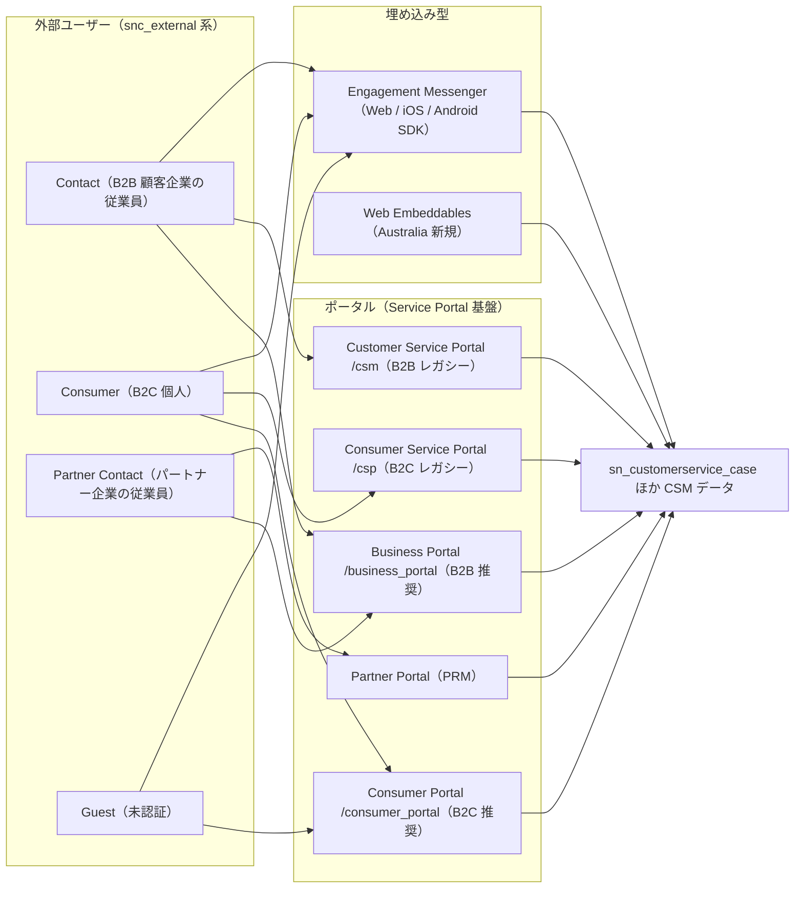
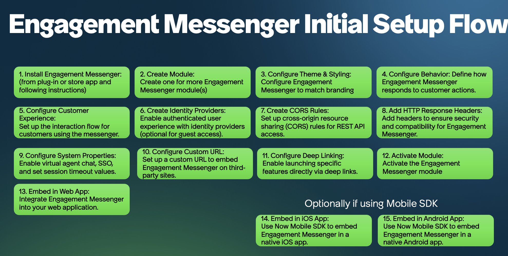
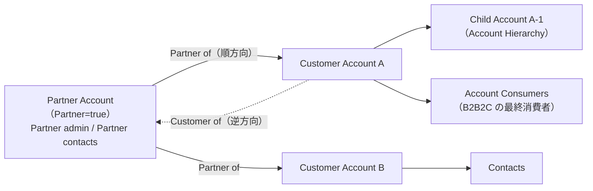
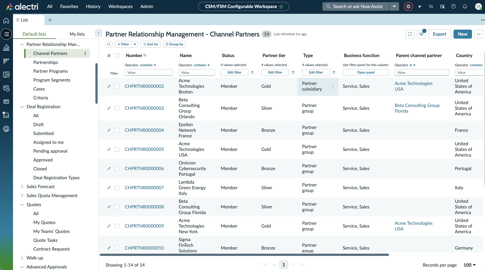
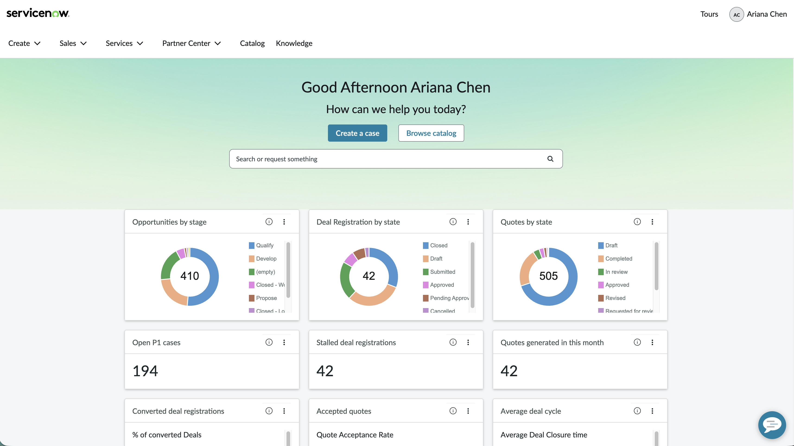
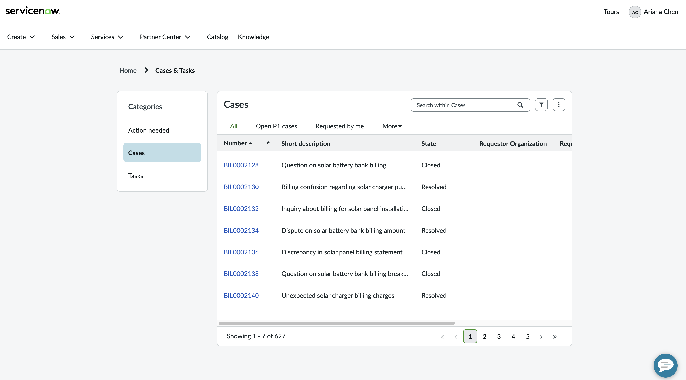
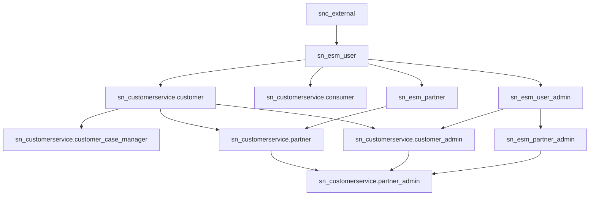

# CSM 顧客接点：Customer Service Portal・Engagement Messenger・Partner（B2B2C）

## 概要

本ファイルは、ServiceNow Customer Service Management（CSM、顧客サービス管理）の**外部顧客との接点（セルフサービスチャネル）**と**パートナーモデル**を深掘りするリファレンスである。CSM 全体（Case、Entitlement、Omnichannel、Workspace 等）は [Customer Service Management](./customer-service-management.md) を参照し、本ファイルでは以下を扱う。

| 領域 | 本ファイルで扱う内容 |
|---|---|
| 顧客ポータル | Business Portal（`/business_portal`）、Customer Service Portal（`/csm`）、Consumer Portal（`/consumer_portal`）、Consumer Service Portal（`/csp`）の位置付け・構成・自己登録・ポータル上のユーザー管理 |
| Engagement Messenger | 第三者 Web サイトに埋め込むセルフサービスウィジェット。モジュール構成、機能、埋め込みコード、OIDC/SAML 認証、CORS、テーブル・ロール・プロパティ |
| パートナーモデル | Partner Account、Account Relationship（双方向アカウント関係）、Contact Relationship、B2B2C / B2B2B、Partner Relationship Management（PRM） |
| 外部ユーザー | 外部ロール（Customer / Customer admin / Partner / Partner admin / Consumer 等）、`snc_external`、ライセンスの扱い |
| セキュリティ | Account Hierarchy（Account Code / Account Path）、Contact Relationship 制限プロパティ、Restrict Contact Access、Customer Access Management、CSM Query Rules |

基準リリースは **Australia**（2026-05 GA）。Brazil で判明している変更は「> **Brazil での変更:**」で併記する。Service Portal フレームワーク一般は [Service Portal と Employee Center](../platform/portals-employee-center.md)、ACL 一般は [アクセス制御（ACL）](../platform/access-control-acl.md)、SSO 一般は [認証とSSO](../platform/authentication-sso.md)、Virtual Agent は [Virtual Agent と会話型AI](../platform/virtual-agent.md) を参照。

---

## 1. 外部顧客チャネルの全体像

CSM の外部顧客チャネルは、大きく「**ポータル**（顧客がブラウザでアクセスする独立したサイト）」「**埋め込み型**（自社 Web サイト／モバイルアプリ内に ServiceNow の機能を組み込む）」「**会話チャネル**（チャット・メッセージング・音声）」に分かれる。本ファイルは前二者を中心に扱う。

| チャネル | 形態 | 主対象 | 認証 | 備考 |
|---|---|---|---|---|
| Business Portal | 独立ポータル | B2B Contact / Partner | 必須（一部ゲスト閲覧可） | Yokohama Q1 以降の既定 B2B ポータル【第三者情報】 |
| Customer Service Portal（CSM Portal） | 独立ポータル | B2B Contact / Partner | 必須 | レガシー。Business Portal への移行推奨 |
| Consumer Portal | 独立ポータル | B2C Consumer | ゲスト＋ログイン | Australia 以降の推奨 B2C ポータル【第三者情報】（Australia リリースノートはセルフサービス機能の紹介のみで「推奨」の記載はない） |
| Consumer Service Portal（CSP） | 独立ポータル | B2C Consumer | ゲスト＋ログイン | レガシー |
| Engagement Messenger | 他社サイト埋め込みウィジェット | B2B / B2C / 市民 | なし（ゲスト）／OIDC／SAML | Store アプリ `sn_csm_ec` |
| Web Embeddables | 他社サイト埋め込みコンポーネント | B2B / B2C / ゲスト | 構成による | Australia で新規（`sn_embeddable_core` 等） |
| Partner Portal（PRM） | 独立ポータル | チャネルパートナー | 必須 | Sales CRM 系 Store アプリ |

出典: [Customer Portals（ServiceNow Community）](https://www.servicenow.com/community/csm-articles/customer-portals/ta-p/3383969)（推奨・レガシー・既定の区分はこの記事による【第三者情報】）、[Australia リリースノート](https://www.servicenow.com/docs/r/australia/release-notes/customer-self-service-omnichannel-engagement-rn.html)

---

## 2. 顧客ポータル（Customer Service Portal / Consumer Service Portal ほか）

### 2.1 ポータル一覧と推奨・レガシーの区分

CSM/CRM のポータルはすべて Service Portal フレームワーク上に構築されるが、ナビゲーションや機能は Employee Center 等の社内ポータルとは別物である。ServiceNow 社員による Community 記事（2025-10-28 公開、2026-06-10 更新）は、**ITSM や Employee Center のポータルから始めず、CSM/CRM のリファレンスポータルから始めること**を推奨し、誤ったポータルから始めると手戻りになると述べている。【第三者情報】（ServiceNow Community 記事。ServiceNow 社員執筆だが公式ドキュメントではない）[出典](https://www.servicenow.com/community/csm-articles/customer-portals/ta-p/3383969)

| ポータル | URL サフィックス | モデル | 状態 | 説明 |
|---|---|---|---|---|
| Business Portal | `/business_portal` | B2B | 推奨 | Yokohama Q1 以降の新 B2B ポータル。Configurable Portal Widgets（CPW）で構築 |
| CSM Portal（Customer Service Portal） | `/csm` | B2B | レガシー | Yokohama Q1 以前の既定 B2B ポータル |
| Consumer Portal | `/consumer_portal` | B2C | 推奨 | Australia 以降の新 B2C ポータル |
| Consumer Service Portal | `/csp` | B2C | レガシー | Australia 以前の B2C ポータル |
| Business Location Service Portal | `/blsp` | 拠点 | リファレンス | 内部・外部のビジネスロケーション／組織を管理 |
| Business Portal（Sales and Order Management） | `/business_portal` | B2B | CRM リファレンス | B2B の販売・受注管理 |
| Retail Portal | `/rsp` | 業界 | CRM リファレンス | 本社／地域／店舗階層での店舗問い合わせ |
| Manufacturing Commercial Operations Dealer Portal | `/mco` | 業界 | CRM リファレンス | ディーラー向け |
| Government Service Portal | `/gsp` | 公共 | CRM リファレンス | Public Sector Digital Services の住民向け |
| Grants Management Portal | `/gmp` | 公共 | CRM リファレンス | 助成金の検索・申請・追跡 |
| Patient Support Portal / Care Team Portal | `/psp` / `/careteam` | ヘルスケア | CRM リファレンス | 患者向け／院内スタッフ向け |
| Community Portal | `/community` | 全般 | リファレンス | ピアツーピアのコミュニティ（Brazil で廃止予定、後述） |
| Partner Portal | 記載なし | パートナー | リファレンス | Partner Relationship Management |

【第三者情報】上表は ServiceNow Community 記事の一覧による。[出典](https://www.servicenow.com/community/csm-articles/customer-portals/ta-p/3383969) なお同記事は CSM セクションで `/csp` を「現行の B2C ポータル」と書く一方、表では「レガシー（Australia 以前）」としており記述が揺れている。`/csp` の廃止時期は公開情報では確認できず。

業界ポータルは [業界向けソリューション](../industry/industry-solutions.md)、販売系は [Sales and Order Management（CRM）](./sales-order-management-crm.md) を参照。

### 2.2 プラグインとアプリケーション

| 名称 | ID | 説明 | 出典 |
|---|---|---|---|
| Customer Service Portal | `com.snc.customer_service_portal` | B2B 顧客ポータル（`/csm`）のプラグイン。`admin` で有効化 | [出典](https://www.servicenow.com/docs/r/GOfWgam_hnLy1~sy07BOkA/eVK5HwIXOnp8Iu2kcoijjQ) |
| Consumer Service Portal | `com.snc.consumer_service_portal` | B2C 顧客ポータル（`/csp`）のプラグイン | 同上 |
| Customer Service Portal Base | `com.snc.csm_portal_base` | ポータル基盤。**Australia で ServiceNow Store の単独アプリへ移行**。以後の更新は Store アプリで配信され、メール連携・翻訳・添付・モバイルの改善を含む | [出典](https://www.servicenow.com/docs/r/australia/release-notes/customer-self-service-omnichannel-engagement-rn.html) |
| Walk-Up for CSM | `com.snc.walkup_for_csm` | 来店予約。Australia で Store 単独アプリへ移行 | 同上 |
| Web Components for Customers | `sn_cx_components` | Australia 新規。Web Embeddables 用コンポーネント | 同上 |
| Web Embeddable Core | `sn_embeddable_core` | Australia 新規。埋め込み基盤 | 同上 |
| Web Components for Guest | `sn_guest_component` | Australia 新規。未認証ユーザーが第三者サイトで公開ナレッジ閲覧・カタログ申請できる | 同上 |
| External User Registration | `com.sn_external_user_register` | 外部ユーザー自己登録（コミュニティ回答で言及）【第三者情報】 | [出典](https://www.servicenow.com/community/csm-forum/help-me-with-the-steps-to-solve-below-requirements-it-is-urgency/m-p/3312311) |

**有効化手順（Australia）:** `admin` ロールで ServiceNow Store、または **All > System Definitions > Plugins** から `com.snc.customer_service_portal` または `com.snc.consumer_service_portal` を検索してインストールし、**Activate** を選択する。[出典](https://www.servicenow.com/docs/r/GOfWgam_hnLy1~sy07BOkA/eVK5HwIXOnp8Iu2kcoijjQ)

> 注意: 旧リリース（Washington DC）のプラグイン一覧では Customer Service Portal の ID を `com.glide.service-portal.customer-portal` としており、リリースにより表記が異なる。詳細は [Customer Service Management](./customer-service-management.md) 8 章を参照。

### 2.3 Business Portal（B2B 推奨ポータル）

Business Portal は B2B 顧客を支援するポータルで、Configurable Portal Widgets で構築される。ログイン後のホームページは以下のコンポーネントからなる。[出典](https://www.servicenow.com/docs/r/5M2H7PAkXUuakbtz~5Kfeg/nsf6LCUcyYnVkLMyeffLow)（Zurich 版、2026-03-12 更新）

| コンポーネント | 内容 |
|---|---|
| Browse services | トピックを閲覧しサービスを申請 |
| Frequently asked questions | よくある質問 |
| Resources | Knowledge、Publications、FAQs ページへのリンク |
| Requests | 申請の提出・提出済み申請の閲覧 |
| My hub | 製品（Sold Product）と Install base item の管理 |
| My company | コンタクト（Contact）の作成・管理（管理者ロールが必要、2.6 節） |
| Notifications | 解決済みケース、情報待ちケース、Publications、承認 |
| Tours | 管理者が有効化した場合のみ表示されるガイドツアー |
| Live Chat | Virtual Agent またはエージェントとのチャット |
| Callback request | 待ち時間が長い・エージェント不在時のコールバック依頼 |
| Profile menu | プロフィール表示・ログアウト |
| Search | タイプアヘッド検索／全文結果表示 |
| Track your case updates | ケース更新の追跡 |
| Browse topics / Quick links | トピック閲覧、ナレッジ・カタログ・外部リンク |
| Most trending articles / Most popular services | 閲覧数上位の記事、人気のカタログ |
| Footer | 重要リンク・連絡先・法的情報 |

> **Australia の追加（2026-06）:** Business Portal ホームから離れずに Walk-up のチェックインを開始できる。[出典](https://www.servicenow.com/docs/r/australia/release-notes/customer-self-service-omnichannel-engagement-rn.html)
>
> **Australia の変更（2026-06、CSM ポータル共通の Configurable Portal Widgets）:** 以下は Business Portal 固有の機能ではなく、リリースノート上はポータルウィジェット一般の変更として記載されている。Portal Data List widget に JSON パラメータが追加され、対象レコードのコンテキスト・親／子／参照テーブルを指定して動的なレコード表示 URL を組み立てられる。Portal Object widget に動的インスタンスオプション（既定オフ）が追加され、URL パラメータから拡張テーブル・レコード ID・ビューを読み取り、カードのタイトル・画像・サマリー項目・詳細ビューをテーブルのビュー定義から導出する。[出典](https://www.servicenow.com/docs/r/australia/release-notes/customer-self-service-omnichannel-engagement-rn.html)

### 2.4 Customer Service Portal（`/csm`、レガシー B2B）

Customer Service Portal は Yokohama Q1 以前の既定 B2B ポータルで、既存顧客は Business Portal への移行が推奨されている。【第三者情報】[出典](https://www.servicenow.com/community/csm-articles/customer-portals/ta-p/3383969) コンタクト管理は **Support > Contacts**（ポータルヘッダー）から行う（Business Portal は **My company > Manage contacts**）。[出典](https://www.servicenow.com/docs/r/GOfWgam_hnLy1~sy07BOkA/~HyR3Dl7XshZG0f9YVuZJw)

Customer Service Portal 上でロールごとに可能な操作（Zurich 版の「Customer Service Portal user roles」）は以下のとおり。[出典](https://www.servicenow.com/docs/r/5M2H7PAkXUuakbtz~5Kfeg/xauWE6g9B5SMBRXCaKvayQ)

| ロール | ポータル上で可能な操作 |
|---|---|
| Customer（`sn_customerservice.customer`） | 自アカウントのケース作成・編集、自分のケース閲覧、自アカウントの資産閲覧、情報検索 |
| Customer case manager（`sn_customerservice.customer_case_manager`） | Customer の操作に加え、子アカウントのケース作成・編集、同アカウントの他コンタクトの代理でケース作成、アカウントの全ケースの閲覧・編集、子アカウントの資産閲覧 |
| Customer administrator（`sn_customerservice.customer_admin`） | アカウントのケース作成・編集、他コンタクトの代理作成、アカウントの全ケース・資産の閲覧、情報検索、**アカウントのユーザー管理** |
| Partner（`sn_customerservice.partner`） | 自分のケース作成・編集、**顧客アカウントの代理でケース作成**、自分のケース閲覧、自アカウントの資産閲覧、情報検索 |
| Partner administrator（`sn_customerservice.partner_admin`） | 自アカウント・顧客アカウントのケース作成、**自アカウントと顧客アカウントのケース・資産の閲覧・編集**、自アカウントと顧客アカウントのユーザー管理 |

Customer Service Portal では、`snc_external` ロールを持つユーザーが登録申請（Registration request）と変更要求（Change request）を閲覧・承認できる。[出典](https://www.servicenow.com/docs/r/5M2H7PAkXUuakbtz~5Kfeg/~~_LNrjE311AXgAfsf7O6g) ただし、公式ページの必要ロール表記は `snc_external` だが、登録申請の承認依頼が届くのは当該アカウントの Customer administrator（2.6 節）であり、`snc_external` はポータルアクセスの最低ロールとして示されていると解される（外部ユーザーなら誰でも承認できるという意味ではない）。【推定】

### 2.5 Consumer Portal / Consumer Service Portal（B2C）

Consumer Portal は Consumer（個人顧客）に情報とサポートを提供するブランド化可能な Web インターフェースで、Service Portal を基盤とする。設定は **Service Portal > Portals** で Consumer Portal を選択して行う。[出典](https://www.servicenow.com/docs/r/customer-service-management/use-consumer-portal.html)（Brazil 版、2026-09-10 更新）

| 区分 | 可能な操作 |
|---|---|
| ゲスト（未ログイン） | ナレッジ記事の検索・閲覧、カスタマーサービスエージェントとのチャット開始、登録（ログインとプロフィールの作成） |
| ログイン済み Consumer | プロフィール編集・パスワード変更、製品登録と登録済み製品の閲覧、Consumer エージェントへの連絡、ケース作成と現在のケース閲覧、提案された解決策の承認・却下 |

ログイン済みホームは Resources、Requests、**My hub**（製品・Install base item に加え**世帯メンバー（household members）**を管理）、Browse services、FAQs、Search、Tours、Profile menu、Live chat、Track your case updates、Quick links、Browse topics、Most trending articles、Most popular services、Footer で構成される。[出典](https://www.servicenow.com/docs/r/customer-service-management/use-consumer-portal.html)

Australia リリースノートでは、Consumer Portal はナレッジ、サービスカタログ、ケース管理、Virtual Agent をローコードのウィジェットで構成するセルフサービスとして紹介されている。[出典](https://www.servicenow.com/docs/r/australia/release-notes/customer-self-service-omnichannel-engagement-rn.html)

**Consumer のテーブル構造と自己登録:** Consumer Service Portal で自己登録すると、`sys_user` を拡張する Consumer User（`csm_consumer_user`）と、`sys_user` を拡張しない独立テーブルの Consumer（`csm_consumer`）の 2 レコードが作られ、`csm_consumer` 上のビジネスルールで同期される。登録後は既定で `sn_customerservice.consumer` ロールが付与される。【第三者情報】（Community 回答・パートナーブログ）[出典](https://concurrency.com/blog/servicenow-csm-consumer-and-consumer-user-crazinessservicenow/) 公式ドキュメントでは、`sys_user` を Consumer に関連付けられるのは管理者のみで、1 ユーザーは 1 Consumer にのみ関連付けられる。[出典](https://www.servicenow.com/docs/r/XqB45azTkh_fhRBNTD2pSw/bffubof3~Fwywhc78xJGcg)

- 公式の「Tables installed with Customer Service Management（Australia）」には、B2C データモデルのテーブルとして Consumer Profile（`sn_csm_consumer_profile`。Consumer への参照を保持し、業界内・業界間の複数プロファイルに拡張でき、プロファイルごとの属性は拡張テーブルに持つ）と Consumer Profile Location（`sn_csm_consumer_profile_location`。Consumer Profile と所在地〔住所〕の関係を保持）が掲載されている。[出典](https://www.servicenow.com/docs/r/GOfWgam_hnLy1~sy07BOkA/9rEG3G7YFVCDSHcF2RcDxQ)
- 【経験則】Consumer を `csm_consumer` にメールアドレス付きで事前インポートしておくと、後の自己登録時に「既存メールアドレス」チェックでエラーとなる事例がコミュニティで繰り返し報告されている。移行設計時は登録フローとの整合を確認する。[出典](https://www.servicenow.com/community/csm-forum/consumer-vs-consumer-user-avoiding-registration/m-p/437443)
- 外部ユーザーの自己登録構成は **External User Self-Registration > User Registration Configurations** で作成し、ポータルレコードの外部ユーザー登録構成フィールドに設定する（[Customer Service Management](./customer-service-management.md) 8 章参照）。

> **Brazil での変更:** Consumer Portal に **Work Orders** ページが追加され、顧客が作業指示（Field Service の Work Order）を閲覧・追跡できる。ポータル利用状況の分析定義が更新され、ゲストセッションの二重計上が解消された。[出典](https://www.servicenow.com/docs/r/brazil/release-notes/customer-self-service-omnichannel-engagement-rn.html)

### 2.6 B2B コンタクトの自己登録（Registration Code 方式）

B2B コンタクトの自己登録は、アカウントごとの **Registration Code（登録コード）**を用いる承認型フローである。[出典](https://www.servicenow.com/docs/r/customer-service-management/c_Business-PortalSelfRegistration.html)（Business Portal、Brazil 版）

| ステップ | 内容 |
|---|---|
| 1. コード発行 | 管理者がアカウントごとに一意の登録コードを作成し、Account フォームの **Registration Code** フィールドに保存。Customer administrator が必要に応じて顧客に配布 |
| 2. 申請 | 新規コンタクトがポータルで有効な登録コード付きの登録申請を送信。誤ったコードは「Invalid Registration Code」通知 |
| 3. 承認 | 申請はそのアカウントの Customer administrator に送られる。複数いる場合は全員に届くが承認は 1 名で足りる |
| 4. 結果 | 承認：ユーザーが作成され、ユーザー ID と一時パスワードがメール送信。初回ログイン時にパスワード変更が必要／却下：メール通知 |

- 公式ページは承認時に「新しいアカウント（a new account）」が作成されると記述しているが、文脈上はユーザー（コンタクト）アカウントを指すと解される。【推定】
- 登録申請は Registration Request（`sn_customerservice_registration`）テーブルに格納される（[Customer Service Management](./customer-service-management.md) 参照）。
- 【第三者情報】承認ではなくメール検証に置き換えたい場合、Flow Designer の「Customer Contact Self-Registration」フローを編集して承認アクションを外す方法がコミュニティで提案されている（非公式）。[出典](https://www.servicenow.com/community/developer-forum/customer-contact-self-registration-process/m-p/3206740)

### 2.7 ポータルからのコンタクト（ユーザー）管理

Customer administrator / Partner administrator はポータル上で自社（Partner admin は顧客アカウントも）のコンタクトを管理できる。[出典](https://www.servicenow.com/docs/r/GOfWgam_hnLy1~sy07BOkA/FBBFN9zGwaZtuAbuqTtUfw)

| 項目 | 内容 |
|---|---|
| 必要ロール | `sn_customerservice.customer_admin`、`sn_customerservice.partner_admin`、または `admin` |
| メニュー | Business Portal：**My company > Manage contacts**／Customer Service Portal：**Support > Contacts** |
| 編集可能な項目 | Title、Language、Account、Email、Business phone 等 |
| ログインの有効・無効 | コンタクトのログイン（ポータルアクセス）を有効化・無効化できる |
| ロール割り当て | **Edit Role** ポップアップで割り当て。Selected 列にロールが 1 つもない場合は更新できない（最低 1 ロール必須） |
| 割り当て可能ロールの制御 | システムプロパティ `sn_customerservice.contact_role_assignment`（既定値：partner_admin, partner, customer_admin, customer） |

`sn_customerservice.customer_case_manager` は `sn_customerservice.contact_role_assignment` に自動追加されないため、Customer / Partner admin に割り当てさせたい場合は **Customer Service > Administration > Properties** でこのプロパティに追加する。[出典](https://www.servicenow.com/docs/r/5M2H7PAkXUuakbtz~5Kfeg/xauWE6g9B5SMBRXCaKvayQ)

### 2.8 主なポータル関連プロパティ

| プロパティ | 用途 | 出典 |
|---|---|---|
| `sn_customerservice.contact_role_assignment` | ポータルの Edit Role で割り当て可能な外部ロール | [出典](https://www.servicenow.com/docs/r/5M2H7PAkXUuakbtz~5Kfeg/xauWE6g9B5SMBRXCaKvayQ) |
| `sn_customerservice.emails.customportal` | 第三者（カスタム）ポータルの URL。通知メールのリンクを特定レコードに向ける | [出典](https://www.servicenow.com/docs/r/GOfWgam_hnLy1~sy07BOkA/jcgpNarMl1GRaO4z1GZfEg) |
| `glide.knowman.serviceportal.use_numbered_url` | 指定ポータル（sys_id のカンマ区切り）で記事リンクを `sys_kb_id` でなく `sysparm_number` にする | 同上 |
| `sn_customerservice.portal.chat_queue` ほか | ポータルのチャットキュー等（[Customer Service Management](./customer-service-management.md) 8 章参照） | — |

### 2.9 Communities の廃止

> **Brazil での変更:** Communities は「デプロイ・機能強化・サポートの対象外」となり、以下のプラグインが代替なしで廃止予定（新規有効化はブロック、既存環境は継続利用可）となった：`com.sn_communities`、`com.sn_customer_communities`、`com.sn_communities_contextual_search`、`com.sn_communities_demo`、`com.sn_communities_global`、`com.snc.pa.communities`、Gamification Core Framework（`com.snc.gamification`）。[出典](https://www.servicenow.com/docs/r/brazil/release-notes/customer-self-service-omnichannel-engagement-rn.html)

---

## 3. Engagement Messenger

### 3.1 概要と位置付け

Engagement Messenger（EM）は、ServiceNow のセルフサービス機能（ナレッジ、ケース、カタログ、チャット、予約等）を**自社または第三者の Web サイトに埋め込む**ローコード／ノーコードのウィジェットである。顧客は顧客ポータルに移動せず、閲覧中のページ上でヘルプを得られる。ServiceNow 社員の Community 記事によれば、EM は **Quebec リリースで導入**され、**CSM Standard ライセンスで利用可能**、モバイルブラウザでも動作し、多言語に対応する。【第三者情報】[出典](https://www.servicenow.com/community/csm-articles/engagement-messenger/ta-p/3383986)

| 項目 | 内容 | 出典 |
|---|---|---|
| アプリケーション名 / スコープ | Engagement Messenger / `sn_csm_ec` | [出典](https://www.servicenow.com/docs/r/wLYnGFihvmNxBr5heMf_jw/091FoBRKhAjMeIhWat8AHQ) |
| 提供形態 | ServiceNow Store アプリ | 同上 |
| 対象ペルソナ | B2B 顧客、B2C Consumer、住民（Constituent）／構成する管理者・BA | [出典](https://www.servicenow.com/community/csm-articles/engagement-messenger/ta-p/3383986) |
| 依存プラグイン | Customer Service（`com.sn_customerservice`）、Integration - Multiple Provider Single Sign-On Installer（`com.snc.integration.sso.multi.installer`） | [出典](https://www.servicenow.com/docs/r/GOfWgam_hnLy1~sy07BOkA/jcgpNarMl1GRaO4z1GZfEg) |
| 任意プラグイン | Glide Virtual Agent（`com.glide.cs.chatbot`、チャット用。既定では入らない）、Service Portal Analytics（`com.glide.service-portal.analytics`、行動分析用） | [出典](https://www.servicenow.com/docs/r/wLYnGFihvmNxBr5heMf_jw/091FoBRKhAjMeIhWat8AHQ) |
| 埋め込み先 | Web サイト（HTML）、ネイティブ iOS / Android アプリ（Now Mobile SDK、KB1587276 / KB1587611） | [出典](https://www.servicenow.com/docs/r/GOfWgam_hnLy1~sy07BOkA/KgpC2mLFjN5AZBc~T7bd1g) |

**インストール手順:** `admin` で **All > System Applications > All Available Applications > All** を開き、`sn_csm_ec` を名前または ID で検索（なければ Store から申請）。インストールダイアログで依存関係を確認し、必要なプラグイン／アプリを先にインストール。任意で「Load demo data」（開発・テスト環境向け）を選び **Install**。アプリと関連 Store アプリには有効なエンタイトルメントが必要。[出典](https://www.servicenow.com/docs/r/wLYnGFihvmNxBr5heMf_jw/091FoBRKhAjMeIhWat8AHQ)（Yokohama 版）

### 3.2 初期セットアップの流れ

**図: Engagement Messenger Initial Setup Flow（初期セットアップフロー）**
濃紺の背景に 15 個の緑色のボックスが番号順に並ぶ図。1. Install Engagement Messenger（プラグインまたは Store アプリからインストール）、2. Create Module（1 つ以上のモジュールを作成）、3. Configure Theme & Styling（ブランドに合わせた外観）、4. Configure Behavior（顧客操作への応答の定義）、5. Configure Customer Experience（顧客の対話フロー）、6. Create Identity Providers（認証ユーザー体験用の IdP。ゲストのみなら任意）、7. Create CORS Rules（REST API アクセス用の CORS）、8. Add HTTP Response Headers（セキュリティと互換性のためのヘッダー）、9. Configure System Properties（Virtual Agent チャット、SSO、セッションタイムアウト）、10. Configure Custom URL（第三者サイト埋め込み用のカスタム URL）、11. Configure Deep Linking（特定機能をディープリンクで起動）、12. Activate Module（モジュールの有効化）、13. Embed in Web App（Web アプリへの組み込み）。右下に「Optionally if using Mobile SDK」として 14. Embed in iOS App、15. Embed in Android App（Now Mobile SDK でネイティブアプリに埋め込み）。
出典: https://www.servicenow.com/community/csm-articles/engagement-messenger/ta-p/3383986 （ServiceNow Community、Harriet Frankli〔ServiceNow 社員〕、2025-10-28 公開・2026-06-01 更新、取得日 2026-11-04）

公式の「Set up Engagement Messenger」でも、IdP の作成（ステップ 3）が CORS ルール（ステップ 4）より前に置かれ、ゲスト体験のみなら IdP 作成は省略できるとしている。[出典](https://www.servicenow.com/docs/r/customer-service-management/setting-up-engagement-messenger.html)

### 3.3 モジュール構成（ガイド付き構成ビュー）

EM は**モジュール**（`sn_csm_ec_engmnt_center_module`）単位で構成し、複数のモジュールを作成できる（例：サイトごと、B2B/B2C ごと）。メニューは **All > Engagement Messenger > Modules**、必要ロールは `sn_csm_ec.ec_admin`。新規作成または **Edit** で、Module / Appearance / Behavior / Features / Implement の 5 タブからなるガイド付き構成ビューが開く。[出典](https://www.servicenow.com/docs/r/YZ6y4yvCOMhykXn0xJSiRA/Z8NYge~9313OqKLvvRrQdw)（Xanadu 版。Australia でも構成は同系統と見られるが、項目差分は公開情報では確認できず）

**Module タブ**

| フィールド | 説明 |
|---|---|
| Module name | モジュールの一意な名前 |
| Short description | 簡単な説明 |

**Appearance タブ**

| フィールド | 説明・制約 |
|---|---|
| Logo | ヘッダーロゴ。推奨 約 2 KB、高さ・幅 30〜55 px。未設定時は Home アイコン |
| Launcher icon | サイト上で EM を開くアイコン。推奨 約 1 KB、24〜60 px、円形・透過背景。範囲外は自動リサイズ |
| Launch icon position | ランチャーの表示位置 |
| Allow module to expand to full-height | ブラウザタブの高さいっぱいまで拡張を許可 |
| Horizontal margin (px) / Vertical margin (px) | 左右／下端からの距離。最大各 70 px |
| Primary color / Primary font color | ヘッダーと主要ボタン（Submit、Yes、OK 等） |
| Secondary color / Secondary font color | 副ボタン（Cancel、No 等） |
| Tertiary color / Tertiary font color | タグ（Action required 等） |
| Theme | 既定「CWF Engagement Messenger Theme」 |

色はカラー名でなく 16 進コード（例：`#FFC0CB`）で指定する。画像形式は .jpg / .png / .bmp / .gif / .jpeg / .ico / .svg。

**Behavior タブ**

| フィールド | 説明 |
|---|---|
| Enable notifications on launcher icon | 新着メッセージをランチャー上にポップアップ |
| Enable sounds | 通知音 |
| Enable notifications in browser tab | ページ非表示時にブラウザタブで通知 |
| Enable user behavior tracking | UX 分析を収集（Service Portal Analytics プラグインが必要）。後でモジュール名を変えてもダッシュボードは元の名前のまま |
| Proactive Recommendations | 一定の非アクティブ時間後にプロアクティブなヘルプを表示（`sn_csm_ec.proactive_inactivity_time`、既定 2 秒） |

**Features タブ**: 3.4 節の機能（Feature）をモジュールに追加・構成する。

**Implement タブ**

| フィールド | 説明 |
|---|---|
| Website URLs | EM を展開するサイトの URL（カンマ区切り） |
| Authentication type | **None**（ゲストのみ）／**SAML-based**／**OIDC-based**。None 以外は対応する IdP を作成する |
| Advanced branding（フォームビューのみ） | Hyperlink text color、Navigate-back icon（24×24）、Close / List search / Expand / Collapse / Start-chat icon（16×16）、Filter menu / Applied-filters icon（24×24） |
| Embed code | 埋め込み用 JavaScript（Copy code） |
| Email instructions | セキュリティ管理者に IdP 作成、CORS ルール構成、HTTP レスポンスヘッダー作成の作業をメール送付 |
| Activate | モジュールを有効化。有効化しないと第三者サイトから利用できない |

[出典](https://www.servicenow.com/docs/r/YZ6y4yvCOMhykXn0xJSiRA/Z8NYge~9313OqKLvvRrQdw)、モジュール有効化 [出典](https://www.servicenow.com/docs/r/wLYnGFihvmNxBr5heMf_jw/mMvEdAor3g0ac1gWb_B8qw)

### 3.4 機能（Features）

Australia 版「Features of Engagement Messenger」（2026-03-12 更新）の機能一覧。[出典](https://www.servicenow.com/docs/r/GOfWgam_hnLy1~sy07BOkA/zjOPZtkSopjrMuxEZKayKQ)

| 機能 | 内容 | 前提・要件 | 制約 |
|---|---|---|---|
| Greeting | ヘッダーの挨拶・ウェルカムメッセージ（ゲスト／サインイン別） | — | — |
| Knowledge | 検索対象のナレッジベース選択、ホームの注目記事。複数 KB 対応 | EM 管理者（`sn_csm_ec.ec_admin`）に `knowledge_admin` を手動付与 | — |
| Search | 選択 KB を対象とした AI Search。記事の有用性評価 | AI Search の構成。ゲスト向けは Typeahead Search と AI Search Assist ウィジェットを有効化 | **Service Portal - Restricted Pages プラグイン（`com.glide.service-portal.pages.restricted`）が有効だと未認証ユーザーで AI Search が動作しない** |
| Case management | ケースの送信・追跡・更新受信、情報要求への回答、解決策の確認 | — | **認証ユーザーのみ** |
| Catalogs | カタログアイテムの閲覧・申請、ケース管理での追跡 | 事前定義カタログを EM に関連付け | — |
| Field service management | 製品／サービス・所在地・添付を指定して技術者訪問を依頼（Work Order として保存）。技術者位置と ETA を表示 | Field Service Management - Customer Experience（`com.snc.fsm_customer_experience`）、技術者のジオロケーション | ログインユーザーのみ（ゲスト不可） |
| Walk-up appointments | 近くのサポート拠点検索、来店予約、確認メール、変更・取消 | 認証：`com.snc.walkup_for_csm`／ゲスト：Guest Walk-up Experience for Customer Service（`sn_guest_walkup_cs`） | ゲストは確認メール経由でのみ予約管理 |
| Virtual and live agent chat | Virtual Agent／ライブエージェントとのチャット。エージェントはインシデント・ケース作成やチャット転送が可能。ケース詳細からのコンテキストチャット | Glide Virtual Agent（`com.glide.cs.chatbot`）、`com.glide.cs.embed.csp_frame_ancestors` に `'self'` と自社サイト URL を設定 | 認証・ゲストの両方に対応 |
| Now Assist in Virtual Agent | 生成 AI によるチャット | `virtual_agent_admin` / `admin` がアシスタントを構成し、EM ポータルを追加して Standard chat を選択 | アシスタントごとに検索構成を持つ |
| Asynchronous chat | 双方が常時オンラインでなくてもよい長期会話。プレビュー、絵文字、オフライン通知、履歴 | Web クライアントをメッセージングチャネルとして設定 | 既定では依頼者の返信が 2 日ないと「Closed Abandoned」。`sys_cs_channel` の Conversation Idle Timeout で変更 |
| Configurable cards | ポータルページ・カタログアイテム、注目リンク、任意テーブルのデータを埋め込み | — | 注目リンクは新しいタブで開く |
| Proactive updates and reminders | 来店予約・技術者訪問のリマインド、ケース・チャット更新通知 | Walk-up・FSM の構成 | 件数はウィジェットと（離脱時）ブラウザタブに表示 |

Community 記事ではこのほか、Omnichannel Callback、Proactive Recommendations、Deep linking（機能リンクまたはカスタムコード）、Service Request Playbooks（公共部門のみ）が挙げられている。【第三者情報】[出典](https://www.servicenow.com/community/csm-articles/engagement-messenger/ta-p/3383986)

> **Australia（2026-09）の追加:** Voice call widget が提供された。ポータルページや Engagement Messenger から直接音声通話を開始して AI Voice Agents に接続でき、ページ遷移後も通話コンテキストを保持する。[出典](https://www.servicenow.com/docs/r/australia/release-notes/customer-self-service-omnichannel-engagement-rn.html)
>
> **Brazil での変更:** 音声通話機能が新プラグイン **WebRTC Voice（`sn-webrtc`）**として記載された。WebRTC の Voice call widget はモバイルブラウザでは非対応で、モバイル端末での WebRTC 通話にはマイク権限が必要。[出典](https://www.servicenow.com/docs/r/brazil/release-notes/customer-self-service-omnichannel-engagement-rn.html)

### 3.5 埋め込みコードと認証（OIDC / SAML / ゲスト）

Australia 版「Embed Engagement Messenger in your web application」（2026-03-12 更新）の手順。必要ロールは `sn_csm_ec.ec_admin`、前提としてモジュールが有効化済みであること。[出典](https://www.servicenow.com/docs/r/GOfWgam_hnLy1~sy07BOkA/KgpC2mLFjN5AZBc~T7bd1g)

1. **All > Engagement Messenger > Modules** を開き、対象モジュールの **Edit** を選択。
2. **Implement** タブを開く。Security 設定を変更した場合はモジュールを保存してコードを更新する。
3. **Embed code** セクションで **Copy code** を選択し、Web サイトの HTML の `</body>` 直前に貼り付ける。
4. OIDC / SAML の場合は認証連携コードを追加する（下表）。
5. ゲスト Walk-up を有効化している場合は、コメントアウトされている `//guestWalkupBaseUrl` 行を有効にし、顧客サポートポータルのベース URL（例：`https://www.example.com/support`）を設定する。
6. （任意）表示言語を設定する。
7. （任意）ランチャーアイコンが表示され EM が開くことを確認する。
8. （任意）Proactive Recommendations をページに追加する。

| 認証タイプ | サイト側で実装するもの |
|---|---|
| None（ゲスト） | 埋め込みコードのみ。ケース管理・FSM 等の認証必須機能は使えない |
| OIDC-based | ID トークンを返す `getTokenCallBack()` を実装。サイトへのログイン時に `SN_CSM_EC.onLogin()`、ログアウト時に `SN_CSM_EC.onLogout()` を呼ぶ |
| SAML-based | ログイン時 `SN_CSM_EC.onLogin()`、ログアウト時 `SN_CSM_EC.onLogout()` を呼ぶ |

自動ログイン／ログアウトの詳細は KB1560205「Setting up auto login and logout for Engagement Messenger」を参照（公式ページで案内）。

**言語設定:**

| パラメータ | 動作 |
|---|---|
| `lang` | ISO ロケールコードを固定指定して EM を表示 |
| `setLang` | `getEMLanguage`（サイト側で実装する関数）を指定し、動的に言語を切り替える。EM がサポートする任意の ISO ロケールを返せる |
| 優先順位 | `setLang` は `lang` より優先。ユーザーが `sys_user_preference` に優先言語を持つ場合はそれが両者より優先 |

Australia にアップグレードした顧客は埋め込みコードを変更して言語切替を有効化できる。[出典](https://www.servicenow.com/docs/r/GOfWgam_hnLy1~sy07BOkA/KgpC2mLFjN5AZBc~T7bd1g)

日本語サイトに埋め込む場合の言語運用は [ローカライゼーション（日本語化）](../platform/localization.md) も参照。

### 3.6 IdP・CORS・HTTP レスポンスヘッダー・セッション

認証付き EM では、セキュリティ管理者が以下を構成する（Implement タブの Email instructions で依頼できる）。

| 構成 | 内容 | 出典 |
|---|---|---|
| Identity Provider（IdP） | OIDC または SAML の IdP をインスタンスに作成（既存 IdP の再利用可）。`admin` が必要。Web サイトにサインインする顧客はインスタンスの OIDC/SAML プロバイダーにも登録されている必要があり、EM は同じ IdP で認証する | [出典](https://www.servicenow.com/docs/r/ijrY28GQXyiiYK60ypUpog/RGBU9L2uRRKR_kLuTbFOlA) |
| CORS ルール | **System Web Services > REST > CORS Rules** で新規作成。REST API に Engagement Center API（`sn_csm_ec/engagement_center_api`）、Domain に自社サイト URL（例：`https://www.example.com`）、HTTP Methods は GET と POST、Max age 既定 0（毎回プリフライト）、HTTP Headers は空でよい | [出典](https://www.servicenow.com/docs/r/KaYjekDQOApluDhDTuH_UA/cGRAfTfzXKqMDfkhAnfBhA) |
| CORS ルールのメニュー位置（旧） | Zurich・Yokohama・Xanadu 版では **All > Engagement Messenger > Administration** 配下 | [出典](https://www.servicenow.com/docs/r/5M2H7PAkXUuakbtz~5Kfeg/asN4RHJU_P_PsErjiZ054A) |
| HTTP レスポンスヘッダー | EM 用の HTTP レスポンスヘッダーを作成（CORS ルールの次の手順）。具体的なヘッダー名・値は公開情報の範囲では確認できず | [出典](https://www.servicenow.com/docs/r/KaYjekDQOApluDhDTuH_UA/cGRAfTfzXKqMDfkhAnfBhA) |

**システムプロパティ（Australia 版「Components installed with Engagement Messenger」）** [出典](https://www.servicenow.com/docs/r/GOfWgam_hnLy1~sy07BOkA/jcgpNarMl1GRaO4z1GZfEg)

| プロパティ | 説明 | 既定値 |
|---|---|---|
| `com.glide.cs.embed.csp_frame_ancestors` | EM をホストするサイトの frame-ancestors ポリシー。Glide Virtual Agent が必要 | `'self'`（後ろに自社サイト URL を追加） |
| `glide.authenticate.multisso.enabled` | 複数プロバイダー SSO を有効化。ゲストのみのポータルでは不要 | true/false 型（ページ上の既定値表記は不明瞭） |
| `glide.ui.session_timeout` | ユーザーセッションのタイムアウト（分）。**Web サイト側のタイムアウト以上**にする。ゲストのみなら不要 | 30 |
| `sn_customerservice.emails.customportal` | 第三者サポートポータルの URL。通知メールのリンクを該当レコードに向ける | なし |
| `sn_csm_ec.proactive_inactivity_time` | プロアクティブヘルプを起動するまでの非アクティブ時間（秒） | 2 |
| `glide.knowman.serviceportal.use_numbered_url` | 記事リンクを `sysparm_number` で生成するポータルの sys_id | なし |

認証方式の詳細（OIDC/SAML 設定、Multi-Provider SSO）は [認証とSSO](../platform/authentication-sso.md)、CORS・REST 一般は [Web Services / REST API](../platform/web-services-api.md) を参照。

### 3.7 ロールとテーブル

**ロール**（Australia） [出典](https://www.servicenow.com/docs/r/GOfWgam_hnLy1~sy07BOkA/jcgpNarMl1GRaO4z1GZfEg)

| ロール | 説明 | 含むロール |
|---|---|---|
| Engagement Messenger admin（`sn_csm_ec.ec_admin`） | EM モジュール構成の作成・編集。EM テーブルと REST API へのアクセス | `sn_csm_ec.ec_read`、`snc_platform_rest_api_access`、`virtual_agent_admin`、`image_admin`、`sp_admin`、`ais_admin`、`catalog_builder_editor` |
| Engagement Messenger read（`sn_csm_ec.ec_read`） | 既存モジュール構成の閲覧。**内部ユーザーにのみ割り当てる** | なし |

> 注意: `sn_csm_ec.ec_admin` は `sp_admin`、`virtual_agent_admin`、`ais_admin` 等の強い管理ロールを内包する。EM 担当者に割り当てると Service Portal 全体や AI Search の管理権限も得るため、職務分掌の観点で割り当て範囲を絞ること。【推定】（含有ロール一覧からの推定）

**テーブル**（Australia）

| テーブル | 説明 |
|---|---|
| `sn_csm_ec_engmnt_center_module` | Engagement Messenger Module。全モジュールの一覧 |
| `sn_csm_ec_feature` | Feature。機能定義（各 Feature Instance はこの定義から作成） |
| `sn_csm_ec_feature_instance` | Feature Instance。モジュールごとの機能インスタンス |
| `sn_csm_ec_chat_instance` | Chat 機能の構成 |
| `sn_csm_ec_greeting_instance` | Greeting 機能の構成 |
| `sn_csm_ec_knowledge_instance` | Knowledge 機能の構成 |
| `sn_csm_ec_search_instance` | Search 機能の構成 |

### 3.8 バージョン履歴（Store アプリ）

Engagement Messenger は Store アプリとしてファミリーリリースとは独立に更新される。[出典](https://www.servicenow.com/docs/r/C17ZqvSaMwUVpMBg8Nc5sg/rJliZ~AWA_Y33HHmGqIcRw)

| バージョン | 時期 | 主な内容 |
|---|---|---|
| 5.21.0 | 2026-09 | 通知ポップアップの表示位置を修正 |
| 5.16.0 | 2026-08 | 翻訳・機能バグ修正 |
| 5.13.1 | 2026-06 | セキュリティ強化、**リフロー対応（ブラウザ 400% ズームでも利用可能）**、アクセシビリティ修正 |
| 5.12.2 | 2026-03 | UI・機能バグ修正 |
| 5.12.1 | 2026-01 | セキュリティ強化 |
| 5.11.0 | 2025-12 | セキュリティバグ修正 |
| 5.1.0 | 2022-08 | 親 Web サイトの言語で EM を表示するロケール対応 |

各バージョンの対応ファミリー（Australia / Brazil）は Store のアプリ掲載ページで確認する（リリースノートには記載なし）。

### 3.9 Web Embeddables（Australia 新規）との違い

Australia では、ケース一覧、ケース表示、ケース作成、カタログアイテム、ナレッジ記事表示などの**個別コンポーネント**を第三者サイトに埋め込む **Web Embeddables**（`sn_embeddable_core`、`sn_cx_components`、ゲスト向け `sn_guest_component`）が追加された。[出典](https://www.servicenow.com/docs/r/australia/release-notes/customer-self-service-omnichannel-engagement-rn.html)

| 観点 | Engagement Messenger | Web Embeddables |
|---|---|---|
| 形態 | ランチャーから開くウィジェット（ポップアップ型の小型ポータル） | ページ内に配置するコンポーネント |
| 構成 | モジュール単位でノーコード構成 | コンポーネント単位 |
| ゲスト | 一部機能（ナレッジ、検索、チャット、ゲスト Walk-up） | `sn_guest_component` で公開ナレッジ閲覧・カタログ申請 |

使い分けの公式ガイダンスは公開情報では確認できず。

---

## 4. 顧客データモデルとパートナー（B2B / B2C / B2B2B / B2B2C）

### 4.1 ビジネスモデル

CSM は顧客のビジネスモデルに合わせてデータモデルを選択する（公式は「適切なビジネスモデルの選択が不可欠」としている）。[出典](https://www.servicenow.com/docs/r/customer-service-management/customer-service-data-models.html)（Brazil 版）

| モデル | 構造 | 公式の例 |
|---|---|---|
| B2C | 個人 Consumer に直接販売・支援 | 動画配信サービスの個人顧客 |
| B2B | 企業が顧客。企業は Account、従業員は Contact | ホテルチェーンが顧客 |
| B2B2B | 提供者と最終企業の間に企業層が入る | OEM → ディーラー → 法人フリート |
| B2B2C | 提供者がパートナー企業とその最終 Consumer の両方を支援 | 保険会社が専属代理店とその顧客を支援 |
| B2B2E | 企業がさらに自社従業員に提供。従業員は Consumer としてモデル化（Account-Consumer 関係） | OEM が法人に車両を販売し従業員が利用 |
| Service Model Foundation | B2B / B2C を拡張し、内部・外部ロケーション、世帯、Consumer とその関係をカバー | — |

主要テーブル（`customer_account`、`customer_contact`、`csm_consumer`、`csm_household` 等）は [Customer Service Management](./customer-service-management.md) 3 章を参照。

### 4.2 Partner Account

Account（`customer_account`、`core_company` を拡張）は顧客、パートナー、または両方を表す。Account フォームの **Customer** / **Partner** フィールドで種別を示す。[出典](https://www.servicenow.com/docs/r/f7UTdaGQ6A6Py1a7IIajjA/6o9POGuoYRUaaB0xS~YLvw) パートナーは「他の顧客に販売・サポートする外部顧客」であり、顧客の代理でケースを報告・管理でき、自身が顧客にもなり得る。【第三者情報】[出典](https://www.servicenow.com/community/csm-articles/understanding-user-types-and-permissions-on-customer-service/tac-p/2298126)

- Partner Account 自体を作成しても、パートナーのコンタクトが顧客アカウントのデータを見られるようにはならない。**Account Relationship（4.3 節）でパートナーと各顧客アカウントを関連付ける必要がある。**`partner_admin` ロールだけでは自社の管理しかできない。【第三者情報】（ServiceNow 社員のコミュニティ回答）[出典](https://www.servicenow.com/community/csm-forum/partner-admin-role-functionality-in-csm-servicenow/m-p/3537553)
- 【第三者情報】2020 年のフォーラムでは、ケースの **Partner** フィールドが未設定のまま顧客コンタクトが起票した過去ケースは、Partner admin / Partner contact から見えないと報告されている。パートナー経由モデルの移行時はケースの Partner フィールドの補完を検討する。[出典](https://www.servicenow.com/community/csm-forum/partner-account-relationship-not-working/m-p/398954)

### 4.3 Account Relationship（双方向アカウント関係）

Account Relationship は 2 つのアカウントを**双方向**に関連付ける仕組みで、一方に「Partner of」、他方に「Customer of」のように順方向と逆方向の関係名が表示される。リレーションシップタイプは **顧客↔顧客、顧客↔パートナー、パートナー↔パートナー** を結べる。パートナーアカウントは関係を通じて顧客アカウントの代理でケースを管理し資産を閲覧できる。関係を削除すると逆方向レコードも削除されるが、関係を参照する既存ケースには影響しない。[出典](https://www.servicenow.com/docs/r/f7UTdaGQ6A6Py1a7IIajjA/6o9POGuoYRUaaB0xS~YLvw)、[出典](https://www.servicenow.com/docs/r/customer-service-management/c_AccountRelationships.html)

| テーブル | 内容 | 出典 |
|---|---|---|
| Account Relationship（`account_relationship`） | 関係レコード。**Account From**（ソース）と **Account To**（ターゲット）、関係タイプ、順・逆方向の説明 | [出典](https://www.servicenow.com/docs/r/GOfWgam_hnLy1~sy07BOkA/9rEG3G7YFVCDSHcF2RcDxQ) |
| `sn_customerservice_account_relationship_type` | 双方向アカウント関係のタイプ定義 | 同上 |
| `sn_customerservice_account_relationship_access` | アカウント関係のアクセス種別 | 同上 |

**Account Relationship Type フォーム**（**All > Customer Service > Administration > Account Relationship Types**） [出典](https://www.servicenow.com/docs/r/GOfWgam_hnLy1~sy07BOkA/BGGcXVkHQ4mJAW4s_HRC0g)

| フィールド | 説明 |
|---|---|
| Relationship type | 一意の名前（例：Service Provider） |
| From | ソースアカウントの種類（Account または Partner） |
| Relationship | ソース→ターゲットの関係名（例：Service provider for） |
| To | ターゲットアカウントの種類（Account または Partner） |
| Reverse relationship | ターゲット→ソースの関係名（例：Customer of） |
| Active | 有効なタイプのみ関係レコードの作成に使える |

- タイプ作成の必要ロール：`sn_crm_foundation_admin`、`sn_crm_foundation_data_manager`、`sn_crm_account_relationship_data_manager`、`admin` のいずれか。
- 関係レコードは Customer Service Manager がアカウントの **Account Relationships** 関連リストから作成する。ソース側には順方向、ターゲット側には逆方向で表示される。[出典](https://www.servicenow.com/docs/r/customer-service-management/c_AccountRelationships.html)
- パートナー用の既定タイプが 1 つ提供されるが、その名称は公開情報では確認できず。
- 【第三者情報】パートナー↔パートナーのタイプは一方向の閲覧・作成権しか与えず、両方向のタイプを組み合わせて回避した事例がフォーラムで報告されている（非公式）。[出典](https://www.servicenow.com/community/csm-forum/csm-partner-to-partner-relationship-type/td-p/2941247)

### 4.4 Contact と Contact Relationship

Contact（`customer_contact`、`sys_user` を拡張）は **1 つの Account にのみ所属**し、複数の資産・サービス契約に関連付けられ、Customer Service Portal にログインできる。**Contact Relationship** によりコンタクトを追加のアカウントに関連付けると、ポータルでそれらのアカウントの情報閲覧やケース作成・更新ができる（Customer / Customer administrator ロールのコンタクトが対象）。各 Contact Relationship は **Responsibility（責任）** を持つ。[出典](https://www.servicenow.com/docs/r/f7UTdaGQ6A6Py1a7IIajjA/6o9POGuoYRUaaB0xS~YLvw)

| 項目 | 内容 | 出典 |
|---|---|---|
| テーブル | Contact Relationship（`sn_customerservice_contact_relationship`）。コンタクト関係レコードを格納 | [出典](https://www.servicenow.com/docs/r/GOfWgam_hnLy1~sy07BOkA/9rEG3G7YFVCDSHcF2RcDxQ) |
| 主なフィールド | Contact、Responsibility（タイプが Contact の Responsibility Definition から選択） | [出典](https://www.servicenow.com/docs/r/GOfWgam_hnLy1~sy07BOkA/f~NIOWwORUPXXZAqRD94Uw) |
| Responsibility 定義 | `sn_customerservice_responsibility_def`。従業員（内部）用とコンタクト（外部）用の 2 タイプ | [出典](https://www.servicenow.com/docs/r/GOfWgam_hnLy1~sy07BOkA/cj19N44VhR1Pon7_hL_CHA) |
| 1 アカウント 1 責任の制約 | 既定では 1 コンタクトにつき 1 アカウントで 1 Responsibility。Vancouver 以降、ビジネスルール「Prevent duplicate for account-contact」の Active を False にすると複数可（`admin` のみ）。一意インデックス `company_contact` は Vancouver で置き換え | 同上 |
| 複数 Responsibility | **Zurich 以降**、1 コンタクトが 1 アカウントで複数の Responsibility を持てる | [出典](https://www.servicenow.com/docs/r/f7UTdaGQ6A6Py1a7IIajjA/6o9POGuoYRUaaB0xS~YLvw) |
| 作成・更新・削除ロール | `sn_customerservice_manager`、`sn_crm_foundation_admin`、`sn_crm_foundation_data_manager`、`sn_crm_account_relationship_data_manager` | [出典](https://www.servicenow.com/docs/r/GOfWgam_hnLy1~sy07BOkA/f~NIOWwORUPXXZAqRD94Uw) |
| 閲覧ロール | `sn_customerservice_manager`、`sn_customerservice_agent`、`sn_crm_account_relationship_viewer`、`sn_crm_foundation_data_viewer`（公式ページはラベルと技術名の対応が逆転しているため実機で確認） | 同上 |

> 注意: 「1 アカウント 1 責任の制約」と「複数 Responsibility」はどちらも公式記述である。Customer data ページ（Australia）は Zurich 以降に管理者が 1 コンタクトへ複数 Responsibility を割り当て可能と記載し、Configuring a contact relationship ページ（Australia）は既定で 1 Responsibility に制限され、ビジネスルール「Prevent duplicate for account-contact」を無効化すれば複数可と記載している。両者の関係（Zurich 以降も既定の制約の解除が必要か、Zurich で既定の挙動が変わったのか）は公開情報では確認できない。実機で確認すること。

**選択可能なコンタクトの範囲を制御するプロパティ:**

| プロパティ | 既定 | true の場合 | false の場合 |
|---|---|---|---|
| `sn_customerservice.contact_relationship.restrict_within_account_hierarchy` | true | Contact フィールドに、**アカウント関係（関連パートナー・アカウント）とアカウント階層内**のコンタクトのみ表示 | 全アカウントのコンタクトを表示 |

[出典](https://www.servicenow.com/docs/r/GOfWgam_hnLy1~sy07BOkA/f~NIOWwORUPXXZAqRD94Uw)

【第三者情報】コミュニティでは「1 コンタクトを複数アカウントに関連付けるにはこのプロパティを false にする」と説明される一方、false にするとアカウント階層構造を活かせなくなるとの指摘もある。公式定義は上表のとおり「Contact Relationship の選択候補の範囲」の制御であり、Contact 自体の所属アカウント（1 つ）は変わらない点に注意。[出典](https://www.servicenow.com/community/in-other-news/customer-service-management-csm-1-m-contact-account-relationship/ba-p/2681625)

### 4.5 Account Team

Account Team は、アカウントに対して定義済みの役割を持つ従業員とコンタクトのグループである。Responsibility Definition には従業員（内部ユーザー）用とコンタクト（外部ユーザー）用の 2 タイプがあり、Customer Service Manager がアカウントごとにユーザーへ割り当てる。メンバーはアカウントレコードの **Account Team Members** 関連リストに表示され、**Account manager** の責任を持つメンバーは顧客ポータルからアカウントの情報閲覧・操作ができる。[出典](https://www.servicenow.com/docs/r/f7UTdaGQ6A6Py1a7IIajjA/6o9POGuoYRUaaB0xS~YLvw)

### 4.6 B2B2C：Account Consumer

B2B2C モデルでは、ビジネス顧客（Account）がその最終 Consumer を支援する多段の顧客関係を構成する。Account Consumer は Account に紐づく最終消費者で、Install base item や Sold Product を Account Consumer に関連付けて最終消費者の問題を追跡する。[出典](https://www.servicenow.com/docs/r/5M2H7PAkXUuakbtz~5Kfeg/sJugJpNimVB8d8pRQWxsfQ)（Zurich 版「Roles required for B2B2C data models」）

| ロール | B2B2C での役割 |
|---|---|
| `sn_customerservice_agent` | Platform または CSM Workspace から Account Consumer のケースを作成 |
| `awa_agent` + `sn_customerservice_agent` | CSM Workspace でチャットを受け、チャットからケースを作成 |
| `sn_customerservice_manager` | Consumer を Account に関連付けて最終消費者を特定。Install base / Sold Product を Account Consumer に関連付け |
| `sn_acct_consumer.consumer`（Account consumer） | アカウントの Sold Product と Install base item を閲覧し、CSM ポータルで不具合のケースを作成。ケース作成・コメント・解決・クローズ時にメール通知を受信 |
| `sn_customerservice.customer`（Account contact） | ポータルで Install base・製品情報を閲覧して最終消費者の問題を追跡し、Account Consumer のためのケースを作成 |

Account Consumer を格納する具体的なテーブル名は、本調査で参照したページでは確認できず（[Customer Service Management](./customer-service-management.md) のテーブル一覧を参照）。

### 4.7 Consumer の関係（世帯・代理人）

| 関係 | 内容 |
|---|---|
| Consumer ↔ Consumer | **Authorized representative** の Responsibility。代理人は世帯の共有有無にかかわらず相手のケースを管理できる |
| Consumer Team | **Relationship manager** の Responsibility でエージェントを紐付け。エージェントはその Consumer の全ケースを管理 |
| Household | 住所と共通の製品・サービスを共有する Consumer のグループ。Consumer は複数世帯に所属可（1 つを Primary）。**Head of household** は他メンバーの全ケース・情報にアクセス。Household 削除時も Consumer・ケース・Work Order は削除されない |

[出典](https://www.servicenow.com/docs/r/f7UTdaGQ6A6Py1a7IIajjA/6o9POGuoYRUaaB0xS~YLvw)

### 4.8 Partner Relationship Management（PRM）

Partner Relationship Management（PRM）は、CSM の Partner Account／Account Relationship とは別に、**Sales CRM 系の Store アプリ**としてチャネルパートナーのライフサイクル（オンボーディング、プログラム、案件登録、見積・受注、ケース）を管理する製品である。[出典](https://www.servicenow.com/docs/r/IgYhkFXjkqOTLI_WLJDH4Q/pOZ9qEi8znOhJ8EpSkFyAg)（Zurich 版、2026-10-08 更新）

| コンポーネント | ID |
|---|---|
| Partner Relationship Management | `com.snc.partner_relationship_management` |
| Deal Registration Management | `com.snc.deal_registration_management` |
| Segment Management | `com.snc.segment_mgmt`（PRM インストール時に自動導入） |
| Sales Common for Channel Partners | `com.snc.partner_relationship_management_sales_common` |
| Order Management for Channel Partners | `com.snc.partner_relationship_management_orm` |
| Quote Management for Channel Partners | `com.snc.partner_relationship_management_qm` |

**ロール:** Enterprise partner admin（`sn_prm.enterprise_partner_admin`）、Enterprise partner agent（`sn_prm.enterprise_partner_agent`）。Partner Workspace はパートナー管理者・エージェント・マネージャー（企業側）、セルフサービスの Partner Portal はチャネルパートナーのユーザーが使う。[出典](https://www.servicenow.com/docs/r/IgYhkFXjkqOTLI_WLJDH4Q/6LQFgfIn6kJzD4lC4EJEzg)

**セットアップ順序:** ① Store から PRM をインストール（Segment Management も導入）→ ② Partner Workspace の設定 → ③ Partner Portal の設定 → ④ Deal Registration Management → ⑤ Segment Management の構成 → ⑥ Sales Common → ⑦ Order Management for Channel Partners（→ Quote Management）。[出典](https://www.servicenow.com/docs/r/IgYhkFXjkqOTLI_WLJDH4Q/6LQFgfIn6kJzD4lC4EJEzg)

**データモデル（ServiceNow 社員の Community 記事）** 【第三者情報】[出典](https://www.servicenow.com/community/sales-crm-articles/partner-relationship-management-prm-an-overview/ta-p/3560266)、[出典](https://www.servicenow.com/community/sales-crm-articles/prm-s-core-features/ta-p/3560954)

- Service Model Foundation（SMF）上に構築され、**External Business Organization** を拡張する。
- Channel Partner（親子階層あり、例：Acme → Acme UK）、Program（Reseller、Service Provider、Build、Authorized Training 等）、Segment（Platinum / Gold / Silver / Bronze）、Criteria、Partnership（パートナーとプログラムの関係）。
- オンボーディングは「プログラム設定 → パートナーとスタッフ設定 → パートナーシップのオンボード」の 3 段階。
- ペルソナ：パートナー側は Partner admin / Partner manager / Partner associate、企業側は Enterprise admin / Enterprise executive / Enterprise relationship manager。
- ケース可視性：パートナーは「Support」カタログアイテムから自社・組織・最終顧客のためにケースを起票。**Partner Manager は管理下の全組織のケース、Partner Associate は登録メンバーとなっている組織のケースのみ**を閲覧。
- 販売フロー：Deal Registration → Opportunity → Quote → Order。
- 記事コメントによれば PRM は CPQ Advanced、Sales CRM Advanced、Prime にバンドルされ、パートナーユーザーには別途ライセンスが必要。【第三者情報】

**図: Partner Relationship Management - Channel Partners リスト（CSM/FSM Configurable Workspace）**
CSM/FSM Configurable Workspace のリストビュー。左ナビゲーションの「Partner Relationship Management」配下に Channel Partners、Partnerships、Partner Programs、Program Segments、Cases、Criteria があり、続いて Deal Registration（All、Draft、Submitted、Assigned to me、Pending approval、Approved、Closed、Deal Registration Types）、Sales Forecast、Sales Quota Management、Quotes 等が並ぶ。右側のリスト「Partner Relationship Management - Channel Partners」（14 件）は Number（CHPRTNR0000002 形式）、Name、Status（Member）、Partner tier（Gold / Silver / Bronze）、Type（Partner subsidiary / Partner group）、Business function（Service, Sales）、Parent channel partner、Country の列を持つ。
出典: https://www.servicenow.com/community/sales-crm-articles/prm-s-core-features/ta-p/3560954 （ServiceNow Community、Mo AbuShahba〔ServiceNow 社員〕、2026-06-18、取得日 2026-11-04）

**図: PRM Partner Portal のランディングページ**
上部メニューに Create、Sales、Services、Partner Center、Catalog、Knowledge、右上に Tours とユーザー名。中央に挨拶文「How can we help you today?」と **Create a case** / **Browse catalog** ボタン、検索ボックス。下部にダッシュボードカード（Opportunities by stage、Deal Registration by state、Quotes by state のドーナツグラフ、Open P1 cases、Stalled deal registrations、Quotes generated in this month、Converted deal registrations、Accepted quotes、Average deal cycle）。右下にチャットアイコン。
出典: https://www.servicenow.com/community/sales-crm-articles/prm-s-core-features/ta-p/3560954 （取得日 2026-11-04）

**図: PRM Partner Portal の Cases & Tasks ページ**
パンくず「Home > Cases & Tasks」。左の Categories に Action needed、Cases（選択中）、Tasks。右の Cases リストには All / Open P1 cases / Requested by me / More のタブ、Number、Short description、State（Closed / Resolved）、Requestor Organization 等の列があり、「Showing 1 - 7 of 627」のページングが表示される。
出典: https://www.servicenow.com/community/sales-crm-articles/prm-s-core-features/ta-p/3560954 （取得日 2026-11-04）

**CSM パートナーモデルと PRM の関係:** CSM の Partner Account／Account Relationship（`customer_account` 系）と、PRM の Channel Partner（SMF の External Business Organization 系）のデータ連携の詳細は公開情報では確認できず。Community 記事は PRM のデータが CRM・CPQ・Sales CRM・CSM と同一データモデル上にあると述べるにとどまる。【第三者情報】 販売系の詳細は [Sales and Order Management（CRM）](./sales-order-management-crm.md) を参照。

---

## 5. 外部ユーザーのロールとライセンス

### 5.1 内部ユーザーと外部ユーザー

CSM では、エージェント等の社内ユーザーは User クラス（`sys_user`）で `snc_internal` 系、顧客・パートナーは Contact クラス（`customer_contact`）や Consumer User で `snc_external` 系ロールを持つ。外部ロールは「顧客ポータルを使う顧客とパートナー向け」、内部ロールは「エージェントとエージェントマネージャー向け」であり、OOB では外部ユーザーのみが顧客ポータルにアクセスでき、ACL により `snc_external` ユーザーは CSM Workspace にアクセスできない。【第三者情報】[出典](https://www.servicenow.com/community/csm-articles/understanding-user-types-and-permissions-on-customer-service/tac-p/2298126)、[出典](https://www.servicenow.com/community/csm-forum/which-role-is-required-for-customer-contact-user-to-access-csm/m-p/3238958) `snc_internal` / `snc_external` の一般論は [ユーザー・グループ・ロール](../platform/users-groups-roles.md) を参照。

### 5.2 外部ロール一覧（Australia）

[出典](https://www.servicenow.com/docs/r/australia/customer-service-management/r_RolesInstalledWithCustomerService.html)、[出典](https://www.servicenow.com/docs/r/customer-relationship-management/crm-user-management.html)

| ロール | モデル | 説明 | 含むロール |
|---|---|---|---|
| Customer（`sn_customerservice.customer`） | B2B | 問題調査、ケース作成、自ケースの閲覧・編集、自アカウントの資産閲覧 | `sn_esm_user`、`snc_external` |
| Customer administrator（`sn_customerservice.customer_admin`） | B2B | 顧客アカウントを管理し、アカウント（**またはアカウント階層**）内のデータにアクセス。コンタクト管理 | `sn_customerservice.customer`、`sn_esm_user_admin` |
| Customer case manager（`sn_customerservice.customer_case_manager`） | B2B | アカウントと**子アカウント**のケース管理。他コンタクトの代理作成、アカウントケースの閲覧・編集 | `sn_customerservice.customer` |
| Partner（`sn_customerservice.partner`） | B2B | 顧客アカウントにサービス提供。自アカウントまたは**関連する顧客アカウント**のケースを作成・編集 | `sn_customerservice.customer`、`sn_esm_partner` |
| Partner administrator（`sn_customerservice.partner_admin`） | B2B | パートナーアカウントを管理。パートナーと関連顧客のデータにアクセスし、ユーザーを管理し、パートナーが作成した全ケースを閲覧 | `sn_customerservice.partner`、`sn_customerservice.customer_admin`、`sn_esm_partner_admin` |
| Consumer（`sn_customerservice.consumer`） | B2C | 問題調査、ケース作成、購入製品のケース閲覧・編集、製品一覧の閲覧 | `sn_esm_user`、`snc_external` |
| Account consumer（`sn_acct_consumer.consumer`） | B2B2C | アカウントの Sold Product / Install base 閲覧、ケース作成（4.6 節） | 公開情報では確認できず |

**Customer Service Base Entities のロール**

| ロール | 含むロール |
|---|---|
| Service management user（`sn_esm_user`） | `snc_external`、`sn_apptmnt_booking.appointment_booking_user` |
| Service management partner（`sn_esm_partner`） | `sn_esm_user` |
| Service management user admin（`sn_esm_user_admin`） | `sn_esm_user` |
| Service management partner admin（`sn_esm_partner_admin`） | `sn_esm_user_admin`、`sn_esm_admin` |
| Service management admin（`sn_esm_admin`） | なし |

（矢印は「左のロールが右のロールに含まれる」ことを示す。）

### 5.3 Customer Access Management のロール（ケース・Sold Product・Install Base 単位）

Customer Access Management は、ケースや Sold Product に複数のコンタクト・Consumer・内部ユーザーを異なるアクセスレベルで関与させる仕組みで、機能ロール（Functional）と細粒度ロール（Granular）を提供する。[出典](https://www.servicenow.com/docs/r/wLYnGFihvmNxBr5heMf_jw/bofzSnJ1a0wVwRatAQDugw)（Yokohama 版）

| 機能ロール | 内容 | プラグイン |
|---|---|---|
| `sn_customerservice.case_authorized_contact` / `_consumer` / `_contributor` | コメント・添付追加、解決策の承認・却下、ケース更新通知、ケースクローズ、ケースタスク更新（`case_write_granular` を含む） | `com.sn_customerservice` |
| `sn_install_base.sold_product_authorized_contact` / `_consumer` | Sold Product とその Install base の閲覧、関連ケースの作成・アクセス、関連当事者の閲覧、カタログ申請管理 | `com.snc.install_base` |
| `sn_install_base.install_base_authorized_contact` / `_consumer` / `_contributor` / `_member` | 関連当事者（Related Party）として Install base とリンクされた Sold Product を閲覧し、ケースを作成・管理（Contact はコンタクトと Install base が同一アカウントの場合のみ） | `com.snc.install_base` |

細粒度ロール：`sn_customerservice.case_read_granular`、`case_create_granular`、`case_write_granular`、`case_related_party_write_granular`、`sn_install_base.sold_product_read_granular`、`sold_product_contact_read/write_granular`、`sold_product_consumer_read/write_granular`、`install_base_read_granular`、`install_base_related_party_read/write_granular`、`installed_product_read_granular`。

### 5.4 ライセンスの扱い

- 【第三者情報】2019 年のコミュニティ投稿は、ServiceNow の再販パートナー向け価格ポリシー（Madrid 時点）に「`snc_external` ロールを持つ CSM の External Users は Unrestricted User 数にカウントしない」とあると引用している。また別回答は、外部 CSM ユーザーは CSM User 数に含まれず CSM サブスクリプション料金の対象外としている。[出典](https://www.servicenow.com/community/csm-forum/external-users-capabilities-in-unrestricted-license-model-for/m-p/404486)
- 【第三者情報】外部 CSM ユーザーは「顧客のアカウント、Consumer、世帯、パートナー等の外部コンタクト」と定義され、顧客ポータル経由で自分または関連アカウントのリクエストを作成・閲覧・変更できるが、エージェント用 Workspace は使えない。[出典](https://redresscompliance.com/servicenow-csm-licensing-landing)
- 【第三者情報】ポータル専用の顧客を内部ユーザーとして作成してライセンス体系を回避する構成は、ベストプラクティスではない（ライセンス体系の迂回になる）と ServiceNow Community のアーキテクトが警告している。[出典](https://www.servicenow.com/community/architect-forum/licensing-clarification-csm-portal-only-customers-b2b-model/m-p/3493551)
- Engagement Messenger は CSM Standard ライセンスで利用可能。【第三者情報】[出典](https://www.servicenow.com/community/csm-articles/engagement-messenger/ta-p/3383986)
- PRM はパートナーユーザーに別ライセンスが必要（Community 記事コメント）。【第三者情報】
- 現行（Australia 時点）の公式な契約条項での外部ユーザーの扱いは公開情報では確認できず。契約条件は ServiceNow または再販パートナーに確認すること。ライセンス全般は [ライセンスモデル](../../03_導入編/01-licensing-model.md)、最適化は [ライセンスコスト最適化](../../04_応用編/06-license-cost-optimization.md) を参照。

---

## 6. セキュリティ：Account Hierarchy と Contact 制限

### 6.1 Account Hierarchy（Account Code / Account Path）

Account は親子階層を持ち、親アカウントは顧客の法的・業務的構造を表す。**親アカウントの管理者は、階層のどのレベルの子アカウント・コンタクト・ケース・資産も閲覧・管理できる。**[出典](https://www.servicenow.com/docs/r/f7UTdaGQ6A6Py1a7IIajjA/6o9POGuoYRUaaB0xS~YLvw)

階層は Account（`customer_account`）の以下のフィールドで表現される。[出典](https://www.servicenow.com/docs/r/GOfWgam_hnLy1~sy07BOkA/7LDX3xdx3saeNFZjefFOag)、[Account API](https://www.servicenow.com/docs/r/de-DE/api-reference/rest-apis/account-api.html)

| フィールド | 内容 |
|---|---|
| Parent（`account_parent`） | 親アカウントの sys_id |
| Account Code（`account_code`） | アカウントを識別する一意キー。重複挿入は「Duplicate entry for key account_path」エラー |
| Account Path（`account_path`） | 階層の各アカウントの Account Code を親から順に `/` で連結（最上位はそれ自身のコード） |

| アカウント（公式の例） | Account Path |
|---|---|
| Boxeo（親） | `1` |
| Boxeo USA（子） | `1/2` |
| Boxeo EMEA（子） | `1/3` |
| Boxeo France（Boxeo EMEA の子） | `1/3/5` |

- Account Path は `customer_account` の挿入・更新・削除時のビジネスルールで維持される。
- **トランスフォームマップでのインポート時はビジネスルールを実行すること。** 実行しないと Account Path が空になり、**データアクセスの問題**（階層ベースの可視性が効かない）を引き起こす。実行できない場合は「Update account path」ビジネスルールのスクリプトをインポート後のレコードに対して実行する。[出典](https://www.servicenow.com/docs/r/GOfWgam_hnLy1~sy07BOkA/7LDX3xdx3saeNFZjefFOag)

データ移行の一般論は [データ移行](../../03_導入編/08-data-migration.md)、[データインポート/エクスポート](../platform/import-export-data.md) を参照。

### 6.2 外部ユーザーの可視範囲の整理

| ロール | 自アカウント | 子アカウント（階層） | 関係のある顧客アカウント（Account Relationship） | Contact Relationship の追加アカウント |
|---|---|---|---|---|
| Customer | 自分のケース、アカウント資産 | — | — | 閲覧・ケース作成/更新 |
| Customer case manager | アカウントの全ケース | ケース作成・編集、資産閲覧 | — | 公開情報では確認できず |
| Customer administrator | 全ケース・資産、ユーザー管理 | 階層全体（親アカウント管理者として） | — | 閲覧・ケース作成/更新 |
| Partner | 自分のケース、資産 | — | 代理でケース作成 | 公開情報では確認できず |
| Partner administrator | 全ケース・資産、ユーザー管理 | 公開情報では確認できず | ケース・資産の閲覧・編集、ユーザー管理 | 公開情報では確認できず |

上表は 2.4 節・4 章・5.2 節の公式記述を整理したもの。セル内の「—」は公式記述で該当権限が示されていないことを表す。【推定】（複数の公式ページの統合による）

### 6.3 Restrict Contact Access（Sold Product / Install Base の制限）

既定では、アカウントに関連付けられたコンタクトはそのアカウントの Sold Product と Install base をすべて読める。**Manage Account Access** で **Restrict Contact Access** を有効にすると、一部のコンタクトのみに制限できる。[出典](https://www.servicenow.com/docs/r/GOfWgam_hnLy1~sy07BOkA/EklBbH25OTQgXhe6cUT6xw)（Australia 版）

| 項目 | 内容 |
|---|---|
| メニュー | **All > Customer Service > Administration > Manage Account Access** |
| 必要ロール | `sn_crm_foundation_admin`、`sn_crm_foundation_data_manager`、`sn_crm_account_relationship_data_manager`、`sn_customerservice_manager`、`sn_customerservice.customer_admin` のいずれか |
| テーブル | Account Access（`sn_csm_account_access`） |
| フォーム | **Account**（制限対象アカウント）、**Restrict Contact Access**（true/false） |
| 制約 | 同一アカウントに重複した Account Access レコードは作成できない |

| Restrict Contact Access | 動作 |
|---|---|
| false（既定） | アカウントに関連する全コンタクトがアカウントの Sold Product / Install base を読める |
| true | アカウントのコンタクトはアクセスを失う。ただし次は引き続きアクセス可：① Sold Product / Install base レコードに関連付けられたコンタクト、② **Authorized Representative** の Responsibility で関連当事者に追加されたコンタクト、③ **Authorized Account** の Responsibility で関連当事者に追加されたアカウントに属するコンタクト |

Sold Product に追加コンタクトを Type と Responsibility を指定して追加すると、Sold Product に関連付けられたコンタクトと同じアクセスを得る。Responsibility が空のコンタクトは Sold Product にもそのケースにもアクセスできない。[出典](https://www.servicenow.com/docs/r/GOfWgam_hnLy1~sy07BOkA/RfoNUAXXgHUqECA~hiTBXg)

**Customer Access Management の関連テーブル（Australia）** [出典](https://www.servicenow.com/docs/r/GOfWgam_hnLy1~sy07BOkA/cj19N44VhR1Pon7_hL_CHA)

| テーブル | 説明 |
|---|---|
| `sn_csm_account_access` | Account Access。アカウントコンタクトの Sold Product / Install base アクセス制限 |
| `sn_customerservice_responsibility_def` | Responsibility Definition |
| `sn_customerservice_related_party_configuration` | Related Party Configuration（Washington DC 以降 Application File テーブルに再親子化） |
| `sn_customerservice_related_party` | Related Party（ケースの関連当事者） |
| `sn_install_base_sold_product_related_party` | Sold Product Related Party |
| `sn_install_base_related_party` | Install Base Related Party（業界固有属性のため拡張可） |
| `sn_install_base_rel_soldproduct_to_contact` | Contact Sold Product。**Australia から新規顧客には非推奨** |
| `sn_install_base_m2m_consumer_sold_product` | Consumer Sold Product。**Australia から新規顧客には非推奨** |

**Asset contact relationship:** 特定資産を 1 名以上のコンタクトに割り当てる。関連システムプロパティを有効にすると、ポータルの My Assets に割り当て済み資産のみが表示され、Create Case フォームの Asset フィールドにはユーザーがコンタクトとなっている資産のみが表示される（プロパティ名は参照ページに記載なし）。[出典](https://www.servicenow.com/docs/r/f7UTdaGQ6A6Py1a7IIajjA/6o9POGuoYRUaaB0xS~YLvw)

### 6.4 CSM Query Rules（データ可視性の実装）

CSM ロールのユーザーがアクセスできる CSM テーブルのレコードは、Query Business Rule と READ ACL に適用されるフィルターで制御され、そのフィルターはメタデータテーブルに格納される。[出典](https://www.servicenow.com/docs/r/wLYnGFihvmNxBr5heMf_jw/QXPqDJQUvdAL5OAbpAuc4w)（Yokohama 版）

| 項目 | 内容 |
|---|---|
| 変遷 | London まではスクリプトインクルード `CSQueryBRUtilOOBConstants` で定義。Quebec で Query Rule（`sn_query_rule`、`sys_metadata` を拡張）テーブルに移行 |
| プロパティ | `sn_cs_queryrules.use_query_rules`：zBoot（新規）インスタンスで true、アップグレードインスタンスで false。true は Query Rule テーブル、false は `CSQueryBRUtilOOBConstants` とその拡張で判定 |
| 有効化 | 既存顧客は ServiceNow Customer Support に連絡して有効化 |
| 対象テーブル | `sn_customerservice_case`、`sn_install_base_m2m_affected_install_base`、`sn_install_base_item`、`sn_install_base_m2m_installed_product`、`sn_install_base_sold_product`、`csm_order_case`、`sn_install_base_m2m_contract_sold_product`、`csm_order`、`alm_asset`、`service_entitlement`、`customer_account`、`wm_order`、`customer_contact`、`ast_contract` |

外部ユーザーのデータ可視性をカスタマイズする場合、ACL 単独ではなく Query Rule（または旧方式のスクリプトインクルード拡張）側の挙動を確認する必要がある。【推定】 ACL・Query BR の一般論は [アクセス制御（ACL）](../platform/access-control-acl.md) を参照。

### 6.5 ドメインセパレーション

ドメインセパレーションを使う CSM では、カスタマーサービスエージェント・マネージャーを TOP / MSP / Default ドメインに明示的に割り当てないとケース・アカウントデータにアクセスできない。ドメイン内のアクセスはさらにコンタクト・パートナー・親子関係で絞り込まれる。[出典](https://www.servicenow.com/docs/r/wLYnGFihvmNxBr5heMf_jw/dJOhGFdfwtaRwzqJwlndsw) 詳細は [ドメインセパレーション](../platform/domain-separation.md) を参照。

### 6.6 外部公開時のセキュリティ観点（チェックリスト）

| 観点 | 確認事項 | 根拠 |
|---|---|---|
| ゲストアクセス | Consumer Portal / EM のゲストで公開されるナレッジ・カタログの範囲（ユーザー条件）を確認 | 2.5、3.4 節 |
| AI Search とゲスト | Restricted Pages プラグイン有効時は未認証で AI Search が動かない | 3.4 節 |
| フレーム埋め込み | `com.glide.cs.embed.csp_frame_ancestors` を自社ドメインのみに限定 | 3.6 節 |
| CORS | `sn_csm_ec/engagement_center_api` の CORS ルールを埋め込み先ドメインに限定 | 3.6 節 |
| セッション | `glide.ui.session_timeout` をサイト側タイムアウト以上に設定 | 3.6 節 |
| 階層データ | インポート後の `account_path` 欠落がないか確認 | 6.1 節 |
| コンタクト範囲 | `restrict_within_account_hierarchy` を安易に false にしない | 4.4 節 |
| 製品・資産の可視性 | 大企業顧客では Restrict Contact Access と Related Party の Responsibility 設計 | 6.3 節 |
| 管理ロール | `sn_csm_ec.ec_admin` が内包する `sp_admin` 等の範囲 | 3.7 節 |

全般的な強化策は [セキュリティ強化の実践](../../04_応用編/12-security-hardening-practice.md)、[セキュリティとコンプライアンス](../../03_導入編/10-security-compliance.md) を参照。

---

## 7. Australia / Brazil の変更点まとめ

| リリース | 領域 | 変更 | 出典 |
|---|---|---|---|
| Australia | ポータル基盤 | Customer Service Portal Base（`com.snc.csm_portal_base`）が Store 単独アプリへ移行 | [出典](https://www.servicenow.com/docs/r/australia/release-notes/customer-self-service-omnichannel-engagement-rn.html) |
| Australia | B2C | Consumer Portal のセルフサービス機能（ナレッジ、カタログ、ケース、Virtual Agent をローコードのウィジェットで構成）を提供 | 同上 |
| Australia（参考） | B2C | Consumer Portal（`/consumer_portal`）を推奨 B2C ポータル、`/csp` をレガシーと位置付け【第三者情報】 | [出典](https://www.servicenow.com/community/csm-articles/customer-portals/ta-p/3383969) |
| Australia | 埋め込み | Web Embeddables（`sn_embeddable_core`、`sn_cx_components`、`sn_guest_component`） | 同上 |
| Australia | EM | リフロー対応（400% ズーム）、言語切替（`setLang`）を埋め込みコードで有効化可能 | 同上、[出典](https://www.servicenow.com/docs/r/GOfWgam_hnLy1~sy07BOkA/KgpC2mLFjN5AZBc~T7bd1g) |
| Australia（2026-06） | Business Portal | ホームページから Walk-up チェックインを開始 | [出典](https://www.servicenow.com/docs/r/australia/release-notes/customer-self-service-omnichannel-engagement-rn.html) |
| Australia（2026-06） | ポータルウィジェット | Portal Data List widget の動的レコード表示 URL、Portal Object widget の動的インスタンスオプション（CSM ポータル共通） | 同上 |
| Australia（2026-09） | 音声 | Voice call widget でポータル／EM から音声通話を開始し AI Voice Agents に接続（ページ遷移後も通話コンテキストを保持） | 同上 |
| Australia | CAM | `sn_install_base_rel_soldproduct_to_contact`、`sn_install_base_m2m_consumer_sold_product` を新規顧客に非推奨 | [出典](https://www.servicenow.com/docs/r/GOfWgam_hnLy1~sy07BOkA/cj19N44VhR1Pon7_hL_CHA) |
| Brazil | Consumer Portal | Work Orders ページ追加 | [出典](https://www.servicenow.com/docs/r/brazil/release-notes/customer-self-service-omnichannel-engagement-rn.html) |
| Brazil | 分析 | ポータル利用状況でゲストセッションの二重計上を解消 | 同上 |
| Brazil | 音声 | WebRTC Voice（`sn-webrtc`）プラグインとして記載。モバイルブラウザ非対応、モバイル端末ではマイク権限が必要 | 同上 |
| Brazil | Communities | Communities 系・Gamification プラグインを代替なしで廃止予定 | 同上 |
| Zurich（参考） | Contact Relationship | 1 コンタクトが 1 アカウントで複数 Responsibility を持てる | [出典](https://www.servicenow.com/docs/r/f7UTdaGQ6A6Py1a7IIajjA/6o9POGuoYRUaaB0xS~YLvw) |

Brazil における Engagement Messenger 固有の変更、PRM の Brazil 変更は公開情報では確認できず。

---

## 8. 設計上のポイント

- 【第三者情報】新規 B2B 導入は `/csm` ではなく Business Portal、新規 B2C は `/csp` ではなく Consumer Portal から始める。Employee Center・ITSM ポータルを流用しない。[出典](https://www.servicenow.com/community/csm-articles/customer-portals/ta-p/3383969)
- パートナーモデルでは、Partner Account の作成とパートナーロール付与だけでなく、**顧客ごとの Account Relationship レコード**の作成・維持を運用プロセスに組み込む（4.2〜4.3 節）。
- 【経験則】Contact は 1 アカウントにしか所属できないため、グループ企業横断で活動する担当者は Contact Relationship（または Account Hierarchy と Customer admin）で表現する。安易に重複 Contact を作るとポータルログインの重複や自己登録時のメール重複エラーを招く。
- Account のインポートでは `account_path` の生成を必ず検証する（6.1 節）。
- Engagement Messenger のゲスト専用構成と認証構成では、必要な設定（IdP、Multi-SSO、セッションタイムアウト）が大きく異なる。要件定義段階でどの機能を認証必須とするか（ケース管理、FSM は認証必須）を決める（3.4〜3.6 節）。
- 外部ユーザーのライセンス扱いは契約条件で確認し、ポータルユーザーを内部ユーザー化する回避策は取らない（5.4 節）。

---

## 関連ファイル

- [Customer Service Management](./customer-service-management.md)
- [Field Service Management](./field-service-management.md)
- [Sales and Order Management（CRM）](./sales-order-management-crm.md)
- [Service Portal と Employee Center](../platform/portals-employee-center.md)
- [ユーザー・グループ・ロール](../platform/users-groups-roles.md)
- [アクセス制御（ACL）](../platform/access-control-acl.md)
- [認証とSSO](../platform/authentication-sso.md)
- [Virtual Agent と会話型AI](../platform/virtual-agent.md)
- [Predictive Intelligence と AI Search](../platform/predictive-intelligence-ai-search.md)
- [ドメインセパレーション](../platform/domain-separation.md)
- [モバイル](../platform/mobile.md)
- [ライセンスモデル](../../03_導入編/01-licensing-model.md)

## 参照元

公式ドキュメント（servicenow.com/docs）
- Activate the Consumer and Customer Service Portals（Australia）: https://www.servicenow.com/docs/r/GOfWgam_hnLy1~sy07BOkA/eVK5HwIXOnp8Iu2kcoijjQ
- Using the Business Portal（Zurich）: https://www.servicenow.com/docs/r/5M2H7PAkXUuakbtz~5Kfeg/nsf6LCUcyYnVkLMyeffLow
- Consumer Portal（Brazil）: https://www.servicenow.com/docs/r/customer-service-management/use-consumer-portal.html
- Customer contact self-registration on Business Portal（Brazil）: https://www.servicenow.com/docs/r/customer-service-management/c_Business-PortalSelfRegistration.html
- Manage contacts from Business Portal（Australia）: https://www.servicenow.com/docs/r/GOfWgam_hnLy1~sy07BOkA/FBBFN9zGwaZtuAbuqTtUfw
- Manage contacts from the customer service portal（Australia）: https://www.servicenow.com/docs/r/GOfWgam_hnLy1~sy07BOkA/~HyR3Dl7XshZG0f9YVuZJw
- Customer Service Portal user roles（Zurich）: https://www.servicenow.com/docs/r/5M2H7PAkXUuakbtz~5Kfeg/xauWE6g9B5SMBRXCaKvayQ
- Approve a change request, or registration request（Zurich）: https://www.servicenow.com/docs/r/5M2H7PAkXUuakbtz~5Kfeg/~~_LNrjE311AXgAfsf7O6g
- Creating and associating a Unified Consumer user to a consumer record: https://www.servicenow.com/docs/r/XqB45azTkh_fhRBNTD2pSw/bffubof3~Fwywhc78xJGcg
- Customer self-service and omnichannel engagement release notes（Australia）: https://www.servicenow.com/docs/r/australia/release-notes/customer-self-service-omnichannel-engagement-rn.html
- Customer self-service and omnichannel engagement release notes（Brazil）: https://www.servicenow.com/docs/r/brazil/release-notes/customer-self-service-omnichannel-engagement-rn.html
- Install the Engagement Messenger application（Yokohama）: https://www.servicenow.com/docs/r/wLYnGFihvmNxBr5heMf_jw/091FoBRKhAjMeIhWat8AHQ
- Configure Engagement Messenger（Xanadu）: https://www.servicenow.com/docs/r/YZ6y4yvCOMhykXn0xJSiRA/Z8NYge~9313OqKLvvRrQdw
- Activate an Engagement Messenger module（Yokohama）: https://www.servicenow.com/docs/r/wLYnGFihvmNxBr5heMf_jw/mMvEdAor3g0ac1gWb_B8qw
- Embed Engagement Messenger in your web application（Australia）: https://www.servicenow.com/docs/r/GOfWgam_hnLy1~sy07BOkA/KgpC2mLFjN5AZBc~T7bd1g
- Features of Engagement Messenger（Australia）: https://www.servicenow.com/docs/r/GOfWgam_hnLy1~sy07BOkA/zjOPZtkSopjrMuxEZKayKQ
- Components installed with Engagement Messenger（Australia）: https://www.servicenow.com/docs/r/GOfWgam_hnLy1~sy07BOkA/jcgpNarMl1GRaO4z1GZfEg
- Set up Engagement Messenger: https://www.servicenow.com/docs/r/customer-service-management/setting-up-engagement-messenger.html
- Configure a CORS rule for Engagement Messenger: https://www.servicenow.com/docs/r/KaYjekDQOApluDhDTuH_UA/cGRAfTfzXKqMDfkhAnfBhA
- Configure a CORS rule for Engagement Messenger（Zurich）: https://www.servicenow.com/docs/r/5M2H7PAkXUuakbtz~5Kfeg/asN4RHJU_P_PsErjiZ054A
- Engagement Messenger の ID プロバイダー (IdP) の作成: https://www.servicenow.com/docs/r/ijrY28GQXyiiYK60ypUpog/RGBU9L2uRRKR_kLuTbFOlA
- Engagement Messenger release notes（Store）: https://www.servicenow.com/docs/r/C17ZqvSaMwUVpMBg8Nc5sg/rJliZ~AWA_Y33HHmGqIcRw
- Customer service data models（Brazil）: https://www.servicenow.com/docs/r/customer-service-management/customer-service-data-models.html
- Roles required for B2B2C data models（Zurich）: https://www.servicenow.com/docs/r/5M2H7PAkXUuakbtz~5Kfeg/sJugJpNimVB8d8pRQWxsfQ
- Customer data（Australia）: https://www.servicenow.com/docs/r/f7UTdaGQ6A6Py1a7IIajjA/6o9POGuoYRUaaB0xS~YLvw
- Bi-directional account relationships（Brazil）: https://www.servicenow.com/docs/r/customer-service-management/c_AccountRelationships.html
- Create an account relationship type（Australia）: https://www.servicenow.com/docs/r/GOfWgam_hnLy1~sy07BOkA/BGGcXVkHQ4mJAW4s_HRC0g
- Tables installed with Customer Service Management（Australia）: https://www.servicenow.com/docs/r/GOfWgam_hnLy1~sy07BOkA/9rEG3G7YFVCDSHcF2RcDxQ
- Configuring a contact relationship（Australia）: https://www.servicenow.com/docs/r/GOfWgam_hnLy1~sy07BOkA/f~NIOWwORUPXXZAqRD94Uw
- Account codes and account paths（Australia）: https://www.servicenow.com/docs/r/GOfWgam_hnLy1~sy07BOkA/7LDX3xdx3saeNFZjefFOag
- Account API: https://www.servicenow.com/docs/r/de-DE/api-reference/rest-apis/account-api.html
- Roles installed with Customer Service Management（Australia）: https://www.servicenow.com/docs/r/australia/customer-service-management/r_RolesInstalledWithCustomerService.html
- CRM user management（Brazil）: https://www.servicenow.com/docs/r/customer-relationship-management/crm-user-management.html
- Roles installed with customer access management（Yokohama）: https://www.servicenow.com/docs/r/wLYnGFihvmNxBr5heMf_jw/bofzSnJ1a0wVwRatAQDugw
- Customer access management tables and plugins（Australia）: https://www.servicenow.com/docs/r/GOfWgam_hnLy1~sy07BOkA/cj19N44VhR1Pon7_hL_CHA
- Restrict contact access（Australia）: https://www.servicenow.com/docs/r/GOfWgam_hnLy1~sy07BOkA/EklBbH25OTQgXhe6cUT6xw
- Add additional contacts for the sold product（Australia）: https://www.servicenow.com/docs/r/GOfWgam_hnLy1~sy07BOkA/RfoNUAXXgHUqECA~hiTBXg
- CSM Query Rules（Yokohama）: https://www.servicenow.com/docs/r/wLYnGFihvmNxBr5heMf_jw/QXPqDJQUvdAL5OAbpAuc4w
- Domain separation and Customer Service Management（Yokohama）: https://www.servicenow.com/docs/r/wLYnGFihvmNxBr5heMf_jw/dJOhGFdfwtaRwzqJwlndsw
- Partner Relationship Management（Zurich）: https://www.servicenow.com/docs/r/IgYhkFXjkqOTLI_WLJDH4Q/pOZ9qEi8znOhJ8EpSkFyAg
- Configure Partner Relationship Management（Zurich）: https://www.servicenow.com/docs/r/IgYhkFXjkqOTLI_WLJDH4Q/6LQFgfIn6kJzD4lC4EJEzg

ServiceNow Community（ServiceNow 社員記事を含む、【第三者情報】扱い）
- Customer Portals: https://www.servicenow.com/community/csm-articles/customer-portals/ta-p/3383969
- Engagement Messenger: https://www.servicenow.com/community/csm-articles/engagement-messenger/ta-p/3383986
- Partner Relationship Management (PRM) - An Overview: https://www.servicenow.com/community/sales-crm-articles/partner-relationship-management-prm-an-overview/ta-p/3560266
- PRM's Core Features: https://www.servicenow.com/community/sales-crm-articles/prm-s-core-features/ta-p/3560954
- Understanding user types and permissions on Customer Service: https://www.servicenow.com/community/csm-articles/understanding-user-types-and-permissions-on-customer-service/tac-p/2298126
- Partner Admin role functionality in CSM: https://www.servicenow.com/community/csm-forum/partner-admin-role-functionality-in-csm-servicenow/m-p/3537553
- CSM partner to partner relationship type: https://www.servicenow.com/community/csm-forum/csm-partner-to-partner-relationship-type/td-p/2941247
- Partner Account relationship not working: https://www.servicenow.com/community/csm-forum/partner-account-relationship-not-working/m-p/398954
- CSM 1:M contact-account relationship: https://www.servicenow.com/community/in-other-news/customer-service-management-csm-1-m-contact-account-relationship/ba-p/2681625
- Consumer vs Consumer User - avoiding registration: https://www.servicenow.com/community/csm-forum/consumer-vs-consumer-user-avoiding-registration/m-p/437443
- Customer contact self-registration process: https://www.servicenow.com/community/developer-forum/customer-contact-self-registration-process/m-p/3206740
- External User Registration plugin（回答）: https://www.servicenow.com/community/csm-forum/help-me-with-the-steps-to-solve-below-requirements-it-is-urgency/m-p/3312311
- External Users capabilities in unrestricted license model for CSM: https://www.servicenow.com/community/csm-forum/external-users-capabilities-in-unrestricted-license-model-for/m-p/404486
- Licensing clarification: CSM portal-only customers (B2B): https://www.servicenow.com/community/architect-forum/licensing-clarification-csm-portal-only-customers-b2b-model/m-p/3493551
- Which role is required for Customer Contact User to access CSM Workspace: https://www.servicenow.com/community/csm-forum/which-role-is-required-for-customer-contact-user-to-access-csm/m-p/3238958

第三者
- Concurrency: ServiceNow CSM Consumer and Consumer User: https://concurrency.com/blog/servicenow-csm-consumer-and-consumer-user-crazinessservicenow/
- Redress Compliance: ServiceNow CSM Licensing Guide: https://redresscompliance.com/servicenow-csm-licensing-landing
