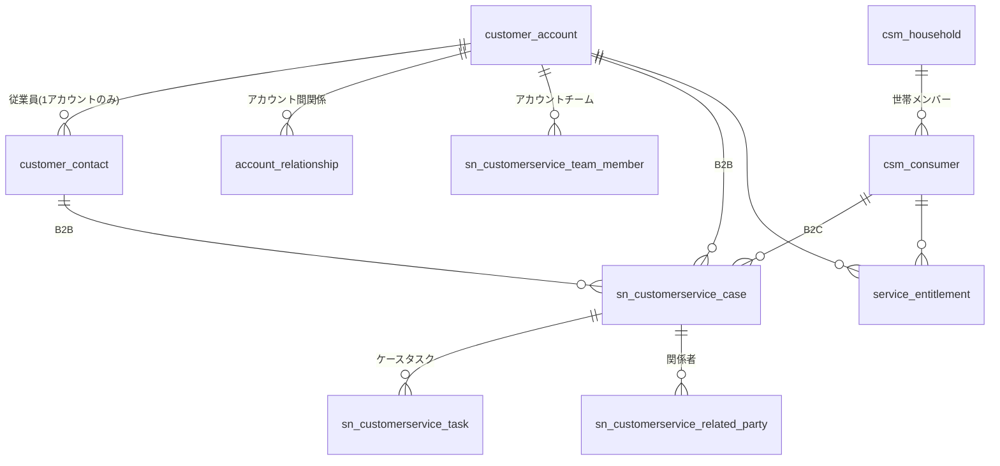
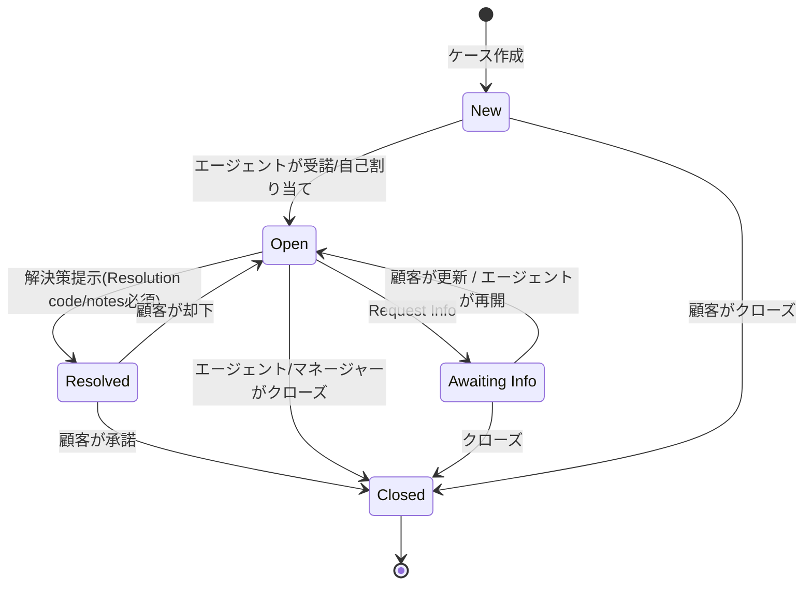
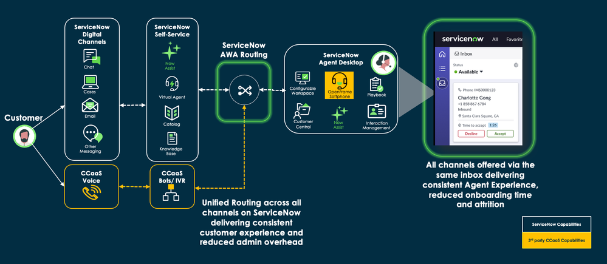

# Customer Service Management（顧客サービス管理、CSM）

## 概要

ServiceNow **Customer Service Management（CSM、顧客サービス管理）** は、社外の顧客（企業顧客・個人消費者・パートナー）に対するサービスとサポートを、Web・メール・チャット・電話・メッセージング・ソーシャルといった複数チャネルで提供するためのアプリケーション群である。ITSM が「社内従業員向け」の `incident` 等を扱うのに対し、CSM は「社外顧客向け」の **Case（ケース）**（`sn_customerservice_case`）を中心に、顧客データ（Account/Contact/Consumer）、契約・Entitlement（エンタイトルメント、サービス受給権）、Omnichannel（オムニチャネル）、エージェント用 Workspace、顧客向けポータル、プロアクティブ対応を提供する。[出典](https://www.servicenow.com/docs/r/australia/customer-service-management/c_CustomerServiceManagement.html)

公式ドキュメント（Australia）は CSM を次の構成要素で説明している。[出典](https://www.servicenow.com/docs/r/australia/customer-service-management/c_CustomerServiceManagement.html)

| 構成要素 | 内容 |
|---|---|
| CSM コアアプリケーション | Case の作成・ルーティング・管理 |
| Workforce Optimization for Customer Service | 作業ルーティング、スキル・スケジュール管理、チームパフォーマンス監視 |
| Now Assist for CSM（ServiceNow Otto for CSM） | 生成 AI によるケース要約・解決メモ作成・チャット要約 |
| Customer Service Platform Analytics Solutions | 事前構成済みダッシュボード |

本ファイルの基準リリースは **Australia（2026-05 GA）** であり、Brazil で判明した変更は「> **Brazil での変更:**」として併記する。

> **Brazil での変更:** Zurich Patch 12 以降、AI 体験のブランドが「ServiceNow Otto」に変更され、Now Assist for CSM は「ServiceNow Otto for Customer Service Management (CSM)」と表記される。製品エンタイトルメント（購入済み権利）は変わらない。[出典](https://www.servicenow.com/docs/r/delta-zurich-brazil/brazil-zurich-agentexperienceforcsm-release-notes.html)

関連: ITSM との違いは [ITSM 概要](../itsm/itsm-overview.md)、現場作業員の派遣は [Field Service Management](./field-service-management.md)、営業・受注は [Sales and Order Management（CRM）](./sales-order-management-crm.md) を参照。

---

## 1. プラグインとアプリケーション構成

### 1.1 主要プラグイン

CSM は複数のプラグイン／ストアアプリで構成される。Australia では多くの機能が「ファミリーリリース同梱プラグイン」から「ServiceNow Store アプリ」へ移行中である。

| 名称 | ID | 役割・備考 | 出典 |
|---|---|---|---|
| Customer Service | `com.sn_customerservice` | CSM のコア。Case 管理と CRM Workspace（CSM Configurable Workspace）を有効化。Customer Service Base Entities を自動有効化 | [出典](https://www.servicenow.com/docs/r/australia/delta-zurich-australia/australia-zurich-agentexperienceforcsm-release-notes.html) |
| Customer Service Base Entities | （ID は公開情報では確認できず） | Account/Contact/Consumer/Household/Entitlement 等の基本テーブル | [出典](https://www.servicenow.com/docs/r/australia/customer-service-management/r_TIWCustomerService.html) |
| CSM Configurable Workspace | `com.snc.uib.csm_agent_workspace` | エージェント用 Workspace。Customer Service プラグインとともに有効化 | 公式ドキュメント検索結果より（バージョン依存） |
| Customer Service Install Base Management | `com.snc.install_base` | Install Base Item・Sold Product | [出典](https://www.servicenow.com/docs/r/australia/customer-service-management/c_CreateAnEntitlement.html) |
| Customer Service Case Types | `com.snc.csm_case_types` / `sn_csm_case_types` | Case Type（ケース種別）と Service Definition。Zurich で Store アプリへ移行 | [出典](https://www.servicenow.com/docs/r/australia/release-notes/case-mgmt-csm-rn.html) |
| Major Issue Management | `com.sn_majorissue_mgt` | メジャーケース（多数顧客影響の障害）管理。Store からインストール | [出典](https://www.servicenow.com/docs/r/australia/customer-service-management/major-issue-management.html) |
| Proactive Customer Service Operations | `com.snc.proactive_cs_ops` | プロアクティブ対応。Store プラグイン | [出典](https://www.servicenow.com/docs/r/GOfWgam_hnLy1~sy07BOkA/JQwL9D296Ubx~CvS~FAvWw) |
| Proactive Customer Service Operations with Event Management | `com.snc.proactive_cs_itom` | ITOM Event Management 連携。基本プラグインを自動インストール | [出典](https://www.servicenow.com/docs/r/GOfWgam_hnLy1~sy07BOkA/JQwL9D296Ubx~CvS~FAvWw) |
| Customer Project Management | `com.snc.csm_ppm` | 顧客プロジェクト管理 | [出典](https://www.servicenow.com/docs/r/australia/customer-service-management/r_RolesInstalledWithCustomerService.html) |
| CSM Extension for Proxy Contacts | `com.snc.csm_proxy_contacts` | 従業員が顧客の代理でケース作成 | 同上 |
| Customer Service Portal Base | `com.snc.csm_portal_base` | 顧客ポータル基盤。Australia で単独 Store アプリへ移行 | [出典](https://www.servicenow.com/docs/r/australia/release-notes/customer-self-service-omnichannel-engagement-rn.html) |
| Assignment Workbench | `sn_assign_wb_host` | Australia で追加。マネージャーがタスクを効率的に割り当て | [出典](https://www.servicenow.com/docs/r/australia/release-notes/case-mgmt-csm-rn.html) |

> **Brazil での変更:** Brazil のリリースノートでは、`com.sn_customerservice` を「Case Management Core plugin」と呼び、別途サブスクリプションが必要と明記している。[出典](https://www.servicenow.com/docs/r/delta-zurich-brazil/brazil-zurich-agentexperienceforcsm-release-notes.html)

### 1.2 Australia で Store アプリへ移行し「C リリースで廃止予定」のプラグイン

Australia 以降、以下のプラグインは Store アプリへ移行し、Australia 以降へのアップグレード時に自動インストールされる。旧プラグインは次の「C」リリース（Brazil の次）で廃止予定である。[出典](https://www.servicenow.com/docs/r/australia/release-notes/case-mgmt-csm-rn.html)

| 領域 | プラグイン名 | ID |
|---|---|---|
| Case 管理 | Action Status Automation | `com.sn_action_status` |
| Case 管理 | Customer Service Case Action Status | `com.snc.csm_action_status` |
| Case 管理 | Case Digests | `com.sn_csm_case_digest` |
| Case 管理 | Customer Service Document Template | `com.sn_csm_doc_template` |
| Case 管理 | Customer Project Management | `com.snc.csm_ppm` |
| Case 管理 | Customer Service with Request Management | `com.sn_cs_sm_request` |
| Case 管理 | Customer Service with Service Management | `com.sn_cs_sm` |
| Case 管理 | Major Issue Management | `com.sn_majorissue_mgt` |
| Case 管理 | Proxy contacts | `com.snc.csm_proxy_contacts` |
| Case 管理 | Targeted communications | `com.sn_publications` |
| Omnichannel | Openframe Integration App | `com.sn_openframe_integration` |
| Omnichannel | Skill Determination | `com.snc.skill_determination` |
| Omnichannel | Advanced Work Assignment for CSM | `sn_csm.awa` |
| Omnichannel | Social Media Store | `sn_cs_social_host` |

Omnichannel 側の一覧の出典は [Self-service and omnichannel engagement for CSM release notes（Australia）](https://www.servicenow.com/docs/r/australia/release-notes/customer-self-service-omnichannel-engagement-rn.html)。

Australia で廃止（Deprecated）されたもの:
- Case Assignment Workbench Demo（`com.snc.case_assignment_workbench_demo`）。デモデータは Case Assignment Workbench Store アプリへ移る。[出典](https://www.servicenow.com/docs/r/australia/release-notes/case-mgmt-csm-rn.html)
- CTI Softphone（`com.snc.cti`）。代替なし。[出典](https://www.servicenow.com/docs/r/australia/release-notes/customer-self-service-omnichannel-engagement-rn.html)

### 1.3 パッケージ（エディション）

CSM のパッケージは従来 CSM Standard / Pro / Enterprise（および Now Assist を含む Pro Plus / Enterprise Plus）として販売されてきた。2026-04-09 に ServiceNow がティア体系を Foundation / Advanced / Prime の AI ネイティブ 3 ティアへ再編し、CSM は Advanced / Prime の 2 パッケージになったとする第三者情報がある。【第三者情報】公式の機能対照表は公開情報では確認できず。[出典](https://redresscompliance.com/servicenow-csm-licensing-guide)

なお Australia のリリースノートは、Task Intelligence for CSM または Now Assist for CSM プラグインがある Pro 顧客向けに既定の推奨（Recommended Actions）が有効になる、と記載している。[出典](https://www.servicenow.com/docs/r/australia/delta-zurich-australia/australia-zurich-agentexperienceforcsm-release-notes.html)

ライセンスと価格の詳細は [ライセンスモデル](../../03_導入編/01-licensing-model.md)、[価格情報](../../03_導入編/02-pricing.md)、[エディション比較](../../03_導入編/03-edition-comparison.md) を参照。

---

## 2. 顧客データモデル（Account / Contact / Consumer）

### 2.1 サポートするビジネスモデル

CSM は顧客の形態に応じて次のデータモデルをサポートする。[出典](https://www.servicenow.com/docs/r/australia/customer-service-management/customer-service-data-models.html)

| モデル | 顧客の表現 | 例（公式記載） |
|---|---|---|
| B2C（Business-to-Consumer） | Consumer（個人消費者） | ストリーミング会員が性能問題を報告 |
| B2B（Business-to-Business） | Account（企業）＋ Contact（その従業員） | ホテルグループがゲストに影響する障害を報告 |
| B2B2B | Account → Partner（再販/提供事業者）→ 最終企業 | メーカー → ディーラー → 法人フリート |
| B2B2C | Partner 企業とその Consumer の両方を支援 | 保険会社が代理店とその顧客を支援 |
| B2B2E（Business-to-Business-to-Employee） | Account の従業員を Consumer として表現し、account-consumer relationship で Account に紐付け | 団体保険が従業員とその家族をカバー |

さらに **Service Model Foundation** は B2B/B2C を拡張し、内部・外部拠点を持つ business organization（ビジネス組織）、household と consumer、それらの関係を扱う。**Contributor model（コントリビューターモデル）** により、従業員が自分自身や外部顧客のためにサポートを依頼する、service organization（サービス組織）同士でサービスする、ミドルオフィスの担当者に解決に必要な特定タスクを割り当てる、といった形態も表現できる。[出典](https://www.servicenow.com/docs/r/australia/customer-service-management/customer-service-data-models.html)

### 2.2 主要エンティティとルール

| エンティティ | テーブル | 主なルール |
|---|---|---|
| Account（アカウント） | `customer_account` | 顧客、パートナー、または両方を表す。Account フォームの **Customer** / **Partner** フィールドで種別を示す。Account テーブルは Company（`core_company`）テーブルを拡張する。Australia で **DUNS Number**（データエンリッチメント・連携用の企業識別子）と **Active** フィールドが追加 |
| Contact（コンタクト） | `customer_contact` | Account の従業員。**1 つの Account にのみ所属できる**。User（`sys_user`）テーブルを拡張し、ユーザー ID を持って Customer Service Portal にログインできる。複数の資産・サービス契約を持てる |
| Consumer（コンシューマー） | `csm_consumer` | B2C モデルの最終顧客 |
| Consumer User | `csm_consumer_user` | Consumer Service Portal で自己登録した Consumer。User テーブルを拡張 |
| Household（世帯） | `csm_household` | 同じ住所で製品・サービスを共有する Consumer のグループ。**Head of household（世帯主）** を 1 名指定でき、世帯主は他メンバーの全ケースと情報にアクセスできる |
| Consumer Profile | `sn_csm_consumer_profile` | Consumer を参照し、業界別プロファイルへ拡張可能 |

出典: [Customer data（Australia）](https://www.servicenow.com/docs/r/australia/customer-service-management/customer-data.html)、[Tables installed with CSM（Australia）](https://www.servicenow.com/docs/r/australia/customer-service-management/r_TIWCustomerService.html)、Account が Company を拡張する点は [CSM use case tables](https://www.servicenow.com/docs/r/customer-service-management/csm-use-case-tables.html)。

Australia では Customer Data Foundation（CDF）に **25 個の粒度の細かい管理ロール**が追加された。[出典](https://www.servicenow.com/docs/r/australia/customer-service-management/customer-data.html)

### 2.3 Customer Service Base Entities のテーブル（Australia）

Customer Service Base Entities プラグイン（Customer Service プラグインが自動有効化）が作成するテーブル。[出典](https://www.servicenow.com/docs/r/australia/customer-service-management/r_TIWCustomerService.html)

| ラベル | テーブル | 説明 |
|---|---|---|
| Account | `customer_account` | 顧客アカウントとパートナーのレコード |
| Account Address | `account_address_relationship` | 住所（Location）とアカウントの紐付け |
| Account Access | `sn_csm_account_access` | コンタクトの CSM エンティティへのアクセス制限 |
| Account Relationship | `account_relationship` | 2 つのアカウント間の関係 |
| Address Type | `cmn_location_type` | 請求先・出荷先などの住所種別 |
| Consumer | `csm_consumer` | Consumer レコード |
| Consumer User | `csm_consumer_user` | Consumer Service Portal の自己登録（User を拡張） |
| Contact | `customer_contact` | 顧客コンタクト |
| Contract Contact | `contract_rel_contact` | コンタクトと契約の紐付け |
| Household | `csm_household` | 世帯 |
| Entitlement | `service_entitlement` | エンタイトルメント |
| Consumer Profile | `sn_csm_consumer_profile` | 業界別プロファイル拡張用 |
| Consumer Profile Location | `sn_csm_consumer_profile_location` | Consumer Profile と住所の紐付け |

### 2.4 Customer Service プラグインのテーブル（Australia）

[出典](https://www.servicenow.com/docs/r/australia/customer-service-management/r_TIWCustomerService.html)

| ラベル | テーブル | 説明 |
|---|---|---|
| Account Relationship Access | `sn_customerservice_account_relationship_access` | アカウント関係のアクセス種別 |
| Account Relationship Type | `sn_customerservice_account_relationship_type` | 双方向アカウント関係の種別 |
| Account Team Member | `sn_customerservice_team_member` | アカウントチームのメンバー |
| Agent Token | `sn_customerservice_agent_token` | 現在は未使用 |
| Appointment | `sn_customerservice_appointment` | ケースに対するアポイントメント |
| Asset Contact | `sn_customerservice_m2m_asset_contact` | 資産とコンタクトの関係 |
| Case | `sn_customerservice_case` | ケース本体 |
| Case Entitlement | `sn_customerservice_case_entitlement` | ケースと複数エンタイトルメントの関係（Advanced entitlements 用） |
| Case Report | `sn_customerservice_case_report` | ケースの KPI・メトリクス |
| Channel Configurations | `sn_customerservice_channel_config` | メールチャネル設定 |
| Contact Relationship | `sn_customerservice_contact_relationship` | コンタクト関係 |
| Customer Interaction | `sn_customerservice_customer_interaction` | CSM のインタラクションレコード |
| Customer Service Case Flow | `sn_customerservice_sf_case` | ケースの状態フロー |
| Escalation | `sn_customerservice_escalation` | ケース／アカウントのエスカレーション |
| Escalation Severity | `sn_customerservice_escalation_severity` | エスカレーション重大度定義 |
| Escalation Template | `sn_customerservice_escalation_template` | エスカレーションテンプレート |
| Registration Request | `sn_customerservice_registration` | Customer Service Portal の自己登録申請 |
| Related Party | `sn_customerservice_related_party` | ケースに関係するエンティティ（Account/Contact/Consumer 等）と責務 |
| Related Party Configuration | `sn_customerservice_related_party_configuration` | Related Party 種別と既定責務 |
| Responsibility Definition | `sn_customerservice_responsibility_def` | 顧客アカウント支援の責務定義 |
| Responsibility Access Configuration | `sn_customerservice_responsibility_access_config` | 責務が到達できるアクセスレベルとエンティティ |
| Task | `sn_customerservice_task` | ケースタスク |

### 2.5 Install Base / Sold Product

Customer Service Install Base Management プラグイン（`com.snc.install_base`）は、顧客が購入・利用しているデジタルサービスや製品（**Install base（インストールベース）**）を追跡する。Install Base Item（`sn_install_base_item`）、Sold Product（`sn_install_base_sold_product`）、両者の多対多（`sn_install_base_m2m_installed_product`）、特性（`sn_install_base_item_characteristic`）などのテーブルを持つ。Install Base Item API の利用には `sn_install_base.ib_api_write` または `sn_install_base.ib_api_read` ロールが必要。[出典](https://www.servicenow.com/docs/r/customer-service-management/csm-use-case-tables.html)、[出典](https://www.servicenow.com/docs/r/api-reference/rest-apis/integrations-api.html)

CSDM との関係は [CMDB と CSDM](../platform/cmdb-csdm.md) を参照。

> **Brazil での変更（Data Management for CSM）:** [出典](https://www.servicenow.com/docs/r/delta-zurich-brazil/brazil-zurich-datamanagementforcsm-release-notes.html)
> - CDF テーブルに新フィールド追加。Account: account stage, status, customer since, relationship tier, market segment, total ACV, external ID。Contact: external ID。Consumer: consumer stage, status, customer since, relationship tier, external ID。Account Team Member: active, start date, end date。
> - 請求系: Billing Account Address（`sn_billing_account_address`）、Billing Account Payment Profile（`sn_billing_account_payment_profile`）テーブル、Paying party / Paying billing account フィールド、Billing Schedule と `sn_billing_account.schedule_viewer` / `sn_billing_account.schedule_writer` ロールを追加。
> - business organization の customer criteria に **Restricted Customer Access** チェックボックスを追加（条件に一致する顧客・Consumer のみ閲覧可能）。アップグレード時は 1 回限りのジョブ「Remove Legacy roles from Loc Mgr Contrib」を実行する必要がある。
> - Service organization を Install base の buyer として追加でき、Modify / Disconnect アクションで注文・見積へ連携。
> - Sold product で複数の Related party を閲覧・編集可能。Deal type と Route to Market は Sold product に保持しなくなった。
> - RMA ケースを Business Portal からコンタクトが作成可能。

---

## 3. ロール

### 3.1 主要ロール（Australia）

CSM のロールは **内部ロール**（エージェント・マネージャー）と **外部ロール**（顧客・パートナー・Consumer、`snc_external` を含む）に大別される。[出典](https://www.servicenow.com/docs/r/australia/customer-service-management/r_RolesInstalledWithCustomerService.html)

| ロール | 名前 | 説明 | 含むロール（抜粋） |
|---|---|---|---|
| Customer service agent | `sn_customerservice_agent` | 顧客・パートナーを支援し、ケースを作成・編集し、SME と協力して解決 | `knowledge`, `chat_admin`, `sn_customerservice.deescalation_requester`, `timecard_user`, `template_editor`, `sn_esm_agent`（`cmdb_read` を含む）, `sn_shn.editor`, `domain_expand_scope` |
| Customer service manager | `sn_customerservice_manager` | エージェント業務に加え、エージェント・グループを管理しエージェントの操作を上書き可能 | `sn_customerservice_agent`, `timecard_manager`, `timecard_approver`, `skill_admin`, `sn_customerservice.consumer_agent`, `asset`, `sn_shn.admin`, `contract_manager`, `awa_manager`, `sn_majorissue_mgt.major_issue_manager`, `workspace_admin`, `approver_user`（Xanadu 以降 `approval_admin` を置換）ほか |
| Consumer service agent | `sn_customerservice.consumer_agent` | Consumer を支援しケースを作成・編集 | `sn_esm_agent`, `chat_admin`, `sn_shn.editor`, `template_editor`, `knowledge` |
| Customer | `sn_customerservice.customer` | 問題を調査し、ケースを作成し、自身のケースを編集し、アカウントの資産を閲覧 | `sn_esm_user`, `snc_external` |
| Customer administrator | `sn_customerservice.customer_admin` | 顧客アカウントとそのデータを管理 | `sn_customerservice.customer`, `sn_esm_user_admin` |
| Customer case manager | `sn_customerservice.customer_case_manager` | アカウントと子アカウントのケースを管理し、他コンタクトのためにケース作成可能。コンタクトロール割り当てプロパティには自動追加されない | `sn_customerservice.customer` |
| Partner | `sn_customerservice.partner` | 自社または関連顧客アカウントのケースを作成・編集 | `sn_customerservice.customer`, `sn_esm_partner` |
| Partner administrator | `sn_customerservice.partner_admin` | パートナーアカウントを管理し、パートナー・顧客アカウントのユーザーを管理 | `sn_customerservice.partner`, `sn_customerservice.customer_admin`, `sn_esm_partner_admin` |
| Consumer | `sn_customerservice.consumer` | 購入製品のケースを作成・編集し、製品一覧を閲覧 | `sn_esm_user`, `snc_external` |

内部ロールと外部ロールを同一ユーザーに同時付与しないことが推奨されている。【第三者情報】（Community 投稿）[出典](https://www.servicenow.com/community/csm-articles/understanding-user-types-and-permissions-on-customer-service/tac-p/2298126)

### 3.2 追加ロール（Australia）

[出典](https://www.servicenow.com/docs/r/australia/customer-service-management/r_RolesInstalledWithCustomerService.html)

| ロール名 | 説明 |
|---|---|
| `sn_customerservice.case_contributor_editor` | 読み取り可能なケースの特定フィールドに限定的な書き込み |
| `sn_customerservice.case_contributor_viewer` | コントリビューターとなっているケースの関連テーブルを読み取り専用（`sn_shn.user`, `wm_read` を含む） |
| `sn_customerservice.case_task_agent` | 自分／自グループに割り当てられた、または自分が作成したケースタスクを処理。顧客レコードは読み取り専用 |
| `sn_customerservice.case_task_viewer` | 全ケースタスクを読み取り専用 |
| `sn_customerservice.case_viewer` | 全ケースを読み取り専用 |
| `sn_customerservice.contact_manager` | コンタクト管理 |
| `sn_customerservice.projectmanager` / `sn_customerservice.projectstakeholder` | 顧客プロジェクト管理（`com.snc.csm_ppm`） |
| `sn_customerservice.customer_data_viewer` | Install base、契約、エンタイトルメント、アカウント、コンタクト、資産、Consumer、Sold product 等を読み取り専用。Australia で関係テーブル・メニューへのアクセスを拡張 |
| `sn_customerservice.escalation_requester` | ケース／アカウントのエスカレーションを要求 |
| `sn_customerservice.deescalation_requester` | 原因解消後にデエスカレーション（`escalation_requester` を含む） |
| `sn_customerservice.proxy_case_creator` | コミュニティ投稿から直接ケースを作成 |
| `sn_customerservice.proxy_contact` | 従業員がアカウント／コンタクトのためにケースを作成（`com.snc.csm_proxy_contacts`） |
| `sn_customerservice.csm_workspace_user` | Workspace の My Case Tasks / My Group's Case Tasks にアクセス |

### 3.3 Customer Service Base Entities のロール

[出典](https://www.servicenow.com/docs/r/australia/customer-service-management/r_RolesInstalledWithCustomerService.html)

| ロール名 | 説明・含むロール |
|---|---|
| `csm_admin` | 全 CSM 機能とデータへの管理アクセス（`sn_shn.admin`, `sn_res_shaper.admin`） |
| `sn_esm_agent` | `assignment_workbench`, `wm_read`, `cmdb_read`, `agent_schedule_user`, `interaction_agent` 等 |
| `sn_esm_user` | `snc_external`, `sn_apptmnt_booking.appointment_booking_user` |
| `sn_esm_user_admin` / `sn_esm_partner` / `sn_esm_partner_admin` / `sn_esm_admin` | 外部ユーザー管理系 |
| `csm_ws_integration` | CSM Web サービス用 REST API ロール（`snc_internal`） |
| `sn_csm_doctemplate.admin` | Document Template テーブルの CRUD |
| `sn_scm_case_type.config_admin` | Case Type・Service Definition 構成テーブルの CRUD |

### 3.4 Australia で追加された読み取り専用ロール

Australia では粒度の細かい読み取り専用 Viewer ロールが追加された。[出典](https://www.servicenow.com/docs/r/australia/release-notes/case-mgmt-csm-rn.html)

`sn_customerservice.all_cases_viewer`（Customer Service All Case Viewer）、`sn_complaint.viewer`、`sn_onboarding.viewer`、`sn_action_status.viewer`、`sn_csm_doctemplate.viewer`、`sn_csm_case_digest.viewer`、`sn_csm_ppm.viewer`、`sn_scm_case_type.config_viewer`、`sn_case_line.viewer`。

また CRM Workspace では、広い admin 権限の代わりに機能別の粒度の細かい管理ロールが導入された。[出典](https://www.servicenow.com/docs/r/australia/delta-zurich-australia/australia-zurich-agentexperienceforcsm-release-notes.html)

ロール・ACL の一般論は [ユーザー・グループ・ロール](../platform/users-groups-roles.md)、[アクセス制御（ACL）](../platform/access-control-acl.md) を参照。

---

## 4. Case（ケース）

### 4.1 Case テーブルの位置づけ

`sn_customerservice_case` テーブルは顧客サービスケースを格納する CSM の中心テーブルであり、`task` テーブルを拡張する（タスクの共通フィールド・SLA・割り当て・Activity を継承）。ケースは Customer Portal、メール、チャット、電話、または Customer Service アプリケーションから作成される。[出典](https://www.servicenow.com/docs/r/customer-service-management/r_CustomerServiceCaseStates.html)

`sn_customerservice_case` に紐付く主な情報は、Consumer（個人または世帯）、Account と Contact（B2B）、Account Consumer（B2B2C/B2B2E）、Sold product / Install base item、Contract と Entitlement、タスク・ナレッジ・エスカレーション等の関連作業である。【第三者情報】（ServiceNow 社員による Community 記事）[出典](https://www.servicenow.com/community/csm-articles/getting-started-with-csm-case-management/ta-p/3393693)

### 4.2 Case フォームのフィールド（エージェントビュー、Australia）

[出典](https://www.servicenow.com/docs/r/australia/customer-service-management/r_CustomerServiceCaseForm.html)

| フィールド | 説明 | 値・備考 |
|---|---|---|
| Number | 自動採番のケース番号 | システム生成 |
| Channel（チャネル） | 顧客が接触しケースが作成された方法 | Web（既定）、Phone、Email、Chat、Social |
| Contact Local Time | コンタクトのタイムゾーンに基づく現地時刻 | 読み取り専用。Closed/Canceled で非表示。フォームレイアウト追加が必要 |
| Contact time zone | このケースでの顧客のタイムゾーン（Contact フォームより優先） | 作成後は読み取り専用。フォームレイアウト追加が必要 |
| Account | コンタクトの会社（コンタクトから自動設定） | 参照 |
| Contact | ケースの顧客コンタクト | 参照 |
| Consumer | ケースの Consumer | 参照 |
| Provider Organization | ケースを解決する組織 | 参照 |
| Requestor Organization | オムニチャネルインタラクションを要求する組織 | 参照 |
| Product | 資産の製品モデル。製品付きの Asset を選ぶと自動更新 | 参照 |
| Asset | 対象品目の資産タグまたはシリアル番号 | 参照 |
| Install base | 顧客が購入した製品・サービスとその導入・構成 | 参照 |
| Partner Contact | パートナー側のコンタクト | 参照 |
| Follow the sun | グローバルな追跡フラグ。P1/P2 ケースへの顧客コメント追加時やエスカレーション時に自動選択 | `sn_customerservice.FTS_flag_enabled`=true とフォームレイアウト追加が必要 |
| Short description | 問題の要約 | 自由記述 |
| Opened | 作成日時 | システム生成 |
| Priority（優先度） | 緊急度 | 1 - Critical、2 - High、3 - Moderate、4 - Low（既定） |
| State（状態） | 現在の状態 | New, Open, Awaiting Info, Resolved, Closed, Canceled |
| Assignment group | 担当エージェントグループ | 参照 |
| Assigned to | 担当エージェント | Assignment group のメンバーである必要あり |
| Assigned on | Assigned to の最終変更日時 | システム更新 |
| Contract | 紐付く契約番号 | 参照 |
| Entitlement | 紐付くエンタイトルメント。Account・Consumer・Contract で絞り込まれ、作成チャネルに一致するもののみ | `sn_customerservice.advanced_entitlements`=true の場合は非表示となり Case Entitlements 関連リストを表示 |
| Partner | パートナー企業 | 参照 |
| Watch list | 顧客コメント追加時、Resolved/Closed 時に通知されるユーザー | |
| Work notes list | 作業メモ追加時に通知される内部ユーザー | 通知には Case Action Status 通知の構成が必要 |
| Contributor Users / Contributor Groups | ケースタスクに割り当てられた case task agent とそのグループ | システム管理 |
| Additional comments | 顧客が閲覧可能なコメント | Activity に投稿 |
| Work notes | 内部メモ | 管理者・エージェント・マネージャーが閲覧 |
| Resolved by / Closed by | 解決時の担当者 / クローズしたユーザー | |
| Resolution Code | 解決コード | エージェントが解決策を提示する際に必須 |
| Cause | 原因 | 自由記述 |
| Resolution notes | 解決内容 | エージェント・マネージャーがクローズする場合は必須、顧客がクローズする場合は任意 |
| Add resolution notes to comments | 解決時に Resolution notes を顧客向けコメントへコピー | チェックボックス |
| Resolved / Closed | 解決日時 / クローズ日時 | システム生成 |

### 4.3 Case の状態（State）と遷移

Case の状態は New、Open、Awaiting Info、Resolved、Closed（および Canceled）である。各状態の意味と遷移は以下のとおり。[出典](https://www.servicenow.com/docs/r/customer-service-management/r_CustomerServiceCaseStates.html)、[出典](https://www.servicenow.com/docs/r/australia/customer-service-management/r_CustomerServiceCaseForm.html)

| 状態 | 設定契機 | 次の遷移 |
|---|---|---|
| New | ポータル・メール・チャット・電話・アプリからケース作成 | エージェントが自分に割り当て、またはマネージャー割り当てを受諾 → Open。顧客は更新・クローズ可 |
| Open | エージェントが受諾。Awaiting Info からの戻り、顧客が解決策を却下した場合も | Request Info → Awaiting Info。解決策提示（Resolution code と notes 必須）→ Resolved。クローズ → Closed |
| Awaiting Info | エージェントが顧客に追加情報を要求 | エージェントが再開、または顧客が更新 → Open。顧客／エージェントがクローズ → Closed |
| Resolved | エージェントが解決策を提示 | 顧客が承諾 → Closed（アンケート表示）。顧客が却下 → Open。顧客がクローズ → Closed |
| Closed | 顧客が解決策を承諾、またはエージェント・マネージャー・顧客がクローズ | 終端。**クローズ後は更新不可** |
| Canceled | （フォームの状態値として存在） | 遷移の詳細は公開情報では確認できず |

クローズに関する制約:
- エージェントとマネージャーは **Resolved 以外の状態ならいつでも** ケースをクローズできる。Resolved 状態では顧客だけが解決策を承諾／却下できる。[出典](https://www.servicenow.com/docs/r/customer-service-management/r_CustomerServiceCaseStates.html)
- 状態の整数値は公式の状態説明ページには記載がない。System Definition > Choice Lists で Table=`sn_customerservice_case`、Element=`state` を絞り込むと Value 列で整数値を確認できる。[出典](https://www.servicenow.com/docs/r/YZ6y4yvCOMhykXn0xJSiRA/IAAnVw76QdEGbyVXwILoRg)
- カスタム状態（例: 値 11 の "closed - lost"）を追加しても、そのままでは Closed と同じ挙動にならないという報告がある。【第三者情報】[出典](https://www.servicenow.com/community/csm-forum/in-csm-i-have-a-state-that-is-not-closing-the-case/m-p/3081493)
- 自動クローズ（Resolved から一定期間後に Closed へ）の既定動作は公開情報では確認できず。

### 4.4 Case Type（ケース種別）と Service Definition

**Case type（ケース種別）** は特定種類の顧客問題に対するプロセスとデータを定義し、エージェントはケース作成時に該当する種別を選ぶ。**Service definition（サービス定義）** は製品・サービス・Case type を結び付け、顧客はサービスを探して依頼し、エージェントは正しい種別のケースを作成できる。[出典](https://www.servicenow.com/docs/r/customer-service-management/case-management.html)

- Customer Service Case Types アプリ（`sn_csm_case_types`）は Zurich で ServiceNow Store へ移行し、以後の機能拡張は Store アプリで提供される。[出典](https://www.servicenow.com/docs/r/delta-zurich-australia/australia-zurich-casemanagementforcsm-release-notes.html)
- Service フィールドは Service Definitions テーブル（`sn_case_type_selection`）への参照で、Customer Service プラグインと Customer Service Case Types プラグイン（`com.snc.csm_case_types`）の両方が必要。[出典](https://www.servicenow.com/docs/r/YZ6y4yvCOMhykXn0xJSiRA/rOzeCMbuJj5duNa01ikRTQ)
- Australia では **Case type selector（ケース種別セレクター）** が既定で有効になり、Interaction・Account・Contact・Consumer・Sold product・Install base item からのケース作成、子ケースとケースタスクの関連リスト、ケース／ケースタスクのリストビューに適用される。[出典](https://www.servicenow.com/docs/r/australia/release-notes/case-mgmt-csm-rn.html)
- Case type 設定の管理には `sn_scm_case_type.config_admin`（参照のみは `sn_scm_case_type.config_viewer`）を使う。

### 4.5 Case Task とタスクプランテンプレート

**Case task（ケースタスク）**（`sn_customerservice_task`）は、ケースを解決するために他チームへ切り出す作業である。ケースタスク担当者には `sn_customerservice.case_task_agent` を付与し、担当者とそのグループはケースの Contributor Users / Contributor Groups に自動追加される。[出典](https://www.servicenow.com/docs/r/australia/customer-service-management/r_CustomerServiceCaseForm.html)

Australia ではタスクプランテンプレートが強化された。[出典](https://www.servicenow.com/docs/r/australia/release-notes/case-mgmt-csm-rn.html)

- テンプレート項目間の依存関係を `sn_task_plan_template_dependency` で定義し、適用時に `sn_task_dependency_m2m` に保存される。依存種別は **Finish to start**、**Start after start**、**Start together** の 3 種。分・時間・日・週単位のスケジュールオフセットを設定でき、循環依存は検証で防止される。
- テンプレート項目へのドキュメント添付参照（`sn_task_plan_template_document`）。Apply Template 時に新タスクへ参照がコピーされる。
- 2026-06 の更新で、Task Plan Template に依存関係をノードマップで表示する Template Dependencies タブ、Share Plan モーダル（Share Plan / Success / Manage Access）が追加された。

### 4.6 親子ケースとフィールド同期

親ケースから子ケースへのフィールド同期は次のプロパティで制御する。[出典](https://www.servicenow.com/docs/r/wLYnGFihvmNxBr5heMf_jw/F823IGUFstHduKay5xyqgw)（Yokohama 版のプロパティ一覧）

| プロパティ | 説明 | 既定値 |
|---|---|---|
| `sn_customerservice.parent_child_case_sync` | 親から子へフィールドを同期 | false |
| `sn_customerservice.case_fields_to_sync` | 同期対象フィールド（カンマ区切り） | priority, state, comments, work_notes, close_notes, resolution_code |
| `sn_customerservice.parent_child_case_sla_async` | 親子作成・同期時の SLA を非同期処理 | true |

### 4.7 Major Issue Management（メジャーケース）

Major Issue Management（`com.sn_majorissue_mgt`）は多数の顧客に影響する問題について、影響顧客の特定・情報共有・解決を管理する。Store から管理者がインストールし、不足する関連 Store アプリ／プラグインもインストールされる。[出典](https://www.servicenow.com/docs/r/australia/customer-service-management/major-issue-management.html)

- **作成方法:** Customer service manager が Major case を直接作成するか、Customer service manager または Major issue manager（`sn_majorissue_mgt.major_issue_manager`）が **Major case candidate（候補）** を昇格する。候補は既存ケースの昇格（顧客報告済み）または候補ケースの直接作成（未報告）から生まれる。
- **承認:** 候補は昇格前に承認が必要。承認された候補は Major case の子ケースになり、却下された候補は通常ケースに戻る。
- **子ケース:** 影響を受ける顧客ごとに 1 つの子ケースを作り、同じ問題の他ケースも子ケースとして関連付ける。Major case をクローズすると全子ケースがクローズされる。
- **Targeted Communications:** Targeted Communications アプリで動的条件・スクリプト・インポートにより受信者リスト（アカウント／Consumer）を作り、Major case に添付して子ケース生成に使う。
- **プロパティ:** `enable_case_type_for_major_case` が true の場合、Major case と子ケースの Case type を候補の `sys_class_name` から設定する。
- **Australia の変更:** Major case は承認時に自動作成され、元ケースの Case type を継承する。元の Major case に Account・Consumer・Partner がない場合、提案ケースを直接 Major case に昇格できる。子ケースは Major case の Case type を使い、`sn_customerservice.case_fields_to_sync` または拡張ポイントで定義したフィールドを継承する。[出典](https://www.servicenow.com/docs/r/australia/release-notes/case-mgmt-csm-rn.html)
- Major Issue Management メニューは ServiceNow AI Platform（Core UI）と Agent Workspace の両方にある。

### 4.8 エスカレーション

CSM はケースとアカウントのエスカレーションをサポートする。[出典](https://www.servicenow.com/docs/r/5M2H7PAkXUuakbtz~5Kfeg/s4_56CJAvDA0N3gQtLF9Sg)、[出典](https://www.servicenow.com/docs/r/australia/customer-service-management/r_TIWCustomerService.html)

- テーブル: `sn_customerservice_escalation`（レコード）、`sn_customerservice_escalation_severity`（重大度）、`sn_customerservice_escalation_template`（テンプレート）。
- ケース用とアカウント用の 2 つの標準テンプレートがあり、システム管理者が変更・新規作成できる。
- **Escalate Case** / **Escalate Account** 関連リンクから、テンプレート・ウォッチリスト・エスカレーション理由を入力して申請する。選択した Escalation Severity によってエスカレーションレコードの SLA が決まる。
- 申請には `sn_customerservice.escalation_requester`、解除には `sn_customerservice.deescalation_requester` が必要。

### 4.9 その他のケース関連機能

| 機能 | 概要 | 出典 |
|---|---|---|
| SLA definitions | ケースの対応期限を SLA 定義で設定（共通の SLA エンジン） | [出典](https://www.servicenow.com/docs/r/customer-service-management/case-management.html) |
| Special handling notes（特別対応メモ） | 重要情報をエージェントに目立たせる。`sn_customerservice.shn_account` / `shn_contact` / `shn_asset` / `shn_product` / `shn_case` で対象を有効化。Zurich 以降、Account・Asset・Contact・Incident・Product Model・Work Order Task の More actions メニューから利用可 | [出典](https://www.servicenow.com/docs/r/customer-service-management/case-management.html)、[出典](https://www.servicenow.com/docs/r/australia/delta-zurich-australia/australia-zurich-agentexperienceforcsm-release-notes.html) |
| Related parties | ケースに関係する Account/Contact/Consumer と責務を管理（`sn_customerservice_related_party`） | [出典](https://www.servicenow.com/docs/r/australia/customer-service-management/r_TIWCustomerService.html) |
| KCS | `sn_customerservice.enable_knowledge_kcs` で Knowledge-Centered Service を有効化 | [出典](https://www.servicenow.com/docs/r/wLYnGFihvmNxBr5heMf_jw/F823IGUFstHduKay5xyqgw) |
| Playbooks | 特定 Case type の解決手順をステップで誘導し、CRM Workspace 内で完了 | [出典](https://www.servicenow.com/docs/r/GOfWgam_hnLy1~sy07BOkA/XeBgL7Eo~DatPGY2WtnINw) |
| ITSM 連携 | ケースから Incident / Problem / Change / Request を作成（Customer Service with Service Management / Request Management） | [出典](https://www.servicenow.com/docs/r/customer-service-management/setting-up-csm-integration-with-itsm.html) |

SLA エンジンの詳細は [SLA とスケジュール](../platform/sla-schedules.md)、ナレッジは [ナレッジ管理](../platform/knowledge-management.md)、Incident は [Incident Management](../itsm/incident-management.md) を参照。

---

## 5. Entitlement（エンタイトルメント）と契約

### 5.1 Entitlement の概念

**Entitlement（エンタイトルメント、サービス受給権）** は、顧客が受けられるサポートの種類と利用できるコミュニケーションチャネルを定義する。Entitlement は Product・Asset・Account・Contract（および Consumer、Install base item、Sold product）に関連付けられ、Entitlement に紐付けたワークフローでケースの推奨アクティビティを駆動できる。[出典](https://www.servicenow.com/docs/r/australia/customer-service-management/configure-csm-entitlements.html)

- **Entitlement check（エンタイトルメントチェック）** はケースのオープン時に実行され、特定の Account・Product・Asset・Service contract の既存ケースを考慮する。
- ケース作成時に選択できるのは **Active** な Entitlement のみ。
- 作成・管理には `sn_customerservice_manager` または `admin` が必要。

### 5.2 Entitlement フォームのフィールド（Australia）

メニュー: **All > Customer Service > Contracts > Entitlements**。Account フォーム・Contract フォームの Entitlements 関連リストからも作成できる。テーブルは `service_entitlement`。[出典](https://www.servicenow.com/docs/r/australia/customer-service-management/c_CreateAnEntitlement.html)

| フィールド | 説明 |
|---|---|
| Name | Entitlement 名 |
| Product | 対象の製品モデル |
| Account | 紐付くアカウント |
| Consumer | 紐付く Consumer |
| Contract | 紐付く契約番号 |
| Asset | 紐付く資産タグ／シリアル番号 |
| Active | 有効化。Active のみケース作成時に選択可能 |
| Channel | 対象チャネル: Email、Web、Phone、Chat（複数選択） |
| Install Base Item | 紐付く Install base item（フォームレイアウト追加が必要、`com.snc.install_base` 必須） |
| Sold Product | 紐付く Sold product（同上） |
| Business hours | 適用スケジュール |
| Start date / End date | 有効期間 |
| Per unit | 単位カウンター（Total Units / Remaining Units）を有効化 |
| Unit | 計測単位: Cases または Hours |
| Total Units | 割り当て総数 |
| Remaining Units | 残数（ビジネスルールで更新） |

### 5.3 ユニット消費と設定ガイドライン

- 単位が **Cases** の場合、ビジネスルール **Update case entitlement on Close** が、対象 Product・Asset・Company・Contract のケースクローズ時に Remaining Units を減算する。
- 単位が **Hours** の場合は、顧客側で別途ビジネスルールを作成する必要がある（例: ケース解決時にエージェントの作業時間を残時間から差し引く）。
- Product 起点: Product を選び、次に Account または Consumer を選ぶ。Asset 起点: 先に Company を選ぶとその会社の資産のみ表示。Contract 起点: Contract を選び、契約明細（Contract line items）の資産を選ぶとその資産に Entitlement が適用される。

[出典](https://www.servicenow.com/docs/r/australia/customer-service-management/configure-csm-entitlements.html)

### 5.4 Advanced entitlements（複数 Entitlement）

`sn_customerservice.advanced_entitlements` システムプロパティは、ケースに Entitlement を 1 つだけ関連付けるか複数関連付けるかを決める（Zurich 以降の記載）。[出典](https://www.servicenow.com/docs/r/XqB45azTkh_fhRBNTD2pSw/rzJU~xiA2ltKdbWJ9XM6Ig)

| 値 | Case フォームの挙動 |
|---|---|
| true | **Case Entitlements** 関連リスト（`sn_customerservice_case_entitlement`）を表示し、Entitlement フィールドを非表示。複数関連付け可 |
| false | **Entitlement** フィールドを表示し、関連リストを非表示。1 つのみ |

選択可能な Entitlement は、ケースで選んだ Account・Consumer・Contract に関連するもの。

> **Brazil での変更:** Location support agent（`sn_bus_loc.svc_location_support_agent`）が business organization の顧客契約とエンタイトルメントを閲覧でき、特定条件下で Entitlement の使用量を編集できるようになった。[出典](https://www.servicenow.com/docs/r/delta-zurich-brazil/brazil-zurich-datamanagementforcsm-release-notes.html)

---

## 6. Omnichannel（オムニチャネル）

### 6.1 チャネル一覧

CSM のオムニチャネルは、すべての顧客接点を **Interaction（インタラクション）レコード**として追跡し、ケースと顧客コンテキストに紐付ける。エージェントは単一の Workspace で全チャネルを処理し、チャネルは段階的に有効化できる。[出典](https://www.servicenow.com/docs/r/customer-relationship-management/crm-omnichannel.html)

| チャネル | 内容 |
|---|---|
| Chat | ポータルからのライブチャットと Virtual Agent チャット。AWA は pre-chat survey のデータでルーティング可能 |
| Email | 受信メールを **Email Interaction（Email as an Interaction、EaaI）** でインタラクション化、または **Email to Case** で直接ケース化。返信、ケースへのエスカレーション、コンタクトレコードからの送信が可能 |
| Voice | ServiceNow Voice for CSM、CTI、または OpenFrame 連携。Amazon Connect の Conversational IVR で Virtual Agent がライブ転送前に対応 |
| Omnichannel Callback | Virtual Agent・ポータル・Engagement Messenger から音声／ビデオのコールバックを即時または予約で依頼 |
| Consumer messaging | WhatsApp、LINE、Facebook Messenger、Apple Messages for Business。非同期インタラクションとして扱い、アウトバウンド会話も可能 |
| Engagement Messenger | 第三者 Web サイトに埋め込むセルフサービスウィジェット（ナレッジ閲覧・ケース作成・チャット）。エージェント不在時はコールバックを表示 |
| SMS / Social | サポート対象として記載（詳細は当該ページに記載なし）。Social は `sn_cs_social_host` で Case に Social チャネルと Social Logs 関連リストを追加 |

インタラクションのテーブルとして、CSM プラグインは Customer Interaction（`sn_customerservice_customer_interaction`）を持つ。[出典](https://www.servicenow.com/docs/r/australia/customer-service-management/r_TIWCustomerService.html) プラットフォーム共通の `interaction` テーブルとの関係詳細は公開情報では確認できず。

### 6.2 Advanced Work Assignment（AWA）によるルーティング

**Advanced Work Assignment（AWA、高度な作業割り当て）** は CSM オムニチャネルの中心的なルーティング機能で、エージェントの可用性・キャパシティ・スキルに基づき作業をプッシュ配信する。キューはチャネルごとに構成するが、割り当てロジックは全チャネル共通である。[出典](https://www.servicenow.com/docs/r/customer-relationship-management/crm-omnichannel.html)

| AWA の構成要素 | 説明 |
|---|---|
| Service channel（サービスチャネル） | ケース、メール、チャット／Virtual Agent からのエスカレーション、メッセージング、電話関連作業など |
| Queue（キュー） | 作業のカテゴリ。製品チーム・地域・サポート階層などのグループに対応 |
| Routing condition（ルーティング条件） | 受信作業をキューに振り分けるルール |
| Assignment rule（割り当てルール） | グループ・スキル・可用性等で最適エージェントを選択 |
| Agent presence / capacity | エージェントの状態（Available/Busy 等）と処理中件数を監視し過負荷を防止 |
| Inbox（インボックス） | エージェントは Workspace のインボックスでカードを受諾／拒否 |

[出典](https://www.servicenow.com/community/csm-articles/advanced-work-assignment-in-csm-omnichannel/ta-p/3456193)【第三者情報】（ServiceNow 社員による Community 記事）

**図: CSM オムニチャネルと AWA ルーティングの全体像**
左端の Customer（顧客）から、ServiceNow のデジタルチャネル（Chat、Cases、Email、Other Messaging）と、第三者 CCaaS の Voice（黄色枠）へ接続する。デジタルチャネルは ServiceNow Self-Service（Now Assist、Virtual Agent、Catalog、Knowledge Base）と連携し、CCaaS Voice は CCaaS Bots/IVR と連携する。両者は中央の **ServiceNow AWA Routing** に集約され（「全チャネルで統一ルーティング」と注記）、右側の **ServiceNow Agent Desktop**（Configurable Workspace、OpenFrame Softphone、Playbook、Customer Central、Now Assist、Interaction Management）へ配信される。最右の拡大図は Workspace の **Inbox** で、Status が「Available」、着信カード（Phone IMS0000123、発信者名、電話番号、Inbound、所在地、Time to accept のカウントダウン、Decline / Accept ボタン）が表示されている。凡例は白枠が ServiceNow の機能、黄色枠が第三者 CCaaS の機能。
出典: https://www.servicenow.com/community/csm-articles/advanced-work-assignment-in-csm-omnichannel/ta-p/3456193 （ServiceNow Community、2025-12-24 投稿、取得日 2026-11-03）

AWA の構成手順の詳細は [Virtual Agent と会話型AI](../platform/virtual-agent.md) も参照。

> **注意:** Advanced Work Assignment for CSM（`sn_csm.awa`）は Australia で Store アプリへ移行し、C リリースで旧プラグインが廃止予定。[出典](https://www.servicenow.com/docs/r/australia/release-notes/customer-self-service-omnichannel-engagement-rn.html)

### 6.3 Voice / CCaaS 連携

**CCaaS（Contact Center as a Service）** はチャネルではなく連携レイヤーで、音声通話のルーティングと制御、メール転送とラップアップコード、CCaaS ルーティングのコールバック管理にまたがる。[出典](https://www.servicenow.com/docs/r/customer-relationship-management/crm-omnichannel.html)

- **OpenFrame** と **Interaction Controls Component（ICC）** は ServiceNow Store から依頼してインストールする。[出典](https://www.servicenow.com/docs/r/australia/release-notes/customer-self-service-omnichannel-engagement-rn.html)
- ICC は通話コントロールを Workspace に埋め込むコンポーネントである。

Zurich〜Australia の主な Voice 機能（Australia リリースノート）[出典](https://www.servicenow.com/docs/r/australia/release-notes/customer-self-service-omnichannel-engagement-rn.html):

| 機能 | 内容 |
|---|---|
| ICC call controls with Amazon Connect | CRM Workspace の Voice interaction レコードで受発信・プレゼンス・転送を操作 |
| Supervisor call monitoring | スーパーバイザーが通話をモニター／コーチ／参加（Barge-in）。操作はログ記録 |
| Agent help request | エージェントが理由付きでスーパーバイザーに支援要請。レポート用にデータ記録 |
| Phone directory / Transfer | CCaaS 設定に応じて Agents / Queues / External タブを表示。転送リストにリアルタイム可用性表示 |
| Native callbacks | インタラクション・ケースからコールバックを予約・変更・取消。コンテキストサイドパネルで管理 |
| AI wrap-up codes and notes | Now Assist が通話記録からラップアップコードを提案し要約を生成 |
| Call Wrap-Up（2026-06） | 通話中にラップアップを開きリアルタイム入力 |
| Amazon Connect SSO（2026-06） | SAML IdP 連携で Contact Control Panel に別資格情報なしでアクセス |
| Overflow menu（2026-06） | コントロールが 5 つを超える場合に追加 CCaaS アクションをメニュー表示 |
| Voice call widget（2026-09） | ポータルページや Engagement Messenger から直接通話し、AI Voice Agents に接続 |
| ServiceNow Voice with Amazon Connect（2026-09） | Amazon Connect・Five9・NICE からルーティングされた通話を AI Voice Agents が処理 |

Zurich では Customer Service CTI Demo Data と CTI Softphone の提供・機能強化・サポートが終了しており、推奨代替は ServiceNow Voice with Amazon Connect である。[出典](https://www.servicenow.com/docs/r/australia/delta-zurich-australia/australia-zurich-agentexperienceforcsm-release-notes.html)

### 6.4 Email チャネル（Australia の強化）

[出典](https://www.servicenow.com/docs/r/australia/release-notes/customer-self-service-omnichannel-engagement-rn.html)

- **Email wrap-up:** AWA・CCaaS でルーティングされたメール用のラップアップモーダル。管理者が内部ラップアップコードを構成でき、非アクティブなインタラクションは定義シナリオでシステムコードにより自動クローズ。
- **Email outbound interactions:** コンタクト／Consumer レコードからアウトバウンドメールを開始し、作業中インタラクションを自動作成。未送信下書きのみのインタラクションは 30 日ローリングでクローズ。
- **Email transfer:** CCaaS / AWA ルーティングのメールインタラクションをキュー（ルーティングルール適用）または特定エージェントへ転送。
- **Email routing and summarization（2026-06）:** 返信を正しいオープンケースにルーティング（複数ある場合は Otto が最適を選択）。転送時またはオンデマンドで AI 要約を生成。
- Email Interaction ページに Compose Email、Transfer Email、統合ラップアップダイアログ、Summarize ボタン等を追加。

メール関連の主なプロパティ: `glide.cs.email.case_queue_address`（ケースキュー用メールアドレス）、`glide.cs.email.new_case_prefix`（新規ケース作成メールの件名プレフィックス、既定 `Case:`）、`sn_customerservice.email.create_case_for_non_matched_user`（未一致ユーザーからのメールでもケース作成、既定 false）。[出典](https://www.servicenow.com/docs/r/wLYnGFihvmNxBr5heMf_jw/F823IGUFstHduKay5xyqgw)

メール基盤の詳細は [通知とメール](../platform/notifications-email.md) を参照。

### 6.5 Messaging

- WhatsApp Cloud API による WhatsApp 連携（テキスト、メディア、リストピッカー、位置共有、入力中表示、オプトイン／オプトアウト取得）が Zurich 系で追加された。[出典](https://www.servicenow.com/docs/r/u1slaAtcFiiXFQcd9RcR_A/Vq7apWXmWEk6RKfzZ9aE9A)
- 2026-08 には WhatsApp 直接連携で Now Assist Virtual Agent（NAVA）の合成応答と音声メッセージ再生（インラインオーディオプレーヤー）に対応した。[出典](https://www.servicenow.com/docs/r/australia/release-notes/customer-self-service-omnichannel-engagement-rn.html)

> **Brazil での変更（Self-service and omnichannel）:** [出典](https://www.servicenow.com/docs/r/brazil/release-notes/customer-self-service-omnichannel-engagement-rn.html)
> - **WebRTC voice calls:** ポータルページや Engagement Messenger から通話し、ページ遷移後も通話コンテキストを保持、AI Voice Agents に接続（プラグイン WebRTC Voice、`sn-webrtc`）。
> - Active Call Interaction Control ツールバーのボタンがコンテナ幅に合わせてリサイズ。
> - セルフサービス利用量の計算でゲストセッションの二重計上を除外。

---

## 7. CSM Configurable Workspace（CRM Workspace）

### 7.1 名称と位置づけ

**CSM Configurable Workspace（CSM 構成可能ワークスペース）** は、カスタマーサービスエージェント向けに設計された Next Experience の Workspace である。Australia のドキュメントでは「**CRM Workspace**」という名称が主に使われ、Core UI のリストとフォームを 1 つのインターフェースに統合し、複数ケースを並行処理できる。構成可能 Workspace フレームワーク上に構築され、ページはレイアウトとコンポーネントで構成される。[出典](https://www.servicenow.com/docs/r/GOfWgam_hnLy1~sy07BOkA/btzNvcbnUyp7oeHXcdVdsA)

- 旧 **CSM Agent Workspace**（UI16 世代の Agent Workspace）は廃止済みで、新規有効化はできない。[出典](https://www.servicenow.com/docs/r/customer-relationship-management/crm-configurable-workspace.html)
- 同じ構成可能 Workspace は Sales CRM・FSM・業界ソリューション（通信・金融・製造）でも共用され、ロール・Case type・製品ライン・チャネルごとにページを構成できる。[出典](https://www.servicenow.com/docs/r/customer-relationship-management/crm-configurable-workspace.html)
- Workspace の URL は一般に `/now/cwf/agent/...` 配下である。【経験則】公式ドキュメントでの明記は公開情報では確認できず。
- Workspace の利用に必要なロールとして、`sn_customerservice_agent`、`sn_customerservice.csm_workspace_user`、`agent_workspace_user`、`interaction_agent`（AWA 利用時は `awa_agent`、OpenFrame 利用時は `sn_openframe_user`）が挙げられている。【第三者情報】（Genesys の連携ガイド）[出典](https://help.genesys.cloud/articles/set-up-agents-in-servicenow/)

> **Brazil での変更:** CSM/FSM Configurable Workspace の表示名が、インストール製品に応じて変わるようになった。CSM または CRM 環境では **CRM Workspace**、業界製品がある場合は Financial Services、Public Sector 等の業界別名称になる。[出典](https://www.servicenow.com/docs/r/delta-zurich-brazil/brazil-zurich-agentexperienceforcsm-release-notes.html)

### 7.2 画面構成

[出典](https://www.servicenow.com/docs/r/GOfWgam_hnLy1~sy07BOkA/XeBgL7Eo~DatPGY2WtnINw)、[出典](https://www.servicenow.com/docs/r/KaYjekDQOApluDhDTuH_UA/n4shDUjl671lQR~kfYlVOw)

| 要素 | 内容 |
|---|---|
| Landing page（ランディングページ） | 新規・担当・高優先度ケース、グループのケースなどの絞り込みリスト、KPI |
| Dashboards | 絞り込みリスト・レポート・Performance Analytics を組み合わせた概要。ランディングページにも利用可 |
| List views | ケース、インタラクション、アカウント、コンタクトの絞り込みリスト。エージェントが独自リストを保存可能 |
| Record pages | **CSM default record page**（ケース管理）、**Front-line case page**、**CSM Interaction record page**（チャット・電話・メール・SMS の受付と応答）、Email Interaction record page、Voice interaction record page 等 |
| Tabs | 2 階層タブ。上位タブはケース等、サブタブはレコード詳細・ケースタスク・作業指示・コンタクト等。**同時に最大 20 タブ**（Australia で 10 → 20 に増加）、直近 10 タブをキャッシュ |
| Contextual side panel（コンテキストサイドパネル） | Front-line case page では Case Information、Recommended Actions Search、Attachments、Form Templates、Response Templates、Email Templates、Related Lists。Australia で Collaborate コンポーネントと SLA コンポーネントを追加 |
| Recommended Actions | ケースの Short description を起点に AI Search で関連リソース・解決策を表示。Zurich 以降はサイドパネルの既定の先頭タブ |
| Lookup | 名前・電話番号・レコード番号でコンタクト／Consumer を検索（Zurich で Lookup and Verify を置換） |
| Agent inbox | AWA の割り当てをカードで受諾／拒否。ステータス（Available / Busy 等）を設定 |
| Customer History | 顧客の過去のインタラクション・製品・ケースを絞り込み可能なアクティビティフィードで表示（Yokohama で Customer Activity から改称） |
| Activity stream / Compose | フィールド変更・コメント・作業メモ・メールの時系列。コメント・作業メモ・メール作成 |
| AI tools（Otto for CSM） | チャット・通話・ケースの要約、解決メモ生成、ETTR（推定解決時間） |
| Playbooks | Case type ごとの段階的解決ガイド |

ページのカスタマイズは UI Builder でページバリアントをロール別に作成して行う。詳細は [Workspace と UI Builder](../platform/workspaces-ui-builder.md)、[Next Experience UI](../platform/next-experience-ui.md) を参照。

### 7.3 Zurich / Australia の主な変更

[出典](https://www.servicenow.com/docs/r/australia/delta-zurich-australia/australia-zurich-agentexperienceforcsm-release-notes.html)

**Australia の新機能**

| 機能 | 内容 |
|---|---|
| Activity timer log | CRM Workspace でケース・インタラクションに費やした時間を記録し、タイムログレポートを提供 |
| Dock | コメント・作業メモ・メールの下書きを最小化して画面下部のドックに保持 |
| Form template 強化 | 条件付きテンプレート、フィールドレベル条件、メール本文の自動入力、Case テーブルと関連テーブルの動的値、プレビュー |
| Workspace record page interoperability | ITSM Service Operations Workspace の Incident / Change ページを CRM Workspace で利用可能 |
| AI interaction wrap-up | インタラクションのラップアップコードとメモを生成 |
| Unsaved field highlighting | 未保存の変更があるフィールドをアイコンと背景色で表示 |
| Knowledge Center article editor | CRM Workspace 内でナレッジ記事を作成・編集 |
| Unread email count | インタラクションタブに未読メール数とホバープレビュー |

**Australia の変更**
- Front-line case page、CSM Interaction record page、CSM default record page でヘッダーから Short description を編集可能。
- Front-line case page の作成アクション（Incident、Knowledge gap 等）と添付ファイルはモードレスダイアログで開く。
- アラートの自動非表示が既定で有効（Info / Low / Moderate は 5 秒、Critical / High は保持）。
- 複数リストを別々の上位タブで開ける。

**Zurich で追加された主な機能**: Task SLA cards コンポーネント、Task activity timeline、@メンション通知、中央配置チャット（CSM centered chat interaction record page）、Callback コンポーネント、アップグレード後検証用 Quick start tests（ATF）、Coral テーマ（Next Experience の既定テーマ）、ServiceNow Link Manager（Chrome/Edge/Firefox 拡張）。

---

## 8. Customer Portal（顧客向けポータル）

### 8.1 ポータル一覧

CSM の顧客向けポータルは Service Portal フレームワーク上に構築され、多くは **Configurable Portal Widgets**（ローコード／ノーコードのウィジェットライブラリ。ウィジェットのクローン・カスタマイズを不要にする）を使う。ITSM や Employee Center のポータルではなく CSM/CRM のポータルから始めることが推奨される。【第三者情報】（ServiceNow Community 記事、2026-06-10 更新）[出典](https://www.servicenow.com/community/csm-articles/customer-portals/ta-p/3383969)

| ポータル | URL サフィックス | 対象 | 位置づけ |
|---|---|---|---|
| Business Portal | `/business_portal` | B2B | **推奨**。Yokohama Q1 以降の既定 B2B ポータル |
| CSM Portal（Customer Service Portal） | `/csm` | B2B | レガシー。Yokohama Q1 以前の既定。Business Portal への移行推奨 |
| Consumer Portal | `/consumer_portal` | B2C | **推奨**。Australia 以降 |
| Consumer Service Portal | `/csp` | B2C | レガシー。Australia 以前。廃止時期は未公表 |
| Business Location Service Portal | `/blsp` | 内部・外部拠点 | ビジネスロケーション・組織の管理 |

業界向けには Retail（`/rsp`）、Manufacturing Dealer（`/mco`）、Government（`/gsp`）、Grants（`/gmp`）、Patient Support（`/psp`）、Care Team（`/careteam`）、Community（`/community`）などがある（同出典）。業界ソリューションは [業界向けソリューション](../industry/industry-solutions.md) を参照。

Zurich のドキュメントでは、Customer Service Portal と Consumer Service Portal の利用に `com.snc.customer_service_portal` と `com.snc.consumer_service_portal` プラグインを有効化するとしている。Australia では Customer Service Portal Base（`com.snc.csm_portal_base`）が単独 Store アプリへ移行した。[出典](https://www.servicenow.com/docs/r/australia/release-notes/customer-self-service-omnichannel-engagement-rn.html)

### 8.2 Consumer Portal の機能

Consumer Portal は Consumer に情報とサポートを提供するブランド化可能な Web インターフェースで、Service Portal を基盤とする。設定は **Service Portal > Portals** で Consumer Portal を選択する。[出典](https://www.servicenow.com/docs/r/customer-service-management/use-consumer-portal.html)（Brazil 版ページ）

| 利用者 | できること |
|---|---|
| 匿名ユーザー | 検索、ナレッジ記事の閲覧、エージェントとのチャット開始、登録／ログイン作成 |
| ログインユーザー | 上記に加え、プロファイル編集・パスワード変更、製品の登録と閲覧、エージェントへの連絡、ケースの作成・閲覧、提示された解決策の承諾／却下 |

ホームページは Resources、Requests、My hub、Browse services、FAQs、Search、Live chat、ケース更新、トレンド記事、人気サービス、フッター等の構成可能ウィジェットからなり、ログイン有無で表示が変わる。Australia リリースノートでは、ナレッジ、サービスカタログ、ケース管理、Virtual Agent をローコードウィジェットで構成するセルフサービスとして Consumer Portal が紹介されている。[出典](https://www.servicenow.com/docs/r/australia/release-notes/customer-self-service-omnichannel-engagement-rn.html)

### 8.3 自己登録とポータル関連プロパティ

- 外部ユーザーの自己登録は **External User Self-Registration > User Registration Configurations** で構成し、ポータルレコード（Service Portal > Portals）の外部ユーザー登録構成フィールドに設定する。既存メールアドレスの場合は申請が送信されない。[出典](https://www.servicenow.com/docs/r/B5UZKOeMGcpyrvR2CNl5Dw/K3KdMmIulukQd3fwwXZzHw)
- CSM の自己登録申請は `sn_customerservice_registration` テーブルに保存される。

主なポータル関連プロパティ（Yokohama 版一覧、Australia でも同名の存在は個別確認を推奨）[出典](https://www.servicenow.com/docs/r/wLYnGFihvmNxBr5heMf_jw/F823IGUFstHduKay5xyqgw):

| プロパティ | 説明 | 既定値 |
|---|---|---|
| `csm.captcha.google.enabled` | セルフサービスポータル登録フォームの Google Captcha | true |
| `sn_customerservice.contact_role_assignment` | ポータルからコンタクトに付与できる外部ロール | partner_admin, partner, customer_admin, customer |
| `sn_customerservice.registration_workflow_id` | 既定の登録ワークフローの sys_id | 9b6cf2dac31302003a657bfaa2d3aee8 |
| `sn_customerservice.consumer_max_products` | Consumer あたりの登録製品上限 | 25 |
| `sn_customerservice.consumer_max_new_cases_daily` | Consumer の 1 日あたり新規ケース上限（external unified consumer のみ） | 10 |
| `sn_customerservice.consumer_max_comments_per_case_daily` | ケースあたり 1 日のコメント上限 | 25 |
| `sn_customerservice.consumer_max_attachments_per_record` | レコードあたり添付上限 | 5 |
| `sn_customerservice.portal.chat_queue` | ポータルのチャットキュー | なし |
| `sn_customerservice.emails.customportal` | カスタムポータルのベース URL | なし |
| `sn_customerservice.case.autoresponder.enable` / `.customportal` | Auto-Responder によるクローズ推奨とカスタムポータル URL | false / なし |

### 8.4 Web Embeddables（Australia）

Australia で **Web Embeddables** が追加され、ServiceNow のコンポーネント（Case list、Case view、Case create、Catalog item、Knowledge article view、Data visualization、Playbook intake、Catalog browse、Object list）を第三者サイトに埋め込めるようになった。関連プラグイン: Web Components for Customers（`sn_cx_components`）、Web Embeddable Core（`sn_embeddable_core`、CORS ルール等を管理）、Web Components for Guest（`sn_guest_component`、未認証ユーザーが公開ナレッジ閲覧・カタログ申請）。[出典](https://www.servicenow.com/docs/r/australia/release-notes/customer-self-service-omnichannel-engagement-rn.html)

Service Portal の一般的な仕組みは [Service Portal と Employee Center](../platform/portals-employee-center.md) を参照。

> **Brazil での変更:** Consumer Portal（B2C）に Work Orders ページが追加され、顧客が作業指示を閲覧・追跡できる。**Communities**（`com.sn_communities`、`com.sn_customer_communities`、`com.sn_communities_contextual_search`、`com.sn_communities_demo`、`com.sn_communities_global`、`com.snc.pa.communities`）と Gamification Core Framework（`com.snc.gamification`）が代替なしで廃止され、新規有効化はブロックされる（既存は継続利用可、KB0867184）。[出典](https://www.servicenow.com/docs/r/brazil/release-notes/customer-self-service-omnichannel-engagement-rn.html)

---

## 9. Proactive Customer Service Operations（プロアクティブ顧客サービス）

### 9.1 目的と機能

**Proactive Customer Service Operations（プロアクティブ顧客サービス運用）** は、顧客が気付く前にケースワークフローを開始して顧客に通知し、解決の迅速化と問い合わせ件数の削減を図る機能である。顧客は計画停止も把握でき、顧客報告ケースが減る。[出典](https://www.servicenow.com/docs/r/YZ6y4yvCOMhykXn0xJSiRA/tLk35hLPtJ7XyvPoGn_j8Q)

- **Install base:** 顧客が購入・利用中のデジタルサービスを追跡し、障害をこれに照らして特定する。
- **Proactive case:** 顧客の Install base に影響するサービス障害を検知したら、顧客に通知するためケースを作成する。プロアクティブケースは顧客報告ケースと同じ方法で解決・クローズする。
- **多数顧客への影響:** Major Issue Management プロセス（4.7 節）を使う。
- **Outage（停止）情報:** 停止情報をケースに紐付け、影響と解決状況を顧客に見せる。
- **Customer Service Portal:** 顧客は自分のために作成されたプロアクティブケース、自社 Install base に関わる停止を閲覧し、プロアクティブケース上でやり取りできる。

### 9.2 プラグインと依存関係

[出典](https://www.servicenow.com/docs/r/GOfWgam_hnLy1~sy07BOkA/JQwL9D296Ubx~CvS~FAvWw)

| プラグイン | ID | 備考 |
|---|---|---|
| Proactive Customer Service Operations | `com.snc.proactive_cs_ops` | 既定で非アクティブ。Store から個別にインストール |
| Proactive Customer Service Operations with Event Management | `com.snc.proactive_cs_itom` | Event Management 連携。基本プラグインを自動インストール |

`com.snc.proactive_cs_ops` を有効化すると Major Issue Management、Customer Service Install Base Management、Customer Service with Service Management、Customer Service Case Action Status、Task-Outage Relationship の各プラグインもインストールされる。[出典](https://www.servicenow.com/docs/r/xanadu/customer-service-management/activate-proactive-op-man.html)（Xanadu 版）

Event Management アプリケーション自体も Store からインストールする必要がある。**Event Management 連携は CSM Agent Workspace または ServiceNow AI Platform（Core UI）インターフェースでのみ利用可能**と記載されている。

### 9.3 構成手順（Guided Setup）

必要ロール: `csm_guided_setup_user` または `admin`。[出典](https://www.servicenow.com/docs/r/GOfWgam_hnLy1~sy07BOkA/JQwL9D296Ubx~CvS~FAvWw)

1. **Customer Service > Administration > Guided Setup** に移動する。
2. Getting Started ページで **Get Started** をクリックする。
3. **Proactive Customer Service Operations** カテゴリの各タスクで **Configure** を選択する。

| 構成タスク | 内容 |
|---|---|
| Activate plugins | 上記 2 プラグインを有効化 |
| Install Event Management | Store からインストール |
| Form views | Case、Install Base Item、Account フォームのレイアウトと関連リストを設定 |
| Alert rule for case creation | アラートから Incident が作成され、影響 Install base item が 1 つ以上ある場合にプロアクティブケースを自動作成するアラートルールを有効化（Event Management 必須） |
| Proactive case flows | プロアクティブケース作成ワークフローを自動化（Event Management 必須） |

Event Management 連携により、アラートから手動または自動でケースを作成し、アラートの影響を受けるアカウントと Install base item、そのサービスヘルス状態を確認できる。[出典](https://www.servicenow.com/docs/r/YZ6y4yvCOMhykXn0xJSiRA/Zuub46hllXMy7KLOSx9vTQ)

Event Management 側の詳細は [Event Management と AIOps](../itom/event-management-aiops.md) を参照。

> **Brazil での変更:** Proactive Customer Service が business organization に拡張され、Major case と子ケースの管理が business organization をカバーし、Business Organization Support Portal で追跡できる。[出典](https://www.servicenow.com/docs/r/delta-zurich-brazil/brazil-zurich-datamanagementforcsm-release-notes.html)

---

## 10. CSM 関連の主なシステムプロパティ

CSM のプロパティは `sys_properties` テーブルにあり、一部は **Customer Service > Administration > Properties** にも表示される。以下は Yokohama 版の公式一覧から主要なものを抜粋したもの（Australia で既定値が変わっていないかは個別確認を推奨）。[出典](https://www.servicenow.com/docs/r/wLYnGFihvmNxBr5heMf_jw/F823IGUFstHduKay5xyqgw)

| プロパティ | 説明 | 既定値 |
|---|---|---|
| `glide.cs.company_name` | 自社名 | なし |
| `glide.ui.sn_customerservice_case_activity.fields` | ケース Activity フォーマッターに表示するフィールド | assigned_to, asset, product, state, priority, short_description, comments, entitlement, contract, *Email*, work_notes |
| `glide.ui.activity.email_roles` | Activity で送受信メールを閲覧できるロール | itil, sn_customerservice_agent ほか |
| `sn_customerservice.FTS_flag_enabled` | Follow the sun フラグ | false |
| `sn_customerservice.use_asset_contact_relationship` | 資産をコンタクト割り当てで制限 | false |
| `sn_customerservice.contact_relationship.restrict_within_account_hierarchy` | コンタクト関係をアカウント階層内に制限 | true |
| `enable_account_address_sharing` | 1 つの住所を複数アカウントで共有（有効化後 false に戻すと不整合） | true |
| `com.snc.cs_base.last.generated.code.tree.path` | 最後に採番されたアカウントコード（リセット禁止） | なし |
| `sn_customerservice.rest.api.case_sla_async` | REST API でのケース作成時に SLA を非同期処理 | false |
| `sn_customerservice.create_case.description_enable_html_editor` | Create Case フォームの説明に HTML エディタ | true |
| `sn_cs_queryrules.use_query_rules` | CSM テーブルの読み取りアクセスを `sn_query_rule` で判定（false の場合 CSMQueryBRUtilOOBConstants） | true |
| `sn_customerservice.advanced_entitlements` | 複数 Entitlement の関連付け（5.4 節） | 公開情報では既定値確認できず |

---

## 11. Brazil での変更点まとめ

| 領域 | 変更 | 出典 |
|---|---|---|
| AI ブランド | Now Assist for CSM → ServiceNow Otto for CSM（Zurich Patch 12 以降） | [出典](https://www.servicenow.com/docs/r/delta-zurich-brazil/brazil-zurich-agentexperienceforcsm-release-notes.html) |
| Workspace | CSM/FSM Configurable Workspace の表示名がインストール製品に応じて CRM Workspace／業界別名称に | 同上 |
| プラグイン | `com.sn_customerservice` を Case Management Core plugin と表記（別途サブスクリプション） | 同上 |
| Case 管理 | Brazil 固有の新機能・変更・廃止なし | [出典](https://www.servicenow.com/docs/r/delta-zurich-brazil/brazil-zurich-casemanagementforcsm-release-notes.html) |
| データ管理 | CDF 新フィールド、請求アカウント関連テーブル、Restricted Customer Access、business organization へのプロアクティブ対応拡張 | [出典](https://www.servicenow.com/docs/r/delta-zurich-brazil/brazil-zurich-datamanagementforcsm-release-notes.html) |
| Omnichannel | WebRTC Voice（`sn-webrtc`）、ServiceNow Voice with Amazon Connect の AI Voice Agents | [出典](https://www.servicenow.com/docs/r/brazil/release-notes/customer-self-service-omnichannel-engagement-rn.html) |
| ポータル | Consumer Portal に Work Orders ページ。Communities と Gamification の廃止 | 同上 |
| Intelligence for CSM | Brazil での更新なし | [出典](https://www.servicenow.com/docs/r/delta-zurich-brazil/brazil-zurich-intelligenceforcsm-release-notes.html) |

---

## 12. 関連ファイル

- [Field Service Management](./field-service-management.md) … ケースからの作業指示・技術者派遣
- [Sales and Order Management（CRM）](./sales-order-management-crm.md) … 営業・受注と CRM 全体
- [Now Assist と AI Agents](../platform/now-assist-ai-agents.md) … Now Assist for CSM / ServiceNow Otto
- [Predictive Intelligence と AI Search](../platform/predictive-intelligence-ai-search.md) … Recommended Actions、Task Intelligence
- [Virtual Agent と会話型AI](../platform/virtual-agent.md) … Virtual Agent、AWA、チャット
- [Workspace と UI Builder](../platform/workspaces-ui-builder.md)
- [Service Portal と Employee Center](../platform/portals-employee-center.md)
- [SLA とスケジュール](../platform/sla-schedules.md)
- [ドメインセパレーション](../platform/domain-separation.md) … マルチテナント CSM
- [業界向けソリューション](../industry/industry-solutions.md)

---

## 参照元

- Customer Service Management overview（Australia）: https://www.servicenow.com/docs/r/australia/customer-service-management/c_CustomerServiceManagement.html
- Tables installed with Customer Service Management（Australia）: https://www.servicenow.com/docs/r/australia/customer-service-management/r_TIWCustomerService.html
- Roles installed with Customer Service Management（Australia）: https://www.servicenow.com/docs/r/australia/customer-service-management/r_RolesInstalledWithCustomerService.html
- Case form（Australia）: https://www.servicenow.com/docs/r/australia/customer-service-management/r_CustomerServiceCaseForm.html
- Case states: https://www.servicenow.com/docs/r/customer-service-management/r_CustomerServiceCaseStates.html
- Display the integer values of all case states: https://www.servicenow.com/docs/r/YZ6y4yvCOMhykXn0xJSiRA/IAAnVw76QdEGbyVXwILoRg
- Case management: https://www.servicenow.com/docs/r/customer-service-management/case-management.html
- Case task form: https://www.servicenow.com/docs/r/YZ6y4yvCOMhykXn0xJSiRA/rOzeCMbuJj5duNa01ikRTQ
- Create entitlements for CSM entities（Australia）: https://www.servicenow.com/docs/r/australia/customer-service-management/c_CreateAnEntitlement.html
- Configure CSM entitlements（Australia）: https://www.servicenow.com/docs/r/australia/customer-service-management/configure-csm-entitlements.html
- Add an entitlement to a case: https://www.servicenow.com/docs/r/XqB45azTkh_fhRBNTD2pSw/rzJU~xiA2ltKdbWJ9XM6Ig
- Customer service data models（Australia）: https://www.servicenow.com/docs/r/australia/customer-service-management/customer-service-data-models.html
- Customer data（Australia）: https://www.servicenow.com/docs/r/australia/customer-service-management/customer-data.html
- CSM use case tables: https://www.servicenow.com/docs/r/customer-service-management/csm-use-case-tables.html
- Install Base Item API: https://www.servicenow.com/docs/r/api-reference/rest-apis/integrations-api.html
- Major issue management（Australia）: https://www.servicenow.com/docs/r/australia/customer-service-management/major-issue-management.html
- Administering case and account escalation: https://www.servicenow.com/docs/r/5M2H7PAkXUuakbtz~5Kfeg/s4_56CJAvDA0N3gQtLF9Sg
- Setting up CSM integration with ITSM: https://www.servicenow.com/docs/r/customer-service-management/setting-up-csm-integration-with-itsm.html
- Properties installed with Customer Service Management（Yokohama）: https://www.servicenow.com/docs/r/wLYnGFihvmNxBr5heMf_jw/F823IGUFstHduKay5xyqgw
- Case management for CSM release notes（Australia）: https://www.servicenow.com/docs/r/australia/release-notes/case-mgmt-csm-rn.html
- Combined Case management for CSM release notes（Zurich→Australia）: https://www.servicenow.com/docs/r/delta-zurich-australia/australia-zurich-casemanagementforcsm-release-notes.html
- Self-service and omnichannel engagement for CSM release notes（Australia）: https://www.servicenow.com/docs/r/australia/release-notes/customer-self-service-omnichannel-engagement-rn.html
- Self-service and omnichannel engagement for CSM release notes（Zurich）: https://www.servicenow.com/docs/r/u1slaAtcFiiXFQcd9RcR_A/Vq7apWXmWEk6RKfzZ9aE9A
- Combined Agent experience for CSM release notes（Zurich→Australia）: https://www.servicenow.com/docs/r/australia/delta-zurich-australia/australia-zurich-agentexperienceforcsm-release-notes.html
- Brazil: Agent experience for CSM（Zurich→Brazil）: https://www.servicenow.com/docs/r/delta-zurich-brazil/brazil-zurich-agentexperienceforcsm-release-notes.html
- Brazil: Case management for CSM（Zurich→Brazil）: https://www.servicenow.com/docs/r/delta-zurich-brazil/brazil-zurich-casemanagementforcsm-release-notes.html
- Brazil: Data management for CSM（Zurich→Brazil）: https://www.servicenow.com/docs/r/delta-zurich-brazil/brazil-zurich-datamanagementforcsm-release-notes.html
- Brazil: Intelligence for CSM（Zurich→Brazil）: https://www.servicenow.com/docs/r/delta-zurich-brazil/brazil-zurich-intelligenceforcsm-release-notes.html
- Brazil: Self-service and omnichannel engagement for CSM: https://www.servicenow.com/docs/r/brazil/release-notes/customer-self-service-omnichannel-engagement-rn.html
- CSM release notes landing: https://www.servicenow.com/docs/r/release-notes/customer-service-mgmt-rn-landing.html
- Omnichannel（CRM）: https://www.servicenow.com/docs/r/customer-relationship-management/crm-omnichannel.html
- Configurable workspace（CRM）: https://www.servicenow.com/docs/r/customer-relationship-management/crm-configurable-workspace.html
- CRM Workspace overview（Australia）: https://www.servicenow.com/docs/r/GOfWgam_hnLy1~sy07BOkA/btzNvcbnUyp7oeHXcdVdsA
- CSM Configurable Workspace features（Australia）: https://www.servicenow.com/docs/r/GOfWgam_hnLy1~sy07BOkA/XeBgL7Eo~DatPGY2WtnINw
- CSM Configurable Workspace interface（Australia）: https://www.servicenow.com/docs/r/KaYjekDQOApluDhDTuH_UA/n4shDUjl671lQR~kfYlVOw
- Consumer Portal: https://www.servicenow.com/docs/r/customer-service-management/use-consumer-portal.html
- Enable external user self-registration for Service Portal: https://www.servicenow.com/docs/r/B5UZKOeMGcpyrvR2CNl5Dw/K3KdMmIulukQd3fwwXZzHw
- Proactive Customer Service Operations: https://www.servicenow.com/docs/r/YZ6y4yvCOMhykXn0xJSiRA/tLk35hLPtJ7XyvPoGn_j8Q
- Configure Proactive Customer Service Operations（Australia）: https://www.servicenow.com/docs/r/GOfWgam_hnLy1~sy07BOkA/JQwL9D296Ubx~CvS~FAvWw
- Activate Proactive Customer Service Operations（Xanadu）: https://www.servicenow.com/docs/r/xanadu/customer-service-management/activate-proactive-op-man.html
- Integrating with IT Operations Management: https://www.servicenow.com/docs/r/YZ6y4yvCOMhykXn0xJSiRA/Zuub46hllXMy7KLOSx9vTQ
- ServiceNow Community: Customer Portals: https://www.servicenow.com/community/csm-articles/customer-portals/ta-p/3383969
- ServiceNow Community: Advanced Work Assignment in CSM Omnichannel: https://www.servicenow.com/community/csm-articles/advanced-work-assignment-in-csm-omnichannel/ta-p/3456193
- ServiceNow Community: Getting Started with CSM Case Management: https://www.servicenow.com/community/csm-articles/getting-started-with-csm-case-management/ta-p/3393693
- ServiceNow Community: Understanding user types and permissions on Customer Service: https://www.servicenow.com/community/csm-articles/understanding-user-types-and-permissions-on-customer-service/tac-p/2298126
- ServiceNow Community: In CSM I have a state that is not closing the case: https://www.servicenow.com/community/csm-forum/in-csm-i-have-a-state-that-is-not-closing-the-case/m-p/3081493
- Genesys Cloud: Set up agents in ServiceNow（第三者）: https://help.genesys.cloud/articles/set-up-agents-in-servicenow/
- Redress Compliance: ServiceNow CSM Licensing Guide（第三者）: https://redresscompliance.com/servicenow-csm-licensing-guide
