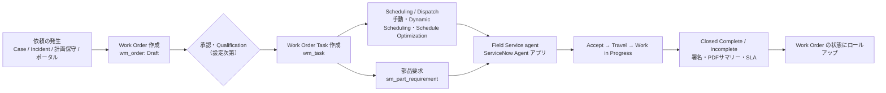
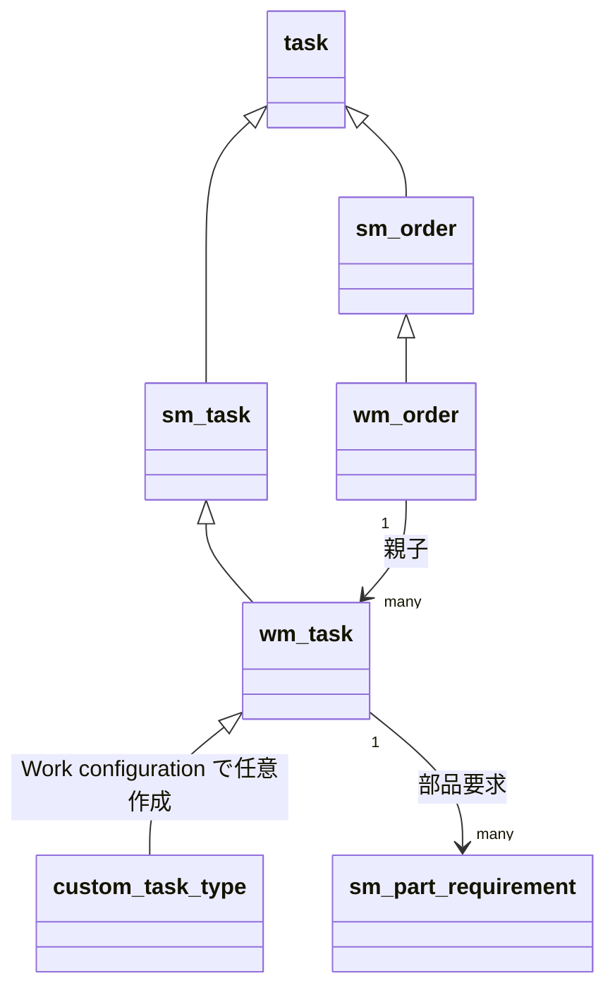
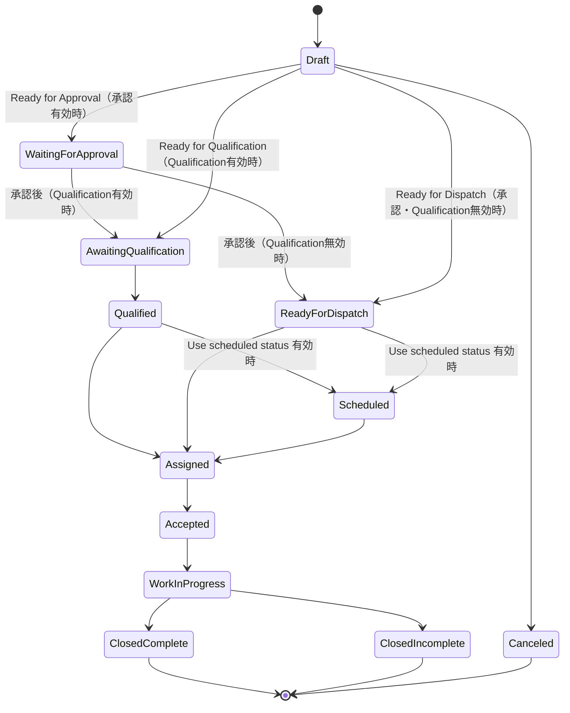
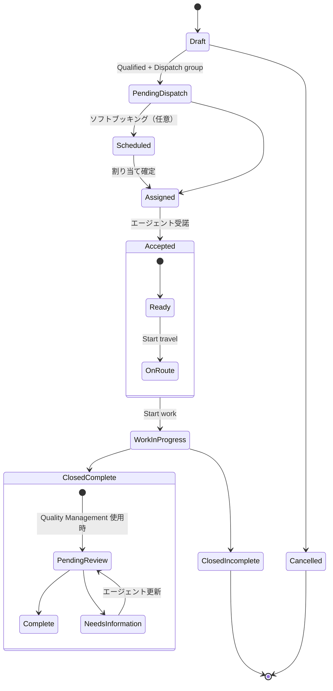
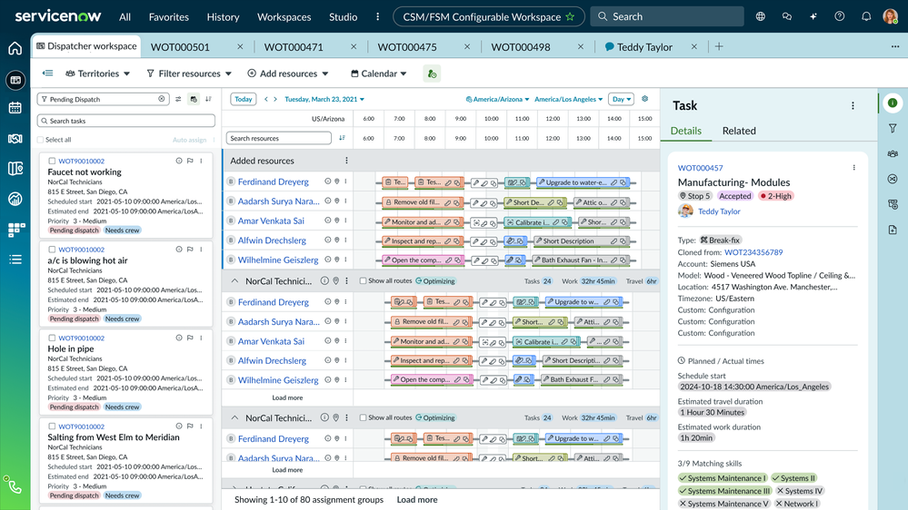
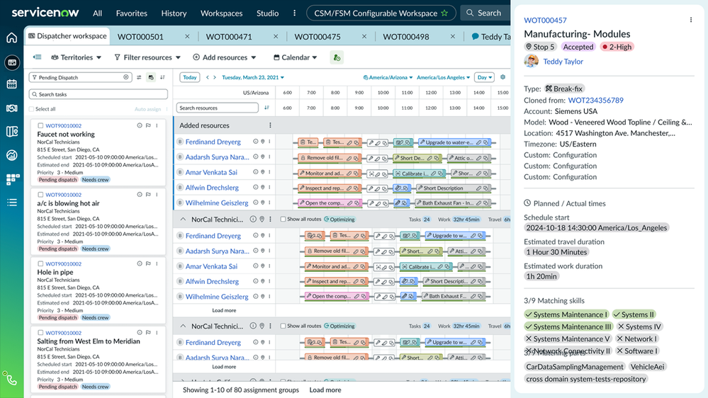

# Field Service Management（フィールドサービス管理）

## 概要

Field Service Management（FSM、フィールドサービス管理）は、現場（オンサイト）で行う保守・修理・設置・点検作業を、受付から作業指示（Work order）、計画・割り当て（Scheduling / Dispatch）、現場作業（Mobile）、部品手配（Parts management）、完了・報告までワークフローとして一元管理する ServiceNow のアプリケーションである。[出典](https://www.servicenow.com/docs/r/DBkKvgbNn2vmEpXdLk9O2w/Mooa7OsLxjPDuo~kp3EO4Q)

FSM の中核は次の 2 つのレコードである。

| 概念 | テーブル | 説明 |
|---|---|---|
| Work Order（作業指示） | `wm_order` | 顧客・資産・場所に対する「依頼単位」。複数のタスクを束ねる親レコード |
| Work Order Task（作業指示タスク） | `wm_task` | 「1 人が、1 回の訪問で、1 つの場所・時間帯に行う作業単位」。ディスパッチとスケジューリングの対象 |

[出典](https://www.servicenow.com/docs/r/x1i_kSm8n8WIoB0Vo0nN5Q/BUDOBY3RLSKTUTGbaQlf0w)

本ファイルの扱う範囲：Work order、Dispatch、Scheduling、Mobile、Parts management、Planned maintenance。顧客対応（Case）側は [Customer Service Management](./customer-service-management.md)、資産・在庫の基盤は [Hardware Asset Management](../itam/hardware-asset-management.md)、モバイル基盤は [モバイル](../platform/mobile.md)、AI 全般は [Now Assist と AI Agents](../platform/now-assist-ai-agents.md) を参照。

### FSM の全体プロセス

【推定】上図は公式ドキュメントの各ページ（Work order states / Work order task states / Source parts / Scheduling method）の記述を本ナレッジで統合した概念図である。

### Australia でのリリース位置づけ

- FSM は「ServiceNow AI Platform feature であり、デフォルトでアクティブ」とリリースノートに記載されている（Zurich・Australia 共通）。一方、Activate ページではプラグイン `com.snc.work_management` を admin がインストールする手順が示されている。本番利用には FSM のサブスクリプションが必要。[出典](https://www.servicenow.com/docs/r/m4LmCVvkm6_8u3nlIuep5Q/KJM7wXzfvqGoM5KPZsyzfA)
- Zurich → Australia の統合リリースノートでは、Australia の「New features / Changes / Deprecations」は「No updates」とされ、Highlights として以下が挙げられている。[出典](https://www.servicenow.com/docs/r/m4LmCVvkm6_8u3nlIuep5Q/KJM7wXzfvqGoM5KPZsyzfA)
  - Field Service Manager Mobile（マネージャーがモバイルで業務）
  - 優先案件のオーバーブッキング（Overbooking for priority cases）
  - Territory（テリトリー）単位の休日考慮
  - 作業時間・移動時間を考慮した柔軟な部品ソーシング
  - タスク依存関係を考慮した高度なリードタイム管理（予約／再予約時）
  - Territory API による予約可能枠の取得（連絡先・住所を指定せずに可能）
  - Schedule Optimization の Run summary（目的・制約・移動手段・割り当て結果の表示）
  - FSM 機能・アクティベーション用プラグインの ServiceNow Store 経由提供
- Australia の Field Service Management リリースノート（Australia 版、2026-03-12 更新）によると、Australia リリース以降、次のアプリケーションが ServiceNow Store に移行した。インスタンスを Australia 以降にアップグレードすると、これらの Store アプリケーションは自動的にインストールされる。[出典](https://www.servicenow.com/docs/r/35dlqBTUtpT5W39aSiHI6w/EfP6Yg2Wuw6fsjpUTasO6Q)（参照したページは日本語・ドイツ語のローカライズ版。英語ラベルは各プラグイン名から再構成）
  - Advanced Appointment Booking（`com.snc.advanced_appointment_booking`）
  - Field Service Contractor Management（`com.snc.fsm_contractor_management`）
  - Field Service Marketplace（`com.snc.fsm_marketplace`）
  - Field Service Territory Planning（`com.snc.fsm_territory_planning`）
  - Field Service Advanced Capacity and Reservations Management（`com.snc.fsm_advanced_capacity_management`）
  - Field Service Capacity and Reservations Management（`com.snc.fsm_capacity_management`）
  - Field Service with Service Locations support（`com.snc.fsm_service_locations`）
  - Technician driven sales with Field Service（`com.snc.fsm_technician_sales`）
  - Schedule Optimization（`com.snc_schedule_optimization`）
  - Field Service Quality Management、Field Service Mobile Agent（ID 記載なし）
  - Map Integrations for Field Service（`com.snc.app_fsm_map_integr`）、Beans.ai プラグイン（`com.sn_beans_ai_spoke`）
  - Intelligent Task Recommendations（`sn_fsm_task_rec`、`sn_task_recommend`）、FSM Scheduling Automations（`sn_fsm_sched_flws`）、Application Common Configuration（`sn_app_cmn_config`。Dispatcher Workspace の構成要素）
- 同リリースノートは、Store へ移行した機能の**旧プラグイン 20 件を将来の非推奨予定**として列挙している。対象は `com.snc.advanced_appointment_booking`、`com.snc.fsm_marketplace`、`com.snc.marketplace_core`、`com.snc.fsm_task_recommendations`、`com.snc.sn_app_fsm_scheduling_flows`、`com.snc.task_recommendations`、`com.snc.app_cmn_config`、`com.snc.fsm_capacity_management`、`com.snc.fsm_territory_planning`、`com.snc.fsm_service_locations`、`com.snc.sales_mobile_cmn`、`com.snc.fsm_technician_sales`、`com.snc.territory_planning`、`com.sn_fsm_mobile`、`com.sn_fsm_quality`、`com.sn_quality`、`com.snc.fsm_contractor_management`、`com.sn_beans_ai_spoke`、`com.snc.app_fsm_map_integr`、`com.snc_schedule_optimization`。本ファイルの表でこれらの ID を挙げている箇所は、旧プラグインとしての ID であり、今後は対応する Store アプリ（上記一覧）を使う前提で読むこと。[出典](https://www.servicenow.com/docs/r/35dlqBTUtpT5W39aSiHI6w/EfP6Yg2Wuw6fsjpUTasO6Q)（日本語ローカライズ版で確認）
- 統合リリースノート（Zurich → Australia）の Highlights も「FSM の機能とアクティベーション用プラグインが ServiceNow Store アプリケーション経由で提供される」と述べている。[出典](https://www.servicenow.com/docs/r/m4LmCVvkm6_8u3nlIuep5Q/KJM7wXzfvqGoM5KPZsyzfA)

> **Brazil での変更:** Brazil の統合リリースノート（Australia → Brazil）では、FSM 関連の Store アプリ（Schedule Optimization v1.2 / v2.0、Dispatcher Workspace v11.0、FSM Configurable Dispatcher Workspace Bundle v11.0 / v11.1、Field Service Mobile v3.1、Appointment Booking v1.1、Proxy Actions v1.0、Manager Workforce v2.0、Shift Scheduling v8.0、Scheduling AI Agent Collections v2.0、Field Service Questionnaires with Smart Assessments v4.0）の新機能が列挙されている。詳細は各節の「Brazil での変更」と「## Brazil での変更点まとめ」を参照。[出典](https://www.servicenow.com/docs/r/delta-australia-brazil/brazil-australia-fieldservicemanagement-release-notes.html)

---

## プラグインとアクティベーション

### 主プラグインと同時に有効化されるプラグイン

`com.snc.work_management`（Field Service Management）をアクティブ化すると、未アクティブの関連プラグインも有効化される。前提条件は `admin` ロール。ドメインセパレーションと Delegated admin が有効な場合、管理ユーザーは global ドメインにいる必要がある（そうでない場合「Application installation is unavailable because another operation is running.」エラー）。[出典](https://www.servicenow.com/docs/r/DBkKvgbNn2vmEpXdLk9O2w/Mooa7OsLxjPDuo~kp3EO4Q)

手順：**All > System Applications > All Available Applications > All** → プラグイン名または ID で検索 → **Install**。見つからない場合は ServiceNow への依頼が必要な場合がある。

| プラグイン名 | ID | 状態・備考 |
|---|---|---|
| Field Service Management | `com.snc.work_management` | 主プラグイン |
| Automatic Assignment | `com.snc.automatic_assignment` | 自動割り当て |
| Field Service Mobile | `com.sn_fsm_mobile` | モバイル（Store アプリへ移行、旧プラグインは将来非推奨予定）（出典ページ上、下の置換先では `sn_fsm_mobile` と表記揺れあり。インスタンスで要確認） |
| FSM Agent Workspace | `com.snc.agent_workspace.fsm` | 非推奨。`com.snc.uib.fsm_agent_workspace` に置換 |
| Field Service Management Demo Data | `com.snc.work_management.demo` | デモデータ（CI テーブル・リレーションが追加される点に注意） |
| Field Service -- Questionnaire | `com.snc.wm_questionnaire` | 作業指示／タスク用アンケート |
| Field Service Management Mobile | `com.snc.work_management_m` | 非推奨。`sn_fsm_mobile` に置換（出典ページの表記どおり。上の `com.sn_fsm_mobile` と同一アプリを指すと考えられる【推定】） |
| Field Service Map | `com.snc.fsm_map` | 非推奨。`com.snc.uib.fsm_dispatcher_workspace` に置換 |
| Central Dispatch | `com.snc.central_dispatch` | 非推奨。`sn_fsm_disp_wrkspc` に置換（出典ページの表記どおり。`sn_fsm_disp_wrkspc` は Dispatcher Workspace Store アプリのスコープ名、`com.snc.uib.fsm_dispatcher_workspace` は FSM Configurable Dispatcher Workspace のプラグイン ID と考えられる【推定】） |
| Time Recording Core | `com.snc.wm_time_recording` | タイムカード／時間記録（CSM・FSM 共通） |
| Time Recording for Field Service | `com.snc.time_recording_fsm` | |
| Field Service -- Signature Pad | `com.snc.wo_signature_pad` | 署名取得 |
| Blackout and Maintenance Scheduling | `com.snc.blackout_maintenance_scheduling` | |
| Dynamic Scheduling | `com.snc.dynamic_scheduling` | 動的スケジューリング（ドキュメント内に `com.snc.dynamicscheduling` 表記もあり。インスタンスで要確認） |
| Field Service Management CMS Portal | `com.snc.work_management.cms` | 非推奨化中 |
| Field Service Management Geolocation Demo Data | `com.snc.work_management_geolocation.demo` | |
| Field Service Manager Mobile | `com.snc.fsm_manager_mobile` | マネージャー用モバイル |

[出典](https://www.servicenow.com/docs/r/DBkKvgbNn2vmEpXdLk9O2w/Mooa7OsLxjPDuo~kp3EO4Q)

### 追加プラグイン（Additional plugins）

Australia の「Additional plugins for Field Service Management」に列挙されているプラグイン（31 件）。アクティブ化には `admin` が必要。[出典](https://www.servicenow.com/docs/r/DBkKvgbNn2vmEpXdLk9O2w/8Opj89enYEhE3iXyItKsYg)

| プラグイン名 | ID | 概要 / 備考 |
|---|---|---|
| Customer Service with Field Service Management | `com.snc.csm_fsm_integration` | CSM 連携（ポータルで Case 関連の作業指示を表示） |
| Performance Analytics - Content Pack - FSM | `com.snc.work_management_pa` | 本番は別ライセンスの可能性 |
| Field Service with Project Management | `com.snc.wm_ppm` | PPM 連携（追加ライセンスの可能性） |
| Field Service with Project Management Demo | `com.snc.wm_ppm_demo` | デモ |
| Field Service with Service Locations support | `com.snc.fsm_service_locations` | 作業指示から新しいサービスロケーション作成（Store アプリへ移行、旧プラグインは将来非推奨予定） |
| Field Service Management - Customer Experience | `com.snc.fsm_customer_experience` | 顧客への SMS 通知、技術者の移動追跡 |
| Field Service Contractor Management | `com.snc.fsm_contractor_management` | 外部委託業者ポータル（Service Contractor Base も有効化）（Store アプリへ移行、旧プラグインは将来非推奨予定） |
| Predictive Intelligence for FSM | `com.snc.fsm_ml` | 本番は別ライセンスの可能性 |
| Field Service Capacity and Reservations Management | `com.snc.fsm_capacity_management` | キャパシティ管理（別ライセンスの可能性）（Store アプリへ移行、旧プラグインは将来非推奨予定） |
| sn-fsm-components | `com.sn_fsm_components` | UIB Central Dispatch 用コンポーネント |
| FSM Configurable Dispatcher Workspace | `com.snc.uib.fsm_dispatcher_workspace` | Dispatcher 用ページ（CSM Configurable Workspace 上） |
| FSM Configurable Workspace | `com.snc.uib.fsm_agent_workspace` | FSM 用リスト・フォーム（Configurable Workspace） |
| Field Service Virtual Agent Conversations | `sn_fsm_va` | モバイルアプリ内 Virtual Agent |
| FSM Virtual Conferencing Integration | `com.snc.fsm_vci` | リモート支援 |
| FSM Access Hours Management | `com.snc.fsm_access_hours` | タスクごとのアクセス可能時間を考慮 |
| Field Service Multi-Day Task Scheduling | `com.snc.fsm_multiday_tasks` | 複数日タスク |
| FSM Intelligent Task Recommendations | `com.snc.fsm_task_recommendations` | 空き枠を埋めるタスク推奨（Store アプリへ移行、旧プラグインは将来非推奨予定） |
| Field Service Crew Operations | `com.snc.fsm_crew_scheduling` | クルー（チーム）運用 |
| Field Service Territory Planning | `com.snc.fsm_territory_planning` | 最適テリトリーの絞り込み（Store アプリへ移行、旧プラグインは将来非推奨予定） |
| Field Service Advanced Parts Sourcing | `com.snc.fsm_advanced_parts_sourcing` | 複数部品の要求・ソーシング |
| Template Management for Field Service | `com.snc.fsm_template_management` | 高度な作業指示テンプレート |
| Customer Service Install Base Management | `sn_install_base` | Install base とケース・作業指示の紐付け |
| Process Mining Content Pack for FSM | `sn_fsm_po` | タスク監査証跡からプロセス分析 |
| Agent Schedule | `com.snc.agent_schedule` | エージェントのスケジュール・個人イベント |
| Appointment Booking | `com.snc.appointment_booking` | 訪問予約 |
| Assignment Workbench | `com.snc.assignment_workbench` | 個別エージェントへの割り当て |
| Service Management Core | `com.snc.service_management.core` | FSM 等が依存する共通基盤 |
| Special Handling Notes | `com.sn_shn` | 重要情報の表示 |
| Site Mapping for FSM | `sn_fsm_site_map` | 施設内サイトマップ |
| Smart Assessment for Field Service Questionnaire | `sn_fsm_smart_asmt` | AI アセスメント（別サブスクリプション） |
| Sidebar for Field Service Mobile Agent | `sn_fsm_sidebar` | モバイルの Sidebar（会話）機能 |

「Store アプリへ移行、旧プラグインは将来非推奨予定」の注記は Australia の FSM リリースノートに基づく。[出典](https://www.servicenow.com/docs/r/35dlqBTUtpT5W39aSiHI6w/EfP6Yg2Wuw6fsjpUTasO6Q)

---

## パッケージ構成（Standard / Professional / Enterprise）

FSM の Standard / Professional / Enterprise 各パッケージにどの機能・プラグインが含まれるかは、**公開情報では確認できず**。ServiceNow Community の 2026-02 の回答に機能一覧の表が貼られているが、貼り付け時に列構造が崩れており、各機能がどのパッケージに属するかは判別できない。[出典](https://www.servicenow.com/community/field-service-management-forum/fsm-package-plugins-and-functionalities-standard-professional/m-p/3411597)

- Community 投稿に機能名として登場するもの（パッケージとの対応は判別不能）：Dispatcher Workspace、Dynamic Scheduling、Field Service Mobile、Asset Management、Planned Maintenance、Inventory Management、Cost Management、Field Service Contractor Management、Territory Planning、Capacity and Reservations Management、Crew Operations、Task Bundling、Multi-Day Task Scheduling、Continual Improvement Management、Performance Analytics、Predictive Intelligence、Virtual Agent、Now Assist for FSM、Process Mining、Workforce Optimization など。
- 同投稿で明示されているのは次の 2 点のみ。【第三者情報】
  - Schedule Optimization と Field Service Marketplace は Professional に追加する有償アドオンである。
  - Now Assist はコアパッケージに含まれない。
- パッケージごとの割り当ては、ServiceNow の NowCreate 等で提供される capability matrix（パッケージ別機能表）や営業担当で確認すること。

- Schedule Optimization は公式ドキュメント上も「ServiceNow AI Platform とは別のサブスクリプションが必要」と明記されている。[出典](https://www.servicenow.com/docs/r/DBkKvgbNn2vmEpXdLk9O2w/BJqHAmjI_ehGlMT5jaUKeQ)
- プラグイン単位のエンタイトルメント表は公開されておらず、ServiceNow の営業担当／ソリューションコンサルタントへの確認が必要とされる。【第三者情報】ライセンス全般は [ライセンスモデル](../../03_導入編/01-licensing-model.md)、[エディション比較](../../03_導入編/03-edition-comparison.md) を参照。

---

## ロール

Australia で FSM と共にインストールされるロール。[出典](https://www.servicenow.com/docs/r/DBkKvgbNn2vmEpXdLk9O2w/PbhKPGS1q480hefjocJiKA)

| ロール（名称） | 名前 | 主な権限 | 含有ロール（抜粋） |
|---|---|---|---|
| Field Service Management Administrator（管理者） | `wm_admin` | FSM のデータ・設定管理。レコードの上書き、作業指示／タスク削除、モデル・Incidentals・アンケート・スキル・品質監視の管理 | `wm_dispatcher`、`wm_agent`、`wm_qualifier`、`wm_approver_user`、`fsm_skill_admin`、`dynamic_scheduling_admin`、`territory_admin`、`plan_maint_admin`、`questionnaire_admin`、`catalog_admin`、`knowledge_manager`、`template_admin`、`skill_model_admin`、`sn_apptmnt_booking.appointment_booking_admin` |
| Field Service Management Agent（現場エージェント／技術者） | `wm_agent` | 現場作業と実績時間の管理。タスクの受諾／拒否、部品の追加・ソーシング、作業メモ、アンケート提出、予約。スケジュールやタスクウィンドウは変更不可 | `wm_basic`、`inventory_user`、`territory_user`、`agent_schedule_user`、`questionnaire_user`、`timecard_user`、`fsm_skill_user`、`skill_user`、`document_management_user`、`sn_apptmnt_booking.appointment_booking_manager` |
| Field Service Management Dispatcher（ディスパッチャー） | `wm_dispatcher` | タスクのスケジュールとエージェント割り当て、部品追加。Draft〜Assigned のタスク管理、移動・作業時間の設定 | `wm_basic`、`dynamic_scheduling_user`、`inventory_user`、`territory_user`、`skill_model_user`、`timecard_user`、`sn_customerservice.customer_data_viewer`、`document_management_user`、`sn_apptmnt_booking.appointment_booking_manager` |
| Field Service Management Qualifier（クオリファイアー） | `wm_qualifier` | 作業指示の Qualification（適格性確認）とタスク作成、Dispatch group の設定、部品管理 | `wm_basic`、`inventory_user`、`territory_user`、`skill_model_user`、`document_management_user` |
| Field Service Management Initiator（起票者） | `wm_initiator` | 作業指示の作成と Qualification group の指定。自分の Draft の編集 | `wm_basic` |
| Field Service Management Initiator Qualifier | `wm_initiator_qualifier` | 作業指示・タスク作成、部品追加・ソーシング | `wm_initiator`、`wm_qualifier` |
| Field Service Management Initiator Qualifier Dispatcher | `wm_initiator_qualifier_dispatcher` | 上記＋エージェントへの割り当て | `wm_initiator`、`wm_dispatcher`、`wm_qualifier` |
| Field Service Management Task Initiator | `wm_task_initiator` | 作業指示とタスクがともに Draft のときにタスク・部品要求を作成／削除／変更 | `wm_initiator` |
| Field Service Management Manager（マネージャー） | `wm_manager` | エージェントのスキル、タイムカード、勤務スケジュール、個人イベントの管理 | `wm_agent`、`fsm_skill_admin`、`timecard_manager`、`agent_schedule_manager` |
| Field Service Management Approver User（承認者） | `wm_approver_user` | Qualification／割り当て前の作業指示の承認 | `approver_user`、`cmdb_read` |
| Field Service Management Basic | `wm_basic` | 作業指示の作成と自分が作成した作業指示のフォロー。全 FSM ロール共通の基本アクセス | `wm_read`、`task_activity_writer`、`service_fullfiller`（公式ページの表記どおり）、`inventory_user` ほか |
| Field Service Management Read | `wm_read` | 作業指示・タスクの参照のみ | `cmdb_read`、`sn_apptmnt_booking.appointment_booking_user` |
| Field Service Management Location Agent | `wm_location_agent` | サービス組織スコープのエージェント（Work Management and Service Organization プラグインが必要） | `wm_location_security` |
| Field Service Management Location Manager | `wm_location_assignment_manager` | 自サービス組織内の作業指示・タスク作成と割り当て | `wm_location_security`、`fsm_skill_user` |
| Field Service Desk Agent | `sn_fsm_servicedesk_agent` | 作業指示の作成・テンプレート適用・進行 | `wm_read`、`sn_apptmnt_booking.appointment_booking_user` |

関連ロール（他プラグイン）：

| ロール | 用途 | 出典 |
|---|---|---|
| `sn_fsm_planned_wm.planned_work_admin` | Planned Work Management の管理・スケジュールのオンデマンド実行 | [出典](https://www.servicenow.com/docs/r/x1i_kSm8n8WIoB0Vo0nN5Q/oM5swH10b5cP4YE1ezIV~Q) |
| `sn_fsm_planned_wm.planned_work_read` | Planned Work Management の全テーブルの参照（Install base work plans では Customer / Consumer service agent への付与を案内） | [出典](https://www.servicenow.com/docs/r/5M2H7PAkXUuakbtz~5Kfeg/2eIAKcTImgEphY338~GlhQ)（Zurich 版） |
| `sn_tmf_api.work_order_integrator` | Work Order Management API（TM Forum 準拠）の利用 | [出典](https://www.servicenow.com/docs/r/ja-JP/api-reference/rest-apis/work-order-mgmt-api.html) |
| `sn_customerservice_agent` / `sn_customerservice_manager` | CSM 連携時、Case に紐づく作業指示・予約の作成と参照 | [出典](https://www.servicenow.com/docs/r/DBkKvgbNn2vmEpXdLk9O2w/B6YjKrRc5qBsU~hpD5dRfA) |

ロール設計の一般論は [ユーザー・グループ・ロール](../platform/users-groups-roles.md) を参照。

---

## データモデル（主要テーブル）

### FSM のテーブル

| ラベル | テーブル名 | 説明 |
|---|---|---|
| Work Order（作業指示） | `wm_order` | 作業指示レコード |
| Work Order Flow | `sf_work_order` | 作業指示の State flow（状態遷移）定義 |
| Work Order Model | `cmdb_workorder_product_model` | Product Catalog の作業指示モデル（Service Order Management の一部へ改名） |
| Work Order Task（作業指示タスク） | `wm_task` | 1 人・1 セッション・1 場所・1 時間帯の作業単位 |
| Work Task Flow | `sf_work_task` | タスクの State flow 定義 |
| Work Task Model | `cmdb_servicetask_product_model` | Product Catalog のタスクモデル |
| WM Map Filters Config | `wm_map_filters_config` | モバイル UI のエージェントマップ用フィルター設定 |
| Questionnaire | `wm_questionnaire` | 作業指示／タスク用アンケート |
| Work Type | `wm_work_type` | タスク完了に必要な作業の種類 |
| Work Order Task Potential Assignment Groups | `wm_work_order_task_potential_assignment_groups` | 複数グループが対応可能な場合の候補割り当てグループ（`sn_fsm.update_potential_assignment_groups` が true、複数グループがロケーションを担当、Territory モデル非アクティブ時のみ） |
| Scheduling history | `wm_task_scheduling_history` | タスクがどのように割り当てられたかの履歴（日時付き） |
| Assets | `alm_asset` | 在庫（コスト・在庫場所含む） |
| Resource Schedule Attributes | `wm_agent_schedule_attribute_plan` | エージェントの開始／終了日、開始／終了位置、勤務時間等の属性 |

[出典](https://www.servicenow.com/docs/r/x1i_kSm8n8WIoB0Vo0nN5Q/BUDOBY3RLSKTUTGbaQlf0w)（Zurich 版。Australia 版ページの本文は未取得）

### テーブル階層

- Service Management Core のドキュメントでは、Service Management フロー（`sm_order` と `sm_task`）の State フィールドとその拡張テーブル（`wm_order`、`wm_task` など）を扱う `SMConstants` が記載されている。このことから `wm_order` は `sm_order`、`wm_task` は `sm_task` の拡張であり、`sm_order` / `sm_task` は `task` を拡張する構造と理解される。【推定】[出典](https://www.servicenow.com/docs/r/washingtondc/service-management-for-the-enterprise/r_InstallWServMgmtCore.html)
- Work configuration ごとに `wm_task` を拡張した Work Order Task Type テーブルを作成でき、作業指示の UI アクションを継承する。[出典](https://www.servicenow.com/docs/r/DBkKvgbNn2vmEpXdLk9O2w/G6tO7xq4rleNPoZYGXIrrw)

【推定】階層図は上記出典の記述から再構成したもの。インスタンスの **System Definition > Tables** の「Extends table」で確認すること。テーブル継承の一般論は [データモデルとSystem Dictionary](../platform/data-model-dictionary.md) を参照。

---

## Work order（作業指示）

### 作業指示の作成

- 必要ロール：`wm_initiator`、`wm_initiator_qualifier`、または `admin`。
- メニュー：**Field Service > Work Order > Create New** → Short description を入力（ナレッジ検索アイコンで製品モデル・プラン・CI に関連する記事を検索可）→ **Submit**。
- 他レコードから作成：Incident、Problem、Change、Project task（PPM 連携時）、または別の Work order のフォームタイトルバーを右クリック → **Create Work Order**。新しい作業指示は Draft で作成され、元レコードの Short description がコピーされる。

[出典](https://www.servicenow.com/docs/r/DBkKvgbNn2vmEpXdLk9O2w/PiJiL7VCGY_nfmQh1EeF~g)

### Work Order フォームの主要フィールド

| フィールド | 説明 |
|---|---|
| Number | 自動採番の作業指示 ID |
| Company（会社） | 作業指示を起票した顧客企業（Customer フラグ付きの会社のみ） |
| Contact（連絡先） | 作業を必要とするユーザー（選択した Company のユーザーに限定） |
| Asset（資産） | 主たる資産（資産タグ／シリアル番号）。他の資産は Affected Products に追加。リニア資産は Enterprise Asset Management が必要 |
| Affected CI | 作業対象の主たる CI。その他は Affected CIs 関連リスト |
| Part Requirement | 追加で必要な部品（Related Links に表示、タスクに適用） |
| Linear Work / Start location / End location | リニア資産（配管・線路など）の作業時に表示 |
| Requestor Service Organization / Provider Service Organization | 依頼元／提供元のサービス組織（Service Organization プラグインが必要） |
| Install base item | 問題のある Install base 品目 |
| Location（作業場所） | 作業場所。Provider Service Organization から自動設定。Ad hoc location に置換可 |
| Template | 作業指示テンプレート（任意）。説明が Description に入る |
| Opened | 起票日時 |
| Priority（優先度） | 影響範囲などに基づく緊急度。適用される SLA を決める |
| State（状態） | ライフサイクル段階。Scheduled は管理者が global domain 設定で有効化した場合のみ表示 |
| Qualification group | 技術的詳細を補うグループ（ロケーションでフィルタ）。自動 Qualification 設定時は非表示 |
| Initiated from（起票元） | 元の Problem / Incident / Change / Work order の番号 |
| Billable | 請求対象フラグ（レポート用） |
| Short description / Description | 概要／詳細 |
| Work Notes | 内部メモ（顧客には非表示） |
| Scheduled start | 最初のタスクの開始予定 |
| Estimated end | 全タスクの完了見込み |
| Actual work start / Actual work end | 最初のタスクの実開始／最後のタスクの実終了 |
| Requested due by | 最終タスクの目標完了日（保守スケジュールのリードタイムで調整） |

[出典](https://www.servicenow.com/docs/r/DBkKvgbNn2vmEpXdLk9O2w/PiJiL7VCGY_nfmQh1EeF~g)

FSM 標準のクライアントスクリプト「Hide End Date Fields」は、Request-driven プロセスでは `estimated_end` を、Task-driven プロセスでは `expected_end` を `wm_order` 上で非表示にする。[出典](https://www.servicenow.com/docs/r/DBkKvgbNn2vmEpXdLk9O2w/EPt5SRN1AxbzZiHb~kEXcw)

### Work order の状態（State）

| State | 説明 |
|---|---|
| Draft（下書き） | Qualifier が作業内容の記述を完了していない |
| Awaiting Qualification（適格性確認待ち） | 起票済み・未確認。Qualification 有効時のみ |
| Qualified（確認済み） | 承認済みで割り当て可能。Qualification 有効時のみ |
| Ready for Dispatch（ディスパッチ準備完了） | 割り当て可能。Qualification 無効時のみ |
| Assigned（割り当て済み） | 割り当てられたエージェントの受諾待ち |
| Accepted（受諾済み） | エージェントが受諾し作業可能 |
| Work in Progress（作業中） | 作業開始 |
| Closed Complete（完了） | 仕様どおり完了 |
| Closed Incomplete（未完了で終了） | 仕様どおりに完了できなかった |
| Canceled（取消） | 取消 |
| Waiting for Approval（承認待ち）※ | 承認有効時、**Ready for Approval** で遷移 |
| Scheduled（スケジュール済み）※ | Use scheduled status 有効時のみ。Ready for Dispatch／Qualified と Assigned の間に入る |

[出典](https://www.servicenow.com/docs/r/x1i_kSm8n8WIoB0Vo0nN5Q/B4VySCEcbyGDA~9~YBTjCg)（Zurich 版。Australia 版の同ページは取得できず）

※ Waiting for Approval と Scheduled は Work order states ページの表には記載がない。Waiting for Approval は [Create a work order](https://www.servicenow.com/docs/r/DBkKvgbNn2vmEpXdLk9O2w/PiJiL7VCGY_nfmQh1EeF~g)、Scheduled は同ページの State フィールド説明と [Global domain configurations](https://www.servicenow.com/docs/r/wB8P7abKjWIA9pPecYV7dA/88RTV9~qpOv8ZX4VPIrGLA) に基づく。

- Qualification 無効化時の挙動は、出典ページによって表現が異なる。
  - Work order states ページ（Zurich）：Qualification を有効化した後に無効化すると、Draft・Awaiting Qualification・Qualified の作業指示はすべて Ready for Dispatch に設定される。[出典](https://www.servicenow.com/docs/r/x1i_kSm8n8WIoB0Vo0nN5Q/B4VySCEcbyGDA~9~YBTjCg)
  - Global domain configurations ページ（Australia）：Qualification を無効にすると、Awaiting Qualification の作業指示は自動的に Qualified になる。[出典](https://www.servicenow.com/docs/r/wB8P7abKjWIA9pPecYV7dA/88RTV9~qpOv8ZX4VPIrGLA)
  - 両者の関係（リリース差か、対象状態の違いか）は公開情報では確認できず。実際の挙動はインスタンスで確認すること。
- Approval（承認）が有効な場合は **Ready for Approval** で Waiting for Approval に遷移する。Qualification 必須時は **Ready for Qualification**（Awaiting Qualification へ遷移、タスクがなければ作成）、承認も Qualification も無効の場合は **Ready for Dispatch** ボタンが表示される。[出典](https://www.servicenow.com/docs/r/DBkKvgbNn2vmEpXdLk9O2w/PiJiL7VCGY_nfmQh1EeF~g)
- `wm_task` の Business rule「Roll Up Changes」は、作業指示タスクの変更に基づいて親の作業指示の状態を更新する（タスクの状態変化を親へロールアップ）。特定レコードで止めたい場合は Business rule に条件を追加できる。[出典](https://www.servicenow.com/docs/r/OxLLTMwXG2tKQ2SIp7HnZg/EAsQMXHubFIocnQO0na9bg)（Business rules installed with Field Service Management、Australia 版。参照したのは pt-BR ローカライズ版）

【推定】遷移線は上記 2 ページの記述からの再構成。実際の遷移は State flow（`sf_work_order`）設定に依存する。

### Qualification（適格性確認）の設定

- `admin` が **All > Field Service > Administration > Configuration** でスイッチ「**Qualification is required for new requests**」をオンにして保存する。有効時、作業指示は Draft → Awaiting Qualification → Qualified を経て Dispatch 可能になる。[出典](https://www.servicenow.com/docs/r/DBkKvgbNn2vmEpXdLk9O2w/QlObRDCrWuUMjvg0KyHu9A)
- 無効時は Awaiting Qualification / Qualified 状態が Ready for Dispatch に置き換わる（Community 回答）。【第三者情報】[出典](https://www.servicenow.com/community/csm-forum/automatic-qualification-of-work-orders/m-p/3007543)

### Global domain configurations（Field Service 設定画面）

Field Service の Configuration 画面（**Field Service > Administration > Configuration**）は 3 タブで構成される。以下は Australia 版ページの内容（英語ラベルは要約からの再構成を含むため、正確な画面ラベルはインスタンスで確認すること）。[出典](https://www.servicenow.com/docs/r/wB8P7abKjWIA9pPecYV7dA/88RTV9~qpOv8ZX4VPIrGLA)

**Business Process タブ**

| 設定 | 内容 |
|---|---|
| Process lifecycle | 既定は Task-driven（タスク駆動）。Request-driven（依頼駆動）は Xanadu 以降サポート対象外（Request-driven に変更できるのは `maint` ロールを持つユーザーのみ） |
| Qualification required for new requests | 次状態に進む前に Qualification を必須化。無効時、Awaiting Qualification の作業指示は自動的に Qualified になる（Work order states ページとの表現の違いは「Work order の状態」節を参照） |
| Agent の受諾／拒否 | 割り当てられたエージェントにタスクの Accept / Reject を要求 |
| 移動時間の追跡 | 移動時間をタイムカードで記録 |
| On-site arrival check-in | 「On-site arrival」サブステートとジオフェンスで到着時の位置を取得（オフライン時などのバイパス可） |
| Close / Cancel 時の Work notes 必須 | |
| タスクの Work notes を作業指示へコピー | |
| 作業指示クローズ時の Case 自動クローズ | 関連作業指示がすべてクローズ／取消で Case をクローズし、解決コードとメモを設定 |
| 作業指示状態で Case を更新 | 状態変化時に Case の Additional comments を更新 |
| Draft でのテンプレート適用 | Draft でもテンプレートからタスクを生成 |
| Inbound email による作成 | 受信メールで依頼を作成／更新、スパム判定可 |
| 作成方法 | カタログ経由か通常フォームか |
| Email notifications | 指定フィールド変化時の通知 |

**Assignment タブ**

| 設定 | 内容 |
|---|---|
| Task assignment method | Auto-assign / Workflow / Manual（Dispatcher）/ Dynamic Scheduling |
| Use scheduled status | 作業指示・作業指示タスクの Ready for Dispatch（タスクでは Pending dispatch）と Assigned の間に Scheduled 状態を追加 |
| Use dispatch queue | Dispatch group による手動割り当て（Task-driven 必須） |
| Restrict vendor groups | 外部ベンダーグループ選択を Dispatch group に限定 |
| Preferred assignment group | 内部／外部グループの優先（Contractor Management 有効時のみ表示） |
| Assign by group coverage / product model / skills | ロケーション・製品モデル・スキルでグループを絞り込み |
| Time zone consideration | エージェントのタイムゾーンを考慮 |
| FSM shift scheduling and availability | Workforce Optimization によるシフト・スキル・チーム・コーチング活用 |
| Priority assignment / Agent location consideration | 自動割り当て時の優先度・距離考慮 |
| Skill matching level | スキル一致の厳格度（all / some / none） |

**Add-ons タブ**

| 設定 | 内容 |
|---|---|
| Agent-required parts | エージェントにタスクの部品指定を要求 |
| Reserve parts in agent warehouse | スケジュール／再スケジュール時に部品を予約 |
| Cancel open transfer orders | タスクのスケジュール解除時に予約部品を解放 |
| Dedicated knowledge base / Document management / Task activity | 専用 KB、文書関連リスト、通話・メール等の活動記録 |
| Maps / Initial map location | 地図機能、初期表示位置（ブラウザ／資産／連絡先／会社住所） |
| Signature capture / PDF order summary / Document template | 署名付き PDF 作業報告（完了タスク・部品・経費・作業時間） |
| Service location validation | Ad hoc ロケーション作成時の検証方式（地図あり／第三者検証／検証なし） |

### 作業指示テンプレートと Work configuration

- 作業指示テンプレートでタスク・部品要求を一括生成できる。Template Management for Field Service（`com.snc.fsm_template_management`）は作業指示データを取得してタスクを独立生成する高度なテンプレート構成を提供する。[出典](https://www.servicenow.com/docs/r/DBkKvgbNn2vmEpXdLk9O2w/yJ2s6BS2AFiPuRnsylGIDA)
- Work configuration によりタスクの Task type と Work type を構成でき、任意で `wm_task` を拡張したテーブルを作成できる。[出典](https://www.servicenow.com/docs/r/DBkKvgbNn2vmEpXdLk9O2w/G6tO7xq4rleNPoZYGXIrrw)

---

## Work order task（作業指示タスク）

### タスクの状態とサブステート（Australia）

Work order task の状態は順序的に進む。構成により固有の遷移や条件成立時の自動遷移を設定できる。

| State | Substate | 説明 |
|---|---|---|
| Draft | なし | Qualifier が作業内容を記述中、Dispatch group 未設定 |
| Pending dispatch（ディスパッチ待ち） | なし | Qualifier が Dispatch group を設定し Qualified を選択 |
| Scheduled（仮予約） | なし | ソフトブッキング（未確定）で Dispatcher の割り当て待ち。Scheduled 状態有効時のみ |
| Assigned | なし | Dispatcher が割り当てを確定。エージェントの受諾待ち |
| Accepted | On route（移動中） | エージェントが受諾。**Start travel** で On route |
| Work in Progress | なし | エージェントが **Start work** を選択 |
| Closed Complete | Complete / Pending review / Needs information | 仕様どおり完了。Field Service Quality Management 使用時はクローズで Pending review → レビューアーが承認（Complete）または情報要求（Needs information）。エージェント更新で Pending review に戻る |
| Closed Incomplete | Complete | 仕様どおり完了できず |
| Cancelled | なし | 取消 |

[出典](https://www.servicenow.com/docs/r/DBkKvgbNn2vmEpXdLk9O2w/4V7ehAd~gF500f5YT0Fn4A)

【推定】遷移線は上表からの再構成。Assigned 後にエージェントが Reject した場合の遷移などは State flow（`sf_work_task`）の設定に依存する。

- `wm_admin` は作業指示／タスクのカスタム State flow を定義し、有効な遷移を制御できる。[出典](https://www.servicenow.com/docs/r/DBkKvgbNn2vmEpXdLk9O2w/7V4IBug1~4ETV5c5UsPJ7g)
- Scheduled → Assigned への更新タイミングはプロパティ「Update task state from Scheduled to Assigned」で制御し、通知発火にも影響する。[出典](https://www.servicenow.com/docs/r/x1i_kSm8n8WIoB0Vo0nN5Q/4gfsKqSa7vYDRS2fsjROXA)

### タスクの日時フィールド（Window）

| フィールド | 説明 / 自動設定ロジック |
|---|---|
| Window start | Dynamic Scheduling が使うスケジュール可能期間の開始。未設定または過去日なら現在日時を使用。未割り当ての作業指示では、必須部品の転送オーダーの納品日（複数なら最遅）から設定可能（Business rule「Sync up Delivery Time with WOT」が True の場合）。手動上書き可。予約付き・Fixed window・Window end が納品日より前のタスクは更新されない |
| Window end | スケジュール可能期間の終了。Window start のみある場合はプロパティ `com.snc.wm.wo.task_window_day` から算出。作成時は親作業指示の最も遅い SLA 違反日時から自動設定（Business rule「Populate Window End Based On SLA」と Client script「Calculate Window End」が有効な場合）。予約付き作業指示では予約に基づく |
| Fixed window | ウィンドウを固定し自動更新を止める |
| Estimated work duration | 作業見込み時間。ウィンドウとの整合が検証される |
| Dispatch group | タスクのエージェントを選べるグループ。既定でタスクのロケーションに属するグループのみ選択可（該当なしなら全 Dispatch group）。Territory モデル（`Field_Service_Territories`）有効時はテリトリーから最適グループを自動設定 |

[出典](https://www.servicenow.com/docs/r/DBkKvgbNn2vmEpXdLk9O2w/kBovuOfmoaDeDdFsSoHR_A)、Estimated work duration / Dispatch group は [出典](https://www.servicenow.com/docs/r/x1i_kSm8n8WIoB0Vo0nN5Q/sJMrGH5cTNUNccQKSSHYqg)

---

## Dispatch（ディスパッチ）

### Dispatcher Workspace

Dispatcher Workspace は、フィールドサービスエージェントへの作業の割り振りとパフォーマンス監視のための構成可能なスケジューリングアプリケーションであり、Dispatcher Dashboard とともに CSM/FSM Configurable Workspace の一部として提供される。旧 Central Dispatch（`com.snc.central_dispatch`）と Field Service Map（`com.snc.fsm_map`）は非推奨で、Dispatcher Workspace（`sn_fsm_disp_wrkspc` / `com.snc.uib.fsm_dispatcher_workspace`。前者は Store アプリのスコープ名、後者は FSM Configurable Dispatcher Workspace のプラグイン ID と考えられる【推定】）に置き換えられている。[出典](https://www.servicenow.com/docs/r/DBkKvgbNn2vmEpXdLk9O2w/F7iO5eTgr7XmyhXn1IVBSA)、[出典](https://www.servicenow.com/docs/r/DBkKvgbNn2vmEpXdLk9O2w/Mooa7OsLxjPDuo~kp3EO4Q)

| 画面・機能 | 内容 |
|---|---|
| Dispatcher Dashboard（ホーム） | 重要な Pending dispatch タスク、SLA 違反、遅延中エージェント、エージェントのプレゼンス（On site / Off shift / On Route 等）、ディスパッチマップ |
| タスクパネル | フィルター・タスクカード・検索で Work order task を表示しスケジュール／ディスパッチ |
| カレンダー（Agent calendar） | エージェントの勤務スケジュール、割り当て、個人イベント、空き状況 |
| Dispatch map | ジオロケーションでエージェントとタスクを表示。エージェントのルート表示・最適化 |
| Map overlays | Schedule > Map で交通・エージェント・タスク・イベントのマーカー切替（イベントは Workforce Optimization for Field Service 有効時） |
| Intelligent Task Recommendation | エージェントの空き枠を埋めるタスクを推奨。エージェントも ServiceNow Agent アプリで推奨タスクを自己割り当て可 |
| 割り当て | 自動割り当て（Auto assign）、クルー作成とタスク割り当て、アドホックエージェントのクルー追加 |
| タスク操作 | 状態のリアルタイム追跡、時間記録、追加情報要求、取消、予約管理 |
| On-Demand Optimization | Schedule Optimization を手動実行（Schedule Optimization 導入時） |

[出典](https://www.servicenow.com/docs/r/DBkKvgbNn2vmEpXdLk9O2w/F7iO5eTgr7XmyhXn1IVBSA)、Map overlays は [出典](https://www.servicenow.com/docs/r/field-service-management/field-service-scheduling/map-overlay-dispatcher.html)

*キャプション：Dispatcher Workspace — 複数タイムゾーン表示（Zurich リリース紹介ブログより）*

画面の文章説明：上部のワークスペースタブは「CSM/FSM Configurable Workspace」で、「Dispatcher workspace」タブと複数の Work order task（WOT…）タブが並ぶ。ツールバーには **Territories**、**Filter resources**、**Add resources**、**Calendar** がある。左側はタスクパネルで、フィルター「Pending Dispatch」とタスク検索、**Auto assign** ボタン、各タスクカード（番号、件名、担当グループ、住所、Scheduled start、Estimated end、Priority、「Pending dispatch」「Needs crew」タグ）が表示される。中央はガントチャート形式のリソースカレンダーで、日付（Day 表示）と 2 つのタイムゾーン（America/Arizona、America/Los_Angeles）の時間軸が併記され、割り当てグループごとにエージェント行が並び、タスクが色付きバーで配置される。グループ見出しには「Show all routes」「Optimizing」、Tasks 数・Work 時間・Travel 時間が出る。右側の Task パネルには選択タスクの Details（Type: Break-fix、Account、Model、Location、Timezone、Schedule start、Estimated travel duration、Estimated work duration、Matching skills の一致／不一致）が表示される。

出典：https://www.servicenow.com/community/fsm-blog/servicenow-ai-platform-zurich-release-smarter-scheduling/ba-p/3300528 （ServiceNow Community FSM Blog、2025-09-10 投稿、取得日 2026-11-03）

### Australia / Zurich の Dispatcher Workspace 強化点

- Time zones in Dispatcher Workspace：**Show multiple time zone rows** を有効にし、**Select time zones for calendar** に複数のタイムゾーンを指定すると、カレンダーに最大 3 つのタイムゾーンを積み重ねて表示できる。別設定の **Resource time indicators** を有効にすると、技術者のスケジュールをタイムゾーンでずらさずに揃えて表示し、技術者ごとのタイムゾーンをセグメント化した時刻インジケーターで示す。[出典](https://www.servicenow.com/docs/r/field-service-management/field-service-scheduling/time-zones-dispatcher.html)（Brazil 版ページ）
- Activity stream から Work order task に Work notes / Comments を追加できる。Dispatcher Workspace でタスクカードの情報アイコンを選択し、コンテキストサイドパネル（CSP）の Activity タブから操作する。必要ロールは `wm_dispatcher`。**Stacked view** で Work notes と Comments を 1 つのビューに重ねて表示でき、タスク要約スキルが有効なユーザーには Now Assist による **Summarize** ボタンが表示される。導入リリースは公開情報では確認できず（参照したのは Brazil 版ページ）。[出典](https://www.servicenow.com/docs/r/field-service-management/field-service-scheduling/activity-stream-csp.html)
- Zurich では、複数タイムゾーンの並列表示、リスト／レコードビューからの割り当て、グループ外技術者の一時追加が紹介されている。[出典](https://www.servicenow.com/community/fsm-blog/servicenow-ai-platform-zurich-release-smarter-scheduling/ba-p/3300528)
- Google Maps：Google が 2025-03-01 に Places API / Directions API / Distance Matrix API をレガシー化したため、Zurich と Dispatcher Workspace 8.0 以降は Places API (New) と Routes API を使用する。Google Cloud Platform Console で両 API を有効化する必要がある（アップグレードタスク）。[出典](https://www.servicenow.com/docs/r/m4LmCVvkm6_8u3nlIuep5Q/KJM7wXzfvqGoM5KPZsyzfA)

> **Brazil での変更:** Dispatcher Workspace v11.0 で休憩・昼食がカレンダーのタスクイベント内に直接表示される。FSM Configurable Dispatcher Workspace Bundle v11.0 でタスクパネルとカレンダーにスキル・部品・SLA 違反条件のクイックフィルターを作成可能（タスクフィルターは非該当を除外、カレンダーフィルターはグレー表示）。v11.1 でプロパティ `sn_fsm_disp_wrkspc.dispatcher_workspace.avoid_ferry_routes` が追加され、地図ルートで陸路を優先しフェリーは陸路がない場合のみ使用する。Proxy Actions v1.0 で、エージェント／マネージャーが他技術者に代わってタスク操作を実行可能（専用ポリシーフォームで制御、Proxy Admin ロールは delegation admin 権限を継承）。[出典](https://www.servicenow.com/docs/r/delta-australia-brazil/brazil-australia-fieldservicemanagement-release-notes.html)

### 割り当て関連の Business rule・プロパティ

| 名前 | 種類 | 内容 |
|---|---|---|
| Update task state from Scheduled to Assigned | プロパティ | ソフトブッキングされたタスクを Assigned に移すタイミングと通知 |
| Geolocation Properties | プロパティ | エージェント位置更新間隔（既定 5 分） |
| Shift Scheduling for FSM | 設定 | Workforce Optimization と併用時、スケジュール・シフトを Manager Workspace で管理 |
| Allow assignment override | Business rule | 割り当ての上書き |
| Populate Window End Based on SLA | Business rule | SLA から Window end を設定 |
| Sync up Delivery Time with WOT | Business rule | 部品の納品時刻をタスクの Window start に同期 |
| 移動時間算出方式 | 設定 | Google Maps API / 直線距離 / Beans。Google Maps API 無効時はタスクの見積もりを使用 |
| `work.management.use.mandatory.skills` | プロパティ | 必須スキルの考慮（Auto Assignment） |
| Enable Shift Scheduling for FSM to Determine Availability | プロパティ | 有効時のみ Auto-assignment が Workforce Optimization のシフトを考慮 |

[出典](https://www.servicenow.com/docs/r/x1i_kSm8n8WIoB0Vo0nN5Q/4gfsKqSa7vYDRS2fsjROXA)、[出典](https://www.servicenow.com/docs/r/DBkKvgbNn2vmEpXdLk9O2w/JmozSSgU3bFJXYy7KpRaQQ)

---

## Scheduling（スケジューリング）

### スケジューリング方式の比較

| 方式 | 特徴 | 適するケース |
|---|---|---|
| Manual Scheduling（手動） | ドラッグ＆ドロップで割り当て | 少人数・少タスク。誤りが起きやすい |
| Auto Assignment（自動割り当て） | Automatic Assignment プラグインによるルールベース割り当て（スキル・ロケーション・優先度等） | 単純な割り当てルール |
| Dynamic Scheduling（動的スケジューリング） | 着信タスクを 1 件ずつ、空き・スキル・位置を確認して割り当て。重要度の低いタスクの入れ替え（Un-assignment）可。インターバル自動実行または Auto Assign で手動実行 | 定常的・頻繁に変わるスケジュール |
| Schedule Optimization（スケジュール最適化） | チーム全体を対象とするポリシーエンジン。全エージェントの割り当て済み・未割り当てタスクを分析し、エージェント間の入れ替えも含めて移動時間削減と負荷平準化。最短 15 分間隔で実行（Intraday optimization の既定は 60 分）、または Dispatcher Workspace からオンデマンド実行。Intraday Optimization でリアルタイム再最適化 | 大規模・複雑な制約。別サブスクリプション |
| Intelligent Task Recommendations | エージェントのカレンダーの空き枠を推奨タスクで埋める | 稼働率向上 |
| Route Optimization | 単一エージェントの移動時間最小化（エージェント間の入れ替えはしない） | 個人ルートの効率化 |

アドオン機能：Capacity Management、Crew Operations、Equipment / Resource Scheduling、Appointment Booking、Contractor Management、Task Bundling、Multi-day Scheduling、Field Service Marketplace。移動時間計算には Google Maps Platform を使用する。

[出典](https://www.servicenow.com/docs/r/x1i_kSm8n8WIoB0Vo0nN5Q/4gfsKqSa7vYDRS2fsjROXA)（Zurich 版）

### Dynamic Scheduling

- 概要：Field Service エージェントへのタスクの割り当て・変更・取消を自動化し、ディスパッチャーは例外対応に集中できる。プラグイン `com.snc.dynamic_scheduling`（ドキュメント中に `com.snc.dynamicscheduling` の表記揺れあり）、前提 `com.snc.work_management`。[出典](https://www.servicenow.com/docs/r/DBkKvgbNn2vmEpXdLk9O2w/H_e9Fu1QuF01z7wzroLtnA)
- 設定メニュー：**All > Field Service > Administration > Dynamic Scheduling Configuration**。既定テーブルは `wm_task`。1 タスクテーブルにつき構成は 1 つのみ。**Validate config** で検証し、有効なら上部に情報メッセージが出る。[出典](https://www.servicenow.com/docs/r/DBkKvgbNn2vmEpXdLk9O2w/JdO2~EJ3DARe7EDu1xAiLg)

| 構成要素 | 内容 |
|---|---|
| Task filters（タスクフィルター） | 対象タスクを条件（タスク種別・優先度・属性）で定義。Execution Order を持つ |
| Task ordering rules（順序ルール） | 割り当て順序（例：P1 を先に） |
| Un-assignment（割り当て解除） | 高優先タスクのために既割り当ての低優先タスクを外す。重要タスクの解除防止制約も設定可 |
| Agent selection criteria | スキル、移動時間、スケジュール属性でエージェントを選定 |
| Auto Assign / Auto Assignment Frequency | Immediate（準備でき次第）または Interval（分単位）。Execution Order が大きいフィルターは小さいフィルターより長い間隔が必要 |
| Advanced options | 同一エージェントに全タスク、重要作業指示の優先、顧客の技術者指名／除外、近接性 |

制約：
- Dynamic Scheduling は始業前／終業後の最大移動時間を無視し、エージェントの Schedule attribute plan の Boolean「Travel outside of work hours」のみで時間外移動可否を判定する。
- クルーのスケジューリングには Field Service Crew Operations プラグイン、事前作成された Planned crew、各クルーのロケーションとスケジュールが必要（Planned / Dynamic crew 両対応）。
- エージェントのスケジュールが事前に設定されている必要がある。

[出典](https://www.servicenow.com/docs/r/DBkKvgbNn2vmEpXdLk9O2w/H_e9Fu1QuF01z7wzroLtnA)、[出典](https://www.servicenow.com/docs/r/DBkKvgbNn2vmEpXdLk9O2w/JdO2~EJ3DARe7EDu1xAiLg)

### Schedule Optimization

- プラグイン：Schedule Optimization（`com.snc_schedule_optimization`。Store アプリへ移行、旧プラグインは将来非推奨予定）。必要ロール `admin`。前提プラグイン：Predictive Intelligence（`com.glide.platform_ml`）、Field Service Management（`com.snc.work_management`）、Map Integrations for Field Service（`com.snc.app_fsm_map_integr`。同じく Store アプリへ移行、旧プラグインは将来非推奨予定）。Store 移行と非推奨予定は [出典](https://www.servicenow.com/docs/r/35dlqBTUtpT5W39aSiHI6w/EfP6Yg2Wuw6fsjpUTasO6Q)
- ライセンス：ServiceNow AI Platform とは別のサブスクリプションが必要。購入後もプラグインが表示されない場合は Now Support の Service Catalog から依頼する。
- 次の手順は「Schedule Optimization 用ポリシーの作成」。

[出典](https://www.servicenow.com/docs/r/DBkKvgbNn2vmEpXdLk9O2w/BJqHAmjI_ehGlMT5jaUKeQ)

| 概念 | 内容 |
|---|---|
| Policy（ポリシー） | Objectives（目的）と Constraints（制約）を保持 |
| Objective（目的） | 最適化が尊重しようとするソフトターゲット（例：移動時間最小化、割り当て数最大化）。Weight が高いものを優先 |
| Qualifier（対象範囲） | 最適化に含める技術者の範囲。種別は Assignment group または Territory。Field Service Territory モデル有効時は自動的に Territory に固定 |
| Run summary | 実行状況と結果（Australia で目的・制約・移動手段・割り当て結果を表示）。考慮／除外された Qualifier、除外された技術者を確認。必要な技術者がいないタスクは最適化から除外されて Run summary に記録 |
| Intraday optimization | 一定間隔（既定 60 分、最短 15 分）で実行されるイベントベースの最適化。取消、技術者の遅刻・病欠、PTO、新しい高優先タスクなどを受けてグループ／テリトリー単位でタスクを再割り当て。スケジュールロックされたタスクは対象外。実行中はエージェントのスケジュールを手動更新できない |
| Prioritized event optimization | 重要イベントに対し次回の Intraday 実行を待たず即時に、影響を受ける技術者・タスクのみを再最適化。Zurich のリリースノートのハイライトに「P1 タスク、取消、PTO 申請、遅延などのリアルタイムイベントに応じて技術者のスケジュールを即時調整」とある（Zurich で導入） |
| Resource efficiency | スキルやコストなど設定可能な基準でジョブを割り当て。【第三者情報】Zurich リリース紹介の Community ブログに基づく。公式リリースノートでの記載は確認できず |
| Enable capacity constraint | 非推奨（Schedule Optimization では適用されない） |

[出典](https://www.servicenow.com/docs/r/field-service-management/field-service-scheduling/view-optimization-run-summaries.html)、[出典](https://www.servicenow.com/docs/r/DBkKvgbNn2vmEpXdLk9O2w/7a5Fh10ARrNdhXjj7hCMLQ)、Intraday / Prioritized event optimization は [出典](https://www.servicenow.com/docs/r/DBkKvgbNn2vmEpXdLk9O2w/EC8Hq2ThCc0PkD3aupKChw)（Australia 版）、Zurich での導入は [出典](https://www.servicenow.com/docs/r/m4LmCVvkm6_8u3nlIuep5Q/KJM7wXzfvqGoM5KPZsyzfA)（統合リリースノートの Zurich Highlights）、Resource efficiency は [出典](https://www.servicenow.com/community/fsm-blog/servicenow-ai-platform-zurich-release-smarter-scheduling/ba-p/3300528)

*キャプション：Schedule Optimization — Resource efficiency（Zurich リリース紹介ブログより）*

画面の文章説明：Dispatcher Workspace（CSM/FSM Configurable Workspace）上で、中央のガントチャートにアサイングループ単位でエージェントのタスクが配置され、グループ見出しに「Optimizing」表示がある。右側に拡大表示されたタスク詳細カード（WOT000457「Manufacturing- Modules」、Stop 5、Accepted、2-High、担当者）には Type、Cloned from、Account、Model、Location、Timezone、Planned / Actual times（Schedule start、Estimated travel duration 1 Hour 30 Minutes、Estimated work duration 1h 20min）、「3/9 Matching skills」（一致スキルにチェック、不一致に×）、Matching parts が表示され、スキル適合を基準にした割り当ての根拠を確認できる。

出典：https://www.servicenow.com/community/fsm-blog/servicenow-ai-platform-zurich-release-smarter-scheduling/ba-p/3300528 （ServiceNow Community FSM Blog、2025-09-10 投稿、取得日 2026-11-03）

> **Brazil での変更:** Schedule Optimization v1.2：重複テリトリーに対応した Prioritized event optimization（Qualifier レベルで検索半径）と、4 次元のマッチングルール（スキル別タスク、スキル別技術者、半径内タスク、半径内技術者。AND / OR 組み合わせ可）。v2.0：スキル要件で特定レベルまたは任意レベルを指定、技術者スキルに開始／終了日、Run summary に最適化ウィンドウ・考慮シフト（ステータスと理由コード）・ジョブ／Qualifier レベルのメトリクス、期間限定の Demand channel マッピング。Run summary の「Technicians」タブは「Dropped Technicians」に改称。カスタムキュープロパティ（`data_processor` / `solution_processor` のキュー数、データ／イベントキュー 1〜8 の claim limit・event distribution）は非推奨となり Queue Registries に置換。[出典](https://www.servicenow.com/docs/r/delta-australia-brazil/brazil-australia-fieldservicemanagement-release-notes.html)

### Appointment Booking・Capacity・Territory・Crew・Contractor

| 機能 | プラグイン | 概要 |
|---|---|---|
| Appointment Booking（訪問予約） | `com.snc.appointment_booking`（Advanced Appointment Booking `com.snc.advanced_appointment_booking`。Store アプリへ移行、旧プラグインは将来非推奨予定） | テリトリー／グループの容量と予約に基づき予約可能枠を表示。Australia で Territory API による予約枠取得 |
| Capacity and Reservations Management | `com.snc.fsm_capacity_management` | グループ・エージェントのタスク容量管理（時間またはタスク数）。Australia から Store アプリ（アップグレード時に自動インストール。旧プラグインは将来非推奨予定。前述「Australia でのリリース位置づけ」参照） |
| Territory Planning | `com.snc.fsm_territory_planning` | 作業指示／タスクに最適なテリトリーを絞り込み。Australia から Store アプリ（同上。旧プラグインは将来非推奨予定） |
| Crew Operations | `com.snc.fsm_crew_scheduling` | 同じリソースの組を繰り返しタスクに割り当て（クルー） |
| Multi-Day Task Scheduling | `com.snc.fsm_multiday_tasks` | 複数日にまたがるタスクを全期間空いているエージェント／クルーへ |
| Access Hours Management | `com.snc.fsm_access_hours` | タスクごとのアクセス可能時間を考慮 |
| Contractor Management | `com.snc.fsm_contractor_management` | 外部委託業者向けポータルと Field Service Contractor モバイルアプリ（Store アプリへ移行、旧プラグインは将来非推奨予定） |
| Field Service Marketplace | `com.snc.fsm_marketplace` | ディスパッチャーがタスクを専用マーケットプレイスに掲示し、業者が見積と空きを提示（Store アプリへ移行、旧プラグインは将来非推奨予定） |

[出典](https://www.servicenow.com/docs/r/DBkKvgbNn2vmEpXdLk9O2w/8Opj89enYEhE3iXyItKsYg)、Appointment Booking・Marketplace は [出典](https://www.servicenow.com/docs/r/field-service-management/appointment-booking.html)、Store 移行と Marketplace の ID（`com.snc.fsm_marketplace`）は [出典](https://www.servicenow.com/docs/r/35dlqBTUtpT5W39aSiHI6w/EfP6Yg2Wuw6fsjpUTasO6Q)（Australia の FSM リリースノート）

> **Brazil での変更:** Appointment Booking v1.1 で「Arrive-by」予約は技術者が終業前に作業を終えられる枠のみ表示（過剰予約の抑制）。Shift Scheduling v8.0 で休憩・昼食をタスクに埋め込み、「Auto-status breaks」で自動／手動の状態変更を制御（変更は Work notes に記録）。Manager Workforce v2.0 で昼食休憩をスケジュールに埋め込み・編集可能。Scheduling AI Agent Collections v2.0 で AI エージェントがシフト・スケジュールの更新／削除に対応（リリースノート上の名称は「ServiceNow Otto」）。[出典](https://www.servicenow.com/docs/r/delta-australia-brazil/brazil-australia-fieldservicemanagement-release-notes.html)

---

## Mobile（モバイル）

### アプリの種類

| アプリ | 利用者 | 主な機能 |
|---|---|---|
| ServiceNow Agent（Now Mobile Agent / Mobile Agent）の Field Service 機能 | 現場技術者（`wm_agent`）、ディスパッチャー | タスクとスケジュール管理、受諾／拒否、移動・作業時間記録、資産・在庫、ルート・地図、ナレッジ検索、アンケート、署名、オフライン |
| Field Service Manager Mobile（`com.snc.fsm_manager_mobile`） | フィールドサービスマネージャー | チーム管理、タスク作成、エージェント表示、SLA 追跡。利用前にアクティブ化が必要 |
| Field Service Contractor モバイルアプリ | 外部委託業者の技術者 | 作業指示タスクの実行、在庫要求（Contractor Management） |

[出典](https://www.servicenow.com/docs/r/DBkKvgbNn2vmEpXdLk9O2w/baRrw7Q8wks53hI1k~Xz6g)、Contractor は [出典](https://www.servicenow.com/docs/r/field-service-management/work-order-management/request-inventory-fsm-contractor-mobile-app.html)

### ServiceNow Agent アプリの機能（Field Service）

| 分類 | 機能 |
|---|---|
| タスク実行 | 優先順位付け、計画、受諾／拒否、Start travel / Start work、一時停止／再開、クローズ |
| 顧客対応 | 完了作業への顧客署名（技術者の端末上）、作業指示サマリーのメール送付 |
| 部品・資産 | 在庫の設定、資産の調達・受領、部品要求作成、資産使用の追跡、地図上での部品表示 |
| アンケート | 安全確認・作業完了フォームなどタスク別チェックリスト |
| 地図・ルート | 複数拠点の最適ルート、地図上のタスク表示とナビゲーション |
| 時間記録 | 移動時間・作業時間の記録（オフライン含む） |
| コミュニケーション | 顧客への発信、同僚への電話・テキスト、Sidebar ディスカッション |
| ナレッジ | ナレッジ記事の検索 |
| レポート | 技術者稼働率、キャパシティ、MTTR 等のダッシュボード |

[出典](https://www.servicenow.com/docs/r/DBkKvgbNn2vmEpXdLk9O2w/baRrw7Q8wks53hI1k~Xz6g)

### オフライン

- 必要ロール：オフライン作業は `wm_agent` または `wm_dispatcher`。SLA 修復は `sla_admin` または `admin`。
- オフラインで可能な操作：割り当てタスクの受諾／拒否、移動・作業開始時刻の記録、タスクに添付されたナレッジ記事の閲覧・評価、My Inventory 参照と資産使用の記録、Incidental（経費）の記録、タスクの作成と完了クローズ、一時停止／再開、部品要求の作成、アンケート回答、タスク・作業指示・SLA のクローズ（端末時刻を記録）。
- 操作手順：**Menu > More > Settings > Offline** → 任意で **Enable**（勤務スケジュールに沿ったバックグラウンドキャッシュ、Wi-Fi 限定可）→ **Download cache & go offline** → オンライン復帰後は **Outbox** でオフライン操作を確認し **Go Online & Sync**。**Update cache** / **Clear cache** でキャッシュ更新・削除。
- 制約：オフライン変更は Outbox に保存され、同期まで反映されない。SLA のクローズ時刻は端末時刻のため、同期後に **Field Service > SLAs Updated Offline** で SLA を選択し **Repair** する。
- 管理者はシステムプロパティで、シフト開始時に最低 1 回のデータダウンロードを保証する自動バックグラウンドキャッシュを構成できる。

[出典](https://www.servicenow.com/docs/r/field-service-management/work-order-management/work-offline-fieldservice-mobile.html)（Brazil 版ページ、2026-09-10 更新。Australia 版は同等と推定【推定】）

モバイルプラットフォーム側のオフラインモード（ローカル認証、アプリ PIN、キャッシュ有効期限など）は [モバイル](../platform/mobile.md) を参照。

### Field Service Mobile（Store アプリ）の更新履歴

| バージョン | 時期 | 主な内容 |
|---|---|---|
| 29.1.3 | 2026-03 | iOS / Android の Field Service モバイルコンポーネント管理。オンライン／オフラインでのタスク実行・資産管理・クローズ |
| 29.1.5 | 2026-04 | My Schedule カレンダーに個人イベントが表示されない問題の修正。Remove フローで In use 資産のロケーション一致時のみ表示 |
| 29.2.1 | 2026-06 | シフト割り当て・エージェントのサインアップ依頼のモバイル通知 |
| 29.2.3 | 2026-08 | セキュリティパッチ |
| 31.0.4 | 2026-09 | シフト割り当て／削除／変更の通知、Break イベントで「take break」、休憩の再スケジュール |
| 30.1.8 | 2026-10 | 休憩の開始・終了をリアルタイムで記録、休憩の遅延・早期終了・再スケジュール、繰り返し個人イベント |

[出典](https://www.servicenow.com/docs/r/C17ZqvSaMwUVpMBg8Nc5sg/DR_4yitr1C6eQTYphOPkSA)

版番号は Store リリースノートの表記どおり（31.0.4 の後に 30.1.8 が公開されている。複数の版系列が並行して保守されている可能性がある【推定】）。

> **Brazil での変更:** Field Service Mobile v3.1（Brazil リリースノート上の表記）で、技術者は休憩の早期開始、組織の上限までの延長、早期終了が可能になり、スケジュールに実際の休憩時刻が反映される。Brazil リリースノートの「v3.1」と Store リリースノートの 29〜31 系の版番号との対応は公開情報では確認できず。[出典](https://www.servicenow.com/docs/r/delta-australia-brazil/brazil-australia-fieldservicemanagement-release-notes.html)

---

## Parts management（部品管理）

### 概念と役割分担

部品のソーシング（Sourcing）とは、Part requirement（部品要求）レコードに記載された資産を予約し、ある在庫場所（Stockroom）から別の在庫場所またはエージェントへ移動して入手するプロセスである。

| レコード | テーブル | 説明 |
|---|---|---|
| Part requirement（部品要求） | `sm_part_requirement` | Work order task に紐づく必要部品。手動または作業指示テンプレートで作成。1 タスクに複数可 |
| Transfer order（転送オーダー） | `alm_transfer_order`【推定】 | 部品を保有する在庫場所から別の在庫場所／エージェントへ移動 |
| Transfer order line（転送オーダー明細） | `alm_transfer_order_line`【推定】 | 品目ごとの明細。1 在庫場所の複数品目を 1 オーダーにまとめられる |
| Asset usage（資産使用） | — | タスクで使用した資産の記録（Work Order Task フォームの Asset Usages 関連リスト） |

`sm_part_requirement` 以外のテーブル名は公式ページ本文では確認できず、ITAM の転送オーダーの一般的なテーブル名に基づく【推定】。在庫・転送オーダーの詳細は [Hardware Asset Management](../itam/hardware-asset-management.md) を参照。

| ロール | 部品管理での役割 |
|---|---|
| Qualifier | タスクに部品が必要かを判断 |
| Dispatcher | 部品要求をソーシングし Transfer order line を作成。部品移動も可能 |
| Agent | 部品を移動（Dispatcher と共に）、納品を受領、使用を記録 |

[出典](https://www.servicenow.com/docs/r/field-service-management/work-order-management/c_SourceParts.html)

### ソーシングの流れ

1. **要求作成**：タスクに Part requirement を追加（手動／テンプレート）。
2. **Qualification**：Qualifier が必要性を確認。
3. **ソーシング**：Dispatcher が在庫を特定し Transfer order line を作成（**Source Part** → ソーシング条件を選択 → Submit）。品目が複数在庫場所にまたがる場合は在庫場所ごとに Transfer order が自動作成される。
4. **移動**：Transfer order を完了させて部品を移動。
5. **受領**：エージェントが納品を受け入れる。
6. **使用記録**：エージェントが使用を記録。個人在庫（Personal stockroom）の部品は Work Order Task フォームの Asset Usages 関連リストの **Use Asset** でソーシングを省略して使用可能。

- 消耗品（Consumable）は 1 行の Transfer order line で扱えるが、非消耗品は 1 行以上必要な場合がある。
- 同じ個人在庫場所を送り元と送り先の両方に選ぶとエラーになる。
- **Simplified sourcing**：タスクがエージェントに割り当てられると、エージェントの Preferred stockroom から部品要求が自動ソーシングされる。在庫がなければ割り当てグループや他の在庫場所から手動ソーシング。

[出典](https://www.servicenow.com/docs/r/field-service-management/work-order-management/c_SourceParts.html)（Brazil 版ページ）

Global domain configuration の Add-ons タブにより、スケジュール時の部品予約（Reserve parts in agent warehouse）やスケジュール解除時の予約解放（Cancel open transfer orders）を制御できる（前述）。

### Advanced Parts Sourcing

Field Service Advanced Parts Sourcing（`com.snc.fsm_advanced_parts_sourcing`）は、複数部品を 1 つ以上の在庫場所からまとめて要求・ソーシングする機能で、同僚が部品要求を出すとモバイル通知が届く。

**追加テーブル**

| ラベル | テーブル名 |
|---|---|
| Part Request（部品リクエスト） | `sn_fsm_part_request` |
| Part Request Line | `sn_fsm_part_req_line` |
| Part request line To Transfer order line M2M | `sn_fsm_part_req_line_tol_rel` |
| Requested Item Detail | `sn_fsm_part_req_ritm_detail` |
| Preferred Stockroom（割り当てグループに紐づく優先在庫場所） | `sn_fsm_pref_stockroom` |

**既存テーブルへの追加カラム**：`sm_part_requirement`（Requested for、Requested quantity、Creation method、Include substitute）、`wm_agent_work_configuration`（Maximum part search radius）、`geo_history`（Latest record）。

**プロパティ**

| プロパティ（表示名） | 既定値 | 内容 |
|---|---|---|
| Part Search Criteria | No restrictions | 部品検索の制限 |
| Use part request approvals | Yes | 同僚エージェントへの部品リクエストに承認を使用 |
| Create part requests for part requirement sourcing | Yes | 部品要求に部品を追加したときに Part request を作成 |

[出典](https://www.servicenow.com/docs/r/x1i_kSm8n8WIoB0Vo0nN5Q/f9gt4Ncse~ImmtZZFeYVcA)

### モバイルでの在庫リクエスト（Australia）

| 方式 | 内容 |
|---|---|
| Part requirement | 単一部品を要求（タスク有無を問わない）。不良・欠品時 |
| Part request | 複数部品を 1 つ以上の在庫場所から要求（Advanced Parts Sourcing が必要） |

| 在庫の出所 | 挙動 |
|---|---|
| Personal stockroom（個人在庫） | 在庫があればその場で予約 |
| Peer agent stockroom（同僚の在庫） | 同僚にモバイル通知、在庫状況に応じて承認／却下 |
| Warehouse（倉庫） | Transfer order を自動生成 |

- 手順（単一）：ServiceNow Agent アプリ → タスクの Parts タブまたは **Inventory > My part requirements** → 部品モデル・タスク・数量・必要日（Mandatory 任意）→ Submit → **Find part** → 個人在庫なら予約、なければ検索半径を指定し地図上で在庫場所を選択 → **Source part**。
- 手順（複数）：Accepted 状態のタスク等から Part request を作成（Draft）→ 部品を追加（代替品の可否も指定）→ Submit → **Find part** / **Find all** → **Confirm stockroom**。Part request は Draft → In progress、Part request line は Requested、Transfer order は Draft で生成される。
- 結果はタスクの関連リスト（Part Requirements、Part Requests、Transfer Orders）に自動反映され、**Inventory > My requests** で追跡できる。
- マネージャーはエージェントに代わって在庫場所を選択し部品を取り寄せられる。

[出典](https://www.servicenow.com/docs/r/DBkKvgbNn2vmEpXdLk9O2w/J9ShCrm7JtAViHUlcKtdIg)

---

## Planned maintenance（計画保守）

### Planned Work Management の概要

FSM の計画保守は **Planned Work Management** で実装され、保守プラン（Work plan）に紐づく作業スケジュール（Planned work schedule）が、トリガー条件に応じて作業指示を自動生成する。作業プランは製品モデルに紐づけられ、その製品モデルに関連する Install base 品目は同じ作業プランを継承する。[出典](https://www.servicenow.com/docs/r/DBkKvgbNn2vmEpXdLk9O2w/0u5r0Rp5277p~U0TEIFDDQ)、[出典](https://www.servicenow.com/docs/r/5M2H7PAkXUuakbtz~5Kfeg/2eIAKcTImgEphY338~GlhQ)

- アプリケーション ID：`com.snc.fsm_planned_work_management`。アクティブ化で Template Management for Field Service（`com.snc.fsm_template_management`）、Planned Maintenance（`com.snc.planned_maintenance`）、Field Service Management（`com.snc.work_management`）、CSM and FSM Configurable Workspace Foundation（`com.snc.uib.cwf_workspace`）も有効化される。[出典](https://www.servicenow.com/docs/r/DBkKvgbNn2vmEpXdLk9O2w/3RKzB8cFXCLdzoU22O0s_g)
- メニュー：**All > Field Service Management > Planned Work Management > Plans**。[出典](https://www.servicenow.com/docs/r/x1i_kSm8n8WIoB0Vo0nN5Q/oM5swH10b5cP4YE1ezIV~Q)
- 旧来の SM Planned Maintenance（`sm_maint_plan`、`sm_schedule`）も存在し、`plan_maint_admin` は `wm_admin` に含まれる。[出典](https://www.servicenow.com/docs/r/DBkKvgbNn2vmEpXdLk9O2w/PbhKPGS1q480hefjocJiKA)（`plan_maint_admin` の含有。旧来テーブル名 `sm_maint_plan` / `sm_schedule` は公式ページ本文では確認できず【推定】）

### テーブル

| ラベル | テーブル名 |
|---|---|
| Work Plan | `wm_planned_work_plan` |
| Planned Work Schedule | `wm_planned_work_schedule` |
| Planned Work Schedule Template | `wm_m2m_schedule_template` |
| Planned Work Record | `wm_m2m_work_plan_to_record` |
| Template Attribute Mapping | `wm_m2m_template_attribute_map` |
| Schedule Occurrence | `wm_plan_work_schedule_occurrence` |
| Schedule Suppression | `wm_m2m_schedule_suppression` |

主要 Script include：`PlannedWorkManagementScheduleUtil`、`PlannedWorkManagementScheduleExeUtil`、`PWMScheduleSuppression`、`PWMScheduleOccurrence`、`PWMForecastWOUtil`、`FSMPWMUtil`、`PlannedWorkManagementExtensionPointImpl` ほか。ロールは `sn_fsm_planned_wm.planned_work_admin`。

[出典](https://www.servicenow.com/docs/bundle/zurich-field-service-management/page/product/field-service-management/reference/planned-work-components.html)（Zurich 版）

### トリガー種別（Trigger types）

| 種別 | 内容 |
|---|---|
| Duration（期間） | 時間ベース（定期点検など）。Interval、Weekly、Multiple days of the week、Monthly、Annually（Floating：日付基準 / Fixed：プランの有効開始日基準）、Week in month、Day in week in month in year |
| Meter（メーター） | 指定メーター単位ごとに作業指示を生成（例：1,000 単位ごと） |
| Condition（条件） | 条件成立時のみ作成（例：設置から 2 年超の資産） |
| Script（スクリプト） | スクリプトが True を返すと実行 |
| Duration or Meter | 期間とメーターのいずれか早い方 |

| 設定 | 内容 |
|---|---|
| PCI（Preserve calculated interval） | 選択時、次回の期間スケジュールは当初計画の間隔に従う。未選択時は前回作業指示の実完了日基準 |
| PCM（Preserve calculated meter） | メーター値を保持して以降の計算に使用 |
| Every | 期間・メーターの間隔 |
| Field | メーター算出に使う属性 |

メーター例：間隔 1,000、PCM と `sn_fsm_planned_wm.consider_initial_meter_reading` が有効、初期値 500 の場合、スケジュールは 1,500 / 2,500 / 3,500。プロパティ無効なら 1,000 / 2,000 / 3,000。同一タスクに複数スケジュールを設定すると競合し得るため計画的に設計する。

[出典](https://www.servicenow.com/docs/r/DBkKvgbNn2vmEpXdLk9O2w/0u5r0Rp5277p~U0TEIFDDQ)

### システムプロパティ

| プロパティ | 型 | 既定値 | 内容 |
|---|---|---|---|
| `sn_fsm_planned_wm.consider_initial_meter_reading` | true/false | true | 初回のメータースケジュールに初期メーター値を考慮 |
| `create_and_cancel_suppressed_workorders` | true/false | false | スケジュール抑止時に作業指示を記録（作成して取消） |
| `sn_fsm_planned_wm.valid_order_states_for_update` | 選択リスト | 1, 10, 15 | スケジュール更新時に取消／削除対象とする作業指示の状態 |
| `sn_fsm_planned_wm.tolerance_span` | 選択リスト | Both | スケジュール抑止の時間窓（前方／後方／両方） |
| `sn_fsm_planned_wm.auto_task_generation_enabled` | true/false | true | 作業指示作成時にタスクを自動生成。無効時は作業指示が Draft のまま |
| `sn_fsm_planned_wm.supported_effectivity_calculation_type` | 選択リスト | Advanced | Advanced の場合、作業プランの有効日を過去日に設定可能 |

[出典](https://www.servicenow.com/docs/r/x1i_kSm8n8WIoB0Vo0nN5Q/FkbFGHMQDDAdDE2OKikvzw)（Zurich 版）

### 実行（Nightly Run とオンデマンド）

- 通常は Scheduled job「**Planned Maintenance Nightly Run**」が Planned work record を基に作業指示を生成する。
- オンデマンド実行：`sn_fsm_planned_wm.planned_work_admin` で **Plans** → 対象の Work plan → **Planned Work Schedules** 関連リストからスケジュールを選択 → Related Links の **Run on demand**。関連 Planned work record の次回実行日時が指定時刻（即時または後日）に更新され、作業指示が作成される。Meter / Condition / Script ベースでは条件を満たすレコードのみ作成。

[出典](https://www.servicenow.com/docs/r/x1i_kSm8n8WIoB0Vo0nN5Q/oM5swH10b5cP4YE1ezIV~Q)

---

## 連携と API

### CSM 連携

- プラグイン：Customer Service with Field Service Management（`com.snc.csm_fsm_integration`）。FSM、CSM、Customer Service Portal が前提。
- Case から作業指示を作成でき、管理者は Case フィールドを作業指示フィールドにマッピングできる（作成時にコピー）。
- Work Order フォームに Account、Consumer、Contact、Asset、Partner、Partner Contact が追加（Case ビュー）。Account 更新で Company、Contact 更新で Caller も更新。
- **Case と作業指示の間に同期はない**（Case 変更は作業指示に反映されない）。ただし Global domain configuration で作業指示クローズ時の Case 自動クローズ、状態変化時の Case コメント更新を設定可能。
- 外部ユーザー（`snc_external`）は自社または関連アカウントの Case 関連作業指示・予約を作成・参照できる。

[出典](https://www.servicenow.com/docs/r/DBkKvgbNn2vmEpXdLk9O2w/B6YjKrRc5qBsU~hpD5dRfA)。CSM 側の詳細は [Customer Service Management](./customer-service-management.md)。

### その他の連携

| 連携 | 内容 | 出典 |
|---|---|---|
| ITSM（Incident / Problem / Change） | レコードから **Create Work Order**。Incident Management for Field Service で ITIL エージェントが作業指示の進捗を追跡 | [出典](https://www.servicenow.com/docs/r/DBkKvgbNn2vmEpXdLk9O2w/tbvgvFAfIdfra2~68KBjIQ) |
| PPM | `com.snc.wm_ppm`。Project task から作業指示を作成し、Scheduled start / Estimated end を同期 | [出典](https://www.servicenow.com/docs/r/DBkKvgbNn2vmEpXdLk9O2w/8Opj89enYEhE3iXyItKsYg) |
| Enterprise Asset Management | リニア資産・EAM 作業指示 | [出典](https://www.servicenow.com/docs/r/DBkKvgbNn2vmEpXdLk9O2w/PiJiL7VCGY_nfmQh1EeF~g) |
| Playbooks | Playbooks for FSM（`com.sn_fsm_playbook`）で `sf_work_order` / `sf_work_task` とその拡張に Playbook を作成 | [出典](https://www.servicenow.com/docs/r/DBkKvgbNn2vmEpXdLk9O2w/rMzAvHiEuPotR81_j8QClg) |

関連：[ITSM 概要](../itsm/itsm-overview.md)、[Strategic Portfolio Management](../spm/strategic-portfolio-management.md)、[Agile・APM・EAM](../spm/agile-apm-eam.md)、[業界向けソリューション](../industry/industry-solutions.md)。

### Work Order Management API（TM Forum Open API）

Telecommunication Open APIs アプリ（ServiceNow Store）が提供する TMF 準拠 API。名前空間 `sn_tmf_api`、必要ロール `sn_tmf_api.work_order_integrator`。

| メソッド | パス | 概要 |
|---|---|---|
| GET | `/api/sn_tmf_api/work_order_management_api/workorder/{id}` | 作業指示 1 件取得（sys_id または external_id、`fields` で絞込） |
| GET | `/api/sn_tmf_api/work_order_management_api/workordermanagement` | 一覧取得（`limit` 既定 20、`offset` 既定 0） |
| POST | `/api/sn_tmf_api/work_order_management_api/workOrder` | 作成（`templateId`、`workOrderItem` でタスク）。成功時 201 |
| PATCH | `/api/sn_tmf_api/work_order_management_api/workOrder/{id}` | 更新（`workOrderItem` でタスク更新） |
| POST | `/api/sn_tmf_api/work_order_management_api/cancelWorkOrder` | 取消（`workOrder.id` 必須、`cancellationReason`） |

`{api_version}`（`v1`、`v2` 等）を任意で挿入可能。省略時は最新。パスの `/api/` 接頭辞は ServiceNow Scripted REST の一般規則に基づく【推定】。[出典](https://www.servicenow.com/docs/r/ja-JP/api-reference/rest-apis/work-order-mgmt-api.html)

汎用的には Table API で `wm_order` / `wm_task` を操作できる。REST 全般は [Web Services / REST API](../platform/web-services-api.md) を参照。

---

## Now Assist for Field Service Management（AI）

- Work order task summarization（タスク要約）スキル：タスクの事前構成入力（既定の入力テーブルは `wm_task`。Description、Short description、Work notes、Additional comments など）からクロージャーサマリーを生成する。Now Assist for FSM のスキルには Sidebar discussion summarization、Work order task summarization、KB generation がある。[出典](https://www.servicenow.com/docs/r/IVKDA~MgX_6UMb0D9l5eLg/F6PdP138yxVfPh8GFBTn0Q)（Skill inputs for Now Assist for FSM、Yokohama 版）
- Now Assist Admin console（**Now Assist Skills** タブ → Customer ワークフローの FSM）でスキルを有効化・コピーし、入力テーブル・関連リスト・フィールドを状態別（New / Work in Progress / Closed）の入力テンプレートとして構成できる。既定では、レコードの状態に応じて Now LLM Service が使う入力テンプレートが決まる。[出典](https://www.servicenow.com/docs/r/OxLLTMwXG2tKQ2SIp7HnZg/mKuqiZSsVE5Y5lVcChoW4g)（Customize a Now Assist for FSM work order task summarization skill、Australia 版。参照したのは pt-BR ローカライズ版）
- 「任意の状態のタスクで生成可能」「有効化には Close complete / Close incomplete の Generate closure notes UI アクションの有効化が必要」という記述は、従来参照していた Australia 版ページ（`qR8ZhgsCk_rte9rBwVUYoQ`）が 2026-11-04 時点で 404 となり、再確認できなかった。
- モデルプロバイダー：Australia 版のカスタマイズページは生成主体として Now LLM Service のみに言及している。Azure OpenAI など他のプロバイダーを FSM スキルで選択できるかどうかは公開情報では確認できず。一般論は [Now Assist と AI Agents](../platform/now-assist-ai-agents.md) を参照。
- 2026-07-16 の Now Assist Suite リリースノートでは、Now Assist for Field Service Management（FSM）10.0.1（Suite 28.11.20260716）と FSM - Advanced / FSM - Foundation 2.0.1（Suite 29.3.20260716、Australia Patch 3）に「Parts Debrief automation in NAP and NAVA」（Now Assist パネルと Now Assist in Virtual Agent での部品デブリーフの自動化。空の Work notes、無効な部品使用、数量の正規化、エラーケースの処理）が含まれる。同リリースノートには DocIntel 系エージェントの「Vision AI Agent」への改称も記載されているが、部品デブリーフとは別項目である。[出典](https://www.servicenow.com/docs/r/C17ZqvSaMwUVpMBg8Nc5sg/vHeRvBPXAQoVZMkZxx9P0g)

AI 機能全般は [Now Assist と AI Agents](../platform/now-assist-ai-agents.md)、[Predictive Intelligence と AI Search](../platform/predictive-intelligence-ai-search.md) を参照。

---

## その他の関連機能

| 機能 | 概要 | 出典 |
|---|---|---|
| Field Service Questionnaire / Smart Assessment | 作業指示／タスク用アンケート（`wm_questionnaire`）。Smart Assessment（`sn_fsm_smart_asmt`、別サブスクリプション）は Zurich でバーコードスキャン、入力検証、フォローアップタスク自動作成等を追加 | [出典](https://www.servicenow.com/community/fsm-blog/servicenow-ai-platform-zurich-release-smarter-scheduling/ba-p/3300528) |
| Field Service Quality Management | 完了タスクのレビュー（`review_task`）。Closed Complete の Pending review サブステート | [出典](https://www.servicenow.com/docs/r/DBkKvgbNn2vmEpXdLk9O2w/4V7ehAd~gF500f5YT0Fn4A) |
| Time Recording | タイムカード（`com.snc.wm_time_recording`、`com.snc.time_recording_fsm`） | [出典](https://www.servicenow.com/docs/r/DBkKvgbNn2vmEpXdLk9O2w/Mooa7OsLxjPDuo~kp3EO4Q) |
| Customer Experience | 顧客への SMS 状況通知、技術者の到着追跡（`com.snc.fsm_customer_experience`） | [出典](https://www.servicenow.com/docs/r/DBkKvgbNn2vmEpXdLk9O2w/8Opj89enYEhE3iXyItKsYg) |
| Workforce Optimization for Field Service | Scheduling、Teams、Coaching。シフト管理を Manager Workspace で | [出典](https://www.servicenow.com/docs/r/x1i_kSm8n8WIoB0Vo0nN5Q/4gfsKqSa7vYDRS2fsjROXA) |
| Performance Analytics Content Pack | `com.snc.work_management_pa` | [出典](https://www.servicenow.com/docs/r/DBkKvgbNn2vmEpXdLk9O2w/8Opj89enYEhE3iXyItKsYg) |

> **Brazil での変更:** Field Service Questionnaires with Smart Assessments v4.0 で、標準の質問バンクから質問を追加して Smart Assessment テンプレートを素早く作成できる。[出典](https://www.servicenow.com/docs/r/delta-australia-brazil/brazil-australia-fieldservicemanagement-release-notes.html)

SLA の一般仕様は [SLAとスケジュール](../platform/sla-schedules.md)、ドメイン分離は [ドメインセパレーション](../platform/domain-separation.md)、ワークスペースの構成は [Workspace と UI Builder](../platform/workspaces-ui-builder.md) を参照。

---

## Brazil での変更点まとめ

Australia → Brazil の統合リリースノートに記載された FSM 関連の変更（多くは Store アプリのバージョンアップとして提供）。[出典](https://www.servicenow.com/docs/r/delta-australia-brazil/brazil-australia-fieldservicemanagement-release-notes.html)

| 領域 | アプリ / バージョン | 変更内容 |
|---|---|---|
| Dispatch | Dispatcher Workspace v11.0 | 休憩・昼食をカレンダーのタスクイベントに表示 |
| Dispatch | FSM Configurable Dispatcher Workspace Bundle v11.0 | スキル・部品・SLA 違反のクイックフィルター |
| Dispatch | 同 v11.1 | `sn_fsm_disp_wrkspc.dispatcher_workspace.avoid_ferry_routes`（フェリー回避） |
| Dispatch | Proxy Actions v1.0 | 他技術者に代わるタスク操作（ポリシーで制御） |
| Scheduling | Schedule Optimization v1.2 / v2.0 | 重複テリトリー、マッチングルール、スキルレベル・有効期間、Run summary 拡充、期間限定 Demand channel |
| Scheduling | Appointment Booking v1.1 | Arrive-by 予約の枠制御 |
| Scheduling | Shift Scheduling v8.0 / Manager Workforce v2.0 | 休憩・昼食の埋め込み、Auto-status breaks |
| Scheduling | Scheduling AI Agent Collections v2.0 | AI によるシフト・スケジュールの更新／削除 |
| Mobile | Field Service Mobile v3.1 | 休憩の早期開始・延長・早期終了 |
| Questionnaire | Smart Assessments v4.0 | 質問バンク |
| 変更 | Schedule Optimization | Run summary「Technicians」→「Dropped Technicians」 |
| 非推奨 | Schedule Optimization v2.0 | カスタムキュープロパティ（Queue Registries に置換） |

- Brazil 版ドキュメントでは Field Service Management Customer Experience（`com.snc.fsm_customer_experience`）と Incident Management for Field Service のページが更新されている（2026-09-10）。[出典](https://www.servicenow.com/docs/r/field-service-management/customer-experience.html)
- Brazil の GA 日付は情報源により不一致（[リリースサイクルとバージョン](../../01_入門編/07-release-cycle.md) 参照）。

---

## 確認できなかった事項

- Work order / Work order task の `state` フィールドの内部値（数値）一覧は公開情報では確認できず（`sn_fsm_planned_wm.valid_order_states_for_update` の既定値「1, 10, 15」が内部値であることのみ判明）。
- `wm_order` → `sm_order` → `task` の継承関係を明示する Australia 版公式ページは確認できず（推定として記載）。
- Transfer order 関連のテーブル名（`alm_transfer_order` / `alm_transfer_order_line`）と状態値は FSM 公式ページ本文では確認できず。
- Dispatcher Workspace を開くメニューパスは公式ページ本文から確認できず（スクリーンショット上は CSM/FSM Configurable Workspace 内のタブ）。
- Now Assist for FSM の全スキル一覧（Australia 版）はページ取得に失敗したため未確認。
- FSM のパッケージ（Standard / Professional / Enterprise）別の機能割り当ては公開情報では確認できず（Community 投稿の表は列構造が崩れており判別不能）。
- Now Assist for FSM の Work order task summarization が任意の状態で生成可能か、および「Generate closure notes」UI アクションの有効化要件は、Australia 版ページが 404 のため再確認できず。FSM スキルで選択可能なモデルプロバイダーも公開情報では確認できず。
- Schedule Optimization の Resource efficiency が導入されたリリースは、公式リリースノートでは確認できず（Community ブログのみ）。
- Qualification 無効化時の作業指示状態の扱い（Ready for Dispatch か Qualified か）は、公式ページ間で表現が異なり確定できず。
- 価格は公式に公開されておらず、本ファイルでは扱わない（[価格情報](../../03_導入編/02-pricing.md) 参照）。

---

## 参照元

- Activate Field Service Management（Australia）: https://www.servicenow.com/docs/r/DBkKvgbNn2vmEpXdLk9O2w/Mooa7OsLxjPDuo~kp3EO4Q
- Additional plugins for Field Service Management（Australia）: https://www.servicenow.com/docs/r/DBkKvgbNn2vmEpXdLk9O2w/8Opj89enYEhE3iXyItKsYg
- Roles installed with Field Service Management（Australia）: https://www.servicenow.com/docs/r/DBkKvgbNn2vmEpXdLk9O2w/PbhKPGS1q480hefjocJiKA
- Tables installed with Field Service Management（Zurich）: https://www.servicenow.com/docs/r/x1i_kSm8n8WIoB0Vo0nN5Q/BUDOBY3RLSKTUTGbaQlf0w
- Installed with Service Management Core: https://www.servicenow.com/docs/r/washingtondc/service-management-for-the-enterprise/r_InstallWServMgmtCore.html
- Client scripts installed with Field Service Management（Australia）: https://www.servicenow.com/docs/r/DBkKvgbNn2vmEpXdLk9O2w/EPt5SRN1AxbzZiHb~kEXcw
- Set up work configurations（Australia）: https://www.servicenow.com/docs/r/DBkKvgbNn2vmEpXdLk9O2w/G6tO7xq4rleNPoZYGXIrrw
- Create a work order（Australia）: https://www.servicenow.com/docs/r/DBkKvgbNn2vmEpXdLk9O2w/PiJiL7VCGY_nfmQh1EeF~g
- Create a work order template（Australia）: https://www.servicenow.com/docs/r/DBkKvgbNn2vmEpXdLk9O2w/yJ2s6BS2AFiPuRnsylGIDA
- Work order states（Zurich）: https://www.servicenow.com/docs/r/x1i_kSm8n8WIoB0Vo0nN5Q/B4VySCEcbyGDA~9~YBTjCg
- Work order task states（Australia）: https://www.servicenow.com/docs/r/DBkKvgbNn2vmEpXdLk9O2w/4V7ehAd~gF500f5YT0Fn4A
- Configure state flows for work orders and work order tasks（Australia）: https://www.servicenow.com/docs/r/DBkKvgbNn2vmEpXdLk9O2w/7V4IBug1~4ETV5c5UsPJ7g
- Configure the qualification state for work orders（Australia）: https://www.servicenow.com/docs/r/DBkKvgbNn2vmEpXdLk9O2w/QlObRDCrWuUMjvg0KyHu9A
- Global domain configurations（Australia）: https://www.servicenow.com/docs/r/wB8P7abKjWIA9pPecYV7dA/88RTV9~qpOv8ZX4VPIrGLA
- Community: Automatic Qualification of work orders: https://www.servicenow.com/community/csm-forum/automatic-qualification-of-work-orders/m-p/3007543
- Work order task start and end dates（Australia）: https://www.servicenow.com/docs/r/DBkKvgbNn2vmEpXdLk9O2w/kBovuOfmoaDeDdFsSoHR_A
- Create a work order task（Zurich）: https://www.servicenow.com/docs/r/x1i_kSm8n8WIoB0Vo0nN5Q/sJMrGH5cTNUNccQKSSHYqg
- Using Dispatcher Workspace（Australia）: https://www.servicenow.com/docs/r/DBkKvgbNn2vmEpXdLk9O2w/F7iO5eTgr7XmyhXn1IVBSA
- Show map overlays in Dispatcher Workspace: https://www.servicenow.com/docs/r/field-service-management/field-service-scheduling/map-overlay-dispatcher.html
- Setting up a Field Service scheduling method（Zurich）: https://www.servicenow.com/docs/r/x1i_kSm8n8WIoB0Vo0nN5Q/4gfsKqSa7vYDRS2fsjROXA
- Configuring Auto Assignment scheduling（Australia）: https://www.servicenow.com/docs/r/DBkKvgbNn2vmEpXdLk9O2w/JmozSSgU3bFJXYy7KpRaQQ
- Configuring Dynamic Scheduling（Australia）: https://www.servicenow.com/docs/r/DBkKvgbNn2vmEpXdLk9O2w/H_e9Fu1QuF01z7wzroLtnA
- Configure dynamic scheduling（Australia）: https://www.servicenow.com/docs/r/DBkKvgbNn2vmEpXdLk9O2w/JdO2~EJ3DARe7EDu1xAiLg
- Activate Schedule Optimization（Australia）: https://www.servicenow.com/docs/r/DBkKvgbNn2vmEpXdLk9O2w/BJqHAmjI_ehGlMT5jaUKeQ
- Configuring Schedule Optimization（Australia）: https://www.servicenow.com/docs/r/DBkKvgbNn2vmEpXdLk9O2w/7a5Fh10ARrNdhXjj7hCMLQ
- View Schedule Optimization run summaries: https://www.servicenow.com/docs/r/field-service-management/field-service-scheduling/view-optimization-run-summaries.html
- Appointment booking: https://www.servicenow.com/docs/r/field-service-management/appointment-booking.html
- Mobile experience for Field Service Management（Australia）: https://www.servicenow.com/docs/r/DBkKvgbNn2vmEpXdLk9O2w/baRrw7Q8wks53hI1k~Xz6g
- Working offline on ServiceNow Agent（Brazil）: https://www.servicenow.com/docs/r/field-service-management/work-order-management/work-offline-fieldservice-mobile.html
- Field Service Mobile release notes（Store）: https://www.servicenow.com/docs/r/C17ZqvSaMwUVpMBg8Nc5sg/DR_4yitr1C6eQTYphOPkSA
- Request inventory using the Field Service Contractor for mobile application: https://www.servicenow.com/docs/r/field-service-management/work-order-management/request-inventory-fsm-contractor-mobile-app.html
- Source parts（Brazil）: https://www.servicenow.com/docs/r/field-service-management/work-order-management/c_SourceParts.html
- Request inventory（Australia）: https://www.servicenow.com/docs/r/DBkKvgbNn2vmEpXdLk9O2w/J9ShCrm7JtAViHUlcKtdIg
- Advanced Part Sourcing components（Zurich）: https://www.servicenow.com/docs/r/x1i_kSm8n8WIoB0Vo0nN5Q/f9gt4Ncse~ImmtZZFeYVcA
- Install Planned Work Management（Australia）: https://www.servicenow.com/docs/r/DBkKvgbNn2vmEpXdLk9O2w/3RKzB8cFXCLdzoU22O0s_g
- Planned Work Management components（Zurich）: https://www.servicenow.com/docs/bundle/zurich-field-service-management/page/product/field-service-management/reference/planned-work-components.html
- Planned Work Management system properties（Zurich）: https://www.servicenow.com/docs/r/x1i_kSm8n8WIoB0Vo0nN5Q/FkbFGHMQDDAdDE2OKikvzw
- Learn about triggers for work schedules（Australia）: https://www.servicenow.com/docs/r/DBkKvgbNn2vmEpXdLk9O2w/0u5r0Rp5277p~U0TEIFDDQ
- Run a planned work schedule on demand（Zurich）: https://www.servicenow.com/docs/r/x1i_kSm8n8WIoB0Vo0nN5Q/oM5swH10b5cP4YE1ezIV~Q
- Install base work plans（Zurich）: https://www.servicenow.com/docs/r/5M2H7PAkXUuakbtz~5Kfeg/2eIAKcTImgEphY338~GlhQ
- Integration with Customer Service Management（Australia）: https://www.servicenow.com/docs/r/DBkKvgbNn2vmEpXdLk9O2w/B6YjKrRc5qBsU~hpD5dRfA
- Activate Incident Management for Field Service（Australia）: https://www.servicenow.com/docs/r/DBkKvgbNn2vmEpXdLk9O2w/tbvgvFAfIdfra2~68KBjIQ
- Install Playbooks for Field Service Management（Australia）: https://www.servicenow.com/docs/r/DBkKvgbNn2vmEpXdLk9O2w/rMzAvHiEuPotR81_j8QClg
- Work Order Management API: https://www.servicenow.com/docs/r/ja-JP/api-reference/rest-apis/work-order-mgmt-api.html
- Customize a Now Assist for FSM work order task summarization skill（Australia、pt-BR 版）: https://www.servicenow.com/docs/r/OxLLTMwXG2tKQ2SIp7HnZg/mKuqiZSsVE5Y5lVcChoW4g
- Skill inputs for Now Assist for FSM（Yokohama）: https://www.servicenow.com/docs/r/IVKDA~MgX_6UMb0D9l5eLg/F6PdP138yxVfPh8GFBTn0Q
- Business rules installed with Field Service Management（Australia、pt-BR 版）: https://www.servicenow.com/docs/r/OxLLTMwXG2tKQ2SIp7HnZg/EAsQMXHubFIocnQO0na9bg
- Field Service Management release notes（Australia、Store 移行アプリ一覧）: https://www.servicenow.com/docs/r/35dlqBTUtpT5W39aSiHI6w/EfP6Yg2Wuw6fsjpUTasO6Q
- Optimizing technician schedules at set intervals throughout the day（Australia）: https://www.servicenow.com/docs/r/DBkKvgbNn2vmEpXdLk9O2w/EC8Hq2ThCc0PkD3aupKChw
- Time zones in Dispatcher Workspace（Brazil）: https://www.servicenow.com/docs/r/field-service-management/field-service-scheduling/time-zones-dispatcher.html
- Add work notes or comments with the activity stream（Brazil）: https://www.servicenow.com/docs/r/field-service-management/field-service-scheduling/activity-stream-csp.html
- July 16 2026 Now Assist Suite release notes: https://www.servicenow.com/docs/r/C17ZqvSaMwUVpMBg8Nc5sg/vHeRvBPXAQoVZMkZxx9P0g
- Combined FSM release notes Zurich → Australia: https://www.servicenow.com/docs/r/m4LmCVvkm6_8u3nlIuep5Q/KJM7wXzfvqGoM5KPZsyzfA
- Combined FSM release notes Australia → Brazil: https://www.servicenow.com/docs/r/delta-australia-brazil/brazil-australia-fieldservicemanagement-release-notes.html
- Field Service Management release notes（Zurich）: https://www.servicenow.com/docs/r/u1slaAtcFiiXFQcd9RcR_A/wdbsvp_i9gm6MgiFjZaoSw
- Field Service Management Customer Experience（Brazil）: https://www.servicenow.com/docs/r/field-service-management/customer-experience.html
- ServiceNow Community FSM Blog「ServiceNow AI Platform Zurich release: Smarter scheduling」（2025-09-10）: https://www.servicenow.com/community/fsm-blog/servicenow-ai-platform-zurich-release-smarter-scheduling/ba-p/3300528
- ServiceNow Community「FSM package plugins and functionalities (Standard, Professional, Enterprise)」: https://www.servicenow.com/community/field-service-management-forum/fsm-package-plugins-and-functionalities-standard-professional/m-p/3411597
