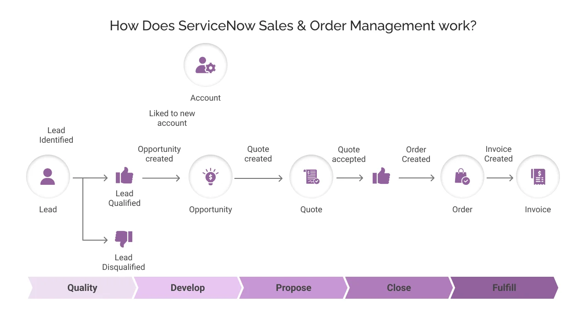
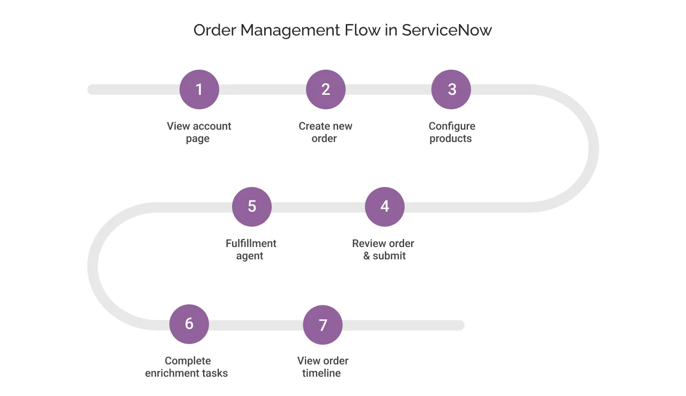
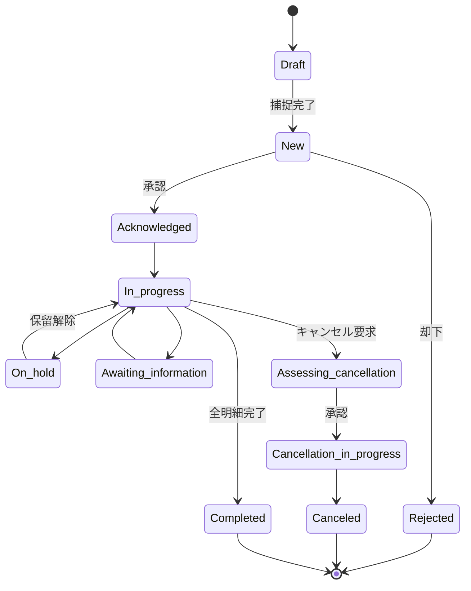
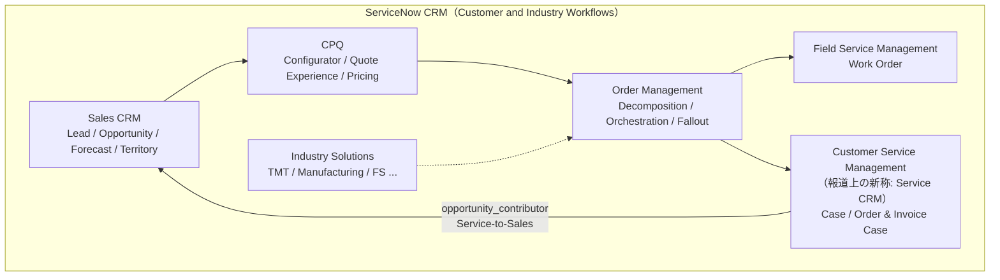

# Sales and Order Management（CRM）／Sales Customer Relationship Management（Sales CRM）

## 概要

**Sales Customer Relationship Management（Sales CRM、販売顧客関係管理）** は、ServiceNow が提供する B2B 向けの販売〜受注〜フルフィルメント領域の製品群である。リード（Lead）から商談（Opportunity）、見積（Quote）、受注（Order）、フルフィルメント、請求・受注後オペレーション、契約更新までの「Lead-to-Cash（リードから入金まで）」を、フロント・ミドル・バックオフィスを 1 つのプラットフォーム上でつなぐことを狙う。[出典](https://www.servicenow.com/docs/r/australia/order-management/som-exploring.html)

- **名称変更（Australia）:** 従来の **Sales and Order Management（SOM）** は Australia で **Sales Customer Relationship Management（Sales CRM）** に改称された。製品タクソノミーの整理に伴う名称変更であり、機能や既存顧客の設定、エンタイトルメント（利用権）に変更はないと公式リリースノートは明記している。[出典](https://www.servicenow.com/docs/r/IDeOjpA1hzonPLWG~inEpg/dNq9KmmolOIubViVcWolZQ)
- **AI 製品の改称（Australia）:** Now Assist for Sales Force Automation / CPQ / Order Management は、それぞれ **ServiceNow Otto for Sales Automation / Configure, Price, Quote (CPQ) / Order Management** に改称された（ServiceNow Otto ブランドへの統合）。[出典](https://www.servicenow.com/docs/r/IDeOjpA1hzonPLWG~inEpg/dNq9KmmolOIubViVcWolZQ)
- **CPQ:** 2025 年に買収した Logik.ai の CPQ 技術を基盤とする **ServiceNow CPQ**（Configurator、Transaction Manager／ServiceNow Quote Experience、Commerce Logic Engine 等）が Sales CRM に統合されている。[出典](https://www.servicenow.com/docs/r/35dlqBTUtpT5W39aSiHI6w/gNAuVaKaDC6FAYRBRd5SBg)
- ドキュメント上の公式バンドル名は「Sales Customer Relationship Management」で、URL パスは歴史的経緯から `order-management` が使われている（`https://www.servicenow.com/docs/r/australia/order-management`）。[出典](https://www.servicenow.com/docs/r/HGDW_sLOfs0QXhKu64QAng/MGsflnD~J3OLNSLyLZUkuQ)

本ファイルの範囲は、Sales Automation（Lead／Opportunity 等）、CPQ（構成・価格・見積）、Order Management（受注〜フルフィルメント）、Lead-to-Cash 基盤（Product Catalog・Pricing）、および ServiceNow の CRM 戦略である。サービス（ケース管理）側は [Customer Service Management](./customer-service-management.md)、フィールド作業は [Field Service Management](./field-service-management.md)、通信業界向けの TMT バリアントは [業界向けソリューション](../industry/industry-solutions.md) を参照。

> **Brazil での変更:** Brazil の Sales CRM リリースノートに列挙されたアプリケーションは CRM API Core、CRM Core、CRM Outlook Add-in、Customer Contracts and Entitlements、Customer Engagement Sequences、Customer self-service for Sales CRM、Opportunity Management、Partner Relationship Management、Pricing Management、Product Catalog Management、Sales Agreement、Sales CRM Mobile、ServiceNow Quote Experience。基盤アプリの改称として **Lead to Cash Core → CRM Core**、**Sales and Services API Core → CRM API Core** が行われた。[出典](https://www.servicenow.com/docs/r/7GoNY9eeDRD0FzxldbEmXw/QGaa1qTL7POfbraVV61GBQ) [出典](https://www.servicenow.com/docs/r/delta-australia-brazil/brazil-australia-crmcore-release-notes.html) [出典](https://www.servicenow.com/docs/r/delta-australia-brazil/brazil-australia-crmapicore-release-notes.html)

---

## 1. 名称と位置づけの変遷

| 時期 | 名称・出来事 | 補足 |
|---|---|---|
| 〜Washington DC / Xanadu | CSM の拡張として Order Management（通信向け TMT 由来）、Quote Management、Opportunity Management、Lead Management 等が Store アプリとして順次提供 | Opportunity Management のリリースノートは Washington DC 版から存在する [出典](https://www.servicenow.com/docs/r/washingtondc/release-notes/opportunity-management-rn.html) |
| Yokohama（2025-03） | 「Sales and Order Management（SOM）」として CRM 領域を本格的に打ち出し | Constellation Research は Yokohama で CRM へ大きく踏み込んだと評している【第三者情報】[出典](https://www.constellationr.com/insights/news/servicenow-acquires-logikai-it-steps-crm-efforts) |
| 2025-04 | Logik.ai（AI 駆動 CPQ）の買収を発表 | 条件非公表で発表 [出典](https://www.constellationr.com/insights/news/servicenow-acquires-logikai-it-steps-crm-efforts) |
| 2025-05-30 | Logik.io Inc. の買収完了 | SEC 10-Q（FY2025 Q3）によれば購入対価総額は約 5.06 億ドル（大半が株式）[出典](https://www.sec.gov/Archives/edgar/data/1373715/000137371525000309/now-20250930.htm) |
| 2025-09-30 | 「Autonomous CRM」構想（AI Experience 発表と同時）| Lead、Sales、CPQ、Field Service、Customer Service を対象【第三者情報】[出典](https://www.nojitter.com/ai-automation/servicenow-unveils-ai-experience-focus-on-crm) |
| Australia（2026-05 GA） | SOM → **Sales CRM** に改称、Now Assist → **ServiceNow Otto** に改称 | 機能・設定に変更なし [出典](https://www.servicenow.com/docs/r/IDeOjpA1hzonPLWG~inEpg/dNq9KmmolOIubViVcWolZQ) |
| 2026-05-05（Knowledge 2026） | Day 1 基調講演で Autonomous CRM for Sales、Autonomous CRM for Service、Configure, Price, Quote（CPQ）を CRM スイートとして発表。業界向けの Autonomous CRM for Industries も提示 | 公式ブログ・プレスリリース [出典](https://www.servicenow.com/uk/blogs/2026/knowledge-2026-welcome-agentic-business) [出典](https://www.businesswire.com/news/home/20260505237676/en/)。業界向けは第 12.1 節参照 |
| Brazil | Lead to Cash Core → CRM Core、Sales and Services API Core → CRM API Core | [出典](https://www.servicenow.com/docs/r/delta-australia-brazil/brazil-australia-crmcore-release-notes.html) |

---

## 2. Sales CRM を構成するアプリケーション（Australia）

### 2.1 機能領域別アプリケーション一覧

Sales CRM の公式「Exploring」ページ（Australia）は、アプリケーションを以下の領域に分類している。[出典](https://www.servicenow.com/docs/r/australia/order-management/som-exploring.html)

| 領域 | アプリケーション | 概要 |
|---|---|---|
| Sales Automation（営業自動化） | Lead Management（リード管理） | リードを作成し、商談へ育成する |
| | Customer Engagement Sequences（顧客エンゲージメントシーケンス） | チャネル横断の自動・手動エンゲージメント活動をプレイブック化 |
| | Buying Group（購買グループ） | 商品ファミリー購入に関わる顧客側の意思決定者を追跡 |
| | Opportunity Management（商談管理） | 潜在的な販売機会を識別・追跡し、製品レコメンドを生成 |
| | Sales Forecasting（売上予測） | 商談・履歴・パイプラインから将来の売上を予測 |
| | Sales Territory Management（販売テリトリー管理） | 地域・製品・業種でアカウント、リード、商談、消費者をセグメント化 |
| | Activity Management（活動管理） | メール、電話、会議、デモ等のやり取りを計画・記録・追跡 |
| CPQ（構成・価格・見積） | CPQ Configurator | Sales CRM トランザクション内でカスタマイズ可能な製品を構成・価格設定 |
| | Configurator | Opportunity／Quote／Order Management に組み込まれる構成 UI |
| | Product Offering Recommendations | 見積中のアップセル／クロスセル提案 |
| | Pricing Management（価格管理） | 価格表、コンテキスト依存の価格制御、外部価格エンジン連携（任意） |
| | ServiceNow Quote Experience | 見積の作成・価格設定・承認・完了（手動／自動） |
| | Advanced Approval Management（高度な承認管理） | 見積等のエンティティの承認ワークフローを定義 |
| | Customer Contracts and Entitlements | オファーから確定までの契約・エンタイトルメント管理（CSM 区分） |
| | Sales Agreement Management（販売契約管理） | 品目・数量・価格・条件・有効期間を含む売買契約を記録 |
| Order Management（受注管理） | Order Management | 受注の捕捉〜フルフィルメント（分解、エンリッチメント、オーケストレーション、ワークスペース、顧客ポータル） |
| Order Operations（受注オペレーション） | Order Operations Case Management | 顧客の受注・請求に関するケース |
| | Lead-to-Cash Process Management | 営業マネージャー向けに販売データ・活動を統合表示 |
| | Return Merchandise Authorization（RMA、返品承認） | 導入済製品の返品・交換・返金・修理ケース |
| Post-Sales Engagement（販売後） | Customer Life Cycle Management Workflows | 販売済製品の Move／Add／Change／Disconnect（MACD）ワークフロー |
| Partner Relationship Management | Partner Relationship Management（PRM） | チャネルパートナーの採用・エンゲージメント |
| Lead-to-Cash Foundation（基盤） | Product Catalog Management（製品カタログ管理） | オファリングをカタログ・カテゴリに整理。商用カタログが商談・見積・受注に供給される |
| | Lead to Cash Core | Sales CRM ワークフロー、エンティティ設定・マッピングの基盤（Brazil で CRM Core に改称） |
| Business Portal | Customer self-service for Sales CRM | B2B 顧客が受注・請求・見積依頼を作成・管理し、問題を登録 |

Sales Forecasting、Sales Territory Management、Customer Engagement Sequences、Buying Group、Activity Management、Partner Relationship Management のプラグイン ID・ロール・リリース別変更は第 4.5 節を参照。

### 2.2 Australia で新規追加・強化されたアプリケーション

Australia の Sales CRM リリースノートは、各アプリケーションのステータスを以下のように示している。[出典](https://www.servicenow.com/docs/r/IDeOjpA1hzonPLWG~inEpg/dNq9KmmolOIubViVcWolZQ)

| アプリケーション | Australia でのステータス |
|---|---|
| Activity Management | 新規 |
| Advanced Approval Management | 新規 |
| Advanced Approval Management AI（MCP 互換クライアントから自然言語で見積承認） | 新規 |
| Buying Group | 新規 |
| CPQ（Configure, Price, Quote） | （ステータス記載なし。属性ベースの構成エンジンとして説明されるのみ。Australia の新機能は CPQ リリースノート＝第 6.3 節参照） |
| Customer Engagement Sequences | 強化 |
| Customer Self-Service（Business Portal） | 強化 |
| Lead Management／Opportunity Management／Order Management／Quote Management | 強化 |
| Partner Relationship Management | 強化 |
| Customer Contracts and Entitlements | 強化 |
| Product Catalog and Pricing Management | 強化 |
| Sales Forecasting／Sales Territory Management | 強化 |

関連して、Case Management for Order Operations／Invoice Operations により受注・請求ケースとケース明細を **CRM Workspace** に表示でき、ケースから複数の受注明細を参照できる。[出典](https://www.servicenow.com/docs/r/IDeOjpA1hzonPLWG~inEpg/dNq9KmmolOIubViVcWolZQ)

### 2.3 Lead-to-Cash の全体フロー

**図 1: Sales and Order Management の Lead-to-Cash フロー（第三者による概念図）**
画面ではなく概念図。左から Lead（リード）→ Lead Qualified（適格化。不適格なら Lead Disqualified）→ Opportunity（商談作成。新規 Account にリンク）→ Quote（見積作成）→ Quote accepted（見積受諾）→ Order（受注作成）→ Invoice（請求書作成）の流れを示し、下段に Quality（適格化）→ Develop（育成）→ Propose（提案）→ Close（成約）→ Fulfill（履行）のフェーズ帯が描かれている。
出典: Cyntexa「ServiceNow Sales and Order Management: Everything You Need to Know」 https://cyntexa.com/blog/servicenow-sales-order-management-everything-you-need-to-know/ （取得日: 2026-11-02）【第三者情報】

公式ドキュメントでは、Lead-to-Cash を「リード・商談 → 見積 → 受注捕捉 → フルフィルメント → 請求・Order-to-Cash オペレーション → 販売後の変更・契約更新」と説明している。[出典](https://www.servicenow.com/docs/r/australia/order-management/som-exploring.html)

```mermaid
flowchart LR
  L[Lead<br/>sn_lead_mgmt_core_lead] -->|Qualify / Convert| O[Opportunity<br/>sn_opty_mgmt_core_opportunity]
  O -->|Create Quote| Q[Quote<br/>sn_quote_mgmt_core_quote]
  Q -->|Approval<br/>Advanced Approval Mgmt| QA[Approved Quote]
  QA -->|Create Order<br/>全体 or 選択した上位明細| CO[Customer Order<br/>sn_ind_tmt_orm_order]
  CO -->|Decomposition| DO[Domain Orders<br/>Product / Service / Resource]
  DO --> T[Order Tasks / Work Orders]
  T -->|Completed| PI[Product Inventory<br/>Contracts / Entitlements]
  PI -->|MACD / Renewal| O
```

### 2.4 ペルソナ

公式ドキュメントが挙げる Sales CRM のペルソナは以下のとおり。[出典](https://www.servicenow.com/docs/r/australia/order-management/som-exploring.html)

| 区分 | ペルソナ |
|---|---|
| Sales | Sales agent、Account executive、Sales development representative（SDR）、Sales manager、Sales leadership、Sales representative、Sales operations team、Sequences admin、Sales territory administrator |
| CPQ・価格 | Sales and order agent、Pricing administrator / manager、Product catalog administrator / manager、Business operations manager |
| 承認 | 営業・財務・法務チームのメンバー |
| 受注・フルフィルメント | Order agent、Fulfillment agent、Agent manager、Fulfillment manager |
| 受注オペレーション | Order case agent、Invoice case agent、Customer service agent |
| パートナー・顧客 | Channel partner、B2B customer |
| 管理者 | 各アプリケーションの設定を行う admin |

---

## 3. 共通ロール（Sales 系ペルソナロール）

Sales CRM のロール割り当てドキュメント（Zurich 版で確認）では、アプリ横断の Sales 系ペルソナロールとして以下が定義されている。Australia 版ページは公開 URL で取得できなかったため、Zurich 版の記載に基づく。[出典](https://www.servicenow.com/docs/r/IgYhkFXjkqOTLI_WLJDH4Q/NqsBFDV1J50g2oOc~AIx1g)

| ロール | 名前 | 概要 |
|---|---|---|
| Sales Agent（営業担当） | `sn_sales_common.sales_agent` | 商談を育成し成約に導く。商談の作成・参照・更新。見積の管理 |
| Sales Manager（営業マネージャー） | `sn_sales_common.sales_manager` | オープン商談をレビューし営業担当に割り当て。見積を担当者／チームに割り当て |
| Sales Operations Specialist（営業オペレーション担当） | `sn_sales_common.sales_ops_specialist` | 営業プロセスの効率・精度改善。営業プロセスを設定 |

> 注: 同ドキュメントの Lead Management 表では「Sales Agent」の ID が `sn_sales_common.sales_manager` と記載されており、ドキュメントの誤記の可能性がある。実機の `sys_user_role` で確認すること。

各アプリケーションの粒度の細かいロール（granular role）は後述の各章に記す。多くのアプリに `*_responsibility_read_granular` / `*_responsibility_write_granular` という **Responsibility framework（責任フレームワーク）** 経由のアクセスロールがあり、テリトリーや商談チームのメンバーシップに応じたレコード単位のアクセス制御に用いられる。[出典](https://www.servicenow.com/docs/r/HGDW_sLOfs0QXhKu64QAng/uNk6tMiN7bxxwiIrQnj2MA)

---

## 4. Lead Management（リード管理）

### 4.1 概要

Lead Management（リード管理）は、見込み客（リード）を作成し、商談（Opportunity）へ育成・転換するアプリケーションである。リードは「営業担当が顧客との会話を始めるための最小限のデータ」と位置づけられ、適格化されたリードから商談が作られる。[出典](https://www.servicenow.com/docs/r/order-management/opportunity-management.html)

### 4.2 Lead Management のテーブル（Australia）

[出典](https://www.servicenow.com/docs/r/HGDW_sLOfs0QXhKu64QAng/QOwJCx4MhSbso6TtEE5FJQ)

| ラベル | テーブル名 |
|---|---|
| Lead（リード） | `sn_lead_mgmt_core_lead` |
| Lead Line Item（リード明細） | `sn_lead_mgmt_core_lead_line_item` |
| Lead Task（リードタスク） | `sn_lead_mgmt_core_lead_task` |
| Lead Needs（リードニーズ） | `sn_lead_mgmt_lead_needs` |

### 4.3 Lead Management のロール（Australia）

[出典](https://www.servicenow.com/docs/r/HGDW_sLOfs0QXhKu64QAng/QOwJCx4MhSbso6TtEE5FJQ)

| ロール名 | 概要 | 包含ロール |
|---|---|---|
| `sn_lead_mgmt_core.lead_viewer` | Lead／Lead Line Item の参照 | `sn_csm_ctxrul_mgt.context_variable_viewer`、`sn_prd_pm.product_catalog_viewer`、`canvas_user`、`sn_csm_ctxrul_mgt.rule_matrix_viewer` |
| `sn_lead_mgmt_core.lead_writer` | Lead／Lead Line Item の書き込み | `sn_lead_mgmt_core.lead_viewer` |
| `sn_lead_mgmt_core.lead_agent` | Lead と関連テーブルの CRUD | `sn_customerservice.csm_workspace_user`、`lead_writer`、`sn_meeting_mgmt.meeting_creator`、`sn_crm_touchpoint.touchpoint_writer` |
| `sn_lead_mgmt_core.lead_admin` | Lead テーブルの CRUD（管理） | `sn_crm_touchpoint.admin`、`lead_agent`、`lead_integrator` |
| `sn_lead_mgmt_core.lead_integrator` | Lead REST API 呼び出し | `sn_crm_touchpoint.touchpoint_writer`、`lead_writer`、`sn_meeting_mgmt.meeting_creator` |
| `sn_lead_mgmt_core.lead_responsibility_read_granular` | Responsibility framework 経由の参照 | なし |
| `sn_lead_mgmt_core.lead_responsibility_write_granular` | Responsibility framework 経由の書き込み | `lead_responsibility_read_granular` |

- Lead の API 処理はスクリプトインクルード `LeadAPIProcessUtilOOB`（スコープ付き）で提供され、`sn_lead_mgmt_core` プラグインと `lead_integrator` ロールが前提となる。[出典](https://www.servicenow.com/docs/r/api-reference/server-api-reference/LeadAPIProcessUtilOOBAPI.html)
- AI 機能として **Sales Development AI Agents**（`com.sn_sd_ai_agents`）によるエージェント型のリード育成がある（第 9 章）。[出典](https://www.servicenow.com/docs/r/order-management/ai-capabilities-sales-crm.html)

> **Brazil での変更:** Lead Management は Brazil で新機能なし（Yokohama→Brazil の差分としてはタスクをタッチポイントに紐づけ、リード転換までのエンゲージメントを追跡する機能が挙げられている）。なお Zurich→Brazil 差分ページに記載のある CRM Touchpoints の responsibility read/write granular ロールは、Australia→Brazil 差分ページでは Australia の新機能として掲載されている（第 4.5.5 節）。[出典](https://www.servicenow.com/docs/r/delta-zurich-brazil/brazil-zurich-leadmanagement-release-notes.html) [出典](https://www.servicenow.com/docs/r/delta-zurich-brazil/brazil-zurich-activitymanagement-release-notes.html) [出典](https://www.servicenow.com/docs/r/delta-australia-brazil/brazil-australia-activitymanagement-release-notes.html)

### 4.5 その他の Sales Automation アプリ

Sales Automation 領域の Lead／Opportunity 以外のアプリケーションについて、公開ドキュメントで確認できたアプリケーション ID・ロール・テーブルと Australia／Brazil の変更をまとめる。各アプリは ServiceNow Store から申請して導入する。確認できなかった項目は「公開情報では確認できず」と記す（第 15 章にも列挙）。

#### 4.5.1 Sales Forecasting（売上予測）

Sales Forecasting は、商談とパイプライン分析のデータから将来の販売量・売上を予測するアプリケーションである。[出典](https://www.servicenow.com/docs/r/HGDW_sLOfs0QXhKu64QAng/U9CULp~XGP85wEC7DeLRFA)

| 項目 | 内容 |
|---|---|
| プラグイン | `com.snc_sales_forecasting`（依存: `com.snc_app-l2c-core`、`com.snc_app-prd-pm`、`com.snc_app_l2c_oppty_mgmt`、`com.snc_app-tmt-core`）。ノルマ（Quota）管理は `com.sn_sales_quota_application`（営業チーム階層の担当者にノルマ目標を割り当て）[出典](https://www.servicenow.com/docs/r/HGDW_sLOfs0QXhKu64QAng/U9CULp~XGP85wEC7DeLRFA) |
| 予測カテゴリ（Forecast category） | Commit、Strong Upside、Upside、Pipeline（パイプラインの確度段階）。新規商談の Forecast Category の既定値は Pipeline [出典](https://www.servicenow.com/docs/r/HGDW_sLOfs0QXhKu64QAng/rVjDbfjWj21HxQajBWaTBA) |
| 予測モデル（Forecast model） | 1 つまたは 2 つの階層（例：テリトリーと製品ファミリー）を含められる。Hierarchy Forecast は商談合計から算出される値、Final Forecast はマネージャー／営業担当が手動調整（Owner Adjusted Value と理由を入力）した値。調整は一次・二次階層を通じてロールアップされる [出典](https://www.servicenow.com/docs/r/HGDW_sLOfs0QXhKu64QAng/rVjDbfjWj21HxQajBWaTBA) |
| 提出（Submission） | モデルで Submission Required が選択されている場合のみ Submit Forecast が表示され、提出後の値は変更不可（当該提出ウィンドウ内であれば再オープン・再提出が可能）[出典](https://www.servicenow.com/docs/r/HGDW_sLOfs0QXhKu64QAng/rVjDbfjWj21HxQajBWaTBA) |
| 可視性 | Forecast Admin、Forecast Analyst、最上位グループのオーナーは全グループ・チームを参照でき、営業担当・マネージャーは自分以下の階層／テリトリーのみ参照できる [出典](https://www.servicenow.com/docs/r/HGDW_sLOfs0QXhKu64QAng/rVjDbfjWj21HxQajBWaTBA) |
| テーブル | 公開情報では確認できず |

**Sales Forecasting のロール**（Zurich 版 Configure ページで確認。Australia 版ページにはロール表の記載なし）[出典](https://www.servicenow.com/docs/r/IgYhkFXjkqOTLI_WLJDH4Q/V_5~8NSSXXcbtRKllPZNfw)

| ロール名 | 概要 |
|---|---|
| `sn_sales_forecast.forecast_admin` | 階層・営業チームの設定、予測設定と予測計算の開始、予測カテゴリ選択肢・予測モデルの作成・編集 |
| `sn_sales_forecast.forecast_analyst` | 全予測項目、予測カテゴリ、予測モデル、関連商談の参照 |
| `sn_sales_forecast.forecast_viewer` | 自分と配下の予測データの参照 |
| `sn_sales_forecast.adjustment_viewer`／`adjustment_writer` | 調整レコードの参照（自分と配下）／編集（自分所有分） |
| `sn_sales_forecast.submission_viewer`／`submission_writer` | 提出レコードの参照（自分と配下）／編集（自分所有分） |
| `sn_quota_core.quota_admin` | 営業チーム・個人のノルマの作成・インポート・編集・削除 |
| `sn_quota_core.quota_manager` | グループのノルマの編集 |
| `sn_quota_core.quota_owner` | 自分に割り当てられたノルマの参照 |

**リリース別変更** [出典](https://www.servicenow.com/docs/r/m4LmCVvkm6_8u3nlIuep5Q/L0Kl0Upl99UYOblvcIsLWA) [出典](https://www.servicenow.com/docs/r/delta-australia-brazil/brazil-australia-salesforecasting-release-notes.html)

| リリース | 変更 |
|---|---|
| Zurich | 予測調整（Modify forecast adjustments）、最終予測の提出とロック（Submit final forecast）、地域別のテリトリー階層設定 |
| Australia | リアルタイムのロールアップ再計算、Forecast Owner／Rollup Owner の設定、**最大 10 個の予測モデル**、1 モデル内での週次・月次・四半期の複数期間ロールアップ、製品ファミリーを二次階層とする予測、商談・商談明細レベルでの予測（base forecast source）、予測の再提出、ダッシュボード列のカスタマイズ |
| Brazil | 更新なし（Australia→Brazil 差分ページ） |

#### 4.5.2 Sales Territory Management（販売テリトリー管理）

Sales Territory Management は、アカウント、消費者（Consumer）、リード、商談を地域・製品・業種のセグメント（テリトリー）に分け、条件に基づいて振り分けるアプリケーションである。[出典](https://www.servicenow.com/docs/r/order-management/explore-sales-territory-management.html)

| 項目 | 内容 |
|---|---|
| プラグイン | `com.sn_sales_territory`（基盤の Territory Planning を拡張するテリトリーテーブル・API、Responsibility Framework 経由で CRM エンティティへのアクセスを与えるロール、割り当てルールを非同期実行する Sales CRM Tracker を提供）。依存: CRM Territory Extensions（`com.sn_tp_crm_extn`）、Sales Common（`com.sn_l2c_sales_common`）、Lead to Cash Core（`com.snc.l2c_core`）[出典](https://www.servicenow.com/docs/r/IgYhkFXjkqOTLI_WLJDH4Q/ION8Q_0JiQwBVnyugUsO~A)（Zurich 版） |
| 割り当て方式 | 管理者が **Run Assignment** で条件に基づき自動配分するか、Primary territory（主テリトリー）を手動更新する。割り当てルールのアルゴリズムは Sales CRM Tracker で非同期実行される [出典](https://www.servicenow.com/docs/r/IgYhkFXjkqOTLI_WLJDH4Q/ION8Q_0JiQwBVnyugUsO~A) |
| ロール（表示名） | Sales Territory Admin（テリトリーと CRM エンティティの管理・参照）、Sales Territory Viewer（テリトリーの参照）、Sales Territory Manager（テリトリー階層のメンバーとその役割の管理）[出典](https://www.servicenow.com/docs/r/order-management/explore-sales-territory-management.html)、Sales Territory Member（Australia で追加。Lead／Opportunity／Account／Consumer に紐づくテリトリーの参照）。ロールの技術名（`sys_user_role` 上の名前）は公開情報では確認できず |
| テーブル | 公開情報では確認できず（FSM の Territory Planning とは別製品である点に注意） |

| リリース | 変更 |
|---|---|
| Australia | プラグイン有効化で **Sales Territory Member** ロールが導入され、割り当てられたテリトリー内での販売活動（所有・責任の明確化、テリトリーに基づく CRM レコード割り当て）を支援 [出典](https://www.servicenow.com/docs/r/IDeOjpA1hzonPLWG~inEpg/b~38ubF9gJVEnHSrSqmKaQ) |
| Brazil | 更新なし [出典](https://www.servicenow.com/docs/r/delta-australia-brazil/brazil-australia-salesterritorymanagement-release-notes.html) |

#### 4.5.3 Customer Engagement Sequences（顧客エンゲージメントシーケンス）

Customer Engagement Sequences は、関係の各段階でリード・顧客にチャネル横断で働きかける自動・手動活動のプレイブックである。シーケンスは Workflow Studio のアクティビティピッカーで構成する。[出典](https://www.servicenow.com/docs/r/australia/order-management/som-exploring.html) [出典](https://www.servicenow.com/docs/r/delta-australia-brazil/brazil-australia-customerengagementsequences-release-notes.html)

| 項目 | 内容 |
|---|---|
| プラグイン | `com.sn_crm_sequence`。メールベースのシーケンスで相手の返信を検知するには User Mailbox Integration（`com.glide.email.user_mailbox.integration`）が必要 |
| ロール | シーケンスの作成・管理を system admin 以外に委ねるには delegated developer ロールを割り当てる（具体的なロール名は公開情報では確認できず） |
| テーブル | 公開情報では確認できず |
| Australia | Workflow Studio のアクティビティピッカーで Schedule call アクティビティに「Schedule call - Deprecated」ラベルが表示されるようになった。既存シーケンスは動作するが、実行時に Callback number フィールドのクリック発信アイコンが表示されないため、新しい Schedule call アクティビティへの更新が必要 |
| Brazil | **Lead nurturing email sequence**（メールアドレスを持つリードへのメール送信とフォローアップを自動化。サンプルシーケンス付き。返信がなければ 2 回の架電にエスカレーションし、どのチャネルでも反応がなければリードの作業メモを更新） |

[出典](https://www.servicenow.com/docs/r/delta-australia-brazil/brazil-australia-customerengagementsequences-release-notes.html)

#### 4.5.4 Buying Group（購買グループ）

Buying Group は、製品ファミリーの購入に関与する顧客側の関係者を表し、商談の前・中・後を通じて保持される。[出典](https://www.servicenow.com/docs/r/australia/order-management/som-exploring.html)

| 項目 | 内容 |
|---|---|
| Australia（新規） | アカウント内で製品ファミリー／ソリューションごとに別々の購買グループを作成、異なる役割を持つメンバーの追加、1 つの商談への複数購買グループの関連付け |
| Brazil | 更新なし |
| アプリケーション ID・ロール・テーブル | 公開情報では確認できず |

[出典](https://www.servicenow.com/docs/r/delta-australia-brazil/brazil-australia-buyinggroup-release-notes.html)

#### 4.5.5 Activity Management（活動管理）

Activity Management は、メール、会議、電話、デモなどの顧客とのやり取りを計画・実行・記録・追跡するアプリケーションで、Australia で新規提供された。CRM Outlook Add-in と CRM Touchpoints の 2 つの Store アプリで構成される。[出典](https://www.servicenow.com/docs/r/7GoNY9eeDRD0FzxldbEmXw/NtzgsWoKkT0B9nKyzrSBoA) [出典](https://www.servicenow.com/docs/r/delta-australia-brazil/brazil-australia-activitymanagement-release-notes.html)

| 項目 | 内容 |
|---|---|
| プラグイン | CRM Outlook Add-in（`com.sn_crm_outlook`）、CRM Touchpoints（`com.sn_crm_touchpoint`）。Activity Management でメール機能を使うには User Mailbox Integration（`com.glide.email.user_mailbox.integration`）も必要 [出典](https://www.servicenow.com/docs/r/XzDjF8RvmMBEjp6Jeus6wg/siAe2Avu3MWycgHv5DzolQ) |
| CRM Outlook Add-in | Outlook からメールを既存のリード・商談・アカウント・連絡先に関連付け、一致がなければメールから新規リード・連絡先を作成。AI Search による関連レコード推奨、スレッド内メールの自動関連付け |
| CRM Touchpoints | メール・電話・オンライン／対面会議・ソーシャルのエンゲージメントをリード・商談・アカウント・連絡先に記録。既定のタッチポイント種別（discovery、demo、customer business review）以外の種別を定義でき、主要チャネルや所要時間などを計測 |
| ロール | `sn_crm_touchpoint.admin`、`sn_crm_touchpoint.touchpoint_writer`（Lead／Opportunity の包含ロールとして確認、第 4.3・5.4 節）。Australia で CRM Touchpoints responsibility read granular／write granular ロール（表示名）が追加され、テリトリーメンバーや商談チームメンバーが参照できるタッチポイントをレコード単位で絞り込める（技術名は公開情報では確認できず） |
| AI | AI sales activity association（`com.sn_act_assoc_agent`）が受信した営業メールを適切な CRM レコードに関連付ける（第 9.2 節） |
| テーブル | 公開情報では確認できず |
| Brazil | 更新なし（Australia→Brazil 差分ページ） |

#### 4.5.6 Partner Relationship Management（PRM、パートナー関係管理）

Partner Relationship Management は、企業がチャネルパートナーを採用・関与させて自社製品・サービスを販売するためのアプリケーションである。[出典](https://www.servicenow.com/docs/r/australia/order-management/som-exploring.html)

| 項目 | 内容 |
|---|---|
| プラグイン | `com.snc.partner_relationship_management`。[出典](https://www.servicenow.com/docs/r/HGDW_sLOfs0QXhKu64QAng/IAkrdLQgzS3QhQI44ec7eA)。Deal Registration（案件登録）は別プラグイン `com.snc.deal_registration_management`（Zurich 版の Roles and components of Deal Registration Management ページ）[出典](https://www.servicenow.com/docs/r/IgYhkFXjkqOTLI_WLJDH4Q/AZ_bpg4xUrssRMAYKYiVLg) |
| 機能ロール | `sn_prm.enterprise_partner_admin`（パートナー企業の管理者）、`sn_prm.enterprise_partner_rel_manager`（パートナー階層に紐づくケースを管理する社内担当）、`sn_prm.enterprise_partner_agent`（パートナーケースを解決する社内担当）、`sn_prm.external_partner_manager`／`sn_prm.external_partner_associate`（ポータルでケースを報告するパートナー側担当） |
| 粒度ロール | `sn_prm.channel_partner_writer`、`sn_prm.partner_program_writer`、`sn_prm.partner_program_rel_writer`、`sn_prm.partner_data_viewer`（チャネルパートナー・パートナープログラム・プログラム関係テーブルの参照）、`sn_prm.partner_ui`（PRM モジュール表示用。他ロールへ手動で継承させる）、`sn_prm.program_segment writer`（原文どおりスペースを含む。誤記の可能性があり実機で要確認） |
| テーブル | `sn_prm_program_segment_mapping`（Program segment mapping）。チャネルパートナー・パートナープログラム等のテーブル技術名は公開情報では確認できず |

[出典](https://www.servicenow.com/docs/r/HGDW_sLOfs0QXhKu64QAng/IAkrdLQgzS3QhQI44ec7eA)

| リリース | 変更 |
|---|---|
| Australia | Deal registration の Advanced Approval Framework 対応（案件属性に基づくルール、低リスク案件の自動承認）、Deal registration タスク管理（Flow Designer で自動作成ルール）、Quote Management for Channel Partners（`com.snc.partner_relationship_management_qm`）、Partner ポータルでの見積作成（`com.sn_quote_self_service`）、Opportunity Management for Channel Partners（`com.snc.partner_relationship_management_oppty`） |
| Brazil | **Register a deal with AI**（Deal Registration AI エージェントが案件の受付・検証・レコード作成を支援）、**Partner criteria for deals**（案件作成時にパートナーがアクセスできるアカウント・消費者を制御するフィルタールール） |

[出典](https://www.servicenow.com/docs/r/delta-australia-brazil/brazil-australia-partnerrelationshipmanagement-release-notes.html)

---

## 5. Opportunity Management（商談管理）

### 5.1 概要

Opportunity Management（商談管理）は、適格化されたリードから作られる詳細な見込み案件（Opportunity）を管理するアプリケーションである。アプリケーション ID は `sn_opty_mgmt` で、`admin` ロールを持つユーザーがインストールできる（未導入の関連 Store アプリ・プラグインも併せて導入される）。[出典](https://www.servicenow.com/docs/r/HGDW_sLOfs0QXhKu64QAng/uNk6tMiN7bxxwiIrQnj2MA)

### 5.2 Opportunity フォームのタブ構成

公式ドキュメント（Brazil 版で確認）は Opportunity レコードのタブを以下のように説明している。[出典](https://www.servicenow.com/docs/r/order-management/opportunity-management.html)

| タブ | 内容 |
|---|---|
| Overview | Account、Sales stage（販売ステージ）、Amount、AI insights、Probability score、ガイド付き販売アクション。ステージ退出条件とプレイブック活動を追跡 |
| Details | 基本情報（Source、Competitor など） |
| Catalog and Needs | プロダクトオファリングと Needs template（ニーズテンプレート）による製品レコメンド |
| Line Items | 製品・サービスの数量と価格 |
| Contacts | 関連する連絡先とその役割 |
| Team and Allocations | チームメンバーと販売クレジットの配分 |
| Quotes | 商談から直接見積を作成 |
| Competitors／Emails／Tasks／Meetings／Touchpoints | 補助レコード |
| Related Channel Partners | 承認済パートナーはフルアクセス、リスト掲載パートナーは追跡のみ |

- 価格エンジンと連携し、既定の価格表（default price list）から単価・合計価格を表示する。
- **Probability to Close（成約確率）** は、成約済み案件で ML モデルを学習させる必要がある（Opportunity Management ML、`sn_opty_mgmt_ml`）。

### 5.3 Opportunity Management のテーブル（Australia）

[出典](https://www.servicenow.com/docs/r/HGDW_sLOfs0QXhKu64QAng/uNk6tMiN7bxxwiIrQnj2MA)

| ラベル | テーブル名 |
|---|---|
| Opportunity（商談） | `sn_opty_mgmt_core_opportunity` |
| Opportunity Task | `sn_opty_mgmt_core_opportunity_task` |
| Opportunity Line Item（商談明細） | `sn_opty_mgmt_core_opportunity_line_item` |
| Opportunity Line Characteristic | `sn_opty_mgmt_core_opportunity_line_characteristic` |
| Opportunity Needs | `sn_opty_mgmt_opportunity_needs` |
| Opportunity Competitor（競合） | `sn_opty_mgmt_core_opportunity_competitor` |
| Opportunity Team Member | `sn_opty_mgmt_core_opportunity_team_member` |
| Opportunity Associated Contact | `sn_opty_mgmt_core_opportunity_associated_contact` |
| Opportunity Stage（商談ステージ） | `sn_opty_mgmt_core_opportunity_stage` |
| Sales Cycle Type（販売サイクル種別） | `sn_opty_mgmt_core_sales_cycle_type` |
| Sales Cycle Stage（販売サイクルステージ） | `sn_opty_mgmt_core_sales_cycle_stage` |
| Opportunity Related Party | `sn_opty_mgmt_core_opportunity_related_party` |
| Opportunity Related Channel Partner | `sn_bus_org_opptym_related_business_organization` |
| Opportunity Allocation（配分） | `sn_opty_mgmt_core_opportunity_allocation` |
| Opportunity Allocation Type | `sn_opty_mgmt_core_opportunity_allocation_type` |
| Opportunity Allocation Dimension | `sn_opty_mgmt_core_opportunity_allocation_dimension` |

販売ステージは **Sales Cycle Type** と **Sales Cycle Stage** で設定データとして定義する方式であり、固定の選択肢（例：Closed Won／Closed Lost）の既定値一覧は公開情報では確認できず。

### 5.4 Opportunity Management のロール（Australia）

[出典](https://www.servicenow.com/docs/r/HGDW_sLOfs0QXhKu64QAng/uNk6tMiN7bxxwiIrQnj2MA)

| ロール名 | 概要 | 主な包含ロール |
|---|---|---|
| `sn_opty_mgmt_core.opportunity_viewer` | Opportunity／Line Item の参照 | `sn_csm_pricing.pricelist_viewer`、`sn_prd_pm.product_catalog_viewer`、`sn_customerservice.customer_data_viewer`、`opportunity_setup_viewer` |
| `sn_opty_mgmt_core.opportunity_writer` | Opportunity／Line Item の書き込み | `opportunity_viewer`、`sn_quote_mgmt_core.quote_writer` |
| `sn_opty_mgmt_core.opportunity_admin` | Opportunity テーブルの CRUD | `sn_meeting_mgmt.meeting_creator`、`sn_nowassist_admin.nsa_admin`、`opportunity_setup_writer`、`opportunity_writer`、`opportunity_allocation_writer`、`sn_crm_touchpoint.admin` |
| `sn_opty_mgmt_core.opportunity_integrator` | 統合レベルの書き込み | `sn_meeting_mgmt.meeting_creator`、`sn_crm_touchpoint.touchpoint_writer`、`opportunity_writer` |
| `sn_opty_mgmt_core.opportunity_contributor` | FSM／CSM エージェントが商談を生成し追跡するための限定権限 | `product_catalog_viewer`、`opportunity_setup_viewer`、`pricelist_viewer`、`customer_data_viewer` |
| `sn_opty_mgmt_core.opportunity_setup_viewer` | Sales Cycle／Opportunity Stage の参照 | なし |
| `sn_opty_mgmt_core.opportunity_setup_writer` | Sales Cycle／Opportunity Stage の参照・作成・書き込み | `opportunity_setup_viewer` |
| `sn_opty_mgmt_core.opportunity_allocation_viewer` / `_writer` | 商談配分の参照／管理 | — |
| `sn_opty_mgmt_core.opportunity_responsibility_read_granular` / `_write_granular` | Responsibility framework 経由のアクセス | — |
| `sn_opty_mgmt_core.opportunity_allocation_responsibility_read_granular` / `_write_granular` | 配分の Responsibility framework 経由アクセス | — |

- `opportunity_contributor` は、CSM／FSM のエージェントがサービス対応中に販売機会を起票する（Service-to-Sales）ためのロールである。CSM 側の詳細は [Customer Service Management](./customer-service-management.md) を参照。
- Opportunity Management for Business Locations（Store アプリ）の後続バージョンでは、該当スクリプト内の `admin` ロール判定が `sn_opty_mgmt_core.opportunity_admin` に置き換えられた。[出典](https://www.servicenow.com/docs/r/store-release-notes/store-rn-csm-opportunity-mgmt-business-locations.html)

---

## 6. CPQ（Configure, Price, Quote）と Quote Management

### 6.1 ServiceNow CPQ の構成要素

ServiceNow CPQ は、属性ベースのロジックで製品構成・価格設定・見積を扱う構成エンジンである。Australia の CPQ リリースノートは構成要素を次のように説明している。[出典](https://www.servicenow.com/docs/r/35dlqBTUtpT5W39aSiHI6w/gNAuVaKaDC6FAYRBRd5SBg) [出典](https://www.servicenow.com/docs/r/IDeOjpA1hzonPLWG~inEpg/dNq9KmmolOIubViVcWolZQ)

| 構成要素 | 説明 |
|---|---|
| CPQ（構成エンジン） | 属性ベースのロジック、動的なブループリント（Blueprint）、Commerce Logic Engine により、部品表（BOM、Bill of Materials）などの出力を生成 |
| Configurator（コンフィギュレーター） | 動的な詳細計画、リアルタイム UI、BOM 出力。Opportunity／Quote／Order Management に組み込まれる |
| Transaction Manager（トランザクションマネージャー） | 製品・価格・ルール・ライフサイクルロジックを 1 つの設定可能な UI に集約する高性能な取引・見積アプリ。**CRM 非依存**で、取引データの System of Record として機能する |
| ServiceNow Quote Experience | Sales CRM 内で見積を作成・管理する見積体験（構成可能なレイアウト、承認、ステージ遷移、受注作成） |
| Smart Predict | 構成値の予測・推奨 |
| Config AI／Transaction AI | 構成・取引に対する生成 AI 支援 |

ServiceNow Quote Experience はモジュラー構成で、ServiceNow Sales CRM だけでなく **他社 CRM、パートナーポータル、独自の販売アプリ** に組み込め、外部の価格・受注管理・文書システムと連携できる。クラウド優先だが、オンプレミスや連邦政府規制対応の実装にも対応するとされる。[出典](https://www.servicenow.com/docs/r/order-management/quoting-experiences-overview.html)

CPQ はもともと Logik.ai が Salesforce 等の上で提供していた製品であり、API ファーストの設計で Salesforce、ServiceNow、下流システムと統合する。Salesforce 連携では生成されるフィールドに名前空間プレフィックスが付き、既定値は `LGK_`（Australia でテナント単位に変更可能になった）。[出典](https://www.servicenow.com/docs/r/35dlqBTUtpT5W39aSiHI6w/gNAuVaKaDC6FAYRBRd5SBg)

【推定】CPQ の管理 UI（CPQ admin UI）は「テナント」単位の設定（tenant setting）を持ち、Now Platform のテーブル群とは別の CPQ 側データストアで構成・取引データを扱う構造と読み取れる。CPQ 側のデータ構造・テーブル名は公開情報では確認できず。

### 6.2 CPQ の主要概念（Using CPQ）

CPQ 利用ガイドの目次から読み取れる主要概念は以下のとおり。[出典](https://www.servicenow.com/docs/r/order-management/cpq-using.html)

| 概念 | 説明 |
|---|---|
| Solution（ソリューション） | 起動された製品がソリューションのルートになる。構成可能製品を子構成として追加できる |
| Solution sidebar | 構成間を移動するサイドバー |
| Configurable product action condition | 条件が false になると子構成が削除される |
| Solution BOM | セッション中の全構成を横断した部品表 |
| Ramped pricing / quantities | 契約期間中の価格・数量の段階的変化（ランプ）を見積明細に追加 |
| 文書生成 | サードパーティ製ソフトウェアが CPQ データを Salesforce にプッシュして文書を生成 |

### 6.3 Australia の CPQ 新機能

Australia の CPQ 新機能は以下のとおり（Australia→Brazil 差分ページで、**Brazil では CPQ のすべてのセクションが「更新なし」**とされている）。[出典](https://www.servicenow.com/docs/r/delta-australia-brazil/brazil-australia-cpq-release-notes.html)

**AI と構成**

| 機能 | 内容 |
|---|---|
| Configuration AI harness | Config AI がフィールド値の選択理由を説明し、タグ付けで管理者ドキュメントに整合、構成失敗を診断・修正提案、ポートフォリオ全体の品質傾向を報告 |
| Config AI A2A support | Agent-to-Agent（A2A）プロトコルで他エージェントが Config AI と通信。テナント設定に基づき自動オンボード／オフボード |
| Config Converse | 管理者が設計したランディングページで、購入者が自然言語で製品を構成。更新時に過去構成を再利用。Smart Predict は **テナントとレイアウトの両方で有効化** が必要 |
| Quote AI Agent | 見積の作成・構成・値引き・顧客コミュニケーションを自動化 |
| Context document uploads／AI Admin Uploads | Excel、Word、PDF、テキスト、Markdown、画像（OCR）をアップロードし、Config AI／Transaction AI に企業固有のコンテキストを与える |
| Transaction AI 自然言語明細管理 | チャットで CSV／XLSX をアップロードし、列マッピング→変更プレビュー→適用／取消。行番号・範囲指定、お気に入り追加、イベント起動、ヘッダー項目更新 |

**製品構成**

| 機能 | 内容 |
|---|---|
| Optional child offerings by date | 公開済定義に、新バージョンを作らずに有効開始日付きで任意特性・子オファリングを追加 |
| MACD for Product Inventory | 複数の在庫品目をまとめてロード・構成・保存（実行時価格付き）。数量は別々の複合 BOM 行として表示 |
| Price and quantity ramps | 定期サブスクリプション製品のランプセグメントを構成。数量変更は有効日からの差分として適用 |
| Source line configuration field mappings | 受信リクエストデータを構成フィールドにマッピング。ブループリントと一緒に、または CSV 単体でインポート／エクスポート |
| Guided setup | 価格、価格ルール、製品バンドルの初期設定を段階的にガイド |
| Node cloning | ソリューション構成ノードをサイドバーから複製（元ノードが有効であること） |
| Dynamic catalog selection | Sales CRM のプロダクトオファリング・仕様・特性値を、sys_id を入力せずに CPQ admin UI から選択 |
| Tenant-configurable namespace prefix | Salesforce フィールドの `LGK_` プレフィックスを独自の名前空間に変更可能 |

**Sales CRM の見積（Quote Experience）**

| 機能 | 内容 |
|---|---|
| Quote Experience | 構成可能なレイアウトで見積を作成・管理し、承認申請、ステージを進めて受注作成へ |
| Approvals | 管理者がステージ・ルール・トリガーを定義（標準の承認エンジンを使用）。承認者はメール・アプリ内・ダッシュボードで通知を受け、承認・却下・委任。エスカレーションとコメント必須化に対応 |
| Opportunity and quote sync | 商談ごとに 1 つの見積を **Primary（主見積）** に指定でき、その明細が商談に同期される。Enable Sync／Disable Sync が見積体験に組み込まれた |
| Order creation from quotes | 見積全体、または選択した上位明細から受注を作成。明細情報は引き継がれる |

**取引・セキュリティ・ユーザビリティ**

| 機能 | 内容 |
|---|---|
| Transaction Access Control | 取引ごとの参照・編集権限。管理者と作成者は自動的にフルアクセスを持ち、他者へのアクセス付与・削除が可能 |
| Bulk line update via file upload | サードパーティのファイルから列・明細を AI でマッピングして一括更新 |
| Event start time in edit history | 取引の編集履歴にイベント開始時刻列 |
| Export Lines UI effect | 現在のソート・フィルタ・列表示を反映して明細を CSV 出力 |
| Layout editor | レイアウト、コンポーネント、UI エフェクト、テーマをビジュアル編集 |
| Shared product favorites | 保存したお気に入り製品・構成を他ユーザーと共有 |
| Smart Predict inline recommendations | 構成レイアウト内に推奨値を表示し、個別またはレイアウト／グループ単位で一括承認・却下 |

**アクセシビリティ・ローカライズ（Australia）**

- ランタイムのキーボード操作、スクリーンリーダー対応、400% ズーム（WCAG 2.2 1.4.10 Reflow 準拠）。
- **CPQ admin UI の日本語化**: 静的ラベル・見出し・システムテキストを日本語表示（未翻訳は英語にフォールバック）、日本語入力対応。公式ドキュメントでは SoftBank のオンボーディングに伴う初期パイロットと説明されている。ユーザー生成コンテンツは原語のまま。言語は ServiceNow プラットフォーム側で選択する。
- プロダクトオファリングのラベル・定義・フィールドテキストはコンパイル時に翻訳される。

**有効化:** 製品・構成の共有機能など一部の新機能は、ServiceNow サポートチケットによる有効化が必要。[出典](https://www.servicenow.com/docs/r/delta-australia-brazil/brazil-australia-cpq-release-notes.html)

### 6.4 Quote Management のテーブル

Quote Management API が書き込むテーブルとして以下が公開されている（Zurich 版 API ドキュメント）。[出典](https://www.servicenow.com/docs/r/MVRCUFVyKWd7vUoUukbW6g/MuxayA2cbNmLa9QPMk6l6w)

| ラベル | テーブル名 |
|---|---|
| Quote（見積） | `sn_quote_mgmt_core_quote` |
| Quote Line Item（見積明細） | `sn_quote_mgmt_core_quote_line_item` |
| Quote Line Characteristic（見積明細特性） | `sn_quote_mgmt_core_quote_line_characteristic` |
| Quote Pricing Adjustment（見積価格調整） | `sn_quote_mgmt_core_pricing_adjustment` |
| Sales Agreement（販売契約） | `sn_sales_agmt_core_sales_agreement` |

見積関連データのテーブルは **Quote Management Data Model** アプリケーションとして提供される。[出典](https://www.servicenow.com/docs/r/store-release-notes/store-rn-som-quote-mgmt-data-model.html)

### 6.5 Quote Management のロール（Australia）

プラグイン「Quote Management」で導入されるロール。[出典](https://www.servicenow.com/docs/r/HGDW_sLOfs0QXhKu64QAng/MGsflnD~J3OLNSLyLZUkuQ)

| ロール名 | 概要 | 包含ロール |
|---|---|---|
| `sn_quote_mgmt_core.quote_viewer` | 見積テーブルの参照 | `sn_bus_loc.ibl_viewer`、`sn_service_org.customer_criteria_read`、`sn_bus_loc.ebl_viewer`、`sn_csm_pricing.pricelist_viewer`、`sn_tmt_core.inbound_queue_read`、`sn_prd_invt.product_inventory_viewer`、`sn_customerservice.customer_data_viewer` |
| `sn_quote_mgmt_core.quote_writer` | 見積テーブルの書き込み | `quote_viewer`、`sn_nb_action.next_best_action_user`、`sn_doc.reader` |
| `sn_quote_mgmt_core.quote_admin` | 見積テーブルの CRUD | `quote_writer` |
| `sn_quote_mgmt_core.quote_integrator` | **CPQ Configurator で見積機能を使うために必要** | `quote_writer` |
| `sn_quote_mgmt_core.quote_responsibility_read_granular` | Responsibility framework 経由の参照 | なし |
| `sn_quote_mgmt_core.quote_responsibility_write_granular` | Responsibility framework 経由の書き込み | `quote_responsibility_read_granular` |

### 6.6 見積の承認（Advanced Approval Management）

Australia で新規提供の **Advanced Approval Management（高度な承認管理）** を使った見積承認の手順は以下のとおり。[出典](https://www.servicenow.com/docs/r/HGDW_sLOfs0QXhKu64QAng/rwbHaBgfDFXxDD~16K8aCg)

1. 見積を開き **Request Approval** をクリックすると、適用ルール・トリガー条件・承認者・ルーティング順序のプレビューが表示される。
2. 修正する場合は **Cancel** → 編集 → 再度 **Request Approval**。
3. プレビューで **Submit**。見積のステータスは **Pending Approval** になり、承認エンジンが最初の承認者にルーティングする。
4. **View Approval** で進捗を確認。全承認者が承認すると完了（Completed）。承認条件に該当しない見積は自動承認される。却下・差し戻しされた見積は修正して再申請できる。

| 項目 | 内容 |
|---|---|
| ロール | `sn_adv_appr_mgmt.approval_request_writer`（申請）、`sn_adv_appr_mgmt.approval_request_approver`（承認） |
| 前提 | 必要プラグインの導入と承認テナント設定の有効化、トリガー条件・ルールを持つ承認設定（approval configuration）の作成、承認ユーザーの定義とルールへの割り当て |
| 承認パネルの状態値 | Pending、Approved、Rejected、Recalled、Completed [出典](https://www.servicenow.com/docs/r/HGDW_sLOfs0QXhKu64QAng/kPYegX6GwJ_zLMakyoCuNg) |
| AI | Advanced Approval Management AI（`sn_adv_apr_mgt_ai`）により、MCP 互換クライアントから自然言語で見積承認を管理 |
| Salesforce 連携 | ServiceNow Quote Experience は Salesforce の承認との統合手順が別途用意されている [出典](https://www.servicenow.com/docs/r/order-management/transaction-manager-integrate-salesforce-approvals.html) |

見積ヘッダーの `state` フィールドの完全な選択肢一覧（Draft、Accepted 等の有無）は公開情報では確認できず。

### 6.7 商談からの見積作成（画面操作）

Australia 版の手順では、**Workspaces > CSM/FSM Configurable Workspace** で商談を選び **Create Quote** を選択して見積を作成する。営業担当（Sales agent）または統合ロールを持つユーザーが実行できる。営業担当は見積から顧客送付用の PDF を生成できる。[出典](https://www.servicenow.com/docs/r/XzDjF8RvmMBEjp6Jeus6wg/cUCAArf46YbT6By0B3lLTQ)

---

## 7. Product Catalog Management と Pricing Management（Lead-to-Cash 基盤）

### 7.1 Product Catalog Management（製品カタログ管理）

Product Catalog Management は、Product Offering（プロダクトオファリング：販売可能な商品）と、その背後の Product／Service／Resource Specification（仕様）を管理する。TM Forum の SID モデルに沿った「Offering と Specification の分離」が特徴で、商用カタログが商談・見積・受注に供給される。[出典](https://www.servicenow.com/docs/r/australia/order-management/som-exploring.html)

**主要テーブル（Australia、全 38 テーブルから抜粋）** [出典](https://www.servicenow.com/docs/r/HGDW_sLOfs0QXhKu64QAng/wGjur4X158hwN5xNicuCOA)

| ラベル | テーブル名 |
|---|---|
| Product Offering | `sn_prd_pm_product_offering` |
| Product Offering Catalog | `sn_prd_pm_product_offering_catalog` |
| Product Offering Category | `sn_prd_pm_product_offering_category` |
| Product Offering Family | `sn_prd_pm_product_offering_family` |
| Product Offering Relationship（バンドル等） | `sn_prd_pm_product_offering_relationship` |
| Product Offering Relationship Group | `sn_prd_pm_product_offering_relationship_group` |
| Product Offering Characteristic | `sn_prd_pm_product_offering_characteristic` |
| Needs Based Offering Recommendation | `sn_prd_pm_product_offering_recommendation` |
| Specification（基底） | `sn_prd_pm_specification` |
| Product Specification | `sn_prd_pm_product_specification` |
| Service Specification | `sn_prd_pm_service_specification` |
| Resource Specification | `sn_prd_pm_resource_specification` |
| Specification Relationship | `sn_prd_pm_specification_relationship` |
| Characteristic／Characteristic Option | `sn_prd_pm_characteristic`／`sn_prd_pm_characteristic_option` |
| Characteristic Group | `sn_prd_pm_configuration` |
| Product Price | `sn_prd_pm_pricing` |
| Distribution Channel | `sn_prd_pm_distribution_channel` |
| Needs Template | `sn_prd_pm_needs_template` |
| Unit of Measure／Class | `sn_prd_pm_uom`／`sn_prd_pm_uom_class` |
| Template | `sn_prd_pm_template` |
| Product Visuals | `sn_prd_pm_visuals` |

**ロール（Australia）**

| ロール名 | 概要 |
|---|---|
| `sn_prd_pm.product_catalog_admin` | オファリング・仕様・特性・特性オプションの CRUD、カタログのインポート／エクスポート、システムプロパティ設定。AI Search 用に `ais_admin` を継承 |
| `sn_prd_pm.product_catalog_manager` | Product／Service／Resource Specification の CRUD |
| `sn_prd_pm.product_catalog_viewer` | 仕様・特性・特性オプションの参照 |
| `sn_prd_pm.characteristics_viewer`／`characteristics_writer` | 特性の参照／書き込み |
| `sn_prd_pm.external_product_viewer` | 外部製品の参照 |
| `sn_prd_pm.product_model_characteristic_viewer`／`_granular_viewer` | 製品モデル特性の参照 |

[出典](https://www.servicenow.com/docs/r/HGDW_sLOfs0QXhKu64QAng/wGjur4X158hwN5xNicuCOA) [出典](https://www.servicenow.com/docs/r/IgYhkFXjkqOTLI_WLJDH4Q/NqsBFDV1J50g2oOc~AIx1g)

TM Forum 準拠の **Product Catalog Open API** は Product Catalog Advanced アプリケーション（Store、`sn_tmf_api` 名前空間）に含まれる。[出典](https://www.servicenow.com/docs/r/eJIqiaxRKVcMaR8XQU6_oA/gkcC2O07dhz_1cQDNazXIg)

### 7.2 Pricing Management（価格管理）

Pricing Management（アプリケーション `sn_csm_pricing`）は、価格表（Price List）、価格表明細（Price List Line）、コストブック、属性による価格調整、コンテキスト変数・ルールマトリクスを扱う価格エンジンである。価格表明細は **Pricing > Price Lists** から価格表を開き、Price List Lines タブで追加する。[出典](https://www.servicenow.com/docs/r/IgYhkFXjkqOTLI_WLJDH4Q/EEAmQKxu68ZZakjODqvMfQ)

**ロール（Australia）** [出典](https://www.servicenow.com/docs/r/HGDW_sLOfs0QXhKu64QAng/0kxhm8z7Cc1~YggPk3AxCw) [出典](https://www.servicenow.com/docs/r/IgYhkFXjkqOTLI_WLJDH4Q/NqsBFDV1J50g2oOc~AIx1g)

| ロール名 | 概要 |
|---|---|
| `sn_csm_pricing_pricelist_administrator` | 価格エンティティの作成・更新・参照、インポート／エクスポート、価格システムプロパティ設定、トランザクションログ参照 |
| `sn_csm_pricing_pricelist_manager` | 価格エンティティの作成・更新・参照 |
| `sn_csm_pricing.pricelist_writer` | 価格エンティティの参照・書き込み・削除（削除は Draft 状態のみ） |
| `sn_csm_pricing.pricelist_viewer` | 価格表、価格表明細、コストブック、コストブック明細の参照 |
| `sales_agreement_pricelist_writer` | Sales Agreement 用価格表・明細のみ書き込み可。Sales Agreement Writer が継承 |
| `sn_csm_pricing.pricing_integrator` | Pricing REST API 経由で価格機能にアクセスする（advanced configurator 使用時に必要） |
| `sn_csm_pricing.pricing_integrator_internal` | CPQ Configurator から Pricing REST API 経由で価格機能にアクセスする。API レート制限の対象外 |

> 注: `sn_csm_pricing_pricelist_administrator`、`sn_csm_pricing_pricelist_manager`、`sales_agreement_pricelist_writer` の 3 ロールは、公式 Components ページ上でスコーププレフィックスの区切りがドットでない、またはプレフィックスがない形で記載されている（原文どおり）。実機の `sys_user_role` で正確な名称を確認すること。

- インストール時に導入が明示されているテーブルは Pricing Plan（`sn_csm_pricing_pricing_plan`）のみで、価格表・価格表明細の物理テーブル名は公開の Components ページでは確認できず。
- 価格計算 API: `POST /api/sn_csm_pricing/{api_version}/pricingengine/computePrice`（要 `sn_csm_pricing.pricing_integrator`）。外部 ID で照会する場合はリクエスト設定に `"use_external_code": true` を指定する。[出典](https://www.servicenow.com/docs/r/zurich/api-reference/rest-apis/csm-pricing-api.html)
- Australia の Order Management では、価格関連の新機能として **Delta pricing on orders（受注の差分価格）**、**Price and quantity ramps on order line items（受注明細の価格・数量ランプ）**、**Derived pricing on order line items（受注明細の派生価格）** が追加された（第 8.6 節）。Delta pricing は、MACD・更新時に既存の製品・契約・購入との差分から価格・数量の変化を算出し、契約種別（contract type）・契約明細種別（contract line type）が空の場合は受注・明細のアクションに基づき既定値を設定する。[出典](https://www.servicenow.com/docs/r/AWjfoG0XNF6COBtQI5zL~A/uvqYzgQ1BQneSc2Rv85Xyw)

### 7.3 Sales Agreement Management（販売契約管理）

Sales Agreement Management は、品目・数量・価格・条件・有効期間を含む売買双方の拘束力ある契約を記録する。[出典](https://www.servicenow.com/docs/r/australia/order-management/som-exploring.html)

| ロール名 | 概要 |
|---|---|
| `sn_sales_agmt_core.sales_agreement_viewer` | 販売契約・明細と関連データ（特性・価格表等）の参照 |
| `sn_sales_agmt_core.sales_agreement_writer` | 販売契約・明細の作成・参照・更新 |

[出典](https://www.servicenow.com/docs/r/IgYhkFXjkqOTLI_WLJDH4Q/NqsBFDV1J50g2oOc~AIx1g)

> **Brazil での変更:** Yokohama→Brazil の差分では、Sales Agreement Management が ServiceNow Store から有効化可能と記載されている（AI 生成要約を含むページのため要確認）。[出典](https://www.servicenow.com/docs/r/delta-yokohama-brazil/brazil-yokohama-salesagreement-release-notes.html)

---

## 8. Order Management（受注管理）

### 8.1 概要とバリアント

Order Management（受注管理）は、エンタープライズ顧客からの製品・サービス受注の捕捉・管理・フルフィルメントを行う。エンリッチメントフロー、ジェパディ（遅延リスク）管理ルール、オーケストレーションワークフロー、販売後の解約・一時停止・再開をサポートする。[出典](https://www.servicenow.com/docs/r/release-notes/order-management-rn.html)（Brazil 版リリースノートの記述）

| バリアント | スコープ | 用途 |
|---|---|---|
| 業界非依存版 | `sn_ind_tmt_orm` | 小売、EC、一般的な B2B 受注 |
| Telecommunications, Media, and Technology（TMT）版 | `sn_om_tmt` | 通信固有ワークフロー、TM Forum API 準拠、ネットワーク在庫連携。公式ドキュメントは、TSM（Telecommunications Service Management）または TPSM（Technology Provider Service Management）のサブスクリプションにより業界固有の製品・サービス向けワークフローを利用できると記載している（TMT 版の利用にサブスクリプションが必須かどうかは公開情報では確認できず） |

[出典](https://www.servicenow.com/docs/r/order-management/explore-order-management.html)

インストールは ServiceNow Store からの申請による。[出典](https://www.servicenow.com/docs/r/release-notes/order-management-rn.html)

### 8.2 受注ライフサイクル

**図 2: Order Management Flow in ServiceNow（第三者による概念図）**
画面ではなく手順図。① View account page（アカウントページを表示）→ ② Create new order（新規受注作成）→ ③ Configure products（製品構成）→ ④ Review order & submit（受注確認・提出）→ ⑤ Fulfillment agent（フルフィルメント担当へ）→ ⑥ Complete enrichment tasks（エンリッチメントタスク完了）→ ⑦ View order timeline（受注タイムライン確認）の 7 ステップを S 字の道筋で示す。
出典: Cyntexa「ServiceNow Sales and Order Management: Everything You Need to Know」 https://cyntexa.com/blog/servicenow-sales-order-management-everything-you-need-to-know/ （取得日: 2026-11-02）【第三者情報】

公式ドキュメントの受注ライフサイクルは以下のとおり。[出典](https://www.servicenow.com/docs/r/order-management/explore-order-management.html)

1. プロセス管理者が **Workflow Studio** と **Decision table（デシジョンテーブル）** でエンリッチメントフロー、分解ルール、オーケストレーションプラン、フォールアウトロジックを構築する（Jeopardy Management は任意）。
2. **Order agent（受注担当）** が受注を捕捉する。
3. **Fulfillment agent（フルフィルメント担当）** がフルフィルメントに必要な技術情報を追加する。
4. **Fulfillment manager（フルフィルメントマネージャー）** が正確性を確認し承認する。
5. システムが受注を **Domain order（ドメインオーダー：Product／Service／Resource order）** に分解し、オーケストレーションロジックに従って Order task と Work order を作成・割り当てる。
6. マネージャーがタイムライン（ガントチャート）とオーケストレーション UI で状態、フォールアウト、ジェパディを監視する。
7. フルフィルメント担当が現地設置・サービスプロビジョニング等を完了する。
8. クローズ後、システムが **Product inventory（製品インベントリ）**、契約、エンタイトルメントを作成し、以後の変更（MACD）に備える。

| 用語 | 説明 |
|---|---|
| Decomposition（分解） | 製品カタログの仕様関係と分解ルールに基づき、受注を Product／Service／Resource order に分割 |
| Staggered decomposition（段階的分解） | 一度に全体を分解せず、その時点で得られる情報を使い段階的にドメインオーダーを作成 |
| Enrichment flow（エンリッチメントフロー） | 分解前に受注へデータを付加 |
| Orchestration plan | 受注タスク・作業指示をフルフィルメントチームへ割り当てる |
| Jeopardy Management（ジェパディ管理） | フルフィルメント計画のタスクを監視し、定義されたジェパディレベル到達時にマネージャーへ警告 |
| Fallout Management（フォールアウト管理） | 通常フルフィルメント中のエラー（フォールアウト）を検知し、適切なチームへルーティング・解決 |
| Inflight／Post-fulfillment changes | Cancel、Suspend、Resume、Disconnect、Modify。種別ごとにワークフロー・依存関係・在庫への影響を持つ |

外部からの受注捕捉には Product Order／Service Order の Open API（TMT 版は TM Forum Open API）を使う。TMT 版はネットワーク在庫、リソースプロビジョニング、サービスアクティベーション、Field Service、請求、ERP、アシュアランス、パートナープロビジョニングと連携する。[出典](https://www.servicenow.com/docs/r/order-management/explore-order-management.html)

### 8.3 Order Management のテーブル（Australia）

[出典](https://www.servicenow.com/docs/r/XzDjF8RvmMBEjp6Jeus6wg/PvVax_bY2YaG7IZ0M5TV2A)

| ラベル | テーブル名 |
|---|---|
| Customer Order（顧客受注） | `sn_ind_tmt_orm_order` |
| Order Line Item（受注明細） | `sn_ind_tmt_orm_order_line_item` |
| Order Characteristic（受注特性値） | `sn_ind_tmt_orm_order_characteristic_value` |
| Pricing Adjustments（価格調整） | `sn_ind_tmt_orm_pricing_adjustment` |
| Customer Order Related Party | `sn_ind_tmt_orm_order_related_party` |
| Order Line Item Contact | `sn_ind_tmt_orm_order_line_item_contact` |
| Order Line Related Items | `sn_ind_tmt_orm_order_line_related_items` |
| Domain Order（ドメインオーダー） | `sn_ind_tmt_orm_domain_order` |
| Product Order（製品オーダー） | `sn_ind_tmt_orm_product_order` |
| Service Order（サービスオーダー） | `sn_ind_tmt_orm_service_order` |
| Resource Order（リソースオーダー） | `sn_ind_tmt_orm_resource_order` |
| Domain Order Related Items | `sn_ind_tmt_orm_domain_order_related_item` |
| Order Stage（受注ステージ） | `sn_ind_tmt_orm_order_stage` |
| Decomposition Rule（分解ルール） | `sn_ind_tmt_orm_order_decomposition_rule` |
| Decomposition Trigger | `sn_ind_tmt_orm_decomposition_trigger` |
| Inflight Order Line Item Change | `sn_ind_tmt_orm_inflight_order_line_item_change` |
| Inflight Change Type | `sn_ind_tmt_orm_inflight_change_type` |
| External Product Inventory | `sn_ind_tmt_orm_external_product_inventory` |
| Upgrade Inventory Job | `sn_ind_tmt_orm_upgrade_inventory_job` |
| Order-Project Relationship | `sn_ind_tmt_orm_order_line_rel_task` |
| Covered Product | `sn_ind_tmt_orm_covered_product` |
| Contract Product Offering | `sn_ind_tmt_orm_contract_m2m_product_offering` |
| Request Definition Glide／Characteristic | `sn_ind_tmt_orm_req_def_glide`／`sn_ind_tmt_orm_req_def_char` |
| Mobile Order Task | `sn_ind_tmt_orm_mobile_order_task` |
| External SIM Numbers | `sn_ind_tmt_orm_st_external_sim_numbers` |

スクリプトインクルード `OrderUtil`（スコープ付き）は、指定受注の状態値の取得や `isOrderInDraftState` 等のユーティリティを提供する。[出典](https://www.servicenow.com/docs/r/eJIqiaxRKVcMaR8XQU6_oA/nTwp9xcxvRzaGkkKIzghhQ)

### 8.4 Order Management のロール（Australia）

[出典](https://www.servicenow.com/docs/r/XzDjF8RvmMBEjp6Jeus6wg/PvVax_bY2YaG7IZ0M5TV2A) [出典](https://www.servicenow.com/docs/r/IgYhkFXjkqOTLI_WLJDH4Q/NqsBFDV1J50g2oOc~AIx1g)

| ロール名 | 種別 | 概要 | 主な包含ロール |
|---|---|---|---|
| `sn_ind_tmt_orm.order_agent` | ペルソナ | 受注・明細・特性値・価格調整の作成・参照・更新。Order task、Product／Service／Resource order の参照 | `order_creator`、`sn_customerservice.csm_workspace_user`、`sn_customerservice.sn_customer_menu_viewer` |
| `sn_ind_tmt_orm.order_admin` | ペルソナ | 受注テーブルの読み書き。Order agent の権限＋受注の設定・承認 | `order_agent`、`order_approver` |
| `sn_ind_tmt_orm.order_creator` | 機能 | 受注作成（REST での受注投入にも使用） | `order_viewer`、`sn_ord_qual_mgmt.alternate_proposal_write`／`_create` |
| `sn_ind_tmt_orm.order_integrator` | 統合 | REST Web サービス経由での受注投入 | `order_creator`、`sn_prd_invt.product_inventory_operations_create`、`sn_tmt_core.inbound_queue_create`、`sn_tmt_core.outbound_request_write` |
| `sn_ind_tmt_orm.order_viewer` | 参照 | 顧客・製品・サービス・リソース受注と全関連タスクの参照 | `sn_prd_invt.product_inventory_viewer`、`sn_sales_agmt_core.sales_agreement_viewer`、`sn_prd_pm.product_catalog_viewer`、`sn_csm_pricing.pricing_list_viewer`、`agent_workspace_user`、`fulfilment_viewer` ほか |
| `sn_ind_tmt_orm.order_approver` | 承認 | 顧客受注を承認（作成・更新・削除は不可） | `order_viewer` |
| `sn_ind_tmt_orm.order_fulfillment_manager` | フルフィルメント | Product order／タスク、Service order、Resource order の参照・編集。受注のレビュー・承認。フォールアウトは参照のみ | `order_fulfillment_agent`、`order_approver`、`sn_prd_invt.product_inventory_relationship_delete` |
| `sn_ind_tmt_orm.order_fulfillment_agent` | フルフィルメント | 上記の参照と一部タスク項目の編集。承認後のタスク実施 | `fulfilment_writer`、`order_creator`、`awa_agent`、`sn_fallout_mgmt.fallout_creator`、`wm_basic` ほか |
| `sn_ind_tmt_orm.service_order_manager` | サービスオーダー | サービスオーダー要求・Service／Resource order・タスクの参照・編集、承認 | `service_order_agent`、`order_approver` |
| `sn_ind_tmt_orm.service_order_agent` | サービスオーダー | 上記の参照と一部タスク項目の編集 | `fulfilment_writer`、`order_creator`、`awa_agent` ほか |
| `sn_ind_tmt_orm.fulfilment_viewer` | 粒度 | Order task、Domain／Product／Resource／Service order の参照 | — |
| `sn_ind_tmt_orm.fulfilment_writer` | 粒度 | 同テーブルの読み書き | `fulfilment_viewer`、`sn_tmt_core.outbound_request_write` |
| `sn_fallout_mgmt.fallout_manager` | フォールアウト | フォールアウトレコードの作成・参照・割り当て・編集 | — |
| `sn_fallout_mgmt.fallout_agent` | フォールアウト | フォールアウトの参照、状態更新、作業メモ | — |

- `order_approver` と `order_viewer` は **Order Management Business Stakeholder** ロールに含まれる。公式ドキュメントは、Business Stakeholder ロールには費用が発生する（"which has a fee associated with it"）と記載している。ライセンス区分の詳細は [ライセンスモデル](../../03_導入編/01-licensing-model.md) を参照。[出典](https://www.servicenow.com/docs/r/IgYhkFXjkqOTLI_WLJDH4Q/NqsBFDV1J50g2oOc~AIx1g)
- フルフィルメント系ロール名は文書により `fulfilment`（英綴り）と `fulfillment`（米綴り）が混在している（例：`fulfilment_writer` と `fulfillment_writer`、`order_fulfillment_agent` と `order-fulfillment_agent`）。実機の `sys_user_role` で正確な名称を確認すること。
- `order_viewer` の包含ロールは Order Management の Components ページ上 `sn_csm_pricing.pricing_list_viewer` と記載されているが、Pricing Management の Components ページで定義されているのは `sn_csm_pricing.pricelist_viewer`（第 7.2 節）であり、ドキュメントの表記揺れの可能性がある。実機の `sys_user_role` で確認すること。

### 8.5 Customer Order と Order Line Item の状態値

以下は公式ドキュメント（Brazil 版ページで確認、Australia 版も同構成と推定【推定】）の状態値である。[出典](https://www.servicenow.com/docs/r/order-management/order-mgt-state-values.html)

**Customer Order（`sn_ind_tmt_orm_order`）の状態**

| 状態 | 意味 |
|---|---|
| Draft | 捕捉段階が未完了、または手動入力が未完了 |
| New | 捕捉完了。フルフィルメントマネージャーの承認待ち |
| Submitted | 受注担当が提出済み |
| Enrichment in progress | エンリッチメント実行中 |
| Enrichment on hold | エンリッチメント一時停止 |
| Acknowledged | フルフィルメントマネージャーがフルフィルメントを承認 |
| Rejected | フルフィルメントマネージャーが却下（終端） |
| In progress | 承認済みで作業中 |
| Revision in progress | 改訂中（未承認） |
| Awaiting information | 顧客からの情報待ちで停止 |
| On hold | 保留解除まで停止 |
| Assessing cancellation | キャンセル要求を評価中 |
| Cancellation in progress | キャンセル要求が承認され処理中 |
| Canceled | キャンセル済み（終端） |
| Completed | 全明細が完了（全フルフィルメントタスク完了で自動設定） |

**Order Line Item（`sn_ind_tmt_orm_order_line_item`）の状態**: Draft、Submitted、Enrichment in progress、Enrichment on hold、New、Acknowledged、**Scheduled**（全検証・承認を通過しキュー投入。オーケストレーション開始可）、Rejected、In progress、Revision in progress、Awaiting information、On hold、Cancellation in progress、Canceled、Completed（明細と関連する全ドメインオーダー・タスクが完了）。

図の遷移のうち、Draft→New、New→Acknowledged／Rejected、Assessing cancellation→Cancellation in progress、全明細完了→Completed は公式記載。それ以外の矢印は状態説明からの【推定】。Submitted／Enrichment 系の位置づけを含む厳密な遷移図は公式ページの図版を参照のこと。

コミュニティでは、アップグレード後に承認済み受注が In progress ではなく Acknowledged に留まるという報告がある【第三者情報】。[出典](https://www.servicenow.com/community/csm-forum/customer-order-not-moving-to-inprogress-state-after-approval/m-p/3284106)

### 8.6 Order Management のリリース別変更

| リリース | 変更 |
|---|---|
| Australia | 下表参照 |
| Brazil（v16.4.1、2026-10） | 下記「Brazil での変更」参照 [出典](https://www.servicenow.com/docs/r/release-notes/order-management-rn.html) |

**Australia の Order Management 新機能・変更**（Yokohama→Australia 統合リリースノートに基づく）[出典](https://www.servicenow.com/docs/r/AWjfoG0XNF6COBtQI5zL~A/uvqYzgQ1BQneSc2Rv85Xyw)

| 機能 | 区分 | 内容 |
|---|---|---|
| Order line milestones（受注明細マイルストーン） | 新規 | フルフィルメントのマイルストーンを設定して受注仕様にマッピング。受注明細作成時に自動生成され、手動で到達済みにできる。明細上で状態を追跡し、タスクに紐づけ可能 |
| Derived pricing on order line items（受注明細の派生価格） | 新規 | 価格ルールの応答と元のオファー明細に基づき、システム生成明細を自動で追加・更新・削除。価格の整合性維持のため、システム生成明細の編集・コピーは制限される |
| Order header tasks（受注ヘッダータスク） | 新規 | 受注および上位受注明細のレベルでタスクを作成・追跡。分解前から履行後まで、オンボーディング、コンプライアンスレビュー、承認追跡などに利用 |
| Customer entities on Order（受注の顧客エンティティ） | 新規 | 受注ごとに Deal Type（Direct／Indirect）と Route to Market を保持し、見積から受注まで取引構造を一貫させる |
| Delta pricing on orders（受注の差分価格） | 新規 | MACD・更新時に既存製品・契約・購入との差分から価格・数量変化を算出。契約種別・契約明細種別が空なら既定値を設定。ヘッダー／明細フィールド、価格調整ルール識別子・条件を追加し、受注・製品インスタンス・受注コピーのフローでマッピング |
| Price and quantity ramps on order line items（価格・数量ランプ） | 新規 | 1 つの受注内で価格・数量の計画的な時系列変化をモデル化し、複数受注を不要にする（詳細は Product Catalog Management／Pricing Management リリースノート） |
| Manage order updates with ServiceNow Otto | 新規 | 会話型 AI による受注のトリアージと、配送先住所や複数明細の数量変更などのガイド付き更新 |
| Managing in-flight orders for site projects | 変更 | SPM との連携でサイトプロジェクトのインフライト受注に対応し、プログラム／サブプロジェクト階層を維持 |

このほか、定期（recurring）・エンタイトルメント受注で契約開始・終了日と期間の検証が行われ、一回限り（one-time）の受注では契約日付の入力がブロックされる。[出典](https://www.servicenow.com/docs/r/AWjfoG0XNF6COBtQI5zL~A/uvqYzgQ1BQneSc2Rv85Xyw)

> **Brazil での変更:** Order Management v16.4.1（2026 年 10 月）で、(1) **Buyer Organization（購買組織）向けの受注作成** が追加され、`Buyer Organization` と `Buyer Organization Member` の 2 フィールドが追加された。(2) **Order capture AI agent** が追加され、完了した見積・Excel 添付・メール文書から受注を自動作成する。Order Assist Agent は Catalog AI Search で製品を照合し、Zoom の議事録から詳細を抽出し、納品場所ごとに受注を分割し、自然言語での明細作成・再処理・見積データ保持に対応する。[出典](https://www.servicenow.com/docs/r/release-notes/order-management-rn.html)

---

## 9. AI 機能（ServiceNow Otto for Sales CRM）

### 9.1 AI プラグイン

| プラグイン | ID |
|---|---|
| ServiceNow Otto for Sales Automation（旧 Now Assist for SFA） | `sn_som_gen_ai` |
| ServiceNow Otto for CPQ（旧 Now Assist for CPQ。Australia で新規アプリ） | `sn_som_gen_ai_cpq` |
| ServiceNow Otto for Order Management | `sn_som_gen_ai_om` |

[出典](https://www.servicenow.com/docs/r/order-management/ai-capabilities-sales-crm.html) [出典](https://www.servicenow.com/docs/r/de-DE/release-notes/now-assist-cpq-rn.html)

### 9.2 AI 機能一覧

[出典](https://www.servicenow.com/docs/r/order-management/ai-capabilities-sales-crm.html)

| 領域 | 機能 | Store アプリ（ID） | 対象アプリ |
|---|---|---|---|
| Sales Automation | エージェント型ワークフローによるリード育成 | Sales Development AI Agents（`com.sn_sd_ai_agents`） | Lead Management |
| | CRM conversational query（MCP クライアント経由の自然言語照会） | Opportunity Management AI Features（`com.sn_opty_mgmt_ai`） | Opportunity Management |
| | 商談の要約 | 同上 | Opportunity Management |
| | 商談スコアとインサイト（ML） | Opportunity Management ML（`sn_opty_mgmt_ml`） | Opportunity Management |
| | AI による営業活動の関連付け | AI sales activity association（`com.sn_act_assoc_agent`） | Activity Management |
| CPQ | 見積の要約 | Summarization for Quote Management（`com.sn_qut_sum_skill`） | Quote Experience |
| | Quote AI Agent（見積の作成・修正・レビュー） | 同上 | Quote Experience |
| | Advanced Approval Management AI（MCP クライアントからの見積承認） | `sn_adv_apr_mgt_ai` | Advanced Approval Management |
| Order Management | 受注の要約 | Summarization for Order Management（`com.sn_ord_sum_skill`） | Order Management |
| | 受注更新の管理（一括変更、明細削除、受注ケース） | Assist Order Management AI Agent（`com.sn_order_cap_aias`） | Order Management |
| | 受注オペレーション（B2B のチャット・音声） | Manage Order Operations（`com.sn_ord_ops_aias`） | Business Portal |
| | 請求オペレーション（B2B の請求紛争対応） | Manage Invoice Operations（`com.sn_inv_ops_aias`） | Business Portal |

- **Quote AI Agent** は、営業担当の意図を解釈し、商談・契約データを取得して製品を構成し、価格・値引きを適用、見積文書を生成し、顧客向けメールを下書きする。各ステップは営業担当がレビュー・承認してから次へ進む（Human-in-the-loop）。[出典](https://www.servicenow.com/docs/r/order-management/explore-now-assist-cpq.html)
- 「CRM conversational query」は ServiceNow Otto に組み込まれた AI エージェントで、Claude Desktop 等の MCP クライアントから自然言語で操作できる。[出典](https://www.servicenow.com/docs/r/order-management/opportunity-management.html)
- 一部機能は地域・データセンター（FedRAMP、DoD IL5、Australia IRAP-Protected 等）、セルフホスト、国内 SKU、Regulated Markets で制限がある。

### 9.3 AI ライセンス階層

Australia の Sales CRM リリースノートは、AI 機能を 3 階層で説明している。どの機能がどの階層かの個別マッピングは公式ページの product tiers ページに委ねられており、本調査では確認できず。[出典](https://www.servicenow.com/docs/r/IDeOjpA1hzonPLWG~inEpg/dNq9KmmolOIubViVcWolZQ)

| 階層 | 説明 |
|---|---|
| Foundation | インサイトのための基本 AI／単純な販売プロセス向けの既定 AI 支援 |
| Advanced | 関連ユースケース全体での生産性向上 AI／エージェント型ワークフローと複数ステップ自動化 |
| Prime | 自律的 AI アクションとカスタム AI 資産の作成／カスタム AI エージェント開発 |

AI 全般は [Now Assist と AI Agents](../platform/now-assist-ai-agents.md) を参照。

---

## 10. API・統合

| API | エンドポイント／名前空間 | 前提 | 備考 |
|---|---|---|---|
| Quote Management API | `/api/sn_tmf_api/quote_management_api/quote`（POST／GET／GET {id}／PATCH {id}／DELETE {id}） | Quote Management（`com.sn_quote_mgmt`）プラグイン、`quote_integrator` ロール | TM Forum **TMF648** Quote Management（R19.0.0）準拠。`application/json` のみ。GET の `limit` 既定 20・最大 100、`offset` 既定 0。応答ヘッダに Content-Range、Link、X-Total-Count [出典](https://www.servicenow.com/docs/r/MVRCUFVyKWd7vUoUukbW6g/MuxayA2cbNmLa9QPMk6l6w) |
| Sales CRM Pricing API | `POST /api/sn_csm_pricing/{api_version}/pricingengine/computePrice` | `sn_csm_pricing.pricing_integrator` | 製品オファリング特性、単位、価格表・明細、属性調整が前提 [出典](https://www.servicenow.com/docs/r/zurich/api-reference/rest-apis/csm-pricing-api.html) |
| Product Catalog Open API | `sn_tmf_api` | Product Catalog Advanced（Store） | TM Forum Product Catalog 準拠 [出典](https://www.servicenow.com/docs/r/eJIqiaxRKVcMaR8XQU6_oA/gkcC2O07dhz_1cQDNazXIg) |
| Product Order／Service Order Open API | — | `order_integrator` 等 | 受注捕捉用。TMT 版は TM Forum Open API（TMF622 等）[出典](https://www.servicenow.com/docs/r/order-management/explore-order-management.html) |
| Lead API | `LeadAPIProcessUtilOOB` | `sn_lead_mgmt_core`、`lead_integrator` | [出典](https://www.servicenow.com/docs/r/api-reference/server-api-reference/LeadAPIProcessUtilOOBAPI.html) |
| CPQ（Salesforce 連携） | — | — | API ファースト。名前空間プレフィックス既定 `LGK_` [出典](https://www.servicenow.com/docs/r/35dlqBTUtpT5W39aSiHI6w/gNAuVaKaDC6FAYRBRd5SBg) |

> **Brazil での変更:** CRM API Core（旧 Sales and Services API Core）のハイライトとして、同期／非同期 CRM ワークフローの追跡、依存レコードの逐次処理と競合防止、要求処理モード（同期・非同期・カスタム）と通知、外部 Service Order Management システムとの双方向 REST 連携が挙げられている。[出典](https://www.servicenow.com/docs/r/delta-australia-brazil/brazil-australia-crmapicore-release-notes.html)

連携設計全般は [IntegrationHub](../platform/integrationhub.md)、[Web Services / REST API](../platform/web-services-api.md)、[連携設計](../../03_導入編/09-integration-design.md) を参照。

---

## 11. ワークスペース・ポータル・モバイル

| UI | 用途 | 出典 |
|---|---|---|
| CRM Workspace | 商談・見積・受注・受注／請求ケースの操作、AI 要約の生成 | [出典](https://www.servicenow.com/docs/r/IDeOjpA1hzonPLWG~inEpg/dNq9KmmolOIubViVcWolZQ) |
| CSM/FSM Configurable Workspace | 商談からの見積作成など（**Workspaces > CSM/FSM Configurable Workspace**） | [出典](https://www.servicenow.com/docs/r/XzDjF8RvmMBEjp6Jeus6wg/cUCAArf46YbT6By0B3lLTQ) |
| Order Management の統合ワークスペース | 受注オーケストレーション UI（受注階層、分解状態、明細、タスク）、タイムライン（ガント）ビュー | [出典](https://www.servicenow.com/docs/r/order-management/explore-order-management.html) |
| Business Portal（Customer self-service for Sales CRM） | B2B 顧客によるカタログ閲覧、受注・追跡、見積依頼、請求確認、問題登録・変更要求 | [出典](https://www.servicenow.com/docs/r/australia/order-management/som-exploring.html) |
| CPQ admin UI／Layout editor | CPQ のブループリント・レイアウト・テーマ設定 | [出典](https://www.servicenow.com/docs/r/delta-australia-brazil/brazil-australia-cpq-release-notes.html) |
| Sales CRM Mobile／CRM Outlook Add-in | モバイル・Outlook からの営業活動 | [出典](https://www.servicenow.com/docs/r/7GoNY9eeDRD0FzxldbEmXw/QGaa1qTL7POfbraVV61GBQ) |

> **Brazil での変更:** Sales CRM Mobile に Personalized Home Dashboard（その日の会議、期限タスク、優先度付き商談の概要）が挙げられている（AI 生成要約を含むページのため要確認）。[出典](https://www.servicenow.com/docs/r/delta-zurich-brazil/brazil-zurich-salescrmmobile-release-notes.html)

ワークスペース全般は [Workspace と UI Builder](../platform/workspaces-ui-builder.md)、ポータルは [Service Portal と Employee Center](../platform/portals-employee-center.md) を参照。

---

## 12. ServiceNow の CRM 戦略

### 12.1 戦略の骨子

ServiceNow は CRM を「顧客接点の記録（System of Record）」ではなく、受注のフルフィルメントやサービス提供まで完結させる **System of Action（実行のシステム）** として位置づけている。以下の要素から構成される。

| 要素 | 内容 | 確度 |
|---|---|---|
| フロント〜バックオフィスの統合 | Sales CRM は「フロント・ミドル・バックオフィスのチームを 1 つのプラットフォームで統合する」ことを目的とする | 公式 [出典](https://www.servicenow.com/docs/r/australia/order-management/som-exploring.html) |
| Sell・Fulfill・Service の単一プラットフォーム化 | Logik.ai 買収時、ServiceNow は「販売、フルフィルメント、サービスを単一プラットフォームで行う能力をさらに強化する」とコメント | 【第三者情報】[出典](https://techstrong.ai/agentic-ai/servicenow-continues-ma-tear-with-acquisition-of-logik-ai) |
| CPQ の獲得 | 2025-04 発表、2025-05-30 完了の Logik.io Inc. 買収（購入対価約 5.06 億ドル）。Logik.ai は直販・パートナー・D2B・消費者セルフサービスの CPQ、大量見積に耐えるコンポーザブル基盤を持ち、Salesforce・Oracle・Adobe と技術提携していた | SEC 提出書類（公式）[出典](https://www.sec.gov/Archives/edgar/data/1373715/000137371525000309/now-20250930.htm)、【第三者情報】[出典](https://www.constellationr.com/insights/news/servicenow-acquires-logikai-it-steps-crm-efforts) |
| CRM 非依存の CPQ | Transaction Manager は CRM 非依存で取引データの System of Record として機能する（CPQ リリースノート）。Quote Experience はモジュラー構成で、他社 CRM（Salesforce 等）やパートナーポータルにも組み込める（Quote Experience overview）。【推定】これにより、既存 Salesforce ユーザーに対して「CPQ から入る」導入経路を残している | 公式 [出典](https://www.servicenow.com/docs/r/35dlqBTUtpT5W39aSiHI6w/gNAuVaKaDC6FAYRBRd5SBg) [出典](https://www.servicenow.com/docs/r/order-management/quoting-experiences-overview.html)。導入経路の解釈は【推定】 |
| Autonomous CRM | 2025-09 に「従来型 CRM を AI ネイティブな System of Action に置き換える」Autonomous CRM を提示。対象は Lead、Sales、CPQ、Field Service、Customer Service | 【第三者情報】[出典](https://www.nojitter.com/ai-automation/servicenow-unveils-ai-experience-focus-on-crm) |
| Knowledge 2026（2026-05-05） | Day 1 基調講演で Autonomous CRM for Sales、Autonomous CRM for Service、Configure, Price, Quote を CRM スイートとして発表。業界向けの Autonomous CRM for Industries は、金融サービス、医療、製造、通信、小売、テック、公共などの規制要件・データモデルに AI を根付かせると ServiceNow は説明している | 公式 [出典](https://www.servicenow.com/uk/blogs/2026/knowledge-2026-welcome-agentic-business) [出典](https://www.businesswire.com/news/home/20260505237676/en/) [出典](https://www.servicenow.com/workflow/crm/autonomous-crm-built-finish-work.html)。業界別機能の展開計画（金融、通信、医療、製造、公共、小売など）は【第三者情報】[出典](https://www.techtarget.com/enterprise-software/news/366642658/ServiceNows-Autonomous-CRM-takes-aim-at-Salesforce) |
| ブランド整理 | Australia で SOM → Sales CRM、Now Assist → ServiceNow Otto へ改称（公式）。Forrester は Knowledge 2026 のレポートで、Customer Service Management も **Service CRM** に改称されたと報じており、Sales CRM／Service CRM の 2 本柱に整理された形になる。ただし公式ドキュメント（CRM ランディングページ等）は 2026-11 時点でも「Customer Service Management（CSM）」の名称を使っており、公式の改称告知は確認できず | 公式 [出典](https://www.servicenow.com/docs/r/IDeOjpA1hzonPLWG~inEpg/dNq9KmmolOIubViVcWolZQ) [出典](https://www.servicenow.com/docs/r/customer-relationship-management/customer-relationship-mgmt-landing.html)、Service CRM は【第三者情報】[出典](https://www.forrester.com/blogs/context-is-the-new-competitive-edge-takeaways-from-servicenow-knowledge-2026/) |
| 業界特化 | 受注管理は TMT 由来（`sn_ind_tmt_orm`）。製造・ハイテク・医療機器など複雑な構成を持つ業界を CPQ のターゲットとする | 公式 [出典](https://www.servicenow.com/docs/r/order-management/explore-order-management.html)、【第三者情報】[出典](https://erp.today/servicenow-acquires-logik-ai-to-supercharge-ai-powered-crm-capabilities/) |

### 12.2 Customer 領域のポートフォリオ上の位置づけ

公式ドキュメント上、Sales CRM のワークフロー区分は「Customer and Industry」とされている（ドキュメントメタデータの `workflow: Customer and Industry`）。[出典](https://www.servicenow.com/docs/r/HGDW_sLOfs0QXhKu64QAng/MGsflnD~J3OLNSLyLZUkuQ)

### 12.3 競合との関係（概要）

- ServiceNow の CRM 拡大は、Salesforce・Microsoft Dynamics 365 等の既存 CRM ベンダーとの競合を意味する。一方で Logik.ai はもともと Salesforce の技術パートナーであり、CPQ は Salesforce 上でも使えるため、「置き換え」と「共存」の両面戦略をとっている【推定】。
- 競合比較の詳細は [競合比較](../../03_導入編/16-competitor-comparison.md) を参照。

---

## 13. ライセンス・パッケージ

- Sales CRM のライセンス（SKU 構成、エディション、価格）は公開情報では確認できず。製品ページは ServiceNow の営業担当経由の見積を前提としている。
- AI 機能は Foundation／Advanced／Prime の 3 階層で提供される（第 9.3 節）。[出典](https://www.servicenow.com/docs/r/IDeOjpA1hzonPLWG~inEpg/dNq9KmmolOIubViVcWolZQ)
- Order Management の TMT 版（`sn_om_tmt`）について、公式ドキュメントは TSM（Telecommunications Service Management）または TPSM（Technology Provider Service Management）のサブスクリプションにより業界固有の製品・サービス向けワークフローを利用できると記載している。TMT 版の利用にサブスクリプションが必須かどうかは公開情報では確認できず。[出典](https://www.servicenow.com/docs/r/order-management/explore-order-management.html)
- `order_approver`／`order_viewer` を含む **Order Management Business Stakeholder** ロールについて、公式ドキュメントは費用が発生する（"which has a fee associated with it"）と記載している。[出典](https://www.servicenow.com/docs/r/IgYhkFXjkqOTLI_WLJDH4Q/NqsBFDV1J50g2oOc~AIx1g)
- 各アプリは主に **ServiceNow Store** から導入する（Order Management、Opportunity Management、Quote Management 等）。

一般的なライセンス体系は [ライセンスモデル](../../03_導入編/01-licensing-model.md)、[価格情報](../../03_導入編/02-pricing.md)、[エディション比較](../../03_導入編/03-edition-comparison.md) を参照。

---

## 14. 設計・導入時の確認ポイント

| 観点 | 確認事項 |
|---|---|
| 既存 CRM との棲み分け | Salesforce 等を SFA として残し CPQ／受注のみ ServiceNow とするか、Sales CRM 全体を採用するか。CPQ の Salesforce 名前空間（`LGK_`）設計 |
| 製品カタログ設計 | Product Offering と Product／Service／Resource Specification の分離、特性（Characteristic）、バンドル（Offering Relationship）の設計が、見積・分解・フルフィルメント全体の前提になる |
| 価格設計 | 価格表・属性調整・コンテキスト変数／ルールマトリクス、外部価格エンジン利用の有無 |
| 承認設計 | Advanced Approval Management の承認設定（トリガー条件・ルール・承認者）、自動承認条件 |
| 受注分解・オーケストレーション | 分解ルール、エンリッチメントフロー、オーケストレーションプランを Workflow Studio／Decision table で設計。フォールアウト・ジェパディの運用 |
| ロール設計 | ペルソナロールと granular ロール、Responsibility framework によるレコード単位アクセス。Business Stakeholder ロールの費用 |
| AI | Otto の階層（Foundation／Advanced／Prime）と、地域・データセンター制約 |
| 日本語対応 | CPQ admin UI の日本語化は Australia で初期パイロット段階。プラットフォーム側は [ローカライゼーション](../platform/localization.md) 参照 |

【経験則】CPQ・受注領域の導入は、製品カタログと価格マスタの整備（マスタデータ移行・クレンジング）が最大の工数要因になりやすい。データ移行は [データ移行](../../03_導入編/08-data-migration.md) を参照。

---

## 15. 確認できなかった事項

- Australia 版の「Assign user roles in Sales CRM applications」ページ（公開 URL が 404。本書では Zurich 版の記載を使用）。
- Quote（`sn_quote_mgmt_core_quote`）の `state` フィールドの完全な選択肢一覧。
- Opportunity の既定 Sales Cycle Stage（Closed Won／Lost 等）の既定値。
- Pricing Management の価格表・価格表明細の物理テーブル名（Components ページには Pricing Plan のみ記載）。
- CPQ（旧 Logik.ai）側のデータモデル・テーブル構造、CPQ admin UI の権限体系。
- Sales CRM の SKU・エディション・価格、AI 機能ごとの Foundation／Advanced／Prime の割り当て。
- Autonomous CRM for Sales／CPQ の正式な GA 日付。
- Customer Order 状態値の Australia 版ページ（本書の状態値は Brazil 版ページに基づく）。
- Order Management の TMT 版（`sn_om_tmt`）の利用に TSM／TPSM サブスクリプションが必須かどうか。
- Sales Forecasting、Sales Territory Management、Customer Engagement Sequences、Buying Group、Activity Management のテーブル名（Components ページを公開 URL で取得できず）。
- Sales Territory Management のロール技術名（表示名のみ確認）、CRM Touchpoints responsibility granular ロールの技術名、Customer Engagement Sequences の delegated developer ロール名、Buying Group のアプリケーション ID・ロール。
- Sales Forecasting ロールの Australia 版での記載（Zurich 版 Configure ページに基づく）。
- PRM のチャネルパートナー・パートナープログラム等のテーブル技術名。

---

## 参照元

### ServiceNow 公式ドキュメント
- Sales Customer Relationship Management release notes（Australia）: https://www.servicenow.com/docs/r/IDeOjpA1hzonPLWG~inEpg/dNq9KmmolOIubViVcWolZQ
- Sales Customer Relationship Management release notes（Brazil）: https://www.servicenow.com/docs/r/7GoNY9eeDRD0FzxldbEmXw/QGaa1qTL7POfbraVV61GBQ
- Exploring Sales Customer Relationship Management（Australia）: https://www.servicenow.com/docs/r/australia/order-management/som-exploring.html
- CPQ release notes（Australia）: https://www.servicenow.com/docs/r/35dlqBTUtpT5W39aSiHI6w/gNAuVaKaDC6FAYRBRd5SBg
- CPQ release notes Australia→Brazil delta: https://www.servicenow.com/docs/r/delta-australia-brazil/brazil-australia-cpq-release-notes.html
- Using CPQ: https://www.servicenow.com/docs/r/order-management/cpq-using.html
- ServiceNow Quote Experience overview: https://www.servicenow.com/docs/r/order-management/quoting-experiences-overview.html
- Components installed with Quote Management（Australia）: https://www.servicenow.com/docs/r/HGDW_sLOfs0QXhKu64QAng/MGsflnD~J3OLNSLyLZUkuQ
- Submit a quote for approval（Australia）: https://www.servicenow.com/docs/r/HGDW_sLOfs0QXhKu64QAng/rwbHaBgfDFXxDD~16K8aCg
- View approval history and track status: https://www.servicenow.com/docs/r/HGDW_sLOfs0QXhKu64QAng/kPYegX6GwJ_zLMakyoCuNg
- Quote Experience: Integrate Salesforce approvals: https://www.servicenow.com/docs/r/order-management/transaction-manager-integrate-salesforce-approvals.html
- Create a quote from an opportunity（Australia）: https://www.servicenow.com/docs/r/XzDjF8RvmMBEjp6Jeus6wg/cUCAArf46YbT6By0B3lLTQ
- Quote Management API: https://www.servicenow.com/docs/r/MVRCUFVyKWd7vUoUukbW6g/MuxayA2cbNmLa9QPMk6l6w
- Quote Management Data Model store release notes: https://www.servicenow.com/docs/r/store-release-notes/store-rn-som-quote-mgmt-data-model.html
- Components installed with Lead Management（Australia）: https://www.servicenow.com/docs/r/HGDW_sLOfs0QXhKu64QAng/QOwJCx4MhSbso6TtEE5FJQ
- LeadAPIProcessUtilOOB - Scoped: https://www.servicenow.com/docs/r/api-reference/server-api-reference/LeadAPIProcessUtilOOBAPI.html
- Components installed with Opportunity Management（Australia）: https://www.servicenow.com/docs/r/HGDW_sLOfs0QXhKu64QAng/uNk6tMiN7bxxwiIrQnj2MA
- Opportunity Management: https://www.servicenow.com/docs/r/order-management/opportunity-management.html
- Opportunity Management release notes（Washington DC）: https://www.servicenow.com/docs/r/washingtondc/release-notes/opportunity-management-rn.html
- Opportunity Management for Business Locations release notes: https://www.servicenow.com/docs/r/store-release-notes/store-rn-csm-opportunity-mgmt-business-locations.html
- Assign user roles in Sales CRM applications（Zurich）: https://www.servicenow.com/docs/r/IgYhkFXjkqOTLI_WLJDH4Q/NqsBFDV1J50g2oOc~AIx1g
- Components installed with Product Catalog Management（Australia）: https://www.servicenow.com/docs/r/HGDW_sLOfs0QXhKu64QAng/wGjur4X158hwN5xNicuCOA
- Product Catalog Open API: https://www.servicenow.com/docs/r/eJIqiaxRKVcMaR8XQU6_oA/gkcC2O07dhz_1cQDNazXIg
- Components installed with Pricing Management（Australia）: https://www.servicenow.com/docs/r/HGDW_sLOfs0QXhKu64QAng/0kxhm8z7Cc1~YggPk3AxCw
- Create a price list line: https://www.servicenow.com/docs/r/IgYhkFXjkqOTLI_WLJDH4Q/EEAmQKxu68ZZakjODqvMfQ
- CSM Pricing API: https://www.servicenow.com/docs/r/zurich/api-reference/rest-apis/csm-pricing-api.html
- Components installed with Order Management（Australia）: https://www.servicenow.com/docs/r/XzDjF8RvmMBEjp6Jeus6wg/PvVax_bY2YaG7IZ0M5TV2A
- Explore Order Management: https://www.servicenow.com/docs/r/order-management/explore-order-management.html
- Customer order states: https://www.servicenow.com/docs/r/order-management/order-mgt-state-values.html
- Order Management release notes（2026-11 時点で Brazil v16.4.1 版を表示）: https://www.servicenow.com/docs/r/release-notes/order-management-rn.html
- Combined Order Management release notes for upgrades from Yokohama to Australia: https://www.servicenow.com/docs/r/AWjfoG0XNF6COBtQI5zL~A/uvqYzgQ1BQneSc2Rv85Xyw
- Customer Relationship Management landing（CRM 製品一覧）: https://www.servicenow.com/docs/r/customer-relationship-management/customer-relationship-mgmt-landing.html
- OrderUtil - Scoped: https://www.servicenow.com/docs/r/eJIqiaxRKVcMaR8XQU6_oA/nTwp9xcxvRzaGkkKIzghhQ
- AI capabilities in Sales CRM: https://www.servicenow.com/docs/r/order-management/ai-capabilities-sales-crm.html
- Exploring Now Assist for CPQ: https://www.servicenow.com/docs/r/order-management/explore-now-assist-cpq.html
- Now Assist for CPQ release notes: https://www.servicenow.com/docs/r/de-DE/release-notes/now-assist-cpq-rn.html
- CRM Core release notes Australia→Brazil: https://www.servicenow.com/docs/r/delta-australia-brazil/brazil-australia-crmcore-release-notes.html
- CRM API Core release notes Australia→Brazil: https://www.servicenow.com/docs/r/delta-australia-brazil/brazil-australia-crmapicore-release-notes.html
- Lead Management release notes Zurich→Brazil: https://www.servicenow.com/docs/r/delta-zurich-brazil/brazil-zurich-leadmanagement-release-notes.html
- Activity Management release notes Zurich→Brazil: https://www.servicenow.com/docs/r/delta-zurich-brazil/brazil-zurich-activitymanagement-release-notes.html
- Sales Agreement release notes Yokohama→Brazil: https://www.servicenow.com/docs/r/delta-yokohama-brazil/brazil-yokohama-salesagreement-release-notes.html
- Sales CRM Mobile release notes Zurich→Brazil: https://www.servicenow.com/docs/r/delta-zurich-brazil/brazil-zurich-salescrmmobile-release-notes.html
- Configure Sales Forecasting（Australia）: https://www.servicenow.com/docs/r/HGDW_sLOfs0QXhKu64QAng/U9CULp~XGP85wEC7DeLRFA
- Configure Sales Forecasting（Zurich、ロール表）: https://www.servicenow.com/docs/r/IgYhkFXjkqOTLI_WLJDH4Q/V_5~8NSSXXcbtRKllPZNfw
- Using Sales Forecasting（Australia）: https://www.servicenow.com/docs/r/HGDW_sLOfs0QXhKu64QAng/rVjDbfjWj21HxQajBWaTBA
- Combined Sales Forecasting release notes Zurich→Australia: https://www.servicenow.com/docs/r/m4LmCVvkm6_8u3nlIuep5Q/L0Kl0Upl99UYOblvcIsLWA
- Sales Forecasting release notes Australia→Brazil: https://www.servicenow.com/docs/r/delta-australia-brazil/brazil-australia-salesforecasting-release-notes.html
- Explore Sales Territory Management: https://www.servicenow.com/docs/r/order-management/explore-sales-territory-management.html
- Configuring Sales Territory Management（Zurich）: https://www.servicenow.com/docs/r/IgYhkFXjkqOTLI_WLJDH4Q/ION8Q_0JiQwBVnyugUsO~A
- Sales Territory Management release notes（Australia）: https://www.servicenow.com/docs/r/IDeOjpA1hzonPLWG~inEpg/b~38ubF9gJVEnHSrSqmKaQ
- Sales Territory Management release notes Australia→Brazil: https://www.servicenow.com/docs/r/delta-australia-brazil/brazil-australia-salesterritorymanagement-release-notes.html
- Customer Engagement Sequences release notes Australia→Brazil: https://www.servicenow.com/docs/r/delta-australia-brazil/brazil-australia-customerengagementsequences-release-notes.html
- Buying Group release notes Australia→Brazil: https://www.servicenow.com/docs/r/delta-australia-brazil/brazil-australia-buyinggroup-release-notes.html
- Activity Management release notes: https://www.servicenow.com/docs/r/7GoNY9eeDRD0FzxldbEmXw/NtzgsWoKkT0B9nKyzrSBoA
- Activity Management release notes Australia→Brazil: https://www.servicenow.com/docs/r/delta-australia-brazil/brazil-australia-activitymanagement-release-notes.html
- Configuring Activity Management: https://www.servicenow.com/docs/r/XzDjF8RvmMBEjp6Jeus6wg/siAe2Avu3MWycgHv5DzolQ
- Roles and components of Partner Relationship Management（Australia）: https://www.servicenow.com/docs/r/HGDW_sLOfs0QXhKu64QAng/IAkrdLQgzS3QhQI44ec7eA
- Roles and components of Deal Registration Management（Zurich）: https://www.servicenow.com/docs/r/IgYhkFXjkqOTLI_WLJDH4Q/AZ_bpg4xUrssRMAYKYiVLg
- Partner Relationship Management release notes Australia→Brazil: https://www.servicenow.com/docs/r/delta-australia-brazil/brazil-australia-partnerrelationshipmanagement-release-notes.html

### 公式ブログ・プレスリリース
- ServiceNow Blog「Knowledge 2026 Day 1 keynote: Welcome to agentic business」: https://www.servicenow.com/uk/blogs/2026/knowledge-2026-welcome-agentic-business
- ServiceNow プレスリリース（2026-05-05、Business Wire）: https://www.businesswire.com/news/home/20260505237676/en/
- ServiceNow Workflow「The CRM built to finish the work」: https://www.servicenow.com/workflow/crm/autonomous-crm-built-finish-work.html

### 公式提出書類・コミュニティ
- ServiceNow, Inc. Form 10-Q（FY2025 Q3、Logik.io 買収）: https://www.sec.gov/Archives/edgar/data/1373715/000137371525000309/now-20250930.htm
- ServiceNow Community「Customer Order not moving to InProgress state after approval」: https://www.servicenow.com/community/csm-forum/customer-order-not-moving-to-inprogress-state-after-approval/m-p/3284106

### 第三者情報
- Constellation Research「ServiceNow acquires Logik.ai, as it steps up CRM efforts」: https://www.constellationr.com/insights/news/servicenow-acquires-logikai-it-steps-crm-efforts
- Techstrong.ai「ServiceNow continues M&A tear with acquisition of Logik.ai」: https://techstrong.ai/agentic-ai/servicenow-continues-ma-tear-with-acquisition-of-logik-ai
- ERP Today「ServiceNow Acquires Logik.ai to Supercharge AI-Powered CRM Capabilities」: https://erp.today/servicenow-acquires-logik-ai-to-supercharge-ai-powered-crm-capabilities/
- No Jitter「ServiceNow Deepens Focus on CRM」（2025-09-30）: https://www.nojitter.com/ai-automation/servicenow-unveils-ai-experience-focus-on-crm
- TechTarget「ServiceNow's Autonomous CRM takes aim at Salesforce」（2026-05）: https://www.techtarget.com/enterprise-software/news/366642658/ServiceNows-Autonomous-CRM-takes-aim-at-Salesforce
- Forrester「Context Is The New Competitive Edge: Takeaways From ServiceNow Knowledge 2026」（2026-05-14、Service CRM への改称報道）: https://www.forrester.com/blogs/context-is-the-new-competitive-edge-takeaways-from-servicenow-knowledge-2026/
- Cyntexa「ServiceNow Sales and Order Management: Everything You Need to Know」（図 1・図 2 の出典）: https://cyntexa.com/blog/servicenow-sales-order-management-everything-you-need-to-know/
