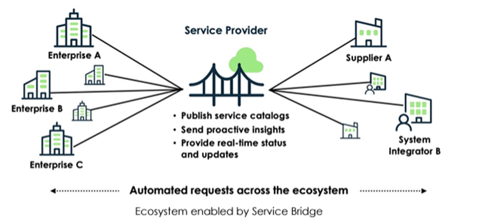
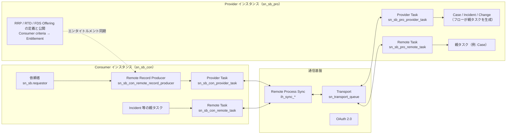
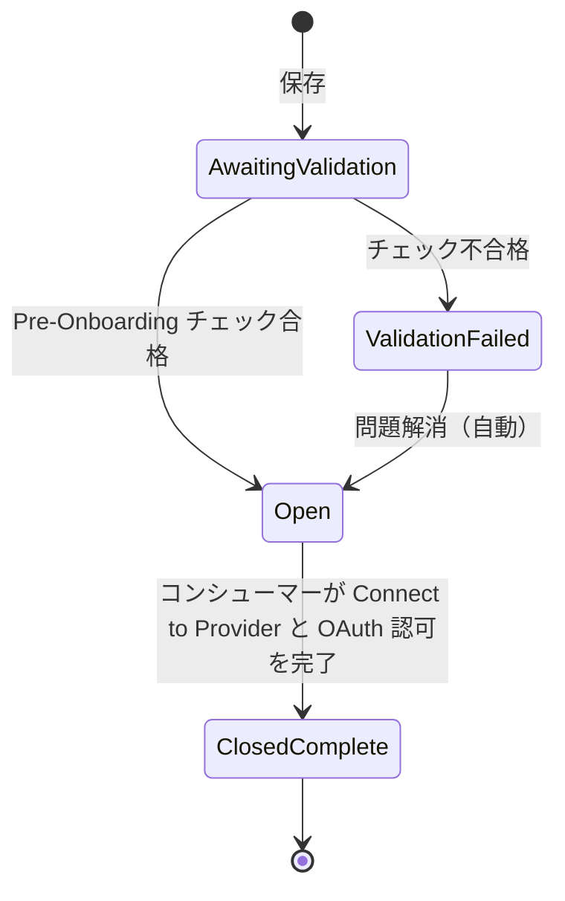
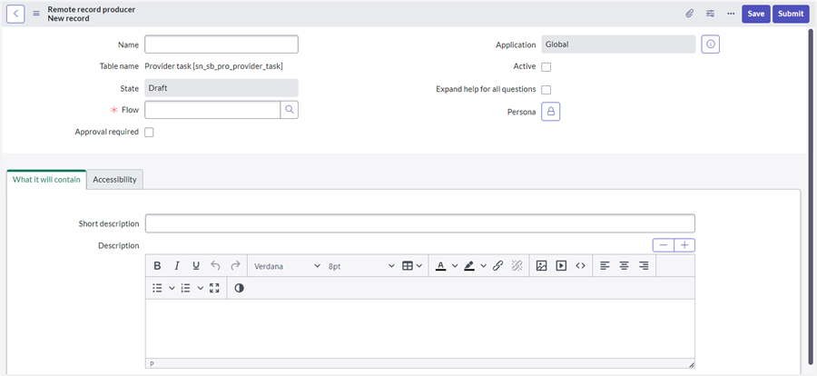
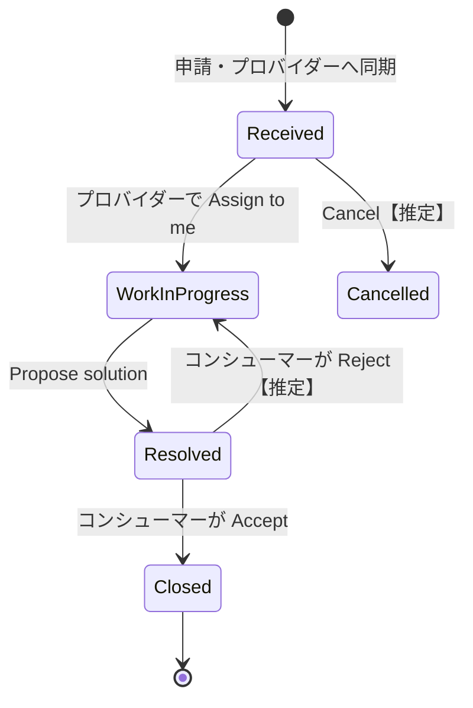
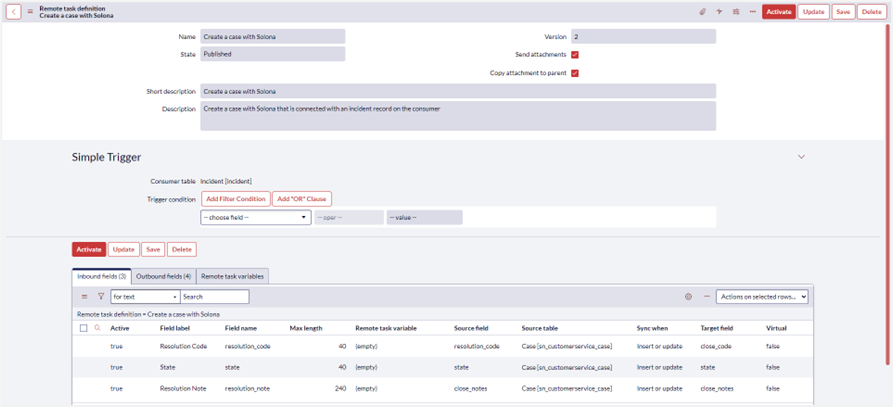
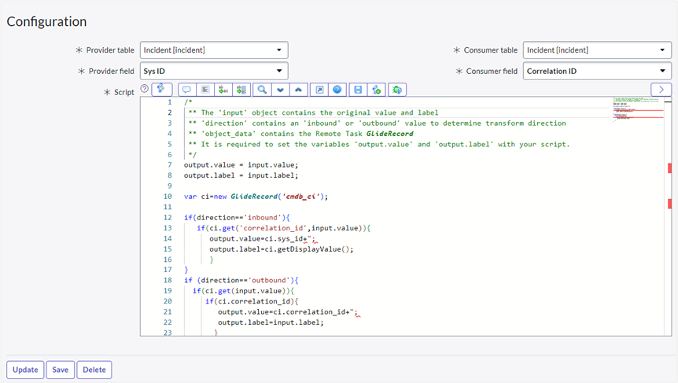

# Service Bridge と eBonding（インスタンス間連携）

## 概要

**インスタンス間連携（instance-to-instance integration）** とは、別々の組織が持つ ServiceNow インスタンス同士で、ケース・インシデント・リクエストなどのタスクを双方向に同期させることである。たとえば、プロバイダー（通信事業者、MSP、SIer、アウトソース先）と顧客企業がそれぞれ自社インスタンスで作業し、状態・コメント・添付だけを相手側と同期させる。業界では、組織間でチケットを自動連携することを一般に **eBonding（eボンディング）** と呼ぶ。【第三者情報】[出典](https://exalate.com/blog/servicenow-ebonding/)

ServiceNow 自身はこの用途に、性格の異なる仕組みを複数提供している。

| 仕組み | 位置付け | 主な対象 | ライセンス |
|---|---|---|---|
| **Service Exchange**（旧 **Service Bridge**） | プロバイダーとコンシューマーをつなぐ ServiceNow Store アプリケーション。Remote Catalog、Remote Task、Provider Task などの業務機能が完成品として提供される | プロバイダー ⇔ 顧客 ⇔ パートナー の多対多 | 業界製品（TSM/TPSM/MESM）や CSM 上位ティアに含まれるとされる（[ライセンス](#24-ライセンス) 参照） |
| **Integration Hub Remote Process Sync（RPS）** | インスタンス間でプロセスを一方向・双方向に同期する汎用フレームワーク。eBonding spoke の後継。Service Exchange の通信基盤でもある | 任意テーブル（自作のサブフローで実装） | Integration Hub サブスクリプション |
| **ServiceNow Remote Instance spoke** | 相手インスタンスのレコードを CRUD する Integration Hub spoke（31 アクション） | Incident/Problem/Change/Case/任意テーブル | Integration Hub サブスクリプション |
| **ServiceNow eBonding spoke** | 2 インスタンス間で Incident を同期する spoke。インスタンス間連携では RPS に置き換えられたと公式に記載されている。連携のデモ用とする回答もある【第三者情報（フォーラム投稿）】 | Incident のみ | 追加サブスクリプション不要とされる【第三者情報】 |

[出典（Service Exchange）](https://downloads.docs.servicenow.com/pdf/enus/servicenow-australia-service-bridge-enus.pdf)、[出典（RPS）](https://www.servicenow.com/docs/r/oZRGKGLbfcn968v3Ubchmw/swqG~2bb3Gyv6Q2ra~aYzQ)、[出典（Remote Instance spoke）](https://www.servicenow.com/docs/r/integrate-applications/integration-hub/remote-instance-spoke.html)、[出典（eBonding spoke の置き換え、Zurich 版）](https://www.servicenow.com/docs/r/oZRGKGLbfcn968v3Ubchmw/swqG~2bb3Gyv6Q2ra~aYzQ)、[出典（デモ用とする回答、2022-03）](https://www.servicenow.com/community/itsm-forum/servicenow-ebonding-spoke/m-p/497320)

> **名称について:** **Service Bridge は Australia リリースで Service Exchange に改称された。** 機能は変わらない。Australia のリリースノートには「Service Bridge has been renamed Service Exchange」と記載されている。Store アプリ側は、2026 年 3〜4 月公開のバージョン（Yokohama 向け 2.0.70/2.0.75、Zurich 向け 2.1.33/2.1.36、Australia 向け 2.2.13）で改称が反映された。ただしテーブル名・スコープ名・ロール名は `sn_sb_*`・`*_service_bridge_settings` のままで、旧名の痕跡が残っている。本ファイルでは、Australia 時点の正式名称 **Service Exchange** を主に使い、必要に応じて旧称 Service Bridge を併記する。[出典（Australia RN）](https://www.servicenow.com/docs/r/IDeOjpA1hzonPLWG~inEpg/PSqIanVCkBOuGisA98Vp5A)、[出典（Store RN）](https://www.servicenow.com/docs/r/store-release-notes/store-rn-telecom-service-bridge-providers.html)

本ファイルの基準リリースは **Australia（2026-05 GA）** である。Service Exchange は Store アプリのため、機能はプラットフォームのリリースではなく **アプリのバージョン（2.2.x / 2.3.x / 2.4.x 等）** で決まる点に注意する。

関連: 汎用の連携基盤は [IntegrationHub](../platform/integrationhub.md)、REST API は [Web Services / REST API](../platform/web-services-api.md)、連携方式の選定は [連携設計](../../03_導入編/09-integration-design.md)、落とし穴は [連携の落とし穴](../../04_応用編/08-integration-pitfalls.md) を参照。

---

## 1. 名称と世代の変遷

Service Exchange には、アーキテクチャが大きく異なる世代がある。古い記事を読むときは、どの世代を前提にしているかを確認する必要がある。

| 世代 | アプリ名・スコープ | 通信方式 | 状態 |
|---|---|---|---|
| Legacy（〜3.2.x） | Service Bridge for Providers (Legacy)、Service Bridge (Legacy)。スコープ `sn_nowebonding_pro` 系 | Instance Data Replication（IDR）のレプリケーションセット | **Xanadu 以降はサポート対象外**。2024 年 Q4 に EOL【第三者情報（ServiceNow 社員ブログ）】[出典](https://www.servicenow.com/community/technology-blog/migrating-from-the-legacy-service-bridge-applications/ba-p/2755812) |
| 新アプリ 1.x（2023-11〜） | Service Bridge for Providers（`sn_sb_pro`）、Service Bridge for Consumers（`sn_sb_con`） | OAuth2 で認証する REST Web サービス。オンプレミスや GCC インスタンスにも対応 | 1.x から 2.x への移行は KB1700387 の手順に従う |
| 新アプリ 2.x（2024-08〜。Store リリースノート上、最初の 2.x は 2.0.20（2024-08）） | 同上。2026 年に Service Exchange for Providers / Consumers へ改称 | Integration Hub Remote Process Sync（RPS）と Transport（`sn_transport`） | 現行。Australia 時点では 2.2.x〜2.4.x |

- Legacy から新アプリへの移行は、プロバイダー側で Migration Utility（KB1499823）を使う。移行されるのは構成データだけで、トランザクションデータ（既存タスク）、ビジネスルール、フロー、クライアントスクリプト、スクリプトインクルードは移行されない。コンシューマー側に移行ユーティリティはなく、新アプリで再登録する。同じコンシューマータスクを Legacy と新アプリの両方の Remote Task に紐付けてはならない。【第三者情報（ServiceNow 社員によるコミュニティブログ）】[出典](https://www.servicenow.com/community/technology-blog/migrating-from-the-legacy-service-bridge-applications/ba-p/2755812)
- Australia のリリースノートには、「Service Exchange 2.x.x は Legacy 構成データの移行をサポートしない。Legacy からの移行は KB1499823 を使う」と記載されている。[出典](https://www.servicenow.com/docs/r/IDeOjpA1hzonPLWG~inEpg/PSqIanVCkBOuGisA98Vp5A)
- 初版 1.0.0（2020-09）は、通信事業者が IT Service Portal 経由で法人顧客にサービス提供状況を見せるためのアプリとして公開された。1.0.1（2020-12）で Order Management for Telecommunications に対応した。[出典](https://www.servicenow.com/docs/r/store-release-notes/store-rn-telecom-service-bridge-providers.html)

---

## 2. インスタンス間連携の選択肢比較

| 観点 | Service Exchange | Remote Process Sync | Remote Instance spoke | eBonding spoke | 個別 REST 連携 |
|---|---|---|---|---|---|
| 提供形態 | Store アプリ（Provider 用/Consumer 用） | Integration Hub の機能（`com.glide.hub.process.sync`） | Integration Hub spoke（v2.3.2、Brazil 版ドキュメント） | ベースシステム spoke（プラグイン `com.glide.sn.ebonding.ah`【第三者情報（フォーラム投稿）】） | Scripted REST、Table API、Flow |
| 想定トポロジー | 1 プロバイダー対 N コンシューマー、およびパートナー | 任意（N インスタンス） | 2 インスタンス | 2 インスタンス | 任意 |
| 業務機能 | Remote Catalog、Provider Task、Remote Task、エンタイトルメント、ペルソナ、FDS、ヘルスチェック | なし（キャプチャ・キュー・相関・再処理の枠組みを提供） | なし（アクション部品のみ） | Incident の作成・参照・更新のみ | なし |
| 対象テーブル | Task 系（Case、Incident、Change、Request など）。FDS は CMDB と主要マスタ | 任意 | Incident、Problem、Change、Case、Case Task、任意テーブル | Incident | 任意 |
| ジャーナル・添付 | 同期できる（JFF、Send attachments） | 同期できる | 添付コピー用アクションあり | 標準では添付を送らない【第三者情報】 | 自作 |
| 順序保証・キュー | RPS のキューを使う | 相関エンジンとキューで順序付き配送 | なし（Flow 実行に依存） | なし | 自作 |
| 必要ライセンス | 後述 | Integration Hub サブスクリプション（Australia 版はパッケージの指定なし。Zurich 版は Integration Hub Enterprise パッケージと明記） | Integration Hub サブスクリプション | 不要とされる【第三者情報】 | API の利用自体は追加費用なし（相手側の制約に依存） |

[出典（Service Exchange）](https://downloads.docs.servicenow.com/pdf/enus/servicenow-australia-service-bridge-enus.pdf)、[出典（RPS 入門（Zurich））](https://www.servicenow.com/docs/r/oZRGKGLbfcn968v3Ubchmw/swqG~2bb3Gyv6Q2ra~aYzQ)、[出典（RPS（Australia））](https://www.servicenow.com/docs/r/u~ldaY8ZPxJiUgZ1Inf6mw/oZWx_TDSyhYmUV4x4_vgOA)、[出典（Remote Instance spoke）](https://www.servicenow.com/docs/r/integrate-applications/integration-hub/remote-instance-spoke.html)、[出典（eBonding spoke プラグイン名、フォーラム投稿）](https://www.servicenow.com/community/developer-forum/flow-designer-ebonding-example-technow-ep-44/m-p/2065748)。eBonding spoke のプラグイン名は公式ドキュメントでは確認できず（関連: [IntegrationHub](../platform/integrationhub.md)）

公式ドキュメントは Remote Task を「**カスタム eBonding に代わる持続可能な選択肢**（a sustainable alternative to custom eBonding）」と位置付けている。Remote Task を使えば、連携を自作せずに複数インスタンス間でリンクしたタスクを作成でき、コメント・添付・マッピング済みフィールドが送受信される。[出典](https://downloads.docs.servicenow.com/pdf/enus/servicenow-australia-service-bridge-enus.pdf)

**選定の目安**【経験則】

- 相手も ServiceNow で、プロバイダーと顧客の関係が継続的にある（MSP、通信、IT アウトソース、メーカーと販売店など）場合は、Service Exchange を第一候補にする。エンタイトルメント管理、カタログ配信、ヘルスチェックまで揃っている。
- 社内の複数インスタンス（グループ会社・地域別インスタンスなど）で、特定プロセスだけを同期したい場合は RPS が候補になる。
- 単発・小規模で「相手インスタンスにレコードを作る」だけなら Remote Instance spoke で足りる。
- 相手が ServiceNow でない（Jira、BMC Helix、Salesforce 等）場合、Service Exchange と RPS は使えない。spoke、REST 連携、またはサードパーティ製品（Exalate、Perspectium、ONEiO 等）を検討する。

---

## 3. Service Exchange のアーキテクチャ

### 3.1 登場人物

公式ドキュメントは、Service Exchange を「プロバイダー、コンシューマー、パートナーが ServiceNow インスタンスを接続し、ServiceNow エコシステム全体で安全な業務ワークフローを構築するためのもの」と説明している。[出典](https://downloads.docs.servicenow.com/pdf/enus/servicenow-australia-service-bridge-enus.pdf)

| 役割 | 説明 | インストールするアプリ |
|---|---|---|
| **Provider（プロバイダー）** | サービスを提供・履行する組織またはインスタンス。カタログを公開し、要求を受けて履行する | Service Exchange for Providers（`sn_sb_pro`） |
| **Consumer（コンシューマー）** | プロバイダーからサービスを受ける組織またはインスタンス。Enterprise とも呼ばれる | Service Exchange for Consumers（`sn_sb_con`） |
| **Partner（パートナー）** | プロバイダーに代わって履行を支援する組織。用語集では「プロバイダーにとってのプロバイダー」と定義される。同じ Service Exchange 基盤上でタスクを受ける | （プロバイダーとの関係では Consumer 側の構成になると考えられる【推定】） |

1 つのインスタンスがプロバイダーとコンシューマーの両方を兼ねることもできる。その場合は 2 つのアプリを**同時に同じバージョンへ**アップグレードする必要がある（[§27](#27-リリース別の変更点) 参照）。



- **キャプション:** Service Bridge（現 Service Exchange）が実現するエコシステムの概念図
- **画面の説明:** 中央に橋のアイコンで表した「Service Provider」がある。左側の Enterprise A/B/C（顧客企業）と、右側の Supplier A・System Integrator B（サプライヤー・SIer）が、それぞれ線で中央のプロバイダーに接続されている。中央には、プロバイダーができることとして「Publish service catalogs（サービスカタログの公開）」「Send proactive insights（プロアクティブな情報提供）」「Provide real-time status and updates（リアルタイムの状況・更新の提供）」が並ぶ。下部の矢印には「Automated requests across the ecosystem（エコシステム全体の自動化された要求）」とある。2023 年の記事の図のため、旧称 Service Bridge が使われている。
- **出典:** https://www.servicenow.com/community/technology-blog/installing-and-configuring-service-bridge-for-providers/ba-p/2763483 （取得日: 2026-11-04）

### 3.2 処理の流れ

公式ドキュメントは、Service Exchange のワークフローを次の 4 段階で説明している。[出典](https://downloads.docs.servicenow.com/pdf/enus/servicenow-australia-service-bridge-enus.pdf)

1. **接続の確立:** プロバイダーが登録タスク（registration task）を開始し、複数インスタンス間に安全な双方向接続を作る。
2. **コンシューマーによる要求:** コンシューマー（Enterprise）のユーザーが、プロバイダーが公開して自社インスタンスに取り込まれたカタログアイテムを申請する。コンシューマー側にタスクが作られ、プロバイダー側へ同期される。
3. **プロバイダーによる履行:** プロバイダーは Remote Task（両インスタンスにミラーされ、共同作業に使う）と Provider Task（コンシューマーに進捗を見せる。コンシューマーは履行に参加しない）を使って履行する。アラートなどを契機に Proactive case を起票し、コンシューマー側に Provider Task を自動生成することもできる。
4. **パートナーによる履行支援:** プロバイダーは特定のタスクを履行パートナーに委任できる。パートナーも同じ基盤上でタスクを受け、リアルタイムに追跡・更新される。



### 3.3 通信基盤

- Service Exchange for Consumers をインストールすると、次のプラグインとアプリも導入される: `sn_sb`（ベース）、`sn_sb_rps`（RPS 接続）、`sn_transport`（Transport）、`com.glide.hub.process.sync`（Remote Process Sync）、`com.snc.ihub_spoke_util_pack`。[出典](https://downloads.docs.servicenow.com/pdf/enus/servicenow-australia-service-bridge-enus.pdf)
- 接続ごとに、RPS の構成レコード（`ih_sync_capture_definition`、`ih_sync_outbound_definition`、`ih_sync_inbound_definition`、`ih_sync_process_event`、`ih_sync_remote_system`）、HTTP 接続（`http_connection`）、OAuth 関連（`oauth_2_0_credentials`、`oauth_credential`、`oauth_requestor_profile`、`oauth_entity_profile`、`oauth_entity`）、接続用ユーザー（`sys_user`、`sys_user_has_role`、`sys_alias`）、Transport（`sn_transport_queue`、`sn_transport_profile`）、RPS 接続（`sn_sb_rps_connection`）が作られる。これはオフボーディング時に削除されるテーブルの一覧から分かる（[§21](#21-オフボーディング接続解除)）。[出典](https://downloads.docs.servicenow.com/pdf/enus/servicenow-australia-service-bridge-enus.pdf)
- RPS の Process Sync Definition は、プロバイダー側が「Service Exchange Provider Definition」、コンシューマー側が「Service Exchange Customer Definition」である（クローン後の再接続手順で参照される）。[出典](https://downloads.docs.servicenow.com/pdf/enus/servicenow-australia-service-bridge-enus.pdf)
- 新アプリ 1.0.2 以降は、OAuth2 で認証する REST Web サービスで通信する。これにより、REST Web サービスが許可されていればオンプレミスや Government Community Cloud（GCC）のインスタンスにも接続できる。【第三者情報（ServiceNow 社員ブログ）】[出典](https://www.servicenow.com/community/technology-blog/migrating-from-the-legacy-service-bridge-applications/ba-p/2755812)
- 1.0.4（2023-12）で OAuth の KMF（Key Management Framework）鍵交換に対応した。1.1.0（2024-02）では、コンシューマー登録の暗号化の既定が KMF から **Service Bridge 独自の暗号化（AES 256）** に変わり、オンプレミスを含むすべてのインスタンス種別で登録できるようになった（リリースノートの記載は「Consumer Registration now defaults to Service Bridge encryption instead of Key Management Framework」「Added AES 256 encryption to support registration between all instance types including on-prem」）。なお、Australia 版ドキュメントの登録の前提条件には、KMF ヘルスチェックの合格が引き続き挙げられている（[§6.2](#62-コンシューマー登録register-a-service-exchange-consumer)）。[出典](https://www.servicenow.com/docs/r/store-release-notes/store-rn-telecom-service-bridge-providers.html)

### 3.4 Service Exchange の機能一覧

| 機能 | 内容 |
|---|---|
| Mismatched version support | プロバイダーとコンシューマーが異なるプラットフォームリリース・アプリバージョンで稼働していても、既存のエンタイトルメントとプロセスを止めずに連携できる |
| Configuration revisions | Remote Task Definition、Remote Record Producer、FDS Offering のリビジョンを作り、互換性のあるコンシューマーへ配信する |
| Remote catalog | カタログとワークフロー・連携の開発をプロバイダー側に集約し、コンシューマーには単純な Record Producer として見せる |
| Proactive cases | アラートを契機にプロバイダー側で作られたケースを、Provider Task としてコンシューマーに自動通知する |
| Provider task | プロバイダー側の作業の進捗をコンシューマー側で追跡する |
| Remote task | カスタム eBonding の代替。複数インスタンスにまたがるリンク済みタスクを作り、コメント・添付・マッピング済みフィールドを送受信する |
| Scratchpad | Provider Task と Remote Task に名前と値のペア（JSON）を付けて共有する |
| Foundation data sync | 選択した基盤データを、スケジュールに従って相手インスタンスに共有する |
| Journal field framework | ジャーナル型フィールドをマッピングして同期する。過去分の同期や、実ユーザー名での書き込みにも対応する |
| Flow action | 構成リビジョンをまたいで変数の整合性を保つための、4 つの Workflow Studio アクション |
| Magic link | プロバイダーから送られたリンクを、コンシューマーのユーザーが手動ログインなしで開けるようにする |
| Instance scan checks / Service Exchange Center | ヘルスチェックと接続監視 |

[出典](https://downloads.docs.servicenow.com/pdf/enus/servicenow-australia-service-bridge-enus.pdf)

---

## 4. アプリケーション・プラグイン構成

| 名称 | ID・スコープ | 説明 |
|---|---|---|
| Service Exchange for Providers | `sn_sb_pro`（Store アプリ ID: `0a704343475851101d7c2430a46d43f6`【第三者情報】） | プロバイダーインスタンスに入れる |
| Service Exchange for Consumers | `sn_sb_con`（Store アプリ ID: `993fe32241c1d51036f854443f186ada`【第三者情報】） | コンシューマーインスタンスに入れる |
| Service Exchange（ベース） | `sn_sb` | 共通テーブル（`sn_sb_provider_task`、`sn_sb_remote_task`、`sn_sb_scratchpad` 等）とロール |
| Service Exchange RPS | `sn_sb_rps` | RPS 接続（`sn_sb_rps_connection`） |
| Transport | `sn_transport` | 送受信キュー（`sn_transport_queue`）とプロファイル（`sn_transport_profile`） |
| Foundation Data Sync | `sn_fds`、`sn_fds_pro`、`sn_fds_con` 系テーブル | FDS のオファリング・要求・サブスクリプション |
| Service Exchange Health | プラグイン | インスタンススキャンのチェック群。インストール・アップグレード時に有効化される。後方互換で、古いバージョンにも入れられる |
| Global Script Include | グローバルスコープのスクリプト | Yokohama・Zurich・Australia では自動でインストール・更新される。以前のバージョンでは KB1225292 の手順で手動インストールが必要だった |

[出典（PDF）](https://downloads.docs.servicenow.com/pdf/enus/servicenow-australia-service-bridge-enus.pdf)、[出典（Australia RN）](https://www.servicenow.com/docs/r/IDeOjpA1hzonPLWG~inEpg/PSqIanVCkBOuGisA98Vp5A)、[出典（Store ID）](https://www.servicenow.com/community/technology-blog/migrating-from-the-legacy-service-bridge-applications/ba-p/2755812)

- **インストール方法:** Service Exchange はプラグインを有効化して入れるのではなく、**ServiceNow Store にリクエスト**して入手する。インストールは `All > System Applications > All Available Applications > All` でアプリを検索して行う（ロール `admin`）。デモデータは、インストール時に「Load demo data」を選ばないと後から読み込めない。[出典](https://downloads.docs.servicenow.com/pdf/enus/servicenow-australia-service-bridge-enus.pdf)
- **事前チェック:** プロバイダーとコンシューマーの両方で、システムプロパティ `glide.servlet.uri` が正しいインスタンス URL になっているかを確認する。本番からクローンしたインスタンスでは、本番の URL が残っていることがある。[出典](https://downloads.docs.servicenow.com/pdf/enus/servicenow-australia-service-bridge-enus.pdf)

---

## 5. ロールとペルソナ

### 5.1 ロール

| ロール | 説明 | 含むロール |
|---|---|---|
| `sn_sb.admin`（Service Exchange admin） | プロバイダー・コンシューマー双方の Service Exchange 管理者。全 Service Exchange テーブルを読める | `sn_sb.requestor`、`sn_sb.remote_task_creator`、`sn_sb.read`、`flow_designer`、`catalog`。プロバイダー側ではさらに `sn_customerservice.case_viewer`、`sn_customerservice.customer_data_viewer` |
| `sn_sb.requestor`（Service Exchange requester） | コンシューマー側の IT スタッフが、自社のサービスカタログからプロバイダーのサービスを要求・監視する。Remote Record Producer と Provider Task にアクセスできる | なし |
| `sn_sb.read`（Service Exchange read） | プロバイダー側のカスタマーサービス担当者が Provider Task を参照する。読み取り専用 | なし |
| `sn_sb.remote_task_creator` | Remote Task と Remote Task Definition の作成・更新（ACL 表より） | — |
| `sn_sb_pro.consumer` | プロバイダーインスタンス上で、コンシューマー企業の連絡先（登録担当者）に付与する | — |
| `sn_transport.admin` | Transport のペイロードのトラブルシュート（コンシューマー管理者ペルソナに付与） | — |
| `sb_admin` | Service Exchange Center にアクセスするために必要と記載されている（FDS 手順では「admin (sb_admin)」と表記） | — |

[出典](https://downloads.docs.servicenow.com/pdf/enus/servicenow-australia-service-bridge-enus.pdf)

> **注記:** ドキュメントには `sn_sb.admin` と `sb_admin` の両方の表記がある。Service Exchange Center の要件は「The Service Exchange Admin (sb_admin) role」と書かれており、同じロールの略記なのか別のロールなのかは公開情報では確認できず。実機の `sys_user_role` で確認すること。

### 5.2 ペルソナ（利用者像）

| アプリ | ペルソナ | 主な作業 | ロール |
|---|---|---|---|
| Provider | Administrator | 接続の確立、Workflow Studio のフロー構成、コンシューマーへのサービス公開、登録支援、トラブルシュート。管理者ロールがない場合、Remote Record Producer の変更・公開には catalog admin ロールが必要 | `admin`、`sn_sb.admin` |
| Provider | Provider Fulfiller / Agent | コンシューマーからの質問・課題の解決。必要に応じてネットワーク運用も担う | エージェント系ロール |
| Provider | Consumer | コンシューマー登録タスクへの対応 | `sn_sb_pro.consumer` |
| Consumer | System administrator | アプリのインストール、Provider/Connection レコードの作成、Transform の作成・保守、RTD と RRP の有効化、Transport ペイロードのトラブルシュート | `admin`、`sn_sb.admin`、`sn_transport.admin` |
| Consumer | Service Exchange Requester（IT 管理者） | 外部ベンダーに一部または全部を依存する IT サービスの責任者。自社インスタンスからプロバイダーへの要求を出して監視する | `itil`、`sn_sb.requestor` |
| Consumer | Consumer Requestor（エンドユーザー） | Remote Catalog からの要求 | `sn_sb.requestor` |

[出典](https://downloads.docs.servicenow.com/pdf/enus/servicenow-australia-service-bridge-enus.pdf)

ロールの付与は、ユーザーではなくグループに対して行うことが推奨されている（`All > User Administration > Groups` → Roles 関連リスト）。[出典](https://downloads.docs.servicenow.com/pdf/enus/servicenow-australia-service-bridge-enus.pdf)

---

## 6. 接続設定と認証

### 6.1 プロバイダー側のセットアップ手順

| 順序 | タスク | メニュー・補足 |
|---|---|---|
| 1 | Service Exchange for Providers のインストール | `All > System Applications > All Available Applications > All` |
| 2 | Provider レコードの作成（1 回だけ） | `All > Service Exchange Provider > Provider`。名前に使えるのは英数字とダッシュのみで、空白や記号を含めるとエラーになる |
| 3 | ロールの付与 | [§5](#5-ロールとペルソナ) |
| 4 | Catalog Personas の作成 | `All > Service Exchange Provider > Administration > Catalog Personas` |
| 5 | Remote Choice Definitions の作成 | `... > Administration > Remote Choice Definitions`（`security_admin` への権限昇格が必要） |
| 6 | Remote Catalog Items（RRP）の作成 | `... > Administration > Remote Catalog Items` |
| 7 | Remote Task Definitions の作成 | `... > Administration > Remote Task Definitions` |
| 8 | Transforms の作成 | `... > Administration > Transforms` |
| 9 | Authorized Users の設定 | Consumer Connection → Settings → Authorized Users タブ |

[出典](https://downloads.docs.servicenow.com/pdf/enus/servicenow-australia-service-bridge-enus.pdf)

### 6.2 コンシューマー登録（Register a Service Exchange consumer）

コンシューマーの登録によって、プロバイダーとコンシューマーの間にインスタンス間連携が確立する。[出典](https://downloads.docs.servicenow.com/pdf/enus/servicenow-australia-service-bridge-enus.pdf)

**前提条件（プロバイダー側）**

- ロール `admin` を持ち、Provider レコードが作成済みであること。
- プロバイダーインスタンスに、コンシューマーの Company または Account が存在すること。その会社に、`sn_sb_pro.consumer` ロールを持つユーザーまたは Contact が紐付いていること。本番インスタンスでは、登録メールを受け取るための有効なメールアドレスが必要。
- `Key Management > Health (Diagnostics)` で、Key Management Framework のヘルスチェックが合格していること。確認には `sn_kmf.admin` と `sn_kmf.cryptographic_manager` のロールが必要。

**手順**

1. `All > Service Exchange Provider > Consumer Registrations` で New を選ぶ。
2. Company、その会社の Contact、コンシューマーインスタンスの URL（URL 欄の鍵アイコンを外して入力）を指定する。Contact は**コンシューマーインスタンスの管理者ユーザー**でなければならない。プロバイダー側で必要なのは Service Exchange Consumer ロールだけである。
3. 保存すると、状態は **Awaiting Validation** になり、バックグラウンドで Pre-Onboarding スキャンスイートが検証を行う。
   - すべて合格すると **Open** になり、登録リンク入りのメールがコンシューマーの Contact に送られる。メール送信が無効な環境では、作業メモ（work notes）からリンクをコピーして手動で送る。
   - 不合格の場合は **Validation Failed** になり、Health Dashboard へのリンク付きのバナーが表示される。問題をすべて解消するまで登録リンクは生成されない。解消すると自動で Open に戻る。

**状態遷移（登録タスク `sn_sb_pro_registration`）**



[出典](https://downloads.docs.servicenow.com/pdf/enus/servicenow-australia-service-bridge-enus.pdf)

### 6.3 コンシューマー側の接続（Connect to a provider）

1. 登録メールの **Connect to Provider** リンク（またはプロバイダー管理者から直接受け取ったリンク）を開く。コンシューマー側に Provider Connection レコードが作られる。
2. `All > Service Exchange Consumer > Provider Connections` を開き、プロバイダーに対応する Company を選んで保存する。状態は Awaiting Validation になり、Pre-Onboarding チェックの結果に応じて **Validated** または **Validation Failed** に変わる。
3. Provider Connection レコードで **Connect to Provider** を選ぶ。未解決の検証エラーがある間、このボタンは表示されない。
4. 登録メッセージで **Authenticate** を選ぶと、プロバイダーインスタンスの OAuth 認可画面が開く。**Allow** を選んでから **Submit** を選ぶ。
5. 登録が完了すると接続が確立し、プロバイダー側の登録タスクは **Closed Complete** になる。

**OAuth 認証の注意点:** 登録を完了するのは、プロバイダー側の登録タスクに Contact として指定された本人（またはプロバイダーインスタンスの管理者）でなければならない。別のユーザーが試すと OAuth 認証の段階で失敗する。デモ用に 2 インスタンスを用意する場合は、プロバイダーインスタンスにログインしているユーザーと登録タスクの Contact を一致させる必要がある。[出典](https://downloads.docs.servicenow.com/pdf/enus/servicenow-australia-service-bridge-enus.pdf)

### 6.4 OAuth グラントタイプの変更（2.3.x 以降）

- Australia のリリースノートによると、Service Exchange **2.3.x** を使う場合は、接続を使う前に、プロバイダーとコンシューマーの両方で、全接続の OAuth グラントタイプを **Authorization Code から Client Credentials に変更**する必要がある。変更しないと「User Not Authenticated」エラーになる（KB2944968）。[出典](https://www.servicenow.com/docs/r/IDeOjpA1hzonPLWG~inEpg/PSqIanVCkBOuGisA98Vp5A)
- 2.4.17（2026-10）では、OAuth Client Credentials トークンのスコープが絞り込まれた。REST API で `snc_internal` ロールが不要になり、管理者がレガシー OAuth から Client Credentials へアップグレードする機能も追加された。[出典](https://www.servicenow.com/docs/r/store-release-notes/store-rn-telecom-service-bridge-providers.html)
- 2.4.10（2026-09）では、OAuth 資格情報の扱いが修正された。[出典](https://www.servicenow.com/docs/r/store-release-notes/store-rn-telecom-service-bridge-providers.html)

### 6.5 Magic links（コンシューマーからのシームレスなアクセス）

Magic links は、プロバイダーから送られた通常のリンクを、コンシューマーのユーザーが手動ログインなしでプロバイダーインスタンスのリソースにアクセスできるリンクに変換する機能である。HR タスク、カタログ申請、ナレッジ参照などで役立つ。2.2.2（2025-08）で導入された。[出典（PDF）](https://downloads.docs.servicenow.com/pdf/enus/servicenow-australia-service-bridge-enus.pdf)、[出典（Store RN）](https://www.servicenow.com/docs/r/store-release-notes/store-rn-telecom-service-bridge-providers.html)

設定場所: `All > Service Exchange Provider > Consumers` → Consumer Connection → Related Links の Settings → **Magic link** タブ（ロール `sn_sb.admin`）。

| フィールド | 説明 |
|---|---|
| Enable magic links | Magic link を有効にする。有効にすると、コンシューマーのユーザー（リモートユーザー）はタスク完了のためにプロバイダーインスタンスへ誘導される |
| Single user mode | コンシューマーのユーザーを、特定の 1 ユーザーとしてプロバイダーインスタンスに認証させる（per-user と single-user の 2 モードがある） |
| Redirect timeout | プロバイダーインスタンスへのリダイレクトまでの秒数。既定は 5、最大は 30。設定できるのはコンシューマー側だけで、プロバイダー側では読み取り専用。0 または空の場合は、ローディング画面なしで即座にリダイレクトする |

[出典](https://downloads.docs.servicenow.com/pdf/enus/servicenow-australia-service-bridge-enus.pdf)

### 6.6 コンシューマー側の設定（Settings）

`Service Exchange Consumer > Provider Connections` → Related Links の Settings で、次の項目を設定する。

| タブ | 項目 | 説明 |
|---|---|---|
| Remote Record Producers | Auto activate remote record producer | エンタイトルされた RRP を自動で有効化する |
| Remote Task Definitions | Auto activate remote task definition | プロバイダーが公開した RTD を自動で有効化する |
| Authorized Users | Restrict authorized users / Max authorized users / Auto approve authorized users | Authorized User の数を制限するか、上限数、自動承認するか |

プロバイダー側の Consumer Connection の Settings にも Authorized Users タブがある。プロバイダー側からは、Remote Record Producers タブと Remote Task Definitions タブの設定を閲覧できるが変更はできない。[出典](https://downloads.docs.servicenow.com/pdf/enus/servicenow-australia-service-bridge-enus.pdf)

---

## 7. Remote Catalog（Remote Record Producer）

### 7.1 概要

**Remote Catalog（リモートカタログ）** は、プロバイダーがサービスのカタログアイテムを作り、コンシューマーのインスタンスにネイティブなカタログアイテムとして配信する仕組みである。コンシューマーの管理者は、受け取ったアイテムを自社のカタログ・カテゴリに割り当てて有効化する。たとえば 20 種類のサービスを 1 つのカタログにまとめて公開し、各コンシューマーには権利のあるサービスだけを見せる、という使い方ができる。[出典](https://downloads.docs.servicenow.com/pdf/enus/servicenow-australia-service-bridge-enus.pdf)

**Remote Record Producer（RRP）** は、コンシューマーのサービスカタログに公開されるサービス要求である。RRP のテーブルは `sc_cat_item_producer` を拡張したもので、`sn_sb_pro_remote_request` テーブルを使う。コンシューマーの RRP が送信されると、プロバイダー側に **Provider Task** が作られる。同時にフローが起動して、Create Case、Create Incident、Create Change Request のいずれかの履行タスクが作られる。[出典](https://downloads.docs.servicenow.com/pdf/enus/servicenow-australia-service-bridge-enus.pdf)

> **テーブル名の食い違い:** Australia PDF の本文では RRP のテーブルを `sn_sb_pro_remote_request` と書いているが、同じ PDF のテーブル一覧（[§16.1](#161-プロバイダー側テーブルservice-exchange-for-providers)）では `sn_sb_pro_remote_record_producer` と記載されている。両者の関係（拡張テーブルか旧名か）は公開情報では確認できず。実機の `sys_db_object` で確認すること。

### 7.2 RRP の作成（プロバイダー）

前提: カタログのスコープが Global であること。ロールは `admin` と `sn_sb.admin`。メニューは `All > Service Exchange Provider > Administration > Remote Catalog Items` → New。

| フィールド | 説明 |
|---|---|
| Name | RRP の名前 |
| Application | アプリケーションスコープから自動設定される（読み取り専用） |
| State | 新規作成時は **Draft**。Publish、Archive、Retire の操作に応じて自動で変わる |
| Table name | **Provider Task**（`sn_sb_pro_provider_task`）。読み取り専用 |
| Flow | 既定の Service Exchange フローから選ぶか、独自に作る。必須 |
| Active | Publish、Retire、Archive、Delete の操作で切り替わる（読み取り専用） |
| Persona | この RRP を利用できるカタログペルソナ |
| Compatibility | プロバイダーが使っている Service Exchange のバージョン（自動設定）。コンシューマーのバージョンが互換でなければ、新しいエンタイトルメントは有効化できない |
| Approval required | 承認要否（スクリーンショットに表示されている項目） |
| Short description / Description | 説明 |

手順の要点: 少なくとも 1 つの変数を追加し、Consumer criteria を追加してから **Publish** する。Publish すると、プロバイダーとコンシューマーの両インスタンスで利用可能になる。[出典](https://downloads.docs.servicenow.com/pdf/enus/servicenow-australia-service-bridge-enus.pdf)



- **キャプション:** プロバイダーインスタンスの Remote record producer 新規レコードフォーム
- **画面の説明:** ヘッダーは「Remote record producer / New record」。左列に Name（空欄）、Table name（「Provider task [sn_sb_pro_provider_task]」と固定表示）、State（「Draft」）、必須の Flow（参照フィールド）、Approval required のチェックボックスが並ぶ。右列には Application（「Global」）、Active、Expand help for all questions、Persona（鍵アイコン付きのリスト）がある。下部の「What it will contain」タブには Short description と、リッチテキストエディタの Description がある。右上に Save と Submit ボタンがある。旧称 Service Bridge 時代（2023 年）のスクリーンショットである。
- **出典:** https://www.servicenow.com/community/technology-blog/installing-and-configuring-service-bridge-for-providers/ba-p/2763483 （取得日: 2026-11-04）

### 7.3 変数・変数セット

RRP で使える変数タイプ: Attachment、Break、CheckBox、Container End、Container Split、Container Start、Date、Date/Time、Duration、Email、HTML、IP Address、Label、List Collector、Lookup Multiple Choice、Lookup Select Box、Masked、Multiline text、Multiple Choice、Numeric Scale、Reference、Requested For、Rich Text Label、Select Box、Single Line Text、URL、Wide Single Line Text、Yes/No。これ以外の変数タイプを使うと、Service Exchange がデータを正しい形式で連携できないことがある。[出典](https://downloads.docs.servicenow.com/pdf/enus/servicenow-australia-service-bridge-enus.pdf)

- **変数セット:** 単一行（Single Row）と複数行（Multi Row）の変数セットを RRP に関連付けられる。プロバイダー側で変数セットを変更すると、エンタイトルされた RRP に自動で同期される。Custom、Custom with Label、UIPage 型の変数を含む変数セットは、無効な変数を取り除くまで同期されない。無効な変数セットを含む RRP は公開できない。複数行変数セットの行数上限は、属性 `max_rows` で指定できる。
- **参照修飾子のスクリプト:** Reference 型の変数で「Use reference qualifier」を Advanced にすると、スクリプトを書ける。
- **Catalog client script:** Service Exchange 2.1.x 以降、Compatibility が 2.1.x+ の RRP には、カタログクライアントスクリプトを付けられる（Remote record producer フォームの Catalog Client Scripts 関連リスト）。
- **UI ポリシー:** RRP には UI ポリシーとそのスクリプトも適用できる。
- **スクリプトの承認:** RRP に含まれるスクリプトはすべて、コンシューマーが承認しないと RRP を使えない（[§7.7](#77-コンシューマー側の有効化と拡張)）。

[出典](https://downloads.docs.servicenow.com/pdf/enus/servicenow-australia-service-bridge-enus.pdf)

### 7.4 ローカルカタログアイテムからの変換

プロバイダーは、既存のローカルカタログアイテムを RRP にコピーできる（Publish to Service Exchange）。2.1.20（2025-02）で導入された。

- 対象は、Published 状態で、まだ Service Exchange にコピーされていないカタログアイテム。既定でコピーできるのは、hardware、software、record producer、一般のカタログアイテムである。その他の種類も、プロパティを作れば対象にできる（スコープは Service Exchange provider）。
- 手順: ナビゲーションフィルタに `sc_cat_item.list` と入力し、アイテムを選んでアクションメニューから **Publish to Service Exchange** を選ぶ。
- 一度にコピーできるのは既定で 20 件。上限は、Integer 型のシステムプロパティ `sn_sb_pro.max_batch_size_covertable_catalog_items` を追加して変更する。
- コピー後は、RRP ごとに変数（1 つ以上）、Flow、Consumer criteria を設定して Publish する必要がある。

[出典（PDF）](https://downloads.docs.servicenow.com/pdf/enus/servicenow-australia-service-bridge-enus.pdf)、[出典（Store RN）](https://www.servicenow.com/docs/r/store-release-notes/store-rn-telecom-service-bridge-providers.html)

### 7.5 Remote choice（プロバイダーのデータを申請時に参照する）

**Remote choice** フィールドを使うと、コンシューマーはカタログアイテムの申請時に、プロバイダーのデータ（例: 契約中の回線、設置済み機器）をリアルタイムに参照できる。[出典](https://downloads.docs.servicenow.com/pdf/enus/servicenow-australia-service-bridge-enus.pdf)

Remote Choice Definition（`sn_sb_pro_remote_choice_definition`）の主なフィールド:

| フィールド | 説明 |
|---|---|
| Table | コンシューマーが照会できるテーブル |
| Name | 自動で採番される。`security_admin` ロールのユーザーが変更できる |
| GlideRecordSecure | オンにすると、照会がすべて ACL に従う。オフにすると ACL を無視するため、Remote choice 変数ごとに参照修飾子で取得範囲を絞る必要がある |
| AccountSecure | オンにすると、照会を行うサービスアカウントの Company と、テーブルの Company または Account フィールドが一致するレコードだけを返す。対象は、フィールド名が `account`、`u_account`、`company`、`u_company` のいずれかであるテーブルに限られる |
| Short description / Filter | 説明と、基本の絞り込み条件 |

変数側（Remote Choice Variable）では、Remote choice reference（使う定義）、Remote choice display field（主表示値）、Remote choice additional info field（補足表示値）、Remote choice dependent on field（依存元の変数）、参照修飾子を指定する。コンシューマー側では照会結果が `sn_sb_con_remote_choice_cache` にキャッシュされる。[出典](https://downloads.docs.servicenow.com/pdf/enus/servicenow-australia-service-bridge-enus.pdf)

### 7.6 エンタイトルメント・Consumer criteria・ペルソナ・Authorized User

- **Consumer criteria（コンシューマー条件）** は、RRP、Remote Task Definition、FDS Offering などの Service Exchange コンテンツを、どのコンシューマーにエンタイトルするか（利用権を与えるか）を決める。条件の例: 特定のコンシューマー、特定モデルの有効な Sold Product を持つコンシューマー、有効なサービス契約を持つコンシューマー。
- Consumer criteria のフォームには、Name、Active、Condition for（Company と Account のどちらで照合するか）、Condition on（照会するテーブル）、Customer field（接続先の Company/Account と照合するフィールド）、Condition（絞り込み条件。例: Active is True）がある。
- **エンタイトルメント処理は、毎晩スケジュールジョブで実行される。** Consumer criteria の条件で対象テーブルを照会し、一致したコンシューマーにコンテンツをエンタイトルする。更新時には即時のチェックも行われる。手動で更新するには、Consumer Connections レコードまたは Provider レコードの **Refresh Entitlements** 関連リンクを使う。
- **ペルソナ:** RRP にペルソナを割り当てると、そのペルソナを持つ Authorized User だけが RRP を申請できる。ペルソナのない RRP は、`sn_sb.requestor` ロールを持つ全ユーザーが申請できる。ペルソナ付きの RRP を申請するには、Requestor ロールに加えて、該当ペルソナを持つ Authorized User レコードが必要である。そのレコードはプロバイダーに承認され、コンシューマー側で有効化されていなければならない。2.3.18（2026-06）以降は、ペルソナをグループ（またはロール）単位で割り当てたり継承させたりできる。
- **Authorized Users:** 最初の登録時に、プロバイダーインスタンス上のコンシューマーアカウントの有効な Contact が、自動で Authorized Users テーブルに追加され、コンシューマー側に同期される。コンシューマー側で追加する場合は、Provider Connection → Authorized Users 関連リストで Consumer user、Persona を指定して Save し、Activate を選ぶ。レコードはプロバイダー側に同期されて承認待ちになる。プロバイダーは、Authorized User の数の上限と自動承認の有無を設定できる。

[出典（PDF）](https://downloads.docs.servicenow.com/pdf/enus/servicenow-australia-service-bridge-enus.pdf)、[出典（Store RN）](https://www.servicenow.com/docs/r/store-release-notes/store-rn-telecom-service-bridge-providers.html)

### 7.7 コンシューマー側の有効化と拡張

- **RRP の有効化:** `All > Service Exchange Consumer > Provider Connections` → 対象の接続 → Remote record producers 関連リスト → RRP を選んで **Activate**。RRP にスクリプトが含まれる場合、Activate するとスクリプトは自動で承認される。Remote Script Approvals タブで個別に承認することもできる（Approved を true にする）。全スクリプトを承認しないと有効化できない。
- **Consumer pre-flow:** コンシューマーは RRP にサブフローを付けて、プロバイダーへ同期する前に承認などの処理を挟める。Provider Task の **Sync** フィールドをサブフローが true にしたときだけ、プロバイダーに同期される。サブフローが付いていなければ、Provider Task は即座に同期される。
- **Consumer variables:** 2.1.x 以降、コンシューマーはプロバイダーの RRP に自社の変数セットを 1 つ追加できる（Remote record producers フォームの Consumer variables フィールド）。この変数セットはプロバイダーには同期されない。プロバイダーの変数は編集できない。ロールは `admin`、`itil`、`sn_sb.admin`。

[出典](https://downloads.docs.servicenow.com/pdf/enus/servicenow-australia-service-bridge-enus.pdf)

---

## 8. Provider Task と Proactive cases

### 8.1 Provider Task

**Provider Task（プロバイダータスク）** は、プロバイダーのインスタンスで行われている作業を、コンシューマーのインスタンスから監視するためのタスクである。コンシューマーは、インスタンスに追加の構成をしなくても、すべてのプロバイダーと協働できる。1.0.2 で、旧称 Provider Request から Provider Task に改称された。[出典（PDF）](https://downloads.docs.servicenow.com/pdf/enus/servicenow-australia-service-bridge-enus.pdf)、[出典（Store RN）](https://www.servicenow.com/docs/r/store-release-notes/store-rn-telecom-service-bridge-providers.html)

| 側 | テーブル |
|---|---|
| ベース | `sn_sb_provider_task` |
| プロバイダー | `sn_sb_pro_provider_task` |
| コンシューマー | `sn_sb_con_provider_task`（Provider Task ベーステーブルを拡張） |

**要求の履行プロセス（Fulfill a consumer request）**

1. コンシューマーが、サービスカタログから Service Exchange のアイテムを選ぶ。
2. 申請フォームに入力して Submit すると、Task View が表示される。ここで追加したコメントは、プロバイダーのインスタンスに複製される。
3. サービスの種類にかかわらず、コンシューマー側には追跡用のタスクとして Provider Task が 1 種類だけ作られる。
4. Provider Task がプロバイダー側に複製され、フローが親タスク（Case/Incident/Change）を作る。
5. コンシューマー側の Provider Task の状態は **Received** になる。
6. プロバイダーのエージェントが親タスクで **Assign to me** を選ぶ。
7. コンシューマー側の状態が **Work in Progress** になる。以降のコメントは双方向に複製される。
8. エージェントが解決コードを設定して **Propose solution** を選ぶと、コンシューマー側の状態は **Resolved** になる。コンシューマーの Actions メニューには **Accept**、**Reject**、**Cancel** が表示される。
9. コンシューマーが Accept すると、コンシューマー側の Provider Task とプロバイダー側の要求が両方 **Closed** になる。



> Reject と Cancel を選んだ後の遷移先の状態名は、公開ドキュメントでは確認できず（図の該当部分は【推定】）。

[出典](https://downloads.docs.servicenow.com/pdf/enus/servicenow-australia-service-bridge-enus.pdf)

プロバイダー側には、親タスクと Provider Task を相互に更新するフローがある。Incident・Case・Change Request のそれぞれについて、「親 → Provider Task」と「Provider Task → 親」の 2 方向のフローが用意されている（[§17](#17-フローサブフローアクション)）。

### 8.2 Proactive cases

**Proactive case（プロアクティブケース）** は、アラート監視によって履行プロセスが自動で始まる点を除けば、通常の要求と同じ同期の仕組みである。コンシューマー側で追加の構成は不要である。[出典](https://downloads.docs.servicenow.com/pdf/enus/servicenow-australia-service-bridge-enus.pdf)

1. オンボード済みのコンシューマーに関係するアラートがプロバイダー側で発生し、Case が作られる。
2. Case に、Provider Task へのリンクがコメントとして追加される。
3. CSM の通知が、Provider Task のリンク付きで顧客の主連絡先に送られる。
4. 以降、プロバイダー側の Case の状態変更やコメントが、顧客のインスタンスに反映される。

使われるフローは「Create Proactive Provider task from Case」（`create_proactive_provider_task_from_case`）である。プロアクティブ対応の CSM 側の機能は [Customer Service Management](./customer-service-management.md) の Proactive Customer Service Operations を参照。

---

## 9. Remote Task と Remote Task Definition

### 9.1 概要

**Remote Task（リモートタスク）** は、別々のインスタンスにある 2 つの親タスク（例: コンシューマーの Incident とプロバイダーの Case）をリンクし、双方向に同期するための仕組みである。Remote Task テーブルは、ServiceNow AI Platform の Task テーブルを拡張したものである。各インスタンスの Remote Task レコードが、親タスク同士のデータの流れを仲介する。[出典](https://downloads.docs.servicenow.com/pdf/enus/servicenow-australia-service-bridge-enus.pdf)

用途の例:

1. コンシューマーが、プロバイダーのサービスで起きた問題の対応を依頼する。
2. 購入済みサービスの変更を依頼する。
3. 既存タスクをプロバイダーに割り当て、対応してもらう。

**コンシューマーは、1 件のインシデントを複数のプロバイダーに割り当てて解決させることもできる。** プロバイダー側から能動的に Remote Task を作ることもできる（Workflow Studio のアクション Create remote task for Consumer）。[出典](https://downloads.docs.servicenow.com/pdf/enus/servicenow-australia-service-bridge-enus.pdf)

| 側 | Remote Task | Remote Task Definition | Inbound / Outbound Field | Remote Task Variable |
|---|---|---|---|---|
| ベース | `sn_sb_remote_task` | — | — | — |
| プロバイダー | `sn_sb_pro_remote_task` | `sn_sb_pro_remote_task_def` | `sn_sb_pro_inbound_field` / `sn_sb_pro_outbound_field` | `sn_sb_pro_remote_task_variable` |
| コンシューマー | `sn_sb_con_remote_task` | `sn_sb_con_remote_task_def` | `sn_sb_con_inbound_field` / `sn_sb_con_outbound_field` | `sn_sb_con_remote_task_variable` |

### 9.2 Remote Task Definition（RTD）の作成（プロバイダー）

メニュー: `All > Service Exchange Provider > Administration > Remote Task Definitions` → New（ロール `admin`）。

| フィールド | 説明 |
|---|---|
| Name | RTD の名前 |
| Application | スコープから自動設定される（読み取り専用） |
| State | 新規作成時は Draft。Publish、Archive、Retire で変わる |
| Provider table | プロバイダー側の任意の Task 系テーブル（例: Case、Incident） |
| Consumer table | コンシューマー側の任意の Task 系テーブル（例: Case、Incident） |
| Compatibility | プロバイダーの Service Exchange バージョン。コンシューマーが互換でなければ有効化できない |
| Send attachments | オンにすると、親レコードに追加された添付が Remote Task に送られる |
| Short description / Description | 説明 |

**Inbound fields（コンシューマーからプロバイダーへの受信）**

| フィールド | 説明 |
|---|---|
| Field label / Field name | Remote Task フォームでの表示ラベルと、フロー・スクリプトで使う名前 |
| Max length | 最大長 |
| Sync when | **Insert**（Remote Task の初回作成時だけ親レコードのターゲットフィールドを更新）、**Insert or Update**（更新のたびに反映）、**Never**（親レコードを直接更新しない。たとえば状態値をフローで変換してから反映する場合に使う） |
| Source field | ソーステーブル（Consumer table）のフィールド。ドットウォークで関連テーブルの値も送れる（例: CI の名前、クラス、IP アドレス、資産タグ） |
| Target field | ターゲットテーブル（Provider table）のフィールド |
| Active / Virtual | Virtual をオンにすると、ソース側に存在しないフィールド（仮想フィールド）をマッピングできる |

**Outbound fields（プロバイダーからコンシューマーへの送信）** も同じ構成である。Sync when はプロバイダーからの**提案**（Sync when suggestion）で、コンシューマーが有効化する前に変更できる。2.2.x 以降は **Sync pre-existing entries**（接続確立前のコメントも含めて同期する）を設定できる。

- Sync when の設定にかかわらず、Inbound field が更新されると、親レコードに作業メモ（work note）として記録される。
- Service Exchange 2.2.x 以降、RTD を作ると、Inbound と Outbound の両方に comments → comments のマッピングが自動で作られる。
- 仮想フィールドは、Transform の Virtual Inbound / Virtual Outbound、または `updateVirtualField` API で更新する。
- Consumer criteria 関連リストで、RTD をエンタイトルする Company または Account を指定して **Publish** する。公開すると Remote Task Variable が自動で作られる。

公開した RTD はコンシューマーのインスタンスに同期され、有効化待ちになる。コンシューマーが Auto activate remote task definition をオンにしていれば、自動で有効化される。[出典](https://downloads.docs.servicenow.com/pdf/enus/servicenow-australia-service-bridge-enus.pdf)

### 9.3 RTD の有効化（コンシューマー）

`All > Service Exchange Consumer > Provider Connections` → 対象の接続 → Remote task definition 関連リスト → RTD を選ぶ（ロール `admin`）。

1. **Simple Trigger** を確認する。タスクの更新に一致する簡易トリガーを設定すると、該当タスクに対して Remote Task が自動で作られる。
2. Inbound fields を確認する。コンシューマーが変更できるのは Field label、Sync when、Target field である。
3. Outbound fields を確認する。コンシューマーが変更できるのは Source field だけである。必要に応じて Sync pre-existing entries をオンにする（2.2.x）。
4. Remote task variables を確認し、**Activate** を選ぶ。表示されるダイアログでマッピングを確認して OK を選ぶ。

[出典](https://downloads.docs.servicenow.com/pdf/enus/servicenow-australia-service-bridge-enus.pdf)



- **キャプション:** コンシューマーインスタンスで、プロバイダーから受け取った Remote task definition を有効化する画面
- **画面の説明:** ヘッダーは「Remote task definition / Create a case with Solona」。上部に Name（Create a case with Solona）、State（Published）、Version（2）、Send attachments と Copy attachment to parent のチェック（両方オン）、Short description、Description がある。中段の **Simple Trigger** セクションには Consumer table（Incident [incident]）と Trigger condition の条件ビルダーがある。下段のタブは Inbound fields (3)、Outbound fields (4)、Remote task variables。Inbound fields の一覧では、Resolution Code（resolution_code → close_code）、State（state → state）、Resolution Note（close_notes → close_notes）が、Source table「Case [sn_customerservice_case]」、Sync when「Insert or update」、Virtual「false」で表示されている。右上に Activate、Update、Save、Delete ボタンがある。旧称 Service Bridge 時代（2023 年）の画面である。
- **出典:** https://www.servicenow.com/community/technology-blog/installing-and-configuring-service-bridge-for-consumers/ba-p/2770442 （取得日: 2026-11-04）

### 9.4 Remote Task の作成と状態

**コンシューマー側の手動作成:** Incident などの親タスクを開き、Related Links の **Create Remote Task for Provider** を選ぶ。このリンクは、親タスクのテーブルに対して有効な RTD が 1 つ以上あるときだけ表示される。Remote Task 画面では Parent が自動入力され、Status は **New** になる。Remote Task Definition を選ぶと Provider Connection が自動入力される（候補が 1 つだけなら RTD も自動入力される）。Submit すると、親タスクの Remote Tasks 関連リストに表示される。[出典](https://downloads.docs.servicenow.com/pdf/enus/servicenow-australia-service-bridge-enus.pdf)

- Remote Task は**非同期で作成**される。親タスクのフォームをすぐ読み込むと表示されないことがあるため、再読み込みが必要な場合がある。
- プロバイダー側で Remote Task を受信すると、それをもとに新しい親タスクが作られる（ビジネスルール「Create parent on synced remote task」）。エラーがなければ、Status は両インスタンスで **Connected** になる。
- 親タスクの Short Description などを更新すると、相手側に同期され、作業メモ（例:「Short Description has been updated by the provider」）が残る。
- **Disconnect / Connect:** Remote Task 画面で Disconnect を選ぶと、作業メモやコメントを含むデータの転送が一時停止する。Connect を選ぶと再開する。ただし再開できるのは、既存の構成が有効で変更されておらず、RTD が有効な場合に限られる。
- 親タスクが削除されると、関連する Remote Task の Status はすべて **Error** になる（ビジネスルール「Error RT when Parent task Deleted」）。RTD が削除されると、関連する Remote Task はすべて切断される（「Disconnect RT when RTD Deleted」）。RTD が有効化されると、親が未作成の Remote Task について、親の作成が再試行される（「Retry Errored RT on RTD Activation」）。

[出典](https://downloads.docs.servicenow.com/pdf/enus/servicenow-australia-service-bridge-enus.pdf)

| Status | 意味 |
|---|---|
| New | 作成直後 |
| Connected | 両インスタンスでリンクされ、フィールド・添付・コメントを同期中 |
| Error | 親タスクの削除などで同期できない状態 |
| （Disconnect 後の状態値） | 公開情報では確認できず |

**プロバイダー側からの作成（Workflow Studio）:** Flow Designer で、トリガーを Created or Updated（例: テーブル Case [`sn_customerservice_case`]、条件「Account is <コンシューマー名>」、Run Trigger は For every update）にする。アクションに **Service Exchange for Providers > Create remote task for Consumer** を追加し、Task record と Remote task def record を指定する。[出典](https://downloads.docs.servicenow.com/pdf/enus/servicenow-australia-service-bridge-enus.pdf)

> **データ削除の扱い:** 添付やタスクなどのデータは、Service Exchange で相手インスタンスに共有された時点で、そのインスタンスのデータになる。**Service Exchange は相手インスタンス上のデータを削除しない。** 削除が必要なら、受信側で対応しなければならない。[出典](https://downloads.docs.servicenow.com/pdf/enus/servicenow-australia-service-bridge-enus.pdf)

---

## 10. Transform framework（値の変換）

**Transform framework** は、Remote Task の受信・送信データを、両インスタンスのテーブル・フィールド・選択肢値の違いに合わせて変換する仕組みである。一度作った Transform は、すべての RTD で共有される。プロバイダーとコンシューマーの両方で作成できる（プロバイダー: `All > Service Exchange Provider > Administration > Transforms`、コンシューマー: `All > Service Exchange Consumer > Transforms`）。会社・アカウント固有の Transform がある場合は、グローバルな Transform より優先される。[出典](https://downloads.docs.servicenow.com/pdf/enus/servicenow-australia-service-bridge-enus.pdf)

| フィールド | 説明 |
|---|---|
| Number | 自動採番（例: TRA0001001） |
| Company | この Transform を適用するコンシューマー |
| All Companies | 全社向けの既定定義にする。会社固有の Transform がある会社には適用されない |
| Type | **Simple**（両インスタンスの選択肢リストが既知で安定している場合。Transform lines で値を対応付ける）、**Advanced**（スクリプトで値を決める）、**Virtual Inbound** / **Virtual Outbound**（仮想フィールドをスクリプトで変換する） |
| Inbound / Outbound | 受信時と送信時のどちらで変換するか（Simple と Advanced の場合） |
| Provider table / Consumer table | 例: Case / Incident |
| Provider field / Consumer field | 例: State / State |
| Virtual field | Virtual Inbound / Outbound のときに値を入れる仮想フィールド |

**Transform lines（Simple の場合）:** Provider label（例: Open）、Provider value（例: 10）、Customer label（例: Progress）、Customer value（例: 2）で、値を 1 対 1 に対応付ける。Now Assist for TMT（Transform Mapping Assist）を使うと、マッピングを自動で生成できる（2.1.20 で導入）。

**Advanced スクリプトの変数:** `input`（元の value と label）、`direction`（`'inbound'` または `'outbound'`）、`object_data`（Remote Task の GlideRecord）を参照し、`output.value` と `output.label` に結果を設定する。公式の例では、CI の参照を `correlation_id` で解決している。

```javascript
output.value = input.value;
output.label = input.label;
var ci = new GlideRecord('cmdb_ci');
if (direction == 'inbound') {
  if (ci.get('correlation_id', input.value)) {
    output.value = ci.sys_id + '';
    output.label = ci.getDisplayValue();
  }
}
if (direction == 'outbound') {
  if (ci.get(input.value)) {
    if (ci.correlation_id) {
      output.value = ci.correlation_id + '';
      output.label = input.label;
    }
  }
}
```

保存後に **Activate** を選ぶと Transform が有効になり、条件に一致する Inbound/Outbound フィールドに自動で適用される。[出典](https://downloads.docs.servicenow.com/pdf/enus/servicenow-australia-service-bridge-enus.pdf)



- **キャプション:** Advanced 型 Transform の Configuration セクション
- **画面の説明:** 「Configuration」セクションに、必須項目の Provider table（Incident [incident]）、Consumer table（Incident [incident]）、Provider field（Sys ID）、Consumer field（Correlation ID）がある。その下の Script エディタには、上記と同じ CI 参照の変換スクリプトが書かれている（`direction=='inbound'` なら `correlation_id` で `cmdb_ci` を引いて sys_id を返し、`'outbound'` なら CI の correlation_id を返す）。冒頭のコメントで、`input`、`direction`、`object_data` の意味と、`output.value` / `output.label` の設定が必須であることを説明している。下部に Update、Save、Delete ボタンがある。
- **出典:** https://www.servicenow.com/community/technology-blog/installing-and-configuring-service-bridge-for-consumers/ba-p/2770442 （取得日: 2026-11-04）

---

## 11. Journal Field Framework（コメント・作業メモの同期）

**Journal Field Framework（JFF）** は、コメントや作業メモなどのジャーナル型フィールドを、プロバイダーとコンシューマーの間でリアルタイムに同期する仕組みである。**Compatibility が 2.2.x 以降の RTD** で使える（2.2.2、2025-08 に導入）。[出典（PDF）](https://downloads.docs.servicenow.com/pdf/enus/servicenow-australia-service-bridge-enus.pdf)、[出典（Store RN）](https://www.servicenow.com/docs/r/store-release-notes/store-rn-telecom-service-bridge-providers.html)

| 機能 | 内容 |
|---|---|
| Journal field mapping | RTD の Inbound/Outbound 設定に基づいて、任意のジャーナル型フィールドをマッピングして同期する |
| 実ユーザー名での書き込み | 汎用の会社名ではなく、実際のユーザー名で記録する（例: 「David (xyz company)」） |
| 過去分の同期 | Sync pre-existing entries を設定すると、Remote Task の接続時に、それ以前のジャーナルもすべて同期する |

**制約**

- 非ジャーナル型のフィールド（ソース）からジャーナル型のフィールド（ターゲット）へのマッピングはできない。
- 1 つの RTD で、同じジャーナルのソースフィールドを 2 回使うことはできない（例: work notes → work notes と work notes → comments の併用は不可）。
- 次の場合、ジャーナル同期または過去分の同期は動かない（Journal field framework の Considerations）。
  - 同じ親タスクと RTD で Remote Task を削除して作り直すと、ジャーナル同期が動かない。
  - Remote Task を Disconnect して再接続すると、Sync pre-existing entries が有効でも、過去分の同期は止まったままで再開しない。

[出典](https://downloads.docs.servicenow.com/pdf/enus/servicenow-australia-service-bridge-enus.pdf)

> **2.3.x 以降の拡張:** 2.3.18（2026-06）と Australia Patch 3 では、**複数のジャーナルフィールドを 1 つのターゲットにマッピング**できるようになり、`journal_input` 型フィールドの同期にも対応した。上記の「同じソースを 2 回使えない」制約は、ソース側の重複についての制約である。[出典（Australia RN）](https://www.servicenow.com/docs/r/IDeOjpA1hzonPLWG~inEpg/PSqIanVCkBOuGisA98Vp5A)、[出典（Store RN）](https://www.servicenow.com/docs/r/store-release-notes/store-rn-telecom-service-bridge-providers.html)

---

## 12. Scratchpad（追加データの受け渡し）

**Scratchpad** は、Provider Task または Remote Task に名前と値のペアを付けて、両インスタンス間で自動同期する機能である（テーブル `sn_sb_scratchpad`）。共有データは Provider Task か Remote Task に紐付いている必要があり、紐付いたタスクが有効な間だけ同期される。[出典](https://downloads.docs.servicenow.com/pdf/enus/servicenow-australia-service-bridge-enus.pdf)

| 項目 | 内容 |
|---|---|
| API | プロバイダー: `PSBScratchpadUtil`（Scoped）、コンシューマー: `CSBScratchpadUtil`（Scoped） |
| 自動削除 | 紐付くタスクが無効化・削除されると、3 日後に削除される。日数はプロパティ `sn_sb.scratchpad.autodelete.days` で変更できる |
| 件数上限 | 1 タスクあたり最大 50 エントリ |
| サイズ上限 | 4,000 文字 |

公式の利用例: コンシューマーがノート PC を申請する（Remote Record Producer）→ プロバイダーが在庫から機器を選んで設定し、シリアル番号・モデル・構成を Scratchpad に書く → コンシューマー側で Scratchpad の値を取り出して自社データベースを更新する → 機器を利用者に割り当てる。[出典](https://downloads.docs.servicenow.com/pdf/enus/servicenow-australia-service-bridge-enus.pdf)

---

## 13. Foundation Data Sync（基盤データの同期）

**Foundation Data Sync（FDS）** は、サーバー、ハードウェア、ネットワーク情報などの基盤データを、スケジュール（日次・週次・月次）に従って相手インスタンスへ構造化して共有する仕組みである。[出典](https://downloads.docs.servicenow.com/pdf/enus/servicenow-australia-service-bridge-enus.pdf)

| 方向 | 内容 | 対応バージョン |
|---|---|---|
| Consumer-bound FDS | プロバイダーがデータを共有し、コンシューマーが受け取る | 2.2.x 以降 |
| Provider-bound FDS | コンシューマーがデータを共有し、プロバイダーが受け取る（Australia の新機能「Consumer outbound FDS」） | 2.3.x 以降 |

- 2 つの方向は独立しており、**それぞれ個別に構成する**必要がある。一方を設定しても逆方向は有効にならない。
- **対象テーブル:** CMDB の全 CI 拡張テーブルと、次の CMDB 以外のテーブル: Asset、Company、User、Group、Location、Department、Stockroom、Product Model、Knowledge、Hardware Model、Consumable Model、Hardware、Consumable。これ以外が必要な場合はサポートに問い合わせる。2.3.18 で Knowledge Base 記事の同期と CMDB の sys_id 維持に対応した。

**構成の流れ（Consumer-bound の場合）**

| 手順 | プロバイダー | コンシューマー |
|---|---|---|
| 1 | FDS Offering Definition を作成・公開する（`Service Exchange Provider > Administration > FDS Offering Definitions`）。テーブルごとに Offering item を作り、Outbound フィールドを選ぶ。CMDB 以外のテーブルでは Coalesce フィールドも選ぶ。依存テーブルは Dependent Offering で追加し、Consumer criteria を付けて Publish する | — |
| 2 | — | `Service Exchange Consumer > Request FDS Offerings` でオファリングを選び、同期間隔と UTC 時刻を指定して要求する |
| 3 | `Open Records > FDS Request` で **Acknowledge** を選び（状態が Received から Work In Progress に変わる）、サブスクリプションごとに **Send Sample**（最大 5 レコード）を送る。Auto Acknowledge FDS Requests がオンなら自動で行われる | — |
| 4 | — | 受け取ったサンプルを使って、サブスクリプションアイテムを構成する。CMDB テーブルは IntegrationHub ETL（ETL Transform Map Assistance）、CMDB 以外は Transform Map を使う。完了するとアイテムとサブスクリプションが **Validated** になる。その後 **Accept** する |
| 5 | サブスクリプションを **Publish** する（Auto publish FDS subscriptions がオン〔既定〕なら自動） | — |
| 6 | 定義した頻度で同期が始まる | — |

**Provider-bound（コンシューマー側のオファリング）の追加オプション:** AccountSecure（既定でオン。接続先の会社と company フィールドが一致するレコードだけを同期する）、Send attachment（既定でオン）、Maintain SysID（CMDB 以外のテーブルで既定オン。新規作成時に元の sys_id を維持する。既存レコードの更新では維持されない場合がある）、条件による絞り込み、接続先ごとのデータプレビュー（Preview for Connection）。[出典](https://downloads.docs.servicenow.com/pdf/enus/servicenow-australia-service-bridge-enus.pdf)

**注意点**

- FDS は参照フィールドの**表示値**を送る。参照として使うには、テーブルルックアップで sys_id を引く変換マッピングを作る必要がある。
- ETL の構成は、アップデートセットで別インスタンスへ移せる。ただし、移行元と移行先で、オファリング定義名、提供テーブル一覧、同期頻度、プロバイダーの会社名、FDS の互換バージョンが一致している必要がある。
- 状態が Rejected のサブスクリプションは、送信側がサンプルを再送し、受信側が再構成してからでないと Accept できない。

[出典](https://downloads.docs.servicenow.com/pdf/enus/servicenow-australia-service-bridge-enus.pdf)

---

## 14. 構成リビジョンとバージョン不一致への対応

### 14.1 構成リビジョン（Configuration revisions）

プロバイダーは、RRP、RTD、FDS Offering について、新しいリビジョンを作ってコンシューマーにエンタイトルできる。有効で新規エンタイトルメントとして配信されるのは、最新の公開済みリビジョンだけである。コンシューマーは、新しいリビジョンを有効化するか、旧リビジョンを Archive または Retire されるまで使い続けるかを選べる。新しいリビジョンを使うには、コンシューマーのアプリバージョンを、リビジョンの Compatibility の最低バージョン以上にする必要がある。[出典](https://downloads.docs.servicenow.com/pdf/enus/servicenow-australia-service-bridge-enus.pdf)

| 操作 | 内容 |
|---|---|
| Checkout | Published のリビジョンから新しいリビジョンを作る（状態 In Draft）。Publish すると新リビジョンがコンシューマーに同期され、旧リビジョンは **Inactive** になる。Inactive でも、Archive または Retire されるまで同期は続く |
| Cancel | 不要になったドラフトリビジョンを削除する |
| Archive | Inactive のリビジョンを無効化する。コンシューマー側でも Archived になる。Archived のリビジョンは Publish、Update、Checkout できない |
| Retire | 構成全体（Published と Inactive の全リビジョン）を廃止する。Archived のリビジョンは対象外 |
| Copy | Published、Inactive、Archived、Retired のリビジョンを複製する |
| Delete | Retired の構成を削除する。操作できるのは最新の Retired リビジョンだけで、そのアイデンティティに関連するレコードがすべて削除される（元に戻せない） |

コンシューマー側では、`Service Exchange Consumer > Provider Connections` の Entitlements タブに新リビジョンが表示される。Entity 参照から RTD を開いて **Activate** する。

### 14.2 Mismatched version support

2.0.20（2024-08）以降、プロバイダーとコンシューマーが異なるバージョンの Service Exchange を使っていても、データの交換と同期ができる。プロバイダーは、コンシューマーのアップグレードを待たずに自分のアプリを更新できる。ただし、新しい互換バージョンを必要とする新規エンタイトルメントは、両者が 2.x.x になるまで有効化できない。既存の有効なエンタイトルメントは動き続ける。[出典（PDF）](https://downloads.docs.servicenow.com/pdf/enus/servicenow-australia-service-bridge-enus.pdf)、[出典（Australia RN）](https://www.servicenow.com/docs/r/IDeOjpA1hzonPLWG~inEpg/PSqIanVCkBOuGisA98Vp5A)

### 14.3 Flow action（リビジョンをまたいでも壊れない変数取得）

アップグレードの問題を避けるため、公式は、フローやサブフローで次の定義済みアクションを使うことを推奨している。[出典](https://downloads.docs.servicenow.com/pdf/enus/servicenow-australia-service-bridge-enus.pdf)

| アクション | 入力 | 出力 | スコープ要件 |
|---|---|---|---|
| Get Provider Task Variables for RRP | provider task、RRP | RRP の変数の名前付きデータピル | `sn_sb` ベーススコープ |
| Get Remote Task Variables from Consumer | remote task、RTD identity | 最新公開 RTD の変数のデータピル | プロバイダースコープ |
| Get Remote Task Variables from Provider | remote task、RTD identity | 同上 | コンシューマースコープ |
| Order Remote Record Producer | RRP | 新しく作られた Provider Task の GlideRecord（RRP の発注をスクリプトで自動化。HAM 等で使う） | コンシューマースコープ |

---

## 15. 同期できるテーブル・フィールドのまとめ

| 仕組み | 同期対象 | 方向 | 備考 |
|---|---|---|---|
| Provider Task（RRP 経由） | RRP の変数（`vars_json`）、状態、コメント、解決情報、添付 | 双方向 | プロバイダー側の親タスクは Case、Incident、Change Request（既定フロー）。独自フローでその他も可 |
| Remote Task | RTD でマッピングした任意フィールド（ドットウォーク可）、仮想フィールド、ジャーナル（JFF）、添付（Send attachments） | 双方向 | 親テーブルは任意の Task 系テーブル（例: Incident ⇔ Case、Incident ⇔ Incident）。参照値は Transform で変換する |
| Scratchpad | 名前と値のペア | 双方向 | 1 タスク 50 件、4,000 文字まで |
| FDS | CMDB の全 CI クラス、Asset、Company、User、Group、Location、Department、Stockroom、各種モデル、Knowledge、Hardware、Consumable | 片方向（方向ごとに構成） | 日次・週次・月次のバッチ。参照は表示値で送られる |
| エンタイトルメント | RRP、RTD、ペルソナ、Authorized User、設定 | プロバイダー → コンシューマー（Authorized User は双方向） | 毎晩のジョブと即時チェック |

[出典](https://downloads.docs.servicenow.com/pdf/enus/servicenow-australia-service-bridge-enus.pdf)

添付の同期は、ビジネスルール（Copy attachment to Provider Task、Copy attachment from Provider Task、Sync Remote Task Attachment to Parent、Trigger inserted/changed attachment transport）とフロー（Service Exchange Attachment Sync to Task）で実装されている。2.4.17 で添付同期の方式が改善された。[出典（PDF）](https://downloads.docs.servicenow.com/pdf/enus/servicenow-australia-service-bridge-enus.pdf)、[出典（Store RN）](https://www.servicenow.com/docs/r/store-release-notes/store-rn-telecom-service-bridge-providers.html)

---

## 16. データモデル（テーブル一覧）

### 16.1 プロバイダー側テーブル（Service Exchange for Providers）

| テーブル | 説明 |
|---|---|
| `sn_sb_pro_authorized_user` | Authorized Users |
| `sn_sb_pro_consumer_connection` | Consumer Connection（ベースの接続テーブルを拡張） |
| `sn_sb_pro_entitlement` | エンタイトルメント（ベースのエンタイトルメントテーブルを拡張） |
| `sn_sb_pro_inbound_field` / `sn_sb_pro_outbound_field` | RTD の Inbound/Outbound マッピング |
| `sn_sb_pro_persona` | ペルソナ |
| `sn_sb_pro_provider` | Provider（プロバイダー側レコードをまとめる） |
| `sn_sb_pro_provider_task` | Provider Task |
| `sn_sb_pro_registration` | 登録レコード |
| `sn_sb_pro_remote_choice_definition` | Remote Choice Definition |
| `sn_sb_pro_remote_record_producer` | Remote Record Producer（PDF 本文では `sn_sb_pro_remote_request` と記載。[§7.1](#71-概要) の注記参照） |
| `sn_sb_pro_remote_record_producer_consumer_criteria` | RRP の Consumer criteria |
| `sn_sb_pro_remote_service` | Remote service |
| `sn_sb_pro_remote_task` | Remote Task |
| `sn_sb_pro_remote_task_def` | Remote Task Definition |
| `sn_sb_pro_remote_task_def_consumer_criteria` | RTD の Consumer criteria |
| `sn_sb_pro_remote_task_variable` | Remote Task 変数 |
| `sn_sb_pro_service_bridge_settings` | Service Exchange Settings（接続ごとの設定） |
| `sn_sb_pro_transform` | Transform |

### 16.2 コンシューマー側テーブル（Service Exchange for Consumers）

| テーブル | 説明 |
|---|---|
| `sn_sb_con_authorized_user` | Authorized user |
| `sn_sb_con_consumer` | コンシューマー側の接続レコード |
| `sn_sb_con_entitlement` | エンタイトルメント |
| `sn_sb_con_inbound_field` / `sn_sb_con_outbound_field` | RTD の Inbound/Outbound フィールド |
| `sn_sb_con_persona` | ペルソナ |
| `sn_sb_con_provider_connection` | Provider Connection（ベースの接続テーブルを拡張） |
| `sn_sb_con_provider_task` | Provider Task |
| `sn_sb_con_remote_choice_cache` | Remote choice 照会のキャッシュ |
| `sn_sb_con_remote_record_producer` | Remote Record Producer |
| `sn_sb_con_remote_task` | Remote Task |
| `sn_sb_con_remote_task_def` | Remote Task Definition |
| `sn_sb_con_remote_task_variable` | Remote Task 変数 |
| `sn_sb_con_service_bridge_settings` | Service Exchange Settings |
| `sn_sb_con_st_remote_choice` | Remote choice |
| `sn_sb_con_transform` | Transform |

### 16.3 ベース（`sn_sb`）・その他

`sn_sb_authorized_user`、`sn_sb_connection`、`sn_sb_entitlement`、`sn_sb_provider_task`、`sn_sb_remote_record_producer`、`sn_sb_remote_task`、`sn_sb_scratchpad`、`sn_sb_transform`、`sn_sb_transform_line`、`sn_sb_identity`、`sn_sb_error`（エラーログ）、`sn_sb_known_error_code`、`sn_sb_release`、`sn_sb_remote_script_approval`、`sn_sb_service_bridge_settings`、`sn_sb_rps_connection`、`sn_sb_issue`・`sn_sb_health_connection_stats`・`sn_sb_health_issue`（ヘルス）、FDS 系の `sn_fds_*`・`sn_fds_pro_*`・`sn_fds_con_*`。[出典](https://downloads.docs.servicenow.com/pdf/enus/servicenow-australia-service-bridge-enus.pdf)

### 16.4 主要テーブルのアクセス権（ベースアプリ）

| テーブル | Read | Write | Delete | Create |
|---|---|---|---|---|
| `sn_sb_provider_task` | admin、`sn_sb.admin`、`sn_sb.requestor` | admin、`sn_sb.admin`、`sn_sb.requestor` | admin、`sn_sb.admin` | admin、`sn_sb.admin`、`sn_sb.requestor` |
| `sn_sb_remote_task` | admin、`sn_sb.admin`、`sn_sb.remote_task_creator` | — | — | — |
| `sn_sb_connection` | admin、`sn_sb.admin` | admin | admin | admin |
| `sn_sb_entitlement` | admin、`sn_sb.admin` | admin | なし | なし |
| `sn_sb_scratchpad` | admin | なし | なし | なし |
| `sn_sb_transform` / `sn_sb_transform_line` | admin、`sn_sb.admin` | なし | なし | なし |

> PDF の ACL 表は抽出時にレイアウトが崩れているため、上表は判読できた範囲での整理である。正確な値は実機の ACL（`sys_security_acl`）で確認すること。[出典](https://downloads.docs.servicenow.com/pdf/enus/servicenow-australia-service-bridge-enus.pdf)

---

## 17. フロー・サブフロー・アクション

**プロバイダー側のフロー**

| フロー | 内部名 | 説明 |
|---|---|---|
| Create Proactive Provider task from Case | `create_proactive_provider_task_from_case` | プロアクティブケースから Provider Task を作る |
| Process Incoming Consumer Provider Task | `process_incoming_consumer_provider_task` | コンシューマーから届いた Provider Task を処理する |
| Process Service Exchange registration | `process_service_bridge_registration` | 登録処理 |
| Service Exchange Attachment Sync to Task | `attachment_sync_provider_task_to_task` | Provider Task の添付を親タスクへ同期する |
| Service Exchange Case / Change Request / Incident to Provider task Update | `service_bridge_case_to_provider_task_update` ほか | 親タスクの更新を Provider Task へ反映する |
| Service Exchange Provider Task to Case / Change Request / Incident Update | `service_bridge_provider_task_to_case_update` ほか | Provider Task を処理し、親タスクを作成・更新する |

**プロバイダー側のサブフロー:** Create Case / Change / Incident from Provider task、Create OAuth Client（`create_oauth_client`。オンボーディング時に OAuth クライアントを作る）、Process invalid Provider task、Repair RPS Consumer Connection Error（`repair_rps_consumer_connection_error`）。

**プロバイダー側のアクション:** Copy attachment、Copy task variables、Create parent from remote task、Create remote task for consumer（`create_remote_task_for_consumer`）、File Service Exchange registration email event、Is Transporter User、Parse Provider Task vars_json、Repair RPS Consumer Connection。

**コンシューマー側:** フロー Process Remote Record Producer Entitlements with Remote Choice Variables、サブフロー Repair RPS Provider Connection Error、アクション Create Parent From Remote Task、Create Record Producer and Remote Choice Dependent Variables、Create Remote Task（`create_remote_task`）、Repair RPS Provider Connection。

[出典](https://downloads.docs.servicenow.com/pdf/enus/servicenow-australia-service-bridge-enus.pdf)

---

## 18. 監視と運用（Service Exchange Center・スキャン・エラーログ）

### 18.1 Service Exchange Center

**Service Exchange Center** は、接続のヘルス監視、問題の解決、スキャンチェックの管理をまとめたダッシュボードである。Administration メニューの **Provider Center** または **Consumer Center** から開く（Service Exchange Admin ロールが必要）。両方の役割を持つインスタンスでは、Provider/Consumer のドロップダウンで表示を切り替えられる。Australia で導入された。[出典](https://downloads.docs.servicenow.com/pdf/enus/servicenow-australia-service-bridge-enus.pdf)

| タブ | 内容 |
|---|---|
| Resolution center（既定） | Connection Summary（Up / Down / Slow の接続状態から算出したヘルススコアとドーナツグラフ）、Issue Distribution（重大度 critical / high / moderate / low 別の棒グラフ）、Issues List（スキャンチェックと Service Exchange Error テーブルから集めた未解決の問題）。各問題では Mute、Assign、Follow、**Validate & Resolve**（再検証して解消済みなら解決にする）ができ、Activity タブにコメントを書ける |
| Connection health | 接続を Down / Slow / Up でグループ化し、接続ごとのカードで詳細を表示する |
| Scan suites | On-demand スイート（post-clone、pre-onboarding、post-upgrade、post-onboarding）と Scheduled スイート。**Execute scan suite** で実行し、Modify Schedule で実行時刻を変える |
| Connections（2.3.18 / Australia Patch 3 以降） | 接続の作成・表示・要求・オフボーディングを一元的に行う |

### 18.2 インスタンススキャン

Service Exchange のスキャンチェックは **Service Exchange Health** プラグインで提供される。チェックは `[PRO]` / `[CON]` の接頭辞で区別される（例: 「[PRO] All dependent apps installation versions are correct」「[PRO] Check Entitlement Consumer Active Revision is 0」）。各スキャンタスクの作業メモには、既知エラーのドキュメントへのリンクが入る。2.3.31（2026-10）以降、Service Exchange Admin はスキャンチェックを `scan_check` テーブルの画面から無効化できる。[出典（PDF）](https://downloads.docs.servicenow.com/pdf/enus/servicenow-australia-service-bridge-enus.pdf)、[出典（Store RN）](https://www.servicenow.com/docs/r/store-release-notes/store-rn-telecom-service-bridge-providers.html)

### 18.3 エラーログ

`All > Service Exchange Provider > Administration > Error Log`（コンシューマーは `All > Service Exchange Consumer > Administration > Error Log`）で、直近のトランザクションのエラーを確認する。直近 1 時間に新しいエラーがあれば、Service Exchange 管理者にメールが送られる。各レコードには Number、Known error、Error、Cause（既知でなければ Unknown）、Solution（解決手順の KB 記事へのリンク）、Connection、Created がある。既知エラーには、Global Script Include の未導入・旧版の検出や、登録タスク作成から Closed Complete までのエラーなどがある。[出典](https://downloads.docs.servicenow.com/pdf/enus/servicenow-australia-service-bridge-enus.pdf)

### 18.4 RPS 側の監視

Service Exchange は RPS を基盤とするため、RPS のキューとログも確認対象になる。

- Outbound Queue、Outbound Queue State、Inbound Queue のテーブルで送受信を追跡する。キューは 30 日ごとにクリーンアップされる。
- XML Stats の `process_sync_queue` セクションでも状況を確認できる。
- デバッグはプロパティ `glide.ih.process.sync.debug` で有効にし、OutboundQueueDao / InboundQueueDao のメッセージを検索する。
- Inbound Queue のレコードが Error 状態のときは、状態を Ready に変えると再処理される。

[出典](https://www.servicenow.com/docs/r/oZRGKGLbfcn968v3Ubchmw/swqG~2bb3Gyv6Q2ra~aYzQ)

---

## 19. クローン時の考慮点

既定のクローンプロファイルでは、Service Exchange のテーブルの一部が保持されない。そのため、**Service Exchange 専用のカスタムクローンプロファイル**を作る必要がある（`All > System Clone > Clone Profiles` → New）。[出典](https://downloads.docs.servicenow.com/pdf/enus/servicenow-australia-service-bridge-enus.pdf)

1. Cleanup scripts 関連リストから **Remote Process Sync Disable Records** スクリプトを外す。
2. Preservers（保持）と Exclusions（除外）のリストを、公式の一覧どおりにする。リストにない Service Exchange テーブルは削除し、不足しているテーブルは追加する。

| Preservers | Exclusions | クローン後のターゲット |
|---|---|---|
| 含む | 含む | ターゲットの既存データをそのまま保持し、ソースからは何もコピーしない（例: `sn_sb_service_bridge_settings`） |
| 含む | 含まない | 既存データを保持し、ソースのレコードを追加する（上書きはしない）（例: `sn_sb_con_entitlement`） |
| 含まない | 含む | 空になる（例: `sn_sb_error`） |
| 含まない | 含まない | ソースのデータで置き換えられる（例: `sn_fds_offering`） |

主な対象テーブルは次のとおり。Global: `ih_sync_*`、`item_option_new`、`sc_cat_item_*`、`catalog_ui_policy*`、`scan_finding`、`scan_task`。Base: `sn_sb_*`。Provider: `sn_sb_pro_*`。Consumer: `sn_sb_con_*`。Transport: `sn_transport_profile`、`sn_transport_queue`。Employee Profile: `sys_user`、`sys_user_has_role`、`sys_alias`、`user_criteria`。FDS: `sn_fds_*`。Health: `sn_sb_issue` ほか。正確な一覧は PDF の「List of preservers and exclusions tables for cloning」を参照する。[出典](https://downloads.docs.servicenow.com/pdf/enus/servicenow-australia-service-bridge-enus.pdf)

**クローン後の再接続（Reestablish connection after a clone）**

クローンすると、Inbound と Outbound の接続はエラーまたはダウンの状態になる。次の手順で再確立する。

1. プロバイダーは `All > Service Exchange Provider > Consumer`、コンシューマーは `All > Service Exchange Consumer > Provider Connections` を開き、エラーになっている接続レコードを開く。
2. 関連リストの **RPS connections** から Consumer Instance（または Provider Instance）を開き、**Validate and Activate Remote System** 関連リンクを選ぶ。
3. `All > IntegrationHub > Remote Process Sync > Process Sync Definitions` で Service Exchange Provider Definition（コンシューマーは Service Exchange Customer Definition）を開き、Capture Definitions 関連リストで**無効になったキャプチャ定義をすべて Active にする**。
4. Inbound と Outbound が Active に戻ったことを確認し、post-clone スキャンスイートを実行する。

[出典](https://downloads.docs.servicenow.com/pdf/enus/servicenow-australia-service-bridge-enus.pdf)

> 2.4.10（2026-09）では、キャプチャ定義を再有効化する定期処理（sweep）が追加された。2.2.6（2025-11）では、クローン関連の修正が行われた。[出典](https://www.servicenow.com/docs/r/store-release-notes/store-rn-telecom-service-bridge-providers.html)

詳細なクローン手順は [アップデートセットとクローン](../platform/update-sets-cloning.md) を参照。

---

## 20. ドメインセパレーション

Service Exchange は、ドメインセパレーションに **Basic** レベルで対応している。[出典](https://downloads.docs.servicenow.com/pdf/enus/servicenow-australia-service-bridge-enus.pdf)

- **Provider Task テーブルと Remote Task テーブルがドメイン分離されている。** データを追加するときは、親タスクがあればそのドメインに、なければ関連する会社をもとに接続先インスタンスのドメインに入れるのが既定の動作である。必要であれば、管理者が既定ルールの後に独自のビジネスルールを適用して振り分け先を変えられる。
- この仕組みが正しく動くには、コンシューマーの Company / Account テーブルが正しいドメインに紐付いている必要がある。
- MSP が顧客ごとにドメインを分けている場合、Provider Task、Remote Task、対応する親タスクは、各顧客のドメインに関連付けられる。
- 基盤の RPS では、アウトバウンドのレコードはキャプチャ元レコードのドメインに、インバウンドのレコードは Remote System の Inbound API User のドメインに格納される。[出典（RPS）](https://www.servicenow.com/docs/r/u~ldaY8ZPxJiUgZ1Inf6mw/oZWx_TDSyhYmUV4x4_vgOA)

ドメインセパレーションの全般は [ドメインセパレーション](../platform/domain-separation.md) を参照。

---

## 21. オフボーディング（接続解除）

**プロバイダー側:** `All > Service Exchange Provider > Consumers` → 接続レコード → **Off-Board Consumer** 関連リンク（ロール `admin`、`sn_sb.admin`）。確認ダイアログで「Delete all existing tasks for this connection」をオンにし、「Delete」と入力すると、タスクも削除される。

**コンシューマー側:** `All > Service Exchange Consumer > Provider Connections` → **Off-Board Provider**。

**削除されるもの**

- 接続関連: `ih_sync_capture_definition`、`ih_sync_outbound_definition`、`ih_sync_inbound_definition`、`ih_sync_process_event`、`ih_sync_remote_system`、`http_connection`、`sys_user`、`sys_user_has_role`、`sys_alias`、`oauth_2_0_credentials`、`oauth_credential`、`oauth_requestor_profile`、`oauth_entity_profile`、`oauth_entity`、`sn_sb_rps_connection`、`sn_transport_queue`、`sn_transport_profile`、および各側の settings、authorized user、connection、entitlement、registration（プロバイダー）、persona（コンシューマー）の各テーブル
- タスクを削除するオプションを選んだ場合: `sn_sb_pro_provider_task`、`sn_sb_pro_remote_task`（プロバイダー）、`sn_sb_con_provider_task`、`sn_sb_con_remote_task`（コンシューマー）
- コンシューマー側のエンタイトルメント: `sn_sb_con_remote_record_producer`、`item_option_new`、`item_option_new_set`、`sn_sb_con_remote_task_def`（と子テーブル）、`sn_sb_con_remote_task_variable`、`sn_sb_con_inbound_field`、`sn_sb_con_outbound_field`

[出典](https://downloads.docs.servicenow.com/pdf/enus/servicenow-australia-service-bridge-enus.pdf)

> **注意【経験則】:** オフボーディングでは、接続用ユーザー（`sys_user`）と OAuth エンティティも削除される。契約終了時の証跡としてタスクを残す必要がある場合は、「Delete all existing tasks」をオンにしないこと。

---

## 22. eBonding spoke・Remote Instance spoke・Remote Process Sync

### 22.1 ServiceNow eBonding spoke

- **ServiceNow eBonding spoke** は、2 つの ServiceNow インスタンス間で Incident を同期するための spoke である。プラグインは `com.glide.sn.ebonding.ah` とするフォーラム投稿がある（公式ドキュメントでは確認できず）。【第三者情報（フォーラム投稿）】[出典](https://www.servicenow.com/community/developer-forum/flow-designer-ebonding-example-technow-ep-44/m-p/2065748)（関連: [IntegrationHub](../platform/integrationhub.md)）
- 公式の RPS ドキュメントには、「**Remote Process Sync replaces the eBonding spoke for integrating instances**（インスタンス間連携では RPS が eBonding spoke に置き換わる）」と記載されている（Zurich 版ページ）。[出典](https://www.servicenow.com/docs/r/oZRGKGLbfcn968v3Ubchmw/swqG~2bb3Gyv6Q2ra~aYzQ)
- コミュニティのフォーラムには、eBonding spoke は「連携のデモ用（just for integration demonstration）」であり、Problem や Change には Remote Instance spoke を使う必要があるという回答がある（2022-03）。【第三者情報（フォーラム投稿）】[出典](https://www.servicenow.com/community/itsm-forum/servicenow-ebonding-spoke/m-p/497320)
- eBonding spoke が特定のリリース（Orlando など）で正式に非推奨になったかどうかは、公開情報では確認できず。
- **アクション:** Create Remote Incident、Lookup Remote Incident、Update Remote Incident の 3 つ。相手インスタンスのインシデント番号を **Correlation ID**（`correlation_id`）に入れて、レコードを相互にリンクする。【第三者情報】[出典](https://exalate.com/blog/servicenow-ebonding/)
- **標準で同期するフィールド:** Short description、Description、State、Category、Subcategory、Impact、Urgency、Caller、Business service、Configuration item、Assignment group、Assigned to、Contact type、Correlation ID。作業メモ・コメントと添付は、標準では送られない。拡張するには、private の `PayloadBuilder` スクリプトインクルードを複製して改修する。内部的には Table API を使う。【第三者情報（コミュニティ MVP の記事、2021-02）】[出典](https://www.servicenow.com/community/servicenow-ai-platform-articles/sneak-peak-servicenow-ebonding-spoke-and-its-extensions-and-the/ta-p/2320956)
- **ライセンス:** IntegrationHub や Orchestration のサブスクリプションなしで、標準で利用できるとする第三者記事がある。【第三者情報】[出典](https://exalate.com/blog/servicenow-ebonding/)

**位置付け【経験則】:** eBonding spoke は、新規の本番連携の基盤には向かない。既存環境で使われている場合は、Service Exchange（プロバイダーと顧客の関係）または RPS（社内の複数インスタンス）への移行を検討する。

### 22.2 ServiceNow Remote Instance spoke

| 項目 | 内容 |
|---|---|
| バージョン | v2.3.2（Brazil 版ドキュメント、2026-07-02 更新）。Orlando 以降が対象 |
| 要件 | ローカルインスタンス（spoke を入れる側）に Integration Hub サブスクリプションが必要。spoke は**両方のインスタンスで有効化**する |
| アクション（31） | Change Request（Export/Import）、Incident（Export/Import）、Problem（Export/Import）、Table Management（Look Up Fields By Remote Table、Look Up Local/Remote Import Set Tables、Look Up Remote Tables）、Attachment（Copy Attachment From/To Remote Instance、Look Up Local Attachments Names）、Case Management（Case、Case Task、Incident の Export/Import。Case as Incident、Incident as Case を含む）、Record Management（Create / Create or Update / Update / Delete / Get / Look Up Remote Record(s)、Import Set 経由の Export/Import/Create or Update） |
| ロール | `sn_now_remote_spk.Remote Instance Admin`（spoke の全テーブルに対する管理権限）。spoke の利用者には、`admin` の代わりに、最小限のテーブル権限と `import_transformer`、`flow_operator`、`sys_db_object` と `sys_dictionary` の参照権限を与える |
| 注意 | サンプルの Transform Map は既定で `sys_id` を Coalesce に使い、Company フィールドを必須とする。インスタンス間のタイムゾーンの違いはフローで考慮する必要がある |

[出典](https://www.servicenow.com/docs/r/integrate-applications/integration-hub/remote-instance-spoke.html)

**接続設定（Australia 版の手順）**

1. **リモート側:** 外部クライアント用の OAuth API エンドポイントを作る。Redirect URL は `https://<ローカル>.service-now.com/oauth_redirect.do` とし、Client ID と Client Secret を控える。
2. **ローカル側:** `All > System OAuth > Application Registry` で **RemoteSpoke** レコードを開く。Client ID、Client Secret、Authorization URL（`https://<リモート>.service-now.com/oauth_auth.do`）、Token URL（`.../oauth_token.do`）、Redirect URL、Default Grant Type（Authorization Code）を設定する。
3. `All > Connections & Credentials > Credentials` で OAuth 2.0 Credentials を作る（OAuth Entity Profile は `RemoteSpoke default_profile`）。**Get OAuth Token** でトークンを取得する。
4. `Connections & Credentials Aliases` の **ServiceNowRemoteInstance** に、リモートの接続（Connection URL `https://<リモート>.service-now.com/`）を作る。
5. ローカル用に Basic Auth Credentials を作り、エイリアス **ServiceNowRemoteInstanceLocalAlias** にローカルの接続を作る。

[出典](https://www.servicenow.com/docs/r/u~ldaY8ZPxJiUgZ1Inf6mw/CeroxsMHhgCxKQpMYsGFsw)

コミュニティでは、Remote Instance spoke でチケットを作成した後に Correlation ID が両側とも空になる事例が報告されている。原因は、Transform Map の onBefore スクリプトが sys_id をキーにしていたことだった。【第三者情報】[出典](https://www.servicenow.com/community/servicenow-ai-platform-forum/correlation-id-not-being-set-up-by-remote-instance-spoke/m-p/1072407)

### 22.3 Integration Hub Remote Process Sync（RPS）

RPS は、複数の ServiceNow インスタンス間で、一方向または双方向にビジネスプロセスを同期するフレームワークである。レコード・添付・ジャーナルの同期、独立した相関エンジンとキューによる順序付き配送、Workflow Studio の実行エンジンによるエラー管理を提供する。Integration Hub サブスクリプションが必要である（Australia 版は「requires an Integration Hub subscription」とだけ書き、パッケージを指定していない。Zurich 版の Getting started ページは Integration Hub Enterprise パッケージと明記している）。[出典（Australia）](https://www.servicenow.com/docs/r/u~ldaY8ZPxJiUgZ1Inf6mw/oZWx_TDSyhYmUV4x4_vgOA)、[出典（入門（Zurich））](https://www.servicenow.com/docs/r/oZRGKGLbfcn968v3Ubchmw/swqG~2bb3Gyv6Q2ra~aYzQ)

| 構成要素 | 役割 | 主なフィールド |
|---|---|---|
| Process Sync Definition | 連携の構成全体を入れる親レコード（`IntegrationHub > Remote Process Sync > Process Sync Definitions`） | Name、Application、Domain |
| Process Event | 両インスタンスで共有するビジネスプロセス。**両側で同じ名前**にする | Name |
| Remote System | 相手インスタンスとの接続設定。作成後に **Validate and Activate Remote System** を実行する | External ID（相手側 Remote System の sys_id）、Error Subflow、Connection Alias、Outbound State / Inbound State（既定は Disabled）、Inbound API User、Run Inbound Flows as |
| Capture Definition | いつ・何を送るか（作成・更新・削除のトリガー、条件、含めるフィールド、添付の有無） | Process Event、State、Order、Source Table Name、Filter、Include fields、Include Attachments |
| Outbound Flow / Inbound Flow | 送信と受信の処理を行うサブフロー。それぞれ Process Event 1 つと Remote System 1 つに紐付ける | Process Event、Subflow、Remote System |

- ロール: `ih_process_sync`（定義の管理）、`ih_process_sync_api`（RPS API へのアクセスのみ。Inbound API User に付ける）、`ih_process_sync_run_as`（フローの実行。書き込み先テーブルへの権限も必要）。
- プロパティ `glide.hub.process.sync.capture.non_interactive.changes` を false にすると、スケジュールジョブなどの非対話的な変更はキャプチャされない。
- 添付は、初回同期で全件が送られる。2 回目以降は差分または全件を選べる。メタデータ（暗号化された合成キー、ハッシュ、ファイル名、Content type、サイズ）は常に送られる。ジャーナルは、そのフィールドが変更されたときだけ同期される。

[出典（Zurich 版）](https://www.servicenow.com/docs/r/oZRGKGLbfcn968v3Ubchmw/swqG~2bb3Gyv6Q2ra~aYzQ)

RPS の詳細は [IntegrationHub](../platform/integrationhub.md) を参照。

---

## 23. MSP・アウトソース先での利用パターン

| パターン | 構成 | Service Exchange での実現方法 | 出典・確度 |
|---|---|---|---|
| **MSP / IT アウトソーサーと顧客** | MSP（プロバイダー）が複数の顧客企業（コンシューマー）の ServiceNow とつながる | 顧客の Incident から Remote Task を作り、MSP 側では Case または Incident として受ける。Consumer criteria で顧客ごとに RTD をエンタイトルし、Transform で状態値や優先度の違いを吸収する。MSP 側がドメインセパレーションを使っていれば、顧客のドメインにタスクが入る | 個々の機能（Remote Task、Consumer criteria、Transform、ドメインセパレーション）は Australia PDF。MSP への当てはめは【経験則】 |
| **通信事業者と法人顧客** | 通信事業者が回線・クラウドサービスを提供する | Remote Catalog で回線増設や変更（MACD）の申請を顧客のカタログに配信する。障害は Proactive case で顧客に通知する。顧客が使う回線・機器の CI は FDS で共有する | Remote Catalog・Proactive case・FDS の機能は Australia PDF。MACD への適用は【推定】（Order Management for providers の公式ページは、コンシューマーからの suspend・resume・disconnect の注文に触れているが、MACD という語は使っていない） |
| **Sales CRM / Order Management との統合** | プロバイダーが Sales CRM（Order Management）で商品を管理する | Product Offering や Service Specification を公開すると RRP が生成され、コンシューマーは自社のカタログから注文できる。コンシューマーの要求からプロバイダー側に Provider Task と注文が作られる | 公式（Zurich 版「Order Management for providers with Service Exchange」）[出典](https://www.servicenow.com/docs/r/IgYhkFXjkqOTLI_WLJDH4Q/cqiMEs_b7xlJp44OjjY~ZQ)、[出典（Integration with Sales CRM）](https://www.servicenow.com/docs/r/service-exchange/service-bridge-v2-omt-intg.html) |
| **メーカー・ベンダーと保守契約顧客** | メーカーが製品サポートを提供する | 有効な Sold Product（PDF の例は製品名に「Laptop - DaaS」を含むもの）やサービス契約を条件にした Consumer criteria で、契約中の顧客にだけサポートメニューを見せる | Consumer criteria の例は Australia PDF。保守契約への当てはめは【経験則】 |
| **ハードウェア調達（HAM Zero Touch）** | 企業（コンシューマー）が PC の調達・キッティングを外部プロバイダーに委託する | HAM の Zero Touch Refresh（HAM 8.0.0）と Zero Touch Request（11.0.0）が、Service Exchange 経由で外部プロバイダーに手配・資産タグ付け・配送を依頼する（[Hardware Asset Management](../itam/hardware-asset-management.md)） | 公式（HAM ドキュメント）[出典（ZTR）](https://www.servicenow.com/docs/r/C17ZqvSaMwUVpMBg8Nc5sg/5UDeqpbx9IHWE0U8DfjJNQ)、[出典（Zero Touch Request）](https://www.servicenow.com/docs/r/1zMxrAxr2iK81FYv03BwFA/ASHCsuivYkjbfY6G~5umbQ)。シリアル番号などの受け渡しに Scratchpad を使うかどうかは公開情報では確認できず |
| **多層委託（プロバイダー → パートナー）** | 一次請けが二次請け（パートナー）に作業を委ねる | プロバイダーは、特定のタスクを履行パートナーに委任できる。パートナーも同じ Service Exchange 基盤でタスクを受ける | 公式（Australia PDF）[出典](https://downloads.docs.servicenow.com/pdf/enus/servicenow-australia-service-bridge-enus.pdf) |
| **公共機関間の連携（PSDS）** | 機関同士がケースを共有する | Service Exchange for PSDS が、複数インスタンスを接続して機関間のケース管理、動的タスクによる調整、安全なデータ共有を行う（[業界向けソリューション](../industry/industry-solutions.md)） | 公式（Australia Government 業界 PDF）[出典](https://downloads.docs.servicenow.com/pdf/enus/servicenow-australia-government-industry-enus.pdf) |

**設計上の勘所【経験則】**

- **状態モデルの違い:** プロバイダーの Case の状態値とコンシューマーの Incident の状態値は、値も意味も異なる。Inbound field の Sync when を Never にし、Transform（Simple）でラベルと値を対応付けるのが基本である。公式の Transform lines の例（Provider: Open/10 ⇔ Customer: Progress/2）も、この前提に立っている。
- **参照値の解決:** CI、ユーザー、グループなどの参照は、インスタンスごとに sys_id が異なる。Correlation ID、ドットウォークした表示値、Transform（Advanced）を組み合わせて解決する。
- **作業メモの扱い:** 顧客に見せたくない社内の作業メモは、マッピングしない（JFF で対象を選ぶ）。一方で、共有したい情報は comments に統一する。
- **エンタイトルメントの反映タイミング:** エンタイトルメントは毎晩のジョブで更新されるため、契約データを変えてもその日のうちには反映されないことがある。急ぐときは Refresh Entitlements を使う。

---

## 24. ライセンス

Service Exchange のライセンス条件は、公式ドキュメント（Service Exchange の製品ドキュメント・リリースノート）には明記されていない。以下は複数の情報源からの整理である。

| 観点 | 内容 | 確度 |
|---|---|---|
| 入手方法 | ServiceNow Store にリクエストしてインストールする。アプリと依存する Store アプリには、有効なエンタイトルメントが必要である | 公式 [出典](https://downloads.docs.servicenow.com/pdf/enus/servicenow-australia-service-bridge-enus.pdf) |
| 含まれる製品 | Service Bridge は Technology Provider Service Management（TPSM）、Telecommunications Service Management（TSM）、Media & Entertainment Service Management（MESM）の一部とされる | 【第三者情報（ServiceNow 社員ブログ）】[出典](https://www.servicenow.com/community/technology-blog/migrating-from-the-legacy-service-bridge-applications/ba-p/2755812) |
| CSM の新ティア | 2026 年 4 月の CSM パッケージ再編で、Service Bridge は CSM Advanced に含まれ、CSM Foundation には含まれないとする記事がある | 【第三者情報（コミュニティ記事、2026-07-02 公開、取得日 2026-11-02）】[出典](https://www.servicenow.com/community/architect-articles/april-2026-servicenow-csm-license-packaging-redesign-what/ta-p/3562359)。参照: [エディション比較](../../03_導入編/03-edition-comparison.md) |
| プロバイダーとコンシューマーの負担 | 「ライセンスが必要なのはプロバイダーのインスタンスだけで、コンシューマー側には影響しない」とする回答と、「両側に必要」とする投稿が混在している | 【第三者情報（2024-08 のフォーラム投稿）】[出典](https://www.servicenow.com/community/itom-forum/service-bridge-licenses/m-p/3009909) |
| Provider Task | 1.0.2 のリリースノートには、Provider Task はコンシューマーにとって「no cost to license（ライセンス費用なし）」と記載されている | 公式（Store RN）[出典](https://www.servicenow.com/docs/r/store-release-notes/store-rn-telecom-service-bridge-providers.html) |
| Australia の製品ティア | Australia リリースノートの 2026 年 4 月の項に、ServiceNow 製品ティア（Foundation / Advanced / Prime）が導入され、利用できる機能がライセンスによって決まると記載されている | 公式 [出典](https://www.servicenow.com/docs/r/IDeOjpA1hzonPLWG~inEpg/PSqIanVCkBOuGisA98Vp5A) |
| 基盤の Integration Hub | Service Exchange が RPS を使う場合に、利用者が別途 Integration Hub サブスクリプションを必要とするかどうかは、公開情報では確認できず。RPS や Remote Instance spoke を Service Exchange と関係なく自前で使う場合は、Integration Hub サブスクリプションが必要である | 公式（RPS / spoke）+ 公開情報では確認できず |

**実務上の推奨【経験則】:** コミュニティでは「営業担当によって回答が食い違った」という報告がある。プロバイダー側・コンシューマー側それぞれの必要ライセンスは、注文書（Order Form）と ServiceNow の営業担当に**書面で確認**すること。価格の考え方は [ライセンスモデル](../../03_導入編/01-licensing-model.md)、[価格情報](../../03_導入編/02-pricing.md) を参照。

---

## 25. 制約・注意点

| 区分 | 制約 | 出典 |
|---|---|---|
| 対象 | 両側とも ServiceNow インスタンスである必要がある | 公式 |
| バージョン | 新しい RTD や RRP のリビジョンを使うには、コンシューマーも Compatibility 以上のバージョンにする必要がある。新規エンタイトルメントは、両者が 2.x.x にならないと有効化できない | 公式 |
| 同居構成 | 1 インスタンスにプロバイダーとコンシューマーの両方を入れる場合は、両アプリを同時に同じバージョンへ上げる。バージョンがずれるとスキャンチェックが失敗し、Health Dashboard に問題が出る | 公式（Australia RN） |
| 変数 | RRP で使える変数タイプは限られる（[§7.3](#73-変数変数セット)）。Custom、Custom with Label、UIPage を含む変数セットは同期されない | 公式 |
| Consumer variables | コンシューマーが追加できる変数セットは RRP ごとに 1 つ。プロバイダーには同期されない | 公式 |
| JFF | 非ジャーナルからジャーナルへのマッピングはできない。同じソースジャーナルを 2 回使えない。同じ親タスクと RTD で Remote Task を作り直すとジャーナル同期が動かない。Disconnect 後に再接続すると、Sync pre-existing entries が有効でも過去分の同期は再開しない | 公式 |
| Scratchpad | 1 タスク 50 件、4,000 文字まで。タスクの無効化後 3 日で削除される | 公式 |
| FDS | 対象テーブルが限られる（それ以外はサポートへの問い合わせが必要）。参照は表示値で送られる。日次より短い間隔の同期は、ドキュメント上の選択肢にない | 公式 |
| エンタイトルメント | 夜間のバッチで更新される（即時チェックもあり） | 公式 |
| データ削除 | 共有されたデータは、相手側では削除されない | 公式 |
| Remote Task の作成 | 非同期のため、作成直後のフォームには表示されないことがある | 公式 |
| Provider 名 | 英数字とダッシュのみ | 公式 |
| Legacy | Service Bridge (Legacy) は Xanadu 以降サポート対象外 | 【第三者情報（社員ブログ）】[出典](https://www.servicenow.com/community/technology-blog/migrating-from-the-legacy-service-bridge-applications/ba-p/2755812) |
| スループット上限 | 1 接続あたりのトランザクション数や、ペイロードサイズの上限 | 公開情報では確認できず |

[出典](https://downloads.docs.servicenow.com/pdf/enus/servicenow-australia-service-bridge-enus.pdf)、[出典（Australia RN）](https://www.servicenow.com/docs/r/IDeOjpA1hzonPLWG~inEpg/PSqIanVCkBOuGisA98Vp5A)

---

## 26. 障害時の考慮点

### 26.1 典型的な障害と対処

| 症状 | 想定原因 | 対処 |
|---|---|---|
| 登録が Validation Failed のまま | Pre-Onboarding スキャンで問題が見つかった（依存アプリのバージョン、KMF の健全性、`glide.servlet.uri` など） | 登録レコードのバナーから Health Dashboard を開き、問題を解消する。解消すると自動で Open に戻る |
| OAuth 認可の段階で登録に失敗する | Connect to Provider を実行したユーザーが、登録タスクの Contact と一致しない | Contact に指定された本人（またはプロバイダーの管理者）で実行する |
| 「User Not Authenticated」エラー | 2.3.x で OAuth グラントタイプが Authorization Code のまま | 両側の全接続で Client Credentials に変更する（KB2944968） |
| クローン後に同期が止まる | Inbound/Outbound がエラー状態になり、Capture Definition が無効化された | [§19](#19-クローン時の考慮点) の手順で Remote System を Validate and Activate し、Capture Definition を Active に戻す。post-clone スキャンを実行する |
| 接続が Down / Slow | ネットワーク、認証、相手インスタンスの停止やアップグレード | Service Exchange Center の Connection health で確認する。Repair RPS Consumer/Provider Connection（サブフロー）が自動修復を試みる。2.3.29 以降は、Down の接続フォームに修復バナーが表示される |
| 長期間 Down | 相手側の長期停止 | 2.4.10 以降、**7 日以上 Down の接続にはデータ損失の警告**が出る。RPS のキューは 30 日でクリーンアップされるため、長期の停止は再同期の計画が必要である【経験則】 |
| Remote Task が Error | 親タスクの削除、RTD の無効化・削除 | RTD を再度有効化すると親の作成が再試行される。Disconnect と Connect で再開する（構成が変更されていない場合のみ）。ただし再接続後は、Sync pre-existing entries が有効でもジャーナルの過去分の同期は再開しない。また、Remote Task を削除して同じ親タスクと RTD で作り直すと、ジャーナル同期が動かない（[§11](#11-journal-field-frameworkコメント作業メモの同期)） |
| Inbound Queue が Error | 受信フロー（Transform、権限、必須フィールドなど）のエラー | 原因を直してからキューのレコードを Ready に変えて再処理する。2.3.15 では受信 Transform の権限問題が修正された |
| アップグレード後に連携が動かない | Australia GA 版の既知の RPS 問題、Deny ACL の未インストールなど | [§27](#27-リリース別の変更点) の注意事項に従う。post-upgrade スキャンスイートを実行する |

[出典（PDF）](https://downloads.docs.servicenow.com/pdf/enus/servicenow-australia-service-bridge-enus.pdf)、[出典（Australia RN）](https://www.servicenow.com/docs/r/IDeOjpA1hzonPLWG~inEpg/PSqIanVCkBOuGisA98Vp5A)、[出典（Store RN）](https://www.servicenow.com/docs/r/store-release-notes/store-rn-telecom-service-bridge-providers.html)、[出典（RPS）](https://www.servicenow.com/docs/r/oZRGKGLbfcn968v3Ubchmw/swqG~2bb3Gyv6Q2ra~aYzQ)

### 26.2 運用設計のポイント【経験則】

- **相手側のアップグレードとメンテナンスの共有:** 相手インスタンスのアップグレードやクローンの予定を、事前に共有する運用ルールを契約や運用手順書に入れる。
- **キューの監視:** Service Exchange Center のヘルススコアと Issues List、エラーログのメール通知を、運用チームの監視対象に含める。2.4.10 以降は、Connection Dashboard でキューの滞留件数を正確に確認できる。
- **手動フォールバック:** 長時間の停止に備えて、メールや電話による代替連絡手段と、復旧後に手動で突き合わせる手順を決めておく。
- **スキャンの定期実行:** Scheduled スイートを有効にし、post-clone、post-upgrade、post-onboarding のスイートを作業手順に組み込む。
- **非本番環境の分離:** 開発・テストのインスタンスが本番の相手先と接続しないようにする（`glide.servlet.uri` と接続 URL を確認する）。

監視の全般は [サポートと監視](../../03_導入編/14-support-monitoring.md)、[連携の落とし穴](../../04_応用編/08-integration-pitfalls.md) を参照。

---

## 27. リリース別の変更点

### 27.1 Australia

Australia リリースノート（Service Exchange（formerly Service Bridge））の主な内容は次のとおり。[出典](https://www.servicenow.com/docs/r/IDeOjpA1hzonPLWG~inEpg/PSqIanVCkBOuGisA98Vp5A)

| 区分 | 内容 |
|---|---|
| 改称 | Service Bridge を Service Exchange に改称した |
| 新機能（GA 時） | Service Exchange Knowledge Assistant（Now Assist で、バージョンに合ったドキュメントに基づいて質問に答える）、Consumer outbound FDS、Service Exchange center（スキャンの問題、接続ヘルス、スキャンスイート）、Auto-onboarding（オンボーディング、安全な接続、設定同期、エラー監視の自動化） |
| Patch 3 / 2026-06 | Service Exchange Center の Connections タブ、ガイド付きのコンシューマーオンボーディング、グループ単位のペルソナ割り当てと継承、FDS の拡張（Knowledge Base 記事の同期、CMDB の sys_id 維持、CI 依存関係の複製、送信設定でのドットウォーク）、JFF の拡張（複数ソースの対応、`journal_input`） |
| 変更 | Health Dashboard を Service Exchange Center に移した |
| 既知の問題 | **既知の RPS の問題があり、Service Exchange が正しく動作しない**。そのため「Service Exchange に依存している場合は、Australia Patch 1 が出るまで Australia にアップグレードしないこと」と注意喚起されている。Patch 3 と Patch 4 には重要な修正が含まれる |
| アップグレード注意 | 1.x.x からは KB1700387 の手順に従う。2.0.55 と Sales CRM 1.0.4 の組み合わせでは新しい Deny ACL が入らないため、Australia へのアップグレード後に Service Exchange アプリで **Repair** を実行する。2.3.x では OAuth グラントタイプを Client Credentials に変更する（KB2944968）。Global Script Include は自動でインストール・更新される |

### 27.2 Store アプリの主なバージョン（Service Exchange for Providers）

| バージョン | 時期 | 主な内容 |
|---|---|---|
| 1.0.2 | 2023-11 | 新アプリの初期版。OAuth2 の REST 通信、オンプレミス対応、仮想マッピング、グローバルと仮想の Transform、Remote Scratchpad、クローン時の保持。Provider Request を Provider Task に改称 |
| 1.1.0 | 2024-02 | エラーテーブル、ローカライズ、AES 256、Remote Catalog の変数セット対応 |
| 2.0.20 | 2024-08 | Mismatched version support、構成リビジョン、インスタンス間で RRP の GUID を固定 |
| 2.1.20 | 2025-02 | Remote Catalog のスクリプト対応、Now Assist による Transform マッピング、Data Scope Protection、ローカルカタログアイテムからの公開 |
| 2.2.2 | 2025-08 | Journal Field Framework、FDS（プロバイダーからコンシューマー）、スキャンスイート付きの Health Dashboard、Magic Links |
| 2.3.9 | 2026-03 | 統合 Health Dashboard と Heartbeat、自動オンボーディング、Transport の信頼性向上、双方向 FDS |
| 2.0.70 / 2.1.33 / 2.0.75 / 2.1.36 / 2.2.13 | 2026-03〜04 | Service Bridge から Service Exchange に改称（Yokohama・Zurich・Australia 向けの各系列） |
| 2.3.18 | 2026-06 | Connections タブ、ガイド付きオンボーディング、Knowledge Base の同期、CMDB の sys_id 維持、ジャーナルマッピングの拡張、グループ単位のペルソナ |
| 2.4.10 | 2026-09 | キュー滞留件数の正確な表示、7 日以上 Down の警告、Capture Definition を再有効化する sweep、OAuth の修正 |
| 2.3.31 / 2.4.17 | 2026-10 | スキャンチェックの無効化（2.3.31）。OAuth のスコープ絞り込み、`snc_internal` 不要化、既知の接続問題の自動診断、同期頻度の設定、添付同期の改善（2.4.17） |

[出典](https://www.servicenow.com/docs/r/store-release-notes/store-rn-telecom-service-bridge-providers.html)

> **Brazil での変更:** Zurich → Brazil の差分リリースノートでは、Service Exchange について、新機能、変更、削除、非推奨のいずれも「No updates for this release」とされている。Service Exchange の機能強化はプラットフォームのファミリーリリースではなく、Store アプリのバージョン（2.3.x / 2.4.x）で提供されている。Brazil 環境で使う版は Store の互換性表で確認すること。Remote Instance spoke は、Brazil 版ドキュメントで v2.3.2 が最新とされている。[出典（Brazil 差分 RN）](https://www.servicenow.com/docs/r/delta-zurich-brazil/brazil-zurich-serviceexchange-release-notes.html)、[出典（Remote Instance spoke）](https://www.servicenow.com/docs/r/integrate-applications/integration-hub/remote-instance-spoke.html)

---

## 関連ファイル

- [Customer Service Management](./customer-service-management.md): Case、Proactive Customer Service Operations、Outsourced Customer Service
- [Field Service Management](./field-service-management.md)
- [Sales and Order Management（CRM）](./sales-order-management-crm.md): Service Exchange を使ったプロバイダー向けの受注連携
- [業界向けソリューション](../industry/industry-solutions.md): TSM、TPSM、PSDS における Service Exchange
- [IntegrationHub](../platform/integrationhub.md): RPS、spoke、サブスクリプション
- [Web Services / REST API](../platform/web-services-api.md)
- [サービスカタログ](../platform/service-catalog.md): Record Producer、変数、変数セット
- [ドメインセパレーション](../platform/domain-separation.md)
- [アップデートセットとクローン](../platform/update-sets-cloning.md)
- [Hardware Asset Management](../itam/hardware-asset-management.md): Zero Touch Refresh
- [Incident Management](../itsm/incident-management.md)
- [エディション比較](../../03_導入編/03-edition-comparison.md)、[連携設計](../../03_導入編/09-integration-design.md)、[連携の落とし穴](../../04_応用編/08-integration-pitfalls.md)

---

## 参照元

**ServiceNow 公式ドキュメント・リリースノート**

- Australia Service Exchange（製品ドキュメント PDF、Last updated 05/04/2026）: https://downloads.docs.servicenow.com/pdf/enus/servicenow-australia-service-bridge-enus.pdf
- Service Exchange (formerly Service Bridge) release notes（Australia）: https://www.servicenow.com/docs/r/IDeOjpA1hzonPLWG~inEpg/PSqIanVCkBOuGisA98Vp5A
- Service Exchange release notes（Zurich → Brazil 差分）: https://www.servicenow.com/docs/r/delta-zurich-brazil/brazil-zurich-serviceexchange-release-notes.html
- Service Exchange for Providers release notes（Store）: https://www.servicenow.com/docs/r/store-release-notes/store-rn-telecom-service-bridge-providers.html
- Integration Hub Remote Process Sync（Australia）: https://www.servicenow.com/docs/r/u~ldaY8ZPxJiUgZ1Inf6mw/oZWx_TDSyhYmUV4x4_vgOA
- Getting started with Remote Process Sync（Zurich）: https://www.servicenow.com/docs/r/oZRGKGLbfcn968v3Ubchmw/swqG~2bb3Gyv6Q2ra~aYzQ
- ServiceNow Remote Instance spoke: https://www.servicenow.com/docs/r/integrate-applications/integration-hub/remote-instance-spoke.html
- Set up the ServiceNow Remote Instance spoke（Australia）: https://www.servicenow.com/docs/r/u~ldaY8ZPxJiUgZ1Inf6mw/CeroxsMHhgCxKQpMYsGFsw
- Order Management for providers with Service Exchange（Zurich）: https://www.servicenow.com/docs/r/IgYhkFXjkqOTLI_WLJDH4Q/cqiMEs_b7xlJp44OjjY~ZQ
- Integration with Sales Customer Relationship Management（Service Exchange）: https://www.servicenow.com/docs/r/service-exchange/service-bridge-v2-omt-intg.html
- Hardware Asset Management: Zero Touch Refresh: https://www.servicenow.com/docs/r/C17ZqvSaMwUVpMBg8Nc5sg/5UDeqpbx9IHWE0U8DfjJNQ
- Hardware Asset Management: Zero Touch Request: https://www.servicenow.com/docs/r/1zMxrAxr2iK81FYv03BwFA/ASHCsuivYkjbfY6G~5umbQ
- Australia Government（業界ソリューション PDF、Service Exchange for PSDS）: https://downloads.docs.servicenow.com/pdf/enus/servicenow-australia-government-industry-enus.pdf

**ServiceNow Community**

- Migrating From the Legacy Service Bridge Applications（ServiceNow 社員、2023-12 / 2024-07 更新）: https://www.servicenow.com/community/technology-blog/migrating-from-the-legacy-service-bridge-applications/ba-p/2755812
- Installing and Configuring Service Bridge for Providers: https://www.servicenow.com/community/technology-blog/installing-and-configuring-service-bridge-for-providers/ba-p/2763483
- Installing and Configuring Service Bridge for Consumers: https://www.servicenow.com/community/technology-blog/installing-and-configuring-service-bridge-for-consumers/ba-p/2770442
- Service Bridge Licenses（フォーラム、2024-08）: https://www.servicenow.com/community/itom-forum/service-bridge-licenses/m-p/3009909
- SNEAK PEAK: ServiceNow Ebonding Spoke and its extensions and the Mighty attachments（2021-02）: https://www.servicenow.com/community/servicenow-ai-platform-articles/sneak-peak-servicenow-ebonding-spoke-and-its-extensions-and-the/ta-p/2320956
- Correlation ID not being set up by Remote Instance Spoke: https://www.servicenow.com/community/servicenow-ai-platform-forum/correlation-id-not-being-set-up-by-remote-instance-spoke/m-p/1072407
- ServiceNow eBonding spoke（フォーラム、2022-03 の回答）: https://www.servicenow.com/community/itsm-forum/servicenow-ebonding-spoke/m-p/497320
- Flow Designer ebonding Example TechNow Ep 44（フォーラム、eBonding spoke のプラグイン名）: https://www.servicenow.com/community/developer-forum/flow-designer-ebonding-example-technow-ep-44/m-p/2065748
- April 2026 ServiceNow CSM License Packaging Redesign（コミュニティ記事、2026-07-02 公開、取得日 2026-11-02）: https://www.servicenow.com/community/architect-articles/april-2026-servicenow-csm-license-packaging-redesign-what/ta-p/3562359

**参考（本文の直接の出典ではない。背景確認に使用）**

- Zurich Service Exchange（製品ドキュメント PDF。Australia 版との差分確認に使用）: https://downloads.docs.servicenow.com/pdf/enus/servicenow-zurich-service-bridge-enus.pdf
- Service Bridge – Overview and Capabilities（フォーラム）: https://www.servicenow.com/community/itsm-forum/service-bridge-overview-and-capabilities/m-p/3516066

**第三者情報**

- Exalate「ServiceNow eBonding: The Complete 2026 Guide」（競合製品ベンダーのブログ）: https://exalate.com/blog/servicenow-ebonding/
