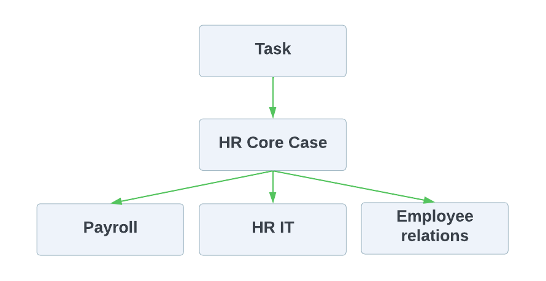
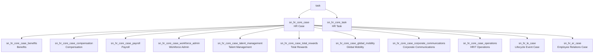
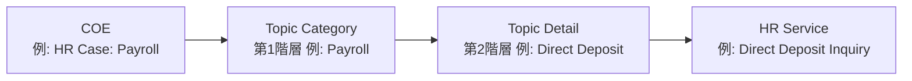
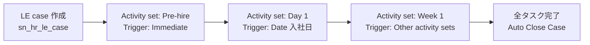
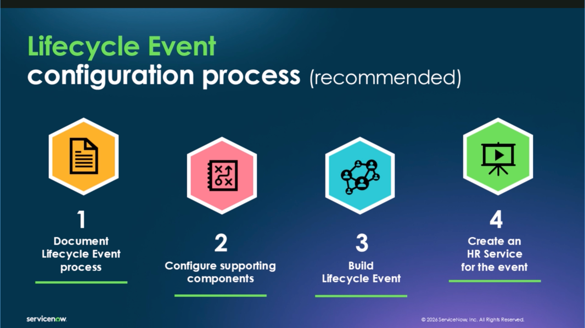
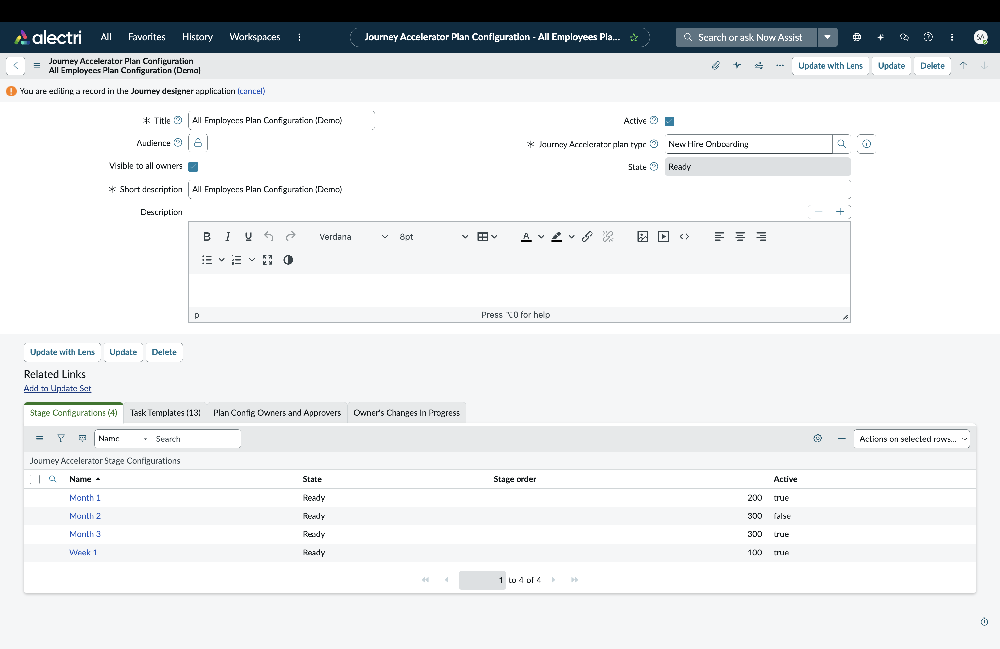
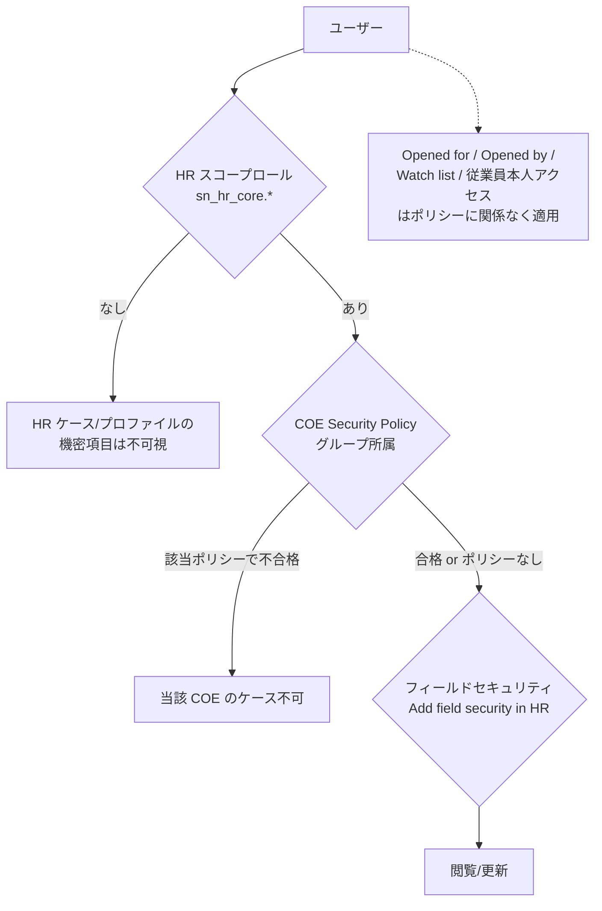
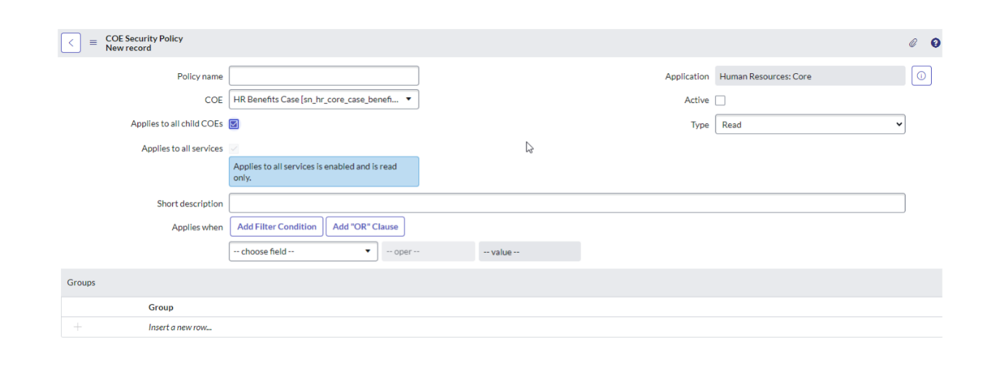

# HR Service Delivery（HRサービスデリバリー）

## 概要

ServiceNow の **HR Service Delivery（HRSD、HRサービスデリバリー）** は、従業員からの人事関連の問い合わせ・依頼（給与、福利厚生、休暇、異動、入退社など）を **HR case（HRケース）** として受け付け、HR 部門および IT・総務・経理など他部門を横断して処理するための Employee Workflows 領域のアプリケーション群である。公式リリースノートは HRSD を「HR とのやり取りを自動化し、HR サービスを単一プラットフォームで提供する」ものと説明している。[出典](https://www.servicenow.com/docs/r/IDeOjpA1hzonPLWG~inEpg/nbfXJFOWvjjo5rTkxuIJxA)

HRSD はプラットフォーム上では主に **Human Resources Scoped App: Core（`com.sn_hr_core`、スコープ `sn_hr_core`）** を中核とし、その上に Lifecycle Events、Employee Document Management、Journey designer、Agent Workspace 等の個別アプリケーション/プラグインを追加する構成になっている。HR データは機微情報であるため、**System Administrator（`admin`）であっても HR ロールなしでは HR ケースのコメントやプロファイルの個人情報を閲覧できない**という、他の ITSM 系アプリにはない独自のセキュリティモデルを持つ。[出典](https://www.servicenow.com/docs/r/SogDT~k7ktsbe1ZYegnaLg/du9UjN5uHbc4kr37eVMtEA)

本ファイルは Australia リリース（2026-05 GA）を基準に、以下を扱う。

| 節 | 内容 |
|---|---|
| 1 | 構成アプリケーションとプラグイン、Australia/Brazil の変更点 |
| 2 | データモデル（HR Case、COE テーブル、HR Profile、主要テーブル） |
| 3 | HR Case の状態・作成・自動クローズ |
| 4 | COE（Center of Excellence）とサービス分類 |
| 5 | HR Service（HR サービス）設定と Fulfillment type |
| 6 | Lifecycle Events（オンボーディング/オフボーディング） |
| 7 | Employee Journey Management（Journey designer / Journey Accelerator） |
| 8 | Employee Document Management（従業員文書管理） |
| 9 | Agent Workspace for HR Case Management（HR エージェントワークスペース） |
| 10 | セキュリティ（HR データ保護）：ロール、COE Security Policy、Client roles 等 |
| 11 | AI（Otto / Now Assist for HRSD）と周辺アプリ |
| 12 | 設計・運用上の留意点 |

関連ファイル：Employee Center は [Service Portal と Employee Center](../platform/portals-employee-center.md)、ワークスペース全般は [Workspace と UI Builder](../platform/workspaces-ui-builder.md)、ACL の一般論は [アクセス制御（ACL）](../platform/access-control-acl.md)、生成 AI は [Now Assist と AI Agents](../platform/now-assist-ai-agents.md)、Workplace / Legal は [Workplace Service Delivery・Legal Service Delivery 等](workplace-legal-other.md) を参照。

---

## 1. 構成アプリケーションとプラグイン

### 1.1 HR Service Delivery を構成するアプリケーション

HR Service Delivery は単一のプラグインではなく、複数のアプリケーションの集合として提供される。Australia の HRSD リリースノートおよび Employee Service Management の概要ページに掲載されている主なアプリケーションは以下のとおり。[出典](https://www.servicenow.com/docs/r/IDeOjpA1hzonPLWG~inEpg/nbfXJFOWvjjo5rTkxuIJxA) [出典](https://www.servicenow.com/docs/r/employee-service-management/employee-service-management-overview.html)

| アプリケーション（英語名） | 日本語の意味 | 概要 |
|---|---|---|
| Case and Knowledge Management | ケース・ナレッジ管理 | HR ケース、HR タスク、HR プロファイル、HR ナレッジ、COE、HR サービスなど HRSD の中核。`com.sn_hr_core` の有効化で利用可能 |
| Agent Workspace for HR Case Management | HR ケース管理用エージェントワークスペース | HR エージェント向けの Next Experience ワークスペース（Store から導入） |
| Lifecycle Events / Lifecycle Events for Enterprise | ライフサイクルイベント | 入社・退社・異動・休職など、部門横断の一連の活動を自動化 |
| Journey designer | ジャーニーデザイナー | Lifecycle Events と Journey Accelerator を束ね、従業員・マネージャー向けのジャーニー体験を提供（Store） |
| Employee Document Management | 従業員文書管理 | 従業員文書のリポジトリ、保持期間、リーガルホールド、パージ |
| Employee Center / Employee Center Pro | 従業員ポータル | 従業員向けの統合ポータル（[別ファイル](../platform/portals-employee-center.md)） |
| Manager Hub | マネージャーハブ | マネージャー向けセルフサービス・チーム情報・推奨アクション |
| ServiceNow Otto for HRSD（旧 Now Assist for HRSD） | HRSD 向け生成 AI | ケース/チャット要約、返信提案、解決メモ作成等（Store） |
| Recommended Actions for HRSD | 推奨アクション | **Australia で新規**。HR ケースの文脈に応じて KB 記事・類似ケース等を提示 |
| Universal Request | ユニバーサルリクエスト | 部門横断のケース解決（ESM/GBS 向け） |
| Workforce Optimization for HR | HR 向けワークフォース最適化 | HR エージェントのスケジュール・割り当て・休暇管理。Australia ではサポートされるが**将来のリリースで非推奨予定** |
| Hiring Experiences | 採用体験 | 採用マネージャー・リクルーター・面接官・応募者向け共有ワークスペース |
| HRSD Third-Party Integration | サードパーティ連携 | HR システム、身元調査、電子署名との連携 |

### 1.2 主要プラグイン ID

| プラグイン/アプリ名 | ID | 備考 |
|---|---|---|
| Human Resources Scoped App: Core | `com.sn_hr_core` | Case and Knowledge Management の本体。スコープ `sn_hr_core` [出典](https://www.servicenow.com/docs/r/XbpkTdWa3HBo31srdD0Rdg/uSzIrGA~ufNQaVSg0yBQ2Q) |
| Lifecycle Events | `com.sn_hr_lifecycle_events` | ライフサイクルイベントの基本機能。スコープ `sn_hr_le` [出典](https://www.servicenow.com/docs/r/XbpkTdWa3HBo31srdD0Rdg/8VXuBSPr2aok3gD2XvxTrA) |
| Lifecycle Events for Enterprise | `com.sn_hr_lifecycle_ent` | 部門横断のオンボーディング/トランジション（Enterprise Onboarding and Transitions）。Orlando 以降、上記と 2 プラグイン構成 |
| Employee Document Management | `com.sn_employee_document_management` | スコープ `sn_hr_ef` [出典](https://www.servicenow.com/docs/r/XbpkTdWa3HBo31srdD0Rdg/CtXije81liOoBMQ9ayyrHQ) |
| Agent Workspace for HR Case Management | `com.sn_hr_agent_ws`（スコープ `sn_hr_agent_ws`） | ServiceNow Store からリクエストしてインストール [出典](https://www.servicenow.com/docs/r/delta-zurich-brazil/brazil-zurich-agentworkspaceforhrcasemanagement-release-notes.html) [出典](https://www.servicenow.com/docs/r/SogDT~k7ktsbe1ZYegnaLg/tv9fLeIetBZXUOoFUHPGdA) |
| Journey designer | スコープ `sn_jny` | Store アプリ。Journey Accelerator（`sn_ja`）も同時にインストールされる [出典](https://www.servicenow.com/docs/r/H8yQl2SqBqnT6LbpTm28UQ/CNHAg8sQcFCXOy6JVDWoqw) |
| Employee Center Pro | `sn_ex_sp_pro` | Journey designer の依存アプリ【第三者情報】（ServiceNow 社員による Community 記事）[出典](https://www.servicenow.com/community/hrsd-articles/employee-journey-management-configuration-guide-for-admins/ta-p/3542861) |

- プラグインの有効化には `admin` ロールが必要。Lifecycle Events 系プラグインはデモデータを含み、未有効の関連プラグインも併せて有効化する。[出典](https://www.servicenow.com/docs/r/XbpkTdWa3HBo31srdD0Rdg/8VXuBSPr2aok3gD2XvxTrA)
- どのプラグイン（例：Lifecycle Events for Enterprise）を有効化できるかは、契約している HR Service Delivery のパッケージによって異なる。[出典](https://www.servicenow.com/docs/r/XbpkTdWa3HBo31srdD0Rdg/8VXuBSPr2aok3gD2XvxTrA)

### 1.3 パッケージ（エディション）

HRSD のパッケージは公式ドキュメント上では「HR Service Delivery のパッケージにより利用可能な COE や機能が異なる」とだけ記載されている。[出典](https://www.servicenow.com/docs/r/employee-service-management/agent-workspace-for-hr-case-management/agent-ws-hr-case-mgmt-landing-page.html)

- 一般に Standard / Professional / Enterprise（および生成 AI を含む「Plus」系）の階層で語られるが、各階層に含まれる機能（Lifecycle Events、Employee Document Management、Performance Analytics、Employee Center Pro 等）の境界はパートナー資料間で一致しない。【第三者情報】[出典](https://www.servicenow.com/community/hrsd-forum/differences-between-servicenow-hrsd-standard-professional-and/m-p/2574722)
- パッケージごとの正式な機能対照表は公開情報では確認できず。詳細は [ライセンスモデル](../../03_導入編/01-licensing-model.md)・[エディション比較](../../03_導入編/03-edition-comparison.md) を参照。

### 1.4 Australia リリースでの主な変更点

| 対象 | 変更内容 | 出典 |
|---|---|---|
| Recommended Actions for HRSD | **新規アプリ**。HR エージェントにリアルタイムのガイダンスとリソースを提示し、ケース解決を迅速化 | [出典](https://www.servicenow.com/docs/r/IDeOjpA1hzonPLWG~inEpg/nbfXJFOWvjjo5rTkxuIJxA) |
| Case and Knowledge Management | **Granular admin roles（粒度の細かい管理者ロール）による HR データへのアクセス制限**。HR 管理者が COE Security Policy に基づき HR ケースにアクセスできるユーザーと、アクセスを制限しているポリシーを確認可能（COE Security Diagnostics） | [出典](https://www.servicenow.com/docs/r/XbpkTdWa3HBo31srdD0Rdg/hiooP_AjEwf6imWhMtRCVQ) |
| Agent Workspace for HR Case Management | CCaaS（Contact Center as a Service）連携：認定済みの事前構築連携により、CCaaS プロバイダーの音声・コールバックを HR Agent Workspace で処理し、通話後のラップアップ時間を確保（Interaction Controls Component, ICC） | [出典](https://www.servicenow.com/docs/r/delta-zurich-brazil/brazil-zurich-agentworkspaceforhrcasemanagement-release-notes.html) |
| 同上 | Recommended Actions for HRSD：ケース文脈に基づき KB 記事・類似ケースを推奨し、承認が必要な場合のみ承認追加を提案 | 同上 |
| 同上 | Case creation configuration：ケース作成時に Subject person（対象者）と Opened for（依頼対象者）の HR プロファイルを確認可能 | 同上 |
| 同上 | Advanced Knowledge Editor：ナレッジ記事作成・編集への AI 支援と品質改善提案 | 同上 |
| Now Assist（Otto）for HRSD | Generate onboarding ramp-up plan（エージェンティックワークフロー）：類似ロールの過去ジャーニーやピアの申請実績から追加の Journey サービス（カタログ/オーダーガイド）を推奨し、マネージャーが会話形式で追加 | [出典](https://www.servicenow.com/docs/r/pt-BR/release-notes/nahr-rn.html) |
| プラットフォーム共通 | 読み取り専用フィールド保護の強化（`read_only_option` フィールド、`strict_read_only` / `client_script_modifiable` 等）。バックエンドのみの変更で後方互換（KB2718122） | [出典](https://www.servicenow.com/docs/r/IDeOjpA1hzonPLWG~inEpg/nbfXJFOWvjjo5rTkxuIJxA) |
| Workforce Optimization for HR | Australia ではサポート継続、将来のリリースで非推奨予定 | [出典](https://www.servicenow.com/docs/r/IDeOjpA1hzonPLWG~inEpg/nbfXJFOWvjjo5rTkxuIJxA) |

> **Australia の granular admin roles について:** Australia ではプラットフォーム全体で 300 以上のタスクベースの granular admin roles が導入された（KB2773087）。【第三者情報】（ServiceNow Community ブログ）[出典](https://www.servicenow.com/community/platform-privacy-security-blog/granular-admin-roles-in-australia-precise-access-control-for-a/ba-p/3562990) HRSD 固有の granular admin role の具体的なロール名一覧は、公開情報では確認できず。

参考：Zurich では Hiring Experiences・HR Multi Instance Integration が新規、Accurate Background / First Advantage / Sterling Talent Solutions の身元調査連携、Learning Posts、Listening Posts が非推奨（Learning Posts の機能は Journey designer に統合）となった。[出典](https://www.servicenow.com/docs/r/u1slaAtcFiiXFQcd9RcR_A/3llsX7GKi0XYtAE18JebDg)

> **Brazil での変更:** Case and Knowledge Management および Agent Workspace for HR Case Management の Australia→Brazil 差分リリースノートは、New features / Changes / Removed / Deprecations のいずれも「No updates for this release」となっている。[出典](https://www.servicenow.com/docs/r/delta-australia-brazil/brazil-australia-caseandknowledgemanagement-release-notes.html) [出典](https://www.servicenow.com/docs/r/delta-zurich-brazil/brazil-zurich-agentworkspaceforhrcasemanagement-release-notes.html)

> **Brazil での変更:** Employee Service Management の概要ページでは、Employee Slate が **EmployeeWorks Web App（旧 Employee Slate）** として掲載されている。Brazil へのアップグレードには Zurich Patch 9 以降と AI アシスタント（Moveworks または Now Assist）が必要とされる。[出典](https://www.servicenow.com/docs/r/employee-service-management/employee-service-management-overview.html) [出典](https://www.servicenow.com/docs/r/delta-australia-brazil/brazil-australia-employeeslate-release-notes.html)

> **Brazil での変更:** Journey designer では「Generate onboarding ramp-up plan」に加え「Offboarding knowledge transfer plan generation（退職者のナレッジ移管計画生成）」のエージェンティックワークフローが Brazil ドキュメントに掲載されている（詳細は 7.5 節）。[出典](https://www.servicenow.com/docs/r/employee-service-management/journey-designer/agentic-wf-jny-dsgnr-na-hrsd.html)

---

## 2. データモデル

### 2.1 HR Case テーブル階層

HR Service Delivery の **HR case（HRケース）** は `sn_hr_core_case` テーブルに格納され、`sn_hr_core_case` は `task` テーブルを拡張している。各 COE（Center of Excellence）は `sn_hr_core_case` を拡張した子テーブルとして実装される。[出典](https://www.servicenow.com/docs/r/XbpkTdWa3HBo31srdD0Rdg/uSzIrGA~ufNQaVSg0yBQ2Q)

- **キャプション:** HR ケーステーブルの継承階層の概念図。
- **図の説明:** 最上位に `Task`、その下に `HR Core Case`（`sn_hr_core_case`）があり、さらにその下に `Payroll`（`sn_hr_core_case_payroll`）、`HR IT`（`sn_hr_core_case_operations`）、`Employee relations` の 3 つの COE テーブルが矢印でぶら下がっている。ACL は子テーブル→HR Core Case→Task→`*` の順にフォールバック評価される、という説明のための図。
- **出典:** ServiceNow Community「HRSD Vancouver: COE Security policies inheritance explained」 https://www.servicenow.com/community/hrsd-articles/hrsd-vancouver-coe-security-policies-inheritance-explained/ta-p/2642530 （取得日：2026-11-03）【第三者情報】

### 2.2 COE（ケース）テーブル一覧

`sn_hr_core_case` を拡張する COE テーブルは以下のとおり（Australia の「Components installed with Case and Knowledge Management」より）。[出典](https://www.servicenow.com/docs/r/XbpkTdWa3HBo31srdD0Rdg/uSzIrGA~ufNQaVSg0yBQ2Q) [出典](https://www.servicenow.com/docs/r/employee-service-management/hr-service-delivery/hr-coe-security-policies.html)

| ラベル | テーブル名 | 備考 |
|---|---|---|
| HR Case | `sn_hr_core_case` | 親テーブル |
| HR Case: Benefits（福利厚生） | `sn_hr_core_case_benefits` | |
| HR Case: Compensation（報酬） | `sn_hr_core_case_compensation` | |
| HR Case: Corporate Communications（社内広報） | `sn_hr_core_case_corporate_communcations` | テーブル名のスペル（communcations）は製品のまま |
| HR Case: Employee Relations（従業員関係） | `sn_hr_core_case_relations` | 旧来テーブル。Rome 以降導入顧客は非推奨（Employee Relations 機能 `sn_hr_er_case` に置換） |
| HR Case: Ethics（倫理） | `sn_hr_core_case_ethics` | Rome 以降導入顧客は非推奨扱い |
| HR Case: Global Mobility（海外赴任・異動） | `sn_hr_core_case_global_mobility` | |
| HR Case: Investigation（調査） | `sn_hr_core_case_investigation` | Rome 以降導入顧客は非推奨 |
| HR Case: Payroll（給与） | `sn_hr_core_case_payroll` | |
| HR Case: Performance（パフォーマンス） | `sn_hr_core_case_performance` | Rome 以降導入顧客は非推奨 |
| HR Case: Talent Management（タレントマネジメント） | `sn_hr_core_case_talent_management` | |
| HR Case: Total Rewards（総報酬） | `sn_hr_core_case_total_rewards` | |
| HR Case: Workforce Admin（人事管理） | `sn_hr_core_case_workforce_admin` | |
| HRIT Operations Case（HR IT 運用） | `sn_hr_core_case_operations` | |
| HR Lifecycle Event Case | `sn_hr_le_case` | Lifecycle Events で生成されるケース |
| Employee Relations Case | `sn_hr_er_case` | Employee Relations 機能のケース |

- 非推奨の旧テーブル（Allegation 系 `sn_hr_er_allegation`、`sn_hr_core_allegation_type` 等を含む）は、既存利用顧客には影響しないとされている。[出典](https://www.servicenow.com/docs/r/XbpkTdWa3HBo31srdD0Rdg/uSzIrGA~ufNQaVSg0yBQ2Q)
- 独自 COE が必要な場合、`sn_hr_core_case` を拡張したテーブルを作成でき、COE Security Policy も適用できる。[出典](https://www.servicenow.com/docs/r/employee-service-management/hr-service-delivery/hr-coe-security-policies.html)

### 2.3 主要テーブル（Case and Knowledge Management）

Case and Knowledge Management は 88 テーブルをインストールする。主要なものを用途別に示す。[出典](https://www.servicenow.com/docs/r/XbpkTdWa3HBo31srdD0Rdg/uSzIrGA~ufNQaVSg0yBQ2Q)

| 分類 | テーブル名 | ラベル / 用途 |
|---|---|---|
| ケース・タスク | `sn_hr_core_case` | HR Case（基底） |
| | `sn_hr_core_task` | HR Task（HR タスク） |
| | `sn_hr_core_template` | HR Template（ケース/タスクのテンプレート） |
| | `sn_hr_core_tier_definition` | HR Tier Escalation（ティアエスカレーション定義） |
| | `sn_hr_core_bulk_case_request` / `sn_hr_core_bulk_case_creation_run` / `sn_hr_core_bulk_case_creation_data` | 一括ケース作成 |
| サービス・分類 | `sn_hr_core_coe` | COE |
| | `sn_hr_core_service` | HR Service（HR サービス） |
| | `sn_hr_core_service_option` | HR Service Option |
| | `sn_hr_core_service_activity` | Service Activity（サービスアクティビティ） |
| | `sn_hr_core_topic_category` | Topic Category（第1階層分類） |
| | `sn_hr_core_topic_detail` | Topic Detail（第2階層分類） |
| | `sn_hr_core_config_case` / `sn_hr_core_config_case_creation` / `sn_hr_core_config_case_creation_service` | ケースフォーム・ケース作成フォームの構成 |
| 条件・対象者 | `sn_hr_core_criteria` | HR Criteria（HR 条件） |
| | `sn_hr_core_condition` / `sn_hr_core_m2m_condition_criteria` | HR Condition（HR 条件定義） |
| | `sn_hr_core_client_role_rule` | Client Role Rule（クライアントロールルール） |
| プロファイル | `sn_hr_core_profile` | HR Profile（HR プロファイル） |
| | `sn_hr_core_job` / `sn_hr_core_job_profile` / `sn_hr_core_position` | Job / Job Profile / Position |
| | `sn_hr_core_contact` / `sn_hr_core_beneficiary` / `sn_hr_core_who_is_covered` | 連絡先・受益者・被扶養者 |
| | `sn_hr_core_profile_bank_account` / `sn_hr_core_direct_deposit` | 銀行口座・給与振込 |
| | `sn_hr_core_compensation`（`sn_hr_core_salary` / `sn_hr_core_bonus` / `sn_hr_core_stocks`） | 報酬（給与・賞与・株式） |
| | `sn_hr_core_benefit` 系（health / insurance / retirement / disability） | 福利厚生 |
| | `sn_hr_core_certification_and_license` / `sn_hr_core_language` / `sn_hr_core_visa_category` | 資格・言語・ビザ |
| 文書 | `sn_hr_core_document_template` / `sn_hr_core_pdf_template` / `sn_hr_core_pdf_template_mapping` | HR 文書テンプレート（※HR Document Templates は Xanadu から段階的に廃止、ServiceNow Document Templates を推奨） |
| | `sn_hr_core_document_acknowledgement` | 文書の確認記録 |
| セキュリティ | `sn_hr_core_coe_security_policy` | COE Security Policy |
| | `sn_hr_er_case_restriction` | Case Restriction Configuration（COE セキュリティポリシーの拡張） |
| その他 | `sn_hr_core_substitute_approver` | 代理承認者 |
| | `sn_hr_core_email_content` | メールコンテンツ |
| | `sn_hr_core_op_report` 系 | HR Operations Report |

HR Document Templates の非推奨については、Xanadu から段階的廃止が始まり ServiceNow Document Templates アプリの利用が推奨されている。[出典](https://www.servicenow.com/docs/r/Cz0Un5C85RB3j2nhhAK1aQ/fb7tGYg5G_SE~_0omQvyQQ)

### 2.4 HR Profile（HR プロファイル）

**HR Profile（HR プロファイル、`sn_hr_core_profile`）** は、従業員ごとの人事情報（雇用情報、連絡先、報酬、福利厚生、受益者、緊急連絡先など）を保持するテーブルである。`sys_user` と 1 対 1 で紐づき、氏名・従業員番号・部門・マネージャー・ロケーション等の雇用情報は `sys_user` から同期される。[出典](https://www.servicenow.com/docs/r/SogDT~k7ktsbe1ZYegnaLg/du9UjN5uHbc4kr37eVMtEA)

- HR Profile フォームの関連リスト：Employment Information、Contact Information、Beneficiaries、Who is Covered、Emergency Contacts、Direct Reports、Colleagues、Cases。[出典](https://www.servicenow.com/docs/r/SogDT~k7ktsbe1ZYegnaLg/du9UjN5uHbc4kr37eVMtEA)
- HR Profile の Related Links にある **Create New Case** からケースを作成できる。
- `sn_hr_core.profile_writer` ロールは HR プロファイルへの書き込みに加え、`sys_user` テーブルへの書き込み権限も付与する。[出典](https://www.servicenow.com/docs/r/XbpkTdWa3HBo31srdD0Rdg/uSzIrGA~ufNQaVSg0yBQ2Q)
- HR プロファイルは、ユーザー作成時（または HR プロファイル対象となったとき）にビジネスルール「Create HR Profile for Users」によって自動生成され、内部的には `hr_Profile` スクリプトインクルードの `createProfileFromUser()` が使われる。非アクティブユーザーには標準では生成されない。【第三者情報】（Community フォーラム）[出典](https://www.servicenow.com/community/hrsd-forum/hr-profiles-getting-created-automatically/m-p/1327423)
- 複数の職務（Job）レコードを 1 ユーザーに保持できる（Capturing multiple job records）。[出典](https://www.servicenow.com/docs/r/xGHm5nN1KlkEq58WJHJoPw/GM6Sx~Z4j0C0wpTZSW_riA)

### 2.5 Lifecycle Events / Journey / EDM のテーブル

| アプリ | 主なテーブル | 用途 |
|---|---|---|
| Lifecycle Events | `sn_hr_le_case` | Lifecycle event case |
| | `sn_hr_le_activity_set` | HR Activity Set（アクティビティセット）。評価間隔（evaluation interval）も保持 |
| | Activity set execution context（実行コンテキスト） | アクティビティセットごとの状態追跡。HR ケーステーブルと結合してレポート可能 |
| Journey designer | `sn_jny_journey_type` / `sn_jny_journey_config` / `sn_jny_journey` / `sn_jny_journey_progress` 等 | 7 章参照 |
| Employee Document Management | `sn_hr_ef_employee_document` / `sn_hr_ef_document_type` / `sn_hr_ef_security_policy` / `sn_hr_ef_retention_policy` / `sn_hr_ef_legal_hold` 等 | 8 章参照 |

[出典](https://www.servicenow.com/docs/r/XbpkTdWa3HBo31srdD0Rdg/8VXuBSPr2aok3gD2XvxTrA) [出典](https://www.servicenow.com/docs/r/api-reference/server-api-reference/hr_ActivitySetAPI.html) [出典](https://www.servicenow.com/community/hrsd-forum/understanding-execution-time-for-date-based-activity-sets-in/m-p/2907991)

---

## 3. HR Case の状態・作成・自動クローズ

### 3.1 HR Case の主要フィールド

Agent Workspace の HR ケースフォームで表示される主要項目は以下。[出典](https://www.servicenow.com/docs/r/employee-service-management/agent-workspace-for-hr-case-management/agent-ws-hr-case-mgmt-use.html) [出典](https://www.servicenow.com/docs/r/XbpkTdWa3HBo31srdD0Rdg/achhqXR9G6bsraCC8si8yQ)

| フィールド（英語） | 日本語 | 説明 |
|---|---|---|
| HR service | HR サービス | ケースの種類を決める HR サービス（5 章） |
| Subject person | 対象者 | ケースの対象となる従業員 |
| Opened for | 依頼対象者 | ケースが誰のために起票されたか。HR サービス設定で Subject person を Opened for に既定しないことも可能 |
| Opened by | 起票者 | |
| Priority | 優先度 | |
| State | 状態 | 3.2 参照 |
| Assignment group / Assigned to | 割り当てグループ / 担当者 | |
| Description / Comments / Work notes | 説明 / コメント / 作業メモ | HR ロールを持つユーザーのみ閲覧可（10 章） |
| Watch list | ウォッチリスト | HR サービス設定で Opened for のマネージャーを自動追加可能 |

### 3.2 HR Case の State（状態）

HR Case の `state` は `task.state` を継承し、`sn_hr_core_case` 用の辞書オーバーライドで既定値が **Draft（1）** に設定されている。公式ドキュメントで HR ケースの状態値一覧表は公開情報では確認できず、以下の値は Community フォーラムの記述に基づく。【第三者情報】[出典](https://www.servicenow.com/community/hrsd-forum/hr-case-always-set-to-quot-draft-quot-state/m-p/1302538) [出典](https://www.servicenow.com/community/hrsd-forum/adding-a-new-choice-to-state-on-hr-case-table-that-will-be/td-p/1311136/page/2)

| State（英語） | 日本語 | 値 | 備考 |
|---|---|---|---|
| Draft | ドラフト | 1 | `sn_hr_core_case` の既定値 |
| Ready | 準備完了 | 10 | |
| Awaiting Approval | 承認待ち | 11 | |
| Work in Progress | 作業中 | 18 | |
| Suspended | 一時停止 | 公開情報では確認できず | |
| Awaiting Acceptance | ユーザー受け入れ待ち | 公開情報では確認できず | HR サービスの Case options で「user acceptance status をスキップ」可能 |
| Closed Complete | 完了クローズ | 3 | 既定のクローズ状態（default close state） |
| Closed Incomplete | 未完了クローズ | 4（Community 記述） | |
| Cancelled | 取消 | 7（Community 記述） | |

実装時は、インスタンスの `sys_choice`（`task.state` を `sn_hr_core_case` で絞り込み）で必ず確認すること。

> **Australia での挙動変更（要注意）:** Australia で `hr_caseCreation` スクリプトインクルード内の `sn_hr_core.hr_TemplateUtils` の `applyBefore` 呼び出しが変更され、バックエンドから手動作成したケースで、既定値を持つフィールド（例：`state` の既定 Draft）に HR サービスのテンプレート値（例：Ready）が上書きされなくなったという報告がある。報告者は HR ケースの `state` 既定値を 10 に変更して回避した。リリースノートには記載がない。【第三者情報】[出典](https://www.servicenow.com/community/developer-forum/change-to-the-hr-casecreation-script-include-in-australia/m-p/3575323)

### 3.3 ケースの作成経路

- **従業員セルフサービス:** Employee Center（またはHR Service Portal）の HR カタログアイテム（Record producer）から起票。HR サービスの `Record producer` フィールドで紐づける。1 つの HR サービスに複数の Record producer を設定しないことがベストプラクティス。[出典](https://www.servicenow.com/docs/r/XbpkTdWa3HBo31srdD0Rdg/achhqXR9G6bsraCC8si8yQ)
- **エージェントによる起票:** Agent Workspace の New Case、または Core UI の HR Case Management > Create New Case。HR サービスの `HR criteria` により、エージェントが代理起票できる対象者を制限できる（例：401(k) 申請を米国従業員に限定）。セルフサービスでは HR criteria はカタログの表示制御には使われない。
- **HR プロファイルから:** Related Links の Create New Case。
- **一括作成:** Bulk Case Creation（Agent Workspace の Configurable 版でサポート、スケジュールジョブ「Bulk Case Creation」は 6 時間ごとに実行）。[出典](https://www.servicenow.com/docs/r/XbpkTdWa3HBo31srdD0Rdg/uSzIrGA~ufNQaVSg0yBQ2Q)
- **チャネル:** Virtual Agent、チャット、電話（CCaaS 連携は Australia で追加）、メール、グローバル検索。[出典](https://www.servicenow.com/docs/r/employee-service-management/agent-workspace-for-hr-case-management/agent-ws-hr-case-mgmt-use.html)
- **API:** Table API（`/api/now/table/sn_hr_core_case`）によるケース作成・更新は一般的に利用されるが、HR ロールと COE ポリシーの制約を受ける。【第三者情報】

### 3.4 自動クローズとスケジュールジョブ

Case and Knowledge Management がインストールするスケジュールジョブは以下。[出典](https://www.servicenow.com/docs/r/XbpkTdWa3HBo31srdD0Rdg/uSzIrGA~ufNQaVSg0yBQ2Q)

| ジョブ名 | 内容 | 頻度 |
|---|---|---|
| Auto Close Case | Fulfillment type が Service activity / Lifecycle event の HR サービスについて、設定に基づき HR ケースを自動クローズ | 日次 |
| Bulk Case Creation | 一括ケース作成 | 6 時間ごと |
| Daily HR Task | HR タスクのパラメータに基づくリマインダー通知 | 日次 |
| Migrate HR E-Signature Tasks | HR タスクテンプレートと未完了タスクを新しい e-signature タスクタイプへ移行し、旧来の credential / e-signature / signing-document タスクタイプを無効化 | オンデマンド |
| Update Client Roles | HR 条件テーブルに基づき、雇用開始/終了する HR プロファイルのロール割り当てを更新。`hradmin` ユーザーで実行（削除した場合は `sn_hr_core.admin` を持つ別ユーザーを割り当てる） | 日次 |

HR サービス側の自動クローズ関連設定（`Auto close case`、`Close when`、`Auto close offset`（最大 90 日））は 5.2 節を参照。

---

## 4. COE（Center of Excellence）とサービス分類

### 4.1 COE とは

**COE（Center of Excellence、専門部門）** は、給与・福利厚生・報酬などの HR の機能分野を表す。ServiceNow では各 COE が HR Case テーブルの拡張テーブルとして実装され、HR サービスはいずれかの COE の下に分類される。[出典](https://www.servicenow.com/docs/r/XbpkTdWa3HBo31srdD0Rdg/achhqXR9G6bsraCC8si8yQ)

COE をテーブルで分ける意義は以下の 3 点に集約される。

1. **フォーム・フィールドの分離:** COE ごとに固有フィールドを持てる（例：Payroll ケースに給与関連項目）。
2. **アクセス制御:** COE Security Policy によって COE 単位で閲覧・更新可能なグループを制限できる（10.4 節）。
3. **レポーティング:** COE 単位の集計。

### 4.2 HR サービス分類の 3 階層

HR Service Delivery のサービス分類（HR service categorization）は以下の階層で構成される。[出典](https://www.servicenow.com/docs/r/washingtondc/employee-service-management/hr-service-delivery/hr-service-categorization.html) [出典](https://www.servicenow.com/docs/r/XbpkTdWa3HBo31srdD0Rdg/achhqXR9G6bsraCC8si8yQ)

| 階層 | テーブル | 説明 |
|---|---|---|
| COE | `sn_hr_core_coe` | HR ケーステーブル（拡張テーブル）に対応 |
| Topic Category | `sn_hr_core_topic_category` | HR サービスの第1階層分類 |
| Topic Detail | `sn_hr_core_topic_detail` | 第2階層分類。Employee Document Management の Document type とも関連付く |
| HR Service | `sn_hr_core_service` | ケースタイプ。起票時に選択され、テンプレート・フルフィルメント方法を決定 |

- Employee Center のカタログ分類は従業員目線のものであり、COE データモデル上の HR サービス分類とは無関係である。[出典](https://www.servicenow.com/docs/r/XbpkTdWa3HBo31srdD0Rdg/achhqXR9G6bsraCC8si8yQ)
- HR ケースは HR サービス間で再分類（Transfer case）でき、その結果 COE（テーブル）が変わると、COE Security Policy によって元の担当者がアクセスを失うことがある。[出典](https://www.servicenow.com/docs/r/employee-service-management/hr-service-delivery/hr-coe-security-policies.html)

---

## 5. HR Service（HRサービス）

### 5.1 位置づけ

**HR Service（HR サービス、`sn_hr_core_service`）** は、特定のケースタイプについて「依頼から履行まで（request-to-fulfillment）」のプロセスを定義するレコードである。例として、福利厚生登録、給与振込設定、サードパーティ身元調査依頼などがある。[出典](https://www.servicenow.com/docs/r/XbpkTdWa3HBo31srdD0Rdg/achhqXR9G6bsraCC8si8yQ)

- 社内専用（エージェントのみが起票）の HR サービスには **HR service + HR case template** が必要。
- 従業員セルフサービス用には加えて **HR catalog item（Record producer）** が必要。

### 5.2 HR Service Configuration フォーム

- **メニュー:** All > HR Administration（Australia ドキュメント上は HR Management）> HR Services > HR Service Configuration
- **必要ロール:** `sn_hr_core.admin`

[出典](https://www.servicenow.com/docs/r/XbpkTdWa3HBo31srdD0Rdg/achhqXR9G6bsraCC8si8yQ)

| フィールド（英語） | 日本語 | 説明 |
|---|---|---|
| HR service name | HR サービス名 | |
| Value | 値 | サービス名から自動設定 |
| Security badge | セキュリティバッジ | ポータル上で、どの部門が処理するかを示すバッジ |
| Fulfillment type | 履行タイプ | 5.3 参照 |
| Topic category / Topic detail | トピック分類 | 第1/第2階層分類 |
| COE | COE | 所属 COE。Enterprise 顧客は Lifecycle event サービスに任意の COE を割り当て可能 |
| Auto close case | ケース自動クローズ | 全タスク/必須タスク完了後に自動クローズ。Fulfillment type が Service activity / Lifecycle event のときのみ表示 |
| Close when | クローズ条件 | 全タスク完了か必須タスクのみ完了か |
| Auto close offset | 自動クローズ猶予日数 | 最大 90 日。Close when が必須のみで任意タスクのみ残る場合、オフセットを無視しジョブ実行時にクローズ |
| Opened for / Approver view、Opened for / Task assignee view | 代替ビュー | ロールに応じた代替 HR ケースビュー |
| Active | 有効 | |
| Show case to subject person | 対象者に表示 | （Employee Service Center）対象者にケースを表示。子ケースは最大 3 世代まで親にロールアップ |
| Template | テンプレート | 起票時にケースフォームへ自動入力する HR ケーステンプレート |
| Auto-move attachments | 添付の自動移動 | Employee Document Management 有効時のみ。添付を文書リポジトリへ移動 |
| Employee document type | 従業員文書タイプ | Auto-move attachments 選択時に表示 |
| Record producer | レコードプロデューサー | セルフサービス用カタログアイテム |
| Case options | ケースオプション | マネージャーをウォッチリストに追加／アドホック承認者の追加許可／文書の自動作成・送付／文書タスクの自動開始（Document Templates プラグイン導入時）／Subject person を Opened for に既定しない／自動割り当てスキップ／ユーザー受け入れ状態のスキップ／Employee Center で Opened for のキャンセルを禁止 |
| HR criteria | HR 条件 | エージェントが代理起票できる対象従業員の条件（セルフサービスのカタログ表示制御ではない） |
| Case creation service configuration | ケース作成サービス構成 | New Case モジュールでのケース作成フォーム構成 |
| Description | 説明 | |

関連リスト：

- **Checklist（チェックリスト）:** エージェントが履行時に確認する項目。
- **Additional HR Service Information:** 起票後の HR ケースフォームに表示するフィールド。COE 側のケースフォーム構成と 2 段構えで設定する。COE テーブルにユーザー定義列を追加した場合は、他の HR サービスで表示されないよう UI ポリシー（Visible=false）で制御する。

### 5.3 Fulfillment type（履行タイプ）

| 値 | 説明 |
|---|---|
| Manual | 構成を伴わない単純な履行。エージェントが直接対応 |
| Service activity | 1 つ以上の Service activity（承認、タスク、子 HR サービス）で履行 |
| Workflow | ワークフロー（レガシー）で履行 |
| Lifecycle event | （Enterprise Onboarding and Transitions のみ）Lifecycle event（アクティビティの集合）で履行。例：New hire onboarding |
| Advanced | ワークフローと Service activity の組み合わせ |
| Flow | Workflow Studio（Flow Designer）のフローで履行。フローと HR サービスを結ぶ flow condition の作成が必要 |
| Journey | Journey designer の Journey configuration（Lifecycle Events コンポーネントを含む場合）に紐づく HR サービスに必要【第三者情報】 |

[出典](https://www.servicenow.com/docs/r/XbpkTdWa3HBo31srdD0Rdg/achhqXR9G6bsraCC8si8yQ) [出典](https://www.servicenow.com/community/hrsd-articles/employee-journey-management-configuration-guide-for-admins/ta-p/3542861)

- 旧来ワークフローと Workflow Studio のフローのどちらを実行するかは、システムプロパティ `sn_hr_core.deprecated_workflows` で制御できる（Quebec 期のドキュメントに記載。Australia での扱いは公開情報では確認できず）。[出典](https://docs.servicenow.com/bundle/quebec-release-notes/page/release-notes/hr-service-delivery/workplace-safety-mgmt-rn.html)
- 新規実装では Flow（Workflow Studio）を選択するのが一般的。【経験則】詳細は [Workflow Studio / Flow Designer](../platform/flow-designer-workflow-studio.md) を参照。

### 5.4 HR criteria と User criteria

**HR criteria（HR 条件、`sn_hr_core_criteria`）** は HR Service Delivery 専用の対象者条件で、HR サービスの代理起票対象やコンテンツ（HR ナレッジ、Employee Center のコンテンツ）の対象者を制御する。**User criteria（ユーザー条件）** はプラットフォーム全体の汎用条件で、カタログやナレッジの可視性に使われる。ナレッジ記事などでは両方を同時に要求する構成もある。【第三者情報】[出典](https://www.servicenow.com/community/hrsd-forum/hr-criteria-and-user-criteria-in-servicenow/m-p/3175931)

HR criteria は `sn_hr_core_condition`（HR Condition）を `sn_hr_core_m2m_condition_criteria` で束ねて定義する。[出典](https://www.servicenow.com/docs/r/XbpkTdWa3HBo31srdD0Rdg/uSzIrGA~ufNQaVSg0yBQ2Q)

---

## 6. Lifecycle Events（ライフサイクルイベント：オンボーディング/オフボーディング）

### 6.1 概要

**Lifecycle Events for Enterprise（Enterprise Onboarding and Transitions）** は、入社（オンボーディング）、退社（オフボーディング）、異動、昇進、育児休業などの従業員ライフサイクルイベントを自動化し、HR・IT・Facilities（総務）・Finance・Legal を横断して作業を調整するアプリケーションである。従業員にはステップごとのガイダンスを、管理者にはプロセス最適化のダッシュボードを提供する。[出典](https://www.servicenow.com/docs/r/XbpkTdWa3HBo31srdD0Rdg/8VXuBSPr2aok3gD2XvxTrA)

### 6.2 構成要素

| 要素（英語） | 日本語 | 説明 |
|---|---|---|
| Lifecycle event | ライフサイクルイベント | アクティビティセットで構成されたアクティビティの集合。Lifecycle event generator（生成ツール）で作成 |
| Activity set | アクティビティセット | 関連するアクティビティのグループ（例：Pre-hire、Day 1、Week 1）。各セットは 1 つのライフサイクルイベントに属し、トリガーを持つ。実行コンテキストで状態を追跡 |
| Activity | アクティビティ | 個々のステップ。所有グループ（Owner group）に属し、そのグループのメンバーのみ構成可能 |
| Lifecycle event case | ライフサイクルイベントケース | ライフサイクルイベントで履行される HR ケース（`sn_hr_le_case`）。例：New hire onboarding サービス → New hire onboarding イベント |

アクティビティの種類：[出典](https://www.servicenow.com/docs/r/XbpkTdWa3HBo31srdD0Rdg/8VXuBSPr2aok3gD2XvxTrA)

| 種類 | 例 |
|---|---|
| Approval（承認） | マネージャー承認 |
| Employee task（従業員タスク） | オンボーディング動画の視聴、書類への署名 |
| Fulfiller task（フルフィラータスク） | IT による Active Directory アカウント・デバイス準備、転居支援の手配 |
| Notification（通知） | 関係者への通知 |
| Flow（フロー） | Workflow Studio のフロー実行 |
| Content / Activity container（コンテンツ/コンテナ） | 情報提供、アクティビティのまとまり |

### 6.3 アクティビティセットのトリガータイプ

Australia ドキュメントに記載されたアクティビティセットのトリガータイプは以下。[出典](https://www.servicenow.com/docs/r/baBFTRuHLgu7HSwp0SUEQQ/Rlu6CCjAlElc0I7PGSE2_Q)

| Trigger type | 日本語 | 説明・設定項目 |
|---|---|---|
| Immediate | 即時 | ライフサイクルイベント（ケース）作成と同時にセット内の全アクティビティを開始 |
| Date | 日付 | 日付/マイルストーンに基づき開始。Trigger table、Trigger field、Ignore empty date（空なら起動しない）、Date offset type（Before/After）、Date offset quantity、Date offset units（Days/Weeks/Months） |
| Other activity sets | 他のアクティビティセット | 依存するアクティビティセットの全アクティビティ完了後に開始 |
| Condition | 条件 | 選択テーブルのフィールド値条件 |
| Advanced | 詳細（スクリプト） | スクリプトでカスタム条件を評価 |
| Combination | 組み合わせ | Date・Other activity sets・Condition の組み合わせ。公式記載では 3 つすべてを満たすと起動 |

- 日付ベースのアクティビティセットは即時評価ではなく **評価間隔（evaluation interval、既定 4 時間、`sn_hr_le_activity_set` に保持）** ごとに再評価されるため、起動時刻にばらつきが出る。【第三者情報】（ServiceNow 社員の Community 回答）[出典](https://www.servicenow.com/community/hrsd-forum/understanding-execution-time-for-date-based-activity-sets-in/m-p/2907991) [出典](https://www.servicenow.com/community/developer-blog/hrsd-lifecycle-events-evaluation-interval/ba-p/3079203)

### 6.4 ロール

| ロール名 | 技術名 | 権限 |
|---|---|---|
| Lifecycle Event Administrator | `sn_hr_le.admin` | すべてのイベント・アクティビティセット・アクティビティを完全に制御。`com.sn_hr_core` と `com.sn_hr_lifecycle_events` が有効な場合 HR Administrator（`sn_hr_core.admin`）に含まれる |
| Activity Set Manager | `sn_hr_le.activity_set_manager` | イベントとアクティビティセットの作成、自グループ所有アクティビティの構成、アクティビティセットの有効化・トリガー |
| Activity Writer | `sn_hr_le.activity_writer` | 自グループ所有アクティビティの構成 |
| Activity Reader | `sn_hr_le.activity_reader` | イベント・アクティビティセット・アクティビティの参照 |
| Lifecycle Event Case Writer | `sn_hr_le.case_writer` | ライフサイクルイベントケースの作成・管理・監視 |
| Lifecycle Event Case Reader | `sn_hr_le.case_reader` | ライフサイクルイベントケースの参照 |

[出典](https://www.servicenow.com/docs/r/XbpkTdWa3HBo31srdD0Rdg/8VXuBSPr2aok3gD2XvxTrA) [出典](https://www.servicenow.com/docs/r/employee-service-management/hr-service-delivery/c_ManageRoles.html)

### 6.5 構成手順（推奨プロセス）

- **キャプション:** ServiceNow が推奨するライフサイクルイベント構成の 4 ステップを示すスライド。
- **図の説明:** 左から「1 Document Lifecycle Event process（ライフサイクルイベントのプロセスを文書化）」「2 Configure supporting components（サポートコンポーネントを構成）」「3 Build Lifecycle Event（ライフサイクルイベントを構築）」「4 Create an HR Service for the event（イベント用の HR サービスを作成）」の 4 つの六角形アイコンが並ぶ。© 2026 ServiceNow, Inc.
- **出典:** ServiceNow Community「Employee Journey Management configuration guide for admins」 https://www.servicenow.com/community/hrsd-articles/employee-journey-management-configuration-guide-for-admins/ta-p/3542861 （取得日：2026-11-03）

公式ドキュメントのプロセスフロー：[出典](https://www.servicenow.com/docs/r/XbpkTdWa3HBo31srdD0Rdg/8VXuBSPr2aok3gD2XvxTrA)

1. **インストール:** HR パッケージに応じたプラグインを有効化。
2. **設計:** 管理者または Activity Set Manager が Lifecycle event generator でイベントとアクティビティセットを作成（「Document the lifecycle event process」でプロセス文書化が推奨されている）。[出典](https://www.servicenow.com/docs/r/xGHm5nN1KlkEq58WJHJoPw/Jn6X1JC8BxfvALkZBHKMKQ)
3. **割り当て・構成:** アクティビティを所有グループに割り当て、各グループが自分のアクティビティを構成。
4. **起動:** Case writer が Lifecycle event case を作成（または HR サービス経由／HR システム連携で起票）。
5. **履行:** 部門横断でアクティビティが実行される。
6. **監視:** 実行コンテキストでアクティビティセットの状態を追跡し、HR ケーステーブルと組み合わせてレポート。
7. **最適化:** ダッシュボードでプロセスを改善。

- **メニュー:** All > Lifecycle Events > Administration > Manage Lifecycle Events（デモの Onboarding イベントを複製して作成するのが推奨）。【第三者情報】[出典](https://www.servicenow.com/community/hrsd-articles/employee-journey-management-configuration-guide-for-admins/ta-p/3542861)
- **スクリプト API:** `hr_ActivitySet`（スコープ `sn_hr_le`、`com.sn_hr_lifecycle_events` が必要）でアクティビティセットをスクリプトから扱える。[出典](https://www.servicenow.com/docs/r/api-reference/server-api-reference/hr_ActivitySetAPI.html)

### 6.6 オンボーディング/オフボーディングの典型

| イベント | 典型的なアクティビティセット | 部門横断の例 |
|---|---|---|
| New hire onboarding（入社） | Pre-hire、Pre-boarding、Day 1、Week 1 など（デモデータ） | HR：書類回収、IT：アカウント/PC、Facilities：座席・入館証、Manager：歓迎・目標設定 |
| Offboarding（退職） | 退職通知、最終日前、最終日、退職後 | IT：アカウント停止・資産回収、Finance：最終精算、Legal：機密保持確認 |
| Transfer / Promotion / Parental leave | 異動・昇進・育休 | Parental Journey 用の `sn_hr_le_pj.admin` ロールあり |

[出典](https://www.servicenow.com/docs/r/XbpkTdWa3HBo31srdD0Rdg/8VXuBSPr2aok3gD2XvxTrA) [出典](https://www.servicenow.com/docs/r/employee-service-management/hr-service-delivery/c_ManageRoles.html) オフボーディングの具体的な標準構成例は公式ドキュメントでは確認できなかった（上表の退職例は一般的な構成例【経験則】）。

---

## 7. Employee Journey Management（従業員ジャーニー管理）

### 7.1 概要

**Employee Journey Management（EJM、従業員ジャーニー管理）** は、HR Service Delivery の機能群を組み合わせ、従業員・マネージャー・組織がエンゲージメントと生産性を支える「ジャーニー」を開始・運用するための仕組みである。構成要素は以下の 3 つ。[出典](https://www.servicenow.com/docs/r/SogDT~k7ktsbe1ZYegnaLg/DJyl9CLkjXmruBhUH2sPvg)

| コンポーネント | スコープ | 役割 |
|---|---|---|
| Journey designer | `sn_jny` | 最上位アプリ。Journey configuration（テンプレート）・Journey type・権限・ダッシュボードを管理 |
| Journey Accelerator | `sn_ja` | マネージャー/従業員/メンター向けのプラン（ステージ、To-do）を Employee Center に表示 |
| Lifecycle Events | `sn_hr_le` | HR 管理下の自動化（アカウント準備、通知、承認、部門横断作業）。HR ケースとして管理 |

1 つのジャーニーは、Lifecycle Events のプラン（全社タスク）と Journey Accelerator のプラン（チームレベルのタスク）を 1 つの Journey configuration にまとめたものである。【第三者情報】（ServiceNow 社員の Community 記事、2026-05）[出典](https://www.servicenow.com/community/hrsd-articles/employee-journey-management-configuration-guide-for-admins/ta-p/3542861)

### 7.2 Journey designer

Journey designer は、オンボーディング、産休・育休、部門間異動などの職業上・個人的な移行（トランジション）を支援するジャーニーを、従業員とマネージャーが開始・管理するためのアプリである。従業員・マネージャー・メンターは Employee Center でジャーニーを操作し、Now Mobile アプリでもタスクを完了できる。ジャーニープラン構成テンプレートは、ServiceNow のテンプレートオーナーと社内 SME が承認・レビュープロセスに従って共同管理する。[出典](https://www.servicenow.com/docs/r/baBFTRuHLgu7HSwp0SUEQQ/wWR85GZpNsaANhlSHLTTAQ)

- Journey designer は **ServiceNow Store** からリクエストしてインストールする。複数バージョンが存在し、インストール手順もバージョンで異なる。
- Journey designer をインストールすると Journey Accelerator（`sn_ja`）もインストールされる。依存：Human Resources Scoped App: Core、Lifecycle Events for Enterprise、Employee Center Pro、Admin Experience Framework 等。[出典](https://www.servicenow.com/docs/r/H8yQl2SqBqnT6LbpTm28UQ/Wt64L1FMqnkhMdlZX5t0OA)
- Vancouver 以前にはインストールできない。【第三者情報】[出典](https://www.servicenow.com/community/hrsd-articles/employee-journey-management-configuration-guide-for-admins/ta-p/3542861)
- Zurich で Learning Posts の機能が Journey designer に統合され、Listening Posts は非推奨となった。[出典](https://www.servicenow.com/docs/r/zurich/release-notes/jny-dsgnr-rn.html)

### 7.3 Journey designer のロールとテーブル

ロール（Yokohama 版「Components installed with Journey designer」より）：[出典](https://www.servicenow.com/docs/r/H8yQl2SqBqnT6LbpTm28UQ/CNHAg8sQcFCXOy6JVDWoqw)

| ロール | 技術名 | 説明 | 含むロール | 含まれる先 |
|---|---|---|---|---|
| Administrator | `sn_jny.admin` | Journey designer と Journey Accelerator の全構成・機能を作成・管理 | `sn_ja.admin`、`sn_jny.writer`、`taxonomy_admin`、`sn_hr_le.admin`、`user_criteria_admin` | `sn_hr_core.admin` |
| Modifier | `sn_jny.writer` | プラン・ステージ・To-do などジャーニー要素の作成・変更 | `sn_jny.reader`、`sn_ja.modifier` | `sn_jny.admin` |
| Reader | `sn_jny.reader` | ジャーニーの参照と自分に割り当てられたタスクの完了 | `sn_ja.reader` | `sn_hr_core.case_reader` |

主要テーブル：

| テーブル | 説明 |
|---|---|
| `sn_jny_journey_type` | Journey Type（ジャーニータイプ） |
| `sn_jny_journey_config` | Journey Configuration（プラン/ジャーニー構成） |
| `sn_jny_journey` | Journey（プランとジャーニーおよび関連） |
| `sn_jny_journey_progress` | Journey Progress（タスク完了マイルストーンに対する進捗） |
| `sn_jny_journey_field_mapping` | HR フィールド・固定文字・スクリプトを Journey designer / Journey Accelerator のフィールドへマッピング |
| `sn_jny_journey_heading_config` / `sn_jny_journey_heading_field_config` | ヘッダー構成 |
| `sn_jny_journey_quick_link` / `sn_jny_m2m_journey_config_quick_link` / `sn_jny_m2m_journey_type_quick_link` | クイックリンク |
| `sn_jny_m2m_journey_config_user_criteria` / `sn_jny_m2m_journey_config_user_criteria_no` | 推奨学習コースの対象（Available For / Not Available For） |
| `sn_jny_bulk_request` | 一括更新の追跡 |
| `sn_jny_st_journey` / `sn_jny_st_mobile_journey_overview` / `sn_jny_st_jny_mobile_carousel` 等 | Now Mobile 用データ |

### 7.4 構成の流れ（実務ガイド）

以下は ServiceNow 社員による Community 記事（2026-05-14 更新）に基づく。【第三者情報】[出典](https://www.servicenow.com/community/hrsd-articles/employee-journey-management-configuration-guide-for-admins/ta-p/3542861)

| 手順 | メニュー / 内容 |
|---|---|
| 前提 | `com.sn_hr_core`、`com.sn_hr_lifecycle_ent`、Employee Center Pro（`sn_ex_sp_pro`）、HR プロファイルの整備、公開済み HR カタログアイテム（5〜10 件程度から） |
| インストール | All > ServiceNow Store で Journey designer（`sn_jny`）を検索しインストール。デモデータは開発/テスト環境のみ。インストール後、All > System Application > Application Restricted Caller Access で Requested 状態の要求を Allowed に変更（KB1432208） |
| ガイド付き設定 | All > Journey designer > Administration > Journeys Guided Setup（`sn_jny.admin`） |
| Journey type | All > Journey designer > Manage Journey Types > New。マネージャー/従業員/メンター向けヘッダービューを任意で設定 |
| Journey configuration | All > Journey designer > Manage Journey Configurations > New。Journey owner permissions / Mentor permissions タブでオーナー・メンターの操作権限（タスク追加、クイックリンク追加、推奨学習追加など）を設定 |
| Lifecycle Events プラン | All > Lifecycle Events > Administration > Manage Lifecycle Events（デモの Onboarding を複製） |
| Journey Accelerator プラン | All > Journey designer > Administration > Manage Plan Configurations > New。ステージ（Stage Configurations）とタスク（Manage Task Templates）を作成。タスクは従業員/マネージャー/メンターに割当可能で、カタログ申請・承認・To-do の種類がある |
| オーナー・承認者 | Plan Config Owners and Approvers タブ。承認者未設定なら即時公開、設定時は 1 名の承認で公開 |
| HR サービス | Lifecycle Events を含む Journey configuration には Fulfillment type = **Journey** の HR サービスが必要 |
| 監視 | All > Journey designer > Dashboards |

- **キャプション:** Journey Accelerator Plan Configuration のレコードフォーム（デモデータ「All Employees Plan Configuration (Demo)」）。
- **画面の説明:** Next Experience UI のクラシックフォームで、「You are editing a record in the Journey designer application」と表示されている。上段に Title、Audience、Visible to all owners、Short description、Description、右側に Active、Journey Accelerator plan type（New Hire Onboarding）、State（Ready）がある。下部の関連リストタブは Stage Configurations (4)、Task Templates (13)、Plan Config Owners and Approvers、Owner's Changes In Progress。Stage Configurations には Week 1（Stage order 100）、Month 1（200）、Month 2（300, inactive）、Month 3（300）が並ぶ。
- **出典:** ServiceNow Community「Employee Journey Management configuration guide for admins」 https://www.servicenow.com/community/hrsd-articles/employee-journey-management-configuration-guide-for-admins/ta-p/3542861 （取得日：2026-11-03）

よくある問題（同記事）：オーディエンス制限によりカタログアイテムが見えない、HR サービスに Journey fulfillment type が設定されていない、ステージ順序を 100 の倍数で設定していないため Lifecycle Events のアクティビティが順不同で起動する、など。

### 7.5 AI（エージェンティックワークフロー）

Journey designer では Otto for HRSD と組み合わせた以下のエージェンティックワークフローが提供される。[出典](https://www.servicenow.com/docs/r/employee-service-management/journey-designer/agentic-wf-jny-dsgnr-na-hrsd.html)

| ワークフロー | 内容 | AI エージェント |
|---|---|---|
| Generate onboarding ramp-up plan（オンボーディング立ち上げ計画生成） | 新入社員向けのチーム固有・個別化された立ち上げ計画とタスクを生成。マネージャーは Virtual Agent 上の ServiceNow Otto でレビュー・修正・公開（Australia で追加） | Journey information retrieval、Employee skill gap、Learning content、Teammates learning content、Trending learning content、Ramp up plan generation、Ramp up plan reviewer |
| Offboarding knowledge transfer plan generation（退職時ナレッジ移管計画生成） | 退職者が持つ知識を特定・分類し、マネージャーやチームへ移管 | ページ上に記載なし |

- 既定ではエージェンティックワークフローと AI エージェントのレコードは**読み取り専用**。変更する場合は複製し、ガイド付き設定でワークフロー・エージェント・トリガーを有効化する。
- Now Assist の「Journey Generation for Managers」スキルは All > Now Assist Admin > Skills > Employee > HRSD で有効化（`sn_jny.admin` と `sn_nowassist_admin.nsa_admin` が必要）。【第三者情報】[出典](https://www.servicenow.com/community/hrsd-articles/employee-journey-management-configuration-guide-for-admins/ta-p/3542861)

### 7.6 Manager Hub

**Manager Hub（マネージャーハブ、`sn_mh`）** は、マネージャーにセルフサービス、チームのインサイト、推奨アクション、リーダーシップ向けリソースを提供するアプリで、ジャーニーのタスクを統合マネージャーダッシュボードに表示できる。[出典](https://www.servicenow.com/docs/r/employee-service-management/employee-service-management-overview.html) Manager Hub の詳細仕様は本ファイルの範囲外とする。

---

## 8. Employee Document Management（従業員文書管理）

### 8.1 概要

**Employee Document Management（EDM、従業員文書管理）** は、雇用契約書・各種証明書など従業員に関する文書を、文書タイプ・セキュリティポリシー・保持ポリシー・リーガルホールドとともに一元管理するアプリケーションである。プラグインは `com.sn_employee_document_management`、スコープは `sn_hr_ef`。文書は `sn_hr_ef_employee_document` テーブルに格納される。[出典](https://www.servicenow.com/docs/r/XbpkTdWa3HBo31srdD0Rdg/CtXije81liOoBMQ9ayyrHQ) [出典](https://www.servicenow.com/docs/r/employee-service-management/employee-document-management/hr-doc-management-config.html)

### 8.2 ロール

| ロール | 技術名 | 権限 | 含むロール |
|---|---|---|---|
| EF Administrator | `sn_hr_ef.admin` | EDM の完全な制御。EFDM ロールの割当、文書の検索・参照・作成・更新、Retention Period / Retention Policy / Security Policy / Document Type の CRUD、プロファイル/文書タイプのリーガルホールド管理、プロパティ管理、一括インポート | `sn_hr_ef.document_reader`、`sn_hr_ef.document_writer`、`sn_hr_ef.legal_hold_writer`、`sn_hr_ef.manager`、`sn_hr_core.basic`、`sn_hr_ef.document_import` |
| EFDM Reader | `sn_hr_ef.document_reader` | 文書の検索・参照。**セキュリティポリシーの Read タブにも追加が必要** | なし |
| EFDM Writer | `sn_hr_ef.document_writer` | 文書の検索・参照・作成・更新。**セキュリティポリシーの Write タブにも追加が必要** | EFDM Reader |
| EFDM Legal Hold Writer | `sn_hr_ef.legal_hold_writer` | リーガルホールド中の文書参照、HR プロファイルのリーガルホールド管理（`sn_hr_core.profile_writer` との併用が必要） | なし |
| EFDM Manager | `sn_hr_ef.manager` | 文書操作とポリシー/タイプ管理、プロファイル・文書タイプのリーガルホールド追加/解除 | Reader、Writer、Legal Hold Writer |
| Document Import | `sn_hr_ef.document_import` | 文書ステージングレコードの一括インポート | なし |

[出典](https://www.servicenow.com/docs/r/XbpkTdWa3HBo31srdD0Rdg/CtXije81liOoBMQ9ayyrHQ)

### 8.3 テーブル

| テーブル | 技術名 | 説明 |
|---|---|---|
| Employee Document | `sn_hr_ef_employee_document` | 文書本体（文書タイプ、Purge hold、Purge date、従業員、タグ、サイズ、形式、作成情報） |
| Document Type | `sn_hr_ef_document_type` | 文書の分類。アクセス・保持ポリシー・リーガルホールドを紐づける |
| Security Policy | `sn_hr_ef_security_policy` | COE、パージ承認、グループ、ロール |
| Security Policy for Document Type | `sn_hr_ef_m2m_doc_type_sec_policy` | セキュリティポリシーと文書タイプの M2M |
| Retention Period | `sn_hr_ef_retention_period` | 保持期間（日付オフセットのタイプ・単位・数量） |
| Retention Policy | `sn_hr_ef_retention_policy` | 保持ポリシー（適用条件、保持期間） |
| Legal Hold | `sn_hr_ef_legal_hold` | 文書タイプまたは HR プロファイルへのリーガルホールド |
| Purge Log | `sn_hr_ef_purge_log` | パージ履歴 |
| Attachment Tracking | `sn_hr_ef_attachment_tracking` | コピーされた添付の追跡（パージ用。HR タスク→HR ケースのコピーにも使用） |
| Employee Document Staging | `sn_hr_ef_import_staging` | 移行元リポジトリからの一括インポート用ステージング |

[出典](https://www.servicenow.com/docs/r/XbpkTdWa3HBo31srdD0Rdg/CtXije81liOoBMQ9ayyrHQ)

### 8.4 文書タイプ・セキュリティポリシー

- **Document Types:** All > HR Administration > Employee Documents > Document Types（`sn_hr_ef.manager`）。フィールド：Name、Topic detail、Active、Application type、Legal hold、Employee access、Expiration date。保存後タブ：Security Policies、Retention Policies、Legal Holds、Expiration Policies。すべての従業員文書は文書タイプを持つ必要がある。Topic detail を通じて HR サービスと連携し、HR ケースのクローズ時に文書を自動移動できる。
- **Security Policies:** All > HR Administration > Employee Documents > Security Policies（`sn_hr_ef.admin`）／Default Security Policies（`sn_hr_ef.manager`）。グループ・ロール（Match all で両方必須）でアクセスを付与し、Read / Write / Authorize Purge のタブを持つ。1 文書タイプに複数ポリシーを付与でき、Order の小さいものから評価される。

[出典](https://www.servicenow.com/docs/r/employee-service-management/employee-document-management/hr-doc-management-config.html)

### 8.5 保持・パージ・リーガルホールド

| 機能 | メニュー | ポイント |
|---|---|---|
| Retention Periods（保持期間） | All > HR Administration > Employee Documents > Retention Periods | Date field、Date offset type（Before/After）、units（months/years）、quantity（例：Created date + 1 year）。重複不可 |
| Retention Policies（保持ポリシー） | 同 > Retention Policies | Applies to（テーブル・文書タイプ）、HR criteria、Retention period。複数該当時は**最長の保持期間が優先**。既定ポリシーは COE テーブルごとに 1 つ、既定は**無期限（パージされない）** |
| Purge（パージ） | スケジュールジョブ | 保持ポリシーから Purge date を算出。セキュリティポリシーの Authorize Purge タブで指定されたグループの 1 名の承認/事前通知を経てパージ。パージ後は復元不可【第三者情報】 |
| Legal Hold（リーガルホールド） | 文書タイプの Legal hold チェック／HR プロファイル | 対象文書のパージ・変更を一時停止。ホールド設定後は Purge date が変わらない |
| Expiration Notification Policies（期限通知） | 同 > Expiration Notification Policies（`admin`） | 文書の有効期限前に受信者・グループへ通知 |

[出典](https://www.servicenow.com/docs/r/employee-service-management/employee-document-management/hr-doc-management-config.html) [出典](https://www.servicenow.com/community/hrsd-articles/employee-document-management-q-amp-a/ta-p/2412599)

### 8.6 プロパティとスケジュールジョブ

| 種別 | 名前 | 説明 |
|---|---|---|
| プロパティ | `sn_hr_ef.min_admin_count` | EDM 管理者の最小人数（既定 2） |
| プロパティ | `sn_hr_ef.purge_stride_length` | 「Update purge dates」ジョブで再計算対象を決める |
| ジョブ | Clean up inactive employee documents | 提出されなかったアップロード文書を削除 |
| ジョブ | EF bulk import from staging (hourly) | Ready 状態のステージングレコードを構成ごとに最大 100 件処理 |
| ジョブ | Delete employee documents | 削除対象フラグの文書を削除 |
| ジョブ | Delete notification (daily) | セキュリティポリシーに基づき削除通知/承認依頼をグループに送信 |
| ジョブ | Update purge dates for employee documents | 保持期間が変更された文書の Purge date を再計算 |

ジョブは既定で日次実行（bulk import は毎時）。[出典](https://www.servicenow.com/docs/r/XbpkTdWa3HBo31srdD0Rdg/CtXije81liOoBMQ9ayyrHQ)

---

## 9. Agent Workspace for HR Case Management（HRエージェントワークスペース）

### 9.1 概要

**Agent Workspace for HR Case Management（Configurable）** は、Next Experience UI と UI Builder 上に構築された HR エージェント向けワークスペースで、従業員との対話、問い合わせへの回答、問題解決を 1 か所で行える。ServiceNow Store から有効化する。[出典](https://www.servicenow.com/docs/r/employee-service-management/agent-workspace-for-hr-case-management/agent-ws-hr-case-mgmt-landing-page.html)

- **HR Service Delivery Agent Workspace（Classic）** は非推奨で、サポート対象外かつ新規有効化不可（KB0867184）。Classic 利用者は Configurable への移行が推奨される。
- 旧ワークスペースのカード/タグ構成テーブル `sn_hr_ws_landing_page_card_list_config` / `sn_hr_ws_landing_page_tag_config` は、Configurable では `sn_hr_agent_card_config` / `sn_hr_agent_tag_config` に相当する。【第三者情報】[出典](https://www.servicenow.com/community/hrsd-articles/hr-agent-workspace-migration-guidelines-from-classic-to/ta-p/2310606)

### 9.2 Configurable / Classic / Core UI の比較

| 観点 | Configurable | Classic（非推奨） | Core UI |
|---|---|---|---|
| UI 基盤 | Next Experience / UI Builder（バリアント、オーディエンス、ブランディング可） | Agent Workspace フレームワーク | フォーム/リスト |
| シングルペイン・マルチタブ | あり | あり | なし |
| エージェントアシスト | あり | あり | なし |
| 一括ケース作成 | あり | なし | — |
| コンテキストサイドパネル | 全機能 | 一部のみ | なし |
| その他 | リマインダー、ケース対応中の追加ケース作成、メール送信、インタラクション、ML によるパーソナライズ、EDM・文書テンプレート、エージェントチャット、SLA 表示、SMS、My Lists、レスポンステンプレート | — | — |

[出典](https://www.servicenow.com/docs/r/employee-service-management/agent-workspace-for-hr-case-management/agent-ws-hr-case-mgmt-landing-page.html)

### 9.3 画面構成

- **起点:** ランディングページ、リストキュー、Agent inbox、チャット、電話、グローバル検索。
- **HR ケースフォーム:** 上部タブ/子タブ、フォームヘッダー（HR service、Priority、State、Assigned to）、UI アクション（保存、状態変更、キャンセル等。ケースタイプと状態で変化）、Related Items メニュー（ケースと対象者のタスク・関連レコード。Playbook 表示時は変化）、ケース詳細、アクティビティストリーム（コメント・作業メモ・状態履歴）、コンテキストサイドパネル。
- **HR プロファイル系アイコン:** Open HR Profile（詳細プロファイル、At-a-glance サイドパネル）、Search for Record（関連社内レコード）、Open deep link（Link Generator で構成した外部情報）。
- **Playbook:** Lifecycle event ケースでは HR Service Delivery Playbook が表示される。

[出典](https://www.servicenow.com/docs/r/employee-service-management/agent-workspace-for-hr-case-management/agent-ws-hr-case-mgmt-use.html)

### 9.4 ロール

| ロール | 技術名 | 説明 |
|---|---|---|
| HR Workspace Admin | `sn_hr_agent_ws.admin` | Agent Workspace for HR Case Management の全構成 |
| HR agent | `sn_hr_core.basic` | 基本的な HR エージェントのワークスペース利用 |
| HR case writer | `sn_hr_core.case_writer` | 全 HR ケースの書き込み |
| HR manager | `sn_hr_core.manager` | 全 HR ケース・プロファイル・機密情報へのアクセス |
| Workspace user | `workspace_user` | ワークスペースへのアクセス、インタラクションの作成・参照 |
| Workspace Content Manager | `sn_cd.workspace_content_manager` | ワークスペースのコンテンツスケジュール管理 |
| UI notification admin | `ui_notification_admin` | UI 通知管理 |

[出典](https://www.servicenow.com/docs/r/SogDT~k7ktsbe1ZYegnaLg/tv9fLeIetBZXUOoFUHPGdA)

- Manage HR roles ページの最小管理者数プロパティには HR Agent Workspace Admin（`sn_hr_ws.admin`、プロパティ `sn_hr_ws.min_admin_count`）も記載されており、これは旧（Classic）ワークスペースのスコープと考えられる。【推定】[出典](https://www.servicenow.com/docs/r/employee-service-management/hr-service-delivery/c_ManageRoles.html)
- ランディングページは既定バリアントを直接編集せず複製して変更するのがベストプラクティス。【第三者情報】[出典](https://www.servicenow.com/community/developer-forum/how-to-configure-the-landing-page-of-configurable-hr-agent/m-p/2857412)

ワークスペース一般については [Workspace と UI Builder](../platform/workspaces-ui-builder.md) を参照。

---

## 10. セキュリティ（HRデータ保護）

### 10.1 セキュリティモデルの全体像

HR プロファイルと HR ケースの情報は高度に機密であり、許可された HR 担当者のみが閲覧・変更できるよう厳格に制御される。HRSD のセキュリティは以下の層で構成される。[出典](https://www.servicenow.com/docs/r/SogDT~k7ktsbe1ZYegnaLg/du9UjN5uHbc4kr37eVMtEA)

| 層 | 仕組み |
|---|---|
| スコープロール | `sn_hr_core.*` ロール（case_reader/writer、profile_reader/writer、secure_info_reader/writer 等） |
| COE Security Policy | COE ごとにグループ単位で Read/Write を制限（ACL で強制） |
| フィールドセキュリティ | 特定 HR ユーザーから特定フィールドを隠す（Add field security in HR） |
| Restricted Caller Access（RCA） | HRSD アプリへのクロススコープアクセス制御 |
| なりすまし（Impersonation）制御 | なりすまし中の HR データ表示を ACL で遮断 |
| Client roles | 従業員側（クライアント）のアクセスとライセンス対象の管理 |

### 10.2 System Administrator の制限

- `admin` は HR プロファイルを作成できない。HR プロファイル一覧とレコードは開けるが、表示されるのは HR プロファイル番号、`sys_user` から同期された雇用情報（氏名、従業員番号、部門、マネージャー、ロケーション）、業務用連絡先（業務メール・電話）、関連リストのみで、個人情報は非表示。
- `admin` は HR ケースのコメント・作業メモを参照できず、限定的な情報（ロケーション、部門、短い説明）のみ表示される。アクティビティストリームでは状態変化は表示されるが機微なコメント/メモは隠される。
- HR ケースの添付、作業メモ、コメント、説明、カレンダー、構成可能ペイロードは HR 担当者（`sn_hr_core.case_reader` / `case_writer` 等）のみ参照可能。

[出典](https://www.servicenow.com/docs/r/SogDT~k7ktsbe1ZYegnaLg/du9UjN5uHbc4kr37eVMtEA)

> **補足:** 一方で Manage HR roles では「HR Administrator ロールは System Administrator ロールに含まれる」と記載され、**初期設定完了後に `admin` から `sn_hr_core.admin` を除去する**ことが推奨されている（10.6 節）。[出典](https://www.servicenow.com/docs/r/employee-service-management/hr-service-delivery/c_ManageRoles.html)

### 10.3 HR ロール一覧（Case and Knowledge Management）

Australia の Case and Knowledge Management がインストールする 19 ロール。[出典](https://www.servicenow.com/docs/r/XbpkTdWa3HBo31srdD0Rdg/uSzIrGA~ufNQaVSg0yBQ2Q)

| ロール | 技術名 | 説明 | 含むロール |
|---|---|---|---|
| Case and Knowledge Management Administrator（HR Administrator） | `sn_hr_core.admin` | Case and Knowledge Management の全構成。HR ロールの割当は本ロールのみ可能 | `approval_admin`、`assignment_rule_admin`、`knowledge_manager`、`link_generator_writer`、`schedule_admin`、`sn_cd.content_admin`、`sn_hr_core.content_writer`、`sn_hr_core.manager`、`sn_hr_integrations.admin`、`sn_hr_le.admin`、`sn_hr_pa.admin`（PA コンテンツパック有効時）、`sn_hr_sp.admin`、`sn_hr_sp.hrsp_employee`、`sn_templated_snip.template_snippet_admin`、`template_editor_global` |
| HR Manager | `sn_hr_core.manager` | 全 HR ケース・プロファイル・機密情報 | `approver_user`、`catalog`、`catalog_admin`、`skill_admin`、`sn_hr_core.basic`、`sn_hr_core.secure_info_writer`、`sn_templated_snip.template_snippet_writer`、`survey_admin` |
| HR Basic | `sn_hr_core.basic` | HR スタッフの日常業務 | `document_management_user`、`skill_user`、`sn_hr_core.case_writer`、`sn_hr_core.kb_writer`、`sn_hr_core.profile_writer`、`survey_reader`、`sn_hr_core.report_creator` |
| HR Case Reader | `sn_hr_core.case_reader` | 全 HR ケースの参照 | なし |
| HR Case Writer | `sn_hr_core.case_writer` | 全 HR ケースの書き込み | `sn_hr_core.case_reader`、`sn_templated_snip.template_snippet_reader` |
| HR Profile Reader | `sn_hr_core.profile_reader` | 全 HR プロファイルの参照 | なし |
| HR Profile Writer | `sn_hr_core.profile_writer` | 全 HR プロファイルの書き込み（`sys_user` への書き込みも付与） | `sn_hr_core.profile_reader` |
| Secure HR Info Reader | `sn_hr_core.secure_info_reader` | 全 HR ケース、基本プロファイル、機密ユーザーデータの参照 | `sn_hr_core.profile_reader` |
| Secure HR Info Writer | `sn_hr_core.secure_info_writer` | 同上の書き込み | `sn_hr_core.profile_writer`、`sn_hr_core.secure_info_reader` |
| HR Content Reader / Writer | `sn_hr_core.content_reader` / `sn_hr_core.content_writer` | テーブルレコードとコンテンツの参照 / CRUD | Writer は Reader を含む |
| HR KB Writer | `sn_hr_core.kb_writer` | HR ナレッジ記事の作成 | なし |
| HR Report Creator | `sn_hr_core.report_creator` | HR Basic ユーザーが HR ケース/タスクでレポート作成 | なし |
| HR Performance Analytics Admin | `sn_hr_pa.admin` | HR PA コンテンツパック・PA プロパティ管理 | なし |
| Alumni / Contingent Worker / Contractor / Full-time Employee / New Hire | `sn_hr_core.hrsm_alumni` / `hrsm_contingent` / `hrsm_contractor` / `hrsm_employee` / `hrsm_new_hire` | 従業員種別ごとのクライアントロール | なし |

※ドイツ語版ページを英訳参照したため一部の技術名で大文字小文字が崩れて表示されていた。上表は ServiceNow のロール命名規則（小文字）に正規化している。

### 10.4 COE Security Policy

**COE Security Policy（COE セキュリティポリシー、`sn_hr_core_coe_security_policy`）** は、特定 COE 配下の HR ケースについて、特定グループに Read または Write アクセスを許可する構成型の制御である。**ポリシーに含まれないグループは対象ケースにアクセスできない**。ACL ルールの代替として提供され、内部的には ServiceNow ACL で強制される。[出典](https://www.servicenow.com/docs/r/employee-service-management/hr-service-delivery/hr-coe-security-policies.html)

- 例：Benefits グループに Compensation のケースを見せたくない場合、Compensation グループにアクセスを付与するポリシーを作成する。
- COE Security Policy は**ケース作成には影響しない**。作成後の参照・更新を制御する。
- ケースを別 HR サービスに再分類すると、ポリシー次第でユーザーがアクセスを失う場合がある。
- 構成手順：①COE 配下の全 HR サービスまたは特定 HR サービスを選択（未選択サービスは case reader が引き続きアクセス可能）、②Read/Write アクセスを持つグループを指定、③必要に応じて条件ビルダーで対象レコードを絞り込み（条件はパフォーマンスに影響するため慎重に）。
- メニュー：HR Administration > COE ACL Configuration（Community 記述）。【第三者情報】

- **キャプション:** COE Security Policy の新規レコードフォーム（Vancouver 時点）。
- **画面の説明:** 左側に Policy name、COE（例：HR Benefits Case [sn_hr_core_case_benefits]）、Applies to all child COEs（チェック済み）、Applies to all services（子 COE 適用時は自動的にチェックされ読み取り専用である旨の吹き出し）、Short description、Applies when（Add Filter Condition / Add "OR" Clause の条件ビルダー）。右側に Application（Human Resources: Core）、Active、Type（Read）。下部に Groups 関連リスト（Group 列）。
- **出典:** ServiceNow Community「HRSD Vancouver: COE Security policies inheritance explained」 https://www.servicenow.com/community/hrsd-articles/hrsd-vancouver-coe-security-policies-inheritance-explained/ta-p/2642530 （取得日：2026-11-03）【第三者情報】

ポリシーの継承：

- Utah までは HR Core Case レベルで子テーブル全体を対象にするポリシーを定義できず、各 COE ごとに設定が必要だった。Vancouver 以降、**Applies to all child COEs** により 1 つのポリシーを子 COE に適用でき、Policy name / Short description も追加された。【第三者情報】[出典](https://www.servicenow.com/community/hrsd-articles/hrsd-vancouver-coe-security-policies-inheritance-explained/ta-p/2642530)
- 標準状態では HR グループは COE に関係なく全 HR ケースを読み書きでき、ポリシーを作成することで制限がかかる。ユーザーには適切なロール（`case_reader` 等）**と**ポリシーのグループ所属の両方が必要。【第三者情報】[出典](https://www.servicenow.com/community/hrsd-forum/coe-policy/td-p/3236979/page/2)

### 10.5 COE Security Diagnostics（Australia の強化点）

**COE Security Diagnostics（COE セキュリティ診断）** は、HR 従業員について COE Security Policy がどのように評価されるかを HR 管理者が確認するツールである。[出典](https://www.servicenow.com/docs/r/XbpkTdWa3HBo31srdD0Rdg/hiooP_AjEwf6imWhMtRCVQ)

- **メニュー:** All > HR Administration > COE Security Diagnostics
- **必要ロール:** `sn_hr_core.admin`（評価対象ケースへのアクセス権も必要）
- **入力:** HR Case（分析対象ケース）、User（対象 HR 従業員）、Operation（Read / Write）→ **Diagnose**
- **出力:** アクセス結果（読める/読めない/書ける/書けない＋理由）と、評価されたポリシーごとの Policy name、HR Service match、Condition match（空条件は全件一致）、Group match、Matched group、Result

| Result | 意味 |
|---|---|
| Skipped | ケースがサービスにも条件にも一致しない |
| Failed | サービスと条件は一致するが、ユーザーがいずれのグループにも属さない |
| Passed | サービスと条件が一致し、ユーザーがグループに属する |

評価ルール：

- ポリシーは、ケースの COE がポリシーの COE と一致する場合、またはケースが子 COE に属しポリシーが全子 COE に有効な場合にのみ評価される。
- **Write ポリシーは Read アクセスの評価にも使われる。**
- 要件を満たすポリシーが見つかった時点で評価は終了する。

制約：COE ポリシーの評価分析用であり、ケースへの総合的なアクセス判定ではない。**Opened for、Opened by、Watch list、従業員アクセスはポリシーに関係なく適用される**。完全なアクセス分析には Access Analyzer を使う。FAQ は KB2757698。

### 10.6 管理者ロール運用の推奨事項

[出典](https://www.servicenow.com/docs/r/employee-service-management/hr-service-delivery/c_ManageRoles.html)

1. **初期設定完了後、`admin` から `sn_hr_core.admin` を除去する**（フォーム・リスト・UI 経由での機微データ閲覧を防止）。作業前にアプリケーションスコープを Human Resources: Core に変更し、変更後はログアウト/ログインする。
2. **HR スケジュールジョブの Run as を HR 管理者ロールを持つユーザーへ変更**（フォームレイアウトで Run as 項目を表示させて編集）。
3. HR 管理者がプラットフォーム作業（テーブル、ビジネスルール等）を行う必要がある場合は **Delegated Developer（`delegated_developer`）** を HR Administrator に追加。
4. HR 管理者のメンバーは許可された担当者に限定し、システム管理と HR 管理の職務を分離する。
5. なりすまし：HR スコープ保護ロールを持つユーザーになりすましても、なりすました管理者自身が同じ HR ロールを持たない限りその機能は使えない。
6. Performance Analytics を使う場合は `pa_admin` を HR Administrator に割り当てる（従業員への PA ロール割当は System Administrator のみ）。

`admin` から HR 管理者ロールを外すと、一部の左ナビゲーションモジュールや HR テーブルデータが見えなくなる副作用がある。【第三者情報】[出典](https://www.servicenow.com/community/itsm-forum/impact-of-removing-sn-hr-core-admin-role-from-admin/td-p/3511131)

### 10.7 最小管理者数プロパティ

各 HR スコープアプリの管理者が 0 人にならないよう、最小アクティブ管理者数（既定 2）がプロパティで定義されている。`sys_properties.list` で確認する。[出典](https://www.servicenow.com/docs/r/employee-service-management/hr-service-delivery/c_ManageRoles.html)

| プロパティ | 対象ロール |
|---|---|
| `sn_hr_core.min_admin_count` | HR Administrator（`sn_hr_core.admin`） |
| `sn_hr_ef.min_admin_count` | Employee Document Management Admin（`sn_hr_ef.admin`） |
| `sn_hr_integrations.min_admin_count` | HR Integration Admin（`sn_hr_integrations.admin`） |
| `sn_hr_le.min_admin_count` | HR Lifecycle Event Admin（`sn_hr_le.admin`） |
| `sn_hr_le_pa.admin_count` | HR Lifecycle Event PA Admin（`sn_hr_le_pa.admin`） |
| `sn_hr_pa.min_admin_count` | HR Performance Analytics Admin（`sn_hr_pa.admin`） |
| `sn_hr_pj.min_admin_count` | HR Parental Journey Admin（`sn_hr_le_pj.admin`） |
| `sn_hr_sp.min_admin_count` | HR Service Portal Admin（`sn_hr_sp.admin`） |
| `sn_hr_va.min_admin_count` | HR Virtual Agent Admin（`sn_hr_va.admin`） |
| `sn_templated_snip.min_admin_count` | Response Template Admin（`sn_templated_snip.admin`） |
| `sn_hr_ws.min_admin_count` | HR Agent Workspace Admin（`sn_hr_ws.admin`） |

### 10.8 なりすまし制御プロパティ

HR Administration > Properties の「**If true, ACLs check if the user is being impersonated**」を Yes（true）にすると、なりすまし中は（なりすましたユーザーが同等の HR アクセス権を持っていても）ACL が HR データの表示を遮断する。スコープ版 HR Service Delivery のみが対象で、非スコープ版には適用されない。[出典](https://www.servicenow.com/docs/r/SogDT~k7ktsbe1ZYegnaLg/du9UjN5uHbc4kr37eVMtEA)

### 10.9 Client roles（クライアントロール）

**Client roles（クライアントロール）** は、HR サービスを受ける側（従業員等）に付与される ServiceNow 提供のロールで、変更は推奨されない（他のロールやグループに追加は可能）。[出典](https://www.servicenow.com/docs/r/XbpkTdWa3HBo31srdD0Rdg/NrOozT2FwXu44bz~baDvDg)

| ロール系統 | 意味 |
|---|---|
| `sn_hr_core.hrsm_*` | HR フルフィラー側でのサポート対象（HR ケース作成時に従業員が表示されない場合はこのロールを確認） |
| `sn_hr_sp.hrsp_*` | HR Service Portal（Employee Center）へのアクセス（ポータルに入れない場合はこのロールを確認） |

- 条件となるユーザー種別：Alumni（Alumni Center 導入時のみ）、Contingent worker、Vendor/contractor、Employee、Employment type、Location、New hire、Only new hires、Office employee、Remote employee。
- **Client Role Assignment Rules（クライアントロール割当ルール）** モジュールのルールで自動割当・再割当し、日次ジョブ「Update Client Roles」が雇用開始/終了に応じて更新する。HR プロファイルの雇用開始日・雇用形態の入力が割当のトリガーとなる【第三者情報】。
- クライアントロールは**ライセンス計測に利用される**。全従業員をライセンス対象にするか、特定ロケーション/グループのみに HR サービスを提供するかを制御できる。

[出典](https://www.servicenow.com/docs/r/XbpkTdWa3HBo31srdD0Rdg/NrOozT2FwXu44bz~baDvDg) [出典](https://www.servicenow.com/docs/r/XbpkTdWa3HBo31srdD0Rdg/uSzIrGA~ufNQaVSg0yBQ2Q)

### 10.10 その他のセキュリティ関連機能

| 機能 | 概要 |
|---|---|
| Add field security in HR | 特定 HR ユーザーから特定フィールドを非表示 |
| Restricted Caller Access（RCA） | HRSD アプリへのクロススコープアクセスを制御。Journey designer 等インストール後は Requested 状態の RCA 要求の承認が必要 |
| Case Restriction Configuration（`sn_hr_er_case_restriction`） | COE Security Policy の拡張。Employee Relations で利用 |
| Granular admin roles（Australia） | プラットフォーム全体の細粒度管理者ロール。HR データアクセス制限にも適用（HR 固有ロール名は公開情報では確認できず） |
| ドメインセパレーション・暗号化 | 一般論は [ドメインセパレーション](../platform/domain-separation.md)、[プラットフォームセキュリティと暗号化](../platform/platform-security-encryption.md) を参照 |

[出典](https://www.servicenow.com/docs/r/SogDT~k7ktsbe1ZYegnaLg/du9UjN5uHbc4kr37eVMtEA)

---

## 11. AI（Otto / Now Assist for HRSD）と周辺アプリ

### 11.1 ServiceNow Otto for HRSD（旧 Now Assist for HRSD）

Now Assist for HR Service Delivery は、HRSD に生成 AI をもたらすアプリで、ケース・チャット要約、返信提案、解決メモ作成などを提供する。ServiceNow Store からリクエストしてインストールする。[出典](https://www.servicenow.com/docs/r/pt-BR/release-notes/nahr-rn.html) [出典](https://www.servicenow.com/docs/r/employee-service-management/employee-service-management-overview.html)

- 2026 年に Now Assist・Moveworks・AI Experience のブランドは **ServiceNow Otto** に統一され、製品内ラベル・アイコン・ドキュメントの名称が変更された。英語版ドキュメントでは「ServiceNow Otto for HR Service Delivery (HRSD)」の名称が使われている。[出典](https://www.servicenow.com/docs/r/store-release-notes/store-rn-itsm-now-assist.html)
- Australia の新機能：Generate onboarding ramp-up plan（7.5 節）、新しいワークスペース体験（旧体験も当リリースではサポート継続）。
- HRSD 向け生成 AI の利用には上位パッケージ（Pro Plus / Enterprise Plus 等）が必要とされる。【第三者情報】
- 詳細は [Now Assist と AI Agents](../platform/now-assist-ai-agents.md) を参照。

### 11.2 周辺アプリ（参照のみ）

| アプリ | 概要 | 参照 |
|---|---|---|
| Employee Center / Employee Center Pro | 従業員ポータル | [portals-employee-center.md](../platform/portals-employee-center.md) |
| EmployeeWorks Web App（旧 Employee Slate） | AI ファーストの従業員体験（検索・依頼・タスク・ナレッジ・社内コミュニケーション） | 1.4 節 |
| HR Virtual Agent | HR 用会話トピック（`sn_hr_va`） | [virtual-agent.md](../platform/virtual-agent.md) |
| Universal Request / Universal Task | 部門横断の依頼・タスク | [workplace-legal-other.md](workplace-legal-other.md) |
| HRSD Third-Party Integration | HR システム（例：Workday、SuccessFactors）、身元調査、電子署名との連携（`sn_hr_integrations`） | [integrationhub.md](../platform/integrationhub.md) |

---

## 12. 設計・運用上の留意点

| テーマ | 留意点 | 根拠 |
|---|---|---|
| 管理者分離 | 初期構築後に `admin` から `sn_hr_core.admin` を外し、HR ジョブの Run as を HR 管理者へ変更する計画をカットオーバー前に組み込む | 公式（10.6） |
| COE 設計 | COE はアクセス制御単位でもある。機密度の異なる業務（例：Employee Relations と一般問い合わせ）は COE を分け、COE Security Policy で制御する。カスタム COE は `sn_hr_core_case` 拡張で作成 | 公式（10.4） |
| HR サービス粒度 | 1 HR サービス = 1 Record producer。ケースフォームは HR サービスと COE の 2 段で構成 | 公式（5.2） |
| フルフィルメント | 新規は Flow（Workflow Studio）、部門横断の入退社は Lifecycle event、ジャーニーは Journey fulfillment type | 公式＋【第三者情報】 |
| Lifecycle Events のタイミング | 日付トリガーは評価間隔（既定 4 時間）に依存。ステージ順序は 100 の倍数で設定 | 【第三者情報】 |
| ケース状態 | Australia で HR テンプレートの state が既定値を上書きしない事象の報告あり。アップグレード時に ATF 等で HR ケース作成時の state を検証 | 【第三者情報】（3.2） |
| 文書保持 | 既定保持ポリシーは無期限。法令・社内規程に基づき文書タイプごとに保持期間とパージ承認グループを設計。リーガルホールド運用を法務と合意 | 公式（8.5） |
| ワークスペース | Classic は非推奨。新規は Configurable を採用し、既定バリアントは複製して編集 | 公式＋【第三者情報】 |
| ライセンス | Client roles の付与範囲がライセンス計測に直結。割当ルールの条件設計を契約内容と整合させる | 公式（10.9） |
| HR プロファイルの源泉 | HR プロファイルは `sys_user` 起点で自動生成。HCM（人事システム）→ `sys_user` / HR プロファイルの連携設計を早期に確定 | 【第三者情報】（2.4） |

導入プロジェクト全般は [要件定義と設計](../../03_導入編/06-requirements-design.md)、[連携設計](../../03_導入編/09-integration-design.md)、[セキュリティとコンプライアンス](../../03_導入編/10-security-compliance.md) を参照。

---

## 参照元

公式ドキュメント（servicenow.com/docs）

- HR Service Delivery release notes（Australia）: https://www.servicenow.com/docs/r/IDeOjpA1hzonPLWG~inEpg/nbfXJFOWvjjo5rTkxuIJxA
- HR Service Delivery release notes（Zurich）: https://www.servicenow.com/docs/r/u1slaAtcFiiXFQcd9RcR_A/3llsX7GKi0XYtAE18JebDg
- Combined Case and Knowledge Management release notes（Xanadu→Australia）: https://www.servicenow.com/docs/r/Cz0Un5C85RB3j2nhhAK1aQ/fb7tGYg5G_SE~_0omQvyQQ
- Case and Knowledge Management release notes（Australia→Brazil）: https://www.servicenow.com/docs/r/delta-australia-brazil/brazil-australia-caseandknowledgemanagement-release-notes.html
- Agent Workspace for HR Case Management release notes（Zurich→Brazil）: https://www.servicenow.com/docs/r/delta-zurich-brazil/brazil-zurich-agentworkspaceforhrcasemanagement-release-notes.html
- Now Assist for HRSD release notes（Australia）: https://www.servicenow.com/docs/r/pt-BR/release-notes/nahr-rn.html
- Employee Slate release notes（Australia→Brazil）: https://www.servicenow.com/docs/r/delta-australia-brazil/brazil-australia-employeeslate-release-notes.html
- Employee Service Management overview（Brazil）: https://www.servicenow.com/docs/r/employee-service-management/employee-service-management-overview.html
- Components installed with Case and Knowledge Management（Australia）: https://www.servicenow.com/docs/r/XbpkTdWa3HBo31srdD0Rdg/uSzIrGA~ufNQaVSg0yBQ2Q
- HR profile and HR case security（Zurich）: https://www.servicenow.com/docs/r/SogDT~k7ktsbe1ZYegnaLg/du9UjN5uHbc4kr37eVMtEA
- Manage HR roles（Brazil）: https://www.servicenow.com/docs/r/employee-service-management/hr-service-delivery/c_ManageRoles.html
- Manage HR roles（Zurich）: https://www.servicenow.com/docs/r/SogDT~k7ktsbe1ZYegnaLg/5HrUMtjhVogOMv2YkxYbkA
- Configure COE security policies（Brazil）: https://www.servicenow.com/docs/r/employee-service-management/hr-service-delivery/hr-coe-security-policies.html
- Use COE Security Diagnostics（Australia）: https://www.servicenow.com/docs/r/XbpkTdWa3HBo31srdD0Rdg/hiooP_AjEwf6imWhMtRCVQ
- Client roles（Australia）: https://www.servicenow.com/docs/r/XbpkTdWa3HBo31srdD0Rdg/NrOozT2FwXu44bz~baDvDg
- Configure an HR service（Australia）: https://www.servicenow.com/docs/r/XbpkTdWa3HBo31srdD0Rdg/achhqXR9G6bsraCC8si8yQ
- HR service categorization（Washington DC）: https://www.servicenow.com/docs/r/washingtondc/employee-service-management/hr-service-delivery/hr-service-categorization.html
- Capturing multiple job records for a user: https://www.servicenow.com/docs/r/xGHm5nN1KlkEq58WJHJoPw/GM6Sx~Z4j0C0wpTZSW_riA
- Understanding Lifecycle events for enterprise（Australia）: https://www.servicenow.com/docs/r/XbpkTdWa3HBo31srdD0Rdg/8VXuBSPr2aok3gD2XvxTrA
- Lifecycle Events activity set trigger types（Australia）: https://www.servicenow.com/docs/r/baBFTRuHLgu7HSwp0SUEQQ/Rlu6CCjAlElc0I7PGSE2_Q
- Document the lifecycle event process: https://www.servicenow.com/docs/r/xGHm5nN1KlkEq58WJHJoPw/Jn6X1JC8BxfvALkZBHKMKQ
- hr_ActivitySet - Scoped API: https://www.servicenow.com/docs/r/api-reference/server-api-reference/hr_ActivitySetAPI.html
- Employee Journey Management（Zurich）: https://www.servicenow.com/docs/r/SogDT~k7ktsbe1ZYegnaLg/DJyl9CLkjXmruBhUH2sPvg
- Journey designer（Australia）: https://www.servicenow.com/docs/r/baBFTRuHLgu7HSwp0SUEQQ/wWR85GZpNsaANhlSHLTTAQ
- Install Journey designer: https://www.servicenow.com/docs/r/H8yQl2SqBqnT6LbpTm28UQ/Wt64L1FMqnkhMdlZX5t0OA
- Components installed with Journey designer（Yokohama）: https://www.servicenow.com/docs/r/H8yQl2SqBqnT6LbpTm28UQ/CNHAg8sQcFCXOy6JVDWoqw
- Journey designer release notes（Zurich）: https://www.servicenow.com/docs/r/zurich/release-notes/jny-dsgnr-rn.html
- AI in Journey designer（Brazil）: https://www.servicenow.com/docs/r/employee-service-management/journey-designer/agentic-wf-jny-dsgnr-na-hrsd.html
- Components installed with Employee Document Management（Australia）: https://www.servicenow.com/docs/r/XbpkTdWa3HBo31srdD0Rdg/CtXije81liOoBMQ9ayyrHQ
- Defining and setting for employee documents（Brazil）: https://www.servicenow.com/docs/r/employee-service-management/employee-document-management/hr-doc-management-config.html
- Agent Workspace for HR Case Management (Configurable)（Brazil）: https://www.servicenow.com/docs/r/employee-service-management/agent-workspace-for-hr-case-management/agent-ws-hr-case-mgmt-landing-page.html
- Using Agent Workspace for HR Case Management（Brazil）: https://www.servicenow.com/docs/r/employee-service-management/agent-workspace-for-hr-case-management/agent-ws-hr-case-mgmt-use.html
- Setting up Agent Workspace for HR Case Management（Zurich）: https://www.servicenow.com/docs/r/SogDT~k7ktsbe1ZYegnaLg/tv9fLeIetBZXUOoFUHPGdA
- Now Assist for ITSM Store release notes（Otto 名称変更）: https://www.servicenow.com/docs/r/store-release-notes/store-rn-itsm-now-assist.html
- HR Service Delivery release notes（Quebec, `sn_hr_core.deprecated_workflows`）: https://docs.servicenow.com/bundle/quebec-release-notes/page/release-notes/hr-service-delivery/workplace-safety-mgmt-rn.html

ServiceNow Community（【第三者情報】を含む）

- Granular Admin Roles in Australia: https://www.servicenow.com/community/platform-privacy-security-blog/granular-admin-roles-in-australia-precise-access-control-for-a/ba-p/3562990
- HRSD Vancouver: COE Security policies inheritance explained: https://www.servicenow.com/community/hrsd-articles/hrsd-vancouver-coe-security-policies-inheritance-explained/ta-p/2642530
- COE policy（フォーラム）: https://www.servicenow.com/community/hrsd-forum/coe-policy/td-p/3236979/page/2
- Employee Journey Management configuration guide for admins: https://www.servicenow.com/community/hrsd-articles/employee-journey-management-configuration-guide-for-admins/ta-p/3542861
- Understanding execution time for date-based Activity Sets: https://www.servicenow.com/community/hrsd-forum/understanding-execution-time-for-date-based-activity-sets-in/m-p/2907991
- HRSD Lifecycle Events evaluation interval: https://www.servicenow.com/community/developer-blog/hrsd-lifecycle-events-evaluation-interval/ba-p/3079203
- Change to the hr_caseCreation script include in Australia: https://www.servicenow.com/community/developer-forum/change-to-the-hr-casecreation-script-include-in-australia/m-p/3575323
- HR Case always set to "Draft" State: https://www.servicenow.com/community/hrsd-forum/hr-case-always-set-to-quot-draft-quot-state/m-p/1302538
- Adding a new Choice to State on HR Case table: https://www.servicenow.com/community/hrsd-forum/adding-a-new-choice-to-state-on-hr-case-table-that-will-be/td-p/1311136/page/2
- HR profiles getting created automatically: https://www.servicenow.com/community/hrsd-forum/hr-profiles-getting-created-automatically/m-p/1327423
- HR Criteria and User Criteria in ServiceNow: https://www.servicenow.com/community/hrsd-forum/hr-criteria-and-user-criteria-in-servicenow/m-p/3175931
- Employee Document Management Q&A: https://www.servicenow.com/community/hrsd-articles/employee-document-management-q-amp-a/ta-p/2412599
- HR Agent Workspace migration guidelines from Classic to Configurable: https://www.servicenow.com/community/hrsd-articles/hr-agent-workspace-migration-guidelines-from-classic-to/ta-p/2310606
- How to configure the landing page of Configurable HR agent workspace: https://www.servicenow.com/community/developer-forum/how-to-configure-the-landing-page-of-configurable-hr-agent/m-p/2857412
- Impact of removing sn_hr_core.admin role from admin: https://www.servicenow.com/community/itsm-forum/impact-of-removing-sn-hr-core-admin-role-from-admin/td-p/3511131
- Differences between ServiceNow HRSD Standard, Professional and Enterprise License: https://www.servicenow.com/community/hrsd-forum/differences-between-servicenow-hrsd-standard-professional-and/m-p/2574722
