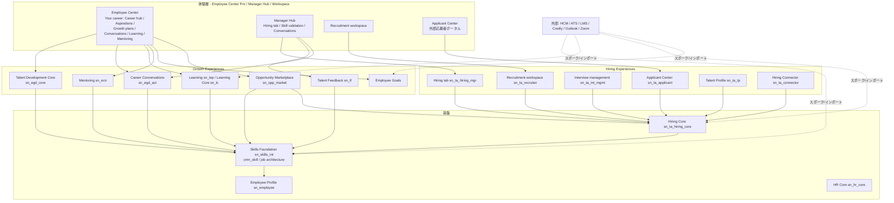
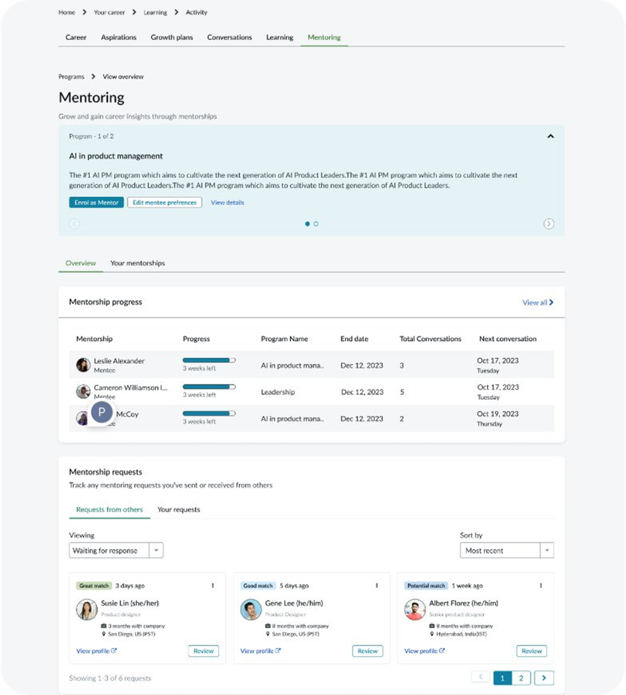
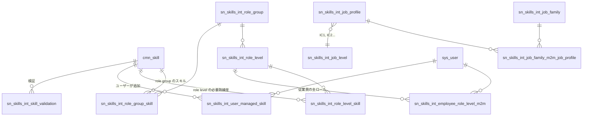
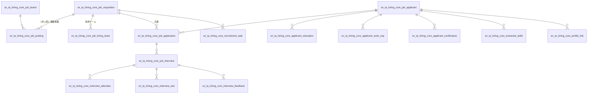
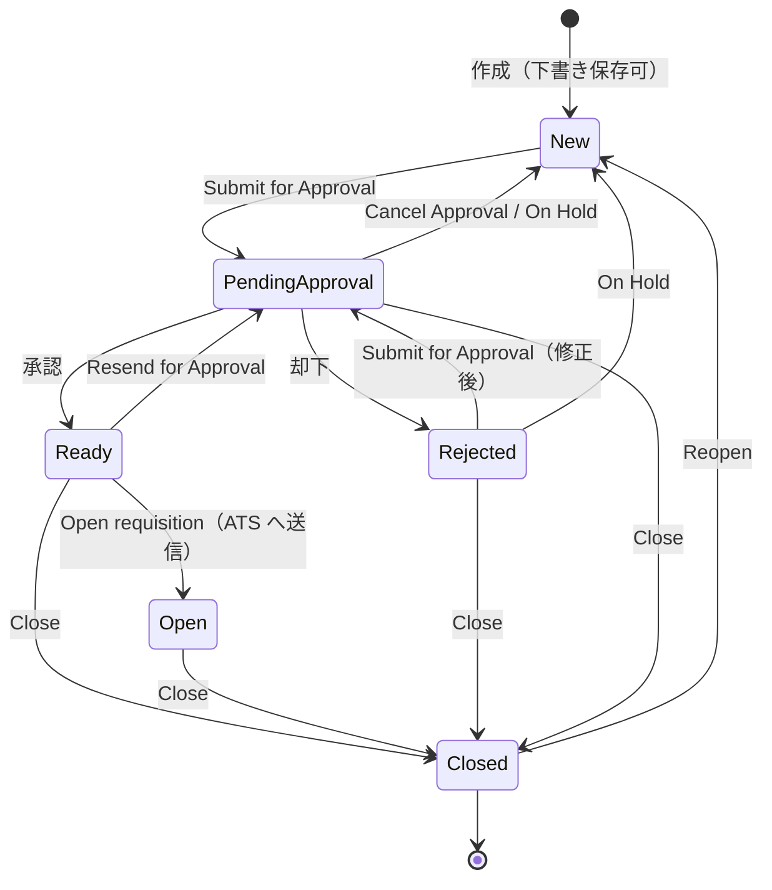
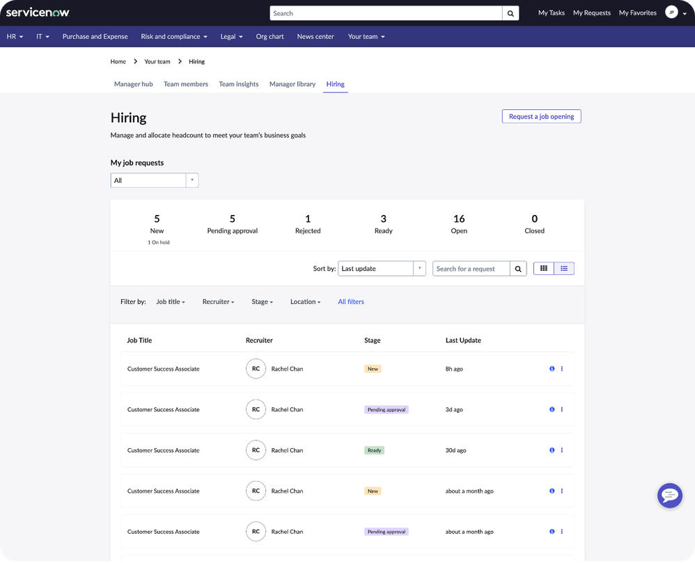
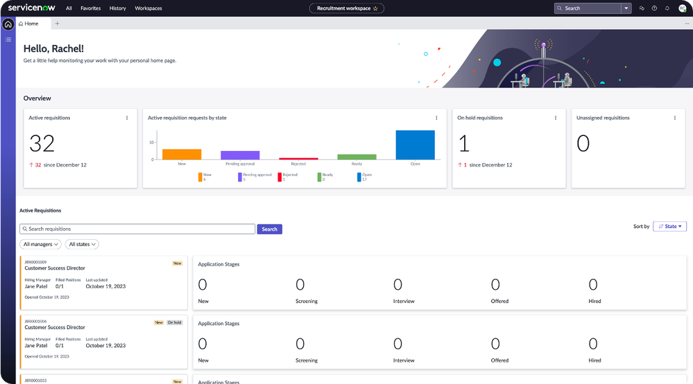
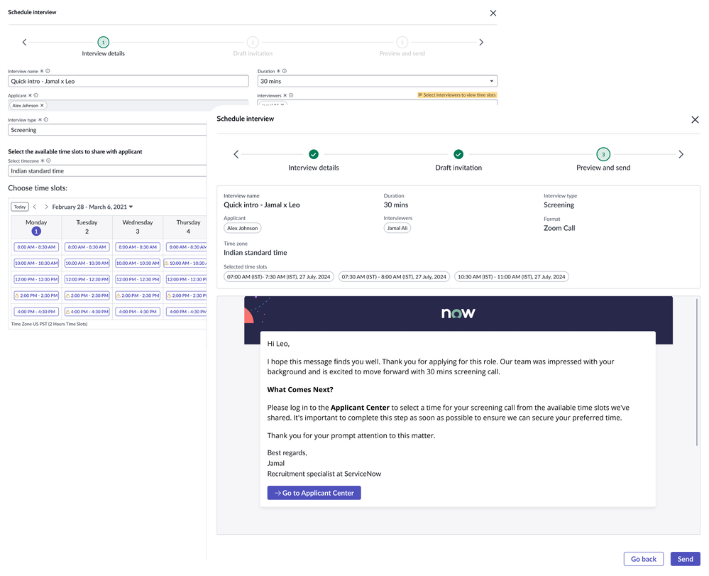
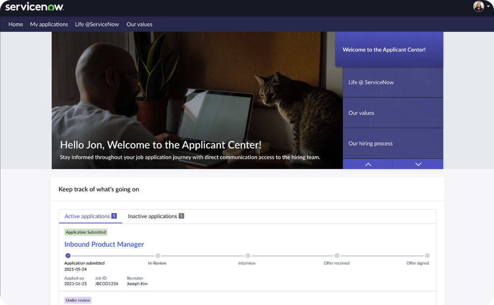
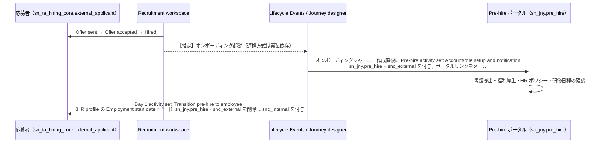

# Talent Development・Employee Growth・Hiring Experiences（人材育成と採用体験）

## 概要

ServiceNow の HR Service Delivery（HRSD）には、HR ケース処理やオンボーディング（[HR Service Delivery](./hr-service-delivery.md) 参照）に加えて、従業員の**育成・キャリア開発**と**採用**を扱うアプリケーション群がある。Australia リリース時点の公式ドキュメントでは、これらは HRSD 配下の次の 2 つのアプリケーションスイートとして整理されている。[出典](https://www.servicenow.com/docs/r/zurich/employee-service-management/hr-service-delivery/hr-service-delivery.html)

| スイート（現行名） | 旧名称 | 対象 | 主なアプリ |
|---|---|---|---|
| **Growth Experiences**（成長体験） | Talent Development、さらに前は Employee Growth and Development（EGD） | 在籍従業員とマネージャーの育成・キャリア開発・社内異動 | Talent Development Core、Skills Foundation、Career Conversations、Learning、Mentoring、Employee Goals、Talent Feedback（関連：Opportunity Marketplace、Leader Hub、Manager Hub） |
| **Hiring Experiences**（採用体験） | Talent Acquisition | 採用マネージャー・リクルーター・面接官・応募者 | Hiring tab、Recruitment workspace、Interview management、Applicant Center、Talent Profile、Hiring Core、Hiring Connector（関連：Opportunity Marketplace） |

- 公式ドキュメントは「Talent Development applications suite has been renamed to Growth Experiences」「Talent Acquisition application has been renamed to Hiring Experiences」と明記している。[出典](https://www.servicenow.com/docs/r/zurich/employee-service-management/hr-service-delivery/hr-service-delivery.html)
- ただしアプリ名・テーブル接頭辞には旧名称が残っている（例：Talent Development Core のスコープは `sn_egd_core` = Employee Growth and Development の略、Career Conversations は `sn_egd_act`、Leader Hub は `sn_egd_lh`）。ドキュメント上でも「Talent Development」「Growth Experiences」が混在するため、本ファイルでは**スイート名を Growth Experiences、中核アプリを Talent Development Core** と呼び分ける。
- 両スイートの共通基盤として、スキルとジョブアーキテクチャ（職務体系）を管理する **Skills Foundation**（旧 Skills Intelligence、スコープ `sn_skills_int`）と、採用データのリポジトリである **Hiring Core**（`sn_ta_hiring_core`）がある。[出典](https://www.servicenow.com/docs/r/australia/employee-service-management/talent-development-core/exploring-skills-intelligence.html)

本ファイルの範囲と他ファイルの分担：

| トピック | 参照先 |
|---|---|
| HR ケース、COE、HR サービス、Lifecycle Events、Journey designer の全体 | [HR Service Delivery](./hr-service-delivery.md) |
| Employee Center / Employee Center Pro のポータル構成 | [Service Portal と Employee Center](../platform/portals-employee-center.md) |
| Now Assist / AI Agents の共通基盤（AI Agent Studio 等） | [Now Assist と AI Agents](../platform/now-assist-ai-agents.md) |
| IntegrationHub スポークの一般論 | [IntegrationHub](../platform/integrationhub.md) |
| Workplace / Legal 等の他 Employee Workflows | [Workplace Service Delivery・Legal Service Delivery 等](./workplace-legal-other.md) |

---

## 1. 歴史と名称の変遷

| 時期 | 出来事 | 出典 |
|---|---|---|
| 2022-06 | ServiceNow がスキルインテリジェンス企業 Hitch Works を買収発表。後の Skills Intelligence の技術的基盤となる | [出典](https://www.businesswire.com/news/home/20220603005091/en/5224212/ServiceNow-to-Acquire-Hitch-Works-to-Help-Customers-Address-Talent-Gaps) |
| 2023-05 | **Employee Growth and Development（EGD）** を発表（AI によるスキルベースの人材変革ソリューション） | [出典](https://www.businesswire.com/news/home/20230516005419/en/ServiceNow-announces-Employee-Growth-and-Development-an-AI-powered-talent-transformation-solution-to-drive-skills-based-workforce-management) |
| Vancouver | Talent Development（旧 EGD）が GA。Skills Intelligence Platform（Hitch 由来）が基盤層 【第三者情報】（ServiceNow 社員による Community 記事） | [出典](https://www.servicenow.com/community/talent-development-articles/introduction-to-talent-development-formerly-employee-growth-and/ta-p/2666493) |
| Washington DC | Talent Development Core に Opportunity Marketplace、Conversations（Outlook スケジューリング）、Mentoring、Growth Plans、Aspirations が追加 | [出典](https://www.servicenow.com/docs/r/delta-washingtondc-australia/australia-washingtondc-talentdevelopmentcore-release-notes.html) |
| Xanadu（2024-07, v4.1.9） | **Employee Growth and Development Core → Talent Development Core** に改名 | 同上 |
| Yokohama | Credly 連携（デジタルバッジ）、Now Assist による Growth plan 生成、Skills Harmonization、SAP SuccessFactors Learning スポーク | [出典](https://www.servicenow.com/community/hrsd-blog/yokohama-release-overview-talent-development/ba-p/3203922)【第三者情報】（ServiceNow Community ブログ） |
| Zurich | **Hiring Experiences が新規**（Applicant Center、Hiring、Interview management、Recruitment workspace、Talent profile）。**Skills Intelligence → Skills Foundation**、Skills Intelligence Workspace → Skills Workspace に改名。Learning Posts の機能は Journey designer に統合（Zurich RN は Zurich からサポート対象外とするが、Brazil RN は Brazil からとしており公式 RN 間で不一致）。Mentoring で複数プログラム対応 | [出典](https://www.servicenow.com/docs/r/u1slaAtcFiiXFQcd9RcR_A/3shDSpd44hZajA1d7jgORg) [出典](https://www.servicenow.com/docs/r/m4LmCVvkm6_8u3nlIuep5Q/Nuuczt1vESpoJgdjOLr3ng) [出典](https://www.servicenow.com/docs/r/zurich/release-notes/mentoring-rn.html) |
| Australia（2026-05 GA） | Talent Development Core、Hiring、Talent profile、Skills Foundation はリリースノート上「No updates for this release」。Recruitment workspace で代替面接官（substitute interviewer）と Needs attention リストビューの面接ヘルス監視が追加 | [出典](https://www.servicenow.com/docs/r/delta-washingtondc-australia/australia-washingtondc-talentdevelopmentcore-release-notes.html) [出典](https://www.servicenow.com/docs/r/m4LmCVvkm6_8u3nlIuep5Q/9_MzmE1PuvAwR2PQOiD3jw) [出典](https://www.servicenow.com/docs/r/delta-zurich-brazil/brazil-zurich-recruitmentworkspace-release-notes.html) |

> 補足：Growth Experiences / Hiring Experiences の各アプリは **ServiceNow Store 配布のスコープアプリ**であり、ファミリーリリースとは別に Store リリース（例：2026 年 3 月 Store リリース）で機能追加される。ファミリーリリースのリリースノートが「No updates」でも Store 版で機能が増えている点に注意する。[出典](https://www.servicenow.com/community/hrsd-blog/march-2026-store-release-deep-dive-blog-hrsd/ba-p/3506473)【第三者情報】

> **Brazil での変更:** Hiring、Talent profile、Recruitment workspace、Skills Foundation の Zurich→Brazil 差分リリースノートは、Brazil 欄がすべて「No updates for this release」である。一方で **Leader Hub（`sn_egd_lh`）は、Australia ドキュメントで既に将来の廃止が告知され、新規インスタンスでは非表示・非インストールとされている（td-lh-explore）。Brazil リリースノートでは「Planned for deprecation in Canada. There is no replacement（Canada で廃止予定、代替なし）」とされる**。なお Australia ドキュメントの「Canada までサポート継続」と Brazil RN の「Canada で廃止予定」は、Canada を含むかどうかの読み方で食い違う可能性がある。また **Learning Posts（`com.sn_lnp`）は Brazil リリースノートで「no longer supported starting with the Brazil release」と明記**され（Zurich RN の「Zurich から」とは不一致。5.5 参照）、Journey designer 6.0.0 以降のインストールが案内されている。[出典](https://www.servicenow.com/docs/r/delta-zurich-brazil/brazil-zurich-hiring-release-notes.html) [出典](https://www.servicenow.com/docs/r/release-notes/leader-hub-rn-2026-09.html) [出典](https://www.servicenow.com/docs/r/release-notes/learning-posts-rn-2026-09.html) [出典](https://www.servicenow.com/docs/r/australia/employee-service-management/hr-service-delivery/td-lh-explore.html)

---

## 2. 全体アーキテクチャ

- Talent Development は Employee Center ポータル（Employee Profile の **Career** タブ、Your career メニュー）と Manager Hub に統合されている。Talent Development の各機能は Employee Profile のデータを参照する。[出典](https://www.servicenow.com/docs/r/australia/employee-service-management/talent-development-core/egd-integrations.html)
- Skills Foundation エンジンは「Talent Development のすべての機能を支える基盤層」と位置付けられ、公式ドキュメント上「Skills Foundation is only integrated with Talent Development applications」と注記されている。Hiring Core のデータに対してもスキル予測を行い、ロールグループのスキル推奨に使う。[出典](https://www.servicenow.com/docs/r/australia/employee-service-management/talent-development-core/exploring-skills-intelligence.html)
- Growth Experiences は既存の HCM・LMS・スキルシステムを**置き換えず、その上に体験層として乗る**位置付けである。Hiring Experiences も同様に **ATS（応募者追跡システム）や CRM ではなく**、既存の採用ツールの上に体験層を追加するものとされる。【第三者情報】（ServiceNow 社員による Community FAQ）[出典](https://www.servicenow.com/community/hrsd-articles/frequently-asked-questions-faq-hrsd/ta-p/3392875)

---

## 3. Growth Experiences（旧 Talent Development / EGD）

### 3.1 構成アプリケーション

Australia の公式ドキュメント「Growth Experiences」ページに掲載されているアプリケーションと関連アプリは以下のとおり。[出典](https://www.servicenow.com/docs/r/australia/employee-service-management/talent-development-core/egd-employee-growth-developemnt-suite.html) [出典](https://www.servicenow.com/docs/r/australia/employee-service-management/talent-development-core/egd-integrations.html)

| アプリ（英語名） | 日本語の意味 | 概要 | スコープ/ID |
|---|---|---|---|
| Talent Development Core | タレント開発コア | 個人とマネージャーがキャリア成長・育成計画を主体的に管理するエンドツーエンドのプロセス（Career hub、Aspirations、Growth plans 等） | `sn_egd_core` |
| Skills Foundation（旧 Skills Intelligence） | スキル基盤 | スキルベースの人材管理のための AI 駆動プラットフォーム。スキルライブラリ、ジョブアーキテクチャ、スキルプロファイル | `com.sn_skills_int` / `sn_skills_int` |
| Career Conversations | キャリア対話 | 従業員とマネージャー間の成長対話（1on1）の作成・管理 | `sn_egd_act` |
| Learning（My Learning） | 学習 | 社内外の学習コンテンツの発見・管理・受講。Career Assessment（試験エンジン）を含む | `sn_lep`（Learning）、`sn_lc`（Learning Core） |
| Mentoring | メンタリング | メンティーとメンターのマッチング、メンタリングプログラム | `sn_ecn`（Employee Connections） |
| Employee Goals | 従業員目標 | 組織目標と個人目標の可視化・追跡。Oracle Cloud HCM / SAP SuccessFactors / Workday の目標と連携 | 公開情報では確認できず |
| Talent Feedback | タレントフィードバック | マネージャーが部下のスキルについて協働者からフィードバックを依頼 | `sn_tf` |
| Opportunity Marketplace（OPM） | 社内機会マーケットプレイス | 社内求人・ギグ・プロジェクト・ボランティアの掲載と応募（社内異動） | `sn_opp_market` |
| Leader Hub（関連） | リーダーハブ | 組織リーダー向けのチームスキル・スキルギャップの可視化（**将来の廃止が告知済み。Brazil RN では Canada で廃止予定**） | `sn_egd_lh` |
| Manager Hub（関連） | マネージャーハブ | マネージャー向けのチーム管理ハブ。スキル検証・成長対話・Hiring タブの入口 | `sn_mh` |

- Talent Development Core の導入には **Manager Hub**、**Skills Foundation**、**Employee Center Pro** が前提（dependent plugins and apps）。ドキュメント上の必要ロール（Role required）は `sn_egd_core.admin`。なお Store からのアプリインストール操作自体には実務上 `admin` が必要になる【経験則】。ServiceNow Store から入手してインストールする。[出典](https://www.servicenow.com/docs/r/australia/employee-service-management/talent-development-core/egd-core-install.html)
- Skills Foundation のプロパティ `sn_skills_int.enable_skills` を `true` にすると、Skills Foundation に対応するすべての Talent アプリで Skills Foundation の利用が有効になる。[出典](https://www.servicenow.com/docs/r/australia/employee-service-management/talent-development-core/egd-core-install.html)

### 3.2 Talent Development Core の画面構成（Employee Center）

Talent Development Core は Employee Center の **Your career（あなたのキャリア）** メニュー配下に以下のタブを提供する。Career hub を開くと本人の情報のみのサマリーが表示される。[出典](https://www.servicenow.com/docs/r/australia/employee-service-management/talent-development-core/egd-explore.html)

| タブ | 説明 |
|---|---|
| Career hub（キャリアハブ） | 成長・育成計画のサマリービュー |
| Aspirations（志向） | キャリア上の志向（Interest / Skill / Role / General）を作成・追跡 |
| Growth plans（成長計画） | キャリア目標を整理・追跡する計画 |
| Conversations（対話） | マネージャー・同僚・メンターとの対話を管理（Career Conversations） |
| Learning（学習） | 学習目標の特定・管理・完了 |
| Opportunity Marketplace | 社内機会の探索 |

#### Career hub のウィジェット

Career hub には以下のウィジェットがある（Xanadu ドキュメント記載。Australia でも構成は同等と推定【推定】）。[出典](https://www.servicenow.com/docs/r/xGHm5nN1KlkEq58WJHJoPw/fhpoFbuJVz8rOVAeib5bag)

| ウィジェット | 内容 |
|---|---|
| Application status | 社内求人への応募状況 |
| Aspirations / Create an aspiration | 進行中の志向と関連スキル・ロール、志向の新規作成 |
| Career growth tasks / Growth plan tasks | 割り当てられた研修等のタスク、期限間近・期限切れのタスク |
| Current learning / Latest achievement | 受講中・保存済みコース、獲得したアチーブメント |
| Grow with intent | パーソナライズされたアクション候補 |
| Make new connections | 組織図から同僚を検索してつながる |
| Opportunities | 推奨される社内求人（Opportunity Marketplace） |
| Recent conversations / Upcoming conversations | 対話のトーキングポイントとフォローアップ、週単位の予定 |
| See the impact that you have made | 志向・成長計画・学習・獲得スキル・役割変更のタイムライン |
| Skill Self-Rating / Your skill range | 月次のスキル自己評価リマインダー、履歴書アップロードとスキル追加の促し |

#### Aspirations（志向）の種類

`sn_egd_core_aspiration_type` で管理される Aspiration Type の既定値は以下の 4 種類。[出典](https://www.servicenow.com/docs/r/australia/employee-service-management/talent-development-core/egd-aspirations-overview.html)

| Aspiration type | 説明 |
|---|---|
| Interest（関心） | 探求したい関心領域。管理者は **All > Talent Development Core > Aspirations > Interests** で Interest を作成する（`sn_egd_core.admin` または `admin`）[出典](https://www.servicenow.com/docs/r/xGHm5nN1KlkEq58WJHJoPw/DF~zBlGeaccDt_ltlPpfZQ) |
| Skill（スキル） | 得意分野のスペシャリスト化、または新しいスキルへの挑戦 |
| Role（ロール） | 現在のキャリアで新しい職位を得る、または別分野への挑戦 |
| General（一般） | 上記以外の志向をゼロから作成 |

#### Growth plans（成長計画）

Growth plan は志向や対話を元に作成するか、ゼロから作成する（ゼロから作成する場合は「1:1 Check-in with your manager」が必須）。計画には Learning（学習）、Check-in（対話）、Mentorship（メンター接続）、Something else（任意活動）のアクティビティを追加でき、マネージャーと共有（Share）・開始（Launch）・期日設定ができる。[出典](https://www.servicenow.com/docs/r/australia/employee-service-management/talent-development-core/egd-growth-plans-ovrvw.html)

| 画面要素 | 内容 |
|---|---|
| Your next tasks | 注意が必要なタスク。状態表示は upcoming / required / overdue / due soon / up next |
| Your growth plans | 計画名・状態・進捗・最終更新日。ソート・検索可 |
| Past growth plans | 完了（completed）・キャンセル（canceled）済み計画 |
| Growth plan details | 計画詳細、アクティビティ追加、Discard / Share / Launch |

**Now Assist による Growth plan 生成**（Yokohama で追加）：Employee Center の **Your Career > Growth plans > Create a growth plan > Build with Now Assist** で、目標を自然文で入力（例：「プレゼンテーションスキルを向上させて次のレベルに進みたい」）し **Generate draft** で下書きを生成する。ロールは不要だがライセンス済みユーザーであり、Talent Development アプリに紐付くユーザーグループに属する必要がある。Talent Development Core と Now Assist for HRSD の両方が必要。[出典](https://www.servicenow.com/docs/r/australia/employee-service-management/talent-development-core/egd-create-growth-plan-with-nowassist.html) [出典](https://www.servicenow.com/docs/r/delta-washingtondc-australia/australia-washingtondc-talentdevelopmentcore-release-notes.html)

#### Talent プロパティ

| プロパティ（画面表示名） | 値 | 説明 |
|---|---|---|
| Property to control manager skill approvals in Growth plans | `no` / `optional` / `required` | Growth plan 内のスキルに対するマネージャー承認を省略・推奨・必須にする |
| Set all activities to ready when Growth plans are launched | Yes / No | Yes の場合、計画開始時に全アクティビティを ready 状態にする |

[出典](https://www.servicenow.com/docs/r/australia/employee-service-management/talent-development-core/egd-properties-reference.html)

### 3.3 Talent Development Core のロールとテーブル

| ロール | 名前 | 説明 |
|---|---|---|
| Admin | `sn_egd_core.admin` | Talent Development Core の機能の更新・保守 |
| Content Manager | `sn_egd_core.content_manager` | Talent 関連コンテンツの保守・更新 |

[出典](https://www.servicenow.com/docs/r/australia/employee-service-management/talent-development-core/egd-components-roles-tables.html)

| テーブルラベル | テーブル名 |
|---|---|
| Activity Template Recommendation | `sn_egd_core_activity_config` |
| Activity Template | `sn_egd_core_activity_template` |
| Activity Type | `sn_egd_core_activity_type` |
| Aspiration | `sn_egd_core_aspiration` |
| Aspiration Type | `sn_egd_core_aspiration_type` |
| Career Hub Spotlight | `sn_egd_core_career_hub_spotlight` |
| Featured growth item | `sn_egd_core_featured_growth_item` |
| Interest | `sn_egd_core_interest` |
| Aspiration Skills | `sn_egd_core_m2m_aspiration_skill` |
| Context | `sn_egd_core_m2m_plan_context` |
| Outcome Type | `sn_egd_core_outcome_type` |
| Peer Configuration | `sn_egd_core_peer` |
| Growth Plan | `sn_egd_core_plan` |
| Growth Plan Activity | `sn_egd_core_plan_activity` |
| Sample text | `sn_egd_core_sample_text` |

[出典](https://www.servicenow.com/docs/r/australia/employee-service-management/talent-development-core/egd-components-roles-tables.html)

### 3.4 ライセンス付与（Employee Profile licensing）

Talent Development Core は **Employee Profile のライセンス機能**でユーザーを「ライセンス済み」にする。`sn_egd_core.admin` ロールで **All > Employee Profile > Application licensing > Employee licensing** を開き、**Employee Application Access Criteria** フォームで対象ユーザーの条件を定義する。1 つのフォーム内の条件はすべて満たす必要があるが、複数のレコードのうちいずれか 1 つを満たせばライセンス対象となる。ライセンス済みユーザーの一覧は **All > Employee Profile > Application licensing** で確認する。[出典](https://www.servicenow.com/docs/r/australia/employee-service-management/talent-development-core/egd-employee-profile-licensing.html)

- Opportunity Marketplace の利用にもライセンス済みの Talent Development ユーザーであることが必要。[出典](https://www.servicenow.com/docs/r/SogDT~k7ktsbe1ZYegnaLg/Kmc6b3KkJ0it8lpnzkPWTA)

### 3.5 Career Conversations（キャリア対話）

Career Conversations は従業員とマネージャー間の成長対話（growth conversation）、Growth plan のチェックイン、メンタリング対話の作成・管理を担う。Microsoft Outlook（Azure / Exchange）連携により会議の予定登録ができる。[出典](https://www.servicenow.com/docs/r/delta-washingtondc-australia/australia-washingtondc-talentdevelopmentcore-release-notes.html)

| ロール | 説明 | 含むロール |
|---|---|---|
| `sn_egd_act.admin` | Administrator | `sn_egd_act.manager` |
| `sn_egd_act.manager` | Manager | `sn_egd_act.employee` |
| `sn_egd_act.employee` | Employee | なし |

| テーブルラベル | テーブル名 |
|---|---|
| Action Item | `sn_egd_act_action_item` |
| Discussion | `sn_egd_act_discussion` |
| Discussion Series | `sn_egd_act_discussion_series` |
| Suggested Talking Point | `sn_egd_act_suggested_talking_point` |
| Talking Point | `sn_egd_act_talking_point` |

[出典](https://www.servicenow.com/docs/r/XbpkTdWa3HBo31srdD0Rdg/sbazrY1O5SHTXTjXwNTGGw)（ロール名の大文字小文字はドキュメント表記ゆれがあるため小文字で正規化して記載）

- **Growth conversation preparation AI agent**：マネージャー向けに、カレンダーから候補時間を提案し、対話エントリを作成し、複数システムの従業員データ（タレント活動・ジャーニー履歴）を集約して構造化されたトーキングポイントを生成する。Career Conversations **3.6.3** 以上と **ServiceNow Otto for HR Service Delivery (HRSD) プラグイン**が必要で、後者により **ServiceNow Otto for Talent Development** と **AI Agents for Talent** がインストールされる。[出典](https://www.servicenow.com/docs/r/australia/employee-service-management/career-conversations/agentic-wf-conversations-na-td.html)
  - Community の HRSD ブログでは、同等のプラグイン群が「Now Assist for Talent」「HR Talent AI Agent Collection」の名称で紹介されている（旧称・Community での呼称）。【第三者情報】[出典](https://www.servicenow.com/community/hrsd-blog/zurich-release-deep-dive-blog-hrsd/ba-p/3375480) [出典](https://www.servicenow.com/community/hrsd-blog/march-2026-store-release-deep-dive-blog-hrsd/ba-p/3506473)

### 3.6 Mentoring（メンタリング）

Mentoring は「メンターを求める個人と経験豊富なメンターをつなぐ」アプリで、Employee Center 上で利用する。一部機能は Career Conversations が有効な場合のみ動作する。Talent Development Core の一部である **Employee Connections** プラグインとしてインストールされ、ロール接頭辞は `sn_ecn`。[出典](https://www.servicenow.com/docs/r/australia/employee-service-management/mentoring/exploring-mentoring-egd.html) [出典](https://www.servicenow.com/docs/r/baBFTRuHLgu7HSwp0SUEQQ/wnUx~Ysfh1UhZRRsa7WR5Q)

#### マッチングロジック

メンターとメンティーの双方がプロファイルを入力し、**重み付きスコアリングエンジン**がメンティーの経験・希望との整合度からメンターを推奨する。評価要素は以下（Skills Foundation と連携したスキルベースのマッチング）。[出典](https://www.servicenow.com/docs/r/australia/employee-service-management/mentoring/exploring-mentoring-egd.html)

| 要素 | 内容 |
|---|---|
| Skill Proficiency（熟練度） | メンターの熟練度がメンティーの必要水準以上なら優先、下回る場合は不利 |
| Skill Validation（検証済み） | マネージャー検証済みスキルを持つメンターのスコアを加点、未評価スキルは減点 |
| Role-Based Relevance（役割関連性） | そのスキルがメンターの現職の必須スキルであれば加点 |
| Mentorship Preference（教える意思） | **最重要要素**。メンターが「教えたいトピック」として明示的に登録していないスキルは、資格があってもマッチしにくい |

- メンティーは **View match insights** で候補メンターとの一致度（Focus areas、Skills、Language）を確認できる（Yokohama で追加）。メンターはメンティーの申請を承認して初めて関係が成立する。[出典](https://www.servicenow.com/docs/r/baBFTRuHLgu7HSwp0SUEQQ/KAcbCtA2JN0K86yPSjEw3g) [出典](https://www.servicenow.com/docs/r/yokohama/release-notes/mentoring-rn.html)

#### メンタリングプログラム（Zurich で複数プログラム対応）

`sn_ecn.mentoring_admin` ロールで **All > Mentoring > Programs > New** から作成する。[出典](https://www.servicenow.com/docs/r/australia/employee-service-management/mentoring/create-mentoring-pgm.html)

| フィールド | 説明 |
|---|---|
| Name | プログラム名 |
| Minimum / Maximum / Default duration | プログラム期間（月数）の最小・最大・既定値 |
| User criteria | 参加可能なユーザーを定義する User Criteria |
| Auto complete overdue mentoring | 期限切れのメンタリングを自動クローズ |
| Auto complete grace period | 自動完了までの猶予（月数） |
| Short description / Description | 一覧に表示される短い説明、詳細説明 |

- Zurich リリースノートでは、プログラムを Mentoring アプリに表示させるには short description、long description、employee criteria の設定が必要とされる。[出典](https://www.servicenow.com/docs/r/zurich/release-notes/mentoring-rn.html)
- インストール後に Restricted Caller Access（RCA）の承認要求が出た場合、Target Human Resources Core、Target Journey Accelerator、Target Journey Designer を Allow にする。依存アプリは Career Conversations と Employee Profile。[出典](https://www.servicenow.com/docs/r/australia/employee-service-management/mentoring/configuring-mentoring-egd.html)

**キャプション:** Employee Center の Mentoring タブ（Zurich の複数メンタリングプログラム対応画面）。

**画面説明:** パンくずは Home > Your career > Learning > Activity、タブは Career / Aspirations / Growth plans / Conversations / Learning / Mentoring。上部にプログラムのカルーセル（例：「AI in product management」、Program 1 of 2）があり、**Enrol as Mentor**、**Edit mentee preferences**、**View details** ボタンが並ぶ。Overview タブの **Mentorship progress** 表は Mentorship（相手と役割）、Progress（残り週数のバー）、Program Name、End date、Total Conversations、Next conversation の列を持つ。下部の **Mentorship requests** には Requests from others / Your requests のタブがあり、各申請カードに Great match / Good match / Potential match のマッチ度ラベルと Review ボタンが表示される。

**出典:** ServiceNow Community「Zurich Release Deep Dive Blog - HRSD」 https://www.servicenow.com/community/hrsd-blog/zurich-release-deep-dive-blog-hrsd/ba-p/3375480 （取得日：2026-11-08）

### 3.7 Employee Goals（従業員目標）

Employee Goals は組織が設定したビジネス目標と従業員個人の目標を可視化し、目標を Growth plan に落とし込む。Talent Development Core（Career profile、Growth plans）および Career Conversations と統合され、目標管理で広く使われる HCM（**Oracle Cloud HCM、SAP SuccessFactors、Workday**）との連携を持つ。[出典](https://www.servicenow.com/docs/r/australia/employee-service-management/employee-goals/egd-goals-explore.html)

### 3.8 Talent Feedback（タレントフィードバック）

Talent Feedback はマネージャーが部下のスキルについて**協働者（collaborators）からフィードバックを依頼**するプラグイン。依頼を受けた従業員は Employee Center の **To-dos** でスキル評価を回答する。マネージャーはスキル検証時に、スキル活動とあわせて受け取ったフィードバックを参照できる。依存アプリは Skills Foundation と Manager Hub。[出典](https://www.servicenow.com/docs/r/australia/employee-service-management/talent-feedback/exploring-talent-feedback.html)

| 種別 | 名前 | 説明 |
|---|---|---|
| ロール | `sn_tf.admin` | Talent Feedback の全フィードバックを管理 |
| テーブル | `sn_tf_feedback_request` | フィードバック依頼 |
| テーブル | `sn_tf_feedback_request_skill` | フィードバック依頼に含まれるスキル |

[出典](https://www.servicenow.com/docs/r/australia/employee-service-management/talent-feedback/components-installed-tf.html)

- 2026 年 3 月 Store リリースの **Employee Feedback Collection V2**（AI エージェント）は Platform Surveys による標準テンプレートを追加。HR Talent AI Agent collection プラグイン、SR-HR-Talent Feedback v1.2、SR-HR-Talent AI agents v4.0 が要件で、SKU は HRSD Professional Plus または Enterprise Plus とされる。【第三者情報】[出典](https://www.servicenow.com/community/hrsd-blog/march-2026-store-release-deep-dive-blog-hrsd/ba-p/3506473)

### 3.9 Opportunity Marketplace（社内機会マーケットプレイス）

Opportunity Marketplace（OPM）はキャリアモビリティ（社内異動）を促進するアプリで、従業員は Employee Center から機会を探し、応募し、応募状況を追跡する。マッチ設定は ATS と連携できる。公式ドキュメント上は Hiring Experiences 配下に分類されているが、「Talent Development スイートの一部として機能する主要アプリ」とも記述されている。[出典](https://www.servicenow.com/docs/r/SogDT~k7ktsbe1ZYegnaLg/3EuNKLm3tAnJcCnkMut_Eg) [出典](https://www.servicenow.com/docs/r/australia/employee-service-management/opportunity-marketplace/egd-oppt-mrktplc-store-install.html)

#### インストール時の依存

Store で **Opportunity Marketplace [`sn_opp_market`]** をインストールすると以下が有効化・インストールされる（`admin` ロール必要）：Talent Development Core、Manager Hub、Skills Foundation、Finance Common Architecture、**Hiring Core**、Proactive Prompts、Talent Development Shared Library [`app-egd-shared-library`]（Store には表示されない）。[出典](https://www.servicenow.com/docs/r/australia/employee-service-management/opportunity-marketplace/egd-oppt-mrktplc-store-install.html)

#### 機会タイプ（Opportunity type）

| タイプ | 説明 |
|---|---|
| Internal jobs | 社内求人（元からの機会タイプ。Hiring Core の `sn_ta_hiring_core_job_posting` を使用） |
| Gig | 単一ロール（1 名以上の募集枠）の機会。ギグでは「Add a role」は使えない |
| Project | 複数ロールでチームを募る機会。SPM の Project Workspace からインポートして作成可能（リソース管理ロールが必要） |
| Volunteer | ボランティア活動向けの複数ロールの機会 |
| カスタム | 管理者が既存タイプを複製して作成。カスタムの User criteria、Opportunity details、Roles and requirements を定義可能 |

[出典](https://www.servicenow.com/docs/r/australia/employee-service-management/opportunity-marketplace/opm-oppt-types.html) [出典](https://www.servicenow.com/docs/r/SogDT~k7ktsbe1ZYegnaLg/3LcMSa1jPdvP6~WF42h2JQ)

Opportunity type フォームの主なフィールドは Title、**Role display**（Embedded within opportunity (1 position only) / Separate from opportunity (1 or more positions)）、Opportunity details（`sc_cat_item` のレコードプロデューサー）、Roles and requirements（同じくレコードプロデューサー、実体は `sn_opp_market_opportunity_position`）、Hiring approval flow、User criteria、Icon、Help link label / URL。Yokohama 以降の Store 版では機会の公開承認（Publishing Approval）も追加されている。[出典](https://www.servicenow.com/docs/r/australia/employee-service-management/opportunity-marketplace/opm-oppt-types.html) [出典](https://www.servicenow.com/community/hrsd-blog/may-2025-release-overview-talent-development/ba-p/3252207)【第三者情報】

#### OPM のロールとテーブル

| 種別 | 名前 | 説明 |
|---|---|---|
| ロール | `sn_opp_market.admin` | OPM の管理モジュールへのアクセス。`sn_egd_shared_lib.admin`、`flow_designer`、`user_criteria_admin` を含む |
| テーブル | `sn_opp_market_opportunity` | 機会（Title、Opportunity type、State、Owners、Published date） |
| テーブル | `sn_opp_market_m2m_opp_location` | 機会と所在地（City、Country、Location） |
| テーブル | `sn_opp_market_opportunity_position` | 機会内のポジション（Title、Opportunity、Description、Location、Employee levels） |
| テーブル | `sn_opp_market_opportunity_type` | 機会タイプ（Gig / Project / Volunteer 等） |
| テーブル | `sn_opp_market_opportunity_type_aux` | 機会タイプごとの承認者 |
| テーブル | `sn_opp_market_position_application` | ロールへの応募（Employee、Role、State、Submission Message） |
| テーブル | `sn_opp_market_opportunity_position_skill` | ロールに紐づくスキルとスキルレベル |
| テーブル | `sn_opp_market_user_opportunity_preference` / `sn_opp_market_opportunity_preference_config` | 応募者の希望条件とその設定 |
| テーブル | `sn_opp_market_quick_link` | 応募フォームのクイックリンク |
| テーブル | `sn_opp_market_shared_opp` | 従業員間で共有された機会（Sender、Recipient） |

[出典](https://www.servicenow.com/docs/r/australia/employee-service-management/opportunity-marketplace/opm-components-roles-tables.html)

### 3.10 Leader Hub（リーダーハブ）

Leader Hub は組織リーダー・HR リーダー向けに、チームのスキル構成、重大なスキルギャップ、Talent Development ツールの利用状況を可視化する（At a glance、Org talent、Org skills、Orgs you support の各機能）。組織サポーター（Organizational supporter）に委任して閲覧させることもできる。依存は UI share library [`sn_ui_lib`]。[出典](https://www.servicenow.com/docs/r/australia/employee-service-management/hr-service-delivery/td-lh-explore.html) [出典](https://www.servicenow.com/docs/r/australia/employee-service-management/hr-service-delivery/td-lh-install.html)

> **Brazil での変更:** Australia ドキュメント（td-lh-explore）で既に、Leader Hub（`sn_egd_lh`）は将来のリリースで廃止予定であり、新規インスタンスでは非表示・非インストールとされ、Canada まではサポートが継続すると告知されている。Brazil のリリースノート（leader-hub-rn-2026-09）では「Planned for deprecation in Canada. There is no replacement（Canada で廃止予定、代替なし）」とされる。「Canada まで継続」と「Canada で廃止予定」は Canada を含むかどうかで食い違って読めるため、最新のリリースノートで確認すること。新規導入では Leader Hub に依存した設計を避け、Manager Hub のスキル分析機能等で代替を検討する。[出典](https://www.servicenow.com/docs/r/release-notes/leader-hub-rn-2026-09.html) [出典](https://www.servicenow.com/docs/r/australia/employee-service-management/hr-service-delivery/td-lh-explore.html)

---

## 4. Skills Foundation（旧 Skills Intelligence）とスキルデータモデル

### 4.1 位置付けとプラグイン

Skills Foundation は AI Search を使って業界スキルデータを処理し、スキルベースの人材管理を実現するアプリケーションである。主な機能は Employee skills profile、Pre-seed employee skills、Job Architecture、Proactive Prompts、履歴書/LinkedIn からのスキル取り込み、マネージャーによるスキル検証、活動インサイト、スキルレコメンダー。[出典](https://www.servicenow.com/docs/r/australia/employee-service-management/talent-development-core/exploring-skills-intelligence.html)

| プラグイン/アプリ | ID | 備考 |
|---|---|---|
| Skills Foundation | `com.sn_skills_int`（スコープ `sn_skills_int`） | 本体。インストールにはドキュメント上 `sn_skills_int.admin`（概要文では `admin`）。Zurich 時点で v10.0 が必要 |
| Skills Workspace | `sn_skills_int_ws` | 管理者用ワークスペース。Zurich 時点で v6.1 が必要。Guided setup での導入が推奨 |
| Skills Management | `com.snc.skills_management` | プラットフォーム標準のスキル管理（スキル・カテゴリの手動作成と割り当て）。Skills Foundation 有効化で併せて有効化 |
| Skills Library Data for Skills Management | `com.snc.skills_management.seed_data` | スキルライブラリのシードデータ |
| Data Services Base Client | `com.glide.data_services.base` | 依存プラグイン |
| Employee Profile | `sn_employee`（v8.0.2） | 依存アプリ。従業員プロファイルが存在することが前提 |
| Proactive Prompts | `com.sn_pp`（v2.0.0） | 任意。Teams / Outlook / Zoom / SMS へのマルチチャネルプロンプト |

[出典](https://www.servicenow.com/docs/r/australia/employee-service-management/talent-development-core/configuring-skills-intelligence.html) [出典](https://www.servicenow.com/docs/r/australia/employee-service-management/talent-development-core/install-skills-intelligence.html) [出典](https://www.servicenow.com/docs/r/m4LmCVvkm6_8u3nlIuep5Q/Nuuczt1vESpoJgdjOLr3ng) [出典](https://www.servicenow.com/docs/r/baBFTRuHLgu7HSwp0SUEQQ/RIQffVVVlaxmUWiMIRiI0g)

#### Zurich での重要な変更（Australia にも継承）

Zurich では Skills Intelligence が Skills Foundation に改名されると同時に、仕組みが大きく変わった。[出典](https://www.servicenow.com/docs/r/m4LmCVvkm6_8u3nlIuep5Q/Nuuczt1vESpoJgdjOLr3ng)

| 区分 | 内容 |
|---|---|
| 変更 | スキル検索が ML モデルから **AI Search** に移行（名前・説明・両方でインデックス）。Pro Plus（LLM 連携）顧客は RAG 構成の AI 検索 |
| 変更 | 多言語対応が従来の 23 言語から **AI Search がサポートする言語**に限定 |
| 変更 | 履歴書解析は **Now Assist** を使用 |
| 変更 | Skill Harmonization の重複検出が ML から AI Search に変更（品質に影響の可能性） |
| 変更 | HR と Talent の Job profile が入社・異動時に自動同期（Human Resources Scoped App `sn_hr_core` が必要） |
| 変更 | SAP SuccessFactors からスキル・ユーザースキルを取り込み可能（Job Profile Builder のみ対応、Talent Intelligence Hub は非対応。HRSD integration for SAP SuccessFactors `sn_hr_sf` と SuccessFactors spoke `sn_successfactors` が依存） |
| 非推奨 | **スキルオントロジーの提供終了**：顧客が自社のスキルデータを用意・インポートする必要がある |
| 非推奨 | ML ベースの LinkedIn 解析、Talent Development のレガシー Data Science アルゴリズム |
| 制約 | Guided setup から業界スキルデータをダウンロードできない |

- 公式 FAQ でも「ServiceNow はスキルデータ自体を提供しない。HCM、LMS、事業部門、無料のオンラインソース、専門家、購入したオントロジー等から顧客が持ち込む」とされる。熟練度スケールは設定可能で、既定では 0/1/2 または beginner/intermediate/advanced。コンピテンシーもスキルと同等に扱い、カスタムスキルとしてアップロードして正規化する。【第三者情報】（ServiceNow 社員による Community FAQ）[出典](https://www.servicenow.com/community/hrsd-articles/frequently-asked-questions-faq-hrsd/ta-p/3392875)

### 4.2 スキルデータモデル

#### スキル（プラットフォーム共通）

| テーブル | 説明 |
|---|---|
| `cmn_skill`（Skills） | スキルライブラリ本体。Skills Foundation のドキュメントでは「skills library (cmn_skills table)」と表記されている箇所があるが、プラットフォーム API ドキュメントでは Skills [`cmn_skill`] と記載されている。実インスタンスで名称を確認すること |
| `cmn_skill_level`（Skill Levels） | スキルレベル（熟練度）の定義 |
| `sys_user_has_skill`（User Skill） | ユーザーとスキルの紐付け（Skills Management）【経験則】（今回確認した Australia の公式ページでは明示されていない） |

[出典](https://www.servicenow.com/docs/r/api-reference/server-api-reference/UserSkillAnalyzerAPI.html) [出典](https://www.servicenow.com/docs/r/australia/employee-service-management/talent-development-core/dynamic-skill-import.html)

- プラットフォームの **UserSkillAnalyzer** API（Skills Management `com.snc.skills_management` が必要）は、タスクに必要なスキル/レベルとユーザーのスキルを比較し、`is_qualified`、`num_skills_matching_level`、`total_skill_level_gap`、`optional_skill_level_gap` を返す。スキルギャップをスクリプトで算出する場合の基本 API である。[出典](https://www.servicenow.com/docs/r/api-reference/server-api-reference/UserSkillAnalyzerAPI.html)

> **注意：HR skills と Talent skills の違い**  
> HRSD の Case and Knowledge Management には、HR エージェントの資格を定義して HR ケース/タスクの自動割り当てに使う **HR skills management** がある（HR テンプレートがケースに必要スキルを付与し、スキルで担当グループ/担当者を決定）。これは HR スタッフのルーティング用であり、従業員の育成を目的とする Skills Foundation のスキルプロファイルとは用途が異なる（どちらもプラットフォームのスキル機構を利用）。[出典](https://www.servicenow.com/docs/r/australia/employee-service-management/hr-service-delivery/c_HRSkillsManagement.html)

#### ジョブアーキテクチャ（職務体系）

任意の HCM から CSV 形式でジョブアーキテクチャを用意してインポートすると、Company Job Architecture Staging [`sn_skills_int_company_job_arch_staging`] から以下のテーブルへ変換・格納される。**従業員の Job profile をオンボードする前にジョブアーキテクチャのインポートが必須**。[出典](https://www.servicenow.com/docs/r/australia/employee-service-management/talent-development-core/job-architecture.html)

| テーブル | 説明 | 例 |
|---|---|---|
| `sn_skills_int_job_family`（Job Family） | 類似職務のグループ | Software Engineering、Finance and Purchasing |
| `sn_skills_int_job_profile`（Job Profiles） | 職務の情報レコード（概要・説明） | Sr. Software Engineer、Project Manager |
| `sn_skills_int_job_level`（Job Levels） | 職務のレベル | IC1、IC2 |
| `sn_skills_int_role_group`（Role Groups） | 類似スキルセットのロール群 | Front-end、Back-end、Full-stack |
| `sn_skills_int_role_level`（Role Levels） | ロールグループ内のレベル付き職位 | Associate Software Engineer - Backend – IC1 – JavaScript L1 |
| `sn_skills_int_role_group_skill`（Role Group Skills） | ロールグループとスキルの対応 | |
| `sn_skills_int_role_level_skill`（Role Level Skills） | ロールレベルとスキル・必要熟練度の対応 | |

ジョブアーキテクチャを従業員プロファイルに接続する方法は、スケジュールジョブによるロールレベルのマッピングと、従業員への Job profile の手動追加の 2 通り。[出典](https://www.servicenow.com/docs/r/australia/employee-service-management/talent-development-core/job-architecture.html)

#### Skills Foundation のテーブル一覧

| テーブル | 説明 |
|---|---|
| `sn_skills_int_job_family_m2m_job_profile` | Job profile と Job family の関連 |
| `sn_skills_int_job_level_to_level_config` | 職務レベル間の昇格パス（job level progression） |
| `sn_skills_int_related_role_group` | 関連ロールグループ |
| `sn_skills_int_role_level_m2m_ind_title` | インスタンスに取り込んだ業界職名（industry title）とロールレベルの対応 |
| `sn_skills_int_employee_role_level_m2m` | 従業員とロールレベルの対応（主ロールフラグ付き） |
| `sn_skills_int_proficiency_autofill_config` | 熟練度自動設定の構成 |
| `sn_skills_int_extracted_skill` | 履歴書アップロードから抽出したスキル |
| `sn_skills_int_skill_onboarding` / `sn_skills_int_skill_onboarding_prediction` | インポートしたカスタムスキルと、その一致・重複予測 |
| `sn_skills_int_skill_validation` | ユーザースキルの検証情報 |
| `sn_skills_int_user_managed_skill` | ユーザーがプロファイルに追加したスキル |
| `sn_skills_int_dynamic_skill` / `sn_skills_int_dynamic_skill_requestor` | 動的ソース（現状 Credly のみ）から要求された新規スキルとその要求者 |

[出典](https://www.servicenow.com/docs/r/baBFTRuHLgu7HSwp0SUEQQ/QlNQerAQ_SMkKrwZ~ot9jA)（上記ジョブアーキテクチャ表のテーブルも含め計 22 テーブル）

### 4.3 Skills Foundation のロール

| ロール | 説明 |
|---|---|
| `sn_skills_int.admin` | システム設定のフルアクセス管理者 |
| `sn_skills_int.manager` | 部下のスキルの閲覧・検証 |
| `sn_skills_int.emp` | 自分のスキルプロファイルの閲覧・更新（Career タブ） |
| `sn_skills_int.reader` | Skills Intelligence レコードの読み取り |
| `sn_skills_int.job_arch_editor` | ジョブアーキテクチャと required 状態の閲覧・更新 |
| `sn_skills_int.job_arch_admin` | ジョブアーキテクチャの作成・更新・削除・構成 |
| `sn_skills_int_ws.workspace_user` | Skills Workspace へのアクセス |

[出典](https://www.servicenow.com/docs/r/baBFTRuHLgu7HSwp0SUEQQ/QlNQerAQ_SMkKrwZ~ot9jA) [出典](https://www.servicenow.com/docs/r/australia/employee-service-management/talent-development-core/skills-intelligence-workspace.html)

### 4.4 セットアップ手順（公式の推奨順）

1. Skills Foundation [`com.sn_skills_int`] をインストール（Skills Workspace を含めるため **Guided setup** の利用を推奨）
2. Skills Library Data for Skills Management [`com.snc.skills_management.seed_data`] をインストール
3. （任意）Proactive Prompts をインストール
4. 自社の業界スキルデータ（カスタムスキル）をロード
5. ジョブアーキテクチャデータをアップロード
6. （任意）Job level progression を作成（キャリアパスのスキルベース提案に必要）
7. （任意）熟練度の自動設定（Proficiency autofill）を構成
8. （任意）ロールグループとロールレベルを作成
9. ロールレベルと業界職名（industry title）をマッピング
10. Proactive Prompts または手動で従業員にロールレベルを割り当て
11. ユーザーに Skills Foundation のロールを付与
12. システムプロパティ **`sn_skills_int.enable_skills`** を `true` にして、Employee Center の Career タブ（Skills ウィジェット）を有効化

[出典](https://www.servicenow.com/docs/r/australia/employee-service-management/talent-development-core/configuring-skills-intelligence.html)

- 熟練度の自動設定は `sn_skills_int.admin` で **All > Job Architecture > Role Groups > Proficiency Autofill Configuration > New** から作成し、スケジュールジョブ **Role level skill proficiency autofill** を実行して反映する。構成がない場合は既定構成がすべての progression に適用される。[出典](https://www.servicenow.com/docs/r/australia/employee-service-management/talent-development-core/proficiency-autofill-config.html)

### 4.5 従業員のスキルプロファイル（Career タブ）

Employee Center の **Profile > Career** タブは `sn_skills_int.emp` ロールで利用し、Skills Foundation のインストールと `sn_skills_int.enable_skills` プロパティで有効化される。[出典](https://www.servicenow.com/docs/r/australia/employee-service-management/talent-development-core/manage-skills-profile.html)

| セクション | 内容 |
|---|---|
| Role details | Business title、Role group、Role specialty。Business title は Employee position [`sn_employee_position`] の primary role から取得。Job profile [`sn_skills_int_job_profile`] と HR jobs [`sn_hr_core_job`] の Job code が一致する場合に Role specialty が表示される |
| Shared aspirations | 共有した志向（Interest / Skill / Role） |
| Achievements | Credly から同期したバッジ・資格 |
| Upload Resume/LinkedIn Profile | 履歴書・LinkedIn プロファイルからスキル取り込み |
| Skills | **Essential skills**（ロールグループ由来の必須スキル。スキルギャップと推奨学習を表示）、**Additional skills**（ロール外・履歴書由来・手動追加）、**Recommended skills**（関連スキルの推奨） |
| Experience | 社内での職歴（ロールと期間） |

- スキルは「Skill pill」で表示され、熟練度の数値、スキル名、マネージャー検証済みを示す**緑のチェック**、メニュー（熟練度変更・削除）を持つ。**検証済みスキルは熟練度を上げることしかできず、下げる・削除することはできない**。[出典](https://www.servicenow.com/docs/r/australia/employee-service-management/talent-development-core/manage-skills-profile.html)
- **履歴書/LinkedIn からのスキル取り込み**：Profile > Career > **Upload resume or LinkedIn profile** で .pdf / .text / .docx / .zip（LinkedIn）をアップロードし、抽出スキルの取捨と熟練度を選んで **Add to your profile**。結果は Additional skills に入る。**Pro-plus ライセンスの顧客のみ利用可能**。[出典](https://www.servicenow.com/docs/r/australia/employee-service-management/talent-development-core/import-skills-from-resume.html)
- **Pre-seeding**：NLP で履歴書・LinkedIn からスキルを抽出・分類し、ロールに必要な基礎スキルの欠落（スキルギャップ）を検出して、Proactive Prompts で従業員に追加を促す。[出典](https://www.servicenow.com/docs/r/australia/employee-service-management/talent-development-core/pre-seeded-skills.html)

### 4.6 マネージャーによるスキル検証

`sn_skills_int.manager` ロールのマネージャーは **Employee Center > Your team > Manager Hub > Conversations** で部下との対話を開き、**Employee details > Skills** タブで **Validate skills** を選択、スキルごとの関連活動（学習、メンタリング、ギグ/プロジェクト、成長計画、志向、資格等）を確認してから **Validate selected skills** を実行する。検証済みスキルは従業員のプロファイルに緑のチェックで表示される。[出典](https://www.servicenow.com/docs/r/australia/employee-service-management/talent-development-core/skills-intelligence-manager-hub.html)

### 4.7 Skills Workspace

`sn_skills_int_ws.workspace_user` ロールで利用する管理者向けワークスペース（**All > Skills Workspace**）。[出典](https://www.servicenow.com/docs/r/australia/employee-service-management/talent-development-core/skills-intelligence-workspace.html)

| ビュー | 内容 |
|---|---|
| Home | スキルデータ概要、重大な情報欠落（ロールレベルのないロールグループ、スキルレベルタイプのないスキル、スキルのないロールグループ等）、Actionable insights、Overview and Health チャート |
| Job architecture view | Job family・Role group・スキルの階層ビジュアル |
| Lists view | スキルライブラリ、スキルインポート履歴、ジョブアーキテクチャのリスト |

### 4.8 外部スキルデータの取り込みとハーモナイズ

| 取り込み元 | 方式 | 出典 |
|---|---|---|
| CSV（カスタムスキル、ジョブアーキテクチャ） | Skills import playbook / ファイルアップロード | [出典](https://www.servicenow.com/docs/r/australia/employee-service-management/talent-development-core/configuring-skills-intelligence.html) |
| Workday HCM / Workday Learning | Workday スポーク + Skills Harmonization（Yokohama で v1） | [出典](https://www.servicenow.com/community/hrsd-blog/yokohama-release-overview-talent-development/ba-p/3203922)【第三者情報】 |
| SAP SuccessFactors | `sn_hr_sf` + `sn_successfactors`（Job Profile Builder のみ） | [出典](https://www.servicenow.com/docs/r/m4LmCVvkm6_8u3nlIuep5Q/Nuuczt1vESpoJgdjOLr3ng) |
| Credly（デジタルバッジ） | Dynamic skill import（Dynamic Skills Pipeline） | [出典](https://www.servicenow.com/docs/r/australia/employee-service-management/talent-development-core/dynamic-skill-import.html) |

**Credly バッジの処理フロー**（Achievements and Credentials）：バッジのスキルがスキルライブラリに完全一致またはマッピング済みなら従業員プロファイルに追加。既に持っているスキルなら **Review Skills Profile Prompt** で熟練度更新を促す。新規スキルならハーモナイズ用のキューへ送られ、管理者（`sn_skills_int.admin`）が **Skills Workspace > Lists > Import history > Queue** で確認・インポートする。重複は自動（例：Java 1.8 → Java）または手動でマッピングされ、マッピングされたスキルは新規作成されず既存スキルが使われる。[出典](https://www.servicenow.com/docs/r/australia/employee-service-management/talent-development-core/achievements-and-credentials-in-td.html) [出典](https://www.servicenow.com/docs/r/australia/employee-service-management/talent-development-core/dynamic-skill-import.html)

---

## 5. Learning 連携

### 5.1 Learning と Learning Core の関係

学習機能は 2 層で構成される。

| アプリ | スコープ | 役割 |
|---|---|---|
| **Learning Core** | `sn_lc` | 学習コンテンツリポジトリの基盤。サードパーティ LMS との連携、学習カタログ（社内外のコースアイテム）、基本テーブル・ロール・アクセス構成を提供。**依存プラグインとしてのみ有効化できる**。Learning Posts やコーチング系アプリ（Workforce Optimization の Coaching with Learning 等）も利用 |
| **Learning**（My Learning） | `sn_lep` | 従業員向けの学習ポータル体験（Discover、Activity、Achievements、チームへの割り当て）。Career Assessment（試験エンジン）を含む |

[出典](https://www.servicenow.com/docs/r/australia/employee-service-management/learning-core/learning-core_overview.html) [出典](https://www.servicenow.com/docs/r/australia/employee-service-management/learning-core/exploring-learning.html) [出典](https://www.servicenow.com/docs/r/australia/employee-service-management/journey-designer/onboarding-ramp-up-plan-agentic-wf.html)

- Learning の Store 掲載情報では依存として Learning Core、Employee Profile、License meter が挙げられ、一部機能は HR Service Delivery と Employee Journey Management が有効な場合のみ動作する。【第三者情報】（検索結果の抜粋に基づく）[出典](https://www.servicenow.com/docs/r/SogDT~k7ktsbe1ZYegnaLg/oJTRmYopgtaBxOIkyvAZMA)
- Learning タブ（Talent Development）のウィジェット：Finish these learnings before they're due、Learning tasks（直近 30 日の進捗）、Your current challenge（学習チャレンジ）、Latest achievement、Continue where you left off、Recent activity、Trending now、Track your learning、Achievements。[出典](https://www.servicenow.com/docs/r/australia/employee-service-management/talent-development-core/egd-learning-ovrvw.html)

### 5.2 LMS / コンテンツプロバイダー連携

Learning Core は以下の外部学習システムとスポークで連携する（`learning_admin` ロール）。使う学習システムのみを有効化するよう推奨されている。[出典](https://www.servicenow.com/docs/r/australia/employee-service-management/learning-core/setup-learning-third-party-1.html)

| 学習システム | 認証/連携方法 | 同期されるデータ |
|---|---|---|
| Pluralsight Skills | API キー（Pluralsight スポーク） | Courses、Course progress（進捗率） |
| Cornerstone OnDemand | Cornerstone 側で OAuth アプリを登録（Cornerstone スポーク） | Users、Courses、User activity、Course assign service（Cornerstone のコースにはスキル情報なし） |
| Udemy | Udemy スポーク（ロゴやコース再割り当て等は learning system configuration テーブルで手動設定） | Courses、User activity |
| SumTotal | SumTotal スポーク | Users、Courses、User activity、Assign course |
| Saba | Saba スポーク | Course assign service、Pull Courses、Sync Saba Users、Pull User Course Activity |
| Workday Learning | Workday スポーク | Users、Courses、User activity、Assign course |
| SAP SuccessFactors Learning | SuccessFactors Learning スポーク（Bristlecone 社製） | Learning information、User data、Course data、User activity |

連携手順の要点：[出典](https://www.servicenow.com/docs/r/australia/employee-service-management/learning-core/setup-learning-third-party-1.html)

1. 各 LMS のスポークを設定する。API 呼び出しの成功には `com.glide.transform.json.max-partial-length` と `com.snc.process_flow.reporting.serialized.val_size_limit` プロパティの調整が必要。
2. 外部コンテンツを同期するスケジュールフロー（Learning Core flows）を有効化する。
3. 学習システム（Learning System Configuration）を構成する。Cornerstone OnDemand、Pluralsight、Udemy（ページにより Sumtotal、Saba も）のソースレコードは **Enterprise Service Management Integrations Framework** の Source モジュールに自動作成される。
4. `full_pull` プロパティで全件再取得（`true`）または差分同期（`false`）を切り替える（初回は常にフルプル）。ソースの **Run Job** で手動同期も可能。取得したコースは Learning External Content [`sn_lc_external_content`] に格納される。

- **HR Service Delivery Integration with Workday Learning**（Bristlecone 社製の Store アプリ）は、Workday のワーカープロファイル同期と Workday タスクの Employee Center への取り込みを行う。有効化すると Workday Learning Spoke も有効化され、Workday HR Spoke の設定が必要。[出典](https://www.servicenow.com/docs/r/australia/employee-service-management/hr-service-delivery/hr-integration-with-workday-learning.html)
- LinkedIn Learning のネイティブ連携は、今回確認した公式ドキュメントでは確認できず。
- ServiceNow 社員による FAQ では、Learning スポークとして Cornerstone、Pluralsight、Workday Learning、Saba、Udemy、SuccessFactors Learning、SumTotal が挙げられている。【第三者情報】[出典](https://www.servicenow.com/community/hrsd-articles/frequently-asked-questions-faq-hrsd/ta-p/3392875)

### 5.3 Learning Core のロールとテーブル

| ロール | 説明 | 含むロール |
|---|---|---|
| `sn_lc.learning_admin`（Learning admin） | カタログ、学習コンテンツ、コースカタログ、ロールの CRUD、学習ソースの構成 | `sn_lc.catalog_manager`、`sn_hr_integr_fw.admin` |
| `sn_lc.learning_course_catalog_admin` | 学習コースカタログの管理 | |
| `sn_lc.content_writer` | 学習コースの読み書き | `sn_lc.content_creator` |
| `sn_lc.task_creator` | 学習タスクの読み書き | |
| `sn_lc.catalog_manager` | 学習ライブラリの作成・更新 | `sn_lc.task_creator`、`sn_lc.content_writer` |
| `sn_lc.catalog_group_manager` | グループ単位での学習ライブラリの作成・更新 | `sn_lc.task_creator`、`sn_lc.content_writer` |

| テーブル | 説明 |
|---|---|
| `sn_lc_external_content`（Learning External Content） | サードパーティから取得した外部コース |
| `sn_lc_user_course_activity`（Learning User Course Activity） | 受講者・状態・期限などのコース活動 |
| `sn_lc_collection`（Collection） | 社内外コンテンツのコレクション |
| `sn_lc_course_catalog`（Learning Course Catalog） | カテゴリ単位でコースをまとめアクセス制御するコースカタログ |
| `sn_lc_content`（Learning Content） | ServiceNow 内で作成した社内学習コンテンツ（ナレッジ記事、動画など） |
| `sn_lc_course_item`（Learning Course Item） | コースアイテム（所属ソース等） |
| `sn_lc_learning_task`（Learning Task） | 学習タスク（担当者、期日） |
| `sn_lc_learning_system_configuration`（Learning System Configuration） | 外部 LMS ソースの構成パラメータ |

[出典](https://www.servicenow.com/docs/r/australia/employee-service-management/learning-core/learning-core-components-installed.html)（ロール名 `sn_hr_integr_fw.admin` はドキュメント上 `sn_hr.integr_fw.admin` と表記されており表記ゆれがある）

Learning（`sn_lep` 側）のコンポーネント：[出典](https://www.servicenow.com/docs/r/australia/employee-service-management/learning-core/components-installed-with-learning.html)

| 種別 | 名前 | 説明 |
|---|---|---|
| ロール | `sn_lc.learning_admin` / `sn_lc.learning_manager` | Learning アプリの設定と全操作、全テーブルの CRUD |
| ロール | `sn_lc.catalog_group_manager` / `sn_lc.catalog_manager` | カタログおよびカタロググループ（catalog group）の管理 |
| ロール | `sn_lc.task_creator` | 学習タスクの作成 |
| ロール | `sn_lep.achievement_manager` | アチーブメントの作成・管理 |
| テーブル | `sn_lep_achievement` / `sn_lep_user_achievement` | アチーブメント定義とユーザーの獲得実績 |
| テーブル | `sn_lep_achievement_rule` / `sn_lep_achievement_rule_item` | アチーブメントのルール |
| テーブル | `sn_lep_m2m_achievement_skill` | アチーブメントとスキルの対応 |

- **アクセス制御**：Learning Core のカタログ（Catalog）はアクセス制御の単位で、Catalog レベルと Course レベルの 2 段階。関連リストで「読める/読めない/投稿できる/投稿できない」ユーザーを定義する。Collections は ServiceNow 内で編成するコースのグループ。[出典](https://www.servicenow.com/docs/r/australia/employee-service-management/learning-core/ln-post-hm.html)
- **学習タスク**：`sn_lc.task_creator` で **Learning > Tasks > Learning Tasks > New** から作成し、従業員は Employee Center の To-dos ページで完了する。[出典](https://www.servicenow.com/docs/r/australia/employee-service-management/learning-core/ln-task-le.html)

### 5.4 スキル駆動の学習（Skill sensing）

- Skills Foundation は Learning と統合され、スキルに基づく学習検索結果と、マネージャーが部下のスキルに基づいてコースを推奨する機能を提供する。[出典](https://www.servicenow.com/docs/r/australia/employee-service-management/talent-development-core/exploring-skills-intelligence.html)
- **Skill sensing**：コースのタイトルと説明から LLM でスキルを抽出し、管理者がコースにスキルを関連付ける。個別コース単位、または条件で絞ったコース群に対するスケジュールジョブ（bulk skill sensing）で実行し、推奨スキルをレビューして承認/破棄する。要件は Now Assist for HRSD（`sn_hr_gen_ai`）、Learning core（ドキュメント表記 `sn_learning_core`）、Skills Foundation（`sn_skills_int`）。[出典](https://www.servicenow.com/docs/r/australia/employee-service-management/learning-core/skill-sensing-for-learning-content.html)
- **Career Assessment**：Learning の一部である試験エンジン。学習管理者が試験とラーニングパスを作成し、受講者は My Learning のコースに付随するクイズで理解度を確認する。[出典](https://www.servicenow.com/docs/r/australia/employee-service-management/talent-development-core/exam-engine.html)

### 5.5 Learning Posts から Journey designer への統合

- **Learning Posts** は従業員にオムニチャネルの学習体験を提供するアプリだったが、**Zurich で全機能が Journey designer に統合**された。ただしサポート終了リリースの記載は公式リリースノート間で不一致である：Zurich の Journey designer RN は「no longer supported starting with the Zurich release（Zurich からサポート対象外）」、Brazil の Learning Posts RN は「no longer supported starting with the Brazil release（Brazil からサポート対象外）」としており、後者では Journey designer 6.0.0 以降のインストールが案内されている。同時に Listening Posts（パルスサーベイ）も Zurich で非サポートとなった。[出典](https://www.servicenow.com/docs/r/zurich/release-notes/jny-dsgnr-rn.html) [出典](https://www.servicenow.com/docs/r/release-notes/learning-posts-rn-2026-09.html)
- **Journey designer の推奨学習（Recommended learning）**：管理者はジャーニー構成に学習推奨を追加できる。推奨は同じ Lifecycle Events タイプ、Journey designer のジャーニー、Journey Accelerator のプランを経験した類似従業員の受講実績に基づく。管理者が追加した推奨コースは管理者のみ変更・削除でき、外部コースはコースの指定期間のみ有効。[出典](https://www.servicenow.com/docs/r/australia/employee-service-management/journey-designer/jny-dsgnr-ml-learning-recom.html)
- ジャーニー構成の **Manage journey configuration > Journey owners permissions** で **Can add recommended learning** を許可すると、マネージャーとメンターは Employee Center の **Journeys** ページで個別ジャーニーの Recommended learning ウィジェットから **Add courses** でコースを追加できる（Journeys ページは部下が 1 人以上いるマネージャーにのみ表示）。[出典](https://www.servicenow.com/docs/r/australia/employee-service-management/journey-designer/jny-dsgnr-add-recommended-learning.html)

Journey designer 自体の詳細は [HR Service Delivery](./hr-service-delivery.md) を参照。

---

## 6. Hiring Experiences（採用体験、Zurich で新規）

### 6.1 概要とペルソナ

Hiring Experiences は採用マネージャー、リクルーター、面接官、応募者向けに採用プロセスを効率化するアプリケーションスイートで、ServiceNow AI Platform、自動化、構成可能なワークフローを使う。採用マネージャー向けの Employee Center 統合体験と、ブランド化されたパスワードレスの応募者ポータルを提供する。[出典](https://www.servicenow.com/docs/r/baBFTRuHLgu7HSwp0SUEQQ/3aoW9NbubLrfy16Dntt0PQ)

| ペルソナ | 主な作業 |
|---|---|
| Hiring manager（採用マネージャー） | 求人（job opening）の要求、求人の追跡、リクルーターとの協働、応募の比較、フィードバック |
| Recruiter（リクルーター） | 求人票（job requisition）と応募の管理、採用マネージャー・応募者との協働、面接の日程調整・管理 |
| Recruitment coordinator（採用コーディネーター） | リクルーターの補助、面接作成、応募ワークフローの管理 |
| Interviewer（面接官） | 割り当てられた求人票と応募の閲覧、面接の実施とフィードバック |
| Applicant / Candidate（応募者） | 会社の理解、応募の追跡、求人詳細の閲覧、採用チームとのやり取り |

- Hiring Experiences は ATS の代替ではない。応募者データは接続先 ATS に保持され、共有された連携データは Job applications テーブルに格納される。標準の Hiring Dashboard は time to hire（採用所要時間）やワークロードバランス等の指標を持つ。【第三者情報】（ServiceNow 社員による Community FAQ）[出典](https://www.servicenow.com/community/hrsd-articles/frequently-asked-questions-faq-hrsd/ta-p/3392875)

### 6.2 構成プラグインと依存関係

| コンポーネント | ID | 概要 |
|---|---|---|
| Hiring tab（Hiring） | `sn_ta_hiring_mgr` | Manager Hub の Hiring タブ。採用マネージャー向けハブ |
| Recruitment workspace | `sn_ta_recruiter` | リクルーター向け Next Experience ワークスペース |
| Applicant Center | `sn_ta_applicant` | 応募者ポータル（外部ユーザー、マジックリンクログイン） |
| Hiring Connector | `sn_ta_connector` | ATS 連携用のステージングテーブル |
| Talent Profile | `sn_ta_tp` | 応募者・従業員・契約社員・アルムナイを集約したタレントプロファイルとタレントプール |
| Interview Management | `sn_ta_int_mgmt` | 面接フェーズ定義、日程調整、フィードバック |

Hiring Experiences の全プラグインをインストールすると、既定で以下もインストールされる：Employee Center Pro（`sn_ex_sp_pro`）、Manager Hub（`sn_mh`）、Employee Profile（`com.sn_employee`）、Content Experiences（`sn_ca`）、Skills Foundation（`sn_skills_int`）、Finance Common Architecture（`sn_fin`）、**Hiring Core（`sn_ta_hiring_core`）**、Time Limited Authentication（`com.snc.authenticate.time_limited_authentication`）、Explicit roles（`com.glide.explicit_roles`）。[出典](https://www.servicenow.com/docs/r/australia/employee-service-management/hr-service-delivery/plan-installation-ta.html)

- 各アプリは ServiceNow Store からリクエストしてインストールし、**Hiring Core の有効化が共通要件**（Hiring Experiences のデータモデルと共有コンポーネントを提供）。インストールは **All > System Applications > All Available Applications > All** から `admin` ロールで行う。[出典](https://www.servicenow.com/docs/r/zurich/release-notes/hiring-tab-rn.html) [出典](https://www.servicenow.com/docs/r/australia/employee-service-management/hr-service-delivery/install-hiring-tab.html)
- Zurich 時点の各アプリのバージョンと依存（Community 記事）：Hiring tab v6.0（Manager Hub、Employee Center Pro）、Applicant Center v6.0（Universal Tasks、Talent Profile、Employee Center Pro、Time limited authentication）、Recruitment workspace v6.0（Universal Tasks、Skills Foundation、Talent Profile）、Interview Management v2.0（Skills Foundation、Employee Profile）。【第三者情報】[出典](https://www.servicenow.com/community/hrsd-blog/zurich-release-deep-dive-blog-hrsd/ba-p/3375480)

### 6.3 Hiring Core のデータモデル

Hiring Core は「サードパーティの採用プラットフォームで作成・受信した情報を格納するリポジトリ」である。Opportunity Marketplace のインストール時にも依存アプリとして導入される。Skills Foundation は Hiring Core のデータに対してスキル予測を行う。[出典](https://www.servicenow.com/docs/r/australia/employee-service-management/talent-development-core/hiring-core.html) [出典](https://www.servicenow.com/docs/r/australia/employee-service-management/opportunity-marketplace/opm-components-roles-tables.html)

| テーブル | ラベル | 主なフィールド/説明 |
|---|---|---|
| `sn_ta_hiring_core_job_requisition` | Job Requisition（求人票） | Number、Job title、Hiring manager、Employment type（Full-time / Part-time / Temporary employee / Contingent / Contractor）、Number of headcounts、Primary location |
| `sn_ta_hiring_core_job_posting` | Job Posting（求人掲載） | Number、Title、Job requisition（1 求人票に複数掲載可）、Job board、Location flexibility、State、Posting date。OPM の社内採用でも使用 |
| `sn_ta_hiring_core_job_board` | Job Board | Name、Logo、Active |
| `sn_ta_hiring_core_job_hiring_team` | Job Hiring Team（採用チーム） | Job requisition、Hiring role（Hiring manager / Interviewer / Recruitment coordinator）、Team Member、Type（Primary / Optional interviewer）、Visibility to applicant |
| `sn_ta_hiring_core_job_applicant` | Candidate（候補者） | 氏名・メールアドレス等の基本情報 |
| `sn_ta_hiring_core_job_application` | Job Application（応募） | Number、Job requisition、Job applicant、State、Applied on |
| `sn_ta_hiring_core_applicant_education` | Applicant education | Institute name、Field of study、Degree type、Location |
| `sn_ta_hiring_core_applicant_work_exp` | Applicant work experience | Company name、Start/End date、Presently working here、Location |
| `sn_ta_hiring_core_applicant_certification` | Applicant certification | Certificate name、Issuer name、Valid till |
| `sn_ta_hiring_core_extracted_skills` | Extracted Skill | Skills Foundation で抽出したスキル（Job applicant、Skill、Skill name） |
| `sn_ta_hiring_core_profile_link` | Profile link | Site、Job Applicant、Link、Type |
| `sn_ta_hiring_core_job_interview` | Job interview | Number、Interview name、Interview type、State、Interview start/end |
| `sn_ta_hiring_core_interview_attendee` | Interview attendee | Name、Hiring role、Acceptance status、Job interview、Type |
| `sn_ta_hiring_core_interview_slot` | Interview slot | 面接の開始・終了日時 |
| `sn_ta_hiring_core_interview_feedback` | Interview Feedback | 面接フィードバック |
| `sn_ta_hiring_core_reschedule_history` | Interview reschedule history | 面接日程変更の履歴 |
| `sn_ta_hiring_core_recruitment_task` | Recruitment Task | Number、Priority、State、Assigned to（リクルーター）、Short description |
| `sn_ta_hiring_core_hiring_task` | Hiring Task | 採用タスク |

[出典](https://www.servicenow.com/docs/r/australia/employee-service-management/opportunity-marketplace/opm-components-roles-tables.html) [出典](https://www.servicenow.com/docs/r/australia/employee-service-management/hr-service-delivery/installed-with-h-core.html)

Hiring Core のスケジュールジョブ：**MarkApplicantInactive**（有効でなくなった応募者を定期的に非アクティブ化）、**Notify Recruiters and Hiring manager on alternate days**（面接フィードバック未受領時に通知）。[出典](https://www.servicenow.com/docs/r/australia/employee-service-management/hr-service-delivery/installed-with-h-core.html)

- 求人票の項目は ServiceNow プラットフォーム上に構築されており拡張可能、求人票ワークフローは Flow Designer で作られており変更・置換できる。求人情報は要求管理時に Job Profile テーブルから取得され、HCM 連携等で投入できる。既存の職務記述書はテンプレートとしてアップロード可能。【第三者情報】[出典](https://www.servicenow.com/community/hrsd-articles/frequently-asked-questions-faq-hrsd/ta-p/3392875)

### 6.4 Hiring Experiences のロール

| ロール | 名前 | 説明 | 含むロール |
|---|---|---|---|
| Hiring Core admin | `sn_ta_hiring_core.admin` | Hiring Experiences 環境のスーパー管理者 | `sn_ta_hiring_core.hiring_manager`、`sn_ta_hiring_core.recruiter`、`sn_ta_tp.talent_profile_admin` |
| Hiring Core - Hiring manager | `sn_ta_hiring_core.hiring_manager` | 求人票の採用マネージャー | `skill_user`、`sn_mh.manager_hub_user`、`sn_ta_tp.talent_profile_user` |
| Hiring Core - Recruiter | `sn_ta_hiring_core.recruiter` | 求人票を作成・管理するリクルーター | `skill_user`、`template_read_global`、`template_editor_group`、`email_composer`、`sn_ta_hiring_core.recruitment_coordinator`、`sn_ta_tp.talent_profile_user`、`canvas_user` |
| Hiring Core - Recruitment Coordinator | `sn_ta_hiring_core.recruitment_coordinator` | 面接を作成し応募ワークフローを管理 | `template_editor_group`、`template_read_global`、`canvas_user` |
| Hiring Core - Interviewer | `sn_ta_hiring_core.interviewer` | 面接官に必要な情報を提供 | なし |
| Hiring Core - Applicant | `sn_ta_hiring_core.applicant` | 社内外応募者の共通情報 | なし |
| Hiring Core - Applicant external | `sn_ta_hiring_core.external_applicant` | 社外応募者（従業員以外）。`snc_external` を含む | |
| Hiring Core - Applicant internal | `sn_ta_hiring_core.internal_applicant` | 社内応募者（既存従業員のみ）。applicant と `snc_internal` を含む | |
| Talent Profile admin | `sn_ta_tp.talent_profile_admin` | Talent Profile の設定 | |
| Talent Profile user | `sn_ta_tp.talent_profile_user` | Talent Profile 機能の利用 | |
| approver_user | `approver_user` | 承認者 | |

[出典](https://www.servicenow.com/docs/r/australia/employee-service-management/hr-service-delivery/installed-with-h-core.html) [出典](https://www.servicenow.com/docs/r/baBFTRuHLgu7HSwp0SUEQQ/O6XAz5Li27fsqQIesa0rqQ)

- 外部応募者は `snc_external` を持つため、ServiceNow の外部ユーザー向けアクセス制御（[アクセス制御（ACL）](../platform/access-control-acl.md)）の対象となる。

### 6.5 求人票（Job requisition）の状態遷移

求人票は状態（State）と **On Hold フラグ**（Yes/No）の組み合わせで管理される。作成直後は **New**。Ready → Open の遷移で求人票が ATS に送られる。状態遷移の出典ページは Zurich 版（Australia 版で同等ページは未確認）。[出典](https://www.servicenow.com/docs/r/SogDT~k7ktsbe1ZYegnaLg/I8fNAS6VEtDX6j1anLexsQ) [出典](https://www.servicenow.com/docs/r/etYGEBUVr6RQYKLnfpRuhw/G8DNLCUf7vp7a0xqjfSknQ)

| 状態 | 編集可否（リクルーター） | 主なアクション → 遷移先 |
|---|---|---|
| New | 編集可 | Submit for Approval（承認依頼）。Rejected / Pending Approval / Closed から戻る先 |
| Pending Approval（Requested） | 読み取り専用 | Cancel Approval → New、On Hold → New（承認取消）、Close → Closed、Duplicate |
| Rejected | 編集可 | Submit for Approval → Pending Approval、On Hold → New、Close、Duplicate → New |
| Ready | 編集可 | On Hold（Ready のまま保留）、**Open → Open**、Resend for Approval → Pending Approval、Close、Duplicate → Ready |
| Open | 読み取り専用 | On Hold（Open のまま保留）、Close、Duplicate |
| Closed | 読み取り専用 | Reopen → New、Duplicate。クローズ時に保留は解除される |

- 表の Duplicate の遷移先（例：Duplicate → Ready）は、複製で作られる**新規求人票の状態**を指し、元レコードの状態は変わらない。
- 保留中（On Hold = Yes）の求人票は **Resume** で保留解除する。Pending Approval / Rejected で保留にした求人票は New に戻っているため、Resume 後は New から再開する。
- **ATS への公開手順**：`sn_ta_hiring_core.recruiter` ロールで **Workspaces > Recruitment workspace** を開き、ダッシュボードの求人票リストから **Ready** 状態のものを開き、右上の「…」メニューから **Open requisition** を選択する。[出典](https://www.servicenow.com/docs/r/etYGEBUVr6RQYKLnfpRuhw/G8DNLCUf7vp7a0xqjfSknQ)
- 求人票の状態管理はカスタマイズ可能（Customize job requisition state management）、承認トリガー（Modify approval trigger）も変更できる。[出典](https://www.servicenow.com/docs/r/SogDT~k7ktsbe1ZYegnaLg/lmoZVTi7ulmoQsJxVtFcmg)

### 6.6 応募（Job application）の状態

応募の状態はリクルーター側と応募者側で表示が異なる。[出典](https://www.servicenow.com/docs/r/australia/employee-service-management/recruitment-workspace/application-state-recruiter.html) [出典](https://www.servicenow.com/docs/r/australia/employee-service-management/applicant-center/application-state-applicant.html)

| リクルーター表示（Recruitment workspace） | 応募者表示（Applicant Center） | 意味 |
|---|---|---|
| New | Application submitted | 応募受付 |
| In review | In review | 書類選考中 |
| Interviewing | Interview | 面接プロセス中 |
| Offer sent | Offer received | オファー送付済み |
| Offer accepted | Offer signed | オファー承諾・署名済み |
| Hired | Hired | 採用決定 |
| Rejected | Not selected | 不採用 |
| Withdrawn | Withdrawn | 応募者が辞退 |

- リクルーター表示と応募者表示の行ごとの対応関係は、両公式ページの並び順からの【推定】であり、公式に対応表は示されていない。
- 6.8 のスクリーンショットにある Recruitment workspace の **Application Stages**（New / Screening / Interview / Offered / Hired）は、上表の状態（State）とは別の段階表示（集計単位）である。

### 6.7 Hiring tab（採用マネージャー向け）

Hiring tab は Manager Hub のアプリで、採用マネージャーにとっての「source of truth」となる。**My job requests** で自分が起票した求人要求を追跡し、状態別の求人票数と、Job Title・Recruiter・State・Last Updated による一覧を表示する。主な機能は、採用マネージャーとしての求人票作成（Request a job opening）、求人票の追跡（ステータス、応募の比較、アクション）、応募レコードの追跡（推薦・面接とフィードバックの確認）、リクルーターとの協働、採用ポリシー等の Hiring content の閲覧。[出典](https://www.servicenow.com/docs/r/australia/employee-service-management/hr-service-delivery/hiring-dashboard.html) [出典](https://www.servicenow.com/docs/r/zurich/release-notes/hiring-tab-rn.html)

**キャプション:** Manager Hub の Hiring タブ（採用マネージャー向け）。

**画面説明:** Employee Center 上部メニュー（HR / IT / Purchase and Expense / Risk and compliance / Legal / Org chart / News center / Your team）の **Your team** 配下で、パンくずは Home > Your team > Hiring。サブタブは Manager hub / Team members / Team insights / Manager library / **Hiring**。右上に **Request a job opening** ボタン。**My job requests** のフィルタの下に状態別件数（New 5（うち 1 On hold）、Pending approval 5、Rejected 1、Ready 3、Open 16、Closed 0）が並び、Sort by（Last update）、検索、グリッド/リスト切替、Filter by（Job title / Recruiter / Stage / Location / All filters）がある。一覧は Job Title、Recruiter、Stage（New / Pending approval / Ready のバッジ）、Last Update の列で構成される。

**出典:** ServiceNow Community「Zurich Release Deep Dive Blog - HRSD」 https://www.servicenow.com/community/hrsd-blog/zurich-release-deep-dive-blog-hrsd/ba-p/3375480 （取得日：2026-11-08）

### 6.8 Recruitment workspace（リクルーター向け）

Recruitment workspace はリクルーターが KPI ダッシュボード、求人票追跡、関係者との協働を一元的に行うワークスペース（**Workspaces > Recruitment workspace**）。利用者はリクルーターと採用コーディネーター。[出典](https://www.servicenow.com/docs/r/australia/employee-service-management/recruitment-workspace/exploring-recruitment-workspace.html)

| 機能 | 内容 |
|---|---|
| 求人票管理 | 作成、追跡、更新、複製、保留、承認依頼、クローズ。応募・採用チーム・面接フェーズ・承認者・プロスペクトを追跡 |
| 採用チーム管理 | 採用チームメンバーの追加・編集・削除（既定メンバーはリクルーターと採用マネージャー） |
| 職務記述書 | 手動入力またはテンプレート（JD template）から作成 |
| 応募・タスク | 応募の追跡、応募者/社内関係者向け採用タスクの作成・割り当て |
| 協働 | 活動ストリームでの採用マネージャーとの協働、社内外タレントへのターゲットメール |
| ダッシュボード | KPI ダッシュボード、リストビュー、**Talent Acquisition Dashboard**（採用トレンド・指標） |
| 面接ヘルス | **Needs attention** リストビューで面接ヘルスを監視（Australia で追加） |
| 代替面接官 | 自分が採用チームに属する求人の任意の面接で、再調整なしに代替面接官を割り当て（Australia で追加） |

[出典](https://www.servicenow.com/docs/r/u1slaAtcFiiXFQcd9RcR_A/mlIpbev~0I0uZBdXu6m_eg) [出典](https://www.servicenow.com/docs/r/delta-zurich-brazil/brazil-zurich-recruitmentworkspace-release-notes.html)

- 追加リクルーターと採用コーディネーターも、自分がリストされた求人票をホームカードとリストビューで参照できるよう変更された（従来は主担当リクルーターのみ）。[出典](https://www.servicenow.com/docs/r/delta-zurich-brazil/brazil-zurich-recruitmentworkspace-release-notes.html)

**キャプション:** Recruitment workspace のホーム（Overview）。

**画面説明:** Next Experience の Unified Navigation（All / Favorites / History / Workspaces）で、中央のワークスペース名は「Recruitment workspace」。「Hello, Rachel!」の下の **Overview** に KPI カード（Active requisitions 32、Active requisition requests by state の棒グラフ：New / Pending approval / Rejected / Ready / Open、On hold requisitions 1、Unassigned requisitions 0）が並ぶ。下部の **Active Requisitions** は検索ボックス、All managers / All states フィルタ、State によるソートを持ち、各求人票カード（例：JBR0001009 Customer Success Director、Hiring Manager、Filled Positions 0/1、Last updated、New / On hold バッジ）の右に **Application Stages**（New / Screening / Interview / Offered / Hired の件数）が表示される。

**出典:** ServiceNow Community「Zurich Release Deep Dive Blog - HRSD」 https://www.servicenow.com/community/hrsd-blog/zurich-release-deep-dive-blog-hrsd/ba-p/3375480 （取得日：2026-11-08）

#### Recruitment workspace のプロパティ

| プロパティ | 型/既定値 | 説明 |
|---|---|---|
| `sn_ta_recruiter.exchange_meeting_user` | String | カレンダー招待の送信に使う Azure サービスアカウントのユーザープリンシパル名 |
| `sn_ta_recruiter.maximum_slots_for_interview_scheduling` | Integer / 3 | 面接日程調整時にリクルーターが選べる最大スロット数 |
| `sn_ta_recruiter.state_for_onboarding_mail` | String / 60 | オンボーディング通知メールのトリガーとなる状態値 |
| `sn_ta_recruiter.block_interviewer_calendar` | true/false / true | 面接日程調整時に面接官のカレンダーをブロック |
| `sn_ta_recruiter.duplicate_allowed_fields` | String | 求人票の複製時にコピーするフィールド（job_title、seniority_level、compensation_range、position_count、primary_location、hiring_manager、cost_center、department、employment_type、required_skills、preferred_skills 等）。Read: `sn_ta_hiring_core.admin`、Write: `admin` |
| `sn_ta_recruiter.enable_outlook_integration` | true/false / true | 面接日程調整の Outlook 連携を有効化 |

[出典](https://www.servicenow.com/docs/r/australia/employee-service-management/recruitment-workspace/properties-recruit-w.html)（ドキュメント上のプロパティ名には `maximum_slots_for_interview_sch`、`bok_interviewer_calendar` 等の切れ・誤記と思われる表記がある。実インスタンスの `sys_properties` で確認すること）

スケジュールジョブ：Notify Recruiters when Due Date is yesterday (Overdue by one day)、[TA Job Requisition] Daily Data Collection、[TA Job Requisition] Historical Data Collection（Performance Analytics 用）、Interview feedback creation。[出典](https://www.servicenow.com/docs/r/australia/employee-service-management/recruitment-workspace/installed-with-recruitment-w.html)

### 6.9 Interview management（面接管理）

Interview management は面接の設定と日程調整の手作業を減らすアプリ。[出典](https://www.servicenow.com/docs/r/u1slaAtcFiiXFQcd9RcR_A/nA8spEPpw~g2IOiJsHeQqg)

| 機能 | 内容 |
|---|---|
| Interview setup | 面接フェーズ（名称、所要時間等）を定義し日程調整に利用 |
| Scheduling preferences | 求人票単位で応募者・面接官に希望日時を依頼し、リクルーターが参照 |
| 日程調整 | 応募者のセルフスケジューリングと直接スケジューリングの両対応 |
| 面接の管理 | ステータス更新、フィードバック閲覧、リマインダー送信、再調整、完了、キャンセル |
| 面接官ビュー | 自分が参加する全面接の確認・管理 |
| フィードバック | リクルーター・面接官・採用マネージャーがフィードバックし、応募の比較に使う |
| 面接ヘルス | 一元的な面接ヘルス監視とリマインダー・通知。2026-06 の Store 版では構成可能なシナリオでリクルーター要対応の面接を検出 |
| 代替面接官 | 面接官自身がカレンダー招待または Employee Center の応募レコードから代替を指定（Zurich Patch 10 / 2026-06） |

| テーブル | 説明 |
|---|---|
| `sn_ta_int_mgmt_availability_request` | 希望日時共有の依頼 |
| `sn_ta_int_mgmt_interview_preference` | 面接官・応募者が共有した希望 |
| `sn_ta_int_mgmt_preferred_slot` | ユーザーの希望スロット |
| `sn_ta_int_mgmt_slot_repeat_config` | 繰り返しスロットの設定 |

スケジュールジョブ：Notify Recruiter and Hiring manager on alternate days、Remind share availability、Sync interview availability preference status、Purge Interview Preference and Availability Request table data。[出典](https://www.servicenow.com/docs/r/australia/employee-service-management/interview-management/installed-with-int-mgmnt.html)

- 連携：Microsoft Outlook（会議招待）、Zoom（ビデオ会議）、Microsoft Teams（Virtual Agent 通知）。[出典](https://www.servicenow.com/docs/r/australia/employee-service-management/hr-service-delivery/integrate-with-talent-acquisition.html)

**キャプション:** 面接の日程調整ウィザード（Schedule interview）。

**画面説明:** 3 ステップ（Interview details → Draft invitation → Preview and send）のウィザード。左側の Interview details では Interview name、Duration（30 mins）、Applicant、Interviewers（選択すると時間枠が表示される）、Interview type（Screening）、タイムゾーンを入力し、カレンダー形式で応募者に提示する時間枠を選ぶ（警告アイコン付きの枠あり）。右側の Preview and send では面接名・所要時間・種別・応募者・面接官・形式（Zoom Call）・選択済み時間枠の要約と、「Go to Applicant Center」ボタンを含む応募者向け招待メールのプレビューが表示され、Go back / Send ボタンがある。

**出典:** ServiceNow Community「Zurich Release Deep Dive Blog - HRSD」 https://www.servicenow.com/community/hrsd-blog/zurich-release-deep-dive-blog-hrsd/ba-p/3375480 （取得日：2026-11-08）

### 6.10 Applicant Center（応募者ポータル）

Applicant Center は応募者専用のポータルで、パスワード不要の**マジックリンク**でログインする。役割・会社・文化の情報提供、複数応募の一元確認（採用チーム、職務記述書）、リクルーターとのメッセージ、面接時間の選択・再調整依頼・希望共有、各段階の通知、ホームページ、応募詳細、割り当てタスクの完了、応募者サーベイ、キーボードナビゲーション用アクセシビリティ設定、**Pre-hire journey（入社前ジャーニー）の開始**を提供する。[出典](https://www.servicenow.com/docs/r/u1slaAtcFiiXFQcd9RcR_A/3AR_JXXJ00Qxahjf8Dxzbw)

- **Time limited authentication（TLA）**：外部応募者ロール用の post-authentication policy を作成し、外部応募者ロールと Applicant Center の Identity provider（ポータルごとに固有）を条件に追加して、マジックリンクでログインさせる。[出典](https://www.servicenow.com/docs/r/australia/employee-service-management/applicant-center/configure-tla-ta.html)（認証ポリシー全般は [認証と SSO](../platform/authentication-sso.md) を参照）
- スケジュールジョブ：Notify Applicants when Due Date is tomorrow（期限が近い未完了タスクを通知）。[出典](https://www.servicenow.com/docs/r/australia/employee-service-management/applicant-center/installed-with-applicant-center.html)

**キャプション:** Applicant Center（応募者ポータル）のホーム画面。

**画面説明:** 上部メニューは Home / My applications / Life @ServiceNow / Our values。ヒーローバナーに「Hello Jon, Welcome to the Applicant Center!」と表示され、右側に Welcome to the Applicant Center! / Life @ ServiceNow / Our values / Our hiring process のカルーセル項目が並ぶ。下部の **Keep track of what's going on** に Active applications（5）/ Inactive applications（1）タブがあり、各応募カード（例：Inbound Product Manager、Application Submitted バッジ）に Application submitted → In-Review → Interview → Offer received → Offer signed の進捗バー、Applied on、Job ID、Recruiter が表示される。

**出典:** ServiceNow Community「Zurich Release Deep Dive Blog - HRSD」 https://www.servicenow.com/community/hrsd-blog/zurich-release-deep-dive-blog-hrsd/ba-p/3375480 （取得日：2026-11-08）

### 6.11 Talent Profile とタレントプール

Talent Profile は応募者・従業員・契約社員（contingent workers）・アルムナイなど社内外のタレントを 1 か所に集約し、採用判断を迅速化する。タレントプール（Talent pool）で類似プロファイルをまとめ、オーナーとコラボレーターが共有・コピー・削除し、プールから求人票へ **prospects（見込み候補）** としてコピーできる。Talent profile 設定後に Talent pool を利用する。Store からインストールし、Yokohama 以降が必要。[出典](https://www.servicenow.com/docs/r/SogDT~k7ktsbe1ZYegnaLg/d3H7FGVX8L4zeQPMoaC0iQ) [出典](https://www.servicenow.com/docs/r/delta-zurich-brazil/brazil-zurich-talentprofile-release-notes.html)

| 種別 | 名前 | 説明 |
|---|---|---|
| テーブル | `sn_ta_tp_talent_profile` | タレントプロファイル |
| テーブル | `sn_ta_tp_talent_profile_definition` | 組織のタレントプロファイル定義 |
| テーブル | `sn_ta_tp_talent_pool` | タレントプール |
| テーブル | `sn_ta_tp_talent_pool_m2m_talent_profile` | プールとプロファイルの関連 |
| テーブル | `sn_ta_tp_job_req_m2m_talent_profile` | Job leads（求人票とプロファイルの関連） |
| スケジュールジョブ | Generate Talent Profiles | 一定間隔で新規タレントプロファイルを生成 |

[出典](https://www.servicenow.com/docs/r/australia/employee-service-management/hr-service-delivery/installed-with-talent-profile.html)

- データの最新化・整理には purge ポリシー、アーカイブルール、カスケードルールを使う。[出典](https://www.servicenow.com/docs/r/australia/employee-service-management/hr-service-delivery/c_talent-manage.html)

### 6.12 ATS 連携と Hiring Connector

Hiring Experiences は任意の ATS と連携して採用ワークフローを構成する。公式ドキュメントの ATS 連携は次の 4 パターン。[出典](https://www.servicenow.com/docs/r/SogDT~k7ktsbe1ZYegnaLg/LiL41gOoiMNcmt18pfRHvQ)

| 方向 | 方法 |
|---|---|
| 求人票を ATS へ送る | IntegrationHub で ATS と連携し、ATS 固有のサポートアクションを作成 |
| 求人票を手動連携 | Job requisition テーブルからエクスポートし ATS へインポート、またはインポートセットで投入 |
| ATS から応募・応募者データを受け取る | 連携フローで受信 |
| 応募データを手動投入 | インポートセットで Job application をアップロード |

[出典](https://www.servicenow.com/docs/r/baBFTRuHLgu7HSwp0SUEQQ/YpX49PJntCiEOtwhnOYCpQ)

**Hiring Connector**（`sn_ta_connector`）は ATS からの取り込み用ステージングテーブルを提供する：`sn_ta_connector_job_requisition_staging`、`sn_ta_connector_job_application_staging`、`sn_ta_connector_applicant_education_staging`、`sn_ta_connector_applicant_work_exp_staging`、`sn_ta_connector_applicant_certification_staging`、`sn_ta_connector_profile_link_staging`。[出典](https://www.servicenow.com/docs/r/australia/employee-service-management/hr-service-delivery/installed-with-hiring.html)

- Workday Recruiting 向けスポークは Bristlecone 社が構築したとされる。Growth 側の標準スポークは Workday、Oracle、SuccessFactors。【第三者情報】（ServiceNow 社員による Community FAQ）[出典](https://www.servicenow.com/community/hrsd-articles/frequently-asked-questions-faq-hrsd/ta-p/3392875)
- 公式の ATS 別（Workday Recruiting、SuccessFactors Recruiting、Greenhouse 等）コネクタ一覧は公開情報では確認できず。

### 6.13 採用から入社前体験への接続（Pre-hire experience）

採用決定後、応募者は Journey designer の **Pre-hire experience**（入社前ポータル）に移行する。Applicant Center から入社前ジャーニーを開始でき、Day 1 に社内従業員へ切り替わる。[出典](https://www.servicenow.com/docs/r/australia/employee-service-management/journey-designer/jny-pre-hire-experience.html) [出典](https://www.servicenow.com/docs/r/u1slaAtcFiiXFQcd9RcR_A/3AR_JXXJ00Qxahjf8Dxzbw)

| 項目 | 内容 |
|---|---|
| 要件 | Journey designer 7.0、Explicit Roles [`com.glide.explicit_roles`]、Journey Accelerator [`sn_ja`] 6.7.1 以上、Zurich Patch 1 以上 |
| ロール | `sn_jny.pre_hire`（`snc_external` を継承し機微データへのアクセスを制限）。専用 ACL を新規作成 |
| ウィジェット | Getting started resources、Onboarding journey、Our culture、Start onboarding、Your onboarding team（オンボーディング担当、マネージャー、メンター、IT ヘルプデスク） |

[出典](https://www.servicenow.com/docs/r/australia/employee-service-management/journey-designer/jny-pre-hire-experience.html)

- Recruitment workspace のプロパティ `sn_ta_recruiter.state_for_onboarding_mail`（既定 60）はオンボーディング通知のトリガー状態を表す。[出典](https://www.servicenow.com/docs/r/australia/employee-service-management/recruitment-workspace/properties-recruit-w.html)

---

## 7. HR Talent Management Case との関係

HRSD のケーステーブル階層には **HR Talent Management Case [`sn_hr_core_case_talent_management`]** があり、HR Case [`sn_hr_core_case`] の拡張テーブルとして Case and Knowledge Management（`sn_hr_core`）でインストールされる。[出典](https://www.servicenow.com/docs/r/australia/employee-service-management/hr-service-delivery/components-installed-with-case-and-knowledge-management.html)

| 観点 | HR Talent Management Case | Growth / Hiring Experiences |
|---|---|---|
| 目的 | タレントマネジメント関連の **HR サービス依頼**（問い合わせ・手続き）を HR ケースとして処理 | 育成・キャリア・採用の**体験とデータ**（成長計画、スキル、求人票、応募） |
| データ | `sn_hr_core_case_talent_management`（HR ケース） | `sn_egd_core_*`、`sn_skills_int_*`、`sn_ta_hiring_core_*` 等 |
| 処理 | COE（Talent Management COE）、HR サービス、HR テンプレート、SLA、HR Agent Workspace | Employee Center、Manager Hub、Recruitment workspace、Store アプリ固有のフロー |
| セキュリティ | HR ロール・COE Security Policy | 各アプリのスコープロール（`sn_egd_core.*`、`sn_ta_hiring_core.*` 等） |

- Talent Management ケースの利用例として、HR 担当者がサクセッションプランニングのダッシュボードにアクセスできない従業員のために、Talent Management ケースから IT インシデントを起票する例が Community で紹介されている。【第三者情報】[出典](https://www.servicenow.com/community/hrsd-articles/servicenow-better-together-example-hr-it-work-together-like/ta-p/2312915)
- 既存の HR サービスを HR Case テーブルから HR Talent Management テーブルへ移す場合、既存サービスを無効化して新テーブル上に作り直す必要がある（Community の質問事例）。【第三者情報】[出典](https://www.servicenow.com/community/developer-forum/impact-of-moving-hr-service-from-hr-case-table-to-hr-talent/m-p/3428292)
- 公式ドキュメント上、Growth Experiences / Hiring Experiences のレコード（成長計画、求人票等）と HR Talent Management Case を自動連携する標準機能は確認できなかった。例えば「求人票の承認」は Hiring Experiences の Flow Designer ベースの承認、「人事異動の手続き」は HR ケース/Lifecycle Events という分担になる【推定】。HR ケース全般は [HR Service Delivery](./hr-service-delivery.md) を参照。

---

## 8. AI 機能（Now Assist / AI エージェント）

人材系の生成 AI・エージェント機能は **ServiceNow Otto for HRSD（旧 Now Assist for HRSD、`sn_hr_gen_ai`）** プラグインを前提とし、これにより **ServiceNow Otto for Talent Development** と **AI Agents for Talent**（プロパティ接頭辞 `sn_talent_aia`）がインストールされる。[出典](https://www.servicenow.com/docs/r/australia/employee-service-management/career-conversations/agentic-wf-conversations-na-td.html) Schedule interviews のページでは要件として AI Agents for Talent プラグインが示されている。[出典](https://www.servicenow.com/docs/r/australia/employee-service-management/now-assist-for-hrsd/use-ai-agents-to-schedule-interviews.html)

- Community の HRSD ブログ（Zurich Deep Dive、March 2026 Store リリース）では、これらが「Now Assist for Talent」「HR Talent AI Agent Collection」の名称で呼ばれている（旧称・Community での呼称）。【第三者情報】[出典](https://www.servicenow.com/community/hrsd-blog/zurich-release-deep-dive-blog-hrsd/ba-p/3375480) [出典](https://www.servicenow.com/community/hrsd-blog/march-2026-store-release-deep-dive-blog-hrsd/ba-p/3506473)

| 機能 | 対象 | 概要 | 要件・備考 |
|---|---|---|---|
| Growth plan 生成（Build with Now Assist） | 従業員 | 目標の自然文から Growth plan の下書きを生成 | Talent Development Core + Now Assist for HRSD（Yokohama） |
| Growth conversation preparation AI agent | マネージャー | 成長対話の日程候補、対話エントリ作成、従業員データ集約、トーキングポイント生成 | Career Conversations 3.6.3+ |
| Skill sensing | 学習管理者 | コースのタイトル・説明から LLM でスキル抽出 | `sn_hr_gen_ai`、Learning Core、`sn_skills_int` |
| 履歴書解析・スキル取り込み | 従業員 | 履歴書/LinkedIn からスキル抽出（Zurich 以降 Now Assist 使用） | Pro-plus ライセンス |
| **Schedule interviews agentic workflow** | リクルーター/コーディネーター | Otto パネルから起動。文脈収集、参加者の希望とカレンダー空きから優先順位付きの時間枠を提示、招待メールの下書き（テンプレートまたは AI 生成）、招待送信、面接レコード作成 | AI Agents for Talent プラグインの RCA `ExchangeCalendarUtil` を Requested → Allowed（Outlook 連携時）。パネル面接の共通スロット信頼度は `sn_talent_aia.common_slot_threshold`（既定 80）。管理者は **All > AI Agent Studio > Overview > Agentic workflows > Schedule interviews** で確認 |
| Create Job Requisition AI agent | 採用マネージャー/リクルーター | 会話形式で求人票を作成。既存従業員・過去の求人票・白紙から開始し、必須項目のみ質問、職務記述書を過去分・テンプレート・AI 生成から作成（2 回のレビュー） | HR Talent AI Agent Collection【第三者情報】 |
| Interview Self-Scheduling V2 | リクルーター/応募者 | 共通スロットがない場合にセルフスケジューリングを提案 | Microsoft Outlook 連携、SKU は HRSD Professional Plus / Enterprise Plus【第三者情報】（2026-03 Store） |
| **Generate onboarding ramp-up plan agentic workflow** | マネージャー | 新入社員の職務記述書・面接メモと履歴書を比較してスキルギャップを特定し、ギャップを埋める学習コースを推奨、最大 4 ステージ（Relevant for Your Role / Popular on Your Team / Trending Courses / Get to Know Your Team）の立ち上げ計画を生成。マネージャーは Otto（Virtual Agent）で会話的にレビュー・修正 | 最適出力には `sn_hr_gen_ai`、`sn_skills_int`、Learning `sn_lep`、`sn_ta_hiring_core`、Journey designer `sn_jny` |
| Employee Feedback Collection V2 / Team Digest | マネージャー | フィードバックテンプレート、Manager Hub での Growth アプリ等を横断したダイジェスト生成 | HRSD Professional Plus / Enterprise Plus【第三者情報】（2026-03 Store） |

[出典](https://www.servicenow.com/docs/r/australia/employee-service-management/now-assist-for-hrsd/use-ai-agents-to-schedule-interviews.html) [出典](https://www.servicenow.com/docs/r/australia/employee-service-management/journey-designer/onboarding-ramp-up-plan-agentic-wf.html) [出典](https://www.servicenow.com/community/hrsd-articles/agentic-ai-for-hiring-experiences-overview/ta-p/3514999) [出典](https://www.servicenow.com/community/hrsd-blog/march-2026-store-release-deep-dive-blog-hrsd/ba-p/3506473)

- Onboarding ramp-up plan のステージ構成：Stage 1〜3 は各最大 5 コース（コースがないステージはスキップ）、Stage 4 は常に表示され、チーム関連のコアタスク 3 件と最大 6 件の 1:1 ミーティングタスク（合計最大 9 タスク）。コースとタスクには期日が自動計算される。HRSD 側の Now Assist スキル名（Employee skill gap、Learning content 等）は [HR Service Delivery](./hr-service-delivery.md) の Now Assist 節を参照。[出典](https://www.servicenow.com/docs/r/australia/employee-service-management/journey-designer/onboarding-ramp-up-plan-agentic-wf.html)
- Zurich では Growth conversation 計画用に 3 つのエージェント（日程調整、従業員スキル・実績の要約とトーキングポイント、マネージャー向け準備資料の提案）が紹介されている。【第三者情報】[出典](https://www.servicenow.com/community/hrsd-blog/zurich-release-deep-dive-blog-hrsd/ba-p/3375480)
- AI エージェント共通の仕組み（AI Agent Studio、エージェンティックワークフロー、LLM プロバイダー選択）は [Now Assist と AI Agents](../platform/now-assist-ai-agents.md) を参照。

---

## 9. パッケージとライセンス

公式の製品ドキュメント上では、Growth Experiences / Hiring Experiences をどの HRSD パッケージに含むかの対照表は公開情報では確認できず。以下は公式ドキュメント中の断片的な記述と、ServiceNow 社員による Community 記事に基づく。

| 項目 | 内容 | 確度/出典 |
|---|---|---|
| Hiring Experiences の提供形態 | Zurich で新設された **HRSD Professional / HRSD Enterprise SKU に含まれる**。それ以前は Talent Acquisition として限定提供のスタンドアロン | 【第三者情報】[出典](https://www.servicenow.com/community/hrsd-blog/zurich-release-deep-dive-blog-hrsd/ba-p/3375480) |
| Growth Experiences の提供形態 | **Zurich HRSD Pro SKU で利用可能** | 【第三者情報】[出典](https://www.servicenow.com/community/hrsd-articles/hrsd-hiring-experiences-quick-start-guide/ta-p/3415069) |
| 階層の考え方 | Standard（基礎体験）、Professional（採用・成長体験を追加）、Enterprise（従業員ジャーニーで全体験を接続）という整理がある | 【第三者情報】（Zurich HRSD Academy の要約サイト）[出典](https://recapio.com/digest/hr-service-delivery-academy-servicenow-zurich-release-highlights-for-hrsd-by-servicenow-community) |
| 生成 AI 機能 | 多くの AI エージェント機能は HRSD **Professional Plus / Enterprise Plus** が要件。オンボーディング立ち上げ計画（v1.3）等は Enterprise Plus のみ | 【第三者情報】[出典](https://www.servicenow.com/community/hrsd-blog/march-2026-store-release-deep-dive-blog-hrsd/ba-p/3506473) |
| 履歴書/LinkedIn スキル取り込み | Pro-plus ライセンスの顧客のみ | 公式 [出典](https://www.servicenow.com/docs/r/australia/employee-service-management/talent-development-core/import-skills-from-resume.html) |
| Talent Development のユーザーライセンス | Employee Profile の Application licensing（Employee Application Access Criteria）で対象ユーザーを定義 | 公式 [出典](https://www.servicenow.com/docs/r/australia/employee-service-management/talent-development-core/egd-employee-profile-licensing.html) |
| Xanadu 時点の構成 | Talent Development SKU に Manager Hub、Proactive Prompts、Skills Intelligence、Employee Profiles、Talent Development Core を含む | 公式リリースノート [出典](https://www.servicenow.com/docs/r/delta-washingtondc-australia/australia-washingtondc-talentdevelopmentcore-release-notes.html) |
| 外部ライセンス | Credly 連携は Credly ライセンス、SuccessFactors Learning スポークは SuccessFactors Learning ライセンスが別途必要 | 【第三者情報】[出典](https://www.servicenow.com/community/hrsd-blog/yokohama-release-overview-talent-development/ba-p/3203922) |
| 利用環境 | Growth は PDI で利用可能、GCC・FedRAMP 認定、オンプレミス対応、AI Search が対応する全プラットフォーム言語をサポート | 【第三者情報】[出典](https://www.servicenow.com/community/hrsd-articles/frequently-asked-questions-faq-hrsd/ta-p/3392875) |

- Community ガイドも「自社の SKU と採用機能へのアクセス権はアカウントチームに確認すること」としている。価格は公開されていない。ライセンス全般は [ライセンスモデル](../../03_導入編/01-licensing-model.md)・[エディション比較](../../03_導入編/03-edition-comparison.md)・[プラットフォームのパッケージ構成](../platform/platform-licensing-packaging.md) を参照。

---

## 10. 導入時の検討ポイント

| 論点 | 内容 |
|---|---|
| スキルデータの調達 | Zurich 以降 ServiceNow はスキルオントロジーを提供しない。スキルライブラリ（HCM・LMS・購入オントロジー等）とジョブアーキテクチャ（CSV）の準備が Growth / Hiring 双方の前提となり、最大の準備作業になる [出典](https://www.servicenow.com/docs/r/m4LmCVvkm6_8u3nlIuep5Q/Nuuczt1vESpoJgdjOLr3ng) |
| 導入順序 | Employee Center Pro → Employee Profile → Skills Foundation（Guided setup）→ Manager Hub → Talent Development Core → 各アプリ（Career Conversations → Mentoring 等）の順が依存関係上自然。公式の「Recommended Implementation Sequence」は Now Create（要ログイン）で提供 【推定】（依存関係から推定）[出典](https://www.servicenow.com/community/hrsd-articles/hrsd-hiring-experiences-quick-start-guide/ta-p/3415069) |
| HCM / ATS との役割分担 | Growth / Hiring は体験層であり、人事マスタ・目標・採用管理の正（system of record）は HCM / ATS 側に残る設計が前提。データの同期方向とタイミングを要件定義で明確にする（[連携設計](../../03_導入編/09-integration-design.md)） |
| Leader Hub の扱い | Australia ドキュメントで将来の廃止が告知済み（新規インスタンスでは非表示）、Brazil RN では Canada で廃止予定・代替なし。新規採用は避ける |
| Learning Posts の扱い | 公式 RN 間でサポート終了リリースの記載が不一致（Zurich RN：Zurich から、Brazil RN：Brazil から）。機能は Zurich で Journey designer に統合済みで、既存利用者は Journey designer への移行が必要 |
| 外部ユーザーのセキュリティ | Applicant Center と Pre-hire は `snc_external` ベースの外部ユーザー。TLA（マジックリンク）、専用 ACL、Explicit Roles の設計・テストを行う |
| RCA 承認 | Mentoring、Skills Foundation（HR job profile 同期）、AI エージェント（`ExchangeCalendarUtil`）等でインストール後に Restricted Caller Access の承認が必要 |
| 日本語対応 | スキル名の翻訳は AI Search がサポートする言語に限定され、カスタムスキルは自社で翻訳してアップロードする必要がある（[ローカライゼーション](../platform/localization.md)）[出典](https://www.servicenow.com/docs/r/australia/employee-service-management/talent-development-core/exploring-skills-intelligence.html) |

---

## 参照元

### 公式ドキュメント（Australia）

- Growth Experiences: https://www.servicenow.com/docs/r/australia/employee-service-management/talent-development-core/egd-employee-growth-developemnt-suite.html
- Exploring Talent Development Core: https://www.servicenow.com/docs/r/australia/employee-service-management/talent-development-core/egd-explore.html
- Install the Talent Development Core application: https://www.servicenow.com/docs/r/australia/employee-service-management/talent-development-core/egd-core-install.html
- Components installed with Talent Development Core: https://www.servicenow.com/docs/r/australia/employee-service-management/talent-development-core/egd-components-roles-tables.html
- License Talent Development Core users: https://www.servicenow.com/docs/r/australia/employee-service-management/talent-development-core/egd-employee-profile-licensing.html
- Talent Properties reference: https://www.servicenow.com/docs/r/australia/employee-service-management/talent-development-core/egd-properties-reference.html
- Aspirations overview: https://www.servicenow.com/docs/r/australia/employee-service-management/talent-development-core/egd-aspirations-overview.html
- Growth plans overview: https://www.servicenow.com/docs/r/australia/employee-service-management/talent-development-core/egd-growth-plans-ovrvw.html
- Create a growth plan with the help of Now Assist: https://www.servicenow.com/docs/r/australia/employee-service-management/talent-development-core/egd-create-growth-plan-with-nowassist.html
- Learning overview (Talent Development): https://www.servicenow.com/docs/r/australia/employee-service-management/talent-development-core/egd-learning-ovrvw.html
- Integrate with the Talent Development Core application: https://www.servicenow.com/docs/r/australia/employee-service-management/talent-development-core/egd-integrations.html
- Exploring Skills Foundation: https://www.servicenow.com/docs/r/australia/employee-service-management/talent-development-core/exploring-skills-intelligence.html
- Install Skills Foundation: https://www.servicenow.com/docs/r/australia/employee-service-management/talent-development-core/install-skills-intelligence.html
- Configuring Skills Foundation: https://www.servicenow.com/docs/r/australia/employee-service-management/talent-development-core/configuring-skills-intelligence.html
- About Job Architecture: https://www.servicenow.com/docs/r/australia/employee-service-management/talent-development-core/job-architecture.html
- Set the job proficiency level automatically: https://www.servicenow.com/docs/r/australia/employee-service-management/talent-development-core/proficiency-autofill-config.html
- Validate skills in Manager Hub: https://www.servicenow.com/docs/r/australia/employee-service-management/talent-development-core/skills-intelligence-manager-hub.html
- Skills Workspace: https://www.servicenow.com/docs/r/australia/employee-service-management/talent-development-core/skills-intelligence-workspace.html
- Career tab in Employee Center: https://www.servicenow.com/docs/r/australia/employee-service-management/talent-development-core/manage-skills-profile.html
- Import skills from your resume or LinkedIn profile: https://www.servicenow.com/docs/r/australia/employee-service-management/talent-development-core/import-skills-from-resume.html
- Pre-seeding employee skills: https://www.servicenow.com/docs/r/australia/employee-service-management/talent-development-core/pre-seeded-skills.html
- Dynamic skill import for harmonization: https://www.servicenow.com/docs/r/australia/employee-service-management/talent-development-core/dynamic-skill-import.html
- Achievements and Credentials in Talent Development Core: https://www.servicenow.com/docs/r/australia/employee-service-management/talent-development-core/achievements-and-credentials-in-td.html
- Career Assessment: https://www.servicenow.com/docs/r/australia/employee-service-management/talent-development-core/exam-engine.html
- Hiring Core (Skills Foundation reference): https://www.servicenow.com/docs/r/australia/employee-service-management/talent-development-core/hiring-core.html
- Components installed with Skills Foundation: https://www.servicenow.com/docs/r/baBFTRuHLgu7HSwp0SUEQQ/QlNQerAQ_SMkKrwZ~ot9jA
- Skills Foundation: https://www.servicenow.com/docs/r/baBFTRuHLgu7HSwp0SUEQQ/RIQffVVVlaxmUWiMIRiI0g
- Learning Core: https://www.servicenow.com/docs/r/australia/employee-service-management/learning-core/learning-core_overview.html
- Exploring Learning: https://www.servicenow.com/docs/r/australia/employee-service-management/learning-core/exploring-learning.html
- Install Learning Core: https://www.servicenow.com/docs/r/australia/employee-service-management/learning-core/install-learning-core.html
- Integrating Learning Core with third-party learning management systems: https://www.servicenow.com/docs/r/australia/employee-service-management/learning-core/setup-learning-third-party-1.html
- Components installed with Learning Core: https://www.servicenow.com/docs/r/australia/employee-service-management/learning-core/learning-core-components-installed.html
- Components installed with Learning: https://www.servicenow.com/docs/r/australia/employee-service-management/learning-core/components-installed-with-learning.html
- Learning Core Home page: https://www.servicenow.com/docs/r/australia/employee-service-management/learning-core/ln-post-hm.html
- Create a learning task: https://www.servicenow.com/docs/r/australia/employee-service-management/learning-core/ln-task-le.html
- Skill sensing for learning content: https://www.servicenow.com/docs/r/australia/employee-service-management/learning-core/skill-sensing-for-learning-content.html
- Exploring Mentoring: https://www.servicenow.com/docs/r/australia/employee-service-management/mentoring/exploring-mentoring-egd.html
- Configuring mentoring: https://www.servicenow.com/docs/r/australia/employee-service-management/mentoring/configuring-mentoring-egd.html
- Create a Mentoring program: https://www.servicenow.com/docs/r/australia/employee-service-management/mentoring/create-mentoring-pgm.html
- Create a growth conversation using an agent: https://www.servicenow.com/docs/r/australia/employee-service-management/career-conversations/agentic-wf-conversations-na-td.html
- Exploring Employee Goals: https://www.servicenow.com/docs/r/australia/employee-service-management/employee-goals/egd-goals-explore.html
- Exploring Talent Feedback: https://www.servicenow.com/docs/r/australia/employee-service-management/talent-feedback/exploring-talent-feedback.html
- Components installed with Talent Feedback: https://www.servicenow.com/docs/r/australia/employee-service-management/talent-feedback/components-installed-tf.html
- Install Opportunity Marketplace: https://www.servicenow.com/docs/r/australia/employee-service-management/opportunity-marketplace/egd-oppt-mrktplc-store-install.html
- Components, tables, and roles used by Opportunity Marketplace (OPM): https://www.servicenow.com/docs/r/australia/employee-service-management/opportunity-marketplace/opm-components-roles-tables.html
- Opportunity Type Configuration for Opportunity Marketplace: https://www.servicenow.com/docs/r/australia/employee-service-management/opportunity-marketplace/opm-oppt-types.html
- Exploring Leader Hub: https://www.servicenow.com/docs/r/australia/employee-service-management/hr-service-delivery/td-lh-explore.html
- Install the Leader Hub application: https://www.servicenow.com/docs/r/australia/employee-service-management/hr-service-delivery/td-lh-install.html
- HR skills management: https://www.servicenow.com/docs/r/australia/employee-service-management/hr-service-delivery/c_HRSkillsManagement.html
- Components installed with Case and Knowledge Management: https://www.servicenow.com/docs/r/australia/employee-service-management/hr-service-delivery/components-installed-with-case-and-knowledge-management.html
- HR Service Delivery Integration with Workday Learning: https://www.servicenow.com/docs/r/australia/employee-service-management/hr-service-delivery/hr-integration-with-workday-learning.html
- Plan your installation (Hiring Experiences): https://www.servicenow.com/docs/r/australia/employee-service-management/hr-service-delivery/plan-installation-ta.html
- Components installed with Hiring Core: https://www.servicenow.com/docs/r/australia/employee-service-management/hr-service-delivery/installed-with-h-core.html
- Components installed with Hiring Connector: https://www.servicenow.com/docs/r/australia/employee-service-management/hr-service-delivery/installed-with-hiring.html
- Install Hiring: https://www.servicenow.com/docs/r/australia/employee-service-management/hr-service-delivery/install-hiring-tab.html
- Hiring tab: https://www.servicenow.com/docs/r/australia/employee-service-management/hr-service-delivery/hiring-dashboard.html
- Components installed with Talent Profile: https://www.servicenow.com/docs/r/australia/employee-service-management/hr-service-delivery/installed-with-talent-profile.html
- Talent Profile management: https://www.servicenow.com/docs/r/australia/employee-service-management/hr-service-delivery/c_talent-manage.html
- Integrations for Hiring Experiences: https://www.servicenow.com/docs/r/australia/employee-service-management/hr-service-delivery/integrate-with-talent-acquisition.html
- Exploring Recruitment Workspace: https://www.servicenow.com/docs/r/australia/employee-service-management/recruitment-workspace/exploring-recruitment-workspace.html
- Application states for the recruiter: https://www.servicenow.com/docs/r/australia/employee-service-management/recruitment-workspace/application-state-recruiter.html
- Components installed with Recruitment workspace: https://www.servicenow.com/docs/r/australia/employee-service-management/recruitment-workspace/installed-with-recruitment-w.html
- Properties installed with Recruitment workspace: https://www.servicenow.com/docs/r/australia/employee-service-management/recruitment-workspace/properties-recruit-w.html
- Install Interview management: https://www.servicenow.com/docs/r/australia/employee-service-management/interview-management/install-interview-management.html
- Components installed with Interview Management: https://www.servicenow.com/docs/r/australia/employee-service-management/interview-management/installed-with-int-mgmnt.html
- Install Applicant Center: https://www.servicenow.com/docs/r/australia/employee-service-management/applicant-center/install-applicant-center.html
- Components installed with Applicant Center: https://www.servicenow.com/docs/r/australia/employee-service-management/applicant-center/installed-with-applicant-center.html
- Configure time limited authentication: https://www.servicenow.com/docs/r/australia/employee-service-management/applicant-center/configure-tla-ta.html
- Application states for the applicant: https://www.servicenow.com/docs/r/australia/employee-service-management/applicant-center/application-state-applicant.html
- Pre-hire experience: https://www.servicenow.com/docs/r/australia/employee-service-management/journey-designer/jny-pre-hire-experience.html
- Recommended learning in journey configurations: https://www.servicenow.com/docs/r/australia/employee-service-management/journey-designer/jny-dsgnr-ml-learning-recom.html
- Add recommended learning to a journey: https://www.servicenow.com/docs/r/australia/employee-service-management/journey-designer/jny-dsgnr-add-recommended-learning.html
- Generate onboarding ramp-up plan agentic workflow: https://www.servicenow.com/docs/r/australia/employee-service-management/journey-designer/onboarding-ramp-up-plan-agentic-wf.html
- Schedule interviews agentic workflow: https://www.servicenow.com/docs/r/australia/employee-service-management/now-assist-for-hrsd/use-ai-agents-to-schedule-interviews.html

### 公式ドキュメント（その他リリース・リリースノート）

- HR Service Delivery（Zurich、スイート改名）: https://www.servicenow.com/docs/r/zurich/employee-service-management/hr-service-delivery/hr-service-delivery.html
- Hiring Experiences release notes（Zurich）: https://www.servicenow.com/docs/r/u1slaAtcFiiXFQcd9RcR_A/3shDSpd44hZajA1d7jgORg
- Hiring release notes（Zurich）: https://www.servicenow.com/docs/r/zurich/release-notes/hiring-tab-rn.html
- Combined Hiring release notes Zurich to Australia: https://www.servicenow.com/docs/r/m4LmCVvkm6_8u3nlIuep5Q/9_MzmE1PuvAwR2PQOiD3jw
- Combined Hiring release notes Zurich to Brazil: https://www.servicenow.com/docs/r/delta-zurich-brazil/brazil-zurich-hiring-release-notes.html
- Recruitment workspace release notes（Zurich）: https://www.servicenow.com/docs/r/u1slaAtcFiiXFQcd9RcR_A/mlIpbev~0I0uZBdXu6m_eg
- Combined Recruitment workspace release notes Zurich to Brazil: https://www.servicenow.com/docs/r/delta-zurich-brazil/brazil-zurich-recruitmentworkspace-release-notes.html
- Interview management release notes（Zurich）: https://www.servicenow.com/docs/r/u1slaAtcFiiXFQcd9RcR_A/nA8spEPpw~g2IOiJsHeQqg
- Applicant Center release notes（Zurich）: https://www.servicenow.com/docs/r/u1slaAtcFiiXFQcd9RcR_A/3AR_JXXJ00Qxahjf8Dxzbw
- Combined Talent profile release notes Zurich to Brazil: https://www.servicenow.com/docs/r/delta-zurich-brazil/brazil-zurich-talentprofile-release-notes.html
- Combined Talent Development Core release notes Washington DC to Australia: https://www.servicenow.com/docs/r/delta-washingtondc-australia/australia-washingtondc-talentdevelopmentcore-release-notes.html
- Combined Skills Foundation release notes Zurich to Australia: https://www.servicenow.com/docs/r/m4LmCVvkm6_8u3nlIuep5Q/Nuuczt1vESpoJgdjOLr3ng
- Mentoring release notes（Zurich）: https://www.servicenow.com/docs/r/zurich/release-notes/mentoring-rn.html
- Mentoring release notes（Yokohama）: https://www.servicenow.com/docs/r/yokohama/release-notes/mentoring-rn.html
- Journey designer release notes（Zurich）: https://www.servicenow.com/docs/r/zurich/release-notes/jny-dsgnr-rn.html
- HR Service Delivery release notes（Zurich）: https://www.servicenow.com/docs/r/u1slaAtcFiiXFQcd9RcR_A/3llsX7GKi0XYtAE18JebDg
- Leader Hub release notes（Brazil）: https://www.servicenow.com/docs/r/release-notes/leader-hub-rn-2026-09.html
- Learning Posts release notes（Brazil）: https://www.servicenow.com/docs/r/release-notes/learning-posts-rn-2026-09.html
- Job requisition state management: https://www.servicenow.com/docs/r/SogDT~k7ktsbe1ZYegnaLg/I8fNAS6VEtDX6j1anLexsQ
- Hiring Experiences reference: https://www.servicenow.com/docs/r/SogDT~k7ktsbe1ZYegnaLg/lmoZVTi7ulmoQsJxVtFcmg
- Open a job requisition in your ATS: https://www.servicenow.com/docs/r/etYGEBUVr6RQYKLnfpRuhw/G8DNLCUf7vp7a0xqjfSknQ
- Create integration flow for ATS: https://www.servicenow.com/docs/r/baBFTRuHLgu7HSwp0SUEQQ/YpX49PJntCiEOtwhnOYCpQ
- ATS integration: https://www.servicenow.com/docs/r/SogDT~k7ktsbe1ZYegnaLg/LiL41gOoiMNcmt18pfRHvQ
- Roles in Hiring Experiences: https://www.servicenow.com/docs/r/baBFTRuHLgu7HSwp0SUEQQ/O6XAz5Li27fsqQIesa0rqQ
- Exploring Hiring Experiences: https://www.servicenow.com/docs/r/baBFTRuHLgu7HSwp0SUEQQ/3aoW9NbubLrfy16Dntt0PQ
- Talent Profile: https://www.servicenow.com/docs/r/SogDT~k7ktsbe1ZYegnaLg/d3H7FGVX8L4zeQPMoaC0iQ
- Opportunity Marketplace: https://www.servicenow.com/docs/r/SogDT~k7ktsbe1ZYegnaLg/3EuNKLm3tAnJcCnkMut_Eg
- Create opportunities in Opportunity Marketplace: https://www.servicenow.com/docs/r/SogDT~k7ktsbe1ZYegnaLg/3LcMSa1jPdvP6~WF42h2JQ
- Use Opportunity Marketplace: https://www.servicenow.com/docs/r/SogDT~k7ktsbe1ZYegnaLg/Kmc6b3KkJ0it8lpnzkPWTA
- Career hub overview（Xanadu）: https://www.servicenow.com/docs/r/xGHm5nN1KlkEq58WJHJoPw/fhpoFbuJVz8rOVAeib5bag
- Add Talent Development Interests: https://www.servicenow.com/docs/r/xGHm5nN1KlkEq58WJHJoPw/DF~zBlGeaccDt_ltlPpfZQ
- Components installed with Career Conversations: https://www.servicenow.com/docs/r/XbpkTdWa3HBo31srdD0Rdg/sbazrY1O5SHTXTjXwNTGGw
- Mentoring（Employee Connections）: https://www.servicenow.com/docs/r/baBFTRuHLgu7HSwp0SUEQQ/wnUx~Ysfh1UhZRRsa7WR5Q
- View match insights: https://www.servicenow.com/docs/r/baBFTRuHLgu7HSwp0SUEQQ/KAcbCtA2JN0K86yPSjEw3g
- Integrate with the Talent Development Core application（Learning 依存）: https://www.servicenow.com/docs/r/SogDT~k7ktsbe1ZYegnaLg/oJTRmYopgtaBxOIkyvAZMA
- UserSkillAnalyzer API: https://www.servicenow.com/docs/r/api-reference/server-api-reference/UserSkillAnalyzerAPI.html

### ServiceNow Community・プレスリリース・第三者

- Zurich Release Deep Dive Blog - HRSD（画像出典）: https://www.servicenow.com/community/hrsd-blog/zurich-release-deep-dive-blog-hrsd/ba-p/3375480
- March 2026 Store Release Deep Dive Blog - HRSD: https://www.servicenow.com/community/hrsd-blog/march-2026-store-release-deep-dive-blog-hrsd/ba-p/3506473
- Frequently Asked Questions (FAQ) - HRSD: https://www.servicenow.com/community/hrsd-articles/frequently-asked-questions-faq-hrsd/ta-p/3392875
- HRSD Hiring Experiences Quick Start Guide: https://www.servicenow.com/community/hrsd-articles/hrsd-hiring-experiences-quick-start-guide/ta-p/3415069
- Agentic AI for Hiring Experiences Overview: https://www.servicenow.com/community/hrsd-articles/agentic-ai-for-hiring-experiences-overview/ta-p/3514999
- Introduction to Talent Development (formerly Employee Growth and Development): https://www.servicenow.com/community/talent-development-articles/introduction-to-talent-development-formerly-employee-growth-and/ta-p/2666493
- Yokohama Release Overview - Talent Development: https://www.servicenow.com/community/hrsd-blog/yokohama-release-overview-talent-development/ba-p/3203922
- May 2025 Release Overview - Talent Development: https://www.servicenow.com/community/hrsd-blog/may-2025-release-overview-talent-development/ba-p/3252207
- ServiceNow Better Together example (HR Talent Management case): https://www.servicenow.com/community/hrsd-articles/servicenow-better-together-example-hr-it-work-together-like/ta-p/2312915
- Impact of Moving HR Service from HR Case Table to HR Talent Management Case: https://www.servicenow.com/community/developer-forum/impact-of-moving-hr-service-from-hr-case-table-to-hr-talent/m-p/3428292
- HR Service Delivery Academy: Zurich Release Highlights（要約）: https://recapio.com/digest/hr-service-delivery-academy-servicenow-zurich-release-highlights-for-hrsd-by-servicenow-community
- ServiceNow to Acquire Hitch Works（Business Wire, 2022-06）: https://www.businesswire.com/news/home/20220603005091/en/5224212/ServiceNow-to-Acquire-Hitch-Works-to-Help-Customers-Address-Talent-Gaps
- ServiceNow announces Employee Growth and Development（Business Wire, 2023-05）: https://www.businesswire.com/news/home/20230516005419/en/ServiceNow-announces-Employee-Growth-and-Development-an-AI-powered-talent-transformation-solution-to-drive-skills-based-workforce-management
