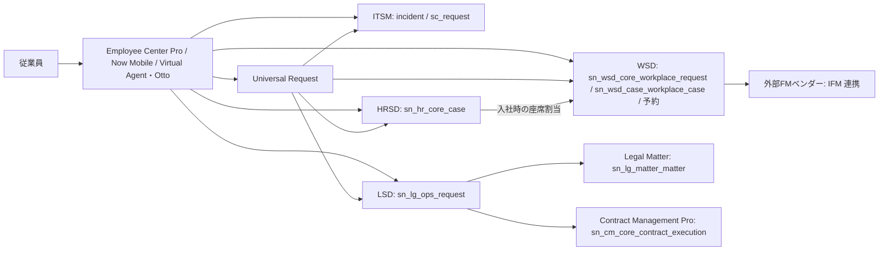
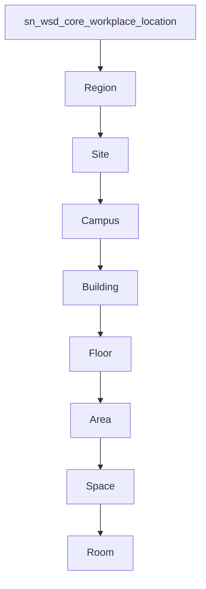
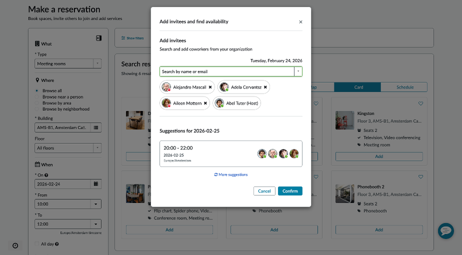
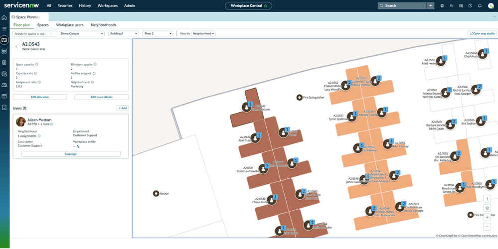
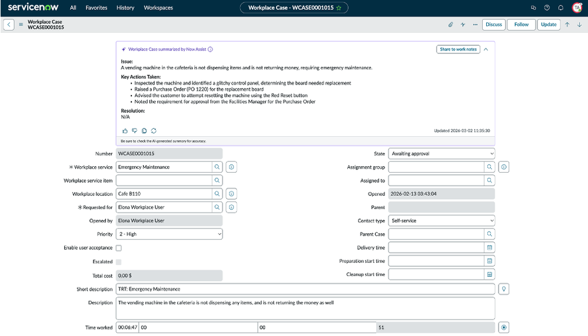
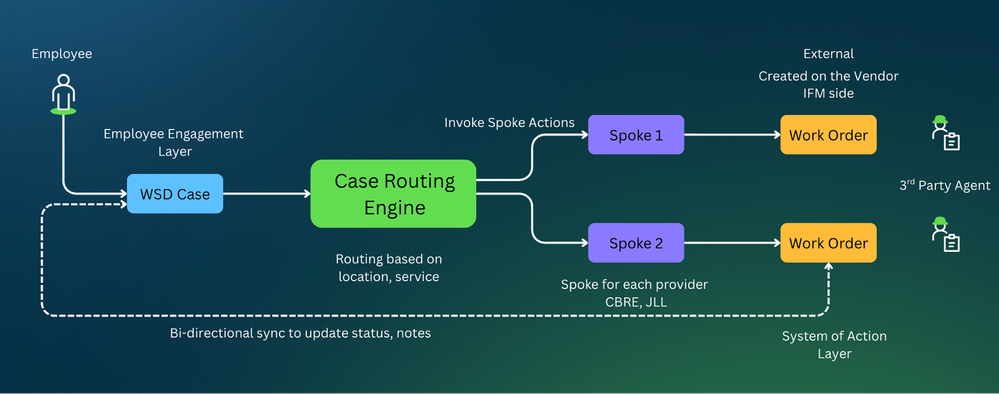
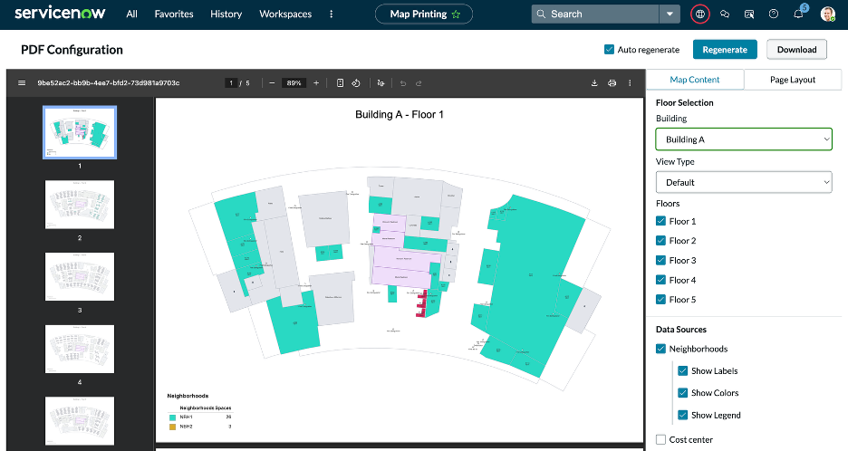
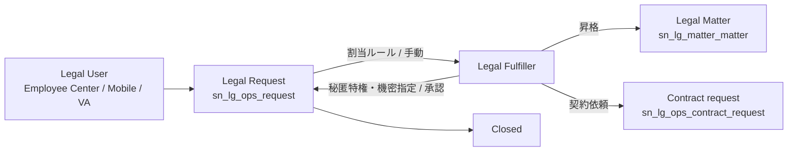
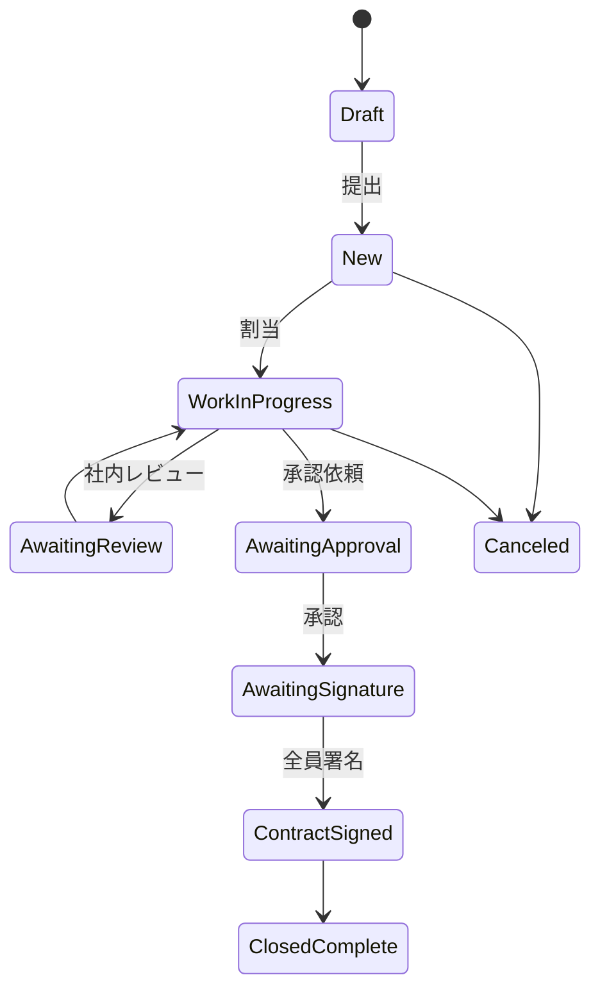

# Workplace Service Delivery・Legal Service Delivery 等

## 概要

本ファイルは、ServiceNow の **Employee Service Management（ESM、従業員サービス管理）** 製品群のうち、HR Service Delivery 以外の主要部門向けワークフローである次の2スイートを中心に扱うリファレンスである。

| スイート | 略称 | 主な対象部門 | 主なスコープ（アプリケーションのプレフィックス） |
|---|---|---|---|
| Workplace Service Delivery（ワークプレイスサービスデリバリー） | WSD | 総務・ファシリティ・不動産 | `sn_wsd_core`、`sn_wsd_rsv`、`sn_wsd_spcmgmt`、`sn_wsd_case`、`sn_wsd_move`、`sn_wsd_visitor`、`sn_wsd_central` など |
| Legal Service Delivery（リーガルサービスデリバリー） | LSD | 法務・コンプライアンス | `sn_lg_ops`（法務リクエスト）、`sn_lg_matter`（法務案件）、`sn_lg_cnt` / `sn_cm_core`（契約管理） |

加えて、IT・HR・ワークプレイス・法務・調達・財務などを1つのプラットフォーム上で提供する考え方である **Enterprise Service Management（ESM、エンタープライズサービス管理）** の全体像と、部門横断の共通部品（Employee Center Pro、Universal Request など）を整理する。

- 基準リリースは **Australia**（2026-05 GA）。WSD・LSD はいずれも ServiceNow Store から配布される「ストアアプリ」であり、ファミリーリリースとは別に年数回（例：2026年3月、6月、7月、9月）アプリ単体のバージョンアップが提供される点に注意する。[出典](https://www.servicenow.com/docs/r/C17ZqvSaMwUVpMBg8Nc5sg/V44L4zPUcwdhYPJpcZ6pnA)
- HR Service Delivery は [hr-service-delivery.md](./hr-service-delivery.md)、Employee Center は [../platform/portals-employee-center.md](../platform/portals-employee-center.md)、財務・調達系ワークフローは [../other/finance-supply-chain-esg.md](../other/finance-supply-chain-esg.md) を参照。

> **Brazil での変更:** Brazil 版ドキュメント（2026-09-10 更新）の Employee Service Management 概要では、Employee Slate が **EmployeeWorks Web App（formerly Employee Slate）** として掲載され、生成 AI 機能は「Otto for HRSD」のように **ServiceNow Otto** ブランドで記載されている。WSD・LSD 固有の Brazil 新機能は公開情報では確認できず。[出典](https://www.servicenow.com/docs/r/employee-service-management/employee-service-management-overview.html)

---

## 1. Enterprise Service Management（ESM）全般

### 1.1 ESM の考え方

Enterprise Service Management（ESM）は、ITSM で確立した「サービスカタログ → リクエスト/ケース → 割り当て → SLA → ナレッジ → セルフサービス」という型を、IT 以外の部門（HR、ワークプレイス、法務、財務、調達、マーケティング等）に展開するアプローチである。ServiceNow では単一データモデル（Now Platform）上に各部門アプリを載せるため、従業員は Employee Center（従業員ポータル）という1つの入口から全部門に依頼でき、部門間の引き継ぎもタスク連携で行える。[出典](https://www.servicenow.com/docs/r/employee-service-management/employee-service-management-overview.html)

ServiceNow 公式ブログ（UK、2026年）に「ESM Foundation」を題材とした記事があるが、本文はアクセス制限により取得できず、記事の主張内容は公開情報では確認できず。[出典](https://www.servicenow.com/uk/blogs/2026/enterprise-service-management-foundation)

### 1.2 Employee Service Management 配下の製品一覧

ServiceNow 公式ドキュメントの「Employee Service Management」配下に掲載されている製品は次のとおり（Brazil 版ページ、Australia から大きな構成変更はない）。[出典](https://www.servicenow.com/docs/r/employee-service-management/employee-service-management-overview.html)

| 区分 | 製品・アプリケーション | 概要 | 本ナレッジの該当ファイル |
|---|---|---|---|
| HR | HR Service Delivery（HRSD） | 入社から退職までの従業員ライフサイクル支援 | [hr-service-delivery.md](./hr-service-delivery.md) |
| HR | Otto for HRSD | ケース/チャット要約、解決メモ起案など生成 AI | [../platform/now-assist-ai-agents.md](../platform/now-assist-ai-agents.md) |
| 共通 | Case and Knowledge Management | 従業員からの問い合わせの記録・処理・解決の標準化 | [hr-service-delivery.md](./hr-service-delivery.md) |
| 共通 | Universal Request（ユニバーサルリクエスト） | 部門をまたいでエージェントがケースを転送・解決する仕組み（グローバルビジネスサービス向け） | 本ファイル 1.3 |
| 共通 | Universal Task（ユニバーサルタスク） | エージェントが従業員に追加情報や作業を依頼する仕組み | 本ファイル 1.3 |
| 従業員体験 | Employee Center Pro | IT・HR・Workplace・Legal・Procurement を横断する従業員ポータル | [../platform/portals-employee-center.md](../platform/portals-employee-center.md) |
| 従業員体験 | EmployeeWorks Web App（旧 Employee Slate） | 検索・依頼・タスク・ナレッジ・コミュニケーションを統合した AI ファーストの体験 | — |
| 従業員体験 | Manager Hub / Journey Designer | マネージャー向けインサイト、ジャーニー設計 | [hr-service-delivery.md](./hr-service-delivery.md) |
| 人材 | Growth Experiences / Skills Foundation / Leader Hub / Recruitment Workspace / Interview Management | キャリア開発、スキル基盤、採用 | [hr-service-delivery.md](./hr-service-delivery.md) |
| 法務 | Legal Service Delivery / Contract Management Pro / Legal and Contract Operations | 法務依頼・案件・契約 | 本ファイル 3章 |
| ワークプレイス | Workplace Service Delivery / Workplace Reservation Management / Workplace Case Management | 会議室・座席予約、ファシリティ依頼 | 本ファイル 2章 |
| 安全衛生 | Health and Safety Incident Management | 労働安全衛生インシデント・ヒヤリハットの記録・調査 | — |

### 1.3 部門横断の共通部品

| 部品 | 役割 | ESM 設計上のポイント |
|---|---|---|
| Employee Center / Employee Center Pro | 全部門共通の従業員ポータル。WSD・LSD のカタログ/レコードプロデューサー、ナレッジを1か所に集約 | Workplace Service Portal や Legal 用の旧ポータルを併存させず、Employee Center へ統合するのが現行の推奨構成【経験則】 |
| Universal Request | 従業員の1つの依頼を、IT・HR・Workplace・Legal 等の部門ケースへ振り分け・転送する親レコード | 「どの部門に頼めばよいか分からない」依頼の受け皿 |
| Universal Task | 部門エージェントから従業員本人へ追加情報・作業を依頼 | 各部門の「Awaiting info」運用を共通化 |
| Virtual Agent / ServiceNow Otto | 会話型の受付、要約、ナレッジ回答 | [../platform/virtual-agent.md](../platform/virtual-agent.md)、[../platform/now-assist-ai-agents.md](../platform/now-assist-ai-agents.md) |
| Advanced Work Assignment（AWA） | スキル・キャパシティベースの自動割り当て | LSD 向け AWA コンポーネントが存在する [出典](https://www.servicenow.com/docs/r/baBFTRuHLgu7HSwp0SUEQQ/W7WMBxOCofB76~aqr~ka8Q) |
| Catalog Builder | 部門管理者がコードなしでカタログ/レコードプロデューサーを作成 | LSD の Request Configurator、Matter Configurator が利用 |

[出典](https://www.servicenow.com/docs/r/employee-service-management/employee-service-management-overview.html)

> **ServiceNow Otto について:** **ServiceNow Otto** は Knowledge 2026（2026-05-05）で発表された、Now Assist・Moveworks・AI Experience を統合する AI 体験のブランドである。[出典](https://newsroom.servicenow.com/press-releases/details/2026/ServiceNow-Otto-creates-the-unified-AI-experience-for-the-enterprise/default.aspx) その後、Store アプリの名称は順次「Now Assist → ServiceNow Otto」に変更されている。例として、2026-07-09 の Now Assist Suite ストアリリースノートには ServiceNow Otto for Conversational Spokes 1.1.1（Rebranding from Now Assist to ServiceNow Otto）と ServiceNow Otto for Integration Hub 2.3.1（Name change from Now Assist to ServiceNow Otto）が載っている。[出典](https://www.servicenow.com/docs/r/store-release-notes/na-suite-rn-2026-07-09.html) 現行の公式ドキュメントでは「ServiceNow Otto for WSD」「ServiceNow Otto for LSD」と表記されているため、本ファイルではこれらを旧称 Now Assist for WSD / LSD と同義として扱う。WSD / LSD 向けアプリそれぞれの改称バージョンと日付は、公開情報では確認できず。

### 1.4 ESM のアーキテクチャ（概念図）

---

## 2. Workplace Service Delivery（WSD）

### 2.1 WSD の概要

Workplace Service Delivery（WSD）は、オフィスの拠点・建物・フロア・スペースのマスタを基盤に、会議室/座席/駐車場の予約、来訪者受付、ファシリティ依頼（ワークプレイスケース）、席替え・移転、スペース計画、リース管理、予防保全を提供するスイートである。**Workplace Core（`sn_wsd_core`）** は WSD スイートの中核アプリで、ワークプレイスデータと運用管理の基盤（foundation for managing workplace data and operations）である。他の WSD アプリは Workplace Core のロケーション階層等を参照して動作する【推定】。[出典](https://www.servicenow.com/docs/r/etYGEBUVr6RQYKLnfpRuhw/n4ywu0ry80o6PRvDrc3USQ)

### 2.2 WSD アプリケーション一覧（Australia）

| # | アプリケーション（英語正式名） | 日本語の概要 |
|---|---|---|
| 1 | Workplace Core（`sn_wsd_core`） | ロケーション階層、スペース割当、シフト計画、予防保全の基盤データ |
| 2 | Workplace Reservation Management（`sn_wsd_rsv`） | 座席・会議室・駐車場等の予約。繰り返し予約、複数日予約に対応 |
| 3 | ServiceNow Otto for WSD（旧 Now Assist for WSD） | 生成 AI によるスペース予約、サービス/ゲスト追加。エージェント型 AI により、緊急保全依頼時に影響スペースをブロック（予約不可化）し、既存予約を別ロケーションへ自動で移す等の自動化 |
| 4 | Workplace Concierge | 出社日の設定、同僚の出社予定の参照、ワークスペースの提案 |
| 5 | Workplace Central | 計画担当・管理者向けワークスペース（スペース最適化、リース、予防保全、移転、予約） |
| 6 | Indoor Mapping | キャンパス/建物/フロアの屋内マップと経路案内。Map Studio で地図を設計 |
| 7 | Workplace Reservations for Microsoft Outlook Add-in | Outlook の予定作成時にスペース検索・予約・サービス依頼 |
| 8 | Workplace Calendar Synchronization | 予約を Microsoft Exchange Online 等のカレンダーと同期 |
| 9 | Workplace Case Management（`sn_wsd_case`） | ファシリティ依頼の自動ルーティング、承認、フロアマップからの不具合報告 |
| 10 | Workplace Move Management（`sn_wsd_move`） | 個別の席替え依頼、承認、通知、一括移転計画 |
| 11 | Workplace Service Delivery for Mobile | 検索・予約・チェックイン・経路案内のモバイルアプリ |
| 12 | Workplace Agent for mobile | 技術者・対応者向けにケース/タスクを処理するモバイルアプリ |
| 13 | Workplace Visitor Management（`sn_wsd_visitor`） | 来訪者登録、事前タスクの自動化、到着状況の監視 |
| 14 | Workplace Services Kiosk | 来訪者のチェックイン/アウト、セルフ登録、インタラクティブマップのキオスク。チェックインには Visitor Management が必要 |
| 15 | Workplace Space Mapping | 予約・経路案内向けの屋内マップ。地図プロバイダーとして Indoor Mapping または Mappedin を利用 |
| 16 | Workplace Space Management（`sn_wsd_spcmgmt`） | 組織内の全ロケーションの管理、シナリオ計画 |
| 17 | Workplace Lease Administration | リース契約とそのサービス・資産・ロケーション・文書の作成と追跡 |
| 18 | Workplace Maintenance Management | 資産・ロケーションの予防保全計画、こぼれ等の是正対応の記録 |
| 19 | Workplace Connectors | 入館バッジ・在席センサーのデータをスポーク経由で取り込むフレームワーク |

[出典](https://www.servicenow.com/docs/r/etYGEBUVr6RQYKLnfpRuhw/n4ywu0ry80o6PRvDrc3USQ)

#### 2.2.1 パッケージ（Professional / Enterprise）

WSD は Store 上で、ライセンスを保有する WSD アプリを一括でダウンロードできるスイートアプリとして配布される。名前が似た次の2つは別のアプリなので、区別すること。

- **Workplace Service Delivery Suite**：スイート本体（2026-09 時点の最新は 2.17.21）。2.12.1（2024-05）で一時的に「Workplace Service Delivery Professional」に改称され、2.15.0（2025-02）で Suite の名称に戻った。[出典](https://www.servicenow.com/docs/r/C17ZqvSaMwUVpMBg8Nc5sg/V44L4zPUcwdhYPJpcZ6pnA)
- **Workplace Service Delivery Professional**：上記とは別に、独自のリリースノートとバージョン系列（v1.4.22、2026-09 など）を持つアプリ。[出典](https://www.servicenow.com/docs/r/C17ZqvSaMwUVpMBg8Nc5sg/~KhcWnwrYsWoFXx7sK~nQw)

| パッケージ | 含まれる主な機能（第三者情報） |
|---|---|
| Professional | Workplace Case Management、会議室・座席予約、Visitor Management、Workplace Central など |
| Enterprise | Professional の全機能＋ Space Management、Move Management、Lease Administration、Maintenance Management |

【第三者情報】上表の機能区分は第三者の製品比較サイトに依拠しており、ServiceNow 公式のエディション比較表は公開情報では確認できず。[出典](https://us.fitgap.com/products/018611/servicenow-workplace-service-delivery) 価格は [../../03_導入編/02-pricing.md](../../03_導入編/02-pricing.md) を参照（AWS Marketplace 上にパートナー経由の「Workplace Service Delivery Professional：fulfiller user 単位」の掲載があるが、公式定価ではない【第三者情報】[出典](https://aws.amazon.com/marketplace/pp/prodview-fnh4fygak3hgw)）。

### 2.3 Workplace Core（基盤）

#### 2.3.1 ロケーション階層テーブル

Workplace Core のロケーションは `sn_wsd_core_workplace_location` を親とする階層テーブル群で表現される。予約・スペース管理・来訪者・ケースはいずれもこの階層を参照する。[出典](https://www.servicenow.com/docs/r/H8yQl2SqBqnT6LbpTm28UQ/qlyKsyedOs1EUQg97dY1zQ)

| 階層 | テーブル名（ラベル） | 説明 |
|---|---|---|
| 親 | `sn_wsd_core_workplace_location`（Workplace Location） | Region / Site / Campus / Building / Floor / Area / Space の親テーブル |
| 1 | `sn_wsd_core_region`（Region、地域） | ワークプレイスロケーションの地域 |
| 2 | `sn_wsd_core_site`（Site、サイト） | 組織のサイト |
| 3 | `sn_wsd_core_campus`（Campus、キャンパス） | オフィスキャンパス |
| 4 | `sn_wsd_core_building`（Building、建物） | オフィスビル |
| 5 | `sn_wsd_core_floor`（Floor、フロア） | フロア |
| 6 | `sn_wsd_core_area`（Area、エリア） | フロア内のエリア |
| 7 | `sn_wsd_core_space`（Space、スペース） | 座席・会議室などのワークスペース |
| 拡張 | `sn_wsd_core_room`（Room） | Space を拡張した部屋と予約可能アイテム（Australia の「Workplace rooms」ラベルについては 2.4.3 の注記を参照） |

- `sn_wsd_core_space_type`（Space Type）はスペース種別の定義で、Indoor Mapping の place type とのマッピングにも使われる。
- `sn_wsd_core_space_staging`（Space Staging）はスペースデータをインポートする際の一時テーブル。
- ロケーションは ServiceNow 標準の `cmn_location` とは別系統のテーブルであり、`cmn_location` からの移行設定用に `sn_wsd_core_location_migration`（Location Migration Configuration）が用意されている。[出典](https://www.servicenow.com/docs/r/H8yQl2SqBqnT6LbpTm28UQ/qlyKsyedOs1EUQg97dY1zQ)

#### 2.3.2 Workplace Core のその他テーブル

| テーブル名 | ラベル | 用途 |
|---|---|---|
| `sn_wsd_core_reservation` | Reservation | 予約の基底テーブル（`sn_wsd_rsv_reservation` の親） |
| `sn_wsd_core_workplace_request` | Workplace Request | ワークプレイス依頼 |
| `sn_wsd_core_workplace_task` | Workplace Task | ワークプレイスタスクの基底（ケース・移転ケースの親） |
| `sn_wsd_core_workplace_profile` | User Workplace Profile | ユーザーのワークプレイスプロファイル（割当スペース、近隣グループ等） |
| `sn_wsd_core_shift` / `sn_wsd_core_m2m_user_shift` / `sn_wsd_core_m2m_location_shift` | Shift / User Shift / Location Shift | シフトとユーザー・ロケーションの関連 |
| `sn_wsd_core_arrival_entry` / `sn_wsd_core_arrival_schedule` | Arrival Entry / Arrival Schedule | 到着（出社）予定 |
| `sn_wsd_core_planned_task_def` | Planned Task Definition | 予防保全などの計画タスク定義 |
| `sn_wsd_core_qr` | QR Code | スペースのチェックイン用 QR コード |
| `sn_wsd_core_approval_definition` / `sn_wsd_core_approval_configuration` | Workplace Approval Definition / Configuration | 承認定義 |
| `sn_wsd_core_performer_criteria` | Workplace Performer Criteria | 実施者条件 |
| `sn_wsd_core_card_configuration` | Workplace Card Configuration | カード表示設定 |
| `sn_wsd_core_client_role_rule` | Workplace Client Role Rule | クライアントロールルール |
| `sn_wsd_core_html_signing_template` | Html Signing Template | 署名テンプレート（来訪者同意等） |
| `sn_wsd_core_user_space_suggestions` | User Space Suggestions | スペース提案のキャッシュ（Workplace Concierge 必須） |
| `sn_wsd_core_workplace_user` | Workplace Safety User | Safe Workplace 系の利用者情報 |

[出典](https://www.servicenow.com/docs/r/H8yQl2SqBqnT6LbpTm28UQ/qlyKsyedOs1EUQg97dY1zQ)（Yokohama 版ページ。Australia でも同名テーブルが他コンポーネントページから参照されていることを確認）

> 補足：Neighborhood（近隣グループ、部署単位の座席ゾーン）テーブルは Workplace Space Management から Workplace Core へ移管され、Space Management 側の `sn_wsd_spcmgmt_neighborhood*` はバージョン 1.17.0 で非推奨になった。[出典](https://www.servicenow.com/docs/r/XbpkTdWa3HBo31srdD0Rdg/igTSMKK_k_PywwJAwCYH7g)

#### 2.3.3 Workplace Core のロール

| ロール（ラベル） | ロール名 | 説明 |
|---|---|---|
| Workplace admin | `sn_wsd_core.admin` | ワークプレイスデータの設定とアプリへのフルアクセス。Workplace manager を含む |
| Workplace manager | `sn_wsd_core.workplace_manager` | スペース予約、従業員/シフトとスペースの紐付け、計画保全タスク管理。exposure analyst、`schedule_admin`、`template_editor_global` を含む |
| Workplace exposure analyst | `sn_wsd_core.workplace_exposure_analyst` | 予約情報を用いて Emergency Exposure Management で接触者を特定 |
| Workplace shift owner | `sn_wsd_core.workplace_shift_owner` | 所有シフトの編集、関連タスク・依頼・予約の参照 |
| Workplace user | `sn_wsd_core.workplace_user` | ポータル/Now Mobile からエリア・スペース予約や出社予定登録。v1.3.2 以降はポータルでの予約に必須 |
| Workplace core writer | `sn_wsd_core.task_writer` | ワークプレイスタスクの CRUD、タスクテンプレート参照。reader を含む |
| Workplace core reader | `sn_wsd_core.task_reader` | 全ワークプレイスタスクの参照 |
| Workplace knowledge base writer | `sn_wsd_core.kb_writer` | ワークプレイス KB 記事の作成・公開・廃止 |
| Workplace entity reader / writer | `sn_wsd_core.workplace_entity_reader` / `sn_wsd_core.workplace_entity_writer` | Workplace Entity / Entity Type テーブルの参照・編集 |

[出典](https://www.servicenow.com/docs/r/H8yQl2SqBqnT6LbpTm28UQ/qlyKsyedOs1EUQg97dY1zQ)

この他、他アプリのロール包含関係から `sn_wsd_core.profile_reader`、`sn_wsd_core.profile_writer`、`sn_wsd_core.location_reader`、`sn_wsd_core.location_writer`、`sn_wsd_core.shift_reader` の存在が確認できる（説明は公開情報では確認できず）。[出典](https://www.servicenow.com/docs/r/XbpkTdWa3HBo31srdD0Rdg/igTSMKK_k_PywwJAwCYH7g)

### 2.4 Workplace Reservation Management（予約管理）

#### 2.4.1 概要

Workplace Reservation Management（`sn_wsd_rsv`）は、従業員が座席（デスク）・会議室・駐車場などの「予約可能アイテム」を、Workplace Service Portal / Employee Center、Now Mobile（Workplace Experience）、Outlook アドイン、Virtual Agent/Otto から予約するアプリである。予約対象の種類ごとに **Reservable Module（予約可能モジュール）** を定義し、その設定で検索方法・チェックイン・承認・繰り返し可否などを制御するのが設計の中心となる。[出典](https://www.servicenow.com/docs/r/etYGEBUVr6RQYKLnfpRuhw/l6p53Vg_ZxeRsZRFSwIxtg)

#### 2.4.2 ロール

| ロール（ラベル） | ロール名 | 説明 | 包含ロール |
|---|---|---|---|
| WSD Core Admin | `sn_wsd_core.admin` | WSD アプリ全体へのフルアクセス | `sn_wsd_rsv.admin` |
| WSD Admin | `sn_wsd_rsv.admin` | 標準サービスとロケーション、柔軟サービス、予約目的、アーカイブルール、タイムスロットの管理 | manager、dispatcher、staff、workplace_user、reservation_planner |
| WSD Manager | `sn_wsd_rsv.manager` | 全予約の参照・管理、レポート作成 | dispatcher、staff、workplace_user、reservation_planner |
| WSD Dispatcher | `sn_wsd_rsv.dispatcher` | 全予約の参照 | staff、workplace_user |
| WSD Staff | `sn_wsd_rsv.staff` | 全予約の参照 | workplace_user |
| Workplace user | `sn_wsd_core.workplace_user` | 自分/他者の部屋・座席予約、自分の予約の編集・取消、予約可能アイテムとサービスの参照 | なし |
| Reservation planner | `sn_wsd_rsv.reservation_planner` | Workplace Central の Event planner で予約計画。一部 Reservable module 設定をバイパス可能 | dispatcher、`sn_wsd_rsv.reservation_viewer`、`sn_wsd_case.bypass_services_limitation`、`sn_wsd_rsv.bypass_module_validation` |
| Reservation viewer | `sn_wsd_rsv.reservation_viewer` | Event planner での予約参照 | workplace_user、`sn_wsd_central.workplace_analytics_user` |

[出典](https://www.servicenow.com/docs/r/etYGEBUVr6RQYKLnfpRuhw/QYKjytkdmFPLmoqtme_XkQ)

#### 2.4.3 テーブル

| テーブル名 | ラベル | 内容 |
|---|---|---|
| `sn_wsd_rsv_reservation` | Workplace Reservation | 予約本体。`sn_wsd_core_reservation` を拡張。Auto Conflict Resolution state 列を追加 |
| `sn_wsd_rsv_reservable_module` | Reservable Module | 予約可能アイテムの種類定義（Application File を拡張＝アプリ構成データとして扱われる） |
| `sn_wsd_rsv_m2m_reservable_module_workplace_location` | Reservable Module Workplace Location | モジュールを利用可能なロケーション |
| `sn_wsd_rsv_m2m_reservable_module_user_criteria` | Reservable Module User Criteria | モジュールを利用できるユーザー/グループ（User Criteria） |
| `sn_wsd_rsv_m2m_reservable_module_time_slot` | Reservable Module Time Slot | Quick Reservation ウィジェット用のタイムスロット |
| `sn_wsd_rsv_m2m_reservable_module_view_configuration` | Reservable Module View Configurations | 検索ページに表示するビューと順序 |
| `sn_wsd_rsv_time_slot_list` | Reservable Time Slot | タイムスロット |
| `sn_wsd_rsv_reservable_view` | Reservable View | 予約可能ビュー（カード/マップ/スケジュール等） |
| `sn_wsd_rsv_reservation_path` | Reservation path | 予約パス（Browse all / near a person / by area 等） |
| `sn_wsd_rsv_standard_service` | Standard Service | 標準サービス（例：プロジェクター、ホワイトボード） |
| `sn_wsd_rsv_m2m_location_standard_service` | Location Standard Service | ロケーションに付与された標準サービス |
| `sn_wsd_rsv_extra_service` | Extra service | 予約時に追加依頼されたサービス（ケータリング等） |
| `sn_wsd_rsv_reservable_purpose` / `sn_wsd_rsv_m2m_location_reservable_purpose` | Reservable purpose / Location Reservable Purpose | 予約目的とロケーションの関連 |
| `sn_wsd_rsv_layout` / `sn_wsd_rsv_m2m_location_layout` | Layout / Location Layout | 部屋のレイアウト（教室型、円卓等） |
| `sn_wsd_rsv_m2m_reservation_invitee` | Reservation Invitee | 予約の招待者（アーカイブルール対象） |
| `sn_wsd_rsv_virtual_meeting_provider` | Virtual Meeting Provider | オンライン会議プロバイダー |
| `sn_wsd_rsv_reservation_recording` | Reservation recording | 会議録画（アーカイブルール対象） |
| `sn_wsd_core_room_list` | Workplace rooms | 部屋の予約可能アイテム（Space を拡張） |
| `sn_wsd_core_space_suggestion_configuration` | Space Suggestion Configuration | スペース提案ロジック（Workplace Concierge 必須） |

[出典](https://www.servicenow.com/docs/r/etYGEBUVr6RQYKLnfpRuhw/QYKjytkdmFPLmoqtme_XkQ)

> 注記：Australia 版の Reservation Management コンポーネントページでは、Workplace rooms は `sn_wsd_core_room_list`（Space を拡張）である。一方、Yokohama 版の Workplace Core コンポーネントページでは、`sn_wsd_core_room` にも Room と Workplace rooms の両方のラベルが記載されている。本ファイルでは Australia 版の記載に従い、Workplace rooms を `sn_wsd_core_room_list` として扱う。[出典](https://www.servicenow.com/docs/r/H8yQl2SqBqnT6LbpTm28UQ/qlyKsyedOs1EUQg97dY1zQ)

#### 2.4.4 Reservable Module（予約可能モジュール）の設定項目

- **メニュー:** All > Workplace Reservation Management > Administration > Reservable Module > New
- **必要ロール:** `sn_wsd_rsv.admin`

[出典](https://www.servicenow.com/docs/r/etYGEBUVr6RQYKLnfpRuhw/l6p53Vg_ZxeRsZRFSwIxtg)

**(1) 基本情報タブ**

| フィールド | 説明 |
|---|---|
| Name（名前） | カテゴリ名（例：Desks、Meeting rooms） |
| Inline title | ポータル上に説明文と並べて表示するタイトル |
| Order（順序） | 予約ポータルでの表示順 |
| Active / Active from | 有効化と有効開始日 |
| Image | モジュールを表す画像 |

**(2) Reservable Table Configuration（予約可能テーブル構成）タブ**

| フィールド | 説明 |
|---|---|
| Selection type（選択タイプ） | **Specific unit**（個々のアイテムを一覧）／**Container**（親コンテナ＝エリア単位でグルーピングし空き数を表示） |
| Reservable type（予約可能タイプ） | 予約可能アイテムの種類（Location など） |
| Reservable table（予約可能テーブル） | 予約可能アイテムを保持するテーブル。Location タイプの場合は `sn_wsd_core_space` とその拡張テーブルのみ使用 |
| Reservable filter（予約可能フィルター） | 表示対象を絞る条件。ロケーションでは Active と Is reservable を True にすること（しないと非アクティブ・予約不可のスペースが表示されうる） |
| Reservable container field | Container 選択時のグルーピング項目（自動で Area に設定） |
| Reservable quantity field | コンテナを何回予約できるか（スペースの Capacity に基づく） |

**(3) Reservable Module Configuration（モジュール構成）タブ（主要項目）**

| フィールド | 説明・既定値 |
|---|---|
| Available in | 表示先：Advanced reservation（予約ポータル）／Quick reservation（ホームのウィジェット）／Workplace Experience（モバイル） |
| Require allocation check | 予約者とアイテムの割当（部署・コストセンター等）の不一致を確認（Workplace Space Management 必須） |
| Enable allocation duration check | 割当開始/終了日でスペースを絞り込む |
| Enable restricted neighborhood rules | 利用制限された近隣グループのスペースを非表示 |
| Enable browse by area / by neighborhood / floor-based search | エリア・近隣グループ・フロア単位で検索 |
| Enable browse near a person | 同じフロアの同僚の近くのスペースを検索（Max number of days for browse near a person 既定 7） |
| Override approval policy | No override／Always require approval／Never require approval |
| Override check-in policy | No override／Always require check-in／Never require check-in |
| Time before employee can check-in | 開始前に何分前からチェックイン可能か |
| Cancel reservations exceeding check-in time | 規定時間内にチェックインしない予約を自動取消 |
| Apply to shift | シフトベース予約（繰り返し予約は非対応） |
| Enable group reservation | グループ予約を許可 |
| Enable employees to make spaces as private | 予約スペースの詳細を非公開にできる（ロケーションプライバシー設定に依存） |
| Enable ical generation | iCalendar ファイル生成（同期済み予約は対象外） |
| Virtual meeting provider | オンライン会議リンクの自動生成に使うプロバイダー |
| Allow Multiple Building Reservations | 複数建物のスペースを1予約に含める（Workplace Service Portal のみ、繰り返し不可） |
| Allow all day reservation / Require all day reservation / All day | 終日予約（Disabled／Enabled／Default／Required） |
| Max days in future | 何日先まで予約可能か |
| Allow recurring reservations | 繰り返し予約を許可 |
| Auto-resolve recurring conflicts | 繰り返しの一部が競合したとき代替スペースを自動確保 |
| Max number of occurrences | 繰り返し回数上限（既定 180） |
| Min duration / Max duration | 予約時間の下限/上限 |
| Max days for multi-day | 複数日予約の日数（既定 1＝単日、0 不可、Max days in future を超えられない） |
| Enable facet filter / Search limit | ファセットフィルター、検索結果上限 |

**(4) Reservation Widget Configuration（予約ウィジェット構成）タブ**

| フィールド | 説明 |
|---|---|
| Requires subject / Require cancel notes | 件名・取消メモの必須化 |
| Warn employee for duplicate reservation | 同一モジュール・同時間帯の重複予約を警告 |
| Warn employee about presence exception | 予約日に在宅（remote）設定している場合に警告（Workplace Concierge 必須） |
| Allow invitees | 社内同僚・外部来訪者の招待を許可 |
| Allow attendees-based search | 招待者の空き状況で検索（Allow invitees 必須、Microsoft Exchange Online のみ） |
| Display number of attendees | 参加人数入力（未設定時は 1） |
| Display on behalf of | 代理予約（既定で有効） |
| Display sensitivity | Normal／Private の指定 |
| Allow reservation message | 招待者向けメモ・画像の添付 |
| Additional details record producer | 予約フォームに追加項目を出すレコードプロデューサー |
| Show as | 同期予約のカレンダー上の表示（Busy／Free、Workplace Calendar Synchronization 必須） |

[出典](https://www.servicenow.com/docs/r/etYGEBUVr6RQYKLnfpRuhw/l6p53Vg_ZxeRsZRFSwIxtg)

#### 2.4.5 システムプロパティ（Australia）

| プロパティ | 説明 | 型 | 既定値 |
|---|---|---|---|
| `sn_wsd_rooms.default_page_size` | 検索・予約サマリー・My reservations の1ページ件数 | integer | 8 |
| `sn_wsd_rsv.enable_auto_search` | 条件変更時に自動検索（有効時は Search ボタン非表示） | true/false | false |
| `auto_refresh_search_rsv_data` | 予約中の検索結果の自動更新間隔（分、0 以下で無効） | — | 2 |
| `sn_wsd_rsv.search_limit` | 検索結果件数（モジュール側の Search limit 未設定時に適用） | integer | 100 |
| `sn_wsd_rsv.time_before_check_in_out_reminder` | チェックイン/アウトのリマインドメールを何分前に送るか | integer | 30 |
| `sn_wsd_rsv.day_start` / `sn_wsd_rsv.day_end` | 終日予約の開始/終了時刻（24時間表記） | string | 09:00 / 17:00 |
| `sn_wsd_rsv.is_blocker_mandatory` | 準備・片付け用ブロッカー予約を必須にするか（競合時は追加サービスを依頼しない） | true/false | false |
| `sn_wsd_rsv.blocker_user` | ブロッカー予約を作成するユーザーの sys_id | string | 9b21b32ddb88b01097acc900399619d8 |
| `sn_wsd_rsv.cancel_unconfirmed_reservations` | カレンダープロバイダーの確認を待つ時間（分）。超過で取消 | integer | 360 |
| `sn_wsd_rsv.time_when_reservation_cancelled_without_check_in` | 開始後何分チェックインがなければ取消すか（モジュール側の取消オプションが必要） | integer | 30 |
| `sn_wsd_rsv.default_quick_reserve_reservable_module` | Now Mobile のクイック予約で使うモジュールの sys_id | string | 空 |
| `sn_wsd_rsv.meeting_provider` | オンライン会議リンク生成のプロバイダー | choice | None |
| `sn_wsd_rsv.recording_buffer_time` | 会議終了後、録画を取得するまでの分数 | integer | 30 |
| `sn_wsd_core.ENABLE_LOCATION_PRIVACY` | ロケーションプライバシーの有効化と種類 | choice | None |
| `sn_wsd_rsv.enable_recurring_score` | 繰り返し予約時に系列全体での空き状況スコアを表示 | true/false | false |
| `sn_wsd_rsv.lead_time_info_message_for_limited_services` | 準備リードタイム内のサービスのみ表示されている旨の通知（バイパスユーザーのみ） | — | — |
| `sn_wsd_rsv.display_invitees_on_outlook` | Outlook アドインからの招待者追加を許可（true の場合モジュール設定より優先） | — | — |
| `sn_wsd_rsv.UNASSIGNED_USER_ACCESS_MODE` | 部署・コストセンター・エンティティ未設定ユーザーが予約できる範囲（restricted／unrestricted） | choice | 公開情報では確認できず |

[出典](https://www.servicenow.com/docs/r/etYGEBUVr6RQYKLnfpRuhw/5aHYHdk6riXC2qjL0TOpFQ)

#### 2.4.6 チェックインと自動取消

予約の自動取消（ノーショー対策）は次の条件がそろったときに動作する。

1. スペース側またはモジュール側でチェックインが必須（Override check-in policy = Always require check-in など）。
2. Reservable Module の **Cancel reservations exceeding check-in time** が選択されている（在席センサーのないスペースの場合）。
3. `sn_wsd_rsv.time_when_reservation_cancelled_without_check_in`（既定 30 分）を経過。

なお、チェックイン/アウトのリマインダー・判定ジョブは 30 分間隔で実行される。このため、取消が実行されるのは条件成立から最大 30 分程度遅れる場合がある【推定】。

[出典](https://www.servicenow.com/docs/r/etYGEBUVr6RQYKLnfpRuhw/qUh~e4Hg4WCpht1yoAroFw)、[出典](https://www.servicenow.com/docs/r/etYGEBUVr6RQYKLnfpRuhw/5aHYHdk6riXC2qjL0TOpFQ)

【第三者情報】コミュニティでは「猶予時間を過ぎても自動取消されない」という報告があり、モジュール設定と予定ジョブの有効化を確認すべきとされる。[出典](https://www.servicenow.com/community/wsd-forum/auto-cancellation-if-not-checked-in/m-p/3463518)

#### 2.4.7 予約の状態値

`sn_wsd_rsv_reservation` には予約状態を表す `state` と、チェックイン状態を表す `check_in_state` が別フィールドとして存在する。REST API のレスポンス例では `check_in_state` に `not_required`（Not required）などの値が確認できる。`state` の選択肢一覧は公開情報では確認できず（インスタンスの `sys_choice` で確認すること）。[出典](https://www.servicenow.com/docs/r/api-reference/rest-apis/wsd_recur_reserv-api.html)、[出典](https://www.servicenow.com/docs/r/fr-FR/api-reference/rest-apis/wsd_grp_reserv-api.html)

#### 2.4.8 REST API

WSD 予約系の REST API は `sn_wsd_rsv` 名前空間で提供され、Workplace Reservation Management プラグインの有効化が前提。主に `sn_wsd_core.workplace_user` ロールで呼び出す。

| API | 用途 |
|---|---|
| WSD Reservable API / WSD Reservable V2 API | 予約可能アイテムの検索 |
| WSD Reservable Module API | 予約可能モジュール情報の取得 |
| WSD Search API | スペース検索 |
| WSD Reservation API | 単一予約の取得・作成・更新・取消（sys_id は `sn_wsd_rsv_reservation`） |
| WSD Multi Reservation API | 複数スペースの一括予約・取消 |
| WSD Recurring Reservation API | 繰り返し予約 |
| WSD Group Reservation API | グループ予約 |
| WSD Reservation Invitees API | 招待者（`sn_wsd_rsv_m2m_reservation_invitee`）の管理 |

[出典](https://www.servicenow.com/docs/r/api-reference/rest-apis/wsd_reservable-api.html)、[出典](https://www.servicenow.com/docs/r/api-reference/rest-apis/wsd_multi_reserv-api.html)、[出典](https://www.servicenow.com/docs/r/api-reference/rest-apis/wsd_recur_reserv-api.html)。REST API 全般は [../platform/web-services-api.md](../platform/web-services-api.md) を参照。

#### 2.4.9 予約画面（招待者の空き状況）

- **キャプション:** Workplace Reservation Management の予約画面（Make a reservation）で、招待者を追加し空き時間を探すダイアログ（2026年3月のストアリリース機能 Invitee Availability）。
- **画面説明:** 左ペインに予約条件（What：Type＝Meeting rooms、Where：Browse all／Browse near a person／Browse by area／Browse by neighborhood、Building、Floor、When：日付・From/To・All day）が並び、右側に検索結果がカード表示される。前面の「Add invitees and find availability」ダイアログでは名前またはメールで同僚を検索して追加でき、各人の在席アイコンとホストが表示され、「Suggestions for 2026-02-25」として全員が空いている時間帯（例：20:00〜22:00）が提案される。Cancel／Confirm ボタンで確定する。Exchange Online のカレンダーを参照し、Reservable Module の Allow invitees が必要。
- **出典:** https://www.servicenow.com/community/wsd-blog/workplace-service-delivery-what-s-new-in-the-march-12th-release/ba-p/3510149 （取得日：2026-11-03）

### 2.5 Workplace Space Management（スペース管理）

#### 2.5.1 概要

Workplace Space Management（`sn_wsd_spcmgmt`）は、組織の全ロケーションの割当（部署・コストセンター・近隣グループ）、稼働率、シナリオ計画（将来のレイアウト変更・統廃合の試算）、スケジュールプラン（座席の時間割当）を管理するアプリである。日常操作は Workplace Central ワークスペースの Space Planning から行う。[出典](https://www.servicenow.com/docs/r/XbpkTdWa3HBo31srdD0Rdg/igTSMKK_k_PywwJAwCYH7g)

#### 2.5.2 ロール

| ロール名 | 説明 | 包含ロール |
|---|---|---|
| `sn_wsd_spcmgmt.admin` | アプリへのフルアクセス | `sn_wsd_spcmgmt.manager` |
| `sn_wsd_spcmgmt.manager` | アプリへのフルアクセス | なし |
| `sn_wsd_spcmgmt.space_planner` | シナリオの作成・展開 | `sn_wsd_core.task_reader`、`sn_wsd_move.reader`、`sn_wsd_core.profile_writer`、`sn_wsd_central.workspace_user`、`view_changer`、`sn_wsd_spcmgmt.manager`、`sn_wsd_core.location_writer` |
| `sn_wsd_spcmgmt.scenario_reader` | シナリオの参照のみ | `sn_wsd_central.workspace_user` |
| `sn_wsd_spcmgmt.schedule_plan_reader` | スケジュールプランの参照のみ | なし |
| `sn_wsd_spcmgmt.schedule_plan_writer` | スケジュールプランの作成・編集 | schedule_plan_reader |
| `sn_wsd_spcmgmt.project_owner` | スケジュールプランの作成・管理 | schedule_plan_writer、workplace_user、task_reader、profile_reader、location_reader、`sn_wsd_central.workspace_user`、shift_reader |

[出典](https://www.servicenow.com/docs/r/XbpkTdWa3HBo31srdD0Rdg/igTSMKK_k_PywwJAwCYH7g)（原文のロール名の大文字小文字に表記ゆれがあるため小文字に統一して記載）

#### 2.5.3 テーブル

| テーブル名 | 内容 |
|---|---|
| `sn_wsd_spcmgmt_location_cc_dept_map` | 割当（Allocation）：ロケーションとコストセンター/部署のマッピング |
| `sn_wsd_spcmgmt_location_status_tracker` | ロケーションの状態変更履歴 |
| `sn_wsd_spcmgmt_space_allocation_type_change_tracker` | スペース割当タイプの変更履歴 |
| `sn_wsd_spcmgmt_view_by_configuration` | 「View by」表示設定 |
| `sn_wsd_spcmgmt_schedule_plan` | スケジュールプラン |
| `sn_wsd_spcmgmt_schedule_plan_space` / `_user` / `_user_space` | プラン内のスペース・ユーザー・ユーザー×スペース |
| `sn_wsd_spcmgmt_neighborhood` / `_neighborhood_user_assignment` / `_neighborhood_m2m_space` | 近隣グループ関連（v1.17.0 で非推奨、Workplace Core に移管） |
| `sn_wsd_spcmgmt_utilization_capacity` | Utilization vs Capacity：エリア単位の容量と利用率（Workplace Central でインストール） |

[出典](https://www.servicenow.com/docs/r/XbpkTdWa3HBo31srdD0Rdg/igTSMKK_k_PywwJAwCYH7g)、[出典](https://www.servicenow.com/docs/r/etYGEBUVr6RQYKLnfpRuhw/7hXdrKf7uWol6ch95UYoBQ)

#### 2.5.4 Workplace Central の Space Planning 画面

- **キャプション:** Workplace Central ワークスペースの Space Planning 画面（2026年3月リリースの新スペース計画体験）。
- **画面説明:** 上部のワークスペースタブ「Space Planning」の下に Floor plan／Spaces／Workplace users／Neighborhoods の4タブがある。フィルター行で Demo Campus → Building A → Floor 2 を選び、「View by: Neighborhood」で近隣グループ別に色分けされたフロアマップが右側に表示される（座席ごとに割当ユーザー名と人数バッジ）。左パネルには選択したスペース A2.0543（Workspace/Desk）の Space capacity、Effective capacity、Capacity ratio、Profiles assigned、Assignment ratio、Neighborhoods と、「Edit allocation」「Edit space details」ボタン、割り当て済みユーザー（Neighborhood、Department、Cost center、Workplace entity）と「Unassign」ボタンが表示される。右上に「Open map studio」リンクがある。
- **出典:** https://www.servicenow.com/community/wsd-blog/workplace-service-delivery-what-s-new-in-the-march-12th-release/ba-p/3510149 （取得日：2026-11-03）

### 2.6 Workplace Central（ワークプレイス管理者向けワークスペース）

Workplace Central は、ワークプレイスマネージャー、スペースプランナー、移転マネージャー、保全プランナー向けの Next Experience ワークスペースで、スペース最適化、リース、予防保全、移転、予約（Event planner）を1画面に集約する。[出典](https://www.servicenow.com/docs/r/etYGEBUVr6RQYKLnfpRuhw/n4ywu0ry80o6PRvDrc3USQ)

| ロール名 | 説明 | 包含ロール |
|---|---|---|
| `sn_wsd_central.workspace_user` | Workplace Central ワークスペースへのアクセス | `canvas_user` |
| `sn_wsd_central.workplace_analytics_user` | Workplace Analytics ワークスペースへのアクセス | `sn_wsd_central.workspace_user` |

実際の操作権限は Space Management・Move Management 側のロールで付与される。[出典](https://www.servicenow.com/docs/r/etYGEBUVr6RQYKLnfpRuhw/7hXdrKf7uWol6ch95UYoBQ)

2026年3月のストアリリースでは、マップベースのスペース計画（手動/ルールベース割当、一括編集、割当率 KPI）、Facility Assets and Models のリストビュー追加が行われた。[出典](https://www.servicenow.com/community/wsd-blog/workplace-service-delivery-what-s-new-in-the-march-12th-release/ba-p/3510149)

### 2.7 Workplace Case Management（ワークプレイスケース）

#### 2.7.1 概要

Workplace Case Management（`sn_wsd_case`）は、空調・清掃・修繕・備品などのファシリティ依頼を **Workplace Service（ワークプレイスサービス）** 単位で定義し、事前定義したステップ・承認・エスカレーションで自動ルーティングするアプリである。従業員はフロアマップ上から不具合箇所を指定して報告できる。[出典](https://www.servicenow.com/docs/r/etYGEBUVr6RQYKLnfpRuhw/n4ywu0ry80o6PRvDrc3USQ)

#### 2.7.2 ロール

| ロール（ラベル） | ロール名 | 説明 | 包含ロール |
|---|---|---|---|
| Workplace Case Management admin | `sn_wsd_case.admin` | ワークプレイスサービスデータの設定、フルアクセス | `sn_wsd_case.manager` |
| Workplace case Manager | `sn_wsd_case.manager` | 全ケースの管理、ケース/タスクテンプレート、サービス・アクティビティ、承認オプション、エスカレーションルール、対応手順の CRUD | `template_editor_global`、`sn_wsd_case.workplace_agent` |
| Workplace case agent | `sn_wsd_case.workplace_agent` | writer 権限＋フロー実行の参照、KB 記事作成 | `sn_wsd_case.case_writer`、`sn_wsd_core.kb_writer`、`flow_operator` |
| Workplace case writer | `sn_wsd_case.case_writer` | ワークプレイスタスク/ケースの CRUD | `sn_wsd_core.task_writer`、`sn_wsd_case.case_reader` |
| Workplace case reader | `sn_wsd_case.case_reader` | 全タスク/ケースの参照 | `sn_wsd_core.task_reader` |
| Workplace reservation admin | `sn_wsd_case.bypass_services_limitation` | リードタイム内のサービス品目も表示・削除可能、発注リードタイムの設定 | — |
| （更新）Workplace user | `sn_wsd_core.workplace_user` | v1.21.0 以降 `sn_wsd_case_workplace_case` への書き込み権限 | — |

Australia では「Workplace Event Planners」グループが追加され、エージェント型 AI ワークフローにより緊急保全・変更イベント依頼が自動で割り当てられる（包含：`sn_wsd_case.case_writer`、`sn_wsd_rsv.reservation_planner`）。[出典](https://www.servicenow.com/docs/r/etYGEBUVr6RQYKLnfpRuhw/SaKw9tWWDPYjEYoGehB7Gg)

#### 2.7.3 テーブル

| テーブル名 | ラベル | 内容 |
|---|---|---|
| `sn_wsd_case_workplace_case` | Workplace Case | ケース本体。`sn_wsd_core_workplace_task` を拡張（「Archive old workplace tasks」ルールでアーカイブ） |
| `sn_wsd_case_workplace_service` | Workplace Service | ワークプレイスサービス（Application File を拡張） |
| `sn_wsd_case_workplace_service_activity` | Workplace Service Activity | サービスのアクティビティ（Application File を拡張） |
| `sn_wsd_case_workplace_service_item` | Workplace Service Item | サービス品目 |
| `sn_wsd_case_service_item_request` | Request Service Items | 依頼されたサービス品目 |
| `sn_wsd_case_m2m_service_location` / `sn_wsd_case_m2m_service_item_location` | Workplace Service Location / Service Item Location | サービス/品目の提供ロケーション |
| `sn_wsd_case_tier_definition` | Case Tier Escalation | エスカレーションルール |
| `sn_wsd_case_fulfillment_instruction` | Fulfillment Instruction | 対応手順 |
| `sn_wsd_case_workplace_field_mapping` | Workplace Field Mapping | 項目マッピング |
| `sn_wsd_case_workplace_template_configuration` | Workplace Template Configuration | テンプレート構成 |

[出典](https://www.servicenow.com/docs/r/etYGEBUVr6RQYKLnfpRuhw/SaKw9tWWDPYjEYoGehB7Gg)（Australia 版のテーブル一覧は上記 11 テーブル）

承認オプション（Approval options）は、Workplace case Manager ロールの説明で CRUD の対象として言及されている。ただし、それを保持するテーブル名は Australia 版のコンポーネント一覧には載っておらず、公開情報では確認できず。

#### 2.7.4 ワークプレイスケースのフォームと AI 要約

- **キャプション:** Workplace Case（WCASE0001015）のフォーム上部に表示された AI ケース要約（Workplace Case Summarization、2026年3月リリース）。
- **画面説明:** 上部の要約カード「Workplace Case summarized by Now Assist」に Issue（カフェテリアの自販機故障）、Key Actions Taken（制御基板の不具合特定、発注書 PO 1220 起票、承認要否など）、Resolution が箇条書きされ、「Share to work notes」ボタンと評価アイコンが付く。下部のフォーム項目は Number、Workplace service（Emergency Maintenance）、Workplace service item、Workplace location（Cafe B110）、Requested for、Opened by、Priority（2 - High）、Enable user acceptance、Escalated、Total cost、State（Awaiting approval）、Assignment group、Assigned to、Opened、Parent、Contact type（Self-service）、Parent Case、Delivery time、Preparation start time、Cleanup start time、Short description、Description、Time worked。ケースの番号接頭辞は `WCASE`。
- **出典:** https://www.servicenow.com/community/wsd-blog/workplace-service-delivery-what-s-new-in-the-march-12th-release/ba-p/3510149 （取得日：2026-11-03）

#### 2.7.5 外部 FM ベンダー連携（IFM Integration Framework）

2026年3月のストアリリースで、ワークプレイスケースを第三者の統合ファシリティマネジメント（IFM）事業者の作業指示（Work Order）に変換する双方向連携フレームワークが追加された。複数の FM 事業者・拠点に対応し、従業員はベンダーポータルではなく ServiceNow から依頼できる。[出典](https://www.servicenow.com/community/wsd-blog/workplace-service-delivery-what-s-new-in-the-march-12th-release/ba-p/3510149)

- **キャプション:** Workplace Case Management の IFM Integration Framework の概念図。
- **画面説明（図の内容）:** Employee（従業員）が「Employee Engagement Layer」で WSD Case を起票 → Case Routing Engine がロケーションとサービスに基づいてルーティング → 事業者ごとのスポーク（Spoke 1 / Spoke 2、例として CBRE、JLL）を呼び出し → ベンダーの IFM 側（System of Action Layer）で Work Order が作成され、第三者エージェントが対応。Work Order から WSD Case へは状態・メモが双方向同期（破線）で戻る。
- **出典:** https://www.servicenow.com/community/wsd-blog/workplace-service-delivery-what-s-new-in-the-march-12th-release/ba-p/3510149 （取得日：2026-11-03）

スポークの仕組みは [../platform/integrationhub.md](../platform/integrationhub.md) を参照。

### 2.8 Workplace Move Management（移転管理）

Workplace Move Management（`sn_wsd_move`）は、個人の席替え依頼（Workplace Service Portal から申請）と、部署単位の一括移転（バルクムーブ）を、承認・通知・タスクで管理する。[出典](https://www.servicenow.com/docs/r/etYGEBUVr6RQYKLnfpRuhw/n4ywu0ry80o6PRvDrc3USQ)

| ロール名 | 説明 | 包含ロール |
|---|---|---|
| `sn_wsd_move.admin` | フルアクセス | `sn_wsd_move.manager` |
| `sn_wsd_move.manager` | フルアクセス | `sn_wsd_move.agent`、`template_editor_global` |
| `sn_wsd_move.agent` | 移転タスク/ケースの CRUD、KB 記事作成 | `sn_wsd_move.writer`、`flow_operator`、`sn_wsd_core.kb_writer` |
| `sn_wsd_move.writer` | 移転タスク/ケースの CRUD | `sn_wsd_move.reader`、`sn_wsd_case.case_writer` |
| `sn_wsd_move.reader` | 移転タスク/ケースの参照 | `sn_wsd_case.case_reader` |

| テーブル名 | ラベル | 内容 |
|---|---|---|
| `sn_wsd_move_case` | Workplace Move Case | 移転ケースと子移転ケース（`sn_wsd_core_workplace_task` の子） |
| `sn_wsd_move_task` | Workplace Move Task | 移転タスクと子タスク |
| `sn_wsd_move_request_conflict` | Move Request Conflict | 移転処理中に発生した競合 |

[出典](https://www.servicenow.com/docs/r/H8yQl2SqBqnT6LbpTm28UQ/fGZX6JSlbKs~n5UpqCtXLg)（Yokohama 版ページ。Australia 版の差分は公開情報では確認できず）

> HR 連携：2026年3月のストアリリースで、HR Journeys の入社手続きから新入社員の座席を近隣グループ/スペース単位で自動割当する機能（Automated Seat Assignment for New Hires）が追加された。[出典](https://www.servicenow.com/community/wsd-blog/workplace-service-delivery-what-s-new-in-the-march-12th-release/ba-p/3510149)

### 2.9 Workplace Visitor Management（来訪者管理）とキオスク

#### 2.9.1 概要

Workplace Visitor Management（`sn_wsd_visitor`）は、従業員による来訪者の事前登録、来訪者ポリシー（NDA・安全規程）への同意、受付スタッフによる到着状況の更新、入館バッジ印刷を提供する。Workplace Services Kiosk と組み合わせるとセルフチェックイン/アウトが可能になる。[出典](https://www.servicenow.com/docs/r/XbpkTdWa3HBo31srdD0Rdg/QAisS0TCOrxZJygsz6Tn6Q)

#### 2.9.2 ロール

| ロール（ラベル） | ロール名 | 説明 |
|---|---|---|
| Workplace Visitor Administrator | `sn_wsd_visitor.admin` | フルアクセス（来訪ログ、アプリ設定、レコードプロデューサー）。Visitor Manager、`catalog_editor`、`catalog_admin` を含む |
| Workplace Visitor Manager | `sn_wsd_visitor.manager` | スタッフ権限＋来訪者ポリシーの作成・レビュー・割当。Visitor Staff を含む |
| Workplace Reception Staff | `sn_wsd_visitor.staff` | 登録・来訪者記録の参照/更新、来訪者登録、受付ダッシュボード参照、バッジ印刷。`sn_wsd_core.workplace_user` を含む |

[出典](https://www.servicenow.com/docs/r/XbpkTdWa3HBo31srdD0Rdg/QAisS0TCOrxZJygsz6Tn6Q)（原文の大文字小文字の表記ゆれは小文字に統一）

#### 2.9.3 テーブル（Australia）

| テーブル名 | ラベル | 内容 |
|---|---|---|
| `sn_wsd_visitor_visit` | Visit | 来訪（1 来訪に複数来訪者） |
| `sn_wsd_visitor_visitor` | Visitor | 過去の来訪者情報（再登録時に再利用） |
| `sn_wsd_visitor_visitor_registration` | Visitor Registration | 来訪者登録 |
| `sn_wsd_visitor_visit_log` | Visit Log | 来訪中の状態変更ログ |
| `sn_wsd_visitor_organization` | Organization | 来訪者の所属組織 |
| `sn_wsd_visitor_invitation` | Invitations | 招待と紐づく来訪 |
| `sn_wsd_visitor_m2m_user_visitor` | Visitor-User Relationship | 来訪者と訪問先従業員 |
| `sn_wsd_visitor_policy` / `sn_wsd_visitor_m2m_location_policy` / `sn_wsd_visitor_visitor_policy_confirmation` | Policy / Location Policy / Visitor Policy Confirmation | 来訪者ポリシー、ロケーション別割当、同意記録 |
| `sn_wsd_visitor_page_configuration` | Kiosk Page Configurations | キオスクのページ |
| `sn_wsd_visitor_checkin_flow_configuration` / `sn_wsd_visitor_checkout_flow_configuration` | Kiosk Check-in / Check-out Flow Configurations | キオスクのチェックイン/アウトフロー |
| `sn_wsd_visitor_authentication_option` / `sn_wsd_visitor_page_m2m_authentication_option` | Kiosk / Visitor Authentication Option | キオスク認証方式 |
| `sn_wsd_visitor_next_step` | Kiosk Next Step | 終了ページの次ステップ |

Organization、Visit、Invitations は Xanadu 版の一覧には無く、新しいリリースで追加されたテーブルである。[出典](https://www.servicenow.com/docs/r/XbpkTdWa3HBo31srdD0Rdg/QAisS0TCOrxZJygsz6Tn6Q)、[出典](https://www.servicenow.com/docs/bundle/xanadu-employee-service-management/page/product/workplace-visitor-mgmt/reference/components-installed-with-workplace-visitor-mgmt.html)

主なプロパティとして、`sn_wsd_visitor.default_badge_template`（既定バッジテンプレート）、Safe Workplace（Employee Readiness Core）との来訪者同期を有効にする `sn_imt_core.visitor_syncing`（既定 true）が確認できる。[出典](https://www.servicenow.com/docs/r/XbpkTdWa3HBo31srdD0Rdg/5bHIOYnVVmzdN7LUvhr5xQ)

### 2.10 Indoor Mapping・カレンダー連携・その他

| アプリ | 主な仕様 |
|---|---|
| Indoor Mapping / Workplace Space Mapping | 屋内地図と経路案内。地図は Map Studio で作成。プロバイダーは Indoor Mapping（ServiceNow）または Mappedin。2026年3月リリースで複数フロア・高解像度 PDF 出力（部署・稼働・スペース種別などのデータオーバーレイ）を追加 |
| Workplace Calendar Synchronization | 予約を Microsoft Exchange Online、Google 等と同期。2026年3月リリースで Google の個人認証（共有システムトークンを置き換え）に対応 |
| Workplace Reservations for Microsoft Outlook Add-in | Outlook の予定作成画面から予約・サービス依頼 |
| Workplace Connectors | 入館バッジ・在席センサーのデータをスポーク経由で取り込み、稼働率分析・自動チェックインに利用 |
| Workplace Lease Administration | リース契約とサービス・資産・ロケーション・文書の管理 |
| Workplace Maintenance Management | 予防保全計画と是正対応 |

[出典](https://www.servicenow.com/docs/r/etYGEBUVr6RQYKLnfpRuhw/n4ywu0ry80o6PRvDrc3USQ)、[出典](https://www.servicenow.com/community/wsd-blog/workplace-service-delivery-what-s-new-in-the-march-12th-release/ba-p/3510149)

- **キャプション:** Indoor Mapping の Map Printing（PDF Configuration）画面。
- **画面説明:** 中央に「Building A - Floor 1」のフロアマップの PDF プレビューと、左にページサムネイル（5 ページ）が表示される。右ペインの「Map Content」タブで Building（Building A）、View Type（Default）、Floors（Floor 1〜5 のチェック）、Data Sources（Neighborhoods の Show Labels／Show Colors／Show Legend、Cost center など）を選択でき、「Page Layout」タブでレイアウトを設定する。右上に Auto regenerate チェック、Regenerate、Download ボタンがある。
- **出典:** https://www.servicenow.com/community/wsd-blog/workplace-service-delivery-what-s-new-in-the-march-12th-release/ba-p/3510149 （取得日：2026-11-03）

### 2.11 ServiceNow Otto for WSD（旧 Now Assist for WSD）

| 機能 | 内容 |
|---|---|
| 会話型予約 | 生成 AI によるスペース予約、予約へのサービス・ゲスト追加 |
| Workplace Case Summarization | ケースの項目・コメントを要約し作業メモへ共有（要約入力・プロンプト・アクセスは設定可能） |
| Workplace Collaboration Agent | 協業効果が高い出社日を推奨し、近くのスペース予約や出社予定者の表示を支援する会話型 AI エージェント（2026-01 リリース。Workplace Reservation Management、Now Assist for WSD、Workplace Concierge の各プラグインで利用可能と記載。3つすべてが必要か、どれか1つでよいかは公開情報では確認できず）。[出典](https://www.servicenow.com/community/wsd-blog/workplace-service-delivery-what-s-new-in-the-march-12th-release/ba-p/3510149) |
| エージェント型ワークフロー | 緊急保全依頼時に、AI エージェントが影響スペースをブロック（予約不可化）し、既存予約を別ロケーションへ自動で移す。緊急保全・変更イベントの自動割当（Workplace Event Planners） |

[出典](https://www.servicenow.com/docs/r/etYGEBUVr6RQYKLnfpRuhw/n4ywu0ry80o6PRvDrc3USQ)（Workplace Collaboration Agent 行を除く。同行の出典は行内の WSD Blog）。AI 全般は [../platform/now-assist-ai-agents.md](../platform/now-assist-ai-agents.md) を参照。

### 2.12 WSD のストアリリース動向

| 時期 | 主な追加・変更 |
|---|---|
| 2023-08（Suite 2.9.0） | Workplace Connectors 追加 |
| 2024-05（Suite 2.12.1） | スイート名を Workplace Service Delivery Professional に改称 |
| 2025-02（Suite 2.15.0） | スイート名を Workplace Service Delivery Suite に戻す |
| 2026-01 | Workplace Collaboration Agent |
| 2026-03（Suite 2.17.4） | IFM Integration Framework、Workplace Case Summarization、新スペース計画体験、Invitee Availability、強化された繰り返し予約（5つの既定パターン＋エディタ）、新入社員の座席自動割当、Facility Assets and Models、Google 個人認証、Map Printing 強化（機能内容は WSD Blog による） |
| 2026-06（Suite 2.17.5） | スイートの更新（スイートのリリースノートには個別プラグインへの参照のみ） |
| 2026-07（Suite 2.17.12） | 同上 |
| 2026-09（Suite 2.17.21） | 同上（本ファイル作成時点の最新） |

[出典](https://www.servicenow.com/docs/r/C17ZqvSaMwUVpMBg8Nc5sg/V44L4zPUcwdhYPJpcZ6pnA)、[出典](https://www.servicenow.com/community/wsd-blog/workplace-service-delivery-what-s-new-in-the-march-12th-release/ba-p/3510149)

---

## 3. Legal Service Delivery（LSD）

### 3.1 LSD の概要

Legal Service Delivery（LSD）は、法務支援を依頼する従業員と、それに応える法務部門の間を一元化する ServiceNow のスイートである。公式ドキュメントでは Contract Management Pro（CM Pro）と合わせて **Legal and Contract Operations** として位置付けられる。中核アプリは **Legal Request Management（`sn_lg_ops`）** で、他の LSD アプリはすべて Legal Request Management のインストールを前提とする。[出典](https://www.servicenow.com/docs/r/etYGEBUVr6RQYKLnfpRuhw/7uffa5edK9jSd0hELnBAVQ)、[出典](https://www.servicenow.com/docs/r/employee-service-management/lco-landing.html)

### 3.2 LSD アプリケーション一覧（Australia）

| アプリケーション | 概要 | 依存・備考 |
|---|---|---|
| Legal Practice Apps Core | 全リーガル実務アプリの基盤 | 全実務アプリが必要 |
| Legal Request Management | 従業員が法務依頼の提出・追跡・ナレッジ検索を行う単一窓口。秘匿特権・機密依頼に対応 | 中核。ポータル、モバイル、Virtual Agent |
| Legal Matter Management | 部門横断の法務案件。ワークフロー、文書保管、マイルストーン、レコードレベルセキュリティ、案件テンプレート | Legal Request Management 必須 |
| Legal Content Review | マーケティング資料・プレゼン等の法務レビュー依頼 | 同上 |
| Legal Digital Forensics | 調査・訴訟に伴うカストディアン/非カストディアンのデータ探索依頼 | 同上 |
| Legal Investigations | 実名/匿名の申告受付→面談・証拠収集・最終報告 | 同上。Anonymous Reporting Center ポータル |
| Legal Simple Contracts | NDA、販売/第三者契約レビュー依頼 | 同上。**非推奨、CM Pro への移行を推奨** |
| Legal Simple Privacy | プライバシーアセスメント依頼 | 同上 |
| Legal Hold Notification | リーガルホールド案件、カストディアン、通知、解除 | 同上 |
| Legal Simple Compliance | 法務コンプライアンス依頼を提出・管理する既製ワークフロー群。Gifts and Entertainment Compliance、Legal Conflict of Interest、Legal Stock Preclearance を含む | Legal Request Management 必須 |
| Legal Simple Intellectual Property | 知的財産（IP）依頼をライフサイクルを通じて提出・追跡する実務アプリ。インストールすると Legal Invention Disclosure（発明届出・特許出願・発明者報奨）も入る | Legal Request Management 必須 |
| Gifts and Entertainment Compliance | 贈答・接待の授受申告 | Legal Simple Compliance |
| Legal Conflict of Interest | 利益相反の申告・承認・登録簿（期限切れ通知、延長申請） | Legal Simple Compliance に含まれる。Otto/Virtual Agent または Employee Center のフォームから申告 |
| Legal Stock Preclearance | 株式売買の事前承認、取引ウィンドウ、アクセスリスト | Legal Simple Compliance |
| ServiceNow Otto for LSD | 依頼・案件の AI 要約、ナレッジ検索からの回答生成 | Employee Center、Legal Counsel Center、グローバル検索 |
| Legal Counsel Center | 弁護士・法務担当が依頼を分類・優先付け・解決する Next Experience ワークスペース | — |
| External Legal Service Center | 顧客・パートナー・一般など外部ユーザーからの法務照会 | 外部ポータル |
| Performance Analytics Legal Executive dashboard | 依頼・案件のパフォーマンス分析 | Performance Analytics 必須 |
| Legal Virtual Agent Conversations | 法務向け既定チャットトピック | **将来リリースで廃止予定** |
| Now Mobile / Mobile Agent app | 従業員向け／法務スタッフ向けモバイル | — |

[出典](https://www.servicenow.com/docs/r/etYGEBUVr6RQYKLnfpRuhw/7uffa5edK9jSd0hELnBAVQ)、[出典](https://www.servicenow.com/docs/r/baBFTRuHLgu7HSwp0SUEQQ/pmOYhtHu2IofKpC5MBuDiA)、[出典](https://www.servicenow.com/docs/r/baBFTRuHLgu7HSwp0SUEQQ/xwFmsMkPrAcBmr~jp4Dz1A)、[出典](https://www.servicenow.com/docs/r/C17ZqvSaMwUVpMBg8Nc5sg/H9QQ99cBcwzQ1O3Opp7cWw)

**Australia での非推奨（将来リリースで削除予定、Australia ではサポート継続）:** Legal Virtual Agent Conversations、Predictive Intelligence for Legal Service Delivery（いずれも機械学習で Subcategory と Assignment group を予測する機能）。[出典](https://www.servicenow.com/docs/r/pt-BR/release-notes/lsd-rn-landing-page.html)

**主な機能（Australia 版ドキュメント記載）:** 法務依頼・法務案件に対する Attorney-Client Privilege（ACP、弁護士・依頼者間秘匿特権）保護。利害関係者を限定したアクセス制御、機密バナー、文書監査証跡を提供する。どのリリースで導入された機能かは、公開情報では確認できず。[出典](https://www.servicenow.com/docs/r/etYGEBUVr6RQYKLnfpRuhw/QWd~td4neK2HjzhsTCf0tQ)

### 3.3 Legal Request Management（法務リクエスト管理）

#### 3.3.1 ペルソナと業務の流れ

| ペルソナ | 役割 |
|---|---|
| Legal User（法務依頼者） | 依頼の提出・進捗確認、割り当てられた案件タスクの作業 |
| Legal Fulfiller / Request Fulfiller（法務対応者） | 割り当てられた依頼・案件の処理、秘匿特権・機密の設定、添付管理、アドホック承認、案件への昇格、依頼の転送 |
| Legal Configurator / Request Configurator | 実務領域（Practice Area）、カテゴリ、テンプレート、レコードプロデューサー（Catalog Builder）の設定 |
| Legal Manager / Request Manager | 全依頼の参照・割当 |
| Practice Area Lead（実務領域リード） | 実務領域ごとの責任者 |
| Collaborator（協力者） | 依頼への協力参加 |

業務の流れ：①Legal User が Employee Center・モバイル・Virtual Agent から依頼 → ②割当ルール（Legal Configurator / Matter Configurator が作成）または手動で Legal Fulfiller に割当 → ③必要に応じて privileged and confidential（秘匿特権・機密）を設定、承認、Legal Matter へ昇格 → ④完了後クローズ。長期間未完了の依頼を自動クローズするシステムプロパティも用意されている。[出典](https://www.servicenow.com/docs/r/etYGEBUVr6RQYKLnfpRuhw/QWd~td4neK2HjzhsTCf0tQ)

#### 3.3.2 状態値

`sn_lg_ops_request` の状態値の正式な一覧は公式ドキュメントの概要ページでは確認できず。コミュニティでは「Awaiting Information」状態への UI アクション作成が話題になっており【第三者情報】、Legal Request Management v10.2.0 以降は依頼の解決時間を終端状態（terminal states）に基づいて算出する。[出典](https://www.servicenow.com/community/developer-forum/create-ui-action-to-set-legal-request-state-to-quot-awaiting/m-p/3197122)、[出典](https://www.servicenow.com/docs/r/C17ZqvSaMwUVpMBg8Nc5sg/wWCBVlv9DzscLS1YlqRaMA)

#### 3.3.3 ロール（Legal Request Management）

| ロール（ラベル） | ロール名 | 説明 |
|---|---|---|
| Legal Administrator | `sn_lg_ops.legal_admin` | 全リーガルアプリと基盤データの管理者権限 |
| Legal Assignment Rules Administrator | `sn_lg_ops.legal_assignment_rules_admin` | 割当ルールモジュールの管理 |
| Legal Catalog Administrator | `sn_lg_ops.legal_catalog_admin` | カタログ管理モジュールの管理 |
| Legal Configurator | `sn_lg_ops.legal_config` | 実務領域・カテゴリ・テンプレートの設定（トランザクションデータへのアクセスなし） |
| Legal Event Administrator | `sn_lg_ops.legal_event_manager` | イベントモジュールの参照 |
| Legal Fulfiller | `sn_lg_ops.legal_fulfiller` | 割り当てられた依頼・案件の処理 |
| Legal Manager | `sn_lg_ops.legal_manager` | 全依頼・案件のトランザクションデータ、担当者割当 |
| Legal Notification Administrator | `sn_lg_ops.legal_notification_admin` | 通知設定（通知の追加・変更には `admin` が必要） |
| Legal Report Publisher | `sn_lg_ops.legal_report_publisher` | レポート公開用の限定アクセス |
| Legal Report Viewer | `sn_lg_ops.legal_report_viewer` | 法務ダッシュボードのレポート参照 |
| Request Fulfiller | `sn_lg_ops.request_fulfiller` | 割り当てられた依頼の処理（Next Experience ワークスペースのアクセス含む） |
| Legal SLA Reader | `sn_lg_ops.legal_sla_read` | 依頼の SLA 参照 |
| Legal User | `sn_lg_ops.legal_user` | 依頼の提出・追跡、案件タスクの作業 |
| Request Administrator | `sn_lg_ops.request_admin` | 依頼モジュールの管理（全データアクセス） |
| Request Configurator | `sn_lg_ops.request_config` | 実務領域・カテゴリ・レコードプロデューサー設定（トランザクションデータなし） |
| Request Manager | `sn_lg_ops.request_manager` | 全依頼データの参照と割当 |

[出典](https://www.servicenow.com/docs/r/XbpkTdWa3HBo31srdD0Rdg/egIAqk4ZMsi92TumUVSikw)

> 法務データの機密性：LSD は「IT 管理者（`admin`）が法務データを閲覧できないようにする」構成が ServiceNow Community の公式ブログ（LSD Blog）で解説されており、`sn_lg_ops.request_admin` が添付・メールを含む法務依頼データへの明示的アクセスを与えるロールとされる。[出典](https://www.servicenow.com/community/lsd-blog/ensuring-it-administrators-do-not-have-access-to-legal-data/ba-p/3070052) ACL 設計は [../platform/access-control-acl.md](../platform/access-control-acl.md) を参照。

#### 3.3.4 テーブル（Legal Request Management）

| テーブル名 | ラベル | 用途 |
|---|---|---|
| `sn_lg_ops_request` | Legal Request | 法務依頼本体（実務領域テーブルの親） |
| `sn_lg_ops_practice_area` | Practice Area | 実務領域 |
| `sn_lg_ops_m2m_practice_area_lead` | Practice Area Lead | 実務領域リード |
| `sn_lg_ops_category` / `sn_lg_ops_subcategory` | Category / Subcategory | カテゴリ/サブカテゴリ |
| `sn_lg_ops_catalog_default` | Catalog Defaults | カタログ既定値 |
| `sn_lg_ops_option` | Option | オプション |
| `sn_lg_ops_legal_type_mapping` | Legal Type | 法務種別マッピング |
| `sn_lg_ops_legal_disposition` | Legal Disposition | 処理結果 |
| `sn_lg_ops_legal_profile` / `sn_lg_ops_legal_profile_association` | Legal Profile / Legal Profile Association | 法務プロファイルと依頼・案件との関連 |
| `sn_lg_ops_schedule` / `sn_lg_ops_schedule_span` | Legal Schedules / Legal Event Schedule Span | 法務スケジュール、イベント |
| `sn_lg_ops_milestone_schedule_span` | Milestones | 依頼のマイルストーン |
| `sn_lg_ops_integration_core` / `sn_lg_ops_integration_provider` | Legal Integration / Integration Provider | 外部連携の基盤 |
| `sn_lg_ops_integration_crm` / `sn_lg_ops_integration_esignature` / `sn_lg_ops_integration_external_storage` | CRM / Electronic Signature / External Storage | CRM、電子署名、外部ストレージ連携 |
| `sn_lg_ops_external_document` / `sn_lg_ops_external_folder` | Document / Legal External Folder | 外部ストレージ上の文書・フォルダ |
| `sn_lg_ops_external_configuration` | External App Configuration | 非推奨 |

外部ストレージを添付オプションとして有効にした場合、予定ジョブ「Process External Document Permissions」「External Document Retry Failure」（管理者が必要時に実行）が使われる。[出典](https://www.servicenow.com/docs/r/XbpkTdWa3HBo31srdD0Rdg/egIAqk4ZMsi92TumUVSikw)

#### 3.3.5 実務領域（Practice Area）テーブル

実務領域テーブルは Legal Request Management でインストールされ、すべて `sn_lg_ops_request` を拡張する。

| 実務領域 | テーブル名 | 専用アプリ/ワークフロー |
|---|---|---|
| Compliance | `sn_lg_ops_compliance` | — |
| Corporate Support | `sn_lg_ops_corporate_support` | — |
| Crime | `sn_lg_ops_crime` | — |
| Digital Forensics | `sn_lg_ops_digital_forensics` | Legal Digital Forensics |
| Ethics | `sn_lg_ops_ethics` | Legal Investigations |
| General Contract Support | `sn_lg_ops_general_contract_support` | Legal Simple Contracts |
| General Legal | `sn_lg_ops_general_legal` | — |
| Government Affairs | `sn_lg_ops_government_affairs` | — |
| Health, Safety, and Environment | `sn_lg_ops_health_safety_and_environment` | — |
| Labor and Employment | `sn_lg_ops_labor_and_employment` | — |
| Legal Operations | `sn_lg_ops_legal_operations` | — |
| Licensing and Tech Transactions | `sn_lg_ops_licensing_and_tech_transactions` | — |
| Litigation | `sn_lg_ops_litigation` | — |
| Marketing Support | `sn_lg_ops_marketing_support` | Legal Content Review |
| Mergers and Acquisitions | `sn_lg_ops_mergers_and_acquisitions` | — |
| Patents, Trademark, and Trade Secrets | `sn_lg_ops_patents_trademark_and_trade_secrets` | Legal Simple Intellectual Property |
| Privacy and Data Security | `sn_lg_ops_privacy_and_data_security` | Legal Simple Privacy |
| Procurement Contract Support | `sn_lg_ops_procurement_contract_support` | — |
| Real Estate | `sn_lg_ops_real_estate` | — |
| Sales Contract Support | `sn_lg_ops_sales_contract_support` | Legal Simple Contracts |
| Stock Plan Support | `sn_lg_ops_stock_plan_support` | — |
| （贈答・接待申告） | `sn_lg_ops_gifts_disclosure` | Gifts and entertainment disclosure |
| （法務契約依頼） | `sn_lg_ops_contract_request` | Contract Management Pro for Legal Service Delivery |

[出典](https://www.servicenow.com/docs/r/H8yQl2SqBqnT6LbpTm28UQ/zmntBeZQc3DIQxnP_t8D8Q)（Yokohama 版ページ）

### 3.4 Legal Matter Management（法務案件管理）

#### 3.4.1 概要

Legal Matter Management（`sn_lg_matter`）は、部門横断のタスクが必要な複雑な法務依頼を「Legal Matter（法務案件）」として管理する。1件以上の法務依頼を1つの案件に関連付けて解決でき、案件テンプレート（Matter Template）でフェーズ・タスクを標準化する。文書保管、マイルストーン、レコードレベルセキュリティを備え、秘匿特権・機密案件に対応する。[出典](https://www.servicenow.com/docs/r/etYGEBUVr6RQYKLnfpRuhw/WAIveGic3mNAnrm2oOoIGg)

#### 3.4.2 ロール

| ロール（ラベル） | ロール名 | 説明 | 包含ロール |
|---|---|---|---|
| Matter Admin | `sn_lg_matter.matter_admin` | 法務案件と基盤データの管理者権限 | `sn_lg_matter.matter_config`、`sn_lg_matter.matter_manager` |
| Matter Configurator | `sn_lg_matter.matter_config` | 実務領域・受付フォーム・案件テンプレートの設定、Catalog Builder でのレコードプロデューサー管理（トランザクションデータなし） | Catalog Builder editor ロール、`catalog_editor`、`connection_admin`、email client quick message author ロール、`flow_designer`、`flow_designer_scripting`、`sla_manager`、`sn_interview_temp.writer`、`sn_lg_matter.matter_config_read`、`sn_templated_snip.template_snippet_writer` |
| Read-only Matter Configurator | `sn_lg_matter.matter_config_read` | 設定データ（実務領域、案件テンプレート等）の参照 | `sn_lg_ops.legal_user` |
| Matter Fulfiller | `sn_lg_matter.matter_fulfiller` | 割り当て案件の作業 | `approver_user`、`email_composer`、`knowledge`、`sn_interview_temp.reader`、`sn_lg_matter.matter_config_read`、`sn_lg_ops.legal_report_viewer`、`sn_lg_ops.legal_sla_read`、`sn_templated_snip.template_snippet_reader`、`task_editor`、`workspace_user`、`awa_agent` |
| Matter Manager | `sn_lg_matter.matter_manager` | 全案件データと案件の割当 | `sn_interview_temp.writer`、`sn_lg_matter.matter_fulfiller` |

この表は Australia 版ページ（取得時はポルトガル語表示）から作成した。Catalog Builder editor と email client quick message author の2ロールは、ページ上で技術名が翻訳表示されていたため、英語の正式な技術名は公開情報では確認できず（インスタンスの `sys_user_role` で確認すること）。

`sn_lg_matter.matter_config` は `flow_designer`、`flow_designer_scripting`、`connection_admin`、`sla_manager` を包含する。フロー・接続・SLA 定義まで変更できる強い権限になるため、付与対象者は限定すること【経験則】。

Legal Counsel Center ワークスペースへのアクセスは `sn_lg_cf_workspace.legal_workspace_user`（`workspace_user` を継承）で提供される。[出典](https://www.servicenow.com/docs/r/baBFTRuHLgu7HSwp0SUEQQ/56eKcLIn76VHME1VyDRGgA)

#### 3.4.3 テーブル

| テーブル名 | ラベル |
|---|---|
| `sn_lg_matter_matter` | Legal Matter（法務案件） |
| `sn_lg_matter_core` | Legal Matter Core |
| `sn_lg_matter_phase` | Legal Matter Phase（フェーズ） |
| `sn_lg_matter_task` | Legal Matter Task（案件タスク） |
| `sn_lg_matter_template` / `sn_lg_matter_template_task` | Matter Template / Matter Task Template |
| `sn_lg_matter_m2m_request_matter` | Request: Matter M2M（依頼と案件の関連） |
| `sn_lg_matter_artifact` / `sn_lg_matter_artifact_content_type` | Legal Artifact / Artifact Content Type（成果物） |
| `sn_lg_matter_m2m_matter_task_artifact` | Task Artifact Import |
| `sn_lg_matter_artefact_external_storage` | External Storage |
| `sn_lg_matter_m2m_approver_group` | Approver Group |

[出典](https://www.servicenow.com/docs/r/baBFTRuHLgu7HSwp0SUEQQ/56eKcLIn76VHME1VyDRGgA)

### 3.5 Legal Counsel Center（法務ワークスペース）

| 版 | 内容 |
|---|---|
| Legal Counsel Center（Next Experience） | 現行。法務チームがアクション可能なウィジェットで依頼を分類・優先付け・解決するワークスペース |
| Legal Counsel Center Classic | **非推奨・サポート終了**、新規アクティベーション不可（KB0867184）。Employee Workspace ベース。必要アプリは Legal Request Management（`sn_lg_ops`）、Legal Counsel Center (Classic)（`sn_lg_workspace`）、Legal Counsel Center Components（`sn_lg_ws_comps`）。メニューは All > Legal Request > Legal Counsel Center – Classic。`sn_lg_matter.matter_fulfiller` または `sn_lg_ops.request_fulfiller` でアクセス |

[出典](https://www.servicenow.com/docs/r/XbpkTdWa3HBo31srdD0Rdg/32YGGKK8y9MmW~w4rPQPfw)

Legal Counsel Center の画面スクリーンショットは公開ドキュメントから取得できなかった。ランディングページは依頼・案件・担当・直近マイルストーンの概要、部署/ユーザー単位の指標、複数タブでの並行作業、アクティビティフィード、ナレッジ・依頼・案件・カタログ横断の検索、依頼/案件/案件タスクからのメール作成（下書き可）で構成される（Classic 版の説明に基づく）。[出典](https://www.servicenow.com/docs/r/XbpkTdWa3HBo31srdD0Rdg/32YGGKK8y9MmW~w4rPQPfw)。ワークスペース全般は [../platform/workspaces-ui-builder.md](../platform/workspaces-ui-builder.md) を参照。

### 3.6 Contract Management Pro for Legal Service Delivery（契約管理）

#### 3.6.1 概要

Contract Management Pro（CM Pro）は、契約書テンプレート・条項（Clause）・条項バリエーションを設定し、契約・変更（Amendment）・更新（Renewal）依頼を開始するライセンス製品で、別途インストールが必要。Now Assist（Otto）による契約分析・メタデータ抽出、電子署名、手書き署名（wet signature）、外部ストレージに対応する。従来の **Legal Simple Contracts は非推奨**で、CM Pro へのデータ移行が案内されている。[出典](https://www.servicenow.com/docs/r/baBFTRuHLgu7HSwp0SUEQQ/pmOYhtHu2IofKpC5MBuDiA)、[出典](https://www.servicenow.com/docs/r/employee-service-management/lco-landing.html)

#### 3.6.2 ロール

| ロール名 | 説明 |
|---|---|
| `sn_lg_cnt.contract_admin` | アプリの管理（全データアクセス） |
| `sn_lg_cnt.contract_config` | 社内署名者・テンプレートルール等の設定（提出済み契約依頼へのアクセスなし） |
| `sn_lg_cnt.contract_owner` | 法務契約のライフサイクル管理 |
| `sn_lg_cnt.contract_fulfiller` | 契約依頼の処理 |
| `sn_lg_ops.legal_user` | 法務依頼の提出・追跡 |
| `sn_cm_core.contract_user` | 契約実行の開始・追跡 |
| `sn_cm_core.contract_admin` | Contract Management 基盤の管理 |
| `sn_cm_core.contract_config` | 契約テンプレート・設定（トランザクションデータなし） |
| `sn_cm_core.contract_fulfiller` | 割り当てられた契約実行の操作（改訂作成、署名者管理） |

[出典](https://www.servicenow.com/docs/r/baBFTRuHLgu7HSwp0SUEQQ/SwW8LJTZ6TE1EYPWVkAOBg)

#### 3.6.3 テーブル

| テーブル名 | 内容 |
|---|---|
| `sn_lg_cnt_repository` | 法務契約リポジトリ |
| `sn_cm_core_contract_execution` | 契約実行 |
| `sn_cm_core_contract_type` / `sn_cm_core_m2m_contract_type_template` / `sn_cm_core_contract_type_m2m_contract_model` | 契約種別とテンプレート/契約モデルの関連 |
| `sn_cm_core_contract_configuration` | 契約設定 |
| `sn_cm_core_contract_template_rule` | 契約テンプレートルール |
| `sn_cm_core_document` / `sn_cm_core_document_revision` / `sn_cm_core_document_reference` | 契約文書、改訂、参照 |
| `sn_cm_core_clause` / `sn_cm_core_imported_clause` / `sn_cm_core_clause_variation` / `sn_cm_core_clause_variation_field` / `sn_cm_core_m2m_clause_word_template` | 条項、取込条項、条項バリエーション、Word テンプレートとの対応 |
| `sn_cm_core_signer` / `sn_cm_core_signer_task` / `sn_cm_core_signer_mapping` | 署名者、署名タスク、社内署名者マッピング |
| `sn_cm_core_contract_repository_mapping` | リポジトリマッピング |
| `sn_cm_core_supporting_file` | 補助ファイル |

[出典](https://www.servicenow.com/docs/r/baBFTRuHLgu7HSwp0SUEQQ/SwW8LJTZ6TE1EYPWVkAOBg)

#### 3.6.4 契約依頼の状態（State）と契約文書ステータス

| 契約依頼 State | 意味 | 主な契約文書ステータス |
|---|---|---|
| Draft | 未提出 | Draft、Error（提出後に設定不足で文書生成失敗） |
| New | 提出済み・未割当 | New、Changes requested |
| Work in progress | 契約担当者に割当済み | Work in progress、Changes requested、Document ready、Document approved、Document approval rejected、Document approval canceled、Signature declined、Invalid e-signature、Signature canceled、Review completed、Review canceled、Error |
| Awaiting Review | 社内レビュータスク作成済み | Awaiting Review、Awaiting information |
| Awaiting approval | 承認依頼中 | Awaiting approval |
| Awaiting signature | 署名待ち | Awaiting signature、Preparing for signature、Signature paused（Modify signatories 実行中）、Failed to deliver signature（電子署名のみ） |
| Contract signed | 全署名者が署名 | Contract signed、Failed to generate contract |
| Closed Complete | 承認・署名を含む全処理完了 | Contract signed |
| Canceled | 取消 | Canceled |

[出典](https://www.servicenow.com/docs/r/baBFTRuHLgu7HSwp0SUEQQ/WRRkpISSefEIqX0R6LoF~w)

（状態遷移の矢印は公式の状態定義から作成した概念図であり、全遷移を網羅するものではない【推定】）

### 3.7 コンプライアンス系アプリの補足

| アプリ | 補足 |
|---|---|
| Legal Conflict of Interest | 利益相反の申告・承認・登録簿。申告記録の期限切れ前の自動通知、延長申請に対応（コミュニティ記事）【第三者情報】 [出典](https://www.servicenow.com/community/legal-service-delivery-articles/legal-conflict-of-interest-automate-conflict-disclosures-and/ta-p/3478112) |
| Legal Investigations | 実名・匿名の申告を受け付け、面談・証拠収集・最終報告と推奨措置まで管理。匿名申告は Anonymous Reporting Center ポータル |
| Legal Hold Notification | リーガルホールド案件、カストディアン、通知、解除の管理 |

[出典](https://www.servicenow.com/docs/r/etYGEBUVr6RQYKLnfpRuhw/7uffa5edK9jSd0hELnBAVQ)。GRC・コンプライアンス全般は [../irm/integrated-risk-management.md](../irm/integrated-risk-management.md) を参照。

---

## 4. WSD・LSD・ESM の比較と設計上の要点

### 4.1 スイート比較

| 観点 | WSD | LSD |
|---|---|---|
| 中核アプリ | Workplace Core（`sn_wsd_core`） | Legal Request Management（`sn_lg_ops`） |
| 依頼レコード | `sn_wsd_core_workplace_request`、`sn_wsd_case_workplace_case`（`sn_wsd_core_workplace_task` 系） | `sn_lg_ops_request`（実務領域ごとに拡張） |
| 案件/上位概念 | 移転ケース `sn_wsd_move_case` | 法務案件 `sn_lg_matter_matter` |
| マスタ | ロケーション階層（Region〜Space）、近隣グループ、シフト | Practice Area、Category/Subcategory、案件テンプレート |
| エージェント UI | Workplace Central、Workplace Agent for mobile | Legal Counsel Center、Mobile Agent app |
| 従業員 UI | Employee Center / Workplace Service Portal、Now Mobile、Outlook アドイン、キオスク | Employee Center、Now Mobile、Virtual Agent、Anonymous Reporting Center、External Legal Service Center |
| AI | ServiceNow Otto for WSD | ServiceNow Otto for LSD |
| データ機密性 | ロケーションプライバシー（`sn_wsd_core.ENABLE_LOCATION_PRIVACY`）、予約の Private 指定 | 秘匿特権・機密、ACP、法務データからの `admin` 排除構成 |

### 4.2 設計上の要点

| 項目 | 内容 |
|---|---|
| ロケーションマスタ | WSD は `cmn_location` と別系統の `sn_wsd_core_*` 階層を使うため、CMDB/資産側のロケーションとの対応付けと移行（Location Migration Configuration）を初期に決める。[出典](https://www.servicenow.com/docs/r/H8yQl2SqBqnT6LbpTm28UQ/qlyKsyedOs1EUQg97dY1zQ) |
| ポータル統合 | WSD・LSD のカタログ/レコードプロデューサーは Employee Center Pro に集約し、部門別トピックで整理する【経験則】 |
| 予約のノーショー対策 | チェックイン必須＋自動取消（2.4.6）とセンサー連携（Workplace Connectors）を組み合わせる |
| 法務データの分離 | LSD は ACL・ロール設計で IT 管理者からの閲覧を制限する構成が ServiceNow Community の公式ブログ（LSD Blog）で案内されている（3.3.3） |
| ストアアプリの更新 | WSD・LSD はストアアプリとして随時更新されるため、ファミリーアップグレードとは別にアプリ更新の検証計画が必要【経験則】。[../../03_導入編/13-upgrade-management.md](../../03_導入編/13-upgrade-management.md) 参照 |
| 非推奨機能 | Legal Counsel Center Classic、Legal Simple Contracts、Legal Virtual Agent Conversations、Predictive Intelligence for LSD、Space Management の旧 Neighborhood テーブルを新規利用しない |

---

## 5. 確認できなかった事項

- `sn_wsd_rsv_reservation.state` の選択肢一覧、および `sn_lg_ops_request.state` の選択肢一覧（公開情報では確認できず。インスタンスの `sys_choice` で確認が必要）。
- WSD / LSD の公式なエディション（Standard/Professional/Enterprise）比較表と定価（公開情報では確認できず）。
- Brazil リリースにおける WSD・LSD 固有の新機能（公開情報では確認できず）。
- Workplace Core、Workplace Move Management の Australia 版コンポーネント一覧（Yokohama 版ページで記載。差分は公開情報では確認できず）。
- Legal Counsel Center（Next Experience 版）の公式ページの詳細（取得時に 404）。
- 各アプリのプラグイン ID の網羅的一覧（`sn_wsd_core` 等のスコープ名は確認できたが、公式に一覧化されたページは確認できず）。

---

## 参照元

- Workplace Service Delivery applications（Australia）: https://www.servicenow.com/docs/r/etYGEBUVr6RQYKLnfpRuhw/n4ywu0ry80o6PRvDrc3USQ
- Components installed with Workplace Core: https://www.servicenow.com/docs/r/H8yQl2SqBqnT6LbpTm28UQ/qlyKsyedOs1EUQg97dY1zQ
- Components installed with Workplace Reservation Management（Australia）: https://www.servicenow.com/docs/r/etYGEBUVr6RQYKLnfpRuhw/QYKjytkdmFPLmoqtme_XkQ
- Properties installed with Workplace Reservation Management（Australia）: https://www.servicenow.com/docs/r/etYGEBUVr6RQYKLnfpRuhw/5aHYHdk6riXC2qjL0TOpFQ
- Configure a reservable module（Australia）: https://www.servicenow.com/docs/r/etYGEBUVr6RQYKLnfpRuhw/l6p53Vg_ZxeRsZRFSwIxtg
- Configure automatic check-in for reserved spaces: https://www.servicenow.com/docs/r/etYGEBUVr6RQYKLnfpRuhw/qUh~e4Hg4WCpht1yoAroFw
- Components installed with Workplace Space Management（Australia）: https://www.servicenow.com/docs/r/XbpkTdWa3HBo31srdD0Rdg/igTSMKK_k_PywwJAwCYH7g
- Components installed with Workplace Central（Australia）: https://www.servicenow.com/docs/r/etYGEBUVr6RQYKLnfpRuhw/7hXdrKf7uWol6ch95UYoBQ
- Components installed with Workplace Case Management（Australia）: https://www.servicenow.com/docs/r/etYGEBUVr6RQYKLnfpRuhw/SaKw9tWWDPYjEYoGehB7Gg
- Components installed with Workplace Visitor Management（Australia）: https://www.servicenow.com/docs/r/XbpkTdWa3HBo31srdD0Rdg/QAisS0TCOrxZJygsz6Tn6Q
- Components installed with Workplace Visitor Management（Xanadu）: https://www.servicenow.com/docs/bundle/xanadu-employee-service-management/page/product/workplace-visitor-mgmt/reference/components-installed-with-workplace-visitor-mgmt.html
- Properties installed with Workplace Visitor Management: https://www.servicenow.com/docs/r/XbpkTdWa3HBo31srdD0Rdg/5bHIOYnVVmzdN7LUvhr5xQ
- Components installed with Workplace Move Management: https://www.servicenow.com/docs/r/H8yQl2SqBqnT6LbpTm28UQ/fGZX6JSlbKs~n5UpqCtXLg
- WSD Reservable API: https://www.servicenow.com/docs/r/api-reference/rest-apis/wsd_reservable-api.html
- WSD Multi Reservation API: https://www.servicenow.com/docs/r/api-reference/rest-apis/wsd_multi_reserv-api.html
- WSD Recurring Reservation API: https://www.servicenow.com/docs/r/api-reference/rest-apis/wsd_recur_reserv-api.html
- WSD Group Reservation API: https://www.servicenow.com/docs/r/fr-FR/api-reference/rest-apis/wsd_grp_reserv-api.html
- Workplace Service Delivery Suite release notes: https://www.servicenow.com/docs/r/C17ZqvSaMwUVpMBg8Nc5sg/V44L4zPUcwdhYPJpcZ6pnA
- Workplace Service Delivery Professional release notes: https://www.servicenow.com/docs/r/C17ZqvSaMwUVpMBg8Nc5sg/~KhcWnwrYsWoFXx7sK~nQw
- WSD What's new in the March 12th release（ServiceNow Community WSD Blog）: https://www.servicenow.com/community/wsd-blog/workplace-service-delivery-what-s-new-in-the-march-12th-release/ba-p/3510149
- Auto cancellation if not checked-in（Community）: https://www.servicenow.com/community/wsd-forum/auto-cancellation-if-not-checked-in/m-p/3463518
- Legal Service Delivery（Australia）: https://www.servicenow.com/docs/r/etYGEBUVr6RQYKLnfpRuhw/7uffa5edK9jSd0hELnBAVQ
- Legal and Contract Operations: https://www.servicenow.com/docs/r/employee-service-management/lco-landing.html
- Contract Management solutions: https://www.servicenow.com/docs/r/baBFTRuHLgu7HSwp0SUEQQ/pmOYhtHu2IofKpC5MBuDiA
- Exploring Legal Request Management（Australia）: https://www.servicenow.com/docs/r/etYGEBUVr6RQYKLnfpRuhw/QWd~td4neK2HjzhsTCf0tQ
- Components installed with Legal Request Management（Australia）: https://www.servicenow.com/docs/r/XbpkTdWa3HBo31srdD0Rdg/egIAqk4ZMsi92TumUVSikw
- Practice area tables for legal requests: https://www.servicenow.com/docs/r/H8yQl2SqBqnT6LbpTm28UQ/zmntBeZQc3DIQxnP_t8D8Q
- Legal Request Management release notes: https://www.servicenow.com/docs/r/C17ZqvSaMwUVpMBg8Nc5sg/wWCBVlv9DzscLS1YlqRaMA
- Legal Service Delivery release notes（Australia）: https://www.servicenow.com/docs/r/pt-BR/release-notes/lsd-rn-landing-page.html
- Exploring Legal Matter Management: https://www.servicenow.com/docs/r/etYGEBUVr6RQYKLnfpRuhw/WAIveGic3mNAnrm2oOoIGg
- Components installed with Legal Matter Management（Australia）: https://www.servicenow.com/docs/r/baBFTRuHLgu7HSwp0SUEQQ/56eKcLIn76VHME1VyDRGgA
- Legal Counsel Center Classic（Australia）: https://www.servicenow.com/docs/r/XbpkTdWa3HBo31srdD0Rdg/32YGGKK8y9MmW~w4rPQPfw
- Components installed with Contract Management Pro for Legal Service Delivery: https://www.servicenow.com/docs/r/baBFTRuHLgu7HSwp0SUEQQ/SwW8LJTZ6TE1EYPWVkAOBg
- Contract request State and Contract document status in CM Pro: https://www.servicenow.com/docs/r/baBFTRuHLgu7HSwp0SUEQQ/WRRkpISSefEIqX0R6LoF~w
- Components installed for AWA for Legal Service Delivery: https://www.servicenow.com/docs/r/baBFTRuHLgu7HSwp0SUEQQ/W7WMBxOCofB76~aqr~ka8Q
- Ensuring IT administrators do not have access to legal data（Community LSD Blog）: https://www.servicenow.com/community/lsd-blog/ensuring-it-administrators-do-not-have-access-to-legal-data/ba-p/3070052
- Legal Conflict of Interest（Community）: https://www.servicenow.com/community/legal-service-delivery-articles/legal-conflict-of-interest-automate-conflict-disclosures-and/ta-p/3478112
- Create UI action to set legal request state to "Awaiting Information"（Community）: https://www.servicenow.com/community/developer-forum/create-ui-action-to-set-legal-request-state-to-quot-awaiting/m-p/3197122
- Employee Service Management（Brazil）: https://www.servicenow.com/docs/r/employee-service-management/employee-service-management-overview.html
- ESM Foundation（ServiceNow UK Blog 2026）: https://www.servicenow.com/uk/blogs/2026/enterprise-service-management-foundation
- Now Assist Suite store release notes 2026-07-09: https://www.servicenow.com/docs/r/store-release-notes/na-suite-rn-2026-07-09.html
- ServiceNow Otto creates the unified AI experience for the enterprise（ServiceNow Press Release, 2026-05-05）: https://newsroom.servicenow.com/press-releases/details/2026/ServiceNow-Otto-creates-the-unified-AI-experience-for-the-enterprise/default.aspx
- Legal Invention Disclosure（Australia）: https://www.servicenow.com/docs/r/baBFTRuHLgu7HSwp0SUEQQ/xwFmsMkPrAcBmr~jp4Dz1A
- Legal Simple Intellectual Property release notes: https://www.servicenow.com/docs/r/C17ZqvSaMwUVpMBg8Nc5sg/H9QQ99cBcwzQ1O3Opp7cWw
- FitGap: ServiceNow Workplace Service Delivery（第三者）: https://us.fitgap.com/products/018611/servicenow-workplace-service-delivery
- AWS Marketplace listing（第三者）: https://aws.amazon.com/marketplace/pp/prodview-fnh4fygak3hgw
