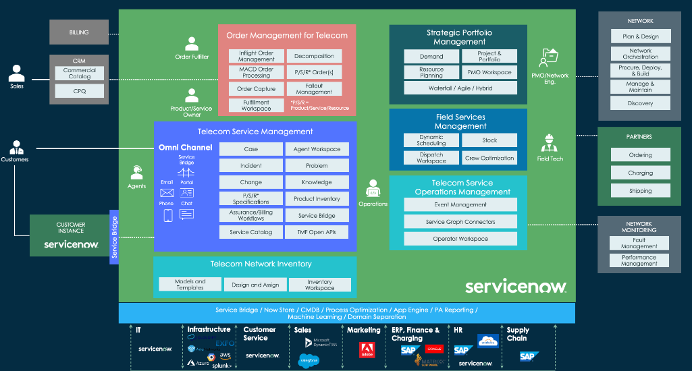
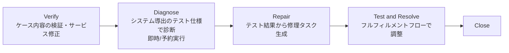
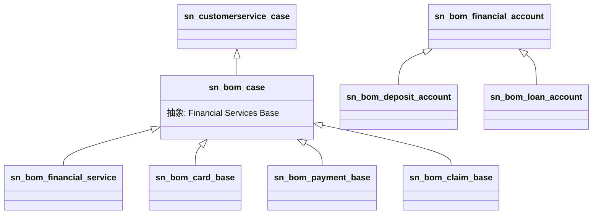
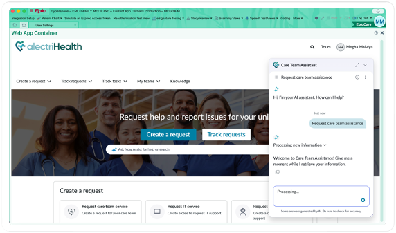
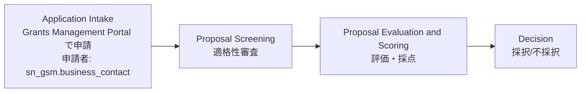
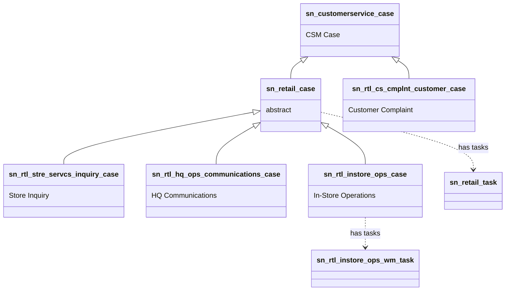

# 業界向けソリューション（Industry Solutions）

## 概要

ServiceNow の業界向けソリューション（Industry Solutions）は、ServiceNow AI Platform（旧 Now Platform）と Customer Service Management（CSM）を土台にしている。その上に業界固有のデータモデル、Case Type（ケースタイプ）、Playbook（プレイブック）、ポータル、Workspace、業界標準 API、AI スキルを重ねてパッケージ化したものである。多くの業界製品は CSM の `sn_customerservice_case` を拡張したケーステーブルと、CSM の Account/Consumer/Sold Product（`sn_install_base_sold_product`）系データモデルを共通基盤として使う。このため、業界製品の設計・導入は CSM の理解が前提になる（[Customer Service Management](../customer/customer-service-management.md) を参照）。

本ファイルは基準リリース Australia（2026-05 GA）時点の公式ドキュメント（Australia 版 PDF、最終更新 2026-10-08）とリリースノートに基づき、業界ごとに以下をまとめる。

| 業界 | 製品ファミリー（公式名） | 主なスコープ/接頭辞 | 本書の節 |
|---|---|---|---|
| 通信（Telecommunications） | Telecommunications Service Management（TSM）、Telecommunications Service Operations Management（TSOM）、Telecommunications Network Inventory（TNI）、Sales CRM for Telecommunications 等 | `sn_ind_tmt_*`, `sn_telecom_*`, `sn_sprb_mgmt`, `sn_ni_core` 等 | [1](#1-telecommunications-media-and-technologytmt) |
| テクノロジープロバイダー（Technology Provider） | Technology Provider Service Management（TPSM）、Customer Success Management、Product Support for Technology | `sn_acct_lc*` 等 | [1.3](#13-technology-provider-service-managementtpsm) |
| 金融（銀行・保険） | Financial Services Operations（FSO） | `sn_bom*`, `sn_ins_*` | [2](#2-financial-services-operationsfso) |
| ヘルスケア・ライフサイエンス | Healthcare and Life Sciences Service Management、Clinical Device Management、Healthcare Operations | `sn_hcls*`, `sn_hco*`, `sn_cto*` | [3](#3-healthcare-and-life-scienceshls) |
| 公共（Public Sector） | Public Sector Digital Services（PSDS） | `sn_gsm*` | [4](#4-public-sector-digital-servicespsds) |
| 製造（Manufacturing） | Manufacturing Commercial Operations（MCO） | `sn_mfg_*`, `sn_claim_cmn`, `sn_dealer_mgmt` 等 | [5](#5-manufacturing-commercial-operationsmco) |
| 小売（Retail） | Retail（Retail Service Management / Retail Operations） | `sn_retail*`, `sn_rtl_*` | [6](#6-retailretail-service-management--retail-operations) |
| エネルギー・公益（Energy & Utilities） | 専用ドキュメント製品は確認できず | — | [7](#7-その他の業界energy--utilities-等) |

> **命名に関する注意（ServiceNow Otto）:** 2026 年の Knowledge 2026 以降、生成 AI ブランド「Now Assist」は「ServiceNow Otto」に改称されつつある。Australia 版ドキュメントも 2026-10-08 更新時点で「ServiceNow Otto for TMT」「ServiceNow Otto for FSO」のように Otto 表記に置き換わっている。一方、2026-03 時点の Australia リリースノートには「Now Assist for TMT」などの旧称が残っている。リリースノートには「製品エンタイトルメントは変更なし」と記載されている。本書は原則として出典の表記に従い、必要に応じて「ServiceNow Otto（旧 Now Assist）」と併記する。[出典](https://www.servicenow.com/docs/r/IDeOjpA1hzonPLWG~inEpg/3e294rZ2JmMaExO7uX88Vw)、[出典](https://www.servicenow.com/community/developer-advocate-blog/otto-vs-now-assist-what-actually-changed/ba-p/3594171)（AI 製品の詳細は [Now Assist と AI Agents](../platform/now-assist-ai-agents.md)）

---

## 0. 業界ソリューション共通のアーキテクチャ

### 0.1 共通の構成要素

業界ソリューションの各製品は、次の共通部品を組み合わせて構成されている。この構成は各製品の公式ドキュメント（Explore/Configure/Use/Reference の章構成）から読み取ったものである。

| 構成要素 | 内容 | 主な実装 |
|---|---|---|
| 業界データモデル | 業界固有のマスタ（口座、患者、回線、店舗、ディーラー等）とトランザクション（ケース、タスク） | 業界スコープのテーブル。CSM の `customer_account`、`csm_consumer`、`sn_install_base_sold_product`、Product Catalog（`sn_prd_pm_*`）を再利用する |
| Case Type（ケースタイプ） | 業務プロセスごとに専用テーブル・フロー・UI を持つ「ケースアプリケーション」 | `sn_customerservice_case` を拡張した抽象ベースケース（例: `sn_bom_case`、`sn_hco_case`、`sn_retail_case`、`sn_gsm_case`）と、それを拡張するリーフケース |
| Service Definition（サービス定義） | ケースタイプ内で提供するサービス（要求種別）の定義 | FSO の `sn_bom_service_definition` など。CSM の Case Type Selector と連携する |
| Playbook（プレイブック） | エージェント向けの段階的作業ガイド | Process Automation Designer / CSM Playbook（`sn_csm_playbook`） |
| Workspace | エージェント向けの統合 UI | 多くの業界で CSM/FSM Configurable Workspace（CRM Workspace）を利用する |
| ポータル/モバイル | 顧客・住民・店舗スタッフ・ディーラー等のセルフサービス | Service Portal ベースの業界ポータル、業界モバイルアプリ |
| 業界標準 API・連携 | 業界標準プロトコルや外部システムとの連携 | TM Forum Open API（通信）、HL7 v2.x / FHIR（医療）、カードネットワーク Spoke（金融）など |
| AI | 要約、AI エージェント、音声エージェント等 | ServiceNow Otto for <業界>（旧 Now Assist for <業界>） |

### 0.2 Case Type 設計の原則（公式ガイダンス）

Retail のドキュメントは、業界ソリューション全般に通じる Case Type の設計原則を明記している。[出典](https://downloads.docs.servicenow.com/pdf/enus/servicenow-australia-retail-industry-enus.pdf)

- **プロセスごとに専用の Case Type を作る。** 1 つのテーブルに複数業務を載せると、ある業務の最適化が他の業務に影響し、技術的負債になる。
- **プロセスが 1 つでも、ベースケースに直接レコードを作らない。** Case Type（ベースケースの拡張）を作る。こうすると、後から製品提供のケースタイプや独自ケースタイプを追加しやすい。
- **ベースケースは抽象化が進んでいる。** 例として、Retail Case（`sn_retail_case`）は Zurich Q3 '25 Store リリース以降「abstract」となり、直接レコードを保存できなくなった。
- Case Type の識別方法、leaf/base レベルの構造、Service Definition の使い方は、Now Support の「Best Practices to Implement Case Types」（ログイン必要）にまとめられている。

### 0.3 提供形態とインストール

- 業界アプリケーションの大半は **ServiceNow Store** から入手・インストールする（ファミリーリリースとは別の Store リリースで随時更新される）。ナビゲーションは `All > System Application > All Available Applications > All` で、アプリ名または ID で検索する。各製品のリリースノートにも「Request apps on the Store」と記載されている。[出典](https://downloads.docs.servicenow.com/pdf/enus/servicenow-australia-manufacturing-enus.pdf)
- このため、同じ「Australia」でも Store アプリのバージョンによって機能差がある。リリースノートは「Australia (early availability)」「April 2026」「June 2026」「July 2026」のように **月次の Store 更新単位** で追記されている。[出典](https://www.servicenow.com/docs/r/IDeOjpA1hzonPLWG~inEpg/LZ9DlanUnHWJNOwyKwFw_Q)
- AI 機能のライセンス階層として、Australia の 2026 年 4 月更新以降、**Foundation / Advanced / Prime** の 3 階層（product tiers）が導入された。ライセンスによって利用できる生成 AI スキル、エージェンティックワークフロー、AI エージェントが異なる。[出典](https://www.servicenow.com/docs/r/IDeOjpA1hzonPLWG~inEpg/LZ9DlanUnHWJNOwyKwFw_Q)
- 2026 年 7 月以降、Now LLM Service は新規または非アクティブな AI アセットの既定モデルプロバイダーではなくなった（既定はサードパーティ LLM）。既存設定はそのまま維持され、Now LLM も手動で選択できる。[出典](https://www.servicenow.com/docs/r/IDeOjpA1hzonPLWG~inEpg/LZ9DlanUnHWJNOwyKwFw_Q)
- 業界製品のライセンス・価格の詳細は公式ドキュメントにない（FSO のドキュメントは「ServiceNow のアカウントマネージャーに問い合わせ」としている）。[出典](https://downloads.docs.servicenow.com/pdf/enus/servicenow-australia-financial-services-operations-enus.pdf)（[ライセンスモデル](../../03_導入編/01-licensing-model.md)、[エディション比較](../../03_導入編/03-edition-comparison.md) を参照）

### 0.4 Australia 共通の変更: 読み取り専用フィールド保護の強化

Australia では ServiceNow AI Platform 全体で **読み取り専用フィールドの保護強化**（enhanced read-only field protections）が行われ、多くの業界アプリに影響する。[出典](https://www.servicenow.com/docs/r/IDeOjpA1hzonPLWG~inEpg/BFxap0fVmy2Pn6ZQcHsCWg)

- 新フィールド `read_only_option` が追加され、`strict_read_only` や `client_script_modifiable` などの細かな制御レベルを指定できる。
- 変更はバックエンドで行われ、後方互換性が保たれている。対象フィールドと設定は Now Support の KB2718122 に記載されている。
- FSO では 31 アプリが対象になっている（リリースノートの一覧をアプリ名で分類すると、保険 14、銀行 13（Financial Services Operations Core、Complaint Management、Know Your Customer、Credit Operations などを含む）、その他 4（Application spoke selector、Document Processor、Intelligent Servicing for Fraud、Payment card））。[出典](https://www.servicenow.com/docs/r/IDeOjpA1hzonPLWG~inEpg/BFxap0fVmy2Pn6ZQcHsCWg)
- HLS Service Management Core でも同じ強化が行われている。[出典](https://www.servicenow.com/docs/r/IDeOjpA1hzonPLWG~inEpg/GuisLqEHbSNIwwTIW_edRA)
- HLS Service Management Core では、従来 admin に限られていた一部作業を feature administrator ロールで実施できるようになった。[出典](https://www.servicenow.com/docs/r/IDeOjpA1hzonPLWG~inEpg/GuisLqEHbSNIwwTIW_edRA)

---

## 1. Telecommunications, Media, and Technology（TMT）

### 1.1 TMT ファミリーの全体像

ServiceNow の Telecommunications, Media, and Technology（TMT）は、通信事業者（CSP: Communication Service Provider）とテクノロジープロバイダー向けの製品群である。顧客対応、オーダー管理、ネットワーク運用、パートナーエコシステムを 1 つの AI プラットフォームに統合する。TMT は大きく「Telecommunications」と「Technology Providers」の 2 系統に分かれる。[出典](https://downloads.docs.servicenow.com/pdf/enus/servicenow-australia-telecom-media-technology-enus.pdf)

Australia リリースノートに掲載されている TMT のアプリケーションは次のとおり。[出典](https://www.servicenow.com/docs/r/35dlqBTUtpT5W39aSiHI6w/O3E2mggNFSkWnIOtxbOn1A)

| アプリケーション | 概要 | Australia での扱い |
|---|---|---|
| Telecommunications Service Management（TSM、通信サービス管理） | ネットワークから顧客までの通信運用を統合し、サービスの可用性と品質を最大化する。Service Exchange、Product Support for Technology、Customer Success Management、Customer Service Problem Management を含む | 記載なし |
| Sales CRM for Telecommunications（通信向け Sales CRM） | リード、プリセールス商談、見積、受注、受注後の変更までの販売ライフサイクル | 拡張・更新 |
| Telecommunications Network Inventory（TNI、ネットワークインベントリ） | 物理・論理・仮想ネットワークのモデリング、データセンター基盤管理、サービス設計と割り当て | 拡張・更新 |
| Telecommunications Service Operations Management（TSOM、サービス運用管理） | ネットワークの可視化、データ精度の向上、問題の事前検知による運用効率と信頼性の向上 | 拡張・更新 |
| Telecommunications Customer 360 | 複数システムのデータを 1 つの画面に集約する | **新規アプリ** |
| Field Service Management for Telecommunications（FSMT） | 通信向けのフィールドサービス | 記載なし |
| Strategic Portfolio Management for Telecommunications（SPMT） | 通信向けのポートフォリオ管理（光ファイバー展開テンプレート等） | 記載なし |
| Now Assist for TMT（現 ServiceNow Otto for TMT） | 業界ワークフローに生成 AI を組み込む | 拡張・更新 |
| Technology Service Management（現 TPSM） | テクノロジー事業者向けのサービス管理 | 記載なし |
| Sales and Order Management for Technology Providers | テクノロジー事業者向けの Sales CRM | 記載なし |
| Customer Success Management | オンボーディング、目標と成果の追跡、リスク検知、更新率の向上 | 拡張・更新 |
| Customer Service Problem Management（CSPM） | 顧客が体験するサービス問題の特定と解決 | 拡張・更新 |
| Now Assist for Telecommunications Sales CRM | 通信 Sales CRM 向けの生成 AI | 拡張・更新 |
| Product Support for Technology | 影響顧客の特定、エスカレーション、ケースの自動生成 | 拡張・更新 |
| Service Exchange（旧 Service Bridge） | プロバイダーとコンシューマーのインスタンスを直接接続し、カスタム連携なしでサービスを追跡する | 拡張・更新 |

ServiceNow Community の公式記事は、主要 6 製品を次のように整理している（ServiceNow 社員による Community 記事、公式記事）。[出典](https://www.servicenow.com/community/telecom-articles/telecom-products-faqs/ta-p/3345518)

| 略称 | 製品 | 要点 |
|---|---|---|
| TSM | Telecom Service Management | AI エージェントによる問題解決、オンボーディング、顧客サービスとネットワーク運用の生産性向上 |
| TSOM | Telecom Service Operations Management | 予測型のサービスアシュアランスとネットワーク可視化。ネットワーク・IT・クラウド資源を AI で検出・照合する |
| TNI | Telecom Network Inventory | 論理・物理回線インベントリの自動化。TMF620/641/645 API に対応（※） |
| SOMT | Sales and Order Management for Telecom | SFA、CPQ、契約管理、オーダー管理を組み合わせた Quote-to-Order |
| SPMT | Strategic Portfolio Management for Telecom | 戦略目標と実行を結び付ける。プロジェクトテンプレートとオーダータスクをポートフォリオ計画に統合する |
| FSMT | Field Service Management for Telecom | ディスパッチ、保守、顧客サポート。モバイル、スケジュール最適化、要員分析 |

※ TNI の「TMF620/641/645 API に対応」は Community FAQ の記載である。公式ドキュメント（1.7 の TMF Open API 一覧）では、TMF620/641/645 を提供するのは Sales CRM for Telecommunications で、TNI が提供するのは TMF639 Resource Inventory である。TNI はこれらの API を自ら提供するのではなく、Design and Assign やオーダー連携（1.4）を通じてこれらと連携する位置付けと考えられる。【推定】

同じ記事によると、各製品は **TM Forum ODA（Open Digital Architecture）に準拠した独立モジュール** で、単独導入できる。必須のインストール順序はなく、ユースケースと導入計画に応じて順序を決める。スイートとして導入すると相乗効果がある。[出典](https://www.servicenow.com/community/telecom-articles/telecom-products-faqs/ta-p/3345518)

- **キャプション:** 通信事業者向け ServiceNow 製品の機能アーキテクチャ図（ServiceNow Community 記事「Telecommunication Service Management (TSM) Overview」に掲載）。
- **図の説明:** 中央の緑の領域が ServiceNow である。左上に「Order Management for Telecom」（Inflight Order Management、MACD Order Processing、Order Capture、Fulfillment Workspace、Decomposition、P/S/R Order、Fallout Management）がある。左中央に「Telecom Service Management」（Omni Channel: Email/Portal/Phone/Chat/Service Bridge、Case、Incident、Change、P/S/R Specifications、Assurance/Billing Workflows、Service Catalog、Agent Workspace、Problem、Knowledge、Product Inventory、Service Bridge、TMF Open APIs）がある。左下は「Telecom Network Inventory」（Models and Templates、Design and Assign、Inventory Workspace）である。右側は「Strategic Portfolio Management」「Field Services Management」（Dynamic Scheduling、Dispatch Workspace、Stock、Crew Optimization）「Telecom Service Operations Management」（Event Management、Service Graph Connectors、Operator Workspace）である。外側には Billing、CRM（Commercial Catalog、CPQ）、Network（Plan & Design、Network Orchestration 等）、Partners、Network Monitoring（Fault/Performance Management）、顧客インスタンス（Service Bridge 経由）が並ぶ。最下段は Service Bridge、Now Store、CMDB、App Engine 等のプラットフォーム層と、IT・HR・ERP 等の周辺システムである。
- **注意:** この図は 2023 年 12 月の記事に掲載されたもので、製品名が旧称（Service Bridge、Order Management for Telecom 等）のままである。Australia 時点では Service Bridge → Service Exchange、オーダー管理 → Sales CRM for Telecommunications（SOMT）に再編されている。
- **出典:** https://www.servicenow.com/community/telecom-articles/telecommunication-service-management-tsm-overview/ta-p/2765097 （取得日: 2026-11-02）

### 1.2 Telecommunications Service Management（TSM）

TSM は、顧客サービスとネットワーク運用を 1 つの AI プラットフォームに統合する製品である。組織のサイロをなくし、問題解決の迅速化、コスト削減、顧客満足度の向上を狙う。[出典](https://downloads.docs.servicenow.com/pdf/enus/servicenow-australia-telecom-media-technology-enus.pdf)

TSM の提供価値（公式の「TSM benefits」）:

| 領域 | 内容 |
|---|---|
| 顧客セルフサービス | AI 搭載の Virtual Agent で、サービス状況の確認、要求、工事日程の変更、解決策の検索を行う。障害時はリアルタイム更新と事前通知を送る |
| エージェント生産性 | 顧客とネットワークのコンテキストの統合、AI によるケース要約・診断・解決策提案、構成可能な Workspace、定型作業の自動化 |
| エコシステム体験 | 顧客・パートナーの迅速なオンボーディング、バリューチェーン全体の接続、製品・サービスの追跡と事前通知、事前構築済みブループリント |

TSM は「専用アプリ + CSM + プラットフォームコア」で構成される。TSM 固有のアプリは次のとおり。[出典](https://downloads.docs.servicenow.com/pdf/enus/servicenow-australia-telecom-media-technology-enus.pdf)

| アプリケーション | 価値 |
|---|---|
| ServiceNow Otto for TMT（旧 Now Assist for TMT） | AI による業界ワークフロー、インサイト、アクション、セルフサービス |
| Customer Service Problem Management | サービス問題の効率的な特定と解決 |
| Customer Success Management | 導入促進、リスク低減、顧客価値の最大化 |
| Service Exchange | ServiceNow を使う法人顧客・サプライヤーとの接続 |
| Product Support for Technology | サービス障害の事前通知とリアルタイムの解決追跡 |
| Service Test Management | サービステストの定義と実行（CSPM の診断基盤） |
| Telecommunications Customer 360 | 複数システムのデータの集約 |

コミュニティでは「TSM = ITSM + CSM + KM + FSM + 通信の業務知識」という整理がよく紹介される。【第三者情報】【経験則】（記事の執筆者は ServiceNow 社員の表示がない Community メンバーで、本人の経験に基づく整理として書いている。公式定義ではない）[出典](https://www.servicenow.com/community/telecom-articles/telecommunication-service-management-tsm-overview/ta-p/2765097)

同じ記事によると、旧 Proactive Service Experience Workflows はネットワーク起因のインシデント（SD-WAN の典型障害など）を扱い、影響顧客に事前通知する。この機能は Incident フォームに Stage フィールド（`sn_ind_tsm_core_stage`）とインシデントフラグ（`sn_ind_tsm_core_incident`）を追加する。また、「Incident Escalation Policy」「Work order creation flow」の Decision Table を提供する。【第三者情報】[出典](https://www.servicenow.com/community/telecom-articles/telecommunication-service-management-tsm-overview/ta-p/2765097)

#### 1.2.1 Customer Service Problem Management（CSPM）

CSPM は、顧客が体験するサービス問題（インターネット不通など）を TM Forum（TMF）定義のフレームワークに沿って解決するアプリケーションである。サービス問題ケースの検証から診断テストの提案、修理タスクの生成、解決までを段階的に進める。問題の起点は、顧客からの申告と、NOC（Network Operations Center）によるネットワーク障害の検知の 2 つである。[出典](https://downloads.docs.servicenow.com/pdf/enus/servicenow-australia-telecom-media-technology-enus.pdf)

CSPM のライフサイクル:

CSPM のデータモデル:

| 区分 | テーブル（ラベル） |
|---|---|
| CSPM 固有 | Service Problem Case（`sn_sprb_mgmt_case`） |
| Service Test Management 由来 | Test Definition、Test Measure Definition、Test Definition Characteristics、Test Definition Relationship、Specification to Test Definition Relationship、Threshold Rule、Measure Consequences、Diagnostic Task、Resolution Task（スコープ `sn_st_mgmt`） |

- **Northbound API** は設計フェーズで使う。テスト定義、特性、測定値、閾値を作成・管理し、定義済み仕様からテスト実行（外部 ID / sys_id 付き）を生成する。必要に応じて小さなタスクへの分解も扱う（Service Test Management Open API）。
- **Southbound API** は実行フェーズで使う。速度テストなどの実際のテストを外部のルーターやネットワーク機器へ送る。
- CSPM の主なロール: `sn_sprb_mgmt.admin`、`sn_sprb_mgmt.agent`、`sn_sprb_mgmt.customer`、`sn_sprb_mgmt.test_integrator`。Service Test Management のロール: `sn_st_mgmt.test_def_manager`、`sn_st_mgmt.test_def_creator`、`sn_st_mgmt.test_def_writer`、`sn_st_mgmt.test_def_viewer`、`sn_st_mgmt.test_manager`、`sn_st_mgmt.test_creator`、`sn_st_mgmt.test_writer`、`sn_st_mgmt.test_viewer` など。[出典](https://downloads.docs.servicenow.com/pdf/enus/servicenow-australia-telecom-media-technology-enus.pdf)

#### 1.2.2 Telecommunications Customer 360（Australia 新規）

Telecommunications Customer 360 は **Australia で新規に追加されたアプリケーション** である。顧客サービス担当者（CSR）が、アカウント情報、対応履歴、製品インベントリ、請求、ライブ診断を 1 つの Workspace で確認し、アプリを切り替えずに問題を解決できるようにする。[出典](https://downloads.docs.servicenow.com/pdf/enus/servicenow-australia-telecom-media-technology-enus.pdf)

| 機能 | 内容 |
|---|---|
| 360 度顧客カード | ライブ情報で顧客のコンテキストを即座に表示 |
| 統合タイムライン | 対応履歴、請求明細、ライブ診断を時系列で表示 |
| AI 要約 | ServiceNow Otto による顧客の健全性、最近の問題、センチメントの要約 |
| アクション | ケース、請求問い合わせ、作業指示、顧客オーダーを作成。Playbook による推奨 |
| 可視化 | ケース内訳チャート、CSAT スコア |
| データ構成 | カードコンポーネントごとのデータ構成、複数ソースからのデータ取得（`sn_c360_dataconfig` 系） |

- **アクセス方法:** CSM/FSM Configurable Workspace で、Account、Consumer、Contact のいずれかのテーブルから Telecom Customer 360 ページを開く。
- **ロール:** `sn_telecom_c360.user`、`sn_telecom_c360.admin`。
- **Party Relationship Center（PRC）:** パーティ（顧客）に関連するエンティティ（請求アカウント、販売済み製品、関連パーティ、アクティブケース）を対話型グラフで表示する。表示には `sn_genai_platform` プラグインが必要である。ノードの表示内容（ヘッダー、サブヘッダー、強調値、サイドパネル項目）はノード種別ごとに構成でき、水平/垂直レイアウトと検索フィルターに対応する。

Consumer（個人顧客）の場合の PRC 階層（最大 5 階層。Australia TMT PDF p.282–283 の記載どおり）:

| 階層 | 内容 | テーブル |
|---|---|---|
| Tier 1 | 主となる Consumer（氏名、電話、住所） | `sn_customerservice_consumer` |
| Tier 2 | 関連 Consumer（Consumer 間、世帯-Consumer 関係） | `sn_customerservice_consumer_relationship`、`household_member_relationship` |
| Tier 3 | 請求アカウント（Bill-to Consumer） | `sn_crt_billing_account` |
| Tier 4 | 販売済み製品（各 Consumer の役割: Owner / Authorized / User / Dependent） | `sn_prd_invt_product_inventory`、`sn_prd_invt_product_related_party` |
| Tier 5 | トランザクション（アクティブなケース、インシデント、作業指示） | `sn_customerservice_case`、`incident`、`sn_csm_work_order` |

Account（法人）の場合は、親アカウントと各子アカウントの関連エンティティを最大 5 階層まで表示する。[出典](https://downloads.docs.servicenow.com/pdf/enus/servicenow-australia-telecom-media-technology-enus.pdf)

> 注: 上表のテーブル名は PDF の表記をそのまま転記したものである。PDF は Tier 1 の Consumer テーブルを `sn_customerservice_consumer` と記載しているが、CSM の Consumer テーブルは本ファイルの他の節や TMF632 のドキュメントでは `csm_consumer` と記載されている。`sn_customerservice_consumer_relationship`、`sn_crt_billing_account`、`sn_csm_work_order` も PDF 以外の公式ページでは確認できなかった。実環境の `sys_db_object` でテーブル名を確認すること。

#### 1.2.3 Australia Store リリースでの TSM 系の新機能

ServiceNow 社員による Community 記事が挙げる、Australia Store リリースの通信向け新機能は次のとおり。[出典](https://www.servicenow.com/community/telecom-articles/telecommunications-australia-store-release-what-s-new-in-telecom/ta-p/3519421)

| 製品 | 新機能 |
|---|---|
| TNI | Remote Hands Request Management（独立プラグイン、Remote Hands Case テーブル `sn_remote_hands_case`）、AI Agent: Remote Hands Request Summarization |
| TSOM | SD-WAN Discovery（SD-WAN Discrepancy Audit を含む）、SD-WAN Event Management、SD-WAN Metric Intelligence（Metrics Recovery を含む）、Telecom Discovery Builder Framework |
| TSM | Telecommunications Customer 360、Alternative Dispute Resolution（ADR、裁判外紛争解決）ワークフロー、AI エージェント（関連レコード要約、デッドロックレター下書き生成、ADR 解決メモ、センチメント分析） |
| SOMT | Move Orders（移転オーダー）、オーダーフルフィルメント用タスクプランテンプレート、AI エージェント（Order Enrichment、Order Fulfillment、Move Order Voice） |
| Service Exchange | Consumer outbound FDS、Service Exchange center、Auto-onboarding |

ADR 関連のロールには `sn_telco_adr_mgmt.manager`、`sn_telco_adr_mgmt.viewer`、`sn_telco_adr_mgmt.admin` があり、苦情テーブル `sn_telco_adr_mgmt_complaint` を使う（Australia 版 PDF の記載から抽出）。[出典](https://downloads.docs.servicenow.com/pdf/enus/servicenow-australia-telecom-media-technology-enus.pdf)

### 1.3 Technology Provider Service Management（TPSM）

TPSM は、SaaS や as-a-Service 型のビジネスを営むテクノロジープロバイダー向けの製品である。コンタクトセンターの問い合わせ量の削減、エージェント生産性の向上、顧客生涯価値（CLV）の最大化を狙う。[出典](https://downloads.docs.servicenow.com/pdf/enus/servicenow-australia-telecom-media-technology-enus.pdf)

- **解決する課題（公式記載）:** 手作業で時間のかかるオンボーディング、限られた人員によるサポート待ち、テクノロジー ROI の可視性不足、定型的なケース管理による解決遅延。
- **構成:** ServiceNow AI Platform、Customer Service Management、IT Service Management の機能を土台に、テクノロジープロバイダー専用アプリを追加する。

| TPSM のアプリケーション | 価値 |
|---|---|
| ServiceNow Otto for TMT | AI による業界ワークフロー、インサイト、セルフサービス |
| Customer Success Management | 成功戦略、リアルタイムのヘルス監視、自動化による導入促進とリスク低減 |
| Service Exchange | ServiceNow を使う法人顧客・サプライヤーとの接続 |
| Product Support for Technology | サービス障害の事前通知とリアルタイムの解決追跡 |

- Customer Success Management のロールには `sn_acct_lc.customer_success_agent`、`sn_acct_lc.agent` などがあり、主なテーブルには `sn_acct_lc_onb_case`（オンボーディングケース）、`sn_acct_lc_success_case`、`sn_acct_lc_success_initiative`、`sn_acct_lc_success_task`、`sn_acct_lc_engagement`、`sn_acct_lc_touchpoint`、`sn_acct_lc_risk_signal_issue` などがある（Australia 版 PDF から抽出）。[出典](https://downloads.docs.servicenow.com/pdf/enus/servicenow-australia-telecom-media-technology-enus.pdf)
- **名称の変遷:** リリースノート上の旧称「Technology Service Management」が、Australia 版ドキュメントでは「Technology Provider Service Management（TPSM）」になっている。Community には「TSM が TPSM にリブランドされた」とする投稿（ServiceNow 社員の表示がない記事執筆者による 2025-02 のコメント）もあるが、Australia 版ドキュメントでは TSM（通信）と TPSM（テクノロジー）が別製品として並んでいる。【第三者情報】[出典](https://www.servicenow.com/community/telecom-articles/telecommunication-service-management-tsm-overview/ta-p/2765097)

#### 1.3.1 Australia Store リリースでの Technology Provider 系の新機能

ServiceNow 社員による Community 記事「What's new in the Australia release for Technology Provider」（2026-04-30 公開）は、Technology Provider 向け製品の Australia での強化点として次の 9 件を挙げている。公式リリースノートで各項目を個別には照合していない。[出典](https://www.servicenow.com/community/technology-articles/what-s-new-in-the-australia-release-for-technology-provider/ta-p/3535232)

| 製品 | 機能（英語名） | 内容 |
|---|---|---|
| Customer Success Management | Product Adoption Roadmap（製品導入ロードマップ） | Engagement レコードに、地域ごとの製品の稼働時期を示すタイムラインを追加する。段階的な展開をスプレッドシートで管理する必要がなくなる |
| Customer Success Management | Build Product Roadmaps（エージェンティックワークフロー） | 類似顧客の Engagement を分析して導入ロードマップの下書きを作る。最終判断は CSM（カスタマーサクセスマネージャー）が行う |
| Customer Success Management | Launch Release Communications（エージェンティックワークフロー） | 利用が進んでいない製品と適切な連絡先を特定し、利用データ入りの個別メールを下書きする。CSM が確認して送信する |
| Customer Success Management | Source Squad Resources（エージェンティックワークフロー） | Engagement に必要なスキル・所在地・稼働状況に基づいて社内の専門家を割り当て候補として提示する |
| Customer Success Management | Support Renewals & Expansion Enhancement（更新・拡販支援の強化） | ルールベースの更新スコアリングを置き換える。利用状況、エスカレーション、製品の重要度、関係の健全性を分析し、複数契約の顧客では契約ごとに評価する |
| Service Exchange | Streamline Enterprise Customer Registration Enhancement（法人顧客登録の自動化強化） | 自動化を Consumer 側にも広げる。登録メールの送信、認可、接続の完了を手作業のやり取りなしで行える |
| Service Exchange | Bi-directional Foundation Data Sync（双方向の基盤データ同期） | 顧客（Consumer）の CMDB データを Provider に同期し、ナレッジベースの更新を顧客側に自動で流す |
| Service Exchange | Admin Experience: Health Dashboard（ヘルスダッシュボード） | 全接続のヘルススコア、問題検出、ガイド付きの修正を 1 画面で提供する。管理者はチケットを起票せずに修正を適用できる |
| Product Support for Technology | Service Delivery Dashboards（サービス提供ダッシュボード） | 同じサービス提供パフォーマンス指標を Service Operations Workspace と CSM/FSM Workspace の両方に表示し、両チームが同一データで作業できるようにする |

### 1.4 Telecommunications Network Inventory（TNI）

TNI は、ネットワーク計画者が物理・論理・仮想ネットワークをモデル化し、データセンター基盤管理とサービス設計・割り当て（Design and Assign）を行うためのアプリケーションである。[出典](https://www.servicenow.com/docs/r/35dlqBTUtpT5W39aSiHI6w/O3E2mggNFSkWnIOtxbOn1A)

TNI のロール（Zurich 版ドキュメントによる。Australia 版 TMT PDF には TNI のロール表がなく、Australia での変更有無は公開情報では確認できず）:[出典](https://www.servicenow.com/docs/r/4xj1xH858qF8uWRIN94F3g/p_~fbo7BacSR8DDaGdpATQ)

| ロール（タイトル） | ロール名 | 権限 |
|---|---|---|
| Inventory Admin | `sn_ni_core.inventory_template_admin` | TNI の全機能に対する CRUD |
| Inventory Catalog Manager | `sn_ni_core.telco_inventory_catalog_manager` | 全ネットワークインベントリエンティティのメタデータの CRUD とエンティティ間の関連付け |
| Inventory Template Manager | `sn_ni_core.inventory_template_manager` | 新規・既存エンティティのネットワークインベントリテンプレート（既定テンプレートを含む）の CRUD |
| Inventory Agent | `sn_ni_core.inventory_agent` | インベントリモデル・キャパシティメトリクス・パックテーブルの読み取り、インベントリテーブルの書き込み・更新・削除、テンプレート・変更要求・変更タスクの読み書き。モデル・モデル関連テーブルの変更には Asset または Inventory User ロールも必要 |
| Inventory Number Manager | `sn_inv_num_mgmt.inventory_number_manager` | 全電話番号テーブルの読み取り・書き込み・更新・削除 |

> 注: 上記ページは、サマリー部とロール表とでロール識別子の表記が異なる。また OMT 連携の設定手順は `sn_ni_core.inventory_admin` ロールを要求している。実環境のロール名は `sys_user_role` で確認すること。[出典](https://www.servicenow.com/docs/r/ZoAb3Miy7jj5K_x2IWYuRw/fqDbVR8Z8cbO7bKb71l2mg)（OMT 連携の設定手順ページ。対象リリースはページ上で明示されていない）

TNI とオーダー管理（Order Management for Telecommunications、OMT）の連携仕様（Xanadu 版ドキュメントによる。Australia 版 TMT PDF には同等の記述がなく、Australia での変更有無は公開情報では確認できず）:[出典](https://www.servicenow.com/docs/r/xanadu/telecom-network-inventory/telecommunications-network-inventory/telecomm-network-inventor-order-management.html)

- TNI と OMT の **両方のライセンスが同一インスタンスに必要** である。
- インベントリを変更するネットワーク関連のオーダータスクには、TNI 側で Change Request（変更要求）が作成される。TNI は変更の特性を分析して適合する Change Model を選び、変更タスクを作成し、インベントリタスクフロー（テンプレートサブフローと CI の読み取り/作成アクション）で処理する。
- OMT のアクションとサービス仕様を Change Model と Record Producer に対応付ける **Decision Table エントリ** がある場合に限り、変更要求が自動作成される。
- **連携は ADD アクションのサービスオーダーのみ対応** する。
- 既定の Change Model は Provision LAG、GPON broadband Service (Automated)、Fiber-wise Mobility Infrastructure、Design and Assign Telco Equipment の 4 つ。状態は New → Implement → Review → Closed である。
- オーダータスクがクローズされると、OMT は影響 CI を取得し、製品オーダーと CI を結ぶ Install Base Item を作成する。
- TNI は TMF639 Resource Inventory Open API でリソースの作成・取得・削除を公開している。

### 1.5 Telecommunications Service Operations Management（TSOM）

TSOM は、通信事業者がマルチドメインのネットワーク・サービス障害を顧客影響の前に監視・分析・解決するための製品である。ServiceNow AI Platform 上で統合された運用ビューを提供する。プラグインは `com.sn_tsom_core`（Store から入手）である。[出典](https://downloads.docs.servicenow.com/pdf/enus/servicenow-australia-telecom-media-technology-enus.pdf)、[出典](https://www.servicenow.com/docs/r/7GoNY9eeDRD0FzxldbEmXw/I0u_5uU6ivgf9aNIgDyEKQ)

- Event Management / AIOps（[Event Management と AIOps](../itom/event-management-aiops.md)）、Discovery、Service Graph Connectors を通信ドメインに拡張したもので、TMF642（Alarm Management）と TMF688（Event Notification Management）を `em_event` / `em_alert` テーブルに対して公開する。
- Australia Store リリースでは SD-WAN Discovery、SD-WAN Event Management、SD-WAN Metric Intelligence が追加された（1.2.3 を参照）。
- TSOM には、TSOM の構成作業を full admin（`admin`）ロールなしで行える granular admin role（粒度の細かい管理者ロール）がある（Zurich で導入。Zurich→Australia の統合リリースノートに掲載）。[出典](https://www.servicenow.com/docs/r/delta-zurich-australia/australia-zurich-telecommunicationsserviceoperationsmanagementtsom-release-notes.html)

> **Brazil での変更:** TSOM Version 4.0（Brazil）では、MPN（Mobile Private Network）向けの機能が追加された。具体的には、Nokia MED / Elastic / Prometheus / Netcool の KPI ドメインからレイテンシ KPI などを収集する Elastic event pull connector、MPN Latency Metrics ダッシュボード、Health Log Analytics による MPN セキュリティログ収集、タワー/サイト単位の赤・黄・緑のヘルスステータス集約である。また、600 ポートを超える Fortinet 機器のディスカバリが、ポートのバッチ処理によってメモリ制限で失敗しなくなった。専用の言語パックはない。[出典](https://www.servicenow.com/docs/r/7GoNY9eeDRD0FzxldbEmXw/I0u_5uU6ivgf9aNIgDyEKQ)

### 1.6 Sales CRM for Telecommunications（SOMT）とオーダー管理

Sales Customer Relationship Management for Telecommunications（通信向け Sales CRM、旧称 Sales and Order Management for Telecommunications / SOMT）は、リード、商談、見積（CPQ）、受注、フルフィルメント、受注後の変更・更新までを扱う。汎用的な Sales CRM の仕様は [Sales and Order Management（CRM）](../customer/sales-order-management-crm.md) を参照。[出典](https://www.servicenow.com/docs/r/35dlqBTUtpT5W39aSiHI6w/O3E2mggNFSkWnIOtxbOn1A)

Australia 版 PDF に現れる主なロール・テーブル:[出典](https://downloads.docs.servicenow.com/pdf/enus/servicenow-australia-telecom-media-technology-enus.pdf)

| 区分 | 名称 |
|---|---|
| オーダー管理ロール | `sn_ind_tmt_orm.service_order_manager`、`sn_ind_tmt_orm.service_order_agent`、`sn_ind_tmt_orm.order_fulfillment_manager` |
| 製品カタログロール | `sn_prd_pm.product_catalog_manager`、`sn_prd_pm.product_catalog_admin`、`sn_prd_pm_adv.catalog_creator` |
| オーダー関連テーブル | `sn_ind_tmt_orm_product_characteristics` ほか `sn_ind_tmt_orm_*` |
| 製品インベントリ | `sn_prd_invt_product_inventory`、`sn_prd_invt_product_related_party` |
| AI エージェント関連ロール | `sn_somt_gen_ai.sales_and_order_fulfillment_ai_agent`、`sn_tmt_agentic_ai.test_and_repair_telecom_service_ai_agent`、`sn_tmt_agentic_ai.telco_billing_inquiry_case_agent` など |

- オーダーテーブル（`sn_ind_tmt_orm_order`、`sn_ind_tmt_orm_order_line_item`）が Task テーブルを拡張していない点は、Community で過去に議論されている。【第三者情報】[出典](https://www.servicenow.com/community/telecom-forum/sn-ind-tmt-orm-order-sn-ind-tmt-orm-order-line-item-are-not/m-p/264733)

### 1.7 TMF Open API 一覧（TMT）

ServiceNow は TMT 製品を通じて複数の TM Forum Open API を実装している。BSS/OSS との標準化された相互運用を可能にする。[出典](https://downloads.docs.servicenow.com/pdf/enus/servicenow-australia-telecom-media-technology-enus.pdf)

| API | 名称 | 提供アプリ | 主な対象・用途 |
|---|---|---|---|
| TMF620 | Product Catalog Open API | Sales CRM for Telecommunications | 製品カタログ、製品オファリング、製品仕様の作成・取得 |
| TMF621 | Trouble Ticket Open API | Proactive Service Experience Workflows | `sn_customerservice_case`、`incident`、`sn_sprb_mgmt_case` の作成・更新・取得 |
| TMF622 | Product Order Open API | Sales CRM for Telecommunications | 外部 CPQ/CRM からの販売/製品オーダーの受領 |
| TMF632 | Party Management Open API | Customer foundation | `csm_consumer`、`customer_account`、`customer_contact` の作成・更新・取得 |
| TMF633 | Service Catalog Open API | Customer foundation | サービス仕様の作成・取得 |
| TMF637 | Product Inventory Open API | Sales CRM for Telecommunications | 製品インベントリの作成・取得 |
| TMF639 | Resource Inventory Open API | Telecommunications Network Inventory | ネットワークインベントリ各テーブルのリソースの作成・取得・削除 |
| TMF641 | Service Order Open API | Sales CRM for Telecommunications | サービスオーダーの発行 |
| TMF642 | Alarm Management Open API | TSOM | `em_event`、`em_alert` の作成・更新・取得 |
| TMF645 | Technical Service Qualification Open API | Sales CRM for Telecommunications | 受注前のリソース・サービスの提供可否確認 |
| TMF646 | Appointment Open API | Field Service Management for Telecommunication | 予約の登録、空き枠の検索 |
| TMF648 | Quote Open API | Sales CRM for Telecommunications | 見積データの作成・更新・取得 |
| TMF653 | Service Test Management Open API | Customer Service Problem Management | サービステスト定義とサービステストの作成・取得 |
| TMF688 | Event Notification Management Open API | TSOM | `em_event` の作成・更新・削除 |
| TMF697 | Work Order Management Open API | Field Service Management for Telecommunication | 作業指示の作成・更新・取得。Sales CRM（オーダータスク）と TSM（ケースタスク）から作業指示を起票するときに使う |

TMF API のスコープ（`sn_tmf_api` 等）と認証・エンドポイントの詳細は、各 API のリファレンスページを参照すること。一般的な REST API 設計は [Web Services / REST API](../platform/web-services-api.md) を参照。

### 1.8 その他の TMT アプリ

| アプリ | 概要 |
|---|---|
| Data Center and Network Asset Management | データセンターとネットワーク資産の管理（インストール手順は Australia 版 PDF に記載） |
| Field Service Management for Telecommunications | 通信サービスの予約管理（TMF646）と作業指示管理（TMF697）。プラグイン識別子は `sn_fsmt`。FSM 本体は [Field Service Management](../customer/field-service-management.md) を参照 |
| Strategic Portfolio Management for Telecommunications | SPM に通信向けテンプレート（SPMT Fiber rollout template = 光ファイバー展開テンプレート）を追加する。SPM 本体は [Strategic Portfolio Management](../spm/strategic-portfolio-management.md) を参照 |
| Service Exchange | 異なる ServiceNow インスタンス間をプロバイダー/コンシューマーとして接続し、リモートサービスカタログ、双方向ワークフロー、リアルタイム同期を提供する（旧 Service Bridge。ロール `sn_sb.admin` 等） |

[出典](https://downloads.docs.servicenow.com/pdf/enus/servicenow-australia-telecom-media-technology-enus.pdf)

> **Brazil での変更:** Brazil の TMT リリースノートでは、Telecommunications 系列が Telecommunications Service Management、Sales CRM for Telecommunications、Telecommunications Network Inventory、TSOM、SPM for Telecom、FSM for Telecommunications、ServiceNow Otto for TMT として掲載されている。Technology 系列は Technology Service Management、Sales CRM for Technology Providers、ServiceNow Otto for TMT、TSOM として掲載されている。AI 製品名は Otto 表記に統一された。個別機能の差分は各アプリのリリースノートに分かれており、本書執筆時点では網羅的に確認できていない。[出典](https://www.servicenow.com/docs/r/7GoNY9eeDRD0FzxldbEmXw/Dn7OEHl3MvMTztcn2mLkbA)

---

## 2. Financial Services Operations（FSO）

### 2.1 FSO の全体像

Financial Services Operations（FSO、金融サービスオペレーション）は、銀行・保険・資産運用などの金融機関向けの製品である。自動化によるコスト削減、顧客満足度の向上、業務フローへのリスク・コンプライアンス統制の組み込みを狙う。フロント・ミドル・バックオフィスのエージェントを 1 つのセキュアなプラットフォーム上のワークフローでつなぎ、決済、融資、コンプライアンスなど多様な業務を 1 つの基盤で扱う。[出典](https://downloads.docs.servicenow.com/pdf/enus/servicenow-australia-financial-services-operations-enus.pdf)

Australia 版ドキュメントの FSO アプリ構成:

| 区分 | アプリケーション |
|---|---|
| 銀行（Banking） | Agentic Contact Center for Banking（Australia 新規）、Dispute Management、Card Operations、Deposit Operations（Personal/Business）、Loan Operations（Personal/Business）、Payment Operations、Treasury Operations、Intelligent Servicing for Fraud |
| 保険（Insurance） | Agentic Contact Center for Insurance、Property and Casualty Insurance Servicing（Personal Lines / Commercial Lines の Servicing・Underwriting・Claims）、Life Insurance Servicing（Individual Life / Group Life）、保険金請求アプリ群（Insurance Claims Core、Insurance Special Investigations など） |
| 共通（Common） | Complaint Management、Customer Lifecycle Operations（Client Lifecycle = B2C / Business Lifecycle = B2B）、Know Your Customer、Credit Operations |
| 基盤・連携 | Financial Services Operations Core、Customer Central for FSO、Document Processor、Card data security、各種 Spoke・Integration（Visa、Mastercard、Verifi、Ethoca、Socure、Jack Henry jXchange、FRISS、Guidewire） |
| 分析 | Platform Analytics for FSO（アプリ別ダッシュボード）、Process Mining |

[出典](https://downloads.docs.servicenow.com/pdf/enus/servicenow-australia-financial-services-operations-enus.pdf)

- Zurich 版の FSO ドキュメントは、ServiceNow University の FSO 向けスイート認定として **FSO Insurance Professional** と **FSO Banking and Wealth Management Professional** を例示している。[出典](https://www.servicenow.com/docs/r/07i96mihvdtIctrdGsOYHQ/hH8RC4_07XBlP2aRm2gpug) 認定名は資料によって「Delivery Accreditation」などの表記揺れがあるため、最新の名称は ServiceNow University のカタログで確認すること（[学習パスと認定資格](../../01_入門編/09-learning-path.md)）。
- FSO のライセンスは公開されておらず、ドキュメントはアカウントマネージャーへの問い合わせを案内している。

### 2.2 Australia での主な新機能・変更（FSO）

Australia の FSO リリースノートによる。[出典](https://www.servicenow.com/docs/r/IDeOjpA1hzonPLWG~inEpg/BFxap0fVmy2Pn6ZQcHsCWg)、[出典](https://www.servicenow.com/docs/r/IDeOjpA1hzonPLWG~inEpg/MjxOD32LDPUnRAoRxSM1zw)

| 種別 | 内容 |
|---|---|
| 新規アプリ | **Agentic Contact Center for Banking:** 銀行のフロントオフィス業務を効率化する AI 主導の CSR Workspace |
| 新規アプリ | **Financial Services Operations Integration with Verifi:** FSO のカード発行体紛争ワークフローを Verifi の Cardholder Dispute Resolution Network（CDRN）に接続し、紛争前の加盟店交渉を行う |
| 更新 | Agentic Contact Center for Insurance、Card data security、Dispute Content Pack for US Regulations、Dispute Rules Content Pack for Mastercard / Visa、Card Operations、FSO Core、Integration with Mastercard / Visa、ServiceNow Otto for FSO（AI エージェント、ケース/プロファイル要約、Virtual Agent による紛争受付、サードパーティ言語モデル対応）、Visa Spoke |
| FSO Core の変更 | Case Type Selector が FSO 独自のオーバーライドをやめ、**CSM 標準実装** を使うようになった。エージェント条件は `sn_csm_case_types_service_user_criteria`、顧客条件は `sn_csm_case_types_service_customer_criteria` で構成する |
| FSO Core の移行 | アップグレード時、既存のエージェント条件・顧客条件データは非推奨の FSO テーブルから CSM テーブルへ **自動移行** される（手作業は不要） |
| 非推奨 | `sn_bom_m2m_service_definition_user_criteria`（→ `sn_csm_case_types_service_user_criteria`）、`sn_bom_m2m_service_definition_customer_condition`（→ `sn_csm_case_types_service_customer_criteria`）、`sn_bom_service_definition` の `show_in_interceptor` フィールド |
| 表示制御 | 新しい Service Definition は既定で表示される。非表示にするには、事前定義の「No User」ユーザー条件に紐付ける。表示するには「Users with sn_bom.service_definition_read」に紐付ける |
| Claim Base | Claim Base テーブルに、これまで特定アプリに限られていたフィールドが追加され、すべての請求アプリで使えるようになった |
| Visa 連携 | Submit Dispute questionnaire / Submit fraud report のサブフローが更新され、カード紛争での PCI データの保存・送信を減らす |
| AI（Patch） | Banking の CSR 支援 AI エージェント（Patch 1）、Agentic Contact Center for Insurance の CSR 支援 AI エージェント（Patch 3）、FSO スキルの既定モデルプロバイダー変更（Patch 4） |

> **Brazil での変更:** Brazil の FSO リリースノートには Card Data Security（PAN や文書のトークン化）の機能強化と Dispute Rules Content Pack for Mastercard が掲載されている。個別の変更内容はそれぞれのリリースノートに分かれており、本書では詳細を確認できていない。[出典](https://www.servicenow.com/docs/r/7GoNY9eeDRD0FzxldbEmXw/gZzspfnjrWGIQKXTZ7qCQQ)

### 2.3 FSO Core のデータモデル

FSO Core は、ServiceNow AI Platform と CSM のテーブルを拡張・利用し、金融機関のデータを次の 2 区分で整理するフレームワークである。[出典](https://downloads.docs.servicenow.com/pdf/enus/servicenow-australia-financial-services-operations-enus.pdf)

- **Foundational Data（基盤データ）:** 金融口座、製品モデル、取引など、顧客サービス要求の処理に必要な顧客情報。
- **Operational Workflow Data（業務データ）:** タスクやケースなど、プロセスの実行中に生成されるデータ。

FSO Core のデータ設計モデル:

| モデル | 定義 | 例 |
|---|---|---|
| Service organizations | 組織内の支店・代理店（内部・外部） | 複数支店を持つ金融機関、保険代理店、店舗、センター、フランチャイズ、ディーラー |
| Customer | 組織が対応する顧客 | Account、Contact、Consumer、Household |
| Product / Sold product | 組織が提供する製品と、顧客に販売された製品・サービス | 当座預金、クレジットカード、自動車保険、生命保険 |
| Financial Account | 顧客が保有する金融商品（預金、与信枠、ローン、カード、投資）。コアシステム連携に対応する | 普通預金口座番号、住宅保険の証券番号 |
| Financial Services | 金融口座で有効化されている財務サービス | 送金サービス、スイープサービス |

FSO Core のプラグイン依存関係:

| 名称 | プラグイン ID |
|---|---|
| Customer Service Management（CSM） | `com.sn_customerservice` |
| Expanded Model and Asset Classes | `com.sn_ent` |
| Install Base | `com.snc.install_base` |

- FSO Core は、いずれかの FSO アプリをインストールすると自動的にインストールされる。データモデルだけを使う基本構成として単独インストールすることもできる。
- **Vancouver 以降**、FSO Core のモデルテーブルは Expanded Model and Asset の Service Model（`cmdb_service_product_model`）の子テーブルを使い、CMDB 内でサービスモデルを分類する。

FSO が利用するプラットフォーム/CSM/CMDB の主なテーブル: `sn_csm_business_location`（事業所）、`sn_customerservice_case`、`sn_prd_pm_characteristic` / `sn_prd_pm_characteristic_option`、`csm_consumer`、`sn_csm_consumer_profile`、`csm_household_member`、`cmn_location`、`sn_prd_pm_specification`、`sn_install_base_sold_product`（`cmdb_model` または `cmdb_service_product_model` を参照）、`sn_prd_pm_specification_characteristic`、`task`。

FSO Core の主要テーブル（抜粋）:

| ラベル | テーブル名 | 説明 |
|---|---|---|
| Financial Services Base | `sn_bom_case` | すべての金融ケース（紛争、不正調査、融資申込、保険契約サービス、保険金請求、各種問い合わせ）の親テーブル |
| Financial Services Case | `sn_bom_financial_service` | 金融サービスケース（`sn_bom_case` を拡張） |
| Financial Services Task | `sn_bom_financial_task` | 金融サービスタスク |
| Financial Task | `sn_bom_task` | 問い合わせ、請求、与信、融資などの金融タスク（Industry Task `sn_ind_task` を拡張） |
| Financial Account | `sn_bom_financial_account` | 金融口座の基底。口座番号は 4 文字に制限するビジネスルールがある（セキュリティ対策） |
| Deposit Account | `sn_bom_deposit_account` | 預金口座（Personal/Business の Checking・Saving 口座が拡張） |
| Loan Account | `sn_bom_loan_account` | ローン口座（Auto Loan `sn_bom_auto_loan`、Personal Loan `sn_bom_personal_loan` 等が拡張） |
| Personal Credit Card / Business Credit Card | `sn_bom_credit_card` / `sn_bom_b2b_credit_card` | クレジットカード |
| Line of Credit | `sn_bom_b2c_line_of_credit` / `sn_bom_b2b_line_of_credit` | 与信枠 |
| Certificate of Deposit | `sn_bom_certificate_of_deposit` / `sn_bom_b2b_certificate_of_deposit` | 定期預金 |
| Financial Transaction | `sn_bom_transaction` | 預金・融資等の取引 |
| Financial Institution | `sn_bom_financial_institution` | 金融機関（参照データ） |
| Financial Service | `sn_bom_service` | 口座に紐付く財務サービス |
| Security / Bond / ETF / Option / Holding | `sn_bom_security`、`sn_bom_bond`、`sn_bom_etf`、`sn_bom_option`、`sn_bom_holding`、`sn_bom_holding_lot` | 投資・証券 |
| Chargeback Reason Codes | `sn_bom_chargeback_reason_code` | カードネットワーク（Visa、Mastercard、American Express）のチャージバック理由コード |
| Covenant | `sn_bom_covenant`、`sn_bom_covenant_base`、`sn_bom_b2b_covenant` | 融資のコベナンツ |
| Payment Network | `sn_bom_payment_network` | 決済ネットワーク |
| Insured Property / Coverage | `sn_bom_insured_property`、`sn_bom_coverage_specification`、`sn_bom_coverage_type` | 保険対象物件と補償 |

アプリ別のベースケーステーブル（Australia 版 PDF から抽出）: `sn_bom_card_base`（カード）、`sn_bom_payment_base`（決済）、`sn_bom_treasury_base`（トレジャリー）、`sn_bom_loan_base`（融資）、`sn_bom_deposit_b2c_base` / `sn_bom_deposit_b2b_base`（預金）、`sn_bom_clo_b2c_base` / `sn_bom_clo_b2b_base`（顧客ライフサイクル）、`sn_bom_compl_base`（苦情）、`sn_bom_credit_asmt_base`（与信審査）、`sn_bom_claim_base` / `sn_bom_claim_case`（請求）、`sn_bom_fraud_case`（不正）、保険系の `sn_ins_policy_b2c_base` / `sn_ins_policy_b2b_base`、`sn_ins_indiv_life_base`、`sn_ins_group_life_base`、`sn_ins_claim_pers_base`、`sn_ins_claim_cml_base`、`sn_ins_gen_claim_case`。[出典](https://downloads.docs.servicenow.com/pdf/enus/servicenow-australia-financial-services-operations-enus.pdf)

> 注: 上の継承図は、公式ドキュメントの記述（「`sn_bom_case` は全金融ケースの親」「Financial Services Case は `sn_bom_case` を拡張」「Checking/Saving は Deposit Account を拡張」）をもとに簡略化したものである。各ベーステーブルが `sn_bom_case` を直接拡張するか中間テーブルを挟むかは、実環境の `sys_db_object` で確認すること。【推定】

### 2.4 FSO のロール

FSO Core が導入するロール（Australia）。[出典](https://www.servicenow.com/docs/r/r3pULTjmzinsV0aMKlfEIA/CTV3agMihrNr1wmKq2PGIw)、[出典](https://downloads.docs.servicenow.com/pdf/enus/servicenow-australia-financial-services-operations-enus.pdf)

| ロール名 | タイトル | 説明・包含ロール |
|---|---|---|
| `sn_bom.admin` | FSO admin | FSO アプリのアプリ管理者。FSO テーブルの読み取り・書き込み・作成。`sn_bom.document.admin`、`sn_bom_credit_asmt.admin`、`model_manager` を含む |
| `sn_bom.consumer_contributor` | Financial services consumer contributor | 任意の Consumer についてケースを作成できる汎用ロール。B2C の各 contributor ロール（`sn_bom_payment.contributor`、`sn_bom_loan.contributor`、`sn_bom_compl.contributor`、`sn_bom_clo_b2c.contributor`、`sn_bom_credit_card.contributor`、`sn_ins_indiv_life.contributor`、`sn_ins_policy_b2c.contributor` 等）と `sn_customerservice.consumer_contributor` を継承 |
| `sn_bom.account_contributor` | Financial services account contributor | 任意の Account についてケースを作成できる汎用ロール。B2B の各 contributor ロール（`sn_bom_treasury.contributor`、`sn_bom_deposit_b2b.contributor`、`sn_bom_loan_b2b.contributor`、`sn_ins_policy_b2b.contributor`、`sn_bom_clo_b2b.contributor` 等）を継承 |
| `sn_bom.relationship_contributor` | Financial services relationship contributor | 関係が確立された顧客・アカウントについてのみケースを作成できる。全 contributor ロールと `sn_customerservice.relationship_contributor` を継承 |
| `sn_bom.fs_agent` | Financial services agent | 汎用エージェントロール。他のエージェントロールがこれを継承する |
| `sn_bom.location_manager_contributor` | Location manager contributor | 支店ロケーションを管理し、アカウント・Consumer のケースを作成する（Business Location プラグインが必要） |
| `sn_bom.account_viewer` | Account viewer | FSO ケースの閲覧・作成 |
| `sn_bom.auto_loan_viewer` 他 | 各種 Viewer | Auto Loan、Checking Account、Credit Card Account、Deposit Account、Loan Account、Mortgage、Personal Loan、Savings Account、Investment Account、Security、Reference Data（金融機関テーブル）、Customer Data の読み取り専用ロール |

アプリ別の管理ロールの例: `sn_bom_payment.admin`（Payment Operations）、`sn_bom_credit_card.admin`（Card Operations）、`sn_bom_treasury.admin`（Treasury Operations）、`sn_bom_kyc.admin`（Know Your Customer）、`sn_bom_clo_b2c.admin` / `sn_bom_clo_b2b.admin`（Client/Business Lifecycle）。Payment Operations をインストールすると、`sn_bom.admin` に Payment の admin ロールが含まれる。[出典](https://www.servicenow.com/docs/r/ji07O0rsHXGmjRdUgRbfLw/QbmbT8~SLhDY7vOzxYPpEg)

> 注: ドキュメントのページ（言語版）によって、ロール名の大文字小文字表記が異なる（例: `sn_bom.Consumer_Contributor`）。実際の識別子は `sys_user_role` で確認すること。

FSO Workspace の利用者ペルソナ:[出典](https://downloads.docs.servicenow.com/pdf/enus/servicenow-australia-financial-services-operations-enus.pdf)

| ペルソナ | 役割 |
|---|---|
| Contributor | サービス要求の提出、受領書類の収集、ケース状況の確認 |
| Requester（フロントオフィスの支店担当・コールセンター担当） | Interaction レコードや顧客レコードからサービス要求を提出 |
| Processor（バックオフィス担当） | ケースとタスクを処理 |
| Application admin | 業務要件に合わせて Workspace を構成 |

- **Workspace へのアクセス:** `All > Financial Services Operations > Workspace`。FSO は CRM Workspace（CSM Configurable Workspace）を使い、ロールに応じたランディングページ、リスト、ケース Playbook を提供する。

### 2.5 銀行アプリ

#### 2.5.1 Agentic Contact Center for Banking（Australia 新規）

Agentic Contact Center for Banking は、銀行の CSR に AI 搭載の Workspace を提供し、通話対応と顧客プロファイルの確認を効率化する。プラグインは 2 つの CSM ページバリアント「**Interaction**」と「**Customer 360**」を FSO Workspace に追加する。[出典](https://downloads.docs.servicenow.com/pdf/enus/servicenow-australia-financial-services-operations-enus.pdf)

| 利用者 | 内容 |
|---|---|
| Banking personal CSRs | 個人顧客の着信に対応し、問い合わせ回答、問題解決、サービス要求の起票、顧客インサイトに基づくフォローアップを行う |
| Banking business CSRs | 同じ機能を法人・商業口座に対して行う |

通話処理の流れ（公式の例）:

1. 顧客がコンタクトセンターに電話し、連携した CCaaS が人間の CSR にルーティングする（Interaction Controls Component（ICC）を利用）。
2. CSR が受けると Interaction ページが開き、IVR または Voice AI エージェントが収集した情報をもとに AI 要約が即時に表示される。
3. 通話のライブトランスクリプトが継続的に記録され、AI エージェントのリアルタイム支援の入力になる。
4. AI エージェントがトランスクリプトを監視し、CSR が求めたときにナレッジグラフとナレッジ記事から関連情報と次のアクションを ServiceNow Otto パネルに表示する。
5. CSR は ServiceNow Otto パネルに自由に質問できる（直近の取引、商品の適格条件、ポリシー情報など）。
6. CSR は顧客名を選ぶか検索して、Customer 360 ページを別タブで開く。
7. 通話終了時、ラップアップダイアログで Wrap-up Code を選び、AI 生成の通話要約とともに送信する。

#### 2.5.2 Dispute Management（紛争管理）

Dispute Management は、個人・法人のデビット/クレジットカード口座と非カード（ACH）取引の紛争ケースを作成し、紛争ルーティングと不正関連業務を自動化する。構成要素は次のとおり。[出典](https://downloads.docs.servicenow.com/pdf/enus/servicenow-australia-financial-services-operations-enus.pdf)

| コンポーネント | 役割 |
|---|---|
| Financial Services Card Operations | カード業務の基盤アプリ |
| Visa Spoke | Visa Resolve Online（VROL）による紛争管理。Transaction inquiry、Order Insight digital、加盟店との協働など |
| Financial Services Operations Integration with Visa | ケース作成、質問票の送信などの紛争ライフサイクルイベント。Visa Spoke を依存プラグインとしてインストールする |
| Dispute Rules Content Pack for Visa / for Mastercard | 紛争受付の質問票とカテゴリ判定ルール。Visa Core Rules、Visa Product and Service Rules、Mastercard Rules に基づくチャージバック適格性ルール |
| Verifi Spoke / Integration with Verifi | Verifi CDRN API による早期紛争解決 |
| Mastercard Spoke | Mastercard との紛争管理 |
| Ethoca spoke | Ethoca Consumer Clarity API との連携 |
| Dispute Content Pack for US Regulations | Regulation E（Reg E）と Regulation Z（Reg Z）の SLA 定義、リスク/違反ケースのランディング指標 |
| Dispute Rules Content Pack for Nacha | ACH 取引紛争の適格性判断（Nacha 運用ガイドライン、ACH 返却理由コード） |
| Card data security | PCI DSS 対応。PAN や文書をトークンに置き換えるトークナイザーサービス |
| ServiceNow Otto for FSO | 紛争受付の Virtual Agent、ケース要約、フレンドリーフロード判定の支援、ACH 紛争の AI エージェント |

- 紛争受付の質問は Event Inquiry アプリケーションのテーブル Intake Form（`sn_evnt_inq_qtn`）と Intake Form Label（`sn_evnt_inq_question`）で管理する。同じカラム（例: `is_cardholder_denies_authorizing_ind`）に、エージェント用（Dispute Intake）とカード会員用（Cardholder Dispute Intake）の異なるラベルを付けられる。構成には `admin` と `sn_bom_credit_card.admin` が必要である。

#### 2.5.3 その他の銀行アプリ

| アプリ | 概要 |
|---|---|
| Card Operations | カード関連サービス（紛争、カード再発行等）。`sn_bom_card_base` ベース |
| Deposit Operations | 個人/法人の預金口座サービス |
| Loan Operations | 個人/法人の融資サービス（Personal Loan / Business Loan Operations） |
| Payment Operations | 決済照会、請求、決済サービス。Claim / Payment Inquiry Case / Payment Service の各テーブルが Payment Base を拡張する |
| Treasury Operations | 法人向けトレジャリーサービス（送金、スイープ等）。`sn_bom_treasury_base` |
| Intelligent Servicing for Fraud | 不正検知システムのアラート、顧客申告、外部（法執行機関・規制当局）からの不正ケースを作成・調査し、最終処分まで管理する。1 つの金融口座（カード、預金、融資）に対する複数の不正取引を扱える |

[出典](https://downloads.docs.servicenow.com/pdf/enus/servicenow-australia-financial-services-operations-enus.pdf)

### 2.6 保険アプリ

| アプリ | 概要 |
|---|---|
| Agentic Contact Center for Insurance | 保険の CSR 向け AI 主導 Workspace。Australia Patch 3 で、通話中のリアルタイム AI 支援（音声）と、Customer 360 ページでの契約者プロファイル・ポリシーポートフォリオ要約が追加された |
| Property and Casualty Insurance Servicing | 損害保険（Personal Lines / Commercial Lines）の契約サービス・引受（Underwriting） |
| Life Insurance Servicing | 個人生命保険（Individual Life）と団体生命保険（Group Life）の契約サービス・引受 |
| 保険金請求アプリ | Insurance Claims Core、Personal Lines Claims、Commercial Lines Claims、Individual Life Claims、Insurance Special Investigations（特別調査） |
| FSO Integration with Guidewire | クラウド版 Guidewire InsuranceSuite と連携する |
| FRISS | 保険不正検知 FRISS との連携 |

**Insurance Claims Core** は、各保険種目に共通する請求データモデルと承認エンジンを提供する。承認エンジンは Decision Table、Flow、`sysapproval_approver` テーブルで構成され、Claim Reserve と Claim Payment に適用される（システムプロパティで起動を制御する）。[出典](https://downloads.docs.servicenow.com/pdf/enus/servicenow-australia-financial-services-operations-enus.pdf)

| ラベル | テーブル | 説明 |
|---|---|---|
| Claim Coverage | `sn_ins_claim_coverage` | 請求に対する保険契約の補償 |
| Claim Incident | `sn_ins_claim_property` | 事故に関わる被保険物件・その他物件 |
| Claim Participant | `sn_ins_claim_profile` | 請求に関わる人・会社（被保険運転者、相手方運転者、外部専門家など）。補償に対する請求主体または支払先になる |
| Participant Role | `sn_ins_claim_participant` | 参加者の役割（負傷者、被保険者、報告者等）。CSM の Related Party（`sn_customerservice_related_party`）を拡張 |
| Claim Reserve | `sn_ins_claim_reserve` | 補償とエンティティの組み合わせに対する支払備金 |
| Claim Payment | `sn_ins_claim_payment` | 備金に対する保険金支払 |
| Injury Incident | `sn_ins_claim_injury` | 参加者の傷害詳細 |
| Policy Snapshot | `sn_ins_claim_policy_snapshot` | 事故日時点の契約情報（証券番号、始期、満期等） |
| Claim Incident Configuration | `sn_ins_claim_incident_config` | 請求インシデント種別ごとの構成（テーブル名、アイコン、Adjuster タスクの Service Definition、明細化の可否、タスク単位など） |

Insurance Claims Core のロールには、admin（全テーブル CRUD）、reserve writer/reader（Claim Reserve）、property writer/reader（Claim Incident）、payment writer/reader（Claim Payment）などがある。

### 2.7 共通アプリと連携

| アプリ/連携 | 概要 |
|---|---|
| Complaint Management | 金融機関の苦情管理（`sn_bom_compl_base`） |
| Customer Lifecycle Operations | Client Lifecycle（B2C）と Business Lifecycle（B2B）。口座開設・変更・解約などの顧客ライフサイクル |
| Know Your Customer（KYC） | 本人確認・顧客審査（`sn_bom_kyc_account_task` 等） |
| Credit Operations | 与信審査（`sn_bom_credit_asmt_base`） |
| Customer Central for FSO | 顧客情報の統合ビュー |
| Document Processor / Document Intelligence | 書類からのデータ抽出（[プロセス自動化](../platform/process-automation-rpa-mining.md) を参照） |
| Remote Tables | 外部コアバンキング等のデータを ServiceNow に複製せず参照する（`sn_bom_remote_*`） |
| Socure / Jack Henry jXchange | 本人確認、コアバンキング連携 |
| Service Exchange | インスタンス間連携 |
| Field Service Management | 現地対応（保険の現地調査など） |

[出典](https://downloads.docs.servicenow.com/pdf/enus/servicenow-australia-financial-services-operations-enus.pdf)

### 2.8 ServiceNow Otto for FSO（AI）

ServiceNow Otto for FSO（旧 Now Assist for FSO）は、フロント・バックオフィス業務の AI スキルとエージェンティック AI を提供する。[出典](https://downloads.docs.servicenow.com/pdf/enus/servicenow-australia-financial-services-operations-enus.pdf)

- 保険金請求やカード紛争のケース要約。
- 紛争受付フローの Virtual Agent チャットボット（カードネットワークと発行体のポリシーを会話に組み込み、回答から推論してケースフォームの項目を埋める）。
- フレンドリーフロード（善意の不正請求）とされた取引について、検知ツールの結果をもとに推奨アクションを生成し、却下時は理由説明を下書きする AI エージェント。
- ACH 紛争ケースを解決する AI エージェント。
- フロントオフィス対応と顧客インサイト発見のための AI エージェント・スキル。
- **機微データのマスキング:** 個人情報などは生成 AI のプロンプトでプレースホルダーに置き換え、応答受信後に元の値へ戻す（双方向マスキング）。LLM プロバイダーには機微情報が渡らない。
- **ドメインセパレーション:** インスタンスでドメインセパレーションを有効化すると、スキルはユーザーのドメイン内のデータだけを使う。ただし、Otto の消費量はテナントを区別せずインスタンス単位で計上され、Subscription Management ダッシュボードで追跡する。ドメインごとにスキルを再構成したり、バリアントを作成したりできる（[ドメインセパレーション](../platform/domain-separation.md)）。

---

## 3. Healthcare and Life Sciences（HLS）

### 3.1 HLS の全体像

ServiceNow の Healthcare and Life Sciences（HLS）は、患者、医療提供者、スタッフ向けにエンドツーエンドの体験を構築するための製品群である。Australia 版ドキュメントでは 3 つの製品ファミリーで構成される。[出典](https://downloads.docs.servicenow.com/pdf/enus/servicenow-australia-healthcare-life-sciences-enus.pdf)

| 製品ファミリー | 目的 | 含まれるアプリケーション |
|---|---|---|
| Healthcare and Life Sciences Service Management | Playbook とケース管理による患者ワークフローの効率化 | HLS Service Management Core、EMR Help、Patient Support Services、Pre-Visit Management、Vaccine Administration Management、Redox Inbound Integration |
| Clinical Device Management（CDM） | 医療機器の管理・保守の最適化 | 保守・修理は Field Service Management、インベントリ・管理は Enterprise Asset Management for Healthcare に誘導される |
| Healthcare Operations（HCO） | ケアチームが患者ケアに集中できるようにする院内業務支援 | Healthcare Operations Core、Care Team Mobile、Care Team Portal、Care Team Operations for Biomed / Environmental Services / Facilities / Healthcare IT、Care Team Work Management |
| 連携 | 医療標準規格との連携 | EMR Provider Directory Sync、HL7 v2.x Integration、HL7 FHIR Spoke |
| AI | — | ServiceNow Otto for Care Team Operations |

### 3.2 Healthcare and Life Sciences Service Management Core

HLS Service Management Core は、HLS 業界製品のデータモデル、患者情報と医療ケースを扱う Workspace、医療文書のテンプレートを提供する **スコープアプリケーション** である。医療提供者（プロバイダー）、保険者（ペイヤー）、製薬、医療機器メーカーが、患者・会員の医療記録を可視化して業務生産性を高めるために使う。患者 360 度ビュー、同意管理（Consent Management）、デジタル文書を含む。[出典](https://downloads.docs.servicenow.com/pdf/enus/servicenow-australia-healthcare-life-sciences-enus.pdf)

ワークフロー:

1. 管理者が HLS Service Management Core を構成する。
2. 患者が Patient Portal でデジタルヘルスシステムを利用する。
3. 医療エージェントが Workspace で医療ケースを管理する。
4. 医療従事者が患者の医療データにアクセスする。

主要テーブル（抜粋）:

| ラベル | テーブル | 説明 |
|---|---|---|
| Healthcare case | `sn_hcls_case` | 医療関連ケース（**抽象テーブル**。ケースタイプで拡張して使う） |
| Patient | `sn_hcls_patient` | 患者の詳細 |
| Practitioner | `sn_hcls_practitioner` | 医療従事者 |
| Encounter | `sn_hcls_encounter` | 患者と医療提供者の接触（受診）情報 |
| Organization / Location | `sn_hcls_organization`、`sn_hcls_location` | 医療機関、医療拠点 |
| Appointment | `sn_hcls_appointment`、`sn_hcls_appointment_participant` | 予約 |
| 臨床データ | `sn_hcls_condition`、`sn_hcls_allergy`、`sn_hcls_immunization`、`sn_hcls_medication`、`sn_hcls_medication_prescription`、`sn_hcls_observation`、`sn_hcls_procedure` | 病名、アレルギー、予防接種、薬剤、処方、観察、処置 |
| 保険・請求 | `sn_hcls_member_plan`、`sn_hcls_claim_header`、`sn_hcls_claim_line`、`sn_hcls_pre_auth_header` | 加入プラン、請求、事前承認 |
| 同意 | `sn_hcls_policy`、`sn_hcls_policy_consent` | 同意ポリシー |
| プログラム | `sn_hcls_program`、`sn_hcls_enrolled_program`、`sn_hcls_program_service` | 患者支援プログラム |
| 医療機器 | `sn_hcls_medical_device_install_base_item` | 医療機器の Install Base |

テーブル名の多くは HL7 FHIR のリソース名（Patient、Practitioner、Encounter、Observation 等）に対応している。【推定】

HLS Service Management Core のロール（抜粋）:[出典](https://downloads.docs.servicenow.com/pdf/enus/servicenow-australia-healthcare-life-sciences-enus.pdf)

| ロール | 説明 | 主な包含ロール |
|---|---|---|
| `sn_hcls.admin` | 機微データへのアクセスを、ユーザーのロール取得方法を制限することで管理する管理者 | `decision_table_admin`、`sn_doc.admin`、`sn_hcls.manager`、`sn_previsit.admin` |
| `sn_hcls.manager` | 医療オブジェクトの CRUD 権限を管理する。アカウント、連絡先、関係の作成・管理 | `canvas_user`、`model_manager`、各種 `*_data_writer` 等 |
| `sn_hcls.healthcare_agent` | コンタクトセンターのエージェントとして患者関連の医療データを閲覧。CSM Households、Member Plan、Pre-authorization Request、全臨床テーブルの閲覧・編集 | `sn_customerservice.csm_workspace_user`、各種 `*_data_viewer`、`sn_hcls.report_viewer` |
| `sn_hcls.consumer_agent` | Consumer の医療ケースの作成・閲覧・編集 | `sn_hcls.healthcare_agent`、`sn_customerservice.consumer_agent` |
| `sn_hcls.customerservice_agent` | Account/Contact の医療ケースの作成 | `sn_hcls.healthcare_agent`、`sn_customerservice_agent` |
| `sn_hcls.patient` | 患者として自分の記録（ケース、住所、患者データ、臨床データ）を閲覧 | `sn_customerservice.consumer`、各種 viewer |
| `sn_hcls.employee_patient` | `snc_internal` ロールを持つ従業員が、許可された場合に医療データ・ケースを閲覧 | `sn_customerservice.self_contributor`、`sn_vaccine_sm.user`、`sn_hcls.data_access_user` |
| `sn_hcls.data_access_user` | 機微な医療データへの専用アクセス権 | clinical / foundation / patient / practitioner / health_insurance / revenue_cycle の各 data_viewer |
| `sn_hcls.clinical_data_viewer` / `_writer` | 臨床データ（予防接種、処置等）の閲覧/編集 | — |
| `sn_hcls.foundation_data_viewer` / `_writer` | 基盤データ（医療機関、医療拠点）の閲覧/編集 | — |
| `sn_hcls.health_insurance_data_viewer` / `_writer` | 保険データ（加入プラン、ペイヤープラン）の閲覧/編集 | — |
| `sn_hcls.device_data_viewer` / `_writer` | 機器データの閲覧/作成・更新・削除 | — |
| `sn_hcls.case_viewer` / `case_task_viewer` | 医療ケース/タスクの閲覧 | — |

HLS のロール設計は **データ種別ごとの viewer/writer ロール** を組み合わせる方式である。PHI（Protected Health Information、保護対象保健情報）へのアクセスを最小権限で制御する前提で設計されている。[出典](https://downloads.docs.servicenow.com/pdf/enus/servicenow-australia-healthcare-life-sciences-enus.pdf)

### 3.3 HLS Service Management の業務アプリ

| アプリ | 概要 | スコープ |
|---|---|---|
| EMR Help | 電子カルテ（EMR）システム内から ServiceNow のサービス要求を起票する。Epic Hyperspace / Hyperdrive への埋め込み（iframe）と認証方式に対応し、患者レコード等の情報を自動付与する | `sn_ind_rmt_help`（Remote help request API。`sn_ind_rmt_help_request_data` 等） |
| Patient Support Services | 患者のオンボーディング、教育、エンゲージメント（割引プラン、服薬アドヒアランス、オピオイド、糖尿病管理など）。製薬企業の患者支援プログラム向け | `sn_patientservice`（`sn_patientservice_enroll_case` 等） |
| Pre-Visit Management | 処置依頼の予約プロセスと、処置前の事前承認（Pre-authorization）の可視化 | `sn_previsit`（`sn_previsit_procedure_request` 等） |
| Vaccine Administration Management | 感染症ワクチン接種の一連の管理 | `sn_vaccine_sm`（`sn_vaccine_sm_request`、`sn_vaccine_sm_task` 等。プロパティ `sn_vaccine_sm.enable_inventory_management`、`sn_vaccine_sm.enable_multi_vaccine`） |
| Redox Inbound Integration | Redox プラットフォーム経由で外部医療システムとリアルタイム双方向のデータ交換を行う | `sn_redox` |

EMR Help の医療ケース要求は、**カスタムの医療ケースタイプ** に対してのみ処理できる。先に独自の医療ケースタイプを作成する必要がある。認証については Now Support の KB1002504（Authentication for EMR Help with Epic Hyperspace）が参照されている。[出典](https://downloads.docs.servicenow.com/pdf/enus/servicenow-australia-healthcare-life-sciences-enus.pdf)

### 3.4 Healthcare Operations（HCO）

Healthcare Operations は、病院のケアチーム（看護師など）が日常業務の問題を報告・追跡できるようにし、Biomed（臨床工学）、Facilities（施設）、EVS（Environmental Services、環境サービス・清掃）、IT などの支援部門と連携させる製品群である。臨床医の手作業を減らし、患者安全リスクを下げることを狙う。[出典](https://downloads.docs.servicenow.com/pdf/enus/servicenow-australia-healthcare-life-sciences-enus.pdf)

| アプリ | スコープ | ケーステーブル | 概要 |
|---|---|---|---|
| Healthcare Operations Core | `sn_hco` | `sn_hco_case`（抽象・拡張可能） | 病院業務の基盤。Care Team Portal 用のケースタイプの土台 |
| Care Team Operations for Healthcare IT | `sn_cto_hcit` | `sn_cto_hcit_case` | 医療 IT の問題の報告と対応 |
| Care Team Operations for Biomed | `sn_cto_biomed` | `sn_cto_biomed_case` | 医療機器（Biomed）の問題の報告と対応 |
| Care Team Operations for Environmental Services | `sn_cto_evs` | `sn_cto_evs_case` | 清掃・環境サービスの依頼 |
| Care Team Operations for Facilities | `sn_cto_facilities` | `sn_cto_facilities_case` | 施設の問題の報告と対応 |
| Care Team Work Management | `sn_cto` | `sn_cto_case`（`sn_hco_case` を拡張）、`sn_cto_task` | ケアチーム内部のタスクの作成・割り当て・追跡（監査可能な記録、明確な責任者） |
| Care Team Portal / Care Team Mobile | `sn_cto_sp`、`sn_cto_mobile`（`com.sn_cto_mobile`） | — | Epic Hyperspace 内または Service Portal からの依頼作成・追跡、モバイル対応 |

- **HCO Core の利用者:** Nurse assistant、Registered Nurse、Unit Manager、Unit Secretary（ケアチーム側）、Department Agent、Department Agent Manager（支援部門側）。
- **ワークフロー:** ①管理者が HCO Core を構成する → ②ケアチームのメンバーが運用上の問題を Care Team Portal で報告する → ③支援部門のエージェントがケースまたはインシデントとして受け取り、Workspace で対応する。
- **ケースの可視性:** ケースを医療機関（Healthcare Organization）に紐付けることで、ケアチームのメンバーは自分のチーム、ユニット、医療機関で作成されたすべてのケースを確認できる。`sn_hco_case` フォームには 2 つのサービス組織フィールドがある。
- **インストール:** `sn_hco` は admin ロールでインストールする。Care Team Operations の各アプリは、Field Service Management（`com.snc.work_management`）プラグインがない場合の手順を個別に案内している。
- **ロール例:** `sn_hco.care_team_member`、`sn_cto.care_team_agent`、`sn_hco_orc.loc_support_agent`、`sn_hco_orc.plan_author`（オーケストレーション、`sn_hco_orchestration_case`）。

Australia リリース（HCO Australia Release Q1'26 GA）の主な新機能は次のとおり。各行の出典は表の「出典」列に示す（Community 記事は ServiceNow 社員による公式記事）。

| 機能 | 内容 | 出典 |
|---|---|---|
| Care Team Operations | 患者ケアと並行して運用タスクを扱う単一の Workspace。依頼を分類し、適切なチームにルーティングする | [Community](https://www.servicenow.com/community/healthcare-and-life-sciences/what-s-new-in-the-australia-release-for-healthcare/ba-p/3535638) |
| Care Team Work Management（新規） | タスクの作成・割り当て・追跡。監査可能な記録と明確な責任者 | [Community](https://www.servicenow.com/community/healthcare-and-life-sciences/what-s-new-in-the-australia-release-for-healthcare/ba-p/3535638) |
| Operational Rounding Playbook | 構造化された Playbook でシフトをまたいで巡回（ラウンディング）タスクを標準化し、記録を自動化する | [Community](https://www.servicenow.com/community/healthcare-and-life-sciences/what-s-new-in-the-australia-release-for-healthcare/ba-p/3535638) |
| Unified Request View | 支援チームが受け付けた依頼を、リアルタイムの状況とともに 1 つのビューで確認する | [Community](https://www.servicenow.com/community/healthcare-and-life-sciences/what-s-new-in-the-australia-release-for-healthcare/ba-p/3535638) |
| AI エージェントによる自動割り当て | AI エージェントによるタスクの自動割り当て | [Community](https://www.servicenow.com/community/healthcare-and-life-sciences/what-s-new-in-the-australia-release-for-healthcare/ba-p/3535638) |
| Care Team Operations Case Creation AI voice agent | 電話での会話によるケース作成。AI エージェントが不足情報を確認し、依頼を検証する。対象リクエストタイプの Care Team Operations プラグインが必要 | [Zurich→Australia HCO Core 統合リリースノート](https://www.servicenow.com/docs/r/m4LmCVvkm6_8u3nlIuep5Q/ZQSQing55Y3XSqrvyKRfIQ) |
| Now Assist in Virtual Agent によるサポート要求 | Care Team Portal / Care Team Mobile から、Healthcare IT、Biomed、Facilities、Environmental Services 向けの依頼を会話形式で作成する | [Zurich→Australia HCO Core 統合リリースノート](https://www.servicenow.com/docs/r/m4LmCVvkm6_8u3nlIuep5Q/ZQSQing55Y3XSqrvyKRfIQ) |
| HL7 v2.x Integration | 病院の統合エンジンから HL7 v2.x メッセージを受信する（3.5 を参照） | [Australia HLS PDF](https://downloads.docs.servicenow.com/pdf/enus/servicenow-australia-healthcare-life-sciences-enus.pdf) |
| ServiceNow Otto for Care Team Operations | ケアチーム業務向けの生成 AI（3.1 の表を参照）。「Now Assist for Healthcare Operations」が Australia で新規追加されたかどうかは公式リリースノートでは確認できず | [Australia HLS PDF](https://downloads.docs.servicenow.com/pdf/enus/servicenow-australia-healthcare-life-sciences-enus.pdf) |

- **キャプション:** Epic Hyperspace（電子カルテ）の Web App Container に埋め込まれた Care Team Portal と、Care Team Assistant（AI アシスタント）パネル。
- **画面の説明:** 上部に Epic Hyperspace のツールバー（Patient Chart、Study Review 等）がある。その下に病院ブランドのポータルがあり、メニューは「Create a request」「Track requests」「Track tasks」「My teams」「Knowledge」である。中央に「Request help and report issues for your unit」というヒーロー領域と「Create a request」「Track requests」ボタン、「Ask Now Assist for help or search」検索欄がある。下部の「Create a request」には「Request care team service」「Request IT service」などのカードが並ぶ。右側の Care Team Assistant パネルでは、ユーザーの「Request care team assistance」という入力に対し、AI が「Processing new information」と応答している。臨床医が EMR を離れずに支援部門への依頼や AI 対話を行えることを示している。
- **出典:** https://www.servicenow.com/community/healthcare-and-life-sciences/what-s-new-in-the-australia-release-for-healthcare/ba-p/3535638 （取得日: 2026-11-02）

> **Brazil での変更:** Brazil 版の Healthcare Operations 概要ページでは、構成アプリが Healthcare Operations Core と Care Team Operations for Healthcare IT / Biomed / Environmental Services / Facilities として整理されている。AI 機能は「Care Team Operations で ServiceNow Otto を使い、チャットまたは電話で会話的にサポート要求を作成・解決できる」と記載されている。[出典](https://www.servicenow.com/docs/r/healthcare-life-sciences/healthcare-operations-overview.html)

### 3.5 医療標準連携（HL7 / FHIR）

| 連携 | 概要 |
|---|---|
| HL7 v2.x Integration（Australia 新規） | 病院の統合エンジンが送信する HL7 v2.x メッセージ（ADT = 入院・退院・転棟など）を、カスタムスクリプトなしで受信・記録・解析し、ワークフローを起動する。主な機能はメッセージの受信と ACK 応答、構成可能なパーサー、ノーコードのワークフロー連携の 3 つ。トランスポート（MLLP、HTTPS）は統合エンジン側が担う。HL7 Message Log、Parser Configuration（複製・カスタマイズ・サンプルペイロードでのテスト）、HL7 ACK コードを備える。管理ロールは `sn_hl7_v2.admin` |
| HL7 FHIR Spoke | IntegrationHub のアクションパック。任意の HL7 FHIR R4 準拠サーバーに接続し、プロバイダーディレクトリ系の 4 リソース（Organization、Location、Practitioner、PractitionerRole）について、ID 指定取得と検索・ストリームの計 8 つの **読み取り専用** Workflow Studio アクションを提供する。生の FHIR 値をデータピルとして返し、ServiceNow のデータモデルへのマッピングは行わない |
| EMR Provider Directory Sync | HL7 FHIR Spoke を使い、FHIR R4 の 4 リソースを設定したスケジュールで Healthcare Operations のデータモデルへ upsert する（FHIR サーバー → ServiceNow の **一方向**、管理者が運用、スケジュール実行）。FHIR リソース ID を外部識別子としてレコードを識別する。組織分類の Decision Table、初期ロード、実行監視の手順がある。管理ロールは `sn_hco_intg_fhir.admin` |

[出典](https://downloads.docs.servicenow.com/pdf/enus/servicenow-australia-healthcare-life-sciences-enus.pdf)（IntegrationHub の一般仕様は [IntegrationHub](../platform/integrationhub.md) を参照）

### 3.6 Clinical Device Management（CDM）

Clinical Device Management は医療機器の管理を効率化する製品である。Australia 版ドキュメントの CDM ページは概要のみで、保守・修理は Field Service Management、インベントリ・管理は Enterprise Asset Management for Healthcare のドキュメントへ誘導している。CDM には HLS Service Management アプリケーションが必要とされる。旧 Healthcare CMMS（Computerized Maintenance Management System）の機能は CDM に置き換えられている。[出典](https://www.servicenow.com/docs/r/gc7XS1fp23TYGlWCA6RjCw/LUhpcPSifyNogA5472ZXMA)

- 公式ドキュメントでは、臨床工学技士（Clinical Engineer）向けの Playbook（医療機器の使用開始（In-service）、代替保守（AEM: Alternative Equipment Maintenance）計画のレビュー、使用停止（Out-of-service）要求の管理）は、CDM ではなく旧 **Healthcare CMMS** の機能として記載されている。Zurich 版ドキュメントは Healthcare CMMS を「非推奨で、新規アクティベーション不可」とし、保守・インベントリ業務には CDM を使うよう案内している。[出典](https://www.servicenow.com/docs/r/zurich/healthcare-life-sciences/cmms-explore.html) Healthcare CMMS の使用開始ケースは `sn_hcls_cmms.clinical_engineer` ロールを持つ臨床工学技士に割り当てられる。[出典](https://www.servicenow.com/docs/r/zurich/healthcare-life-sciences/cmms-cd-aem-playbook.html)
- CDM 固有の Playbook とロール識別子（Australia 版）は公開情報では確認できず。
- 資産管理全般は [ITAM 概要](../itam/itam-overview.md) と [Agile Development・APM・EAM](../spm/agile-apm-eam.md) を参照。

---

## 4. Public Sector Digital Services（PSDS）

### 4.1 PSDS の全体像

Public Sector Digital Services（PSDS、公共部門デジタルサービス）は、政府機関が住民（Constituent）、事業者、他機関に対して行う行政サービスを 1 つのプラットフォームで提供するための製品である。政府向けデータモデルの上に、事前構築済みの Playbook、ソリューション、構成可能なポータル、AI 搭載の Workspace を備え、受付から解決までのサービス要求のライフサイクルを管理する。[出典](https://downloads.docs.servicenow.com/pdf/enus/servicenow-australia-government-industry-enus.pdf)

- **3 つのサービス提供シナリオ:** Government to Constituent（住民向け）、Government to Business（事業者向け）、Government to Agency（機関間）。
- **政府データモデル:** 住民、事業者、世帯、機関、サービス対応の表現を標準化する。そのまま使うことも、機関固有の業務に合わせて拡張することもできる。
- **AI:** ServiceNow Otto for PSDS（ケース要約、チャット要約、解決メモ生成、ケースナラティブの作成・改善）。

PSDS のアプリケーション:

| アプリ | 概要 |
|---|---|
| Investigative Case Management（ICM、調査ケース管理） | 調査ケースの処理と、関連する記録・証拠の接続 |
| Grants Management（補助金管理） | 公共部門ユーザーが提出する補助金申請の処理 |
| Social Benefits Playbook（社会給付） | 社会給付プログラムへの申請の処理 |
| License and Permit Playbook（許認可） | 免許・許可申請の処理（`sn_gsm_license_permit_case`） |
| Information Request Administration（情報公開請求） | 公文書・情報公開請求の処理（`sn_gsm_information_request`） |
| Service Request Playbook（サービス要求） | 緊急でないサービス要求の処理（`sn_gsm_service_request_case`） |
| GOV.UK Developer Toolkit | 英国政府 GDS ガイドラインに準拠した再利用可能なポータルウィジェット群（GDS Service Portal） |

[出典](https://downloads.docs.servicenow.com/pdf/enus/servicenow-australia-government-industry-enus.pdf)

### 4.2 PSDS のケース管理とデータモデル

PSDS のケース管理は、ケースワークフロー、ケースタイプ、サービス定義、Playbook の 4 つで構成される。[出典](https://downloads.docs.servicenow.com/pdf/enus/servicenow-australia-government-industry-enus.pdf)

| 要素 | 内容 |
|---|---|
| Case workflows | ケースのクローズまでの一連の手順とタスク（「Life cycle of a Public Service case」） |
| Case types | 特定種別の問題を解決するためのデータとプロセスの集合。部門、拠点、サービス種別ごとにプロセスを分離する（Government Service Case Types プラグイン、ガイド付きセットアップあり） |
| Service definitions | ケースタイプごとに提供するサービス要求の種類。製品・サービスとケースタイプを結び付ける |
| Playbooks | エージェント向けの視覚的な段階ガイド |

主なテーブル:

| テーブル | 説明 |
|---|---|
| `sn_gsm_case` | PSDS の基底ケース |
| `sn_gsm_government_service_case` | Government Service Case。行政サービスケースの中心で、各ソリューションのケース（例: Grants の Proposal）がこれを拡張する |
| `sn_gsm_license_permit_case` | License and Permit Case（拡張して独自の許認可ケースを作る） |
| `sn_gsm_social_benefits_case` | Social Benefits Case |
| `sn_gsm_information_request` | Information Request |
| `sn_gsm_service_request_case` | Service Request Case |
| `sn_gsm_icm_evidence`、`sn_gsm_icm_chain_of_custody` | ICM の証拠、証拠保管の連鎖（Chain of Custody） |

プラグイン構成: Public Sector Digital Services Core プラグイン（`sn_gsm`、Store アプリ識別子 `com.sn_public_sector_digital_services_core`）を有効化すると、次のプラグインが有効化される。[出典](https://downloads.docs.servicenow.com/pdf/enus/servicenow-australia-government-industry-enus.pdf)

- UI Components for Customer Portals（`com.sn_ciwf_ui_cmpnt`）
- Agency Support Model（`com.sn_agency_support_model`）
- Customer Service Case Types（`com.snc.csm_case_types`）
- Customer Service Portal（`com.glide.service-portal.customer-portal`）
- Customer Service Install Base Management（`com.snc.install_base`）

### 4.3 PSDS のペルソナとロール

| ペルソナ | 説明 |
|---|---|
| Constituents（住民） | 市民、訪問者、居住者、軍人、退役軍人など。行政サービスを要求し、解決状況を追跡する |
| Government case agents | 住民・他機関にサービスを提供する機関職員（constituent agent、business agent、agency agent）。全行政サービスケースとプロファイルを読み書きできる。チーム・機関・ケースタイプごとに担当を分けられる |
| Contributors | 住民・事業者の代理で要求を提出する関係者 |
| Admins | ケースタイプで構築したスコープアプリの管理と住民情報の管理 |
| Business stakeholder / Business contact | 事業者側のエンドユーザー。登録・ログインし、ケースを作成・監視する |
| Government service agency manager | 機関の管理者。全ケースと住民・事業者・機関レコードの CRUD、エージェント操作の上書き |

主なロール（Australia 版 PDF から抽出）: `sn_gsm.constituent_agent`、`sn_gsm.business_agent`、`sn_gsm.agency_agent`、`sn_gsm.relationship_agent`、`sn_gsm.agency_constituent_agent`、`sn_gsm.agency_manager`、`sn_gsm.government_service_manager`、`sn_gsm.service_manager`、`sn_gsm.case_writer`、`sn_gsm.case_viewer`、`sn_gsm.case_task_agent`、`sn_gsm.contributor_creator`、`sn_gsm.constituent`、`sn_gsm.constituent_contributor`、`sn_gsm.business_contact`（Grants の申請者ロールでもある）、`sn_gsm.business_contributor`、`sn_gsm.report_viewer`、`sn_gsm.service_offered_admin` / `service_offered_writer`。ソリューション別のロールには、ICM の `sn_gsm_icm.case_admin` / `case_writer` / `case_viewer` / `entity_writer` / `entity_viewer` / `event_viewer`、Grants の `sn_svc_appl_pgm_mg.grant_program_manager` / `grant_program_director`、Social Benefits の `sn_gsm_soc_bnfts.*`、License and Permit の `sn_gsm_lic_prmt.*`、Information Request の `sn_gsm_info_req.*` がある。[出典](https://downloads.docs.servicenow.com/pdf/enus/servicenow-australia-government-industry-enus.pdf)

### 4.4 Grants Management の Playbook

Grants Management のケース（Grant Proposal）は Government Service Case を拡張したケースタイプで、補助金申請を受け付ける主要なトランザクションエンティティである。Grants Program Manager と Director には Proposal Playbook として提示される。[出典](https://downloads.docs.servicenow.com/pdf/enus/servicenow-australia-government-industry-enus.pdf)

### 4.5 Service Exchange for PSDS（機関間連携）

Service Exchange（旧 Service Bridge）for PSDS は、複数の ServiceNow インスタンスを接続し、機関間のケース管理、動的タスクによるリアルタイム調整、安全なデータ共有、許認可・社会給付・補助金配分の承認ワークフローを実現する。[出典](https://downloads.docs.servicenow.com/pdf/enus/servicenow-australia-government-industry-enus.pdf)

プロバイダー機関（Provider instance）ができること:

- リモートサービスカタログを作成・公開・更新する。住民、事業者、他機関は自分のインスタンスで要求を作成し、プロバイダー側で履行される。
- Provider Task で住民側のインスタンスにケースを送る。
- コンシューマー側インスタンスとリアルタイムにデータを同期し、ケースの更新を追跡する。

### 4.6 Australia での PSDS の新機能

PSDS は Store アプリとして月次で更新される。Australia リリースノート（2026 年 8 月時点）の主な項目は次のとおり。[出典](https://www.servicenow.com/docs/r/IDeOjpA1hzonPLWG~inEpg/3e294rZ2JmMaExO7uX88Vw)

| 時期 | 機能 |
|---|---|
| — | **Investigative Case Management:** エンティティ管理（人、財産、車両、組織、場所、イベント、銃器）、証拠管理（物理・デジタル、Chain of Custody）、ケース要約、Tasks タブ、FSM 作業指示へのエスカレーション |
| 2026-06 | Rolling grant approvals（Funding Allocation Request で採点済み提案の一部を先行採択/不採択）、GOV.UK Developer Toolkit（WCAG 2.2 AA 準拠、400% ズーム対応）、Result letters（採択・不採択・不適格の通知文を提案ごとに発行） |
| 2026-07 | 補助金プログラム予算（Program Budget / Budget Categories / Award Allocation の 3 セクション、3 つの配分モデル、残高のリアルタイム更新）、ライフサイクルステッパーの表示切替、書類のフラグ付け（申請者への再提出タスクと通知、監査証跡） |
| — | Document Screening AI Skill（Social Benefits Playbook。大量のアップロード書類を検証し、問題をフラグ付けする）、Case narrative refinement AI agent、Otto for PSDS のナラティブ作成スキル |
| — | 粒度の細かい管理者ロール（full admin を減らす）、申請者による書類種別の選択、Assigned Office / Assignment Group に基づくロールベースのケースアクセス |
| — | Coral テーマ更新、住民ポータルのレガシーウィジェットを CSM Configurable Widgets に置換 |
| 注意 | アップグレード時、CRM Workspace の一部の公共部門メニューラベルが CSM の元のラベルに戻る。Customer、Accounts、Service Organizations の UX list category レコードを更新して付け直す必要がある |

> **Brazil での変更:** Brazil の PSDS リリースノートにも、ICM、GOV.UK Developer Toolkit、Document Screening AI Skill、粒度の細かい管理者ロール、ロールベースのケースアクセス、Coral テーマ、ServiceNow Otto へのブランド変更などがほぼ同じ内容で掲載されている（Store 配布のため両ファミリーで利用可能）。Brazil 固有の項目としては、2026 年 9 月から Now LLM Service に **Gemma 4** が追加され、旧モデルは既存資産に限って利用可能（新規開発には使えない）になった。また、サードパーティモデルにオプトインしていない顧客がスキル実行時に新しいサードパーティモデルへ自動ルーティングされる場合があり、環境で利用できないとスキルが失敗するため、AI Admin Hub で確認するよう注意喚起されている。[出典](https://www.servicenow.com/docs/r/7GoNY9eeDRD0FzxldbEmXw/X2QXDkt4BDGRX9Zdy3Ubtw)

---

## 5. Manufacturing Commercial Operations（MCO）

### 5.1 MCO の全体像

Manufacturing Commercial Operations（MCO、製造業向け商用オペレーション）は、製造業（OEM）の販売、サポート、サービス業務を 1 つのプラットフォームで管理する製品である。MCO を使うと、メーカー、エージェント、ディーラー（社内スタッフとチャネルパートナー）がサービスを管理できる。[出典](https://www.servicenow.com/docs/r/IDeOjpA1hzonPLWG~inEpg/LZ9DlanUnHWJNOwyKwFw_Q)、[出典](https://downloads.docs.servicenow.com/pdf/enus/servicenow-australia-manufacturing-enus.pdf)

> **リリース履歴の注意:** Australia のリリースノートは MCO を「Australia リリースの新規アプリケーション」と記載している。しかし Zurich のリリースノートにも「Zurich リリースの新規アプリケーション」という同じ記載がある。また Xanadu→Zurich 統合リリースノートには、Xanadu の機能（受注例外・紛争管理、承認済み見積からの販売契約作成）と Yokohama の機能（MCO ロール、Dealer フレームワーク、Sales Promotion フレームワーク）が掲載されており、「MCO は ServiceNow Store で提供されている」と書かれている。したがって MCO は Australia で新しく登場した製品ではなく、Store アプリとして継続的に更新されてきた製品である。[出典](https://www.servicenow.com/docs/r/zurich/release-notes/manufacturing-commercial-operations-rn.html)、[出典](https://www.servicenow.com/docs/r/zurich/delta-xanadu-zurich/zurich-xanadu-manufacturingcommercialoperations-release-notes.html)

MCO の主な機能:

| 機能 | 内容 |
|---|---|
| Sales promotion campaign management | 販売促進キャンペーンの作成・管理と、チャネルパートナー・ディーラーからの請求の処理 |
| Recall campaign management | 製品リコールキャンペーンの作成・開始・追跡と、リコール関連請求の処理 |
| Repair (recall and warranty) claims | 保証・リコールの修理請求の提出と承認 |
| Pre-authorization request | 既存の保証・サービス契約で部品・費用・修理が補償されるかを事前承認する |
| Dealer portal | 進行中・予定のリコールと販促のリアルタイム情報、ディーラーとの協働 |
| Optimize lead-to-cash operations | 構成可能なカタログとオーダー管理によるリード〜商談〜受注の管理 |
| Quality issue management（QIM） | 構造化された問題受付、迅速な解決、再発防止による品質・コストの改善 |
| 例外・紛争ワークフロー | 受注例外と請求書紛争の自動化 |

公式の価値提案として、アフターセールス（製品・サービス問題、保証請求、リコール）の自動化、品質不良・不適合・保証問題の解決によるコスト削減、顧客・製品・エンタイトルメント・チャネルの 360 度ビュー、ポータルと Workspace による問い合わせ削減（デフレクション）、OEM とチャネルの協働（車両引き渡し、サービス提供など）が挙げられている。

### 5.2 MCO のインストールと構成

- Manufacturing Commercial Operations Core アプリケーションを **admin** ロールでインストールする（`All > System Application > All Available Applications > All`）。ロール、テーブル、プラグイン、Store アプリがまとめてインストールされ、デモデータが含まれる。
- アプリと関連する Store アプリには、有効なエンタイトルメントが必要である。
- **MCO Integrations プラグインはコアアプリと一緒にはインストールされない。** 別途検索してインストールする必要がある。
- 連携: DMS（Dealer Management System）連携、FSM 連携、MCO Integration APIs。
- ドメインセパレーションに対応している（Reference に記載）。

[出典](https://downloads.docs.servicenow.com/pdf/enus/servicenow-australia-manufacturing-enus.pdf)

### 5.3 MCO のロール

MCO コアロール:[出典](https://downloads.docs.servicenow.com/pdf/enus/servicenow-australia-manufacturing-enus.pdf)

| 区分 | ペルソナ | ロール名 | 権限 |
|---|---|---|---|
| Admin | Manufacturing Operations Admin | `sn_mfg_cmn.manufacturing_operations_admin` | OEM とディーラーの全業務・構成の管理 |
| OEM | Sales Promotion Manager | `sn_sales_prm_mgmt.sales_promotion_manager` | 販促キャンペーンの作成・参照・更新・取消 |
| OEM | Claims Agent | `sn_claim_cmn.claims_agent` | 請求の参照・承認・差し戻し・却下 |
| OEM | Recall Manager | `sn_rcl_claim_mgmt.recall_manager` | リコールキャンペーン請求の作成・参照・更新 |
| OEM | Recall Phase Owner | `sn_rcl_claim_mgmt.recall_phase_owner` | リコールのフェーズ/サブフェーズの更新・公開・クローズ・取消 |
| OEM | Warranty Specialist | `sn_claim_cmn.warranty_specialist` | 事前承認要求の参照・承認・差し戻し・却下 |
| Dealer | Dealer Sales Agent | `sn_dealer_mgmt.dealer_sales_agent` | 販促請求ケースの作成・参照・更新・取消 |
| Dealer | Dealer Operations Admin | `sn_dealer_mgmt.dealer_operations_admin` | 全請求の作成・参照・更新・取消 |
| Dealer | Dealer Service Advisor | `sn_dealer_mgmt.dealer_service_advisor` | 修理請求ケースの作成・参照・更新・取消 |

品質（QIM）ロール: `sn_mfg_qm.admin`（QIM の全機能・テーブル・構成）、`sn_mfg_qm.triager`（Product Non-conformance の新規提出をレビューし、完全性を確認する）など。

### 5.4 MCO Workspace とディーラーポータル

MCO Workspace（CSM/FSM Configurable Workspace 上のランディングページ）では、保証請求、事前承認、キャンペーンを管理する。ロール別のダッシュボードと、AI による処分案（disposition）を提供する。[出典](https://downloads.docs.servicenow.com/pdf/enus/servicenow-australia-manufacturing-enus.pdf)

| ランディングページの要素 | 内容 |
|---|---|
| 集計タブ | Active claims（有効な修理・販促請求数）、Active pre-authorization requests、Active campaigns（OEM が公開した有効なリコール・販促キャンペーン数） |
| Repair claim のフィルター | Suggested for Approval（全検証を通過し閾値内）、Suggested for Rejection（検証失敗）、Suggested for Review（手動レビューが必要）、Potential fraud（AI エージェントが不正の可能性を検知）、All |
| AI 要約（承認候補） | Total amount、Total labor charges、Total part charges、Total miscellaneous charges、Total external charges |
| Sales promotion claim case | All / Approved / Rejected / Pending Review。項目は Number、Short description、Dealer、Total claimed amount、State |
| Pre-authorization request | All / Approved / Rejected / Pending Review。項目は Number、State、Dealer、Updated |
| Recall campaign / Sales promotion | 状態別フィルター。販促の項目は Number、State、Description、Promotion Type、Owner |

AI プラグインがない場合は AI なしの画面になる。ディーラーポータルには Campaigns、My lists（販促請求、販促一括アップロード、修理請求、問題報告、全ケース）、Catalogs（Customer Operations / Support & Services）、Knowledge、My information（ディーラー = Business Location）、シリアル番号/資産番号による検索、Active campaigns、My active claims がある。

### 5.5 Australia の MCO 新機能（Store 更新）

[出典](https://www.servicenow.com/docs/r/IDeOjpA1hzonPLWG~inEpg/LZ9DlanUnHWJNOwyKwFw_Q)

| 時期 | 内容 |
|---|---|
| Australia（Early Availability） | QIM と FSM の連携。不適合（NC）と品質問題（QI）のレコードから、現地確認・封じ込め・是正のための FSM 作業指示を直接作成できる |
| 2026-04 | AI 製品階層（Foundation / Advanced / Prime） |
| 2026-06 | MCO ランディングページ（請求担当者と保証査定者向けのロール別ビュー）、異常検知ルールによる不正検知（請求明細を過去のパターンや閾値と比較し、金額の水増し、異常な頻度、不審な提出を検知する。閾値内は監査証跡付きで自動承認し、閾値超過や異常は指定レビュー担当者に回す）、QIM Playbook（是正アクションプラン、システム推奨の是正措置、NC レコードの自動トリアージ・担当者割り当て・タスク生成） |
| Patch 5 | 修理請求明細ごとの推奨アクションと理由、請求件数・金額のダッシュボードウィジェット |
| 2026-07 | Now LLM Service が新規 AI アセットの既定プロバイダーでなくなる |

---

## 6. Retail（Retail Service Management / Retail Operations）

### 6.1 Retail の全体像

ServiceNow の Retail 製品群は、本部（HQ）、店舗、地域チームを AI 搭載のワークフローでつなぐ。製品ページでは Retail Service Management（RSM）と Retail Operations として紹介され、ドキュメントでは「Retail」（Retail Core を中心とするプラグイン群）として構成されている。[出典](https://downloads.docs.servicenow.com/pdf/enus/servicenow-australia-retail-industry-enus.pdf)、[出典](https://www.servicenow.com/au/products/retail-service-management.html)

Retail の主な要素:

| 要素 | 内容 |
|---|---|
| Retail portal | 自店舗・組織のケース KPI、チームの最近のケース・タスク、人気のナレッジ。Catalog（店舗問い合わせ等）、Cases & tasks、Knowledge、More Information |
| Retail mobile application | 店舗の現場スタッフ向けモバイル（Android/iOS）。My Store、My Work（フルフィラー向け）、Notifications、Saved、Settings |
| Retail case types | 4 つの事前構築ケースタイプ（6.2） |
| Retail store plans | 複数店舗にまたがる運用作業（ケース・タスク）の一元計画とスケジューリング |
| Retail Store Audit Operations | 構造化された計画による店舗監査の自動化（Field Service for Audit と連携） |
| Break-Fix Case Management | POS などの故障対応（ポータル/モバイルから提出し、HQ エージェントが Workspace で解決） |
| Retail Task Management | 複数店舗ケース（multi-store cases）の作成 |
| ServiceNow Otto for Retail Service Management | 店舗問い合わせ AI エージェント等 |
| Retail MCP Server | RSM 機能を MCP ツールとして外部 AI クライアントに公開する（6.5） |

### 6.2 Retail のケースタイプとデータモデル

Retail Case（`sn_retail_case`）は、CSM のケーステーブルを拡張した **抽象ベースケース** である。共通フィールド、ビジネスルール、フロー、UI ポリシー、ACL などの共有ロジックだけを持ち、各ケースタイプが固有のロジックを実装する。Zurich Q3 '25 Store リリース以降は直接レコードを保存できない。影響と移行ガイダンスは Now Support の KB2216547（Impact analysis and guidance: Retail case table updates）に記載されている。[出典](https://downloads.docs.servicenow.com/pdf/enus/servicenow-australia-retail-industry-enus.pdf)

| ケースタイプ | テーブル | 目的 | 依存プラグイン |
|---|---|---|---|
| Store Inquiry Case | `sn_rtl_stre_servcs_inquiry_case`（`sn_retail_case` を拡張） | 店舗スタッフが本部に運用上の質問・情報要求・問題を上げ、本部で履行する | Retail Store Services（`com.sn_rtl_stre_servcs`） |
| HQ Communications Case | `sn_rtl_hq_ops_communications_case`（`sn_retail_case` を拡張） | 本部から多数店舗への大規模な指示・連絡の調整（例: 食品安全部門による一斉リコール） | Retail HQ Operations（`com.sn_rtl_hq_ops`） |
| In-Store Operations Case | `sn_rtl_instore_ops_case`（`sn_retail_case` を拡張） | 店舗内の定常・周期的な運用作業の報告・追跡 | Retail In-store Operations（`com.sn_rtl_in_store_ops` / `com.sn_rtl_instore_ops`） |
| Retail Customer Complaint Case | `sn_rtl_cs_cmplnt_customer_case`（`sn_customerservice_case` を直接拡張） | 店舗体験に関する顧客苦情の受付、分類、ルーティング、解決、測定。電話・メールでの匿名申告にも対応 | Retail Customer Complaint（`com.sn_rtl_cs_cmplnt`） |

タスクテーブル: Retail Task（`sn_retail_task`）、In-Store Task（`sn_rtl_instore_ops_wm_task`）。

（上図は公式ドキュメント「Retail Prebuilt Case Types and Task Data Model」図の内容を Mermaid で再現したもの）[出典](https://downloads.docs.servicenow.com/pdf/enus/servicenow-australia-retail-industry-enus.pdf)

**Retail 組織データモデル:** 物理店舗、地域、国を階層化する（`All > Retail Service Management > Retail Organization` の Parent Organization、Company Owned / Franchise タブ）。支援チームは Regional / Market / Central のレベルで構成できる。組織メンバーの Member Type は Store associate、Store associate - Fulfiller、Store manager、Area manager、Area manager - Fulfiller、Regional manager、Regional manager - Fulfiller。[出典](https://downloads.docs.servicenow.com/pdf/enus/servicenow-australia-retail-industry-enus.pdf)

### 6.3 Retail のプラグインとロール

主なプラグイン（Australia 版 PDF の「Components installed with plugins」から）:

| プラグイン | 概要 |
|---|---|
| Retail Core（`com.sn_retail_core`） | Retail ベースケース機能とロール |
| Retail Mobile（`com.sn_retail_mobile`） | 現場向けモバイル体験 |
| Retail Store Services（`com.sn_rtl_stre_servcs`） | 店舗→本部の問い合わせ |
| Retail Customer Complaint（`com.sn_rtl_cs_cmplnt`） | 顧客苦情ケース |
| Retail HQ Operations（`com.sn_rtl_hq_ops`） | 本部→店舗の連絡 |
| Retail In-store Operations（`com.sn_rtl_in_store_ops`）/ `com.sn_rtl_instore_ops`（再利用プラグイン） | 店舗内運用ケース・タスク |
| Retail playbook for store plan（`com.sn_rtl_str_plan_pb`） | 店舗計画のガイド付き作成 |
| Retail Store Audit（`sn_rtl_store_audit`） | 店舗監査 |

主なロール:

| ロール | 用途 |
|---|---|
| `sn_rtl.retail_admin` | Retail 組織・構造の構成 |
| `sn_retail.support_agent` | 本部サポートチーム（グループに付与） |
| `sn_retail.associate_contributor` / `sn_retail.associate_fulfiller` / `sn_retail.manager_fulfiller` | 店舗スタッフ・店長 |
| `sn_retail.case_creator`、`sn_retail.org_viewer`、`sn_retail.report_viewer` | ケース作成、組織閲覧、レポート閲覧 |
| `sn_rtl_stre_servcs.contributor` / `.agent` / `.agent_manager` | 店舗問い合わせ |
| `sn_rtl_cs_cmplnt.agent` / `.agent_manager` | 顧客苦情（`Lists > Retail Customer Complaints > All` から起票） |
| `sn_rtl_hq_ops.agent` / `.agent_manager` / `.location_manager` / `.plan_author` | 本部運用、店舗計画の作成 |
| `sn_rtl_instore_ops.associate` / `.manager` / `.manager_contributor` | 店舗内運用 |
| `sn_rtl_store_audit.audit_manager` / `.plan_author` / `.location_auditor` / `.location_audit_manager` | 店舗監査 |
| `sn_fsm_audit.auditor` / `.author` / `.audit_admin` | Field Service for Audit |

[出典](https://downloads.docs.servicenow.com/pdf/enus/servicenow-australia-retail-industry-enus.pdf)

### 6.4 Australia での Retail の新機能

Australia での Retail の新機能は次のとおり。各行の出典は表の「出典」列に示す。「Community」は ServiceNow 社員による Community 記事で、公式リリースノートには記載がない項目である。

| 区分 | 内容 | 出典 |
|---|---|---|
| Smart assessment（smart store task questionnaires） | 本部が条件分岐、添付、ロール別の回答可視性を備えた標準質問票を作成し、店舗チームが Retail モバイルで回答する。関連プラグインは Smart Assessment for CSM（`com.sn_smart_ast_cs`）、Smart Assessment for Field Service（`com.snc.fsm_smart_asmt_questionnaire`） | [リリースノート](https://www.servicenow.com/docs/r/IDeOjpA1hzonPLWG~inEpg/gW6elw6L1F1_xXfaE93P5Q) |
| Manage store plans | 本部と地域マネージャーが複数店舗にまたがる運用計画（ケース・タスク）を作成する。毎日の開店手順などの定期タスクを、店舗単位の親ケースで追跡する。タスクは Retail mobile アプリで完了（fulfill）する | [リリースノート](https://www.servicenow.com/docs/r/IDeOjpA1hzonPLWG~inEpg/gW6elw6L1F1_xXfaE93P5Q) |
| Retail Mobile（新プラグイン `com.sn_retail_mobile`） | 店舗スタッフとフィールド担当者向けのモバイルアプリ。作業指示の管理、質問票への回答、店内タスクの追跡を行う | [リリースノート](https://www.servicenow.com/docs/r/IDeOjpA1hzonPLWG~inEpg/gW6elw6L1F1_xXfaE93P5Q) |
| 新プラグイン | Retail Playbook for Store Plan（ガイド付きの計画作成。スケジュールと繰り返しの設定）、Task plan template playbook activities、PWM playbook activities（Planned Work Management のスケジューリング） | [Community](https://www.servicenow.com/community/retail-hospitality-blog/what-s-new-in-the-australia-release-for-retail-industry-products/ba-p/3537925) |
| Now Assist for RSM（要 Professional Plus または Enterprise Plus） | 顧客サービス向け AI 音声エージェント（音声でのケース確認・更新・起票、人への引き継ぎ時はコンテキストを渡す。主要 CCaaS に対応）、Customer 360 Insights（顧客履歴、ロイヤルティ、センチメント、自然言語の質問、解決手順の提案）。CSM 共通の機能である可能性がある。Retail 固有の機能かどうかは公式リリースノートでは確認できず | [Community](https://www.servicenow.com/community/retail-hospitality-blog/what-s-new-in-the-australia-release-for-retail-industry-products/ba-p/3537925) |
| Web Embeddables | ケースフォーム、ナレッジ記事、サービスカタログ項目を既存の Web サイトやアプリに埋め込む。CSM 共通の機能である可能性がある。Retail 固有の機能かどうかは公式リリースノートでは確認できず | [Community](https://www.servicenow.com/community/retail-hospitality-blog/what-s-new-in-the-australia-release-for-retail-industry-products/ba-p/3537925) |

> **Brazil での変更:** Brazil の Retail には次の変更がある。[出典](https://www.servicenow.com/docs/r/delta-australia-brazil/brazil-australia-retail-release-notes.html)
> - **SPM-RO Better Together:** 店舗の開店、閉店、改装、移転プロジェクトについて、CSM と SPM のプロジェクトデータを Retail Service Portal と Retail Mobile に表示し、店舗スタッフがタスクの割り当て・取得・クローズを行える。Retail 独自のテーブル、ロール、ACL は追加しない（CSM/SPM プロジェクトテーブル上の消費レイヤー）。
> - **Track Plan ダッシュボード:** 店舗計画の進捗（クローズ済みケースの割合、Open / Overdue / Closed / All の件数、発生回ごとのフィルター、ケース・タスクの階層ビュー）。標準の HQ Communications と Store Audit の計画タイプに対応し、カスタム計画タイプは追加構成が必要になる場合がある。
> - **Retail MCP Server**（6.5 を参照）、定期的な店舗計画タスク、モバイルでの店舗計画フルフィルメント。
> - **動作変更:** 店舗計画・店舗監査計画から作成されたケースには Template item 列が設定され、**Origin フィールドは設定されなくなった**。Origin でテンプレートを識別しているカスタム実装は修正が必要である。
> - Australia から Brazil の間に削除・非推奨となった機能はない。

### 6.5 Retail MCP Server

Retail MCP Server は、Retail Service Management の機能を MCP（Model Context Protocol）ツールとして公開する。店舗スタッフは AI アシスタント（ServiceNow Otto、Now Assist、Claude などの MCP 対応クライアント）から、故障対応ケースや店舗問い合わせケースを起票・追跡・更新できる。各ツールは呼び出しユーザーとして実行され、そのユーザーが閲覧可能なレコードだけを返す。Brazil のリリースノートに掲載され、Australia 版ドキュメント（2026-10-08 更新）にも手順が記載されている。[出典](https://www.servicenow.com/docs/r/delta-australia-brazil/brazil-australia-retail-release-notes.html)、[出典](https://downloads.docs.servicenow.com/pdf/enus/servicenow-australia-retail-industry-enus.pdf)

セットアップ要件と手順:

1. 前提プラグイン: CSM MCP Server（`com.sn_csm_mcp_server`。プラットフォームの MCP フレームワーク `com.sn_mcp_server` も提供する）、Retail Core（`com.sn_retail_core`）。任意で Retail Store Services（`com.sn_rtl_stre_servcs`）。**4 つのケース系ツールは Retail Store Services が有効な場合のみインストールされる**（無効時は「Get my retail store」「Get store devices」だけが登録される）。
2. ServiceNow Store から Retail MCP Server をインストールする（ロール: admin）。
3. Retail MCP Server は独自の OAuth 構成を持たない。プラットフォームの MCP フレームワークがインストール時にグローバルスコープで OAuth プロバイダーとクライアントを生成するので、そのクライアントを使う。MCP クライアントに必要なコールバック URL を追加し、クライアント ID とシークレットを AI クライアントの管理者に渡す。
4. ロールを付与する。店舗・機器の参照には `sn_retail.associate_contributor` または `sn_retail.associate_fulfiller`、ケースの作成・追跡・更新には `sn_rtl_stre_servcs.contributor` を使う。
5. 各ユーザーを担当店舗のメンバーにする（ツールは店舗メンバーシップからユーザーの店舗を特定する。メンバーでなければ結果は空になる）。

---

## 7. その他の業界（Energy & Utilities 等）

- **Energy & Utilities（エネルギー・公益）:** ServiceNow の業界ソリューションページでは、運用効率、顧客サービス、スマートグリッドの停電の事前管理などの接続された運用を訴求している。ただし、Australia の公式ドキュメント（servicenow.com/docs）で Energy & Utilities 専用のアプリケーション群は **公開情報では確認できず**。ITSM、ITOM（OT 含む）、FSM、CSM、EAM などの横断製品の組み合わせで提供されていると考えられる。【推定】[出典](https://www.servicenow.com/solutions/industry/energy-utilities.html)
  - 第三者の情報では、電力・ガス事業者は社内 IT に ITSM、送配電網運用に ITOM、架線作業員に FSM、請求・停電対応に CSM を使う、とされる。【第三者情報】[出典](https://redresscompliance.com/servicenow-licensing-energy-ene.html)
- **Automotive（自動車）:** 自動車 OEM とディーラーの保証、リコール、販促は MCO（5 章）で扱う（MCO のディーラーポータルは車両引き渡しなどの OEM-チャネル協働に言及している）。
- **Education（教育）、Media（メディア）、Hospitality（ホスピタリティ）等:** Australia 版で独立した業界ドキュメント製品があるかどうかは、本調査では確認できなかった。Media は TMT に、Hospitality は Retail & Hospitality のコミュニティ区分に含まれる。
- **OT（制御システム）:** 製造業・公益の OT 資産管理・脆弱性管理（Operational Technology Management 等）は ITOM/SecOps の領域であり、本ファイルの範囲外である（[Operational Technology Management](../itom/operational-technology-management.md) を主に参照。あわせて [ITOM 概要](../itom/itom-overview.md)、[Security Operations](../secops/security-operations.md) を参照）。

---

## 8. 業界ソリューション横断の比較表

| 項目 | TMT（通信/テック） | FSO（金融） | HLS（医療） | PSDS（公共） | MCO（製造） | Retail（小売） |
|---|---|---|---|---|---|---|
| 主スコープ接頭辞 | `sn_ind_tmt_*`、`sn_telecom_*`、`sn_sprb_mgmt`、`sn_ni_core`、`sn_acct_lc` | `sn_bom*`、`sn_ins_*` | `sn_hcls*`、`sn_hco*`、`sn_cto*` | `sn_gsm*`、`sn_svc_appl_*` | `sn_mfg_*`、`sn_claim_cmn`、`sn_dealer_mgmt`、`sn_rcl_claim_mgmt`、`sn_sales_prm_mgmt` | `sn_retail*`、`sn_rtl_*` |
| 基底ケース | `sn_customerservice_case` / `sn_sprb_mgmt_case` 等 | `sn_bom_case` | `sn_hcls_case`（抽象）、`sn_hco_case`（抽象） | `sn_gsm_case` / `sn_gsm_government_service_case` | 請求ケース（`sn_claim_cmn` 系） | `sn_retail_case`（抽象） |
| 業界標準・外部連携 | TM Forum Open API（TMF620〜TMF697）、ODA | Visa / Mastercard / Verifi / Ethoca / Nacha / Reg E・Reg Z / Guidewire / Jack Henry / Socure / FRISS | HL7 v2.x、HL7 FHIR R4、Epic Hyperspace、Redox | GOV.UK（GDS）、Service Exchange（機関間） | DMS、FSM | MCP（Retail MCP Server）、CCaaS |
| 主な Workspace | CSM/FSM Configurable Workspace（Telecom Customer 360） | CRM Workspace（Interaction / Customer 360 ページ） | HLS Workspace、Care Team Portal（EMR 埋め込み） | CRM Workspace（ICM 用ビュー） | MCO ランディングページ（CSM/FSM Workspace）、Dealer Portal | Retail portal、Retail mobile、Workspace |
| Australia の新規 | Telecommunications Customer 360、Customer Success Management のエージェンティックワークフロー（Build Product Roadmaps 等）、Service Exchange Health Dashboard | Agentic Contact Center for Banking、Integration with Verifi | HL7 v2.x Integration、Care Team Work Management、HCO AI | ICM ほか（Store 月次） | MCO ランディングページ、異常検知ルールによる不正検知、QIM Playbook、QIM-FSM 連携（EA） | Manage store plans、Smart assessment、Retail Mobile、Retail Playbook for Store Plan |
| 前提となる横断製品 | CSM、ITSM、ITOM（TSOM）、FSM | CSM | CSM、FSM（CDM/CTO） | CSM、FSM | CSM、FSM | CSM、FSM（監査） |

上の表は本ファイルの各節の情報を整理したもの。前提製品は各ドキュメントの依存関係の記述から整理しており、正式なライセンス上の前提条件は販売契約で確認が必要である。【推定】

---

## 9. 設計・導入上の留意点（リファレンス観点）

本節は公式ドキュメントの仕様から導いた留意点である。導入実務の知見は [導入方法論](../../03_導入編/04-implementation-methodology.md)、[アップグレードの教訓](../../04_応用編/04-upgrade-lessons.md)、[ガバナンスと CoE の実践](../../04_応用編/09-governance-coe-practice.md) を参照。

1. **CSM の理解が前提である。** 業界製品のケースは CSM の `sn_customerservice_case` を、顧客は CSM の Account/Consumer/Contact を、製品は Sold Product と Product Catalog を使う。業界製品を CSM と切り離して設計しないこと。[出典](https://downloads.docs.servicenow.com/pdf/enus/servicenow-australia-financial-services-operations-enus.pdf)
2. **抽象ベースケースに直接レコードを作らない。** `sn_retail_case`、`sn_hcls_case`、`sn_hco_case` は抽象テーブルで、ケースタイプとして拡張して使う。[出典](https://downloads.docs.servicenow.com/pdf/enus/servicenow-australia-retail-industry-enus.pdf)
3. **Store アプリのバージョンを管理する。** 同じファミリーリリースでも、Store アプリのバージョンによって機能が異なる。アップグレード計画では、ファミリーリリースとは別に業界 Store アプリの更新を管理する（[アップグレード管理](../../03_導入編/13-upgrade-management.md)）。[出典](https://www.servicenow.com/docs/r/IDeOjpA1hzonPLWG~inEpg/LZ9DlanUnHWJNOwyKwFw_Q)
4. **非推奨テーブル・フィールドに注意する。** FSO の `sn_bom_m2m_service_definition_*` と `show_in_interceptor`（Australia）、Retail の Origin フィールド（Brazil）のように、業界アプリの更新で既存カスタマイズの前提が変わることがある。[出典](https://www.servicenow.com/docs/r/IDeOjpA1hzonPLWG~inEpg/MjxOD32LDPUnRAoRxSM1zw)
5. **AI 機能はライセンス階層と LLM 構成に依存する。** Foundation/Advanced/Prime の階層、既定 LLM の変更（2026-07）、サードパーティ LLM への自動ルーティング（Brazil）は、業界 AI スキルの動作に直接影響する。[出典](https://www.servicenow.com/docs/r/7GoNY9eeDRD0FzxldbEmXw/X2QXDkt4BDGRX9Zdy3Ubtw)
6. **規制データの扱い:** 金融（PCI DSS: Card data security のトークン化、生成 AI の双方向マスキング）や医療（PHI: データ種別ごとの viewer/writer ロール）では、製品が提供する保護機構を前提に設計する（[セキュリティとコンプライアンス](../../03_導入編/10-security-compliance.md)）。
7. **ドメインセパレーション:** FSO の Otto スキル、PSDS、Retail Core、MCO はドメインセパレーションに対応しているが、Otto の消費量はテナント単位ではなくインスタンス単位で計上される（FSO の記載）。[出典](https://downloads.docs.servicenow.com/pdf/enus/servicenow-australia-financial-services-operations-enus.pdf)

---

## 10. 確認できなかった事項

- 各業界製品の **価格・SKU・エディション（Standard/Professional/Enterprise 等）の構成**: 公式ドキュメントには記載がない。Retail の AI 機能について「Professional Plus または Enterprise Plus が必要」とする Community 記事はあるが、全業界での体系は公開情報では確認できず。
- **Energy & Utilities、Education 等の専用業界アプリ**: Australia の公式ドキュメントでは確認できず。
- **Clinical Device Management の Australia 版での正式なロール識別子・テーブル**: 公開情報では確認できず（Australia 版 PDF の CDM 節は概要のみ）。
- **TSM（通信）固有のテーブル・ロールの網羅的な一覧**（`sn_ind_tsm_core` 系）: Australia 版ドキュメントでは確認できず。
- **Brazil での TMT、FSO、HLS、MCO の個別機能差分の全量**: アプリ別のリリースノートに分散しており、本書では主要項目のみ記載した。
- **ロール名の正確な大文字小文字**: ドキュメントの言語版によって表記が揺れる例がある（FSO）。

---

## 参照元

- ServiceNow, "Australia Telecommunications, Media, and Technology"（PDF、最終更新 2026-10-08）: https://downloads.docs.servicenow.com/pdf/enus/servicenow-australia-telecom-media-technology-enus.pdf
- ServiceNow, "Australia Financial Services Operations"（PDF、最終更新 2026-10-08）: https://downloads.docs.servicenow.com/pdf/enus/servicenow-australia-financial-services-operations-enus.pdf
- ServiceNow, "Australia Healthcare and Life Sciences"（PDF）: https://downloads.docs.servicenow.com/pdf/enus/servicenow-australia-healthcare-life-sciences-enus.pdf
- ServiceNow, "Australia Public Sector"（PDF、最終更新 2026-10-08）: https://downloads.docs.servicenow.com/pdf/enus/servicenow-australia-government-industry-enus.pdf
- ServiceNow, "Australia Manufacturing"（PDF、最終更新 2026-10-08）: https://downloads.docs.servicenow.com/pdf/enus/servicenow-australia-manufacturing-enus.pdf
- ServiceNow, "Australia Retail Industry"（PDF、最終更新 2026-10-08）: https://downloads.docs.servicenow.com/pdf/enus/servicenow-australia-retail-industry-enus.pdf
- Telecommunications, Media, and Technology release notes（Australia）: https://www.servicenow.com/docs/r/35dlqBTUtpT5W39aSiHI6w/O3E2mggNFSkWnIOtxbOn1A
- Telecommunications, Media, and Technology release notes（Brazil）: https://www.servicenow.com/docs/r/7GoNY9eeDRD0FzxldbEmXw/Dn7OEHl3MvMTztcn2mLkbA
- Telecommunications Service Operations Management (TSOM) release notes（Brazil）: https://www.servicenow.com/docs/r/7GoNY9eeDRD0FzxldbEmXw/I0u_5uU6ivgf9aNIgDyEKQ
- Combined Telecommunications Service Operations Management (TSOM) release notes for upgrades from Zurich to Australia: https://www.servicenow.com/docs/r/delta-zurich-australia/australia-zurich-telecommunicationsserviceoperationsmanagementtsom-release-notes.html
- ServiceNow Community, "What's new in the Australia release for Technology Provider": https://www.servicenow.com/community/technology-articles/what-s-new-in-the-australia-release-for-technology-provider/ta-p/3535232
- Telecom Network Inventory roles（Zurich）: https://www.servicenow.com/docs/r/4xj1xH858qF8uWRIN94F3g/p_~fbo7BacSR8DDaGdpATQ
- Order Management for Telecommunications integration: https://www.servicenow.com/docs/r/ZoAb3Miy7jj5K_x2IWYuRw/fqDbVR8Z8cbO7bKb71l2mg
- Telecommunications Network Inventory and Order Management for Telecommunications and Media: https://www.servicenow.com/docs/r/xanadu/telecom-network-inventory/telecommunications-network-inventory/telecomm-network-inventor-order-management.html
- ServiceNow Community, "Telecommunications Australia Store Release: What's new in Telecom": https://www.servicenow.com/community/telecom-articles/telecommunications-australia-store-release-what-s-new-in-telecom/ta-p/3519421
- ServiceNow Community, "Telecom Products FAQs": https://www.servicenow.com/community/telecom-articles/telecom-products-faqs/ta-p/3345518
- ServiceNow Community, "Telecommunication Service Management (TSM) Overview": https://www.servicenow.com/community/telecom-articles/telecommunication-service-management-tsm-overview/ta-p/2765097
- ServiceNow Community, "sn_ind_tmt_orm_order, sn_ind_tmt_orm_order_line_item are not extended from base task": https://www.servicenow.com/community/telecom-forum/sn-ind-tmt-orm-order-sn-ind-tmt-orm-order-line-item-are-not/m-p/264733
- Financial Services Operations release notes（Australia）: https://www.servicenow.com/docs/r/IDeOjpA1hzonPLWG~inEpg/BFxap0fVmy2Pn6ZQcHsCWg
- Financial Services Operations Core release notes（Australia）: https://www.servicenow.com/docs/r/IDeOjpA1hzonPLWG~inEpg/MjxOD32LDPUnRAoRxSM1zw
- Financial Services Operations release notes（Brazil）: https://www.servicenow.com/docs/r/7GoNY9eeDRD0FzxldbEmXw/gZzspfnjrWGIQKXTZ7qCQQ
- Financial Services（FSO 概要、Zurich）: https://www.servicenow.com/docs/r/07i96mihvdtIctrdGsOYHQ/hH8RC4_07XBlP2aRm2gpug
- User roles and FSO Business rules（Australia）: https://www.servicenow.com/docs/r/r3pULTjmzinsV0aMKlfEIA/CTV3agMihrNr1wmKq2PGIw
- Components installed with Financial Services Payment Operations: https://www.servicenow.com/docs/r/ji07O0rsHXGmjRdUgRbfLw/QbmbT8~SLhDY7vOzxYPpEg
- Healthcare and Life Sciences Service Management Core release notes（Australia）: https://www.servicenow.com/docs/r/IDeOjpA1hzonPLWG~inEpg/GuisLqEHbSNIwwTIW_edRA
- Healthcare Operations overview（Brazil）: https://www.servicenow.com/docs/r/healthcare-life-sciences/healthcare-operations-overview.html
- Clinical Device Management（Yokohama）: https://www.servicenow.com/docs/r/gc7XS1fp23TYGlWCA6RjCw/LUhpcPSifyNogA5472ZXMA
- Exploring Healthcare CMMS（Zurich）: https://www.servicenow.com/docs/r/zurich/healthcare-life-sciences/cmms-explore.html
- Working on a medical device AEM case in Workspace（Zurich）: https://www.servicenow.com/docs/r/zurich/healthcare-life-sciences/cmms-cd-aem-playbook.html
- Combined Healthcare Operations Core release notes for upgrades from Zurich to Australia: https://www.servicenow.com/docs/r/m4LmCVvkm6_8u3nlIuep5Q/ZQSQing55Y3XSqrvyKRfIQ
- ServiceNow Community, "What's new in the Australia release for Healthcare": https://www.servicenow.com/community/healthcare-and-life-sciences/what-s-new-in-the-australia-release-for-healthcare/ba-p/3535638
- Public Sector Digital Services release notes（Australia）: https://www.servicenow.com/docs/r/IDeOjpA1hzonPLWG~inEpg/3e294rZ2JmMaExO7uX88Vw
- Public Sector Digital Services release notes（Brazil）: https://www.servicenow.com/docs/r/7GoNY9eeDRD0FzxldbEmXw/X2QXDkt4BDGRX9Zdy3Ubtw
- Manufacturing Commercial Operations release notes（Australia）: https://www.servicenow.com/docs/r/IDeOjpA1hzonPLWG~inEpg/LZ9DlanUnHWJNOwyKwFw_Q
- Manufacturing Commercial Operations release notes（Zurich）: https://www.servicenow.com/docs/r/zurich/release-notes/manufacturing-commercial-operations-rn.html
- Combined Manufacturing Commercial Operations release notes for upgrades from Xanadu to Zurich: https://www.servicenow.com/docs/r/zurich/delta-xanadu-zurich/zurich-xanadu-manufacturingcommercialoperations-release-notes.html
- Retail release notes（Australia）: https://www.servicenow.com/docs/r/IDeOjpA1hzonPLWG~inEpg/gW6elw6L1F1_xXfaE93P5Q
- Combined Retail release notes for upgrades from Australia to Brazil: https://www.servicenow.com/docs/r/delta-australia-brazil/brazil-australia-retail-release-notes.html
- ServiceNow Community, "What's new in the Australia release for Retail industry products": https://www.servicenow.com/community/retail-hospitality-blog/what-s-new-in-the-australia-release-for-retail-industry-products/ba-p/3537925
- ServiceNow, Retail Service Management 製品ページ: https://www.servicenow.com/au/products/retail-service-management.html
- ServiceNow, Energy & Utilities ソリューションページ: https://www.servicenow.com/solutions/industry/energy-utilities.html
- Redress Compliance, "Why Energy & Utilities Organisations Face Disproportionate ServiceNow Costs"【第三者情報】: https://redresscompliance.com/servicenow-licensing-energy-ene.html
- ServiceNow Community（Developer Advocate Blog）, "Otto vs Now Assist: What actually changed": https://www.servicenow.com/community/developer-advocate-blog/otto-vs-now-assist-what-actually-changed/ba-p/3594171

（いずれも取得日: 2026-11-02）
