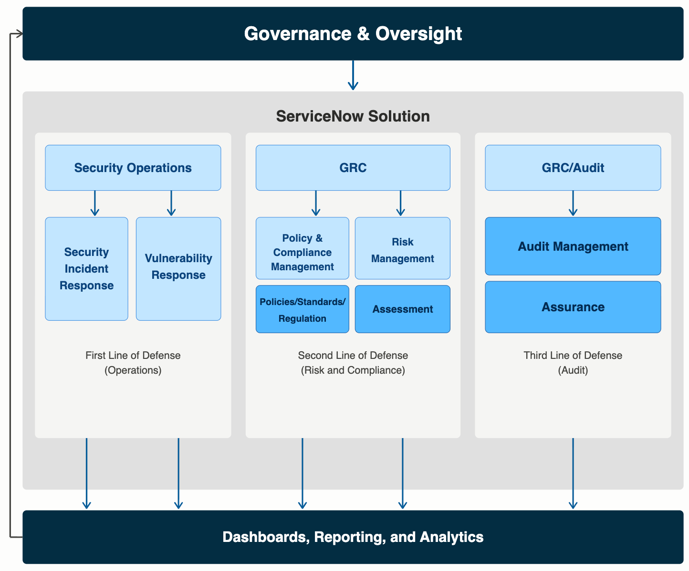
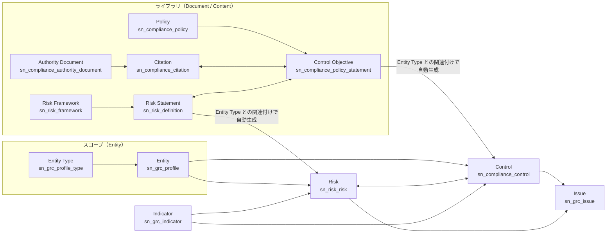
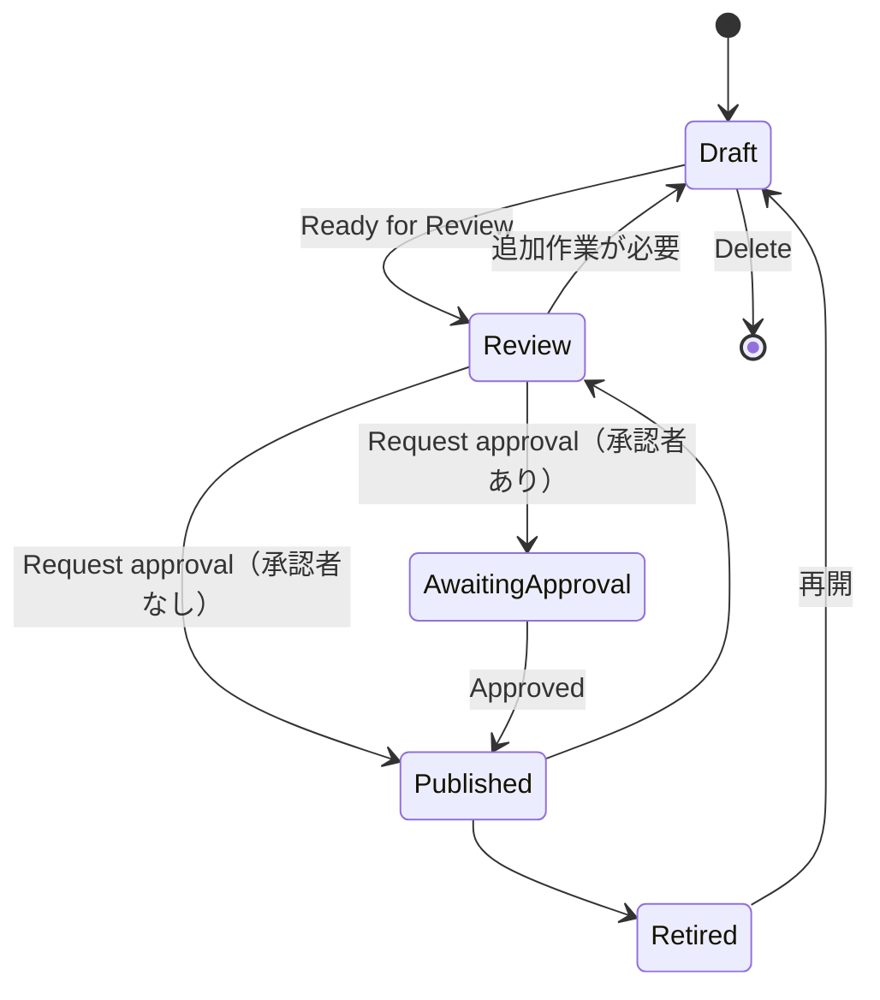
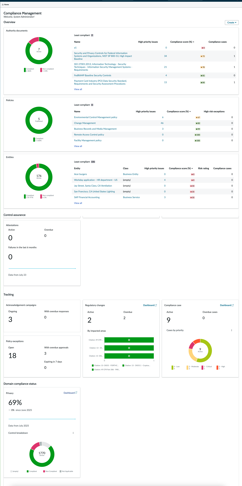
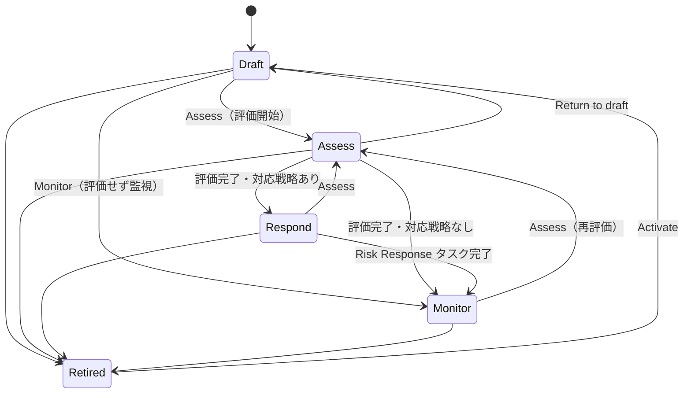
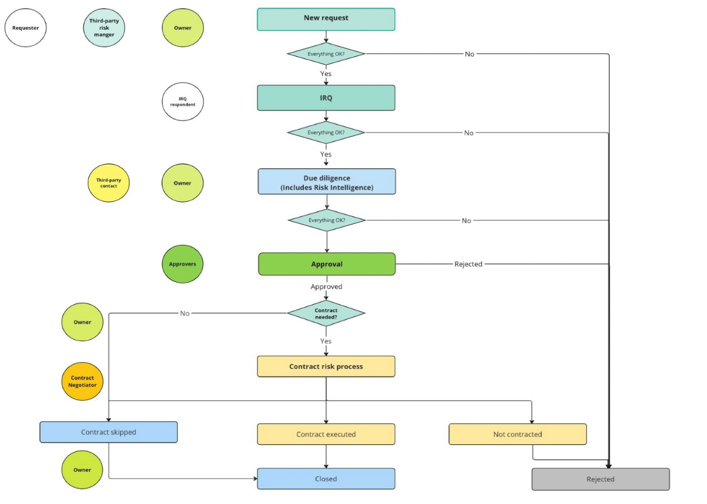
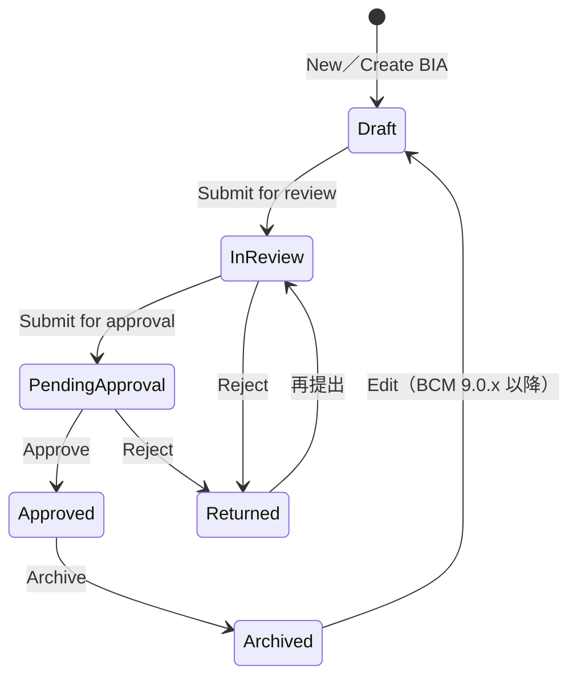
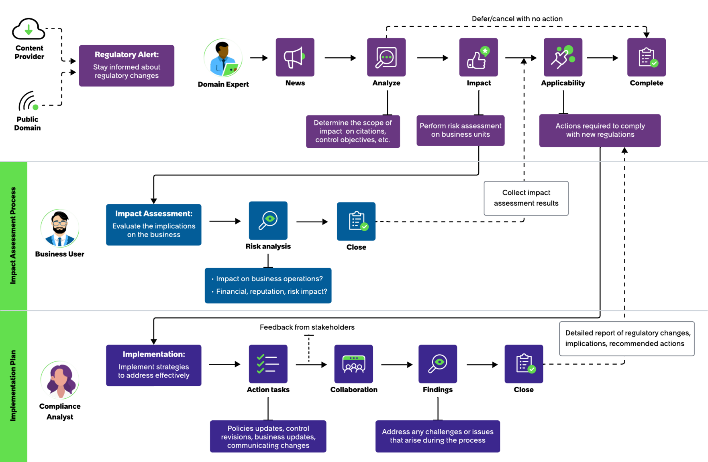

# Integrated Risk Management（GRC：統合リスク管理）

## 概要

ServiceNow **Integrated Risk Management（IRM、統合リスク管理）** は、ServiceNow AI Platform 上で動作するガバナンス・リスク・コンプライアンス（Governance, Risk, and Compliance：GRC）アプリケーション群の総称である。公式ドキュメントでは製品群を「Governance, Risk, and Compliance（GRC）」、ライセンス／製品名を「Integrated Risk Management（IRM）」と呼び分けることが多い。IRM は「継続的モニタリングと自動化により、リスクとコンプライアンスの状態をリアルタイムに可視化し、拡張企業（ベンダーを含む）全体の非効率なプロセスを統合リスクプログラムに変える」ことを目的とする。[出典](https://www.servicenow.com/docs/r/australia/governance-risk-compliance/r_WhatIsGRC.html)

Australia リリースの GRC ドキュメントに掲載されるアプリケーションは以下のとおり。[出典](https://www.servicenow.com/docs/r/australia/governance-risk-compliance/r_WhatIsGRC.html)

| アプリケーション（英語正式名） | 日本語の目安 | 本ファイルでの扱い |
|---|---|---|
| Policy and Compliance Management | ポリシー・コンプライアンス管理 | 詳説 |
| Risk Management（＋ Advanced Risk） | リスク管理（高度リスク評価） | 詳説 |
| Audit Management（＋ Advanced Audit） | 監査管理 | 詳説 |
| Third-party Risk Management（TPRM） | サードパーティリスク管理 | 詳説 |
| Business Continuity Management（BCM） | 事業継続管理 | 詳説 |
| Operational Resilience | オペレーショナルレジリエンス | 詳説 |
| Privacy Management | プライバシー管理 | 詳説 |
| Regulatory Change Management（RCM） | 規制変更管理 | 詳説 |
| Smart Assessment Engine（SAE） | スマート評価エンジン | 共通基盤として概説 |
| Compliance Case Management | コンプライアンスケース管理 | 概説 |
| Continuous Authorization and Monitoring（CAM） | 継続的認可・監視（主に米国連邦 RMF 向け） | 概説 |
| Model Risk Management | モデルリスク管理 | 概説 |
| AI Risk and Compliance | AI リスク・コンプライアンス | 概説（[Now Assist と AI Agents](../platform/now-assist-ai-agents.md) も参照） |
| ESG Management → Operational Sustainability Management | ESG／サステナビリティ管理 | 概説（詳細は [Finance・Supply Chain・その他](../other/finance-supply-chain-esg.md)） |

IRM の各アプリは ServiceNow Store から配布される Store アプリケーションであり、利用にはエンタイトルメント（ライセンス）の確認後に Store からダウンロード・有効化する。リリースファミリー（Australia 等）とは独立にバージョン（例：22.x＝Australia 世代、23.x＝Brazil 世代）が更新される。[出典](https://www.servicenow.com/docs/r/australia/governance-risk-compliance/grc-and-store.html)

> **本ファイルの範囲:** Security Operations（SIR・VR）は [Security Operations](../secops/security-operations.md)、CMDB／CSDM は [CMDB と CSDM](../platform/cmdb-csdm.md)、ESG の詳細は [Finance・Supply Chain・その他ワークフロー](../other/finance-supply-chain-esg.md) を参照。

---

## 1. IRM の全体アーキテクチャ

### 1.1 3 ラインモデル（Three Lines of Defense）との対応

IRM は内部統制の「3 ラインモデル（Three Lines of Defense、3 つの防衛線）」に沿ってアプリケーションを配置している。公式ドキュメントの図では、第 1 線（業務執行）を Security Operations（Security Incident Response、Vulnerability Response）、第 2 線（リスク・コンプライアンス）を GRC（Policy & Compliance Management＝ポリシー／標準／規制、Risk Management＝評価）、第 3 線（監査）を Audit Management（保証＝Assurance）が担い、その上に「Governance & Oversight（ガバナンスと監督）」、下に「Dashboards, Reporting, and Analytics」が位置する。[出典](https://www.servicenow.com/docs/r/australia/governance-risk-compliance/audit-management/audit-management.html)

- **キャプション:** 「Audit Management and the ServiceNow AI Platform」（3 ラインモデルと ServiceNow 製品の対応）
- **図の説明:** 最上段に「Governance & Oversight」。中央の「ServiceNow Solution」枠内は 3 列で、左列「Security Operations」→「Security Incident Response」「Vulnerability Response」（First Line of Defense＝Operations）、中央列「GRC」→「Policy & Compliance Management（Policies/Standards/Regulation）」「Risk Management（Assessment）」（Second Line of Defense＝Risk and Compliance）、右列「GRC/Audit」→「Audit Management（Assurance）」（Third Line of Defense＝Audit）。全列から下段の「Dashboards, Reporting, and Analytics」に矢印が伸び、そこから最上段のガバナンスへフィードバックする矢印が戻る。
- **出典:** https://www.servicenow.com/docs/r/australia/governance-risk-compliance/audit-management/audit-management.html （Australia 版 GRC ドキュメント「Exploring Audit Management」Figure 1。取得日 2026-11-03）

### 1.2 共通データモデル（Document / Content / Item と Entity）

GRC の主要テーブルは、GRC 共通スコープ（`sn_grc`）の抽象的な基底テーブルを拡張する構造になっている。Policy and Compliance・Risk Management の「Components installed」ページの記述から、以下の継承関係が確認できる。[出典](https://www.servicenow.com/docs/r/australia/governance-risk-compliance/policy-and-compliance-management/r_InstallWPolAndCompl.html) [出典](https://www.servicenow.com/docs/r/DDKNGuzcS_gt6P_P4KM3Dg/w_MBqKb4On6bPhyN0ygcSQ)

| 階層 | 基底テーブル | 意味 | Policy and Compliance 側 | Risk Management 側 |
|---|---|---|---|---|
| Document（文書） | `sn_grc_document` | 束ねる単位（文書・フレームワーク） | Authority Document `sn_compliance_authority_document`、Policy `sn_compliance_policy` | Risk Framework `sn_risk_framework` |
| Content（内容） | `sn_grc_content` | 汎用の要求事項・定義（ライブラリ） | Citation `sn_compliance_citation`、Control Objective `sn_compliance_policy_statement` | Risk Statement `sn_risk_definition` |
| Item（項目） | `sn_grc_item` | Entity（対象）ごとに生成される実体 | Control `sn_compliance_control` | Risk `sn_risk_risk` |

- Control Objective（管理目標、旧称 Policy Statement）を Entity Type（エンティティタイプ）に関連付けると、その Entity Type に該当する各 Entity に対して Control が生成される。同様に Risk Statement（リスクステートメント）× Entity から Risk が生成される（「item generation process」。v2 は 13.x で導入され v1 の停止・性能問題を解消）。[出典](https://www.servicenow.com/docs/r/australia/governance-risk-compliance/grc-common-functions/common-grc-features.html)
- Risk Statement と Control Objective の関連 `sn_risk_m2m_risk_definition_policy_statement` にエントリを追加すると、対応する Risk ⇔ Control の関連（`sn_risk_m2m_risk_control`）が自動作成される。[出典](https://www.servicenow.com/docs/r/DDKNGuzcS_gt6P_P4KM3Dg/w_MBqKb4On6bPhyN0ygcSQ)
- `sn_grc_profile`（GRC Profile＝Entity）と `sn_grc_profile_type`（Entity Type）の名称は、Operational Resilience のテーブル一覧で「List of all GRC entities」「List of all GRC entity types」として公式に記載されている。[出典](https://www.servicenow.com/docs/r/australia/governance-risk-compliance/tables-installed-with-op-res.html)
- Entity Class（`sn_grc_profile_class`）や Issue（`sn_grc_issue`）のテーブル名は Community 記事等で広く参照されるが、Australia 版の公式テーブル一覧での直接確認はできなかった。`【第三者情報】`

### 1.3 Entity（エンティティ）

`sn_grc_profile` テーブルの Entity（エンティティ、旧称 Profile）は GRC の最も基本的な要素で、リスクやコンプライアンスの評価対象となる人・プロセス・部門・アプリケーション・その他オブジェクトを表す。各 Entity には Owner（所有者）があり、不適合項目と責任者を個別に特定できる。Entity は Policy and Compliance、Audit Management、Regulatory Change Management など GRC の全製品で共通利用される。[出典](https://www.servicenow.com/docs/r/australia/governance-risk-compliance/grc-risk-management-workspace/manage-entities.html)

| 概念 | 説明 |
|---|---|
| Entity（エンティティ） | 評価対象そのもの。Owner を持つ。CMDB の CI、部門、ロケーション、ベンダー、ビジネスアプリケーション等から生成可能 |
| Entity Type（エンティティタイプ） | テーブルと条件（フィルタ）で Entity を自動生成・抽出する定義。Risk／Control の一括生成の起点 |
| Entity Class（エンティティクラス） | Entity にタグ付けし、組織横断のリスク状況を俯瞰するための分類 |
| Entity Tier（エンティティティア） | Entity Class の優先度付け |
| Risk Universe（リスクユニバース） | 組織が直面し得るリスクの一覧（重大度・頻度付き） |

Australia では **Entity lifecycle management**（Entity の変更が関連 Risk／Control に与える影響を、反映前にレビューする機能）が共通機能として提供される。[出典](https://www.servicenow.com/docs/r/australia/governance-risk-compliance/grc-common-functions/common-grc-features.html)

### 1.4 GRC 共通テーブル（Australia 公式一覧）

`Tables installed with Governance, Risk, and Compliance` に掲載される GRC 共通テーブル（抜粋）は以下。[出典](https://www.servicenow.com/docs/r/Z61H6JNUJXKe8NNPQzK7MQ/KRaHMTY24R91QF9OITkmfg)

| テーブル | 説明 |
|---|---|
| `sn_grc_indicator` | Indicator（指標）の詳細 |
| `sn_grc_indicator_supporting_data` | Indicator 夜間ジョブで収集した裏付けデータ |
| `sn_grc_indicator_supporting_data_statistics` | 裏付けデータ収集ジョブ用の統計 |
| `sn_grc_m2m_issue_item` | Issue ⇔ Control |
| `sn_grc_m2m_issue_content` | Issue ⇔ Control Objective |
| `sn_grc_m2m_issue_document` | Issue ⇔ Policy／Authority Document |
| `sn_grc_m2m_issue_engagement` | Issue ⇔ Engagement（監査） |
| `sn_grc_m2m_item_entity` | 共通統制（Common Control）に依存する Entity |
| `sn_grc_m2m_item_entity_type` | Item ⇔ Entity Type |
| `sn_grc_m2m_cont_ref_auth_doc` ／ `_citation` ／ `_ps` | Content Reference（コンテンツ参照タグ）⇔ Authority Document／Citation／Control Objective |
| `sn_grc_functional_domain` ほか `sn_grc_functional_domain_*` | Functional domain（機能ドメイン）タグ付け（IT 関連オブジェクトの分類） |
| `sn_grc_pci_control_objective_*` | Control Objective と構成テスト対応のインポート用ステージング／設定 |
| `sn_grc_choice` | GRC 共通の選択肢（Operational Resilience 一覧に記載） |

### 1.5 共通機能（Common GRC features）

Australia の「Common GRC features」に列挙される主要な横断機能は以下。[出典](https://www.servicenow.com/docs/r/australia/governance-risk-compliance/grc-common-functions/common-grc-features.html)

| 機能 | 概要 |
|---|---|
| Issue 管理／Issue workflows | Issue（課題）の発見・是正。Issue workflows で同一 Issue テーブル上に Issue 種別ごとのライフサイクル・レイアウト・承認・ルーティングを定義 |
| Approver Configurator（`sn_grc_appr`） | ビジネス割り当てルールに基づく多段承認 |
| Confidential records | 機密 GRC レコードのアクセス制限 |
| User hierarchy／User group-based access | 上長による部下レコード参照、グループ単位のデータ分離 |
| Entity Based Access（EBA） | Entity に基づくデータ分離 |
| Domain separation | ドメイン分離（[ドメインセパレーション](../platform/domain-separation.md) 参照） |
| Content packs／Integrations／Use case accelerators | 規制・フレームワーク別の事前定義コンテンツ、外部連携 |
| Content references | レコードに「どのコンテンツパック／規制由来か」のタグを付与 |
| Unified Content Management（UCM） | 規制コンテンツの整理・版管理・配信の共通基盤 |
| Taxonomy management | 非構造化コンテンツの分類体系 |
| Functional domain tagging | Cybersecurity、IT risk and compliance、Compliance、Third-Party Risk、Operational Risk 等の機能ドメインで分類 |
| 360° Relationship Visualization | Control・Risk・Issue 等の関係を可視化し、関係追加・Issue クローズ・例外承認を実行 |
| Landing Page Configurations | ワークスペースの Tasks／Issues ランディングページを構成（`sn_grc_workspace.task_admin`、GRC 管理者に既定付与） |
| GRC notification redirection | 通知リンクを権限・ペルソナに応じてワークスペースまたはクラシック UI に振り分け（Australia の新機能） |
| Anonymous Reporting Center（ARC） | 匿名でのコンプライアンス・プライバシー・AI 関連の懸念報告 |
| Mobile experience | モバイルでのタスク・承認・通知 |
| GRC licensing summary dashboard | ライセンス消費の可視化（後述 §11） |
| Microsoft Word ベースの監査レポート（Document designer） | 非技術者でも監査レポートテンプレートを構成可能 |

### 1.6 Issue（課題）と Issue workflows

Issue は Risk・Control・監査・ベンダー評価などあらゆる GRC プロセスで発見された課題を記録する共通オブジェクトであり、Compliance と Risk の両用途に用いられる。Australia では **Issue workflows** により、Issue テーブルをカスタマイズせずに Issue 種別ごとのプロセスを並存できる。[出典](https://www.servicenow.com/docs/r/australia/governance-risk-compliance/grc-common-functions/issue-workflows.html)

| Issue workflow の構成要素 | 内容 |
|---|---|
| Table and identity | 名前・説明・対象の Issue テーブル |
| Layout | フィールド、セクション、ヘッダー、縦ナビゲーション |
| State model | ライフサイクル状態と許可遷移 |
| Playbook | 各ステージの作業をガイドする任意のアクティビティ |
| State-to-stage mapping | 状態と Playbook ステージの同期 |
| Approval definitions | 承認が必要な状態遷移・期限延長 |
| Trigger condition | 新規 Issue がこのワークフローに該当する条件 |
| Priority | 複数ワークフローが該当した場合の優先順位 |

Issue の割り当てには GRC: Predictive Intelligence プラグインによる自動割り当ても利用できる（[Predictive Intelligence と AI Search](../platform/predictive-intelligence-ai-search.md) 参照）。

> **Brazil での変更:** Brazil（Q3 2026）では **GRC Issue Management**（企業全体の Issue 管理）が新機能として発表され、監査指摘・統制不備・コンプライアンス／リスク Issue を単一アプリに統合し、組織独自の Issue 種別ごとにフィールド・フォーム・ライフサイクル・ガイド付き手順を定義できる。[出典](https://www.servicenow.com/community/grc-articles/read-about-risk-s-major-new-capabilities-for-brazil/ta-p/3596384)

### 1.7 ワークスペース

IRM は製品ごとに Next Experience のワークスペースを提供し、クラシック UI（`All > Policy and Compliance` 等のアプリケーションメニュー）と併存する（[Workspace と UI Builder](../platform/workspaces-ui-builder.md) 参照）。

| ワークスペース | 対象製品 | 補足 |
|---|---|---|
| Compliance Workspace | Policy and Compliance、Regulatory Change Management、Compliance Case | ポリシー作成・赤入れ（redlining）、統制、指標、エビデンス要求、例外、Issue |
| Risk Workspace | Risk Management、Advanced Risk | プラグイン「GRC: Risk Management workspace」（`com.sn_risk_workspace`）。13.0.5 で導入 |
| Audit Workspace／Audit Supervisor Workspace | Audit Management | Lite Audit Workspace（`sn_audit.shared_*` ロール）もあり |
| Vendor Management Workspace（GRC） | TPRM | `sn_vrm_ws`。ITSM 版 `sn_itsm_vendor` は Australia で非推奨 |
| BCM Configurable Workspace／BCM Classic Workspace | BCM | UI Builder で構成可能 |
| Privacy Workspace／PDR Workspace | Privacy Management、Personal Data Rights | |
| CAM Workspace | Continuous Authorization and Monitoring | |
| Model Risk Workspace | Model Risk Management | |
| AI Risk and Compliance workspace | AI Risk and Compliance | |

[出典](https://www.servicenow.com/docs/r/australia/governance-risk-compliance/grc-risk-management-workspace/risk-workspace.html) [出典](https://www.servicenow.com/docs/r/australia/governance-risk-compliance/third-party-risk-management/third-party-risk-mgt-landing-page.html)

---

## 2. Policy and Compliance Management（ポリシー・コンプライアンス管理）

### 2.1 概要

Policy and Compliance Management は、ポリシー・標準・内部統制手続きを一元的に作成・管理し、外部規制やベンチマークにクロスマッピングするアプリケーションである。統制活動の識別・評価・継続的モニタリングの構造化ワークフローを提供する。プラグイン `com.sn_compliance` は別サブスクリプションで、有効化が必要。[出典](https://www.servicenow.com/docs/r/australia/governance-risk-compliance/policy-and-compliance-management/r_PolicyComplianceMgmt.html)

主要概念：

| 概念 | テーブル | 説明 |
|---|---|---|
| Authority Document（オーソリティ文書） | `sn_compliance_authority_document` | 外部規制・標準（例：ISO 27001、NIST SP 800-53、PCI DSS） |
| Citation（引用条項） | `sn_compliance_citation` | Authority Document の個々の条項 |
| Policy（ポリシー） | `sn_compliance_policy` | 社内ポリシー・標準。公開時にナレッジ記事化 |
| Control Objective（管理目標） | `sn_compliance_policy_statement` | ポリシーが求める統制目標（旧称 Policy Statement） |
| Control（統制） | `sn_compliance_control` | Control Objective × Entity の実体。Attestation・Indicator で評価 |
| Policy Exception（ポリシー例外） | `sn_compliance_policy_exception` | 例外・延長申請 |

### 2.2 テーブル一覧（Australia）

[出典](https://www.servicenow.com/docs/r/australia/governance-risk-compliance/policy-and-compliance-management/r_InstallWPolAndCompl.html)

| テーブル [名前] | 拡張元／説明 |
|---|---|
| Authority Document [`sn_compliance_authority_document`] | Document を拡張。全 Authority Document |
| Citation [`sn_compliance_citation`] | Content を拡張。全 Citation |
| Policy [`sn_compliance_policy`] | Document を拡張。全ポリシー |
| Control objective [`sn_compliance_policy_statement`] | Content を拡張。全 Control Objective |
| Control [`sn_compliance_control`] | Item を拡張。全 Control |
| Article Template [`sn_compliance_article_template`] | ポリシーをナレッジベースに公開する際の本文書式 |
| Policy exception [`sn_compliance_policy_exception`] | 全ポリシー例外 |
| Policy exception risk rating mapping [`sn_compliance_policy_exception_risk_rating_mapping`] | リスク評価結果を例外のリスク評価にマッピング |
| Policy to Entity Type [`sn_compliance_m2m_policy_profile_type`] | Policy ⇔ Entity Type（Document to Entity Type を拡張） |
| Policy to Policy Statement [`sn_compliance_m2m_policy_policy_statement`] | Policy ⇔ Control Objective |
| Control Objective to Citation [`sn_compliance_m2m_statement_citation`] | Control Objective ⇔ Citation |
| Control Objective to Entity Type [`sn_compliance_m2m_statement_profile_type`] | Control Objective ⇔ Entity Type（Content to Entity Type を拡張） |
| Control objective requirement [`sn_compliance_policy_stmt_requirement`] | Control Objective の要求事項番号・説明 |
| Control objective to Control objective requirement [`sn_compliance_m2m_policy_stmt_policy_stmt_rqmt`] | Control Objective ⇔ 要求事項 |
| Control requirement [`sn_compliance_control_requirement`] | Control の要求事項番号 |
| Control to Control requirement [`sn_compliance_m2m_control_control_requirement`] | Implementation status（継承／自己実装）を保持 |
| Requirement selection [`sn_compliance_hybrid_selection`] | 選択した Control 要求事項（Control Objective、Entity、認可パッケージ） |
| Control to entity [`sn_compliance_m2m_control_entity`] | Item to entity を拡張 |

### 2.3 ロール一覧（Australia）

[出典](https://www.servicenow.com/docs/r/australia/governance-risk-compliance/policy-and-compliance-management/r_InstallWPolAndCompl.html)

| ロール [名前] | 主な権限 | 含むロール |
|---|---|---|
| Compliance Reader [`sn_compliance.reader`] | GRC スコープの参照。Indicator テンプレート・Indicator・Issue の割り当て対象 | `sn_grc.reader`, `survey_reader` |
| Compliance User [`sn_compliance.user`] | Control の割り当て対象、Policy・Control Objective の作成。Risk Management は参照のみ | `sn_compliance.reader`, `sn_grc.user`, `sn_risk.reader`, `survey_reader`, `vendor_reader` |
| Compliance Manager [`sn_compliance.manager`] | Authority Document・Citation・Control Objective・Control の作成 | `sn_compliance.user`, `sn_grc.manager`, `sn_vdr_risk_asmt.vendor_assessment_reviewer` |
| Compliance Administrator [`sn_compliance.admin`] | Authority Document・Citation・Policy・Control Objective・Control の削除 | `sn_compliance.manager`, `sn_grc.admin` |
| Compliance Developer [`sn_compliance.developer`] | 記事テンプレート作成・スクリプト編集 | `sn_compliance.admin`, `sn_grc.developer` |
| Attestation Creator [`sn_compliance.attestation_creator`] | GRC attestation メトリックタイプ・例外質問票の作成 | `assessment_admin` |
| Corporate Compliance Analyst [`sn_compliance_ws.corporate_compliance_analyst`] | Compliance Workspace の参照 | `sn_compliance.user`, `sn_audit.user` |
| Corporate Compliance Manager [`sn_compliance_ws.corporate_compliance_manager`] | Compliance Workspace の参照・利用 | `sn_compliance.manager`, `sn_compliance_ws.corporate_compliance_analyst`, `sn_audit.manager` |
| IT Compliance Manager [`sn_compliance_ws.it_compliance_manager`] | Compliance Workspace の参照・利用 | `sn_compliance.manager`, `sn_audit.manager` |

補足：

- GRC Profiles プラグインが GRC Business User（`sn_grc.business_user`）ロールをインストールする。明示ロールプラグイン「GRC: Business User – Lite」は `sn_grc.business_user_lite` を付与し、maint 権限ユーザーまたは ServiceNow サポートがインストールする。[出典](https://www.servicenow.com/docs/r/australia/governance-risk-compliance/policy-and-compliance-management/r_InstallWPolAndCompl.html)
- Privacy Management のロール定義には `sn_compliance.policy_user`、`sn_compliance.library_manager`、`sn_compliance.control_framework_admin` 等の **機能別（feature）ロール** が現れており、Australia 世代では広範な `sn_compliance.*` ロールから機能単位ロールへの細分化が進んでいる。[出典](https://www.servicenow.com/docs/r/australia/governance-risk-compliance/privacy-workspace/roles-installed-prm.html)

### 2.4 ポリシーのライフサイクル

Policy（`sn_compliance_policy`）の状態遷移は以下。[出典](https://www.servicenow.com/docs/r/australia/governance-risk-compliance/policy-and-compliance-management/pc-policy-life-cycle-ovrvw.html)

| 状態 | 主な作業 | 担当 |
|---|---|---|
| Draft（下書き） | ポリシー定義、Reviewer／Approver 指定、Control Objective 追加、Valid to（有効期限）設定 | compliance admin／manager／user |
| Review（レビュー） | Control Objective・Entity・Control・Citation の確認、マッピング追加削除 | 指定 Reviewer のみ更新可。承認要求はポリシー Owner（`sn_compliance.user`）またはコンプライアンスマネージャー（Reviewer は不可） |
| Awaiting approval（承認待ち） | Approver 向け承認タスク（Requested → Approved／Rejected／Cancelled／No longer required） | Approver |
| Published（公開） | ナレッジ記事を自動生成。マッピングされた Control が必須化 | — |
| Retired（廃止） | ナレッジ記事を削除、レコードは監査目的で保持 | — |

- 公開先ナレッジベースはプロパティ `sn_compliance.knowledge_base`（既定「Governance, Risk, and Compliance」）で指定。記事書式は Article Template で定義。
- Store のリリースノートには「公開済みポリシーに新しい Valid to を設定すると Review に戻る」既知の問題が記載されている（AI 要約ページ。要確認）。[出典](https://www.servicenow.com/docs/r/store-release-notes/store-grc-rn-policy-compliance-mgmt.html)

### 2.5 Control（統制）の状態と Attestation（自己証明）

Control の有効・無効状態はプロパティで定義される。既定の有効状態は `draft, assess, review, monitor`、無効状態は `retired`（先頭が既定値）。[出典](https://www.servicenow.com/docs/r/australia/governance-risk-compliance/policy-and-compliance-management/r_InstallWPolAndCompl.html)

**Attestation（アテステーション）** は、Control が実装されていることを示すエビデンスを収集する質問票である。主に Draft および Monitor 状態で使われる。既定の「GRC Attestation」は「Is this control implemented?」「Attach evidence」「Explain」の 3 問で構成される。[出典](https://www.servicenow.com/docs/r/australia/governance-risk-compliance/policy-and-compliance-management/c_Attestations.html)

- **Attestation Designer:** `All > Policy and Compliance > Administration > Attestation Types` → Attestation Designer。必要ロール：`sn_compliance.attestation_creator`、`sn_compliance.manager`、`sn_compliance.admin`。
- **モジュール:** My Attestations（自分が回答者の有効な Attestation。Control ごとに 1 件）、My Grouped Attestations（類似 Attestation をグループ化して一括回答）、All Attestations。
- Attestation レコードは Assessment テーブル群（`asmt_*`）に格納される。Smart Assessment Engine（SAE）による Attestation も可能（`sn_compliance.enable_smart_assessments`）。

### 2.6 Indicator（指標）による継続的モニタリング

Indicator（`sn_grc_indicator`）は Control または Risk を定期的に評価する仕組みで、種類は Manual（手動タスク）、Basic（条件に基づくレコード件数等）、Scripted（スクリプト）。Indicator テンプレートから Entity ごとに Indicator を生成でき、結果は Supporting Data（`sn_grc_indicator_supporting_data`）に保存される。Indicator が不合格になると Control を Non-compliant にし Issue を生成できる。[出典](https://www.servicenow.com/docs/r/australia/governance-risk-compliance/grc-risk-management-workspace/risk-workspace.html) `【経験則】`（Issue 自動生成の挙動はテンプレート設定に依存）

### 2.7 プロパティ（Australia）

[出典](https://www.servicenow.com/docs/r/australia/governance-risk-compliance/policy-and-compliance-management/r_InstallWPolAndCompl.html)

| プロパティ | 型・既定値 | 説明 |
|---|---|---|
| `sn_compliance.entity_hierarchy_based_scoring` | true/false、false | Entity 階層に基づくスコアリング |
| `sn_compliance.attestation_run_reference_date_field` | String、Created date, Updated date | 新規 Attestation 起動の基準となる前回 Attestation の日付 |
| `sn_compliance.active_states` | String、draft, assess, review, monitor | Control の有効状態 |
| `sn_compliance.closed_states` | String、retired | Control の無効状態 |
| `sn_compliance.default_attestation` | String、GRC Attestation | 既定 Attestation メトリックタイプ名 |
| `sn_compliance.knowledge_base` | String、Governance, Risk, and Compliance | ポリシー記事の公開先 KB |
| `sn_compliance.glide.script.block.client.globals` | true/false、false | クライアントグローバルのスクリプトブロック |
| `sn_compliance.enable_smart_assessments` | true/false、false | 非クラシック評価エンジン（SAE）による Control 評価 |

### 2.8 Compliance Workspace

Compliance Workspace のホーム（Compliance Management）は、Authority Document・Policy・Entity のコンプライアンス状況、統制保証（Attestation）、追跡（Acknowledgement campaigns、Policy exceptions、Regulatory changes、Compliance case）、ドメイン別コンプライアンス状況（Privacy 等）をカード形式で表示する。[出典](https://www.servicenow.com/docs/r/australia/governance-risk-compliance/grc-compliance-management-workspace/grc-unified-compliance-workspace.html)

- **キャプション:** Compliance Workspace ホーム画面（Compliance Management／Overview）
- **画面説明:** 上部に「Compliance Management」「Welcome, System Administrator!」、右上に「Create」ボタン。「Overview」セクションに 3 枚のカード：①**Authority documents**（ドーナツグラフで Active 件数と Compliant／Non-compliant 比率、右に「Least compliant」一覧＝Name、High priority issues、Compliance score (%)、Compliance cases。例：NIST SP 800-53、ISO 27001:2013、FedRAMP、PCI DSS）、②**Policies**（Published 件数と準拠率、Least compliant ポリシー一覧＝High priority issues、Compliance score、High risk exceptions）、③**Entities**（Active Entity 数と準拠率、Entity・Class・High priority issues・Compliance score・Risk rating・Compliance cases）。続いて「Control assurance」に **Attestations**（Active、Overdue、過去 6 か月の失敗数）。「Tracking」に **Acknowledgement campaigns**（Ongoing／With overdue responses）、**Policy exceptions**（Open／With overdue approvals／Expiring in 7 days）、**Regulatory changes**（Active／Overdue、Impacted areas 別の棒グラフ）、**Compliance case**（Active／Overdue、優先度別ドーナツ）。最下部「Domain compliance status」に **Privacy**（準拠率 % と Control breakdown＝Compliant／Non Compliant／Not Applicable）。
- **出典:** https://www.servicenow.com/docs/r/australia/governance-risk-compliance/grc-compliance-management-workspace/grc-unified-compliance-workspace.html （取得日 2026-11-03）

Compliance Workspace での主な作業：ポリシーの作成と赤入れ（Policy authoring and redlining）、ポリシー例外・延長の申請とレビュー、Control の作成、Control Indicator／Indicator テンプレートの作成、エビデンス要求（監査時の要求・提出・承認・受領／却下）、Issue の作成・グルーピング・是正、ダッシュボード参照。[出典](https://www.servicenow.com/docs/r/australia/governance-risk-compliance/grc-compliance-management-workspace/grc-unified-compliance-workspace.html)

### 2.9 外部コンテンツ連携

- **UCF（Unified Compliance Framework）Common Controls Hub** との連携で Authority Document と Citation を取り込み、フレームワーク間の共通統制を管理できる。[出典](https://www.servicenow.com/docs/r/australia/governance-risk-compliance/policy-and-compliance-management/r_PolicyComplianceMgmt.html)
- **DORA（Digital Operational Resilience Act）フレームワーク** の有効化手順が Policy and Compliance 配下に用意されている（Operational Resilience §6 参照）。

---

## 3. Risk Management（リスク管理）と Advanced Risk

### 3.1 概要

GRC: Risk Management は、影響の大きいリスクを継続的に監視・特定し、リスクに基づく意思決定と対応時間短縮を支援する。リスク評価、Risk Indicator（KRI）、Risk Issue のワークフローを提供する。Risk Workspace は 13.0.5 で追加された。ライセンスに応じて利用できる機能・生成 AI スキル・AI エージェントが異なる。[出典](https://www.servicenow.com/docs/r/australia/governance-risk-compliance/grc-risk-management-workspace/grc-risk-overview.html)

- **Risk Library（リスクライブラリ）:** Risk Framework（リスクフレームワーク、Risk Statement をカテゴリにまとめる）と Risk Statement（リスクステートメント、個々の Risk をまとめる）の集合。
- **Risk Register（リスク台帳）:** 組織内で発生し得る全リスクの中央リポジトリ。
- 良い Risk Statement は「何が起こり得るか」「どのように起こり得るか」「なぜ重要か」に答える。
- New York 以降、Risk Statement の階層（オペレーショナル／IT／戦略リスク等）を作成でき、下位リスクのスコアが階層に沿って自動ロールアップする。

[出典](https://www.servicenow.com/docs/r/australia/governance-risk-compliance/grc-risk-management-workspace/r_RiskRegister.html)

### 3.2 テーブル一覧

[出典](https://www.servicenow.com/docs/r/DDKNGuzcS_gt6P_P4KM3Dg/w_MBqKb4On6bPhyN0ygcSQ)（Zurich 版。Australia 版での差分は公開情報では確認できず）

| テーブル [名前] | 拡張元 | 説明 |
|---|---|---|
| Risk [`sn_risk_risk`] | Item [`sn_grc_item`] | Entity に紐づく個別リスク |
| Risk Statement [`sn_risk_definition`] | Content [`sn_grc_content`] | リスク定義 |
| Risk Framework [`sn_risk_framework`] | Document [`sn_grc_document`] | Risk Statement の集合 |
| Risk Framework to Entity Type [`sn_risk_m2m_framework_profile_type`] | Document to Entity Type | Framework ⇔ Entity Type |
| Entity Type to Risk Statement [`sn_risk_m2m_risk_definition_profile_type`] | Content to Entity Type | Entity Type ⇔ Risk Statement |
| Risk to Control [`sn_risk_m2m_risk_control`] | — | Risk ⇔ Control |
| Risk Statement to Control Objective [`sn_risk_m2m_risk_definition_policy_statement`] | — | 追加すると Risk ⇔ Control 関連を自動作成 |
| Risk Relationship [`sn_risk_m2m_risk_risk`] | — | Risk 同士の上流・下流／親子関係 |
| Risk Tasks [`sn_risk_m2m_risk_task`] | — | Risk ⇔ タスク |
| Risk Response Task [`sn_risk_response_task`] | — | 以下 4 種の基底 |
| Risk Acceptance [`sn_risk_acceptance_task`] | — | 受容（承認プロセス付き） |
| Risk Avoidance [`sn_risk_avoidance_task`] | — | 回避 |
| Risk Mitigation [`sn_risk_mitigation_task`] | — | 低減 |
| Risk Transfer [`sn_risk_transfer_task`] | — | 移転 |
| Risk Mitigation to Control [`sn_risk_m2m_risk_mitigation_control`] | — | 低減タスクに追加した Control |
| Color Setting [`sn_risk_color_setting`] | — | 影響度・発生可能性とレポート色の対応 |

### 3.3 ロール一覧（Australia）

[出典](https://www.servicenow.com/docs/r/australia/governance-risk-compliance/grc-risk-management-workspace/r_RolesInstallWRisk.html)

| ロール [名前] | 主な権限 | 含むロール |
|---|---|---|
| Risk Reader [`sn_risk.reader`] | Risk アプリ参照。割り当て Issue・Indicator タスク・是正タスクへの対応、Risk Event 作成、Advanced Risk Assessment の実施、ダッシュボード参照 | `sn_grc.reader`, `survey_reader`, `sn_rvw_feedback.reader` |
| Risk User [`sn_risk.user`] | Entity Type／Entity／Risk／Control／Control Objective／Policy Exception の参照、Risk 作成、受容・是正タスク対応、Assessment scope 作成、Policy and Compliance 参照 | `sn_grc.user`, `sn_compliance.reader`, `sn_risk.reader`, `survey_reader`, `sn_grc.business_user`, `sn_risk_advanced.ara_creator` |
| Risk Manager [`sn_risk.manager`] | Issue・Issue rating・Entity・Entity Type／Class・Indicator（テンプレート）・Content reference の作成。Risk Framework・Risk Statement・Risk・是正タスク・Assessment scheduler・Risk Event 対応テンプレート・Risk Identification の作成 | `sn_grc.manager`, `sn_risk.user` |
| Risk Admin [`sn_risk.admin`] | Entity tier 作成、Framework・Entity・Indicator・Risk・Issue・タスクの削除、管理プロパティ・Risk criteria 変更、Risk Event の原因／結果ライブラリ、Risk Assessment Methodology（RAM）と全 Factor の作成、フィードバック連携設定 | `sn_grc.admin`, `sn_risk.user`, `sn_risk.manager`, `sn_grc_appr.admin`, `sn_rvw_feedback.admin` |
| Assessment Creator [`sn_risk.asmt_creator`] | GRC リスク評価メトリックタイプの作成 | `assessment_admin` |
| GRC Business User [`sn_grc.business_user`] | リスク評価の回答、Risk Response タスク作成、Risk Statement・Assessment scope 参照、Risk Event 報告、Indicator／メトリックデータ／Risk Identification タスクへの回答、Issue 報告、任意オブジェクト評価の開始。PPM 連携時はプロジェクトリスク関連操作 | なし |

### 3.4 Advanced Risk Assessment（ARA：高度リスク評価）

Advanced Risk Assessment はリスクライフサイクル（特定・分析・評価・対応・監視）をデジタル化し、定性・定量の両手法とボトムアップのスコア集約をサポートする。[出典](https://www.servicenow.com/docs/r/Z61H6JNUJXKe8NNPQzK7MQ/~zKds~uUI54gnR9oGZ6H3A)

| 概念 | 説明 |
|---|---|
| Risk Assessment Methodology（RAM、リスク評価方法論） | 評価タイプ・スコアリングロジック・Factor・レポート設定を定義する再利用可能テンプレート。セットアップの第一歩 |
| Inherent risk（固有リスク） | 統制前のリスク。影響度 × 発生可能性 |
| Control effectiveness（統制有効性） | 予防的・発見的・是正的統制の有効性 |
| Residual risk（残余リスク） | 統制後のリスク。マトリクス、数式（固有スコア − 統制スコア）、Factor 回答で算出 |
| Target risk（目標リスク） | リスク対応後に到達したいリスク水準 |
| Factor（ファクター） | リスク分析の質問。評価インスタンスに表示 |
| Rating types | 定性（Qualitative）、半定量（Semi-quantitative）、定量（Quantitative） |
| Object assessment（任意オブジェクト評価） | 変更要求など任意の ServiceNow レコードをフル GRC 構成なしに評価 |
| Delegation | 評価者が期間を指定して代理を任命 |
| Risk assessment instance | 評価者が Factor に回答する場 |
| Score rollup | Risk Statement 階層・Entity 階層・両方でスコア集約（Worst Case 等） |
| Risk appetite／tolerance（リスク選好／許容度） | 許容・非許容の境界。Risk Statement 上で定義 |
| Risk assessment scheduler | リスクマネージャーが評価を一括開始 |

- 評価者・承認者には `sn_grc.business_user` が必要。前提として Administration の「**Migrate to Advanced Risk Assessments**」プロパティを有効化する（`Advanced Risk Assessment > Administration > Properties`）。**このプロパティは一度有効にすると無効化できない。** [出典](https://www.servicenow.com/docs/r/australia/governance-risk-compliance/grc-risk-management-workspace/risk-lifecycle-using-advanced-risk.html)
- 手順：① RAM のセットアップ → ② Assessment scope（評価範囲）定義 → ③ 評価実施。

### 3.5 Risk のライフサイクル（Advanced Risk）

バージョン 14.0 以降、Advanced Risk を有効にした Risk は以下 5 状態を持つ（それ以前は Active／Inactive のみ）。[出典](https://www.servicenow.com/docs/r/australia/governance-risk-compliance/grc-risk-management-workspace/risk-lifecycle-using-advanced-risk.html)

| 状態 | 説明 | 主な UI アクション |
|---|---|---|
| Draft | 第 2 線が作成、または第 1 線が特定したリスクの識別・マッピング段階。Entity や主 RAM を変更すると主 RAM の最新評価に基づき状態更新 | Save、Assess、Monitor、Retire、Navigate to assessment scope、360 degree |
| Assess | ARA を実施中 | Save、View assessment、Cancel assessment、Return to draft、Retire |
| Respond | Risk Response タスクが進行中。完了で Monitor へ自動遷移 | Save、Assess、Retire、Return to draft |
| Monitor | 評価済みリスクの監視 | Save、Assess、Retire、Return to draft |
| Retired | 監査目的で保持（関連評価・対応も退役） | 360 degree、Activate（Draft へ） |

### 3.6 Risk Event（リスクイベント／損失事象）

Risk Event は、組織内で発生した潜在的・実際の財務／非財務損失、ニアミス、利得を記録する（Loss event、Loss entry とも呼ぶ）。内部イベントと外部イベント（他社事例の共有）の 2 種類。誰でも報告でき（Service Portal、Employee Center、インシデントから、GRC Virtual Agent）、ダッシュボードは `Risk Events > Overview`。[出典](https://www.servicenow.com/docs/r/australia/governance-risk-compliance/grc-risk-management-workspace/manage-risk-events.html)

ライフサイクル：

1. **作成:** ビジネスユーザーが報告し、イベントオーナー／`sn_risk.manager` の検証待ち。
2. **分析:** リスクマネージャーが妥当性を判断し、損失エントリ、承認者、根本原因、予防・是正策を追加。再発防止の Issue を作成可能。
3. **承認待ち:** 組織が定めた損失閾値（例：10 万ドル以上は上級リスク管理チームの承認）で承認要否を判定。複数ラウンド可。
4. **承認／却下／取消。**
5. **クローズ:** 関連 Issue・タスクがすべてクローズし RCA 完了後に限りクローズ可能。Risk event administrator は再オープンも可能。

### 3.7 Risk Workspace

Risk Workspace（プラグイン `com.sn_risk_workspace`）は、リスク評価やリスクイベント処理などクラシック UI と同等の機能をシングルペインで提供する、ロール駆動型のワークスペースである。ホームページでは KRI 違反、リスクヒートマップ、リスク分類と内訳、最もリスクの高い Entity、自分とグループのタスクを表示する。Operational Risk Manager、Business Operational Risk Manager（第 1 線）、IT Risk Manager でホームページが異なる。[出典](https://www.servicenow.com/docs/r/australia/governance-risk-compliance/grc-risk-management-workspace/risk-workspace.html)

Risk Workspace の主な操作：Risk Framework／Risk Statement 作成、Risk Statement と Control Objective の関連付け、Manual／Basic／Scripted Risk Indicator の作成と実行、Issue 管理、Assessment scope 作成、評価スケジュール、ARA 実施、任意オブジェクト評価、Risk Response タスク作成、Risk Identification ワークフロー、Risk Event の作成・分析、ビジネスプロセス作成、テストプラン作成、マトリクスレポート。[出典](https://www.servicenow.com/docs/r/australia/governance-risk-compliance/grc-risk-management-workspace/risk-workspace.html)

> **Australia の変更（Advanced Risk）:** Australia ではリスク評価の精度・コラボレーション・ガバナンスに焦点を当て、AI によるリスク提案と Control Objective ワークフローが改良された。Patch 3 で Risk Workspace ホームの Tasks ウィジェットが性能改善のため削除された。[出典](https://www.servicenow.com/docs/r/release-notes/grc-advanced-risk-rn.html)
>
> **Brazil での変更:** Advanced Risk の Brazil 向け差分リリースノートでは、新機能・変更・非推奨はいずれも「No updates for this release」。[出典](https://www.servicenow.com/docs/r/delta-australia-brazil/brazil-australia-advancedrisk-release-notes.html)

---

## 4. Audit Management（監査管理）

### 4.1 概要

Audit Management は内部監査チームの業務を自動化し、リソース・生産性を最適化し、再発する監査指摘をなくすことを目的とする。コンプライアンス・リスクデータを用いて監査エンゲージメント（監査業務）のスコープ設定・計画・優先順位付けを行う。監査人の主な活動は、ポリシー・手続きのレビュー、リスクのレビュー、統制デザインのレビュー、統制テスト設計・結果のレビュー、統制テストの実施、観察事項（Observation）の発行。[出典](https://www.servicenow.com/docs/r/australia/governance-risk-compliance/audit-management/audit-management.html)

### 4.2 ロール一覧（Australia）

[出典](https://www.servicenow.com/docs/r/australia/governance-risk-compliance/audit-management/r_InstallWAudit.html)

| ロール [名前] | 主な権限 | 含むロール |
|---|---|---|
| Audit Reader [`sn_audit.reader`] | エンゲージメント・計画・観察・監査タスクの参照（Lite operator ロール） | `sn_grc.reader` |
| Audit User [`sn_audit.user`] | 監査タスクの受領、テストテンプレート・テストプランの作成。Risk／Policy and Compliance は参照のみ | `sn_compliance.reader`, `sn_grc.reader`, `sn_grc.user` |
| Audit Manager [`sn_audit.manager`] | 監査タスク・エンゲージメント・テストプラン・テストテンプレート・Issue・是正タスク・Entity の作成。Advanced Core 導入時はエビデンス要求作成 | `sn_audit.user`, `sn_grc.manager` |
| Audit Administrator [`sn_audit.admin`] | エンゲージメント・監査タスク・テストテンプレート・テストプランの削除 | `sn_audit.manager`, `sn_grc.admin` |
| Audit Developer [`sn_audit.developer`] | 監査レポートテンプレートの追加・削除 | `sn_audit.admin`, `sn_grc.developer` |
| Audit Approver [`sn_audit.approver`] | エンゲージメント・監査計画の承認（Lite operator ロール） | `sn_audit.reader` |
| External Auditor [`sn_audit.external_auditor`] | エンゲージメント監査人・監査タスクへのアサイン、クローズ済みエンゲージメントの参照。Policy and Compliance／Risk 導入時は公開ポリシー・Control・Monitor 状態の Risk を参照 | — |
| Engagement Project Manager [`sn_audit_advanced.engagement_project_manager`] | 高度な計画立案（GRC: Advanced Audit が必要） | `sn_audit.manager`, `resource_manager`, `it_project_manager` |

Lite Audit Workspace 用に `sn_audit.shared_admin`／`shared_manager`／`shared_user`／`shared_approver` もある。`【第三者情報】`（検索結果スニペットより。公式ページ本文の確認は未了）

### 4.3 テーブル一覧（Australia）

[出典](https://www.servicenow.com/docs/r/australia/governance-risk-compliance/audit-management/r_InstallWAudit.html)

**Audit Management 本体**

| テーブル [名前] | 拡張元 | 説明 |
|---|---|---|
| Engagement [`sn_audit_engagement`] | Planned Task | 監査エンゲージメント |
| Audit Task [`sn_audit_task`] | Planned Task | 監査関連タスクの汎用テーブル |
| Activity [`sn_audit_activity`] | Audit Task | 監査アクティビティ |
| Control Test [`sn_audit_control_test`] | Audit Task | 統制テスト |
| Interview [`sn_audit_interview`] | Audit Task | インタビュー |
| Walkthrough [`sn_audit_walkthrough`] | Audit Task | ウォークスルー |
| Audit Base Test [`sn_audit_base_test`] | — | テストテンプレート／テストプランの基底 |
| Test Template [`sn_audit_test_template`] | Audit Base Test | テストテンプレート |
| Test Plan [`sn_audit_test_plan`] | Audit Base Test | テストプラン |
| Control to Engagement [`sn_audit_m2m_control_engagement`] | — | Control ⇔ Engagement |
| Entity to Engagement [`sn_audit_m2m_profile_engagement`] | — | Entity ⇔ Engagement |
| Risk to Engagement [`sn_audit_m2m_risk_engagement`] | — | Risk ⇔ Engagement |
| Test Plan to Engagement [`sn_audit_m2m_test_plan_engagement`] | — | Test Plan ⇔ Engagement |
| Audit Report Template [`sn_audit_report_template`] | — | XML／HTML／スクリプトのレポートテンプレート |
| Assessment Procedure Templates [`sn_audit_asmnt_procedure`] | — | 評価目的（Assessment objectives） |
| Assessment Procedure Test Plan [`sn_audit_asmnt_procedure_test_plan`] | — | テストプラン用。変更は統制テストに伝播 |
| Assessment Procedures [`sn_audit_asmnt_procedure_control_test`] | — | 統制テスト用の評価目的 |
| Test Template Assessment Procedure [`sn_audit_m2m_test_temp_asmnt_procedure`] | — | テストテンプレート ⇔ 評価手続き |

**Advanced Audit**

| テーブル [名前] | 拡張元 | 説明 |
|---|---|---|
| Plan [`sn_audit_advanced_plan`] | Planned Task | 監査計画 |
| Engagement Project [`sn_audit_advanced_engagement_project`] | Project | エンゲージメントプロジェクト（PPM 連携） |
| Milestone [`sn_audit_advanced_milestone`] | Planned Task | マイルストーン |
| Observation [`sn_audit_advanced_observation`] | Triage | 観察事項 |
| Auditable Unit [`sn_audit_advanced_auditable_unit`] | — | 監査対象単位（Audit universe） |
| `sn_audit_advanced_m2m_unit_*` | — | Unit ⇔ Authority Document／Business Application／Business Process／Business Unit／Department／Location／Policy／Product／Vendor |
| Audit Task to Milestone [`sn_audit_advanced_m2m_audit_task_milestone`] | — | 監査タスク ⇔ マイルストーン |

### 4.4 プロパティ

| プロパティ | アプリ | 説明 | 既定値 |
|---|---|---|---|
| `sn_audit.reter_report_attachments` | Audit Management | レポート生成のたびに以前の Word レポート添付を保持 | No |
| `sn_audit.knowledge_base` | Audit Management | 監査レポートに使う KB 名 | Audit |
| `sn_audit_advanced.default_adv_notification_duedate_duration` | Advanced Audit | マイルストーン期限の何日前に通知するか | 8 |
| `sn_audit_advanced.role_documentation_link` 等 | Advanced Audit | PPM 連携・ロールアップ説明のリンク | — |

[出典](https://www.servicenow.com/docs/r/australia/governance-risk-compliance/audit-management/r_InstallWAudit.html)

### 4.5 Australia の新機能：Audit entry（第 3 線レコード）

Australia では Entity、Engagement、Control objective、Control、Risk statement、Risk を「第 3 線の監査レコード（Audit entry）」として分類できる。この分類のレコードは `sn_audit_ws.third_line_manager` ロールのユーザーのみ参照でき、第 2 線のビューや計算から除外される。第 3 線マネージャーがレコードを作成すると Audit entry が既定で選択され、保存後は読み取り専用となる。ロールは管理者が手動付与する。[出典](https://www.servicenow.com/docs/r/delta-zurich-brazil/brazil-zurich-auditmanagement-release-notes.html) [出典](https://www.servicenow.com/docs/r/australia/governance-risk-compliance/audit-management/audit-management.html)

> **Brazil での変更:** Audit Management の Brazil 差分リリースノートでは新機能・変更・非推奨とも「No updates for this release」。[出典](https://www.servicenow.com/docs/r/delta-zurich-brazil/brazil-zurich-auditmanagement-release-notes.html)

---

## 5. Third-party Risk Management（TPRM：サードパーティリスク管理）

### 5.1 概要

GRC: Third-party Risk Management（旧称 Vendor Risk Management）は、サードパーティ（ベンダー・委託先）との関係に伴うリスクを特定・評価・低減するアプリケーションで、サードパーティポートフォリオの一元管理、リスク評価とスコアリング、是正を提供する。主な機能は、Due diligence（デューデリジェンス）要求、リスク評価・監視、承認ワークフロー、契約リスク管理、Digital resilience third-party registers（DORA 向け ICT 第三者契約台帳）、Risk Intelligence（外部格付け）連携、Third-party portal、Classic → Smart Assessment Engine 移行。[出典](https://www.servicenow.com/docs/r/australia/governance-risk-compliance/third-party-risk-management/third-party-risk-mgt-landing-page.html)

> **重要（Australia）:** ITSM 用の Vendor Management Workspace（`sn_itsm_vendor`）は Australia で非推奨となり、新規顧客には非表示・有効化不可。TPRM ドキュメント中の「Vendor Management Workspace」は TPRM に含まれる別アプリの **GRC: Vendor Management Workspace（`sn_vrm_ws`）** を指す。[出典](https://www.servicenow.com/docs/r/australia/governance-risk-compliance/third-party-risk-management/third-party-risk-mgt-landing-page.html)

### 5.2 Due diligence ワークフロー

- **キャプション:** Due diligence ワークフローに関わるロール・プロセス・分岐
- **図の説明:** 左側に関与者（Requester、Third-party risk manager、Owner、IRQ respondent、Third-party contact、Approvers、Contract Negotiator）。中央の流れは「New request」→「Everything OK?」→ Yes で「IRQ（Internal Risk Questionnaire、内部リスク質問票）」→「Everything OK?」→「Due diligence（Includes Risk Intelligence）」→「Everything OK?」→「Approval」→ Approved で「Contract needed?」→ Yes なら「Contract risk process」→「Contract executed」または「Not contracted」、No なら「Contract skipped」。最終的に「Closed」へ。各「Everything OK?」で No、または Approval で Rejected、Not contracted の場合は「Rejected」に至る。
- **出典:** https://www.servicenow.com/docs/r/australia/governance-risk-compliance/third-party-risk-management/tprm-data-model.html （取得日 2026-11-03）

### 5.3 データモデル（主要テーブル）

[出典](https://www.servicenow.com/docs/r/australia/governance-risk-compliance/third-party-risk-management/tprm-data-model.html)

| 区分 | テーブル | 説明 |
|---|---|---|
| サードパーティ | `core_company` | サードパーティ組織（Company） |
| 連絡先 | `vm_vdr_contact` | ベンダー連絡先（公式ページ内で `vm_dr_contact` 表記も混在） |
| Engagement | `sn_vdr_risk_asmt_vendor_engagement` | サードパーティとの取引関係（Engagement） |
| Due diligence | `sn_tprm_dd_request` | Due diligence 要求 |
| イベント駆動ルール | `sn_tprm_dd_generation_rule`／`sn_tprm_dd_rule_execution_history` | Due diligence を起票するルールと実行履歴 |
| Tiering assessment | `sn_vdr_risk_asmt_vdr_tiering_assessment` | リスク階層（ティア）分類評価 |
| Internal assessment | `sn_vdr_risk_asmt_internal_assessment` | 内部評価（Tiering assessment を拡張。`sn_vdr_asmt_internal_assessment` 表記も混在） |
| External assessment | `sn_vdr_risk_asmt_assessment` | サードパーティへの外部評価 |
| Assessment template | `sn_vdr_risk_asmt_assessment_template`（`sn_vdr_risk_asmt_template` 表記も混在） | 評価テンプレート |
| 質問票 | `asmt_metric_type`／`asmt_assessment_instance`／`asmt_metric_category`／`asmt_metric` | クラシック評価エンジンの質問票 |
| Issue／Task | `sn_vdr_risk_asmt_issue`／`sn_vdr_risk_asmt_task` | リスク Issue、作業タスク |
| スコアリング | `sn_vdr_risk_asmt_vendor_risk_scoring_rule`、`sn_vdr_risk_asmt_engagement_risk_scoring_rule`、`sn_vdr_risk_asmt_engagement_level_rating`、`sn_vdr_risk_asmt_component(_criteria)`、`sn_vdr_risk_asmt_risk_area_definition`（Risk domains） | サードパーティ／Engagement のリスクスコア |
| Risk Intelligence | `sn_vdr_risk_asmt_tpss_provider`、`sn_vdr_risk_asmt_security_score`、`sn_vdr_risk_asmt_tpss_subfactor` | 外部格付けプロバイダー、スコア、サブ要因 |
| SAE | `sn_vdr_risk_asmt_sae_questionnaire_template`、`sn_vdr_risk_asmt_sae_rating_scale`、`sn_vdr_risk_asmt_score_mapping`、`sn_vdr_risk_asmt_issue_generation_rule`、`sn_smart_asmt_instance` | Smart Assessment Engine の質問票・評価尺度・Issue 生成ルール |
| GRC 連携 | `sn_risk_risk`、`sn_compliance_control` | Engagement と Risk／Control の関連 |

### 5.4 ロール一覧（Australia）

[出典](https://www.servicenow.com/docs/r/Z61H6JNUJXKe8NNPQzK7MQ/evCsII5xVZfz3HPLJm9YZw)

| ロール [名前] | 主な権限 | 含むロール（抜粋） |
|---|---|---|
| Third-party reader [`vendor_reader`] | サードパーティ連絡先の参照 | — |
| Third-party editor [`vendor_editor`] | サードパーティ連絡先の作成・変更・削除 | — |
| Third-party assessment reviewer [`sn_vdr_risk_asmt.vendor_assessment_reviewer`] | 評価・質問票の参照、Tiering／内部／外部評価、Issue、タスク、Due diligence へのコメント | `sn_risk.implementation_reader`, `sn_compliance.policy_reader`, `sn_grc.library_reader`, `sn_smart_asmt.actor`, `vendor_reader`, `sn_dora_accel.user`, `sn_tprm_genai.nowassist_user` ほか |
| TPR internal task responder [`sn_vdr_risk_asmt_internal_task_responder`] | 回答する内部タスクに紐づく項目の CRUD。タスクが Submitted to respondent になると自動付与 | `sn_grc_workspace.task_reader`, `sn_grc_workspace.user` |
| TPR assessor [`sn_vdr_risk_asmt.vendor_assessor`] | Reviewer 権限＋サードパーティ・連絡先・外部評価・Issue の管理。回答編集可否は `sn_svdp.allow_assessor_edit` で制御 | `vendor_assessment_reviewer`, `vendor_editor`, `sn_dora_accel.manager`, `sn_smart_asmt.reassign` |
| TPR approver [`sn_vdr_risk_asmt.approver`] | Reviewer 権限＋内部リスク質問票（IRQ）の承認 | `vendor_assessment_reviewer`, `sn_dora_accel.user` |
| TPR manager [`sn_vdr_risk_asmt.vendor_risk_manager`] | Assessor 権限＋評価テンプレート、定期評価、Engagement と連絡先、スコアリングルールの管理 | `vendor_assessor`, `sn_dora_accel.manager` |
| TPR admin [`sn_vdr_risk_asmt.vendor_risk_admin`] | Manager 権限＋各種テンプレート（評価、Tiering、質問票、文書要求）と評価後自動化ルール（クラシック／SAE とも） | `vendor_risk_manager`, `assessment_admin`, `sn_dora_accel.admin`, `sn_smart_asmt.assessment_admin`, `sn_smart_imp_auto.automation_creator` |
| Contract risk negotiator [`sn_vdr_risk_asmt.contract_negotiator`] | Assessor 権限＋契約ステータス・開始／満了日の変更（法務部門向け） | `vendor_assessor`, `sn_dora_accel.manager` |
| Third-party / engagement contact [`vendor_contact`] | 外部ユーザー。Third-party portal のみで質問票・タスク・Issue に回答。インスタンス内部権限なし | `snc_external` |

---

## 6. Business Continuity Management（BCM：事業継続管理）

### 6.1 概要

Business Continuity Management は、混乱事象の発生時にも製品・サービスを許容水準で提供し続けるための継続的管理活動を支援する。明確なガバナンス体制の確立、影響分析とリスクに基づく業務プロセス・相互依存性・復旧目標の分類、事業継続計画（BCP）の継続的改善、混乱中・後のプロセス継続の管理を目的とする。UI Builder で構成可能な BCM Configurable Workspace と BCM Classic Workspace があり、Everbridge による緊急通知連携も提供される。[出典](https://www.servicenow.com/docs/r/australia/governance-risk-compliance/business-continuity-mangmt-overview.html)

BCM は以下のサブアプリケーションで構成される。[出典](https://www.servicenow.com/docs/r/australia/governance-risk-compliance/installed-with-bcm.html)

| サブアプリ | 主な機能 |
|---|---|
| BCM – Core | 共通マスタ（影響カテゴリ、影響評価、復旧ティア、時間枠、損失シナリオ、要素定義） |
| BCM – Business Impact Analysis（BIA） | 業務影響度分析、RTO／RPO、依存関係評価 |
| BCM – Planning | 事業継続計画（BCP）／復旧計画、復旧戦略・チーム・タスク |
| BCM – Recovery Exercise and Crisis Management | 訓練（Exercise）と危機（Crisis）イベントの実行管理 |
| BCM – Approver Configurator | BIA・計画・イベント等の多段承認設定（`sn_grc_appr`） |

### 6.2 テーブル一覧（Australia）

[出典](https://www.servicenow.com/docs/r/australia/governance-risk-compliance/installed-with-bcm.html)

| サブアプリ | テーブル | 説明 |
|---|---|---|
| Core | `sn_bcm_impact_category` | 影響カテゴリ（BIA に適用する時間枠と最大 RTO） |
| Core | `sn_bcm_impact_rating` | 影響カテゴリの影響評価 |
| Core | `sn_bcm_recovery_tier` | 復旧ティアレベルの復旧時間枠 |
| Core | `sn_bcm_timeframe` | 復旧時間枠 |
| Core | `sn_bcm_loss_scenario` | 損失シナリオ（影響を受ける要素） |
| Core | `sn_bcm_element_definition` | 要素（アクティビティ）定義 |
| Core | `sn_bcm_document` | 計画文書のセクション |
| Core | `sn_gmc_impact_analysis_question`、`sn_gmc_grid_configuration`、`sn_gmc_grid_column_configuration` | 影響分析の質問、依存関係評価グリッド等の設定 |
| BIA | `sn_bia_analysis` | BIA 本体（データと使用テンプレート） |
| BIA | `sn_bia_template` | BIA テンプレート（影響カテゴリと依存関係グループ） |
| BIA | `sn_bia_dependency`／`sn_bia_dependency_group` | 依存関係とそのグループ |
| BIA | `sn_bia_category_result`／`sn_bia_result` | 影響カテゴリ結果、停止時間と影響評価 |
| BIA | `sn_bia_score_timeframe_mapping` | 閾値スコアと時間枠のマッピング |
| BIA | `sn_bia_approval` | BIA の承認者 |
| Planning | `sn_bcp_plan` | 事業継続／復旧計画の状態 |
| Planning | `sn_bcp_template` | 計画テンプレート（文書セクション、要素定義、損失シナリオ） |
| Planning | `sn_bcp_plan_asset` | 計画資産の RPO／RTO／RTA とギャップ |
| Planning | `sn_bcp_plan_asset_dependency` | 損失シナリオに依存する CI |
| Planning | `sn_bcp_plan_loss_scenario` | 計画 ⇔ 損失シナリオ |
| Planning | `sn_bcp_recovery_strategy`／`sn_bcp_recovery_team`／`sn_bcp_recovery_task` | 復旧戦略、復旧チーム、復旧タスク |
| Planning | `sn_bcp_plan_plan`、`sn_bcp_document`、`sn_bcp_plan_task`、`sn_bcp_approval` | 関連計画、文書、計画タスク、承認 |
| Exercise/Crisis | `sn_recovery_event` | イベント（訓練・危機）の状態とオーナー |
| Exercise/Crisis | `sn_recovery_activated_plan` | イベントで発動した計画 |
| Exercise/Crisis | `sn_recovery_event_asset`／`sn_recovery_event_task` | イベント資産（復旧済みか）、イベントタスク |
| Exercise/Crisis | `sn_recovery_impacted_asset_to_activated_plan`、`sn_recovery_approval` | 影響資産 ⇔ 発動計画、イベント承認 |
| Approver Configurator | `sn_grc_appr_approval_configuration`／`_level`／`_rule`／`sn_grc_appr_appr_approval` | 承認設定・レベル・ルール・承認者 |

注：上記は公式ページ（ポルトガル語版 Australia ページ経由）からの抽出。`sn_bia_analysis` は抽出時に `sn_bia_análise` と翻訳表記されていたため、英語名は推定。`【推定】`

### 6.3 ロール一覧（Australia）

[出典](https://www.servicenow.com/docs/r/australia/governance-risk-compliance/installed-with-bcm.html)

| ロール | 説明 |
|---|---|
| BCM Administrator [`sn_bcm.admin`] | マスタデータ含む全テーブルの CRUD。新しめのドキュメントでは ACL に System Administrator の代わりにこのロールを使用（Release 9.x.x 以降）`【第三者情報】`（検索結果スニペット） |
| BCM Program Manager [`sn_bcm.program_manager`] | 全 BCM アプリテーブルの CRUD。イベントの承認・却下、イベントタスクの Skip／Trigger |
| BCM Planner [`sn_bcm.planner`] | 参照＋訓練への資産・計画の追加（削除は訓練オーナーのみ） |
| BCM Contributor | トレンド・訓練・危機テーブル参照、依存関係ステータス・RTO／RPO・依存関係評価の編集（抽出元表記 `sn_gcn.contributor`） |
| BCM Viewer [`sn_bcm.viewer`] | BCM 全データの参照 |
| BCM core viewer | SAE テンプレート参照可能なコアビューア（抽出元表記 `sn_gcn.core_viewer`。英語名は `sn_bcm.core_viewer` と推定）`【推定】` |
| Recovery team member | イベント・訓練で割り当てられた復旧タスクリストの参照 |
| BCP Plan Manager [`sn_bcp.plan_manager`] | 全計画の CRUD |
| BCP Plan Administrator [`sn_bcp.plan_admin`] | 計画テンプレート・文書セクション・損失シナリオの構成 |
| Plan viewer／contributor [`sn_bcp.plan_viewer`／`sn_bcp.plan_contributor`] | 計画参照／貢献者リストに含まれる場合の参照 |
| Document writer [`sn_doc.writer`] | 文書テンプレートの読み書き |
| `sn_recovery.event_manager`（Operator） | 全リカバリイベントの CRUD |
| `sn_recovery.event_user`（Operator） | リカバリイベントの読み書き・作成 |
| `sn_recovery.event_member`（Operator Lite） | リカバリイベントの読み書き・作成 |
| `sn_recovery.event_viewer`（Operator Lite） | 全リカバリイベントの参照 |
| Approval configuration admin [`sn_grc_appr.admin`] | 承認設定テーブルの CRUD（BCM レコード承認には BCM ロールも必要） |

BCM Lite operator（`sn_bcm_lite.lite_operator`）はビューア系ロールを束ねるもので、`sn_bcp.plan_admin`、`sn_bcp.plan_manager` などの Operator ロールは Lite operator に付与できない。[出典](https://www.servicenow.com/docs/r/australia/governance-risk-compliance/bcm-lite-operators.html) `【第三者情報】`（検索結果スニペット経由）

### 6.4 BIA の状態遷移

[出典](https://www.servicenow.com/docs/r/australia/governance-risk-compliance/states-ui-actions-bia.html)

| 状態 | 説明 |
|---|---|
| Draft | 新規作成時。Details タブに詳細、Assessments タブで Recovery point objective（RPO）・Recovery time objective（RTO）・Dependency 評価に回答 |
| In review | Submit for review で遷移 |
| Pending approval | Submit for approval で遷移。編集不可（Add／Add first level CMDB dependencies が使えない） |
| Approved | Approve で遷移。読み取り専用。Overview タブに進捗表示 |
| Archived | Archive で遷移。BCM 9.0.x 以降は Edit で Draft に戻せる。期限切れ BIA は週次の Scheduled Job で自動アーカイブ |
| Returned | Reject で遷移。編集・再提出可能 |

共通 UI アクション：Generate PDF（Details タブの Activity パネルに添付）、Copy（テンプレート化）、360º view、Delete、Edit、Save。

### 6.5 BCP（事業継続計画）の状態遷移

BCP（`sn_bcp_plan`）も BIA と同様に Draft → In review → Pending approval → Approved → Archived、Reject で Returned。Draft では Scope、Documentation、Related plans、Recovery teams、Loss scenarios、Recovery tasks の各タブを編集する。Approved 後は編集不可、Archived は BCM 9.0.x 以降 Edit で Draft に戻せる。計画の Overview タブでは Shared → Reviewed → Pending approval → Approved → Archived の番号付きステップが表示され、現在の状態が In progress、以降が Upcoming と表示される。[出典](https://www.servicenow.com/docs/r/australia/governance-risk-compliance/states-ui-actions-bcp.html)

### 6.6 訓練（Exercise）・危機（Crisis）イベントの状態

[出典](https://www.servicenow.com/docs/r/australia/governance-risk-compliance/states-for-exercise-events.html)

| イベント状態 | 説明 |
|---|---|
| Pending | イベントの初期状態 |
| Pending Approval | Submit for Approval 後。Work notes のみ更新可。承認ルールに基づき承認者へ送付。BCM Program Manager は Approve／Reject ボタンを使用可 |
| Returned | 却下時。再承認申請、Closed Complete、Closed Incomplete へ遷移可 |
| Approved | 承認済み。Generate PDF、Copy、360º view 等が可能 |
| Closed Complete | 全タスク完了（Work in progress から遷移） |
| Closed Incomplete | 未完了タスクありでクローズ |
| Closed | 最終クローズ |

| イベントタスク状態 | 説明 |
|---|---|
| Open | 依存タスクのないタスクはイベント開始時に Open |
| Pending | 他の復旧タスクに依存するタスク。依存先クローズで Open |
| Skip Task（操作） | BCM Program Manager のみ。イベントが Work in Progress の時に Pending／Open タスクを Closed Skipped に（実績時刻は空） |
| Trigger（操作） | BCM Program Manager のみ。依存関係を無視して Pending を Open に |
| Work In Progress | 着手。Actual start 未入力なら現在時刻を記録 |
| Closed Complete／Closed Incomplete | 完了／未完了でクローズ。Actual end 未入力なら現在時刻を記録 |

---

## 7. Operational Resilience（オペレーショナルレジリエンス）

### 7.1 概要

Operational Resilience は、パンデミック、異常気象、サイバー攻撃などの有害な運用事象を予測・防止・回復・適応することで、ビジネスサービスを提供し続ける能力を支援する GRC アプリケーションである。複数のデータソースから監視・報告し、顧客への影響を最小限に迅速に回復できるようにする。[出典](https://www.servicenow.com/docs/r/australia/governance-risk-compliance/grc-opres-landing-page.html)

主要概念：

- **Importance and impact tolerance assessment（重要度・影響許容度評価）:** 重要ビジネスサービス（Important Business Service）を選び、評価テンプレートで重要度と影響許容度を算出する（`sn_oper_res.manager`）。テンプレートは `sn_oper_res.admin` が作成・保守する。影響許容度は Duration、Customer Impact、Financial Impact、Transaction Volume の 4 種類。`【第三者情報】`（検索結果スニペット経由。公式ページ本文は未確認）
- **Scenario analysis（シナリオ分析）:** シナリオ・統計モデル・依存関係マッピングに基づく深刻だが妥当なシナリオの分析。
- **Service impact analysis（サービス影響分析）**、**Operational vulnerabilities（運用上の脆弱性）**、**Nexus map UI**（依存関係可視化）、**CSDM v5** 対応のデータモデル。
- **Digital resilience incident reporting（DRIR）** と **Digital resilience third-party registers**：EU DORA 等の報告要件に対応。

### 7.2 テーブル一覧（Australia、抜粋）

[出典](https://www.servicenow.com/docs/r/australia/governance-risk-compliance/tables-installed-with-op-res.html)

| テーブル | 説明 |
|---|---|
| `sn_oper_res_profile` | Operational Resilience エンティティ |
| `sn_oper_res_importance_impact_tolerance_assessment` | 重要度・影響許容度評価 |
| `sn_oper_res_m2m_service_importance_impact_tolerance_assessment` | サービス ⇔ 重要度・影響許容度評価 |
| `sn_oper_res_service_impact_analysis` | サービス影響分析 |
| `sn_oper_res_service_process_pillar` | サービスプロセスの柱（レポーティングピラー） |
| `sn_oper_res_scenario`／`sn_oper_res_scenario_analysis` | シナリオ、シナリオ分析 |
| `sn_oper_res_statistical_model_registry`／`_profile`／`_parameter` | シナリオ分析用統計モデル |
| `sn_oper_res_m2m_scenario_analysis_service_mapping`／`_dependency_mapping`／`_reference_data` | シナリオ分析とマッピング・参照データ |
| `sn_oper_res_risk` | ARA 連携のリスク（Xanadu／19.0.4 以降、Status フィールドを使用） |
| `sn_oper_res_failed_control` | 失敗した統制 |
| `sn_oper_res_critical_service_outage` | 重要サービスの停止 |
| `sn_oper_res_incident`／`sn_oper_res_issue`／`sn_oper_res_change_request`／`sn_oper_res_event` | 事象に紐づくインシデント・Issue・変更要求・イベント |
| `sn_oper_res_bcm_plan` | BCM 計画 |
| `sn_oper_res_vul_profile`／`sn_oper_res_vulnerability_profile` | 脆弱性プロファイル、運用上の脆弱性を持つサービス |
| `sn_oper_res_response_task`／`sn_oper_res_resp_task`／`sn_oper_res_task` | 対応タスク、サービスタスク、タスク |
| `sn_oper_res_service_summary`／`sn_oper_res_service_related_info` | サービスサマリー、関連情報 |
| `sn_grc_profile`／`sn_grc_profile_type`／`sn_grc_choice` | GRC Entity／Entity Type／選択肢 |
| DRIR：`sn_grc_inc_rptg_case_task`、`sn_grc_case_mgmt_case_task`、`sn_grc_case_mgmt_impacted_area`、`sn_grc_case_mgmt_related_area` | Digital Resilience Incident、アクションタスク、影響領域、関連領域 |
| Database view：`sn_oper_res_risk_dependency`（Services with high risk）、`sn_oper_res_failed_control_dependency`（Services with failed control）、`sn_oper_res_service_outage` | ダッシュボード用ビュー |

### 7.3 ロール一覧（Australia）

[出典](https://www.servicenow.com/docs/r/australia/governance-risk-compliance/roles-installed-with-op-res.html)

| ロール [名前] | 説明 | 含むロール |
|---|---|---|
| Operational Resilience administrator [`sn_oper_res.admin`] | シナリオ、Entity Type、Entity フィルタ、レポーティングピラーの構成、ダッシュボードのカスタマイズ。サービスとプロセスの CMDB 関係追加には `itil` も必要 | `sn_grc.admin`, `sn_oper_res.manager`, `sn_grc_case_mgmt.grc_case_admin` |
| Operational Resilience Manager [`sn_oper_res.manager`] | ダッシュボード・レポートのレビュー、運用上の脆弱性ケースの起票 | `sn_grc.manager`, `sn_compliance.reader`, `sn_oper_res.user`, `sn_risk.reader`, `sn_grc_case_mgmt.grc_case_manager` |
| Operational Resilience User [`sn_oper_res.user`] | ダッシュボード参照、影響許容度・テストプランの回答、Vulnerability Response データ参照 | `sn_incident.read`, `sn_grc.reader`, `task_editor`, `sn_grc_case_mgmt.grc_case_business_user` |
| `sn_oper_res.operational_resilience_business_user` | Employee Center から「Report operational vulnerability」を提出 | — |
| BCM and OpRes Administrator／Manager／User [`sn_oper_res.bcm_opres_admin`／`_manager`／`_user`] | BCM と OpRes を組み合わせたライセンス形態向け。User は BCM UIB Workspace 参照のみ、IRM レポート・データ不可 | `sn_bcm.viewer` ほか |
| IRM OpRes Administrator／Manager／User [`sn_oper_res.irm_opres_admin`／`_manager`／`_user`] | IRM と OpRes の組み合わせ向け。BCM レポート・データ不可 | `sn_grc.reader`, `sn_oper_res.user`（P&C・Risk 導入時は `sn_compliance.reader`, `sn_risk.reader`） |
| Digital resilience incident admin／manager／user [`sn_dri_inc_rptg.digital_resilience_incident_*`] | デジタルレジリエンスインシデント報告の管理・作成・参加 | — |

---

## 8. Privacy Management（プライバシー管理）

### 8.1 概要

GRC: Privacy Management は、統合されたデータプライバシーのリスク・コンプライアンス管理とプライバシー・バイ・デザインにより、顧客・従業員・サプライヤーの保護を支援する。GDPR、CCPA、豪州 Privacy Act などの複数規制と、NIST、ISO 27001 などのフレームワークを管理し、個人データ取扱いのポリシーと受諾（Acknowledgment）を実装する。[出典](https://www.servicenow.com/docs/r/australia/governance-risk-compliance/privacy-workspace/privacy-management.html)

主要概念：

- **Processing activity（処理活動、`sn_privacy_processing_activity`）:** 個人データの処理単位（ROPA の記録対象）。Discover 状態で Business User が編集。
- **Privacy Impact Assessment（PIA）／スクリーニング評価:** 評価回答から処理活動を自動作成するルールを構成可能。
- **Information object（情報オブジェクト）**、**Data transfer（データ移転）** と **Transfer mechanism（移転根拠：SCC、BCR、十分性認定）**。
- 関連アプリ：Privacy Case Management（`sn_privacy_case`）、Personal Data Rights（`sn_grc_pdr`、データ主体権利要求）、Privacy breach assessment（侵害評価）。

### 8.2 テーブル一覧（Australia）

[出典](https://www.servicenow.com/docs/r/australia/governance-risk-compliance/privacy-workspace/tables-installed-privacy-mgmt.html)

| テーブル | 説明 |
|---|---|
| `sn_privacy_processing_activity` | 処理活動（公式記載では「Extends task table [sn_grc_item]」） |
| `sn_privacy_m2m_pa_pa` | 処理活動の上流・下流階層 |
| `sn_privacy_data_transfer` | 階層関係のノード間の個人データ移転 |
| `sn_privacy_transfer_mechanism` | 移転の法的根拠（SCC、BCR、十分性認定） |
| `sn_privacy_assessment_configuration` | 評価回答から処理活動を自動作成するルール |
| `sn_privacy_m2m_policy_statement_processing_activity` | Control Objective ⇔ 処理活動 |
| `sn_privacy_m2m_control_processing_activity` | Control ⇔ 処理活動 |
| `sn_privacy_m2m_profile_type_assessment_instance` | Entity Type ⇔ 評価インスタンス |
| `sn_privacy_m2m_information_object_processing_activity` | 情報オブジェクト ⇔ 処理活動 |
| `sn_privacy_unique_user_usage` | Privacy テーブル利用ユニークユーザー数の収集 |

### 8.3 ロール一覧（Australia、2026-09-10 更新版）

[出典](https://www.servicenow.com/docs/r/australia/governance-risk-compliance/privacy-workspace/roles-installed-prm.html)

| ロール [名前] | 説明 |
|---|---|
| Privacy Analyst [`sn_privacy.analyst`] | 自分が所有する処理活動のコンプライアンス管理。PIA の送付・レビュー、統制の特定、例外・懸念の解決、統制有効性のテスト |
| Privacy Manager [`sn_privacy.manager`] | 組織全体のプライバシーコンプライアンス。規制・Authority Document・ポリシーの整備、統制設計、PIA テンプレート作成、チーム監督、経営報告 |
| Privacy Admin [`sn_privacy.admin`] | PIA、自動フロー、スクリーニング評価からの処理活動作成ルールの構成 |
| Privacy Assessment Responder [`sn_privacy.assessment_responder`] | 主要関係者として評価に回答、ポータルからプライバシー要求 |
| Privacy Business User [`sn_privacy.business_user`] | Discover 状態の割り当て処理活動を編集、評価に回答 |
| Privacy Developer [`sn_privacy.developer`] | カスタムスクリプト作成 |
| Privacy Employee User [`sn_privacy_emp.privacy_employee`] | Privacy Employee User アプリ導入時。Employee Center で PIA 依頼、プライバシーケース報告、ポリシー受諾、例外・Issue 作成 |
| Lite operator ロール | GRC: Privacy Lite User アプリ導入時。`sn_privacy.assessment_responder`、`sn_privacy_case.privacy_case_business_user`、`sn_privacy.business_user`、`sn_grc_pdr.data_owner_admin` |

各ロールは `sn_compliance.policy_*`、`sn_compliance.library_*`、`sn_compliance.control_framework_*`、`sn_risk.implementation_*`、`sn_risk.library_*`、`sn_smart_asmt.*` などの機能別ロールを含み、`sn_risk_advanced`、`sn_prm_gen_ai`、`sn_reg_body_mgmt`、`sn_smart_asmt`、`sn_grc_pdr`、`sn_grc_reg_change`、`sn_grc_ent_access` プラグインの有無で追加ロールが条件付きで含まれる。

> **Brazil での変更:** Privacy Management に **AI Reviewer Assist** が追加され、処理活動の評価に最も適用可能な Risk Statement と Control Objective を推奨し、アナリストがレビュー・編集・確定できる。[出典](https://www.servicenow.com/community/grc-articles/read-about-risk-s-major-new-capabilities-for-brazil/ta-p/3596384)

---

## 9. Regulatory Change Management（RCM：規制変更管理）

### 9.1 概要

Regulatory Change Management は、今後の規制変更を把握し、影響を評価し、リスク・コンプライアンス関連の変更を実施するアプリケーションである。主要コンテンツプロバイダーとの連携で規制動向を取り込む。[出典](https://www.servicenow.com/docs/r/australia/governance-risk-compliance/regulatory-change-management-service-portal/reg-change-mgmt-landing-page.html)

- 規制アラート（Regulatory alert）は公開 RSS フィード、またはキュレーション型プロバイダー（例：Thomson Reuters Regulatory Intelligence＝TRRI）から取り込む。[出典](https://www.servicenow.com/docs/r/australia/governance-risk-compliance/regulatory-change-management-service-portal/reg-change-workflow-swimlane.html)
- Network Frontiers の Unified Compliance Framework（UCF）連携は取り込み時に Authority Document と Citation を作成する。GRC: Predictive Intelligence プラグインで類似度ソリューションを学習し、アラートに対する Citation を推奨できる。[出典](https://www.servicenow.com/docs/r/Z61H6JNUJXKe8NNPQzK7MQ/0JxCTcDrgw7xX7P8jo~o3w)
- 内部 Taxonomy（分類体系）で規制コンテンツを階層的に分類する（GRC: Taxonomy Management プラグインへ移行済み）。

### 9.2 規制アラートの種類と状態

[出典](https://www.servicenow.com/docs/r/Z61H6JNUJXKe8NNPQzK7MQ/0JxCTcDrgw7xX7P8jo~o3w)

| 区分 | 内容 |
|---|---|
| Regulatory event alert | 一般的・今後の規制変更、ニュース、インサイト。RSS フィードはすべてこの種別 |
| Source document alert | Authority Document 内の特定 Citation の変更（第三者プロバイダー連携が必要、例：Thomson Reuters） |
| 未割当アラートの操作 | Update、Applicable、Defer、Initiate Impact Assessment、Not Applicable、Cancel Regulatory Alert、Delete（Not Applicable＋コメントで Closed） |
| 割当済みアラートの状態 | New、Deferred、Impact Assessment、In Progress、Closed |
| Applicable 時に作成されるタスク | Regulatory change task（イベントアラート → Policy・Control・Risk Statement 等を更新）／Source document import task（ソース文書アラート → 規制ライブラリの Citation を更新・挿入） |

Not Applicable でクローズしたアラートや処理済みレジストリファイルは Table cleaner で定期削除される。

### 9.3 ロール

| ロール | 説明 |
|---|---|
| RCM Admin [`sn_grc_reg_change.admin`] | RCM のすべて。クリーンアップ操作はこのロールのみ |
| RCM Manager [`sn_grc_reg_change.manager`] | アラートのレビューと割り当て、規制変更タスク・アクションタスクの監視、アクションプラン承認 |
| RCM User（Coordinator）[`sn_grc_reg_change.user`] | 自分に割り当てられたアラートのみ参照。適用可否判断、影響評価依頼、アクションプラン作成 |
| RCM IT Admin [`sn_grc_reg_change.it_admin`] | 第三者規制インテリジェンスプロバイダーとの連携設定 |
| Business User [`sn_grc.business_user`] | SME として影響評価に回答 |
| Risk／Compliance Manager [`sn_risk.manager`／`sn_compliance.manager`] | リスク系／コンプライアンス系アクションタスクの実施・監督 |
| `sn_grc_comp_genai.reg_change_ai_user` | 生成 AI 機能の利用（手動付与）`【第三者情報】`（検索結果スニペット経由） |

[出典](https://www.servicenow.com/docs/r/australia/governance-risk-compliance/regulatory-change-management-service-portal/reg-change-workflow-swimlane.html) [出典](https://www.servicenow.com/docs/r/Z61H6JNUJXKe8NNPQzK7MQ/0JxCTcDrgw7xX7P8jo~o3w)

### 9.4 プロセスフロー

- **キャプション:** 「Regulatory Change Management process flow and tasks performed by different users」
- **図の説明:** 3 レーン構成。最上段（Domain Expert）：Content Provider／Public Domain から「Regulatory Alert（規制変更の把握）」→ News → Analyze（Citation・Control Objective 等への影響範囲の特定）→ Impact（事業部門へのリスク評価）→ Applicability（新規制に準拠するための必要アクション）→ Complete。Analyze から Complete へ「Defer/cancel with no action」の点線。中段「Impact Assessment Process」（Business User）：Impact Assessment（事業への影響評価）→ Risk analysis（業務運営への影響、財務・評判・リスク影響）→ Close → 「Collect impact assessment results」で Applicability に戻る。下段「Implementation Plan」（Compliance Analyst）：Implementation → Action tasks（ポリシー更新、統制改訂、業務更新、変更の周知）→ Collaboration（関係者からのフィードバック）→ Findings（課題への対処）→ Close → 「規制変更・影響・推奨アクションの詳細レポート」が Applicability に戻る。
- **出典:** https://www.servicenow.com/docs/r/australia/governance-risk-compliance/regulatory-change-management-service-portal/reg-change-workflow-swimlane.html （取得日 2026-11-03）

手順：① 連携設定（RSS／TRRI）→ ② 内部 Taxonomy 設定 → ③ RCM Manager がアラートをレビューし RCM User（Coordinator）に割り当て → ④ 必要に応じ SME（Business User）が影響評価（Smart Assessment Engine でアラート単位の統合評価も可能）→ ⑤ 適用ありなら Regulatory change task とアクションプラン作成、RCM Manager が承認 → ⑥ リスク・コンプライアンス担当がアクションタスクを期限管理しながら完了 → アラートと変更タスクをクローズ。[出典](https://www.servicenow.com/docs/r/australia/governance-risk-compliance/regulatory-change-management-service-portal/reg-change-workflow-swimlane.html)

### 9.5 バージョン履歴（Australia／Brazil）

[出典](https://www.servicenow.com/docs/r/C17ZqvSaMwUVpMBg8Nc5sg/1bgo_m_0x5ZT0WDUGKM~Sw)

| バージョン | 時期 | 主な内容 |
|---|---|---|
| 21.1.1 | 2025-12（Zurich） | ポリシー推奨テンプレート（アラートに対するポリシー推奨）。ハードコードの Admin ロールを細分化ロールに置換 |
| 22.3.2 | 2026-06（Australia） | **IRM Standard 顧客をサポート**、機能別ロール採用、SAE テンプレートの版管理、全テーブルで Query range ACL 標準化、RCM レコードの監査エントリ |
| 22.5.1 | 2026-08（Australia） | Multiple Record Association（MRA）ワークフローの認可検証強化 |
| 23.0.3 | 2026-09（Brazil） | AI Data Explorer 連携、SAE テンプレートの Question bank、Compliance ライブラリレコードに「Regulatory action tasks」タブ、Regulatory body management の Functional domain をリスト化 |

> **Brazil での変更:** **Actionable Regulatory Alert Insights**（規制アラートの AI 要約：何が変わったか、事業影響、次のステップ）と **AI Data Explorer**（自然言語で問い合わせて対話型チャート表示）が追加された。[出典](https://www.servicenow.com/community/grc-articles/read-about-risk-s-major-new-capabilities-for-brazil/ta-p/3596384)
>
> **パッケージ変更（2026 Q3）:** RCM は従来 IRM Advanced／Professional 向けだったが、IRM Foundation（コアワークフロー＋AI によるアラート要約・推奨）と IRM Standard V2（コアワークフローのみ）でも利用可能になった。[出典](https://www.servicenow.com/community/grc-articles/mature-your-risk-management-program-with-expanded-capabilties-at/ta-p/3596030)

---

## 10. ESG Management（Operational Sustainability Management）

ESG Management は、現在のドキュメントでは **Operational Sustainability Management（旧 ESG Management）** と改称されている（改称時期は公開情報では特定できず）。マテリアリティ（重要課題）、目標・ターゲット、メトリクス（GRC: Metrics アプリ `sn_grc_metric_*`）、温室効果ガス排出（排出活動・排出係数）、開示（Disclosure）を管理する。詳細は [Finance・Supply Chain・その他ワークフロー](../other/finance-supply-chain-esg.md) を参照。[出典](https://www.servicenow.com/docs/r/IeyvtzPk6NMGMe~ZDyPSJQ/yj70DSp9LQ4X9QXvRMzAGw)

| 区分 | 内容（Yokohama 版の公式一覧より） |
|---|---|
| ロール | `sn_esg.admin`、`sn_esg.program_manager`、`sn_esg.metrics_manager`、`sn_esg.reporting_disclosure_manager`、`sn_esg.data_owner`、`sn_esg_risk_mgmt.risk_manager`（ESG Risk Management 導入時）、`sn_grc_claims.manager` |
| 主要テーブル | `sn_esg_material_topic`、`sn_esg_disclosure`、`sn_esg_disclosure_summary`、`sn_esg_goal_summary`、`sn_esg_emission_activity`、`sn_esg_emission_factor`、`sn_esg_content_issb_citation`、`sn_grc_metric_threshold`、`sn_grc_forecast_*` |
| GRC 連携 | Policy and Compliance 導入時：`sn_esg_m2m_control_goal`、`sn_esg_m2m_policy_goal`、`sn_esg_m2m_disclosure_citation` 等。IRM 導入時：`sn_esg_m2m_risk_goal`、`sn_esg_m2m_risk_statement_goal`（後のリリースで非推奨化の情報あり） |
| プロパティ | `sn_esg.metric_approval`（Simple／Advanced 承認フロー。`sn_grc_appr` 必須、セットアップ時に設定） |

Australia 版のロール・テーブル一覧での差分は確認できなかった（上表は Yokohama 版に基づく）。

---

## 11. その他の GRC アプリケーション（概説）

| アプリ | 概要 |
|---|---|
| Smart Assessment Engine（SAE） | リスク・コンプライアンス評価を自動化する新世代評価エンジン。質問バンク、テンプレート版管理、評価後自動化（`sn_smart_imp_auto`）。TPRM・RCM・Privacy・Control 評価で利用。クラシック評価エンジン（`asmt_*`）からの移行ガイドあり |
| Compliance Case Management | コンプライアンス案件の報告・調査・分析・解決 |
| Continuous Authorization and Monitoring（CAM） | IT システムの認可（ATO）と継続的監視。認可パッケージ、Control 要求事項の継承（Implementation status） |
| Model Risk Management | モデル（統計・AI モデル）リスクの管理。Model Risk Workspace |
| AI Risk and Compliance | AI Control Tower と連携し、AI システム・モデル・データセットの規制・ポリシー準拠とリスク評価を管理 |
| Regulatory Agency Library | 規制当局ライブラリ（Store アプリ） |

[出典](https://www.servicenow.com/docs/r/australia/governance-risk-compliance/r_WhatIsGRC.html) [出典](https://www.servicenow.com/docs/r/australia/governance-risk-compliance/ai-risk-management/ai-risk-and-compliance.html)

---

## 12. 生成 AI：ServiceNow Otto for IRM（旧 Now Assist for IRM）

**ServiceNow Otto for Integrated Risk Management（IRM）** プラグインは、Issue レコードの要約、潜在リスクの特定、統制レビューなどを生成 AI で行う。Australia 期間中に「Now Assist for IRM（`sn_irm_gen_ai`）」から「ServiceNow Otto for IRM」に改称され、IRM 内の Now Assist 表記は Otto に統一された。[出典](https://www.servicenow.com/docs/r/australia/governance-risk-compliance/grc-common-functions/now-assist-for-irm.html) [出典](https://www.servicenow.com/docs/r/m4LmCVvkm6_8u3nlIuep5Q/DAg5SzjeMgUttaoTijnUsg)

| 項目 | 内容 |
|---|---|
| 主なスキル | Issue Summarization（Issue 要約）、Risk event summary（リスクイベント要約）、AI 推奨 Risk Statement、RCM アラート要約、TPRM の Issue summarization／recommendation、BCM の AI 機能 |
| AI エージェント | Report a GRC issue AI agent、Control Objective Change Agent |
| 既定 LLM | 新規・非アクティブの AI 資産は Now LLM Service ではなく第三者 LLM を既定に。Issue Summarization（GRC 22.4.0）は Azure OpenAI gpt-5.4-mini が既定（Gemini 3.5 Flash、GPT 5.1、GPT 5.4 mini も選択可） |
| 制約 | FedRAMP、NSC DOD IL5、Australia IRAP-Protected データセンター、セルフホスト、一部の in-country SKU・Regulated Markets では一部機能が利用不可（KB1584492、KB0743854、KB2593939） |
| データ処理 | インスタンス外の ServiceNow 集中環境や Microsoft Azure 等へデータ転送の可能性。入出力・編集はモデル改善に利用（オプトアウト可） |

IRM Foundation 22.3.2（2026-06、Australia）で IRM Generative AI プラグインが依存関係として追加され、アップグレード時に自動インストールされる（無効化可）。これにより Foundation 上に構築される全ティア（Standard、Professional、Advanced、Enterprise）で生成 AI 機能が利用可能になるが、AI 関連エンタイトルメントのユーザー割り当て確認が必要。[出典](https://www.servicenow.com/docs/r/C17ZqvSaMwUVpMBg8Nc5sg/PADcbuMmtmbRE3FizN2rRA)

> **Brazil での変更:** IRM Foundation 23.0.0（2026-09、Brazil）で Otto ブランディング・ロゴの修正、23.1.1（2026-10、Brazil）で NowLLM gemma のサポート追加。Brazil では **AI Reporting Assistant**（自然言語で稼働データからナラティブ・表・チャートのレポートを生成）も発表された。[出典](https://www.servicenow.com/docs/r/C17ZqvSaMwUVpMBg8Nc5sg/PADcbuMmtmbRE3FizN2rRA) [出典](https://www.servicenow.com/community/grc-articles/read-about-risk-s-major-new-capabilities-for-brazil/ta-p/3596384)

全社的な生成 AI の仕組みは [Now Assist と AI Agents](../platform/now-assist-ai-agents.md) を参照。

---

## 13. パッケージとライセンス

### 13.1 IRM のティア（2026 年時点）

IRM は複数ティアの Store プラグイン（ライセンス識別子）で構成される。公開情報から確認できた構成は以下。価格は公開されていない（[価格情報](../../03_導入編/02-pricing.md) 参照）。

| ティア | 公開情報で確認できた内容 |
|---|---|
| IRM Foundation | 2026-04 に導入されたエントリーレベル（22.1.2 で「ライセンスティアのデジタル識別子」と説明）。依存：AI Platform Foundation、IRM Standard、IRM Generative AI（22.3.2 以降）。2026 Q3（2026-09-10 GA）に ARA の Risk Assessment Methodologies（最大 3 つの有効 RAM、Factor 無制限）と RCM（コア＋AI 要約）が追加 |
| IRM Standard | Foundation の前身プログラムで段階的に廃止中 |
| IRM Standard V2 | 2026 Q3 に RCM コアワークフローが追加 |
| IRM Professional | 「IRM の高度版」。Store では Policy and Compliance、高度なリスク管理、高度な監査管理を含むと説明。23.0.2（2026-09）で Zurich Patch 12／Australia Patch 5 をサポート |
| IRM Advanced | 22.3.3（2026-06）で Now Assist IRM プラグイン依存を IRM Professional 依存に置換（AI Platform Advanced、IRM Foundation への依存は維持） |
| IRM Enterprise／IRM Prime | Prime は IRM Enterprise、AI Platform Foundation、IRM Advanced に依存 |

[出典](https://www.servicenow.com/docs/r/C17ZqvSaMwUVpMBg8Nc5sg/PADcbuMmtmbRE3FizN2rRA) [出典](https://www.servicenow.com/docs/r/C17ZqvSaMwUVpMBg8Nc5sg/bJ23iS2ITAUQJAVq9_PQ2w) [出典](https://www.servicenow.com/docs/r/C17ZqvSaMwUVpMBg8Nc5sg/AJ_V7tdZPbHN3aS3QKsmvg) [出典](https://www.servicenow.com/community/grc-articles/mature-your-risk-management-program-with-expanded-capabilties-at/ta-p/3596030)

各ティアに含まれるアプリケーション・機能の完全な対応表は公開情報では確認できず（ServiceNow の「product tiers」ページ・営業資料で確認が必要）。エンタイトルメントは契約ごとに異なるため、アカウントチームへの確認が推奨されている。

### 13.2 ライセンス種別（Operator／Lite Operator）

GRC licensing summary dashboard（`All > GRC Licensing Overview > Licensing Summary Dashboard`、要 `sn_irm_shared_cmn.product_owner`）では、ライセンス消費を以下の種別で集計する。[出典](https://www.servicenow.com/docs/r/australia/governance-risk-compliance/grc-common-functions/grc-licensing-summary-dashboard.html)

| 製品ファミリー | ライセンス種別 | Lite の前提アプリ |
|---|---|---|
| IRM | IRM Operator／IRM Lite Operator | GRC: Business User – Lite |
| Privacy（PRM） | PRM Operator／PRM Lite Operator | GRC: Privacy Lite User |
| BCM | BCM Operator／BCM Lite Operator | GRC: Business Continuity Management User – Lite |

ダッシュボードのタブ：License consumption（月次推移・利用傾向）、Estimated next month usage（現在のロール割り当てに基づく翌月予測）、Role attribution to licensing mapping（既定 GRC ロール・グループ・ロール組み合わせのライセンス扱い）。各ユーザーの「License contributing roles」で、どのロールがライセンス消費の原因かを確認できる。Audit の `sn_audit.reader`／`sn_audit.approver`、Recovery の `event_member`／`event_viewer` などは「Lite operator ロール」と明記されている。

ライセンス全般は [ライセンスモデル](../../03_導入編/01-licensing-model.md)、[ライセンスコスト最適化](../../04_応用編/06-license-cost-optimization.md) を参照。

---

## 14. Australia／Brazil の変更点まとめ

### 14.1 Australia（共通 GRC）

[出典](https://www.servicenow.com/docs/r/m4LmCVvkm6_8u3nlIuep5Q/DAg5SzjeMgUttaoTijnUsg)

| 区分 | 内容 |
|---|---|
| 新機能 | GRC 通知リダイレクト（GRC 22.0.1）：ペルソナ・権限に応じワークスペース／クラシックへ |
| 新機能 | Tasks ページの高速化：タスク件数を先に表示し詳細を段階ロード、定期リフレッシュ |
| 変更 | Now Assist for IRM（`sn_irm_gen_ai`）→ ServiceNow Otto for IRM に改称 |
| 変更 | 新規・非アクティブ AI 資産の既定 LLM を第三者 LLM に |
| 変更 | Issue Summarization 既定モデルを Azure OpenAI gpt-5.4-mini に（GRC 22.4.0） |
| 変更 | 動的ルーティングを構成したワークスペースで通知リンクを動的ルーティング（GRC 22.3.6） |
| 変更 | Tasks ページに最終リフレッシュ時刻とバックグラウンド更新通知 |
| 非推奨 | なし（共通 GRC）。TPRM 文脈では ITSM 版 Vendor Management Workspace（`sn_itsm_vendor`）が非推奨 |
| Audit | Audit entry（第 3 線レコード、`sn_audit_ws.third_line_manager`） |
| Advanced Risk | AI リスク提案・Control Objective ワークフロー改良。Patch 3 で Risk Workspace ホームの Tasks ウィジェット削除 |
| RCM | IRM Standard 対応、機能別ロール、SAE テンプレート版管理（22.3.2） |
| 共通 UI | 全 GRC モジュール（ワークスペース含む）でパンくずナビゲーション |

### 14.2 Brazil

| 区分 | 内容 |
|---|---|
| GRC Issue Management | 監査指摘・統制不備・コンプライアンス／リスク Issue を単一アプリで管理。Issue 種別ごとのフィールド・フォーム・ライフサイクル・ガイド手順 |
| AI Reporting Assistant | 自然言語対話で稼働データからレポート（ナラティブ・表・チャート、リスト表示へのリンク）を生成 |
| AI Data Explorer | 自然言語の問い合わせに対話型チャートで回答（RCM で実演） |
| Actionable Regulatory Alert Insights | RCM アラートの AI 要約 |
| AI Reviewer Assist | Privacy の処理活動評価に Risk Statement／Control Objective を推奨 |
| RCM 23.0.3 | AI Data Explorer 連携、Question bank、Regulatory action tasks タブ |
| IRM Foundation 23.x | Otto ブランディング修正、NowLLM gemma 対応 |
| Advanced Risk／Audit Management | 差分リリースノートは「No updates for this release」 |

[出典](https://www.servicenow.com/community/grc-articles/read-about-risk-s-major-new-capabilities-for-brazil/ta-p/3596384) [出典](https://www.servicenow.com/docs/r/C17ZqvSaMwUVpMBg8Nc5sg/1bgo_m_0x5ZT0WDUGKM~Sw) [出典](https://www.servicenow.com/docs/r/delta-australia-brazil/brazil-australia-advancedrisk-release-notes.html)

---

## 15. 導入・設計上の留意点

以下は公式仕様から導かれる設計上の要点と、一般に語られる実務知見である。

1. **Entity 設計が最重要。** Control と Risk は Entity Type × Control Objective／Risk Statement の掛け算で生成されるため、Entity Type の条件が粗いと Control／Risk レコードが爆発的に増え、Attestation 件数やライセンス（Operator 数）にも影響する。CMDB／CSDM の整備状況（[CMDB と CSDM](../platform/cmdb-csdm.md)）に依存する。`【経験則】`
2. **ライブラリ（Document／Content）と実体（Item）を分けて考える。** ポリシー改訂は Content 側で行い、Item に伝播させる。Content をコピーして乱立させると重複統制が生まれる。`【経験則】`
3. **Advanced Risk への移行は不可逆。** 「Migrate to Advanced Risk Assessments」は一度有効にすると無効化できないため、RAM（評価タイプ、Factor、マトリクス）を事前に設計し、サブプロダクション環境で検証する。[出典](https://www.servicenow.com/docs/r/australia/governance-risk-compliance/grc-risk-management-workspace/risk-lifecycle-using-advanced-risk.html)
4. **Lite ロールでライセンスを最適化する。** Attestation 回答者・評価回答者・承認者は Lite operator 系ロール（`sn_grc.business_user_lite`、`sn_audit.reader`／`approver` 等）で足りる場合が多い。Licensing summary dashboard の「Role attribution」で事前検証する。[出典](https://www.servicenow.com/docs/r/australia/governance-risk-compliance/grc-common-functions/grc-licensing-summary-dashboard.html)
5. **Store アプリのバージョン管理。** IRM 各アプリはファミリーとは別にバージョンが上がる（22.x＝Australia、23.x＝Brazil）。ファミリーアップグレード時は Store アプリの互換性と更新順序を確認する（[アップグレード管理](../../03_導入編/13-upgrade-management.md)）。
6. **クラシック評価エンジンから SAE への移行。** TPRM、RCM、Control Attestation は SAE 対応が進んでいる。新規導入では SAE を前提とし、既存はガイドに従い移行計画を立てる。[出典](https://www.servicenow.com/docs/r/australia/governance-risk-compliance/third-party-risk-management/third-party-risk-mgt-landing-page.html)
7. **第 2 線と第 3 線のデータ分離。** Australia の Audit entry を使うと、監査部門独自の Risk／Control を第 2 線の計算から除外できる。監査部門の独立性要件がある場合に検討する。
8. **AI 機能の利用可否確認。** データセンター・地域・SKU により Otto 機能が利用できない場合がある（KB0743854 等）。日本リージョンでの可用性は契約前に確認する。`【経験則】`

関連：[セキュリティとコンプライアンス（導入編）](../../03_導入編/10-security-compliance.md)、[ガバナンスと CoE の実践](../../04_応用編/09-governance-coe-practice.md)。

---

## 確認できなかった事項

- IRM 各ティア（Foundation／Standard V2／Professional／Advanced／Enterprise／Prime）に含まれるアプリの完全な対応表と価格。
- Australia 版での `sn_grc_issue`、`sn_grc_profile_class` 等の公式テーブル定義ページ（GRC Profiles スコープの全テーブル一覧）。
- Risk Management テーブル一覧の Australia 版（Zurich 版で記載）。
- RCM のアラート・タスクの具体的なテーブル名（公式ページに記載なし）。
- Operational Resilience の影響許容度 4 区分の Australia 公式ページでの記載（検索結果スニペットのみ）。
- ESG（Operational Sustainability Management）の改称時期と Australia 版のロール・テーブル一覧。
- 各 IRM アプリの Store プラグイン ID の完全な一覧（`com.sn_compliance`、`com.sn_risk_workspace`、`com.sn_privacy`、`com.sn_grc_workspace` 以外は未確認）。

---

## 参照元

- Governance, Risk, and Compliance（Australia）: https://www.servicenow.com/docs/r/australia/governance-risk-compliance/r_WhatIsGRC.html
- GRC and the ServiceNow Store: https://www.servicenow.com/docs/r/australia/governance-risk-compliance/grc-and-store.html
- Common GRC features: https://www.servicenow.com/docs/r/australia/governance-risk-compliance/grc-common-functions/common-grc-features.html
- Exploring the entities: https://www.servicenow.com/docs/r/australia/governance-risk-compliance/grc-risk-management-workspace/manage-entities.html
- Tables installed with GRC: https://www.servicenow.com/docs/r/Z61H6JNUJXKe8NNPQzK7MQ/KRaHMTY24R91QF9OITkmfg
- Issue workflows: https://www.servicenow.com/docs/r/australia/governance-risk-compliance/grc-common-functions/issue-workflows.html
- Policy and Compliance Management: https://www.servicenow.com/docs/r/australia/governance-risk-compliance/policy-and-compliance-management/r_PolicyComplianceMgmt.html
- Components installed with Policy and Compliance Management: https://www.servicenow.com/docs/r/australia/governance-risk-compliance/policy-and-compliance-management/r_InstallWPolAndCompl.html
- Policy life cycle overview: https://www.servicenow.com/docs/r/australia/governance-risk-compliance/policy-and-compliance-management/pc-policy-life-cycle-ovrvw.html
- Manage control attestations: https://www.servicenow.com/docs/r/australia/governance-risk-compliance/policy-and-compliance-management/c_Attestations.html
- Compliance Workspace: https://www.servicenow.com/docs/r/australia/governance-risk-compliance/grc-compliance-management-workspace/grc-unified-compliance-workspace.html
- GRC: Policy and Compliance Management Store release notes: https://www.servicenow.com/docs/r/store-release-notes/store-grc-rn-policy-compliance-mgmt.html
- Risk Management: https://www.servicenow.com/docs/r/australia/governance-risk-compliance/grc-risk-management-workspace/grc-risk-overview.html
- Roles installed with Risk Management: https://www.servicenow.com/docs/r/australia/governance-risk-compliance/grc-risk-management-workspace/r_RolesInstallWRisk.html
- Tables installed with Risk Management（Zurich）: https://www.servicenow.com/docs/r/DDKNGuzcS_gt6P_P4KM3Dg/w_MBqKb4On6bPhyN0ygcSQ
- Manage risks, risk statements, and risk frameworks: https://www.servicenow.com/docs/r/australia/governance-risk-compliance/grc-risk-management-workspace/r_RiskRegister.html
- Workflow of a risk using Advanced Risk: https://www.servicenow.com/docs/r/australia/governance-risk-compliance/grc-risk-management-workspace/risk-lifecycle-using-advanced-risk.html
- Advanced Risk Assessment: https://www.servicenow.com/docs/r/Z61H6JNUJXKe8NNPQzK7MQ/~zKds~uUI54gnR9oGZ6H3A
- Manage risk events: https://www.servicenow.com/docs/r/australia/governance-risk-compliance/grc-risk-management-workspace/manage-risk-events.html
- GRC Risk Workspace: https://www.servicenow.com/docs/r/australia/governance-risk-compliance/grc-risk-management-workspace/risk-workspace.html
- Advanced Risk release notes: https://www.servicenow.com/docs/r/release-notes/grc-advanced-risk-rn.html
- Brazil/Australia Advanced Risk delta: https://www.servicenow.com/docs/r/delta-australia-brazil/brazil-australia-advancedrisk-release-notes.html
- Exploring Audit Management: https://www.servicenow.com/docs/r/australia/governance-risk-compliance/audit-management/audit-management.html
- Components installed with Audit Management: https://www.servicenow.com/docs/r/australia/governance-risk-compliance/audit-management/r_InstallWAudit.html
- Brazil/Zurich Audit Management delta: https://www.servicenow.com/docs/r/delta-zurich-brazil/brazil-zurich-auditmanagement-release-notes.html
- Third-party Risk Management: https://www.servicenow.com/docs/r/australia/governance-risk-compliance/third-party-risk-management/third-party-risk-mgt-landing-page.html
- Third-party risk management data model: https://www.servicenow.com/docs/r/australia/governance-risk-compliance/third-party-risk-management/tprm-data-model.html
- Roles in Third-party Risk Management: https://www.servicenow.com/docs/r/Z61H6JNUJXKe8NNPQzK7MQ/evCsII5xVZfz3HPLJm9YZw
- Business Continuity Management: https://www.servicenow.com/docs/r/australia/governance-risk-compliance/business-continuity-mangmt-overview.html
- Components installed with BCM: https://www.servicenow.com/docs/r/australia/governance-risk-compliance/installed-with-bcm.html
- BCM lite operators: https://www.servicenow.com/docs/r/australia/governance-risk-compliance/bcm-lite-operators.html
- BIA states and UI actions: https://www.servicenow.com/docs/r/australia/governance-risk-compliance/states-ui-actions-bia.html
- States and UI actions for a BCP: https://www.servicenow.com/docs/r/australia/governance-risk-compliance/states-ui-actions-bcp.html
- States for an exercise and crisis event: https://www.servicenow.com/docs/r/australia/governance-risk-compliance/states-for-exercise-events.html
- Operational Resilience: https://www.servicenow.com/docs/r/australia/governance-risk-compliance/grc-opres-landing-page.html
- Roles installed with Operational Resilience: https://www.servicenow.com/docs/r/australia/governance-risk-compliance/roles-installed-with-op-res.html
- Tables installed with Operational Resilience: https://www.servicenow.com/docs/r/australia/governance-risk-compliance/tables-installed-with-op-res.html
- Privacy Management: https://www.servicenow.com/docs/r/australia/governance-risk-compliance/privacy-workspace/privacy-management.html
- Roles installed with Privacy Management: https://www.servicenow.com/docs/r/australia/governance-risk-compliance/privacy-workspace/roles-installed-prm.html
- Tables installed with Privacy Management: https://www.servicenow.com/docs/r/australia/governance-risk-compliance/privacy-workspace/tables-installed-privacy-mgmt.html
- Regulatory Change Management: https://www.servicenow.com/docs/r/australia/governance-risk-compliance/regulatory-change-management-service-portal/reg-change-mgmt-landing-page.html
- Regulatory process flow and tasks: https://www.servicenow.com/docs/r/australia/governance-risk-compliance/regulatory-change-management-service-portal/reg-change-workflow-swimlane.html
- Regulatory alerts: https://www.servicenow.com/docs/r/Z61H6JNUJXKe8NNPQzK7MQ/0JxCTcDrgw7xX7P8jo~o3w
- GRC: Regulatory Change Management release notes: https://www.servicenow.com/docs/r/C17ZqvSaMwUVpMBg8Nc5sg/1bgo_m_0x5ZT0WDUGKM~Sw
- Components installed with Operational Sustainability Management (formerly ESG Management): https://www.servicenow.com/docs/r/IeyvtzPk6NMGMe~ZDyPSJQ/yj70DSp9LQ4X9QXvRMzAGw
- AI Risk and Compliance: https://www.servicenow.com/docs/r/australia/governance-risk-compliance/ai-risk-management/ai-risk-and-compliance.html
- ServiceNow Otto for IRM: https://www.servicenow.com/docs/r/australia/governance-risk-compliance/grc-common-functions/now-assist-for-irm.html
- AI agents in ServiceNow Otto for IRM: https://www.servicenow.com/docs/r/australia/governance-risk-compliance/grc-common-functions/standalone-ai-agents-in-risk-sustainability.html
- GRC licensing summary dashboard: https://www.servicenow.com/docs/r/australia/governance-risk-compliance/grc-common-functions/grc-licensing-summary-dashboard.html
- Combined Common GRC release notes（Zurich → Australia）: https://www.servicenow.com/docs/r/m4LmCVvkm6_8u3nlIuep5Q/DAg5SzjeMgUttaoTijnUsg
- IRM Foundation release notes: https://www.servicenow.com/docs/r/C17ZqvSaMwUVpMBg8Nc5sg/PADcbuMmtmbRE3FizN2rRA
- IRM Professional release notes: https://www.servicenow.com/docs/r/C17ZqvSaMwUVpMBg8Nc5sg/bJ23iS2ITAUQJAVq9_PQ2w
- IRM Advanced release notes: https://www.servicenow.com/docs/r/C17ZqvSaMwUVpMBg8Nc5sg/AJ_V7tdZPbHN3aS3QKsmvg
- ServiceNow Community「Mature your risk management program with expanded capabilities」（2026-09）: https://www.servicenow.com/community/grc-articles/mature-your-risk-management-program-with-expanded-capabilties-at/ta-p/3596030
- ServiceNow Community「Read about Risk's major new capabilities for Brazil」: https://www.servicenow.com/community/grc-articles/read-about-risk-s-major-new-capabilities-for-brazil/ta-p/3596384
