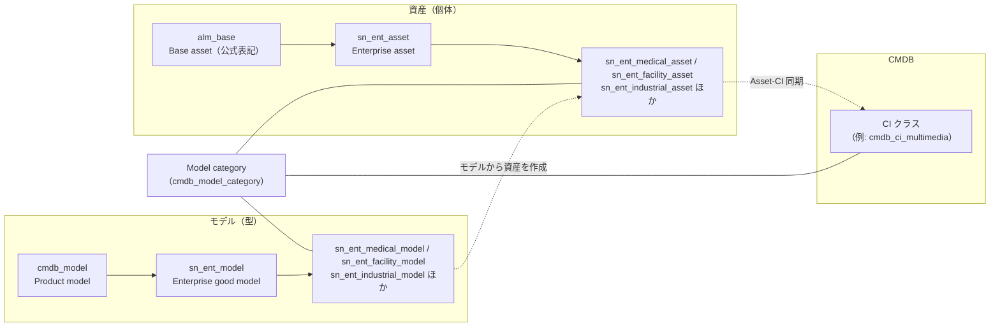
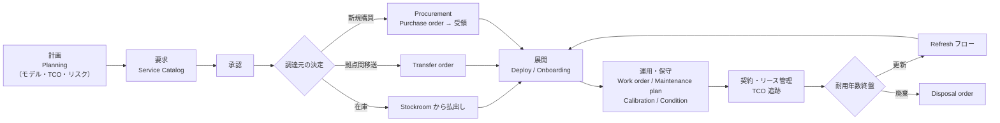
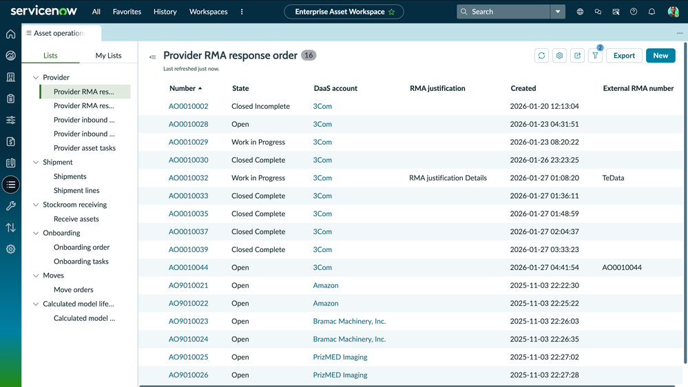
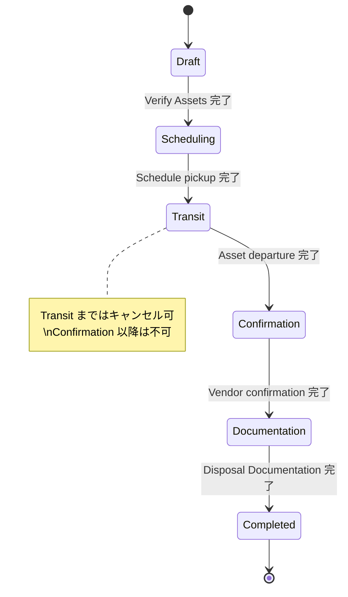
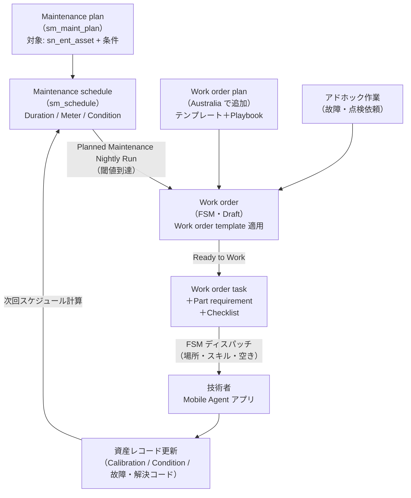
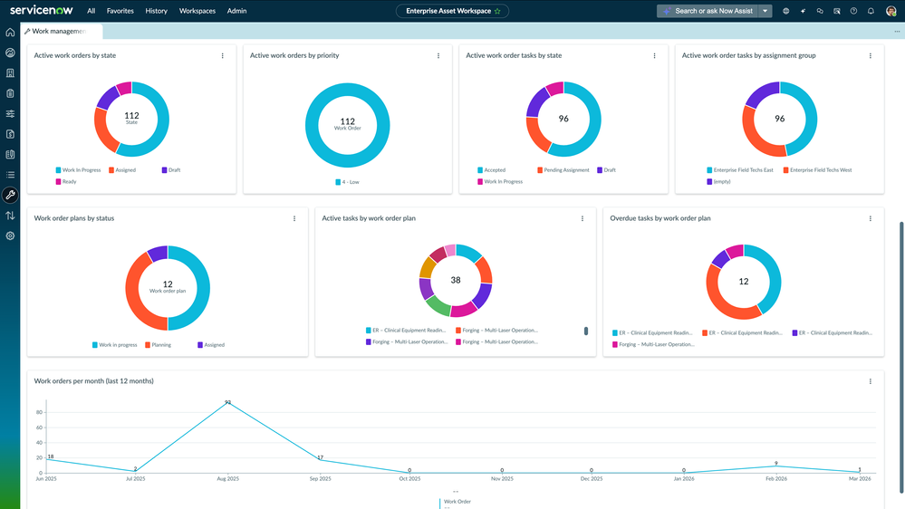
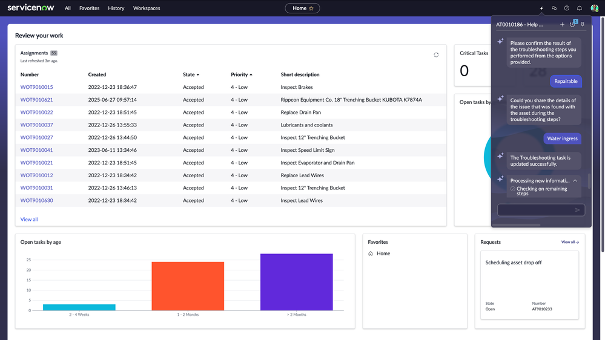
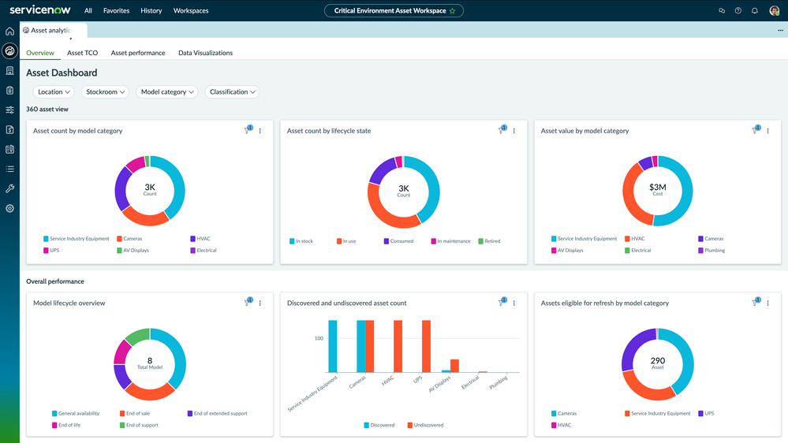
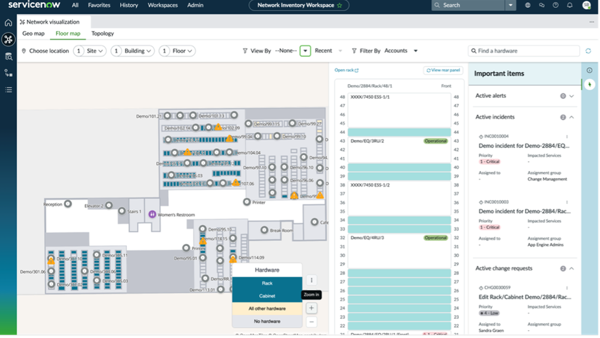

# Enterprise Asset Management（EAM、エンタープライズ資産管理）

## 概要

**Enterprise Asset Management（EAM、エンタープライズ資産管理）** は、ServiceNow AI Platform 上で **IT 以外の物理資産**（工場設備、車両、建設機械、医療機器、施設設備、データセンターの電源・空調設備など）の「計画 → 調達 → 展開 → 保守 → 廃棄」までのライフサイクルを、規定のワークフローで自動化する業務アプリケーションである。公式ドキュメントは EAM を「接続型・非接続型のエンタープライズ資産のライフサイクル全体を管理するビジネスアプリケーション」と定義し、目的として資産の利益（Return on assets）の最大化、資本コントロール、運用コスト削減、リスク低減、ダウンタイム削減と稼働率向上、資産寿命の延長を挙げている。[出典](https://www.servicenow.com/docs/r/it-asset-management/enterprise-asset-management/enterprise-asset-management.html) [出典](https://www.servicenow.com/docs/r/it-asset-management/enterprise-asset-management/exploring-eam.html)

EAM の主な特徴は次のとおり。

- **ServiceNow Store アプリ**として提供される（アプリ名「ServiceNow Enterprise Asset Management」、`com.sn_eam`、スコープ `sn_eam`）。Zurich 以降は Admin Home ページからもインストールできる。[出典](https://www.servicenow.com/docs/r/pyt4lF0aAin_R6wVyV414Q/pWrxz~SFJYFbJo_4d38D2Q) [出典](https://www.servicenow.com/docs/r/australia/delta-xanadu-australia/australia-xanadu-enterpriseassetmanagement-release-notes.html)
- データモデルは Store アプリ **Expanded Model and Asset Classes**（`sn_ent`）が提供する `sn_ent_model`（Enterprise good model）と `sn_ent_asset`（Enterprise asset）系クラスを使う。[出典](https://www.servicenow.com/docs/r/pyt4lF0aAin_R6wVyV414Q/iGTaRjff3OXmf~GVT9AWmQ)
- 業務 UI は **Enterprise Asset Workspace**（Next Experience のワークスペース）に集約されている。[出典](https://www.servicenow.com/docs/r/xUi4EDRoQXDqROOshinXwQ/kKjNKnd0eoS09HaSKTap9A)
- 保守作業（作業指示：Work order）は **Field Service Management（FSM）** の Work order / Work order task と、**SM Planned Maintenance** の保守計画（Maintenance plan）基盤を利用する。[出典](https://www.servicenow.com/docs/r/1zMxrAxr2iK81FYv03BwFA/UmmWmaDiKZwg6idBlpOu~w)
- 関連製品は Field Service Management、Contract Management、Procurement（購買）である。[出典](https://www.servicenow.com/docs/r/7GoNY9eeDRD0FzxldbEmXw/RRHKkI9GU908aPjGhA2dxA)

ITAM 全体における EAM の位置づけは [ITAM 概要](./itam-overview.md)、IT ハードウェアの管理は [Hardware Asset Management](./hardware-asset-management.md) を参照。なお SPM 領域の「EAM」は **Enterprise Architecture Management**（エンタープライズアーキテクチャ管理）の略であり、本ファイルの Enterprise Asset Management とは別製品である（[Agile Development・APM・EAM](../spm/agile-apm-eam.md) を参照）。

### 本ファイルの基準とバージョン表記

- 基準リリースは **Australia**（2026-05 GA）。EAM は Store アプリのため、ファミリーリリースとは別に **アプリバージョン**（例：10.0.0 = 2026-03、Australia 対応）を持つ。本文では両方を併記する。[出典](https://www.servicenow.com/docs/r/C17ZqvSaMwUVpMBg8Nc5sg/yQjG6o6LNmzDny6wA1zQEA)
- 公式ドキュメントの一部ページは Australia 版が取得できず、Zurich / Xanadu / Brazil 版を参照した。その場合は節ごとに「（Zurich 版ドキュメント）」等と明記する。

---

## 1. EAM の対象資産と提供アプリ構成

### 1.1 対象資産

EAM の対象は「物理的なビジネス資産」であり、公式ドキュメントでは家具・車両・機械・施設設備・医療機器・OT（Operational Technology）機器などが想定されている。Expanded Model and Asset Classes が提供する資産クラスから、対象の業種・資産タイプは以下のように整理できる。[出典](https://www.servicenow.com/docs/r/pyt4lF0aAin_R6wVyV414Q/iGTaRjff3OXmf~GVT9AWmQ)

| 資産タイプ | 資産クラス（テーブル） | 例 【推定】 |
|---|---|---|
| Medical（医療） | `sn_ent_medical_asset` | 医療機器、画像診断装置 |
| Facility（施設） | `sn_ent_facility_asset` | 空調（HVAC）、UPS、電気設備、監視カメラ、AV 機器 |
| Transportation（輸送） | `sn_ent_transportation_asset` | 車両、フォークリフト、航空機部品 |
| Industrial（産業） | `sn_ent_industrial_asset` | 製造装置、ポンプ、コンプレッサー |
| Retail（小売） | `sn_ent_retail_asset` | POS 周辺機器、店舗什器 |
| Tactical equipment（戦術装備） | `sn_ent_tactical_asset` | 公共安全・防衛向け装備 |
| Construction（建設） | `sn_ent_construction_asset` | 建設機械 |
| Wearable（ウェアラブル） | `sn_ent_wearable_asset` | 作業者向け装着型デバイス |
| Multimedia production equipment（映像制作機材） | `sn_ent_mm_prod_equip_asset` | カメラ、照明、音響機材（Australia / EAM 10.0.0 で追加） |
| System and smart card（システム・スマートカード） | `sn_ent_sys_smart_card_asset` | IC カード、認証用カード |
| Linear asset（線形資産） | `sn_eam_linear_asset` / `sn_eam_linear_segment` | 道路、鉄道、パイプライン、送電線 |

「例」列は資産クラス名からの推定であり、公式ページが列挙する具体例ではない。

### 1.2 EAM 系アプリケーション一覧

Australia の EAM リリースノートは、ServiceNow Store から以下のアプリをリクエストしてインストールするよう案内している。[出典](https://www.servicenow.com/docs/r/7GoNY9eeDRD0FzxldbEmXw/RRHKkI9GU908aPjGhA2dxA)

| アプリ | 概要 | 主な導入リリース |
|---|---|---|
| Enterprise Asset Management（`com.sn_eam`） | EAM 本体。Enterprise Asset Workspace、資産・モデル・在庫・契約・作業管理 | 2.0.0（2022-08）を初期リリースとして記載 |
| Enterprise Asset Management for Healthcare（`com.sn_eamhc`） | 医療資産用のワークスペース構成とロール（Medical asset manager 等） | Xanadu（EAM 7.0.0） |
| Enterprise Asset Management for Facilities | 施設資産用のワークスペース構成とロール | Xanadu（EAM 7.0.0） |
| OT Asset Management（OTAM） | OT / OE（Operational Equipment）資産を OT Asset Workspace で管理 | Xanadu |
| EAM for Data Center and Network Asset Management（DCNAM） | データセンター・ネットワーク設備（ラック、電源、冷却等）。EAM と Network Inventory を統合 | 統合リリースノートでは Yokohama の項に記載。Store 版では EAM 9.0.2（2025-12、Zurich 期）で新アプリとして提供 |
| EAM for Providers | Asset-as-a-Service 提供者向けの RMA（返品）ワークフロー | 同上（統合リリースノートでは Yokohama、Store 版は 9.0.2・2025-12） |
| Expanded Model and Asset Classes（`sn_ent`） | EAM が使うモデル・資産クラス、モデルカテゴリを提供 | Rome 以降互換 |

出典：[EAM Store リリースノート](https://www.servicenow.com/docs/r/C17ZqvSaMwUVpMBg8Nc5sg/yQjG6o6LNmzDny6wA1zQEA)、[EAM for Healthcare の構成要素](https://www.servicenow.com/docs/r/pyt4lF0aAin_R6wVyV414Q/pWrxz~SFJYFbJo_4d38D2Q)、[Expanded Model and Asset Classes](https://www.servicenow.com/docs/r/xUi4EDRoQXDqROOshinXwQ/mzIrzC6RsFHd8MviAhvVNQ)、[Xanadu EAM リリースノート](https://www.servicenow.com/docs/r/3ongaT2PAVB3Cqoicgnoxg/OoNlHHXcGZqLJ1QS2ji5ag)

- **Enterprise Asset Management Advanced** は「EAM と AI 搭載フローを 1 つのアプリでデプロイする」Store アプリで、1.0.0（2026-04）、2.0.0（2026-09）がリリースされている。2.0.0 で ServiceNow Otto for EAM のサポート、資産要求・修理・資産データ読み込みの AI 体験が追加された。[出典](https://www.servicenow.com/docs/r/C17ZqvSaMwUVpMBg8Nc5sg/JjVH7Lfeg~izarCc0Pbk4A)
- EAM for Facilities のロール接頭辞は、ドキュメントにより `sn_eamhc.facility_asset_manager` と `sn_eamfam.facility_asset_manager` の両表記があり、公開情報では確定できなかった。実インスタンスで確認すること。

---

## 2. データモデル

### 2.1 基本構造（Model・Asset・CI の三層）

EAM のデータモデルは、**Enterprise model class（エンタープライズモデルクラス）**、**Enterprise asset class（エンタープライズ資産クラス）**、**CMDB CI class（CI クラス）** の 3 つの構造要素で構成される。公式ドキュメントの要点は以下のとおり（Brazil 版ドキュメント）。[出典](https://www.servicenow.com/docs/r/it-asset-management/enterprise-asset-management/eam-data-model.html)

- すべての Enterprise asset は Enterprise model から作成される。Model は資産の「型」（標準化された定義）、Asset は実際に追跡する物理的な個体である。
- **Model category（モデルカテゴリ）** が、資産タイプごとに 1 つの Model class・1 つの Asset class・1 つの CI class を結び付ける。
- **Model type（モデルタイプ）** により、モデルが単体資産・数量管理の消耗品（Consumable）・複数コンポーネントの組立品のいずれを表すかが決まる。
- 拡張されたモデルクラスは親モデルクラスの属性を継承する。

> **注記（`alm_asset` との関係）:** Australia 版の公式ページは、`sn_ent_asset` の親を「Base asset [alm_base]」と表記している。HAM の `alm_hardware` のように `alm_asset`（Asset）を直接拡張するという記述は公開情報では確認できなかった。ただし EAM 資産フォームの State 値（In use、In stock 等）・Financial・Depreciation・Disposal 等の項目は HAM の資産（`alm_asset` 系）と共通であり、ITAM 共通のアセット基盤上にあることは明らかである。継承関係を厳密に確認する場合は、インスタンスの `sys_db_object`（Tables）で `sn_ent_asset` の Extends table を確認すること。[出典](https://www.servicenow.com/docs/r/pyt4lF0aAin_R6wVyV414Q/iGTaRjff3OXmf~GVT9AWmQ) [出典](https://www.servicenow.com/docs/r/pyt4lF0aAin_R6wVyV414Q/b5F9kQcOV9PJleLtn5lKtA)

ITAM 共通のアセット・CI 同期の仕組み（`alm_asset` と `cmdb_ci` の同期、Model category の役割）は [ITAM 概要](./itam-overview.md) と [CMDB と CSDM](../platform/cmdb-csdm.md) を参照。

### 2.2 Enterprise model classes（モデルクラス）

Australia 版の公式ページが列挙する Enterprise model class は次のとおり。[出典](https://www.servicenow.com/docs/r/pyt4lF0aAin_R6wVyV414Q/iGTaRjff3OXmf~GVT9AWmQ)

| Label | テーブル名 | 親クラス |
|---|---|---|
| Enterprise good model | `sn_ent_model` | Product model [`cmdb_model`] |
| Firmware model | `sn_ent_firmware_model` | Product model [`cmdb_model`] |
| Discovered firmware model | `sn_ent_discov_firmware_model` | Product model [`cmdb_model`] |
| Medical model | `sn_ent_medical_model` | Enterprise good model [`sn_ent_model`] |
| Medical device model | `sn_ent_medical_device_model` | Enterprise good model [`sn_ent_model`]（※コミュニティ投稿では `sn_ent_medical_model` を拡張と記載） |
| Medical drug model | `sn_ent_drug_model` | Enterprise good model |
| Facility model | `sn_ent_facility_model` | Enterprise good model |
| Transportation model | `sn_ent_transportation_model` | Enterprise good model |
| Industrial model | `sn_ent_industrial_model` | Enterprise good model |
| Retail model | `sn_ent_retail_model` | Enterprise good model |
| Tactical equipment model | `sn_ent_tactical_model` | Enterprise good model |
| Construction model | `sn_ent_construction_model` | Enterprise good model |
| Wearable model | `sn_ent_wearable_model` | Enterprise good model |
| Multimedia production equipment model | `sn_ent_mm_prod_equip_model` | Enterprise good model |
| System and smart card model | `sn_ent_system_smart_card_model` | Enterprise good model |
| Payment card model | `sn_ent_payment_card_model` | Enterprise good model |

- EAM アプリケーションがサポートするモデルクラスは Enterprise good model、Firmware model、Discovered firmware model の 3 つ（およびその子クラス）である。[出典](https://www.servicenow.com/docs/r/pyt4lF0aAin_R6wVyV414Q/iGTaRjff3OXmf~GVT9AWmQ)
- **消耗品（Consumable）** は CMDB の Consumable model クラスでは分類せず、Enterprise model レコードの **Model type** フィールドを Consumable に設定して扱う。[出典](https://www.servicenow.com/docs/r/pyt4lF0aAin_R6wVyV414Q/iGTaRjff3OXmf~GVT9AWmQ)
- Medical device model の資産では、**PID（Product Instance Identifier）** によって資産・CI・IBI（Install Base Item）クラスが連携する。[出典](https://www.servicenow.com/docs/r/pyt4lF0aAin_R6wVyV414Q/iGTaRjff3OXmf~GVT9AWmQ)
- **Zurich での変更:** `sn_ent_model` の Classification（`classification`）列は非推奨となり、新しい分類フィールドに置き換えられた。[出典](https://www.servicenow.com/docs/r/australia/delta-xanadu-australia/australia-xanadu-enterpriseassetmanagement-release-notes.html)
- コミュニティ投稿では、`com.sn_ent` の Expanded Model and Asset Classes が一覧上 2.16.0 として言及されている。最新版は 2.17.1（2026-09）である（[ITAM 概要](./itam-overview.md) 参照）。

### 2.3 Enterprise asset classes（資産クラス）

| Label | テーブル名 | 親クラス |
|---|---|---|
| Enterprise asset | `sn_ent_asset` | Base asset [`alm_base`]（公式表記） |
| Medical asset | `sn_ent_medical_asset` | Enterprise asset [`sn_ent_asset`] |
| Facility asset | `sn_ent_facility_asset` | Enterprise asset |
| Transportation asset | `sn_ent_transportation_asset` | Enterprise asset |
| Industrial asset | `sn_ent_industrial_asset` | Enterprise asset |
| Retail asset | `sn_ent_retail_asset` | Enterprise asset |
| Tactical equipment asset | `sn_ent_tactical_asset` | Enterprise asset |
| Construction asset | `sn_ent_construction_asset` | Enterprise asset |
| Wearable asset | `sn_ent_wearable_asset` | Enterprise asset |
| Multimedia production equipment asset | `sn_ent_mm_prod_equip_asset` | Enterprise asset |
| System and smart card asset | `sn_ent_sys_smart_card_asset` | Enterprise asset |
| Linear asset | `sn_eam_linear_asset` | 公式ページに記載なし |
| Linear segment | `sn_eam_linear_segment` | Linear asset [`sn_eam_linear_asset`] |

出典：[Enterprise model and asset classes（Australia）](https://www.servicenow.com/docs/r/pyt4lF0aAin_R6wVyV414Q/iGTaRjff3OXmf~GVT9AWmQ)

- System and smart card asset のテーブル名は、リリースノートでは `sn_ent_system_smart_card_asset`、クラス一覧では `sn_ent_sys_smart_card_asset` と表記が揺れている。スクリプトで参照する前にインスタンスで確認すること。
- EAM の Facility 系機能は `sn_ent_facility_asset`（Enterprise asset の子クラス）配下の資産のみをサポートする。

### 2.4 Expanded Model and Asset Classes アプリ

**Expanded Model and Asset Classes** は、ServiceNow 標準の新しいモデル・資産クラスを一元提供する Store アプリである（Rome 以降互換）。Australia 版ドキュメントによると次を提供する。[出典](https://www.servicenow.com/docs/r/xUi4EDRoQXDqROOshinXwQ/mzIrzC6RsFHd8MviAhvVNQ)

- `cmdb_model` と資産基底クラスを拡張する Enterprise model / asset クラス
- 金融・保険・社会給付・調査サービス用の Service model サブクラス
- Contract model の子としての Permit model（許認可）
- Firmware model / Discovered firmware model と Firmware installation テーブル
- AI model クラス（AI system component、AI content、AI digital asset）
- モデル・資産クラスを CMDB CI クラスに結び付ける Model category（API / Managed API 用のカテゴリを含む）

注意点：

- EAM でエンタープライズモデル・資産クラスを使うには、このアプリを ServiceNow Store からインストールする必要がある。[出典](https://www.servicenow.com/docs/r/pyt4lF0aAin_R6wVyV414Q/iGTaRjff3OXmf~GVT9AWmQ)
- 既存インスタンスに導入すると、ユーザー定義のモデルカテゴリ（例：`alm_hardware` を指す「AV Equipment」）と、新しい標準カテゴリ（`sn_ent_facility_asset` / `cmdb_ci_multimedia` を指すもの）が同名で重複する事例がコミュニティで報告されている。EAM を利用・予定する場合はユーザー定義側のラベル変更が推奨されている。【第三者情報】[出典](https://www.servicenow.com/community/cmdb-forum/asset-tables-with-prefix-sn-ent/m-p/2959570)
- EAM ライセンスのない ITSM Pro インスタンスでも本アプリはインストールできるが、資産作成時に `sn_ent` 系の資産クラスを選択できない（モデルは作成可能）という報告がある。投稿者はカタログアイテム＋Flow で回避したが、標準チェックを迂回するため慎重な検証が必要である。【第三者情報】[出典](https://www.servicenow.com/community/ham-forum/expanded-model-and-asset-classes-best-practices-for-managing-in/m-p/3316050)

### 2.5 Model category（モデルカテゴリ）

Model category（`cmdb_model_category`）は、モデルクラス・資産クラス・CI クラスの組み合わせを定義し、資産の自動作成（Asset-CI 同期）の可否を決める。EAM では Enterprise Asset Workspace の Admin center から作成する。

- **ロール:** `sn_eam.enterprise_admin` または `sn_eam.enterprise_asset_manager`
- **メニュー:** Enterprise Asset Workspace > Admin center > Model categories > New
- 作成後は **Product Models** タブで追加設定できる。

出典：[Create model categories（Australia）](https://www.servicenow.com/docs/r/pyt4lF0aAin_R6wVyV414Q/APhT13AlXrwrALmmTvEwfQ)

| フィールド | 説明 |
|---|---|
| Name（名前） | Service Catalog に表示されるカテゴリ名 |
| Parent category（親カテゴリ） | 上位のモデルカテゴリ |
| UNSPSC code | 国連標準製品サービス分類コード |
| Picture or icon | Service Catalog に表示する画像 |
| CI class（CI クラス） | 関連付ける CMDB CI クラス。**作成時にのみ選択可能で、後から変更不可** |
| Product model class（製品モデルクラス） | 関連付けるモデルクラス |
| Asset class（資産クラス） | Enterprise Asset 等の既定クラス、またはカスタムクラス。**一度選択すると変更不可**。Consumable / Software License を選ぶと CI class は読み取り専用になり None にリセットされる（CI を作らないため） |
| Allow pre-allocation | 事前割当資産として追加・追跡可能にする |
| Allow in bundle | バンドルの構成要素として使用可能にする |
| Allow as main | バンドルのメインコンポーネントとして使用可能にする |
| Is product instance | Product instance で資産・CI・Install base item を識別・同期するか |
| Enforce CI verification（CI 検証の強制） | 手動作成や Discovery で発見された CI からの資産自動作成を止め、事前レビューを可能にする |

- Allow pre-allocation / Allow in bundle / Allow as main は資産クラスに関連付けられたカテゴリにのみ適用され、エンタープライズモデルカテゴリには適用されない。
- 資産クラスが設定済みのカテゴリに CI クラスを関連付けると、**Asset and CI synchronization** が自動実行され、その CI クラス配下の全 CI について資産が作成される。
- 最新（Brazil 版）の概念ページでは、モデルカテゴリは **2 階層**（トップレベル親＋子）であり、トップレベルは既存のものだけを使い、適合する子がない場合は既存の親の下にカスタム子カテゴリ（親・モデルクラス・資産クラス・任意で CI クラスを指定）を作ると説明されている。CI クラスは 1 つのモデルカテゴリにのみ割り当て可能（割当は任意）。[出典](https://www.servicenow.com/docs/r/it-asset-management/enterprise-asset-management/eam-data-model.html)

### 2.6 Model type と資産タイプ（複数コンポーネント）

EAM 資産フォームの **Asset type** フィールドは、複数コンポーネント資産の種類を示す。値は次の 6 種。[出典](https://www.servicenow.com/docs/r/pyt4lF0aAin_R6wVyV414Q/b5F9kQcOV9PJleLtn5lKtA)

| Asset type | 意味 |
|---|---|
| Simple | 単体資産 |
| Simple with add-on | 単体資産＋追加部品 |
| Pre-assembled | メーカー出荷時点で組み立て済みの複合資産 |
| Pre-assembled with add-on | 組立済み複合資産＋追加部品 |
| User-assembled | 利用者側で組み立てる複合資産 |
| User-assembled with add-on | 利用者組立複合資産＋追加部品 |

- 子資産（Parent が設定された資産）の割当・状態フィールドは読み取り専用となり、親資産に追随する。
- Xanadu 以降、Model フォームでモデル階層（Pre-assembled / User-assembled のコンポーネント）をツリー表示でき、Enterprise model management ビューに子資産の **Swap**（交換）と **Release assets**（切り離し）操作がある。[出典](https://www.servicenow.com/docs/r/3ongaT2PAVB3Cqoicgnoxg/OoNlHHXcGZqLJ1QS2ji5ag)
- **Pallet（パレット）** モデル・資産は、8.1.0（2025-02）で専用の Pallet タブが廃止され、All models / All assets タブに統合された。廃棄オーダーの対象は「エンタープライズモデルまたはパレットモデルに紐づく資産」である。[出典](https://www.servicenow.com/docs/r/C17ZqvSaMwUVpMBg8Nc5sg/yQjG6o6LNmzDny6wA1zQEA) [出典](https://www.servicenow.com/docs/r/pyt4lF0aAin_R6wVyV414Q/RK2FGhop2Rk4CIOjCphQkw)

### 2.7 Linear asset（線形資産）と Asset group（資産グループ）

- **Linear asset（線形資産）** は道路・線路・配管のように線状に延びる資産で、`sn_eam_linear_asset` と区間を表す `sn_eam_linear_segment` で管理する。EAM 5.0.1（2023-08）で Google Maps 連携の線形資産が導入された。線形資産に対する作業指示では **Start marker / End marker** で作業区間を指定する。[出典](https://www.servicenow.com/docs/r/pyt4lF0aAin_R6wVyV414Q/iGTaRjff3OXmf~GVT9AWmQ) [出典](https://www.servicenow.com/docs/r/C17ZqvSaMwUVpMBg8Nc5sg/yQjG6o6LNmzDny6wA1zQEA) [出典](https://www.servicenow.com/docs/r/it-asset-management/enterprise-asset-management/create-eam-work-order.html)
- Admin center の **Create linear asset types** で線形資産タイプを定義する。[出典](https://www.servicenow.com/docs/r/xanadu/it-asset-management/enterprise-asset-management/admin-center-overview-eam.html)
- **Asset group（資産グループ）** は機能的な関係と物理的な配置で資産をまとめる仕組みで、Zurich（EAM 9.0.0）で **階層型資産グループと依存関係マッピング** が追加された。Australia（10.0.0）では資産グループ単位で作業指示を発行でき、作業指示の **Affected assets** タブにグループ（親グループ・サブグループを含む）配下の全資産が表示される。[出典](https://www.servicenow.com/docs/r/it-asset-management/enterprise-asset-management/eam-data-model.html) [出典](https://www.servicenow.com/docs/r/7GoNY9eeDRD0FzxldbEmXw/RRHKkI9GU908aPjGhA2dxA)

### 2.8 その他の関連テーブル

公式ドキュメントで確認できた EAM / ITAM 共通の関連テーブル。

| テーブル | 用途 | 出典 |
|---|---|---|
| `sn_itam_common_shipment` | 出荷（Shipment）。`ignore_stale_check` 列あり | [出典](https://www.servicenow.com/docs/r/xUi4EDRoQXDqROOshinXwQ/8bJA1CfionWqTOXkF4OyHw) |
| `sn_itam_carrier_int_profile` | 配送業者連携プロファイル | 同上 |
| `itam_aia_log` | ITAM AI エージェントログ | 同上 |
| `itam_licensing_resource_counts` | ITAM ライセンスのリソース数・消費サブスクリプション数 | [出典](https://www.servicenow.com/docs/r/pyt4lF0aAin_R6wVyV414Q/1KBJGp1cFSxBdANk1X7o0Q)（DCNAM の消費確認ページ） |
| `alm_consumable` | 消耗品（Consumable） | ITAM 共通（[ITAM 概要](./itam-overview.md)） |
| `sm_maint_plan` / `sm_schedule` / `sm_m2m_maint_plan_to_record` / `sm_m2m_schedule_template` | 保守計画・保守スケジュール（SM Planned Maintenance） | [出典](https://www.servicenow.com/docs/r/3qjO_fir2JvVQpXZx3xbkw/Iq9YXt987xzzMlGLPAnbXw) |

- `sn_eam.enterprise_admin` がアクセスできる「HAM・EAM 共通テーブル」として、RFID connection attributes、RFID staging asset、Repair order、Repair order line、Asset order、Asset order line、Loaner asset order の各テーブルが挙げられている（テーブル名は公式ページの表記がラベルのみで、システム名は公開情報では確認できず）。[出典](https://www.servicenow.com/docs/r/xUi4EDRoQXDqROOshinXwQ/8bJA1CfionWqTOXkF4OyHw)
- 作業指示（Work order）・作業指示タスクは FSM のテーブルを利用する（FSM のテーブル構成は [Field Service Management](../customer/field-service-management.md) 参照）。EAM 側ドキュメントにはテーブル名の明示がない。

---

## 3. 資産フォームのフィールド（Enterprise asset）

Australia 版の「Asset fields for enterprise assets」の主要項目。[出典](https://www.servicenow.com/docs/r/pyt4lF0aAin_R6wVyV414Q/b5F9kQcOV9PJleLtn5lKtA)

### 3.1 Asset Details（資産詳細）

| フィールド | 説明 |
|---|---|
| Display name | Asset tag と Model から自動設定される表示名 |
| Model / Model category | 製品モデル／モデルカテゴリ（CI と連携可能かを決定） |
| Parent | 親資産。設定時、子の割当・状態は親に追随 |
| Asset type | Simple、Pre-assembled 等（2.6 節） |
| Asset tag / Serial number | 組織が付与する資産タグ／シリアル番号 |
| Configuration item | 資産と同時に自動作成される CI（Serial number と Model から命名） |
| State（状態） | 新規資産は **Build**。他に On order、In stock、In transit、In use、In maintenance、Retired、Missing、**Consumed**（消耗品をユーザーに割り当てた後。EAM 6.1.2 で In use から Consumed に変更。[出典](https://www.servicenow.com/docs/r/C17ZqvSaMwUVpMBg8Nc5sg/yQjG6o6LNmzDny6wA1zQEA)） |
| Substate（サブ状態） | Available、Reserved 等。State に依存 |
| Asset function | Primary、Secondary、Shared、Loaner |
| Stockroom / Aisle and space | 保管場所（State=In stock 時）／棚番（In stock または Build 時） |
| Reserved for | 予約先ユーザー（In stock / In transit 時） |
| Quantity | 通常 1。消耗品と事前割当資産は複数 |
| Eligible for refresh | モデルの Useful life に基づき更新対象かを示す |
| Location | 所在地。最大 3 階層のロケーション階層が設定される |
| Assigned to / Assigned / Installed | 使用者・責任者と割当日・設置日（Assigned to は In use 時に表示） |
| Managed by / Owned by | 保守担当者／財務上の所有者 |
| Warranty expiration | 保証期限 |
| Company / Department | 所属会社／部門 |
| RFID tag | RFID タグ。子資産は親のタグを継承 |
| MAC address | Asset テーブルの MAC address から設定（消耗品・パレットでは非表示） |
| Support group / Supported by | 支援グループ／担当者 |

### 3.2 財務・償却・リース・廃棄・監査・RFID

| セクション | 主なフィールド |
|---|---|
| Financial（財務） | Vendor、Invoice number、GL account、Request line、Cost、Cost center、**Acquisition method**（Purchase / Lease / Rental / Loan / RMA Replacement）、PO number |
| Depreciation（償却） | Depreciation（Declining Balance / Straight Line、モデルから既定値）、Depreciation effective date、Residual date、Residual value、Salvage value（Cost 以下）、Depreciated amount |
| Lease Contract（リース契約） | Lease contract、Lease expiration date、Lease term (months)、Monthly lease payment |
| Disposal（廃棄） | Disposal order number、Disposal vendor、Scheduled retirement、Retired date、Vendor disposal order ID、Resale price、Disposal date、Beneficiary（寄付先） |
| Asset Audit（監査） | Audit number、Audit type、Last audit date、Last audit state、Audited by |
| RFID | Type、Tag source、Last blink time、Latitude / Longitude、Site name、Zone group / Zone と滞留時間、Grid-x/y/z、Status（Matched / Unmatched） |
| Device as a Service | DaaS asset、DaaS account |

- Activities の Work notes には、Assigned to・State・Substate・Reserved の変更や PO / Transfer order 受領が自動記録される。
- Zurich で資産フォームに **Inventory availability** タブが追加された。[出典](https://www.servicenow.com/docs/r/australia/delta-xanadu-australia/australia-xanadu-enterpriseassetmanagement-release-notes.html)
- 公式の資産フィールドページには、リスクスコアやメーター値のフィールドは記載されていない（公開情報では確認できず）。リスクは Admin center で Likelihood / Impact / Risk score を設定する機能として提供される（6.4 節）。

---

## 4. ライフサイクル（調達から廃棄まで）

### 4.1 全体フロー

公式ドキュメント（Exploring EAM）が示す EAM の標準ワークフローは以下のとおり（Brazil 版ドキュメント、Figure 1）。[出典](https://www.servicenow.com/docs/r/it-asset-management/enterprise-asset-management/exploring-eam.html)

1. 利用者が **Service Catalog** から資産を要求する。
2. 要求が承認に回る。
3. 承認後、資産マネージャーが調達元を決定する：**ローカル Stockroom から払出し / 他拠点からの Transfer（移送） / 新規購買（Purchase order）**。
4. Purchase order 受領後、フィールド技術者が資産を **展開（Deploy）** する。
5. 保守は **Work order / Work order task** で追跡する。
6. 契約（満了間近・満了済みを含む）を作成・管理する。
7. **TCO（Total Cost of Ownership、総所有コスト）** を追跡する。
8. 耐用年数の終盤に、資産マネージャーが **更新（Refresh フロー）** か **廃棄（Disposal フロー）** を選ぶ。

ITAM 全体の資産ライフサイクルは「Procurement → Deployment → Maintenance → Retirement」と説明され、EAM はこれに **Planning（計画）** と **Disposal（処分）** を加える（[ITAM 概要](./itam-overview.md) 参照）。

### 4.2 状態（State）とサブ状態

EAM 資産の State は **Build（新規作成時）、On order、In stock、In transit、In use、In maintenance、Retired、Missing** である。消耗品（Consumable）はユーザーへの割当後に **Consumed** となる（EAM 6.1.2、2024-10 で In use から Consumed に変更）。Substate は State に依存し、Available、Reserved、Pending disposal、Disposed などがある。[出典](https://www.servicenow.com/docs/r/pyt4lF0aAin_R6wVyV414Q/b5F9kQcOV9PJleLtn5lKtA) [出典](https://www.servicenow.com/docs/r/pyt4lF0aAin_R6wVyV414Q/RK2FGhop2Rk4CIOjCphQkw) [出典](https://www.servicenow.com/docs/r/C17ZqvSaMwUVpMBg8Nc5sg/yQjG6o6LNmzDny6wA1zQEA)

- EAM 7.0.3（2024-11）で「In use の資産はロケーション必須」となった。8.1.1 で State-Substate の検証が追加された。[出典](https://www.servicenow.com/docs/r/C17ZqvSaMwUVpMBg8Nc5sg/yQjG6o6LNmzDny6wA1zQEA)
- State / Substate の組み合わせ全体（HAM と共通の定義）は [Hardware Asset Management](./hardware-asset-management.md) を参照。

### 4.3 要求・調達（Acquire / Procure）

- 資産要求は **Service Catalog** から起票する。Zurich で **Enterprise catalog categories**（エンタープライズ用カタログカテゴリ）が追加され、「Product catalogs」メニューは「**Product catalog items**」に改称された。[出典](https://www.servicenow.com/docs/r/australia/delta-xanadu-australia/australia-xanadu-enterpriseassetmanagement-release-notes.html)
- 調達（ソーシング・受入）は **Procurement** アプリケーションを使う。EAM のランディングページは「Acquire：Procurement アプリで要求資産を調達・受領」と説明する。[出典](https://www.servicenow.com/docs/r/it-asset-management/enterprise-asset-management/enterprise-asset-management.html)
- Australia の EAM ブログは、Now Assist（ServiceNow Otto）for EAM の機能として、承認済み資産要求に対し **在庫から払出し・他拠点から移送・購買** の最適な調達経路を AI エージェントが自律判断する「**Help manage enterprise asset requests**」エージェント型ワークフローを紹介している（サプライヤー調査、見積比較、購買依頼処理まで）。[出典](https://www.servicenow.com/community/eam-blog/what-s-new-in-australia-release-for-enterprise-asset-management/ba-p/3535775) 提供は **Enterprise Asset Management Advanced** アプリで、Store リリースノートでは 2.0.0（2026-09）で ServiceNow Otto for EAM のサポートと AI 資産要求体験が追加されたと記載されている。[出典](https://www.servicenow.com/docs/r/C17ZqvSaMwUVpMBg8Nc5sg/JjVH7Lfeg~izarCc0Pbk4A) 特定のパッチ（Patch 1 等）での提供開始は公開情報では確認できず。
- 受入：Zurich（9.0.0）で **統一された Stockroom 受入プロセス**、受入ベイから棚番（Aisle-space）までの **Asset put away（格納）** 追跡が追加された。Advanced Shipment Notification（ASN、事前出荷通知）は 4.0.0 で導入。[出典](https://www.servicenow.com/docs/r/C17ZqvSaMwUVpMBg8Nc5sg/yQjG6o6LNmzDny6wA1zQEA)

購買の詳細は [Finance・Supply Chain・その他ワークフロー](../other/finance-supply-chain-esg.md) を参照。

### 4.4 展開（Onboarding）

- **Asset onboarding playbook** により、単体またはバルクで資産をオンボーディングできる（6.0.0 で複数資産オンボーディング、Xanadu で Enterprise Asset Workspace から複数資産の Onboarding order 作成、展開タスクとロケーション指定）。[出典](https://www.servicenow.com/docs/r/3ongaT2PAVB3Cqoicgnoxg/OoNlHHXcGZqLJ1QS2ji5ag)
- 資産・モデルの一括登録は **Bulk import**。**AI-assisted bulk import**（AI による列・値マッピング、取込前検証・レビュー）と **Seeded import templates**（ガイド付き標準テンプレート）は、Xanadu→Australia 統合リリースノートでは Zurich の項に記載されているが、Store 版では **EAM 11.0.0（2026-09、Brazil 期）** で提供された。Australia 基準の環境で利用するには Store 11.0.0 以上へのアップグレードが必要と考えられる【推定】。11.0.0 ではステージングテーブル由来の旧インポートテンプレートが Seeded テンプレートに置き換えられた。[出典](https://www.servicenow.com/docs/r/C17ZqvSaMwUVpMBg8Nc5sg/yQjG6o6LNmzDny6wA1zQEA) [出典](https://www.servicenow.com/docs/r/australia/delta-xanadu-australia/australia-xanadu-enterpriseassetmanagement-release-notes.html)
- Asset move（移動）フローは 5.0.1 で導入。[出典](https://www.servicenow.com/docs/r/C17ZqvSaMwUVpMBg8Nc5sg/yQjG6o6LNmzDny6wA1zQEA)

### 4.5 運用・保守

保守計画・作業指示・校正・状態評価は第 5 章で詳述する。

### 4.6 回収（Reclamation）・RMA・リコール・貸出

| プロセス | 概要 | 出典 |
|---|---|---|
| Reclamation（回収） | 従業員の退職・異動時に資産を回収し、Reclamation request をクローズ | [出典](https://www.servicenow.com/docs/r/1zMxrAxr2iK81FYv03BwFA/il7iJ0qMyCsGt53ppccWZg) |
| RMA（Return Merchandise Authorization） | 保証期間内の不良資産の交換・修理をベンダーに依頼 | 同上 |
| Recall（リコール） | ベンダーリコールを追跡し、交換・修理・退役・新しい操作指示の提供を行う。Zurich で Acknowledge Recall ボタンと Enterprise Recall Tasks タブ追加 | 同上、[出典](https://www.servicenow.com/docs/r/australia/delta-xanadu-australia/australia-xanadu-enterpriseassetmanagement-release-notes.html) |
| Repair（修理） | Stockroom 内の不良資産を Repair フローで修理（Enterprise Asset Workspace または Service Catalog から依頼）。Xanadu で導入 | [出典](https://www.servicenow.com/docs/r/3ongaT2PAVB3Cqoicgnoxg/OoNlHHXcGZqLJ1QS2ji5ag) |
| Loaner（貸出） | 一定期間、資産・消耗品を一時貸出 | [出典](https://www.servicenow.com/docs/r/1zMxrAxr2iK81FYv03BwFA/il7iJ0qMyCsGt53ppccWZg) |
| Provider RMA | EAM for Providers。Asset-as-a-Service 提供者が顧客環境の RMA を管理。Australia ブログで紹介（アプリ自体は統合リリースノートでは Yokohama、Store 版は 9.0.2・2025-12 で提供） | [出典](https://www.servicenow.com/community/eam-blog/what-s-new-in-australia-release-for-enterprise-asset-management/ba-p/3535775) |

- `enterprise_asset_technician` ロールは、RMA タスク（Prepare を除く）、リコールタスク、廃棄タスク、Loaner タスク（Prepare を除く）、資産監査、リース満了時の Collection / Preparation / Shipment タスクを担当する。[出典](https://www.servicenow.com/docs/r/xUi4EDRoQXDqROOshinXwQ/8bJA1CfionWqTOXkF4OyHw)

- **キャプション:** Enterprise Asset Workspace の **Asset operations** ビューで開いた「Provider RMA response order」一覧（Australia、EAM for Providers）。
- **画面説明:** 上部ヘッダー中央に「Enterprise Asset Workspace」。左ペインは Lists / My Lists タブで、ツリーに **Provider**（Provider RMA response order、Provider RMA re…、Provider inbound …、Provider asset tasks）、**Shipment**（Shipments、Shipment lines）、**Stockroom receiving**（Receive assets）、**Onboarding**（Onboarding order、Onboarding tasks）、**Moves**（Move orders）、**Calculated model life…**（Calculated model …）が並ぶ。右側の一覧の列は Number（AO 番号）、State（Open / Work in Progress / Closed Complete / Closed Incomplete）、DaaS account（顧客アカウント名）、RMA justification、Created、External RMA number。右上に Export / New ボタン。
- **出典:** https://www.servicenow.com/community/eam-blog/what-s-new-in-australia-release-for-enterprise-asset-management/ba-p/3535775 （取得日：2026-11-04）

### 4.7 更新（Refresh）

- 耐用年数終盤の資産は **Eligible for refresh**（モデルの Useful life に基づく）で判定され、Refresh フローで代替資産を調達・展開する。Refresh line がクローズされると資産レコードは自動更新される。[出典](https://www.servicenow.com/docs/r/pyt4lF0aAin_R6wVyV414Q/b5F9kQcOV9PJleLtn5lKtA) [出典](https://www.servicenow.com/docs/r/1zMxrAxr2iK81FYv03BwFA/3KNmRLyGl8EWEg5DsFbA5Q)
- 7.0.2 で、Enterprise asset refresh の展開後に回収タスク（Reclaim task）が作成されるようになった。OT 資産の Refresh フローでは、Yokohama で代替モデルと調達ロケーションが編集可能になった。[出典](https://www.servicenow.com/docs/r/C17ZqvSaMwUVpMBg8Nc5sg/yQjG6o6LNmzDny6wA1zQEA) [出典](https://www.servicenow.com/docs/r/australia/delta-xanadu-australia/australia-xanadu-enterpriseassetmanagement-release-notes.html)
- **Calculated model life-cycle templates**（Xanadu）で、モデルフォームにライフサイクルフェーズ（General availability、End of sale、End of support、End of extended support、End of life 等）を表示できる。

### 4.8 廃棄（Disposal order）

廃棄オーダー（Enterprise disposal order）は、耐用年数に達した資産・故障資産を廃棄するためのフローである。Australia 版の手順は以下のとおり。[出典](https://www.servicenow.com/docs/r/pyt4lF0aAin_R6wVyV414Q/RK2FGhop2Rk4CIOjCphQkw)

- **ロール:** `sn_eam.enterprise_admin` または `sn_eam.enterprise_asset_manager`
- **メニュー:** Enterprise Asset Workspace > Inventory > Disposal orders > New
- **対象:** エンタープライズモデルまたはパレットモデルに紐づく資産のみ。単体資産、複合資産（Pre-assembled / User-assembled）、子を持つパレット資産を追加可能。資産ピッカーには非終端状態の資産のみ表示される。
- **フォーム項目:** Number、Stockroom、Location（Stockroom から自動設定）、Assigned to、Stage、Vendor。保存後に Pickup Details（Scheduled date、Pickup contact name、Pickup details、Additional info）。

| Stage（段階） | 生成タスク | 操作と資産状態の変化 |
|---|---|---|
| Draft | **Verify Assets** | Disposable Assets に資産を追加し Verify → **In stock / Pending disposal** |
| Scheduling | **Schedule pickup** | Vendor と Scheduled date を設定 |
| Transit | **Asset departure** | Vendor order ID、Pickup contact name を入力し Depart → **In transit / Pending disposal** |
| Confirmation | **Vendor confirmation** | ベンダー確認後クローズ |
| Documentation | **Disposal Documentation** | 廃棄証明書を添付し Dispose → **Retired / Disposed**、Certificate of disposal = Yes |
| Completed | － | 最終タスクのクローズでオーダー完了 |

制約：

- Disposal Documentation タスクまでは親資産への変更が子にも適用されるが、それ以降は親子関係が適用されず個別に選択する。
- Verify Assets タスクのクローズ後は資産を追加できない。
- Transit 段階まではキャンセル可能（Draft・Scheduling・Transit のタスクは State を Closed Incomplete にしてクローズ）。Confirmation 段階以降はキャンセル不可。
- 廃棄フローの構築には Flow Designer（Workflow Studio）を使う（[Workflow Studio / Flow Designer](../platform/flow-designer-workflow-studio.md)）。
- 転売（Resale）は 4.0.0 で導入。Retired 資産の転売可否は 6.0.1 で修正されている。[出典](https://www.servicenow.com/docs/r/C17ZqvSaMwUVpMBg8Nc5sg/yQjG6o6LNmzDny6wA1zQEA)

---

## 5. 保守計画・作業管理と FSM 連携

### 5.1 アーキテクチャ概要

EAM の保守は、次の 3 つの基盤の組み合わせで実現される。

| 基盤 | 役割 | EAM での使われ方 |
|---|---|---|
| **SM Planned Maintenance**（コアプラグイン） | 保守計画（`sm_maint_plan`）と保守スケジュール（`sm_schedule`、期間・メーター・条件ベース）、夜間ジョブ **Planned Maintenance Nightly Run** による要求生成。管理ロール `plan_maint_admin` | EAM の Maintenance plans タブ。`sn_eam.enterprise_asset_manager` は `plan_maint_admin` を内包 |
| **Field Service Management（FSM）** | Work order / Work order task、ディスパッチ（技術者のスキル・場所・空き状況に基づく割当）、Mobile Agent アプリ | EAM の Work orders / Work order tasks / Work order templates。ロール `wm_agent`、`wm_initiator`、`wm_task_initiator` |
| **Planned Work Management**（FSM の計画作業） | Work plan とスケジュール（Duration / Meter / Condition / Script） | Xanadu で Enterprise Asset Workspace から利用可能に（FSM Pro または Enterprise が前提） |

出典：[Installed with SM Planned Maintenance（Zurich）](https://www.servicenow.com/docs/r/3qjO_fir2JvVQpXZx3xbkw/Iq9YXt987xzzMlGLPAnbXw)、[EAM roles（Australia）](https://www.servicenow.com/docs/r/xUi4EDRoQXDqROOshinXwQ/8bJA1CfionWqTOXkF4OyHw)、[Xanadu EAM リリースノート](https://www.servicenow.com/docs/r/3ongaT2PAVB3Cqoicgnoxg/OoNlHHXcGZqLJ1QS2ji5ag)

- EAM の Work management ビューを使うには、**FSM の構成を編集する必要があり**、アクセスは特定ロール（admin、Enterprise asset manager、Agent 等）に限られる。[出典](https://www.servicenow.com/docs/r/1zMxrAxr2iK81FYv03BwFA/UmmWmaDiKZwg6idBlpOu~w)
- 作業指示テンプレートの内容（タスク・部品要求）を Draft の作業指示に反映するには、**All > Field Service > Administration > Configuration** の **Business Process** タブで「**Apply Work Order template in draft status**」を有効にする。[出典](https://www.servicenow.com/docs/r/it-asset-management/enterprise-asset-management/create-eam-work-order.html)
- EAM の作業指示を FSM で実行するためのライセンス要件（FSM サブスクリプションが別途必要か等）は、公開ドキュメントでは明示されていない（公開情報では確認できず）。Planned Work Management 機能については FSM Pro / Enterprise が前提と明記されている。

FSM 側の詳細（ディスパッチ、スケジューリング、Mobile Agent）は [Field Service Management](../customer/field-service-management.md) を参照。

### 5.2 Maintenance plan（保守計画）

- **作成場所:** Enterprise Asset Workspace > Work management ビュー > **Maintenance plans** タブ > New
- **ロール:** `sn_eam.enterprise_asset_manager`

Maintenance plan のフィールド（Zurich 版ドキュメント）：[出典](https://www.servicenow.com/docs/r/1zMxrAxr2iK81FYv03BwFA/CzCbsGbscxfdFsgEyzRieg)

| フィールド | 説明 |
|---|---|
| Active | 保守計画が有効か |
| Name / Short description | 名称／概要 |
| Table | 保守計画を適用する EAM テーブル。**既定は Enterprise asset** |
| Filter conditions | 対象資産の絞り込み条件（or / and / New condition set） |
| Apply to new matching records | 後から追加された条件一致資産にも自動適用 |
| Task creation policy | 既に保守中の資産に計画が当たった場合の動作：**Leave alone**（新規タスクを作らず既存を維持）、**Cancel existing**（既存計画のタスクを削除）、**Add to existing**（既存の有効タスクに追加） |

### 5.3 保守スケジュール（Work plan schedule）のトリガー

Work plan schedule のフィールド（Xanadu 版ドキュメント）。[出典](https://www.servicenow.com/docs/r/xanadu/it-asset-management/enterprise-asset-management/work-plan-schedule-fields-eam.html)

| 区分 | フィールド | 説明 |
|---|---|---|
| 基本 | Name / Short description / Active | 名称・概要・有効 |
| 基本 | **Trigger** | **Duration**、**Meter**、**Condition**、**Script**、**Duration or Meter, whichever comes first** |
| Duration Details | Trigger type | Interval、Weekly、Multiple days of the week、Monthly、Annually、Week in Month、Day in Week in Month in Year（Due day of week / month、Due month、Due time 等） |
| Duration Details | **Lead time** | 計画作業の準備に必要な日数 |
| Duration Details | Preserve calculated interval | 作業指示の完了時刻から間隔計算をやり直す（Interval / Monthly / Annually で Fixed 選択時） |
| Meter Details | Field / Every | 照合する資産フィールドと、トリガーとなる値の刻み（例：稼働時間 25 時間ごと） |
| Meter Details | Preserve calculated meter | Every 値に基づきメーター計算をやり直す |
| Condition Details | Filter Condition | トリガー条件 |
| Script Details | Script | 高度なトリガー条件のスクリプト |
| Effectivity Details | Start planned schedule on / Effective Start / Effective start reference / Schedule / End planned schedule based on | 開始日（Date / Field Value / Schedule）と終了条件（Date / Field Value / Frequency） |

- Trigger の選択肢「Duration or Meter, whichever comes first」は、期間とメーターのうち先に到達した方で起動する複合トリガーである。[出典](https://www.servicenow.com/docs/r/xanadu/it-asset-management/enterprise-asset-management/work-plan-schedule-fields-eam.html) 要求（作業指示）の生成は SM Planned Maintenance の夜間ジョブ **Planned Maintenance Nightly Run** が行う（5.1 節）。[出典](https://www.servicenow.com/docs/r/3qjO_fir2JvVQpXZx3xbkw/Iq9YXt987xzzMlGLPAnbXw)
- 初回スケジュール計算で資産の初期メーター値を考慮するかを制御するプロパティの有無・名称は、公開情報では確認できず。メーター計算の挙動は上表の Preserve calculated meter で制御する。

### 5.4 Work order（作業指示）

- **作成場所:** Workspaces > Enterprise Asset Workspace > Work management > **Work orders** タブ > New
- **ロール:** `sn_eam.enterprise_asset_manager`（Work order task の作成は `wm_agent`）
- **フォーム項目:** Work Order、Company、Contract、Asset、Location、**Start marker / End marker**（線形資産・線形区間のときのみ）、Priority、Template、Closed、Short description、Description、Work notes、Scheduling: Due by

手順（Brazil 版ドキュメント）：[出典](https://www.servicenow.com/docs/r/it-asset-management/enterprise-asset-management/create-eam-work-order.html)

1. 保存すると作業指示は **Draft** 状態で作成され、テンプレートからのタスク・部品要求が各タブに、対象資産が **Affected assets** タブに表示される（資産グループの場合は親・サブグループの資産も表示）。
2. Work Order Tasks タブで作業指示タスクを追加（Draft で作成）。
3. 作業指示またはタスクにチェックリストを作成。
4. 必要部品が不足していれば **Part requirement（部品要求）** を作成。
5. タスクの上流・下流依存関係を設定。
6. **Ready to Work** を選択して作業開始。以後、割り当てられた Agent が残タスクを完了・クローズする。

Australia（EAM 10.0.0）での変更：[出典](https://www.servicenow.com/docs/r/7GoNY9eeDRD0FzxldbEmXw/RRHKkI9GU908aPjGhA2dxA)

- 作業指示・タスクを **複数資産と資産グループ** に対して作成可能。Deploy / Swap / Remove Asset アクションが複数資産に対応。
- 作業指示タスクに **Shutdown（停止）と Startup（起動）** の作業タイプを追加。
- 校正作業指示では対象資産ごとに **Calibration playbook** が 1 つずつ生成される。状態評価作業指示では資産ごとに **Condition line** が生成され、完了前にすべて評価する必要がある。

### 5.5 Work order plan（作業指示プラン、Australia 新機能）

**Work order plan** は、複雑な資産中心の作業（例：工場の計画停止・再起動）を定義・スケジュール・追跡する機能で、Australia（EAM 10.0.0、2026-03）で追加された。[出典](https://www.servicenow.com/docs/r/7GoNY9eeDRD0FzxldbEmXw/RRHKkI9GU908aPjGhA2dxA) [出典](https://www.servicenow.com/community/eam-blog/what-s-new-in-australia-release-for-enterprise-asset-management/ba-p/3535775)

- 再利用可能な **テンプレート** として保存でき、順序付きの **Playbook ステップ** に構成し、技術者に割り当てる。技術者は ServiceNow Mobile Agent アプリでタスク状態を更新する。
- 部門横断のタスク割当をワンクリックで展開し、安全コンプライアンスのチェックポイントを組み込み、保守ウィンドウ中の進捗をリアルタイムで関係者に可視化する（Work order plan orchestration）。
- 個別の Enterprise asset または資産グループを対象に作成でき、Primary target と Work order template を持つ。「Apply Work Order template in draft status」の有効化が前提。
- Work management ビューに **Work order plans** と **Work order plan templates** の 2 タブ、および Overview に **Work order plans by status**、**Active tasks by work order plan**、**Overdue tasks by work order plan** のレポートが追加された。
- 作成ロールについてドキュメントは `sn_eam.asset_manager` と記載している（`sn_eam.enterprise_asset_manager` に内包）。

- **キャプション:** Enterprise Asset Workspace の **Work management** ビュー Overview（Australia、Work order plan レポート追加後）。
- **画面説明:** 上部ヘッダー中央に「Enterprise Asset Workspace」、左端にビュー切替アイコン列（レンチアイコンが Work management）。1 段目に 4 つのドーナツチャート：**Active work orders by state**（Work In Progress / Assigned / Draft / Ready、合計 112）、**Active work orders by priority**（4 - Low）、**Active work order tasks by state**（Accepted / Pending Assignment / Draft / Work In Progress、合計 96）、**Active work order tasks by assignment group**（Enterprise Field Techs East / West）。2 段目に Australia で追加された **Work order plans by status**（Work in progress / Planning / Assigned、合計 12）、**Active tasks by work order plan**（例：「ER – Clinical Equipment Readiness…」「Forging – Multi-Laser Operation…」）、**Overdue tasks by work order plan**。3 段目に **Work orders per month (last 12 months)** の折れ線グラフ。
- **出典:** https://www.servicenow.com/community/eam-blog/what-s-new-in-australia-release-for-enterprise-asset-management/ba-p/3535775 （取得日：2026-11-04）

### 5.6 Work management ビューのタブとロール

Zurich 版ドキュメントによる Work management ビューのタブ構成。[出典](https://www.servicenow.com/docs/r/1zMxrAxr2iK81FYv03BwFA/UmmWmaDiKZwg6idBlpOu~w)

| タブ | 内容 | 表示ロール |
|---|---|---|
| Overview | 部品要求、状態別有効作業指示、月別作業指示、有効な保守計画、Work order plan レポート | admin、Enterprise asset manager |
| Calibrations and conditions | 校正データ、資産状態の概要 | admin、Enterprise asset manager |
| My work | 自分の作業指示に紐づく未完了の要求・タスク | admin、Agent |
| Maintenance plans | 保守計画の作成・参照 | admin、Enterprise asset manager |
| Work orders | 計画・アドホック作業指示の作成・参照 | admin、Enterprise asset manager、Agent |
| Work order tasks | 作業指示に紐づくタスク | admin、Enterprise asset manager、Agent |
| Asset tasks | 作業指示に紐づく資産タスク | Enterprise technician、Agent |
| Work order templates | 作業指示テンプレート | admin、Enterprise asset manager |
| Checklist templates | チェックリストテンプレート | admin、Enterprise asset manager |
| My stockroom assets | 自分の Stockroom の資産 | admin、Agent |
| My asset pickup tasks | 作業指示に紐づく資産ピックアップタスク | admin、Agent |
| Work order plan templates | Work order plan テンプレート（EAM 10.0 以降） | Enterprise asset manager |
| Work order plans | Work order plan（EAM 10.0 以降） | Enterprise asset manager |

- Xanadu で Work management ビューに「代替機器保守（Alternative equipment maintenance）資産」「30 日以内に保守期限の資産」「過去 30 日にクローズした作業指示」のウィジェットが追加された。[出典](https://www.servicenow.com/docs/r/3ongaT2PAVB3Cqoicgnoxg/OoNlHHXcGZqLJ1QS2ji5ag)

### 5.7 校正（Calibration）と状態評価（Condition）

| 機能 | 内容 | 導入 |
|---|---|---|
| Calibration attributes | 資産ごとの校正頻度、品質基準、精度ガイドラインを定義 | Xanadu |
| 校正作業指示 | 作業指示で校正を計画・追跡（プラットフォームまたは Mobile Agent アプリ） | Xanadu |
| 校正失敗時の是正 | 校正失敗時に新しい作業指示で是正 | Zurich |
| 校正値タイプ追加 | 範囲、未満、超過、真偽値 | Zurich |
| Asset condition evaluation templates | スコアリング付きの資産状態評価テンプレート | Zurich |
| 資産ごとの Playbook / Condition line | 複数資産の作業指示で資産ごとに生成 | Australia |

出典：[Xanadu→Australia 統合リリースノート](https://www.servicenow.com/docs/r/australia/delta-xanadu-australia/australia-xanadu-enterpriseassetmanagement-release-notes.html)

### 5.8 故障・解決コード、資産パフォーマンス

- Zurich（EAM 9.0.0）で **Failure and resolution codes（故障・解決コード）** が標準化され、Admin center に Failure and resolution 一覧、修理タスクフォームに故障・解決コードのフィールドが追加された。[出典](https://www.servicenow.com/docs/r/australia/delta-xanadu-australia/australia-xanadu-enterpriseassetmanagement-release-notes.html)
- **Asset performance dashboard** のスコアカードに **Availability（稼働率）、MTTR（平均修理時間）、MTBF（平均故障間隔）** が表示される（Zurich）。Admin center で資産の **KPI モニタリング** を構成できる（EAM 9.0 以降）。[出典](https://www.servicenow.com/docs/r/xanadu/it-asset-management/enterprise-asset-management/admin-center-overview-eam.html)
- Australia の EAM ブログが紹介する「**Help repair enterprise assets**」は、AI エージェントが診断支援と問題別の修理ガイド（必要部品・技術的考慮点を含む）を生成し、熟練技術者の退職による知識ギャップを補う。[出典](https://www.servicenow.com/community/eam-blog/what-s-new-in-australia-release-for-enterprise-asset-management/ba-p/3535775) 提供は **Enterprise Asset Management Advanced** アプリ（2.0.0、2026-09 で AI 修理体験と ServiceNow Otto for EAM を正式サポート）。[出典](https://www.servicenow.com/docs/r/C17ZqvSaMwUVpMBg8Nc5sg/JjVH7Lfeg~izarCc0Pbk4A)

- **キャプション:** 技術者のホーム画面と、AI エージェント「Help repair enterprise assets」の会話パネル（Australia）。
- **画面説明:** 左側の「Review your work」に **Assignments** 一覧（Number＝WOT で始まる作業指示タスク番号、Created、State＝Accepted、Priority＝4 - Low、Short description＝「Inspect Brakes」「Replace Drain Pan」「Inspect 12" Trenching Bucket」等）、下部に **Open tasks by age**（2-4 Weeks / 1-2 Months / > 2 Months の棒グラフ）、Favorites、Requests（Scheduling asset drop off）。右上のパネル（AT0010186 - Help …）で AI が「トラブルシューティング結果の確認」を求め、利用者が「Repairable」「Water ingress」と回答し、AI が「Troubleshooting task is updated successfully」と応答、残りのステップを確認中である様子。
- **出典:** https://www.servicenow.com/community/eam-blog/what-s-new-in-australia-release-for-enterprise-asset-management/ba-p/3535775 （取得日：2026-11-04）

### 5.9 FSM の予防保全ワークフロー例（航空機）

FSM の公式ユースケース（Brazil 版）は、EAM と同じ保守計画の仕組みを次のように説明している。[出典](https://www.servicenow.com/docs/r/field-service-management/preventive-maintenance-use-case.html)

1. 保守マネージャーが機種別の保守計画とスケジュール（診断点検・詳細点検）を作成する。
2. 飛行時間の閾値（例：25 飛行時間ごと）に達すると、機種別テンプレートから作業指示が自動生成され、場所・空き状況・スキルに基づき自動割当される。
3. 技術者は通知を受けて受諾または差し戻し、資産詳細・サービス履歴・交換部品・ナレッジ・過去の作業指示を参照して作業する。
4. 完了すると次回の保守が自動スケジュールされ、記録は保守計画レコードに監査証跡として残り、傾向分析・監査・コンプライアンスに利用される。

（同ページ内で閾値の例示値に不整合がある点に注意。）

---

## 6. 在庫・Stockroom・契約・リース

### 6.1 Stockroom と在庫管理

Enterprise Asset Workspace の **Inventory** ビューで在庫を管理する。主な機能（Zurich 版ドキュメント等）：[出典](https://www.servicenow.com/docs/r/1zMxrAxr2iK81FYv03BwFA/il7iJ0qMyCsGt53ppccWZg)

| 機能 | 概要 |
|---|---|
| Stockroom の作成・参照 | Stockroom を作成し資産を割り当てる。Stockroom type は Admin center で作成 |
| **Stock rule（在庫ルール）** | 在庫閾値を下回るとベンダー PO または Transfer order で自動補充。Zurich で Stock orders / Transfer orders タブ、OT stock rule チェックボックス追加 |
| **Asset picking（ピッキング）** | Stockroom で Asset pick task を有効化し、Aisle / Space で位置を記録（Xanadu、Mobile Agent アプリの屋内マップ対応）。Zurich で「Pick task required」は「Warehouse tasks required」に改称 |
| **Drop off / Receive** | 他 Stockroom への資産返却と、受入側マネージャーによる受領・検証（Xanadu、Zurich で Mobile Agent 対応） |
| **Asset put away** | 受入ベイから Aisle-space への格納追跡（Zurich） |
| **Transfer order** | 拠点間の資産移動 |
| **Audit inventory（棚卸）** | 資産の所在と状態を確認。Australia で HAM と EAM の監査体験を統一し、消耗品を含められ、Mobile Agent アプリでスキャン結果をリアルタイム表示・選択、スキャンした資産のロケーションを更新 |
| 在庫レポート | Stockroom の在庫需給（Supply and demand）レポート（Zurich） |

- Australia で、Stockroom 監査が **Field Service Management** にも対応した。[出典](https://www.servicenow.com/docs/r/australia/delta-xanadu-australia/australia-xanadu-enterpriseassetmanagement-release-notes.html)
- 消耗品は `alm_consumable`（Consumable）で数量管理され、EAM の Model type = Consumable のモデルから作成される。
- Stockroom・Stock rule・Transfer order の ITAM 共通仕様は [Hardware Asset Management](./hardware-asset-management.md) を参照。

### 6.2 契約（Contract）

- EAM の契約は **Contract and lease management** ビューで作成・管理する。Overview タブの **Expiring contract** ウィジェットに満了間近の契約が表示される。[出典](https://www.servicenow.com/docs/r/xUi4EDRoQXDqROOshinXwQ/kKjNKnd0eoS09HaSKTap9A)
- All contracts タブへのアクセスは `sn_eam.enterprise_admin`、`sn_eam.enterprise_asset_manager`（[ITAM 概要](./itam-overview.md) 参照）。
- 契約は Contract Management（`ast_contract` 系）の機能を利用する。`sn_eam.enterprise_asset_manager` は `contract_manager` を内包する。
- 契約更新ワークフロー（Contract renewal workflow）は、システムプロパティ `sn_itam_common.sn_contract_enable_renewal_flow` の有効化が必要で、このプロパティへの書き込みは粒度の細かい管理ロール `contract_system_admin` に限定される（Australia）。[出典](https://www.servicenow.com/docs/r/xUi4EDRoQXDqROOshinXwQ/8bJA1CfionWqTOXkF4OyHw)
- 保険契約の対象資産を扱う Flow（asset-covered-for-insurance-contract）が存在する（10.0.3 のセキュリティ修正で言及）。[出典](https://www.servicenow.com/docs/r/C17ZqvSaMwUVpMBg8Nc5sg/yQjG6o6LNmzDny6wA1zQEA)

### 6.3 リース（Lease）と満了処理

リース資産は Acquisition method = Lease とし、資産フォームの Lease Contract セクション（Lease contract、Lease expiration date、Lease term (months)、Monthly lease payment）で管理する。[出典](https://www.servicenow.com/docs/r/pyt4lF0aAin_R6wVyV414Q/b5F9kQcOV9PJleLtn5lKtA)

**リース満了処理（Lease-end process）**（Australia）：[出典](https://www.servicenow.com/docs/r/xUi4EDRoQXDqROOshinXwQ/Bo7_prgtsDYYf8eRXT0FmA)

- **対象:** 90 日以内に満了する有効なリース契約で、Substate が **Expiring** でないもの（Expiring は満了処理開始済みを示す）。
- **ロール:** `sn_eam.enterprise_admin` または `sn_eam.enterprise_asset_manager`
- **手順:** Enterprise Asset Workspace > Contract and lease management ビュー > **Leases** > 契約を開く > ヘッダーの **Start lease-end process** > OK
- 開始すると **Planning task** が自動生成され、Planning task の完了時に **Return（返却）/ Buy out（買取）/ Extend（延長）** を選択する。
- 返却時は技術者が **Collection（回収）、Preparation（準備）、Shipment（出荷）** の各タスクを実行する（`enterprise_asset_technician` の担当範囲）。[出典](https://www.servicenow.com/docs/r/xUi4EDRoQXDqROOshinXwQ/8bJA1CfionWqTOXkF4OyHw)
- Extend を選ぶと延長用の Purchase order と PO line が自動作成され、延長成功後は元の契約が Expired となり、「EXT_＋元の契約名」の新しい契約レコード（元契約と同じエンタープライズ資産を対象）が作成される。確認タスクを完了するには、自動作成された PO を発注・受領する必要がある。[出典](https://www.servicenow.com/docs/r/xUi4EDRoQXDqROOshinXwQ/hvm_0OxvJTfc2S_T_oD2Mg)

### 6.4 TCO・リスク・料金カード

| 機能 | 概要 | 出典 |
|---|---|---|
| Asset TCO | 資産の総所有コスト分析と資本計画（6.0.0 で導入）。TCO 比較レポートに Hardware オプション（Zurich） | [出典](https://www.servicenow.com/docs/r/C17ZqvSaMwUVpMBg8Nc5sg/yQjG6o6LNmzDny6wA1zQEA) |
| Risk score | Likelihood（発生可能性）・Impact（影響度）・Risk score をAdmin center で設定し、色分けヒートマップで表示 | [出典](https://www.servicenow.com/docs/r/xanadu/it-asset-management/enterprise-asset-management/admin-center-overview-eam.html)、[出典](https://www.servicenow.com/docs/r/it-asset-management/enterprise-asset-management/exploring-eam.html) |
| Task rate / Labor rate cards | 作業単価・労務単価カード（コスト算定に使用） | [出典](https://www.servicenow.com/docs/r/xanadu/it-asset-management/enterprise-asset-management/admin-center-overview-eam.html) |

---

## 7. Enterprise Asset Workspace

### 7.1 アクセス方法

- **Next Experience UI 有効時:** **Workspaces** > **Enterprise Asset Workspace**
- **Next Experience UI 無効時:** 左ナビゲーションのフィルターに「Enterprise Asset Workspace」と入力して選択（新しいタブで開く）

出典：[Enterprise Asset Workspace（Australia）](https://www.servicenow.com/docs/r/xUi4EDRoQXDqROOshinXwQ/kKjNKnd0eoS09HaSKTap9A)

ワークスペースへのログインには EAM のロール（`sn_eam.enterprise_asset_manager`、`enterprise_asset_technician` 等）が必要で、`wm_agent` 単独ではログインできない（2 つ目のロールとの組み合わせが必要）。[出典](https://www.servicenow.com/docs/r/xUi4EDRoQXDqROOshinXwQ/8bJA1CfionWqTOXkF4OyHw)

### 7.2 ビュー一覧

Australia 版ドキュメントに記載されたビュー：[出典](https://www.servicenow.com/docs/r/xUi4EDRoQXDqROOshinXwQ/kKjNKnd0eoS09HaSKTap9A)

| ビュー | 内容 |
|---|---|
| Enterprise Asset Overview | ランディングページ。主要指標（未完了の Refresh 要求、Recall order、Disposal order、Loaner order 等） |
| Asset Analytics Overview | 全資産の性能と TCO。Overview / Asset TCO / Asset performance / Data Visualizations タブ |
| Inventory Overview | 在庫閾値調整、補充自動化、ワークフロー作成（Transfer order、Disposal order 等）、在庫詳細 |
| Enterprise Asset Inventory（Estate）Overview | 資産の作成・管理、状態別ライフサイクル、今年の廃棄資産、資産要求 |
| Enterprise Model Management Overview | モデルの作成・管理、モデルライフサイクル・状態、EOL 間近のモデル |
| Normalization Overview | 正規化状況、Model content service のダウンロード、ライフサイクル情報 |
| Contract and Lease Management Overview | エンタープライズ資産の契約・リースの作成と管理 |

上記に加え、実画面では **Work management** ビュー（5.6 節）、**Asset operations** ビュー（Shipment、Stockroom receiving、Onboarding、Moves、Provider 等のリスト）、**Admin center** が利用できる（4.6 節・5.5 節の画像を参照）。

- Zurich で **Coral テーマ** が既定となり、ダークテーマも選択可能になった。Yokohama で構成可能ワークスペース（Configurable workspace）のリフロー対応。[出典](https://www.servicenow.com/docs/r/australia/delta-xanadu-australia/australia-xanadu-enterpriseassetmanagement-release-notes.html)
- ワークスペース全般の仕組みは [Workspace と UI Builder](../platform/workspaces-ui-builder.md) を参照。

### 7.3 Admin center

Admin center は `sn_eam.enterprise_admin` または `sn_eam.enterprise_asset_manager` のみが開ける管理画面で、以下を設定する（Xanadu 版ドキュメント）。[出典](https://www.servicenow.com/docs/r/xanadu/it-asset-management/enterprise-asset-management/admin-center-overview-eam.html)

1. モデル・資産タブの設定
2. **Model categories** の作成
3. 分類コード（Classification codes）の作成・インポートとソース設定
4. **Linear asset types** の作成
5. **Stockroom types** の作成
6. エンタープライズモデル・資産のインポート
7. ワークフロー割当（Workflow assignments）の管理
8. Task rate / Labor rate カードの作成
9. Risk likelihood / impact / score の値設定
10. 出荷業者（Shipment carriers）の作成とサードパーティ配送業者連携
11. ナレッジ記事の作成
12. EAM へのオプトイン
13. 故障・解決コード（EAM 9.0 以降）
14. KPI モニタリング（EAM 9.0 以降）

- OT 資産の MAC アドレス同期設定は Admin center > Other configuration で行う（[ITAM 概要](./itam-overview.md) 参照）。
- 10.0.1（2026-05）で、トップレベルロケーションが多いインスタンスでも Admin center が確実に読み込まれるよう、オンデマンド読込に改善された。[出典](https://www.servicenow.com/docs/r/C17ZqvSaMwUVpMBg8Nc5sg/yQjG6o6LNmzDny6wA1zQEA)

### 7.4 業種別・用途別ワークスペース

| ワークスペース | 用途 | ロール（確認できたもの） |
|---|---|---|
| Enterprise Asset Workspace | EAM 全般 | `sn_eam.*` |
| Medical asset workspace（Configurable workspace） | 医療資産 | `sn_eamhc.medical_asset_manager`、`sn_eamhc.medical_asset_technician` |
| Facility asset workspace（Configurable workspace） | 施設資産 | Facility asset manager / technician（接頭辞は 1.2 節参照） |
| OT Asset Workspace | OT / OE 資産 | `sn_otam.ot_asset_manager`（`sn_eam.enterprise_admin` が内包）、OT asset technician |
| Critical Environment Asset Workspace | ミッションクリティカルな機械・電気設備（DCNAM） | 公開情報では確認できず |
| Network Inventory Workspace | DCNAM のネットワーク可視化（Geo map、Floor map、Topology） | 公開情報では確認できず |

出典：[EAM for Healthcare の構成要素](https://www.servicenow.com/docs/r/pyt4lF0aAin_R6wVyV414Q/pWrxz~SFJYFbJo_4d38D2Q)、[EAM roles](https://www.servicenow.com/docs/r/xUi4EDRoQXDqROOshinXwQ/8bJA1CfionWqTOXkF4OyHw)、[Australia EAM ブログ](https://www.servicenow.com/community/eam-blog/what-s-new-in-australia-release-for-enterprise-asset-management/ba-p/3535775)

- 医療・施設の各マネージャーロールは対応する技術者ロールを内包し、Enterprise admin は既定構成を変更してロールにクラスを追加できる（Roles to class mapping）とされるが、該当する公式ページの本文は確認できていない【推定】（公開情報では確認できず。実インスタンスで確認すること）。

- **キャプション:** **Critical Environment Asset Workspace** の Asset analytics ビュー「Asset Dashboard」（Australia、DCNAM）。
- **画面説明:** 上部ヘッダー中央に「Critical Environment Asset Workspace」。タブは Overview / Asset TCO / Asset performance / Data Visualizations。フィルターは Location、Stockroom、Model category、Classification。「360 asset view」に **Asset count by model category**（Service Industry Equipment、Cameras、HVAC、UPS、AV Displays、Electrical。合計約 3K）、**Asset count by lifecycle state**（In stock、In use、Consumed、In maintenance、Retired）、**Asset value by model category**（約 $3M）。「Overall performance」に **Model lifecycle overview**（General availability、End of sale、End of extended support、End of life、End of support。8 モデル）、**Discovered and undiscovered asset count**（モデルカテゴリ別の棒グラフ）、**Assets eligible for refresh by model category**（290 資産）。
- **出典:** https://www.servicenow.com/community/eam-blog/what-s-new-in-australia-release-for-enterprise-asset-management/ba-p/3535775 （取得日：2026-11-04）

### 7.5 モバイル

ServiceNow **Mobile Agent** アプリで、資産・資産タスク・作業指示タスクの管理、Stockroom のピッキング（屋内マップ）、Drop off / Receive、資産監査のスキャンが行える。`sn_eam.enterprise_mobile_user` はモバイルアプリからの資産スキャンと廃棄を許可する。[出典](https://www.servicenow.com/docs/r/it-asset-management/enterprise-asset-management/enterprise-asset-management.html) [出典](https://www.servicenow.com/docs/r/xUi4EDRoQXDqROOshinXwQ/8bJA1CfionWqTOXkF4OyHw)

- 屋内マップは WSD（Workplace Service Delivery）Indoor Maps 連携（5.0.1）。EAM デモデータは Zurich で「EAM Demo Data」「Indoor Mapping for Assets」アプリに分離された。[出典](https://www.servicenow.com/docs/r/C17ZqvSaMwUVpMBg8Nc5sg/yQjG6o6LNmzDny6wA1zQEA)
- RFID 連携は 4.0.0 で導入（資産フォームの RFID セクション）。
- モバイル全般は [モバイル](../platform/mobile.md) を参照。

---

## 8. ロール

### 8.1 主要ロール（Australia）

出典：[Enterprise Asset Management roles（Australia）](https://www.servicenow.com/docs/r/xUi4EDRoQXDqROOshinXwQ/8bJA1CfionWqTOXkF4OyHw)

| ロール | 名称 | 説明 | 内包ロール |
|---|---|---|---|
| `sn_eam.enterprise_admin` | Enterprise admin（エンタープライズ管理者） | EAM アプリと OT Asset Workspace へのフルアクセス（管理機能を含む） | `inventory_admin`、`catalog_manager`、`report_user`、`sn_eam.enterprise_asset_manager`、`asset`、`procurement_admin`、`sn_ent.classification_manager`、`sn_otam.ot_asset_manager` |
| `sn_eam.enterprise_asset_manager` | Enterprise asset manager（エンタープライズ資産マネージャー） | 管理機能を除く EAM の全機能 | `wm_initiator`、`sn_eam.enterprise_mobile_user`、`sn_eam.enterprise_asset_creator`、`sn_eam.enterprise_asset_technician`、`sn_eam.asset_manager`、`inventory_user`、`contract_manager`、`procurement_user`、`cmdb_query_builder`、`cmdb_read`、`plan_maint_admin`、`wm_task_initiator` |
| `enterprise_asset_technician` | Enterprise technician（エンタープライズ技術者） | ライフサイクル上の作業タスクを実行し資産レコードを更新（RMA・リコール・廃棄・Loaner・監査・リース満了タスク） | `sn_eam.enterprise_mobile_user`、`sn_eam.enterprise_asset_editor`、`sn_ent.classification_reader`、`canvas_user`、`sn_eam.asset_technician` |
| `sn_eam.enterprise_mobile_user` | Enterprise mobile user | モバイルアプリからの資産スキャン・廃棄 | なし |
| `wm_agent` | Agent | 作業指示・作業指示タスクに作業内容を記録。**単独では EAM にログイン不可**（他の EAM ロールと併用） | なし |

- Australia で `enterprise_asset_technician` に `sn_eam.asset_technician` が追加された（Yokohama 版の内包ロールには無い）。[出典](https://www.servicenow.com/docs/r/EdiPWhlSAqBiE0AMK4k9bQ/iHFTVomxJzEyHy~zB8YrcA)
- 技術者ロールのシステム名は `sn_eam.` 接頭辞の付かない `enterprise_asset_technician` と記載されている一方、manager の内包ロールには `sn_eam.enterprise_asset_technician` と記載されており、表記が揺れている。
- 業界別ロール：`sn_eamhc.medical_asset_manager` / `sn_eamhc.medical_asset_technician`（Healthcare）、`sn_otam.ot_asset_manager`（OT）。分類管理用に `sn_ent.classification_manager` / `sn_ent.classification_reader`（Expanded Model and Asset Classes）。

### 8.2 粒度の細かい管理ロール（Granular admin roles、Australia 新機能）

Australia（EAM 10.0.0）で、広範な admin チェックを責務別の管理ロールと ACL 更新に置き換えた。[出典](https://www.servicenow.com/docs/r/xUi4EDRoQXDqROOshinXwQ/8bJA1CfionWqTOXkF4OyHw) [出典](https://www.servicenow.com/docs/r/7GoNY9eeDRD0FzxldbEmXw/RRHKkI9GU908aPjGhA2dxA)

| EAM 機能 | 管理ロール | 権限 |
|---|---|---|
| Shipment | `asset_integration_admin` | `sn_itam_common_shipment` の `ignore_stale_check` 列への書き込み |
| Carrier integration | `asset_integration_admin` | `sn_itam_carrier_int_profile` でのプロファイル作成・レポート参照 |
| Contract renewal | `contract_system_admin` | システムプロパティ `sn_itam_common.sn_contract_enable_renewal_flow` への書き込み |
| ITAM AI Agents | `asset_aia_admin` | `itam_aia_log` の読み取り・書き込み・削除・レポート |
| HAM・EAM 共通テーブル | `sn_eam.enterprise_admin` | RFID connection attributes、RFID staging asset、Repair order / line、Asset order / line、Loaner asset order |

ロールと ACL の一般論は [ユーザー・グループ・ロール](../platform/users-groups-roles.md)、[アクセス制御（ACL）](../platform/access-control-acl.md) を参照。

---

## 9. HAM との違いと使い分け

### 9.1 比較表

| 観点 | Hardware Asset Management（HAM） | Enterprise Asset Management（EAM） |
|---|---|---|
| 主な対象 | IT ハードウェア（PC、サーバー、ネットワーク機器、モバイル端末） | IT 以外の物理資産（設備、機械、車両、医療機器、施設設備、線形資産）、OT 機器 |
| 資産テーブル | `alm_hardware`（`alm_asset` の子）、`alm_consumable` | `sn_ent_asset` 系（Expanded Model and Asset Classes）、`sn_eam_linear_asset`、`alm_consumable` |
| モデルテーブル | `cmdb_hardware_product_model` 等 | `sn_ent_model` 系 |
| ワークスペース | Hardware Asset Workspace | Enterprise Asset Workspace（＋Medical / Facility / OT / Critical Environment） |
| 主要ロール | `sn_hamp.ham_system_admin`、`sn_hamp.ham_user` 等（[HAM](./hardware-asset-management.md) 参照） | `sn_eam.enterprise_admin`、`sn_eam.enterprise_asset_manager`、`enterprise_asset_technician` |
| 保守 | 主に保証・RMA。作業指示の保守計画は中心機能ではない | Maintenance plan、Work order / Work order plan、校正、状態評価、故障・解決コード、MTTR / MTBF |
| 特有の機能 | Zero Touch Refresh、Normalization（ハードウェアモデル）、Discovery 連携 | 線形資産、資産グループ・依存関係、Calibration、Pallet、TCO、リスクヒートマップ、業界別ワークスペース |
| 共通基盤 | Stockroom、Stock rule、Transfer order、Disposal、Loaner、RMA、Contract、Procurement、Audit、ITAM licensing | 同左（Australia で HAM・EAM の監査体験を統一） |
| ライセンス | HAM（Resource category 単位） | EAM（Subscription unit ratio によるリソースカテゴリ単位） |

出典：[EAM 資産クラス](https://www.servicenow.com/docs/r/pyt4lF0aAin_R6wVyV414Q/iGTaRjff3OXmf~GVT9AWmQ)、[Exploring EAM](https://www.servicenow.com/docs/r/it-asset-management/enterprise-asset-management/exploring-eam.html)、[Australia EAM リリースノート](https://www.servicenow.com/docs/r/7GoNY9eeDRD0FzxldbEmXw/RRHKkI9GU908aPjGhA2dxA)。HAM 側の詳細は [Hardware Asset Management](./hardware-asset-management.md) を参照。

### 9.2 使い分けの考え方

- **IT エンドポイントのライフサイクル・ライセンス・廃棄**が主目的なら HAM、**施設・製造設備・車両など保守作業の比重が高い非 IT 資産**を扱うなら EAM、という整理がコミュニティで一般に語られている。【経験則】[出典](https://www.servicenow.com/community/eam-forum/hardware-asset-management-vs-enterprise-asset-management/td-p/2514749)
- 一方で、Refresh・Stock order・Disposal などのワークフローは HAM と EAM で共通部分が大きく、「HAM Pro に既にある」との指摘もある。EAM 購入前に、必要なワークフローが HAM で足りるか確認するのが望ましい。【第三者情報】[出典](https://www.servicenow.com/community/eam-forum/hardware-asset-management-vs-enterprise-asset-management/td-p/2514749)
- OT Asset Management をインストールすると、**ハードウェア資産も EAM のフローで管理できる**（EAM 8.1.0、2025-02）。Yokohama で OTAM 内のハードウェアモデル・資産管理が追加された。[出典](https://www.servicenow.com/docs/r/C17ZqvSaMwUVpMBg8Nc5sg/yQjG6o6LNmzDny6wA1zQEA) [出典](https://www.servicenow.com/docs/r/australia/delta-xanadu-australia/australia-xanadu-enterpriseassetmanagement-release-notes.html)
- DCNAM（データセンター）のように、IT とファシリティの境界にある資産（ラック、UPS、冷却装置、ネットワーク機器）は、EAM と Network Inventory を統合したワークスペースで扱う方向に製品が拡張されている。
- `sn_eam.enterprise_admin` が HAM・EAM 共通テーブル（Repair order、Loaner asset order 等）へのアクセスを持つことからも、両製品は ITAM 共通基盤（`sn_itam_common`）を共有していることが分かる。
- 同じ物理資産を HAM と EAM の双方で二重管理しないよう、**Model category 単位で資産クラス（`alm_hardware` か `sn_ent_*` か）を決める** ことが設計上の要点になる。【経験則】

---

## 10. ライセンス

### 10.1 サブスクリプションの考え方

EAM は **資産数に基づくサブスクリプション**で、資産を **Resource category（リソースカテゴリ）** に分類し、カテゴリごとの **Subscription unit ratio（サブスクリプション単位比率）** で消費ユニット数を算出する。比率 25:1 は「当該カテゴリの資産 25 個につき 1 サブスクリプション」を意味する。[出典](https://www.servicenow.com/docs/r/pyt4lF0aAin_R6wVyV414Q/1KBJGp1cFSxBdANk1X7o0Q)（出典は EAM for DCNAM の「View your subscription consumption」ページ。EAM 本体の同等ページは公開情報では確認できず、同じ仕組みが EAM 本体にも適用されると推定【推定】）

ServiceNow の EAM サブスクリプション概要（法務 PDF、2024-08 時点の版）では以下の比率が示されている。【推定】（法務 PDF 本文は取得できず、検索結果スニペットより。取得日 2026-11-02。出典：https://www.servicenow.com/content/dam/servicenow-assets/public/en-us/doc-type/legal/sn-enterprise-asset-management.pdf ）

| リソースタイプ | 比率（資産数：1 ユニット） |
|---|---|
| Consumable（消耗品） | 25:1 |
| Simple asset（単体資産） | 5:1 |
| Parent asset（親資産）・Linear asset | 1:1 |
| Linear asset segment | 2:1 |

- 7.0.1（2024-09）で「Child」リソースカテゴリが削除された。10.0.2（2026-07）でライセンス要件に対応する新しいリソースカテゴリが追加された。最新の比率は契約書・最新の Subscription unit overview で確認すること。[出典](https://www.servicenow.com/docs/r/C17ZqvSaMwUVpMBg8Nc5sg/yQjG6o6LNmzDny6wA1zQEA)

### 10.2 DCNAM のライセンス（Australia）

EAM for DCNAM のリソースカテゴリ（Australia 版ドキュメント）。[出典](https://www.servicenow.com/docs/r/pyt4lF0aAin_R6wVyV414Q/rgBeN09xCKFtM7eosFkPOA)

| リソースカテゴリ | 比率 | 対象 |
|---|---|---|
| Critical environment asset | 10:1 | 電源、冷却、電気、セキュリティ、AV、構造物等の施設資産（対象モデルカテゴリが列挙されている） |
| Linear asset | 2:1 | － |
| Linear asset segment | 4:1 | － |

- アプリ有効化時に自動で有効になり、**シリアル管理資産のみ**が対象。消耗品は課金されない。

### 10.3 消費量の確認

- テーブル **ITAM Licensing Resource Counts**（`itam_licensing_resource_counts`、リスト `itam_licensing_resource_counts_list.do`）で確認する。
- フィールド：Application、Resource Category、Resource Subcategory、Resource Total Count、Subscription Unit Ratio、Total Subscription Units Consumed（= Resource Total Count に比率を適用した値）
- 日次スケジュールジョブ **EAM Populate Licensing Data** が消費情報を生成する（変更は次回実行後に反映）。
- 参照ロール：`sn_eam.enterprise_admin`

出典：[View your subscription consumption（EAM for DCNAM、Australia）](https://www.servicenow.com/docs/r/pyt4lF0aAin_R6wVyV414Q/1KBJGp1cFSxBdANk1X7o0Q)。このページは DCNAM アプリ向けの手順であり、EAM 本体でも同じテーブル・ジョブ・ロールで確認できると推定される【推定】。

### 10.4 製品ティアと AI

- Australia 期の統合リリースノートに「ServiceNow product tiers（**Foundation、Advanced、Prime**）」と「Now Assist の **ServiceNow Otto** への改称」が EAM の変更点として記載されている。各ティアに含まれる EAM 機能の範囲は公開情報では確認できなかった。[出典](https://www.servicenow.com/docs/r/australia/delta-xanadu-australia/australia-xanadu-enterpriseassetmanagement-release-notes.html)
- AI 機能のうち ServiceNow Otto for EAM（資産要求の調達エージェント、修理支援エージェント）と「AI-powered asset data loading」は **Enterprise Asset Management Advanced** アプリ（2.0.0、2026-09）で提供される。[出典](https://www.servicenow.com/docs/r/C17ZqvSaMwUVpMBg8Nc5sg/JjVH7Lfeg~izarCc0Pbk4A) 一方、EAM 本体の Store 11.0.0（2026-09）にも「AI-assisted asset and model import」が追加されている（4.4 節）。[出典](https://www.servicenow.com/docs/r/C17ZqvSaMwUVpMBg8Nc5sg/yQjG6o6LNmzDny6wA1zQEA) 両者が同一機能か（EAM Advanced が EAM 本体の AI インポートを有効化する構成か）、別機能かは公開情報では確認できず。
- 価格（定価）は公開されていない。ライセンス全般は [ライセンスモデル](../../03_導入編/01-licensing-model.md)、[価格情報](../../03_導入編/02-pricing.md)、コスト最適化は [ライセンスコスト最適化](../../04_応用編/06-license-cost-optimization.md) を参照。

---

## 11. 業界別の適用例

### 11.1 製造業

| 適用領域 | EAM の機能 | 根拠 |
|---|---|---|
| 生産設備の予防保全 | Industrial asset クラス、Maintenance plan（稼働時間メーター・期間）、作業指示テンプレート、部品要求 | 2・5 章 |
| 計画停止（シャットダウン）と再起動 | Work order plan（テンプレート、Playbook、安全チェックポイント）、Shutdown / Startup 作業タイプ | [出典](https://www.servicenow.com/community/eam-blog/what-s-new-in-australia-release-for-enterprise-asset-management/ba-p/3535775) |
| 計測器の校正管理（品質規格対応） | Calibration attributes、校正作業指示、校正失敗時の是正作業指示 | [出典](https://www.servicenow.com/docs/r/australia/delta-xanadu-australia/australia-xanadu-enterpriseassetmanagement-release-notes.html) |
| 設備信頼性の改善 | 故障・解決コード、MTTR / MTBF / Availability、資産状態評価 | 同上 |
| OT 機器の可視化とセキュリティ | OT Asset Management（OT Asset Workspace）、ファームウェア正規化、OT 資産と CI の MAC アドレス同期 | 同上 |
| 熟練技術者の知識継承 | Help repair enterprise assets（AI 修理ガイド） | [出典](https://www.servicenow.com/community/eam-blog/what-s-new-in-australia-release-for-enterprise-asset-management/ba-p/3535775) |

- Australia のデモ画面では、「Forging – Multi-Laser Operation」（鍛造ラインのマルチレーザー作業）という Work order plan が例示されている（5.5 節の画像）。
- 製造業向け ServiceNow 導入事例（パートナー公開）では、計画外停止の 40% 削減などの数値が示されているが、ITOM を含む取り組みであり EAM 単体の効果ではない。【第三者情報】（Ksolves 社事例、https://www.ksolves.com/case-studies/servicenow/unified-it-plant-operations-servicenow-itom ）

### 11.2 公益事業（電力・ガス・水道）・インフラ

| 適用領域 | EAM の機能 | 根拠 |
|---|---|---|
| 送配電線・パイプライン・道路などの線状設備 | Linear asset / Linear segment、Start / End marker による区間指定の作業指示、Google Maps 表示 | [出典](https://www.servicenow.com/docs/r/pyt4lF0aAin_R6wVyV414Q/iGTaRjff3OXmf~GVT9AWmQ)、[出典](https://www.servicenow.com/docs/r/it-asset-management/enterprise-asset-management/create-eam-work-order.html) |
| 変電所・ポンプ場の設備群の管理 | 階層型 Asset group と依存関係マッピング、資産グループ単位の作業指示 | [出典](https://www.servicenow.com/docs/r/7GoNY9eeDRD0FzxldbEmXw/RRHKkI9GU908aPjGhA2dxA) |
| 規制対応の点検記録・監査証跡 | Maintenance plan の記録、Checklist、資産監査 | [出典](https://www.servicenow.com/docs/r/field-service-management/preventive-maintenance-use-case.html) |
| リスクに基づく投資判断 | Risk score（Likelihood × Impact）ヒートマップ、TCO、Refresh 判定 | [出典](https://www.servicenow.com/docs/r/it-asset-management/enterprise-asset-management/exploring-eam.html) |

- エネルギー・公益事業は、資産が地理的に分散し、資本集約的で、規制が厳しい点が EAM の主要な適用理由として挙げられている。【第三者情報】（Aelum Consulting、https://aelumconsulting.com/blogs/servicenow-eam-guide/ ）
- ServiceNow EAM を公益事業で導入した、顧客名入りの公式事例は今回の調査では確認できなかった（公開情報では確認できず）。

### 11.3 その他の業種

| 業種 | 該当アプリ・機能 |
|---|---|
| 医療（病院） | EAM for Healthcare（Medical asset / Medical device model、PID による資産・CI・IBI 連携、Medical asset workspace）。デモでは「ER – Clinical Equipment Readiness」の Work order plan |
| 施設管理（ファシリティ） | EAM for Facilities（Facility asset、Facility asset workspace）。Workplace Service Delivery の屋内マップ連携 |
| データセンター・通信 | DCNAM（ラック、サーバー、ネットワーク機器、電源・冷却）、Critical Environment Asset Workspace、Network Inventory との統合ワークスペース、電力・スペース・温度のリアルタイム指標、フロアマップ表示 |
| 機器レンタル・Asset-as-a-Service 事業者 | EAM for Providers（Provider RMA、DaaS account） |
| 運輸・航空 | Transportation asset、メーター（飛行時間）ベースの保守計画 |
| 放送・映像制作 | Multimedia production equipment model / asset（Australia） |

業界向け ServiceNow ソリューション全般は [業界向けソリューション](../industry/industry-solutions.md) を参照。

- **キャプション:** DCNAM で利用する **Network Inventory Workspace** の Network visualization > **Floor map**（Australia）。
- **画面説明:** 上部ヘッダー中央に「Network Inventory Workspace」。タブは Geo map / Floor map / Topology。Choose location で Site・Building・Floor を選択し、View By、Filter By（Accounts）、Find a hardware 検索がある。中央にフロア平面図上のラック配置とアラートアイコン、右下に Hardware 凡例（Rack、Cabinet、All other hardware、No hardware）。中央右にラック立面図（ユニット番号 21〜48 と搭載機器、Operational バッジ）。右ペイン「Important items」に Active alerts、Active incidents（INC 番号、Priority 1 - Critical、Assignment group）、Active change requests（CHG 番号）。
- **出典:** https://www.servicenow.com/community/eam-blog/what-s-new-in-australia-release-for-enterprise-asset-management/ba-p/3535775 （取得日：2026-11-04）

---

## 12. リリース別の主な変更

### 12.1 ファミリーリリース別

出典：[Xanadu→Australia 統合リリースノート](https://www.servicenow.com/docs/r/australia/delta-xanadu-australia/australia-xanadu-enterpriseassetmanagement-release-notes.html)、[Australia EAM リリースノート](https://www.servicenow.com/docs/r/7GoNY9eeDRD0FzxldbEmXw/RRHKkI9GU908aPjGhA2dxA)

| リリース | 主な新機能・変更 |
|---|---|
| Washington DC | Admin center がモデル管理を含む管理作業の中心に |
| Xanadu | 校正属性・校正作業指示、医療・施設向けワークスペースとロール、Repair フロー、Drop off / Receive、Pick task、Planned Work Management 連携、OT Asset Workspace、モデル階層表示、Calculated model life-cycle templates、Enterprise Asset Workspace からの複数資産の Onboarding order 作成（複数資産オンボーディング Playbook 自体は Washington DC 期の Store 6.0.0）、Firmware model クラス |
| Yokohama | DCNAM アプリ、Providers アプリ（RMA）（いずれも統合リリースノートでは Yokohama に記載。Store 版は 9.0.2・2025-12 で新アプリとして提供）、Pallet タブ廃止（Store 8.1.0、2025-02。統合リリースノートには記載なし）、OT 資産のファームウェア正規化、OTAM のハードウェアモデル・資産管理、OT 資産と CI の MAC アドレス同期、OTAM ライセンスのハードウェアリソースカテゴリ |
| Zurich | Enterprise catalog categories、AI-assisted bulk import・Seeded import templates（統合リリースノートでは Zurich に記載。Store 版は 11.0.0・2026-09 で提供）、Admin Home からの EAM インストール、階層型資産グループ、資産状態評価テンプレート、資産パフォーマンス・在庫需給レポート、故障・解決コード、校正是正・値タイプ追加、CI 識別ルール、統一受入・Put away、Coral テーマ。`sn_ent_model` の Classification 列を非推奨化 |
| **Australia** | **Work order plan**、Multimedia production equipment、**Granular admin roles**、HAM・EAM 統一監査（消耗品対応）、FSM での Stockroom 監査、Foundation / Advanced / Prime ティア、Now Assist → ServiceNow Otto 改称、Affected assets タブ、複数資産・資産グループの作業指示、Shutdown / Startup 作業タイプ、資産ごとの校正 Playbook / Condition line。このほか Australia ブログでは ServiceNow Otto for EAM（資産要求の調達エージェント、修理支援エージェント。提供は EAM Advanced アプリ、2.0.0・2026-09 で正式サポート）、Provider RMA と Critical Environment 資産管理（DCNAM / Providers アプリ自体は Yokohama・Store 9.0.2 で導入）が紹介されている（Australia EAM リリースノートには記載なし） |

### 12.2 Store アプリバージョン（抜粋）

出典：[EAM Store リリースノート](https://www.servicenow.com/docs/r/C17ZqvSaMwUVpMBg8Nc5sg/yQjG6o6LNmzDny6wA1zQEA)

| バージョン | 時期 | 主な内容 |
|---|---|---|
| 2.0.0 | 2022-08 | 初期リリース（物理資産のエンドツーエンドライフサイクル） |
| 4.0.0 | 2023-02 | Work management、部品調達、Reclamation、Resale、ASN、RFID 連携 |
| 5.0.1 | 2023-08 | 線形資産（Google Maps）、WSD Indoor Maps、オンボーディング・移動フロー、Bulk import、出荷業者連携 |
| 6.0.0 | 2024-02 | Asset TCO、複数資産オンボーディング Playbook、資産階層、Admin center |
| 7.0.0 | 2024-08 | 校正属性、Facility / Healthcare / OT ワークスペース、Repair フロー、Drop off、Calculated model lifecycle |
| 8.1.0 | 2025-02 | OTAM 導入時にハードウェア資産を EAM フローで管理可能、Pallet タブ削除 |
| 9.0.0 | 2025-08（Zurich） | 資産グループ、状態評価、パフォーマンス・在庫レポート、故障・解決コード 他 |
| 9.0.2 | 2025-12 | 新アプリ「EAM for DCNAM」「EAM for Providers」 |
| 10.0.0 | 2026-03（Australia） | Work order plans、Multimedia production equipment、Granular admin roles、監査強化、作業指示強化 |
| 10.0.1 | 2026-05 | Enterprise Technician が Now Assist パネルを利用可能、Admin center の読込改善、分類インポートの親子関係 |
| 10.0.2 | 2026-07 | ライセンス用の新リソースカテゴリ |
| 11.0.0 | 2026-09 | AI 支援の資産・モデルインポート（列・値マッピング、取込前検証）、Seeded テンプレートへの置換 |
| 11.0.1 | 2026-10 | 一括モデル分類の AI Search 絞り込み改善、Stock Rule の Stock Orders 関連リストから New ボタン削除、「Product catalog categories」に New ボタン |

> **Brazil での変更:** Brazil 版ドキュメント（2026-09-10 更新）では EAM の概念ページ・データモデルページが刷新され、モデルカテゴリの 2 階層ルール（トップレベルは既存のみ使用、子カテゴリをカスタム作成）が明記された。Brazil 期の Store リリースとして 11.0.0（2026-09）・11.0.1（2026-10）が公開されている。Brazil の EAM ファミリーリリースノートの機能一覧は、調査時点では公開情報で確認できなかった。[出典](https://www.servicenow.com/docs/r/it-asset-management/enterprise-asset-management/eam-data-model.html) [出典](https://www.servicenow.com/docs/r/C17ZqvSaMwUVpMBg8Nc5sg/yQjG6o6LNmzDny6wA1zQEA)

---

## 13. 導入時の留意点

- **前提アプリのインストール順:** EAM 本体に加え Expanded Model and Asset Classes が必要。保守機能を使う場合は FSM（Work order）と SM Planned Maintenance の構成、Work management ビュー用の FSM 構成変更、「Apply Work Order template in draft status」の有効化が必要。[出典](https://www.servicenow.com/docs/r/1zMxrAxr2iK81FYv03BwFA/UmmWmaDiKZwg6idBlpOu~w)
- **Model category の先行設計:** CI class は作成時のみ、Asset class は一度選ぶと変更不可。資産クラス設定済みカテゴリへの CI クラス関連付けで資産が自動大量作成されるため、Enforce CI verification の要否も含め事前に設計する。[出典](https://www.servicenow.com/docs/r/pyt4lF0aAin_R6wVyV414Q/APhT13AlXrwrALmmTvEwfQ)
- **既存カテゴリとの競合:** Expanded Model and Asset Classes 導入時、既存のユーザー定義モデルカテゴリと名称が重複することがある。【第三者情報】[出典](https://www.servicenow.com/community/cmdb-forum/asset-tables-with-prefix-sn-ent/m-p/2959570)
- **データ移行:** Seeded import templates と AI 支援インポートは Zurich 期の統合リリースノートに記載されているが、Store 版では 11.0.0（2026-09）で提供された。Australia 基準の環境でこれらを使うには Store 11.0.0 以上へのアップグレードが必要と考えられる【推定】（11.0.0 で旧ステージングテーブル由来テンプレートは Seeded テンプレートに置換）。9.1.1 で、検証失敗時に `sn_ent_asset` に空レコードが作られる不具合が修正されている。[出典](https://www.servicenow.com/docs/r/C17ZqvSaMwUVpMBg8Nc5sg/yQjG6o6LNmzDny6wA1zQEA) データ移行全般は [データ移行](../../03_導入編/08-data-migration.md) を参照。
- **ライセンス消費の監視:** 資産数（特に単体資産・親資産・線形資産）がユニット消費に直結するため、`itam_licensing_resource_counts` を定期確認する。消耗品をシリアル管理資産として登録すると比率が変わる点に注意。【経験則】
- **ロール設計:** 現場技術者には `enterprise_asset_technician`（＋必要に応じ `wm_agent`）、計画担当には `sn_eam.enterprise_asset_manager`、管理者には `sn_eam.enterprise_admin` を基本とし、Australia の粒度の細かい管理ロールで admin 付与を最小化する。
- **ドメインセパレーション:** EAM のリファレンスにはドメインセパレーションの項目があるが、詳細は公開情報では確認できなかった。[ドメインセパレーション](../platform/domain-separation.md) を参照。

---

## 参照元

### ServiceNow 公式ドキュメント（Australia）

- Enterprise Asset Management release notes（Australia）: https://www.servicenow.com/docs/r/7GoNY9eeDRD0FzxldbEmXw/RRHKkI9GU908aPjGhA2dxA
- Combined EAM release notes Xanadu→Australia: https://www.servicenow.com/docs/r/australia/delta-xanadu-australia/australia-xanadu-enterpriseassetmanagement-release-notes.html
- Enterprise Asset Management roles（Australia）: https://www.servicenow.com/docs/r/xUi4EDRoQXDqROOshinXwQ/8bJA1CfionWqTOXkF4OyHw
- Enterprise model and asset classes（Australia）: https://www.servicenow.com/docs/r/pyt4lF0aAin_R6wVyV414Q/iGTaRjff3OXmf~GVT9AWmQ
- Asset fields for enterprise assets（Australia）: https://www.servicenow.com/docs/r/pyt4lF0aAin_R6wVyV414Q/b5F9kQcOV9PJleLtn5lKtA
- Create a disposal order in the Enterprise Asset Workspace（Australia）: https://www.servicenow.com/docs/r/pyt4lF0aAin_R6wVyV414Q/RK2FGhop2Rk4CIOjCphQkw
- Create model categories（Australia）: https://www.servicenow.com/docs/r/pyt4lF0aAin_R6wVyV414Q/APhT13AlXrwrALmmTvEwfQ
- View your subscription consumption（EAM for DCNAM、Australia）: https://www.servicenow.com/docs/r/pyt4lF0aAin_R6wVyV414Q/1KBJGp1cFSxBdANk1X7o0Q
- EAM for DCNAM licensing（Australia）: https://www.servicenow.com/docs/r/pyt4lF0aAin_R6wVyV414Q/rgBeN09xCKFtM7eosFkPOA
- Installed with Enterprise Asset Management for Healthcare（Australia）: https://www.servicenow.com/docs/r/pyt4lF0aAin_R6wVyV414Q/pWrxz~SFJYFbJo_4d38D2Q
- Enterprise Asset Workspace（Australia）: https://www.servicenow.com/docs/r/xUi4EDRoQXDqROOshinXwQ/kKjNKnd0eoS09HaSKTap9A
- Begin the lease-end process（Australia）: https://www.servicenow.com/docs/r/xUi4EDRoQXDqROOshinXwQ/Bo7_prgtsDYYf8eRXT0FmA
- Extend the lease contract for an enterprise asset（Australia）: https://www.servicenow.com/docs/r/xUi4EDRoQXDqROOshinXwQ/hvm_0OxvJTfc2S_T_oD2Mg
- Expanded Model and Asset Classes（Australia）: https://www.servicenow.com/docs/r/xUi4EDRoQXDqROOshinXwQ/mzIrzC6RsFHd8MviAhvVNQ

### ServiceNow 公式ドキュメント（その他のリリース）

- Enterprise Asset Management roles（Yokohama）: https://www.servicenow.com/docs/r/EdiPWhlSAqBiE0AMK4k9bQ/iHFTVomxJzEyHy~zB8YrcA
- Work management overview for Enterprise Asset Workspace（Zurich）: https://www.servicenow.com/docs/r/1zMxrAxr2iK81FYv03BwFA/UmmWmaDiKZwg6idBlpOu~w
- Maintenance plan fields for EAM（Zurich）: https://www.servicenow.com/docs/r/1zMxrAxr2iK81FYv03BwFA/CzCbsGbscxfdFsgEyzRieg
- Managing enterprise asset inventory and contracts（Zurich）: https://www.servicenow.com/docs/r/1zMxrAxr2iK81FYv03BwFA/il7iJ0qMyCsGt53ppccWZg
- Enterprise Asset Workspace（Zurich）: https://www.servicenow.com/docs/r/1zMxrAxr2iK81FYv03BwFA/CtSWGtf9gu5vo4ZOnVcTow
- Replace aged enterprise assets（Zurich）: https://www.servicenow.com/docs/r/1zMxrAxr2iK81FYv03BwFA/3KNmRLyGl8EWEg5DsFbA5Q
- Work plan schedule fields for EAM（Xanadu）: https://www.servicenow.com/docs/r/xanadu/it-asset-management/enterprise-asset-management/work-plan-schedule-fields-eam.html
- Admin center overview for Enterprise Asset Workspace（Xanadu）: https://www.servicenow.com/docs/r/xanadu/it-asset-management/enterprise-asset-management/admin-center-overview-eam.html
- Enterprise Asset Management release notes（Xanadu）: https://www.servicenow.com/docs/r/3ongaT2PAVB3Cqoicgnoxg/OoNlHHXcGZqLJ1QS2ji5ag
- Installed with SM Planned Maintenance（Zurich）: https://www.servicenow.com/docs/r/3qjO_fir2JvVQpXZx3xbkw/Iq9YXt987xzzMlGLPAnbXw
- Enterprise Asset Management（Brazil、ランディング）: https://www.servicenow.com/docs/r/it-asset-management/enterprise-asset-management/enterprise-asset-management.html
- Exploring Enterprise Asset Management（Brazil）: https://www.servicenow.com/docs/r/it-asset-management/enterprise-asset-management/exploring-eam.html
- Enterprise Asset Management data model（Brazil）: https://www.servicenow.com/docs/r/it-asset-management/enterprise-asset-management/eam-data-model.html
- Create a work order for an enterprise asset（Brazil）: https://www.servicenow.com/docs/r/it-asset-management/enterprise-asset-management/create-eam-work-order.html
- Field Service preventive maintenance workflow example（Brazil）: https://www.servicenow.com/docs/r/field-service-management/preventive-maintenance-use-case.html

### Store リリースノート

- Enterprise Asset Management（Store）release notes: https://www.servicenow.com/docs/r/C17ZqvSaMwUVpMBg8Nc5sg/yQjG6o6LNmzDny6wA1zQEA
- Enterprise Asset Management Advanced release notes: https://www.servicenow.com/docs/r/C17ZqvSaMwUVpMBg8Nc5sg/JjVH7Lfeg~izarCc0Pbk4A

### ServiceNow Community

- What's new in Australia release for Enterprise Asset Management（EAM blog、画像出典）: https://www.servicenow.com/community/eam-blog/what-s-new-in-australia-release-for-enterprise-asset-management/ba-p/3535775
- Hardware Asset Management vs Enterprise Asset Management?（フォーラム）: https://www.servicenow.com/community/eam-forum/hardware-asset-management-vs-enterprise-asset-management/td-p/2514749
- Expanded Model and Asset Classes - Best Practices for Managing in ITSM Pro without EAM（フォーラム）: https://www.servicenow.com/community/ham-forum/expanded-model-and-asset-classes-best-practices-for-managing-in/m-p/3316050
- Asset tables with prefix sn_ent（フォーラム）: https://www.servicenow.com/community/cmdb-forum/asset-tables-with-prefix-sn-ent/m-p/2959570

### 第三者情報

- Aelum Consulting「ServiceNow EAM: A Complete Guide for Asset-Intensive Enterprises」: https://aelumconsulting.com/blogs/servicenow-eam-guide/
- Ksolves「Unified IT & Plant Operations with ServiceNow ITOM」: https://www.ksolves.com/case-studies/servicenow/unified-it-plant-operations-servicenow-itom
- ServiceNow EAM Subscription Unit Overview（ServiceNow 公式の法務 PDF。本文は取得できず検索結果スニペットのみ、取得日 2026-11-02）: https://www.servicenow.com/content/dam/servicenow-assets/public/en-us/doc-type/legal/sn-enterprise-asset-management.pdf
