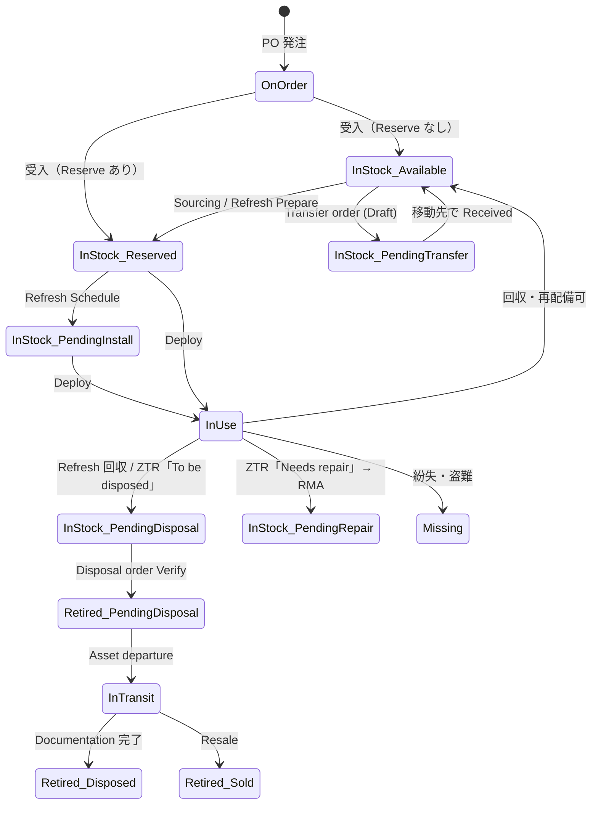
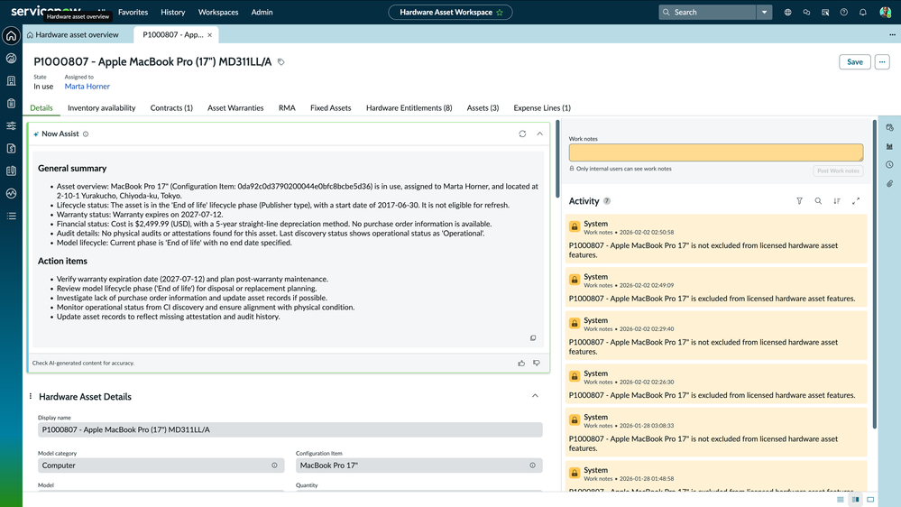
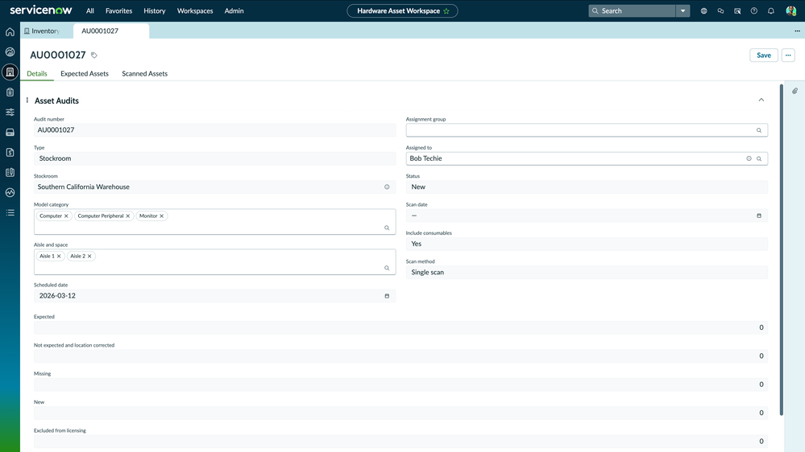
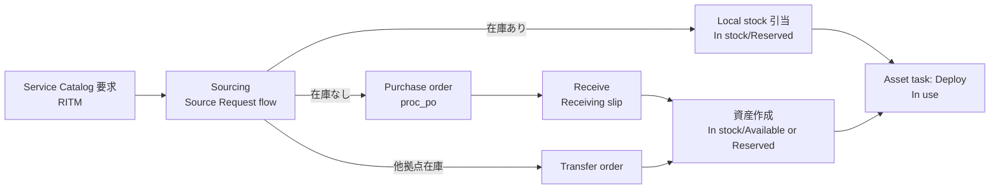
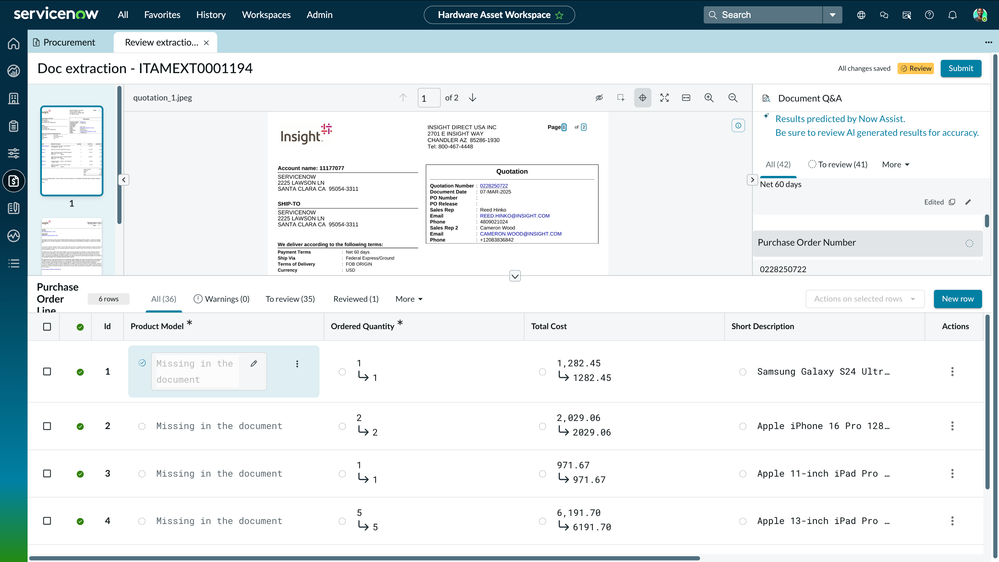

# Hardware Asset Management（ハードウェア資産管理）

## 概要

Hardware Asset Management（HAM、ハードウェア資産管理）は、ServiceNow IT Asset Management（ITAM）を構成するアプリケーションの一つで、PC・サーバー・ネットワーク機器・モバイル端末・モニター・周辺機器・消耗品（Consumable）などのハードウェア資産を、**計画 → 調達 → 受入 → 在庫 → 配備 → 保守/修理 → リフレッシュ → 回収 → 廃棄/転売/寄付** のライフサイクル全体で管理する。ServiceNow Store から配布されるスコープアプリ（アプリ ID `sn_hamp`）で、プラットフォーム標準の Asset Management（`alm_asset` 系テーブル）と Procurement（`com.snc.procurement`）の上に、ワークスペース・自動化フロー・正規化コンテンツ・AI を追加する構成である。

本ファイルが答える主な問い：

- HAM は何を追加するのか（基本 Asset Management との違い、インストール、ライセンス）
- Hardware Asset Workspace の各ビューで何ができるか
- 資産の State / Substate の値と遷移
- Stockroom（在庫保管場所）、Stock rule（補充ルール）、Transfer order（移動指示）、棚卸（Asset audit）の仕様
- Refresh（更新）、Zero Touch Refresh、Reclamation（回収）、Disposal（廃棄）・Resale（転売）の手順とタスク
- Procurement（Purchase order、Receiving slip）と Sourcing and Procurement Operations（SPO）連携
- Australia リリース（HAM 15.x〜16.x）および Brazil 時点の変更点

ITAM 全体像は [ITAM 概要](./itam-overview.md)、ソフトウェア資産は [Software Asset Management](./software-asset-management.md)、CI との関係は [CMDB と CSDM](../platform/cmdb-csdm.md) を参照。

> **リリースとバージョンの関係:** HAM はファミリーリリースとは独立に ServiceNow Store で更新される（Release notes 上の Release version は「Store」）。Australia 期（2026-03〜）に提供された主なバージョンは 15.0.0（2026-03）、15.0.1（2026-05）、15.0.2（2026-06）、15.2.0（2026-08）、16.0.x（2026-09）である。[出典](https://www.servicenow.com/docs/r/C17ZqvSaMwUVpMBg8Nc5sg/5UDeqpbx9IHWE0U8DfjJNQ)

---

## 1. 位置付けと構成要素

### 1.1 基本 Asset Management と HAM の違い

ServiceNow のプラットフォームには、ITSM 等に付随する基本的な Asset Management（資産テーブル、Stockroom、Transfer order、Contract、Procurement）が含まれる。HAM（`sn_hamp`）はその上に以下を追加する有償アプリである。[出典](https://www.servicenow.com/docs/r/1zMxrAxr2iK81FYv03BwFA/ASHCsuivYkjbfY6G~5umbQ)

| 領域 | HAM が追加する主な機能 |
|---|---|
| UI | Hardware Asset Workspace（単一画面で資産・在庫・調達・契約を管理） |
| 正規化 | Hardware Asset Management Content Service によるハードウェアモデル正規化、EoL/EoS 等のライフサイクル日付付与 |
| ライフサイクル自動化 | Workflow Studio（Flow Designer）ベースのフロー：Refresh、Reclamation、Disposal、Loaner、RMA、Repair、Donation、Reservation、Stock order |
| 在庫 | 高度な在庫（Aisle/Space、Pallet）、Picking（屋内マップ連携）、Put-away、統合受入（Unified receiving） |
| 棚卸 | モバイル（ServiceNow Agent アプリ）によるスキャン監査、Asset Attestation（リモート棚卸） |
| 物流 | Shipping carrier 連携（追跡 API）、ASN（Advanced Shipment Notification）インポート |
| Zero Touch | Zero Touch Refresh / Zero Touch Request（外部プロバイダによる手配・配送） |
| 分析 | Asset Analytics、TCO（Total Cost of Ownership）、KPI、Success portal（成熟度管理） |
| AI | ServiceNow Otto（旧 Now Assist）for HAM：資産インサイト生成、添付からの PO 作成、AI Agents（Sourcing / Repair 等） |

### 1.2 プラグインとアプリケーション

| 名称 | ID | 用途 | 出典 |
|---|---|---|---|
| Hardware Asset Management | `sn_hamp`（`com.sn_hamp` 表記もあり） | HAM 本体 | [出典](https://www.servicenow.com/docs/r/it-asset-management/hardware-asset-management/install-ham.html) |
| Asset Management Workspace | `sn_itam_workspace` | Hardware Asset Workspace の基盤 | [出典](https://www.servicenow.com/docs/r/pyt4lF0aAin_R6wVyV414Q/boNdYg34a2oajEtQt_~jqA) |
| Hardware Asset Management for Device as a Service | `com.sn_daas_ham` | DaaS provider view | [出典](https://www.servicenow.com/docs/r/pyt4lF0aAin_R6wVyV414Q/boNdYg34a2oajEtQt_~jqA) |
| Procurement | `com.snc.procurement` | Purchase order、Receiving、Stock rule の Vendor 補充 | [出典](https://www.servicenow.com/docs/r/1zMxrAxr2iK81FYv03BwFA/Mxk4VWOn5si3596YvYdHbQ) |
| Hardware Asset Management - Advanced | （Store アプリ） | Advanced 層の機能（2026-04 v1.0.0 初版） | [出典](https://www.servicenow.com/docs/r/C17ZqvSaMwUVpMBg8Nc5sg/zRqHtb5VYrw3du8bvThs5Q) |
| Now Assist for HAM（ServiceNow Otto for HAM） | （Store アプリ） | 生成 AI スキル・AI Agents | [出典](https://www.servicenow.com/docs/r/store-release-notes/store-rn-itam-now-assist-ham.html) |
| Asset Management Integration for Sourcing and Procurement Operations | `sn_spend_asset` | ITAM と SPO の連携 | [出典](https://www.servicenow.com/docs/r/source-to-pay-operations/sourcing-and-procurement-operations/itam-spo-key-consideration.html) |

### 1.3 インストール

HAM は ServiceNow Store から入手し、以下の手順でインストールする（必要ロール：`ham_admin`、または `admin`）。[出典](https://www.servicenow.com/docs/r/it-asset-management/hardware-asset-management/install-ham.html)

1. **All > System Applications > All Available Applications** を開く。
2. `sn_hamp`（名称：Hardware Asset Management）を検索する。一覧にない場合は Store から申請する。
3. バージョンを選んで **Install**。
4. **Review Installation Details** ダイアログで依存アプリ・プラグインを確認し、必要なエンタイトルメントを取得する。
5. 任意で **Load demo data** を選択（初回インストール時、開発/テスト環境でのみ推奨）。
6. **Install** を実行。

- HAM 16.0.0 以降は **Product Hub** から HAM と依存アプリを一括インストールでき、**Configuration Console** でユーザー・ロール・ライフサイクル・在庫・連携・生成 AI スキル等を一か所で設定できる（AI 会話型インタフェースでのグループ・ユーザー・Content service 設定も可能）。[出典](https://www.servicenow.com/docs/bundle/australia-release-notes/page/release-notes/it-asset-management/hardware-asset-management-rn.html)
- 従来は **Guided Setup**（App > Guided Setup）で初期設定を行う。[出典](https://www.servicenow.com/docs/r/1zMxrAxr2iK81FYv03BwFA/ASHCsuivYkjbfY6G~5umbQ)

---

## 2. ライセンス（Resource category と Subscription unit）

### 2.1 Resource category と比率

HAM のライセンスは **Resource category（リソースカテゴリ）** 単位で Opt in / Opt out する方式で、Opt in したカテゴリの資産のみが **Subscription Unit（SU）** として計上される。比率は「何台で 1 SU か」を表す。[出典](https://www.servicenow.com/docs/r/xUi4EDRoQXDqROOshinXwQ/uCno_JMAfN4aeh_edNjfCg)

| Resource category | 比率（資産数 : SU） | 対象 Model category |
|---|---|---|
| End-user computer | 4:1 | Computer |
| Server | 1:1 | AIX / ESX / HPUX / Linux / NetWare / OS/X / Solaris / Unix / Windows Server、Server |
| Network device | 5:1 | Network gear、IP switch、IP router |
| Mobile device | 10:1 | Mobile device |
| Telecommunications network inventory | 1:1 | Card、Network interface、Logical/Physical connection、Telecom device |
| Unclassified hardware | 1:1 | Hardware |
| Monitors | 15:1 | Monitor |
| Storage | 3:1 | Storage device |
| Printer | 10:1 | Printer |

### 2.2 Opt in / Opt out の挙動

- Opt in したカテゴリでのみ正規化機能と Asset action（自動化フロー）が動作する。Opt out したカテゴリ（およびその子 Model category）の資産は HAM の機能・ワークフローから除外される（License exclusion）。[出典](https://www.servicenow.com/docs/r/xUi4EDRoQXDqROOshinXwQ/uCno_JMAfN4aeh_edNjfCg)
- Unclassified hardware / Monitors / Storage / Printer は HAM ライセンスバージョン 5.0 が必要。Telecommunications network inventory は Telecommunications Network Inventory アプリのインストールも必要。[出典](https://www.servicenow.com/docs/r/xUi4EDRoQXDqROOshinXwQ/uCno_JMAfN4aeh_edNjfCg)
- デモデータをロードすると全カテゴリが Opt in 状態になるため、不要なカテゴリは Opt out する必要がある。[出典](https://www.servicenow.com/docs/r/EdiPWhlSAqBiE0AMK4k9bQ/dIhT2ylWmwGgTeC8d6IDmg)
- License exclusion 対象の資産は Disposal order の Verify 対象として選択できない、自動化ワークフローが動かない等、手動更新が必要になる。[出典](https://www.servicenow.com/docs/r/pyt4lF0aAin_R6wVyV414Q/USsdwDZbMq8Kaid6ZWW9hQ)

### 2.3 関連プロパティ

| プロパティ | 既定値 | 説明 |
|---|---|---|
| `sn_ham_active_entitlements` | — | 保有エンタイトルメントのカンマ区切り。形式例：`HAM_Computer_license`, `HAM_Server_license`, `HAM_networkgear_license`, `HAM_Monitor_license`, `HAM_Storage_license`, `HAM_printer_license`, `HAM_tni_license`, `Ham_mobiledevice_license`。エンタイトルメントをダウンロードしないローカル（オンプレ）インスタンスでは手動設定 |
| `sn_hamp.enable_custom_category_licensing` | `false` | `true` の場合、カスタム Model category の資産は親カテゴリが Opt in かつライセンス対象でない限り HAM ワークフローから除外 |

[出典](https://www.servicenow.com/docs/r/xUi4EDRoQXDqROOshinXwQ/uCno_JMAfN4aeh_edNjfCg)

### 2.4 製品ティア（Foundation / Advanced / Prime）

Australia 期の HAM 15.0.0 で、ServiceNow の製品ティア **Foundation / Advanced / Prime** が導入され、ティアによって利用できる機能・生成 AI スキル・Agentic workflow・AI Agents が決まる。HAM 16.0.1（2026-09）では AI ネイティブな **HAM Prime SKU** が追加された。Now Assist for HAM 4.1.0（2026-04）以降は SKU ティアに応じて機能表示が制御される。[出典](https://www.servicenow.com/docs/bundle/australia-release-notes/page/release-notes/it-asset-management/hardware-asset-management-rn.html) / [出典](https://www.servicenow.com/docs/r/C17ZqvSaMwUVpMBg8Nc5sg/5UDeqpbx9IHWE0U8DfjJNQ) / [出典](https://www.servicenow.com/docs/r/store-release-notes/store-rn-itam-now-assist-ham.html)

- ティアごとの詳細な機能差分表は公開情報では確認できず。価格は [価格情報](../../03_導入編/02-pricing.md)、ライセンスモデルは [ライセンスモデル](../../03_導入編/01-licensing-model.md) を参照。

---

## 3. ロール

### 3.1 業務ロール

| ロール | 説明 | 出典 |
|---|---|---|
| `ham_admin` | HAM インストール時のみ存在。HAM の全機能にアクセス | [出典](https://www.servicenow.com/docs/r/EdiPWhlSAqBiE0AMK4k9bQ/VWpdWMs5Nw02XojTTzKZYA) |
| `sn_hamp.ham_user` | ハードウェア資産とレポートの管理。`asset` より限定的な最小権限ロール | [出典](https://www.servicenow.com/docs/r/EdiPWhlSAqBiE0AMK4k9bQ/QOyXvhKAgIU795C5JMSG3A) |
| `asset` | ハードウェア・消耗品資産レコードの作成・編集・管理・削除 | [出典](https://www.servicenow.com/docs/r/EdiPWhlSAqBiE0AMK4k9bQ/VWpdWMs5Nw02XojTTzKZYA) |
| `inventory_admin` | Stockroom の作成・編集・管理・削除、Stock rule の作成 | [出典](https://www.servicenow.com/docs/r/EdiPWhlSAqBiE0AMK4k9bQ/VWpdWMs5Nw02XojTTzKZYA) |
| `inventory_user` | 在庫情報へのアクセス、Transfer order 作成、Refresh order 発行 | [出典](https://www.servicenow.com/docs/r/EdiPWhlSAqBiE0AMK4k9bQ/VWpdWMs5Nw02XojTTzKZYA) |
| `procurement_admin` | Procurement の管理（PO、受入） | [出典](https://www.servicenow.com/docs/r/I6yJl~rEaUqcde_ZxOUBMw/jpIN7Qv5DzsOjECCv3BKKg) |
| `procurement_user` | PO 作成、Transfer order 参照等の調達タスク | [出典](https://www.servicenow.com/docs/r/EdiPWhlSAqBiE0AMK4k9bQ/VWpdWMs5Nw02XojTTzKZYA) |
| `model_manager` | `cmdb_model` テーブルのレコード作成・変更・削除（公式ページ上の表記は `model_manger`） | [出典](https://www.servicenow.com/docs/r/EdiPWhlSAqBiE0AMK4k9bQ/VWpdWMs5Nw02XojTTzKZYA) |
| `contract_manager` | Contract Management での契約作成・編集・削除 | [出典](https://www.servicenow.com/docs/r/EdiPWhlSAqBiE0AMK4k9bQ/VWpdWMs5Nw02XojTTzKZYA) |
| `catalog_admin` / `catalog_manager` | Service Catalog の管理（Refresh / Reclaim 等のカタログアイテム保守） | [出典](https://www.servicenow.com/docs/r/EdiPWhlSAqBiE0AMK4k9bQ/VWpdWMs5Nw02XojTTzKZYA) |
| `itil` | Incident / Problem / Change / CI 操作。Refresh line task の完了にも使用 | [出典](https://www.servicenow.com/docs/r/it-asset-management/hardware-asset-management/hardware-asset-refresh.html) |

> 注：Refresh の公式手順では「`proc_user` ロールで Sourcing」と記載されているが、ロール一覧ページには `procurement_user` として掲載されている。インスタンスの `sys_user_role` で実名を確認すること。[出典](https://www.servicenow.com/docs/r/it-asset-management/hardware-asset-management/hardware-asset-refresh.html)

### 3.2 粒度の細かい管理ロール（Australia で導入）

Australia では、従来の広い `admin` チェックが以下の **Granular admin roles** に置き換えられた。アップグレード時にこれらのロールの割り当てが必要になる。[出典](https://www.servicenow.com/docs/bundle/australia-release-notes/page/release-notes/it-asset-management/hardware-asset-management-rn.html)

| ロール | 対象 |
|---|---|
| `sn_hamp.ham_system_admin` | HAM ライセンス、Guided Setup、アプリ/システムプロパティ、一部テーブル |
| `sn_hamp.ham_asn_admin` | ASN 機能 |
| `asset_integration_admin` | 標準ハードウェア Zero Touch request、Carrier 連携、Shipment テーブル |
| `asset_system_admin` | Asset job log、Content audit、Transfer order、Expense management、Model management |
| `asset_task_admin` | Asset task |
| `procurement_system_admin` | Procurement モジュール・テーブル・タスク |
| `contract_system_admin` | Contract モジュール・テーブル・タスク |
| `asset_licensing_admin` | ITAM ライセンスモジュール |
| `asset_recommendation_admin` | Recommendation action |

ロール設計の一般論は [ユーザー・グループ・ロール](../platform/users-groups-roles.md)、[アクセス制御（ACL）](../platform/access-control-acl.md) を参照。

### 3.3 読み取り制限プロパティ（Australia Patch 5）

Australia Patch 5 でシステムプロパティ `sn_itam_restrict_asset_read`（既定 `false`）が追加された。`true` にすると、`snc_internal` ロールのみを持つユーザーによる Asset（`alm_asset`）テーブルおよび子テーブルの読み取りが制限される。[出典](https://www.servicenow.com/docs/bundle/australia-release-notes/page/release-notes/it-asset-management/hardware-asset-management-rn.html)

---

## 4. データモデル（テーブル）

### 4.1 プラットフォーム標準の資産・在庫テーブル

| ラベル | テーブル名 | 説明 |
|---|---|---|
| Asset | `alm_asset` | 全資産の親テーブル |
| Hardware | `alm_hardware` | ハードウェア資産（`alm_asset` の子）。`Eligible for refresh` 等の HAM 用フィールドを持つ |
| Consumable | `alm_consumable` | 消耗品資産（数量管理） |
| Stockroom | `alm_stockroom` | 在庫保管場所 |
| Transfer Order | `alm_transfer_order` | Stockroom 間移動指示（`from_stockroom` / `to_stockroom` / `stage`） |
| Product Model | `cmdb_model` | モデル（Hardware model、Consumable model 等の親） |
| Asset-CI Install Status Mapping | `alm_asset_ci_state_mapping` | 資産 State と CI Install status の対応 |
| Purchase Order | `proc_po` | 発注書（Procurement） |
| Vendor Catalog Item | `pc_vendor_cat_item` | ベンダーカタログ品目（Stock rule の Vendor 補充で使用） |

- `alm_hardware`、`alm_stockroom`、`alm_transfer_order`、`cmdb_model` の存在とフィールドは公式ドキュメント内の記述による。[出典](https://www.servicenow.com/docs/r/it-asset-management/hardware-asset-management/hardware-asset-refresh.html) / [出典](https://www.servicenow.com/docs/bundle/australia-release-notes/page/release-notes/it-asset-management/hardware-asset-management-rn.html)
- `proc_po`、`pc_vendor_cat_item` は SPO 連携の考慮事項ページに記載。[出典](https://www.servicenow.com/docs/r/source-to-pay-operations/sourcing-and-procurement-operations/itam-spo-key-consideration.html)
- `alm_asset_ci_state_mapping` は Community 投稿による。【第三者情報】[出典](https://www.servicenow.com/community/itsm-forum/install-status-vs-hardware-status-on-hardware-cis/m-p/770536)
- PO 明細（一般に `proc_po_item`）、受入伝票（一般に `proc_rec_slip` / `proc_rec_slip_item`）、Transfer order line（一般に `alm_transfer_order_line`）のテーブル名は、本調査で参照した Australia の公式ページには明記されていない。【経験則】実装時は System Dictionary で確認すること（[データモデルとSystem Dictionary](../platform/data-model-dictionary.md)）。

### 4.2 HAM（`sn_hamp`）がインストールするテーブル

公式の「Installed with Hardware Asset Management」に掲載されているテーブル（Yokohama 版ページ。Australia でも基本構成は同じと考えられるが、15.0.0 で監査テーブルが変更された点に注意）。[出典](https://www.servicenow.com/docs/r/EdiPWhlSAqBiE0AMK4k9bQ/QOyXvhKAgIU795C5JMSG3A)

| 区分 | ラベル | テーブル名 |
|---|---|---|
| 資産 | Bundle | `alm_bundle` |
| 資産 | RFID asset | `rfid_asset` |
| 監査 | Asset Audits（レガシー） | `sn_hamp_asset_audit` |
| 監査 | Audits to Scanned Assets | `sn_hamp_m2m_audit_asset` |
| 回収 | Hardware Asset Reclamation Line | `sn_hamp_asset_reclaim_line` |
| 回収 | Hardware Asset Reclamation Task | `sn_hamp_asset_reclaim_task` |
| RMA | RMA Request | `sn_hamp_rma_request` |
| RMA | RMA Request Line | `sn_hamp_rma_request_line` |
| RMA | Asset RMA Task | `sn_hamp_asset_rma_task` |
| 廃棄 | Hardware Disposal Order | `sn_hamp_hardware_disposal` |
| 廃棄 | Hardware Disposal Tasks | `sn_hamp_hw_asset_disposal_task` |
| 廃棄 | Planned Assets | `sn_hamp_m2m_hw_asset_disposal` |
| Refresh | Hardware Asset Refresh Line | `sn_hamp_hw_refresh_line` |
| Refresh | Refresh Line Tasks | `sn_hamp_hw_refresh_line_task` |
| Zero Touch Refresh | Zero Touch Refresh Request | `sn_hamp_ztr_request` |
| Zero Touch Refresh | Zero Touch Refresh Task | `sn_hamp_ztr_task` |
| Zero Touch Refresh | Zero Touch Refresh Model | `sn_hamp_ztr_refresh_model` |
| Zero Touch Refresh | Replacement Models | `sn_hamp_m2m_ztr_replacement_model` |
| Loaner | Loaner Asset Order | `sn_hamp_loaner_asset_order` |
| Loaner | Loaner Asset Task | `sn_hamp_loaner_asset_task` |
| 契約更新 | Contract Renewal Request / Line / Task | `sn_contract_renewal_request` / `sn_contract_renewal_request_line` / `sn_contract_renewal_task` |
| 正規化 | Hardware Manufacturer | `sn_hamp_hw_manufacturer` |
| 正規化 | Hardware Product | `sn_hamp_hw_product` |
| 正規化 | Hardware Model Library | `sn_hamp_hw_product_model` |
| 正規化 | Device Type | `sn_hamp_hw_device_type` |
| 正規化 | Hardware Normalization Map | `sn_hamp_hw_normalization_map` |
| 正規化 | Custom Hardware Manufacturer / Product / Model Library / Device Type | `sn_hamp_custom_hw_manufacturer` / `sn_hamp_custom_hw_product` / `sn_hamp_custom_hw_prod_model` / `sn_hamp_custom_hw_device_type` |
| 正規化 | Manage Hardware Library | `sn_hamp_manage_hw_library` |
| 正規化 | Model Category Normalization Summary | `sn_hamp_model_ctg_norm_summary` |
| 正規化 | HAM Content Audit | `sn_hamp_content_audit` |
| ライフサイクル | Hardware Lifecycle Definition | `sn_hamp_lifecycle_definition` |
| 設定 | Hardware Asset Configuration | `sn_hamp_configuration` |
| 設定 | HAM Resource Category | `sn_hamp_resource_category` |
| 設定 | Import Staging | `sn_hamp_import_template` |
| 成熟度 | HAM Success Goal / Activity | `sn_hamp_success_goal` / `sn_hamp_success_activity` |

**Australia（HAM 15.0.0）での監査テーブル変更:** 監査レコードは共通テーブル Asset Audits（`sn_itam_common_asset_audit`）に格納されるようになった。切替前の監査レコードは Inventory ビューの Asset audits タブには表示されず、システムプロパティ `migrate_hamaudit` が `true` の場合に Asset operations ビューから参照できる。なお All > Asset Audits メニューからはレガシーの `sn_hamp_asset_audit` が開く。HAM と Enterprise Asset Management の両方をライセンスしている場合、Stockroom Details タブには統合された Asset Audits タイル、それ以外は Hardware Asset Audits タイルが表示される。[出典](https://www.servicenow.com/docs/bundle/australia-release-notes/page/release-notes/it-asset-management/hardware-asset-management-rn.html)

### 4.3 スケジュールジョブ

| ジョブ名 | 用途 |
|---|---|
| HAM - Content Upload | コンテンツアップロード |
| HAM - Daily Job | 日次処理 |
| HAM - Hardware Lifecycles | ライフサイクル日付更新 |
| HAM - Hardware Normalization | ハードウェアモデル正規化 |
| HAM - Loaner Asset Order Allocations | Loaner の割り当て |
| HAM - Populate Licensing Data | ライセンスデータ集計 |
| HAMP - Content File Manager | コンテンツファイル管理 |
| Purge Asset Audits More Than Year Old or with More Than 10k Assets | 古い/大規模監査レコードの削除 |
| [PA HAM] Daily collection job | Performance Analytics 日次収集 |
| SAM - Calculate Asset Refresh Eligibility | 週次。`Eligible for refresh` を計算（Script Include `SAMRefreshEligibityCalculator`） |
| Stock Rule Runner | 日次。Stock rule の評価と補充指示 |

[出典](https://www.servicenow.com/docs/r/EdiPWhlSAqBiE0AMK4k9bQ/QOyXvhKAgIU795C5JMSG3A) / [出典](https://www.servicenow.com/docs/r/it-asset-management/hardware-asset-management/hardware-asset-refresh.html) / [出典](https://www.servicenow.com/docs/r/1zMxrAxr2iK81FYv03BwFA/Mxk4VWOn5si3596YvYdHbQ)

---

## 5. 資産の State（状態）と Substate（サブ状態）

### 5.1 State / Substate 一覧（Australia）

資産レコードの `State`（`install_status`）と `Substate`（`substatus`）は組み合わせで意味を持つ。公式ドキュメントでは「State の値は変更しない。Substate はプロセスが対応している場合のみ変更する」とされている。必要ロールは `asset`、メニューは **All > Asset > Portfolios > All Assets**。[出典](https://www.servicenow.com/docs/r/pyt4lF0aAin_R6wVyV414Q/0_dr~qEnWrFC6Lmdh8BzZg)

| State | Substate | 意味 |
|---|---|---|
| On order（発注済） | なし | 発注済み・未受領 |
| In stock（在庫） | Available | 利用可能 |
| In stock | Reserved | Sourcing request により要求者向けに確保済 |
| In stock | Defective | 故障 |
| In stock | Pending repair | 故障・ベンダー修理中 |
| In stock | Pending install | 未設置 |
| In stock | Pending disposal | 不要・廃棄待ち |
| In stock | Pending transfer | Transfer order で移動予定 |
| In stock | Pre-allocated | 割当準備済（割当まで財務上の負債ではない） |
| In stock | On hold | 書類待ち等で保留 |
| In stock | Legal hold | 法的保全 |
| In stock | Quarantine | 隔離 |
| In stock | Pending fulfillment | 機能的には使用可、請求・承認待ち |
| In stock | Pending certificate | 廃棄証明書待ち |
| In stock | Pending return | リース品・未返却 |
| In stock | Test | テスト中 |
| In stock | End of support | サポート終了 |
| In stock | Pending retirement | EoL。売却・廃棄・寄付可能 |
| In stock | Pending resale | 転売待ち |
| In stock | Pending evaluation | 使用可否の評価待ち |
| In transit（輸送中） | Available / Reserved / Defective / Pending install / Pending disposal / Pending donation / Pre-allocated / Pending resale | 輸送中（各 Substate の意味は In stock と同様、Pending donation は寄付予定） |
| In use（使用中） | Pending fulfillment / End of support / Pending retirement / None | 割当済・使用中（非消耗品のみ） |
| In maintenance（保守中） | なし | 修理・保守中 |
| Retired（退役） | Disposed | 廃棄済 |
| Retired | Pending disposal | 廃棄予定 |
| Retired | Sold | 売却済 |
| Retired | Donated | Asset donation order で寄付済 |
| Retired | Vendor credit | RMA で返品し交換を受けた |
| Retired | Lease return | リース期間満了前に返却 |
| Retired | Obsolete | 陳腐化・廃棄予定 |
| Retired | RMA | RMA でベンダーに返却/交換 |
| Retired | Buy out | リース品を満了前に買取 |
| Retired | Pending resale | 転売待ち |
| Missing（所在不明） | Lost / Stolen | 紛失 / 盗難 |
| Build | なし | Asset bundle 作成中（ハードウェア・消耗品では使用しない） |

- EoL に達したら Retired にする。資産レコードの削除は誤登録の場合のみとする。[出典](https://www.servicenow.com/docs/r/pyt4lF0aAin_R6wVyV414Q/0_dr~qEnWrFC6Lmdh8BzZg)

### 5.2 典型的なライフサイクル遷移

本図は公式各ページの記述を組み合わせた要約図である【推定】（特に Resale 後の Sold 遷移の正確なタイミングは公開情報では確認できず）。各遷移の根拠は後述の各節（受入：§8.3、Transfer order：§6.4、Refresh：§9、Zero Touch Refresh：§10、Disposal：§12）を参照。

### 5.3 資産と CI の状態同期

- Asset と CI（`cmdb_ci` 系）の状態対応は **All > Asset > Administration > Asset-CI Install Status Mapping** で管理する。マッピングレコードの項目は Asset state（必須）、Asset substate（任意）、Configuration item status、Sync direction（同期方向）、Active、Preconfigured（既定ではユーザー定義＝false のみ表示）。[出典](https://www.servicenow.com/docs/r/xUi4EDRoQXDqROOshinXwQ/ZZgBr65UWNNkvJFHmz53fQ)
- **ハードウェアの同期は Asset → CI の一方向のみ**。ハードウェア資産の更新で CI の install status は更新されず、ハードウェア CI では CI 側 install status の substatus を使用すべきでない。非ハードウェア CI クラスは双方向同期が可能。[出典](https://www.servicenow.com/docs/r/xUi4EDRoQXDqROOshinXwQ/ZZgBr65UWNNkvJFHmz53fQ)
- CMDB の一般仕様は [CMDB と CSDM](../platform/cmdb-csdm.md) を参照。HAM 15.0.2 では **CMDB success advisor for HAM**（欠落・重複・不整合なハードウェア CI の特定と修正の優先順位付け）が追加された。[出典](https://www.servicenow.com/docs/bundle/australia-release-notes/page/release-notes/it-asset-management/hardware-asset-management-rn.html)

---

## 6. Hardware Asset Workspace

### 6.1 前提とアクセス

Hardware Asset Workspace は Asset Management Workspace（`sn_itam_workspace`）と HAM（`sn_hamp`）の有効化が前提。DaaS provider view には `com.sn_daas_ham` も必要。メニューは **All > Hardware Asset Workspace**（Workspaces メニューからも可）。[出典](https://www.servicenow.com/docs/r/pyt4lF0aAin_R6wVyV414Q/boNdYg34a2oajEtQt_~jqA) / [出典](https://www.servicenow.com/docs/r/xUi4EDRoQXDqROOshinXwQ/oqYR3TvTv8P6ag_61d0hSw)

Workspace 共通の仕組みは [Workspace と UI Builder](../platform/workspaces-ui-builder.md)、[Next Experience UI](../platform/next-experience-ui.md) を参照。

### 6.2 ビュー一覧（Australia）

| ビュー | 内容 |
|---|---|
| Hardware asset overview | 重要アクション、アクティブタスクへのクイックリンク、Model type / Life cycle state / 資産価値別スナップショット |
| Asset analytics | ハードウェア資産、TCO、資産パフォーマンスの詳細分析 |
| DaaS provider view | Device as a Service プロバイダが顧客資産を管理（`com.sn_daas_ham` 必要） |
| Inventory | 資産在庫・Stockroom、監査、Disposal order 等の在庫タスク |
| Asset estate | 期限切れ間近の資産・リース契約等の通知、ハードウェア/消耗品レコードの保守 |
| Model management | ハードウェア・ソフトウェア・消耗品・バンドルのモデル作成/編集、EoL 間近モデルの検知 |
| Content lookup portal | Hardware Asset Management Content Service に格納された製品データの参照 |
| Procurement | 調達リクエスト、PO、Sourcing task、Receiving slip |
| Contract management | ハードウェア/ソフトウェア契約（番号、開始/終了日、条件） |
| Success portal | 成功目標に対する HAM の進捗、成熟度項目に紐づく活動の割当 |
| Asset operations | 在庫・出荷・調達・正規化・契約・Zero Touch Refresh・成功目標等の設定系機能 |

[出典](https://www.servicenow.com/docs/r/pyt4lF0aAin_R6wVyV414Q/boNdYg34a2oajEtQt_~jqA)

### 6.3 Hardware asset overview（ダッシュボード）

Hardware asset overview は Location、Stock、Model Category でフィルタでき、ウィジェットから詳細ビューに遷移してアクションを実行できる。[出典](https://www.servicenow.com/docs/r/xUi4EDRoQXDqROOshinXwQ/LWRinJAf57Tr06EJ3S2FOQ)

| セクション | 主な指標 |
|---|---|
| Quick links | Model normalization（正規化率）、Asset requests、Transfer orders、Stock orders、Asset reservations、RMA orders、Refresh requests（未完了の Refresh order 数）、Disposal orders（未完了の廃棄オーダー数） |
| 360 Asset View | Model category × Lifecycle state（Retired / In use / In stock 等）の資産数、Model category 別資産価値 |
| Overall Performance | Model lifecycle overview（End of Support / End of Life / General Availability / End of Sale）、Model category 別の Discovered / Undiscovered 資産数（未検出または 1 か月以内に検出されていない資産を Undiscovered とする）、Refresh 対象資産数 |

- プロパティ `sn_itam_workspace.asset_overview_enable_lazy_loading`（既定 `false`）を有効にすると、個々のレポートを **Load report** でオンデマンド読み込みでき、ページ表示時間を短縮できる。[出典](https://www.servicenow.com/docs/r/xUi4EDRoQXDqROOshinXwQ/LWRinJAf57Tr06EJ3S2FOQ)
- HAM 15.0.2 で「Important action カードから空のリストが開く」不具合が修正された。[出典](https://www.servicenow.com/docs/r/C17ZqvSaMwUVpMBg8Nc5sg/5UDeqpbx9IHWE0U8DfjJNQ)

### 6.4 Inventory ビュー

Inventory ビューのタブ（Australia）：[出典](https://www.servicenow.com/docs/r/pyt4lF0aAin_R6wVyV414Q/LNL5nIb838lb1~6oVA4hlg)

| タブ | 内容 |
|---|---|
| Overview | 在庫ウィジェットのダッシュボード |
| All stockrooms | Stockroom の作成・参照・管理 |
| Asset audits | Stockroom やオフィス・データセンター等の定期監査 / ブラインド監査 |
| Disposal orders | EoL・故障ハードウェア/消耗品の廃棄オーダー作成・管理 |
| Loaner asset orders | 貸出資産オーダーの参照・操作 |
| RMA orders / RMA line items | RMA オーダー・明細の参照・操作 |
| Transfer orders | Transfer order の作成・参照・操作 |
| Donation orders | 寄付オーダーの参照 |
| Repair orders | Stockroom 内資産の修理オーダー参照・作成 |
| Asset attestations | リモート棚卸のための Attestation / スケジュール作成 |

Overview タブの主なウィジェット：Open hardware requests from stock (YTD)、Open RMA request lines、Open transfer orders、Open asset audits（New / In progress）、Open stock orders、Orders pending delivery by stockroom（未受領かつ未キャンセルの PO）、Active stock rules by model category、Loaner asset orders by status（Return overdue / Deployed / New 等）。[出典](https://www.servicenow.com/docs/r/pyt4lF0aAin_R6wVyV414Q/LNL5nIb838lb1~6oVA4hlg)

### 6.5 Asset operations ビュー

Asset operations ビューは設定・運用系機能の集約点で、以下のセクションを持つ（Brazil 版ページ。Australia 版でもほぼ同等）。[出典](https://www.servicenow.com/docs/r/it-asset-management/hardware-asset-management/asset-operations-view.html)

| セクション | 項目 |
|---|---|
| Inventory | Stockroom types、Stock rules、Stock orders |
| Shipment | Shipments、Shipment assets、Shipping carriers、Carrier integration profiles |
| Procurement-Requests | Service catalog item の Sourcing request |
| Contracts | Obligations、Obligation tasks（Contract Management Pro 連携時のみ） |
| Hardware asset normalization | Custom products、Custom models、Calculated lifecycle templates |
| Contract Renewal | Contract renewal requests、Contract renewal line items |
| KPI configuration | KPI opt in、Operational schedules、Asset schedules |
| TCO configuration | Task rate cards、Labor rate cards |
| Zero touch | Asset requests、Provider integration profiles |
| Zero touch refresh | Requests、Refresh models |
| Attestation | Attestations、Schedules |
| Hardware asset success | Success goals、Success activities、Success categories、Hardware maturity |
| Asset audits | 旧監査レコード（`migrate_hamaudit = true` が必要） |
| Asset warranty | Lenovo ハードウェア資産の保証情報 |
| My Lists | カスタムリストビュー |

### 6.6 資産レコード画面と AI インサイト

- **キャプション:** Hardware Asset Workspace で開いた資産レコード（例：P1000807 - Apple MacBook Pro (17") MD311LL/A）。Now Assist（ServiceNow Otto）による「Generate asset insights」の結果表示。
- **画面説明:** 上部ナビゲーションに「Hardware Asset Workspace」、左端にビュー切替アイコン列。レコードヘッダーに State（In use）と Assigned to。タブは Details / Inventory availability / Contracts / Asset Warranties / RMA / Fixed Assets / Hardware Entitlements / Assets / Expense Lines。Details タブ上部の Now Assist カードに「General summary」（資産概要、ライフサイクル状態＝End of life で Refresh 対象外、保証期限、コスト$2,499.99・5 年定額償却・PO 情報なし、監査/Attestation 記録なし、モデルライフサイクル）と「Action items」（保証期限前の保守計画、廃棄/置換計画、PO 情報補完など）が表示され、その下に Hardware Asset Details（Display name、Model category＝Computer、Configuration item 等）。右ペインは Work notes と Activity（ライセンス除外/除外解除の履歴）。
- **出典:** https://www.servicenow.com/community/ham-blog/what-s-new-in-australia-release-for-hardware-asset-management/ba-p/3535759 （取得日：2026-11-03）

---

## 7. 在庫管理（Stockroom、Stock rule、Transfer order、棚卸）

### 7.1 Stockroom（`alm_stockroom`）

Stockroom（在庫保管場所）は資産を保管する論理/物理の場所で、主なフィールドは以下。作成・管理には `inventory_admin` が必要。[出典](https://www.servicenow.com/docs/r/EdiPWhlSAqBiE0AMK4k9bQ/VWpdWMs5Nw02XojTTzKZYA)

| フィールド | 説明 |
|---|---|
| Name | Stockroom 名 |
| Type | Stockroom の種類（Stockroom types は Asset operations > Inventory で管理） |
| Location | 物理ロケーション |
| Manager | 責任者。Stock rule の補充通知・リクエストの受信者 |
| Assignment group | 主に利用するグループ |

- フィールド定義は Field Service Management 版の Stockroom 作成ページにも類似の記載がある（Type の選択肢例 Central Warehouse、Field Agent、FSL、On site、PUDO、Warehouse は FSM 用）。公式情報だが FSM 文脈である点に注意。[出典](https://www.servicenow.com/docs/r/OxLLTMwXG2tKQ2SIp7HnZg/i23ga7zrENMSZQZcsPSV0Q)
- 退役・交換時、Asset task は資産の所在地から Stockroom フィールドを自動設定する。所在地に Service location で紐づく Stockroom が複数ある場合は優先度が最も高い Stockroom が使われる。[出典](https://www.servicenow.com/docs/r/it-asset-management/hardware-asset-management/asset-lifecycle-automation.html)
- 高度な在庫（HAM 8.0.0 以降）：Aisle / Space による保管位置管理、Pallet 資産クラスによるパレット単位管理、Picking（屋内マップ連携、11.0.0）、Put-away task と統合受入（13.0.0）。[出典](https://www.servicenow.com/docs/r/C17ZqvSaMwUVpMBg8Nc5sg/5UDeqpbx9IHWE0U8DfjJNQ) / [出典](https://www.servicenow.com/docs/r/1zMxrAxr2iK81FYv03BwFA/ASHCsuivYkjbfY6G~5umbQ)
- Stockroom ごとに **Asset pick task** を有効化でき、有効な Stockroom から払い出す場合のみ Refresh 等で Pick タスクが生成される（設定は Hardware Asset Workspace）。[出典](https://www.servicenow.com/docs/r/it-asset-management/hardware-asset-management/hardware-asset-refresh.html)

### 7.2 Stock rule（在庫補充ルール）

Stock rule は Stockroom 内の特定モデルの在庫数が **Threshold（しきい値）** に達したときに自動で補充を起動するルール。[出典](https://www.servicenow.com/docs/r/1zMxrAxr2iK81FYv03BwFA/Mxk4VWOn5si3596YvYdHbQ)

- **作成:** 必要ロール `inventory_admin`。**All > Inventory > Stock > Stock Rules**、または Hardware Asset Workspace の Inventory 関連リスト / Asset operations > Inventory > Stock rules。[出典](https://www.servicenow.com/docs/r/pyt4lF0aAin_R6wVyV414Q/H9rq2xumNVB59puvtBkQSg)
- **主な項目:** Threshold（補充を起動する在庫数。同一モデルの全資産を数える）、Order size（最小発注/移動数量。しきい値を上回るのに必要な最小倍数を計算）、Restocking option（補充元：Stockroom / Vendor。Procurement が無効なら Stockroom のみ）。
- **Stock Rule Runner:** 日次ジョブが在庫数をしきい値と比較し、タスク・オーダー・通知を作成する。補充中は `pending_delivery` フラグで重複作成を防止（処理後に false に戻らないと次回起動しない）。
- **通知:** メールアクション **Asset Restocking** が Stockroom の Manager に送信される。
- **`glide.sc.checkout.twostep`:** `false`（既定）ならカートリクエストが自動送信、`true` ならカートに入るだけで手動送信が必要。

| Stock rule の種類 | 条件 | 結果 |
|---|---|---|
| Stockroom | — | 他 Stockroom からの Transfer order を自動作成（進行中のものがあれば作成しない） |
| Vendor | Procurement（`com.snc.procurement`）有効 | Purchase order と PO 明細を作成（Vendor catalog item として公開されたハードウェアモデルのみ） |
| Vendor | Procurement 無効 | Stockroom Manager 向けに手動補充タスクを作成 |
| Vendor / Service Catalog | HAM インストール済 | PO の代わりに Service Catalog リクエストを作成し、Manager のレビュー・承認のためカートに投入 |

[出典](https://www.servicenow.com/docs/r/1zMxrAxr2iK81FYv03BwFA/Mxk4VWOn5si3596YvYdHbQ)（Zurich 版ページ）

### 7.3 Stock order（バルク在庫発注）

Stock order は Stockroom 向けにハードウェアモデルと数量をまとめて発注する仕組みで、**Hardware Stock Order** フローが依頼・Sourcing・受入を処理する。[出典](https://www.servicenow.com/docs/r/it-asset-management/hardware-asset-management/asset-lifecycle-automation.html)

### 7.4 Transfer order（移動指示、`alm_transfer_order`）

Transfer order は自社保有資産を Stockroom 間で移動するための指示で、1 件に複数の Transfer order line を持ち、全明細が同じ From / To を共有する。[出典](https://www.servicenow.com/docs/r/EdiPWhlSAqBiE0AMK4k9bQ/9yAes5Ha6im7NdCzM47BTg)

- **必要ロール:** `inventory_user`（レポートのみは `inventory_user` / `asset` / `procurement_user`、`com.snc.procurement` 有効が前提）。
- **メニュー:** All > Inventory > Transfer Orders > Create Transfer Order。明細は Transfer Order Lines の New から追加。Hardware Asset Workspace では Inventory ビュー > Transfer orders タブ。
- **主な項目:** From Stockroom、To Stockroom（同一にすると明細追加時に自動で Received へ）、Delivery by date、Asset / Model（バンドルモデルも可）、Quantity Requested（消耗品用。非消耗品は 1 単位）。
- **ステージ:** Draft → （中間ステージ：Ready for fulfillment、Ready for shipment 等。Model category に基づき明細ごとに Transfer order line task が生成される）→ Received → 全明細クローズで Delivered。Draft のみ削除可。いずれかの明細が次ステージに進むと新しい明細は追加できない。
- **資産状態:** Draft で資産は確保（In stock / Pending transfer）され、移動先で受領すると In stock / Available になる。

### 7.5 棚卸（Asset audit）と Attestation

- **Asset audit:** Inventory ビュー > Asset audits から Stockroom やロケーションの定期/ブラインド監査を実施し、ServiceNow Agent モバイルアプリでスキャンする。[出典](https://www.servicenow.com/docs/r/pyt4lF0aAin_R6wVyV414Q/LNL5nIb838lb1~6oVA4hlg)
- **Australia（HAM 15.0.0）の拡張:** 単一の監査でハードウェア資産と Enterprise 資産をロケーション/Stockroom 単位で監査でき、消耗品も含められる。Agent アプリでスキャン結果をリアルタイムに選択・確認し、未登録資産をその場で作成、スキャン位置に基づき Aisle / Space / Sub-location を正確に更新できる。[出典](https://www.servicenow.com/docs/bundle/australia-release-notes/page/release-notes/it-asset-management/hardware-asset-management-rn.html)
- **Asset Attestation（HAM 12.1.0〜）:** 利用者に保有資産の確認を依頼するリモート棚卸。Inventory ビュー > Asset attestations で Attestation とスケジュールを作成する。[出典](https://www.servicenow.com/docs/r/C17ZqvSaMwUVpMBg8Nc5sg/5UDeqpbx9IHWE0U8DfjJNQ)

- **キャプション:** Hardware Asset Workspace の Inventory ビューから開いた Asset Audits レコード（AU0001027）。
- **画面説明:** タブは Details / Expected Assets / Scanned Assets。Details の項目は Audit number、Type（Stockroom）、Stockroom（Southern California Warehouse）、Model category（Computer、Computer Peripheral、Monitor の複数選択）、Aisle and space（Aisle 1、Aisle 2）、Scheduled date、Assignment group、Assigned to、Status（New）、Scan date、Include consumables（Yes）、Scan method（Single scan）。下部に集計欄 Expected / Not expected and location corrected / Missing / New / Excluded from licensing（いずれも 0）。
- **出典:** https://www.servicenow.com/community/ham-blog/what-s-new-in-australia-release-for-hardware-asset-management/ba-p/3535759 （取得日：2026-11-03）

---

## 8. Procurement（調達）連携

### 8.1 要求から調達までの流れ

資産が要求されると在庫を確認し、在庫があれば Transfer order ワークフロー、なければ Purchase order ワークフローが起動する。いずれも完了時に資産と CI を更新する。[出典](https://www.servicenow.com/docs/r/it-asset-management/hardware-asset-management/asset-lifecycle-automation.html)

- Hardware Asset Workspace の **Procurement** ビューでは、調達リクエスト、Purchase orders、Sourcing tasks（PO・ローカル引当・Transfer order が未着手のリクエスト一覧）、Receiving slips を管理する。[出典](https://www.servicenow.com/docs/r/1zMxrAxr2iK81FYv03BwFA/9ghS_MzokZV07Ng2lE6yjA)
- Service Catalog の Sourcing の仕組みは [Request Management](../itsm/request-management.md)、[サービスカタログ](../platform/service-catalog.md) を参照。

### 8.2 Purchase order（発注書）

Purchase order（PO）は単一ベンダーに資産を要求する文書で、物理的・財務的な追跡に使う（自社保有資産の倉庫間移動には Transfer order を使う）。[出典](https://www.servicenow.com/docs/r/I6yJl~rEaUqcde_ZxOUBMw/jpIN7Qv5DzsOjECCv3BKKg)

- **必要ロール:** `procurement_admin` または `procurement_user`
- **メニュー:** All > Procurement > Orders > Purchase orders > New
- **主なフィールド:** Number、Vendor、Short description、Assigned to、Due in、PO date、Requested、Ordered、Expected delivery、Received、Ship to（必須）、Bill to、Shipping、Shipping cost、Terms（Credit / Net 30 days / Net 90 days）、Total cost、Initial request、Requested by、Contract、Department、Budget number、Vendor account、Description
- **Status（読み取り専用）:** Requested / Ordered / Received / Suspended / Cancelled（受入画面では Pending delivery も条件として登場）
- **制約:** キャンセルは Requested / Ordered / Pending delivery の間のみ。Received / Cancelled 後は Expected delivery を編集不可。**Receiving slip が 1 件でも作成されると PO の全フィールドが読み取り専用**になる。
- PO 保存後に PO line item（明細）を追加する。

### 8.3 Receive（受入）と Receiving slip

**受入操作**（必要ロール `procurement_admin` / `procurement_user`）：[出典](https://www.servicenow.com/docs/r/xUi4EDRoQXDqROOshinXwQ/oqYR3TvTv8P6ag_61d0hSw)

- メニュー：All > Procurement > Orders > Orders、または Hardware Asset Workspace > Procurement > Orders タブ。
- Status が Ordered または Pending Delivery の PO を開き **Receive** を選択 → 明細を選び、受入場所・数量を調整 → 必要に応じ **Reserve** をオンにして **Reserved for** のユーザーを指定 → **Capture Asset Tags** で Asset tag、Serial number（EAM/OT 有効時は MAC address も）を入力 → Submit。
- CI クラスに Identification rule（Serial number 等）がある場合、少なくとも 1 つの必須項目を入力しなければならない。受入数量を超える資産の詳細は入力できない。

**受入結果:**

| 対象 | 結果 |
|---|---|
| ハードウェア | 1 台ごとに資産を作成。Reserve あり → In stock / Reserved、なし → In stock / Available |
| 消耗品 | 既存の消耗品レコードがあれば数量をマージ、なければ新規作成。消耗品は Reserve 不可 |
| Enterprise 資産（バンドル受入） | Package 状態の Asset bundle を作成し、個別資産を追加 |
| Receiving slip | 入荷のたびに自動作成（例：30 台を 3 回に分けて入荷すると 3 枚） |

**Receiving slip の手動作成:** All > Procurement > Receive > Receiving Slips > New。Number と Received 日時は自動設定、Purchase order は Ordered / Pending delivery / Requested の PO のみ選択可、Receiving location を選択して Submit。続けて Receiving slip line で受入品目・数量を記録する。[出典](https://www.servicenow.com/docs/r/xUi4EDRoQXDqROOshinXwQ/hz0IZJ8MeD1mG6XJEBkTmA)

### 8.4 ASN（Advanced Shipment Notification）

ASN は納品前に出荷通知ファイルを取り込み、資産レコードを事前作成する機能。Australia（HAM 15.0.0）では admin 権限なしで、`ham_admin`、`ham_user`、`procurement_admin`、`asset` のいずれかを持つユーザーが Hardware Asset Workspace の Procurement ビューから ASN ファイルをアップロードしインポートできるようになった。ASN 機能の管理は `sn_hamp.ham_asn_admin`。[出典](https://www.servicenow.com/docs/bundle/australia-release-notes/page/release-notes/it-asset-management/hardware-asset-management-rn.html) / [出典](https://www.servicenow.com/community/ham-blog/what-s-new-in-australia-release-for-hardware-asset-management/ba-p/3535759)

### 8.5 添付ファイルからの PO 作成（Otto for HAM）

Australia で追加された Now Assist（ServiceNow Otto）スキル **Create purchase order from attachments** は、見積書等の添付ファイルを読み取り、種別を判定して資産関連データを抽出し、HAM で PO を作成する。[出典](https://www.servicenow.com/community/ham-blog/what-s-new-in-australia-release-for-hardware-asset-management/ba-p/3535759)

- **キャプション:** Hardware Asset Workspace の Procurement ビューから起動した「Doc extraction - ITAMEXT0001194」画面（Review extraction タブ）。
- **画面説明:** 左にアップロードした見積書（quotation_1.jpeg、2 ページ）のサムネイル、中央に原本プレビュー（Quotation Number、Payment Terms 等）、右ペインに「Document Q&A」（"Results predicted by Now Assist" の注意書き、All / To review 件数、抽出項目例：Net 60 days、Purchase Order Number＝0228250722）。下部に「Purchase Order Line」グリッド（Product Model、Ordered Quantity、Total Cost、Short Description、Actions。Product Model は "Missing in the document" と表示され手動補完が必要な状態）。右上に Review ステータスと Submit ボタン。
- **出典:** https://www.servicenow.com/community/ham-blog/what-s-new-in-australia-release-for-hardware-asset-management/ba-p/3535759 （取得日：2026-11-03）

### 8.6 AI Agents による調達・修理（Otto for HAM）

Now Assist for HAM（Store アプリ）では、Agentic workflow「Manage hardware asset requests」に Sourcing、Transfer order、Purchase order、Repair の AI Agents が含まれる（1.1.0：Sourcing AI agent、2.0.0：Repair AI agents、3.0.1：`procurement_user` への開放）。2.0.0 の記載では **Hardware Asset Management Pro plus** ライセンスが必要とされている。[出典](https://www.servicenow.com/docs/r/store-release-notes/store-rn-itam-now-assist-ham.html)

AI Agents の一般仕様は [Now Assist と AI Agents](../platform/now-assist-ai-agents.md) を参照。

### 8.7 Sourcing and Procurement Operations（SPO）との連携

Source-to-Pay Operations の Sourcing and Procurement Operations（SPO）と ITAM を連携する「better together」フローは、プラグイン **Asset Management Integration for Sourcing and Procurement Operations（`sn_spend_asset`）** で実現する。[出典](https://www.servicenow.com/docs/r/source-to-pay-operations/sourcing-and-procurement-operations/itam-spo-key-consideration.html)

| 観点 | 仕様 |
|---|---|
| 前提 | HAM（`com.sn_hamp`）および／または SAM（利用する ITAM 製品に応じて） |
| 対象フロー | ハードウェア/ソフトウェア/Enterprise の標準フロー、ハードウェア・Enterprise の在庫 Stock order |
| 購入経路 | 資産購入は Service Catalog 経由（Shopping Hub カタログからの直接購入は不可）。サービス購入は Shopping Hub に残る |
| 品目マスタ | `pc_vendor_cat_item` は使わず、Supplier Product（`sn_shop_supplier_product`）を使用 |
| 資産作成 | 配送後に Asset Management 側の PO で受入を確認すると Assets タブに資産が作成される。SPO の PO からは資産・受入は作成されず、ITAM の Receiving slip 作成後に SPO 側へ読み取り専用の Receipt が表示される |
| 無効化される操作 | Asset Management 側 PO の Cancel / Order、SPO 側 PR/PO の編集・返品フロー、PR が Pending Review 時の Confirm Revision、サービスの在庫資産を `alm_asset` に作成すること |
| SAM-Coupa 連携との関係 | 本フローは SAM-Coupa 連携を非サポート。SAM-Coupa を維持する場合 `sn_spend_asset` をインストールしない。両立させる場合は `proc_po` の「Create a Requisition」ビジネスルール停止、`itam_procurement_integration_job` の制限、`app-itam-procurement-integration` のビジネスルール削除等が必要 |

**状態マッピング（SPO Sourcing request → ITAM PO）:** [出典](https://www.servicenow.com/docs/r/5Jej__fTTtx2c_SiyuTQfQ/LU7lhor1nuVqH3G8wYW3OA)

| SPO 側 | ITAM PO Status |
|---|---|
| SR：Closed as Rejected / Closed as Cancelled / Closed - No Decision | Cancel Closed |
| SR：その他の状態 | Requested |

- 優先順位は SPO の PO 状態 ＞ PR 状態 ＞ SR 状態。落札しなかったサプライヤ等で SPO の PR line が却下されると、対応する ITAM の PO line は Cancel Closed になる。
- HAM 14.0.0（2025-12）で ITAM-SPO 連携が改善され、HAM の Shipment テーブルへの読み取り専用アクセスを持つ SPO 連携プラグインが追加された。[出典](https://www.servicenow.com/docs/r/C17ZqvSaMwUVpMBg8Nc5sg/5UDeqpbx9IHWE0U8DfjJNQ)
- Accounts Payable Operations は PO が ITAM 由来かを判定し、Receiving slip の受入数量と請求数量を照合して差異があれば例外を発生させる。[出典](https://www.servicenow.com/docs/r/5Jej__fTTtx2c_SiyuTQfQ/SlAc9VsF__r50u~CwclMCg)
- SPO そのものは [Finance・Supply Chain・その他ワークフロー](../other/finance-supply-chain-esg.md) を参照。外部 ERP/購買システム連携の設計論は [連携設計](../../03_導入編/09-integration-design.md) を参照。

---

## 9. Hardware Asset Refresh（更新）

### 9.1 概要と前提

Hardware Asset Refresh は、保守コストと故障リスクが増え性能が低下した老朽ハードウェアを、同一または別モデルの新しいハードウェアに置き換えるプロセスで、Flow Designer の **Hardware Asset Refresh** フローと **Hardware Asset Refresh Line** フローで構成される。[出典](https://www.servicenow.com/docs/r/it-asset-management/hardware-asset-management/hardware-asset-refresh.html)

| 項目 | 内容 |
|---|---|
| Refresh order の発行 | `inventory_user` |
| 新資産の Sourcing | `proc_user`（ロール一覧上は `procurement_user`） |
| Refresh line task の完了 | `asset` および `itil` |
| カスタマイズ制約 | Hardware Asset Refresh フローの **Update Sourcing set Variable** ステップは削除・変更しない。カタログアイテムの変数 Type of refresh、Process（Variables タブ）、Hardware Asset Management process / sourcing の Variable set は保持する |
| 拡張点 | 事前定義の Decision table で Refresh Line フローをカスタマイズ可能 |

### 9.2 Refresh 対象判定（Eligible for refresh）

`alm_hardware` の **Eligible for refresh** フィールドが Refresh 対象か否かを示す。スケジュールジョブ **SAM - Calculate Asset Refresh Eligibility**（週次）が Script Include `SAMRefreshEligibityCalculator` の Process メソッドを呼び、資産の作成日とモデルの `useful_life`（耐用月数）を比較して、耐用期間を超えた資産を true にする。[出典](https://www.servicenow.com/docs/r/it-asset-management/hardware-asset-management/hardware-asset-refresh.html)

### 9.3 手順

**Step 1：Refresh order の作成** — **All > Service Catalog > Asset Lifecycle > Hardware Asset Refresh Order**（Asset Lifecycle カテゴリが見えない場合はカタログ検索バー横の Add content で追加）。

| Type of refresh | 入力 |
|---|---|
| Single model | Replacement model（新モデル）、Location（既定はログインユーザーの所在地）、Assets（置換する老朽資産。既定フィルタ Eligible for refresh = true） |
| Multi model | Add で最大 50 行（新モデルごとに 1 行）。同じ老朽資産を複数行に割り当てない。Eligible for refresh の既定フィルタはかからない |

Order Now で発注すると、各老朽資産の **Refresh request line** フィールド（Hardware の Disposal 関連リスト配下）に値が入り、新モデル合計価格付きの Sourcing 用リクエストが作成される。

**Step 2：Sourcing** — Core UI：All > Service Catalog > Open Record > Requests、または Hardware Asset Workspace > Procurement ビュー > Requests タブ。承認後 **Source Request** フローが起動し Catalog task が作成される。Local stock、Purchase order、Transfer order のいずれかで調達する。

**Step 3：Refresh line task** — 新資産の受領で Hardware Asset Refresh Line フローが起動し、RITM フォームの Asset Tasks 横に Hardware Asset Refresh Line タブが表示される。Refresh line task の Asset フィールドは空のままで、`refreshing_asset`（老朽資産）と `replacement_asset`（新資産）フィールドを使う。

| 順 | タスク | 生成条件 | 操作 |
|---|---|---|---|
| 0（条件付き） | Asset pick | Pick task が有効な Local stockroom から払い出す場合のみ | Mobile Agent アプリで完了 |
| 1 | Prepare asset | 受領後（Pick がなければ直接） | Asset に老朽資産を設定して保存・クローズ |
| 2 | Schedule refresh | Prepare asset クローズ時 | Scheduled deployment date を設定しクローズ |
| 3 | Deploy new asset | Schedule refresh クローズ時 | Is reclaimed（Yes/No）を設定しクローズ |
| 4 | Reclaim aged asset | Deploy new asset クローズ時 | Is reclaimed を設定しクローズ（Deploy 時に Yes なら自動クローズ） |

キャンセルは Refresh line task の Cancel、または State を Closed Incomplete にする。

### 9.4 状態変化

| 時点 | 新資産（Replacement） | 老朽資産（Aged） |
|---|---|---|
| Prepare asset クローズ | In stock / Reserved（Reserved for＝要求者） | 変化なし |
| Schedule refresh クローズ | In stock / Pending install | 変化なし |
| Deploy new asset クローズ | In use（老朽資産から割り当て〔Allocation〕を引継ぎ） | 変化なし |
| Reclaim aged asset クローズ | 変化なし | In stock / Pending disposal（Refresh request line をクリア） |

[出典](https://www.servicenow.com/docs/r/it-asset-management/hardware-asset-management/hardware-asset-refresh.html)

> **Brazil 期の修正:** HAM 16.0.1（2026-09）で「CSDM を考慮した Asset refresh」に関する修正が含まれる。詳細は公開情報では確認できず。[出典](https://www.servicenow.com/docs/r/C17ZqvSaMwUVpMBg8Nc5sg/5UDeqpbx9IHWE0U8DfjJNQ)

---

## 10. Zero Touch Refresh / Zero Touch Request

Zero Touch Refresh（ZTR、HAM 8.0.0 で導入）は、従業員のハードウェア更新要求に対し、外部プロバイダ（Service Exchange 経由）による手配・資産タグ付け・配送を自動化する。Zero Touch Request（11.0.0）は通常のハードウェア要求を外部プロバイダで充足する。[出典](https://www.servicenow.com/docs/r/C17ZqvSaMwUVpMBg8Nc5sg/5UDeqpbx9IHWE0U8DfjJNQ) / [出典](https://www.servicenow.com/docs/r/1zMxrAxr2iK81FYv03BwFA/ASHCsuivYkjbfY6G~5umbQ)

- **前提:** Zero Touch Refresh 用の Service Exchange 構成。ロール：`admin`、`asset`、`procurement_user`、`inventory_user` のいずれか。
- **メニュー:** All > Hardware Asset Workspace > Asset operations > Zero touch refresh > Requests → リクエストを開き **Zero Touch Refresh Tasks** タブ。
- 設定（Refresh models、Provider integration profiles）は Asset operations ビューの Zero touch / Zero touch refresh セクション。標準ハードウェア Zero Touch request の管理は `asset_integration_admin`。

| 順 | タスク | 内容 |
|---|---|---|
| 1 | Ready for pickup | 代替資産到着後に Stockroom 管理者がクローズ → 従業員へメール、Receive asset 作成 |
| 2 | Receive asset | 従業員がオンラインで受領確認すると自動クローズ（未確認時は `admin` / `asset` が代理クローズ） |
| 3 | Receive return asset | 旧資産の Stockroom 返却を確認 → Asset evaluation 作成 |
| 4 | Asset evaluation | 旧資産の評価結果を設定 |

| 評価結果 | 旧資産の State / Substate | 後続 |
|---|---|---|
| Re-deployable | In stock / Available | 再利用 |
| Needs repair | In stock / Pending repair | RMA フロー起動 |
| To be disposed | In stock / Pending disposal | 廃棄対象 |

完了時、リクエストの Stage / State は Closed complete / Completed になる。[出典](https://www.servicenow.com/docs/r/pyt4lF0aAin_R6wVyV414Q/T4qOIDQLOrNvwSdi3JzrGQ)

---

## 11. その他のライフサイクルプロセス

### 11.1 Asset task（Deploy / Swap / Retire / Repair）

Asset task は配備・交換・退役・修理などの操作完了時に CI と資産レコード（関連資産、ソフトウェア割当、保守契約、Stockroom フィールド）を更新する。[出典](https://www.servicenow.com/docs/r/it-asset-management/hardware-asset-management/asset-lifecycle-automation.html)

| 起点アプリ | 利用可能な Asset task |
|---|---|
| Incident Management | Update/Repair、Swap、Retire |
| Change Management | Deploy、Retire |
| Field Service Management | Deploy |

- 既定では Incident / Change のクローズに Asset action が必須。無効化するにはシステムプロパティ `sn_hamp.enable_asset_action_validation_incident` / `sn_hamp.enable_asset_action_validation_change_request` を `false` にする。
- License exclusion 対象資産では自動ワークフローが動かず、手動更新が必要。
- 関連：[Incident Management](../itsm/incident-management.md)、[Change Management](../itsm/change-management.md)、[Field Service Management](../customer/field-service-management.md)

### 11.2 Asset reclamation（退職者からの回収）

**Reclaim Asset** カタログアイテム（Record producer）は Asset Management と HR を連携し、HR 担当者・マネージャー・従業員が退職者の資産回収を申請できる。退職者に割り当てられたハードウェア/消耗品ごとに **Hardware Asset Reclamation Line**（`sn_hamp_asset_reclaim_line`）が作成され、各 Line は Schedule（持込・集荷・発送の方法に応じる）、Receive、Evaluate の 3 タスクでクローズする。Asset bundle と Pallet は既定では非対応（フローのカスタマイズが必要）。Decision table **Hardware Asset Reclamation Sub Flow** でカスタムサブフローに振り分けられる。[出典](https://www.servicenow.com/docs/r/it-asset-management/hardware-asset-management/reclaim-asset.html)

- HR 側の Offboarding は [HR Service Delivery](../employee/hr-service-delivery.md) を参照。ソフトウェアの回収は [Software Asset Management](./software-asset-management.md) を参照。

### 11.3 Loaner（貸出）、RMA、Repair、Reservation、Donation

| プロセス | 概要 | 主テーブル / 導入 |
|---|---|---|
| Loaner asset | 短期間の資産・消耗品貸出。Loaner asset task で配備準備と回収を管理。Inventory ビューに Return overdue 等の状態別集計 | `sn_hamp_loaner_asset_order` / `sn_hamp_loaner_asset_task` |
| RMA（Return Merchandise Authorization） | ベンダーへの返品・交換・修理。Asset RMA Order カタログアイテム | `sn_hamp_rma_request` / `_line` / `sn_hamp_asset_rma_task`（3.0.0） |
| Repair | Stockroom 内の故障資産の修理フロー（Repair orders タブ） | 11.0.0 |
| Asset reservation | 資産の予約ワークフロー | 3.0.0 |
| Donation | 慈善団体への寄付オーダー（Retired / Donated） | 7.0.0 |
| Bundle / Pallet | 複数資産を親レコードにまとめる / パレット単位で追跡 | `alm_bundle`（3.0.1）、Pallet（7.0.0） |

[出典](https://www.servicenow.com/docs/r/1zMxrAxr2iK81FYv03BwFA/ASHCsuivYkjbfY6G~5umbQ) / [出典](https://www.servicenow.com/docs/r/C17ZqvSaMwUVpMBg8Nc5sg/5UDeqpbx9IHWE0U8DfjJNQ) / [出典](https://www.servicenow.com/docs/r/EdiPWhlSAqBiE0AMK4k9bQ/QOyXvhKAgIU795C5JMSG3A)

---

## 12. Disposal（廃棄）と Resale（転売）

### 12.1 Disposal order の作成

Hardware Disposal Order（`sn_hamp_hardware_disposal`）は EoL・故障のハードウェア/消耗品を廃棄業者に引き渡すためのオーダーで、保存すると **Hardware Asset Disposal** フローが起動する。必要ロールは `asset`。[出典](https://www.servicenow.com/docs/r/pyt4lF0aAin_R6wVyV414Q/USsdwDZbMq8Kaid6ZWW9hQ)

- **メニュー:** Core UI：All > Inventory > Create Disposal Order / Workspace：All > Hardware Asset Workspace > Inventory ビュー > Disposal orders タブ > New
- **フォーム項目:** Number、Stockroom（廃棄元）、Vendor（廃棄先業者）、Location（Stockroom から自動設定。変更すると Stockroom がクリアされる場合あり）、Assigned to
- **Pickup Details（保存後）:** Scheduled date、Pickup contact name、Pickup details、Additional info
- Scheduled pickup / Asset departure タスクでは Vendor order ID、Shipped-to location、Shipping carrier、Tracking number 等も記録する。

### 12.2 ステージとタスク

| ステージ | タスク | 内容 |
|---|---|---|
| Draft | Verify assets | Planned Assets タブ（`sn_hamp_m2m_hw_asset_disposal`）に資産を追加し検証。検証済資産は **Retired / Pending disposal** |
| Scheduling | Schedule pickup | 集荷計画 |
| Transit | Asset departure | 搬出。未出荷の Planned asset は自動キャンセル、搬出済資産は **In transit** |
| Confirmation | Vendor confirmation | 業者が受領を確認 → Documentation へ |
| Documentation | Disposal documentation | 廃棄証明書等の添付、廃棄または転売の選択 |
| Completed | — | 完了 |
| Canceled | — | Transit ステージまでのみキャンセル可 |

[出典](https://www.servicenow.com/docs/r/xUi4EDRoQXDqROOshinXwQ/i0uYuZbbegxIpbNeunKSPA) / [出典](https://www.servicenow.com/docs/r/pyt4lF0aAin_R6wVyV414Q/USsdwDZbMq8Kaid6ZWW9hQ)

- タスクをクローズすると Complete になり次のタスクが作成される。[出典](https://www.servicenow.com/docs/r/xUi4EDRoQXDqROOshinXwQ/i0uYuZbbegxIpbNeunKSPA)
- **キャンセル:** Draft / Scheduling / Transit のタスクは State を Closed Incomplete にしてクローズする。Confirmation 以降はキャンセル不可。[出典](https://www.servicenow.com/docs/r/pyt4lF0aAin_R6wVyV414Q/USsdwDZbMq8Kaid6ZWW9hQ)
- **完了条件:** Planned assets の廃棄ドキュメントを添付し、**Certificate of disposal** フィールドを Yes にしたうえで Disposal Documentation タスクをクローズする。完了時、資産フォームに **Disposal date** が設定され、関連する保守契約とエンタイトルメントが更新/削除される。[出典](https://www.servicenow.com/docs/r/pyt4lF0aAin_R6wVyV414Q/USsdwDZbMq8Kaid6ZWW9hQ)
- 別ページ（Asset life-cycle automation）では 5 段階を「Planning、Scheduling、Verification、Departure、Final confirmation」と記述しており、呼称が一致しない。ステージ表のページの方が具体的。[出典](https://www.servicenow.com/docs/r/it-asset-management/hardware-asset-management/asset-lifecycle-automation.html)

### 12.3 Resale（転売、Australia / HAM 15.0.0）

HAM 15.0.0 から、Disposal order が Documentation ステージにあるとき、資産を **廃棄（Dispose）** するか **転売（Resell）** してクレジットを得るかを選べる。関連タスクとして「Resale hardware assets」「資産の Resale value を一括更新」がある。Substate として Pending resale（In stock / In transit / Retired）、Sold（Retired）が用意されている。[出典](https://www.servicenow.com/docs/r/pyt4lF0aAin_R6wVyV414Q/USsdwDZbMq8Kaid6ZWW9hQ) / [出典](https://www.servicenow.com/docs/r/pyt4lF0aAin_R6wVyV414Q/0_dr~qEnWrFC6Lmdh8BzZg)

- 15.2.0（2026-08）で Disposal order の Planned assets API の ACL 適用、12.1.5（2026-09）で Planned assets 追加時のアクセス制御が修正された。[出典](https://www.servicenow.com/docs/r/C17ZqvSaMwUVpMBg8Nc5sg/5UDeqpbx9IHWE0U8DfjJNQ)
- データ消去（Data wipe / sanitization）専用のタスクは公式の Disposal order ステージには含まれていない（公開情報では確認できず）。【経験則】データ消去証明は Documentation ステージの添付として扱うか、Verify 前に独自タスクを追加する設計が一般的。

---

## 13. 正規化とモデル・ライフサイクル

- **Hardware normalization:** Hardware Asset Management Content Service（Content Library）のメーカー情報に基づきモデルを正規化し、EoL 等のメタデータを付与する（HAM - Hardware Normalization ジョブ）。Content Service にない製品は Asset operations > Hardware asset normalization の Custom products / Custom models で管理する。[出典](https://www.servicenow.com/docs/r/C17ZqvSaMwUVpMBg8Nc5sg/zRqHtb5VYrw3du8bvThs5Q) / [出典](https://www.servicenow.com/docs/r/it-asset-management/hardware-asset-management/asset-operations-view.html)
- **Approximated life-cycle dates（Australia / 15.0.0）:** メーカーが EoL / EoS を公開していないハードウェア・消耗品モデルに推定ライフサイクル日付を表示する（Calculated lifecycle templates）。[出典](https://www.servicenow.com/docs/bundle/australia-release-notes/page/release-notes/it-asset-management/hardware-asset-management-rn.html)
- **Content lookup portal からのモデル作成（15.0.0）:** Content lookup portal のモデルをコピーして Product Model（`cmdb_model`）レコードを作成でき、正規化と項目の事前入力が行われる。[出典](https://www.servicenow.com/docs/bundle/australia-release-notes/page/release-notes/it-asset-management/hardware-asset-management-rn.html)
- **On-prem content upload:** オンプレ顧客のコンテンツアップロードの UX と性能が改善された。[出典](https://www.servicenow.com/community/ham-blog/what-s-new-in-australia-release-for-hardware-asset-management/ba-p/3535759)
- **TRM 連携:** ハードウェア製品のオンボーディングと Technology Reference Model（TRM）のライフサイクル管理を Application Portfolio Management と連携して行う（[Agile Development・APM・EAM](../spm/agile-apm-eam.md)）。[出典](https://www.servicenow.com/docs/r/1zMxrAxr2iK81FYv03BwFA/ASHCsuivYkjbfY6G~5umbQ)

---

## 14. 契約・保証・財務

- **Contract management ビュー:** ハードウェア/ソフトウェア契約の管理。Contract renewal（契約更新）ワークフローは HAM 5.0.0 で導入（`sn_contract_renewal_request` 等）。[出典](https://www.servicenow.com/docs/r/C17ZqvSaMwUVpMBg8Nc5sg/5UDeqpbx9IHWE0U8DfjJNQ)
- **Contract Management Pro 連携（16.0.0）:** ハードウェア契約の更新・期限・義務（Obligations）のライフサイクルを管理し、Agentic workflow が署名済み契約からメタデータと義務を抽出する。[出典](https://www.servicenow.com/docs/bundle/australia-release-notes/page/release-notes/it-asset-management/hardware-asset-management-rn.html)
- **保証:** Lenovo 保証連携（10.0.0）。Asset operations > Asset warranty で参照。[出典](https://www.servicenow.com/docs/r/C17ZqvSaMwUVpMBg8Nc5sg/5UDeqpbx9IHWE0U8DfjJNQ)
- **TCO（10.0.0）:** Task rate cards / Labor rate cards を設定し総保有コストを算出（Asset analytics ビュー）。
- **Entitlement 検出（16.0.1）:** ITAM / HAM のエンタイトルメント検出とレポート。[出典](https://www.servicenow.com/docs/r/C17ZqvSaMwUVpMBg8Nc5sg/5UDeqpbx9IHWE0U8DfjJNQ)

---

## 15. AI（ServiceNow Otto for HAM / 旧 Now Assist for HAM）

| 機能 | 内容 | 導入 |
|---|---|---|
| Generate asset insights（Asset analysis summary） | 資産のライフサイクル履歴、Chain of custody、割当、所在地、監査状況、ライフサイクル日付、財務、データ欠落を要約。AI Agents からも利用可 | Australia Patch 1 / Now Assist for HAM 4.0.0（2026-03） |
| Create purchase order from attachments | 添付文書から PO を作成 | Australia |
| AI Agents（Sourcing / Transfer order / Purchase order / Repair） | Agentic workflow「Manage hardware asset requests」 | 2025-06〜2025-12（Zurich 期） |
| Configuration Console の会話型設定 | AI でグループ・ユーザー・Content service を設定 | HAM 16.0.0 |
| Otto panel | HAM ワークフロー内に Otto パネル | HAM 16.0.1（2026-09） |

[出典](https://www.servicenow.com/docs/bundle/australia-release-notes/page/release-notes/it-asset-management/hardware-asset-management-rn.html) / [出典](https://www.servicenow.com/docs/r/store-release-notes/store-rn-itam-now-assist-ham.html) / [出典](https://www.servicenow.com/community/ham-blog/what-s-new-in-australia-release-for-hardware-asset-management/ba-p/3535759)

- **名称変更:** Australia Patch 5（HAM 15.5.0）で Now Assist は **ServiceNow Otto** に改名され、HAM の AI は「ServiceNow Otto for Hardware Asset Management」となった（製品エンタイトルメントは不変）。Now Assist for HAM 4.7.0（2026-08）で Workspace 内表記も Otto に変更。[出典](https://www.servicenow.com/docs/bundle/australia-release-notes/page/release-notes/it-asset-management/hardware-asset-management-rn.html) / [出典](https://www.servicenow.com/docs/r/store-release-notes/store-rn-itam-now-assist-ham.html)
- **Now LLM Service の廃止準備:** HAM 15.0.2 / Australia Patch 4 以降、新規または非アクティブな AI 資産の既定プロバイダは Now LLM ではなくサードパーティ LLM になる。既存設定は維持され、Now LLM は手動選択可能。Now Assist for HAM 5.1.0（2026-10）では Gemma を含むサードパーティ LLM 互換性が改善された。[出典](https://www.servicenow.com/docs/bundle/australia-release-notes/page/release-notes/it-asset-management/hardware-asset-management-rn.html) / [出典](https://www.servicenow.com/docs/r/store-release-notes/store-rn-itam-now-assist-ham.html)
- Now Assist for HAM 1.0.1 系（Advanced）以降、生成サマリーはユーザーの優先言語で表示される。[出典](https://www.servicenow.com/docs/r/C17ZqvSaMwUVpMBg8Nc5sg/zRqHtb5VYrw3du8bvThs5Q)

---

## 16. Australia での変更点まとめ

| 区分 | 変更 | 出典 |
|---|---|---|
| 新機能（15.0.0） | 推定ライフサイクル日付、ハードウェア/Enterprise 統合棚卸（消耗品含む・リアルタイムスキャン）、廃棄ワークフロー拡張（Resale）、admin 不要の ASN インポート、Content lookup portal からのモデル作成、製品ティア（Foundation/Advanced/Prime）、AI 資産分析サマリー | [出典](https://www.servicenow.com/docs/bundle/australia-release-notes/page/release-notes/it-asset-management/hardware-asset-management-rn.html) |
| 変更（15.0.0） | 監査レコードを `sn_itam_common_asset_audit` に統合（`migrate_hamaudit`） | 同上 |
| 新機能（15.0.2） | CMDB success advisor for HAM、Now LLM の既定解除 | 同上 |
| 変更（15.5.0 / Patch 5） | ServiceNow Otto への改名、`sn_itam_restrict_asset_read` | 同上 |
| 新機能（16.0.0） | Product Hub からのインストール、Configuration Console、Contract Management Pro 連携 | 同上 |
| アップグレード | Granular admin roles（§3.2）、`read_only_option` フィールドによる読み取り専用制御（`strict_read_only` / `client_script_modifiable`、影響フィールドは KB2718122） | 同上 |
| 関連製品 | Data Center and Network Asset Management（DCNAM）：ラック・サーバー・ネットワーク機器・設備資産のライフサイクルと電力/スペース/使用率の可視化（HAM の補完製品） | [出典](https://www.servicenow.com/community/ham-blog/what-s-new-in-australia-release-for-hardware-asset-management/ba-p/3535759) |

> **Brazil での変更:** Brazil 専用の HAM リリースノートは公開情報では確認できず（HAM は Store 配布のため、Brazil 期の変更は Store バージョンとして提供）。Brazil 期（2026-09 以降）に公開された Store バージョンの主な変更は以下。
> - HAM 16.0.1（2026-09）：ITAM/HAM のエンタイトルメント検出・レポート、AI ネイティブ HAM Prime SKU、HAM ワークフロー内の Otto パネル、アクセシビリティ（400% ズーム対応）、ハードウェアカタログの Angular 化、デモデータ作成の簡素化、CSDM を考慮した Asset refresh 等の不具合修正。[出典](https://www.servicenow.com/docs/r/C17ZqvSaMwUVpMBg8Nc5sg/5UDeqpbx9IHWE0U8DfjJNQ)
> - Hardware Asset Management - Advanced 1.0.11（2026-09）：Advanced 顧客が HAM Product Hub からインストール/アップグレード可能に。1.0.16（2026-10）：Otto for Platform Advanced 3.1.0 依存へ更新。[出典](https://www.servicenow.com/docs/r/C17ZqvSaMwUVpMBg8Nc5sg/zRqHtb5VYrw3du8bvThs5Q)
> - Now Assist for HAM 5.0.1（2026-09）：Product Hub 経由のインストール、5.1.0（2026-10）：AI Native SKU 混在環境の修正、サードパーティ LLM 互換性改善。[出典](https://www.servicenow.com/docs/r/store-release-notes/store-rn-itam-now-assist-ham.html)
> - Brazil 版の Asset life-cycle automation / Asset operations / Install ページの記述は Australia 版と大きな差分なし。

---

## 17. 主要プロパティ一覧

| プロパティ | 既定 | 説明 |
|---|---|---|
| `sn_itam_restrict_asset_read` | `false` | `snc_internal` のみのユーザーの `alm_asset` 系読み取りを制限（Australia Patch 5） |
| `migrate_hamaudit` | — | `true` で旧監査レコードを Asset operations から参照 |
| `sn_itam_workspace.asset_overview_enable_lazy_loading` | `false` | Overview レポートの遅延読み込み |
| `sn_ham_active_entitlements` | — | 保有 HAM エンタイトルメント（オンプレ等で手動設定） |
| `sn_hamp.enable_custom_category_licensing` | `false` | カスタム Model category のライセンス判定 |
| `sn_hamp.enable_asset_action_validation_incident` | （有効） | Incident クローズ時の Asset action 必須化 |
| `sn_hamp.enable_asset_action_validation_change_request` | （有効） | Change クローズ時の Asset action 必須化 |
| `glide.sc.checkout.twostep` | `false` | Stock rule によるカートリクエストの自動送信可否 |

---

## 18. 確認できなかった事項

- Australia 版「Hardware Asset Workspace roles」「Installed with Hardware Asset Management」ページ（本調査では Yokohama 版を参照）。Australia で追加・変更されたテーブル一覧の完全版は公開情報では確認できず。
- PO 明細・Receiving slip・Transfer order line のテーブル名（`proc_po_item`、`proc_rec_slip`、`alm_transfer_order_line` 等）の Australia 公式記載。
- Transfer order の中間ステージ名と各ステージでの資産 Substate の完全な一覧（Australia 版）。
- Stockroom の Type 選択肢（HAM 用）の公式一覧、および Stock rule フォームのフィールド名（内部名）。
- Foundation / Advanced / Prime ティアごとの機能差分と価格。
- Brazil 専用の HAM リリースノート。

---

## 参照元

- Hardware Asset Management release notes（Australia）: https://www.servicenow.com/docs/bundle/australia-release-notes/page/release-notes/it-asset-management/hardware-asset-management-rn.html
- Hardware Asset Management release notes（Store、バージョン履歴）: https://www.servicenow.com/docs/r/C17ZqvSaMwUVpMBg8Nc5sg/5UDeqpbx9IHWE0U8DfjJNQ
- Hardware Asset Management - Advanced release notes: https://www.servicenow.com/docs/r/C17ZqvSaMwUVpMBg8Nc5sg/zRqHtb5VYrw3du8bvThs5Q
- Now Assist for HAM（ServiceNow Otto for HAM）Store release notes: https://www.servicenow.com/docs/r/store-release-notes/store-rn-itam-now-assist-ham.html
- What's new in Australia release for Hardware Asset Management（ServiceNow Community HAM Blog）: https://www.servicenow.com/community/ham-blog/what-s-new-in-australia-release-for-hardware-asset-management/ba-p/3535759
- Install Hardware Asset Management: https://www.servicenow.com/docs/r/it-asset-management/hardware-asset-management/install-ham.html
- Installed with Hardware Asset Management: https://www.servicenow.com/docs/r/EdiPWhlSAqBiE0AMK4k9bQ/QOyXvhKAgIU795C5JMSG3A
- Hardware Asset Workspace roles: https://www.servicenow.com/docs/r/EdiPWhlSAqBiE0AMK4k9bQ/VWpdWMs5Nw02XojTTzKZYA
- Hardware Asset Workspace: https://www.servicenow.com/docs/r/pyt4lF0aAin_R6wVyV414Q/boNdYg34a2oajEtQt_~jqA
- Hardware asset overview: https://www.servicenow.com/docs/r/xUi4EDRoQXDqROOshinXwQ/LWRinJAf57Tr06EJ3S2FOQ
- Inventory view: https://www.servicenow.com/docs/r/pyt4lF0aAin_R6wVyV414Q/LNL5nIb838lb1~6oVA4hlg
- Asset operations view: https://www.servicenow.com/docs/r/it-asset-management/hardware-asset-management/asset-operations-view.html
- Procurement view: https://www.servicenow.com/docs/r/1zMxrAxr2iK81FYv03BwFA/9ghS_MzokZV07Ng2lE6yjA
- Exploring Hardware Asset Management: https://www.servicenow.com/docs/r/1zMxrAxr2iK81FYv03BwFA/ASHCsuivYkjbfY6G~5umbQ
- Set asset states and substates: https://www.servicenow.com/docs/r/pyt4lF0aAin_R6wVyV414Q/0_dr~qEnWrFC6Lmdh8BzZg
- Map asset state and CI install status: https://www.servicenow.com/docs/r/xUi4EDRoQXDqROOshinXwQ/ZZgBr65UWNNkvJFHmz53fQ
- Asset life-cycle automation: https://www.servicenow.com/docs/r/it-asset-management/hardware-asset-management/asset-lifecycle-automation.html
- Stock rules: https://www.servicenow.com/docs/r/1zMxrAxr2iK81FYv03BwFA/Mxk4VWOn5si3596YvYdHbQ
- Create a stock rule: https://www.servicenow.com/docs/r/pyt4lF0aAin_R6wVyV414Q/H9rq2xumNVB59puvtBkQSg
- Transfer assets using transfer orders: https://www.servicenow.com/docs/r/EdiPWhlSAqBiE0AMK4k9bQ/9yAes5Ha6im7NdCzM47BTg
- Create stockroom for Field Service Management assets: https://www.servicenow.com/docs/r/OxLLTMwXG2tKQ2SIp7HnZg/i23ga7zrENMSZQZcsPSV0Q
- Request a Hardware Asset Refresh: https://www.servicenow.com/docs/r/it-asset-management/hardware-asset-management/hardware-asset-refresh.html
- Process a Zero Touch Refresh request: https://www.servicenow.com/docs/r/pyt4lF0aAin_R6wVyV414Q/T4qOIDQLOrNvwSdi3JzrGQ
- Asset reclamation: https://www.servicenow.com/docs/r/it-asset-management/hardware-asset-management/reclaim-asset.html
- Hardware disposal order stages: https://www.servicenow.com/docs/r/xUi4EDRoQXDqROOshinXwQ/i0uYuZbbegxIpbNeunKSPA
- Create a disposal order: https://www.servicenow.com/docs/r/pyt4lF0aAin_R6wVyV414Q/USsdwDZbMq8Kaid6ZWW9hQ
- Create a purchase order: https://www.servicenow.com/docs/r/I6yJl~rEaUqcde_ZxOUBMw/jpIN7Qv5DzsOjECCv3BKKg
- Create a receiving slip: https://www.servicenow.com/docs/r/xUi4EDRoQXDqROOshinXwQ/hz0IZJ8MeD1mG6XJEBkTmA
- Receive an asset: https://www.servicenow.com/docs/r/xUi4EDRoQXDqROOshinXwQ/oqYR3TvTv8P6ag_61d0hSw
- Considerations for implementing the ITAM-SPO better together flow: https://www.servicenow.com/docs/r/source-to-pay-operations/sourcing-and-procurement-operations/itam-spo-key-consideration.html
- SPO SR state mappings to ITAM PO: https://www.servicenow.com/docs/r/5Jej__fTTtx2c_SiyuTQfQ/LU7lhor1nuVqH3G8wYW3OA
- IT Asset Management purchase order invoice processing: https://www.servicenow.com/docs/r/5Jej__fTTtx2c_SiyuTQfQ/SlAc9VsF__r50u~CwclMCg
- Hardware Asset Management licensing: https://www.servicenow.com/docs/r/xUi4EDRoQXDqROOshinXwQ/uCno_JMAfN4aeh_edNjfCg
- Opt-in or opt-out of HAM license resource categories: https://www.servicenow.com/docs/r/EdiPWhlSAqBiE0AMK4k9bQ/dIhT2ylWmwGgTeC8d6IDmg
- Install Status vs Hardware Status on hardware CIs（ServiceNow Community）【第三者情報】: https://www.servicenow.com/community/itsm-forum/install-status-vs-hardware-status-on-hardware-cis/m-p/770536
