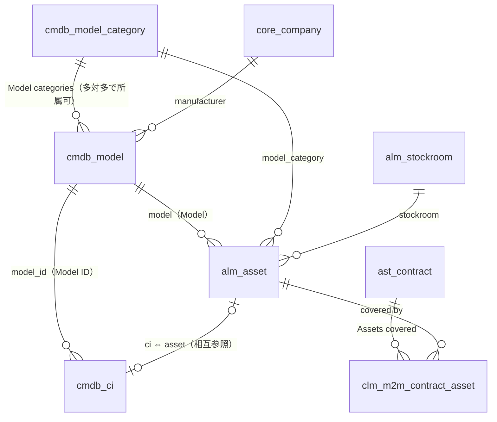
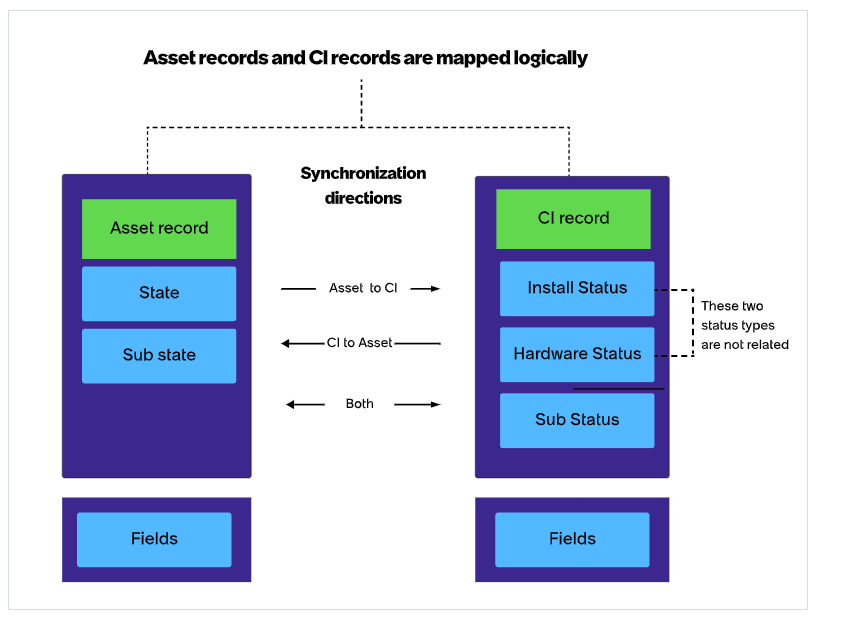
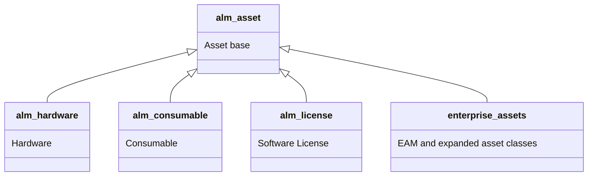
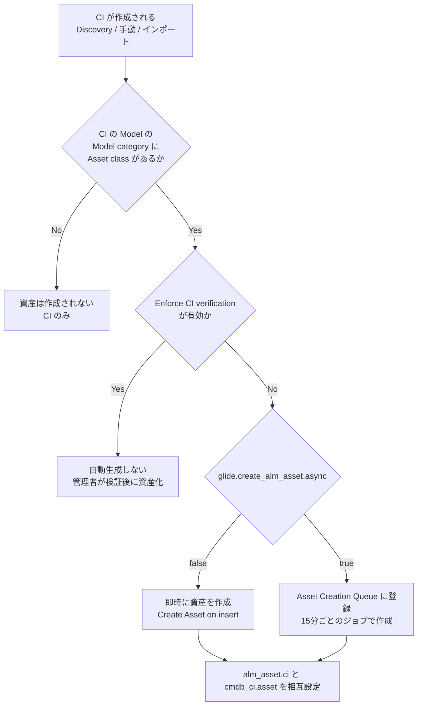
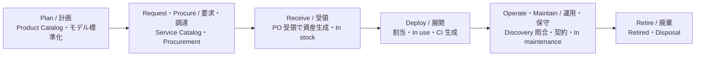
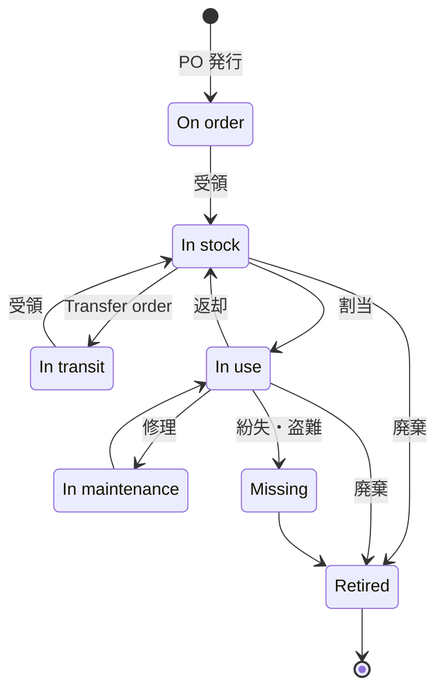
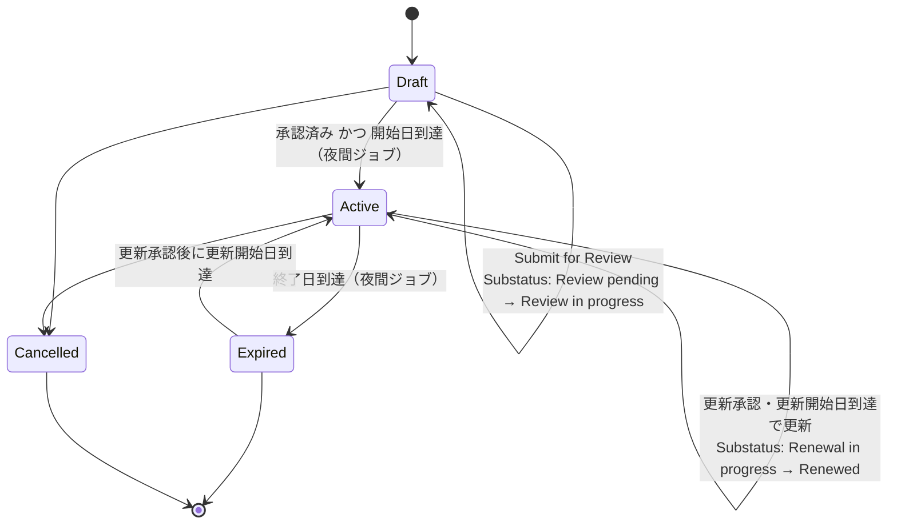
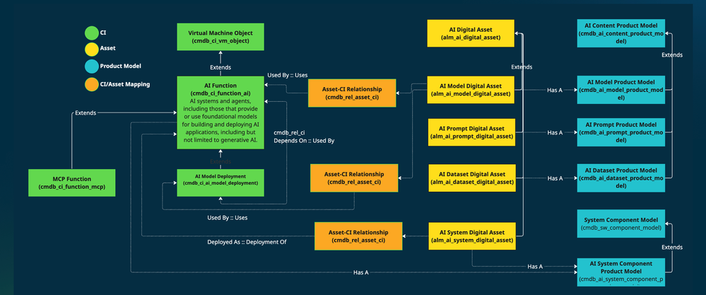

# ITAM 概要（IT Asset Management Overview）

## 概要

ServiceNow の **IT Asset Management（ITAM、IT資産管理）** は、ハードウェア・ソフトウェア・クラウドといった IT 資産を、調達から廃棄までのライフサイクル全体で「財務・契約・所有」の観点から管理する製品群である。Australia リリースの公式ドキュメントでは、ITAM と **Enterprise Asset Management（EAM、エンタープライズ資産管理）** をまとめて **Asset Management（資産管理）スイート** と呼び、ServiceNow AI Platform 上でネイティブに構築されていると説明している。[出典](https://www.servicenow.com/docs/r/pyt4lF0aAin_R6wVyV414Q/xrmHwFzPo4DtICb0jYrjdQ)

本ファイルは ITAM の**共通基盤（Base Asset Management・Product Catalog・Contract Management）**を扱う。次の問いに答える。

| 問い | 該当節 |
|---|---|
| ITAM はどの製品・アプリケーションで構成されるか | [ITAM の製品構成](#itam-の製品構成) |
| Asset（資産）と CI（構成アイテム）は何が違い、どう連携・同期するか | [Asset と CI の関係](#asset-と-ci-の関係) |
| `alm_asset` / `alm_hardware` などの資産テーブルの構造とフィールド | [資産テーブル（alm_asset 階層）](#資産テーブルalm_asset-階層) |
| Product Model（製品モデル）と Model category（モデルカテゴリ）の役割 | [Product Model と Model category](#product-model製品モデルと-model-categoryモデルカテゴリ) |
| 資産の State / Substate、CSDM ライフサイクルとの関係 | [Asset lifecycle](#asset-lifecycle資産ライフサイクル) |
| 契約（リース・保守・保証等）の管理 | [Contract Management](#contract-management契約管理) |

ハードウェア固有の機能（在庫・Stockroom・調達・リフレッシュ・廃棄・Hardware Asset Workspace）は [Hardware Asset Management](./hardware-asset-management.md)、ソフトウェアライセンス管理は [Software Asset Management](./software-asset-management.md)、CMDB・CSDM の詳細は [CMDB と CSDM](../platform/cmdb-csdm.md)、Discovery による CI 生成は [Discovery](../itom/discovery.md) を参照。

---

## ITAM の製品構成

### Asset Management スイートの製品一覧（Australia）

Australia の公式ドキュメント「Asset Management」は、Asset Management スイートを以下の製品・アプリケーションに分類している。[出典](https://www.servicenow.com/docs/r/pyt4lF0aAin_R6wVyV414Q/xrmHwFzPo4DtICb0jYrjdQ)

| 製品 / アプリケーション | 区分 | 概要 |
|---|---|---|
| Software Asset Management（SAM、ソフトウェア資産管理） | ITAM | ソフトウェアライセンス、コンプライアンス、最適化（ライセンス回収、SaaS 管理を含む） |
| Hardware Asset Management（HAM、ハードウェア資産管理） | ITAM | 購入要求から安全な廃棄までの IT ハードウェア管理、バーコード / QR スキャン |
| Cloud Cost Management（クラウドコスト管理、旧 Cloud Insights） | ITAM | マルチクラウドの支出可視化、コスト配賦、予算、ライトサイジング |
| Asset Audit Response（資産監査対応） | ITAM | ベンダー監査・規制監査の対応、証跡収集、監査証跡（ITAM for Financial Services の一部） |
| Enterprise Asset Management（EAM） | EAM | IT 以外の物理資産（設備・機器等）のライフサイクル、保守、コスト追跡 |
| Base Asset Management（基本資産管理） | 共通アプリケーション | IT 資産のシステム・オブ・レコード。属性とライフサイクル段階を追跡 |
| Contract Management（契約管理） | 共通アプリケーション | ライセンス契約・保守契約を資産に紐付け、更新を自動化 |
| Procurement（調達） | 共通アプリケーション | 発注書（PO）・承認・受領を自動化し、資産レコードを生成 |
| Product Catalog（製品カタログ） | 共通アプリケーション | ハードウェア・ソフトウェア・クラウドの SKU を標準化し、要求ポータルを提供 |
| ServiceNow Otto for SAM / HAM / EAM | AI アドオン | ソフトウェア・ハードウェア・エンタープライズ資産管理のタスク自動化 |
| IT Asset Management content request | サポート | ITAM 顧客からのコンテンツ（正規化データ等）リクエスト対応 |

> 注: Cloud Cost Management は旧称 Cloud Insights である旨が ITAM 概要ページに記載されている。[出典](https://www.servicenow.com/docs/r/pyt4lF0aAin_R6wVyV414Q/OdMIVFxPKFcaM1_eOBz29Q)

### Base Asset Management と HAM / SAM の関係

Base Asset Management は、`alm_asset` テーブル群・Model category・Asset と CI の同期・Stockroom・Transfer Order などの基盤機能を提供し、HAM や SAM はその上に追加されるライセンス対象アプリケーションである。HAM の公式ドキュメントでは HAM を「licensable application（ライセンス対象アプリケーション）」としている。[出典](https://www.servicenow.com/docs/r/pyt4lF0aAin_R6wVyV414Q/OdMIVFxPKFcaM1_eOBz29Q)

- `Hardware Asset Management Professional`（プラグイン `com.sn_hamp`）は、資産フォームの Aisle / Space（通路・棚位置）、Lease 関連フィールド、Mobile タブなど一部フィールドの前提条件になっている。[出典](https://www.servicenow.com/docs/r/w3Hg5id41C9xrkzqBsUMhA/YQFqhdpQ2HbfHwt8whnwQQ)
- Hardware Asset Workspace を使うには `Asset Management Workspace`（`sn_itam_workspace`）と `Hardware Asset Management`（`sn_hamp`）の両プラグインの有効化が必要。[出典](https://www.servicenow.com/docs/r/1zMxrAxr2iK81FYv03BwFA/FKo_qJuoa_jeRs4Fb9Pzpw)
- ITAM 各製品のライセンス・エディションは [ライセンスモデル](../../03_導入編/01-licensing-model.md)、[エディション比較](../../03_導入編/03-edition-comparison.md) を参照。

### ITAM の主要ユーザーインターフェース

| UI | 主な用途 | 備考 |
|---|---|---|
| Core UI（Classic UI）の Asset / Product Catalog / Contract メニュー | 資産・モデル・モデルカテゴリ・契約の一般操作、管理設定 | `All > Asset`、`All > Product Catalog`、`All > Contract` など |
| Hardware Asset Workspace | HAM の業務 UI（Procurement view、Asset operations view、Contract management view、Model management 等） | Washington DC 以降、HAM の Core UI は限定サポート扱い（詳細は [Hardware Asset Management](./hardware-asset-management.md)） |
| Software Asset Workspace | SAM の業務 UI（License operations など） | [Software Asset Management](./software-asset-management.md) |
| Enterprise Asset Workspace | EAM の業務 UI（Contract and lease management view 等） | EAM ライセンスが必要 |

[出典](https://www.servicenow.com/docs/r/w3Hg5id41C9xrkzqBsUMhA/NId3qs9wnQAhQkaY54cm_g)

---

## Asset と CI の関係

### Asset（資産）と CI（構成アイテム）の定義の違い

ServiceNow では、同じ物理機器（例: 1台のノート PC）を**2種類のレコード**で表す。公式ドキュメント「Asset and CI management」は次のように区別している。[出典](https://www.servicenow.com/docs/r/1zMxrAxr2iK81FYv03BwFA/pqIcegBJhTxzPI4JiMe5xg)

| 観点 | Asset（資産） | Configuration Item（CI、構成アイテム） |
|---|---|---|
| 目的 | **財務・契約・所有**の記録（いくらで買い、誰が所有し、いつ廃棄するか） | **運用**の記録（何が稼働し、何に依存し、どのサービスを支えるか） |
| 管理アプリ | Asset Management（ITAM） | CMDB |
| ベーステーブル | `alm_asset` | `cmdb_ci` |
| 状態フィールド | `State`（状態）/ `Substate`（サブ状態） | `Install Status`（`install_status`）、ハードウェア CI は `Hardware Status` / `Hardware Substatus` |
| 主な利用者 | 資産管理者、調達、財務 | ITSM（Incident / Change 等）、ITOM、サービスオーナー |
| 典型的な生成元 | 調達（PO 受領）、手動登録、CI からの自動生成 | Discovery、Service Graph Connector、IRE 経由のインポート、資産からの自動生成 |

すべての CI が資産になるわけではなく、すべての資産が CI を持つわけでもない。どの CI クラスとどの資産クラスを対にするかは **Model category（モデルカテゴリ）** で決まる（[後述](#model-categoryモデルカテゴリ)）。【第三者情報】コミュニティでも「All CIs are not assets. 資産生成は Model category / Model で制御するのがベストプラクティス」と回答されている。[出典](https://www.servicenow.com/community/ham-forum/how-asset-and-ci-are-linked-to-each-other/m-p/3566796)

### Asset と CI の相互参照フィールド

`alm_asset` と `cmdb_ci` は**相互に参照フィールドを持つ**ことで 1対1 に紐付く。公式ドキュメントは「資産と CI が論理的にマッピングされ、互いを指している場合にのみ同期される」としている。[出典](https://www.servicenow.com/docs/r/1zMxrAxr2iK81FYv03BwFA/pqIcegBJhTxzPI4JiMe5xg)

| テーブル | フィールド | 参照先 | 説明 |
|---|---|---|---|
| `alm_asset` | `ci`（Configuration Item） | `cmdb_ci` | 資産と同時に自動生成された CI。値は Model と（CI を持つモデルカテゴリかつシリアル番号がある場合）Serial number から生成される [出典](https://www.servicenow.com/docs/r/w3Hg5id41C9xrkzqBsUMhA/YQFqhdpQ2HbfHwt8whnwQQ) |
| `cmdb_ci` | `asset`（Asset） | `alm_asset` | CI に対応する資産レコード 【第三者情報】[出典](https://www.servicenow.com/community/ham-forum/how-asset-and-ci-are-linked-to-each-other/m-p/3566796) |
| `alm_asset` / `cmdb_ci` | `model_id`（Model） | `cmdb_model` | 両者が同じ Product Model を参照する。CI 側のモデルは `model_id` に格納 [出典](https://www.servicenow.com/docs/r/1zMxrAxr2iK81FYv03BwFA/pqIcegBJhTxzPI4JiMe5xg) |
| `alm_asset` | `model_category` | `cmdb_model_category` | 対応する CI クラス（＝生成される CI）を決める [出典](https://www.servicenow.com/docs/r/w3Hg5id41C9xrkzqBsUMhA/YQFqhdpQ2HbfHwt8whnwQQ) |

`cmdb_ci_hardware` クラスの公式説明では、Manufacturer と Model ID がそれぞれ Company（`core_company`）と Product Model（`cmdb_model`）への参照属性であるとされる。[出典](https://www.servicenow.com/docs/r/4AA65edJ2a~o5pASflQppQ/6Sq0lyZJbFbprBO674SbnQ)

> **AI インベントリにおける例外（cmdb_rel_asset_ci）:** AI 資産（AI System / AI Model / AI Prompt / AI Dataset / MCP Server）のデータモデルでは、資産（例: `alm_ai_model_digital_asset`）と CI（例: `cmdb_ci_ai_model_deployment`）を、直接の参照フィールドではなく多対多テーブル `cmdb_rel_asset_ci` で関連付ける設計が紹介されている。【第三者情報】（ServiceNow 社員によるコミュニティブログ）通常の `alm_hardware` ⇔ `cmdb_ci_hardware` の紐付けは従来どおり `ci` / `asset` 参照フィールドである。[出典](https://www.servicenow.com/community/cmdb-blog/understanding-the-ai-inventory-data-model-in-servicenow-product/ba-p/3546771)

### データモデル全体像

- Model category は「CI クラス」と「資産クラス」の対応表であり、Product Model はどの Model category に属するかを持つ（1つのモデルが複数カテゴリに属することが可能）。[出典](https://www.servicenow.com/docs/r/cCCsnXLy_7vD00AGlASipQ/lXKfwKOD8TD6tX1oNxdZXA)
- 契約と資産は `clm_m2m_contract_asset`（Covered Asset）で多対多に関連付く（[Contract Management](#contract-management契約管理) 参照）。

### Asset と CI の自動生成

Base Asset Management は、Model category の設定に従って**CI から資産、資産から CI を自動生成**する。インストールされるビジネスルールのうち、生成・連携に関わる主なものは以下。[出典](https://www.servicenow.com/docs/r/1zMxrAxr2iK81FYv03BwFA/HSKUC9NJNCrAkihQUmJMOg)

| ビジネスルール | テーブル | 役割（名称からの要旨） |
|---|---|---|
| `Create Asset on insert` | Configuration Items | CI 挿入時に対応資産を生成 |
| `Create asset on model change` | Configuration Items | CI のモデル変更時に資産を生成 |
| `Create CI on insert` | Asset | 資産挿入時に対応 CI を生成 |
| `Null out asset on insert and stay` | Configuration Items | Insert and Stay（複製保存）時に資産参照をクリア |
| `Null out Ci on insert and stay` | Asset | Insert and Stay 時に CI 参照をクリア |
| `Update Asset fields on change` | Configuration Items | CI 側の変更を資産へ同期 |
| `Update CI fields on change` | Asset | 資産側の変更を CI へ同期 |
| `GenerateAssets` | Model Categories | Model category への資産クラス設定に伴い資産を生成 |
| `Sync model category` | Product Models | モデルのカテゴリ情報を同期 |

関連するスクリプトインクルード:

| Script include | 説明 |
|---|---|
| `AssetandCI` | 資産と CI の関係を作成・管理する |
| `AssetAndCISynchronizer` | 資産と CI レコードを同期する |

[出典](https://www.servicenow.com/docs/r/1zMxrAxr2iK81FYv03BwFA/HSKUC9NJNCrAkihQUmJMOg)

その他、リンクが作成される経路として、HAM のライフサイクル処理、Discovery / 連携による既存 CI と資産の照合、UI Action の **Create CI** / **Create Asset** による手動作成が挙げられている。【第三者情報】リンクを解除するには資産の CI フィールドと CI の Asset フィールドの両方をクリアするが、Discovery の照合、HAM 同期、IRE、インポート連携、カスタム BR / Flow によってリンクが再作成されることがある。[出典](https://www.servicenow.com/community/ham-forum/how-asset-and-ci-are-linked-to-each-other/m-p/3566796)

資産フォームの Related Links には、**Delete Assets Only**（資産だけ削除し、関連 CI は残す）がある。[出典](https://www.servicenow.com/docs/r/w3Hg5id41C9xrkzqBsUMhA/YQFqhdpQ2HbfHwt8whnwQQ)

### 資産・CI 生成に関わるシステムプロパティ

| プロパティ | 用途 | 既定値 |
|---|---|---|
| `glide.create_alm_asset.async` | CI からの資産生成を即時ではなく遅延実行にする。遅延時はスケジュールジョブ **Asset - Create asset delayed sync**（15分ごと）が生成。状態は `asset_job_log`（Asset Job Log）に記録され、`Asset Administration > Asset Creation Queue` でエラー確認、状態を Error → Ready に変えると再処理 | Orlando 以前からのアップグレードでは false |
| `glide.asset.create_ci_with_ire` | 資産から CI を生成する際に CMDB の **IRE（Identification and Reconciliation Engine）** を経由させる。CI 名は「Serial number - Model name」、データソースは `SNAssetManagement` | Orlando 以前からのアップグレードでは false |
| `sn_itam_enable_cache_for_asset_ci_mapping` | 資産・CI のフィールドマッピング、State / Status マッピングをキャッシュして性能を改善 | 公開情報では確認できず |
| `sn_itam_common.mac_address_sync` | シリアル番号ではなく MAC アドレスで資産と CI を同期（CI から資産へ日次） | false |
| `sn_itam_restrict_asset_read` | `snc_internal` ロールのみのユーザーが読めるのを、自分に割り当てられた資産や Reserved for / Managed by / Owned by で参照される資産に限定 | false |

[出典](https://www.servicenow.com/docs/r/1zMxrAxr2iK81FYv03BwFA/pqIcegBJhTxzPI4JiMe5xg) / `sn_itam_restrict_asset_read` は Australia Patch 5 で追加 [出典](https://www.servicenow.com/docs/bundle/australia-release-notes/page/release-notes/it-asset-management/hardware-asset-management-rn.html)

> 注: 公式ページの要約部分では `glide.createalmasset.async` のようにアンダースコアが欠落した表記もあるが、詳細部の表記（上表）が正しい名称である。MAC アドレス同期プロパティは、Asset 側の記述では `snitamcommon.macaddresssync`（表記揺れ）として紹介され、`asset_property` テーブルで有効化する。

**`glide.asset.create_ci_with_ire` 有効時の前提条件**: IRE で CI を作成する対象の Model category は次を満たす必要がある。[出典](https://www.servicenow.com/docs/r/1zMxrAxr2iK81FYv03BwFA/pqIcegBJhTxzPI4JiMe5xg)

- CI クラスが `cmdb_ci_hardware` を継承していること
- CI クラスにシリアル番号による識別ルール（Identification rule）があること
- CI クラスが他の CI クラスへの依存関係（dependent relationship）を持たないこと
- 当該カテゴリの資産作成時、および PO 明細（Purchase order line item）でシリアル番号が必須となる。Pre-allocated（事前割当）資産は作成時は不要だが割当時に入力が必要
- 同じシリアル番号が既に別の CI / 資産にある場合、資産作成は失敗する

**MAC アドレスによる同期**: CI は複数の MAC アドレスを持てるため、それらは `cmdb_ci_network_adapter`（Network Adapter）テーブルに CI 参照付きで格納される。資産の MAC アドレスを変更しても既存のアダプタレコードは更新されず、新しいアダプタレコードが作成される。Yokohama 以降、該当フィールドは `alm_asset` の MAC address（`mac_addr`）フィールドを基に設定される。OT（Operational Technology）資産では Enterprise Asset Workspace の `Admin center > Other configuration` で設定する。[出典](https://www.servicenow.com/docs/bundle/yokohama-it-asset-management/page/product/asset-management/concept/c_ManagingAssets.html)

### 同期されるフィールド

資産と CI の一方で以下のフィールドが変更されると、もう一方の対応フィールドが更新される（Asset-CI Field Mapping の既定）。[出典](https://www.servicenow.com/docs/r/1zMxrAxr2iK81FYv03BwFA/pqIcegBJhTxzPI4JiMe5xg)

| 同期フィールド（英語名） | 日本語 | 備考 |
|---|---|---|
| Asset tag | 資産タグ | |
| Assigned | 割当日 | |
| Assigned to | 割当先ユーザー | |
| Checked in / Checked out | チェックイン / チェックアウト | |
| Company | 会社 | |
| Cost | コスト | **資産 → CI の一方向のみ**。CI 側では参考情報 |
| Cost center | コストセンター | |
| Delivery date | 納品日 | |
| Department | 部門 | |
| Due / Due in | 期日 | |
| GL account | 勘定科目 | |
| Install date | 設置日 | |
| Invoice number | 請求書番号 | |
| Justification | 理由 | |
| Lease id | リース ID | |
| Location | ロケーション | |
| Managed by | 管理者 | |
| Model | モデル | CI 側は `model_id` |
| Order date / Order received / Ordered | 発注日 / 受領 / 発注 | |
| Owned by | 所有者 | |
| PO number | 発注番号 | |
| Purchase date / Purchased | 購入日 | |
| Serial number | シリアル番号 | |
| Support group / Supported by | サポートグループ / サポート担当 | |
| Vendor | ベンダー | |
| Warranty expiration | 保証期限 | |

フィールドマッピングは **`All > Asset > Administration > Asset-CI Field Mapping`** で定義する。このモジュールのテーブルは `alm_asset_ci_field_mapping` である。【第三者情報】[出典](https://www.servicenow.com/community/developer-forum/issue-in-asset-ci-field-mapping-table-in-servicenow/m-p/2657882) 値が Hardware（`alm_hardware`）テーブルにのみ存在し Asset（`alm_asset`）テーブルに無いフィールドは、Asset-CI Field Mapping でマッピングできない。

CI を更新しても、同期対象の属性が更新されたときにのみ対応資産が更新される（CI 更新＝資産更新ではない）。[出典](https://downloads.docs.servicenow.com/resource/enus/infocard/predefined-asset-ci-state.pdf)

【第三者情報】連携（API 経由）で CI を更新した際に `Assigned to` が資産に同期されない事例がコミュニティで報告されており、`setWorkflow(false)` によりビジネスルールが動作しなかったことが原因として疑われている。同期は BR（`Update Asset fields on change` / `Update CI fields on change`）に依存するため、連携実装でワークフローを無効化すると同期が行われない点に注意する。[出典](https://www.servicenow.com/community/cmdb-forum/assigned-to-sync-not-working-between-cmdb-ci-computer-and-alm/m-p/2606724)

### 状態（State / Status）の同期

資産の `State` / `Substate` と CI のステータスは**1対1 ではなく、最も論理的に対応する値**にマッピングされる。例: ハードウェア資産の「In stock - Pending disposal」は CI の「In Disposition」（サブステータスなし）に対応する。[出典](https://www.servicenow.com/docs/r/1zMxrAxr2iK81FYv03BwFA/pqIcegBJhTxzPI4JiMe5xg)

| CI の種類 | 同期に使う CI 側フィールド | ポイント |
|---|---|---|
| 非ハードウェア CI | `Install Status`（`install_status`） | サブステータスなし。非ハードウェア CI ではこちらを使う |
| ハードウェア CI（`cmdb_ci_hardware` 以下） | `Hardware Status` / `Hardware Substatus` | ハードウェア CI でのみ表示 |

- 同期方向は **Asset → CI**、**CI → Asset**、**双方向**がある。
- ハードウェア CI で Hardware Status と Install Status の両方が更新された場合、資産の状態マッピングには **Hardware Status の変更が採用**される。
- 2つのステータスは互いに独立しており、ハードウェア CI で両方を使うことは推奨されない。

- **キャプション:** 資産レコードと CI レコードの論理マッピングと同期方向（公式ドキュメント「Asset and CI management」の Figure 1 と同内容の図。ServiceNow Community の回答に転載されていたもの）。
- **図の説明:** 上部に「Asset records and CI records are mapped logically」と書かれ、左に「Asset record」（その下に State、Sub state、Fields）、右に「CI record」（その下に Install Status、Hardware Status、Sub Status、Fields）のボックスが並ぶ。中央に「Synchronization directions」として「Asset to CI →」「← CI to Asset」「← Both →」の3種の矢印がある。右端では Install Status と Hardware Status が点線で括られ「These two status types are not related（この2つのステータス種別は関連しない）」と注記されている。つまり、資産の State/Substate は CI の Install Status または Hardware Status/Sub Status のいずれかと、片方向または双方向で同期されることを示す。
- **出典:** https://www.servicenow.com/community/ham-forum/how-asset-and-ci-are-linked-to-each-other/m-p/3566796 （画像元: https://www.servicenow.com/community/image/serverpage/image-id/521803iDA2922FEB22A4BAE/image-size/large?v=v2&px=999 、元の図は https://www.servicenow.com/docs/r/1zMxrAxr2iK81FYv03BwFA/pqIcegBJhTxzPI4JiMe5xg ）（取得日: 2026-11-03）

#### State / Status マッピングの設定

| モジュール（ナビゲーション） | 用途 | 同期方向の制約 |
|---|---|---|
| `All > Asset > Administration > Asset-CI Install Status Mapping` | 資産 State/Substate ⇔ CI Install Status | Asset → CI は全マッピングで可。**CI → Asset はハードウェア CI クラスでは不可**（非ハードウェア CI クラスは双方向可） |
| `All > Asset > Administration > Asset-CI Hardware Status Mapping` | 資産 State/Substate ⇔ CI Hardware Status/Substatus | Asset、CI、双方向のいずれも設定可（Australia） |

- 必要ロール: `admin` または `asset`。
- Install Status Mapping フォームの項目: **Asset State**、**Asset Substate**（任意）、**Configuration Item Status**、**Sync direction**、**Active**。
- リストの既定フィルタは「Out of the box is False」で、カスタムマッピングのみ表示される。
- ハードウェア資産と消耗品には Build 状態・Design サブ状態が無いため、マッピング表に Build のエントリは無い。
- CI の Install Status 側の Substatus はハードウェア CI では使わない。ハードウェア資産の更新時、資産同期はこのフィールドを更新しない。
- **アップグレード時の注意:** 旧リリースで `AssetAndCISynchronizer` スクリプトインクルードをカスタマイズしていた場合、そのカスタマイズを上書き（ベースラインに戻す）したうえでカスタムマッピングを再作成する必要がある。

[出典（Install Status Mapping）](https://www.servicenow.com/docs/r/1zMxrAxr2iK81FYv03BwFA/gd5zdtgPC3ePiznTh~edpg) / [出典（Hardware Status Mapping, Australia）](https://www.servicenow.com/docs/r/pyt4lF0aAin_R6wVyV414Q/QLVwx_1tEWmGg_XQ7Il5uA)

#### 既定の資産 State と CI Hardware Status の対応（参考）

公式ドキュメントのダウンロード資料「SAMP Diagrams - OOTB Asset - CI State」（2024-01 作成の図）は、資産の State/Substate と CI の Hardware Status/Substatus の既定値を並べて示している。図から読み取れる CI 側の値は以下。[出典](https://downloads.docs.servicenow.com/resource/enus/infocard/predefined-asset-ci-state.pdf)

| CI Hardware Status | Hardware Substatus |
|---|---|
| On Order | --none-- |
| In Stock | --none-- / Available / Reserved |
| In Transit | --none-- / Available / Reserved / Repairable / Disposable |
| Installed | --none-- / In Use |
| In maintenance | --none-- |
| Retired | --none-- / Lost / Sold / Credit / Divested / Stolen / Donated / Scrapped / Duplicate Error |
| Out of Stock | --none-- / Ordered / Awaiting Vendor Delivery / Received / Dereferenced |
| Defective | --none-- / Repairable / Disposable |
| In Disposition | --none-- |
| Pending Install | --none-- |
| Pending Repair | --none-- |
| Pending Transfer | --none-- / Available / Reserved / Repairable / Disposable |
| Stolen | --none-- |

同資料に記載の CI Install Status（`install_status`）の選択肢: --None--、Absent、In Maintenance、In Stock、Installed、On Order、Pending Install、Pending Repair、Retired、Stolen。また CI の Operational status（Operational / Non-Operational / Repair in Progress / DR Standby / Ready / Retired）は Incident・Change で使われ、資産 State と Hardware Status を変更しうる、と注記されている。マッピングの詳細（どの資産値がどの CI 値に対応するか）は各インスタンスの Asset-CI Hardware Status Mapping / Install Status Mapping のレコードで確認すること。

---

## 資産テーブル（alm_asset 階層）

### 資産クラスとテーブル

資産は `alm_asset`（Asset）をベースとするテーブル階層で管理する。Base Asset Management がインストールする主なテーブルは以下。[出典](https://www.servicenow.com/docs/r/1zMxrAxr2iK81FYv03BwFA/HSKUC9NJNCrAkihQUmJMOg)

| テーブル | 名称 | 説明 |
|---|---|---|
| `alm_asset` | Asset | 資産の一般・財務・契約情報（全資産クラスのベース） |
| `alm_hardware` | Hardware | ハードウェア資産の一般・財務・契約情報 |
| `alm_license` | Software License | ソフトウェアライセンス資産の一般・財務・契約情報 |
| `alm_consumable` | Consumable | 消耗品資産（旧称 parts）。個体管理しない |
| `alm_entitlement` | License Entitlement | ユーザーまたはマシンにライセンス使用権を付与するエンタイトルメント |
| `alm_entitlement_asset` | Asset Entitlement | 資産エンタイトルメントの分類・動作制御 |
| `alm_entitlement_user` | User Entitlement | ユーザーエンタイトルメントの分類・動作制御 |
| `alm_fixed_assets` | Fixed Assets | 複数資産を含むコンテナ（固定資産） |
| `m2m_fixed_asset_to_asset` | Fixed asset to asset | 固定資産と資産の関連 |
| `alm_stockroom` | Stockroom | 在庫保管場所 |
| `alm_stockroom_type` | Stockroom Type | Stockroom の種別 |
| `alm_m2m_stockroom_model` | Stockroom Model | Stockroom でこれまで在庫されたモデル（自動生成） |
| `alm_user_stockroom` | Default Stockroom | ユーザーの既定 Stockroom |
| `alm_stock_rule` | Stock Rule | 在庫が閾値を下回った際に在庫移動または資産管理者へメール |
| `alm_transfer_order` | Transfer Order | 在庫移動指示（状態・移動元／先 Stockroom） |
| `alm_transfer_order_line` | Transfer Order Line | 移動指示で出荷される個々の資産 |

- 基本の資産クラスは **Hardware**、**Software License**、**Consumable** の3つ（Model category のドキュメントによる）。資産フォームの Class フィールドの例として base、hardware、license、consumable が挙げられている。[出典](https://www.servicenow.com/docs/r/xUi4EDRoQXDqROOshinXwQ/2y8p9UmDAMpSGzsgv07R9w) / [出典](https://www.servicenow.com/docs/r/w3Hg5id41C9xrkzqBsUMhA/YQFqhdpQ2HbfHwt8whnwQQ)
- `alm_consumable` の継承関係（`alm_asset` 直下か `alm_hardware` 配下か）は、第三者資料では `alm_hardware` 配下とするものがあるが、公式ドキュメントでは確認できず。インスタンスの `sys_db_object`（Tables）で確認すること。
- Facility 用の資産テーブル名（`alm_facility` 等）は公式の Base Asset Management テーブル一覧に掲載されておらず、公開情報では確認できず。資産フォームの Financial / Depreciation / Contracts セクションは「hardware, software entitlement, facility」向けと記載されており、Facility 資産クラスの存在は示唆される。
- EAM および Store アプリ **Expanded Model and Asset Classes** は、`sn_ent_*` 系の資産・モデルクラス（例: Multimedia Production Equipment Asset `sn_ent_mm_prod_equip_asset`、System and Smart Card Asset `sn_ent_system_smart_card_asset`）を追加する。[出典](https://www.servicenow.com/docs/r/C17ZqvSaMwUVpMBg8Nc5sg/jRX3nEHY9kkR6~sw5dx2mw)
- AI 資産クラス（`alm_ai_system_digital_asset`、`alm_ai_model_digital_asset`、`alm_ai_prompt_digital_asset`、`alm_ai_dataset_digital_asset`、`alm_mcp_digital_asset`）も `alm_*` の命名で存在する。【第三者情報】[出典](https://www.servicenow.com/community/cmdb-blog/understanding-the-ai-inventory-data-model-in-servicenow-product/ba-p/3546771)

### alm_hardware と cmdb_ci_hardware の対応

ハードウェア資産（`alm_hardware`）は、Model category の CI class によって `cmdb_ci_hardware` を継承する CI クラス（例: `cmdb_ci_computer`、`cmdb_ci_server`、`cmdb_ci_netgear` 等）と対になる。ハードウェア CI では状態同期に Hardware Status / Substatus を使う点、IRE で CI を作成する場合にシリアル番号の識別ルールが必要な点は [前述](#資産ci-生成に関わるシステムプロパティ) のとおり。ハードウェア固有の機能（Stockroom、Transfer order、Disposal、Refresh、Workspace）は [Hardware Asset Management](./hardware-asset-management.md) を参照。

### 資産レコードの主要フィールド

資産フォーム（`alm_asset` / `alm_hardware`）の主なフィールドは次のとおり（公式「Asset record fields」より。Xanadu 版の記載）。[出典](https://www.servicenow.com/docs/r/w3Hg5id41C9xrkzqBsUMhA/YQFqhdpQ2HbfHwt8whnwQQ)

#### General（一般）

| フィールド | 日本語 | 説明 |
|---|---|---|
| Display name | 表示名 | Asset tag と Model から生成されるリスト表示名 |
| Model category | モデルカテゴリ | モデルのグループ。紐付く CI を決める |
| Model | モデル | 具体的な製品モデル |
| Configuration Item | 構成アイテム | 資産とともに自動生成された CI |
| Quantity | 数量 | 通常1。消耗品や一部の Pre-allocated 資産では任意 |
| Asset tag | 資産タグ | 組織が付与する識別子 |
| State / Substate | 状態 / サブ状態 | ライフサイクル状態。Substate の選択肢は State に依存 |
| Assigned to | 割当先 | 使用者・責任者。State が In use のとき表示、他の状態に移るとクリア |
| Stockroom | 在庫場所 | State が In stock または Build のとき表示 |
| Aisle / Space | 通路 / 棚 | `com.sn_hamp` が必要 |
| Managed by | 管理者 | 資産を保守する人 |
| Owned by | 所有者 | 財務上の所有者 |
| Parent | 親資産 | 子資産の割当と状態は読み取り専用になり親から継承 |
| Asset function | 資産機能 | Primary / Secondary / Shared / Loaner / Asset Bundle |
| Class | クラス | base、hardware、license、consumable など |
| Serial number | シリアル番号 | メーカーのシリアル番号 |
| Location / Department / Company | ロケーション / 部門 / 会社 | |
| Assigned / Installed | 割当日 / 設置日 | |

#### Financial（財務）・Depreciation（減価償却）・Disposal（廃棄）

| セクション | 主なフィールド |
|---|---|
| Financial | Request line、Invoice number、Cost、Vendor（調達経由では PO のベンダーが既定）、Opened、GL account、Cost center、**Acquisition method**（Purchase / Lease / Rental / Bring Your Own Asset / Loan。調達経由の既定は Purchase）、**Expenditure type**（Capex / Opex）、Eligible for refresh、Asset TCO、TCO benchmark cost / threshold / status |
| Depreciation（hardware、facility） | Depreciation（Declining Balance / Straight Line。既定はモデルから）、Depreciation effective date、Salvage value（Cost を超えてはならない）、Residual date、Residual value、Depreciated amount。Related Link **Calculate Depreciation** で計算 |
| Disposal | Disposal order number / Disposal vendor / Vendor disposal order ID / Disposal date（いずれも Store 版 HAM が必要）、Disposal reason、Beneficiary、Resale price、Scheduled retirement、Retired date |

#### Contracts（契約）・その他

| セクション | 主なフィールド |
|---|---|
| Contracts（hardware、software entitlement、facility） | Lease contract、Warranty expiration、Lease expiration date / Lease term (months) / Monthly lease payment / Like-kind exchange（いずれも `sn_hamp` が必要）、Support group、Supported by |
| Audit | Audit number、Audit type、Last audit date、Last audit state、Audited by |
| Mobile（Mobile Device カテゴリ、`sn_hamp`） | Carrier、Ownership、IMEI、Phone number、Platform、Enrollment state など |
| DaaS（`com.sn_daas_ham`） | DaaS asset、DaaS account |
| Activities | Work notes（Assigned to、Managed by、State、Substate、Reserved 変更時や PO / Transfer order 受領時に自動記録） |
| Related lists | Assets、Expense lines、RMA |

- TCO benchmark threshold の既定は benchmark の 75% で、システムプロパティ `sn_itam_common.asset_tco_benchmark_threshold_percentage` で変更できる。[出典](https://www.servicenow.com/docs/r/I6yJl~rEaUqcde_ZxOUBMw/su8x7PrIzlg_D6jyk_299A)
- 資産の主なビジネスルール: `Asset Retirement`、`Build bundle components on Insert`、`Clear Assigned To on update`、`Inherit information from parent`、`Trickle information down to components`、`Salvage value must be less than cost`、`Transition reserved to assigned`、`Update location as needed`。[出典](https://www.servicenow.com/docs/r/1zMxrAxr2iK81FYv03BwFA/HSKUC9NJNCrAkihQUmJMOg)

### Base Asset Management のロール

| ロール | 包含ロール | 説明 |
|---|---|---|
| `asset`（Asset Manager） | `category_manager`、`contract_manager`、`financial_mgmt_user`、`inventory_user`、`procurement_user` | ハードウェア・消耗品資産を管理。システム自動生成の資産レコードは閲覧・削除できるが編集はできない。要求作成、在庫情報の作成・削除、Request / PO / カタログタスクにアクセス |
| `inventory_admin` | `inventory_user` | 在庫情報の作成・削除。Stock rule、Stockroom、Stockroom type の編集 |
| `inventory_user` | なし | 在庫情報へのアクセス、Transfer order の作成・管理 |
| `sam` | `contract_manager`、`model_manager`、`financial_mgmt_user` | ソフトウェアライセンスの作成・編集・管理。Discovery model の Software model 編集、モデル承認。SAM の完全制御 |
| `model_manager` | — | Product Model の操作に必要（`sam`、`category_manager`、`asset` に包含） |
| `contract_manager` | `financial_mgmt_user` | 契約ライフサイクルの管理（[後述](#contract-management-のロール)） |

[出典](https://www.servicenow.com/docs/r/pyt4lF0aAin_R6wVyV414Q/s~vE1PL8Jq4HQUTfl4ACUA) / [出典（model_manager）](https://www.servicenow.com/docs/r/cCCsnXLy_7vD00AGlASipQ/lXKfwKOD8TD6tX1oNxdZXA)

- Transfer order 機能を `inventory_user`、`asset`、`procurement_user` が使うには Procurement プラグイン（`com.snc.procurement`）の有効化が必要（無い場合はレポートのみ）。
- Field Agent 型の Stockroom を作るには Work Management または Field Service Management が必要。

#### 粒度の細かい管理者ロール（Australia）

Australia のドキュメントには、`admin` を付与せずに ITAM 設定を委任するための管理ロールが記載されている。[出典](https://www.servicenow.com/docs/r/pyt4lF0aAin_R6wVyV414Q/s~vE1PL8Jq4HQUTfl4ACUA)

| ロール | 付与される権限 |
|---|---|
| `asset_system_admin` | Asset job log とその明細の読み取り、asset content audit の読み取り・レポート、Transfer order の書き込み・作成・削除、Model category からの資産生成、Base Asset Management のプロパティ（`glide.create_alm_asset.async`、`sn_itam_stockrulejob_batch_size`、`sn_itam_enable_caching_for_depreciation` 等） |
| `asset_task_admin` | Asset task テーブルの作成・削除 |
| `asset_recommendation_admin` | Important Actions テーブルの CRUD・レポート |
| `asset_licensing_admin` | ITAM Subscription Summary / ITAM License Report メニュー、ITAM ライセンステーブルの読み取り・レポート |
| `procurement_system_admin` | Consume asset task テーブルの作成・削除、Close task UI アクション、`glide.model.catalog_item_currency` |
| `contract_system_admin` | Condition check definitions メニュー、Condition check の読み取り、Asset covered のリスト編集、`com.sn_itam.enable_flow_designer.contract_approval` と `contract_compliance_check_job.*` プロパティ |

---

## Product Model（製品モデル）と Model category（モデルカテゴリ）

### Product Model の定義

**Product Model（製品モデル）** は、資産の特定バージョン・構成を表すレコードで、Product Catalog・Asset Management・Procurement で資産を管理・追跡するために使われる。ベンダー標準（例: Apple MacBook Pro）や、独自の抽象概念（例: Graphic Designer Workstation）に基づいて定義できる。モデル情報はすべて Product Catalog アプリケーションにある。[出典](https://www.servicenow.com/docs/r/cCCsnXLy_7vD00AGlASipQ/lXKfwKOD8TD6tX1oNxdZXA)

- ナビゲーション: `Product Catalog > Product Models > All Models`
- 必要ロール: `model_manager`（`sam`、`category_manager`、`asset` に包含）

#### モデルの種類

| モデル種別 | 例・説明 |
|---|---|
| Hardware models | サーバー、ラックなど |
| Consumable models | キーボードなど、グループで追跡する品目 |
| Bundled models | 個別モデルを組み合わせた1つのモデル（例: ノート PC + プリンター + キーボード + マウス）。バンドル資産を人に割り当てると全構成要素が割り当てられる |
| Software models | ソフトウェア |
| Application models | Scrum 開発の追跡用 |
| Work order / Work task models | Work Management 有効時に追加 |
| 自動生成モデル | VMware や Amazon EC2 のオーケストレーション用に自動作成されるモデル |

[出典](https://www.servicenow.com/docs/r/cCCsnXLy_7vD00AGlASipQ/lXKfwKOD8TD6tX1oNxdZXA)

#### モデルテーブルの階層

すべてのモデル種別は `cmdb_model`（Product Model）を継承するテーブルである。Model category の「Product model class」の既定選択肢は Application、Consumable、Contract、Facility、Hardware、Service、Software。[出典](https://www.servicenow.com/docs/r/1zMxrAxr2iK81FYv03BwFA/lh5~J6uonysAPXu7yuLqyA)

| Product model class | テーブル名 |
|---|---|
| （ベース） | `cmdb_model` |
| Hardware | `cmdb_hardware_product_model` |
| Software | `cmdb_software_product_model` |
| Consumable | `cmdb_consumable_product_model` |
| Contract | `cmdb_contract_product_model` |
| Facility | `cmdb_facility_product_model` |
| Service | `cmdb_service_product_model` |
| Application | `cmdb_application_product_model` |

【第三者情報】テーブル名の一覧は ServiceNow の CSDM / Product Models 解説スライド（SlideShare 掲載）による。`cmdb_hardware_product_model` は Expanded Model and Asset Classes のリリースノート（GPU モデルカテゴリ: `cmdb_ci_gpu`、`cmdb_hardware_product_model`、`alm_hardware`）でも確認できる。[出典](https://www.slideshare.net/slideshow/service-now-csdm-and-product-models-1-pptx/276448763) / [出典](https://www.servicenow.com/docs/r/C17ZqvSaMwUVpMBg8Nc5sg/jRX3nEHY9kkR6~sw5dx2mw)

#### Hardware model の主要フィールド（Australia）

| フィールド | 説明 |
|---|---|
| Display name | Manufacturer と Name から生成 |
| Manufacturer | メーカー（`core_company` 参照） |
| Name / Model number | モデル名 / 型番（社内またはメーカー定義） |
| Short description | 説明 |
| Model categories | CI と資産の生成に使うカテゴリ（複数可） |
| Asset tracking strategy | 資産の追跡方法 |
| Lifespan (months) | 使用可能期間 |
| Asset tracking unit | 資産の計測単位 |
| Acquisition method / Cost / Depreciation / Salvage value | 取得方法、単価、減価償却スケジュール、残存価額（資産の既定値になる） |
| Barcode | バーコード |
| Responsible | モデル責任者 |
| Status | 製品モデルから継承するステータス。**CSDM 有効時は非表示** |
| Lifecycle phase / Lifecycle phase status | 関連ハードウェア資産・CI の全体的なライフサイクル段階。**CSDM 有効時のみ表示** |
| Expense type / Certified | 費用種別 / 使用承認済みか |
| Calculated lifecycle model / Calculated lifecycle start date | ライフサイクル日付の計算モデルと適用開始日 |
| TCO benchmark cost / threshold | TCO ベンチマーク |
| Hazardous materials | 有害物質を含むか |
| Normalization セクション | Normalized manufacturer、Product、Model、Normalization status、Device type、Exclude from content service |
| Dimensions / ESG / Information | 寸法、Energy Star・EPEAT、電力（W）、ラック高（U）、エアフロー、重量、CO2e など（Content service から取得） |

主な関連リスト: Compatible、Substitutes、Assets、Configuration items、**Model components**（Is main component、Component、Component model category、Component parameter、Main component）、Vendor catalog items（Rating tier は `vendor_manager` のみ編集可）、Hardware model lifecycles（Lifecycle phase: General availability / End of sale / End of support / End of extended support / End of life）。[出典](https://www.servicenow.com/docs/r/I6yJl~rEaUqcde_ZxOUBMw/su8x7PrIzlg_D6jyk_299A)

- Australia では、Content lookup portal からモデルをコピーして正規化済みの `cmdb_model` レコードを作成する機能、メーカー未公表モデルの EoL / EoS 推定日、ハードウェア・消耗品製品のライフサイクル日付の推定が追加された（HAM のリリースノート）。[出典](https://www.servicenow.com/docs/bundle/australia-release-notes/page/release-notes/it-asset-management/hardware-asset-management-rn.html)

> **Brazil での変更:** プロパティ `sn_itam_enable_manufacturer_reference_filter` が追加され、true のとき Product Model（`cmdb_model`）の Manufacturer 参照には有効なメーカーのみが表示される（false にすると無効なメーカーも含む）。[出典](https://www.servicenow.com/docs/r/release-notes/hardware-asset-management-rn.html)

### Model category（モデルカテゴリ）

**Model category（モデルカテゴリ、`cmdb_model_category`）** は、**CI クラスと資産クラスを対応付ける**レコードであり、CI から資産を生成するか、生成するならどの資産クラスか、を決める。基本の資産クラスは Hardware、Software License、Consumable。カスタムカテゴリも作成できるが、ServiceNow は既存の最上位カテゴリのみを使うことを強く推奨している。[出典](https://www.servicenow.com/docs/r/xUi4EDRoQXDqROOshinXwQ/2y8p9UmDAMpSGzsgv07R9w)

- ナビゲーション: `Product Catalog > Product Model > Model Categories` → New
- 必要ロール: `model_manager`
- 例: Model category「Computer」は CI クラス `cmdb_ci_computer` と資産クラス Hardware（`alm_hardware`）を対にする。【第三者情報】既定で約128件のモデルカテゴリが提供されるとの回答がある。[出典](https://www.servicenow.com/community/itam-forum/what-is-the-purpose-of-the-the-parent-category-field-on-a-model/m-p/1308414)

#### Model category フォームのフィールド

| フィールド | 説明 | 制約 |
|---|---|---|
| Name | カテゴリ名 | — |
| CI class | このカテゴリの CI クラス | **作成時に指定が必要で、後から追加できない**。Asset class が Consumable / Software License の場合は読み取り専用、CI class 設定後に Consumable / Software License を選ぶと自動で None になる |
| Asset class | 生成する資産の種類: Asset（個体追跡）、Consumable（個体追跡しない）、Hardware（物理機器）、Software License（使用条件） | 値の選択で資産の自動生成が起こりうる。**後から追加はできるが、一度設定すると変更不可** |
| Install base item class | Install base item として追跡するクラス | Customer Service Install Base Management プラグイン導入時のみ表示。Healthcare and Life Sciences Service Management Core では Medical device クラスのみ |
| Product model class | モデルを格納するクラステーブル（Application / Consumable / Contract / Facility / Hardware / Service / Software） | 選択値によりモデルのテーブル、フォームビュー、機能が変わる |
| Is product instance | Product Instance（資産・CI・IBI クラスの論理グループ）と関連付ける | 読み取り専用で Medical device カテゴリのみ。新規資産に PID（Product Instance Identifier）を生成 |
| Allow pre-allocation | Pre-allocated 資産として追加・追跡を許可 | Asset class 指定時のみ。Consumable / Software License では不可 |
| Allow in bundle | バンドルでの使用を許可 | Asset class 指定時のみ。Consumable / Software License でも可 |
| Allow as main | バンドルのメイン構成要素として使用を許可 | Asset class 指定時のみ。Consumable / Software License では不可 |
| Enforce CI verification | CI が手動追加または Discovery で検出されたときに**資産を自動生成しない**。管理者が CI を確認してから資産化する運用に使う | — |

[出典](https://www.servicenow.com/docs/r/1zMxrAxr2iK81FYv03BwFA/lh5~J6uonysAPXu7yuLqyA)

- **Parent category（親カテゴリ）フィールド**: 【第三者情報】コミュニティでは「親 CI クラスと揃えるのが通常」という意見がある一方、「実際には強制も使用もされていないようだ」との回答があり、公式ドキュメントにも記載がない。[出典](https://www.servicenow.com/community/itam-forum/what-is-the-purpose-of-the-the-parent-category-field-on-a-model/m-p/1308414)
- CI クラスを後から追加できないため、カスタム CI クラス用のカテゴリは設計段階で CI クラスを確定させてから作成する。【経験則】

#### Model category による自動生成の判断フロー

上図は公式ドキュメントの記述（Model category、Enforce CI verification、`glide.create_alm_asset.async`、ビジネスルール一覧）を本ナレッジで整理したもの。【推定】判定の細部（例: モデル未設定時の扱い）はインスタンスのビジネスルールで確認すること。[出典](https://www.servicenow.com/docs/r/1zMxrAxr2iK81FYv03BwFA/lh5~J6uonysAPXu7yuLqyA) / [出典](https://www.servicenow.com/docs/r/1zMxrAxr2iK81FYv03BwFA/pqIcegBJhTxzPI4JiMe5xg)

### Expanded Model and Asset Classes（Store アプリ）

**Expanded Model and Asset Classes** は ServiceNow Store で配布される、CMDB / EAM のモデル・資産クラスを拡張するアプリケーションである（最新版 2.17.1、2026-09）。[出典](https://www.servicenow.com/docs/r/C17ZqvSaMwUVpMBg8Nc5sg/jRX3nEHY9kkR6~sw5dx2mw)

| バージョン | 主な追加内容 |
|---|---|
| 2.17.1 | ITAM / EAM テーブル向けの AI エージェント用フィールドヒント |
| 2.16.2 | Graphics Processing Unit モデルカテゴリ（`cmdb_ci_gpu` / `cmdb_hardware_product_model` / `alm_hardware`）、Multimedia Production Equipment General モデルカテゴリ |
| 2.16.0 | CMDB Asset CI Model Interoperability Configuration、CMDB Model Interoperability Type |
| 2.14.0 | Multimedia Production Equipment Model（`sn_ent_mm_prod_equip_model`）/ Asset（`sn_ent_mm_prod_equip_asset`） |
| 2.13.0 | System and Smart Card Model / Asset、Payment Card Model |
| 2.12.0 | `cmdb_ci_good` CI クラス、`cmdb_model` の Classifications 列、電源・ラック系 CI クラス（`cmdb_ci_power_panel`、`cmdb_ci_rack_pdu` 等） |
| 2.10.x / 2.9.0 | AI インベントリ用の製品モデル・資産モデル（AI System Component Product Model `cmdb_ai_system_component_product_model` 等） |
| 2.8.0 | Firmware model（`sn_ent_firmware_model`）、Firmware installation（`cmdb_firmware_install`） |
| 2.1.0 | Drug / Vaccination / Medication モデルクラス、`sn_ent.classification_manager` ロール |
| 1.2.2 | Medical Device model（`sn_ent_medical_device_model`） |

このアプリは、資産タグ・シリアル番号・MAC アドレスなどの一意識別子を IRE ルールで全登録経路に強制する機能も含む。2.10.1 で `cmdb_software_component_product_model` と `cmdb_ai_system_product_model` が削除された。

---

## Asset lifecycle（資産ライフサイクル）

### ライフサイクルの全体像

Australia の Asset Management ドキュメントは、資産ライフサイクルを **調達（Procurement）→ 展開（Deployment）→ 保守（Maintenance）→ 廃棄（Retirement）** として説明し、EAM ではこれに計画（Planning）と処分（Disposal）を加えている（Figure 2「Asset lifecycle management」）。[出典](https://www.servicenow.com/docs/r/pyt4lF0aAin_R6wVyV414Q/xrmHwFzPo4DtICb0jYrjdQ)

各段階でのアプリケーション分担（本ナレッジによる整理）: Product Catalog（モデル・カタログ品目）→ Service Catalog の要求（[Request Management](../itsm/request-management.md)）→ Procurement（PO・受領）→ Base Asset Management / HAM（在庫・割当）→ Discovery・CMDB（稼働状況・照合）→ Contract Management（保守・リース・保証）→ HAM の Disposal（廃棄）。【推定】

### 資産の State と Substate

資産の状態は **State（状態）** と **Substate（サブ状態）** の組み合わせで表す。State の値は変更すべきでなく、プロセスで定義されている場合にのみ Substate を変更できる。必要ロールは `asset`。操作は `All Asset Portfolios > All Assets` で資産を選び State / Substate を編集する。[出典](https://www.servicenow.com/docs/r/1zMxrAxr2iK81FYv03BwFA/geimElf9Uzmtlw6cNeh2gw)

| State（値） | 意味 | Substate |
|---|---|---|
| On order（2） | 発注済み・未受領 | なし |
| In stock（6） | 在庫中 | Available、Reserved、Defective、Pending repair、Pending install、Pending donation、Pending disposal、Pending transfer、Pre-allocated、On hold、Legal hold、Quarantine、Pending certificate、Pending return、Test、Pending resale、Pending evaluation |
| In transit（9） | 輸送中 | Available、Reserved、Defective、Pending install、Pending disposal、Pending donation、Pre-allocated、Pending resale |
| In use（1） | 使用中（非消耗品のみ） | Pending fulfillment、End of support、Pending retirement、None |
| In maintenance（3） | 修理・保守中 | なし |
| Retired（7） | 廃棄済み（耐用年数終了） | Disposed、Pending disposal、Sold、Donated、Vendor credit、Lease return、Obsolete、RMA、Buy out、Pending resale |
| Missing（8） | 所在不明 | Lost、Stolen |
| Build（11） | 資産バンドル作成時に使用 | なし（ハードウェア・消耗品には適用されない） |

- State / Substate の一覧は Zurich 版ドキュメント（2025-07 更新）による。[出典](https://www.servicenow.com/docs/r/1zMxrAxr2iK81FYv03BwFA/geimElf9Uzmtlw6cNeh2gw) 括弧内の数値（`install_status` の内部値）は公式ダウンロード資料「OOTB Asset - CI State」図による。[出典](https://downloads.docs.servicenow.com/resource/enus/infocard/predefined-asset-ci-state.pdf)
- 資産の State フィールドの物理名は `install_status`（CI と同名だが選択肢は資産用）である。【第三者情報】コミュニティでは「In stock に設定すると `install_status` が 6 になる」と報告されている。[出典](https://www.servicenow.com/community/itsm-forum/documentation-of-state-and-sub-state-of-asset-in-alm-hardware/td-p/2460389)
- 一部の Substate は複数の State に現れ、**State と Substate の組み合わせで意味が決まる**（例: In stock + Pending disposal＝未使用で在庫場所にあり廃棄待ち）。
- 耐用年数に達した資産は Retired にする。資産レコードの削除は、誤って作成した場合に限る。
- `Assigned to` は State が In use のとき表示され、他の State に移るとクリアされる（ビジネスルール `Clear Assigned To on update`）。[出典](https://www.servicenow.com/docs/r/w3Hg5id41C9xrkzqBsUMhA/YQFqhdpQ2HbfHwt8whnwQQ)

上図は代表的な遷移の例示であり、ServiceNow が State 遷移を制約として強制しているかは公開情報では確認できず。【推定】

### CSDM ライフサイクル（Life Cycle Stage / Life Cycle Stage Status）

CSDM（Common Service Data Model）は、資産・CI・Install Base Item（IBI）で共通のライフサイクル表現として **Life Cycle Stage（`life_cycle_stage`）** と **Life Cycle Stage Status（`life_cycle_stage_status`）** の組を定義している。どのステージにどのステータスが使えるかは CI の種類（hardware、document、logical 等）に応じて `life_cycle_control` テーブルが決め、従来の install status・operational status・hardware status / substatus は `life_cycle_mapping` テーブルで CSDM 値にマッピングされる（該当マッピングが無い場合は「TBD」）。[出典](https://www.servicenow.com/docs/r/zS6yb8e~gR8BPjeviYdV9g/RfkCCSzO5u2FpHvok1cjlA)

#### 有形・物理エンティティの Life Cycle Stage / Status（Australia）

| Life Cycle Stage | Life Cycle Stage Status |
|---|---|
| Ideation | Under Evaluation、Pilot |
| Purchase | On Order、Preallocated |
| Design | Design、Chartered、Build |
| Inventory | Available、Reserved、Preallocated、Pending Repair（CI）、Legal Hold（CI）、Quarantine（CI） |
| Deploy | In Stock、Reserved、Pending Transfer、In Transit、Test |
| Operational | Pending Fulfillment、In Use、In Maintenance、End of Support、Pending Retirement |
| End of Operation | Pending Evaluation、Pending Return、In Transit、Pending Resale、Pending Certificate、Pending Disposal、Pending Donation、On Hold |
| Defective | In Stock、In Transit |
| Missing | Lost、Stolen |
| End of Life | Pending Disposal、In Transit、Pending Certificate、Disposed、Donated、RMA、Sold、Vendor Credit、Buyout、Lease Return |

[出典](https://www.servicenow.com/docs/r/q4dSP2Icgr1SFv5wanVXvQ/3qG1LesqC_qn3vsiHuSnnQ)

#### 資産・CI・IBI 間の CSDM ライフサイクル同期

CSDM ライフサイクル同期の動作は、CSDM プラグイン（`csdm.lifecycle.migration.activated`）とプロパティ **`csdm.lifecycle.sync.between.ci.and.asset.activated`** で変わる。このプロパティは Xanadu へのアップグレード時に既定 false となる（Xanadu で導入されたと推定される）。[出典](https://www.servicenow.com/docs/r/1zMxrAxr2iK81FYv03BwFA/pqIcegBJhTxzPI4JiMe5xg)

| プロパティ値 | 同期の仕組み |
|---|---|
| false | 従来の State / Substate フィールドを経由して CSDM ライフサイクルを同期 |
| true | 資産・CI・IBI の間で CSDM の Life Cycle Stage / Status を直接同期 |

- 例: 資産 State を「In use」にすると、資産の Life Cycle Stage / Status が Operational / In use になり IBI に同期され、CI の Status / Substatus は Installed / In use になる。
- 例: IBI の Life Cycle Stage / Status を Defective / In Stock にすると、資産の State / Substate に戻り、さらに CI に同期される。
- 資産から IBI への同期は CSDM Lifecycle フィールド経由のみ。
- カスタムの State / Substate を持つ状態で初めて CSDM を有効化する場合、先にレガシー値 → CSDM 値のマッピングを設定する必要がある。
- CMDB 側の CSDM ライフサイクル詳細は [CMDB と CSDM](../platform/cmdb-csdm.md) を参照。

### ライフサイクル関連のリリース動向

| リリース | 変更点 |
|---|---|
| Washington DC | HAM の Core UI は限定サポート扱いとなり、Hardware Asset Workspace が主 UI に |
| Xanadu | `csdm.lifecycle.sync.between.ci.and.asset.activated`（アップグレード時既定 false） |
| Yokohama | `alm_asset` の `mac_addr` を用いた MAC アドレス関連の値設定 |
| Australia | 資産レコード上の生成 AI による資産分析サマリー（Patch 1）、ハードウェア / 消耗品製品のライフサイクル推定日（Patch 0）、メーカー未公表モデルの EoL / EoS 推定、退役資産の再販（Disposal workflow の Documentation ステージ拡張）、ハードウェア＋エンタープライズ資産の単一棚卸、CMDB success advisor for HAM（ハードウェア CI の欠落・重複・不整合の検出） |

[出典（Australia RN）](https://www.servicenow.com/docs/bundle/australia-release-notes/page/release-notes/it-asset-management/hardware-asset-management-rn.html)

> **Brazil での変更:** HAM 16.0.0（Brazil）で **Configuration Console** が追加され、資産ライフサイクル、在庫、資産連携、ユーザー・ロール、生成 AI スキルを1か所で設定できる（グループ・ユーザー・Content Service 設定を支援する AI 会話インターフェース付き）。HAM と依存アプリは Product Hub からインストール可能になった。Brazil の HAM リリースノートには Asset-CI 同期の変更、廃止事項の記載はない。[出典](https://www.servicenow.com/docs/r/release-notes/hardware-asset-management-rn.html)

---

## Contract Management（契約管理）

### Contract Management の概要

**Contract Management（契約管理）** は、二者間の拘束力のある合意である契約を管理・追跡するアプリケーションで、**既定で有効**（active by default）である。契約レコードには契約番号、開始日・終了日、有効状態、Terms and conditions（契約条件）、文書、更新情報、財務条件を保持する。`contract_manager` ロールを持つユーザーは、リース、保証、保守、サービスなど各種の契約を作成できる。[出典](https://www.servicenow.com/docs/r/it-asset-management/contract-management/c_ContractManagement.html)

- **Cost Management** プラグインが有効な場合、契約をコストに紐付けて総所有コスト（TCO）を計算でき、定期費用は Expense line（費用明細）で追跡する。
- **ソフトウェア契約**は、Software Asset Management を使う場合は Contract Management ではなく Software Licenses（ソフトウェアライセンス）で管理する。
- 契約の承認は **Contract approval flow**（契約に定義された承認者へルーティング）で行い、既存フローの編集や Workflow Studio での新規作成が可能。
- **Contract Management はドメインセパレーションに対応していない**（[ドメインセパレーション](../platform/domain-separation.md)）。

[出典](https://www.servicenow.com/docs/r/it-asset-management/contract-management/c_ContractManagement.html)

> 注: ここでいう Contract Management は ITAM 共通アプリ（`ast_contract`）である。法務部門向けの **Contract Management Pro**（契約書作成・交渉・AI による条項抽出）は別製品で、[Workplace Service Delivery・Legal Service Delivery 等](../employee/workplace-legal-other.md) を参照。CSM の顧客契約（Customer Contracts and Entitlements）とも別物である。

### Contract Management のテーブル

| テーブル | 名称 | 説明 |
|---|---|---|
| `ast_contract` | Contract | 契約情報 |
| `clm_m2m_contract_asset` | Covered Asset | 契約がカバーする資産。1資産が複数契約、1契約が複数資産を持てる（多対多） |
| `clm_m2m_rate_card_asset` | Covered Asset（Rate card） | 資産に適用される Rate card |
| `clm_m2m_contract_user` | Covered User | 契約がカバーするユーザー |
| `clm_contract_history` | Contract History | 開始日・終了日・契約条件が変更されたときの契約のコピー |
| `clm_terms_and_conditions` | Terms and Conditions | 契約で使われる契約条件 |
| `clm_m2m_contract_and_terms` | Terms and Conditions（関連） | 契約で使用可能な契約条件 |
| `clm_condition_checker` | Condition | 各 Condition checker の条件と値 |
| `clm_condition_check` | Condition Check | 指定フィールドを変更する条件と値 |

[出典](https://www.servicenow.com/docs/r/MHWk7MBhhaTZFcUaTavonw/wX7I8afw6p4TeurCQJViGg)

- `contract_manager`、`itil`、`inventory_admin`、`procurement_user` ロールはレポートのみアクセス可能と記載されている。`procurement_user` には Procurement（`com.snc.procurement`）、`itil` と `inventory_admin` には Hardware Asset Management Professional（`com.sn_hamp`）プラグインが必要。
- 契約の Related list「Contract used by」は契約を利用する CI を示す（CI 側の契約参照）。[出典](https://www.servicenow.com/docs/r/w3Hg5id41C9xrkzqBsUMhA/NId3qs9wnQAhQkaY54cm_g)

### Contract Management のロール

| ロール | 包含ロール | 説明 |
|---|---|---|
| `contract_manager` | `financial_mgmt_user` | 契約ライフサイクルを管理。契約の作成・編集・削除 |
| `contract_system_admin` | — | 契約モジュール・テーブル・タスクへのアクセス（Australia のアップグレード情報）。Condition check definitions、契約承認フロー・コンプライアンスジョブのプロパティを管理 |

[出典](https://www.servicenow.com/docs/r/1zMxrAxr2iK81FYv03BwFA/els2cPg8CzX0crK~vUAmrA) / [出典（contract_system_admin）](https://www.servicenow.com/docs/r/pyt4lF0aAin_R6wVyV414Q/s~vE1PL8Jq4HQUTfl4ACUA)

`contract_manager` は `asset` と `sam` にも包含される（[Base Asset Management のロール](#base-asset-management-のロール)）。

### 契約モデル（Contract model）

契約の種類は **Contract model（契約モデル、`cmdb_contract_product_model` 系の Product Model）** で表す。エンタープライズ資産向けドキュメントでは、Lease（リース）、Insurance（保険）、Maintenance（保守）、Warranty（保証）、Purchase agreement（購買契約）、Non-disclosure（NDA、秘密保持）、Terms & conditions、Service（サービス）、Purchase order（発注書）、Software license（ソフトウェアライセンス）、Subscription（サブスクリプション）の契約を作成できるとしている。[出典](https://www.servicenow.com/docs/r/w3Hg5id41C9xrkzqBsUMhA/NOs2X4UDyiyJbR9MUnLOQQ)

### 契約の作成

| UI | ナビゲーション | 必要ロール |
|---|---|---|
| Core UI | `All > Contract` → 種類（Insurance、Maintenance、Service、All 等）を選択 → New | `admin`、`contract_manager` |
| Hardware Asset Workspace | Contract management view > All contracts タブ | `admin`、`contract_manager` |
| Enterprise Asset Workspace | Contract and lease management view > All contracts タブ | `sn_eam.enterprise_admin`、`sn_eam.enterprise_asset_manager` |
| Software Asset Workspace | License operations > Contracts > Software contracts → New | `sam_admin`、`sam_user` |

保存後に関連リスト・タブを入力し、**Update**（保存して閉じる）または **Submit for Review**（承認者へ通知）を選ぶ。契約に Rate card が1つ以上あると、Contract フォームのフィールドは編集できない。[出典](https://www.servicenow.com/docs/r/w3Hg5id41C9xrkzqBsUMhA/NId3qs9wnQAhQkaY54cm_g)

#### Contract フォームの主要フィールド

| セクション | フィールド | 説明 |
|---|---|---|
| メイン | Contract model | 契約モデル（Lease、Maintenance、Warranty、Service Contract、Software License、Subscription 等） |
| | Vendor | 責任ベンダー。Purchase Agreement / NDA では必須 |
| | Contract number | ベンダー付与の契約番号（必須） |
| | Name / Parent contract | 契約名 / 親契約 |
| | Start date / End date | 発効日 / 満了日（Purchase Agreement / NDA では必須）。End date を空にすると無期限契約 |
| | State / Substate | 状態 / サブ状態（[後述](#契約のライフサイクル状態)） |
| | Contract administrator | 契約管理者（ベンダーとの窓口）。期限通知の宛先 |
| | Approver | 承認者（`itil` ロールのユーザーに限定） |
| | Business owner | ビジネス上の責任者 |
| | Agreement type | Enterprise / SaaS / Subscription（Maintenance・Software License モデルのみ） |
| | Commitment / Discount | 契約期間中の支出コミット額 / 割引（Purchase Agreement のみ） |
| | Process non-contractual SLAs | 契約外 SLA も処理（Service Contract のみ） |
| Financial | Invoice payment terms | 支払条件（例: Net 30） |
| | Payment schedule / Payment amount | 支払頻度（Monthly / Annually 等）/ 支払済み額 |
| | Applicable taxes / Effective tax rate / Tax cost / Total cost | 税区分と税額・総額（Total cost は Rate card がある場合その合計） |
| | Vendor account / PO Number / Cost center / Has rate card | |
| Renewal | Automatically renew | 期間満了時に自動更新・延長するか |
| | Options | 更新・延長期間（例: 1 year） |
| | Renewal start date / Renewal end date | 更新期間 |
| | Cost adjustment type | Fixed / Manual / CPI（消費者物価指数） |
| | Cost adjustment amount / percentage | 増減額または増減率（併用不可、減額は負数） |
| Terms and Conditions | Terms and conditions | 法的条項 |

主な関連リスト: **Assets Covered**、**Users Covered**、**Contract used by**（契約を利用する CI）、Terms and Conditions、**Expense Lines**、**Contract History**、Approval History、Service Offerings / Service Commitments for Contracts（Service Portfolio Management が必要）。[出典](https://www.servicenow.com/docs/r/w3Hg5id41C9xrkzqBsUMhA/NId3qs9wnQAhQkaY54cm_g)

> 注: 上記フィールド一覧は Xanadu 版の「Create a contract」による。Substate の選択肢は同ページでは Awaiting Review / Under Review / Approved / Rejected と記載されているが、Australia 版「Contract life cycle」では下記のとおり Review pending / Review in progress 等の名称で、版により表記が異なる。

### 契約のライフサイクル（状態）

契約は作成から終了までのライフサイクルを持ち、それによって編集可能なフィールドが決まる。Australia の公式ドキュメントでは以下の Status / Substatus を定義している。[出典](https://www.servicenow.com/docs/r/xUi4EDRoQXDqROOshinXwQ/0TMYhsUUid6M5u_9hJ9XdQ)

| Status | 説明 |
|---|---|
| Draft（下書き） | 契約詳細を入力し承認者を設定。ほぼ全フィールドが編集可能 |
| Active（有効） | 承認済みで開始日に到達 |
| Expired（期限切れ） | 終了日に到達。Substatus は更新状況による |
| Cancelled（取消） | 中止され有効でない |

Substatus: Review pending、Review in progress、Approved、Rejected、Renewal approved、Renewal rejected、Renewal in progress、Renewed、Extension approved、Extension rejected、None。

- Draft を離れると、日付・更新・延長・財務のフィールドは読み取り専用になる。Status と Substatus は常に読み取り専用（システムが設定）。
- コストライン（Cost line）は Active または Expired の契約に対してのみ生成される。

上図は公式記述の遷移条件を整理したもの。Expired から Active への戻りの扱い等の細部は【推定】。

#### 状態を変更する夜間ジョブ

- スケジュールジョブ **Contract Compliance Check**（ドイツ語版ドキュメントでは「Vertrags-Compliance prüfen」）が毎晩 `ast_contract` に対して実行され、上記の状態変更（Draft → Active、更新、Active → Expired）を適用する。
- 更新ワークフローが保留中の Expired 契約の Substatus は Review pending、更新承認済みで日付未到来なら Renewal approved。
- プロパティ `contract_compliance_check_job.enable_override`（既定 true）: true のとき、同一フィールドについて子テーブルのチェック条件が親テーブルの条件を上書きする。

[出典](https://www.servicenow.com/docs/r/xUi4EDRoQXDqROOshinXwQ/0TMYhsUUid6M5u_9hJ9XdQ)

### 契約の期限通知と更新

- 毎晩イベントが自動実行され、契約管理者（Contract administrator）に契約の満了日をリマインドし、更新や再交渉を促す。正しい契約管理者が設定されているか確認しておく必要がある。[出典](https://www.servicenow.com/docs/r/it-asset-management/contract-management/c_Contracts.html)
- 【第三者情報】コミュニティ記事では、`ast_contract` の夜間ジョブが満了日の **90日前・60日前・30日前・当日**に契約管理者へメールを送ると説明されている。公式ドキュメントでは日数は確認できず。[出典](https://www.servicenow.com/community/developer-articles/execution-of-contract-management-in-servicenow/ta-p/2330225)
- **Contract renewal workflow（契約更新ワークフロー）**: 満了間近または満了済みの契約について更新要求を起票でき、1つの親契約配下の複数の子契約をまとめて更新、更新要求の承認・却下が可能。セットアップには更新フロー用のシステムプロパティ有効化が含まれる。ハードウェア資産・エンタープライズ資産の契約については ServiceNow Store から HAM または EAM をインストールして利用する。[出典](https://www.servicenow.com/docs/r/it-service-management/contract-management/cont-renew-wf.html)
- 関連ビジネスルール: 延長承認時に契約終了日を更新するルール、契約の開始・終了日および更新開始・終了日を検証するルールがある。[出典](https://www.servicenow.com/docs/r/xUi4EDRoQXDqROOshinXwQ/0z9XqKRQR5i8AYR6Wq1MsQ)
- 契約作成後に開始日・終了日・支払額を調整でき、変更履歴は Contract History で追跡、契約レポートで監視できる。Rate card は契約費用の記録・配賦に使う。[出典](https://www.servicenow.com/docs/r/it-asset-management/contract-management/c_Contracts.html)

> **Australia / Brazil での変更:** HAM 16.0.0 で **Contract Management Pro との連携**が追加され、署名済み契約書から主要メタデータと義務をエージェント型ワークフローで抽出し、ハードウェア契約の更新・満了・コミットメントを追跡して想定外コストを削減できる。この項目は Australia 版 HAM リリースノート（16.0.0）と Brazil 版 HAM リリースノートの双方に記載されている。[出典（Australia）](https://www.servicenow.com/docs/bundle/australia-release-notes/page/release-notes/it-asset-management/hardware-asset-management-rn.html) / [出典（Brazil）](https://www.servicenow.com/docs/r/release-notes/hardware-asset-management-rn.html)

### 資産と契約の関係

| 関係 | 実装 | 用途 |
|---|---|---|
| 契約がカバーする資産 | `clm_m2m_contract_asset`（Assets Covered） | 保守契約・保証契約の対象資産一覧。資産側からも契約を参照 |
| 資産のリース契約 | 資産フォームの `Lease contract`、`Lease expiration date` 等 | リース満了・返却（Lease return）管理 |
| 資産の保証期限 | 資産フォームの `Warranty expiration`（CI と同期） | 保証切れの把握、Incident 対応時の参照 |
| 契約を利用する CI | 契約の Related list「Contract used by」 | CI 単位での契約参照 |
| 契約の費用 | Expense lines、Rate card | コスト配賦、TCO |

[出典](https://www.servicenow.com/docs/r/w3Hg5id41C9xrkzqBsUMhA/YQFqhdpQ2HbfHwt8whnwQQ) / [出典](https://www.servicenow.com/docs/r/w3Hg5id41C9xrkzqBsUMhA/NId3qs9wnQAhQkaY54cm_g)

【第三者情報】リース資産の管理では、資産に Contract model（Lease、Maintenance、Warranty、Service Contract）の契約を関連付けておくことで、リース満了処理の自動化に繋げられるとされる。ハードウェア購入に初年度保守が含まれる場合、資産用と保守用の2つの契約レコードを作るのが良いとする事例もある。[出典](https://www.servicenow.com/community/sam-articles/how-to-manage-leased-hardware-assets-effectively/ta-p/2339843)

---

## 参考図: AI インベントリにおける資産・CI・製品モデルの関係

- **キャプション:** AI インベントリのデータモデルにおける CI（緑）・Asset（黄）・Product Model（水色）・CI/Asset Mapping（橙）の関係図（ServiceNow Community ブログ「Understanding the AI Inventory Data Model in ServiceNow Product」掲載の図「Asset-CI Relationship」）。
- **図の説明:** 凡例は左上にあり、緑＝CI、黄＝Asset、水色＝Product Model、橙＝CI/Asset Mapping。中央左に CI「AI Function（`cmdb_ci_function_ai`）」があり、上の「Virtual Machine Object（`cmdb_ci_vm_object`）」を Extends し、左下の「MCP Function（`cmdb_ci_function_mcp`）」から Extends される。その下に「AI Model Deployment（`cmdb_ci_ai_model_deployment`）」があり、`cmdb_rel_ci`（Depends On :: Used By）で AI Function と関連する。中央には橙色の「Asset-CI Relationship（`cmdb_rel_asset_ci`）」が3つ並び、右側の黄色の資産「AI Model Digital Asset（`alm_ai_model_digital_asset`）」「AI Dataset Digital Asset（`alm_ai_dataset_digital_asset`）」「AI System Digital Asset（`alm_ai_system_digital_asset`）」と左の CI を「Used By :: Uses」「Deployed As :: Deployment Of」の関係で結ぶ。黄色の資産群（ほかに AI Prompt Digital Asset `alm_ai_prompt_digital_asset`）は上部の「AI Digital Asset（`alm_ai_digital_asset`）」を Extends する。右端の水色は製品モデルで、各資産から「Has A」で「AI Model Product Model（`cmdb_ai_model_product_model`）」「AI Prompt Product Model」「AI Dataset Product Model」「AI System Component Product Model」へ結ばれ、それらは「AI Content Product Model（`cmdb_ai_content_product_model`）」または「System Component Model（`cmdb_sw_component_model`）」を Extends する。つまり、Asset ⇔ CI を多対多の関係テーブルで結び、Asset と CI がそれぞれ Product Model を参照する、という ITAM の基本構造を AI 資産に適用したものである。
- **出典:** https://www.servicenow.com/community/cmdb-blog/understanding-the-ai-inventory-data-model-in-servicenow-product/ba-p/3546771 （画像元: https://www.servicenow.com/community/image/serverpage/image-id/516853i2D157EB01AD2F12F/image-size/large?v=v2&px=999 ）（取得日: 2026-11-03）【第三者情報】

---

## 設計上の要点（まとめ）

| 論点 | 要点 | 根拠 |
|---|---|---|
| 資産と CI の役割分担 | 資産＝財務・契約・所有、CI＝運用。両者は `ci` / `asset` の相互参照で1対1に紐付き、同期は BR と `AssetAndCISynchronizer` が担う | 公式 |
| 資産化の制御点 | Model category の Asset class と Enforce CI verification。CI class は後から追加不可、Asset class は設定後変更不可 | 公式 |
| 状態同期 | ハードウェア CI は Hardware Status、非ハードウェア CI は Install Status。両方の併用は非推奨 | 公式 |
| 同期の落とし穴 | `setWorkflow(false)` を使う連携では BR が動かず同期されない可能性 | 【第三者情報】 |
| アップグレード | `AssetAndCISynchronizer` のカスタマイズはアップグレード時に戻してマッピング再作成が必要。カスタマイズせず Mapping テーブルで調整する | 公式 / 【経験則】 |
| CSDM 対応 | `csdm.lifecycle.sync.between.ci.and.asset.activated` で Life Cycle Stage / Status の直接同期に切替。カスタム State がある場合は先にマッピング | 公式 |
| 契約 | `ast_contract` ＋ `clm_m2m_contract_asset`。状態は夜間の Contract Compliance Check ジョブで変わる。ドメインセパレーション非対応 | 公式 |

CMDB 品質と資産データの整合を保つ実務上の知見は [CMDB成功の要因](../../04_応用編/05-cmdb-success-factors.md)、ライセンスコストの最適化は [ライセンスコスト最適化](../../04_応用編/06-license-cost-optimization.md) を参照。

---

## 参照元

### ServiceNow 公式ドキュメント

- Asset Management（Australia）: https://www.servicenow.com/docs/r/pyt4lF0aAin_R6wVyV414Q/xrmHwFzPo4DtICb0jYrjdQ
- IT Asset Management（Australia）: https://www.servicenow.com/docs/r/pyt4lF0aAin_R6wVyV414Q/OdMIVFxPKFcaM1_eOBz29Q
- Asset and CI management（Zurich）: https://www.servicenow.com/docs/r/1zMxrAxr2iK81FYv03BwFA/pqIcegBJhTxzPI4JiMe5xg
- Asset and CI management（Yokohama）: https://www.servicenow.com/docs/bundle/yokohama-it-asset-management/page/product/asset-management/concept/c_ManagingAssets.html
- Set asset states and substates（Zurich）: https://www.servicenow.com/docs/r/1zMxrAxr2iK81FYv03BwFA/geimElf9Uzmtlw6cNeh2gw
- SAMP Diagrams - OOTB Asset - CI State（PDF）: https://downloads.docs.servicenow.com/resource/enus/infocard/predefined-asset-ci-state.pdf
- Installed with Asset Management（Zurich）: https://www.servicenow.com/docs/r/1zMxrAxr2iK81FYv03BwFA/HSKUC9NJNCrAkihQUmJMOg
- Installed with Asset Management（Australia）: https://www.servicenow.com/docs/r/pyt4lF0aAin_R6wVyV414Q/s~vE1PL8Jq4HQUTfl4ACUA
- Map asset state and CI install status（Zurich）: https://www.servicenow.com/docs/r/1zMxrAxr2iK81FYv03BwFA/gd5zdtgPC3ePiznTh~edpg
- Map asset state and CI hardware status（Australia）: https://www.servicenow.com/docs/r/pyt4lF0aAin_R6wVyV414Q/QLVwx_1tEWmGg_XQ7Il5uA
- Asset record fields（Xanadu）: https://www.servicenow.com/docs/r/w3Hg5id41C9xrkzqBsUMhA/YQFqhdpQ2HbfHwt8whnwQQ
- Create model categories（Zurich）: https://www.servicenow.com/docs/r/1zMxrAxr2iK81FYv03BwFA/lh5~J6uonysAPXu7yuLqyA
- Model categories: https://www.servicenow.com/docs/r/xUi4EDRoQXDqROOshinXwQ/2y8p9UmDAMpSGzsgv07R9w
- Models（Australia, ja-JP）: https://www.servicenow.com/docs/r/cCCsnXLy_7vD00AGlASipQ/lXKfwKOD8TD6tX1oNxdZXA
- Hardware model details（Australia）: https://www.servicenow.com/docs/r/I6yJl~rEaUqcde_ZxOUBMw/su8x7PrIzlg_D6jyk_299A
- Expanded Model and Asset Classes release notes: https://www.servicenow.com/docs/r/C17ZqvSaMwUVpMBg8Nc5sg/jRX3nEHY9kkR6~sw5dx2mw
- Hardware [cmdb_ci_hardware] class: https://www.servicenow.com/docs/r/4AA65edJ2a~o5pASflQppQ/6Sq0lyZJbFbprBO674SbnQ
- Definitions of life-cycle values for tangible/physical CIs（Australia）: https://www.servicenow.com/docs/r/q4dSP2Icgr1SFv5wanVXvQ/3qG1LesqC_qn3vsiHuSnnQ
- CSDM life-cycle terms: https://www.servicenow.com/docs/r/zS6yb8e~gR8BPjeviYdV9g/RfkCCSzO5u2FpHvok1cjlA
- Hardware Asset Workspace（Zurich）: https://www.servicenow.com/docs/r/1zMxrAxr2iK81FYv03BwFA/FKo_qJuoa_jeRs4Fb9Pzpw
- Contract Management（Brazil）: https://www.servicenow.com/docs/r/it-asset-management/contract-management/c_ContractManagement.html
- Contracts（Brazil）: https://www.servicenow.com/docs/r/it-asset-management/contract-management/c_Contracts.html
- Contract life cycle（Australia）: https://www.servicenow.com/docs/r/xUi4EDRoQXDqROOshinXwQ/0TMYhsUUid6M5u_9hJ9XdQ
- Business rules installed with Contract Management: https://www.servicenow.com/docs/r/xUi4EDRoQXDqROOshinXwQ/0z9XqKRQR5i8AYR6Wq1MsQ
- Tables installed with Contract Management（Australia）: https://www.servicenow.com/docs/r/MHWk7MBhhaTZFcUaTavonw/wX7I8afw6p4TeurCQJViGg
- User roles installed with Contract Management: https://www.servicenow.com/docs/r/1zMxrAxr2iK81FYv03BwFA/els2cPg8CzX0crK~vUAmrA
- Create a contract（Xanadu）: https://www.servicenow.com/docs/r/w3Hg5id41C9xrkzqBsUMhA/NId3qs9wnQAhQkaY54cm_g
- Create and manage contracts for enterprise assets: https://www.servicenow.com/docs/r/w3Hg5id41C9xrkzqBsUMhA/NOs2X4UDyiyJbR9MUnLOQQ
- Contract renewal workflow（Brazil）: https://www.servicenow.com/docs/r/it-service-management/contract-management/cont-renew-wf.html
- Hardware Asset Management release notes（Australia）: https://www.servicenow.com/docs/bundle/australia-release-notes/page/release-notes/it-asset-management/hardware-asset-management-rn.html
- Hardware Asset Management release notes（Brazil, 16.0.0）: https://www.servicenow.com/docs/r/release-notes/hardware-asset-management-rn.html

### ServiceNow Community・第三者

- How Asset and CI are linked to each other（Community）: https://www.servicenow.com/community/ham-forum/how-asset-and-ci-are-linked-to-each-other/m-p/3566796
- Issue in Asset CI Field Mapping table（Community）: https://www.servicenow.com/community/developer-forum/issue-in-asset-ci-field-mapping-table-in-servicenow/m-p/2657882
- Assigned to sync not working between cmdb_ci_computer and alm_hardware（Community）: https://www.servicenow.com/community/cmdb-forum/assigned-to-sync-not-working-between-cmdb-ci-computer-and-alm/m-p/2606724
- Documentation of state and sub state of asset in alm_hardware（Community）: https://www.servicenow.com/community/itsm-forum/documentation-of-state-and-sub-state-of-asset-in-alm-hardware/td-p/2460389
- Understanding the AI Inventory Data Model in ServiceNow Product（Community blog）: https://www.servicenow.com/community/cmdb-blog/understanding-the-ai-inventory-data-model-in-servicenow-product/ba-p/3546771
- What is the purpose of the parent category field on a model category?（Community）: https://www.servicenow.com/community/itam-forum/what-is-the-purpose-of-the-the-parent-category-field-on-a-model/m-p/1308414
- Execution of Contract Management in ServiceNow（Community）: https://www.servicenow.com/community/developer-articles/execution-of-contract-management-in-servicenow/ta-p/2330225
- How to manage leased hardware assets effectively（Community）: https://www.servicenow.com/community/sam-articles/how-to-manage-leased-hardware-assets-effectively/ta-p/2339843
- CMDB, CSDM and Product Models（SlideShare）: https://www.slideshare.net/slideshow/service-now-csdm-and-product-models-1-pptx/276448763
