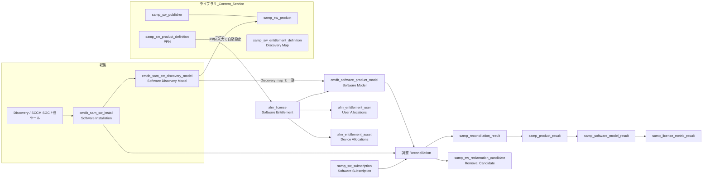
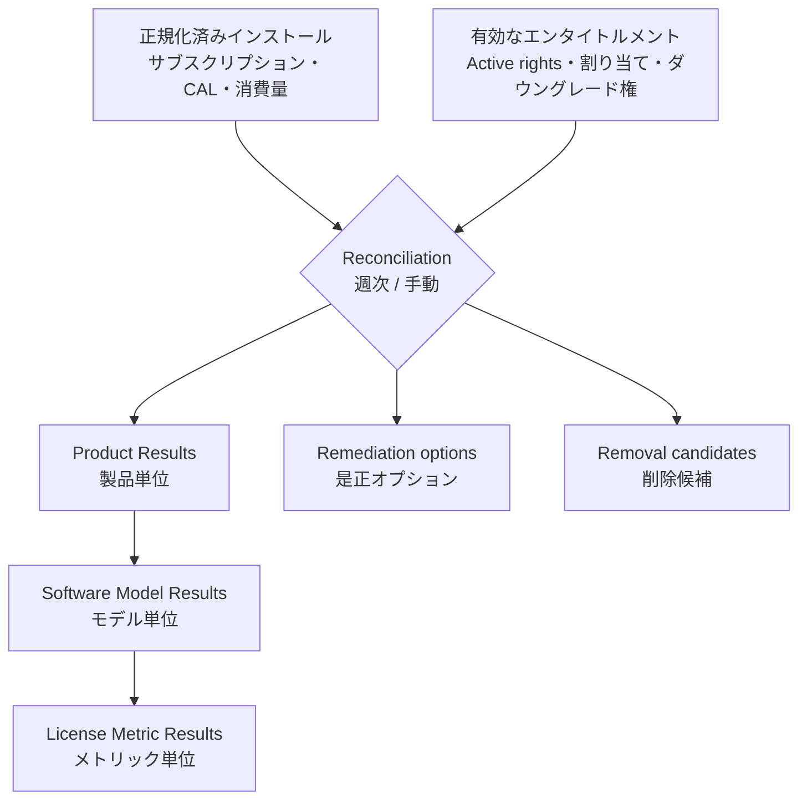
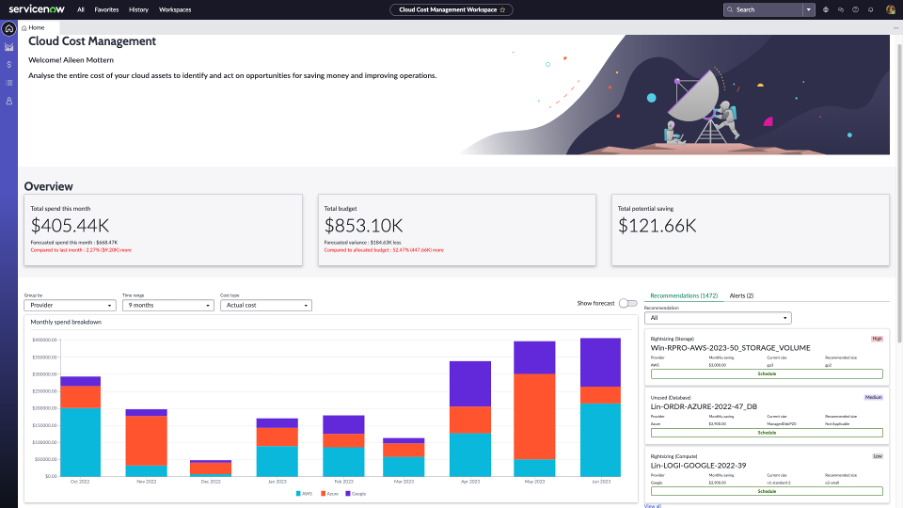
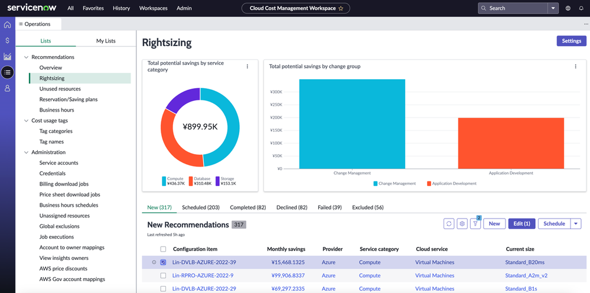
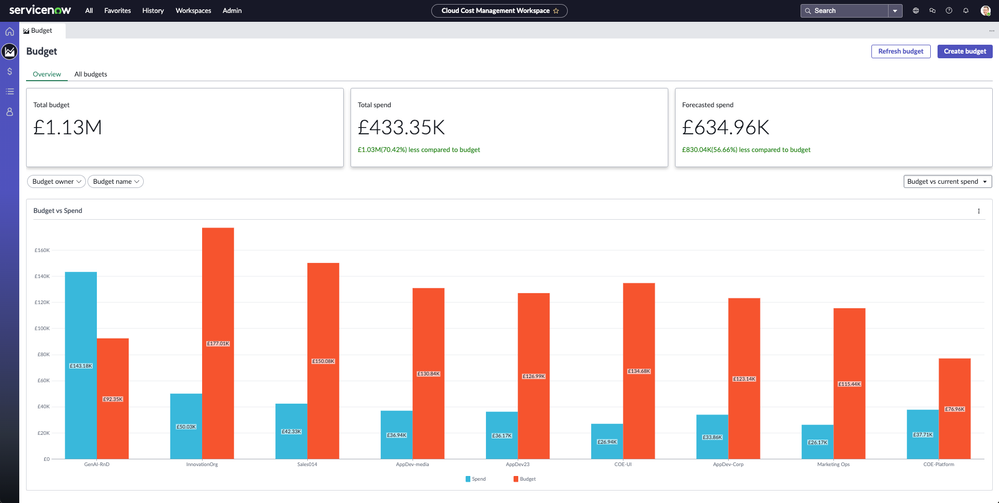

# Software Asset Management（ソフトウェア資産管理）

## 概要

ServiceNow **Software Asset Management（SAM、ソフトウェア資産管理）** は、IT Asset Management（ITAM、IT 資産管理）製品群のうちソフトウェアライセンスを対象とするアプリケーションであり、次の一連の処理を Now Platform 上で行う。

1. **Discovery / Normalization（ディスカバリーと正規化）**：Discovery・SCCM 等が収集したソフトウェアインストール情報を、ServiceNow が提供する Content Service（コンテンツサービス）のソフトウェアライブラリに照合して、パブリッシャー・製品・バージョン・エディションを正規化する。
2. **Licensing（ライセンス登録）**：購入済みライセンスを Software entitlement（ソフトウェアエンタイトルメント）として登録し、Software model（ソフトウェアモデル）と License metric（ライセンスメトリック）に紐づける。
3. **Reconciliation（調整、ライセンス照合）**：インストール・サブスクリプション・利用量と保有ライセンス（権利）を突き合わせ、コンプライアンス状況、True-up cost（追加購入コスト）、Over-licensed amount（過剰ライセンス額）、Potential savings（削減可能額）を算出する。
4. **Optimization / Reclamation（最適化と回収）**：未使用・低利用・未承認のソフトウェアを Removal candidate（削除候補）として抽出し、アンインストールや SaaS サブスクリプション解除で権利を回収する。

SAM は、オンプレミスソフトウェア向けの **SAM 本体**、主要ベンダー固有のライセンスルールを実装した **Publisher pack（パブリッシャーパック）**、SaaS 向けの **SaaS License Management**、エンジニアリングアプリ（同時使用ライセンス）向けの **Engineering Applications**、支出データからソフトウェア購入を検出する **Software Spend Detection** などの部品で構成される。パブリッククラウドのコスト最適化を行う **Cloud Cost Management（旧 Cloud Insights）** も ServiceNow 公式ドキュメント上は IT Asset Management 配下に置かれている。
[出典](https://www.servicenow.com/docs/r/australia/it-asset-management/software-asset-management/c_SAMOverview.html) [出典](https://www.servicenow.com/docs/r/w3Hg5id41C9xrkzqBsUMhA/VBamTjSy9iBPBn_vrxHQBg)

本ファイルの基準リリースは **Australia（2026-05 GA）**。SAM は Store アプリとして毎月更新されるため、Australia ファミリー上でも 2026-03（EA）〜2026-10 にかけて機能が追加されている点に注意する。ITAM 全体の製品構成、Asset と CI の関係、`alm_asset` 階層、契約管理は [ITAM 概要](itam-overview.md)、ハードウェアは [Hardware Asset Management](hardware-asset-management.md)、ソフトウェアインストールを収集する Discovery は [Discovery](../itom/discovery.md) を参照。

## 製品構成とパッケージ

### SAM のエディション（SAM Foundation / SAM Professional / SAM Enterprise）

ServiceNow の SAM には、プラットフォームに含まれる基本機能と、別途ライセンスが必要な上位製品がある。

| 区分 | プラグイン / アプリ | 概要 |
|---|---|---|
| SAM Foundation（Basic Software Asset Management） | `com.snc.sams` | 基本的な SAM 機能。公式ドキュメント（Australia リリースノート）では「Basic Software Asset Management」として foundation capabilities を提供すると記載され、有効化後に `sn_sam_workspace`（Software Asset Workspace）を有効化してセットアップを完了する。Kingston でリリースされ、旧「SAM plugin」（`com.snc.software_asset_management`）を置き換えた【第三者情報】（ServiceNow 社員による Community の回答。[出典](https://www.servicenow.com/community/sam-forum/difference-between-software-asset-management-foundation-and/td-p/1343114)）。 |
| SAM Professional（SAM Pro） | `com.snc.samp`（コア）、`com.sn_samp_master`（全 SAM Pro プラグイン一括）、`com.sn_samp_master_ws`（全 SAM Pro プラグイン + Software Asset Workspace） | 正規化、自動調整、パブリッシャーパック、回収、レポート等のフル機能。 |
| SAM Enterprise | （SKU。SKU に含まれる機能の内訳は公開情報では確認できず） | Australia では「Contract Management Pro との連携は SAM Enterprise ユーザーのみ」と明記。SaaS License Management 17.2.0（2026-04）以降は「SAM Pro または SAM Enterprise のエンタイトルメントが必要」と記載。Cloud Cost Management（旧 Cloud Insights）は SAM Enterprise に含まれる、とする ServiceNow の Community ブログ記事がある【第三者情報】（[出典](https://www.servicenow.com/community/cloud-cost-management-blog/what-s-new-in-vancouver-for-cloud-cost-management/ba-p/2675161)）。 |
| SAM AI Advanced / SAM AI Prime | Store アプリ（2026-04 に 1.0.4 初版） | AI 機能のアドオン。SAM AI Prime は「SAM Enterprise の全機能 + AI 機能」と説明されている。 |

[出典](https://www.servicenow.com/docs/r/IDeOjpA1hzonPLWG~inEpg/hxV2ryD~iqdV~Fv8cjqTjw) [出典](https://www.servicenow.com/docs/r/C17ZqvSaMwUVpMBg8Nc5sg/uB4a21~doMDVVaXwOU0dow) [出典](https://www.servicenow.com/docs/r/store-release-notes/store-rn-itam-sam-ai-prime.html)

- **プラグインのインストールと利用権の区別**：SaaS License Management（`sn_sam_saas_int`）と Software Spend Detection（`com.sn_sam_spend`）のプラグインは、SAM Professional を有効化するとインストールされる（後述「SAM Professional のプラグイン一覧」）。ただしこれはプラグインとしてインストールされることを示すにすぎず、SKU 上の利用権とは別である。SaaS License Management は 2026-04 以降のバージョン（Australia 向け 17.2.0 以降）で SAM Pro または SAM Enterprise のエンタイトルメントが必要。[出典](https://www.servicenow.com/docs/r/w3Hg5id41C9xrkzqBsUMhA/VBamTjSy9iBPBn_vrxHQBg) [出典](https://www.servicenow.com/docs/r/C17ZqvSaMwUVpMBg8Nc5sg/uB4a21~doMDVVaXwOU0dow)
- SAM Foundation と SAM Pro の最大の差は「正規化とライセンスポジション算出の自動化」にあり、Foundation ではディスカバリー済みインストールの正規化を手作業で行う必要がある、という説明が Community で繰り返されている【第三者情報】。ただし Store アプリ「Software Asset Management」2.0.0（2025-02）で、SAM Foundations でも共通メトリック（Per User / Per Device / Per Core / Per Processor）が使えるようになった。[出典](https://www.servicenow.com/docs/r/C17ZqvSaMwUVpMBg8Nc5sg/Rnudf1~03LaAf06FQR94OA)
- **2026-04 の製品ティア変更**：Australia の SAM リリースノート（2026-04）は、ServiceNow AI Platform に3つのライセンスティアを導入したと記載し、各ティアを次のように説明している：**Foundation**（AI basics to deliver insights：インサイトを提供する基本的な AI）、**Advanced**（AI to boost productivity across relevant use cases：関連ユースケース全体で生産性を高める AI）、**Prime**（Act autonomously with all AI assets, and create your own：すべての AI アセットで自律的に動作し、独自の AI も作成できる）。ライセンスに応じて利用できるアプリ機能、生成 AI スキル、エージェント型ワークフロー、AI エージェントが変わる。[出典](https://www.servicenow.com/docs/r/IDeOjpA1hzonPLWG~inEpg/hxV2ryD~iqdV~Fv8cjqTjw) ティアの詳細は ServiceNow product tiers ページ（Brazil 版）を参照。[出典](https://www.servicenow.com/docs/r/intelligent-experiences/enable-ai-experiences/ai-native-sku-overview.html) SAM の旧 Pro/Enterprise と新ティアの正式な対応表は公開情報では確認できず。ライセンス全般は [ライセンスモデル](../../03_導入編/01-licensing-model.md) と [エディション比較](../../03_導入編/03-edition-comparison.md) を参照。

### SAM Professional のプラグイン一覧

SAM Professional を有効化するとインストールされるプラグインは以下のとおり（公式ドキュメント「Components installed with Software Asset Management Professional」より。表の行として挙げられたものに加え、本文で言及される `com.snc.samp` と `com.sn_samp_workbench` も含めた）。

| プラグイン名 | プラグイン ID |
|---|---|
| Software Asset Management Professional | `com.snc.samp` |
| Software Asset Management UI Components | `com.sn_samp_workbench` |
| Activate all Software Asset Management Professional plugins including Software Asset Workspace | `com.sn_samp_master_ws` |
| Activate all Software Asset Management Professional plugins | `com.sn_samp_master`（公式ページでは pre-Xanadu 向けと記載） |
| Software Asset Workspace | `com.sn_sam_workspace`（Store アプリ ID は `sn_sam_workspace`）（pre-Xanadu の ID。Xanadu 以降は `com.sn_samp_master_ws` から読み込まれる） |
| Integration: Microsoft SCCM 2012 v2 Software Usage | `com.snc.samp_usage_sccm` |
| Integration: Microsoft SCCM 2016 Software Usage | `com.snc.samp.usage_sccm_2016` |
| Orchestration: Client Software Distribution | `com.snc.orchestration.client_sf_distribution` |
| Software Asset Management: SaaS License Management | `sn_sam_saas_int` |
| Software Asset Management: Spend Detection | `com.sn_sam_spend` |
| File Signature Normalization | `com.snc.file_signature_normalization` |
| Mobile Employee Experience My Asset | `com.glide.mobile-employee.myassets` |
| IT Asset Management Mobile | `com.sn_itam_mobile` |
| Software Asset Management Professional for Adobe | `com.sn_samp_adobe` |
| Software Asset Management Professional for Citrix | `com.sn_samp_citrix` |
| Software Asset Management Professional for IBM | `com.sn_samp_ibm` |
| Software Asset Management Professional for Microsoft | `com.snc.samp.microsoft` |
| Software Asset Management Professional for Oracle | `com.snc.samp.oracle` |
| Software Asset Management Professional for SAP | `com.sn_samp_sap` |
| Software Asset Management Professional for VMware | `com.sn_samp_vmware` |
| Software Asset Management Professional for Engineering Applications | `com.sn_samp_eng_app` |

[出典](https://www.servicenow.com/docs/r/w3Hg5id41C9xrkzqBsUMhA/VBamTjSy9iBPBn_vrxHQBg)（Xanadu 版ページ。Australia 版の同等ページは公開 URL を確認できず）

### SAM 関連の Store アプリ

SAM は複数の Store アプリに分割され、プラグインとは別に月次で更新される。Australia リリースノートでは、以下の Store アプリを申請（Request）するよう案内している。

| Store アプリ | 役割 |
|---|---|
| Software Asset Management（`sn_itam_samp`） | SAM Professional プラグインを補完するライセンス計算ロジック（2024-08 に 1.0.0 初版）。Australia 向けは 4.x、Brazil 向けは 5.x。 |
| Software Asset Workspace（`sn_sam_workspace`） | SAM の主 UI（Next Experience のワークスペース）。Australia 向けは 11.0.5（2026-05）。 |
| SaaS License Management（`sn_sam_saas_int`） | SaaS サブスクリプション管理。Australia 向けは 17.x、Brazil 向けは 18.x。 |
| Data Collection for Oracle GLAS | Oracle の GLAS（Global Licensing and Advisory Services）認定データ収集。 |
| IBM License Compliance | IBM のサブキャパシティ（ILMT 相当）ライセンス計算。 |
| ITAM Health Check | ITAM データの健全性チェック。 |
| Guided Experiences | ガイド付きセットアップ（Playbook）。 |
| SAM Admin Experience（`sn_samp_admin`） | Configuration Console（構成コンソール）。2026-10 追加（Australia Patch 7 以降）。 |
| SAM AI Advanced / SAM AI Prime | AI エージェント・AI 機能（後述）。 |

[出典](https://www.servicenow.com/docs/r/IDeOjpA1hzonPLWG~inEpg/hxV2ryD~iqdV~Fv8cjqTjw) [出典](https://www.servicenow.com/docs/r/C17ZqvSaMwUVpMBg8Nc5sg/Rnudf1~03LaAf06FQR94OA)

### 有効化時の注意点

- `com.sn_samp_master_ws`（SAM Professional with Software Asset Workspace）を有効化すると `com.sn_samp_master` と Store アプリ `sn_sam_workspace` も有効化される。**有効化後は Core UI（クラシック UI）が利用できなくなる**と公式リリースノートに記載がある。
- 一方で同じリリースノートには「クラシック UI はサポートが限定的だが有効なまま残り、新リリースへのアップグレード後も維持される」とも記載されており、既存環境のクラシック UI は継続利用可能、新規は Workspace 前提、と読むのが妥当【推定】。
- Xanadu 以降は SAM Pro の有効化オプションが一本化され、パブリッシャーパックも SAM Pro とまとめてインストールされる、という報告が Community にある【第三者情報】。一方で Adobe・Citrix のパックは ServiceNow への申請で有効化すると記載された公式ページもあり、インスタンスのバージョンで確認が必要。
- Australia Patch 7 以降、SAM と依存アプリは **Product Hub** からインストールでき、**Configuration Console**（AI 対話型インターフェース付き）で初期設定できる。

[出典](https://www.servicenow.com/docs/r/IDeOjpA1hzonPLWG~inEpg/hxV2ryD~iqdV~Fv8cjqTjw) [出典](https://www.servicenow.com/community/sam-forum/does-all-the-publisher-packs-6-will-be-activated-and-installed/m-p/3140164)

## ロール

### SAM のロール一覧

SAM Professional がインストールするロールは以下のとおり。

| ロール | 表示名 | 説明 | 含むロール |
|---|---|---|---|
| `sam_admin` | Software Asset Management administrator | SAM の完全な管理権限。エンタイトルメントインポート、回収ルール、調整の実行、カスタム製品、正規化ルール、Content Service の設定。 | `sam_user`、`sam_spend_import`、`asset`、`model_manager`、`contract_manager` |
| `sam_user` | Software Asset Management user | 管理機能以外のすべての SAM 機能。Spend Detection がインストールされていれば、財務データのインポートと Content Service 設定を除く Spend Detection 機能も利用可能。調整結果の参照が可能。 | `pa_viewer`、`cmdb_read`、`report_user`、`sn_remote_dir_sync.reader` |
| `sam_developer` | Software Asset Management developer | `sys_admin` に近いスクリプト作成権限。訓練を受けた ServiceNow 管理者専用。 | `sam_admin` |
| `sam_integrator` | SaaS License Management integration administrator | SaaS 連携プロファイルの作成・管理。 | `sam_user`、`connection_admin`、`flow_operator` |
| `sam_spend_import` | Software Spend Detection import user | Software Spend Detection への財務トランザクションデータのインポート。他ロールなしでは SAM を参照できない。 | `pa_viewer` |

[出典](https://www.servicenow.com/docs/r/w3Hg5id41C9xrkzqBsUMhA/VBamTjSy9iBPBn_vrxHQBg)

- SAM Foundation（Basic Software Asset Management）では、`sam_admin`（調整の実行と回収ルールの管理、`sam_user` を含む）と `sam_user`（管理以外の全機能）の2ロールが定義されている。[出典](https://www.servicenow.com/docs/r/MlbQAgTiiiMOLOw9T36wJg/sO_Hi9zq7foL5ZHYG~dweg)
- **Australia での変更**：Australia EA（2026-03）で、`sam_admin` や `sam_integrator` などの **粒度の細かい管理者ロール（granular admin roles）** により、`admin` ロールなしで限定的な管理作業を行えるようになった。[出典](https://www.servicenow.com/docs/r/IDeOjpA1hzonPLWG~inEpg/hxV2ryD~iqdV~Fv8cjqTjw)
- Software Asset Workspace の Activity center のうち「Scheduled jobs failed」「Last content download failed」アラート、および Software Asset Job Result / Asset Job Log テーブルの参照には `sam_admin` が必要。[出典](https://www.servicenow.com/docs/r/australia/it-asset-management/software-asset-management/sam-workspace-landing.html)
- SAM テーブルの読み取り専用ロールは OOB では用意されておらず、ACL で個別に設計する必要がある、という相談が Community にある【第三者情報】。ACL の設計は [アクセス制御（ACL）](../platform/access-control-acl.md) を参照。[出典](https://www.servicenow.com/community/sam-forum/oob-read-only-role-for-sam-tables-software-models-amp/m-p/3559163)

## ユーザーインターフェース

### Software Asset Workspace（ソフトウェア資産ワークスペース）

**Software Asset Workspace** は SAM の主 UI であり、All > Workspaces > Software Asset Workspace から開く。主なビュー（左ナビゲーション）は以下のとおり。

| ビュー | 内容 |
|---|---|
| Software asset overview（ソフトウェア資産概要） | ランディングページ。メトリクス、定型タスクのショートカット、アラート。Run Reconciliation ボタン。 |
| License usage（ライセンス使用状況） | パブリッシャー単位のコンプライアンス、調整結果、回収、レポート。 |
| License operations（ライセンス運用） | エンタイトルメント、ユーザーサブスクリプション（SaaS 連携プロファイル）、Software Spend Detection、製品ワークロードマッピング、エンジニアリングアプリ等の運用リスト。 |
| Activity center（アクティビティセンター） | 非同期のアラートと通知。 |

[出典](https://www.servicenow.com/docs/r/australia/it-asset-management/software-asset-management/sam-workspace-landing.html) [出典](https://www.servicenow.com/docs/r/IDeOjpA1hzonPLWG~inEpg/hxV2ryD~iqdV~Fv8cjqTjw)

#### Software asset overview のウィジェット（Australia）

`Software asset overview` ビューは、調整結果が出るたびに更新される以下のウィジェットを持つ。Publisher / Product フィルター、Published status フィルター（システムプロパティ `com.snc.samp.manage.published.products` 有効時のみ表示。既定は Published）、ソート（製品またはパブリッシャー）を備える。

| 区分 | ウィジェット |
|---|---|
| Compliance | Publishers out of compliance、Products out of compliance（License usage に遷移） |
| Financial | Over-licensed amount、Total true-up cost、Top 5 publishers true-up cost（円グラフ）、Potential savings（justification 別ドーナツ）、Actual savings（月次）、Software spend |
| Renewals | Expiring maintenance and subscription（6か月以内に満了するエンタイトルメント） |
| Normalization | Software installs normalization status（ドーナツ。Product フィルターのみ有効） |
| Lifecycle | End of life products（EOL 製品とインストール） |

Activity center のアラート例は「Removal candidates identified」「New normalization suggestions」「Unrecognized subscription identifiers」「Last reconciliation failure」「Scheduled jobs failed」「Entitlement import errors」「Renewals due in 90 days」など。通知例は「Last reconciliation completed」「New PPNs added to the library」「Review CMDB data quality」（CMDB success advisor for SAM を開く）など。Procurement 関連のアラートは Asset Management - Procurement Integration Store アプリがある場合のみ表示される。
[出典](https://www.servicenow.com/docs/r/australia/it-asset-management/software-asset-management/sam-workspace-landing.html)

> 画面スクリーンショット：Software Asset Workspace の公式ドキュメントは JavaScript で描画される SPA であり、画像を取得できなかった。画面は上記の文章説明と [公式ページ](https://www.servicenow.com/docs/r/australia/it-asset-management/software-asset-management/sam-workspace-landing.html) を参照。

### クラシック UI（Core UI）のメニュー

クラシック UI ではアプリケーションナビゲーターの **Software Asset** アプリケーション配下に、Overview、Licensing（Software Entitlements、Software Models 等）、Discovery（Software Installations、Discovery Models）、Reconciliation（Historical Results 等）、Optimization（Removal Candidates、Reclamation Rules）、Administration（Properties、Content Service 等）のモジュールが並ぶ。例：調整結果は **All > Software Asset > Reconciliation > Historical Results**。
[出典](https://www.servicenow.com/docs/r/yokohama/it-asset-management/software-asset-management/software-reconciliation-results.html)

- Australia 2026-09 で **Software Spend Detection がクラシック UI から削除**され、Workspace の License operations 配下に移動した（既存のインポートとトランザクションは引き継がれる）。[出典](https://www.servicenow.com/docs/r/IDeOjpA1hzonPLWG~inEpg/hxV2ryD~iqdV~Fv8cjqTjw)
- ワークスペース・UI 全般は [Workspace と UI Builder](../platform/workspaces-ui-builder.md)、[Next Experience UI](../platform/next-experience-ui.md) を参照。

## データモデル

### 全体像

SAM のデータは「発見されたもの（インストール・ディスカバリーモデル）」「ライブラリ（パブリッシャー・製品・PPN）」「管理対象（ソフトウェアモデル）」「権利（エンタイトルメント・割り当て）」「計算結果（調整結果）」に分かれる。

### 主要テーブル

| 区分 | テーブル | ラベル | 説明 |
|---|---|---|---|
| インストール | `cmdb_sam_sw_install` | Software Installation | 発見されたソフトウェアのインストール。Discovery・SCCM 等が書き込む。 |
| インストール | `cmdb_sam_sw_discovery_model` | Software Discovery Model | 発見された publisher/product/version の組み合わせ。正規化結果（Normalized publisher/product/version/edition）を保持。 |
| インストール | `cmdb_sam_sw_usage` / `samp_sw_usage` | Software Usage | 利用状況（回収判定に使用）。 |
| インストール | `cmdb_software_instance` | Software Instance | ソフトウェアインスタンス。 |
| モデル | `cmdb_software_product_model` | Software Model | ライセンス管理単位のソフトウェアモデル（`cmdb_model` の子）。 |
| モデル | `samp_sw_downgrade_model` / `samp_dmap_downgrade_model` | Downgrade Rights | ダウングレード権。 |
| モデル | `cmdb_m2m_suite_model` | Suite Component | スイート構成要素。 |
| 権利 | `alm_license` | Software Entitlement | ソフトウェアエンタイトルメント（`alm_asset` の子）。 |
| 権利 | `alm_entitlement_user` | User Allocations | ユーザー割り当て。 |
| 権利 | `alm_entitlement_asset` | Device Allocations | デバイス割り当て。 |
| 権利 | `samp_sw_license_metric` | License Metric | ライセンスメトリック。 |
| 権利 | `samp_sw_metric_group` | Metric Group | メトリックグループ。 |
| 権利 | `samp_sw_license_key` | License Key | ライセンスキー。 |
| 権利 | `samp_bulk_import` / `samp_entitlement_import` | Entitlement Import / Entitlement Import Error | エンタイトルメント一括インポートとエラー。 |
| 権利 | `samp_sw_client_access` | Client Access | CAL 等のクライアントアクセス。 |
| ライブラリ | `samp_sw_publisher` | Software publisher | パブリッシャー。 |
| ライブラリ | `samp_sw_product` | Software Product | 製品。 |
| ライブラリ | `samp_sw_product_definition` | Software Product Definition | PPN（Publisher part number）定義。 |
| ライブラリ | `samp_sw_entitlement_definition` | Discovery Map | ディスカバリーマップ。 |
| ライブラリ | `samp_custom_sw_product` / `samp_custom_sw_publisher` | Custom Software Product / Publisher | ライブラリにない製品・パブリッシャーの自社定義。 |
| ライブラリ | `samp_pattern_normalization_client_rule` | Pattern Normalization Rule | 自社のパターン正規化ルール。 |
| ライブラリ | `samp_normalization_suggestion` | Normalization Suggestion | 正規化の提案。 |
| ライブラリ | `sam_sw_product_lifecycle` / `sam_custom_sw_product_lifecycle` | Software Product Lifecycle | 製品ライフサイクル（EOL 等）。 |
| 調整 | `samp_reconciliation_result` | Reconciliation Result | 調整実行単位の結果。 |
| 調整 | `samp_publisher_result` | Publisher Result | パブリッシャー別結果。 |
| 調整 | `samp_product_result` | Product Result | 製品別結果。 |
| 調整 | `samp_software_model_result` | Software Model Result | ソフトウェアモデル別結果。 |
| 調整 | `samp_license_metric_result` | License Metric Results | ライセンスメトリック別結果。 |
| 調整 | `samp_entitlement_result` | Rights Used By | 権利の使用元。 |
| 調整 | `samp_remediation_option` | Remediation Option | 是正オプション。 |
| 調整 | `samp_group` / `samp_group_filter` | Reconciliation Group / Group Filter | 調整グループ。 |
| 調整 | `samp_license_position_report` | License Position Report | ライセンスポジションレポート。 |
| 回収 | `samp_sw_reclamation_candidate` | Removal Candidate | 削除候補。 |
| 回収 | `samp_sw_reclamation_rule` | Reclamation Rule | 回収ルール。 |
| 回収 | `samp_asset_reclaim_task` / `samp_asset_reclaim_line` | Software Asset Reclamation Task / Line | 回収タスク。 |
| SaaS | `samp_sw_subscription` | Software Subscription | SaaS ユーザーサブスクリプション。 |
| SaaS | `samp_sw_subscription_profile` | Integration Profiles | 連携プロファイル。 |
| SaaS | `samp_sso_integration_profile` / `samp_sso_application` | SSO Integration Profiles / SSO Applications | SSO 連携。 |
| SaaS | `samp_sw_unrecognized_subscription_identifier` | Unrecognized Subscription Identifiers | 未認識のサブスクリプション識別子。 |
| 設定 | `sam_property` / `samp_configuration` | SAM Properties / Software Asset Configuration | SAM の設定。 |
| ジョブ | `samp_job_log` | Software Asset Job Result | SAM ジョブ結果。 |
| 支出 | `sam_spend_transaction` | Software Spend Transactions | Spend Detection のトランザクション。 |

[出典](https://www.servicenow.com/community/sam-blog/list-of-servicenow-sam-tables/ba-p/2283573)【第三者情報】（ServiceNow Community の SAM ブログ記事のテーブル一覧。リリースにより追加・変更がある） [出典](https://www.servicenow.com/docs/r/yokohama/it-asset-management/software-asset-management/c_SAMDiscovery.html)

- Australia で、`alm_license`（Software Entitlement）と Override License Cost テーブルから **Database option 列が削除**された。[出典](https://www.servicenow.com/docs/r/australia/it-asset-management/software-asset-management/software-entitlement-fields.html)
- `alm_license` と `cmdb_software_product_model` の親階層（`alm_asset`、`cmdb_model`）は [ITAM 概要](itam-overview.md) を参照。

## ソフトウェアの収集と正規化

### Software discovery（ソフトウェアのディスカバリー）

SAM は `cmdb_sam_sw_install`（Software Installation）テーブルに格納されたインストール情報を使う。主な収集元は以下のとおり。

| 収集元 | 概要 |
|---|---|
| ServiceNow Discovery | Discovery パターンで Software Installations を作成。Citrix XenApp / XenDesktop、VMware vCenter、Microsoft SQL Server、Microsoft Exchange Server、Oracle Database Server 向けの基本パターンを持つ。Discovery プラグインの有効化が必要。 |
| Microsoft SCCM（Configuration Manager） | 主にデスクトップ向け。SCCM 2012 v2（`com.snc.integration.sccm2012v2`）/ 2016（`com.snc.integration.sccm2016`、SCCM 1606/1906/1910/2002 対応）の統合プラグインは SAM 認定だが、**レガシープラグインは今後のリリースで廃止予定**で、新規は **Service Graph Connector for Microsoft SCCM** を使う。既存ユーザーには Store の「Migration Readiness Tool for Service Graph Connector for SCCM」が用意されている。 |
| その他サードパーティツール | 手動または ServiceNow Store の連携アプリで追加。 |

[出典](https://www.servicenow.com/docs/r/yokohama/it-asset-management/software-asset-management/c_SAMDiscovery.html) [出典](https://www.servicenow.com/docs/r/australia/it-asset-management/software-asset-management/c_SAMOverview.html)

- インストールレコードの書き込み時、ビジネスルールが publisher/product/version の組み合わせが Discovery Model テーブルにあるかを確認し、あれば参照、なければ新しい Discovery Model レコードを作成する。
- 複数の収集元が同じソフトウェアを発見すると重複インストールが生じうる。
- Intune、Jamf、Tanium 等の Service Graph Connector は [Service Graph Connectors](../itom/service-graph-connectors.md) を参照。

> **Brazil での変更:** Store アプリ Software Asset Management 5.0.1（2026-09、Brazil）で **製品ごとの Deduplication rule（重複排除ルール）** が追加された。収集元をまたいだ重複検出、言語差異があっても一致判定、最も完全で最新のレコードを active install とする、各インストールにどのルールが適用されどのインストールが残ったかを表示、といった挙動になる。[出典](https://www.servicenow.com/docs/r/C17ZqvSaMwUVpMBg8Nc5sg/Rnudf1~03LaAf06FQR94OA)

### Normalization（正規化）

`Normalization`（正規化）は、発見されたパブリッシャー・製品・バージョン・エディションを Content Service のリポジトリと比較し、一致した値を Discovery Model の正規化フィールドに書き込む処理である（例：「Microsoft Corp」→「Microsoft」）。正規化された値が、エンタイトルメントとの調整とライセンスポジション算出に使われる。

| 項目 | 内容 |
|---|---|
| 実行タイミング | 日次のスケジュールジョブが正規化コンテンツとパターン更新を取得し、コンテンツルールに従って Discovery Model を正規化する（頻度は変更可能）。正規化ルール変更時は、影響を受ける Normalized / Partially Normalized のモデルが再正規化される。 |
| Normalization status（正規化ステータス） | `Normalized`、`Partially Normalized`、`Publisher Normalized`、`Match Not Found`、`Manually Normalized`、`New` |
| 手動正規化 / Revert | 手動正規化は Normalization status が `Partially Normalized` / `Publisher Normalized` / `Match Not Found` の Discovery Model に対して行い、ステータスは `Manually Normalized` になる。Revert（正規化の取り消し）は `Normalized` / `Partially Normalized` / `Publisher Normalized` のモデルの正規化値を削除して `Match Not Found` に戻すもので、`Manually Normalized` のモデルとパターン正規化ルールで正規化されたモデルは Revert できない。[出典](https://www.servicenow.com/docs/r/it-asset-management/software-asset-management/sam-normalization.html) |
| Normalization suggestion | 更新コンテンツが手動正規化と異なる場合に提案が生成され、承認／却下できる。 |
| Pattern normalization rule | 自社定義のパターン正規化ルール。Australia GA で拡張された（Expanded pattern-based normalization rule）。 |
| Wide-net normalization | Content Service チームが選んだ対象製品に適用される広範な正規化。 |
| ML 正規化 | 任意のプラグインで、機械学習により未認識ソフトウェアのバージョン・フルバージョン・エディションを予測。Australia GA で ServiceNow Protected Platform（SPP、シンガポール・オーストラリア）向けにも ML 正規化が提供された。 |
| Content Service へのデータ共有 | Software Asset Management Content Service にオプトインすると、未正規化のインストールデータを ServiceNow に共有し、新しいコンテンツ作成に使われる。Discovery Model の「Exclude from content service」で個別に除外できる。 |
| カスタム製品 | ライブラリにない製品は Custom product（カスタム製品）として作成できる。 |

[出典](https://www.servicenow.com/docs/r/yokohama/it-asset-management/software-asset-management/c_SAMDiscovery.html) [出典](https://www.servicenow.com/docs/r/australia/it-asset-management/software-asset-management/c_SAMOverview.html) [出典](https://www.servicenow.com/docs/r/IDeOjpA1hzonPLWG~inEpg/hxV2ryD~iqdV~Fv8cjqTjw)

## Software model（ソフトウェアモデル）

### Software model の役割

`cmdb_software_product_model`（Software Model）は、ライセンスを管理・調整する単位であり、**Discovery map（ディスカバリーマップ）** によってどの Discovery Model（発見されたソフトウェア）がこのモデルに属するかを決め、エンタイトルメントとインストールを結びつける。PPN（Publisher part number）が正しく入力されたエンタイトルメントを作成すると、対応するソフトウェアモデルが自動作成される。
[出典](https://www.servicenow.com/docs/r/australia/it-asset-management/software-asset-management/software-model-fields.html)

### Software model の主要フィールド（Details タブ、Australia）

| フィールド | 説明 |
|---|---|
| Display name | publisher・product・version・edition・platform・language から自動生成（形式はシステムプロパティで制御）。 |
| Status | `In Production`、`Retired`、`Sold` |
| Publisher | パブリッシャー（社内の Company から選択）。 |
| Product | ソフトウェア製品。ライブラリになければカスタム製品を作成可能。 |
| Version condition / Version | バージョンの一致条件（`starts with` / `is` / `is anything`、既定は `is anything`）と値。 |
| Edition condition / Edition | エディションの一致条件と値。 |
| Discovery map | どの Discovery Model をこのモデルにマップするかの条件。変更するとダウングレード権も変わりうる。 |
| Next version | 次バージョンのモデル（Discovery map から設定、手入力値は保持）。 |
| Product classification | UNSPSC 分類コード。 |
| Product type | `Child`、`Driver`、`Licensable`、`Not Licensable`、`Patch`、`Unknown`。**Licensable のみ調整対象**。 |
| License under management | 調整に含めるかどうか（既定で選択）。 |
| Owner | モデルの責任者。 |
| Unit of consumption | 消費単位。 |
| Software install condition | 調整でカウントするインストールを限定する条件。 |
| Subscription condition | 調整でカウントするサブスクリプションを限定する条件（サブスクリプション型モデルのみ）。 |
| Platform / Language | 一致判定用（既定は Anything）。 |
| Asset tracking strategy / Asset tracking unit | 資産追跡方法の上書きと単位。 |
| Cost | 1単位あたりのコスト。 |
| Certified | TRM（Technology Reference Model）で承認済みか。 |
| Restricted software | インストール禁止ソフトウェア。選択すると関連インストールすべてが削除候補になる。 |
| License all installs | ソフトウェアがインストールされたすべての CI をライセンス対象にする（Resource value または Client access レコードに紐づくモデルのみ、Oracle Database を除く）。**Australia 2026-09 で「License all installs accessed by clients」から改名**。 |
| Database option / Database option condition | Oracle Database のオプション・管理パック識別子と、その調整条件。 |
| Apply to subscriptions | サブスクリプション型スイートに限定。 |
| Auto-generate client access for allocations | Oracle Database 専用。Client access レコードを自動管理（GLAS アプリが必要）。 |
| Catalog Item / Description / Picture | サービスカタログ公開時の情報。 |

[出典](https://www.servicenow.com/docs/r/australia/it-asset-management/software-asset-management/software-model-fields.html) [出典](https://www.servicenow.com/docs/r/IDeOjpA1hzonPLWG~inEpg/hxV2ryD~iqdV~Fv8cjqTjw)

### Software model の関連タブ（Australia）

| タブ | 主な内容 |
|---|---|
| Suite Components / Suite Parents | スイートの子・親製品。Mandatory（`Optional` / `Always Mandatory` / `Mandatory Group`）、Suite relationship assumed（推定されたスイート関係）、Inference Option（Number / Percent：スイートとみなす構成要素の数・割合）、Allow automated content update。 |
| Software Product Lifecycles | Lifecycle type（`Internal` / `Publisher` / `Publisher Add-On`）、Lifecycle phase（`Pre Release` / `General Availability` / `Upgrade`（Internal のみ）/ `End of Support` / `End of Extended Support` / `End of Life`）、Risk（`Very High`〜`None`）、Source（`Internal` / `ServiceNow`）。 |
| Software Entitlements | このモデルのエンタイトルメント一覧。 |
| Override License Costs | ライセンスコストの上書き。License & Maintenance Cost を設定すると True-up 計算に使われる（SaaS は License cost のみ）。メトリックが Employee の場合は Lower/Upper limit で従業員数レンジ別に設定。 |
| SAP Engine Usages | SAP エンジン利用（User CAL / Device CAL / User/Device CAL、メモリ GB 等）。 |
| Software Model Results | 調整結果（Status：`Compliant` / `Not Compliant`、Agreement type、Unlicensed installs、True-up cost、Over-licensed amount、Potential savings、Group / Subgroup）。 |
| Metric Attributes | メトリック属性（Attribute、Attribute value、Attribute value is unlimited）。 |
| Vendor Catalog Items | ベンダーカタログ価格。 |
| Client Access | CAL 等（User CAL / Device CAL / User/Device CAL / Reserved Hourly Average Sensor / Sensor Subscription。後2者は CrowdStrike 専用）。 |
| Software Subscriptions | SaaS サブスクリプション（User principal name、Last activity、Inactive days、Subscription profile）。 |
| Downgrade Rights | ダウングレード権（Parent software model、Source、Active）。 |
| Matching Discovery Models | このモデルにマップされた Discovery Model と Normalization status。 |
| Group Allocations | グループ割り当て（Assignment Group、Status：`New` / `Not allocated` / `Fully allocated` / `Partially allocated`、License metric：Per Named User / Per User / User Subscription、Allocated Quantity、Entitlement condition）。Store アプリ 3.0.0（2025-08）で追加。グループメンバー変更に追従。 |

[出典](https://www.servicenow.com/docs/r/australia/it-asset-management/software-asset-management/software-model-fields.html) [出典](https://www.servicenow.com/docs/r/C17ZqvSaMwUVpMBg8Nc5sg/Rnudf1~03LaAf06FQR94OA)

### Downgrade rights（ダウングレード権）

`Downgrade rights`（ダウングレード権）は、新しいバージョンのために取得した権利で旧バージョンをライセンスできるようにする機能である。エンタイトルメントの Agreement type によって自動生成されるダウングレード権が決まる。ソフトウェアモデル上でダウングレード権を無効化すると、関連エンタイトルメントにも伝播する。
[出典](https://www.servicenow.com/docs/r/australia/it-asset-management/software-asset-management/c_SAMOverview.html) [出典](https://www.servicenow.com/docs/r/australia/it-asset-management/software-asset-management/software-entitlement-fields.html)

> **Brazil での変更:** Store アプリ 5.0.1（2026-09）で **Automatic suite license inference（スイートライセンスの自動推定）** が追加され、インストールごとに最適なスイートライセンスが計算される。単独でライセンスできないスイート構成要素は個別結果ではなくスイートに集約される。また Core Infrastructure Server、Windows Server、System Center は関連製品としてまとめてライセンスされる。[出典](https://www.servicenow.com/docs/r/C17ZqvSaMwUVpMBg8Nc5sg/Rnudf1~03LaAf06FQR94OA)

## Software entitlement（ソフトウェアエンタイトルメント）

### Software entitlement の役割

`alm_license`（Software Entitlement）は購入したソフトウェアの権利（ライセンス）を表す資産レコードで、Software model と License metric に紐づき、調整時に「保有権利（Rights owned）」として計上される。エンタイトルメントは手入力のほか、Entitlement import（Excel テンプレートによる一括インポート）で登録できる。
[出典](https://www.servicenow.com/docs/r/australia/it-asset-management/software-asset-management/software-entitlement-fields.html)

### Software entitlement の主要フィールド（Australia）

| フィールド | 説明 |
|---|---|
| Display name | ソフトウェアモデル名から自動生成。 |
| Asset tag | 資産タグ。 |
| Publisher part number（PPN） | Software Product Definitions を参照。該当モデルがあれば Software model が自動設定され、なければフォームから作成。50以上のスイート構成要素を持つ製品では、構成要素・ダウングレード権・次バージョンのモデル不足時に検証メッセージが出る。 |
| Software model | 一致するソフトウェアモデル。 |
| Agreement type | 自動生成されるダウングレード権を決める。**エンタープライズ契約タイプ**（Enterprise Agreement、Enterprise Enrollment、Enterprise Subscription Agreement、Enterprise Subscription Enrollment、ELA、ETLA、SCE、ULA）は、未ライセンスのインストールがあってもステータスを Compliant に保つ。 |
| License type | `Perpetual`、`Perpetual + Software Assurance`、`Software Assurance`、`Subscription`、`Step-up`、`Subscription Step-up`、`Add-on`、`From SA`。SaaS は既定で Subscription。 |
| Metric group | ソフトウェアモデルから自動設定。パブリッシャー固有のメトリック群。Consumption / Subscription の場合 License type は Subscription になる。 |
| License metric | 調整でカウントするメトリック（Metric group により選択肢が変わる）。SaaS は既定で User Subscription。 |
| Unlimited license | 無制限ライセンス（True-up コストなしで任意数を許諾）。 |
| Subscription period | `Monthly`、`Quarterly`、`Annually`、`Entire Subscription Period` |
| Start date / End date | サブスクリプション・保守・SA の期間。End date 到達で保守フラグがクリアされ、Software Assurance は Retired になる。 |
| Rights per license pack / Number of packs | Microsoft Per Core / Per Core with CAL 用（例：SQL Server のコアライセンスは2コアパック）。Purchased rights = 両者の積。 |
| Purchased rights | 購入権利数。変更すると Expense line（費用明細）が更新される。Australia から SAP Engine 製品の売上ベースライセンスに対応。 |
| Active rights | 付与されている有効権利数（エンタープライズ契約が付いていると非表示）。 |
| Allocations available | Active rights − 割り当て数の合計。 |
| Unit cost / Total cost | 単価と総額。ダッシュボードの総コスト・削減額の算出に必須。 |
| Total units | Metric group が Consumption の場合のみ。 |
| Unrestricted consumption | 任意のエンティティが消費可能。Consumption rule のエンティティは License pool から予約権利を引く。 |
| State | `On order`、`In stock`、`In transit`、`In use`、`Consumed`、`In maintenance`、`Retired`、`Missing`、`Build`。新規は Build で、公開（publish）時に In use。Retired にすると Active rights は 0。サブスクリプションは開始・終了日から自動更新。 |
| Active maintenance | Subscription / SA / 保守が有効なとき自動で選択。 |
| Purchased（Financial タブ） | 購入日。AWS / Azure の Microsoft 専用ホストルールの調整で使用。 |

[出典](https://www.servicenow.com/docs/r/australia/it-asset-management/software-asset-management/software-entitlement-fields.html)

### Software entitlement の関連タブ

| タブ | 内容 |
|---|---|
| User Allocations（`alm_entitlement_user`） | ユーザーベースメトリック（Per User、User CAL 等）のみ表示。Assigned condition、Assigned to、Quantity、License key、Group（グループ割り当て由来の場合）。 |
| Device Allocations（`alm_entitlement_asset`） | デバイスベースメトリック（Per Device、Device CAL 等）のみ表示。Allocated condition、Assigned to、Quantity、License key。 |
| Related Entitlements | 関連エンタイトルメント（例：保守と永久ライセンス）。 |
| Upgraded Entitlements | アップグレード元（From Entitlement、Number of rights）。複数元可（例：Office 2013→2016）。移した権利は元で無効化。 |
| Downgrade Rights | ダウングレード権（Order、Start/End date）。 |
| Entitlement Consumption Rules | Consumption rule と License pool（エンティティ間で権利を共有）。Workday や RVU / Employee 等のメトリックでは非表示。 |
| License Key | ライセンスキー（エンタイトルメント内で一意）。 |
| License Metric Tier | 段階型メトリック用（Tier level、Range from / to、Tier factor）。Australia 2026-09 で追加。 |
| Contracts | 契約（`ast_contract`）。インポートでは Contract number 列で既存契約に紐づけ、一致しなければインポートエラー。 |

- 保守エンタイトルメントが永久ライセンスに関連付けられている場合、調整時に保守コストが総コストに含まれる。[出典](https://www.servicenow.com/docs/r/australia/it-asset-management/software-asset-management/software-entitlement-fields.html)
- **Australia 以降の AI 機能**：Patch 1 で契約書からのエンタイトルメント抽出（AI）、Patch 3 / 2026-06 でエンタイトルメントインポートエラーの AI 修正提案と重複候補検出が追加された（後述「AI 機能」）。[出典](https://www.servicenow.com/docs/r/IDeOjpA1hzonPLWG~inEpg/hxV2ryD~iqdV~Fv8cjqTjw)

## License metric（ライセンスメトリック）

### Metric group とメトリック一覧

`License metric`（ライセンスメトリック）はエンタイトルメントに設定され、メトリックグループとソフトウェアモデルの範囲で調整に使われる。パブリッシャー固有のメトリックは対応するパブリッシャーパックが必要。

| Metric group | 必要コンポーネント | 主なメトリック |
|---|---|---|
| Common | なし | Per Core、Per Device、Per Named Device（割り当て必須）、Per Named User（割り当て必須）、Per Processor（CPU count）、Per User、User CAL、Device CAL、User/Device CAL、Resource Consumption |
| Microsoft | Microsoft パック | Device CAL、Per Core（New York で廃止された Per Core (Physical Core) / Per Core (Virtual OSE) を置換）、Per Core (with CAL)、Per Device、Per Processor、Per User、Server (Per Instance)、Server (Per Server)、User CAL、User Subscription |
| Oracle | Oracle パック | Named User Plus、Per Processor、Employee |
| IBM | IBM パック | Authorized User、Authorized User Value Unit、Employee / External User Value Unit、Per Device、Per Named User、Per Processor、Per User、PVU（Processor Value Unit、フル／サブキャパシティ）、RVU（Resource Value Unit）、VPC（Virtual Processor Core、IBM License Compliance アプリが必要） |
| Red Hat | IBM パック | Per Socket-pair、Per Core |
| SAP | SAP パック | Named User、Engine Measurement、Digital Access、Full Usage Equivalent（FUE） |
| VMware | VMware パック | Per Application Instance、Per Device、Per Named User、Per OSI、Per Processor（既定で32コアごとに1ライセンス） |
| Citrix | Citrix パック + ディスカバリースケジュール | Concurrent User、Per Device、Per Processor、Per User、Per User/Device |
| Adobe | Adobe パック | Per Device、Per User、User Subscription |
| CrowdStrike | `sn_sam_saas_int` 15.0.8 以降 + `sn_itam_samp` 2.1.0 以降 | Reserved Hourly Average Sensor（28日間の時間単位平均）、Sensor Subscription（4週間の週次平均） |
| Concurrent Licenses | `com.sn_samp_eng_app` + OpenLM / Open iT 連携 | Floating、Token、Network（いずれもピーク時チェックアウト数で消費） |
| Consumption | SaaS License Management | SaaS Consumption |
| Subscription | SaaS License Management | User Subscription |

[出典](https://www.servicenow.com/docs/bundle/yokohama-it-asset-management/page/product/software-asset-management2/concept/c_SAMLicenseMetrics.html)（Yokohama 版。Australia で追加されたメトリックは下記）

- **Australia GA（2026-05）**：Oracle WebLogic Suite のライセンス（Per Processor / NUP、Suite エディション含む）、SQL Server Enterprise Server+CAL の拡張ルール（1つのサーバーライセンスで最大4 VM、合計20ハードウェアスレッド／コア以内）。
- **Australia 2026-09**：追加の定義済みライセンスメトリックと License Metric Tier タブ（段階型・ボリューム型、IBM・VMware 等向け）。
- **Australia 2026-08**：IBM License Compliance 7.0.0 以降で Nutanix AHV 上の IBM サブキャパシティライセンス（30分間隔のキャパシティスキャン）。
- Store アプリ 3.0.0（2025-08）で VMware vSphere Standard（VVS）/ vSphere Essentials Plus（VVEP）、Hyper-V 上の Microsoft サーバー製品、SQL Server 高可用性構成（Always On 等）の自動識別に対応。3.2.0（2025-12）で Azure 上 Windows Server の Per Processor BYOL に対応。

[出典](https://www.servicenow.com/docs/r/IDeOjpA1hzonPLWG~inEpg/hxV2ryD~iqdV~Fv8cjqTjw) [出典](https://www.servicenow.com/docs/r/C17ZqvSaMwUVpMBg8Nc5sg/Rnudf1~03LaAf06FQR94OA)

> **Brazil での変更:** SAP S/4HANA Cloud, Public Edition では「Full Usage Equivalent」メトリックが「User Subscription」に改名（計算は不変、Private Edition は FUE のまま）。SAP System Users テーブルの「Named user type」は「License classification」に改名。SAP パックで SAP S/4HANA Cloud, Private Edition のライセンス管理（FUE の自動計算）が追加。[出典](https://www.servicenow.com/docs/r/delta-australia-brazil/brazil-australia-softwareassetmanagement-release-notes.html)

## Reconciliation（調整）

### Reconciliation の仕組み

`Reconciliation`（調整）は、Licensable な製品について、使用中の権利（インストール、サブスクリプション、クライアントアクセス、消費量）と有効な購入済み権利（Active rights）を比較し、コンプライアンス状況と是正策を算出する処理である。

| 項目 | 内容 |
|---|---|
| 実行方法 | スケジュールジョブ（**既定は週次**）、または手動実行（特定パブリッシャーまたは全パブリッシャー）。 |
| 対象 | ソフトウェアエンタイトルメントまたはソフトウェアインストールを持つ製品。Product type が Licensable、かつ License under management が選択されたモデル。 |
| 必要ロール | `sam_user` または `sam_admin`（Foundation では調整実行は `sam_admin`）。 |
| グループ化 | Group / Subgroup：`None`、`Country`、`Department`、`Company`、`Region`、`Cost Center`。 |
| ドメイン | ドメインセパレーション有効時は Domain フィルターが表示される（[ドメインセパレーション](../platform/domain-separation.md)）。 |
| 実行ステータス | `Completed`、`In Progress`、`Failed`（履歴では `Partially Completed` もあり）。 |
| 実行結果のフィールド | Number、Last reconciled、Status、Ran for、Publishers、Group、Subgroup、Progress、Progress summary、Updated。 |

[出典](https://www.servicenow.com/docs/r/pyt4lF0aAin_R6wVyV414Q/SUHzxdFqMeO8rQemacW3sA) [出典](https://www.servicenow.com/docs/r/Mr7qUatbFXax1_h~z60rmA/sW11X9AzruabBLe5sfYRTA) [出典](https://www.servicenow.com/docs/r/1zMxrAxr2iK81FYv03BwFA/4DsgjV93XfS5XdUvFJKXAw)

### Workspace で調整を実行する手順（Australia）

1. **Software Asset Workspace > Software asset overview > Run Reconciliation**、または **Software Asset Workspace > License usage > Run Reconciliation** を開く。
2. パブリッシャー（または全パブリッシャー）を選択する。全件実行は時間がかかるため、特定パブリッシャーの選択が推奨される。
3. 必要に応じて Group / Subgroup を選択する。
4. **Run Reconciliation** を選択する。完了後、結果は License usage の Reconciliation タブに表示される。

[出典](https://www.servicenow.com/docs/r/pyt4lF0aAin_R6wVyV414Q/SUHzxdFqMeO8rQemacW3sA)

### 調整結果の3階層

| 階層 | 内容 | 主な関連リスト |
|---|---|---|
| Product Results（製品結果） | 製品・パブリッシャー単位のコンプライアンス。True-up cost、Over-licensed amount、Potential savings。ライセンス可能なすべての製品について生成。 | Software Model Results、Licensed Installs、Unlicensed Installs（SAP は Unlicensed Users / Engines）、Unlicensed Subscriptions、Removal Candidates |
| Software Model Results（ソフトウェアモデル結果） | モデル単位のコンプライアンス（`Compliant` / `Not Compliant`）。**エンタイトルメントを持つモデルのみ生成**（プロパティ `com.snc.samp.unlicensed_smr_creation` を true にすると未ライセンスモデルにも生成）。 | License Metric Results、Remediation Options、Licensed / Unlicensed Installs、Unlicensed Subscriptions、Unlicensed Consumptions、Unlicensed Options（Oracle のみ）、Removal Candidates、Purchase Orders（`com.snc.procurement` 有効時） |
| License Metric Results（ライセンスメトリック結果） | モデル内のメトリックごとの保有数と使用数。 | Rights Used By（IBM RVU では非表示）、Licensed Installs、Installs Used（SAP は System Users）、Downgrades/Upgrades、Licensed Subscriptions、Cloud Special Rights（AWS / Azure のクラウドインストールがある場合） |

[出典](https://www.servicenow.com/docs/r/yokohama/it-asset-management/software-asset-management/software-reconciliation-results.html) [出典](https://www.servicenow.com/docs/r/1zMxrAxr2iK81FYv03BwFA/4DsgjV93XfS5XdUvFJKXAw)

### Remediation（是正）のカテゴリ

SAM Foundation（Basic Software Asset Management）の調整結果は、以下の是正カテゴリで権利の過不足を示す：`Rights not in use`（未使用の権利）、`Rights not allocated`（未割り当ての権利）、`Rights needed`（不足権利）、`Reclaimable rights`（回収可能な権利）、`Unlicensed rights`（未ライセンス）。
[出典](https://www.servicenow.com/docs/r/Mr7qUatbFXax1_h~z60rmA/sW11X9AzruabBLe5sfYRTA)（SAM Foundation プラグイン向けページ）

Software Model Results の Remediation Options（是正オプション）は、公式ページ「View software model results」（Yokohama 版。ページ上で SAM Pro 向けと明記はされていないが、`sam_user` ロールが必要）では Remediation action（是正アクション）として以下の値が挙げられ、アクションごとに表示される数量フィールドが異なる。Australia 版で同じ値かどうかは公開情報では確認できず。

| Remediation action（是正アクション） | 表示される数量フィールド |
|---|---|
| Purchase Rights（権利の購入） | `Rights needed`（不足権利） |
| Remove Allocations（割り当ての解除） | `Rights not in use`（未使用の権利） |
| Create Allocations（割り当ての作成） | `Rights not allocated`（未割り当ての権利） |
| Remove Unallocated Installs（未割り当てインストールの削除。Oracle Database のオプションでは利用不可） | `Reclaimable rights`（回収可能な権利） |
| Remove Unlicensed Installs（未ライセンスインストールの削除。Oracle Database のオプションでは利用不可） | `Unlicensed rights`（未ライセンス） |
| Remove Unlicensed Installs - Cloud（クラウドインストールがある場合のみ） | 公開情報では確認できず |

[出典](https://www.servicenow.com/docs/bundle/yokohama-it-asset-management/page/product/software-asset-management2/task/t_ViewSWModelResults.html)

### License usage ビュー

`License usage` ビューは、パブリッシャー単位のコンプライアンスと使用傾向を表示する。

| タブ | 内容 |
|---|---|
| Publishers | パブリッシャーカード（緑＝準拠、赤＝非準拠、コンプライアンス率、調整失敗時は赤アイコン）。カード／リスト切替、ピン留め（`samp_pinned_user_publisher` に保存）、Domain・コンプライアンス状況・公開状況でのフィルター、True-up cost・Over-licensed amount・Potential savings でのソート。カードを選ぶと製品→ソフトウェアモデル→ライセンスメトリックのツリー（各ノード `Compliant` / `Not compliant` / `Failed`）。Product Install Analysis（パブリッシャー単位でインストールのライセンス状況を階層表示）。 |
| Reconciliation | 調整の実行履歴。 |
| Reclamation | パブリッシャー、SaaS 連携、インストール済みソフトウェア、調整フローをまたいだ回収候補の統合サマリー。**Australia 2026-10 で Removal candidates タブを置き換え**。 |
| Reports | Software Product Lifecycle report、Software License Compliance Position、Oracle / Microsoft インフラレポート、Azure BYOL savings、SaaS detection、Discovery map が無効化されたモデル等のベースレポート。 |
| ELP Grouping | 調整を再実行せずに、既存の調整グループで Effective License Position（実効ライセンスポジション）をまとめたレポートを生成（Store アプリ 3.0.0 で追加）。 |

[出典](https://www.servicenow.com/docs/r/1zMxrAxr2iK81FYv03BwFA/4DsgjV93XfS5XdUvFJKXAw) [出典](https://www.servicenow.com/docs/r/IDeOjpA1hzonPLWG~inEpg/hxV2ryD~iqdV~Fv8cjqTjw)

- **Australia で追加されたレポート**：GA で「ソフトウェアライフサイクルレポートのガイド付き Playbook」と「Microsoft Server Infrastructure and License consumption の統合レポート」（除外理由付き）。License Usage で未ライセンスエンティティの理由コードとガイダンスが明確化された（Store アプリ 4.0.0）。[出典](https://www.servicenow.com/docs/r/IDeOjpA1hzonPLWG~inEpg/hxV2ryD~iqdV~Fv8cjqTjw) [出典](https://www.servicenow.com/docs/r/C17ZqvSaMwUVpMBg8Nc5sg/Rnudf1~03LaAf06FQR94OA)

## Optimization と Reclamation（最適化と回収）

### オンプレミスソフトウェアの回収

`Reclamation`（回収）は、未使用・未承認のソフトウェアをデバイスからアンインストールし、ライセンスを必要なユーザーに再配分する処理である。

| 項目 | 内容 |
|---|---|
| 候補生成ジョブ | **SAM - Identify new reclamation candidates**（月次）。回収ルールとソフトウェア利用状況から削除候補を作成（bulk reclamation フラグ付き）。実行前に少なくとも1回の調整が正常完了している必要がある。 |
| その他の候補生成 | 未ライセンス・未割り当てのインストール、Restricted software（モデルを Restricted にすると関連インストールすべて）。 |
| 除外 | ソフトウェア資産を Retired / Missing にするとインストールが削除され、削除候補は作られない。 |
| スイート | ユーザー単位でスイート全体の候補を1件作成（構成要素の個別回収は不可）。 |
| 更新ジョブ | **SAM - Updating Existing Reclamation Candidates**（週次）。Awaiting Revocation でインストールが消えたものを Closed Complete に、他の状態でインストールが空のものを Closed Skipped にする。 |
| 自動アンインストール | Client Software Distribution（CSD、`com.snc.orchestration.client_sf_distribution`）で自動化。手動アンインストールタスクの生成も可。 |
| フロー | Zurich から Flow Designer の **Software Reclamation Flow**（エラーハンドリング付き）。 |
| 利用データ | ソフトウェア利用レコード（回収ルール、サードパーティ連携、SCCM Software Usage 連携から作成）。 |

[出典](https://www.servicenow.com/docs/r/1zMxrAxr2iK81FYv03BwFA/5IomUwdHuahRQ0OEkm_QXA)

#### Justification（回収理由）

| Justification | 承認 |
|---|---|
| Low Usage（低利用） | ユーザーに削除の承認／却下を求め、ユーザーが継続利用を希望した場合はマネージャー（manager）の承認へ回る。 |
| Unallocated（未割り当て） | ユーザーに削除の承認／却下を求め、ユーザーが継続利用を希望した場合はソフトウェアマネージャー（software manager）の承認へ回る。 |
| Unlicensed（未ライセンス） | 承認なしで自動実行（「Unauthorized Software Use」通知）。 |
| Restricted Software（禁止ソフトウェア） | 承認なしで自動実行（「Unauthorized Software Use」通知）。 |

[出典](https://www.servicenow.com/docs/r/1zMxrAxr2iK81FYv03BwFA/5IomUwdHuahRQ0OEkm_QXA)

#### Removal candidate の状態

| 状態 | 意味 |
|---|---|
| `Attention Required` | Notify User 付きの自動候補で User が空、または回収失敗。 |
| `Ready` | 回収可能。Reclaim または Reclaim All で進める。 |
| `Awaiting User` | ユーザーに承認／却下を通知済み（Notify User 有効かつ days-before-reclamation > 0）。 |
| `Awaiting Approval` | ユーザーが保持を希望し、マネージャーが判断。 |
| `Awaiting Revocation` | クローズ前の最終段階（Restricted / Unlicensed は自動でここへ）。 |
| `Closed Complete` | 権利を回収済み。 |
| `Closed Skipped` | 回収しなかった（User 空など）。 |
| `Closed Canceled` | ユーザーの利用が検出されたため取消。 |

[出典](https://www.servicenow.com/docs/r/1zMxrAxr2iK81FYv03BwFA/5IomUwdHuahRQ0OEkm_QXA)

- 1つの製品に Last used と Total usage の両方の回収ルールを設定すると、フィールドが空の削除候補が作られることがあるため、製品ごとにルールは1つにすべき、という Community の回答がある【第三者情報】。[出典](https://www.servicenow.com/community/sam-forum/removal-candidates-are-getting-created-with-empty-fields/m-p/3188015)
- Zurich へのアップグレード時、Awaiting Revocation 以外の候補は取消され、スイートごとに1件の候補が再作成される。アップグレード全般は [アップグレード管理](../../03_導入編/13-upgrade-management.md) を参照。

> **Brazil での変更:** Store アプリ 5.1.0（2026-09、Brazil）で **Reclamation Summary Table**（justification・applies-to・製品／モデル単位で候補を集約）と、**Oracle の回収候補の自動生成** が追加された。SAM AI Advanced / Prime 2.7.0（2026-10）の **Evaluate Software Reclamation AI Agent** は、この Reclamation Summary データを使って連携プロファイル・ソフトウェアモデル単位で削除候補を評価する。[出典](https://www.servicenow.com/docs/r/C17ZqvSaMwUVpMBg8Nc5sg/Rnudf1~03LaAf06FQR94OA) [出典](https://www.servicenow.com/docs/r/C17ZqvSaMwUVpMBg8Nc5sg/s5kefQ_V4FWmYFMBzkrP4A)

## Publisher pack（パブリッシャーパック）

### Publisher pack の概要

`Publisher pack`（パブリッシャーパック）は、特定ベンダーの複雑なライセンスルール（仮想化、コア係数、CAL、ユーザータイプ等）を SAM の調整ロジックに追加するプラグインである。パブリッシャーパックを有効化しないと、該当パブリッシャー固有のメトリックや Software Publisher Analytics ダッシュボード（Citrix、IBM、Microsoft、Oracle、SAP、VMware）、Office 365 and Adobe Cloud ダッシュボードは利用できない。
[出典](https://www.servicenow.com/docs/r/australia/it-asset-management/software-asset-management/c_SAMOverview.html)

| パック | プラグイン ID | 主な対象・データ |
|---|---|---|
| Microsoft | `com.snc.samp.microsoft` | Windows Server、SQL Server（Per Core、Server+CAL、HA 構成）、Core Infrastructure Server、System Center、Microsoft 365（SaaS 連携と併用）、Azure / AWS 上の BYOL・専用ホスト、Hyper-V / ESX クラスター。SQL Server インスタンス（`cmdb_ci_db_mssql_instance`）、`samp_mssql_component_mapping`。 |
| Oracle | `com.snc.samp.oracle` | Oracle Database（オプション・管理パック、マルチテナント）、Named User Plus、Per Processor（プロセッサ係数）、Employee、WebLogic Suite。`samp_oracle_feature_usage`、`samp_oracle_option_set` 等。Data Collection for Oracle GLAS アプリで Oracle 認定データ収集。 |
| IBM | `com.sn_samp_ibm` | PVU / RVU / VPC、サブキャパシティ（ILMT 相当）、Red Hat。`samp_ilmt_sw_install`（IBM Peak Consumption）、`samp_ibm_rvu_tier`。IBM License Compliance アプリ。 |
| SAP | `com.sn_samp_sap` | SAP ABAP システムのユーザー・ロール・トランザクション・エンジン利用・Digital Access。Australia GA で SAP ABAP オンプレミス連携に OAuth 2.0 対応。 |
| VMware | `com.sn_samp_vmware` | vSphere、vCenter、Horizon 等。`samp_vmware_license_key`（発見されたライセンスキー）。 |
| Citrix | `com.sn_samp_citrix` | XenApp / XenDesktop の Delivery Group、Application Group、同時ユーザー。`samp_citrix_delivery_group` 等。 |
| Adobe | `com.sn_samp_adobe` | Adobe Creative Cloud（Adobe Cloud の SaaS 連携と併用）。 |
| Engineering Applications | `com.sn_samp_eng_app` | CAD 等のエンジニアリングアプリの同時使用（Floating / Token / Network）。OpenLM・Open iT 連携。`samp_eng_app_*` テーブル群。Australia GA で OpenLM 連携がサブスクリプション・消費型ライセンスに拡張。 |

[出典](https://www.servicenow.com/docs/r/w3Hg5id41C9xrkzqBsUMhA/VBamTjSy9iBPBn_vrxHQBg) [出典](https://www.servicenow.com/community/sam-blog/list-of-servicenow-sam-tables/ba-p/2283573)【第三者情報】（テーブル名） [出典](https://www.servicenow.com/docs/r/IDeOjpA1hzonPLWG~inEpg/hxV2ryD~iqdV~Fv8cjqTjw)

### SAP パックでインストールされるテーブル

SAP パブリッシャーパックは、以下のテーブルをインストールする。

| テーブル | ラベル | 内容 |
|---|---|---|
| `samp_named_user_type_has_role` | Named User Type Role | Named User Type ごとのロール割り当て |
| `samp_sap_client` | SAP Client | ABAP システムと外部システムを結ぶ RFC 宛先 |
| `samp_sap_connection` | SAP Connection | SAP システム接続 |
| `samp_sap_sw_client_access` | SAP Engine Usage | クライアント別の最新エンジン利用計測 |
| `samp_sap_license_metric` | SAP License Metric | SAP エンジンのライセンスメトリック（Content Service から更新） |
| `samp_sap_license_metric_measurement` | SAP License Metric Measurement | 月次のエンジン利用計測 |
| `samp_sap_role` | SAP Roles | SAP から取得したロール |
| `samp_sap_system_user` | SAP System User | SAP で発見されたユーザー |
| `samp_sap_user_activity` | SAP User Activity | ユーザーアクティビティ |
| `samp_sap_user_has_role` | SAP User Roles | ユーザーとロール |
| `samp_sap_web_activity` | SAP Web Activity | Web・RFC アクティビティ |
| `samp_named_user_type_has_transactions` | SAP User Active Transactions | トランザクションコードに基づく Named User のアクティビティ |
| `samp_sap_usmm_rule` | SAP USMM Rules | USMM ルール |

関連して `samp_price_list`（Price List）、`samp_named_user_type`（Named User Type）、`samp_sap_digital_access`（SAP Digital Access）、`samp_discovered_user`（発見された SAP ユーザーと `sys_user` のマッピング）が使われる。
[出典](https://www.servicenow.com/docs/r/xanadu/it-asset-management/software-asset-management/component-installed-sap-plugin.html)

## SaaS License Management

### SaaS License Management の概要

**SaaS License Management**（Store アプリ `sn_sam_saas_int`）は、SaaS アプリケーションのユーザーサブスクリプションを取り込み、利用状況・コスト・コンプライアンスを可視化し、非アクティブなサブスクリプションを回収するアプリケーションである。サブスクリプションは `samp_sw_subscription`（Software Subscription）テーブルに格納され、User フィールドで `sys_user` に紐づく。利用には ServiceNow への申請が必要で、2026-04 以降のバージョン（Australia 向け 17.2.0 等）は SAM Pro または SAM Enterprise を必要とする。
[出典](https://www.servicenow.com/docs/r/1zMxrAxr2iK81FYv03BwFA/GUrp83wFviY2HaCB0HwUGQ) [出典](https://www.servicenow.com/docs/r/C17ZqvSaMwUVpMBg8Nc5sg/uB4a21~doMDVVaXwOU0dow)

### 連携方式

| 連携方式 | 内容 | 回収（Reclamation） |
|---|---|---|
| Direct Integration（直接連携） | 対応ベンダーの API と直接連携し、ユーザーとアプリの割り当て、利用状況、ライセンス管理を自動化。 | ベンダー API が書き戻しに対応していれば完全自動。そうでなければ候補を提示し、手動またはカスタムで削除。 |
| SaaS License Connections | Integration Hub と Workflow Studio によるローコードのカスタム連携。パブリック API を持つ任意の SaaS に対応。 | パブリック API 次第。削除ロジックを Workflow Studio で構築。 |
| SSO Integration | Okta、Microsoft Entra ID 等の SSO プロバイダー経由でログイン状況を分析、非アクティブユーザー検出、アプリ・ユーザー一覧取得、重複ソフトウェアの発見。 | Azure（Entra ID）と Okta の直接割り当てに対応。**グループベースの削除は自動化されない**（グループから外すと他アプリに影響しうるため、プロバイダー側で手動削除してから Close Complete）。 |
| Hybrid SaaS integrations | Adobe Cloud、Microsoft 365。サブスクリプションとソフトウェアインストールを比較してコンプライアンスを算出。 | 連携に依存。 |

- Child aliases：1つのアプリに複数の連携プロファイルを関連付ける機能（例：Cisco Webex、Confluence Cloud、Jira）。連携方式ではない。

[出典](https://www.servicenow.com/docs/r/1zMxrAxr2iK81FYv03BwFA/GUrp83wFviY2HaCB0HwUGQ) [出典](https://www.servicenow.com/docs/r/yokohama/it-asset-management/saas-license-management/reclaiming-user-subscriptions-saas.html)

- 連携プロファイルは、クラシック UI では **Direct Integration Profiles**、Workspace では **License operations > User subscriptions > Direct integration profiles** から作成する。SSO で連携済みのアプリに直接連携を作る場合は、先に SSO アプリを切断する。
- 連携プロファイルの作成・管理には `sam_integrator` ロールが必要。
- 連携の実装基盤は [IntegrationHub](../platform/integrationhub.md)、[Workflow Studio / Flow Designer](../platform/flow-designer-workflow-studio.md) を参照。

### 対応 SaaS（公開情報で確認できたもの）

Microsoft 365、Adobe Cloud、Zoom Workplace、Salesforce CRM（Sales Cloud、Service Cloud、Platform 等。Classic / Lightning 両対応）、Salesforce Marketing Cloud、CrowdStrike、Smartsheet、Workday、Jira、Confluence Cloud、DocuSign、Calendly、GitHub、Adobe Workfront、Zendesk、Microsoft Dynamics 365、SAP Ariba、Looker、Tableau、Box、Dropbox、GoTo、Trello、monday.com、Miro、Cisco Webex Meetings、SurveyMonkey、Workplace from Facebook、Rally、SmartRecruiters、Aha!、Roadmunk、Visio Online など。SSO プロバイダーは Microsoft Entra ID と Okta。網羅的な最新一覧は公開情報では確認できず（リリースノートは「and more」と記載）。
[出典](https://www.servicenow.com/docs/r/C17ZqvSaMwUVpMBg8Nc5sg/uB4a21~doMDVVaXwOU0dow)

### SaaS サブスクリプションの回収

- Reclamation rule（回収ルール）で利用が少ない／ないユーザーサブスクリプションを特定して解除する。ユーザーが回収を拒否できるのは、ルールで **Notify user** が選択されている場合のみ。
- Removal candidate の状態（Attention Required、Ready、Awaiting User、Awaiting Approval、Awaiting Revocation、Closed Complete、Closed Skipped、Closed Canceled）と週次ジョブ **SAM – Updating Existing Reclamation Candidates** はオンプレミスの回収と共通。
- 承認は Notify User 有効時のみ：まずユーザーが承認／却下し、保持を希望した場合はマネージャーが最終判断する。

[出典](https://www.servicenow.com/docs/r/yokohama/it-asset-management/saas-license-management/reclaiming-user-subscriptions-saas.html)

### SaaS License Management のバージョン（2026）

| バージョン | 日付 | ファミリー | 主な内容 |
|---|---|---|---|
| 17.2.0 | 2026-04 | Australia | SAM Pro または SAM Enterprise が必要に |
| 17.4.0 | 2026-06 | Australia | ACC-VC（Agent Client Collector の URL 監視データ）による SaaS 利用監視、SaaS Detection Report、DocuSign・Calendly・GraphQL・Adobe データ拡張 |
| 17.4.1 | 2026-07 | Australia | Jira / Confluence Cloud の OAuth スコープ対応 |
| 17.5.0 | 2026-08 | Australia | AI による SaaS ジョブ失敗ログ要約、Microsoft 365 ジョブ重複防止 |
| 17.6.0 | 2026-09 | Australia | Smartsheet のシートタイプ別レポート、Entra ID SSO 回収の拡張、Okta 回収オプション |
| 17.7.0 | 2026-10 | Australia | Zoom Workplace サブスクリプション（Meetings、Webinar、Team Chat 等のスイート・サブ製品認識）、最終ログインによる非アクティブユーザー検出、Zoom 回収 |
| 18.0.4 / 18.1.1 | 2026-09 / 2026-10 | Brazil | 上記に相当する機能（Brazil 向け系列） |

[出典](https://www.servicenow.com/docs/r/C17ZqvSaMwUVpMBg8Nc5sg/uB4a21~doMDVVaXwOU0dow) [出典](https://www.servicenow.com/docs/r/IDeOjpA1hzonPLWG~inEpg/hxV2ryD~iqdV~Fv8cjqTjw)

- Australia EA（2026-03）で GitHub 連携が拡張され、イベント範囲が広がり、ユーザーアクティビティと回収のデータ保持期間が延長された。
- Australia Patch 1（2026-04）で、Integration profile フォームの接続検証エラー横に **Troubleshoot** ボタンが追加され、生成 AI がエラー要約と解決ガイダンスを提示する。

## Software Spend Detection

`Software Spend Detection`（ソフトウェア支出検出、`com.sn_sam_spend`）は、経費・購買などの財務トランザクションデータ（`sam_spend_transaction`）をインポートし、ソフトウェア購入（シャドー IT の SaaS を含む）を検出する機能である。インポートは `sam_spend_import` ロールで行う。

- Australia 2026-09 で、Software Spend Detection はクラシック UI から削除され、Workspace の **License operations** 配下に移動した。
- SAM AI Advanced / Prime 2.5.0（2026-09）で AI による支出検出（インポートしたトランザクションからソフトウェア購入を特定し Content Library と照合）が追加された。

[出典](https://www.servicenow.com/docs/r/w3Hg5id41C9xrkzqBsUMhA/VBamTjSy9iBPBn_vrxHQBg) [出典](https://www.servicenow.com/docs/r/IDeOjpA1hzonPLWG~inEpg/hxV2ryD~iqdV~Fv8cjqTjw) [出典](https://www.servicenow.com/docs/r/C17ZqvSaMwUVpMBg8Nc5sg/s5kefQ_V4FWmYFMBzkrP4A)

## Cloud Cost Management（クラウドコスト管理）

### Cloud Cost Management の概要

**Cloud Cost Management（CCM、旧 Cloud Insights、アプリ ID `sn_clin`）** は（Cloud Insights からの改名時期は公開情報では確認できず。Vancouver リリース時の ServiceNow Community ブログでは既に「previously known as Cloud Insights」と記載されている【第三者情報】。[出典](https://www.servicenow.com/community/cloud-cost-management-blog/what-s-new-in-vancouver-for-cloud-cost-management/ba-p/2675161)）、パブリッククラウドの請求・利用データを取り込み、支出の可視化、予算管理、適正化（rightsizing）、未使用リソースや業務時間外リソースの停止などのコスト最適化アクションを自動化するアプリケーションである。公式ドキュメントでは IT Asset Management の一部として掲載されている。対応クラウドは AWS、Microsoft Azure、Google Cloud。テーブルは `sn_clin_core_*` 系（例：`sn_clin_core_recommendation`、`sn_clin_core_budget_policy`、`sn_clin_core_rs_recommendation_base`）。
[出典](https://www.servicenow.com/docs/r/zurich/it-asset-management/cloud-cost-management/rs-cloudin.html) [出典](https://www.servicenow.com/community/cloud-cost-management-articles/cloud-cost-management-path-to-value/ta-p/3060830) [出典](https://www.servicenow.com/community/sam-blog/list-of-servicenow-sam-tables/ba-p/2283573)

- クラウドリソースの発見・プロビジョニング（Cloud Discovery、Cloud Provisioning and Governance）は ITOM の領域であり、[Cloud Management](../itom/cloud-management.md) を参照。
- CCM の製品パッケージ上の位置付けは公式ドキュメントでは確認できず。Vancouver 時点の ServiceNow Community ブログは「CCM は単独 SKU として購入可能になったが、引き続き SAM Enterprise エディションにも含まれる」と説明している【第三者情報】。[出典](https://www.servicenow.com/community/cloud-cost-management-blog/what-s-new-in-vancouver-for-cloud-cost-management/ba-p/2675161)
- Cloud Cost Simulator（Tokyo で導入）は、フル機能の利用に「Cloud Insights を含む SAM の Enterprise 版が必要」とする ServiceNow Community ブログ記事がある【第三者情報】。[出典](https://www.servicenow.com/community/itam-blog/what-s-new-in-asset-management-for-it-and-beyond/ba-p/2284917) [出典](https://www.servicenow.com/community/sam-blog/cloud-cost-simulator/ba-p/2284905)

### インストールと前提条件

| 項目 | 内容 |
|---|---|
| 必要ロール | `admin` |
| 前提プラグイン | Discovery（`com.snc.discovery`）と Discovery and Service Mapping Patterns（`sn_itom_pattern`） |
| インストール | **All > System Applications > All Available Applications** で `sn_clin` を検索し、バージョンを選んで Install。依存アプリのエンタイトルメントも必要。 |
| デモデータ | インストール時のみロード可能。本番では機能が正しく動作しない可能性があるため、開発・テストインスタンスのみ推奨。 |

[出典](https://www.servicenow.com/docs/r/EdiPWhlSAqBiE0AMK4k9bQ/PhRakx2QxYwbsvO9L0ibBQ)（Yokohama 版）

### Cloud Cost Management のロール

| 表示名 | ロール | 説明 | 含むロール | プラグイン |
|---|---|---|---|---|
| Cloud Insights Admin | `sn_clin_core.insights_admin` | 財務責任者に付与。サービスアカウントの所有者割り当て、業務時間ポリシー・未割り当てリソースポリシーの定義、予算計画、支出最適化レポート、推奨アクションの実行。 | insights_owner、spend_admin、cloud_integrations_admin、budget_viewer、`pa_admin`、`schedule_admin`、`itil` | Cloud Cost Management Core |
| Cloud Insights Owner | `sn_clin_core.insights_owner` | 所有するサービスアカウントのジョブ・ポリシー定義とデータ参照。 | insights_user | Cloud Cost Management Core |
| Cloud Insights User | `sn_clin_core.insights_user` | Cloud Cost Management Workspace のホームページ参照。 | なし | Cloud Cost Management Core |
| Cloud Budget Viewer | `sn_clin_core.budget_viewer` | Budget Forecast レポートとポリシーの参照。 | なし | Cloud Cost Management Core |
| Cloud Spend Admin | `sn_cld_spend_core.spend_admin` | Cloud Billing ダッシュボードの編集。 | cloud_integrations_admin、`sn_capi.cloud_developer` | Cloud Spend Reports Core |
| Cloud Integrations Admin | `sn_cld_intg_core.cloud_integrations_admin` | Billing Download / Price Sheet Download ジョブの設定。 | `api_integrator`、`discovery_admin`、`flow_operator` | Cloud Integrations Core |
| API Integrator | `sn_cld_intg_core.api_integrator` | MID Server が Cloud Integrations・AWS・Azure の REST エンドポイントにアクセスする際に使用。 | `clotho_rest_put` | Cloud Integrations Core |

[出典](https://www.servicenow.com/docs/r/EdiPWhlSAqBiE0AMK4k9bQ/FcxF1Ic2L9tqHDiIhm~k2A)（Yokohama 版。Australia 版では Spend Admin を `sn_clin_core.spend_owner` 等とする記述があり、リリースにより差異がある可能性。Australia 版の完全なロール表は確認できず）

- `insights_user` と `itil` を付与してもワークスペースが表示されないという Community 報告があり、ドキュメントとの差異に注意【第三者情報】。[出典](https://www.servicenow.com/community/cloud-cost-management-forum/what-role-is-appropriate-for-an-executive-that-wants-to-see-ccm/m-p/3121703)
- 請求データは MID Server 経由で取り込まれ、MetricBase（Clotho）に格納される（`clotho_rest_put`）。MID Server は [MID Server](../platform/mid-server.md) を参照。

### 主な機能

| 機能 | 内容 |
|---|---|
| Tag categories（タグカテゴリ） | 表記揺れのあるタグ名（例：「App」と「appl」）を1つのカテゴリにまとめ、コスト配賦を統一。 |
| Rightsizing（適正化） | 実行時データを分析し、過剰プロビジョニングのリソースに推奨サイズを提示（信頼度と予測削減額付き。請求・利用データ更新ごとに再計算）。ストレージ・データベースも対象。 |
| Unused resources（未使用リソース） | ほとんど／まったく使われていないマシンを特定し、停止・削除をスケジュール。 |
| Business hours（業務時間） | 業務時間外にリソースを停止するスケジュール（削減見積もりと変更承認付き）。 |
| Reservation / Saving plans | オンデマンドからリザーブド／Savings Plan への変更を推奨（New / Accepted / Declined タブ）。 |
| Budgets（予算） | グループ・プロバイダー・サービスアカウント単位の予算計画と準拠状況、差異通知。請求データ取得ごとに更新。 |
| Cloud Cost Simulator / BYOL | オンプレミス VM を AWS / Azure に移した場合のコストを BYOL 有無で比較し、変更要求につなげる。SAM のライセンスデータと連動。 |

[出典](https://www.servicenow.com/community/cloud-cost-management-articles/cloud-cost-management-path-to-value/ta-p/3060830)【第三者情報】（ServiceNow 社員による Community 記事） [出典](https://www.servicenow.com/docs/r/zurich/it-asset-management/cloud-cost-management/rs-cloudin.html)

#### Rightsizing ジョブの手順と Change Management 連携

1. Rightsizing recommendations ページで推奨に基づきリソースを選択する。
2. 新規または既存の Rightsizing job に追加する。
3. 実行日時を設定する。
4. 承認タイプを選ぶ：**Auto-approval** は自動承認される **Standard Change** を、**Manual approval** はユーザー承認が必要な **Normal Change** を生成する。
5. 保存すると直ちに変更要求が生成される。

予定時刻にジョブが承認済みリソースをリサイズする（稼働中のリソースは停止→リサイズ→再起動）。AWS ではリサイズ失敗時にロールバックする。保留・却下・失敗したリクエストは別ジョブに移せる。AWS RDS は稼働中でないとリサイズできない。変更管理は [Change Management](../itsm/change-management.md) を参照。
[出典](https://www.servicenow.com/docs/r/zurich/it-asset-management/cloud-cost-management/rs-cloudin.html)

#### Cloud Cost Management の画面

**キャプション:** Cloud Cost Management Workspace のホーム（Overview）画面。

**画面の説明:** 上部ヘッダーに「Cloud Cost Management Workspace」と表示される。Overview セクションに「Total spend this month」（今月の総支出と予測・前月比）、「Total budget」（予算と予測差異）、「Total potential saving」（削減可能額）の3つのカードが並ぶ。その下に Group by（Provider）・Time range（9 months）・Cost type（Actual cost）で絞り込める「Monthly spend breakdown」積み上げ棒グラフ（AWS / Azure / Google 別）があり、右側に Recommendations（Rightsizing (Storage)、Unused (Database)、Rightsizing (Compute) などの推奨カードと Schedule ボタン）と Alerts のタブがある。

**出典:** https://www.servicenow.com/community/cloud-cost-management-articles/cloud-cost-management-path-to-value/ta-p/3060830 （取得日：2026-11-02）

**キャプション:** Cloud Cost Management Workspace の Rightsizing（適正化）推奨一覧画面。

**画面の説明:** 左ナビゲーションの Operations > Lists に、Recommendations（Overview、Rightsizing、Unused resources、Reservation/Saving plans、Business hours）、Cost usage tags（Tag categories、Tag names）、Administration（Service accounts、Credentials、Billing download jobs、Price sheet download jobs、Business hours schedules、Unassigned resources、Global exclusions、Job executions、Account to owner mappings、View insights owners、AWS price discounts 等）のメニューがある。右側に「Total potential savings by service category」（Compute / Database / Storage のドーナツグラフ）と「Total potential savings by change group」の棒グラフ、その下に New / Scheduled / Completed / Declined / Failed / Excluded タブを持つ推奨一覧（Configuration item、Monthly savings、Provider、Service category、Cloud service、Current size）と Edit・Schedule ボタンが表示される。

**出典:** https://www.servicenow.com/community/cloud-cost-management-articles/cloud-cost-management-path-to-value/ta-p/3060830 （取得日：2026-11-02）

**キャプション:** Cloud Cost Management Workspace の Budget（予算）概要画面。

**画面の説明:** Budget ページに Overview / All budgets タブがあり、右上に Refresh budget と Create budget ボタンがある。「Total budget」「Total spend」「Forecasted spend」の3カード（予算比の差額と割合）、Budget owner・Budget name フィルター、表示切替（Budget vs current spend）があり、下部に予算グループ別の「Budget vs Spend」棒グラフ（Spend と Budget の2系列）が表示される。

**出典:** https://www.servicenow.com/community/cloud-cost-management-articles/cloud-cost-management-path-to-value/ta-p/3060830 （取得日：2026-11-02）

## AI 機能（Now Assist / ServiceNow Otto for SAM）

SAM の生成 AI・AI エージェント機能は、Australia 期間中に名称と提供形態が変わった。

| 時期 | 内容 |
|---|---|
| Australia（2026-03 時点） | **Now Assist for SAM**（ServiceNow Store からインストール）：SaaS 連携のトラブルシューティング（実行時ジョブ失敗の平易なエラー説明と手順、Integration profile フォームの Troubleshoot ボタン）。Software Asset Workspace の Now Assist panel。 |
| Patch 0 | ソフトウェアライフサイクルレポートのガイド付き Playbook、Microsoft ライセンスの統合レポート。 |
| Patch 1（2026-04） | 契約書からのエンタイトルメント自動抽出（AI）、Microsoft 365 Admin Center へのライセンス割り当てを行うエージェント型ワークフロー（空きライセンスを分析して自動割り当て）、Contract Management Pro による契約義務の抽出（SAM Enterprise のみ）。 |
| 2026-04 | SAM AI Advanced / SAM AI Prime 1.0.4 初版。製品ティア Foundation / Advanced / Prime 導入。 |
| Patch 3 / 2026-06 | エンタイトルメントインポートエラーの AI 修正提案（SAM AI 2.0.1「Entitlement creation error handling」）、重複候補の検出。 |
| 2026-07 | Now LLM Service が新規・未有効化 AI アセットの既定でなくなり、ユースケースごとにサードパーティ LLM が既定に（既存設定は不変、Now LLM は選択可能）。 |
| 2026-08（Patch 5） | **Now Assist が ServiceNow Otto に改名**（「ServiceNow Otto for Software Asset Management」、エンタイトルメントは不変）。CMDB success advisor for SAM（データ品質）。 |
| 2026-09 | AI による Software Spend Detection（SAM AI 2.5.0）。 |
| 2026-10 | **Evaluate Software Reclamation AI Agent**（SAM AI 2.7.0）。Configuration Console の AI 対話型インターフェース（Patch 7 以降）。 |

[出典](https://www.servicenow.com/docs/r/IDeOjpA1hzonPLWG~inEpg/hxV2ryD~iqdV~Fv8cjqTjw) [出典](https://www.servicenow.com/docs/r/7GoNY9eeDRD0FzxldbEmXw/O5uIxtKPMjqwTRi8fnZ7hg) [出典](https://www.servicenow.com/docs/r/C17ZqvSaMwUVpMBg8Nc5sg/s5kefQ_V4FWmYFMBzkrP4A) [出典](https://www.servicenow.com/docs/r/store-release-notes/store-rn-itam-sam-ai-prime.html)

Now Assist / AI Agents 全般は [Now Assist と AI Agents](../platform/now-assist-ai-agents.md) を参照。

## ダッシュボードとレポート

SAM は以下のダッシュボードを提供する（Australia の SAM 概要ページより）。

| ダッシュボード | 内容 | 前提 |
|---|---|---|
| Software Asset Analytics | Overview、License Summary、Compliance Summary、Removal Summary | — |
| Normalization and Content Service | 正規化の推移グラフ | — |
| Software Publisher Analytics | Citrix、IBM、Microsoft、Oracle、SAP、VMware | パブリッシャーパック |
| Office 365 and Adobe Cloud | Microsoft 365 / Adobe のサブスクリプション | パブリッシャーパック |
| Software Asset Management | Overview、Optimization、Compliance Analysis | — |

ライセンス関連の機能として、Publisher part number lookup、Per core / Per processor メトリック、Entitlement discovery map、Exclusion listing、Client access、License change projection、Entitlement import とインポートエラー一覧、License Workbench、License Position report がある。Procurement 連携で購買発注（Purchase Order）の作成も可能（[Request Management](../itsm/request-management.md)）。レポート全般は [レポートとアナリティクス](../platform/reporting-analytics.md) を参照。
[出典](https://www.servicenow.com/docs/r/australia/it-asset-management/software-asset-management/c_SAMOverview.html)

## システムプロパティとスケジュールジョブ

### 公開情報で確認できたシステムプロパティ

| プロパティ | 内容 |
|---|---|
| `com.snc.samp.manage.published.products` | 有効にすると Software asset overview / License usage に Published status フィルターが表示される（既定は Published）。 |
| `com.snc.samp.unlicensed_smr_creation` | true にするとエンタイトルメントのないソフトウェアモデルにも Software Model Result を生成する。 |

[出典](https://www.servicenow.com/docs/r/australia/it-asset-management/software-asset-management/sam-workspace-landing.html) [出典](https://www.servicenow.com/docs/r/1zMxrAxr2iK81FYv03BwFA/4DsgjV93XfS5XdUvFJKXAw)

SAM の多くの設定は `sam_property`（SAM Properties）テーブルおよびクラシック UI の Software Asset > Administration > Properties で管理される。網羅的なプロパティ一覧は公開情報では確認できず。システムプロパティ全般は [システム管理](../platform/system-administration.md) を参照。

### 主なスケジュールジョブ

SAM のスケジュールジョブは名前が「SAM」で始まる（Scheduled Jobs で `SAM` でフィルター）。

| ジョブ | 既定頻度 | 内容 |
|---|---|---|
| 調整（Reconciliation） | 週次 | 全パブリッシャーの調整（具体的なジョブ名は公開情報では確認できず） |
| 正規化コンテンツ取得 | 日次 | Content Service から正規化コンテンツとパターン更新を取得し正規化 |
| SAM - Identify new reclamation candidates | 月次 | 回収ルールから削除候補を作成 |
| SAM - Updating Existing Reclamation Candidates | 週次 | 削除候補の状態を更新 |

[出典](https://www.servicenow.com/docs/r/w3Hg5id41C9xrkzqBsUMhA/VBamTjSy9iBPBn_vrxHQBg) [出典](https://www.servicenow.com/docs/r/yokohama/it-asset-management/software-asset-management/c_SAMDiscovery.html) [出典](https://www.servicenow.com/docs/r/1zMxrAxr2iK81FYv03BwFA/5IomUwdHuahRQ0OEkm_QXA)

## Australia / Brazil の変更点まとめ

### Australia（2026-03 EA 〜 2026-10）

| 時期 | 新機能・変更 |
|---|---|
| EA（2026-03） | GitHub 連携の拡張、既存の `sam_admin`・`sam_integrator` などの粒度の細かい管理者ロールで、`admin` なしに管理設定作業を行えるようになった |
| 2026-04 | 製品ティア Foundation / Advanced / Prime、AI エンタイトルメント抽出、SaaS トラブルシューティング、Microsoft 365 ライセンス割り当てエージェント、Contract Management Pro 連携（Enterprise のみ）、Troubleshoot ボタン |
| GA（2026-05） | OpenLM 連携拡張、SPP 向け ML 正規化、SAP ABAP の OAuth 2.0、Oracle WebLogic Suite、パターン正規化ルール拡張、SQL Server Enterprise Server+CAL ルール、ライフサイクルレポート Playbook、Microsoft インフラ統合レポート、CrowdStrike Product Workload Mapping の Delete ボタン、License operations に製品ワークロードマッピング・エンジニアリングアプリ一覧 |
| 2026-06 | エンタイトルメントインポートエラーの AI 修正提案と重複検出、ACC-VC による SaaS 利用監視、SaaS Detection Report |
| 2026-07 | Now LLM Service が既定でなくなる |
| 2026-08 | Nutanix AHV 上の IBM サブキャパシティ、CMDB success advisor for SAM、Now Assist → ServiceNow Otto |
| 2026-09 | Smartsheet シートタイプ、Entra ID SSO 回収拡張、追加メトリックと License Metric Tier タブ、AI 支出検出、「License all installs」への列名変更、Spend Detection の Workspace 移動 |
| 2026-10 | Product Hub からのインストール、Configuration Console（`sn_samp_admin`、Patch 7 以降）、Reclamation タブ（Removal candidates タブを置換）、Zoom 連携拡張 |

[出典](https://www.servicenow.com/docs/r/IDeOjpA1hzonPLWG~inEpg/hxV2ryD~iqdV~Fv8cjqTjw)

### Brazil

> **Brazil での変更:** Australia の機能（Product Hub、Configuration Console、Reclamation タブ、Zoom・Smartsheet・Entra ID 拡張、追加メトリック、AI 支出分析）を引き継いだうえで、(1) SAP S/4HANA Cloud, Private Edition のライセンス管理（FUE 自動計算）、(2) Automatic suite license inference、(3) ソフトウェアインストールの Deduplication rule、(4) SAP System Users の「Named user type」→「License classification」改名、(5) S/4HANA Cloud Public Edition の「Full Usage Equivalent」→「User Subscription」改名、(6) Reclamation Summary Table と Oracle 回収候補の自動生成（Store アプリ 5.1.0）が追加・変更された。Australia・Brazil とも廃止・削除された機能のリストはない。Store アプリのバージョン系列は SAM が Brazil 5.x / Australia 4.x、SaaS License Management が Brazil 18.x / Australia 17.x。[出典](https://www.servicenow.com/docs/r/delta-australia-brazil/brazil-australia-softwareassetmanagement-release-notes.html) [出典](https://www.servicenow.com/docs/r/C17ZqvSaMwUVpMBg8Nc5sg/Rnudf1~03LaAf06FQR94OA)

## 関連ファイル

- [ITAM 概要](itam-overview.md) — ITAM の製品構成、`alm_asset` 階層、Product Model、契約管理
- [Hardware Asset Management](hardware-asset-management.md) — ハードウェア資産
- [Discovery](../itom/discovery.md) / [Service Graph Connectors](../itom/service-graph-connectors.md) — ソフトウェアインストールの収集
- [Cloud Management](../itom/cloud-management.md) — クラウドリソースの発見・ガバナンス
- [CMDB と CSDM](../platform/cmdb-csdm.md) — CI とデータ品質
- [Agile Development・APM・EAM](../spm/agile-apm-eam.md) — APM（Technology Lifecycle Management（旧 Technology Portfolio Management）、ソフトウェアライフサイクルリスク）
- [Security Operations](../secops/security-operations.md) — Vulnerability Response（Software Exposure Assessment）
- [ライセンスコスト最適化](../../04_応用編/06-license-cost-optimization.md) — ServiceNow 自体のライセンス最適化

## 参照元

- Software Asset Management overview（Australia）: https://www.servicenow.com/docs/r/australia/it-asset-management/software-asset-management/c_SAMOverview.html
- Software Asset Management release notes（Australia）: https://www.servicenow.com/docs/r/IDeOjpA1hzonPLWG~inEpg/hxV2ryD~iqdV~Fv8cjqTjw
- View software model results（Yokohama、Remediation action の値）: https://www.servicenow.com/docs/bundle/yokohama-it-asset-management/page/product/software-asset-management2/task/t_ViewSWModelResults.html
- Brazil vs Australia Software Asset Management release notes: https://www.servicenow.com/docs/r/delta-australia-brazil/brazil-australia-softwareassetmanagement-release-notes.html
- Software Asset Management（Store アプリ）release notes: https://www.servicenow.com/docs/r/C17ZqvSaMwUVpMBg8Nc5sg/Rnudf1~03LaAf06FQR94OA
- Components installed with Software Asset Management Professional（Xanadu）: https://www.servicenow.com/docs/r/w3Hg5id41C9xrkzqBsUMhA/VBamTjSy9iBPBn_vrxHQBg
- Basic Software Asset Management roles（Zurich）: https://www.servicenow.com/docs/r/MlbQAgTiiiMOLOw9T36wJg/sO_Hi9zq7foL5ZHYG~dweg
- Software model fields（Australia）: https://www.servicenow.com/docs/r/australia/it-asset-management/software-asset-management/software-model-fields.html
- Software entitlement fields（Australia）: https://www.servicenow.com/docs/r/australia/it-asset-management/software-asset-management/software-entitlement-fields.html
- Software license metrics（Yokohama）: https://www.servicenow.com/docs/bundle/yokohama-it-asset-management/page/product/software-asset-management2/concept/c_SAMLicenseMetrics.html
- Software discovery and normalization（Yokohama）: https://www.servicenow.com/docs/r/yokohama/it-asset-management/software-asset-management/c_SAMDiscovery.html
- Software reconciliation results（Yokohama）: https://www.servicenow.com/docs/r/yokohama/it-asset-management/software-asset-management/software-reconciliation-results.html
- Run software reconciliation in the workspace（Australia）: https://www.servicenow.com/docs/r/pyt4lF0aAin_R6wVyV414Q/SUHzxdFqMeO8rQemacW3sA
- License usage view（Zurich）: https://www.servicenow.com/docs/r/1zMxrAxr2iK81FYv03BwFA/4DsgjV93XfS5XdUvFJKXAw
- Software asset overview（Australia）: https://www.servicenow.com/docs/r/australia/it-asset-management/software-asset-management/sam-workspace-landing.html
- SAM Foundation plugin software reconciliation for compliance（Yokohama）: https://www.servicenow.com/docs/r/Mr7qUatbFXax1_h~z60rmA/sW11X9AzruabBLe5sfYRTA
- Software installation optimization and removal（Zurich）: https://www.servicenow.com/docs/r/1zMxrAxr2iK81FYv03BwFA/5IomUwdHuahRQ0OEkm_QXA
- Tables installed with the SAP publisher pack（Xanadu）: https://www.servicenow.com/docs/r/xanadu/it-asset-management/software-asset-management/component-installed-sap-plugin.html
- SaaS License Management（Zurich）: https://www.servicenow.com/docs/r/1zMxrAxr2iK81FYv03BwFA/GUrp83wFviY2HaCB0HwUGQ
- SaaS License Management release notes: https://www.servicenow.com/docs/r/C17ZqvSaMwUVpMBg8Nc5sg/uB4a21~doMDVVaXwOU0dow
- Reclaiming user subscriptions（Yokohama）: https://www.servicenow.com/docs/r/yokohama/it-asset-management/saas-license-management/reclaiming-user-subscriptions-saas.html
- Cloud Cost Management roles（Yokohama）: https://www.servicenow.com/docs/r/EdiPWhlSAqBiE0AMK4k9bQ/FcxF1Ic2L9tqHDiIhm~k2A
- Install Cloud Cost Management（Yokohama）: https://www.servicenow.com/docs/r/EdiPWhlSAqBiE0AMK4k9bQ/PhRakx2QxYwbsvO9L0ibBQ
- Rightsizing resources（Zurich）: https://www.servicenow.com/docs/r/zurich/it-asset-management/cloud-cost-management/rs-cloudin.html
- ServiceNow product tiers（Brazil）: https://www.servicenow.com/docs/r/intelligent-experiences/enable-ai-experiences/ai-native-sku-overview.html
- Software Asset Management AI Advanced release notes: https://www.servicenow.com/docs/r/C17ZqvSaMwUVpMBg8Nc5sg/s5kefQ_V4FWmYFMBzkrP4A
- Software Asset Management AI Prime release notes: https://www.servicenow.com/docs/r/store-release-notes/store-rn-itam-sam-ai-prime.html
- Now Assist for Software Asset Management release notes（Australia）: https://www.servicenow.com/docs/r/7GoNY9eeDRD0FzxldbEmXw/O5uIxtKPMjqwTRi8fnZ7hg
- 【第三者情報】Cloud Cost Management Path to Value（ServiceNow Community）: https://www.servicenow.com/community/cloud-cost-management-articles/cloud-cost-management-path-to-value/ta-p/3060830
- 【第三者情報】List of ServiceNow SAM tables（ServiceNow Community SAM blog）: https://www.servicenow.com/community/sam-blog/list-of-servicenow-sam-tables/ba-p/2283573
- 【第三者情報】Publisher packs activation（ServiceNow Community）: https://www.servicenow.com/community/sam-forum/does-all-the-publisher-packs-6-will-be-activated-and-installed/m-p/3140164
- 【第三者情報】OOB Read-Only Role for SAM Tables（ServiceNow Community）: https://www.servicenow.com/community/sam-forum/oob-read-only-role-for-sam-tables-software-models-amp/m-p/3559163
- 【第三者情報】Removal candidates created with empty fields（ServiceNow Community）: https://www.servicenow.com/community/sam-forum/removal-candidates-are-getting-created-with-empty-fields/m-p/3188015
- 【第三者情報】CCM role for executives（ServiceNow Community）: https://www.servicenow.com/community/cloud-cost-management-forum/what-role-is-appropriate-for-an-executive-that-wants-to-see-ccm/m-p/3121703
- Software normalization: https://www.servicenow.com/docs/r/it-asset-management/software-asset-management/sam-normalization.html
- 【第三者情報】Difference between SAM Foundation and SAM plugin（ServiceNow Community）: https://www.servicenow.com/community/sam-forum/difference-between-software-asset-management-foundation-and/td-p/1343114
- 【第三者情報】What's new in Vancouver for Cloud Cost Management（ServiceNow Community blog）: https://www.servicenow.com/community/cloud-cost-management-blog/what-s-new-in-vancouver-for-cloud-cost-management/ba-p/2675161
- 【第三者情報】What's new in Asset Management for IT and beyond（ServiceNow Community ITAM blog）: https://www.servicenow.com/community/itam-blog/what-s-new-in-asset-management-for-it-and-beyond/ba-p/2284917
- 【第三者情報】Cloud Cost Simulator（ServiceNow Community SAM blog）: https://www.servicenow.com/community/sam-blog/cloud-cost-simulator/ba-p/2284905
