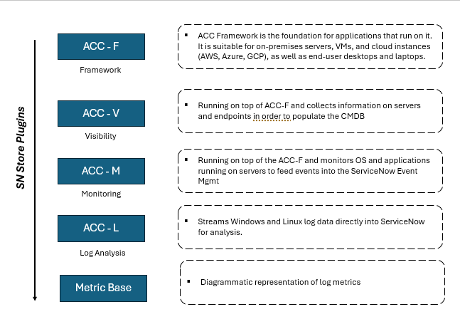
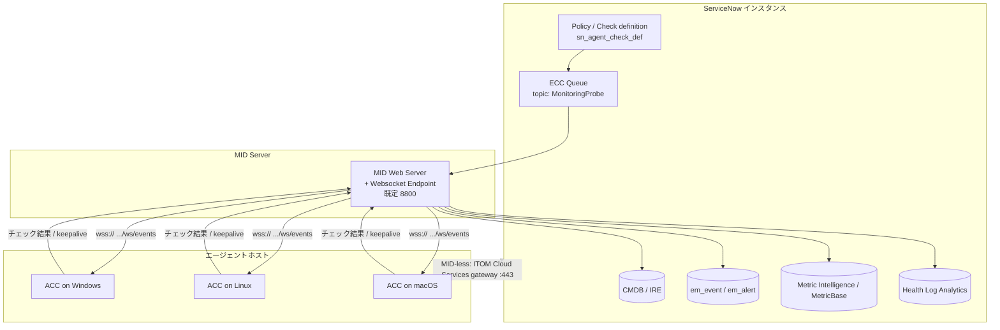
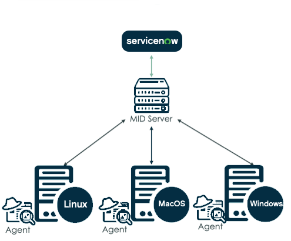
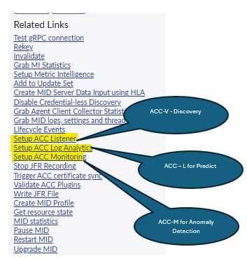
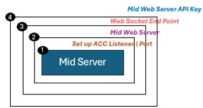
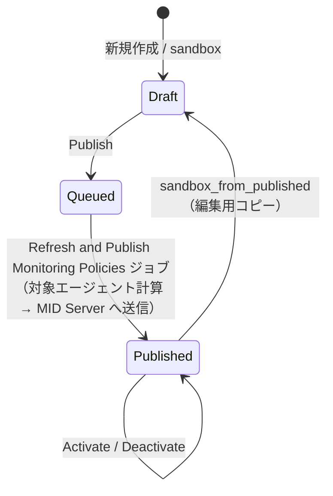
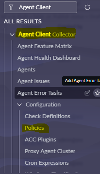

# Agent Client Collector（ACC）

## 概要

**Agent Client Collector（ACC、エージェントクライアントコレクター）** は、Windows・Linux・macOS のホストにインストールする ServiceNow 製のエージェントである。オープンソースの監視フレームワーク **Sensu（Sensu-Go）** を基盤とし、ホスト上で **Check（チェック）** を実行して、ディスカバリーデータ（CMDB 用）、イベント（Event Management 用）、メトリクス（Metric Intelligence 用）、ログ（Health Log Analytics 用）を収集する。Sensu コミュニティのチェックや Nagios 互換プラグインで拡張できる。[出典](https://www.servicenow.com/docs/r/australia/it-operations-management/agent-client-collector/acc-concept.html) [出典](https://www.servicenow.com/docs/r/australia/it-operations-management/agent-client-collector/how-acc-v-works.html)

ACC は「1つのエージェントバイナリ＋インスタンス側の複数 Store アプリ」という構成をとる。エージェント本体と管理基盤が **ACC-F（Framework）** で、その上に用途別のコンテンツアプリ（ACC-VC / ACC-V、ACC-M、ACC-L）を載せる。

| 観点 | 要点 |
|---|---|
| 位置付け | ITOM（Visibility / Health = AIOps / Log Analytics）および DEX（Digital End-User Experience）の共通エージェント |
| 通信経路 | 既定はエージェント → **MID Server（ACC Listener = MID Web Server + Websocket Endpoint）** → インスタンス。WebSocket over TLS（`wss://<MID>:<port>/ws/events`、既定ポート 8800）。MID Server を経由しない **MID-less ACC**（ITOM Cloud Services 経由）もある |
| 設定単位 | Check definition（チェック定義）→ Policy（ポリシー）に関連付けて Check instance（チェックインスタンス）化 → 対象 CI を持つエージェントへ配布 |
| 配布 | Windows MSI（`msiexec` サイレント）、Linux RPM / DEB、macOS PKG、各 OS の single-line command、ゴールデンイメージ |
| 主なスコープ | `sn_agent`（ACC-F）、`sn_acc_vis_content`（ACC-VC）、`sn_itmon`（ACC-M）、ITOM Cloud Services Core `sn_itom_cloud_svc`（MID-less / DEX） |
| 主なロール | `agent_client_collector_admin`、`agent_client_collector_user`、`agent_client_collector_integration`、`evt_mgmt_admin` |
| 主なテーブル | `sn_agent_cmdb_ci_agent`（Agent Client Collectors）、`sn_agent_check_def`（Check Definitions） ほか |

> 基準リリースは Australia（2026-05 GA）。ACC は ServiceNow Store アプリとして配布され、ファミリーリリースとは独立にバージョンが上がる（エージェント本体 6.x / 7.x、ACC-VC 1.x / 2.x 等）。機能の有無は「ファミリーリリース」と「各 Store アプリ／エージェントのバージョン」の両方で確認する必要がある。Brazil での変更は「[16. Brazil での変更点](#16-brazil-での変更点)」にまとめた。[出典](https://www.servicenow.com/docs/r/delta-zurich-brazil/brazil-zurich-agentclientcollector-release-notes.html)

関連ファイル：IP ベースのディスカバリー全般は [Discovery](./discovery.md)、MID Server 自体の導入・運用は [MID Server](../platform/mid-server.md)、イベント・アラート・HLA・Metric Intelligence の詳細は [Event Management と AIOps](./event-management-aiops.md)、ソフトウェア資産は [Software Asset Management](../itam/software-asset-management.md)、ACC を使った端末の体験監視は [Digital End-User Experience](./digital-end-user-experience.md)、ITOM のパッケージと SU は [ITOM 概要とパッケージ](./itom-overview.md) を参照。

---

## 1. ACC の製品構成（ACC-F / ACC-V / ACC-VC / ACC-M / ACC-L）

### 1.1 コンポーネント一覧

ACC は Framework と用途別コンテンツに分かれる。公式ドキュメント（System requirements）が挙げる構成要素と必要プラグインは以下のとおり。[出典](https://www.servicenow.com/docs/r/australia/it-operations-management/agent-client-collector/acc-sys-requirements.html)

| 略称 | 正式名称 | 用途 | 必要プラグイン（インスタンス側） |
|---|---|---|---|
| **ACC-F** | Agent Client Collector Framework（`sn_agent`） | エージェント本体・MID Server 連携・ポリシー配布・エージェント管理の基盤。他のすべてが依存する | MID Server、CMDB for scoped applications、Agent Client Collector global utilities、MID Web Server、Service Error Management |
| **ACC-VC**（旧称・通称 ACC-V） | Agent Client Collector for Visibility Content（`sn_acc_vis_content`。旧表記 "Visibility - Content"） | エージェントによるプッシュ型のインフラディスカバリー（CMDB 投入）、SAM 用のソフトウェアインストール・使用状況収集、File-based Discovery | Agent Client Collector for Visibility Content、Agent Client Collector Framework、Discovery（`com.snc.discovery`） |
| **ACC-M** | Agent Client Collector Monitoring（`sn_itmon`） | OS・ミドルウェア・DB の監視。イベント（Event Management）とメトリクス（Metric Intelligence）を生成 | Agent Client Collector Framework、Agent Client Collector Monitoring、Event Management and Service Mapping Core、Metric Intelligence（`com.snc.sa.metric`） |
| **ACC-L** | Agent Client Collector Log Analytics | Windows / Linux のログを Health Log Analytics（HLA）へストリーミング | Agent Client Collector Framework、Agent Client Collector Log Analytics、Health Log Analytics |
| DEX | Digital End-User Experience | エンドユーザー端末の体験監視（ACC-VC の VISC 系チェックを利用） | Agent Client Collector Framework、ITOM Cloud Services Core（`sn_itom_cloud_svc`） |

- インストール済みプラグインは System Definition > Plugins で確認する。[出典](https://www.servicenow.com/docs/r/australia/it-operations-management/agent-client-collector/acc-sys-requirements.html)
- Brazil 版リリースノートの要件欄では、ACC 利用時に Agent Client Collector Framework（`sn_agent`）と Agent Client Collector Monitoring（`sn_itmon`）の有効化、および Event Management のインストールが求められている。[出典](https://www.servicenow.com/docs/r/delta-zurich-brazil/brazil-zurich-agentclientcollector-release-notes.html)

### 1.2 「ACC-V」「ACC-Visibility」「ACC-VC」の呼称

公式ドキュメントの本文は **ACC-VC（Agent Client Collector for Visibility Content）** という呼称を用いるが、ページ URL のアンカーは `how-acc-v-works` のように **ACC-V** のままで、ライセンス系リリースノートやコミュニティでも ACC-V が使われている。[出典](https://www.servicenow.com/docs/r/australia/it-operations-management/agent-client-collector/how-acc-v-works.html) [出典](https://www.servicenow.com/docs/r/store-release-notes/store-rn-itom-su-licensing.html)

- ServiceNow Community の DEX 記事では、Windows（.MSI）/ macOS（.PKG）インストーラーには ACC-F、ACC-VC、ACC-V、ACC-L が同梱されており、**ACC-VC は DEX で使われ、ACC-V は ITOM 向けで ACC-VC と一部機能を共有し DEX では使われない**、と説明されている。`【第三者情報】`（ServiceNow 社員によるコミュニティ記事だが製品ドキュメントではない）[出典](https://www.servicenow.com/community/dex-articles/acc-and-digital-end-user-experience/ta-p/3339325)
- 一方、Australia の製品ドキュメント上で ITOM のディスカバリー用アプリとして案内されているのは ACC-VC（`sn_acc_vis_content`）であり、ACC-V を独立した Store アプリとして案内するページは公開情報では確認できず。実務上は「ACC-V ≒ ACC for Visibility（ITOM Visibility 用途のエージェントディスカバリー）」の通称として扱われることが多い。`【推定】`
- 「ACC-Visibility」は ACC-V / ACC-VC の総称的な表現、「ACC-Log」は ACC-L の通称である。

### 1.3 各コンポーネントの関係（図）



- **キャプション:** ACC の構成要素を階層で示したコミュニティブログの図。
- **図の説明:** 左側に縦書きで「SN Store Plugins」と書かれた下向き矢印があり、右側に5つの濃紺ボックスが上から順に並ぶ。①「ACC - F / Framework」：オンプレミスのサーバー、VM、クラウドインスタンス（AWS、Azure、GCP）、エンドユーザーのデスクトップ・ラップトップ上で動くアプリケーションの基盤。②「ACC - V / Visibility」：ACC-F の上で動き、サーバーとエンドポイントの情報を収集して CMDB に投入する。③「ACC - M / Monitoring」：ACC-F の上で動き、サーバー上の OS とアプリケーションを監視して ServiceNow Event Management にイベントを送る。④「ACC - L / Log Analysis」：Windows と Linux のログデータを ServiceNow に直接ストリーミングして分析する。⑤「Metric Base」：ログメトリクスの図示（メトリクス格納基盤）。
- **出典:** https://www.servicenow.com/community/developer-blog/agent-client-collector-discovery-monitoring-amp-log-analytics/ba-p/3595578 （取得日: 2026-11-02）`【第三者情報】`

### 1.4 用途別の使い分け

| やりたいこと | 使うもの | 主な格納先 | 関連ファイル |
|---|---|---|---|
| サーバー・端末の構成情報を CMDB に入れる（資格情報不要） | ACC-F + ACC-VC（Enhanced Discovery） | CMDB（`cmdb_ci_computer` / `cmdb_ci_server` 系、`cmdb_running_processes`、`cmdb_tcp_connections`） | [Discovery](./discovery.md) |
| インストールソフト・使用状況（SAM） | ACC-VC（SAM Discovery / Software installed / FBD） | `cmdb_sam_sw_install` 等 | [SAM](../itam/software-asset-management.md) |
| CPU・メモリ・プロセス・ミドルウェアの監視、しきい値イベント | ACC-M（Event / Metric チェック） | `em_event` → `em_alert`、Metric Intelligence（MetricBase） | [Event Management と AIOps](./event-management-aiops.md) |
| ログ収集・ログ異常検知 | ACC-L | Health Log Analytics | [Event Management と AIOps](./event-management-aiops.md) |
| 端末のユーザー体験・SaaS 利用状況 | ACC-VC の VISC 系チェック + DEX | DEX 関連テーブル | [Digital End-User Experience](./digital-end-user-experience.md) |

---

## 2. アーキテクチャ

### 2.1 全体構成とデータフロー

ACC の基本アーキテクチャは「インスタンス（定義と格納）― MID Server（中継）― エージェント（実行）」の3層である。[出典](https://www.servicenow.com/docs/r/sPnEbors95h6DhgBlE~f0A/nKJQ~~zB0MeSWCAGDZdCkg) [出典](https://www.servicenow.com/docs/r/australia/it-operations-management/agent-client-collector/acc-concept.html)

1. インスタンスでモニタリングポリシー（Policy）を定義する。
2. MID Server がインスタンスから Check instance を取得し、エージェントに渡す。
3. エージェントがチェックを実行してデータを収集し、MID Server に返す。
4. MID Server がデータをインスタンスに送り、CI データは CMDB、イベントデータは Events テーブル（`em_event`）に格納される。

エージェントはインストール直後にホストとプロセス情報を収集し、インスタンスはホストの CI と、実行プロセスから識別したアプリケーション（例：Microsoft SQL Server）の CI を作る。その CI に関連するアクティブなポリシーが MID Server 経由でエージェントにプッシュされる。[出典](https://www.servicenow.com/docs/r/australia/it-operations-management/agent-client-collector/acc-concept.html)





- **キャプション:** Agent client collector configuration flow（公式ドキュメント「ACC architecture」の図）。
- **図の説明:** 最上部に ServiceNow のロゴ（インスタンス）、その下に MID Server のアイコンがあり、両者は双方向の矢印で結ばれている。MID Server から下段の3台のサーバー（Linux、MacOS、Windows）へそれぞれ双方向の矢印が伸び、各サーバーの左下に「Agent」のアイコンがある。インスタンスで定義したポリシーとチェックを MID Server が取得してエージェントに渡し、エージェントの実行結果が MID Server を経由してインスタンスに戻る流れを示す。
- **出典:** https://www.servicenow.com/docs/r/australia/it-operations-management/agent-client-collector/acc-concept.html （取得日: 2026-11-02。[Discovery](./discovery.md) 用に取得済みの画像を複製）

### 2.2 ACC Listener（MID Web Server / Websocket Endpoint / API Key）

MID Server 側でエージェントを受け付ける仕組みを **ACC Listener** と呼び、MID Server レコードの Related Links **Setup ACC Listener** で構成する。[出典](https://www.servicenow.com/docs/r/sPnEbors95h6DhgBlE~f0A/4nNClTmkpFQEOh5mUpDcBA)

| 構成要素 | 内容 | 確認場所 |
|---|---|---|
| MID Web Server（MID Web Server 拡張） | MID Server 上で動く Web サーバー拡張。ポート既定 **8800**（変更可）。フォーム変更後は MID web server extension の再起動が必要 | All > Agent Client Collector > MID Web Server |
| Websocket Endpoint（ACC Websocket Endpoint 拡張） | エージェントが接続する WebSocket のエンドポイント。URL は `wss://<mid_ip>:<websocket_port>/ws/events`。エージェントの `backend-url` に設定する | All > Agent Client Collector > Websocket Endpoint（MID Server フォームの ACC Websocket Endpoints タブにも表示） |
| MID Web Server API Key | エージェントが MID Server に接続する際の認証キー。エージェントの `api-key`（MSI では `ACC_API_KEY`）に設定 | MID Web Server 関連 |

- 1台の MID Server に構成できる websocket server は **1つだけ**。[出典](https://www.servicenow.com/docs/r/sPnEbors95h6DhgBlE~f0A/4nNClTmkpFQEOh5mUpDcBA)
- Setup ACC Listener を実行すると MID Web Server、Websocket Endpoint、API Key が自動生成される。3者のいずれかが動作していないとエージェントは接続できない。`【第三者情報】`[出典](https://www.servicenow.com/community/developer-blog/agent-client-collector-discovery-monitoring-amp-log-analytics/ba-p/3595578)
- ACC-M を使う場合は Related Links **Setup ACC Monitoring** で ACC-F と Metric Intelligence の構成をまとめて行う（ポートは初回セットアップ時のみ尋ねられる）。ACC-L を使う場合は **Setup ACC Log Analytics** を使う。[出典](https://www.servicenow.com/docs/r/sPnEbors95h6DhgBlE~f0A/s9vAccyawIUHbT50KcLzzQ)
- Domain Separation 環境では、エージェントとエージェントが作る CI は接続先 MID Server のドメインを引き継ぐ。Websocket endpoint extension を作るユーザーは leaf ドメインに属している必要がある。[出典](https://www.servicenow.com/docs/r/australia/it-operations-management/agent-client-collector/acc-installation.html)



- **キャプション:** MID Server フォームの Related Links のうち ACC 関連のリンク（コミュニティブログの注釈付きスクリーンショット）。
- **画面の説明:** MID Server フォーム下部の「Related Links」一覧で、Test gRPC connection、Rekey、Invalidate、Grab MI Statistics、Setup Metric Intelligence、Add to Update Set、Create MID Server Data Input using HLA、Disable Credential-less Discovery、Grab Agent Client Collector Statistics、Grab MID logs, settings and threads、Lifecycle Events、**Setup ACC Listener**、**Setup ACC Log Analytics**、**Setup ACC Monitoring**、Stop JFR Recording、Trigger ACC certificate sync、Validate ACC Plugins、Write JFR File、Create MID Profile、Get resource state、MID statistics、Pause MID、Restart MID、Upgrade MID が並ぶ。黄色でハイライトされた3つのリンクに吹き出しがあり、Setup ACC Listener は「ACC-V - Discovery」、Setup ACC Log Analytics は「ACC – L for Predict」、Setup ACC Monitoring は「ACC-M for Anomaly Detection」と注記されている。
- **出典:** https://www.servicenow.com/community/developer-blog/agent-client-collector-discovery-monitoring-amp-log-analytics/ba-p/3595578 （取得日: 2026-11-02）`【第三者情報】`



- **キャプション:** ACC Listener を構成すると MID Server 上に作られる要素（コミュニティブログの図）。
- **図の説明:** 中心に「Mid Server」の箱があり、外側に向かって番号付きの入れ子の枠が4重に描かれている。①「Set up ACC Listener | Port」（ポート指定で Listener を設定）、②「Mid Web Server」、③「Web Socket End Point」、④「Mid Web Server API Key」。MID Server を土台に、Listener 設定 → MID Web Server → Websocket Endpoint → API Key の順に構成要素が積み上がることを示す。
- **出典:** https://www.servicenow.com/community/developer-blog/agent-client-collector-discovery-monitoring-amp-log-analytics/ba-p/3595578 （取得日: 2026-11-02）`【第三者情報】`

#### Listener の構成手順（MID Server 経由）

ロール：`agent_client_collector_admin`。[出典](https://www.servicenow.com/docs/r/sPnEbors95h6DhgBlE~f0A/4nNClTmkpFQEOh5mUpDcBA)

1. All > MID Server > Servers で対象 MID Server を開く。
2. Related Links の **Setup ACC Listener** を選択し、Agent Client Collector Setup ダイアログで MID web server port（既定 8800）を入力して **OK**。
3. 確認メッセージに、エージェント設定ファイルに書く URL が表示される。
4. Agent Client Collector > MID Web Server と Agent Client Collector > Websocket Endpoint で構成を確認する。
5. MID Server ホストで curl による疎通確認を行う。`connectedAgentsNum` を含む JSON が返れば正常。

```bash
curl -Lk -H "Authorization: Key <API_KEY>" https://<mid_server_address>:<port>/api/mid/mon
```

- TLS 1.3 に限定する場合は MID Server の `wrapper-override.conf` に `-Djdk.tls.server.protocols="TLSv1.3"` を追加する。
- Linux の MID Server で 1024 未満のポートを使う場合はスーパーユーザー権限が必要。

### 2.3 接続・フェイルオーバー・規模

- エージェントは MID Server に HTTP/S（WebSocket）で接続し、接続を張り続ける。1台の MID Server は多数のエージェントを扱い、1エージェントは同時に1台の MID Server にのみ接続し、必要に応じて別の MID Server にフェイルオーバーする。エージェントの IP が変わった場合は事前定義の MID Server リストから選び直す。[出典](https://www.servicenow.com/docs/r/australia/it-operations-management/agent-client-collector/acc-installation.html)
- エージェントの `backend-url` には複数の Websocket URL をカンマ区切りで書け、先頭から順に接続を試みる。[出典](https://www.servicenow.com/docs/r/sPnEbors95h6DhgBlE~f0A/_gPlDfn5mF5mSgixcbCHPg)
- 1 MID Server あたりの最大エージェント数は MID Server 側プロパティ `sn_agent.mid.max_allowed_agents`（既定 **4,000**）。

| MID Server の JVM ヒープ | ACC-VC で扱えるエージェント数の目安 |
|---|---|
| 1 GiB（既定） | 約 700 |
| 8 GiB | 約 8,000 |
| 8 GiB × 5 台 | 最大 40,000 |

出典：[ACC installation](https://www.servicenow.com/docs/r/australia/it-operations-management/agent-client-collector/acc-installation.html)

- 本番環境ではゼロタッチ構成とフェイルオーバーのため **少なくとも2台** の MID Server を推奨（ステージングは1台以上）。[出典](https://www.servicenow.com/docs/r/australia/it-operations-management/agent-client-collector/acc-sys-requirements.html)
- エージェントは約60秒ごとに keepalive を送り、持続的な接続を前提とする。途中のプロキシやロードバランサーのアイドルタイムアウトが短いと日次で切断が起きる事例があり、タイムアウトを 70 秒に延ばして解消した報告がある。`【第三者情報】`[出典](https://www.servicenow.com/community/developer-forum/agent-client-collector-times-out-eventually/m-p/2897486)

### 2.4 MID Server 自動選択

**MID Server auto-selection**（既定無効）を有効にすると、インスタンスが MID Server のリストを定期的にエージェントに送り、エージェントがレイテンシーと接続数で最適な MID Server を選ぶ。有効化にはインスタンス側 `sn_agent.enable_auto_mid_selection=true` と、エージェント側 `acc.yml` の `enable-auto-mid-selection` の両方が必要。[出典](https://www.servicenow.com/docs/r/australia/it-operations-management/agent-client-collector/acc-framework-configuration-properties.html) [出典](https://www.servicenow.com/docs/r/australia/it-operations-management/agent-client-collector/acc-auto-mid-selection.html)

- 真のロードバランサーではなく、フェイルオーバー機構として位置付けられている。
- 注意点：制限区域の MID Server へ接続を試みてセキュリティアラートを生む可能性、社内 LAN / Wi-Fi / VPN を切り替える端末で再接続できない可能性。アプリケーションロードバランサーを前段に置けば `backend-url` は1つで済む。[出典](https://www.servicenow.com/docs/r/australia/it-operations-management/agent-client-collector/acc-auto-mid-selection.html)

### 2.5 MID-less ACC（ITOM Cloud Services 経由）

**MID-less ACC** は、エージェントからクラウド（ITOM Cloud Services のゲートウェイ）経由で直接インスタンスへデータを送る構成で、MID Server をより恒常的なリソース（Discovery、Service Mapping 等）に充てられる。single-line command で既存の MID 構成エージェントを MID-less 構成へ移行することもできる。[出典](https://www.servicenow.com/docs/r/australia/it-operations-management/agent-client-collector/acc-configuring-without-mid.html)

| 項目 | 内容 |
|---|---|
| 前提プラグイン | ITOM Cloud Services Core（`sn_itom_cloud_svc`）。ACC-VC を使う場合は `sn_acc_vis_content` |
| オンボーディング | インスタンスを ITOM Cloud Services にオンボードする（Customer Support に依頼） |
| インスタンス要件 | ADCv2 / ADCv3（F5 ロードバランサーからの移行済み）かつ mTLS 対応。確認：`curl -v https://<instance>.service-now.com/stats.do 2>&1 \| grep "< Server"` で `snow_adc` を含むこと、`<instance_url>/adcv2/supports_tls` が true を返すこと |
| 認証 | **Agent registration key**（エージェント登録キー）。有効期間は `sn_agent.registration_key_validity.days`（既定 90 日）、期限切れ前通知は `sn_agent.registration_key_notification.days`（既定 14 日前に所有グループへメール）。登録に失敗するとキーは `acc.yml` から消去される |
| ゲートウェイ（公開エンドポイント） | AMER：`itomcnc-prod-gateway-amer.sncapps.service-now.com:443`／EMEA：`itomcnc-prod-gateway-emea.sncapps.service-now.com:443`／APAC：`itomcnc-prod-gateway-apac.sncapps.service-now.com:443` |
| 制約 | ServiceNow のクラウド基盤が前提で、**顧客ホスト（オンプレミス）インスタンスでは非対応**（その場合は MID Server 経由の ACC を使う） |

出典：[ACC ITOM Cloud Services](https://www.servicenow.com/docs/r/it-operations-management/agent-client-collector/acc-itom-cloud-services.html)、[MID-less Windows install](https://www.servicenow.com/docs/r/guxhDnVk8OUAJKLm7WZsYA/hYkBWxEXs86kk3bB1mCS9A)、[Framework properties](https://www.servicenow.com/docs/r/australia/it-operations-management/agent-client-collector/acc-framework-configuration-properties.html)

- Zurich 期の ACC 6.0.0 で MID-less 構成のエージェントアップグレードが追加された。[出典](https://www.servicenow.com/docs/r/delta-zurich-brazil/brazil-zurich-agentclientcollector-release-notes.html)
- MID-less で ACC-M / ACC-L（イベント・メトリクス・ログ）がどこまで使えるかは、公開情報では明示的に確認できず。公式ドキュメントの MID-less ページは ACC 本体と ACC-VC を対象に記載している。

---

## 3. 要件

### 3.1 ハードウェア・OS

| コンポーネント | RAM | 空きディスク | CPU コア |
|---|---|---|---|
| ACC-F | 1 GB | 300 MB | 1 |
| ACC-M | 1 GB | 1 GB | 1 |
| ACC-VC | 1 GB | 1 GB | 1 |

出典：[ACC system requirements](https://www.servicenow.com/docs/r/australia/it-operations-management/agent-client-collector/acc-sys-requirements.html)

- 対応 OS は Windows（Server / Windows 10・11）、Linux、macOS（ACC-VC は 1.3.0 以降で macOS 対応）。具体的なディストリビューションとバージョンは ServiceNow Store の ACC-F の掲載ページで管理されており、ドキュメント本文には列挙されていない。[出典](https://www.servicenow.com/docs/r/australia/it-operations-management/agent-client-collector/acc-sys-requirements.html)
- CPU アーキテクチャは原則 **x86-64**。例外として ACC-F v3.1.1 以降は macOS の Apple Silicon（ARM64）をネイティブ対応する。それ以外のアーキテクチャの最新状況は KB1172387。
- エージェントには Ruby 3.3.2 が同梱される。[出典](https://www.servicenow.com/docs/r/australia/it-operations-management/agent-client-collector/acc-installation.html)
- 既定の実行ユーザーは基本権限のローカルユーザー **`servicenow`**。

### 3.2 機能ごとに必要な OS 権限

| 機能 | Windows | Linux | macOS |
|---|---|---|---|
| 基本インベントリ | 不要 | 不要 | 不要 |
| シリアル番号 | 不要 | `sudo dmidecode` | 不要 |
| 実行プロセス | Debug programs 権限 | 不要 | 不要 |
| TCP 接続とプロセスの対応付け | 不要 | `sudo ss` | 不要 |
| ストレージデバイス | LOCAL SYSTEM | 不要 | 不要 |
| ログオンユーザー | LOCAL SYSTEM | 不要 | 不要 |
| パッケージのセルフアップグレード | LOCAL SYSTEM | `sudo rpm` / `dpkg` | 非対応（※） |

出典：[ACC installation](https://www.servicenow.com/docs/r/australia/it-operations-management/agent-client-collector/acc-installation.html)

> ※ installation ページの権限表では macOS の package self-upgrade は「Not supported」とされている。しかし ACC 5.0 以降はインスタンスからの macOS 大量アップグレード（high-volume upgrade）がサポートされている（Brazil / Zurich リリースノート）。Australia の ACC agent upgrade overview でも、アップグレードに必要な権限として macOS は `sudo pkg` が挙げられている。権限表は ACC 5.0 より前の記述が残ったものとみられる `【推定】`。ACC 5.0 未満のエージェントは PKG で手動更新する必要がある。[出典](https://www.servicenow.com/docs/r/delta-zurich-brazil/brazil-zurich-agentclientcollector-release-notes.html) [出典](https://www.servicenow.com/docs/r/australia/it-operations-management/agent-client-collector/acc-agent-upgrade-overview.html)

- ACC-L では、既定の `servicenow` ユーザーは Linux の `/var/log/` や Windows の `C:\Windows\System32` 配下を読めないため、収集対象ログパスへの読み取り権限を付与する必要がある（手順は KB1117271）。[出典](https://www.servicenow.com/docs/r/australia/it-operations-management/agent-client-collector/acc-sys-requirements.html)

### 3.3 ネットワーク

| 通信 | 方向 | 既定値 |
|---|---|---|
| エージェント → MID Server（Websocket Endpoint） | エージェント発 | `wss://<MID>:8800/ws/events`（ポートは Listener 設定で変更可） |
| エージェント → ITOM Cloud Services ゲートウェイ（MID-less） | エージェント発 | `itomcnc-prod-gateway-<region>.sncapps.service-now.com:443` |
| インストーラー → パッケージ配布サイト | インストール時 | `https://install.service-now.com/`（アップグレード時の取得先 `agent-upgrade-url-path` の既定もこのサイト） |
| MID Server → インスタンス | MID 発 | 443（MID Server の通常要件。[MID Server](../platform/mid-server.md) 参照） |

出典：[Configure the websocket server](https://www.servicenow.com/docs/r/sPnEbors95h6DhgBlE~f0A/4nNClTmkpFQEOh5mUpDcBA)、[Windows silent install](https://www.servicenow.com/docs/r/sPnEbors95h6DhgBlE~f0A/WTyMYPhCmxwTQidsFGc7yQ)、[Configuration file options](https://www.servicenow.com/docs/r/sPnEbors95h6DhgBlE~f0A/_gPlDfn5mF5mSgixcbCHPg)

- エアギャップ環境での導入は KB1585753 を参照。[出典](https://www.servicenow.com/docs/r/australia/it-operations-management/agent-client-collector/acc-installation.html)
- エージェントと MID Web Server の間で **mTLS**（相互 TLS）を利用できる。手順は、エージェント用の秘密鍵と CSR を作り、CA で署名した証明書と鍵を `acc.yml` に指定してエージェントを再起動する、というもの。前提として MID Web Server 側で TLS / mTLS が構成済みであることが必要。ロールは `agent_client_collector_admin`。[出典](https://www.servicenow.com/docs/r/sPnEbors95h6DhgBlE~f0A/9W7wslXzSuhwWoh83s1ctg)
- ただし ACC-L の ACC data input（HLA へのログ送信）のセットアップは MID Server との Basic 認証のみに対応し、mTLS には対応していない。mTLS 対応の MID Server は data input の選択肢に表示されない。[出典](https://www.servicenow.com/docs/r/sPnEbors95h6DhgBlE~f0A/k01cRi31XlMovZOit010Eg) [出典](https://www.servicenow.com/docs/r/sPnEbors95h6DhgBlE~f0A/h1zIqTKVqhvSFcjhtA_X9g)
- Metric Intelligence MID Server と Health Log Analytics は IPv6 非対応のため、ACC-M / ACC-L 用 MID Server は IPv4 で構成する。[出典](https://www.servicenow.com/docs/r/sPnEbors95h6DhgBlE~f0A/s9vAccyawIUHbT50KcLzzQ)

---

## 4. インストールと配布

### 4.1 パッケージの入手

- インストーラーは **All > Agent Client Collector > Deployment > Agent Downloads** から OS 別に取得する（Windows MSI、Linux RPM / DEB、macOS PKG）。API キーは MID Web Server API Key を使う。[出典](https://www.servicenow.com/docs/r/sPnEbors95h6DhgBlE~f0A/WTyMYPhCmxwTQidsFGc7yQ)
- インストールには `https://install.service-now.com/` への到達性が必要。
- 事前に MID Server 側の Websocket server（ACC Listener）が構成されている必要がある。

### 4.2 インストールパス

| OS | バイナリ（`acc` コマンド）の場所 | 設定ファイル |
|---|---|---|
| Linux | `/usr/share/servicenow/agent-client-collector/bin/` | `/etc/servicenow/agent-client-collector/acc.yml`、`check-allow-list.json` |
| macOS | `/opt/servicenow/agent-client-collector/bin` | 公開情報では確認できず |
| Windows | `C:\Program Files\ServiceNow\agent-client-collector\bin` | `C:\ProgramData\ServiceNow\agent-client-collector\` 配下 `【第三者情報】` |

出典：[Configure ACC with MID](https://www.servicenow.com/docs/r/australia/it-operations-management/agent-client-collector/configure-acc-with-mid.html)、[Configuration file options](https://www.servicenow.com/docs/r/sPnEbors95h6DhgBlE~f0A/_gPlDfn5mF5mSgixcbCHPg)

### 4.3 Windows（MSI サイレントインストール）

単一 MID Server の例：[出典](https://www.servicenow.com/docs/r/sPnEbors95h6DhgBlE~f0A/WTyMYPhCmxwTQidsFGc7yQ)

```bat
msiexec /i <msi_file_path> /quiet /qn /norestart ACC_API_KEY=<key_value> ACC_MID=wss://<mid_ip>:<websocket_port>/ws/events ACC_ALLOW_LIST=False
```

複数 MID Server（カンマ区切り。先頭から接続可能なものに接続）：

```bat
msiexec /i <msi_file_path> /quiet /qn /norestart ACC_API_KEY=<key_value> ACC_MID="wss://<mid1_ip>:<port1>/ws/events,wss://<mid2_ip>:<port2>/ws/events"
```

| MSI プロパティ | 型 | 既定 | 説明 |
|---|---|---|---|
| `ACC_API_KEY` | String | ― | MID Server websocket にアクセスする API キー |
| `ACC_MID` | String | ― | MID Server websocket の URL（複数可） |
| `ACC_ALLOW_LIST` | Boolean | True | Allow list（実行可能コマンドの許可リスト）の有効／無効 |
| `START_SERVICE` | Boolean | True | インストール後にサービスを自動起動するか |
| `LOCALUSERNAME` | String | `servicenow` | サービス実行アカウント。`SYSTEM`、`LOCALSERVICE`、`DOMAIN\gMSA$`、ローカルユーザー名を指定可（SYSTEM / LOCALSERVICE / gMSA はパスワード不要） |
| `LOCALUSERPASSWORD` | String | ランダム生成 | 実行アカウントのパスワード（既定ユーザーのパスワードはランダム生成で保存されない） |
| `ISDOMAIN` | Boolean | ― | ドメインユーザーを使う場合 1 |
| `DOMAIN` | String | ― | ドメイン名（gMSA には不要） |
| `PASSWORD_NEVER_EXPIRES` | Boolean | false | パスワード無期限化 |
| `SN_PROG_ROOT` | String | ― | インストール先。引用符で囲む（例：`SN_PROG_ROOT="D:\ServiceNow\agent-client-collector"`） |
| `GOLDEN_IMAGE` | Boolean | ― | `true` でゴールデンイメージモード（クローン配布用） |
| `USE_VBS_CA` | ― | ― | `1` で .NET が使えない環境向けのレガシー VBScript カスタムアクションを使用 |
| `CONNECT_WITHOUT_MID` / `ACC_CNC` / `REGISTRATION_KEY` / `INSTANCE_URL` | ― | ― | MID-less インストール用（下記） |

- インスタンスからエージェントをアップグレードする場合、Windows では **Local SYSTEM** アカウントが必要である（ACC agent upgrade overview の「Before you upgrade」）。[出典](https://www.servicenow.com/docs/r/australia/it-operations-management/agent-client-collector/acc-agent-upgrade-overview.html) 一方、「`msiexec` による手動アップグレードでは UAC の関係でエージェントを SYSTEM で実行している必要がある」とする具体的な記述は、公開情報では確認できず。
- MID-less の Windows インストール例：[出典](https://www.servicenow.com/docs/r/guxhDnVk8OUAJKLm7WZsYA/hYkBWxEXs86kk3bB1mCS9A)

```bat
msiexec /i <msi_file_path> /quiet /qn /norestart CONNECT_WITHOUT_MID="true" ACC_CNC="<gateway_endpoint>" REGISTRATION_KEY="<registration_key>" INSTANCE_URL="https://<instance_url>"
```

`CONNECT_WITHOUT_MID` を省略すると通常の MID Server websocket 構成でインストールされる。ロールは `agent_client_collector_admin`。

### 4.4 Linux

**single-line installation**（ロール `agent_client_collector_admin`。対象サーバー上で実行）：[出典](https://www.servicenow.com/docs/r/sPnEbors95h6DhgBlE~f0A/SHBtZDWwcTB86qd8lJo3jQ)

```bash
ACC_API_KEY=<api_key> ACC_MID=wss://<mid_ip>:<websocket_port>/ws/events bash -c "$(curl -L https://<instance URL>/api/sn_agent/agents/install_agent)"
```

- 前提：`unzip`、RHEL / CentOS / SUSE では `openssl` と `dgst`、Ubuntu / Debian では `gpg`（署名検証用）。
- オプション：`ACC_VALIDATE_SIG=0`（証明書検証のスキップ）、`ACC_ALLOW_LIST=0`（allow list 無効化。セキュリティを損なうため allow list 更新までの一時措置に限ると明記）。
- 多数台への展開では、パッケージをローカルに取得して FTP サーバー等に置き、Ansible などで配布する方法が案内されている。
- アンインストール：`bash -c "$(curl -L https://<instance url>/api/sn_agent/agents/install_agent)" -s "--remove"`（`acc.yml` とそのディレクトリも削除される）。

**パッケージによる手動インストール**：署名済み RPM / DEB と署名ファイル zip を取得し、RPM は `openssl dgst`、DEB は `gpg --verify` で検証してから `yum`/`dnf`、`zypper`、`dpkg`/`apt-get` でインストールする。インストールで Linux capabilities が既定で付与され、不要なら `ACC_SKIP_CAPS=true` を前置する。`.deb` の場合は `/etc/servicenow/agent-client-collector/` の例ファイルをコピーして `acc.yml` を作成する（`.rpm` は `acc.yml` と `check-allow-list.json` を同梱）。systemd ユニットは `/usr/lib/systemd/system/acc.service`（実行ユーザー `servicenow`）で、`systemctl enable acc`／`systemctl start acc` で起動する。[出典](https://www.servicenow.com/docs/r/sPnEbors95h6DhgBlE~f0A/SHBtZDWwcTB86qd8lJo3jQ)

### 4.5 macOS

macOS も `bash -c` と `/api/sn_agent/agents/install_agent` を使った single-line command（root で実行）と、PKG による手動インストールがある。MID-less 版では ITOM Cloud Services Core とエージェント登録キーが前提。`ACC_ALLOW_LIST=0`、`ACC_VALIDATE_SIG=0` は無効化を推奨しない。[出典](https://www.servicenow.com/docs/r/it-operations-management/agent-client-collector/acc-itom-cloud-services.html)

macOS のアップグレードについて、installation ページの権限表は package self-upgrade を「Not supported」としている。一方、ACC 5.0 以降ではインスタンスからの macOS 大量アップグレードがサポートされた（必要権限は `sudo pkg`）。したがって、インスタンスからアップグレードできるのは ACC 5.0 以降のエージェントで、ACC 5.0 未満は PKG で手動更新する（[3.2 の注記](#32-機能ごとに必要な-os-権限)、[13.6](#136-エージェントのアップグレード)）。[出典](https://www.servicenow.com/docs/r/delta-zurich-brazil/brazil-zurich-agentclientcollector-release-notes.html) [出典](https://www.servicenow.com/docs/r/australia/it-operations-management/agent-client-collector/acc-agent-upgrade-overview.html)

### 4.6 インストール後の接続設定（`acc gateway mid`）

インストール済みエージェントの MID Server 接続先は、bin ディレクトリで `acc gateway mid` コマンドにより変更できる（Linux / macOS は root、Windows は `agent_client_collector_admin`）。[出典](https://www.servicenow.com/docs/r/australia/it-operations-management/agent-client-collector/configure-acc-with-mid.html)

```bash
acc gateway mid -a <api-key> -b wss://1.2.3.4:8800
```

| フラグ | 内容 |
|---|---|
| `-y`, `--acc-yml` | `acc.yml` の場所（省略時は標準位置） |
| `-a`, `--api-key` | MID Server の API キー |
| `-b`, `--backend-url` | MID Server の websocket URL（複数はスペースなしのカンマ区切り） |
| `-h` | ヘルプ |

- 省略したオプションは `acc.yml` の既存値を維持する（既存値がなければ必須エラー）。
- コマンドは接続可否を確認するが、値の妥当性までは検証しない。実行後はエージェントを再起動して `acc.yml` に反映する。
- MID-less 用の同等コマンドもあり、`-b`（ICS ゲートウェイ URL）、`-i`（インスタンス URL）、`-r`（登録キー）を指定する。[出典](https://www.servicenow.com/docs/r/australia/it-operations-management/agent-client-collector/acc-configuring-without-mid.html)

### 4.7 ゴールデンイメージ・コンテナ・再インストール

- **Golden image mode**：クローン元イメージにエージェントを入れておき、複製した各インスタンスを別エージェントとして登録させるモード（Windows は MSI プロパティ `GOLDEN_IMAGE=true`）。[出典](https://www.servicenow.com/docs/r/australia/it-operations-management/agent-client-collector/acc-installation.html)
- コンテナ内のエージェントでは、`sn_agent.host_data_collection.disable_when_container`（既定 true）によりホストデータ収集が無効になる。[出典](https://www.servicenow.com/docs/r/sPnEbors95h6DhgBlE~f0A/A9r7Xo0a4KQoEOAprztRBA)
- ITOM Cloud Services 構成で再インストールする場合は、先に Agent Client Collector > Agents の既存エージェントレコードを削除してから再登録する。
- Down / Disconnected のまま残るエージェントは既定 **30 日** で削除される（Autoflush フォームで変更可）。

### 4.8 `acc.yml` の主なオプション

| オプション | 既定 | 説明 |
|---|---|---|
| `name` | `Agent_<hostname>` | インスタンスに登録されるエージェント名 |
| `backend-url` | `wss://127.0.0.1:8800/ws/events` | MID Server の WebSocket エンドポイント（複数可、先頭から試行） |
| `api-key` | なし | MID Server がエージェント接続の認証に使う API キー。初回起動時に暗号化 |
| `user` / `password` | `admin` / `admin` | Basic 認証の資格情報（空だと起動しない）。password は初回起動時に暗号化 |
| `log-level` | Info | `acc.log` の詳細度（Panic / Fatal / Error / Warn / Info / Debug） |
| `allow-list` | `/etc/servicenow/agent-client-collector/check-allow-list.json` | 実行を許可するチェックコマンドの JSON。コメントアウトまたは空で無効 |
| `appl_classification_behavior` | `simple` | Shell CI 作成モード：`simple`（作成）、`off`（作らない）、`full`（パターンでアプリケーション CI を発見） |
| `verify-plugin-signature` | true | プラグイン実行前の署名検証 |
| `insecure-skip-tls-verify` | true | MID Server 接続時の証明書検証スキップ。完全検証にするには false |
| `enable-auto-mid-selection` | true | インスタンスが提供する最適な MID Web Server へ接続（インスタンス側プロパティも必要） |
| `check-command-prefer-installed` | false | true でホストの PATH 上の実行ファイルを優先（false は ACC 同梱を使用） |
| `command-log-redaction-regex` | 組み込み正規表現 | ログ・ペイロードから資格情報をマスクする正規表現 |
| `powershell_installed` | false | true で PowerShell コマンドの実行を許可 |
| `allow-list-global-only` | false | true でプラグイン同梱の allow list を無視し、グローバル allow list のみ使用 |
| `disable-assets` | false | true でチェック時のプラグインダウンロードを止め、キャッシュのみ使用 |
| `agent-upgrade-url-path` | `https://install.service-now.com/glide/distribution/builds/package/app-signed/` | 選択的アップグレード時のパッケージ取得先 |
| `certificate-rotation-days-out` | 28 | 証明書期限の何日前にローテーションするか |
| `enable-patterns-on-agent` | false | エージェント上でのパターン実行に必要なアプリ情報収集 |
| `keepalive-filter-nics` / `keepalive-number_nics_per_ip_type` | true / 1 | keepalive に含める NIC のフィルタと IP 種別ごとの上限 |
| `pac-file` / `pac-cache-ttl` / `pac-refresh-interval` / `pac-dial-timeout` / `pac-reset-on-connect-failure` | "" / 30m / 30m / 30s / true | PAC ファイルによるプロキシ設定 |

出典：[Configuration file options（Australia）](https://www.servicenow.com/docs/r/sPnEbors95h6DhgBlE~f0A/_gPlDfn5mF5mSgixcbCHPg)

> `insecure-skip-tls-verify` の既定が true、`user`/`password` の既定が `admin` である点は、セキュリティ強化の観点で見直し対象になる。`【推定】`（公式表の既定値から導いた所見）詳細は [セキュリティ強化の実践](../../04_応用編/12-security-hardening-practice.md) を参照。

---

## 5. チェック定義（Check definitions）

### 5.1 概念

- **Check（チェック）** はエージェント上で実行するコマンドとその設定である。既定のチェック定義はそれぞれコマンドと既定の実行頻度を持つ。チェックはインスタンスで定義され、MID Server 経由でエージェントに渡される。[出典](https://www.servicenow.com/docs/r/australia/it-operations-management/agent-client-collector/acc-concept.html)
- チェック定義をポリシーに関連付けたものが **Check instance（チェックインスタンス）** で、実行間隔や DB ログイン資格情報などをポリシー単位でカスタマイズでき、元の定義や他のインスタンスには影響しない。
- ACC-M のチェックは2種類に大別される：**Event checks**（結果を Event Management のイベントに変換）と **Metric checks**（結果をメトリクス値に変換）。[出典](https://www.servicenow.com/docs/r/sPnEbors95h6DhgBlE~f0A/TbIUrHdFVZRBaw~h8fsF4w)
- ポリシーとの関連がなくなったチェックは **stale** としてマークされ、再有効化または削除できる。**CPU Protection Mode** は CPU 消費の大きいデバイスでチェックを自動停止する（Agent Health ダッシュボードで「silent / off (auto)」として可視化）。[出典](https://www.servicenow.com/docs/r/sPnEbors95h6DhgBlE~f0A/4K1pK6mg4L8S3zHi4U85lw)

### 5.2 関連テーブル

| テーブル | ラベル | 内容 |
|---|---|---|
| `sn_agent_check_def` | Check Definitions | チェック定義本体（コマンド、間隔／cron、チェックタイプ、プラグイン依存） |
| `sn_agent_check_param_def` | Check Parameter Definitions | チェックのパラメーター定義 |
| `sn_agent_check_secure_param_def` | Check Secure Parameter Definitions | 資格情報などの秘匿パラメーター（ポリシーの Credentials タブで選択） |

出典：[AccCheckDefsAPI - Scoped](https://www.servicenow.com/docs/r/api-reference/server-api-reference/AccCheckDefsAPIAPIScoped.html)、[ACC REST API](https://www.servicenow.com/docs/r/api-reference/rest-apis/agnt_clnt_cll-api.html)

- スクリプトからは Scoped API `sn_agent.AccCheckDefsAPI`（`getCheck` 等。ロール `agent_client_collector_admin`）でチェック定義を取得できる。

### 5.3 Allow list

エージェントは `check-allow-list.json` に列挙されたコマンドのみ実行する（`allow-list` オプション）。新しいチェック定義を追加したらエージェント側の allow list も更新する必要があり、インストール時の `ACC_ALLOW_LIST=False` / `=0` による無効化は一時措置とされる。プラグインに同梱される allow list を無視する場合は `allow-list-global-only: true`。[出典](https://www.servicenow.com/docs/r/sPnEbors95h6DhgBlE~f0A/_gPlDfn5mF5mSgixcbCHPg) [出典](https://www.servicenow.com/docs/r/sPnEbors95h6DhgBlE~f0A/SHBtZDWwcTB86qd8lJo3jQ)

### 5.4 ACC-M の既定チェック（抜粋）

ACC-M（Agent Client Collector Monitoring）の既定ポリシーとチェック名の命名規則は `<領域>.<製品>.<check|metrics>-<対象>` である。E = Event、M = Metric。[出典](https://www.servicenow.com/docs/r/sPnEbors95h6DhgBlE~f0A/Rfj4K4PI62iVo67NDlzAmw)

| ポリシー | 種別 | 主なチェック |
|---|---|---|
| Linux OS Events | E | `os.linux.check-process`、`-system-cpu`、`-system-cpu-load`、`-system-disk-usage`、`-system-memory-percentage`、`-system-memory-swap`、`-threads-count` |
| Linux OS Metrics | M | `os.linux.metrics-memory-vmstat`、`-process-status`、`-system-cpu`、`-system-cpu-load`、`-system-disk`、`-system-disk-capacity`、`-system-disk-usage`、`-system-memory`、reboot count today |
| Windows OS Events | E | `os.windows.check-processor-queue-length`、`-system-cpu-load`、`-system-disk`、`-system-memory`、`-system-process`、`-windows-directory`、`-windows-pagefile`、`-windows-process` |
| Windows OS Events - Extended | E | `check-directory-file-count`、`check-directory-integrity`、`check-file-age`、`check-file-size`、`check-file-space`、`os.windows.check-directory-space` 等 |
| Windows OS Metrics | M | `os.windows.metrics-processor-queue-len`、`-system-cpu-load`、`-system-disk-usage`、`-system-memory-percent`、`-system-network`、`-system-uptime` |
| Linux / Windows log monitoring | E | `util.check-logs`、`util.check-logs-sudo`、`os.windows.check-log` |
| Apache / Tomcat / JBoss・WildFly / WebLogic / WebSphere / IIS | E / M | `app.apache.metrics-apache`、`app.tomcat.metrics-tomcat`、`app.iis.check-iis-alive` 等 |
| MSSQL / MySQL / Oracle DB | E / M | `app.mssql.metrics-mssql`、`app.mysql.check-mysql-alive`、`app.oracle.check-oracle-alive`、`util.metrics-oracle-query` 等 |
| Apache Kafka | E / M | `kafka.check-broker-status`、`kafka.metrics.broker` 等 |
| Kubernetes / Docker | E / M | `k8s.check-kube-apiserver-available`、`k8s.metrics-pods`、`container.docker.metrics-docker` |
| Azure VM / AKS Metrics | M | `azure.metrics-vm-cpu` 等、`azure.metrics-k8s-service` |
| F5 SNMP、HAProxy、HTTP Entry Points、Network ping | E / M | `util.check-snmp`、`util.metrics-http-curl`、`util.metrics-ping` 等 |
| Self-Healing Events | E | `util.check-ping` |
| Basic Discovery | ― | `check-discovery-basic`（12 時間ごと） |
| Zscaler Monitoring Policy | M | `zscaler-monitoring-check`、`zscaler-remediation-check` |

- 既知の問題として、Windows 11 / Windows Server 2025 での WMIC 廃止により ACC-M のチェックが失敗する事象（PRB1968533、ACC-M 3.17.1 のリリースノート、2026-04）が報告されている。[出典](https://www.servicenow.com/docs/r/sPnEbors95h6DhgBlE~f0A/TbIUrHdFVZRBaw~h8fsF4w)

### 5.5 ACC-VC の既定チェックとポリシー

| ポリシー | 間隔 | チェックタイプ | 対象 OS | 収集内容 |
|---|---|---|---|---|
| Enhanced Discovery | 既定 24 時間（86,400 秒。例：14,400 秒＝4時間に変更可） | Enhanced Discovery | Windows / macOS / Linux（Linux は一部 sudo 必要） | ハードウェア・ネットワーク等のシステムディスカバリーデータ |
| SAM Discovery | 日次 | SAM Advanced Discovery | Windows / macOS | ソフトウェアのインストールと使用状況 |
| SAM background | 8 分ごと（ログチェック） | ― | Windows / macOS | osqueryd ログを SAM 用に集約 |
| SAM background (Non OsqueryD) | ― | ― | ― | osqueryd ではなく osqueryi で SAM データ取得 |
| Software installed | 日次 | Installed Software | Windows エンドポイント以外 | インストール済みソフトウェア（`cmdb_sam_sw_install`） |
| File-based Discovery 系（background / SAM / SWID tag / File management） | 日次・初回フル後デルタ | ― / Enhanced Discovery | Windows / Linux / macOS | ファイル走査、SWID タグ（`.swid` / `.swidtag` / `.cmptag`）、未識別ファイル（`cmdb_unidentified_file_set`）、ファイル在庫（`sn_acc_vis_content_device_file_information`）。FBD の有効化が必要 |
| Oracle GLAS Java Process Discovery / HW data collection | 週次 | ― | 全 OS / Oracle・macOS 以外 | Oracle GLAS 報告用の Java・CPU / ソケット情報 |
| VISC Get application metric / browser extension init / URL metrics | URL metrics は日次 | ― | Windows / macOS | DEX 用の SaaS アプリ・Web 利用メトリクス（URL metrics は `sn_acc_vis_content.enable_full_monitoring=true` が必要） |

出典：[ACC-VC default checks and policies（Australia）](https://www.servicenow.com/docs/r/sPnEbors95h6DhgBlE~f0A/oTbnJzTn7ni4d~Q5ne7XtA)

- ビジネスルール **Enhanced Discovery -- On CI Delete** は、`sn_agent_cmdb_ci_agent` に関連する CI が削除されたときに Endpoint Discovery Check を実行する。

---

## 6. ポリシー（Policies）

### 6.1 概念

**Policy（ポリシー）** は「監視対象 CI」と「その CI で実行するチェック」の組み合わせである。アクティブなポリシーは MID Server にダウンロードされ、MID Server がエージェントへプッシュする。[出典](https://www.servicenow.com/docs/r/australia/it-operations-management/agent-client-collector/acc-concept.html)

- ACC 有効化時に入る既定（OOB）ポリシーの多くは **Inactive（非アクティブ）** で、個別に有効化しない限りデータは収集されない。`【第三者情報】`[出典](https://www.servicenow.com/community/developer-blog/agent-client-collector-discovery-monitoring-amp-log-analytics/ba-p/3595578)

### 6.2 ポリシーの作成

メニュー：**All > Agent Client Collector > Policies** → New。ロール：`agent_client_collector_admin`。[出典](https://www.servicenow.com/docs/r/guxhDnVk8OUAJKLm7WZsYA/7Nc9MMjfIKhwgxl8yLbubQ)

| フォーム項目 / タブ | 内容 |
|---|---|
| Name / Description | 名前と説明 |
| Publish status（読み取り専用） | **Draft** → Publish で **Queued** → ポリシー配布ジョブ完了で **Published** |
| Hierarchy（読み取り専用） | None（既定）、Parent（子ポリシーを追加した場合）、Child |
| Monitored CIs タブ | **Manual calculation**（定期計算から除外。単一 CI 監視時に推奨）／**Monitored CI type by filter**（Monitored CI type + Filter）／**Monitored CI type by script**（Monitored CI Script。関連テーブルでの絞り込みが可能）／**Monitored CI type by CMDB Group**（Monitored CMDB group） |
| Checks タブ | Available から Selected へチェックを移動（check group でフィルタ可）→ Check Instances として関連付く |
| Proxy Settings タブ（任意） | エージェントがリモートマシンのデータを報告する場合のみ設定 |
| Scheduling タブ | Interval-based（秒）または Cron-based。cron はエージェントホストのタイムゾーンで動作。チェック定義側の Interval / Cron がポリシー設定より優先される |
| Credentials タブ | Credential name（チェック定義の Check Secure Parameter Definitions から選択）または Credential alias（Connection & Credential Aliases から選択） |

- 既定の cron 式：Every hour nightly 5:00pm-7:00am、Every minute daily 8:00am-4:59pm、Every minute Mon-Fri 8:00am-4:59pm（Agent Client Collector > Configuration > Cron Expressions で管理）。
- ACC-L のログポリシーでは、**Filter Monitored CIs by Application Service** でアプリケーションサービスに紐付く CI のログのみに限定でき、チェックには少なくとも1つのログパスが必要。[出典](https://www.servicenow.com/docs/r/sPnEbors95h6DhgBlE~f0A/IGGXtiF~oEcQKszFLMukzg)

### 6.3 配布（Publish）の仕組み



- スケジュールジョブ **Refresh and Publish Monitoring Policies** が Queued のポリシーを処理し、どのエージェントで実行するかを計算して MID Server に送り、状態を Published にする。対象 CI の多いポリシーではこのジョブが長時間化するため、単一 CI 監視は Manual calculation を推奨。[出典](https://www.servicenow.com/docs/r/guxhDnVk8OUAJKLm7WZsYA/7Nc9MMjfIKhwgxl8yLbubQ)
- CMDB の変更は `sn_agent.sync_filters_interval_min`（既定 10 分）ごとに検出されて MID Server に同期される。[出典](https://www.servicenow.com/docs/r/australia/it-operations-management/agent-client-collector/acc-framework-configuration-properties.html)
- `config_publish_payload`（ECC Queue トピック MonitoringProbe）の最大サイズは `sn_agent.config_publish.max_payload_size`（既定 15,000,000 バイト）で、超えたものはエラーログを出してスキップされる。
- REST API でも publish / activate / deactivate できる（[12.2](#122-rest-api)）。

### 6.4 ナビゲーターメニュー



- **キャプション:** Next Experience のナビゲーターで「Agent Client」と検索した結果（コミュニティブログのスクリーンショット）。
- **画面の説明:** フィルター欄に「Agent Client」と入力され、ALL RESULTS の下に **Agent Client Collector** アプリケーションが展開されている。モジュールは上から Agent Feature Matrix、Agent Health Dashboard、Agents、Agent Issues、Agent Error Tasks、そして **Configuration** フォルダーの下に Check Definitions、**Policies**（ハイライト）、ACC Plugins、Proxy Agent Cluster、Cron Expressions、Windows File...（以下切れ）が並ぶ。
- **出典:** https://www.servicenow.com/community/developer-blog/agent-client-collector-discovery-monitoring-amp-log-analytics/ba-p/3595578 （取得日: 2026-11-02）`【第三者情報】`

| モジュール | 用途 |
|---|---|
| Agents | エージェント一覧（`sn_agent_cmdb_ci_agent`）。状態、バージョン、接続 MID Server、関連 CI |
| Agent Health Dashboard | エージェントの稼働状況ダッシュボード（[13.2](#132-agent-health-ダッシュボードと-acc-admin-workspace)） |
| Agent Issues / Agent Error Tasks | エージェントのエラーとその対応タスク |
| Agent Feature Matrix | エージェントバージョンと機能の対応 |
| Configuration > Check Definitions / Policies / ACC Plugins / Proxy Agent Cluster / Cron Expressions | チェック、ポリシー、プラグイン、プロキシエージェントクラスター、cron 式の管理 |
| Deployment > Agent Downloads | インストーラーの入手 |
| MID Web Server / Websocket Endpoint | ACC Listener の構成確認 |

---

## 7. ACC プラグイン（ACC Plugins / Assets）

- **ACC プラグイン** は ACC の機能を拡張するスクリプト群で、メトリクス収集、特殊なチェック、条件成立時のイベント発行を担う（例：アプリケーションキューが容量の 60% / 80% に達したらアラート）。各プラグインは1つ以上のチェックに紐付き、1つのチェックが複数のプラグインに依存することもある。通常は **tar.gz** でパッケージされる。[出典](https://www.servicenow.com/docs/r/australia/it-operations-management/agent-client-collector/acc-assets.html)
- 独自のカスタムプラグインを作成して tar.gz 化し、チェックの依存関係として紐付けられる。
- エージェントはプラグインと **同一バージョンか1つ下** である必要がある（公式例：ACC エージェント 4.1.0 と ACC-F Store 5.1.0）。
- ベースシステムのプラグインは ServiceNow の証明書で署名され、カスタムプラグインは OpenSSL で自社証明書により署名できる。エージェントは `verify-plugin-signature: true`（既定）で実行前に署名を検証する。[出典](https://www.servicenow.com/docs/r/australia/it-operations-management/agent-client-collector/acc-sys-requirements.html)
- MID Server はターゲットの OS、プラットフォーム、OS バージョン、アーキテクチャに合ったアセット／プラグインを配信する（ACC-VC のエントリポイントは `acc_visibility_main`）。[出典](https://www.servicenow.com/docs/r/australia/it-operations-management/agent-client-collector/how-acc-v-works.html)
- MID Server の Related Links **Validate ACC Plugins** でプラグインの検証ができる（[2.2 の図](#22-acc-listenermid-web-server--websocket-endpoint--api-key)）。
- `disable-assets: true` にするとチェック時のプラグインダウンロードを止めてキャッシュのみを使う（帯域制約環境向け）。

---

## 8. エージェント経由の Discovery / Visibility（ACC-VC）

### 8.1 動作

ACC-VC は ACC と ACC-F を使ったプッシュ型ディスカバリーを実装するスコープアプリで、IP ベースの水平ディスカバリーに対する追加の手段である。[出典](https://www.servicenow.com/docs/r/australia/it-operations-management/agent-client-collector/how-acc-v-works.html)

1. インスタンスが ECC Queue にトピック **MonitoringProbe** の output レコードを作る。
2. MID Server が WebSocket over TLS でエージェントへ送る。
3. エージェントが **Enhanced Discovery** チェック（Check Type `EnhancedDiscovery`、Enhanced Discovery Policy、既定 24 時間）を実行する。
4. 結果を Script Include **EnhancedDiscoveryHandler** が IRE 互換ペイロードに変換し、非 CI データ（`cmdb_running_processes`、`cmdb_tcp_connections`）を調整して CMDB に反映する。

ACC-VC のディスカバリーが起動される契機：定期スケジュール、コンピューター / サーバー CI の削除、MID Server の停止・復帰、ターゲットホストの停止・復帰、ネットワーク断。発見したホストは既存の VM インスタンス CI（VMware vCenter、AWS、GCP、Azure）や Cloud Server Instance と関係付けられる。

- エンドポイントディスカバリーの再実行は `sn_agent.disco_minimum_threshold_for_rediscovery_minutes`（既定 60 分）未満の間隔では行われない。[出典](https://www.servicenow.com/docs/r/sPnEbors95h6DhgBlE~f0A/A9r7Xo0a4KQoEOAprztRBA)
- ホスト CI が割り当てられていないエージェントのホストデータ収集間隔は `sn_agent.host-data_collection_refresh_duration_seconds`（既定 43,200 秒＝12 時間）。
- アプリケーションの扱いは `sn_agent.appl_classification_behavior`（既定 `simple`：Shell CI を作成）で制御する。
- シリアル番号の取得順 `sn_agent.ci_serial_number.pref_order`（既定 `bios,system,uuid,baseboard,chassis`）、macOS の CI 名の取得順 `sn_agent.mac_ci_name_pref_order`（既定 `name,hostname,computer_name,local_hostname`）、IP の優先バージョン `sn_agent.ci_prefers_ip_version`（既定 4）。

### 8.2 IP ベース Discovery との共存

対象ホストの IP に水平ディスカバリーで発見済みの CI（`discovery_source` が ServiceNow / ServiceWatch）がある場合、ACC-VC は既定ではその CI を上書きしない（`sn_agent.disco_disable_ci_clobber_of_agentless_disco`＝true）。非 ACC ソースによる最終発見から `sn_agent.disco_ci_clobber_of_agentless_disco_threshold_days`（既定 14 日）を超えると ACC のデータで上書き可能になる。[出典](https://www.servicenow.com/docs/r/australia/it-operations-management/agent-client-collector/using-enhanced-discovery-and-agent-less-discovery-together.html) [出典](https://www.servicenow.com/docs/r/sPnEbors95h6DhgBlE~f0A/A9r7Xo0a4KQoEOAprztRBA)

エージェント型とエージェントレス型の比較：

| 観点 | ACC-VC（エージェント型） | IP ベース水平ディスカバリー |
|---|---|---|
| 資格情報 | OS 資格情報不要（エージェントがローカル実行） | OS ごとの資格情報が必要 |
| 方向 | プッシュ型。ほぼリアルタイム | プル型（スケジュール） |
| 対象 | OS 層（ホスト、ソフトウェア、プロセス、接続） | ネットワーク機器、ストレージ、アプリケーション層を含む |
| ネットワーク | エージェント → MID Server の片方向 | MID Server → 各ホストへの多数のポート |
| 向くケース | 端末・DMZ・資格情報を配れないサーバー、クラウド VM | データセンターの網羅的な発見 |

詳細は [Discovery](./discovery.md) の「Agent Client Collector」節と比較表を参照。

### 8.3 File-based Discovery（FBD）

エンドポイントのファイルシステムを走査してソフトウェアとファイル在庫を発見する（Windows / Linux / macOS）。Discovery Definition > Configuration Console の File Based Discovery で有効化し、File-based Discovery、Software Asset Management - File Signature Normalization、ACC-VC、Software Asset Management Professional が必要。初回フルスキャン後はデルタスキャンのみを送る。[出典](https://www.servicenow.com/docs/r/australia/it-operations-management/agent-client-collector/file-based-discovery-overview.html)

### 8.4 ACC-VC のバージョンと主な追加機能

| バージョン | 主な追加機能 |
|---|---|
| ACC-VC 1.3.0 | 証明書ディスカバリー、macOS の File-based Discovery、non-osqueryd でのデータ収集 |
| ACC-VC 1.5.0 | MSSQL コンポーネントのディスカバリー、SWID タグによるソフトウェア発見 |
| ACC-VC 2.1.1（Brazil 期） | Windows 非永続 VDI（NPVDI）でのディスカバリーとソフトウェアメータリング |

出典：[Brazil / Zurich ACC release notes](https://www.servicenow.com/docs/r/delta-zurich-brazil/brazil-zurich-agentclientcollector-release-notes.html)、[ACC release notes](https://www.servicenow.com/docs/r/release-notes/agent-client-collector-rn-static.html)

---

## 9. Metric Intelligence・Event Management との連携（ACC-M）

- ACC-M のチェックはエージェント上で実行され、結果はイベントまたはメトリクスに変換されて **Metric Intelligence MID Server** 経由でインスタンスに送られる。1台の MID Server で ACC-M と ACC-L の複数エージェントを扱える。[出典](https://www.servicenow.com/docs/r/sPnEbors95h6DhgBlE~f0A/TbIUrHdFVZRBaw~h8fsF4w)
- Metric Intelligence を使うには、少なくとも1台の MID Server を **Metric Intelligence MID Server** として構成し、MID Server distributed cluster に含める。Metric Intelligence MID Server はメトリクスを処理して異常検知を行い、処理済みバッチまたは即時の異常アラートをインスタンスへ送る。[出典](https://www.servicenow.com/docs/r/sPnEbors95h6DhgBlE~f0A/s9vAccyawIUHbT50KcLzzQ)
- MID Server の Related Links **Setup ACC Monitoring** で ACC-F（Listener）と Metric Intelligence を一括構成する。前提として MID Server が検証済み・稼働中であること、MetricBase（Clotho）の利用申請が必要。
- イベントは `em_event` に入り、Event rules・Alert management rules を経て `em_alert` になる。詳細は [Event Management と AIOps](./event-management-aiops.md)。

---

## 10. Health Log Analytics との連携（ACC-L）

ACC-L は Windows / Linux のログを Health Log Analytics（HLA）にストリーミングする。[出典](https://www.servicenow.com/docs/r/sPnEbors95h6DhgBlE~f0A/IGGXtiF~oEcQKszFLMukzg)

| 項目 | 内容 |
|---|---|
| 必要バージョン | Health Log Analytics 22.0.12 以降、Agent Client Collector - Framework 2.7.0 以降、Agent Client Collector Log Analytics |
| ロール | `evt_mgmt_admin` |
| MID Server | ACC Listener 対応の MID Server（セットアップ中に有効化可能）。IPv4 で構成（HLA は IPv6 非対応） |
| 認証 | ACC data input のセットアップは MID Server との Basic 認証のみに対応し、mTLS には非対応（出典：[Configure ACC data inputs manually](https://www.servicenow.com/docs/r/sPnEbors95h6DhgBlE~f0A/k01cRi31XlMovZOit010Eg)） |

手順（Integrations Launchpad 経由）：

1. Workspaces > **Service Operations Workspace** を開き、ナビゲーションの **AIOps configuration center** を選ぶ。
2. Integrate > Integrations で **Add integration** → Browse integrations で **Agent Log Analytics** タイルを選択。
3. Provide details（必須項目）と Advanced settings（任意）を入力して Next。
4. Setup instructions タブで、対象 CI 向けの **ACC ログポリシー** を作成する（エージェントがログ発生元 CI にインストールされていること）。
5. **Activate with AI**（AI によるログの自動パースとサービスインスタンス／コンポーネントへのマッピング）、**Activate**、または **Save draft** を選ぶ。

- 有効化後、Overview タブでストリーミング状況とソースを確認でき、Data Input Mapping、Source Type Structures、Log Sources、Log Viewer（Service Operations Workspace Log Analytics アプリが必要）を開ける。
- クラシック UI では All > ACC Log Analytics > ACC Data Inputs > New で ACC data input を手動作成できる。保存後に Test connection を実行し、成功すると Publish が有効になり、MID Server へ公開できる。Revert Changes を使えば最後に公開した構成に戻せる。作成したレコードには Agents と Streaming Sources の関連リストが表示される。[出典](https://www.servicenow.com/docs/r/sPnEbors95h6DhgBlE~f0A/k01cRi31XlMovZOit010Eg)
- ACC data input の構成項目は次のとおり。選択できる MID Server は、AgentClientCollector capability を持ち Basic 認証に対応するものに限られる（mTLS 対応の MID Server は一覧に出ない）。ACC data input は MID Server あたり1つで、既定の上限 10 個に ACC 用の1つを加えて最大 11 個になる。[出典](https://www.servicenow.com/docs/r/sPnEbors95h6DhgBlE~f0A/h1zIqTKVqhvSFcjhtA_X9g)
- HLA のストア版 40.0.13（2026-06）で ACC-L 連携が更新された点は [Event Management と AIOps](./event-management-aiops.md) を参照。

---

## 11. SU（Subscription Unit）消費とライセンス

ITOM は **Subscription Unit（SU）** 単位で課金され、ITOM アプリが管理する IT リソース（Managed IT Resource）の数を所定の比率で SU に換算する。ACC はこの「管理」の手段の1つである。

| 管理対象リソース | SU : リソース比率（2026-04-09 発効の公式 SU Overview） |
|---|---|
| Servers（`cmdb_ci_server`、`cmdb_ci_vm_instance` とその派生クラス。Agent Client Collector 等の ITOM アプリで管理されるもの） | 1 : 1 |
| End user computing devices | 1 : 4 |
| Container images | 1 : 3 |
| FaaS resources | 1 : 20 |
| Unresolved monitored objects | 1 : 4 |

出典：[ITOM ServiceNow Subscription Unit Overview（Tanium 版の公式 PDF）](https://www.servicenow.com/content/dam/servicenow-assets/public/en-us/doc-type/legal/it-operations-management-itom-servicenow-subscription-unit-overview-tanium.pdf)、[Subscriptions for IT Operations Management（Australia）](https://www.servicenow.com/docs/r/sPnEbors95h6DhgBlE~f0A/y5L~1SujMuCHZYScdrbXLQ)

> 注記：上表の比率は、Tanium 連携顧客向けの PDF の検索抜粋に基づく（WebFetch は 403 で本文を取得できなかった）。汎用版の SU Overview や個別契約（Order Form）では比率が異なりうる。抜粋には上表のほかに GPUs、APIs、AI Agents、Service Instances の行もあったが、比率は確認していない。公式ドキュメント「Subscriptions for IT Operations Management」には、CI カテゴリごとの SU 割り当て比率は契約で定まると書かれている。`【推定】`（抜粋に依拠するため）

ACC に関わる SU カウントの仕様（ITOM/OT SU Licensing ストアアプリのリリースノート）：[出典](https://www.servicenow.com/docs/r/store-release-notes/store-rn-itom-su-licensing.html)

| バージョン（時期） | 内容 |
|---|---|
| 3.4.0（2024-02） | DEX v2 サブスクリプションがある場合、DEX 管理下の EUD 上の ACC-V および Event Management 利用は ITOM アプリのカウントに適用しない |
| 3.5.0（2024-05） | SU ベースの Discovery と Visibility の両方を持つ場合、Visibility（またはそれを含むバンドル）に先に充当 |
| 3.11.0（2025-12） | エンドユーザーデバイス（EUD）は ServiceNow のコンポーネント（現状 Agent Client Collector）がインストールされている場合にのみ ITOM Health でカウント |
| 3.16.0（2026-09） | EUD は ACC がデプロイされている場合にのみ Health、HLA、Observability、Cloud Accelerate の各 value stream でカウント |

- 実務上の含意：ACC-VC で発見したサーバーは ITOM Visibility の、ACC-M で監視したサーバーは ITOM Health の管理対象リソースとして SU を消費しうる。端末に ACC を配ると EUD として（1:4 で）カウントされうるため、端末への ACC 展開は SU 見積もりに含める必要がある。`【推定】`
- コミュニティブログでは ACC の利用に TSM（Technology Service Management）/ TSOM 系ライセンスが必要と記述されている。`【第三者情報】`[出典](https://www.servicenow.com/community/developer-blog/agent-client-collector-discovery-monitoring-amp-log-analytics/ba-p/3595578)
- ACC-F 自体の単体価格・SU 消費の有無は公開情報では確認できず。契約上の比率は Order Form が優先する。ITOM の SKU 全体（2026-04 改定）は [ITOM 概要とパッケージ](./itom-overview.md)、[ライセンスモデル](../../03_導入編/01-licensing-model.md)、[ライセンスコスト最適化](../../04_応用編/06-license-cost-optimization.md) を参照。

---

## 12. テーブル・ロール・プロパティ・API

### 12.1 主要テーブル

| テーブル | ラベル / 内容 |
|---|---|
| `sn_agent_cmdb_ci_agent` | Agent Client Collectors（エージェント本体の CI。Agent ID、状態、バージョン、MID Server 等） |
| `sn_agent_check_def` | Check Definitions |
| `sn_agent_check_param_def` | Check Parameter Definitions |
| `sn_agent_check_secure_param_def` | Check Secure Parameter Definitions |
| `ecc_queue`（topic MonitoringProbe） | インスタンス ↔ MID Server ↔ エージェントの指示・結果 |
| `cmdb_running_processes` / `cmdb_tcp_connections` | ACC-VC が収集する実行プロセス・TCP 接続 |
| `cmdb_sam_sw_install` | インストール済みソフトウェア |
| `cmdb_unidentified_file_set` / `sn_acc_vis_content_device_file_information` | FBD の未識別ファイル・ファイル在庫 |
| `em_event` / `em_alert` | ACC-M のイベント・アラート |

出典：[ACC REST API](https://www.servicenow.com/docs/r/api-reference/rest-apis/agnt_clnt_cll-api.html)、[AccCheckDefsAPI](https://www.servicenow.com/docs/r/api-reference/server-api-reference/AccCheckDefsAPIAPIScoped.html)、[ACC-VC default checks](https://www.servicenow.com/docs/r/sPnEbors95h6DhgBlE~f0A/oTbnJzTn7ni4d~Q5ne7XtA)、[How ACC-VC works](https://www.servicenow.com/docs/r/australia/it-operations-management/agent-client-collector/how-acc-v-works.html)

- ポリシー、チェックインスタンス、MID Web Server、Websocket Endpoint、Agent Upgrade Histories 等のテーブルのシステム名（`sn_agent_*`）は公開情報では確認できず。インスタンスでは各モジュールのリスト URL から確認する。

### 12.2 REST API

**Agent Client Collector API**（ベースパス `/api/sn_agent`、ACC-F が必要）の主なエンドポイント：[出典](https://www.servicenow.com/docs/r/api-reference/rest-apis/agnt_clnt_cll-api.html)

| メソッド・パス | 用途 | ロール |
|---|---|---|
| `GET /agents/list`、`GET /agents/{agent_id}` | エージェント一覧・詳細 | `agent_client_collector_user` |
| `GET /agents/{agent_id}/log`、`GET /agents/log/{request_id}/` | エージェントログの取得要求と進捗確認 | `agent_client_collector_admin` |
| `GET /agents/{agent_id}/data/on`・`/data/off` | データ収集の有効化・無効化 | `agent_client_collector_admin` |
| `GET /agents/{agent_id}/restart` | エージェント再起動 | admin 系 |
| `GET /agents/{agent_id}/discovery` | エージェントのディスカバリー実行 | `agent_client_collector_admin` |
| `GET /agents/check_defs/list`、`GET /agents/check_defs/{check_def_id}` | チェック定義の一覧・取得 | ― |
| `POST /agents/check_defs/{check_def_id}/run`、`GET /agents/exec/run/{request_id}`、`GET /agents/exec/background/stop/{request_id}`、`GET /agents/exec/test/{test_result_id}` | チェックのバックグラウンド実行・状態確認・停止・テスト結果 | ― |
| `GET /agents/policies/list` | 公開済み・ドラフトのポリシー一覧 | `agent_client_collector_user` |
| `GET /agents/policy/sandbox_from_published/{policy_id}`、`POST /agents/update/policy/{policy_id}`・`/update/check/{check_id}`・`/update/check_param/{param_id}`・`/update/check_secure_param/{param_id}` | 公開済みポリシーの編集用コピー作成と更新 | admin 系 |
| `GET /agents/policy/publish/{policy_id}`、`/policy/activate/{policy_id}`、`/policy/deactivate/{policy_id}` | ポリシーの公開・有効化・無効化 | `agent_client_collector_admin` |
| `GET /agents/install_agent` | single-line インストールスクリプトの取得 | ― |

### 12.3 ロール

| ロール | 権限 |
|---|---|
| `agent_client_collector_admin` | ACC の全権限（REST API、ポリシー・チェック・エージェント・WebSocket の追加・編集・削除、MID Server 管理） |
| `agent_client_collector_integration` | REST API アクセス |
| `agent_client_collector_user` | チェックとポリシーの参照、一部 REST API |
| `evt_mgmt_admin` | ACC リスナーの起動（ACC user roles）。ACC-L の HLA 連携構成にも必要（[HLA 連携ページ](https://www.servicenow.com/docs/r/sPnEbors95h6DhgBlE~f0A/IGGXtiF~oEcQKszFLMukzg)） |

出典：[ACC user roles](https://www.servicenow.com/docs/r/australia/it-operations-management/agent-client-collector/acc-users.html)（ACC user roles ページが挙げるのは上記4ロール）

ACC 固有ではないが、関連するロールとして次がある。

| ロール | 用途 | 出典 |
|---|---|---|
| `now_assist_panel_user` | ACC Diagnostic エージェンティックワークフローの利用（[13.3](#133-acc-diagnosticai-による診断)） | [ACC diagnostic workflow](https://www.servicenow.com/docs/r/guxhDnVk8OUAJKLm7WZsYA/Ls08Vd5TMTpKaYfEA_LDJg) |

### 12.4 インスタンスのシステムプロパティ（ACC-F）

| プロパティ | 既定 | 説明 |
|---|---|---|
| `sn_agent.agent_version` | ― | インスタンスにインストールされている ACC-F のバージョン |
| `sn_agent.auto_upgrade.enabled` | false | `sn_agent.agent_version` より古いエージェントの自動アップグレード |
| `sn_agent.auto_upgrade.max_upgrades_per_handler_per_hour` | 50 | MID Server あたり1時間の最大アップグレード数 |
| `sn_agent.auto_upgrade.max_upgrades_per_hour` | 1000 | 全体の1時間の最大アップグレード数 |
| `sn_agent.agent_upgrade_wait_time` | 30（分） | アップグレード完了待ち時間。超えると Warning |
| `sn_agent.min_upgrade_history_per_agent` | 2 | エージェントごとに保持する最小アップグレード履歴数 |
| `sn_agent.keep_alive.alive_duration` | 120（秒） | last_refreshed 更新の猶予。超えると Up → Warning、さらに超えると Down |
| `sn_agent.keep_alive.disconnected_duration` | 600（秒） | last_keepalive 更新の猶予。超えると Disconnected（本ページの記載。Agent statuses ページでは同じ閾値を Unknown の条件としており、公式ドキュメント間で不一致。[13.1](#131-エージェントの状態status) 参照） |
| `sn_agent.enable_auto_mid_selection` | false | MID Server 自動選択（エージェント側設定も必要） |
| `sn_agent.installer_max_endpoints` | 3 | single-line インストールで選ばれる MID Web Server エンドポイント URL の最大数 |
| `sn_agent.maximum_mids_to_select` | 20 | エージェント設定で選択できる MID Server の最大数 |
| `sn_agent.sync_filters_interval_min` | 10（分） | CMDB 変更の検出と MID Server への同期間隔 |
| `sn_agent.config_publish.max_payload_size` | 15000000 | MonitoringProbe の config_publish_payload の最大バイト数 |
| `sn_agent.ecc_queue.max_payload_size` | 5000000 | エージェントが処理する ECC Queue レコードの最大サイズ |
| `sn_agent.agent_static_import_char_read_limit` | 1000000 | ペイロード1項目あたりの文字読み取り上限 |
| `sn_agent.appl_classification_behavior` | simple | Agent Discovery 時のアプリケーション扱い（simple で Shell CI 作成） |
| `sn_agent.logging.verbosity` | info | Framework のログレベル（error / warn / info / debug） |
| `sn_agent.max_sys_ids_in_query` | 400000 | GlideRecord クエリで返す sys_id の最大数 |
| `sn_agent.registration_key_validity.days` | 90 | 登録キーの有効日数 |
| `sn_agent.registration_key_notification.days` | 14 | 登録キー失効の何日前に所有グループへ通知するか |
| `sn_agent.time_ago_in_seconds_to_query_ecc_queue` | 43200 | ECC Queue 処理時に参照する作成時刻の範囲（秒） |

出典：[ACC Framework configuration properties（Australia）](https://www.servicenow.com/docs/r/australia/it-operations-management/agent-client-collector/acc-framework-configuration-properties.html)

### 12.5 データ収集プロパティ（ACC-VC 関連）

| プロパティ | 既定 | 説明 |
|---|---|---|
| `sn_agent.host-data_collection_refresh_duration_seconds` | 43200 | ホスト CI 未割り当て時のホストデータ収集間隔 |
| `sn_agent.disco_minimum_threshold_for_rediscovery_minutes` | 60 | 同一 IP のエンドポイントディスカバリーの最小再実行間隔 |
| `sn_agent.disco_disable_ci_clobber_of_agentless_disco` | true | エージェントレスのデータを ACC で上書きしない |
| `sn_agent.disco_ci_clobber_of_agentless_disco_threshold_days` | 14 | 上書き禁止を解除するまでの日数 |
| `sn_agent.ci_prefers_ip_version` | 4 | CI の IP Address に保存する IP バージョン |
| `sn_agent.ci_serial_number.pref_order` | `bios,system,uuid,baseboard,chassis` | シリアル番号の参照順 |
| `sn_agent.mac_ci_name_pref_order` | `name,hostname,computer_name,local_hostname` | macOS の CI 名の参照順 |
| `sn_agent.host_data_collection.disable_when_container` | true | コンテナ内エージェントのデータ収集を無効化 |

出典：[ACC data collection properties（Australia）](https://www.servicenow.com/docs/r/sPnEbors95h6DhgBlE~f0A/A9r7Xo0a4KQoEOAprztRBA)

MID Server 側：`sn_agent.mid.max_allowed_agents`（既定 4,000）。[出典](https://www.servicenow.com/docs/r/australia/it-operations-management/agent-client-collector/acc-installation.html)

---

## 13. 運用・監視・トラブルシューティング

### 13.1 エージェントの状態（Status）

| 状態 | 意味 |
|---|---|
| Up | 接続され正常に動作 |
| Warning | 2 分以上リフレッシュされていない（`sn_agent.keep_alive.alive_duration`） |
| Down | エージェントが停止している |
| Restarting | 再起動中 |
| Upgrading | アップグレード中 |
| Disconnected | エージェントの接続先 MID Server が停止している |
| Unknown | MID Server が 10 分以上 keepalive を送っていない（`sn_agent.keep_alive.disconnected_duration`） |

出典：[ACC statuses（Zurich 版。Australia 版ページは未確認）](https://www.servicenow.com/docs/r/guxhDnVk8OUAJKLm7WZsYA/cbe6BTY7MbhL1KVHDJzpTQ)

> 注記：`sn_agent.keep_alive.disconnected_duration`（既定 600 秒）を超えたときの遷移先について、公式ドキュメント間で記述が一致していない。Framework configuration properties ページは遷移先を **Disconnected** としている（[12.4](#124-インスタンスのシステムプロパティacc-f)）。一方、Agent statuses ページは同じ閾値（10 分）を **Unknown** の条件とし、Disconnected は「接続先 MID Server の停止」と定義している。どちらになるかは実機で確認すること。[出典](https://www.servicenow.com/docs/r/australia/it-operations-management/agent-client-collector/acc-framework-configuration-properties.html) [出典](https://www.servicenow.com/docs/r/guxhDnVk8OUAJKLm7WZsYA/cbe6BTY7MbhL1KVHDJzpTQ)

- **Down** はエンドポイント側（エージェントサービス）、**Disconnected / Unknown** は MID Server 側の問題を示す、という切り分けが基本となる。

### 13.2 Agent Health ダッシュボードと ACC admin workspace

- **Agent Health dashboard**：インストール済みエージェントの状態と分布（状態別、バージョン別、OS 別、接続 MID Server 別）、CPU しきい値でデータ収集を止めた「silent / off (auto)」エージェントの推移を表示する。メニューは All > AIOps Dashboards > AIOps Operational > Agent Health、Service Operations Workspace の AIOps Dashboards、または Discovery Admin Workspace 1.3.1 以降の Insights。全ウィジェットの表示には admin 系ロールが必要。[出典](https://www.servicenow.com/docs/r/sPnEbors95h6DhgBlE~f0A/4K1pK6mg4L8S3zHi4U85lw)
- **ACC Workspace / ACC admin workspace**：ACC 6.0.0（Zurich 期）でエージェント一覧と状態の ACC Workspace ダッシュボードが追加された。admin workspace でエージェントを選ぶと、Agent details、診断テスト（オンデマンドの full diagnostics 実行）、構成済みチェック、無効化されたチェック、エラーメッセージを確認できる。エラー詳細ページは Details、Error Message Suggestions、Agents for error の3タブ。[出典](https://www.servicenow.com/docs/r/guxhDnVk8OUAJKLm7WZsYA/qhj60ozMy_dbJSNj1xYLvw) [出典](https://www.servicenow.com/docs/r/delta-zurich-brazil/brazil-zurich-agentclientcollector-release-notes.html)
- MID Server の Related Links **Grab Agent Client Collector Statistics** で MID Server 側の ACC 統計を取得できる（[2.2 の図](#22-acc-listenermid-web-server--websocket-endpoint--api-key)）。

### 13.3 ACC Diagnostic（AI による診断）

**Agent Client Collector (ACC) Diagnostic** はエージェンティックワークフローで、ACC Framework が記録したアクティビティをもとにエラーレポートを生成する。[出典](https://www.servicenow.com/docs/r/guxhDnVk8OUAJKLm7WZsYA/Ls08Vd5TMTpKaYfEA_LDJg)

- 前提：ServiceNow Otto パネル（旧 Now Assist パネル）の有効化、ServiceNow Otto for ITOM のインストール、All > AI Agent Studio > Create and manage > Agentic workflows で「Agent Client Collector (ACC) Diagnostic」を選び、Engage via the ServiceNow Otto panel の Display をオン。
- ロール：`agent_client_collector_admin`、`agent_client_collector_user`、`now_assist_panel_user` のいずれか。
- プロンプト例：「Diagnose issues with ACC agent <agent name>」「Provide suggestions to remediate ACC error code <error code number>」。
- AI 機能全般は [Now Assist と AI Agents](../platform/now-assist-ai-agents.md) を参照。

### 13.4 ログ

- エージェントのログは `acc.log`（詳細度は `acc.yml` の `log-level`）。[出典](https://www.servicenow.com/docs/r/sPnEbors95h6DhgBlE~f0A/_gPlDfn5mF5mSgixcbCHPg)
- Windows の既定ログ場所は `C:\ProgramData\ServiceNow\agent-client-collector\log\`（ProgramData は隠しフォルダ）。ファイル名を `acc.txt` とする報告もあり、バージョンで異なる可能性がある。ログサイズ既定 10 MB・バックアップ 3 世代との記述がある。`【第三者情報】`[出典](https://www.servicenow.com/community/cmdb-forum/agent-client-collector-down-status/m-p/2802465)
- REST API `GET /api/sn_agent/agents/{agent_id}/log` で、Up 状態のエージェントのログをインスタンスから取得要求できる。[出典](https://www.servicenow.com/docs/r/api-reference/rest-apis/agnt_clnt_cll-api.html)
- インスタンス側 Framework のログレベルは `sn_agent.logging.verbosity`。
- ログ・ペイロード中の資格情報は `command-log-redaction-regex` でマスクされる。

### 13.5 よくある問題と対処

| 症状 | 確認・対処 | 出典 / 確度 |
|---|---|---|
| エージェントが登録されない | MID Web Server・Websocket Endpoint・API Key の3つが揃って動作しているか（Agent Client Collector > MID Web Server / Websocket Endpoint）。curl で `/api/mid/mon` を叩き JSON（`connectedAgentsNum`）が返るか。`backend-url` が `wss://.../ws/events` 形式か | [公式](https://www.servicenow.com/docs/r/sPnEbors95h6DhgBlE~f0A/4nNClTmkpFQEOh5mUpDcBA) |
| ポリシーが反映されない | Publish status が Published か、Refresh and Publish Monitoring Policies ジョブが滞っていないか、対象 CI がフィルタに合致しているか、ポリシー／チェックが Active か（OOB ポリシーの多くは Inactive） | [公式](https://www.servicenow.com/docs/r/guxhDnVk8OUAJKLm7WZsYA/7Nc9MMjfIKhwgxl8yLbubQ)、`【第三者情報】` |
| チェックが「command not allowed」で失敗 | `check-allow-list.json` に当該コマンドがあるか。プラグイン署名検証（`verify-plugin-signature`）の失敗も確認 | [公式](https://www.servicenow.com/docs/r/sPnEbors95h6DhgBlE~f0A/_gPlDfn5mF5mSgixcbCHPg) |
| 状態が Disconnected / Unknown | MID Server の稼働、JVM ヒープ、エージェント数上限（`sn_agent.mid.max_allowed_agents`）、MID Server サイジング（KB1122613） | [公式](https://www.servicenow.com/docs/r/guxhDnVk8OUAJKLm7WZsYA/cbe6BTY7MbhL1KVHDJzpTQ)、`【第三者情報】`[出典](https://www.servicenow.com/community/cmdb-forum/agent-client-collector-down-status/m-p/2802465) |
| 毎日決まった時間に切断される | 経路上のプロキシ／ロードバランサーのアイドルタイムアウト（keepalive は約 60 秒間隔）。タイムアウトを 60 秒超に設定 | `【第三者情報】`[出典](https://www.servicenow.com/community/developer-forum/agent-client-collector-times-out-eventually/m-p/2897486) |
| Windows で Down のまま、ログにキュー DB のタイムアウト | サービス停止 → `C:\ProgramData\ServiceNow\agent-client-collector\cache\` の `temp.db` を削除 → 再起動で復旧した事例（KB1182043 でキャッシュクリア） | `【第三者情報】`[出典](https://www.servicenow.com/community/cmdb-forum/agent-client-collector-down-status/m-p/2802465) |
| ACC 導入後にホストが重い | CPU Protection Mode の状況を確認。全ポリシーを止め、1つずつ有効化して原因チェックを特定 | `【第三者情報】`[出典](https://www.servicenow.com/community/developer-blog/agent-client-collector-discovery-monitoring-amp-log-analytics/ba-p/3595578) |
| ACC で発見した CI が水平ディスカバリーの CI を更新しない | 仕様（既定 14 日の上書き禁止）。`sn_agent.disco_disable_ci_clobber_of_agentless_disco` を確認 | [公式](https://www.servicenow.com/docs/r/australia/it-operations-management/agent-client-collector/using-enhanced-discovery-and-agent-less-discovery-together.html) |
| Linux でシリアル番号や TCP 接続が取れない | `sudo dmidecode` / `sudo ss` の権限付与 | [公式](https://www.servicenow.com/docs/r/australia/it-operations-management/agent-client-collector/acc-installation.html) |
| ACC-L でログが届かない | `servicenow` ユーザーにログパスの読み取り権限があるか（KB1117271）、MID Server が IPv4 か、ログポリシーにログパスがあるか | [公式](https://www.servicenow.com/docs/r/australia/it-operations-management/agent-client-collector/acc-sys-requirements.html) |
| Windows 11 / Server 2025 で ACC-M のチェックが失敗 | WMIC 廃止による既知問題（PRB1968533）。ACC-M の修正版を確認 | [公式](https://www.servicenow.com/docs/r/sPnEbors95h6DhgBlE~f0A/TbIUrHdFVZRBaw~h8fsF4w) |

- 公式の総合 KB として「Agent Client Collector - Support and Troubleshooting」（KB0815247）が紹介されている。`【第三者情報】`[出典](https://www.servicenow.com/community/developer-blog/agent-client-collector-discovery-monitoring-amp-log-analytics/ba-p/3595578)

### 13.6 エージェントのアップグレード

- インスタンスから単一エージェント（一覧から最大 50 台選択）または一括（スケジュールジョブ／バックグラウンドスクリプト、レート制限付き）でアップグレードでき、各段階（InstanceVerification、AgentVerification、Upgrade）は Agent Upgrade Histories に記録される。前提は MID Server の WebSocket サーバーと MID Web Server が稼働していること（ロール `agent_client_collector_admin`）。[出典](https://www.servicenow.com/docs/r/australia/it-operations-management/agent-client-collector/acc-agent-upgrade-overview.html)
- 自動アップグレードは `sn_agent.auto_upgrade.enabled`（既定 false）で有効化し、`sn_agent.auto_upgrade.max_upgrades_per_handler_per_hour`（50）と `sn_agent.auto_upgrade.max_upgrades_per_hour`（1000）で流量を制限する。
- アップグレードに必要な OS 権限は、Windows が Local SYSTEM アカウント、macOS が `sudo pkg` である（ACC agent upgrade overview）。[出典](https://www.servicenow.com/docs/r/australia/it-operations-management/agent-client-collector/acc-agent-upgrade-overview.html)
- ACC 5.0 で macOS の大量アップグレード、6.0.0 で MID-less 構成のアップグレードが追加された。[出典](https://www.servicenow.com/docs/r/delta-zurich-brazil/brazil-zurich-agentclientcollector-release-notes.html)
- installation ページの権限表では macOS の package self-upgrade が「Not supported」になっている。しかし ACC 5.0 以降は、インスタンスからの macOS 大量アップグレードがサポートされている（Brazil / Zurich リリースノート）。ACC 5.0 未満のエージェントは PKG で手動更新する必要がある（[3.2 の注記](#32-機能ごとに必要な-os-権限)）。
- アップグレードは「エージェントはプラグインと同一か1つ下のバージョン」という互換ルールに注意して、ACC-F Store アプリの更新と合わせて計画する（[7](#7-acc-プラグインacc-plugins--assets)）。

---

## 14. セキュリティ上の主な設定ポイント

| 項目 | 推奨・留意点 | 出典 |
|---|---|---|
| 実行アカウント | 既定は最小権限のローカルユーザー `servicenow`。機能に応じて sudo / LOCAL SYSTEM を個別付与（[3.2](#32-機能ごとに必要な-os-権限)）。Windows では gMSA も選択可 | [公式](https://www.servicenow.com/docs/r/sPnEbors95h6DhgBlE~f0A/WTyMYPhCmxwTQidsFGc7yQ) |
| Allow list | `check-allow-list.json` を維持し、`ACC_ALLOW_LIST=0` は一時措置に限る | [公式](https://www.servicenow.com/docs/r/sPnEbors95h6DhgBlE~f0A/SHBtZDWwcTB86qd8lJo3jQ) |
| プラグイン署名 | `verify-plugin-signature: true` を維持。カスタムプラグインは自社証明書で署名 | [公式](https://www.servicenow.com/docs/r/australia/it-operations-management/agent-client-collector/acc-sys-requirements.html) |
| TLS | `wss://` を使用。`insecure-skip-tls-verify: false` で証明書を完全検証。MID 側は TLS 1.3 限定可、mTLS 対応。証明書は `certificate-rotation-days-out`（28 日前）で自動ローテーション（ACC 5.0 で証明書ローテーション追加） | [公式](https://www.servicenow.com/docs/r/sPnEbors95h6DhgBlE~f0A/_gPlDfn5mF5mSgixcbCHPg) |
| 資格情報 | `api-key`、`password` は初回起動時に暗号化。DB 等の資格情報はチェックの Secure Parameter / Credential alias で管理し、ログはマスク | 同上 |
| PowerShell | `powershell_installed` 既定 false。必要な場合のみ有効化 | 同上 |
| Windows アンインストール保護 | Brazil 期の ACC 7.0.1 でメンテナンストークン必須化 | [公式](https://www.servicenow.com/docs/r/release-notes/agent-client-collector-rn-static.html) |

---

## 15. バージョン履歴（主なもの）

| バージョン | 時期 | 主な内容 |
|---|---|---|
| ACC 3.15.0 | Zurich 期 | Linux のイベント監視、GCP の JSON 構成ファイル対応 |
| ACC 4.3.0 | Zurich 期 | Windows / Linux の大量アップグレードの基準版 |
| ACC 5.0 | Zurich 期 | 証明書ローテーション、macOS の大量アップグレード、AWS IMDSv2、エラーレポート強化、CPU Protection の変更、構成ファイル 10 MB 上限、PAC ファイル対応 |
| ACC 6.0.0 | Zurich 期 | MID-less アップグレード、エージェントセルフテスト、ACC Workspace ダッシュボード、デバッグログ改善 |
| ACC 7.0.1 | Brazil 期 | [16](#16-brazil-での変更点) 参照 |

出典：[Brazil / Zurich ACC release notes](https://www.servicenow.com/docs/r/delta-zurich-brazil/brazil-zurich-agentclientcollector-release-notes.html)

- 同リリースノートの差分では、**Australia ファミリーでの ACC 固有の追加・変更は「なし」** とされている（ACC は Store アプリとして Zurich 期から継続的に更新されている）。

---

## 16. Brazil での変更点

> **Brazil での変更:** ACC 7.0.1 で以下が追加・変更された。[出典](https://www.servicenow.com/docs/r/delta-zurich-brazil/brazil-zurich-agentclientcollector-release-notes.html) [出典](https://www.servicenow.com/docs/r/release-notes/agent-client-collector-rn-static.html)
>
> - **新機能**：パッケージマネージャー経由でインストールされたポータブルソフトウェアの発見、SAM インベントリから不要エントリを除外するカスタムソフトウェアフィルタールール、ライセンスキー発見ルールとパーサースクリプト（Windows / Linux / macOS）、ソフトウェアの業務カテゴリ分類、Windows アプリケーションの最終使用情報の追跡改善、Windows アンインストール時の **メンテナンストークン** 必須化、**非永続 VDI 対応のエージェントモード**、ブラウザー拡張とソフトウェアパッケージのカテゴリ分類。
> - **変更**：エージェントのエラーが Service Error Management ではなく **Error Framework** に記録され、エラーコードの接頭辞は **`SN-ACC`** になった（Discovery の `SN-DISC` と同じ仕組み。[Discovery](./discovery.md) 参照）。
> - **廃止**：SAM の最終使用日時の判定に Windows UserAssist レジストリキーを使わなくなり、実行プロセスのスナップショットとレジストリの Run キーを使う。
> - **ACC-VC 2.1.1**：Windows 非永続 VDI（NPVDI）でのディスカバリーとソフトウェアメータリング（Enhanced Discovery の一部モジュールのスキップ、インストール済みソフトウェア結果のキャッシュ再利用、セッション終了時の送信）。
> - **ライセンス**：ITOM/OT SU Licensing 3.16.0（2026-09）で、EUD は ACC がデプロイされている場合にのみ Health / HLA / Observability / Cloud Accelerate でカウントされる。[出典](https://www.servicenow.com/docs/r/store-release-notes/store-rn-itom-su-licensing.html)
> - Brazil のローカライズ対象言語に日本語が含まれる。

---

## 17. 確認できなかった事項

- ACC-V を ACC-VC と別個の Store アプリとして案内する公式ページ（呼称の正式な対応関係）。
- ポリシー、チェックインスタンス、MID Web Server、Websocket Endpoint、Agent Upgrade Histories 等のテーブルのシステム名。
- 対応 OS のディストリビューション／バージョン一覧（Store 掲載ページで管理され、ドキュメント本文には記載なし）。
- macOS の `acc.yml` の配置場所、Windows のログファイル名（`acc.log` / `acc.txt`）の公式記述。
- MID-less 構成での ACC-M / ACC-L の対応範囲。
- ACC-F 単体の SU 消費の有無と、公式 SU Overview PDF の本文（WebFetch で 403 のため検索結果の抜粋に依拠）。
- Agent statuses の Australia 版ページ（Zurich 版を参照）。および、`disconnected_duration` 超過時の遷移先が Disconnected と Unknown のどちらか（公式ドキュメント間で不一致）。
- Windows で `msiexec` による手動アップグレードを行う際に、UAC の関係でエージェントを SYSTEM で実行している必要があるかどうか（公式に確認できたのは、インスタンスからのアップグレードに Local SYSTEM が必要という点のみ）。
- 汎用版 ITOM SU Overview における SU 比率（Tanium 版 PDF の検索抜粋に依拠）。GPUs / APIs / AI Agents / Service Instances の比率。

---

## 参照元

**公式ドキュメント（ServiceNow Docs）**

- ACC architecture / concept：https://www.servicenow.com/docs/r/australia/it-operations-management/agent-client-collector/acc-concept.html
- Agent Client Collector architecture（Australia）：https://www.servicenow.com/docs/r/sPnEbors95h6DhgBlE~f0A/nKJQ~~zB0MeSWCAGDZdCkg
- ACC system requirements：https://www.servicenow.com/docs/r/australia/it-operations-management/agent-client-collector/acc-sys-requirements.html
- ACC installation：https://www.servicenow.com/docs/r/australia/it-operations-management/agent-client-collector/acc-installation.html
- Configure ACC with MID using a single-line command：https://www.servicenow.com/docs/r/australia/it-operations-management/agent-client-collector/configure-acc-with-mid.html
- Configure the websocket server on the MID Server（Australia）：https://www.servicenow.com/docs/r/sPnEbors95h6DhgBlE~f0A/4nNClTmkpFQEOh5mUpDcBA
- Install ACC on Windows using silent installation（Australia）：https://www.servicenow.com/docs/r/sPnEbors95h6DhgBlE~f0A/WTyMYPhCmxwTQidsFGc7yQ
- Perform a single-line ACC installation on Linux（Australia）：https://www.servicenow.com/docs/r/sPnEbors95h6DhgBlE~f0A/SHBtZDWwcTB86qd8lJo3jQ
- Configuration file options（Australia）：https://www.servicenow.com/docs/r/sPnEbors95h6DhgBlE~f0A/_gPlDfn5mF5mSgixcbCHPg
- ACC user roles：https://www.servicenow.com/docs/r/australia/it-operations-management/agent-client-collector/acc-users.html
- ACC Framework configuration properties：https://www.servicenow.com/docs/r/australia/it-operations-management/agent-client-collector/acc-framework-configuration-properties.html
- ACC data collection properties（Australia）：https://www.servicenow.com/docs/r/sPnEbors95h6DhgBlE~f0A/A9r7Xo0a4KQoEOAprztRBA
- How ACC for Visibility Content works：https://www.servicenow.com/docs/r/australia/it-operations-management/agent-client-collector/how-acc-v-works.html
- ACC-VC default checks and policies（Australia）：https://www.servicenow.com/docs/r/sPnEbors95h6DhgBlE~f0A/oTbnJzTn7ni4d~Q5ne7XtA
- ACC Monitoring default checks and policies（Australia）：https://www.servicenow.com/docs/r/sPnEbors95h6DhgBlE~f0A/Rfj4K4PI62iVo67NDlzAmw
- Exploring ACC Monitoring（Australia）：https://www.servicenow.com/docs/r/sPnEbors95h6DhgBlE~f0A/TbIUrHdFVZRBaw~h8fsF4w
- Create an ACC policy（Zurich）：https://www.servicenow.com/docs/r/guxhDnVk8OUAJKLm7WZsYA/7Nc9MMjfIKhwgxl8yLbubQ
- ACC plugins（assets）：https://www.servicenow.com/docs/r/australia/it-operations-management/agent-client-collector/acc-assets.html
- Using Enhanced Discovery and agentless discovery together：https://www.servicenow.com/docs/r/australia/it-operations-management/agent-client-collector/using-enhanced-discovery-and-agent-less-discovery-together.html
- ACC auto MID selection：https://www.servicenow.com/docs/r/australia/it-operations-management/agent-client-collector/acc-auto-mid-selection.html
- ACC agent upgrade overview：https://www.servicenow.com/docs/r/australia/it-operations-management/agent-client-collector/acc-agent-upgrade-overview.html
- File-based Discovery overview：https://www.servicenow.com/docs/r/australia/it-operations-management/agent-client-collector/file-based-discovery-overview.html
- Configuring ACC without MID：https://www.servicenow.com/docs/r/australia/it-operations-management/agent-client-collector/acc-configuring-without-mid.html
- ACC with ITOM Cloud Services（Brazil）：https://www.servicenow.com/docs/r/it-operations-management/agent-client-collector/acc-itom-cloud-services.html
- Install MID-less ACC on Windows using a single-line command（Zurich）：https://www.servicenow.com/docs/r/guxhDnVk8OUAJKLm7WZsYA/hYkBWxEXs86kk3bB1mCS9A
- Set up an ACC Log Analytics integration for HLA（Australia）：https://www.servicenow.com/docs/r/sPnEbors95h6DhgBlE~f0A/IGGXtiF~oEcQKszFLMukzg
- Configure ACC data inputs manually（Australia）：https://www.servicenow.com/docs/r/sPnEbors95h6DhgBlE~f0A/k01cRi31XlMovZOit010Eg
- ACC data input configuration fields（Australia）：https://www.servicenow.com/docs/r/sPnEbors95h6DhgBlE~f0A/h1zIqTKVqhvSFcjhtA_X9g
- Connect the agent to the MID Server using mTLS（Australia）：https://www.servicenow.com/docs/r/sPnEbors95h6DhgBlE~f0A/9W7wslXzSuhwWoh83s1ctg
- Subscriptions for IT Operations Management（Australia）：https://www.servicenow.com/docs/r/sPnEbors95h6DhgBlE~f0A/y5L~1SujMuCHZYScdrbXLQ
- MID Server and MID Server distributed cluster for Metric Intelligence（Australia）：https://www.servicenow.com/docs/r/sPnEbors95h6DhgBlE~f0A/s9vAccyawIUHbT50KcLzzQ
- ACC statuses（Zurich）：https://www.servicenow.com/docs/r/guxhDnVk8OUAJKLm7WZsYA/cbe6BTY7MbhL1KVHDJzpTQ
- Agent Health dashboard（Australia）：https://www.servicenow.com/docs/r/sPnEbors95h6DhgBlE~f0A/4K1pK6mg4L8S3zHi4U85lw
- ACC diagnostic workflow（Zurich）：https://www.servicenow.com/docs/r/guxhDnVk8OUAJKLm7WZsYA/Ls08Vd5TMTpKaYfEA_LDJg
- ACC admin workspace information（Zurich）：https://www.servicenow.com/docs/r/guxhDnVk8OUAJKLm7WZsYA/qhj60ozMy_dbJSNj1xYLvw
- Agent Client Collector REST API：https://www.servicenow.com/docs/r/api-reference/rest-apis/agnt_clnt_cll-api.html
- AccCheckDefsAPI - Scoped：https://www.servicenow.com/docs/r/api-reference/server-api-reference/AccCheckDefsAPIAPIScoped.html
- Brazil / Zurich ACC release notes（delta）：https://www.servicenow.com/docs/r/delta-zurich-brazil/brazil-zurich-agentclientcollector-release-notes.html
- Agent Client Collector release notes：https://www.servicenow.com/docs/r/release-notes/agent-client-collector-rn-static.html
- ServiceNow ITOM/OT SU Licensing release notes：https://www.servicenow.com/docs/r/store-release-notes/store-rn-itom-su-licensing.html

**公式サイト（法務文書）**

- ITOM ServiceNow Subscription Unit Overview（Tanium）：https://www.servicenow.com/content/dam/servicenow-assets/public/en-us/doc-type/legal/it-operations-management-itom-servicenow-subscription-unit-overview-tanium.pdf

**ServiceNow Community**

- ACC and Digital End-User Experience：https://www.servicenow.com/community/dex-articles/acc-and-digital-end-user-experience/ta-p/3339325
- Agent Client Collector: Discovery, Monitoring & Log Analytics（2026-09-07）：https://www.servicenow.com/community/developer-blog/agent-client-collector-discovery-monitoring-amp-log-analytics/ba-p/3595578
- Agent Client Collector Down Status：https://www.servicenow.com/community/cmdb-forum/agent-client-collector-down-status/m-p/2802465
- Agent Client Collector (Times out eventually)：https://www.servicenow.com/community/developer-forum/agent-client-collector-times-out-eventually/m-p/2897486
