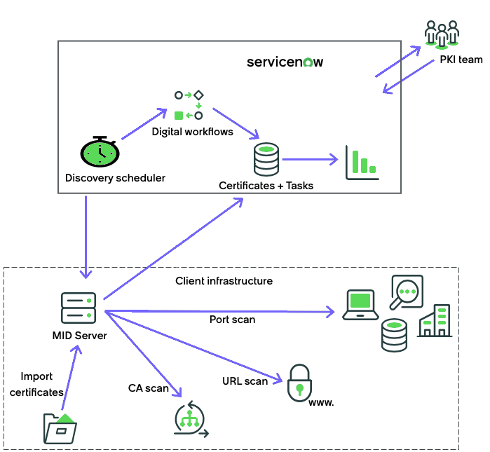
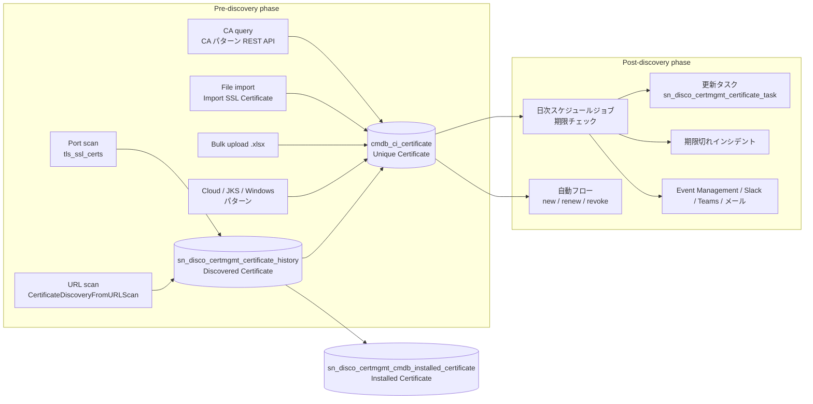
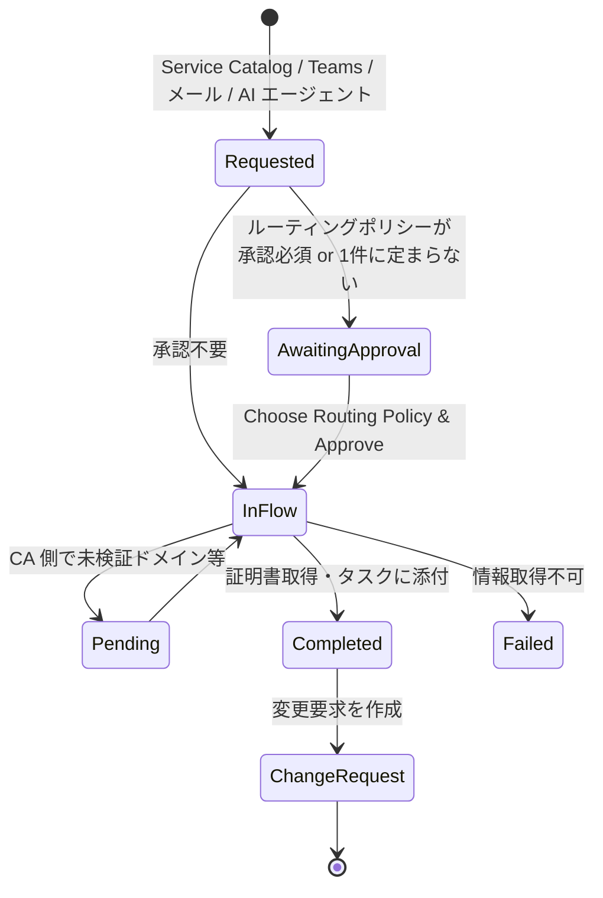
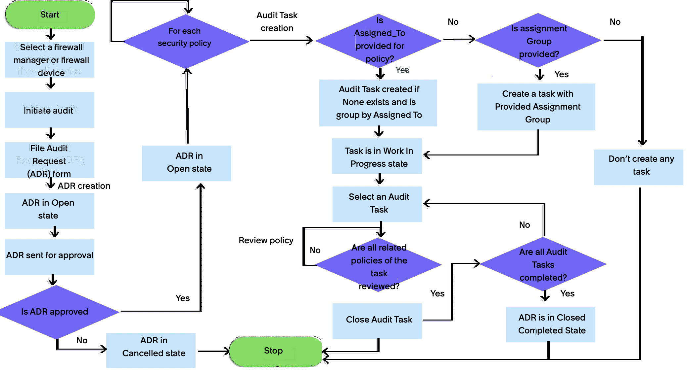
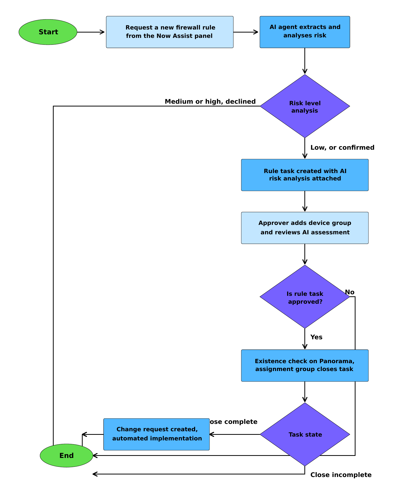
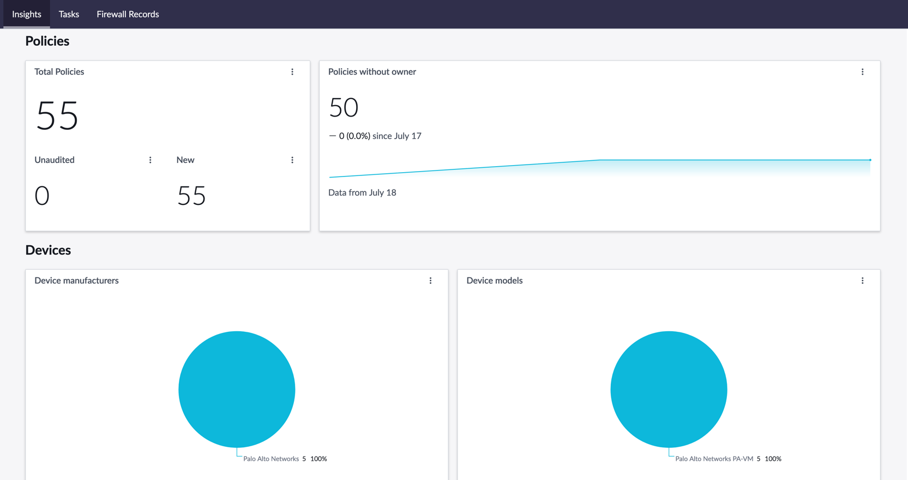

# Certificate Inventory and Management と Firewall Audits and Reporting（証明書インベントリ管理・ファイアウォール監査）

## 概要

本ファイルは、ServiceNow 公式ドキュメント上で Discovery の章（ITOM Visibility 配下）に置かれている2つの Store アプリケーションを扱う。どちらも [Discovery](./discovery.md) の仕組み（MID Server、Discovery schedule、パターン、Credential alias）の上に構築されているが、Discovery 本体のファイルでは対象外としている。

| 製品 | 英語正式名 | 日本語での説明 | Store アプリのスコープ / プラグイン | 最新版（2026-11 時点で確認できたもの） |
|---|---|---|---|---|
| 証明書管理 | **Certificate Inventory and Management**（CIM。ドキュメント内で「Certificate Management」とも表記） | TLS 証明書の検出・インベントリ化・期限監視と、新規申請・更新・失効の手動／自動フロー | `sn_disco_certmgmt`（プラグイン `com.sn_disco_certmgmt`） | 4.5.0（2026-09） |
| ファイアウォール監査 | **Firewall Audits and Reporting** | ファイアウォールマネージャー・デバイス・デバイスグループ・セキュリティポリシーの検出、ポリシー監査、ルール申請 | `sn_disco_firewall`（プラグイン `com.sn_disco_firewall`） | 3.0.0（2026-09） |

[出典](https://www.servicenow.com/docs/r/australia/it-operations-management/discovery/get-started-cert-inventory-mgmt.html) [出典](https://www.servicenow.com/docs/r/australia/it-operations-management/discovery/get-started-firewall-audit-reporting.html) [出典](https://www.servicenow.com/docs/r/store-release-notes/store-rn-itom-cert-inv-mgmt.html) [出典](https://www.servicenow.com/docs/r/store-release-notes/store-rn-firewall-audits.html)

両アプリに共通する基本的な性質は次のとおり。

- **Store アプリとしてリリースされる。** ファミリーリリース（Australia / Brazil）とは別にバージョンが上がるため、機能の有無はリリース名よりも**アプリのバージョン**で判断する。ドキュメントにも「Version 1.3.8 から」のようにアプリのバージョンで書かれている。
- **前提プラグインは3つ。** ITOM Visibility（`com.snc.itom.vis.license`）、Discovery（`com.snc.discovery`）、Configuration Management for Scoped Apps (CMDB)（`com.snc.cmdb.scoped`）である。Australia 版ドキュメントの前提条件には「Australia 以降へのアップグレード」とあるが、これはドキュメント版ごとの定型文である（Brazil 版では「Brazil 以降」になる）。手順ページによっては Zurich Patch 8 や Yokohama Patch 8 以降でも使えると書かれている（7.3、第10章）。各 Store バージョンが実際に対応するファミリーは ServiceNow Store の掲載情報で確認する（Store リリースノートには記載がない）。ITOM Visibility と Discovery がすでに導入済みなら、アップグレード時に CIM / Firewall のプラグインが自動でインストールされる。そのうえで Store から最新版をダウンロードする。
- **ライセンスは ITOM Visibility に含まれる。** 詳細は「[19. ライセンス上の位置付け](#19-ライセンス上の位置付けitom-visibility-と-su)」を参照。

[出典](https://www.servicenow.com/docs/r/australia/it-operations-management/discovery/get-started-cert-inventory-mgmt.html) [出典](https://www.servicenow.com/docs/r/australia/it-operations-management/discovery/get-started-firewall-audit-reporting.html)

> 補足（情報源）：本ファイルの記述は、servicenow.com/docs の Australia 版ページを主な根拠としている。同じ内容を ServiceNow が GitHub で公開している Markdown 版（`ServiceNow/ServiceNowDocs` リポジトリの `australia` / `brazil` ブランチ）でも突き合わせた。[出典](https://github.com/ServiceNow/ServiceNowDocs)

---

# 第1部　Certificate Inventory and Management

## 1. 製品概要と提供価値

Certificate Inventory and Management は、IT インフラ上の TLS 証明書を一元的かつ自動的に追跡・管理するソリューションである。公式ドキュメントは、TLS 証明書を「discover, conduct an inventory, and proactively manage」（検出し、インベントリ化し、先回りして管理する）ための製品と説明している。IPv6 にも対応する。[出典](https://www.servicenow.com/docs/r/australia/it-operations-management/discovery/cert-inventory-mgmt.html)

Exploring ページが挙げる主な特徴は、リアルタイムの追跡、更新などの定型作業の自動化、既存の Discovery との統合、IPv6 対応、ロールベースのアクセス制御、重要イベントのアラートと通知である。[出典](https://www.servicenow.com/docs/r/australia/it-operations-management/discovery/cert-inventory-mgmt-explore.html)

| 提供価値（Benefit） | 該当機能 | 主なロール |
|---|---|---|
| 一元化されたインベントリ、証明書の優先度付け、更新ワークフローによる高コストな障害（期限切れ）の防止 | Certificate Inventory and Management の設定 | Certificate administrator（`sn_disco_certmgmt.pki_admin`） |
| 自動追跡による手作業の削減と、期限切れの早期警告 | ACME | Certificate user（`sn_disco_certmgmt.pki_user`） |
| 証明書タスク・ワークフローの監督・承認・検証によるコンプライアンス（期限切れ証明書のインシデントを含む） | 証明書タスクの承認 | Certificate approver（`sn_disco_certmgmt.pki_approver`） |

[出典](https://www.servicenow.com/docs/r/australia/it-operations-management/discovery/cert-inventory-mgmt-explore.html)

> 背景（外部動向）：CA/Browser Forum は Ballot SC-081v3（2025-04 可決）で、公開 TLS 証明書の最大有効期間を段階的に短縮すると決めた。上限は 2026-03-15 から 200 日、2027-03-15 から 100 日、2029-03-15 から 47 日となる。これにより、更新回数の増加を前提とした自動化の需要が高まっている。【第三者情報】[出典](https://www.appviewx.com/blogs/its-official-ca-b-forum-votes-yes-to-47-day-tls-certificates/) [出典](https://support.dnsimple.com/articles/announcement-ssl-certificate-validity-changes/)

## 2. 全体の処理の流れ（Process flow）

Certificate Inventory and Management の処理は、**Pre-discovery phase（検出前フェーズ）**と **Post-discovery phase（検出後フェーズ）** に分かれる。

- Pre-discovery phase では、スキャン対象や認証情報を準備する。準備内容は証明書の取得元によって異なる。
- Post-discovery phase では、検出された証明書の目録化・追跡を行い、手動または自動のリクエストで管理する。

[出典](https://www.servicenow.com/docs/r/australia/it-operations-management/discovery/cert-inventory-mgmt-process.html)

*図1：Certificate Inventory and Management の全体ワークフロー（公式ドキュメント「Certificate Inventory and Management process flow」の Figure 1）*

図の説明：上段の枠が ServiceNow インスタンス、下段の破線枠が顧客インフラ（Client infrastructure）を表す。インスタンス側では、**Discovery scheduler** が **Digital workflows** を起動し、その結果が **Certificates + Tasks**（証明書レコードとタスク）として格納され、ダッシュボード（棒グラフアイコン）に可視化される。**PKI team** はインスタンスと双方向にやり取りする。Discovery scheduler は顧客側の **MID Server** に指示を出し、MID Server は次の4つの方法で証明書を収集してインスタンスに返す。

- **Port scan**：サーバー・端末・ストレージ等へのポートスキャン
- **URL scan**：Web サイトの URL へのアクセス
- **CA scan**：証明書認証局（CA）への問い合わせ
- **Import certificates**：ファイルフォルダーからの証明書ファイル取り込み

出典：https://www.servicenow.com/docs/r/australia/it-operations-management/discovery/cert-inventory-mgmt-process.html （取得日 2026-11-08）

## 3. 前提条件・プラグイン・インストール

| 項目 | 内容 |
|---|---|
| 必要ロール（セットアップ） | `admin` |
| 必須プラグイン | ITOM Visibility（`com.snc.itom.vis.license`）、Discovery（`com.snc.discovery`）、Configuration Management for Scoped Apps (CMDB)（`com.snc.cmdb.scoped`） |
| インスタンス | Australia 版ドキュメントの前提条件は「Australia 以降へのアップグレード」（Brazil 版では「Brazil 以降」）。ただしこれはドキュメント版ごとの定型文で、7.3（Zurich Patch 8 以降）、9.1 の 3.6.0（Yokohama 以降）、第10章（Yokohama Patch 8 以降）の記述とは一致しない。各 Store バージョンが対応するファミリーは ServiceNow Store の掲載情報で確認する（Store リリースノートには記載なし） |
| 自動インストール | ITOM Visibility と Discovery が導入済みの場合、アップグレード時に Certificate Inventory and Management プラグインが自動インストールされる |
| Store | ServiceNow Store から Certificate Inventory and Management の最新版をダウンロードする |
| 依存（1.2.1 以降） | ITOM Visibility サブスクリプションが依存関係に追加された（1.2.1、2020-08） |

[出典](https://www.servicenow.com/docs/r/australia/it-operations-management/discovery/get-started-cert-inventory-mgmt.html) [出典](https://www.servicenow.com/docs/r/store-release-notes/store-rn-itom-cert-inv-mgmt.html)

**MID Server が到達できる必要がある CA エンドポイント**（用途に応じて）：

| CA | エンドポイント |
|---|---|
| Entrust（検出） | `https://api.entrust.net/enterprise/` |
| Entrust（ルート証明書ダウンロード） | `https://web.entrust.com/root-certificates/` |
| DigiCert | `https://www.digicert.com/services/` |
| Sectigo | `https://cert-manager.com/api/ssl/` |
| GoDaddy | `https://api.godaddy.com/` |

[出典](https://www.servicenow.com/docs/r/australia/it-operations-management/discovery/get-started-cert-inventory-mgmt.html)

## 4. ロール

| ロール | 名称 | 責務・権限 |
|---|---|---|
| `sn_disco_certmgmt.pki_admin` | Certificate administrator（証明書管理者） | 証明書レコードのうち、証明書自体の属性ではない項目（state、status、assigned to、assignment group、renewal tracking、service type など）を変更できる。証明書固有の属性は変更されない。検出された証明書の既定の state は `installed` で、手動で issued / installed / revoked / retired に変更できる。各種ダッシュボードの参照と、証明書・証明書タスクの読み書きが可能。`pki_user` を内包する |
| `sn_disco_certmgmt.pki_user` | Certificate user（証明書ユーザー） | 証明書ディスカバリーを監督する。ダッシュボードの参照と、証明書・関連タスクの読み書きが可能 |
| `sn_disco_certmgmt.pki_approver` | Certificate approver（証明書承認者） | 証明書リクエストを担当する。公式の表では「Service Catalog フォームから証明書リクエストを起票できる通常ユーザー」と説明されている。ルーティングポリシーで Approval Required を選んだ場合、Task Approval Group にはこのロールを持つグループを指定する |
| `sn_disco_certmgmt.certificate_requester` | Certificate requester（証明書申請者） | Service Catalog から証明書の申請・更新を行う。Certificate Owner / Certificate Owner Group が持つ最小ロール |

[出典](https://www.servicenow.com/docs/r/australia/it-operations-management/discovery/cert-inventory-mgmt-user-roles.html) [出典](https://www.servicenow.com/docs/r/australia/it-operations-management/discovery/certificate-routing-policy-form.html) [出典](https://www.servicenow.com/docs/r/australia/it-operations-management/discovery/renew-cert-automated-flow.html)

承認に関する補足（公式の Note）：

- `pki_admin` を持つユーザーは、証明書リクエストフォームの Approver フィールドに追加できる。ただし証明書タスクフォームから承認・却下するには、`approval_admin` ロールを手動で付与する必要がある。
- ログインして **My Approvals** から承認するには `approver_user` ロールが必要である。
- 証明書タスクのフォームや関連リストでは、システム管理者、`approval_admin` を持つユーザー、`pki_admin` を持つユーザーが、承認者を複数追加したり既存の承認者を編集したりできる。
- ベースシステムには `pki_admin` を持つ **headless user**（特定の人に紐付かないアカウント）が含まれる。このユーザーは、自動生成される更新タスクとインシデントの caller になる。別のユーザーに変えるには Discovery プロパティ `glide.discovery.certs.cert_admin_user_id` を設定する。

[出典](https://www.servicenow.com/docs/r/australia/it-operations-management/discovery/cert-inventory-mgmt-user-roles.html)

ロール全般の考え方は [ユーザー・グループ・ロール](../platform/users-groups-roles.md) を参照。

## 5. テーブル

| テーブル | 名称 | 説明 | 導入バージョン |
|---|---|---|---|
| `cmdb_ci_certificate` | Unique Certificate（一意の証明書） | 一意の証明書ごとに1レコード（CI）。サーバー証明書は Fingerprint 列で一意になる。証明書チェーン全体は関連リストで参照できる。**State は証明書のライフサイクル状態を表し、Expired の値はない**。期限切れの証明書も State は Issued のままで、期限切れの判定には `valid_to` を使う | — |
| `sn_disco_certmgmt_cmdb_installed_certificate` | Installed Certificate（インストール済み証明書） | 検出されたすべての証明書と、そのインストール場所を保持する。サーバー CI への参照を持たず、IRE を通らない。管理対象証明書との関係（サーバー、アプリケーション、ビジネスサービス）は `cmdb_rel_ci` に格納される | — |
| `sn_disco_certmgmt_certificate_history` | Discovered Certificate（検出済み証明書） | Shazzam / URL ディスカバリーのセンサーが最初に書き込むテーブル。アドレスごとの証明書の XML ペイロードを保持する | — |
| `certificate_domain` | Certificate Domain | Subject Alternative Name（SAN）のドメインを1件以上保持する | — |
| `sn_disco_certmgmt_certificate_task` | Certificate Task（証明書タスク） | 更新タスクと新規申請タスク（手動フロー） | — |
| `sn_disco_certmgmt_cert_url` | Certificate URL | 証明書ディスカバリー対象の URL | — |
| `sn_disco_certmgmt_certificate_management_credential` | Certificate Management Credential | CA の種類（GoDaddy、DigiCert ほか）ごとの資格情報。それ以外の CA は `certificate_authority` スクリプトに基づいて追加される。その他の CA の資格情報を作成できるのは `discovery_admin` のみ | 1.1.7 |
| `sn_discovery_cert_url_sched_m2m` | Scheduled Certificate URL | URL と Discovery schedule（`discovery_schedule`）の多対多リンク | — |
| `sn_disco_certmgmt_ca` | Certificate Authority | CA 名と REST API のベース URL | 1.3.8 |
| `sn_disco_certmgmt_ca_api_url` | Certificate Authority API URL | CA への参照、REST API のエンドポイント URL、証明書の検証タイプ | 1.3.8 |
| `sn_disco_certmgmt_routing_policy` | Routing Policy（ルーティングポリシー） | 証明書操作の連絡先となる CA を決める。CA、CA URL、Credential、Approval Group、Assignment Group、CSR 属性を持つ | 1.3.8 |
| `sn_disco_certmgmt_task` | Automated Certificate Task | 自動フローのタスク（new / renew / revoke）の親テーブル | 1.3.8 |
| `sn_disco_certmgmt_new_task` | New Certificate Tasks | `sn_disco_certmgmt_task` を拡張。新規申請 | 1.3.8 |
| `sn_disco_certmgmt_renew_task` | Renew Certificate Tasks | `sn_disco_certmgmt_task` を拡張。更新 | 1.3.8 |
| `sn_disco_certmgmt_revoke_task` | Revoke Certificate Tasks | `sn_disco_certmgmt_task` を拡張。失効 | 1.3.8 |
| `sn_disco_certmgmt_certificate_extension` | Certificate Extensions | すべてのサーバー証明書の拡張情報。DigiCert の Certificate Id / Order id / Thumbprint / Serial Number / Certificate Status など、自動フローの更新・失効に必要な情報を格納する | 1.3.8 |
| `sn_disco_certmgmt_microsoft_teams_channel` | Microsoft Teams Channel | Teams チャネルの設定 | 4.2.0 |
| `sn_disco_certmgmt_notification_policy` | Certificate Notification Policy | 通知種別ごとのメール / Teams 通知設定 | 4.2.0 |
| `sn_disco_certmgmt_certificate_metadata` | Certificate Metadata | `cmdb_ci_certificate` の各証明書に1レコード。秘密鍵の保管先（Vault）への参照、発行時の証明書形式（PEM / DER / PKCS12）、自動更新の設定（Auto renew enabled など）を保持する | 公式の記載では未確定（プレースホルダー表記） |

[出典](https://www.servicenow.com/docs/r/australia/it-operations-management/discovery/cert-invt-mgmt-tables.html) [出典](https://www.servicenow.com/docs/r/australia/it-operations-management/discovery/run-cert-discovery.html)

**テーブルクリーナー（自動削除）**：パフォーマンス維持のため、次の古いレコードは自動で削除される。[出典](https://www.servicenow.com/docs/r/australia/it-operations-management/discovery/cert-inventory-mgmt-process-post-discovery.html)

| テーブル | 削除対象 |
|---|---|
| `sn_disco_certmgmt_certificate_history` | 30日より古いレコード |
| `sn_disco_certmgmt_cmdb_installed_certificate` | 90日より古いレコード |

**陳腐化したタスクの整理**：期限切れまたはアーカイブ後6か月を超えた証明書について、後継の証明書があれば未完了のタスクを削除する。failed 状態の証明書タスクにも同じ6か月の猶予期間が適用される。[出典](https://www.servicenow.com/docs/r/australia/it-operations-management/discovery/cert-inventory-mgmt-process-post-discovery.html)

CMDB のクラス階層と IRE の一般論は [CMDB と CSDM](../platform/cmdb-csdm.md) を参照。

## 6. 用語

| 用語 | 説明 |
|---|---|
| CA（Certificate Authority、認証局） | デジタル証明書を発行する主体 |
| Certificate fingerprint（証明書フィンガープリント） | 証明書を一意に識別するメタデータ |
| Discovery method - CA（1.1.7） | GoDaddy や DigiCert などの CA から証明書を検出する方式 |
| Discovery method - Certificate import（1.1.7） | パターンベースのディスカバリーで証明書ファイルを取り込んで検出する方式 |
| Discovery method - Port | リモートサーバーの待ち受けポートから検出する方式 |
| Discovery method - URL | URL から検出する方式 |
| External certificate（外部証明書） | ルート CA または中間 CA が署名した証明書 |
| Internal / Self-signed certificate（内部・自己署名証明書） | ルート CA や中間 CA ではなく、証明対象と同じ主体が署名した証明書 |
| TLS（Transport Layer Security） | SSL の後継プロトコル |
| Trust manager / Trust store | TLS 証明書を検証する仕組み / CA 証明書の保管庫 |
| Unique vs Installed | Unique は証明書（フィンガープリント）ごとの一意レコード、Installed はその証明書の配置場所 |

[出典](https://www.servicenow.com/docs/r/australia/it-operations-management/discovery/cert-invt-mgmt-terms.html)

## 7. 証明書の検出（Visibility to TLS certificates）

検出方法の一覧：

| 方式 | 仕組み | 主な格納先 | 必要ロール | 導入 |
|---|---|---|---|---|
| ポートスキャン（Port） | 既存の IP ベース Discovery schedule の Shazzam フェーズで、ポートプローブ `tls_ssl_certs` が証明書チェーンを取得する | `sn_disco_certmgmt_certificate_history` → `cmdb_ci_certificate` | `discovery_admin` / `admin` | 初期 |
| URL スキャン（URL） | Certificate Discovery Source URLs に登録した URL と、`cmdb_ci_endpoint_http` の URL を走査する | 同上 | — | 初期（`cmdb_ci_endpoint_http` は 1.2.0） |
| CA 照会（CA query） | CA パターンが CA の REST API で証明書一覧を取得する | `cmdb_ci_certificate`、`certificate_domain`、`sys_attachment` | `pki_admin` / `discovery_admin` | 1.1.7（Sectigo / Entrust は 1.2.0） |
| ファイル取り込み（Import） | Import SSL Certificate パターンがホストのフォルダーから証明書ファイルを読む | `cmdb_ci_certificate` | `discovery_admin` / `admin` | 1.1.7 |
| 一括アップロード（Bulk upload） | `.xlsx` テンプレートで最大 5,000 件を登録する | `cmdb_ci_certificate` | `pki_user` / `pki_admin` | 1.2.0 |
| クラウド | AWS Certificate Manager、GCP Certificate Manager、Azure Key Vault の各パターン | `cmdb_ci_certificate` | — | 3.4.0 |
| ホスト内ストア | Linux Server / Windows OS – Servers パターンの Collect Certificates 拡張（Java KeyStore / Windows Certificate Store） | — | — | 3.4.0（Discovery and Service Mapping Patterns 1.12.0 以上） |

[出典](https://www.servicenow.com/docs/r/australia/it-operations-management/discovery/cert-inventory-mgmt-process-pre-discovery.html) [出典](https://www.servicenow.com/docs/r/australia/it-operations-management/discovery/cert-invt-mgmt-patterns.html) [出典](https://www.servicenow.com/docs/r/store-release-notes/store-rn-itom-cert-inv-mgmt.html)

### 7.1 ポートスキャン（tls_ssl_certs ポートプローブ）

ポートプローブ `tls_ssl_certs` を有効にすると、既存の CI ディスカバリー schedule が、事前承認済みの既定14ポートについて証明書を走査するようになる。新規インストールでは、このプローブの **Active はオフ（未チェック）が既定**である。[出典](https://www.servicenow.com/docs/r/australia/it-operations-management/discovery/run-cert-inventory-mgmt-ports.html)

| 種別 | ポート |
|---|---|
| SSL の典型ポート | 443、8443、9443、636（ldaps）、993（imaps）、995（popssl）、989、990 |
| StartTLS のポート | 25（smtp）、110、143、389、21、587（smtp） |

[出典](https://www.servicenow.com/docs/r/australia/it-operations-management/discovery/cert-inventory-mgmt-process-pre-discovery.html)

`tls_ssl_certs` の既定の **Triggered by services**：HTTPS、tomcat-ssl、IBM WebSphere SSL、LDAPS、IMAPS、POP3S、FTPS-data、FTPS、SMTP、POP3、IMAP、LDAP、FTP、ほか（submission）。[出典](https://www.servicenow.com/docs/r/australia/it-operations-management/discovery/run-ip-based-certificate-discovery.html)

**処理の詳細**：Shazzam の過程で、MID Server がスキャナーを使って IP / ポートから証明書チェーン（階層を含む）を取得し、XML ペイロードにしてインスタンスへ送る。Shazzam センサーは ECC キューのエントリを検知し、`sn_disco_certmgmt_certificate_history` にレコードを挿入する。XML から取り出して検証される項目は、certificate id、revocation_status、subject、issuer、sans、is_self_signed、is_ca、valid_from、valid_to、signature_algorithm、fingerprint_algorithm、key_size、serial_number、version である。[出典](https://www.servicenow.com/docs/r/australia/it-operations-management/discovery/cert-inventory-mgmt-process-pre-discovery.html)

**手順（クラシック UI）**：[出典](https://www.servicenow.com/docs/r/australia/it-operations-management/discovery/run-cert-inventory-mgmt-ports.html)

1. **Discovery Definition > Port Probes** で `tls_ssl_certs` を開き、**Active** をオンにして保存する。
2. 必要に応じて **Discovery Definition > IP Services** でポート付きの IP サービスを新規作成する。
3. `tls_ssl_certs` の **Triggered by services** のロックを外し、ポートを削除・追加する（**最大138ポートまで追加可能**）。
4. 以後、既存の Discovery schedule が自動的に指定ポートの証明書を走査する。結果は Certificate Management Dashboard で確認できる。

**IP ベースの証明書ディスカバリー（専用 schedule / Quick Discovery）**：**All > Discovery Schedules > New** で schedule を作り、Discovery IP Ranges に IP / 範囲 / リストを登録する。単発で確認するときは **Quick Discovery** で対象 IP を1つ指定する。MID Server が対象に到達できない場合は Discovery credential alias を定義する。必要ロールは Certificate Administrator、`discovery_admin`、`admin` のいずれか。[出典](https://www.servicenow.com/docs/r/australia/it-operations-management/discovery/run-ip-based-certificate-discovery.html)

### 7.2 URL スキャン

**手順**：[出典](https://www.servicenow.com/docs/r/australia/it-operations-management/discovery/run-cert-inventory-mgmt-urls.html)

1. **All > Certificate Management > Certificate Discovery Source URLs** で、URL を1件ずつ `scheme://host:port` 形式で登録する。ポートは省略でき、省略時は既定値が使われる。
2. Discovery schedule を作成し、**Discover: Certificates**、**Certificate Discovery Type: URL Certificate Discovery** を選ぶ。
3. 実行時は、登録した URL に加えて `cmdb_ci_endpoint_http` の URL もすべて走査する。

**仕様上の注意**：

- 検出できるのは、スキャン時にサーバーが提示する証明書だけである。事前に `openssl s_client` で提示内容を確認することが推奨されている。
- 証明書とアプリケーションの間に関係がある場合、URL ディスカバリーは追加で「Uses / Used by」の関係を作る。
- 内部では、URL ごとに `CertificateDiscoveryFromURLScan` プローブが証明書チェーンを取得し、`sn_disco_certmgmt_certificate_history` にレコードを追加する。
- `sn_disco_certmgmt_cert_url` のレコードは、`cmdb_ci_certificate` への任意の参照を持つ。

[出典](https://www.servicenow.com/docs/r/australia/it-operations-management/discovery/cert-inventory-mgmt-process-pre-discovery.html)

Discovery schedule の **Discover** に Certificates を選んだときのフォーム項目（Certificate Discovery Type、URL Certificate Batch Size、関連リスト Certificate URLs）は、[Discovery](./discovery.md) の Discovery schedule の節を参照。

### 7.3 Discovery Admin Workspace からの証明書ディスカバリー

Discovery Admin Workspace v1.20.0 と CIM v4.2.4 を導入すると、**Workspaces > Discovery Admin Workspace > Schedules > New Discovery > Certificate discovery** から、ウィザード形式で証明書ディスカバリーを設定できる。前提は、プラットフォームが Brazil、Australia、または Zurich Patch 8 以降であること。必要ロールは `discovery_admin`。[出典](https://www.servicenow.com/docs/r/australia/it-operations-management/discovery/daw-discover-certs-port.html) [出典](https://www.servicenow.com/docs/r/australia/it-operations-management/discovery/daw-discover-certs-url.html)

| 選択肢 | 内容 |
|---|---|
| Discover via port scans | Certificate Port Probe ページで **Active** をオンにし、既存の IP サービス（**Add > From existing IP services**）または新規の IP サービス（**Add > New IP services**）を追加・削除して保存する。既存の IP ベース schedule が実行されるたびに、該当ポートの証明書が収集される |
| Discover via URL scans | schedule 名、MID Server（クラスター / 自動選択 / 個別指定）、**Available URLs** からの URL 選択または **Add URL** による追加を行い、**Finish** または **Finish and Run** で保存する |

### 7.4 CA 照会（Certificate authority query）

CA パターンが、REST API で GoDaddy / DigiCert / Entrust / Sectigo などから証明書一覧を取得する。取得した情報は `cmdb_ci_certificate`、`certificate_domain`、`sys_attachment` に格納される。[出典](https://www.servicenow.com/docs/r/australia/it-operations-management/discovery/cert-inventory-mgmt-process-pre-discovery.html)

**資格情報の作成**：**All > Discovery > Credentials > New > Certificate Management Credentials** で作成する。CA type の選択肢は DigiCert、GoDaddy、Entrust、Sectigo、Let's Encrypt、EJBCA、CyberArk Certificate Manager SaaS、Sectigo Universal、Sectigo Public。[出典](https://www.servicenow.com/docs/r/australia/it-operations-management/discovery/run-cert-inventory-mgmt-ca-query.html)

| フィールド | 対象 CA | 説明 |
|---|---|---|
| Name | 全 CA | 資格情報の名前 |
| Credential alias | 全 CA | Discovery による CA の走査と、自動リクエストの認証に使うエイリアス |
| API Key | DigiCert、GoDaddy、CyberArk Certificate Manager SaaS | CA で発行した API キー |
| Secret Key | GoDaddy | API シークレットキー |
| User name | Entrust | ユーザー名 |
| Authentication Key | Sectigo | 認証キー |
| Password | Entrust、Sectigo | 暗号化して保存される |
| Customer URI | Sectigo | 顧客 URI |
| Keystore | Entrust、EJBCA | JKS または PKCS12 のキーストア |
| Private Key / Key Type | Let's Encrypt、EJBCA、Sectigo Universal、Sectigo Public | 秘密鍵と、その鍵種別（None / RSA / ECDSA） |

**パターンのパラメーター**：[出典](https://www.servicenow.com/docs/r/australia/it-operations-management/discovery/cert-inventory-mgmt-process-pre-discovery.html)

| パラメーター | 既定値 | 説明 |
|---|---|---|
| `start_offset` | 0 | CA から読み込みを始める位置 |
| `limit` | 1500 | `start_offset` から読み込む件数 |
| `CredentialAlias` | — | CA 資格情報に紐付く Credential Alias（Serverless execution pattern の設定で指定） |
| `TLS_keepOriginalCertificate` | — | true にすると証明書ファイルを CI に添付する。ペイロードが増えて out-of-memory の原因になりうる |
| `IncludeCertStatus` | — | 既定以外に検出したい状態（カンマ区切り） |
| `ca_api_url` / `ca_api_version` | 下表 | 空欄なら既定値を使う |

| CA | 既定の `ca_api_version` / `ca_api_url` | 既定で検出する状態 |
|---|---|---|
| DigiCert | v2 / `https://www.digicert.com/services/` | Active、Expired、Revoked、Canceled |
| Entrust | v2 / `https://api.entrust.net/enterprise/` | Active、Expired、Revoked |
| GoDaddy | v1 / `https://api.godaddy.com/` | Active、Expired、Revoked、Canceled |
| Sectigo | v1 / `https://cert-manager.com/api/ssl/` | Issued、Expired |

**1,500 件を超える場合**：1回のサーバーレスパターン実行で扱えるのは最大 1,500 件である。それを超える場合は、オフセットをずらした複数のパターンを設定する。たとえば 6,000 件なら、オフセット 0 / 1500 / 3000 / 4500 の4本にする。[出典](https://www.servicenow.com/docs/r/australia/it-operations-management/discovery/run-cert-discovery.html)

> 注意：CA から返される状態が issued / valid / expired / canceled のいずれでも、`cmdb_ci_certificate` の State はすべて **Issued** になる。期限切れの判定には **Valid to** を使う。[出典](https://www.servicenow.com/docs/r/australia/it-operations-management/discovery/cert-inventory-mgmt-process-pre-discovery.html)

### 7.5 証明書ファイルの取り込み（Import SSL Certificate パターン）

| 項目 | 内容 |
|---|---|
| 対応形式 | `.cert`、`.pem`、`.txt`、`.der`、`.cer` |
| schedule の設定 | **Discovery: Import Certificates**、**Certificate Discovery Type: Import Certificates**、MID Server selection method: **Specific MID Server**。Windows / Linux ホストの資格情報を指定し、**Serverless Execution pattern** タブで Import SSL Certificate パターンを追加する |
| パラメーター | `Server`（ホスト名 / IP。MID Server 上のファイルを取り込む場合は localhost を指定し、temp フォルダーは空欄）、`server_certificates_folder`、`TLS_keepOriginalCertificate`（false を推奨）、`temp_certificates_folder`（MID Server 上の一時フォルダー） |
| 制約 | Windows と Linux の MID Server が混在する構成では、Auto-select MID Server を使えない |

[出典](https://www.servicenow.com/docs/r/australia/it-operations-management/discovery/run-cert-inventory-mgmt-import.html) [出典](https://www.servicenow.com/docs/r/australia/it-operations-management/discovery/cert-inventory-mgmt-process-pre-discovery.html)

**チェーン関係の維持**：ファイル取り込みで証明書チェーン（サーバー → 中間 → ルート）の関係を保持できるのは **`.txt` ファイルだけ**である。ファイル内の並び順は「サーバー証明書、中間証明書、ルート証明書」でなければならない。[出典](https://www.servicenow.com/docs/r/australia/it-operations-management/discovery/maintain-cert-chain-relationships.html)

| ファイルの内容 | 結果 |
|---|---|
| `.cert` / `.pem` 等に2つ以上の証明書 | 先頭の1つだけを処理し、チェーンは作らない |
| `.txt` に1つの証明書 | サーバー証明書として扱い、チェーンは作らない |
| `.txt` に2つの証明書 | 1つ目をサーバー証明書、2つ目をルート証明書として扱う（中間証明書なし） |

チェーン関係は直近の URL / IP ディスカバリーの結果に依存する。チェーンを含まないファイルを取り込むと、同じフィンガープリントの証明書に既に存在するチェーン関係は削除される。サーバー外にあるルート証明書は、Import SSL Certificate パターンを使う専用の schedule で検出し、中間証明書と結び付けることができる（3.8.2 で off-site ルート証明書の検出が追加された）。[出典](https://www.servicenow.com/docs/r/australia/it-operations-management/discovery/maintain-cert-chain-relationships.html) [出典](https://www.servicenow.com/docs/r/australia/it-operations-management/discovery/discover-root-certificate-browser.html)

### 7.6 一括アップロード（Bulk Upload Certificates）

**All > Certificate Management > Bulk Upload Certificates** からテンプレート `sample_cmdb_ci_certificate.xlsx` をダウンロードし、記入して **Browse File > Upload** で取り込む。1ファイルあたり最大 5,000 件。エラー時は警告とエラーログへのリンクが表示される（ログを見られるのは `admin` のみ）。[出典](https://www.servicenow.com/docs/r/australia/it-operations-management/discovery/run-cert-inventory-mgmt-bulk-url.html)

主な必須列：`valid_to`、`valid_from`、`root_issuer`、`issuer`、`issuer_common_name`、`issuer_distinguished_name`、`subject_common_name`、`subject_distinguished_name`、`state`（issued / installed / revoked / retired / other）、`fingerprint`（スペース区切りの16進ペア）、`fingerprint_algorithm`、`signature_algorithm`。チェーン関係を保つには、`root_issuer` と `issuer` にそれぞれ上位証明書のフィンガープリントを入れる。自己署名証明書では、両方に自身のフィンガープリントを入れる。[出典](https://www.servicenow.com/docs/r/australia/it-operations-management/discovery/bulk-certificate-upload-template-fields.html)

### 7.7 パターン一覧

| パターン | 対象 | 備考 |
|---|---|---|
| GoDaddy: Certificate Management | GoDaddy CA | CA から証明書を取り込み・走査 |
| DigiCert: Certificate Management | DigiCert CA | 同上 |
| Entrust: Certificate Management | Entrust CA | 同上 |
| Sectigo: Certificate Management | Sectigo CA | 同上 |
| Import SSL Certificate | ファイル | 証明書ファイルの取り込み |
| Microsoft CA: Certificate Management | Microsoft CA サーバー | 最新の Discovery and Service Mapping Patterns が必要な場合あり |
| Amazon AWS: Certificate Manager（＋Collect Certificates Tags 共有ライブラリ） | AWS ACM | AWS クラウドディスカバリーの一部。CIM 3.4.0 以上と Patterns 1.12.0 以上が必要 |
| GCP: Certificate Manager Certificates and Classic Certificates | GCP | 同上 |
| Azure: Key Vault Certificates | Azure Key Vault | 同上 |
| Java KeyStore and Windows Certificates | JKS / Windows 証明書ストア | Linux Server / Windows OS – Servers パターンの Collect Certificates 拡張。この拡張は既定で無効。JKS の資格情報は type `java_keystore` |

[出典](https://www.servicenow.com/docs/r/australia/it-operations-management/discovery/cert-invt-mgmt-patterns.html) [出典](https://www.servicenow.com/docs/r/australia/it-operations-management/discovery/x509-certificates-discovery.html)

> 関連：Agent Client Collector（ACC-VC）経由の証明書ディスカバリーや F5 の証明書ディスカバリーもある。それぞれ [Agent Client Collector](./agent-client-collector.md) と Discovery and Service Mapping Patterns のドキュメントを参照。クラウドディスカバリー全般は [Cloud Management](./cloud-management.md) を参照。

## 8. 期限監視・タスク・インシデント（手動フロー）

**Manual flow（手動フロー）** では、リクエストと承認はインスタンス上で記録されるが、証明書そのものは CA から直接（インスタンスの外で）入手する。自動フローが対応していない CA を使う場合に選ぶ方式である。[出典](https://www.servicenow.com/docs/r/australia/it-operations-management/discovery/manual-cert-requests.html)

**期限チェックの仕様**：日次のスケジュールジョブが `cmdb_ci_certificate` を走査し、期限切れまたは期限間近の証明書について更新タスクを作成する。[出典](https://www.servicenow.com/docs/r/australia/it-operations-management/discovery/manual-cert-requests.html)

| 項目 | 仕様 |
|---|---|
| 更新タスクの作成時期 | 期限の **60日前**（`glide.discovery.certs.days_before_expiration_to_create_renewal_task` で変更できる。このプロパティだけで足り、`CertificateNotifier` 等のカスタマイズは不要） |
| 優先度 | **3 - Moderate** で自動作成される |
| 重複防止 | 同じ証明書にタスクが既にあれば作らない |
| 自動入力 | 更新タスクの `assigned_to` と `requested_for` は証明書の `assigned_to` から、`assignment_group` は証明書の `assignment_group` から引き継ぐ |
| インシデント | 証明書が期限切れになり、後継の証明書がない場合にインシデントを作成する（証明書1件につき1件のみ）。**Service Desk > Incidents** で参照する |
| 対象の絞り込み（3.6.3） | `sn_disco_certmgmt.most_recent_discovery_days_considered_to_create_renewal_task`（既定7日。期限切れ証明書の照会を Most Recent Discovery の日付で絞る）、`sn_disco_certmgmt.valid_to_days_considered_to_create_renewal_task`（last_discovered が空の場合に適用） |
| 退役済み | Retired の証明書には更新タスクを作らない（4.2.0 で修正） |

[出典](https://www.servicenow.com/docs/r/australia/it-operations-management/discovery/manual-cert-requests.html) [出典](https://www.servicenow.com/docs/r/store-release-notes/store-rn-itom-cert-inv-mgmt.html)

**手動の新規申請**：**All > Service Catalog > Certificate Management > Request New Certificate**。必須項目は Certificate Signing Request、Certificate Authority、Certificate Type、Validity period、Approver。前提として Certificate Management カタログが有効であること。必要ロールは `pki_admin`。承認フィールドは `pki_user` には読み取り専用、`pki_admin` には編集可能である。[出典](https://www.servicenow.com/docs/r/australia/it-operations-management/discovery/create-new-cert-requests.html)

**アーカイブ**：1.1.7 から Data Archiver（`com.glide.auxdb`）を使える。**Archive Rules > Certificate Task Archive** を有効にすると（既定は無効）、`sn_disco_certmgmt_certificate_task` のうち State が Closed Complete で、最終更新が12か月以上前のレコードがアーカイブされる。必要ロールは `pki_user` または `pki_admin`。[出典](https://www.servicenow.com/docs/r/australia/it-operations-management/discovery/archive-cert-task.html)

## 9. 自動化フロー（Automated certificate management）

CIM 1.3.8 から、新規申請・更新・失効のリクエストフローを自動化できる。自動フローでは、PKI チームの手作業なしに CA から証明書を取得する。[出典](https://www.servicenow.com/docs/r/australia/it-operations-management/discovery/automated-cert-requests.html)

### 9.1 対応 CA とバージョン

| バージョン | 追加された自動フロー対応 |
|---|---|
| 1.3.8（2021-09） | Service Catalog による申請・更新・失効、DigiCert へのポリシーベースのルーティング |
| 2.1.0（2022-05） | DigiCert と Entrust CA Gateway の自動フルフィルメント（DigiCert は **OV 証明書のみ**申請可） |
| 2.3.2（2022-11） | Microsoft CA（Active Directory Certificate Services）、Employee Center での申請・更新・失効、Unique certificate フォームでのチェーン表示 |
| 3.4.0（2024-05） | ACME の複数 CA 対応と更新の検証 |
| 3.6.0（2024-11） | インスタンス上での CSR 生成（Yokohama 以降のみ） |
| 3.8.2（2025-08） | EJBCA の ACME 対応 |
| 4.2.0（2026-06） | CyberArk Certificate Manager SaaS 連携、Azure Key Vault を外部 Vault として利用（Brazil 以降でサポート）、Teams 連携 |
| 4.5.0（2026-09） | DigiCert / Sectigo Universal / Sectigo Public の ACME 対応、CyberArk PVWA を秘密鍵ストアとして利用、DER / PKCS12 形式の受け取り |

[出典](https://www.servicenow.com/docs/r/store-release-notes/store-rn-itom-cert-inv-mgmt.html) [出典](https://www.servicenow.com/docs/r/australia/it-operations-management/discovery/automated-cert-requests.html)

**Microsoft CA を使う場合のユーザー要件**：[出典](https://www.servicenow.com/docs/r/australia/it-operations-management/discovery/automated-cert-requests.html)

- CA、中間サーバー、MID Server に CredSSP を構成する（KB1632624 を参照）。
- 対象ユーザーを Enterprise Admins グループに所属させる。
- 証明書テンプレートのセキュリティグループに対象ユーザーを含める。
- CA 上で Read、Issue and Manage Certificates、Manage CA、Request Certificates の権限を付与する。
- Microsoft CA への操作には PowerShell ステップを使うため、プラグイン `com.glide.hub.action_step.powershell` が必要である。

DigiCert と Entrust CA Gateway では、API ユーザーに証明書の申請・更新・失効の権限が必要である。[出典](https://www.servicenow.com/docs/r/australia/it-operations-management/discovery/request-new-cert-automated-flow.html)

### 9.2 ルーティングポリシー（Certificate Routing Policies）

ルーティングポリシーは、証明書操作の連絡先となる CA を決め、CA ごとの申請フローを起動する。設定場所は **All > Certificate Management > Certificate Routing Policies > New**。必要ロールは `pki_admin`、`flow_designer`、`action_designer`、`admin` のいずれか。[出典](https://www.servicenow.com/docs/r/australia/it-operations-management/discovery/set-up-routing-policy-for-acme.html)

- 重複申請は既定で許可されない。同じドメイン名の証明書タスクが進行中であれば、重複と判定される。**Allow duplicate requests** をオンにすると許可される。
- リクエスト時は、CSR の属性（Organization から順に）が `sn_disco_certmgmt_routing_policy` のレコードと照合される。ポリシーが1件に定まらない場合は、承認者が **Choose Routing Policy & Approve** でポリシーを選んで承認する。

[出典](https://www.servicenow.com/docs/r/australia/it-operations-management/discovery/set-up-routing-policy-for-acme.html) [出典](https://www.servicenow.com/docs/r/australia/it-operations-management/discovery/request-new-cert-automated-flow.html) [出典](https://www.servicenow.com/docs/r/australia/it-operations-management/discovery/approve-cert-task.html)

**Certificate Routing Policy フォーム（ACME 用）の主なフィールド**：[出典](https://www.servicenow.com/docs/r/australia/it-operations-management/discovery/certificate-routing-policy-field-values.html)

| フィールド | 説明 |
|---|---|
| Name | ポリシー名 |
| Certificate Authority | DigiCert、Entrust、Let's Encrypt、EJBCA、Sectigo Public ACME、Sectigo Universal ACME。追加した ACME 互換 CA もここに表示される |
| Certificate Authority API URL | DigiCert の場合に、自動処理と失効フローで使う API URL |
| Assignment Group | 手動の証明書タスクの割り当て先 |
| DNS Challenge Action | DNS チャレンジを自動で解決する Flow Designer アクション（例：ベースのスクリプト **ACME DNS Challenge - GoDaddy**）。他の DNS プロバイダー向けに同様のアクションを作ることもでき、その場合は `flow_designer` または `action_designer` が必要。**None** を選ぶと手動の DNS チャレンジフローになる |
| Credential Alias | CA 資格情報のエイリアス |
| Vault Type | 秘密鍵の外部保管先：HashiCorp Vault / Azure Key Vault / CyberArk PVWA |
| Certificate Purpose | 内部用か外部用か |
| Certificate Format | PEM（既定）/ DER / PKCS12 |
| PKCS12 Password Vault Reference / Key | PKCS12 の場合のパスワードの保管先（HashiCorp はシークレットのパス、Azure はシークレット名、CyberArk はアカウント名）と、キー名（HashiCorp の場合のみ） |
| Allow validity override | DigiCert ACME / Sectigo Public ACME / Sectigo Universal ACME で、要求した有効期間（notAfter）を ACME オーダーに含めるかどうか（既定はオン）。CA のプロファイルがクライアント指定の有効期間を拒否する場合はオフにする |
| Task Approval Group / DNS Task Assignment Group | 承認グループ / DNS チャレンジタスクの担当グループ |
| Mid Server | 証明書操作に使う MID Server |
| CSR 属性 | Organization、Organizational Unit、Locality、State、Country、Email Address はカンマ区切りの複数値を受け付ける。Subject Common Name と Subject Alternative Name は正規表現を受け付ける（カンマ不可、先頭・末尾の `/` 不可） |

CyberArk Certificate Manager SaaS 用のフォームには、Environment、Application Name、Issuing Template Alias、Is Active、Allow Duplicate Request、**Approval Required**（オンにすると自動フローの前に承認が必要になる。Task Approval Group は `pki_approver` を持つグループ）などのフィールドがある。[出典](https://www.servicenow.com/docs/r/australia/it-operations-management/discovery/certificate-routing-policy-form.html)

### 9.3 ACME（Automated Certificate Management Environment）

ACME は、CA とサーバーのやり取りを自動化するプロトコルである。HTTPS 上で JSON メッセージをやり取りし、証明書の申請・更新・失効を自動化する。CIM が対応する ACME CA は DigiCert、Entrust、Let's Encrypt、EJBCA、Sectigo Universal、Sectigo Public。これ以外の ACME 互換 CA も追加できる。[出典](https://www.servicenow.com/docs/r/australia/it-operations-management/discovery/exploring-acme.html)

**ACME 互換 CA の追加**：**All > Certificate Management > Certificate Automate Flows > Certificate Authorities > New** で `sn_disco_certmgmt_ca` にレコードを作る（Name、Base API URL＝ACME ディレクトリのエンドポイント、ACME チェックボックス）。スクリプトの変更は不要。ただし公式ドキュメントは、カスタム CA ではエラーが起きる可能性があり、その場合はサポートに連絡するよう注記している。必要ロールは `admin`。その後、資格情報とルーティングポリシーを作成する。[出典](https://www.servicenow.com/docs/r/australia/it-operations-management/discovery/add-acme-compatible-certificate-authorities.html)

**ACME の申請手順（DNS チャレンジ自動化あり）**：**All > Self-Service > Service Catalog > Certificate Management > Automated Flow > Request New Certificate (Automated)** を開き、**Select how to manage your certificate** で **ServiceNow** を選ぶ。前提は、資格情報、カタログの有効化、DNS Challenge Action 付きのルーティングポリシーが揃っていること。[出典](https://www.servicenow.com/docs/r/australia/it-operations-management/discovery/request-new-certificate-using-acme-automated-flow-dns.html)

### 9.4 自動フローの申請フォームと動作

**Request New Certificate (Automated) / Renew Certificate (Automated) フォームの主なフィールド**：[出典](https://www.servicenow.com/docs/r/australia/it-operations-management/discovery/req-new-cert-form-table-fields.html)

| フィールド | 説明 |
|---|---|
| Certificate Purpose | Internal（フォームに記入）/ External（外部の CSR と秘密鍵を取り込む） |
| Environment | Development / Disaster recovery / Production / Sub-Production |
| Validity Period for Certificate (In Days) | External を選んだ場合に表示される |
| Choose how to generate CSR | Use external CSR / Generate CSR in CyberArk（CyberArk 選択時のみ） |
| Certificate Signing Request (CSR) | CA に送る CSR |
| Subject Common Name / Subject Alternative Name / Organization / Organizational Unit / Locality/City / Province / Country / Email Address | CSR の属性 |
| Key Algorithm | RSA 1024 / 2048 / 3072 / 4096、EC P256 / P384 / P521、EC ED25519 |
| Application Services / Servers / Application Names / Application Servers | 証明書と CMDB 上のサービス・サーバー・アプリとの紐付け |
| Certificate Owner Group / Certificate Owner | 所有者 |
| Renewal Tracking | Create priority 1 tasks / Create priority 3 tasks / Do not create renewal tasks |
| Renew Automatically / How many days before expiry… | 自動更新の有無と、期限の何日前に更新するか |
| Certificate Format | PEM / DER / PKCS12。ルーティングポリシーの形式と一致しない場合は、手動対応が必要と通知される |

**新規申請の動作（DigiCert / Entrust CA Gateway / Microsoft CA）**：[出典](https://www.servicenow.com/docs/r/australia/it-operations-management/discovery/request-new-cert-automated-flow.html)

1. **Request New Certificate - Automated flow** で CSR と Validity Period を入力して送信する（必要ロールは `certificate_requester`、`pki_admin`、`pki_user`、`admin` のいずれか）。
2. 証明書タスクが作られ、自動フローが起動する。ルーティングポリシーで承認が必要な場合は、先に承認を経る。承認は Fulfiller approval experience（**Self-Service > My Approval**）でのみサポートされる。
3. CA から証明書を取得すると、`sn_disco_certmgmt_certificate_extension` にレコードが作られる。DigiCert では、30分ごとにスケジュールジョブ **DigiCert – Track Certificate Order Status** が状態を確認する（Entrust CA Gateway と Microsoft CA にはスケジュールジョブがない）。
4. 証明書がタスクに添付され、タスクは Completed になり、**変更要求（Change request）が作成される**。
5. DigiCert では、ドメイン検証済みの API キーが必要である。未検証のドメインでは状態が Pending になり、情報を取得できないと Failed になる。承認後、CA が承認すれば Order ID と Certificate ID の両方が、承認しなければ Order ID だけが取得される（Entrust CA Gateway では Certificate Serial Number と Enrollment Id）。

[出典](https://www.servicenow.com/docs/r/australia/it-operations-management/discovery/approve-cert-task.html)

**更新（Renew）**：**Renew Certificate – Automated flow**。更新は「元の証明書と同じ属性で新規申請する」形で行われ、CSR は必須（既存の CSR でも新しい CSR でもよい）。**Entrust CA Gateway と Microsoft CA には Renew API がない**。前提として、`sn_disco_certmgmt_certificate_extension` に拡張情報が入っている必要がある。拡張情報は DigiCert CA パターンで検出した証明書、または自動フローで作成した証明書について自動で入る。Entrust は自動フローで申請した証明書に限られる。必要ロールは PKI Admin、Admin、Certificate Owner、または Certificate Owner Group のメンバー。[出典](https://www.servicenow.com/docs/r/australia/it-operations-management/discovery/renew-cert-automated-flow.html)

**失効（Revoke）**：**Revoke Certificate – Automated flow** で、複数の証明書をまとめて選べる。Microsoft CA では、失効理由に整数を指定する（それ以外の値を入れると 0＝unspecified になる）。`sn_disco_certmgmt_certificate_extension` に order Id と certificate Id があれば承認は不要で、なければ承認が必要になる（Entrust CA Gateway はシリアル番号の有無で判定）。必要ロールは `pki_admin` または `admin`。[出典](https://www.servicenow.com/docs/r/australia/it-operations-management/discovery/revoke-cert-automated-flow.html)

（上図は公式ドキュメントの記述を構成し直したもので、正式な状態値の名称とは一致しない場合がある）

## 10. 自動更新（Automated certificate renewal）と外部 Vault

自動更新は、期限が近い証明書を見つけて期限前に自動で更新する機能である。実行手段は、自動更新ワークフローと証明書更新 AI エージェントの2つがある。秘密鍵の外部保管先として HashiCorp Vault、Azure Key Vault、CyberArk PVWA が挙げられている。[出典](https://www.servicenow.com/docs/r/australia/it-operations-management/discovery/automated-certificate-renewal.html) ただし Azure Key Vault は、CIM 4.2.0 のリリースノートで「Brazil 以降でサポート」とされている。そのため Australia ではサポート対象外と扱う（ルーティングポリシーのフォームには選択肢として表示される）。[出典](https://www.servicenow.com/docs/r/store-release-notes/store-rn-itom-cert-inv-mgmt.html)

**構成手順**：[出典](https://www.servicenow.com/docs/r/australia/it-operations-management/discovery/configuring-automated-certificate-renewal.html)

1. MID Server を自動更新用に構成する（**All > Discovery > MID Servers** の Configuration Parameters タブ）。
2. MID Server に必要なアプリケーションと Capability を追加する。
3. システムプロパティ `sn_disco_certmgmt.enable_auto_renewal_options_in_service_catalog` を `true` にする。AI エージェントだけを使う場合、この手順は任意。

**MID Server の Configuration Parameters**：[出典](https://www.servicenow.com/docs/r/australia/it-operations-management/discovery/configure-mid-server-automatic-cert-renewal.html)

| Vault | パラメーター | 秘匿値（`agent/config.xml` に `secure="true"` で記述） |
|---|---|---|
| HashiCorp Vault | `ext.vault.hashicorp.address`（既定 `http://127.0.0.1:8200`）、`ext.vault.hashicorp.path` | `ext.vault.hashicorp.token` |

Australia 版の手順ページに載っている Vault 用パラメーターは HashiCorp Vault の3つだけである。Azure Key Vault と CyberArk PVWA 用のパラメーターは、Australia 版のページでは公開情報として確認できない（Brazil 版での追加は下記）。

> 注意（公式ページの綴り誤り）：Australia 版のサンプル XML は `<parameter name="ext.valut.hashicorp.token" secure="true" value="<YOUR TOKEN VALUE>"/>` と書かれている（`valut` は綴り誤り）。本文の説明と Brazil 版のサンプルでは `ext.vault.hashicorp.token` となっており、こちらが正しい。

`config.xml` を編集したら MID Server を再起動する。**Yokohama Patch 8 以降の CIM が証明書更新エージェントに対応**している。バージョン互換性とトラブルシューティングについては、ページ内の「Renewal of TLS certificates using AI Agents for Discovery」を参照するよう案内されている。[出典](https://www.servicenow.com/docs/r/australia/it-operations-management/discovery/configure-mid-server-automatic-cert-renewal.html)

> **Brazil での変更:** Brazil 版の同じ手順ページには、HashiCorp に加えて次のパラメーターが載っている。Azure Key Vault 用は `ext.vault.azure.keyvault.name`、`ext.vault.azure.client.id`、`ext.vault.azure.tenant.id`、`ext.vault.azure.client.secret` で、最後の client.secret は Configuration Parameters タブと `agent/config.xml` の両方に設定する。CyberArk PVWA 用は `ext.vault.cyberark.pvwa.url`、`ext.vault.cyberark.pvwa.username`、`ext.vault.cyberark.pvwa.safe_name`、`ext.vault.cyberark.pvwa.platform_id` と、`agent/config.xml` に secure で書く `ext.vault.cyberark.pvwa.password` である。Azure の認証トークンはメモリに保持され、期限前に更新される。なお CIM 4.2.0 のリリースノートでは、Azure Key Vault のサポートは「Brazil 以降」とされている。CyberArk PVWA を追加した 4.5.0 のリリースノートには対応ファミリーの記載がない。[出典](https://www.servicenow.com/docs/r/brazil/it-operations-management/discovery/configure-mid-server-automatic-cert-renewal.html) [出典](https://www.servicenow.com/docs/r/store-release-notes/store-rn-itom-cert-inv-mgmt.html)

**個別の証明書を自動更新に設定する**：**Service Catalog > Certificate Management > Automated Flow > Renew Certificate (Automated)** で Issued Certificate を選び、**Renew Automatically = Yes** と「How many days before expiry does this certificate need to be renewed?」を設定する。設定内容は、**All > Unique Certificates** の対象レコードの **Certificates metadata** タブにある **Auto renew enabled = true** で確認できる。失敗した場合は翌日に再試行し、上限回数は `sn_disco_certmgmt.auto_renewal_max_retries` で設定する。必要ロールは `pki_admin` または `admin`。[出典](https://www.servicenow.com/docs/r/australia/it-operations-management/discovery/set-certificate-to-renew-automatically.html) [出典](https://www.servicenow.com/docs/r/australia/it-operations-management/discovery/validate-cert-auto-renew-status.html) [出典](https://www.servicenow.com/docs/r/australia/it-operations-management/discovery/define-max-retries-cert-auto-renew.html)

## 11. 通知・アラート（Event Management / Slack / メール / Teams / Outlook 更新）

| チャネル | 仕組み | 主な設定 | 導入 |
|---|---|---|---|
| Event Management | Workflow Studio のサブフローが、既存の日次 Discovery schedule を利用して期限切れ・期限間近の証明書を判定する。Event Management の Store アプリがインストールされていればイベントを生成する | **Event Management > All Alerts / All Events** で参照。除外は **Event Management > Rules > Event Rules** の **Certificate Expired/Expiring Events** ルールで Event Filter を設定し、**Ignore events that match this filter** を選ぶ | 1.2.0 |
| Slack | スケジュールジョブが `cmdb_ci_certificate.valid_to` を確認し、サブフロー **Process Slack Message** で通知する。既定は**週次**（**Certificate Notification** スケジュールジョブで頻度を変更できる）。証明書の担当者のメールアドレスが Slack のメールアドレスと一致すれば、その人にメンションする | Slack spoke の設定、Bot の作成、`glide.discovery.certs.slack_channel_id`（**Discovery > Properties**） | 1.2.0 |
| メール | 期限切れ、タスク作成、更新完了、自動更新失敗などのイベントでメールを送る | **Workspaces > Certificate Management > Settings > Notification** で、通知種別ごとに Email enabled、Email recipients、Email recipient Groups、Email recipient fields（例 `assigned_to,assignment_group`）を設定 | 4.2.0 |
| Microsoft Teams | Microsoft Teams spoke を利用する。Teams から更新ワークフローを起動できる（CSR の添付、新規 CSR の生成、前回 CSR の再利用を選べる） | **Settings > MS Teams Channel** タブでチャネルを登録（`sn_disco_certmgmt_microsoft_teams_channel`）し、Notification タブで MS Teams enabled をオンにする | 4.2.0 |
| Outlook による更新 | 期限の60日前と期限切れ後に、Certificate notification policy のユーザーへメールを送る。返信メールに CSR を添付・貼り付けするか、件名の `<Renewal Option>` を `AUTO-CSR`（新規 CSR を生成し、秘密鍵は Vault に保管）または `RP-CSR`（前回の CSR を再利用）に置き換えて送信する。マネージャーがメールで最終承認する | — | 4.0.1 |

`sn_disco_certmgmt_notification_policy` の通知種別：Auto-Renewal Failed、Certificate Completed Failed、Certificate Expired、Certificate Expiring、Certificate Renewal Task Created、Certificate Task Creation。

[出典](https://www.servicenow.com/docs/r/australia/it-operations-management/discovery/cert-inventory-mgmt-workflow.html) [出典](https://www.servicenow.com/docs/r/australia/it-operations-management/discovery/integrating-certs-event-mgmt.html) [出典](https://www.servicenow.com/docs/r/australia/it-operations-management/discovery/receive-cert-slack-notifications.html) [出典](https://www.servicenow.com/docs/r/australia/it-operations-management/discovery/receive-email-certificate-notifications.html) [出典](https://www.servicenow.com/docs/r/australia/it-operations-management/discovery/configure-ms-teams-cert-notifications.html) [出典](https://www.servicenow.com/docs/r/australia/it-operations-management/discovery/renew-cert-ms-outlook-email.html)

Event Management 側のルール・アラートの仕組みは [Event Management と AIOps](./event-management-aiops.md)、Slack / Teams の spoke は [IntegrationHub](../platform/integrationhub.md)、メール通知の一般論は [通知とメール](../platform/notifications-email.md) を参照。

## 12. 所有者確認（Attestation）と所有者の付け替え

- **Attestation**：スケジュールジョブ **Certificate Ownership Attestation Policy Processor**（**System Definition > Scheduled Jobs**、既定は毎月）が、証明書の所有者にメールを送る。所有者はメール上で所有を承認（attest）または否認（reject）する。**Execute Now** で即時にテストできる。必要ロールは `pki_admin` または `admin`。[出典](https://www.servicenow.com/docs/r/australia/it-operations-management/discovery/configure-certificate-attestation.html)
- **所有者の付け替え**：**Workspaces > Certificate Management > Certificate records** で **Assigned to** を変更する。新しい所有者には、所有を承認・否認するためのメールが届く。[出典](https://www.servicenow.com/docs/r/australia/it-operations-management/discovery/reassign-certificate-ownership.html)
- **CMDB Data Certification**：4.0.1 で、TLS 証明書の所有者データの検証・認定に CMDB Data Certification を利用できるようになった。[出典](https://www.servicenow.com/docs/r/store-release-notes/store-rn-itom-cert-inv-mgmt.html)

## 13. Kubernetes cert-manager 連携（ServiceNow External Issuer）

**ServiceNow External Issuer**（`sn-external-issuer`）は、Kubernetes の cert-manager 用の External Issuer の ServiceNow 実装である。cert-manager からの証明書要求を ServiceNow の証明書タスクとして処理し、発行された証明書を Kubernetes の Secret に保存する（3.1.0 で導入）。[出典](https://www.servicenow.com/docs/r/australia/it-operations-management/discovery/cert-mngr-integration.html) [出典](https://www.servicenow.com/docs/r/store-release-notes/store-rn-itom-cert-inv-mgmt.html)

| 項目 | 内容 |
|---|---|
| 配布物 | Helm Chart または YAML の zip。Certificate Management ワークスペースの **Downloads** タブから入手する |
| 設定 | `manager.yaml` / `values.yaml` に Instance URL、Certificate Owner Group、Certificate Owner、Environment、Renewal Tracking を記述する |
| 認証 | Kubernetes Secret `clusterissuer-servicenow-credentials` にインスタンスのユーザー名とパスワードを格納する（そのユーザーに証明書申請に必要なロールが必要） |
| 対応環境 | amd64、Kubernetes 1.33.3（公式の記載どおり） |
| 動作 | 証明書タスクが作られると、Certificate Request UID と Task Sys Id をローカルの JSON キャッシュとインスタンスのマップテーブルに記録する。Issuer はインスタンスをポーリングし、タスク完了後に添付された証明書をダウンロードして Secret を更新する |
| 参考 KB | KB1435392（External Issuer のビルドとデプロイ） |

[出典](https://www.servicenow.com/docs/r/australia/it-operations-management/discovery/cert-mngr-integration.html)

## 14. Certificate Management workspace

| 項目 | 内容 |
|---|---|
| 開き方 | **Workspaces > Certificate Management** |
| 必要ロール | `sn_disco_certmgmt.pki_user` / `pki_approver` / `pki_admin` |
| 導入 | 3.1.0（2023-08）。Certificate Inventory Dashboard、PKI Workflow Insights、ライフサイクルビューを含む |

| タブ | 内容 |
|---|---|
| Inventory（既定） | 有効、期限切れ、期限間近、失効の各証明書数をウィジェットで表示する。ウィジェットを選ぶと一覧に移る。データは日次で自動更新される |
| Tasks | 期限が迫るタスクを Renewals、Requests、Expirations、Automation trends の4区分で表示する |
| Certificate records | 全証明書のフィルター付き一覧。レコード種別の切り替え、レコードの参照、設定を行う |
| Downloads | `sn-external-issuer` を Kubernetes に導入するためのファイル |
| Settings | 通知設定（Notification タブ、MS Teams Channel タブ） |

[出典](https://www.servicenow.com/docs/r/australia/it-operations-management/discovery/cert-inventory-mgmt-workspace.html) [出典](https://www.servicenow.com/docs/r/store-release-notes/store-rn-itom-cert-inv-mgmt.html)

- 4.2.0 から、このワークスペースから Service Catalog の申請・更新・失効フォームを開けるようになった。[出典](https://www.servicenow.com/docs/r/store-release-notes/store-rn-itom-cert-inv-mgmt.html)
- 3.6.3 でダッシュボード画像が Coral UI テーマに更新された。
- クラシックの「Certificate Inventory and Management Dashboard」のページは旧リリース版に存在する。Australia 版でのメニュー位置は、公開情報では確認できなかった。

## 15. 生成 AI / AI エージェント（Certificate renewal AI agent）

**Certificate renewal AI agent（証明書更新 AI エージェント）** は **AI Agents for Discovery** に含まれる AI エージェントで、PKI 管理者が対話形式で TLS 証明書を更新できるようにする。利用には ServiceNow Otto for IT Operations Management (ITOM) のインストールが必要で、使える機能はライセンスによって異なる。[出典](https://www.servicenow.com/docs/r/australia/it-operations-management/discovery/exploring-ai-in-cert-inventory-mgmt.html)

| 使い方 | 手順 |
|---|---|
| レコードから更新 | **Workspaces > Certificate Management** で証明書を開き、ServiceNow Otto アイコンで AI パネルを開く。エージェントが表示中の証明書を認識して更新するかを尋ねるので、確認して実行する |
| プロンプトから更新 | AI パネルで `Renew all certificates expiring in the next 5 days`、`Renew the certificates assigned to me that expire before 1 August 2026` のように指示する。`cmdb_ci_certificate` の任意のフィールド（ラベル名）で条件を指定できる。返された一覧を確認して承認する |

- どちらの方法でも、エージェントは更新タスクを作成し、タスクレコードへのリンクを返す。該当する証明書がなければ、その旨を返す。
- 必要ロールは `sn_disco_certmgmt.pki_admin`。
- 前提として、MID Server の自動更新構成（第10章）が必要である。

[出典](https://www.servicenow.com/docs/r/australia/it-operations-management/discovery/now-assist-cert-renewal-ai-agent.html) [出典](https://www.servicenow.com/docs/r/australia/it-operations-management/discovery/discover-renew-certs-about-to-expire.html)

CIM のどのバージョンが前提になるかは、ServiceNow Store の AI Agents for Discovery の掲載ページ（https://store.servicenow.com/store/app/692b28db87fba254221e8409dabb3546 ）に書かれている。ただし、このページは本文を直接取得できなかったため、原文の前提バージョンは公開情報では確認できなかった。公式ドキュメント上の対応条件は「Yokohama Patch 8 以降の CIM」である（第10章）。

> **Brazil での変更:** Brazil 版の「AI in IT Operations Management」ページは、証明書更新 AI エージェントを ITOM Visibility の AI 機能の1つとして掲載している。同じページは、AI 機能の利用範囲が Foundation / Advanced / Prime の AI ティア（ライセンス）で決まるとしている。[出典](https://www.servicenow.com/docs/r/brazil/it-operations-management/ai-in-it-operations-management.html)

Now Assist / AI Agents の全体像は [Now Assist と AI Agents](../platform/now-assist-ai-agents.md) を参照。

## 16. プロパティ（Certificate Inventory and Management）

| プロパティ | 既定値 | 説明 |
|---|---|---|
| `glide.discovery.certs.cert_admin_user_id` | headless user | 自動生成タスク・インシデントの caller とする Certificate administrator |
| `glide.discovery.certs.days_before_expiration_to_create_renewal_task` | 60 | 期限の何日前に更新タスクを作るか |
| `glide.discovery.certs.enable_incident_creation_for_expired_certificates` | 公開情報では確認できず | 期限切れ証明書のインシデント作成の有効化 |
| `glide.discovery.certs.enable_renewal_task_creation_for_discovered_certificates` | 公開情報では確認できず | 検出された証明書の更新タスク作成の有効化 |
| `glide.discovery.certs.slack_channel_id` | — | Slack 通知先のチャネル ID |
| `sn_disco_certmgmt.find_and_attach_root_certificate` | 公開情報では確認できず | ルート証明書の検索・関連付け |
| `sn_disco_certmgmt.mark_self_signed_for_incomplete_chain` | true | チェーンが1枚だけの証明書の self-signed 判定（1.5.0） |
| `sn_disco_certmgmt.most_recent_discovery_days_considered_to_create_renewal_task` | 7 | 更新タスク作成時に参照する最終検出日の範囲（3.6.3） |
| `sn_disco_certmgmt.valid_to_days_considered_to_create_renewal_task` | 公開情報では確認できず | last_discovered が空の場合に valid_to で絞り込む（3.6.3） |
| `sn_disco_certmgmt.enable_auto_renewal_options_in_service_catalog` | — | カタログで自動更新の選択肢を表示する（true にする） |
| `sn_disco_certmgmt.auto_renewal_max_retries` | 公開情報では確認できず | 自動更新の最大リトライ回数 |
| `TLS_keepOriginalCertificate`（パターンのパラメーター） | false | `cmdb_ci_certificate` に元の証明書ファイルを添付する |

[出典](https://www.servicenow.com/docs/r/australia/it-operations-management/discovery/customize-cert-inventory-mgmt.html) [出典](https://www.servicenow.com/docs/r/australia/it-operations-management/discovery/manual-cert-requests.html) [出典](https://www.servicenow.com/docs/r/store-release-notes/store-rn-itom-cert-inv-mgmt.html) [出典](https://www.servicenow.com/docs/r/australia/it-operations-management/discovery/config-sys-props-for-auto-cert-renewal.html) [出典](https://www.servicenow.com/docs/r/australia/it-operations-management/discovery/define-max-retries-cert-auto-renew.html)

## 17. 主なメニュー（Certificate Inventory and Management）

| メニュー | 用途 |
|---|---|
| **Workspaces > Certificate Management** | ワークスペース（Inventory / Tasks / Certificate records / Downloads / Settings） |
| **All > Certificate Management > Certificate Discovery Source URLs** | URL の登録 |
| **All > Certificate Management > Bulk Upload Certificates** | Excel による一括登録 |
| **All > Certificate Management > Certificate Routing Policies** | ルーティングポリシー |
| **All > Certificate Management > Certificate Automate Flows > Certificate Authorities** | ACME 互換 CA の追加 |
| **Certificate Management > New Certificate Task** | 自動フローの新規申請タスク |
| **All > Unique Certificates** | `cmdb_ci_certificate` の一覧 |
| **All > Service Catalog > Certificate Management** | Request New Certificate、Request New Certificate - Automated flow、Renew Certificate – Automated flow、Revoke Certificate – Automated flow（カテゴリ **Automated Flow** 配下に Request New Certificate (Automated) / Renew Certificate (Automated)） |
| **Discovery Definition > Port Probes > tls_ssl_certs** | ポートスキャンの有効化 |
| **All > Discovery > Credentials > Certificate Management Credentials** | CA 資格情報 |
| **Archive Rules > Certificate Task Archive** | タスクのアーカイブ |

[出典](https://www.servicenow.com/docs/r/australia/it-operations-management/discovery/cert-inventory-mgmt-workspace.html) [出典](https://www.servicenow.com/docs/r/australia/it-operations-management/discovery/run-cert-inventory-mgmt-urls.html) [出典](https://www.servicenow.com/docs/r/australia/it-operations-management/discovery/run-cert-inventory-mgmt-bulk-url.html) [出典](https://www.servicenow.com/docs/r/australia/it-operations-management/discovery/set-up-routing-policy-for-acme.html)

**Quick start tests**：Automated Test Framework（ATF）に Certificate Discovery テスト（GoDaddy / Entrust / DigiCert / Sectigo の CA ディスカバリーと `cmdb_ci_certificate` の検証）などが用意されている。インストール直後は無効で、テストスイートはない。コピーしてパラメーターを設定し、非本番インスタンスで実行する。[出典](https://www.servicenow.com/docs/r/australia/it-operations-management/discovery/quick-start-tests-certificate-inventory-and-management.html) ATF 全般は [Automated Test Framework](../platform/automated-test-framework.md) を参照。

---

# 第2部　Firewall Audits and Reporting

## 18. 製品概要

Firewall Audits and Reporting は、ファイアウォールのセキュリティポリシー、デバイス、デバイスグループ、マネージャー情報を探索してインベントリ化する。あわせて、Service Catalog による新規ファイアウォールルールの申請と、一定期間のセキュリティポリシーの監査を行う。[出典](https://www.servicenow.com/docs/r/australia/it-operations-management/discovery/firewall-audit-reporting.html)

| 項目 | 内容 |
|---|---|
| 対応ベンダー（Australia 版ドキュメント・3.0.0） | **Palo Alto Networks Panorama** と **Fortinet FortiManager** |
| 検出方法 | ServiceNow Discovery のサーバーレスパターンで、デバイス、マネージャー、デバイスグループ、ポリシーの CI を作成する |
| インベントリの維持 | ファイアウォールマネージャーへの定期的な照会で CMDB を最新に保つ |
| 監査 | ファイアウォールマネージャーまたはデバイスを起点に、ポリシー監査タスクを生成する |
| ルール申請 | Service Catalog による申請（手動）と、生成 AI のエージェント型ワークフローによる申請 |
| アーカイブ | 古いルール申請、監査リクエスト、監査タスクをアーカイブする |
| ダッシュボード | Firewall Admin Workspace（日次または手動で更新） |

[出典](https://www.servicenow.com/docs/r/australia/it-operations-management/discovery/firewall-audit-report-explore.html)

| 提供価値（Benefit） | 機能 | ロール |
|---|---|---|
| ポリシー、デバイス、デバイスグループ、マネージャーの最新のインベントリ | Visibility to Firewall inventory | Firewall Admin（`sn_disco_firewall.firewall_admin`） |
| Service Catalog による新規ルール申請 | Firewall rule requests | Firewall Requester（`sn_disco_firewall.firewall_requester`） |
| 特定期間のポリシー監査 | Firewall Admin Workspace dashboard | Firewall User（`sn_disco_firewall.firewall_user`） |

[出典](https://www.servicenow.com/docs/r/australia/it-operations-management/discovery/firewall-audit-report-explore.html)

> 注意（記述の不整合）：Australia 版の「Visibility to Firewall inventory」ページには、旧来の記述が残っている。具体的には「現在は Palo Alto Networks Panorama と連携し、将来ほかのベンダーを追加する」「XML API と SNMP で接続する」という記述である。一方、同じページ内の子トピックや「Discover firewall policies」ページは Panorama と FortiManager の両方を対応ベンダーとし、FortiManager は JSON-RPC API で接続すると記載している。対応ベンダーは Store アプリのバージョンで判断すること（FortiManager 対応は 3.0.0）。[出典](https://www.servicenow.com/docs/r/australia/it-operations-management/discovery/use-firewall-audit-rep.html) [出典](https://www.servicenow.com/docs/r/australia/it-operations-management/discovery/disco-firewall-policies.html)

### 18.1 前提条件・プラグイン

| 項目 | 内容 |
|---|---|
| 必要ロール（セットアップ） | `admin` |
| 必須プラグイン | ITOM Visibility（`com.snc.itom.vis.license`）、Discovery（`com.snc.discovery`）、Configuration Management for Scoped Apps (CMDB)（`com.snc.cmdb.scoped`） |
| アプリのプラグイン | Firewall Audits and Reporting（`com.sn_disco_firewall`）。ITOM Visibility と Discovery が導入済みなら、アップグレード時に自動インストールされる |
| インスタンス | Australia 版ドキュメントの前提条件は「Australia 以降へのアップグレード」。ただしこれはドキュメント版ごとの定型文で（Brazil 版では「Brazil 以降」）、23章の AI Agents for Discovery 2.0.4 は Zurich Patch 8 向けのリリースノートに掲載されている。各 Store バージョンが対応するファミリーは ServiceNow Store の掲載情報で確認する（Store リリースノートには記載なし） |
| Store | ServiceNow Store から最新版をダウンロードする |

[出典](https://www.servicenow.com/docs/r/australia/it-operations-management/discovery/get-started-firewall-audit-reporting.html)

### 18.2 ロール

| ロール | 名称 | 責務・権限 |
|---|---|---|
| `sn_disco_firewall.firewall_admin` | Firewall Admin | Discovery が埋めない CI 属性（`assigned_to` など）の編集、ファイアウォールマネージャー一覧と詳細の参照、ダッシュボードの参照・編集、マネージャー詳細画面からの監査開始、ポリシーの作成・変更・参照、監査タスクの編集、ポリシー変更の申請。`firewall_user` を内包する。**`discovery_admin` を持っていても自動では付与されないため、明示的に割り当てる** |
| `sn_disco_firewall.firewall_user` | Firewall User | ダッシュボードとポリシーの読み取り専用での参照。`firewall_requester` を内包する |
| `sn_disco_firewall.firewall_requester` | Firewall Requester | Service Catalog による新規ルールの申請 |

[出典](https://www.servicenow.com/docs/r/australia/it-operations-management/discovery/firewall-audit-reporting-users-roles.html)

## 19. ライセンス上の位置付け（ITOM Visibility と SU）

本章は Certificate Inventory and Management と Firewall Audits and Reporting の両方に関する内容である。

| 観点 | 内容 | 確度・出典 |
|---|---|---|
| 含まれる製品 | Australia 版「Subscriptions for IT Operations Management」で、ITOM Visibility に含まれるアプリとして Discovery、Firewall Audits and Reporting、Certificate Inventory and Management、Service Mapping、Cryptographic Asset Compliance などが列挙されている | 公式。詳細は [ITOM 概要とパッケージ](./itom-overview.md) |
| 新パッケージ（2026-04 以降） | ITOM pricing ページの機能比較で、**TLS Certificate Inventory and Management** と **Firewall Audits and Reporting** は ITOM Advanced / ITOM Prime の両方に「含む」とされる。パッケージカードでは、Certificate Inventory and Management が ITOM Advanced の構成要素として明記されている | 公式 pricing ページ（Wayback Machine の 2026-08-11 アーカイブで確認）[出典](https://www.servicenow.com/products/it-operations-management/pricing.html)。詳細は [ITOM 概要とパッケージ](./itom-overview.md) の 4.2 節 |
| 前提プラグイン | 両アプリとも ITOM Visibility（`com.snc.itom.vis.license`）が前提。CIM は 1.2.1 で ITOM Visibility サブスクリプションが依存関係に追加された | 公式 [出典](https://www.servicenow.com/docs/r/australia/it-operations-management/discovery/get-started-cert-inventory-mgmt.html) [出典](https://www.servicenow.com/docs/r/store-release-notes/store-rn-itom-cert-inv-mgmt.html) |
| SU のカウント（証明書） | ITOM/OT SU Licensing 3.16.0（2026-09）で、「servers managed by Certificate Management」（Certificate Management が管理するサーバー）と、新機能 Cryptographic Asset Compliance が ITOM Visibility のカウント対象に追加された | 公式 [出典](https://www.servicenow.com/docs/r/store-release-notes/store-rn-itom-su-licensing.html) |
| SU のカウント（ファイアウォール） | SU Licensing のリリースノートには firewall に関する記載がない。ファイアウォールのデバイス・マネージャー CI は、Discovery（サーバーレスパターン）で作られる CI として Visibility のカウント規則に従うと考えられるが、公式の明示は確認できなかった | 【推定】 |
| AI 機能 | 証明書更新 AI エージェントとファイアウォールルールのエージェント型ワークフローには、**AI Agents for Discovery** プラグイン（AI Agent Bundle の一部で、**別途サブスクリプションが必要**）と ServiceNow Otto for ITOM が必要。利用できる機能はライセンスによって異なる（Australia 版） | 公式 [出典](https://www.servicenow.com/docs/r/australia/it-operations-management/discovery/firewall-rule-requests-ai-workflow.html) [出典](https://www.servicenow.com/docs/r/australia/it-operations-management/discovery/exploring-ai-in-cert-inventory-mgmt.html) [出典](https://www.servicenow.com/docs/r/australia/it-operations-management/discovery/exploring-ai-in-firewall-audits-reporting.html) |

> **Brazil での変更:** Brazil 版の「AI in IT Operations Management」ページは、証明書更新 AI エージェントとファイアウォールルールのエージェント型ワークフローを ITOM の AI 機能として掲載している。あわせて、AI の利用範囲を Foundation（洞察を提供する AI の基本）/ Advanced（関連ユースケースの生産性向上）/ Prime（すべての AI 資産での自律的な実行と独自作成）の AI ティアで整理している。[出典](https://www.servicenow.com/docs/r/brazil/it-operations-management/ai-in-it-operations-management.html)

SU 比率やカウントの詳細は [ITOM 概要とパッケージ](./itom-overview.md) の第5章、価格の考え方は [ライセンスモデル](../../03_導入編/01-licensing-model.md) と [価格情報](../../03_導入編/02-pricing.md) を参照。

## 20. ファイアウォールの検出（Discover firewall policies）

### 20.1 手順

必要ロール：`discovery_admin` と `firewall_admin`。[出典](https://www.servicenow.com/docs/r/australia/it-operations-management/discovery/disco-firewall-policies.html)

1. **API Key Credentials** 型の資格情報を作り、ベンダーの API キーを登録する。
2. その資格情報を指す Credential alias を作る。
3. Discovery schedule を **Discover: Serverless** で作成し、MID Server を指定して保存する。
4. **Serverless Execution pattern** タブで **New** を選び、名前とパターンを指定して **Run Child Patterns** をオンにする。
   - Palo Alto Panorama：**PaloAlto - Firewall Manager**
   - Fortinet FortiManager：**Fortinet FortiManager (LP)**
5. Discovery Pattern Launcher Parameters を設定する。

| パラメーター | Panorama | FortiManager |
|---|---|---|
| `credentialAlias` | 手順2のエイリアス | 同左 |
| `url` | `https://<PANORAMA_HOST>/api` | — |
| `trustInsecureHosts` | `true` にするとホスト名検証を省略し、自己署名証明書を受け入れる | — |
| `ipAddress` | — | FortiManager アプライアンスの IP |

**Palo Alto Firewall Manager パターン**は、セキュリティポリシーの永続化に large payload 機能を使う。Run Child Patterns をオンにすると、PaloAlto - Firewall Manager → PaloAlto Firewall Devices → PaloAlto - Firewall Device groups → PaloAlto - Panorama Security policies の順に子パターンが実行される。[出典](https://www.servicenow.com/docs/r/australia/it-operations-management/discovery/firewall-audit-report-references.html)

### 20.2 CI クラスと関連テーブル

| ベンダー | CMDB CI クラス | CMDB 以外のテーブル |
|---|---|---|
| Palo Alto Panorama | Panorama Firewall Manager（`cmdb_ci_firewall_manager_panorama`）、Palo Alto Firewall Devices（`cmdb_ci_firewall_device_palo_alto`）、Panorama Firewall Device Group（`cmdb_ci_firewall_device_group_panorama`）、Panorama Firewall Security Policies（`cmdb_ci_firewall_sec_policy_panorama`） | Panorama の Address / Address Group / Service / Service Group Objects、Policy Object M2M References |
| Fortinet FortiManager | FortiManager Network Manager（`cmdb_ci_fortimanager_network_manager`）、Fortinet Firewall ADOM（`cmdb_ci_firewall_device_group_fortinet`）、Fortinet Firewall Device（`cmdb_ci_firewall_device_fortinet`）、Fortinet Firewall Policy Package（`cmdb_ci_fortinet_firewall_policy_pkg`）、Fortinet Firewall Policy（`cmdb_ci_fortinet_firewall_policy`） | Fortinet の Address / Address Group / Service / Service Group / VIP / VIP Group / ISDB Objects、Firewall Policy Object M2M Mappings（`sn_disco_firewall_policy_object_m2m`） |

[出典](https://www.servicenow.com/docs/r/australia/it-operations-management/discovery/disco-firewall-policies.html)

- Panorama の Address Objects / Service Objects をデバイスグループ・マネージャー単位で CMDB に取り込む機能は 1.9.4（2026-04）で追加された。[出典](https://www.servicenow.com/docs/r/store-release-notes/store-rn-firewall-audits.html)
- ルール申請タスクやアラート監査タスクのテーブル名（1.12.0 以降の「vendor-specific tables」の具体名）は、公開情報では確認できなかった。

### 20.3 Fortinet FortiManager の検出要件

| 項目 | 要件 |
|---|---|
| 認証 | FortiManager に専用の読み取り専用ユーザーを作り、API キーを発行する。必要な権限は System status、ADOM management、Device manager、Policy & Objects、Policy Package、Global objects（いずれも Read） |
| 通信 | MID Server から FortiManager の管理 IP へ HTTPS（TCP 443）。エージェントは不要。FortiManager JSON-RPC API（`POST https://<fortimanager-host>/jsonrpc`）を使う |
| MID Server のサイジング | JVM ヒープは最小 4 GB（`wrapper.java.maxmemory` = `4096`）。大規模環境では、4 GB ヒープの MID Server 3〜4台のクラスターを推奨。4 GB 未満では out-of-memory や不完全な検出の恐れがある |
| 主な API | `/sys/status`、`/dvmdb/adom`、`/dvmdb/adom/{adom}/device`、`/pm/pkg/adom/{adom}`、`/pm/config/adom/{adom}/pkg/{policy-package}/firewall/policy`、グローバル / ADOM 単位の address・addrgrp・service・vip・internet-service の各オブジェクト |
| CI 属性の例（FortiManager） | Name、Serial Number（主識別子）、IP Address、Is Virtual、Platform Type、High Availability Mode、ADOM Count、Managed Device Count、FIPS Mode Enabled、Max ADOM など。ファームウェアのバージョンは CI ではなく `cmdb_firmware_install_list` に格納される |
| CI 属性の例（ADOM） | Name、UUID、Device Count、Object ID（`/dvmdb/adom/{name}`）、ADOM Type、Target OS Version、Policy Package Count、FortiManager への参照 |

[出典](https://www.servicenow.com/docs/r/australia/it-operations-management/discovery/fortinet-fortimanager-discovery-requirements.html)

MID Server の一般的なサイジングと構成は [MID Server](../platform/mid-server.md)、資格情報と Credential alias は [Discovery](./discovery.md) を参照。

### 20.4 既定グループの設定（カスタマイズ）

**All > Discovery Definition > Properties** で、ルール変更申請の既定グループを設定する。必要ロールは `discovery_admin` または `admin`。[出典](https://www.servicenow.com/docs/r/australia/it-operations-management/discovery/customize-firewall-audit-reporting.html)

| プロパティ | 説明 |
|---|---|
| `sn_disco_firewall.default.rule.task.policy.owner.group` | ルール変更を実装するグループ（ポリシー所有者の既定値）。監査では、Assigned To が空のポリシーをこのグループで束ねてタスク化する |
| `sn_disco_firewall.default.rule.task.approval.group` | ルール変更を承認するグループの既定値 |

### 20.5 Quick start test

ATF のテスト「Firewall Discovery」は、ファイアウォールのエンドポイントに対してディスカバリーを実行し、マネージャー、ポリシー、デバイスが `cmdb_ci` 系テーブルに保存されたことと、ディスカバリーのエラーを検証する。[出典](https://www.servicenow.com/docs/r/australia/it-operations-management/discovery/quick-start-tests-firewall-audits-and-reporting.html)

## 21. ファイアウォール監査（Firewall audits）

Firewall Audits and Reporting は、ファイアウォールポリシーの**所有者**と**必要性**を追跡する監査フレームワークを提供する。セキュリティ衛生を測るためのランダムな監査と、定期的な予防的監査のどちらにも使える。[出典](https://www.servicenow.com/docs/r/australia/it-operations-management/discovery/Firewall-audits.html)

*図2：ファイアウォール監査ワークフロー（公式ドキュメント「Firewall audits」の図）*

図の説明：フローチャートの流れは次のとおり。

1. ファイアウォールマネージャーまたはファイアウォールデバイスを選び、**Initiate audit** を実行する。
2. **Audit Request (ADR)** フォームを記入して ADR を作成する（状態 Open）。ADR は承認に回される。
3. 承認されなければ ADR は **Cancelled** になって終了する。承認されれば Open のまま、セキュリティポリシーごとに監査タスクの作成に進む。
4. ポリシーごとに担当を判定する。
   - **Assigned_To** があれば、Assigned To 単位にまとめた監査タスクを作る（既存がなければ作成）。
   - Assigned_To がなく **Assignment Group** があれば、そのグループで監査タスクを作る。
   - どちらもなければ、タスクを作らない。
5. タスクは **Work In Progress** になる。担当者は監査タスクを選び、関連するすべてのポリシーをレビューし終えたらタスクを閉じる。
6. すべての監査タスクが完了すると、ADR は **Closed Complete** になって終了する。

出典：https://www.servicenow.com/docs/r/australia/it-operations-management/discovery/Firewall-audits.html （取得日 2026-11-08）

**監査の開始手順（Initiate audit request）**：必要ロールは `firewall_admin`。[出典](https://www.servicenow.com/docs/r/australia/it-operations-management/discovery/initiate-audit-request.html)

1. **All > Firewall Audits and Reporting > Records > Devices**（または **Managers**）で、マネージャーまたはデバイスの CI レコードを開く。
2. **Initiate Audit Request** を選び、必須項目を入力して **Submit** する（必須項目の具体名は公開情報では確認できず）。
3. **Audits > Audits Request** でリクエストを確認する。タスクはサブフローを使うバックグラウンドジョブで作られるため、ポリシー数によっては時間がかかる。

**監査タスクの生成ルール**：

| ポリシーの Assigned To | `sn_disco_firewall.default.rule.task.policy.owner.group` | 結果 |
|---|---|---|
| あり | — | 監査タスクを作成し、ユーザー単位にまとめる |
| なし | 未設定 | タスクを作らず、**Excluded Policies** リストに入れる |
| なし | 設定あり | タスクを作成し、Assignment Group 単位にまとめる |

担当者は関連リストのポリシーをそれぞれレビューしてアクションを選び、タスクを **Close Complete** にする。選べるアクションの種類（維持・削除など）は公開情報では確認できなかった。[出典](https://www.servicenow.com/docs/r/australia/it-operations-management/discovery/initiate-audit-request.html)

**アーカイブ**：Data Archiver（`com.glide.auxdb`）が前提。次のアーカイブルールは既定で無効で、有効にすると、State が Closed Complete かつ最終更新が12か月以上前のレコードを日次でアーカイブする。必要ロールは `firewall_admin`。[出典](https://www.servicenow.com/docs/r/australia/it-operations-management/discovery/archive-firewall-rule-req-tasks.html)

- Archive Firewall Audit Request / Archival Firewall Audit Request Security Policy M2M
- Archive Firewall Audit Task / Archival Firewall Audit Task Security Policy M2M
- Archive Firewall Rule Task / Archival Firewall Rule Task Security Policy M2M

## 22. ファイアウォールルール申請（Service Catalog）

**手順**：必要ロールは `firewall_admin`。前提は Firewall Audits and Reporting カタログが有効であること。[出典](https://www.servicenow.com/docs/r/australia/it-operations-management/discovery/firewall-requests.html)

> 注意（記述の不整合）：公式の手順ページでは、必要ロールは `firewall_admin` とされている。一方、ロール一覧（18.2）と Exploring ページ（第18章の提供価値表）では、`firewall_requester` が Service Catalog による申請用のロールとされている。どちらのロールで申請できるかは、実機で確認すること。[出典](https://www.servicenow.com/docs/r/australia/it-operations-management/discovery/firewall-audit-reporting-users-roles.html) [出典](https://www.servicenow.com/docs/r/australia/it-operations-management/discovery/firewall-audit-report-explore.html)

1. **All > Service Catalog > Firewall Rules > Request Firewall Rule** を開く。
2. 必須項目を入力する：Source IP address、Destination IP address、Assignment Group（メンバーに `sn_disco_firewall.firewall_user` が必要）、Approval Group（メンバーに `approver_user` が必要）。3.0.0 以降はベンダーを選択し、FortiManager 用の4つの追加フィールド（FortiManager API で検証される）がある。
3. **Add Rule Config** で複数のルール構成を追加できる（1.12.0 以降）。1つの親ファイアウォールルールタスクの下に、ルールごとの構成タスクが作られる。Assignment Group と Approval Group は共通である。
4. **Rule Requests > Rule Requests Task** で確認する。タスク種別には選んだベンダーが表示される。

[出典](https://www.servicenow.com/docs/r/store-release-notes/store-rn-firewall-audits.html)

**承認と実装**：

- 承認グループのメンバーが **All > Self Service > My Approvals** で承認する（admin はルール申請タスクで承認者リストを編集できる）。
- 承認後、Assignment Group が作業して **Close Complete** にする。
- 変更要求プラグインが有効であれば、バックグラウンドのサブフローが**変更要求を作成する**。作成されるのは、ルールタスクが **Approved** かつ **Close Complete** の場合だけである。
- Service Catalog 経由の申請では、Panorama への実装は手動である。グループのメンバーが Panorama にログインしてルールを作り、変更要求を Review に進める。

[出典](https://www.servicenow.com/docs/r/australia/it-operations-management/discovery/firewall-requests.html) [出典](https://www.servicenow.com/docs/r/australia/it-operations-management/discovery/firewall-rule-requests-ai-workflow.html)

**ポリシーとの紐付け**：管理者が Panorama 上でセキュリティポリシーの description や tag にルールタスク番号や変更要求番号を書いておくと、次回のディスカバリーで M2M テーブル（関連リスト **Security policies**）に次の対応が登録される。[出典](https://www.servicenow.com/docs/r/australia/it-operations-management/discovery/firewall-requests.html)

- ファイアウォールルールタスクとセキュリティポリシーの対応
- セキュリティポリシーとビジネスサービスの対応（申請時にビジネスサービスを指定した場合）

**バージョンによる注意**：1.12.0 以降、新しいルールタスクはベンダー別のテーブルに作られる。**1.12.0 より前に作られた未完了の申請は読み取り専用**になり、現行のカタログフォームで再申請する必要がある。3.0.0 では、修正が必要なタスクを、元の申請のベンダー情報とコンプライアンス情報を保ったまま再提出できるようになった。また、FortiManager 用の変更要求には FortiManager 固有の実装計画が付く。[出典](https://www.servicenow.com/docs/r/australia/it-operations-management/discovery/firewall-requests.html) [出典](https://www.servicenow.com/docs/r/store-release-notes/store-rn-firewall-audits.html)

Service Catalog と変更管理の一般仕様は [サービスカタログ](../platform/service-catalog.md) と [Change Management](../itsm/change-management.md) を参照。

## 23. 生成 AI によるルール申請（Firewall Management Task Creation agentic workflow）

**Firewall Management Task Creation agentic workflow（ファイアウォール管理タスク作成エージェント型ワークフロー）** は、ServiceNow Otto パネルで自然言語によるルール申請を受け付ける。ワークフローは必要なパラメーターを抽出し、リスク分析を行ってルールタスクを作成する。[出典](https://www.servicenow.com/docs/r/australia/it-operations-management/discovery/exploring-ai-in-firewall-audits-reporting.html)

| 項目 | 内容 |
|---|---|
| 前提 | 手順ページに挙がっているもの：Firewall Audits and Reporting の導入・構成、**AI Agents for Discovery** プラグイン（AI Agent Bundle の一部。別途サブスクリプションが必要）、ベンダーのマネージャー・デバイスが検出済みであること（ベンダー別テーブルにデータがあること）、変更管理プラグイン（変更要求の作成に必要）。これとは別に、Exploring ページが「ServiceNow Otto for IT Operations Management (ITOM) のインストールが必要」としている [出典](https://www.servicenow.com/docs/r/australia/it-operations-management/discovery/exploring-ai-in-firewall-audits-reporting.html) |
| 必要ロール | 申請は `firewall_admin`。承認と実装は特定のロールではなく、グループのメンバーシップ（ルールタスクの承認グループ、変更要求の担当グループ）で決まる |
| 起動 | インスタンスのヘッダーバーから ServiceNow Otto パネルを開き、`Create a firewall rule` などと入力する |
| 抽出するパラメーター | source IP、destination IP、protocol、traffic direction、action、conformance type。不足している値は質問される |
| リスク分析 | 指定したコンフォーマンス（適合性）フレームワークに基づいて、ルールごとに Low / Medium / High を判定する。複数ルールの場合は、ルールごとに適合性を返す（例：「Out of 3 rules, 2 are non-conforming, 1 is conforming」） |
| Low の場合 | ルールタスクを作成し、リスク分析を添付する |
| Medium / High の場合 | 続行するかを確認する。すべてのルール、または一部のルールを選んで続行できる。拒否するとタスクは作られない。作られたタスクには、承認者向けに AI の評価が付く |
| 作成されるタスク | 親ファイアウォールタスク1件と、ルールごとの構成タスク |
| 承認 | **Self Service > My Approvals**。AI の評価はワークノートに記載される（低リスクなら「Good to Approve」）。デバイスグループは自動では決まらないため、承認者がチャットで指定する（例：`test1`） |
| 承認時の検証 | Panorama REST API でルールの有無を確認する。既に存在するルールのタスクは **Closed Incomplete** になり、ワークノートに記録される |
| 実装 | 親タスクが Close Complete になると変更要求が作成される（変更管理プラグインが必要）。変更要求を Assess → Authorize → Scheduled → **Implement** と進めると、Implement の時点で Panorama REST API が、指定したデバイスグループ上で承認済みのルールごとに作成（create）と適用（commit）を1回の API 呼び出しで行う。すべてのルールを処理したら変更要求を閉じる |
| 役割分担 | 適合性チェックとリスク分析はエージェント型ワークフローが行い、ベンダー側でのルールの検証・作成は Firewall Audits and Reporting アプリの API 呼び出しが行う |
| 対象 | 文書化されている自動実装の対象は Panorama |

[出典](https://www.servicenow.com/docs/r/australia/it-operations-management/discovery/firewall-rule-requests-ai-workflow.html)

*図3：ファイアウォールルール申請のエージェント型ワークフロー（公式ドキュメント「Firewall rule requests using agentic workflows」の図）*

図の説明：流れは次のとおり。

1. Start → **Request a new firewall rule from the Now Assist panel**（Now Assist パネルから新規ルールを申請）→ **AI agent extracts and analyses risk**（AI エージェントがパラメーター抽出とリスク分析を行う）。
2. **Risk level analysis** で「Medium or high, declined」（中・高リスクで申請者が拒否）なら End。「Low, or confirmed」（低リスク、または申請者が続行を確認）なら **Rule task created with AI risk analysis attached**（AI のリスク分析を添付したルールタスクを作成）。
3. **Approver adds device group and reviews AI assessment**（承認者がデバイスグループを指定し、AI の評価を確認）→ **Is rule task approved?** で No なら End。Yes なら **Existence check on Panorama, assignment group closes task**（Panorama で既存ルールを確認し、担当グループがタスクを閉じる）。
4. **Task state** が Close complete なら **Change request created, automated implementation**（変更要求の作成と自動実装）を経て End。Close incomplete なら End。

図中の「Now Assist panel」は、本文中の ServiceNow Otto パネルを指す。

出典：https://www.servicenow.com/docs/r/australia/it-operations-management/discovery/firewall-rule-requests-ai-workflow.html （取得日 2026-11-08）

**バージョン**：Firewall Audits and Reporting 1.9.4（2026-04）で、Panorama のルールタスク（作成・検証・commit）を自動化する AI Agent 対応が追加された（AI Agent for Discovery アプリが必要）。[出典](https://www.servicenow.com/docs/r/store-release-notes/store-rn-firewall-audits.html) また、2026-07-09 の Now Assist Suite リリースノートでは、Zurich Patch 8（Suite version 28.8.20260709）の節にある AI Agents for Discovery 2.0.4 の行に「Firewall rule task creation」（新機能：ネットワーク・セキュリティチームがファイアウォールルールタスクを作成できるエージェント型ワークフロー）が掲載されている。[出典](https://www.servicenow.com/docs/r/store-release-notes/na-suite-rn-2026-07-09.html)

> **Brazil での変更:** Brazil 版の「AI in IT Operations Management」ページは、このエージェント型ワークフローを ITOM の AI 機能の1つとして掲載している。同じページは、AI 機能の利用範囲が Foundation / Advanced / Prime の AI ティアで決まるとしている。[出典](https://www.servicenow.com/docs/r/brazil/it-operations-management/ai-in-it-operations-management.html)

## 24. Firewall Admin Workspace（ダッシュボード）

Firewall Admin Workspace は、セキュリティチームとリスクチームが、タスク、変更要求、ファイアウォールインベントリのライフサイクル全体を監督するための統合ダッシュボードである。1.4.0（2023-08）で導入され、1.6.0（2024-05）でクラシックのファイアウォールダッシュボードは削除された（旧リンクはワークスペースのダッシュボードにリダイレクトされる）。対象ロールは `firewall_admin` / `firewall_user`。[出典](https://www.servicenow.com/docs/r/australia/it-operations-management/discovery/firewall-admin-workspace-dashboard.html) [出典](https://www.servicenow.com/docs/r/store-release-notes/store-rn-firewall-audits.html)

| タブ | 内容 |
|---|---|
| Firewall Insights | ポリシーと関連デバイスのスナップショット。Total Policies、Unaudited（未監査）、New、**Policies without owner**（所有者のないポリシーの推移）、Device manufacturers / Device models の内訳 |
| Requests and Audits（Tasks） | Requests サブタブ：ルール申請タスクの状態別・担当別の内訳と、処理の推移。Audits サブタブ：未完了の監査の状態別・担当別の内訳と、回答の推移 |
| Firewall Records | Records、Rules Requests、Audits の各テーブルへのアクセス。Devices / Security Policy サブタブ、選択レコードの依存関係ビューア。フィルター、編集、エクスポートが可能。3.0.0 以降は Palo Alto Networks と Fortinet のレコードを別カテゴリで表示する |

**データの更新**：ダッシュボードは日次で更新される。手動で更新するには、**Performance Analytics > Data Collector > Jobs** で **Firewall Scheduled Job** を開き、**Execute Now** を選ぶ。[出典](https://www.servicenow.com/docs/r/australia/it-operations-management/discovery/firewall-admin-workspace-dashboard.html)

*図4：Firewall Admin Workspace の Insights タブ（公式ドキュメント「Firewall Admin Workspace dashboard」の図。ファイアウォールレコードのテーブルのデータを可視化したもの）*

画面の説明：上部に **Insights / Tasks / Firewall Records** のタブがある。**Policies** セクションには、Total Policies（例 55）、Unaudited（例 0）、New（例 55）の件数タイルと、**Policies without owner**（例 50、日付ごとの推移の折れ線グラフ付き）が並ぶ。**Devices** セクションには、**Device manufacturers**（例：Palo Alto Networks 5台 100%）と **Device models**（例：Palo Alto Networks PA-VM 5台 100%）の円グラフが表示される。

出典：https://www.servicenow.com/docs/r/australia/it-operations-management/discovery/firewall-admin-workspace-dashboard.html （取得日 2026-11-08）

> ワークスペースを開くメニューのパス（Workspaces 配下の名称）は、公開情報では確認できなかった。

Performance Analytics のデータ収集ジョブの一般論は [レポートとアナリティクス](../platform/reporting-analytics.md) を参照。

## 25. 主なメニュー・プロパティ（Firewall Audits and Reporting）

| 種別 | 名称 | 用途 |
|---|---|---|
| メニュー | **All > Firewall Audits and Reporting > Records > Devices / Managers** | CI の参照と監査の開始 |
| メニュー | **Audits > Audits Request** | 監査リクエストの参照 |
| メニュー | **Rule Requests > Rule Requests Task** | ルール申請タスク |
| メニュー | **All > Service Catalog > Firewall Rules > Request Firewall Rule** | ルール申請 |
| メニュー | **Archive Rules**（Firewall Archive rule） | アーカイブルールの有効化 |
| メニュー | **Performance Analytics > Data Collector > Jobs > Firewall Scheduled Job** | ダッシュボードの手動更新 |
| プロパティ | `sn_disco_firewall.default.rule.task.policy.owner.group` | 既定のポリシー所有者グループ |
| プロパティ | `sn_disco_firewall.default.rule.task.approval.group` | 既定の承認グループ |

[出典](https://www.servicenow.com/docs/r/australia/it-operations-management/discovery/initiate-audit-request.html) [出典](https://www.servicenow.com/docs/r/australia/it-operations-management/discovery/firewall-requests.html) [出典](https://www.servicenow.com/docs/r/australia/it-operations-management/discovery/customize-firewall-audit-reporting.html)

## 26. バージョン履歴（Firewall Audits and Reporting）

| バージョン | 時期 | 主な変更 |
|---|---|---|
| 1.0.1 / 1.0.2 | 2020-07 / 2020-09 | 初期リリース。パターンによる Palo Alto PAN 連携、ファイアウォールの CMDB データモデル、ワークフローによるルール申請、監査フレームワーク、Palo Alto ダッシュボード。Discovery and Service Mapping Patterns 側の Fortinet / Cisco / Juniper 用パターン |
| 1.1.3 | 2022-05 | セキュリティポリシー取得パターンの修正、`cmdb_ci_appl` / `cmdb_ci_group` の ACL 修正 |
| 1.4.0 | 2023-08 | ファイアウォール管理者向けワークスペース |
| 1.5.0 | 2023-11 | WCAG 2.1 への対応 |
| 1.6.0 | 2024-05 | クラシックのダッシュボードを削除 |
| 1.7.0 / 1.8.0 | 2024-11 / 2025-12 | セキュリティ修正 |
| 1.9.4 | 2026-04 | Panorama の Address / Service Objects の検出、Panorama ルールタスクの AI Agent 対応 |
| 1.10.0 | 2026-06 | 全テーブルのアクセスを事前定義のクエリ ACL で管理できるように |
| 1.12.0 | 2026-07 | 1つのタスクで複数のルール構成を扱えるように（ベンダー別テーブル） |
| 1.13.0 | 2026-08 | Non-Glide Cobalt Raven ACL の実装 |
| 3.0.0 | 2026-09 | **Fortinet FortiManager 対応**（パターン、CI クラス、カタログでのベンダー選択とルーティング、FortiManager 用の実装計画、ワークスペースのベンダー別カテゴリ）、タスクの再提出 |

[出典](https://www.servicenow.com/docs/r/store-release-notes/store-rn-firewall-audits.html)

## 27. バージョン履歴（Certificate Inventory and Management・要約）

| バージョン | 時期 | 主な変更 |
|---|---|---|
| 1.0.6 | 2020-01 | 初期リリース |
| 1.1.7 | 2020-02 | DigiCert / GoDaddy の CA ディスカバリー、MID Server からのファイル一括取り込み（1回 1,500 件まで） |
| 1.2.0 / 1.2.1 | 2020 | `cmdb_ci_endpoint_http` の URL の検出、Excel による一括インポート、Event Management 連携、Slack 通知、Sectigo / Entrust の走査 / ITOM Visibility への依存 |
| 1.3.8 | 2021-09 | Service Catalog による申請・更新・失効、DigiCert へのポリシーベースのルーティング |
| 1.5.0 | 2022-02 | 1.3.8 のパッチ（San Diego 対応）、`mark_self_signed_for_incomplete_chain` |
| 2.1.0 / 2.3.2 | 2022 | Entrust CA ポリシー自動化 / Microsoft AD CS の自動フルフィルメント、Employee Center 対応 |
| 3.0.0 | 2023-05 | 同一ホスト上の複数 Microsoft CA、中間サーバーの利用 |
| 3.1.0 | 2023-08 | Certificate Management ワークスペース、cert-manager 連携 |
| 3.4.0 | 2024-05 | ACME の複数 CA 対応、AWS / Azure / GCP の証明書検出、IRE による取り込み証明書の全属性設定 |
| 3.6.0 / 3.6.3 | 2024-11 / 2025-07 | インスタンス上での CSR 生成 / 通知ジョブの改善（新プロパティ2件） |
| 3.8.2 | 2025-08 | アーカイブルール、EJBCA の ACME 対応、off-site ルート証明書の検出 |
| 3.12.0 / 3.14.0 | 2025-09 / 2025-12 | 申請・更新タスクの自動化の強化 / CSR 内の IPv6 デコード修正 |
| 4.0.1 | 2026-03 | Outlook による更新、CMDB Data Certification、PKCS8 秘密鍵対応 |
| 4.2.0 | 2026-06 | CyberArk Certificate Manager SaaS、Azure Key Vault（Brazil 以降）、Teams 連携、通知ポリシー、ワークスペースからのカタログ |
| 4.3.0 | 2026-08 | ACL ロール権限の見直し |
| 4.5.0 | 2026-09 | DigiCert / Sectigo の ACME 対応、CyberArk PVWA、DER / PKCS12 での受け取り、DigiCert 関連の修正 |

[出典](https://www.servicenow.com/docs/r/store-release-notes/store-rn-itom-cert-inv-mgmt.html)

## 28. Australia / Brazil の変更点

| 区分 | 内容 | 出典 |
|---|---|---|
| ドキュメントの内容 | 両アプリの Australia 版と Brazil 版のドキュメント（GitHub の `australia` / `brazil` ブランチ）を突き合わせた。主な違いは、リンク先、canonical URL、前提リリース名（「Australia 以降」→「Brazil 以降」）である。機能記述の差としては、MID Server の自動更新構成ページに Azure Key Vault / CyberArk PVWA 用のパラメーターが追加されている点を確認した（第10章）。両アプリとも Store アプリとしてリリースされ、機能差はアプリのバージョンで生じる | [出典](https://github.com/ServiceNow/ServiceNowDocs) |
| Australia で利用できる主な新機能（2026 年の Store 版） | CIM 4.0.1（Outlook による更新、CMDB Data Certification）、4.2.0（CyberArk Certificate Manager SaaS、Teams、通知ポリシー）、4.5.0（DigiCert / Sectigo の ACME、CyberArk PVWA、DER / PKCS12）。Firewall 1.9.4（AI Agent、Panorama オブジェクト）、1.12.0（複数ルール構成）、3.0.0（FortiManager） | [出典](https://www.servicenow.com/docs/r/store-release-notes/store-rn-itom-cert-inv-mgmt.html) [出典](https://www.servicenow.com/docs/r/store-release-notes/store-rn-firewall-audits.html) |
| Store 版の機能（Brazil のリリースノートに掲載、Australia でも利用可） | Discovery Admin Workspace 1.20.0 による証明書ディスカバリーの構成・管理（Schedules ページの Certificate Discovery タブ、URL Monitoring データによる対象の自動化）は、Brazil のリリースノート（Discovery）に掲載されている。ただし手順ページの前提条件は「Brazil、Australia、または Zurich Patch 8 以降」なので、Brazil 固有の変更ではない（7.3） | [出典](https://www.servicenow.com/docs/r/release-notes/discovery-rn.html) [出典](https://www.servicenow.com/docs/r/australia/it-operations-management/discovery/daw-discover-certs-url.html) |
| ライセンス（リリース非依存） | ITOM/OT SU Licensing 3.16.0（2026-09）で、Certificate Management が管理するサーバーが ITOM Visibility のカウント対象になった | [出典](https://www.servicenow.com/docs/r/store-release-notes/store-rn-itom-su-licensing.html) |

Brazil 固有の変更は、該当する各節に「Brazil での変更」として書いた。要点は次のとおり。

> **Brazil での変更:** Azure Key Vault（CIM 4.2.0）をルーティングポリシーの外部 Vault として使う機能は、リリースノートで「Brazil 以降でサポート」とされている。Australia ではサポート対象外である（Australia 版のルーティングポリシーのフォーム説明には選択肢として表示される）。Brazil 版の MID Server 手順ページには、Azure Key Vault と CyberArk PVWA 用の MID Server パラメーターが追加されている（第10章）。[出典](https://www.servicenow.com/docs/r/store-release-notes/store-rn-itom-cert-inv-mgmt.html) [出典](https://www.servicenow.com/docs/r/brazil/it-operations-management/discovery/configure-mid-server-automatic-cert-renewal.html)

> **Brazil での変更:** Brazil 版の「AI in IT Operations Management」ページで、証明書更新 AI エージェントとファイアウォールルールのエージェント型ワークフローが、ITOM の AI 機能として Foundation / Advanced / Prime の AI ティアに沿って整理された（第15章、第19章、第23章）。[出典](https://www.servicenow.com/docs/r/brazil/it-operations-management/ai-in-it-operations-management.html)

## 29. 設計・運用上の留意点

- **State だけで期限切れを判定しない。** `cmdb_ci_certificate.state` には Expired がない。レポート、ダッシュボード、フィルターでは `valid_to` を条件に使う。[出典](https://www.servicenow.com/docs/r/australia/it-operations-management/discovery/cert-invt-mgmt-tables.html)
- **ポートプローブは既定で無効。** 新規インストールでは `tls_ssl_certs` の Active が未チェックなので、有効化を忘れると証明書が一件も入らない。[出典](https://www.servicenow.com/docs/r/australia/it-operations-management/discovery/run-cert-inventory-mgmt-ports.html)
- **`TLS_keepOriginalCertificate` は原則 false。** true にするとペイロードが増え、MID Server の out-of-memory の原因になる。[出典](https://www.servicenow.com/docs/r/australia/it-operations-management/discovery/run-cert-inventory-mgmt-import.html)
- **所有者データが通知とタスクの質を決める。** 更新タスクの担当・申請者は証明書の `assigned_to` / `assignment_group` から引き継がれる。Slack のメンションもメールアドレスの一致に依存する。Attestation を定期的に回して所有者を最新に保つ。【経験則】（仕様は公式。運用上の推奨は経験則）
- **ファイアウォール監査は Assigned To 次第。** ポリシーに所有者がいないと、監査タスクが作られず Excluded Policies に入る。導入時に `sn_disco_firewall.default.rule.task.policy.owner.group` を設定し、Insights タブの「Policies without owner」を監視する。[出典](https://www.servicenow.com/docs/r/australia/it-operations-management/discovery/initiate-audit-request.html)
- **`firewall_admin` は手動で割り当てる。** `discovery_admin` を持つだけでは付与されない。[出典](https://www.servicenow.com/docs/r/australia/it-operations-management/discovery/firewall-audit-reporting-users-roles.html)
- **1.12.0 へのアップグレード前に未完了の申請を片付ける。** 1.12.0 より前の未完了申請は読み取り専用になり、再申請が必要になる。[出典](https://www.servicenow.com/docs/r/australia/it-operations-management/discovery/firewall-requests.html)
- **FortiManager の MID Server サイジング。** JVM ヒープを 4 GB 以上にし、大規模環境ではクラスター構成にする。[出典](https://www.servicenow.com/docs/r/australia/it-operations-management/discovery/fortinet-fortimanager-discovery-requirements.html)
- **AI 機能は別サブスクリプション。** AI Agents for Discovery は AI Agent Bundle の一部で、ITOM Visibility とは別に契約が必要である。[出典](https://www.servicenow.com/docs/r/australia/it-operations-management/discovery/firewall-rule-requests-ai-workflow.html)

## 参照元

**Certificate Inventory and Management（Australia 版公式ドキュメント）**
- https://www.servicenow.com/docs/r/australia/it-operations-management/discovery/cert-inventory-mgmt.html
- https://www.servicenow.com/docs/r/australia/it-operations-management/discovery/cert-inventory-mgmt-explore.html
- https://www.servicenow.com/docs/r/australia/it-operations-management/discovery/get-started-cert-inventory-mgmt.html
- https://www.servicenow.com/docs/r/australia/it-operations-management/discovery/cert-inventory-mgmt-process.html
- https://www.servicenow.com/docs/r/australia/it-operations-management/discovery/cert-inventory-mgmt-process-pre-discovery.html
- https://www.servicenow.com/docs/r/australia/it-operations-management/discovery/cert-inventory-mgmt-process-post-discovery.html
- https://www.servicenow.com/docs/r/australia/it-operations-management/discovery/cert-inventory-mgmt-user-roles.html
- https://www.servicenow.com/docs/r/australia/it-operations-management/discovery/cert-invt-mgmt-tables.html
- https://www.servicenow.com/docs/r/australia/it-operations-management/discovery/cert-invt-mgmt-patterns.html
- https://www.servicenow.com/docs/r/australia/it-operations-management/discovery/cert-invt-mgmt-terms.html
- https://www.servicenow.com/docs/r/australia/it-operations-management/discovery/cert-inventory-mgmt-workspace.html
- https://www.servicenow.com/docs/r/australia/it-operations-management/discovery/run-cert-discovery.html
- https://www.servicenow.com/docs/r/australia/it-operations-management/discovery/run-cert-inventory-mgmt-ports.html
- https://www.servicenow.com/docs/r/australia/it-operations-management/discovery/run-ip-based-certificate-discovery.html
- https://www.servicenow.com/docs/r/australia/it-operations-management/discovery/run-cert-inventory-mgmt-urls.html
- https://www.servicenow.com/docs/r/australia/it-operations-management/discovery/run-cert-inventory-mgmt-import.html
- https://www.servicenow.com/docs/r/australia/it-operations-management/discovery/run-cert-inventory-mgmt-ca-query.html
- https://www.servicenow.com/docs/r/australia/it-operations-management/discovery/run-cert-inventory-mgmt-bulk-url.html
- https://www.servicenow.com/docs/r/australia/it-operations-management/discovery/bulk-certificate-upload-template-fields.html
- https://www.servicenow.com/docs/r/australia/it-operations-management/discovery/maintain-cert-chain-relationships.html
- https://www.servicenow.com/docs/r/australia/it-operations-management/discovery/discover-root-certificate-browser.html
- https://www.servicenow.com/docs/r/australia/it-operations-management/discovery/x509-certificates-discovery.html
- https://www.servicenow.com/docs/r/australia/it-operations-management/discovery/daw-discover-certs-port.html
- https://www.servicenow.com/docs/r/australia/it-operations-management/discovery/daw-discover-certs-url.html
- https://www.servicenow.com/docs/r/australia/it-operations-management/discovery/customize-cert-inventory-mgmt.html
- https://www.servicenow.com/docs/r/australia/it-operations-management/discovery/manual-cert-requests.html
- https://www.servicenow.com/docs/r/australia/it-operations-management/discovery/create-new-cert-requests.html
- https://www.servicenow.com/docs/r/australia/it-operations-management/discovery/approve-cert-task.html
- https://www.servicenow.com/docs/r/australia/it-operations-management/discovery/archive-cert-task.html
- https://www.servicenow.com/docs/r/australia/it-operations-management/discovery/automated-cert-requests.html
- https://www.servicenow.com/docs/r/australia/it-operations-management/discovery/request-new-cert-automated-flow.html
- https://www.servicenow.com/docs/r/australia/it-operations-management/discovery/renew-cert-automated-flow.html
- https://www.servicenow.com/docs/r/australia/it-operations-management/discovery/revoke-cert-automated-flow.html
- https://www.servicenow.com/docs/r/australia/it-operations-management/discovery/exploring-acme.html
- https://www.servicenow.com/docs/r/australia/it-operations-management/discovery/add-acme-compatible-certificate-authorities.html
- https://www.servicenow.com/docs/r/australia/it-operations-management/discovery/set-up-routing-policy-for-acme.html
- https://www.servicenow.com/docs/r/australia/it-operations-management/discovery/certificate-routing-policy-field-values.html
- https://www.servicenow.com/docs/r/australia/it-operations-management/discovery/certificate-routing-policy-form.html
- https://www.servicenow.com/docs/r/australia/it-operations-management/discovery/request-new-certificate-using-acme-automated-flow-dns.html
- https://www.servicenow.com/docs/r/australia/it-operations-management/discovery/req-new-cert-form-table-fields.html
- https://www.servicenow.com/docs/r/australia/it-operations-management/discovery/request-cert-cyberark-venafi.html
- https://www.servicenow.com/docs/r/australia/it-operations-management/discovery/automated-certificate-renewal.html
- https://www.servicenow.com/docs/r/australia/it-operations-management/discovery/configuring-automated-certificate-renewal.html
- https://www.servicenow.com/docs/r/australia/it-operations-management/discovery/configure-mid-server-automatic-cert-renewal.html
- https://www.servicenow.com/docs/r/australia/it-operations-management/discovery/config-sys-props-for-auto-cert-renewal.html
- https://www.servicenow.com/docs/r/australia/it-operations-management/discovery/set-certificate-to-renew-automatically.html
- https://www.servicenow.com/docs/r/australia/it-operations-management/discovery/define-max-retries-cert-auto-renew.html
- https://www.servicenow.com/docs/r/australia/it-operations-management/discovery/validate-cert-auto-renew-status.html
- https://www.servicenow.com/docs/r/australia/it-operations-management/discovery/cert-inventory-mgmt-workflow.html
- https://www.servicenow.com/docs/r/australia/it-operations-management/discovery/integrating-certs-event-mgmt.html
- https://www.servicenow.com/docs/r/australia/it-operations-management/discovery/receive-cert-slack-notifications.html
- https://www.servicenow.com/docs/r/australia/it-operations-management/discovery/receive-email-certificate-notifications.html
- https://www.servicenow.com/docs/r/australia/it-operations-management/discovery/configure-ms-teams-cert-notifications.html
- https://www.servicenow.com/docs/r/australia/it-operations-management/discovery/renew-cert-ms-outlook-email.html
- https://www.servicenow.com/docs/r/australia/it-operations-management/discovery/configure-certificate-attestation.html
- https://www.servicenow.com/docs/r/australia/it-operations-management/discovery/reassign-certificate-ownership.html
- https://www.servicenow.com/docs/r/australia/it-operations-management/discovery/cert-mngr-integration.html
- https://www.servicenow.com/docs/r/australia/it-operations-management/discovery/exploring-ai-in-cert-inventory-mgmt.html
- https://www.servicenow.com/docs/r/australia/it-operations-management/discovery/now-assist-cert-renewal-ai-agent.html
- https://www.servicenow.com/docs/r/australia/it-operations-management/discovery/discover-renew-certs-about-to-expire.html
- https://www.servicenow.com/docs/r/australia/it-operations-management/discovery/quick-start-tests-certificate-inventory-and-management.html

**Firewall Audits and Reporting（Australia 版公式ドキュメント）**
- https://www.servicenow.com/docs/r/australia/it-operations-management/discovery/firewall-audit-reporting.html
- https://www.servicenow.com/docs/r/australia/it-operations-management/discovery/firewall-audit-report-explore.html
- https://www.servicenow.com/docs/r/australia/it-operations-management/discovery/get-started-firewall-audit-reporting.html
- https://www.servicenow.com/docs/r/australia/it-operations-management/discovery/firewall-audit-reporting-users-roles.html
- https://www.servicenow.com/docs/r/australia/it-operations-management/discovery/use-firewall-audit-rep.html
- https://www.servicenow.com/docs/r/australia/it-operations-management/discovery/disco-firewall-policies.html
- https://www.servicenow.com/docs/r/australia/it-operations-management/discovery/fortinet-fortimanager-discovery-requirements.html
- https://www.servicenow.com/docs/r/australia/it-operations-management/discovery/firewall-audit-report-references.html
- https://www.servicenow.com/docs/r/australia/it-operations-management/discovery/customize-firewall-audit-reporting.html
- https://www.servicenow.com/docs/r/australia/it-operations-management/discovery/archive-firewall-rule-req-tasks.html
- https://www.servicenow.com/docs/r/australia/it-operations-management/discovery/Firewall-audits.html
- https://www.servicenow.com/docs/r/australia/it-operations-management/discovery/initiate-audit-request.html
- https://www.servicenow.com/docs/r/australia/it-operations-management/discovery/firewall-requests.html
- https://www.servicenow.com/docs/r/australia/it-operations-management/discovery/firewall-admin-workspace-dashboard.html
- https://www.servicenow.com/docs/r/australia/it-operations-management/discovery/exploring-ai-in-firewall-audits-reporting.html
- https://www.servicenow.com/docs/r/australia/it-operations-management/discovery/firewall-rule-requests-ai-workflow.html
- https://www.servicenow.com/docs/r/australia/it-operations-management/discovery/quick-start-tests-firewall-audits-and-reporting.html

**リリースノート・ライセンス・Brazil**
- https://www.servicenow.com/docs/r/store-release-notes/store-rn-itom-cert-inv-mgmt.html
- https://www.servicenow.com/docs/r/store-release-notes/store-rn-firewall-audits.html
- https://www.servicenow.com/docs/r/store-release-notes/store-rn-itom-su-licensing.html
- https://www.servicenow.com/docs/r/release-notes/discovery-rn.html
- https://www.servicenow.com/docs/r/brazil/it-operations-management/ai-in-it-operations-management.html
- https://www.servicenow.com/docs/r/brazil/it-operations-management/discovery/configure-mid-server-automatic-cert-renewal.html （Brazil 版：Azure Key Vault / CyberArk PVWA の MID Server パラメーター）
- https://www.servicenow.com/docs/r/store-release-notes/na-suite-rn-2026-07-09.html （Now Assist Suite リリースノート 2026-07-09：AI Agents for Discovery 2.0.4）
- https://www.servicenow.com/products/it-operations-management/pricing.html （ITOM pricing。Wayback Machine 2026-08-11 アーカイブで確認）
- https://store.servicenow.com/store/app/692b28db87fba254221e8409dabb3546 （ServiceNow Store：AI Agents for Discovery。本文は取得できず）
- https://github.com/ServiceNow/ServiceNowDocs （公式ドキュメントの Markdown 版。`australia` / `brazil` ブランチを比較）

**第三者情報**
- https://www.appviewx.com/blogs/its-official-ca-b-forum-votes-yes-to-47-day-tls-certificates/ （CA/B Forum SC-081v3）
- https://support.dnsimple.com/articles/announcement-ssl-certificate-validity-changes/ （証明書有効期間短縮のスケジュール）
