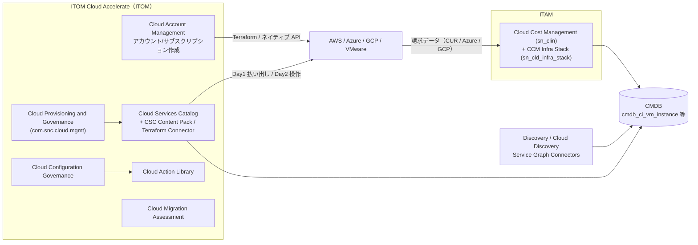
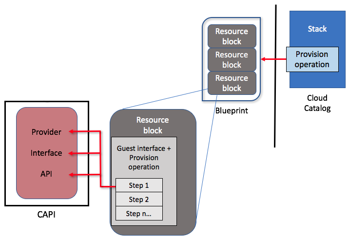
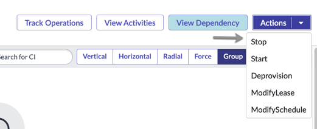
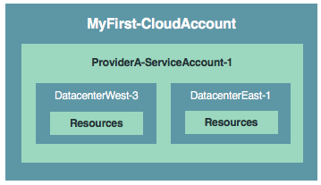
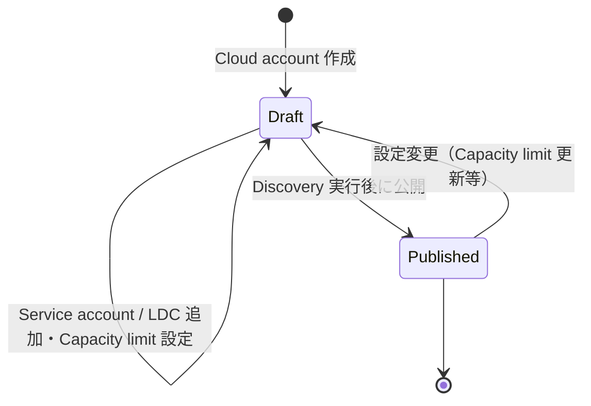
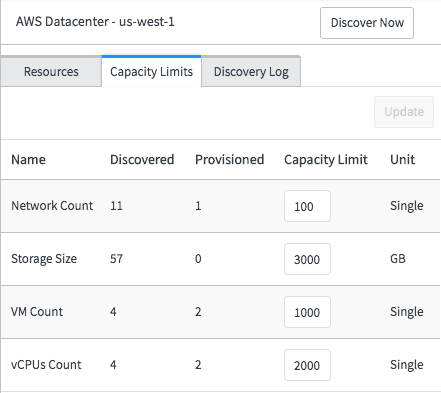
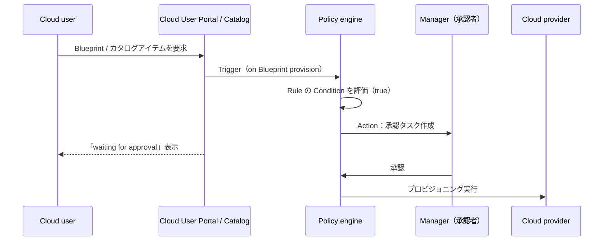
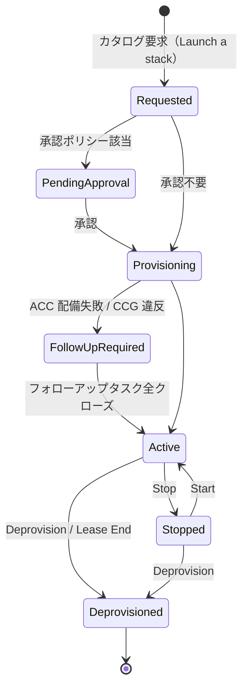
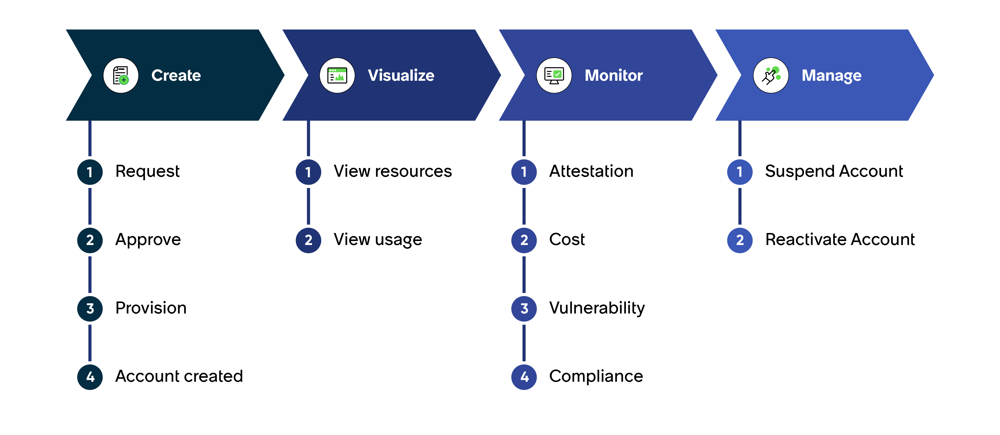
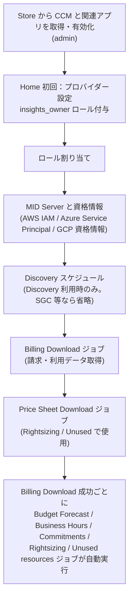

# Cloud Management（クラウド管理）

## 概要

ServiceNow の「クラウド管理」は単一の製品ではなく、目的の異なる複数のアプリケーションの総称である。本ファイルでは次の4系統を扱う。

| 系統 | 主な製品 / アプリケーション | 所属領域（ドキュメント上の位置） | 役割 |
|---|---|---|---|
| プロビジョニングとガバナンス | **Cloud Provisioning and Governance（CPG、旧 Cloud Management）** と後継の **Cloud Services Catalog（CSC）** | ITOM > ITOM Cloud Accelerate | クラウドリソースをカタログから払い出し（Day 1）、ライフサイクル操作（Day 2）を統制する |
| クラウドアカウント管理 | **Cloud Account Management（CAM）**（Cloud Workspace） | ITOM > ITOM Cloud Accelerate | AWS アカウント / Azure サブスクリプションの申請・承認・作成・停止・再開・認証 |
| 構成ガバナンス等 | Cloud Configuration Governance、Cloud Migration Assessment、Cloud Action Library | ITOM > ITOM Cloud Accelerate | ポリシー違反検知、移行評価、クラウド操作アクション群（本ファイルでは概要のみ） |
| コスト管理（FinOps） | **Cloud Cost Management（CCM、旧 Cloud Insights）** | **ITAM**（IT Asset Management） | クラウド請求データの取り込み、支出分析、予算、最適化推奨（Rightsizing 等） |

[出典](https://www.servicenow.com/docs/r/australia/it-operations-management/itom-cloud-accelerate/itom-cloud-accelerate-landing-page.html) [出典](https://www.servicenow.com/docs/r/australia/it-asset-management/cloud-cost-management/cloud-insights-landing-page.html)

本ファイルの要点：

- **CPG は Brazil で「将来の非推奨化の準備」段階に入る。** Brazil 以降、CPG と CSC（および CSC Content Pack）は新規インスタンスでは非表示・未インストールとなり、既存顧客へのサポートのみ継続される（Deprecation Process [KB0867184]）。新規案件で CPG/CSC を前提にした設計を行う場合は注意が必要である。[出典](https://www.servicenow.com/docs/r/australia/it-operations-management/cloud-configuration-governance/cloud-management-v2-landing-page.html) [出典](https://www.servicenow.com/docs/r/australia/it-operations-management/cloud-services-catalog/csc-home.html)
- **CPG の単独サブスクリプションは廃止され、ITOM Cloud Accelerate に再編された。** CPG は Cloud Migration Assessment / Cloud Account Management / Cloud Services Catalog / Cloud Configuration Governance / Cloud Action Library に分割されている。[出典](https://www.servicenow.com/docs/r/australia/it-operations-management/cloud-configuration-governance/product-name-change.html)
- **Blueprint（ブループリント）は Orlando 以降新規作成不可、Resource profile とカスタム Blueprint は Australia 以降サポート外。** カタログアイテムは Cloud template（ARM / CloudFormation / Google Deployment Manager / Terraform）から作る。[出典](https://www.servicenow.com/docs/r/australia/it-operations-management/cloud-configuration-governance/blueprints.html)
- **Cloud Cost Management は ITAM 製品で、ServiceNow Store アプリ（`sn_clin`）として提供される。** Store アプリ版数（Australia 時点 10.0、Brazil 時点 11.0.0）はファミリーと独立して更新される。[出典](https://www.servicenow.com/docs/r/7GoNY9eeDRD0FzxldbEmXw/qQ9PzSf3QwU9blzLsoWMUA) [出典](https://www.servicenow.com/docs/r/release-notes/cloud-cost-management-rn.html)

関連ファイル：クラウドリソースの検出は [Discovery](./discovery.md)、ITOM 全体のパッケージは [ITOM 概要とパッケージ](./itom-overview.md)、Service Graph Connector によるクラウド CI 取り込みは [Service Graph Connectors](./service-graph-connectors.md)、ITAM 全体は [ITAM 概要](../itam/itam-overview.md) と [Software Asset Management](../itam/software-asset-management.md)、カタログ基盤は [サービスカタログ](../platform/service-catalog.md) を参照。

---

## 1. 製品の位置付けと名称の変遷

### 1.1 名称の変遷（Cloud Management → CPG → CSC）

ServiceNow Cloud Management アプリケーションは **Paris リリース**から **Cloud Provisioning and Governance（CPG）** に改称され、その後 **Cloud Services Catalog（CSC）** アプリケーションへ発展した。CPG の単独サブスクリプションは廃止され、**ITOM Cloud Accelerate** に組み込まれた。製品ドキュメントや GUI には旧名称が残っている箇所がある。[出典](https://www.servicenow.com/docs/r/australia/it-operations-management/cloud-configuration-governance/product-name-change.html)

| コンポーネント | 旧名称 | 新名称 |
|---|---|---|
| ITOM Optimization > Cloud Provisioning and Governance | Cloud Management application | Cloud Provisioning and Governance application |
| `com.snc.cloud.mgmt` | Cloud Management plugin | Cloud Provisioning and Governance plugin |
| `com.snc.cloud.core` | Cloud Management Core plugin | Cloud Provisioning and Governance Core plugin |
| Application Context（Settings > Developer > Application） | Cloud Management | Cloud Provisioning and Governance |
| `com.sn_cmp_ibm` | Cloud Management: IBM Cloud Connector | Cloud Provisioning and Governance: IBM Cloud Connector |
| MID Server Capability | Cloud Management | Cloud Provisioning and Governance |
| MID Server Application > Cloud Management | — | 変更なし |

[出典](https://www.servicenow.com/docs/r/australia/it-operations-management/cloud-configuration-governance/product-name-change.html)

- 「CMP（Cloud Management Platform）」は業界一般の用語であり、ServiceNow Community の ServiceNow 社員回答では「CMP と CPG は同じもので、Paris で改称された」とされている。【第三者情報】（ServiceNow Community・2024-10） [出典](https://www.servicenow.com/community/itom-forum/cmp-vs-cpg/m-p/3084874)
- CPG（旧 Cloud Management）は **Jakarta 以降**と互換で、レガシーの **v1 Cloud Management アプリケーションとは非互換**（同時使用不可）である。[出典](https://www.servicenow.com/docs/r/australia/it-operations-management/cloud-configuration-governance/cloud-management-v2-landing-page.html)
- テーブル・ロールの名前空間は旧称に由来する `sn_cmp`（Cloud Management Platform）のまま残っている（例：`sn_cmp_stack`、`sn_cmp.cloud_admin`）。

### 1.2 ITOM Cloud Accelerate の構成

ITOM Cloud Accelerate は、クラウド導入の Day 0 / Day 1 / Day 2 を自動化するワークフロー群で、ServiceNow Orchestration を利用し Ansible、Azure DevOps、Terraform と連携する。各機能は ServiceNow Store の個別アプリとして提供される。[出典](https://www.servicenow.com/docs/r/australia/it-operations-management/itom-cloud-accelerate/itom-cloud-accelerate-landing-page.html) [出典](https://www.servicenow.com/docs/r/u1slaAtcFiiXFQcd9RcR_A/SqyZO8QYOnS~NNdZ4oZChg)

| 機能 | 説明 |
|---|---|
| Cloud Account Management | クラウドアカウントの申請〜作成。手動承認または事前定義ルールによる自動承認 |
| Cloud Services Catalog | クラウドリソースへのシンプルなアクセス、カタログ公開とライフサイクル管理 |
| Cloud Migration Assessment | IT リソース / ワークロードのクラウド移行計画・追跡（ダッシュボード） |
| Cloud Configuration Governance | クラウドリソース構成をポリシーと照合し違反を検出、修復ワークフローで是正 |
| Cloud Action Library | クラウドリソース操作用の既製アクション / サブフロー（Cloud Configuration Governance 等が利用） |

**ライセンス：** ITOM Cloud Accelerate ライセンスは、Cloud Migration Assessment、Cloud Configuration Governance、Cloud Action Library が管理・監視する CI の数（CI count）を提供する。複数機能が同じ CI を報告した場合は重複を除いてカウントされる。価格・パッケージは契約依存で、製品ドキュメントには記載されない。CAM のエンタイトルメントは ITOM Cloud Accelerate ライセンスで提供され、Cloud Workspace の前提として Cloud Governance Suite（CGS）ライセンスが必要とされる。[出典](https://www.servicenow.com/docs/r/australia/it-operations-management/itom-cloud-accelerate/itom-cloud-accelerate-landing-page.html) [出典](https://www.servicenow.com/docs/r/australia/it-operations-management/cloud-account-management/cam-landing.html)

> 価格情報は [価格情報](../../03_導入編/02-pricing.md)、ITOM のパッケージは [ITOM 概要とパッケージ](./itom-overview.md) を参照。

### 1.3 CPG / CSC のサポート状況（Australia 時点）

| 項目 | 状況 | 出典 |
|---|---|---|
| CPG プラグイン | `com.snc.cloud.mgmt`。別サブスクリプション。サブプロダクション環境での無償評価のためのプラグイン申請手順あり | [出典](https://www.servicenow.com/docs/r/australia/it-operations-management/cloud-configuration-governance/request-plugin-cloud-mgt.html) |
| レガシーワークフロー | **Zurich 以降サポート外**。カスタマイズされていない既定ワークフローは Workflow Studio のフロー / サブフローに自動移行。カスタマイズ済みのものは移行されず既存ワークフローで動作継続 | [出典](https://www.servicenow.com/docs/r/australia/it-operations-management/cloud-configuration-governance/cloud-management-v2-landing-page.html) |
| Blueprint | Orlando 以降は新規作成不可（アップグレードインスタンスで既存のみ利用可） | [出典](https://www.servicenow.com/docs/r/australia/it-operations-management/cloud-configuration-governance/blueprints.html) |
| Resource profile・カスタム Blueprint | **Australia 以降サポート外** | [出典](https://www.servicenow.com/docs/r/australia/it-operations-management/cloud-configuration-governance/blueprints.html) |
| Cloud User Portal の Current Month Spend / Budget ウィジェット | ドメイン分離されていないインスタンスでは **Australia 以降非推奨** | [出典](https://www.servicenow.com/docs/r/australia/it-operations-management/cloud-configuration-governance/cloudmgt-cloud-user-portal.html) |

Workflow Studio へ移行された既定ワークフロー：Cloud operation change request、Cloud task processing、Cloud approval workflow、Post-process workflow、Pre-process workflow、Cloud resource operation request、Blueprint request。非推奨となったワークフロー：Retrieve cloud billing data、Retrieve cloud billing month、Cloud operation step workflow launcher。関連 KB として KB2265927（Cloud Provision Service Request PAD 等の更新方法）、KB2262737（既定ワークフロー改変時の CSC のフロー移行方法）が案内されている。Policy Rule Action からも Workflow Studio のサブフローを呼び出せる。[出典](https://www.servicenow.com/docs/r/australia/it-operations-management/cloud-configuration-governance/cloud-management-v2-landing-page.html)

> **Brazil での変更:** Brazil リリース以降、Cloud Provisioning and Governance、Cloud Services Catalog、Cloud Services Catalog Content Pack は「将来の非推奨化の準備」段階となり、**新規インスタンスでは非表示かつインストールされない**。既存利用者へのサポートは継続する（詳細は Now Support の Deprecation Process [KB0867184]）。[出典](https://www.servicenow.com/docs/r/australia/it-operations-management/cloud-configuration-governance/cloud-management-v2-landing-page.html) [出典](https://www.servicenow.com/docs/r/australia/it-operations-management/cloud-services-catalog/install-csc.html)
>
> 後継として何を推奨するかは、Australia 版ドキュメントの CPG ランディングページの AI 要約が「Cloud Services Catalog への移行計画」を挙げているが、その CSC 自体も Brazil で同じ扱いとなっており、公式な移行先製品は公開情報では確認できず。

---

## 2. Cloud Provisioning and Governance のアーキテクチャと用語

### 2.1 主要用語

| 用語 | 説明 |
|---|---|
| Service account（サービスアカウント） | クラウドプロバイダーのアカウント（AWS アカウント、Azure サブスクリプション等）への資格情報・アクセス情報を保持するインスタンス上のセキュアなレコード。Discovery がこの情報で各データセンターのリソースデータを取得する |
| Cloud account（クラウドアカウント） | CPG 内での、管理対象クラウドインフラの全体または一部の論理表現。**複数の Service account（異なるプロバイダーのものも含む）を含められる** |
| Logical datacenter（LDC、論理データセンター） | Service account に紐づくリージョン単位の仮想クラウド。クラウドリソースをホストする |
| Stack（スタック） | クラウドカタログアイテムの要求（Launch a stack）によって払い出されたリソース群。`sn_cmp_stack` に格納 |
| Cloud catalog item | クラウドサービスを提供するカタログアイテム。Cloud template（CFT / ARM / GDM / Terraform）または Blueprint に基づく |
| Blueprint | クラウドサービス（スタック）を提供するための特殊なカタログアイテムテンプレート（レガシー） |
| Resource block（リソースブロック） | スタックを構成する個々の CI（VM、アプリ、データセンター等）を表す部品 |
| CAPI（Cloud API） | クラウドプロバイダーを抽象化する ServiceNow の API 層。Provider / Interface / API で構成 |
| Day 1 / Day 2 | Day 1 = カタログからの払い出し（スタック生成）、Day 2 = 払い出し済み / 検出済みリソースへの操作（Start / Stop / Deprovision 等） |

[出典](https://www.servicenow.com/docs/r/australia/it-operations-management/cloud-configuration-governance/aws-first-cld-and-srvc-accts.html) [出典](https://www.servicenow.com/docs/r/australia/it-operations-management/cloud-configuration-governance/cloud-accounts.html) [出典](https://www.servicenow.com/docs/r/australia/it-operations-management/cloud-configuration-governance/blueprints.html) [出典](https://www.servicenow.com/docs/r/australia/it-operations-management/cloud-configuration-governance/day-2-ops-using-workflows.html)

### 2.2 対応プロバイダー

CPG は Amazon Web Services、Microsoft Azure、Google Cloud Platform、VMware と連携する。Day 1 セットアップガイドは AWS（AWS GovCloud を含む）、Microsoft Azure（Azure Government Cloud を含む）、VMware の3種と、Google Cloud 用（Cloud Services Catalog Terraform Connector 経由）が用意されている。CSC は AWS、Azure、Google Cloud Platform と統合されている。[出典](https://www.servicenow.com/docs/r/australia/it-operations-management/cloud-configuration-governance/cloud-management-v2-landing-page.html) [出典](https://www.servicenow.com/docs/r/australia/it-operations-management/cloud-services-catalog/csc-home.html)

- IBM Cloud については、Terraform Connector 1.5.2（2022-09）で IBM Cloud サポートが削除されている。CPG 用の IBM Cloud Connector（`com.sn_cmp_ibm`）は名称マトリクスに残るが、現行のサポート状況は公開情報では確認できず。[出典](https://www.servicenow.com/docs/r/store-release-notes/store-rn-cloud-mgmt-terraform.html)

### 2.3 Resource block と CAPI の関係

- **キャプション:** 公式ドキュメント「Resource blocks in Cloud Provisioning and Governance」の図「How resource block components work together」。
- **画面（図）の説明:** 右端に「Cloud Catalog」の「Stack」があり、その中の「Provision operation」から左の「Blueprint」（縦に並んだ3つの「Resource block」）へ赤矢印が向かう。Blueprint 内の1つの Resource block を拡大した図が中央にあり、「Guest interface + Provision operation」の下に「Step 1 / Step 2 / Step n…」のステップが並ぶ。Step 1 から左端の「CAPI」枠内の「Provider」「Interface」「API」へ赤矢印が伸びている。つまり、カタログでスタックの Provision 操作が要求されると、Blueprint を構成する各 Resource block のインターフェース操作がステップ単位で CAPI（プロバイダー / インターフェース / API）を呼び出してクラウドに対し実行される、という流れを示す。
- **出典:** https://www.servicenow.com/docs/r/australia/it-operations-management/cloud-configuration-governance/resource-blocks.html （取得日: 2026-11-03）

Day 2 操作は従来 CAPI と直接やり取りする必要があり、新しい操作には新 API の作成が必要だったが、現在は Workflow Studio のサブフローで Day 2 操作をマッピングし、クラウドプロバイダーを呼ぶ REST エンドポイントを作成できる。[出典](https://www.servicenow.com/docs/r/australia/it-operations-management/cloud-configuration-governance/day-2-ops-using-workflows.html)

---

## 3. ロール

### 3.1 Cloud Provisioning and Governance のロール

ロールの付与には `user_admin` または `admin` が必要。ロールはグループまたは個人に付与できる。[出典](https://www.servicenow.com/docs/r/australia/it-operations-management/cloud-configuration-governance/aws-assign-roles-cloud-mgt.html)

| ロール名（表示） | ロール | 概要 | 主なアクセス対象 |
|---|---|---|---|
| Root administrator | `sn_cmp.cmp_root_admin` | アプリケーションの最上位権限 | すべて |
| Cloud administrator（クラウド管理者） | `sn_cmp.cloud_admin` | アプリケーションの構成とクラウドインフラのセットアップ | Service account / Cloud account、ネットワークと IPAM、CMDB 自動更新設定（AWS Config、Azure Alert、Google Cloud Logging、IBM Cloud Update、VMware Events） |
| Governor（ガバナー） | `sn_cmp.cloud_governor` | クラウド利用の監視、ルール・クォータ・ポリシーの遵守強制、タグとオブジェクト権限の管理 | Policies、Pools、Quotas、Permissions |
| Service Designer（サービスデザイナー） | `sn.cmp.cloud_service_designer`（ドキュメント表記。他ロールと異なりドット区切り） | Blueprint、テンプレート、カタログアイテムの作成 | Cloud templates、Blueprints、Blueprint catalog items、Resource blocks |
| Cloud user（クラウドユーザー） | `sn_cmp.cloud_service_user` | スタックとリソースの要求・管理 | Cloud User Portal。グループに付与した場合、メンバーはクォータ上限と一部リソースの所有権を共有する |
| Cloud operator（クラウドオペレーター） | `sn_cmp.cloud_operator` | アプリケーションの監視とトラブルシュート | Cloud Operations Dashboard、Cloud Root Cause Analysis、Cloud Orchestration Trail、Cloud API Trail |
| Cloud Event Integration | `sn_cmp.cloud_event_integration` | 外部サービスがクラウドイベント REST エンドポイント経由で CMDB を自動更新するためのロール | AWS Config、Azure Alert、Google Cloud Logging、VMware Events の設定（IBM Cloud Connector は非対応） |
| Cloud Group administrator | `sn_cmp.cloud_group_admin` | 自分が所属する任意のグループへの管理アクセスを付与 | — |
| CAPI Developer | `sn_capi.cloud_developer` | Cloud Admin Portal の Design 領域にアクセス | Design |

[出典](https://www.servicenow.com/docs/r/australia/it-operations-management/cloud-configuration-governance/aws-assign-roles-cloud-mgt.html) [出典](https://www.servicenow.com/docs/r/australia/it-operations-management/cloud-configuration-governance/cloud-admin-portal.html)

- Service Designer のロール名は公式ドキュメント上 `sn.cmp.cloud_service_designer` と記載されているが、他のロールは `sn_cmp.` で始まる。実インスタンスでのロール名は導入時に確認すること。[出典](https://www.servicenow.com/docs/r/australia/it-operations-management/cloud-configuration-governance/aws-assign-roles-cloud-mgt.html)
- 管理ガイドの利用には `cloud_admin` ロールが前提とされている。[出典](https://www.servicenow.com/docs/r/LAcVv8BoMltwvLWYyn6_cQ/8VK6KtL~sl2OedAnEPOUcQ)

### 3.2 Cloud Services Catalog のインストールに必要なロール

CSC（Store アプリ）のインストールには `admin`、`sn_appclient.app_client_company_installer`（インスタンスの会社に一致するアプリのみ）、または `sn_appclient.app_client_user` のいずれかが必要。[出典](https://www.servicenow.com/docs/r/australia/it-operations-management/cloud-services-catalog/install-csc.html)

---

## 4. Cloud Admin Portal と Cloud User Portal

### 4.1 Cloud Admin Portal（管理者ポータル）

Cloud Admin Portal は**ロールベースのポータル**で、クラウドリソースの Manage（管理）、Design（設計）、Govern（統制）、Operate（運用）、Analyze（分析）を行う。表示されるメトリクスはロールに依存し、例えば Cloud Service Designer には Design のメトリクスのみ表示される。すべてのメトリクスを表示・管理できるのは Root administrator、Cloud administrator、System administrator のみ。[出典](https://www.servicenow.com/docs/r/australia/it-operations-management/cloud-configuration-governance/cloud-admin-portal.html)

| セクション | アクセスできるロール | 主な内容（各手順ページのメニュー位置から整理） |
|---|---|---|
| Overview | Root administrator、Cloud administrator、System administrator | 全体概要 |
| Manage | Root administrator、Cloud administrator、System administrator | **Manage > Cloud Accounts**（Cloud account / Service account / Datacenter / Capacity limit） |
| Design | Root administrator、System administrator、Governor、Service Designer、CAPI Developer | **Design > Cloud Catalog items**、**Design > Resource Blocks**、**Design > Plans (Blueprints)**、Cloud scripts、Response mappings |
| IaC | Root administrator、System administrator | IaC（Terraform 等）関連 |
| Govern | Root administrator、System administrator、Governor | Policies、Quotas、Pools、Permissions、Tags |
| Operate | Root administrator、System administrator、Operator | Cloud Operations Dashboard、Root Cause Analysis、API Trail |
| Analyze | Root administrator、System administrator、Governor | ダッシュボードとレポート |
| Guided Setup | Root administrator、System administrator | CPG ガイド付きセットアップ（完了率表示） |

[出典](https://www.servicenow.com/docs/r/australia/it-operations-management/cloud-configuration-governance/cloud-admin-portal.html) [出典](https://www.servicenow.com/docs/r/australia/it-operations-management/cloud-configuration-governance/create-cloud-catalog-item.html) [出典](https://www.servicenow.com/docs/r/australia/it-operations-management/cloud-configuration-governance/set-capacity-limits-cloud-mgt.html) [出典](https://www.servicenow.com/docs/r/australia/it-operations-management/cloud-configuration-governance/perform-lifecycle-operations-brownfield-resources.html)

- 左ナビゲーションの **Dashboards** リンクから、ロールに応じて Next Experience のダッシュボード（Cloud root cause analysis dashboard、Cloud operations dashboard、Cloud tag values dashboard）が開く。**Get Help** から質問、インシデント起票、製品ドキュメント・ナレッジベースへの遷移ができる。[出典](https://www.servicenow.com/docs/r/australia/it-operations-management/cloud-configuration-governance/cloud-admin-portal.html)
- CPG のガイド付きセットアップは **Guided Setup > ITOM Guided Setup** から開く。[出典](https://www.servicenow.com/docs/r/australia/it-operations-management/cloud-configuration-governance/cloud-management-v2-landing-page.html)
- 公式ドキュメントでは「All > Cloud Admin Portal > Manage > Cloud Accounts」のようにアプリケーションナビゲーターから開くメニュー位置が示されている。[出典](https://www.servicenow.com/docs/r/australia/it-operations-management/cloud-configuration-governance/set-capacity-limits-cloud-mgt.html)

### 4.2 Cloud User Portal（ユーザーポータル）

Cloud User Portal はクラウドユーザー（`sn_cmp.cloud_service_user`）が日々のクラウド作業を行うポータルである。[出典](https://www.servicenow.com/docs/r/australia/it-operations-management/cloud-configuration-governance/cloudmgt-cloud-user-portal.html)

| 領域 | 内容 |
|---|---|
| Overview ページ | Launch a Stack、Manage Stacks、View Activities、View Resources、Pending Requests（件数表示） |
| クイックルック状況レポート | Views、Current Month Spend、Budget、Quota、Recent Stacks、Stack Health |
| タスクバー | Overview、Catalog、Stacks、Resources、Activities |
| Quota 表示 | クォータ定義済みリソース種別ごとに、消費量と最大割り当てを表示：VM Count、vCPUs Count、Storage Volume Size、Network Count、Stack Count |
| Stack Health の色 | 赤＝停止（outage）、橙＝性能問題・故障、灰＝質問・要求 |

[出典](https://www.servicenow.com/docs/r/australia/it-operations-management/cloud-configuration-governance/cloudmgt-cloud-user-portal.html)

- 起動フォームを送信するとスタック要求が生成される。通常はすぐにプロビジョニングされるが、承認が必要な場合もある。ユーザーグループを選択すると、Quota セクションに本人とグループのクォータ上限が表示され、クォータ超過時はエラー表示またはポリシーベースの承認が起動する。[出典](https://www.servicenow.com/docs/r/australia/it-operations-management/cloud-configuration-governance/cloudmgt-launch-stack.html)
- Activities にはスタック要求のほか変更要求（Change request）とインシデントも含まれ、ポータルからインシデントの起票・追跡ができる。[出典](https://www.servicenow.com/docs/r/australia/it-operations-management/cloud-configuration-governance/cloudmgt-cloud-user-portal.html)
- Cloud User Portal の URL パス（例：`/cloud` など）は公開情報では確認できず。

### 4.3 Cloud Services Catalog のユーザー体験（Employee Center 統合）

CSC ではカタログ要求の入口が **Employee Center ポータル**に移っている。ユーザー（`sn_cmp.cloud_service_user`）は Employee Center ポータルの **Cloud Services > Browse Cloud Services** でカタログアイテムを選び、**Request** で要求フォームを開いて送信する。[出典](https://www.servicenow.com/docs/r/australia/it-operations-management/cloud-services-catalog/request-the-cloud-services-user-portal.html)

- **My Stacks** タブ：スタックを選択して Track Operations（要求状況）、Status、Request Details、View Full Details、Stack Operations（実施した操作の検索・ソート）を確認できる。スタックやリソースにライフサイクル操作を要求すると **Change request（変更要求）が生成**され、承認ポリシーに従い自動承認または承認者による承認となる。[出典](https://www.servicenow.com/docs/r/australia/it-operations-management/cloud-services-catalog/manage-my-stacks.html)
- **My Resources**：リソース一覧とリソースフィルター。
- Portal 基盤自体は [Service Portal と Employee Center](../platform/portals-employee-center.md) を参照。

- **キャプション:** Cloud Services Catalog の My Stacks におけるスタック詳細画面の Actions ドロップダウン（公式ドキュメント「Actions on stacks」の図）。
- **画面の説明:** 画面右上に「Track Operations」「View Activities」「View Dependency」（選択中）のボタンと「Actions ▼」ボタンが並ぶ。Actions を開くと「Stop」「Start」「Deprovision」「ModifyLease」「ModifySchedule」の5つの操作が表示される。左側には CI 検索ボックスと、依存関係ビューのレイアウト切替（Vertical / Horizontal / Radial / Force / Group）が見える。
- **出典:** https://www.servicenow.com/docs/r/australia/it-operations-management/cloud-services-catalog/performing-actions-on-stacks.html （取得日: 2026-11-03）

---

## 5. Cloud accounts（クラウドアカウント）

### 5.1 構造とルール

Cloud account は CPG における、管理対象クラウドインフラの全体または一部の論理表現である。[出典](https://www.servicenow.com/docs/r/australia/it-operations-management/cloud-configuration-governance/cloud-accounts.html)

- **キャプション:** 公式ドキュメント「Set up a cloud account and service account for AWS」の Figure 1「Structure of a cloud account on Day 1」。
- **画面（図）の説明:** 最外枠が Cloud account「MyFirst-CloudAccount」、その中に Service account「ProviderA-ServiceAccount-1」があり、さらにその中に2つの Datacenter「DatacenterWest-3」「DatacenterEast-1」が並び、各 Datacenter の中に「Resources」がある入れ子構造。Cloud account ⊃ Service account ⊃ Logical datacenter ⊃ Resources という包含関係を示す。
- **出典:** https://www.servicenow.com/docs/r/australia/it-operations-management/cloud-configuration-governance/aws-first-cld-and-srvc-accts.html （取得日: 2026-11-03）

| ルール | 内容 |
|---|---|
| 複数 Service account | 1つの Cloud account に複数の Service account（異なるプロバイダー混在可）を含められる |
| Datacenter の選択 | Service account ごとに、含める Logical datacenter（LDC）を選ぶ |
| 同一 Service account の重複追加 | LDC が異なれば同じ Service account を複数回追加可能 |
| 同一 LDC の重複 | 異なる Service account から同じ LDC を1つの Cloud account に含めることは不可 |
| リージョンの組み合わせ | 異なる Service account の LDC は、リージョンが異なれば組み合わせ可能（例：A の us-west-1 と B の us-west-2 は可、両方 us-west-1 は不可） |
| LDC の追加 | 既存 Cloud account に LDC をいつでも追加可能 |
| Discovery | LDC に対して Discovery を実行すると、各リソースの構成変更とライフサイクル変化（作成・変更・終了）が CMDB に反映される |

[出典](https://www.servicenow.com/docs/r/australia/it-operations-management/cloud-configuration-governance/cloud-accounts.html)

### 5.2 状態（Draft / Published）

Cloud account は Datacenter と制限を構成している間は **Draft** 状態であり、Discovery 実行後に **Published** へ変更できる。Published になると、業務チームは Blueprint / カタログアイテムと Cloud User Portal を通じてスタックをデプロイできるようになる。[出典](https://www.servicenow.com/docs/r/australia/it-operations-management/cloud-configuration-governance/cloud-accounts.html)

### 5.3 Cloud account / Service account の作成手順（AWS の例）

前提：AWS Management Console 側の操作には管理者ロール、CPG 側の操作には `sn_cmp.cloud_admin` が必要。[出典](https://www.servicenow.com/docs/r/australia/it-operations-management/cloud-configuration-governance/aws-first-cld-and-srvc-accts.html)

1. Cloud Admin Portal で **Manage > Cloud Accounts** を開く。
2. 既存の Cloud account を選んで **Configure** する、または **New** で一意の Name / Description を入力し、Provider を選択して Next。
3. Datacenters ページで Service Account フィールド横の **+** から Service account を作成する。
4. Service account フォームの主な項目：

| フィールド | 説明 |
|---|---|
| Name | Service account の一意な名前 |
| Account ID | AWS の 12 桁のアカウント番号（ハイフンは除去） |
| Discovery credentials | ServiceNow がアカウントへアクセスするための資格情報。後から設定してもよい。他の AWS アカウント経由（AssumeRole 等）でアクセスする場合は空欄 |

[出典](https://www.servicenow.com/docs/r/australia/it-operations-management/cloud-configuration-governance/aws-first-cld-and-srvc-accts.html)

Day 2 の追加セットアップとして、追加 Cloud account の作成、Cloud Operations Workspace とパターンによる Discovery、Datacenter のオンデマンド Discovery、Service account 全リソースの Discovery スケジュール、Capacity limit 設定、Owner / Assignment group の利用が用意されている（Australia 版ドキュメント目次）。クラウド Discovery の仕様は [Discovery](./discovery.md) を参照。

### 5.4 Capacity limits（容量制限）

Capacity limit は、Cloud account 内の **LDC ごと**にリソース属性（VM 数、vCPU 数、ネットワーク数、合計ストレージ容量等）の上限を設定する機能で、プライベートクラウドなど容量制約のある環境で特に有効である。[出典](https://www.servicenow.com/docs/r/australia/it-operations-management/cloud-configuration-governance/set-capacity-limits-cloud-mgt.html)

- 前提：Service account と Datacenter を持つ Cloud account が存在し、オンデマンド Discovery で Datacenter が検出済みであること。Cloud Discovery Workspace と Discovery and Service Mapping Patterns 1.15 以上を使用。ロール `sn_cmp.cloud_admin`。
- 手順：**All > Cloud Admin Portal > Manage > Cloud Accounts** → Cloud account を選択 → **Datacenters** タブで Datacenter を選択 → 状態を **Draft** に → **Capacity Limits** タブで値を設定 → **Update** → 状態を **Published** に → **Discover Now** で LDC に Discovery を実行。

| 列 | 説明 |
|---|---|
| Discovered | 選択した Service account の全リソースについて Discovery が検出した合計値 |
| Provisioned | 選択した Service account でプロビジョニング済みの合計値 |
| Capacity Limit | 選択した Service account の全リソース合計としての最大許容値 |
| Unit | 単位（例：ストレージは GB） |

[出典](https://www.servicenow.com/docs/r/australia/it-operations-management/cloud-configuration-governance/set-capacity-limits-cloud-mgt.html)

- **キャプション:** Cloud account の Datacenter「AWS Datacenter - us-west-1」の Capacity Limits タブ（公式ドキュメント「Set capacity limits on user requests for resources」の図）。
- **画面の説明:** 上部にデータセンター名「AWS Datacenter - us-west-1」と「Discover Now」ボタン。タブは「Resources」「Capacity Limits」（選択中）「Discovery Log」。右上に「Update」ボタン。表の列は Name / Discovered / Provisioned / Capacity Limit / Unit で、行は Network Count（11 / 1 / 100 / Single）、Storage Size（57 / 0 / 3000 / GB）、VM Count（4 / 2 / 1000 / Single）、vCPUs Count（4 / 2 / 2000 / Single）。Capacity Limit 列のみ入力欄になっている。
- **出典:** https://www.servicenow.com/docs/r/australia/it-operations-management/cloud-configuration-governance/set-capacity-limits-cloud-mgt.html （取得日: 2026-11-03）

> ユーザー単位・グループ単位の上限は Capacity limit ではなく Quota（第7.2節）で設定する。

---

## 6. Catalog（クラウドカタログ）

### 6.1 カタログアイテムの作り方の全体像

CPG 管理ガイドでは、クラウドサービスカタログへのアイテム投入方法として次の3つを挙げている。[出典](https://www.servicenow.com/docs/r/LAcVv8BoMltwvLWYyn6_cQ/8VK6KtL~sl2OedAnEPOUcQ)

1. AWS または Azure からテンプレート（CloudFormation / ARM）をインポートする
2. ベースシステムのカタログアイテムを使用または改変する
3. Terraform テンプレートを使用する

| 方式 | 状況 |
|---|---|
| Cloud template（ARM / CloudFormation / Google Deployment Manager / Terraform） | **推奨**。カタログアイテム生成時に Variable set、ライフサイクル操作、ルール、Pre / Post provision 操作が自動生成される |
| Configuration Management Template（Ansible / Terraform のプロバイダーテンプレート） | Cloud template の一種として選択 |
| Blueprint（Custom） | レガシー。Orlando 以降は新規作成不可、カスタム Blueprint は Australia 以降サポート外 |

[出典](https://www.servicenow.com/docs/r/australia/it-operations-management/cloud-configuration-governance/create-cloud-catalog-item.html) [出典](https://www.servicenow.com/docs/r/australia/it-operations-management/cloud-configuration-governance/blueprints.html)

### 6.2 Cloud catalog item の作成

- ロール：`sn_cmp.cloud_service_designer`
- メニュー：Cloud Admin Portal の **Design > Cloud Catalog items** → **New**（作成済みアイテムはカード表示）

| フィールド | 説明 |
|---|---|
| Name | カタログアイテム名 |
| Active | カタログアイテムを利用可能にする。Blueprint 選択後にのみチェック可能 |
| Icon | サービスカタログでアイテム名の横に出る 16×16 px のアイコン（CPG アプリ内には表示されない） |
| Picture | Cloud User Portal（Launch a Stack 後）に表示される画像 |
| Catalogs | カタログ名 |
| Category | カテゴリー（複数可）。カテゴリー未割り当てのアイテムはカタログ検索に出ない |
| Source | 関連付けるソース種別：**Cloud Template** または **Custom** |
| Template type | Cloud Template を選んだ場合：ARM Template / CloudFormation Template（クラウドネイティブテンプレートのインポート）、または Configuration Management Template（Ansible / Terraform） |
| Blueprint | Source が Custom の場合に関連付ける Blueprint |
| Blueprint Operation | 生成後に自動設定（Blueprint 選択時のみ表示） |
| Short description | Cloud User Portal でアイテム横に表示される短い説明 |
| Description | サービスカタログに表示される詳細説明（動画、画像、KB リンク等を埋め込み可） |

**Submit** すると、カタログアイテムと関連コンポーネント（Variable set、ライフサイクル操作、ルール）が生成され、Cloud Catalog Item ページのタブとして表示される。[出典](https://www.servicenow.com/docs/r/australia/it-operations-management/cloud-configuration-governance/create-cloud-catalog-item.html)

### 6.3 Blueprint（レガシー）の構成要素

| 構成要素 | 説明 |
|---|---|
| Resource blocks | Blueprint（カタログアイテム）に含まれるクラウドリソース（VM、VM 上のアプリ、ホストするデータセンター情報等） |
| Connections | リソース間の関係。**Containment**（包含、上下関係で描画。Blueprint コンテナーは少なくとも1つのリソースブロックを含む）と **Attached to**（直接通信のためのバインディング、横並びで描画。例：VM とストレージ） |
| Operations | リソースブロックまたはスタックに対する操作（Provision、Start、Stop 等） |
| Resource operations | 操作を実行するためのステップ（例：VM のプロビジョニング → アプリのプロビジョニング） |
| Attributes | リソースの詳細。カタログアイテムフォームにカタログプロパティとして表示可能 |
| Constraints | クラウド非依存のリソースブロック（LDC 等）を特定プロバイダーに制約する属性オプション |

カタログアイテムの要求は「スタックの起動（launching a stack）」と呼ばれる。Blueprint デザイナー（**Cloud admin portal > Design > Plans (Blueprints)**）では Deployment Template タブ（キャンバスにリソースブロックを配置し接続。YAML の Cloud template 表現を生成）、Operations セクション（実行計画、並列 / 直列実行）、Catalog タブ（Variable set、ルール、ライフサイクル操作、フォーム構成）を設定し、**Update and Publish** で公開する。既定操作は Provision、Stop、Start、Deprovision。[出典](https://www.servicenow.com/docs/r/australia/it-operations-management/cloud-configuration-governance/blueprints.html) [出典](https://www.servicenow.com/docs/r/LAcVv8BoMltwvLWYyn6_cQ/6JLw197nRiHlQadvEnV24A)

### 6.4 Resource profiles（レガシー、Australia 以降サポート外）

Resource profile はプロバイダー非依存の定義で、リソース要求時にユーザーが選べる属性値を制御する（例：Compute profile「Micro」を選ぶと CPU / メモリが自動決定）。Cloud account、LDC、CMDB のリソース種別、任意の価格値を対応付ける。AWS / Azure では Discovery 後に自動マッピング、Google Cloud 等は手動。[出典](https://www.servicenow.com/docs/r/australia/it-operations-management/cloud-configuration-governance/cloud-resource-profiles.html)

| プロファイル | 対応テーブル（リソース種別・テンプレート） |
|---|---|
| Application profile | Application Template [`sn_cmp_application_template`] |
| Compute profile | Hardware Type [`cmdb_ci_compute_template`] |
| Compute Security Group profile | Compute Security Group Template [`cmdb_ci_security_grp_template`] |
| OS profile | Image [`cmdb_ci_os_template`] |
| Schedule profile | （スケジュール） |

> 注意：Australia 版ドキュメントで「Resource profiles and custom-created blueprints will no longer be supported starting with the Australia release」と明記されている。[出典](https://www.servicenow.com/docs/r/australia/it-operations-management/cloud-configuration-governance/blueprints.html)

### 6.5 Cloud Services Catalog（CSC）の構成

CSC は CPG を発展させたアプリで、次の特徴を持つ。[出典](https://www.servicenow.com/docs/r/australia/it-operations-management/cloud-services-catalog/csc-home.html)

- AWS、Microsoft Azure、Google Cloud Platform の **Out Of Box（OOB）カタログ**を提供
- Azure DevOps と CI/CD パイプライン連携、Ansible ジョブテンプレートを Day 1 アクティビティとしてカタログ経由でデプロイ
- Terraform Connector の IaC Discovery と **マルチリポジトリ**対応
- セルフホスト環境をサポート（MID Server にインターネットアクセスが必要。KB0563731）

**インストール：** **All > System Application > All Available Applications > All** で検索し Install。CSC は別サブスクリプションで、CPG プラグイン（`com.snc.cloud.mgmt`）が必要。既存の CSC / CSC Innovation Labs からの**アップグレードは未サポート**で、CSC content pack → CSC の順にテーブルクリーンアップ付きでアンインストールし、CSC → CSC content pack の順で新規インストールする。ガイド付きセットアップはインスタンスで1回のみ実行可能。[出典](https://www.servicenow.com/docs/r/australia/it-operations-management/cloud-services-catalog/install-csc.html)

**OOB カタログアイテム（Australia 版ドキュメント目次）：**

| プロバイダー | OOB カタログ |
|---|---|
| AWS | EC2 Linux、EC2 Windows、DynamoDB、S3 Bucket |
| GCP | Big Query、Cloud SQL、Linux、Load Balancer、Windows |
| Azure | Linux、Windows、Azure Functions |

各カタログに必要なプロバイダー側権限（IAM 権限等）は「Policies and permission levels on services」配下に個別ページがある。[出典](https://www.servicenow.com/docs/r/australia/it-operations-management/cloud-services-catalog/csc-home.html)

**OOB Actions（Flow Designer / Integration Hub サブフロー）：**

| アクション | サブフロー名 | 内容 |
|---|---|---|
| Deploy ACC in post provisioning | CSC Content- Post Provisioning- Deploy ACC in Stack VMs | Basic Linux VM のポストプロビジョニングで Agent Client Collector を配備。MID Server の ACC Listener（`wss://<IP>:3389/ws/events` 形式のエンドポイントと MID Server API Key）と SSH 到達性が前提。失敗時はタスクを作成しスタックを「follow-up required」に |
| CCG Scan in post provisioning | CSC Content- Create CCG Policy Scan on Stack Items | Cloud Configuration Governance の既定ポリシーセットでスキャン。違反時はスタックを follow-up 状態にし、違反タスククローズ後に Active へ |
| Tagging Action | CSC Content- Post Provisioning- Update Key Values in CMDB | 全カタログで実行。**CMDB の key-value のみ更新（クラウド側タグは更新しない）**。標準タグ：StackName、Application、CostCenter、BusinessService |
| Retrieve Windows Password | CSC Content- Post Provisioning- Retrieve Windows Password | Windows VM のパスワードを AWS から取得し pem キーで復号して要求者にメール。資格情報エイリアス「TFO Server Credential Alias」を使用。カスタムカタログでは Terraform Open Source の Linux ベースのみ |
| Email URL for Azure Scalable Web Server | — | デプロイしたアプリのエンドポイント URL を要求者にメール |
| Retrieve Azure Function App Host Name | — | Function App のホスト名を要求者にメール |

[出典](https://www.servicenow.com/docs/r/australia/it-operations-management/cloud-services-catalog/out-of-box-actions.html)

**CSC の権限管理：** CPG ユーザーポータルのグループ単位の Permission ポリシーは、**CSC のカタログプロビジョニングには現時点で適用されない**。CSC ではロールを持つ全ユーザーが既定でカタログの参照・プロビジョニングを行える。[出典](https://www.servicenow.com/docs/r/australia/it-operations-management/cloud-services-catalog/working-with-permissions.html)

### 6.6 Terraform Connector

「Cloud Provisioning and Governance: Terraform Connector」は Terraform の機能を ServiceNow に統合する Store アプリで、Terraform Enterprise、Terraform Cloud、Terraform Open Source に対応する。[出典](https://www.servicenow.com/docs/r/store-release-notes/store-rn-cloud-mgmt-terraform.html) [出典](https://www.servicenow.com/docs/r/australia/it-operations-management/cloud-services-catalog/cloud-services-catalog-and-terraform-connector.html)

| 項目 | 内容 |
|---|---|
| 対応クラウド | AWS、Microsoft Azure、Google Cloud（1.6.2 で GCP 追加）、VMware vSphere。IBM Cloud は 1.5.2 で削除 |
| VCS | GitHub、GitLab、Azure DevOps リポジトリ |
| 主機能 | IaC Discovery（Terraform テンプレートの検出）、テンプレートからのカタログアイテム生成、マルチリポジトリ、既存 Workspace の利用、IaC 変更時の Change Governance ワークフロー、複合変数 |
| 最新版 | **1.10.0（2026-06）**：CSC の全テーブルに事前定義のクエリ ACL によるアクセス管理を適用 |
| 1.9.1（2025-12） | 機能別の細分化された管理者ロール（広範な admin ロールの置き換え）、MID Server / Windows リモートでの PowerShell 7 既定化、`read_only` フィールドに代わる `read_only_option` ChoiceList |
| 1.7.3（2024-11） | Deny-Unless ACL と Query ACL によるデータフィルタリング、ホスト型プラグインのコード署名 |

[出典](https://www.servicenow.com/docs/r/store-release-notes/store-rn-cloud-mgmt-terraform.html)

---

## 7. Governance（ガバナンス）：Quotas・Policies・Pools・Permissions

Cloud Governance は、利用可能なクラウドリソースに設定できる制限の総称で、次の4種類がある。[出典](https://www.servicenow.com/docs/r/australia/it-operations-management/cloud-configuration-governance/cloud-governance.html)

| 種類 | 説明 |
|---|---|
| Quotas（クォータ） | グループ・ユーザーに対する CI / クラウドリソースの上限・要件。無駄な利用を防ぐ |
| Policies（ポリシー） | ユーザー指定値の上書き、承認タスク作成、IP アドレス予約、フォーム項目の事前入力・非表示、カスタムスクリプト実行、Cloud API 呼び出し、サブフローの開始・中止。承認・リソース操作・Blueprint 操作・カタログアイテム設定をシステム全体で統制 |
| Pools（リソースプール） | テーブルをフィルターするクエリまたはスクリプト。カタログ要求時に選べる値を制限 |
| Permissions（権限） | CPG の機能と個別レコード（Blueprint、Cloud account 等）へのユーザーグループ単位のアクセス権 |

### 7.1 Policies（ポリシー）

**構造：** Policy（ポリシー）は通常1つの Trigger（トリガー）を持ち、Policy rule（ルール）の集合を実行する。ルールは Conditions（条件）と Actions（アクション）の集合で、**全条件が true の場合のみ**アクションを実行する。特定ターゲット（例：「blueprint123 の provision 操作」「カタログアイテム ABC の launch」）を指定するポリシーと、ターゲット無指定（「任意の blueprint の provision」「任意のカタログアイテムの launch」）のポリシーがあり、**任意オブジェクト対象のポリシーのエラーは無視される**。Policy group は関連ポリシーのコンテナー。ポリシーは動的フォームと連動して項目の表示 / 非表示を制御できる。[出典](https://www.servicenow.com/docs/r/australia/it-operations-management/cloud-configuration-governance/cloud-policy.html)

**主なトリガー：**

| トリガー | 発火タイミング / 用途 |
|---|---|
| on Catalog item request end | ユーザーが要求フォームを送信した後 |
| on Catalog item launch | カタログアイテムの起動（ターゲット指定可） |
| on Blueprint provision | 特定スタック（Blueprint）の要求 |
| on Blueprint provision (approval) | 承認ポリシー |
| on Stack operation (approval) | スタック操作の承認ポリシー |
| on Stack resource operation / (approval) | 仮想サーバーへの Stop 要求など、リソース操作 |
| on Lease End | リソースのリース期限到来（操作と無関係に発火） |
| on Task remediation | 承認ポリシーとして扱われる |

ポリシーは通常トリガー名で呼ぶ（例：on Lease end トリガーのポリシー＝「Lease end policy」）。[出典](https://www.servicenow.com/docs/r/australia/it-operations-management/cloud-configuration-governance/cloud-policy.html) [出典](https://www.servicenow.com/docs/r/Tm19yM2Ui3~uN9XFBacppg/kFotTZHmT2hwZmZmDkDQew)

**実行順序：**

- 承認ポリシー（on Blueprint provision (approval)、on Stack operation (approval)、on Stack resource operation (approval)、on Task remediation）が複数該当する場合、**最初に成功した承認ポリシーのみ**が適用され、その中でも最初に成功したルール、さらにその中で最初に成功したアクションのみが実行される。カスタム承認と ServiceNow 承認の両方が含まれる場合はカスタム承認のみ実行される。
- その他のポリシーは **Order of Execution** プロパティ順に適用される。同値の場合の順序は保証されない。

[出典](https://www.servicenow.com/docs/r/Tm19yM2Ui3~uN9XFBacppg/kFotTZHmT2hwZmZmDkDQew)

**その他：**

- Policy action script で、クラウド要求の値の取得・更新・設定、課金・レポート用のリソースタグ追加・変更ができる。
- ポリシーは更新セット（ルール、条件、アクション、スクリプト、スクリプトカテゴリーを含む）でエクスポート / インポート可能。
- 既知の制限：リソース操作ステップの追加時にフローを呼び出すことはできない。

[出典](https://www.servicenow.com/docs/r/australia/it-operations-management/cloud-configuration-governance/cloud-policy.html) [出典](https://www.servicenow.com/docs/r/Tm19yM2Ui3~uN9XFBacppg/kFotTZHmT2hwZmZmDkDQew)

**承認ポリシーの流れ（例）：**

[出典](https://www.servicenow.com/docs/r/australia/it-operations-management/cloud-configuration-governance/cloud-policy.html)

**CSC の OOB ポリシー：**

| ポリシー | トリガー / 条件 | 内容 |
|---|---|---|
| Approval | 特定条件（例：t2.micro / t2.nano 以外の VM タイプ、特定カタログで追加ディスク2本超） | ServiceNow 承認アクションを呼び出す |
| Naming | 全クラウドカタログアイテムで既定有効 | 要求者のイニシャル＋現在日時（mm dd hh mm）形式のスタック名を提案し、所有者と経過時間を識別しやすくする |
| Lease | リース期間終了 | 不要スタックをデプロビジョニングしてコスト削減。**期限の1週間前**にスタック所有者へリマインダー |
| Quota | クォータ超過後に実行される要求 | 承認に回すか中止するかを判断 |

[出典](https://www.servicenow.com/docs/r/australia/it-operations-management/cloud-services-catalog/out-of-box-policies.html)

### 7.2 Quotas（クォータ）とリソース発注制御

Quota は、仮想サーバー、データセンター、汎用クラウドリソース等に対し、特定グループのユーザーへ **ユーザー単位の上限とグループ全体の上限**を設定する。上限に達したユーザーはエラーとなり、リソース数が上限を下回るまでプロビジョニングできない。**複数グループに所属するユーザーは各グループのクォータの合計**を得る。[出典](https://www.servicenow.com/docs/r/australia/it-operations-management/cloud-configuration-governance/quotas.html)

| 区分 | 値 |
|---|---|
| 対象リソースブロック種別 | Virtual Servers、Storage Volume Size、Network、Stacks |
| Quota 種別 | **Sum**（属性の合計。例：全 vCPU の合計）、**Count**（件数。例：VM 数） |
| 定義 | Cloud quota definition（テンプレートまたは手動で作成） |
| Resource order controls | テンプレートベースのカタログアイテムに対し、Quota definition とポリシーでクォータチェックを実施。ポリシーアクションで通知・承認サブフロー（またはその両方）を起動 |

[出典](https://www.servicenow.com/docs/r/australia/it-operations-management/cloud-configuration-governance/quotas.html)

**Owner group と Quota：** スタック要求時、ユーザーは注文フォームで「User group」を選択する必要があり、選択したグループに基づいてクォータチェックが行われる。このグループは `sn_cmp_stack` テーブルのスタックの「Owner group」に設定される。スタック削除やオーナーグループ変更時にクォータは再計算される。[出典](https://www.servicenow.com/docs/r/australia/it-operations-management/cloud-configuration-governance/use-owner-and-assignment-groups.html)

### 7.3 Pools and Filters（リソースプールとフィルター）

Resource pool はテーブルをフィルターするクエリまたはスクリプトで、カタログ要求時に選べる値を制限する。命名規則は `get<thisItem>By<condition>`（例：`getObjectIdByServiceAccount` は指定 Service account 上の ObjectID を返す）。Filter は指定条件だけでテーブルを照会する。Blueprint の変数のデータソースとしてプールを指定できる。[出典](https://www.servicenow.com/docs/r/australia/it-operations-management/cloud-configuration-governance/pools.html)

**ベースシステムの主なプール（抜粋）：**

| プール | 対象テーブル | 種別 |
|---|---|---|
| AnsibleInventoryPool | Ansible Tower Inventory [`sn_cfg_ansible_inventory`] | Script |
| ApplicationProfilePool | Application Profile [`sn_cmp_application_profile`] | Script |
| AvailabilityZonePool | Availability zone [`cmdb_ci_availability_zone`] | Script（`getNameByLDC`） |
| AzureDevOpsPipelinePool | Config Installable [`sn_cmp_cfg_installable`] | Script |
| AzureDevOpsProjectPool | Azure DevOps Project [`sn_itom_csc_cp_azure_devops_project`] | Script |
| BusinessServicePool | Service [`cmdb_ci_service`] | Query |
| CloudAccountPool | Cloud Account [`cmdb_ci_cmp_cloud_account`] | Query |
| CloudKeyPairPool | [`cmdb_ci_cloud_key_pair`] | Script |
| ComputeProfilePool | Compute Profile [`sn_cmp_compute_profile`] | Script |
| CostCenterPool | Cost Center [`cmn_cost_center`] | — |
| DatastorePool | VMware vCenter datastore [`cmdb_ci_vcenter_datastore`] | — |
| HardwareTypePool | [`cmdb_ci_compute_template`] | — |
| ImagePool | [`cmdb_ci_os_template`] | — |
| IPAddressPool | Cloud IP Address [`cmdb_ci_cloud_ip_address`] | — |
| NetworkPool | Cloud Network [`cmdb_ci_network`] | Script（LDC で絞り込み） |
| OSProfilePool | OS Profile [`sn_cmp_os_profile`] | — |
| ResourceGroupPool | Resource group [`cmdb_ci_resource_group`] | — |
| SecurityGroupPool | Compute Security Group [`cmdb_ci_compute_security_group`] | — |
| SecurityGroupProfilePool | Compute Security Group Profile [`sn_cmp_security_grp_profile`] | — |
| SSHKeyPool | CMP SSH Key Pair [`sn_cmp_ssh_credentials`] | — |
| StorageAccountPool | Cloud Storage Account [`cmdb_ci_cloud_storage_account`] | — |
| StorageVolumePool | Storage Volume [`cmdb_ci_storage_volume`] | — |
| SubnetPool | Cloud Subnet [`cmdb_ci_cloud_subnet`] | — |
| UserGroupPool | Group [`sys_user_group`] | — |
| VirtualMachinePool | [`sn_cmp_resource_pool`] | — |
| VmFolderPool | VMware vCenter folder [`cmdb_ci_vcenter_folder`] | — |

[出典](https://www.servicenow.com/docs/r/australia/it-operations-management/cloud-configuration-governance/pools.html)

### 7.4 Permissions（権限）

既定では同じロールのユーザー同士でも互いのレコードを参照・編集できない（例：Blueprint デザイナーは自分の Blueprint のみ読み書き可）。共有させるにはユーザーをグループに入れ、そのグループに特定レコードへの権限を付与する。[出典](https://www.servicenow.com/docs/r/australia/it-operations-management/cloud-configuration-governance/cloud-permissions.html)

| 権限種別 | 内容 |
|---|---|
| Access [Read] | 参照のみ |
| Manage [Create & Update] | 参照と同テーブルでの作成・更新（削除不可） |
| Delete | 指定レコードまたは全レコードの削除 |
| Execute | レコードに対するアクション実行 |
| All | テーブル全レコードへの全権限 |

| 推奨グループ / ロール | 推奨権限 | 注意点 |
|---|---|---|
| カタログ利用者グループ / `sn_cmp.cloud_service_user` | Access または Execute | **公開済みカタログアイテムでも、所属グループに読み取り権限を付与するまで Cloud User Portal に表示されない**。Blueprint Catalog Item テーブルと Cloud Account テーブルに Access と Execute を付与 |
| Blueprint デザイナー / `sn.cmp.cloud_service_designer` | Manage | 他者の Blueprint・カタログアイテムを再利用するには Manage が必要 |
| クラウド管理者 / `sn_cmp.cloud_admin` | Manage | テンプレートと Resource profile の対応付け・共同作業 |

[出典](https://www.servicenow.com/docs/r/australia/it-operations-management/cloud-configuration-governance/cloud-permissions.html)

### 7.5 Tags（タグ）

タグは払い出し後のクラウドリソースを自動分類し、追跡や課金レポートに使う key:value ペア（例：`Application=HRMS`）である。Tag definition はタグ名と値の型（**Variable**：カタログ変数として入力・選択、**Script**：インスタンスから値を取得し `answer` に返す。例 `answer = new GlideDateTime().getValue();`）を対応付ける。AWS リソースのタグは AWS にも送信され AWS コンソールで参照できる。カスタムタグ作成には `sn_cmp.cloud_admin` が必要で、タグ作成前に払い出し済みのリソースには手動で付与する。[出典](https://www.servicenow.com/docs/r/australia/it-operations-management/cloud-configuration-governance/cloud-tagging.html)

**既定タグ（無効化すると対応するカタログ変数が全削除されるため無効化しないこと）：**

| Label | Name | 値の型 | 選択肢テーブル |
|---|---|---|---|
| Application | `application` | variable | Application [`cmdb_ci_appl`] |
| Business Service | `business_service` | variable | Service [`cmdb_ci_service`] |
| Cost Center | `cost_center` | variable | Cost Center [`cmn_cost_center`] |
| Project | `project` | variable | — |
| ServiceNow instance | `sn_instance` | script | — |
| Stack | `stack` | variable | Stack [`sn_cmp_stack`] |
| Time Provisioned | `time_provisioned` | script | — |
| User | `user` | order field | User [`sys_user`] |
| User Group | `user_group` | variable | Group [`sys_user_group`] |

[出典](https://www.servicenow.com/docs/r/australia/it-operations-management/cloud-configuration-governance/cloud-tagging.html)

> CSC の OOB Tagging Action は CMDB 側の key-value のみを更新し、クラウド側タグは更新しない点に注意（第6.5節）。

---

## 8. Day 2 操作とスタックのライフサイクル

### 8.1 スタック・リソースへの操作

払い出し済みスタック / リソースには既定のライフサイクル操作（Stop、Start、Deprovision、ModifyLease、ModifySchedule 等）を実行でき、操作要求時には Change request が生成され、承認ポリシーで自動承認または承認者承認となる。[出典](https://www.servicenow.com/docs/r/australia/it-operations-management/cloud-services-catalog/manage-my-stacks.html) [出典](https://www.servicenow.com/docs/r/australia/it-operations-management/cloud-services-catalog/performing-actions-on-stacks.html)

※状態名は公式ドキュメント中の記述（waiting for approval、follow-up required、active 等）から整理した概念図であり、`sn_cmp_stack` の実際の状態フィールド値の一覧は公開情報では確認できず。【推定】 [出典](https://www.servicenow.com/docs/r/australia/it-operations-management/cloud-services-catalog/out-of-box-actions.html) [出典](https://www.servicenow.com/docs/r/australia/it-operations-management/cloud-configuration-governance/cloud-policy.html)

### 8.2 検出済み（未管理）リソースへの Day 2 操作

Cloud Discovery で検出されたが CPG で払い出していないリソース（ブラウンフィールド）は、既定では Start / Stop / Deprovision 操作が使えない。[出典](https://www.servicenow.com/docs/r/australia/it-operations-management/cloud-configuration-governance/perform-lifecycle-operations-brownfield-resources.html)

- **Assign group による可視化：** Discovery スケジュールや「Fill in tag assignments」スケジュールジョブにより、未管理（unmanaged）のスタック / リソースが生成される。これらに Change group を割り当てると Cloud User Portal に表示され、Day 2 操作が可能になる（Cloud User Portal > View Stacks > Discovered Stacks、View Resources > Virtual Machines、ビューを My Groups に切替）。[出典](https://www.servicenow.com/docs/r/australia/it-operations-management/cloud-configuration-governance/use-owner-and-assignment-groups.html)
- **操作の有効化手順（Stop の例）：** ロール `sn_cmp.cloud_service_user`、root_admin、admin、または `sn_cmp.cloud_admin`。**All > Cloud Admin Portal > Design > Resource Blocks** で対象を開き Draft にする → Operations タブで Interface と Operation を選び **Override Operation** → 入力パラメーター `resourceID` を追加し `${parameter.resourceId}` をマッピング → Steps の NodeId を `${parameter.resourceId}` に → **Generate Catalog** → Published に戻す。以後 Cloud User Portal > Resources > Virtual Machine Instance から新しい操作を選べる。[出典](https://www.servicenow.com/docs/r/australia/it-operations-management/cloud-configuration-governance/perform-lifecycle-operations-brownfield-resources.html)

### 8.3 監視・ダッシュボード

Cloud operator 向けに Cloud Operations Dashboard、Cloud Root Cause Analysis、Cloud Orchestration Trail、Cloud API Trail がある。CPG のダッシュボードには Billing Dashboard（コストレコード）と Tag dashboard（タグ付きリソース、タグ履歴）がある。[出典](https://www.servicenow.com/docs/r/australia/it-operations-management/cloud-configuration-governance/aws-assign-roles-cloud-mgt.html) [出典](https://www.servicenow.com/docs/r/australia/it-operations-management/cloud-configuration-governance/cloud-dashboards.html)

---

## 9. 主要テーブル（Cloud Provisioning and Governance / CSC）

公式ドキュメントに CPG の全テーブル一覧は見当たらず、以下は各ページに登場したテーブルを整理したものである。

| テーブル | ラベル / 用途 | 出典 |
|---|---|---|
| `sn_cmp_stack` | Stack。クラウドカタログアイテム要求で生成される主オブジェクト。Owner group を保持 | [出典](https://www.servicenow.com/docs/r/australia/it-operations-management/cloud-configuration-governance/use-owner-and-assignment-groups.html) |
| `sn_cmp_stack_item` | スタックの個々の構成要素（子レコード）。アーカイブ時は親スタックと一緒に扱うのが一般的【第三者情報】 | [出典](https://www.servicenow.com/community/servicenow-ai-platform-forum/what-s-the-purpose-of-the-table-sn-cmp-stack-item-in-cpg/m-p/2848469) |
| `cmdb_ci_cmp_cloud_account` | Cloud Account | [出典](https://www.servicenow.com/docs/r/australia/it-operations-management/cloud-configuration-governance/pools.html) |
| `sn_cmp_ca_assc_datacenter` | Cloud account と Datacenter（Location）の関連。Service account の特定に使用【第三者情報】 | [出典](https://www.servicenow.com/community/itom-blog/cloud-policies-at-time-of-provisioning-considering-cost-with/ba-p/3136141) |
| `sn_cmp_application_profile` / `sn_cmp_compute_profile` / `sn_cmp_os_profile` / `sn_cmp_security_grp_profile` | Resource profile 各種 | [出典](https://www.servicenow.com/docs/r/australia/it-operations-management/cloud-configuration-governance/pools.html) |
| `sn_cmp_application_template` | Application Template | [出典](https://www.servicenow.com/docs/r/australia/it-operations-management/cloud-configuration-governance/cloud-resource-profiles.html) |
| `sn_cmp_cfg_installable` | Config Installable（Azure DevOps パイプライン等） | [出典](https://www.servicenow.com/docs/r/australia/it-operations-management/cloud-configuration-governance/pools.html) |
| `sn_cmp_ssh_credentials` | CMP SSH Key Pair | 同上 |
| `sn_cmp_resource_pool` | Resource pool | 同上 |
| `sn_itom_csc_cp_azure_devops_project` | Azure DevOps Project（CSC） | 同上 |
| `cmdb_ci_vm_instance` | 仮想サーバー（Virtual server resource table） | [出典](https://www.servicenow.com/docs/r/LZHoJyH9VPKmhdIph_6gSw/mT~0yegQBuRTwkMyS0vsEQ) |
| `cmdb_ci_storage_volume` | ストレージボリューム | 同上 |
| `cmdb_ci_network` | クラウドネットワーク（CIDR、ゲートウェイ等） | 同上 |
| `cmdb_ci_cloud_load_balancer` | ロードバランサー | 同上 |
| `cmdb_ci_compute_template` / `cmdb_ci_os_template` / `cmdb_ci_security_grp_template` | Hardware Type / Image / Compute Security Group Template | [出典](https://www.servicenow.com/docs/r/australia/it-operations-management/cloud-configuration-governance/cloud-resource-profiles.html) |

> `cmdb_ci_vm_instance` 等のクラウド CI クラス階層は [CMDB と CSDM](../platform/cmdb-csdm.md) と [Discovery](./discovery.md) を参照。上記スキーマ表の出典ページは Xanadu 版。

---

## 10. Cloud Account Management（CAM）

### 10.1 概要

Cloud Account Management は **Cloud Workspace** 内のアプリケーションで、Cloud Governance Suite の一部として AWS アカウントと Azure サブスクリプションの作成・プロビジョニングを自動化し、事前定義ポリシーで停止（suspend）、再開（reactivate）、認証（certification）を行う。要求・承認・セットアップの自動化によりプロビジョニング時間を「数週間から数分に」短縮しうるとされる。CAM は Yokohama で新規アプリケーションとして導入された。[出典](https://www.servicenow.com/docs/r/australia/it-operations-management/cloud-account-management/cam-landing.html)

- **キャプション:** 公式ドキュメント「Cloud Account Management」の Figure 1「Cloud Account Management workflow」。
- **画面（図）の説明:** 左から右へ4つの矢羽型ステージが並ぶ。①**Create**：1 Request → 2 Approve → 3 Provision → 4 Account created、②**Visualize**：1 View resources → 2 View usage、③**Monitor**：1 Attestation → 2 Cost → 3 Vulnerability → 4 Compliance、④**Manage**：1 Suspend Account → 2 Reactivate Account。アカウントの作成から可視化、監視（証明・コスト・脆弱性・コンプライアンス）、停止・再開までのライフサイクルを示す。
- **出典:** https://www.servicenow.com/docs/r/australia/it-operations-management/cloud-account-management/cam-landing.html （取得日: 2026-11-03）

### 10.2 プロビジョニングモード

| モード | 説明 |
|---|---|
| Terraform（Cloud / Enterprise） | HCL で書かれた Terraform テンプレートを使用。CAM は Git リポジトリから Terraform 資格情報とテンプレートを動的に取得する |
| Cloud native interface | AWS / Azure 管理者が所定権限の IAM ユーザー（等）を作成し、CAM 管理者がその資格情報をインスタンスに登録する |

[出典](https://www.servicenow.com/docs/r/australia/it-operations-management/cloud-account-management/about-provision-modes.html)

プロバイダーごとの用語：Azure は subscription、AWS は management account / member account、GCP は project。【第三者情報】（検索結果に表示された公式ページ抜粋） [出典](https://www.servicenow.com/docs/r/australia/it-operations-management/cloud-account-management/cam-landing.html)

### 10.3 ロールとグループ

| ロール | 想定ユーザー / 権限 | 付与グループ |
|---|---|---|
| Requester [`sn_itom_cam.cw_requester`] | アプリのチームリード等。アカウント作成要求、自アカウントの停止・再開要求、必要理由の説明 | ITOM CAM Requester Group |
| Approver [`sn_itom_cam.cw_approver`] | 上長・マネージャー・財務承認者。要求の承認 / 却下、予算適合の確認、判断理由をコメントで記録 | ITOM CAM Approver Group |
| Admin [`sn_itom_cam.cw_admin`] | CCoE / SRE メンバー。CAM 構成とクラウド・Terraform 構成の整合確認、アカウントのプロビジョニング、データ認証ポリシーのカスタマイズ、CAM 外で作成されたアカウントの取り込み | ITOM CAM Admin Group |
| Certifier [`sn_itom_cam.cw_certifier`] | 検出アカウントを Subscription Accounts タブで certified / failed にマーク | ITOM CAM Certifier Group |

[出典](https://www.servicenow.com/docs/r/australia/it-operations-management/cloud-account-management/components-installed-with-cam.html) [出典](https://www.servicenow.com/docs/r/guxhDnVk8OUAJKLm7WZsYA/aZxWYH_Qzo_R7IaMxVI5CQ)

### 10.4 ポリシーと主な操作

| 種類 | 内容 |
|---|---|
| Request policies | Subscription Account Creation **General Approval** / **Budget Approval** / **Configuration Assignment** の自動化 |
| Suspension | AWS アカウントの停止・再開（Service Control Policy を利用） |
| Certification | 既定のデータ認証ポリシーでアカウントを監査 |
| Scan | クラウドアカウントのスキャン用ポリシー一覧（参照ページあり） |

[出典](https://www.servicenow.com/docs/r/australia/it-operations-management/cloud-account-management/about-policies-in-cam.html)

- **アカウント要求：** ロール `sn_itom_cam.cw_requester`。**All > Cloud Workspace** → Home の **Request** → 「Request new cloud account」フォームを入力して Submit。事前に管理者がアカウントオーナー、コストセンター、事業部、部門、ビジネスアプリケーションのデータを投入しておく必要がある。要求作成時に通知メールが送信される。[出典](https://www.servicenow.com/docs/r/australia/it-operations-management/cloud-account-management/request-account.html)
- **カスタムカタログ：** 要求に使うカタログ ID はシステムプロパティ `sn_itom_cam.cam_catalog_id` で変更可能（`cw_admin` が必要、既定は CAM のベースシステムカタログ）（Zurich で導入）。[出典](https://www.servicenow.com/docs/r/u1slaAtcFiiXFQcd9RcR_A/SqyZO8QYOnS~NNdZ4oZChg)
- **ダッシュボード（Zurich で強化）：** Cloud Asset Explorer の Monitor and Track タブに、AWS / Azure / GCP / OCI のコンプライアンスダッシュボード、プロバイダー・カテゴリー別資産数の Overview、所有者不在アカウントの検出等ができる Cloud assets ダッシュボード。Home にはプロバイダー別の時系列成長グラフ、Cloud Discovery Workspace と Cloud Cost Management への直接リンク、プロバイダー / 事業部フィルター。[出典](https://www.servicenow.com/docs/r/u1slaAtcFiiXFQcd9RcR_A/SqyZO8QYOnS~NNdZ4oZChg)
- **Cloud Asset Collection テーブル（Australia 版、2026-10 更新）：** 各プロバイダーから収集したクラウド資産（VM、ストレージバケット、DB 等）のメタデータを保持する。構成フィールドは Active、Category（Compute / Storage / Networking / Database / Security 等）、Subcategory、CI Class Name（例：`cmdb_ci_vm_instance`）、Provider、Last Processed Time、Comments。[出典](https://www.servicenow.com/docs/r/australia/it-operations-management/cloud-account-management/cloud-asset-collection-table.html)
- Australia では Terraform Cloud / Terraform Enterprise と Cloud native interface の両方のアカウントをプロビジョニングできる旨が Xanadu→Australia の統合リリースノートで示されている。【第三者情報】（検索結果の要約に基づく） [出典](https://www.servicenow.com/docs/r/Cz0Un5C85RB3j2nhhAK1aQ/sAkyB7dlJudSuwefmZQI_A)

> CAM が Brazil で CPG / CSC と同様に非推奨化の対象になるかは、公開情報では確認できず。

---

## 11. Cloud Cost Management（CCM、ITAM 連携）

### 11.1 概要と位置付け

Cloud Cost Management（旧 **Cloud Insights**）は、クラウド利用量とコストの可視化・制御を行うアプリケーションで、ドキュメント上は **IT Asset Management** 製品群に属する。主な機能は次のとおり。[出典](https://www.servicenow.com/docs/r/australia/it-asset-management/cloud-cost-management/cloud-insights-landing-page.html)

- 組織内の全クラウドリソースの検出
- コストセンター、ビジネスサービス、カスタムエンティティ別のクラウドコスト分析
- 不要支出を削減する推奨
- 反復的なコスト最適化タスクの自動化

ITAM との連携：

- クラウドとソフトウェアライセンスの両方の支出を把握するため、**Software Asset Management と併用**することが推奨されている（[Software Asset Management](../itam/software-asset-management.md)）。
- **Asset Management Executive dashboard** で CCM の KPI を ITAM 全体と一元的に追跡できる。
- ライセンス消費は ITAM License Report で確認する（第11.10節）。

[出典](https://www.servicenow.com/docs/r/australia/it-asset-management/cloud-cost-management/cloud-insights-landing-page.html)

- CCM 8.0.0 以前は **Planned Deprecation** 段階で、ServiceNow Store から新規ダウンロード・インストールできない（既存デプロイはサポート継続）。[出典](https://www.servicenow.com/docs/r/australia/it-asset-management/cloud-cost-management/cloud-insights-landing-page.html)
- CPG にも旧来の課金ダッシュボード（Billing Dashboard）や請求データ取得ワークフロー（Retrieve cloud billing data 等、Zurich 移行で非推奨）があるが、現行のコスト管理は CCM が担う。[出典](https://www.servicenow.com/docs/r/australia/it-operations-management/cloud-configuration-governance/cloud-management-v2-landing-page.html)

### 11.2 アプリケーション構成とインストール

| 項目 | 内容 |
|---|---|
| アプリ名 / ID | Cloud Cost Management / **`sn_clin`**（ServiceNow Store） |
| インストールロール | `admin` |
| 前提プラグイン | Discovery（`com.snc.discovery`）、Discovery and Service Mapping Patterns（`sn_itom_pattern`） |
| 前提 | アプリと関連 Store アプリに有効なエンタイトルメント |
| インストールされるもの | プラグイン、Store アプリ、ロール、スケジュールジョブ、テーブル |
| デモデータ | インストール時のみ選択可能。入れると機能が正しく動作しない可能性があると警告されている |
| プラットフォーム対応 | Xanadu 以降 |
| モバイル | 非対応 |

[出典](https://www.servicenow.com/docs/r/australia/it-asset-management/cloud-cost-management/install-ci.html) [出典](https://www.servicenow.com/docs/r/7GoNY9eeDRD0FzxldbEmXw/qQ9PzSf3QwU9blzLsoWMUA) [出典](https://www.servicenow.com/docs/r/australia/it-asset-management/cloud-cost-management/aws-cloud-insights-setup-guide.html)

内部は複数のスコープ / プラグインで構成される（ロール・テーブル名から判明する範囲）：Cloud Cost Management Core（`sn_clin_core`）、Cloud Integrations Core（`sn_cld_intg_core`）、Cloud Spend Reports Core（`sn_cld_spend_core`）、プロバイダー別（`sn_cld_intg_aws`、`sn_cld_intg_azure`、`sn_cld_spend_aws`、`sn_clin_aws` 等）。[出典](https://www.servicenow.com/docs/r/australia/it-asset-management/cloud-cost-management/installed-with-ci.html)

**Cloud Cost Management Infra Stack（`sn_cld_infra_stack`）：**

- CCM 8.1 以降と併用するオプションのプラグイン（Store）。インストールすると Glide Fenix（`com.glide.fenix`）プラグインも有効化される。**一度有効化すると無効化できない**。
- 請求ファイルを ServiceNow データセンター内（CCM の Glide 外）の **コスト意識型 Kubernetes クラスター**で並列処理し、大容量ファイルの処理を高速化、高トランザクション量に対応する。
- プロバイダー別の資格情報エイリアス `ccm_aws_alias`、`ccm_azure_alias`、`ccm_google_alias` が既定でインストールされ、Billing Download ジョブの資格情報を対応エイリアスにマッピングする必要がある（10.0 へのアップグレード時は有効なジョブのみ自動マッピング、新規ジョブは手動）。
- AssumeRole 認証の AWS 請求ジョブでは添付ファイルを一時保存するため、Glide データベースに十分な容量が必要。
- テーブル・スケジュールジョブ・システムプロパティは CCM 本体側でインストールされる。

[出典](https://www.servicenow.com/docs/r/australia/it-asset-management/cloud-cost-management/ccm-infra-stack.html) [出典](https://www.servicenow.com/docs/r/australia/it-asset-management/cloud-cost-management/install-ccm-infra.html)

> **Brazil での変更:** Brazil 向けリリースノート（Version 11.0.0）では、**Cloud Cost Management（`sn_clin`）が非推奨予定**とされ、代わりに Cloud Cost Management Infra Stack アプリケーション（と未インストールの関連 Store アプリ / プラグイン）を使うよう案内されている。[出典](https://www.servicenow.com/docs/r/release-notes/cloud-cost-management-rn.html)

### 11.3 セットアップの流れ（プロバイダー共通）

- Home 画面のセットアップカード：**Set up and Run Discovery**（Discover Schedules フォーム）、**Set up Billing Download**（Billing Download Jobs フォーム）、**Set up Price Sheet Download**（Price Sheets Download Jobs フォーム）。Configure and Run Discovery カードは Discovery アプリ利用時のみ表示される。[出典](https://www.servicenow.com/docs/r/xanadu/it-asset-management/cloud-cost-management/azure-cloud-insights-setup-guide.html)
- Discovery 以外（例：[Service Graph Connectors](./service-graph-connectors.md)）でクラウドリソースを取り込む場合は Discovery の設定を省略できる。Cloud Discovery プラグインには Cloud Discovery の実行に必要な CPG のコンポーネントが含まれる。[出典](https://www.servicenow.com/docs/r/australia/it-asset-management/cloud-cost-management/aws-discovery-cloudin.html)
- AWS 側の作業には AWS 管理者権限、Azure 側には Azure コンソールの管理者権限が必要。Azure の請求データアクセス方法は契約形態（EA / MCA / MPA 等）に依存する。[出典](https://www.servicenow.com/docs/r/australia/it-asset-management/cloud-cost-management/aws-cloud-insights-setup-guide.html) [出典](https://www.servicenow.com/docs/r/xanadu/it-asset-management/cloud-cost-management/azure-cloud-insights-setup-guide.html)
- レポート値は通貨換算や丸めによりプロバイダーの請求値とわずかに異なる場合がある。[出典](https://www.servicenow.com/docs/r/australia/it-asset-management/cloud-cost-management/aws-cloud-insights-setup-guide.html)
- 変更要求の作成者ユーザー（change creator user）の設定手順が別途用意されている（Australia 版目次「Configure a change creator user for Cloud Cost Management」）。
- AWS CUR（Cost and Usage Report）/ Data Exports の具体的な設定値（形式・粒度・S3 バケットポリシー）は、本調査で取得した CCM ドキュメントからは確認できず。

### 11.4 Cloud Cost Management Workspace

Cloud Cost Management Workspace は CCM の UI で、ロールに応じたデータ・レポートを表示する（メニュー：**Workspaces > Cloud Cost Management Workspace**）。[出典](https://www.servicenow.com/docs/r/australia/it-asset-management/cloud-cost-management/ci-workspace.html) [出典](https://www.servicenow.com/docs/r/australia/it-asset-management/cloud-cost-management/create-shared-cost-policy.html)

| ビュー | 内容 |
|---|---|
| Cloud cost overview | 簡易概要ページ |
| Spend | 支出分析（Spend analytics） |
| Optimization | 推奨タイプ別の総節約額と、状態別の推奨件数（Unused resources、Rightsizing、Business hours、Commitments） |
| Budget | 予算遵守状況 |
| Business Insights | ビジネスアプリケーションの TCO（クラウド支出＋ハードウェア・ソフトウェアライセンス・人件費） |
| Operations | 設定、Cost usage tags、管理系操作（Multi-currency setup、Currency preference、Shared cost allocation policies 等） |
| Admin | ガイド付きのインストール・セットアップ・構成 |

[出典](https://www.servicenow.com/docs/r/australia/it-asset-management/cloud-cost-management/ci-workspace.html)

> **注:** Optimization / Business Insights ビューはリリースノート上 Version 11.0.0（Brazil）の新機能・変更点として記載されているが、Australia 版ドキュメント（2026-03 更新）のワークスペースページにも記載がある。CCM は Store アプリでありファミリーと独立して更新されるため、どのビューが使えるかは導入しているアプリ版数に依存する。【推定】 [出典](https://www.servicenow.com/docs/r/release-notes/cloud-cost-management-rn.html)

### 11.5 最適化機能（推奨と自動化）

各 Billing Download ジョブの成功ごとに Budget Forecast、Business Hours、Commitments、Rightsizing、Unused resources の各ジョブが起動し、推奨を更新する。Unused / Rightsizing / Business hours の操作は **Change Management と直接統合**されている。[出典](https://www.servicenow.com/docs/r/australia/it-asset-management/cloud-cost-management/bh-cloudin.html)

| 承認タイプ | 生成される変更 |
|---|---|
| Auto-approval | **Standard Change** を生成し自動承認 |
| Manual approval | **Normal Change** を生成し担当者が承認（`sn_change_write` ロール保有者） |
| Report-only（Business hours のみ） | 推奨とレポートのみ。スケジュール適用や変更要求は作成しない |

[出典](https://www.servicenow.com/docs/r/australia/it-asset-management/cloud-cost-management/um-cloudin.html) [出典](https://www.servicenow.com/docs/r/australia/it-asset-management/cloud-cost-management/bh-cloudin.html)

Change Management の仕様は [Change Management](../itsm/change-management.md) を参照。

#### Unused resources（未使用リソース）

利用データから未使用リソースを特定し、ジョブで **Power off / Terminate / Terminate＋ストレージ削除（ルート / プライマリのみ）** を実行する。ジョブ保存時に変更要求を即時生成し、予定時刻に承認済みのものを実行する。[出典](https://www.servicenow.com/docs/r/australia/it-asset-management/cloud-cost-management/um-cloudin.html)

| 推奨タイプ | AWS | Azure | GCP |
|---|---|---|---|
| Database | プロバイダーから取得 | CCM がアイドル DB を判定して生成 | プロバイダーから取得 |
| Storage volume | AWS EBS | Azure Disk | Persistent Disk |
| Aged snapshot | Amazon EBS Snapshot | Azure Snapshot | GCP Snapshot |

#### Rightsizing（適正サイズ化）

過剰プロビジョニング / 低利用リソースのサイズ変更を、信頼度と予測節約額付きで推奨する。ジョブ実行時、ON 状態のリソースは停止→リサイズ→再起動し、失敗時はロールバック（AWS）。対象：Virtual Machines（AWS / Azure / GCP）、SQL Databases（Azure / GCP）、RDS（AWS）、ストレージボリューム（AWS EBS、Azure Disk）。DB の推奨には CPU・メモリ・ネットワーク指標を使う。停止中の AWS RDS は `InvalidDBInstanceState` で失敗する。[出典](https://www.servicenow.com/docs/r/australia/it-asset-management/cloud-cost-management/rs-cloudin.html)

| 信頼度 | 条件 |
|---|---|
| High | 利用データ 10 日以上、かつ現行と推奨のファミリー / 世代が同一 |
| Medium | 利用データ 10 日未満、かつファミリー / 世代が同一 |
| Low | ファミリー / 世代が異なる |

#### Business hours（業務時間スケジュール）

ポリシーに一致するリソースを CMDB から特定し、直近 30 日の業務時間内外の支出をレポートし、承認後に指定スケジュールで起動・停止する。リソースごと、または一致した全 CI に対して1件の変更要求を生成できる。`insights_admin` は AWS と GCP の DB 向けポリシーも作成可能（Azure はコンピュートのみ）。**AWS Auto Scaling group のメンバーは除外**（Excluded Resources タブで確認）、GCP は Managed Instance Groups に対応。[出典](https://www.servicenow.com/docs/r/australia/it-asset-management/cloud-cost-management/bh-cloudin.html)

#### Commitments（コミットメント）

オンデマンドから予約プラン（Reserved Instances、Savings Plans、Committed-use discounts）への転換でコストが下がるリソースを、プロバイダーの推奨に基づき推定節約額順に表示する。**Cloud Cost Management Workspace > Optimization > Commitments** で New / Accepted / Declined タブにより Accept / Decline を管理する。Azure Managed Disk の予約にも対応。[出典](https://www.servicenow.com/docs/r/australia/it-asset-management/cloud-cost-management/ri-cloudin.html)

#### Unassigned resources（未割り当てリソース）

Change group が未割り当てのリソースを特定し、ポリシーで自動割り当てする（パッチ・アップグレード・再構成時のガバナンス確保）。Discovery プロセスが分析を起動し、最新データは毎日深夜に取得される。AWS は EC2 インスタンスのみ対象。終了・退役・キャンセル済みリソースは対象外。有効なポリシーが1つ以上ある場合のみレポートにデータが出る。[出典](https://www.servicenow.com/docs/r/australia/it-asset-management/cloud-cost-management/ur-cloudin.html)

### 11.6 予算・タグ・コスト配賦

| 機能 | 内容 | 出典 |
|---|---|---|
| Cloud budgets | カスタム予算プランを定義し請求データと比較。Billing Download 成功時と新規 Budget policy 作成時に予算リフレッシュ。Budget Forecast ジョブはプロバイダーのコスト予測データを使用。ユーザー数が多いと Budget ビューの読み込み不具合あり（KB0866547） | [出典](https://www.servicenow.com/docs/r/australia/it-asset-management/cloud-cost-management/bf-cloudin.html) |
| Cost usage tags | プロバイダーが請求明細に付与するタグ key-value（例：`App=Payments-Service`）。**Tag category** で複数のタグ名を1つの正規化ラベルに束ね、チーム・プロバイダー間のタグ揺れを吸収 | [出典](https://www.servicenow.com/docs/r/australia/it-asset-management/cloud-cost-management/tags-overview.html) |
| Shared cost allocation policy | 共有クラウドリソースのコストを事業部門間で按分。前提：Service account と Datacenter を持つ親 Cloud account、Billing Download 実行済み、Kubernetes の場合は各クラスターでコスト配賦タグを有効化。ロール `insights_admin` または（所有 Service account について）`insights_owner`。メニュー：**Workspaces > Cloud Cost Management Workspace > Operations > Administration > Shared cost allocation policies**。作成後 **Reapply policies** で適用 | [出典](https://www.servicenow.com/docs/r/australia/it-asset-management/cloud-cost-management/create-shared-cost-policy.html) |

**CPG との連携例：** ServiceNow 社員による Community ブログでは、CSC のカスタム承認ポリシーで、Cost Center マネージャーに「新規スタックの見積月額」と「既存支出・予算（`sn_clin_core_budget_policy`、`sn_clin_core_budget_summary`）」を提示して承認させる実装例と、本番スタックを Standard Change 経由で払い出す例が紹介されている。【第三者情報】 [出典](https://www.servicenow.com/community/itom-blog/cloud-policies-at-time-of-provisioning-considering-cost-with/ba-p/3136141)

### 11.7 ロール

| ロール（表示名） | ロール名 | プラグイン | 権限 | 含むロール |
|---|---|---|---|---|
| Insights Admin | `sn_clin_core.insights_admin` | Cloud Cost Management Core | 通常は財務責任者に付与。Service account（と関連 CI）の所有権を insights_owner に割り当て、Business hours / Unassigned resources ポリシー定義、予算プランの定義・参照、節約レポート参照、レポート拡張の追加 | insights_owner、spend_admin、insights_user、cloud_integrations_admin、budget_viewer、spend_owner、spend_user、[itil] |
| Insights Owner | `sn_clin_core.insights_owner` | 同上 | ジョブとポリシーの定義、所有 Service account のデータ参照 | insights_user |
| Insights User | `sn_clin_core.insights_user` | 同上 | Cloud Cost Management Workspace のホームページ参照 | なし |
| Spend Admin | ドキュメント表記 `sn_clin_core.spend_owner`（Yokohama 版では `sn_cld_spend_core.spend_admin`） | 同上 | 所有 Service account の支出データにアクセス | cloud_integrations_admin |
| Cloud Integrations Admin | `sn_cld_intg_core.cloud_integrations_admin` | Cloud Integrations Core | Billing Download / Price Sheet Download ジョブの構成 | （Yokohama 版：[api_integrator]、[discovery_admin]、[flow_operator]） |
| Spend Owner | `sn_clin_core.spend_owner` | Cloud Integrations Core（ドキュメント表記） | 所有 Service account の全支出データにアクセス | — |
| Budget Viewer | `sn_clin_core.budget_viewer` | Cloud Cost Management Core | Budget Forecast レポートとポリシーの参照 | なし |
| Spend User | `sn_cld_spend_core.spend_user` | Cloud Cost Management Core | Spend ダッシュボードとテーブルへのアクセス | — |
| API Integrator | `sn_cld_intg_core.api_integrator` | Cloud Integrations Core | MID Server が Cloud Integrations / AWS / Azure アプリの REST エンドポイントにアクセス | [clotho_rest_put] |
| Clotho Put | `clotho_rest_put` | — | MID Server が請求データをインスタンスへ送り MetricBase（Clotho）に保存 | — |

[出典](https://www.servicenow.com/docs/r/australia/it-asset-management/cloud-cost-management/cloud-insights-roles.html) [出典](https://www.servicenow.com/docs/r/EdiPWhlSAqBiE0AMK4k9bQ/FcxF1Ic2L9tqHDiIhm~k2A)

- Australia 版ロールページでは「Spend Admin」の行に `sn_clin_core.spend_owner` と記載され、Spend Owner と同名になっているなど表記揺れがある。実インスタンスでのロール名確認を推奨する。
- Australia（CCM 10.0）で **粒度の細かい instance operator ロール**が追加され、admin ロールなしで日常運用タスクを実行できるようになった。[出典](https://www.servicenow.com/docs/r/7GoNY9eeDRD0FzxldbEmXw/qQ9PzSf3QwU9blzLsoWMUA)
- Community では、Washington DC 環境で Cloud Insights User＋`itil` でもワークスペースが表示されなかったというユーザー報告がある（旧リリース、未確認情報）。【第三者情報】 [出典](https://www.servicenow.com/community/cloud-cost-management-forum/what-role-is-appropriate-for-an-executive-that-wants-to-see-ccm/m-p/3121703)

> **Brazil での変更:** Insights Admin（`insights_admin`）と Insights Owner（`insights_owner`）に含まれていた `sn_change_write` が **`sn_change_read` に置き換え**られた。Insights User（`insights_user`）は Optimization と Budget ページに読み取り専用でアクセスできるようになった。アップグレード後はカスタマイズ / 削除した ACL ロールが意図どおりか確認すること。[出典](https://www.servicenow.com/docs/r/delta-zurich-brazil/brazil-zurich-cloudcostmanagement-release-notes.html) [出典](https://www.servicenow.com/docs/r/release-notes/cloud-cost-management-rn.html)

### 11.8 主要テーブル

| テーブル | ラベル / 用途 |
|---|---|
| `sn_cld_intg_aws_cost_usage` | AWS Cost And Usage Bill Data（AWS のコスト・請求データ） |
| `sn_cld_intg_azure_cost_usage` | Azure のコスト・利用データ |
| `sn_cld_intg_aws_price_sheet_info` / `sn_cld_intg_aws_instance_price_detail` / `sn_cld_intg_aws_resource_rate` | AWS 価格表・インスタンス価格・SKU 単価 |
| `sn_cld_intg_aws_gov_account_mapping` | AWS Gov アカウントとリンクアカウント |
| `sn_cld_intg_azure_ea_sa_mapping` | Azure EA と Service account の対応 |
| `sn_cld_intg_core_tag_category` / `sn_cld_intg_core_tag_name` / `sn_cld_intg_core_cost_tags` | タグカテゴリー、タグ名、コストタグ |
| `sn_cld_intg_core_alias` / `sn_cld_intg_core_alias_mapping` | 資格情報エイリアスとマッピング |
| `sn_cld_spend_core_daily_cost` / `sn_cld_spend_core_monthly_cost` | 日次 / 月次の支出レポート（Infra Stack 導入時、月次テーブルは CCM 8.1 以降は投入されない） |
| `sn_cld_spend_core_daily_aggregated_cost` / `sn_cld_spend_core_monthly_aggregated_cost` | 集計済み支出 |
| `sn_cld_spend_core_multi_currency_setup` | Multi-currency の通貨オプション |
| `sn_clin_core_budget_policy` | Budget（予算ポリシー） |
| `sn_clin_core_budget_summary` / `sn_clin_core_budget_report_forecast_cost` | 予算サマリー、予算の支出計算 |
| `sn_clin_core_bh_policy` / `sn_clin_core_bh_policy_execution` / `sn_clin_core_bh_cost` | Business hours ポリシー・実行・コスト |
| `sn_clin_core_rs_recommendation_base` / `sn_clin_core_rs_job` / `sn_clin_core_rs_unused_recommendation` | Rightsizing / Unused の推奨とジョブ |
| `sn_clin_core_ri_recommendation` | Commitments（予約）推奨 |
| `sn_clin_core_unassigned_policy` / `sn_clin_core_unassigned_resource` | Unassigned resources ポリシーと対象 |
| `sn_clin_core_sa_owner_policy` | Service account 所有者ポリシー |
| `sn_clin_core_excl_res` | レポート除外リソース |
| `sn_clin_core_recommendation` / `sn_clin_core_policy_change_request_template` | 推奨、ポリシーの変更要求テンプレート |

[出典](https://www.servicenow.com/docs/r/australia/it-asset-management/cloud-cost-management/installed-with-ci.html)

**主なスケジュールジョブ：** Price Sheet Table Cleaner、Resource Group Table Cleaner、CCM CleanUp Inactive Aggregated Spend Records、Cloud Insights Historical Data Collection（GCP 支出）、Cloud Insights Saving Daily Data Collection、Cloud Insights Spend Saving Data Collection、Execute Tasks（AWS 請求ダウンロード）、Flow Launcher and Hierarchical Flow Launcher Keep Alive、GCP Price Sheet Table Cleaner、Tag Categories Based Recommendation。Infra Stack 導入時のみ：Cumulus- Cancel stuck job、Unsupported CI Type Placement、CCM - Daily job。[出典](https://www.servicenow.com/docs/r/australia/it-asset-management/cloud-cost-management/installed-with-ci.html)

### 11.9 主なシステムプロパティ

**All > System properties > All properties** から設定する（一部は System Properties フォーム、残りは `sys_properties` リストのみ）。[出典](https://www.servicenow.com/docs/r/australia/it-asset-management/cloud-cost-management/sys-pro-ci.html)

| プロパティ | 既定値 | 説明 |
|---|---|---|
| `sn_cld_intg_core.ci_placement_threads_number` | 4 | 請求処理で CI を作成する CI placement フローのスレッド数 |
| `sn_cld_intg_aws.max_unprocessed_records_for_ci_placement` | 300000 | AWS 請求データから CI placement 用に1バッチで読む最大件数 |
| `sn_cld_intg_aws.min_unprocessed_records_for_ci_placement` | 100000 | 同最小件数 |
| `sn_cld_spend_core.metricbase_transform_limit` | 20000 | 1回の MetricBase 変換で使う請求レコード最大数 |
| `sn_cld_spend_core.spend_report_flow_launcher_chunk_size` | 40 | Spend flow launcher に送る非空 CI チャンク数 |
| `sn_cld_spend_core.spend_report_per_chunk_workload_size` | 500 | チャンクあたりのワークロード数 |
| `sn_cld_spend_aws.num_months_forecast` | 2 | Spend ジョブで取得する AWS 予測支出の将来月数 |
| `sn_cld_spend_core.favourite_views_limit` | 10 | ユーザーがお気に入りにできる Spend ビュー数の上限 |
| `sn_clin_core.bh_report.batch_size` | 5000 | Business Hours レポートのバッチあたりリソース数 |
| `sn_clin_core.bh_recom_max_chunk_size` | 10000 | 推奨生成のチャンクあたりレコード数（`glide.db.max_view_records` を超える値は同値に丸め） |
| `sn_clin_core.bh_recom_num_chunks_per_workload` | 10 | ワークロードあたりチャンク数 |
| `mid.azure_action.batch_size` | — | Azure Batch API での Stop / Start / Modify / Terminate / Describe の一括件数（Azure Batch の同期上限 20 未満に設定） |

その他、AWS Price Sheet ダウンロードのタイムアウト、Infra Stack 用のデータ量削減（ピボットキー制限、タグフィルター、永続化する CI 種別）、ジョブタイムアウト（一部はサポート対応が必要）、Multi-currency（為替レート日付、既存通貨換算テーブルとの連携）のプロパティがある。[出典](https://www.servicenow.com/docs/r/australia/it-asset-management/cloud-cost-management/sys-pro-ci.html)

### 11.10 ライセンス（Subscription Unit）

CCM は **Subscription Unit（SU）** で利用量を計算する。SU は Managed IT Resource に Defined Ratio（定義済み比率）を適用する測定単位で、異なる IT リソース種別に単一単価を比率で適用する。CCM の IT リソースカテゴリーは **Server、PaaS Resources、IaaS Storage** の3つ。**直近 30 日間**の請求ダウンロードの一部として検出された VM、データベース、ストレージボリュームが「CCM 管理対象」としてカウントされる（Australia から過去 30 日のみをカウント）。使用するリソースカテゴリーのみを選択することでライセンスコストを抑えられる。[出典](https://www.servicenow.com/docs/r/australia/it-asset-management/cloud-cost-management/managing-ccm-subscriptions.html)

ITAM License Report で、Server、End User Computing Device、Database 等の Managed IT Resource 種別ごとの購入・消費サブスクリプションを確認できる（ロール `admin` または `usage_admin`）。[出典](https://www.servicenow.com/docs/r/pyt4lF0aAin_R6wVyV414Q/s9BqYPuSYcf9vxhPoKCQyg)

> 価格・比率の具体値は公開情報では確認できず。ライセンスの一般論は [ライセンスモデル](../../03_導入編/01-licensing-model.md)、最適化の知見は [ライセンスコスト最適化](../../04_応用編/06-license-cost-optimization.md) を参照。

### 11.11 バージョン履歴（Store アプリ）

| 版 | 時期 / ファミリー | 主な内容 |
|---|---|---|
| 6.0.0 | 2024-02 | コンテナー支出管理（EKS / AKS / GKE）、共有コスト配賦【第三者情報：検索結果要約】 |
| 8.0.0 | 2024-08 | AWS / Azure / GCP の AI サービス支出内訳【第三者情報：検索結果要約】 |
| 8.1.0 | 2024-11 | 新アーキテクチャ（Infra Stack 対応）【第三者情報：検索結果要約】 |
| 10.0 | Australia | Azure 請求データの **FOCUS（FinOps Open Cost and Usage Specification）** 対応（EA / MCA / MPA）、**マルチ通貨表示**（AWS / Azure / GCP）、MSP 配下の Azure **MPA** アカウント支出の一元可視化、Workspace Operations ビューに Multi-currency setup / Currency preference 操作、instance operator ロール |
| 11.0.0 | **Brazil**（2026-09-10 更新） | 下記 Brazil 変更点 |

[出典](https://www.servicenow.com/docs/r/7GoNY9eeDRD0FzxldbEmXw/qQ9PzSf3QwU9blzLsoWMUA) [出典](https://docs.servicenow.com/bundle/store-release-notes/page/release-notes/store/it-asset-management/store-rn-cloud-insights.html)

> **Brazil での変更（CCM 11.0.0）:**
> - **AI による支出サマリー**：Summarize ボタンで支出傾向、主要コスト要因、予算整合、前月比、コミットメントのカバー率、上位5件のコスト削減推奨を生成（Cloud cost summarizer 生成 AI スキル）。新プラグイン **ServiceNow Otto for Cloud Cost Management（`com.sn_now_assist_ccm`）** が生成 AI スキルを提供する。
> - **TCO と Unit Economics**：クラウド以外のコスト（ハードウェア、ライセンス、人件費）を合算。収益・ユニット・マージンの業務データをアップロードして Unit Economics ダッシュボードで分析。Business Insights ビューでアプリケーションオーナー、ビジネスアプリケーション、部門、事業部、コストセンター別に分析。
> - **Tag category source selection**：プロバイダーごとの手動タグ付けに代えて、既存 CMDB リレーションからビジネスコンテキストを導出。
> - **保存・共有・再利用可能な Spend analytics ビュー**（既定ビュー、お気に入り）。
> - **Workspace の再編**：ホームのウィジェットから詳細分析へドリルダウン。Recommendations が Operations ビューから新しい **Optimization ビュー**（Unused resources、Rightsizing、Business hours、Commitments）へ移動。
> - ロール変更（第11.7節）、`sn_clin` の非推奨予定と Infra Stack への移行（第11.2節）。
> - アクセシビリティ改善（見出し構造、ドラッグ＆ドロップのキーボード / スクリーンリーダー対応）。
>
> [出典](https://www.servicenow.com/docs/r/release-notes/cloud-cost-management-rn.html) [出典](https://www.servicenow.com/docs/r/delta-zurich-brazil/brazil-zurich-cloudcostmanagement-release-notes.html)

- Australia 版ドキュメント（2026-08 更新）にも「AI in Cloud Cost Management」「Configure ServiceNow Otto for CCM」のページが追加されており、AI 機能のライセンス階層として Foundation / Advanced / Prime の3段階が案内されている。[出典](https://www.servicenow.com/docs/r/australia/it-asset-management/cloud-cost-management/ai-ccm.html) [出典](https://www.servicenow.com/docs/r/australia/it-asset-management/cloud-cost-management/configuring-otto-ccm.html)
- AI 全般は [Now Assist と AI Agents](../platform/now-assist-ai-agents.md) を参照。

---

## 12. 製品選択と設計上の注意（まとめ）

| 論点 | 整理 |
|---|---|
| 新規でセルフサービス払い出しを構築したい | CPG / CSC は Brazil で新規インスタンス非インストールとなるため、採用前に契約・ロードマップを ServiceNow に確認する必要がある。代替手段（Service Catalog＋[IntegrationHub](../platform/integrationhub.md) のスポーク / Terraform 連携等）の検討余地あり【推定】 |
| 既存 CPG 利用者 | レガシーワークフローの Workflow Studio 移行状況（カスタマイズ有無）、Blueprint / Resource profile の利用有無（Australia でサポート外）を棚卸しする |
| クラウドアカウント（サブスクリプション）払い出し | CAM（Cloud Workspace）。Terraform か Cloud native interface かを選択 |
| コスト管理 | CCM（ITAM、Store アプリ）。請求データ取得・Discovery（または SGC）・MID Server が前提。Brazil 以降は Infra Stack への移行が案内されている |
| CMDB との整合 | CPG / CCM ともクラウド CI を CMDB に作成・利用する。Discovery / Service Graph Connector との役割分担を設計する（[Discovery](./discovery.md)、[Service Graph Connectors](./service-graph-connectors.md)、[CMDB と CSDM](../platform/cmdb-csdm.md)） |
| 変更管理との連携 | CPG の Day 2 操作、CCM の最適化操作はいずれも Change request を生成する。Standard Change テンプレートの整備が必要（[Change Management](../itsm/change-management.md)） |
| ドメイン分離 | CPG / CSC / CCM それぞれにドメイン分離の説明ページがある（サービスプロバイダー向け考慮事項を含む）。詳細は [ドメインセパレーション](../platform/domain-separation.md) |

---

## 13. 確認できなかった事項

- CPG / CSC の Brazil 以降の公式な移行先製品（CSC 自体も同時に非推奨化準備のため）。
- Cloud User Portal の URL パス、`sn_cmp_stack` の状態（state）フィールドの選択肢一覧、CPG の全テーブル一覧。
- CAM が Brazil で非推奨化の対象となるか。
- CCM の AWS 側設定（CUR / Data Exports の形式・粒度、S3 バケット・IAM ポリシーの具体値）。
- CCM・ITOM Cloud Accelerate・Subscription Unit 比率の価格情報。
- Brazil の GA 日付と、Brazil における CPG / CSC 以外のクラウド管理関連の変更点（CCM 以外の Brazil 差分リリースノートは確認できず）。

---

## 参照元

**ITOM Cloud Accelerate / Cloud Provisioning and Governance（Australia）**
- https://www.servicenow.com/docs/r/australia/it-operations-management/itom-cloud-accelerate/itom-cloud-accelerate-landing-page.html
- https://www.servicenow.com/docs/r/australia/it-operations-management/cloud-configuration-governance/cloud-management-v2-landing-page.html
- https://www.servicenow.com/docs/r/australia/it-operations-management/cloud-configuration-governance/product-name-change.html
- https://www.servicenow.com/docs/r/australia/it-operations-management/cloud-configuration-governance/request-plugin-cloud-mgt.html
- https://www.servicenow.com/docs/r/LAcVv8BoMltwvLWYyn6_cQ/8VK6KtL~sl2OedAnEPOUcQ （CPG administration guide）
- https://www.servicenow.com/docs/r/australia/it-operations-management/cloud-configuration-governance/aws-assign-roles-cloud-mgt.html
- https://www.servicenow.com/docs/r/australia/it-operations-management/cloud-configuration-governance/cloud-admin-portal.html
- https://www.servicenow.com/docs/r/australia/it-operations-management/cloud-configuration-governance/cloudmgt-cloud-user-portal.html
- https://www.servicenow.com/docs/r/australia/it-operations-management/cloud-configuration-governance/cloudmgt-launch-stack.html
- https://www.servicenow.com/docs/r/australia/it-operations-management/cloud-configuration-governance/cloud-accounts.html
- https://www.servicenow.com/docs/r/australia/it-operations-management/cloud-configuration-governance/aws-first-cld-and-srvc-accts.html
- https://www.servicenow.com/docs/r/australia/it-operations-management/cloud-configuration-governance/set-capacity-limits-cloud-mgt.html
- https://www.servicenow.com/docs/r/australia/it-operations-management/cloud-configuration-governance/create-cloud-catalog-item.html
- https://www.servicenow.com/docs/r/australia/it-operations-management/cloud-configuration-governance/blueprints.html
- https://www.servicenow.com/docs/r/LAcVv8BoMltwvLWYyn6_cQ/6JLw197nRiHlQadvEnV24A （Build a Cloud Provisioning blueprint）
- https://www.servicenow.com/docs/r/australia/it-operations-management/cloud-configuration-governance/resource-blocks.html
- https://www.servicenow.com/docs/r/australia/it-operations-management/cloud-configuration-governance/cloud-resource-profiles.html
- https://www.servicenow.com/docs/r/australia/it-operations-management/cloud-configuration-governance/cloud-governance.html
- https://www.servicenow.com/docs/r/australia/it-operations-management/cloud-configuration-governance/cloud-policy.html
- https://www.servicenow.com/docs/r/Tm19yM2Ui3~uN9XFBacppg/kFotTZHmT2hwZmZmDkDQew （Policies for Cloud Provisioning、Yokohama 版）
- https://www.servicenow.com/docs/r/australia/it-operations-management/cloud-configuration-governance/quotas.html
- https://www.servicenow.com/docs/r/australia/it-operations-management/cloud-configuration-governance/pools.html
- https://www.servicenow.com/docs/r/australia/it-operations-management/cloud-configuration-governance/cloud-permissions.html
- https://www.servicenow.com/docs/r/australia/it-operations-management/cloud-configuration-governance/cloud-tagging.html
- https://www.servicenow.com/docs/r/australia/it-operations-management/cloud-configuration-governance/use-owner-and-assignment-groups.html
- https://www.servicenow.com/docs/r/australia/it-operations-management/cloud-configuration-governance/perform-lifecycle-operations-brownfield-resources.html
- https://www.servicenow.com/docs/r/australia/it-operations-management/cloud-configuration-governance/day-2-ops-using-workflows.html
- https://www.servicenow.com/docs/r/australia/it-operations-management/cloud-configuration-governance/cloud-dashboards.html
- https://www.servicenow.com/docs/r/LZHoJyH9VPKmhdIph_6gSw/mT~0yegQBuRTwkMyS0vsEQ （Schemas of CPG tables、Xanadu 版）

**Cloud Services Catalog / Terraform Connector**
- https://www.servicenow.com/docs/r/australia/it-operations-management/cloud-services-catalog/csc-home.html
- https://www.servicenow.com/docs/r/australia/it-operations-management/cloud-services-catalog/install-csc.html
- https://www.servicenow.com/docs/r/australia/it-operations-management/cloud-services-catalog/request-the-cloud-services-user-portal.html
- https://www.servicenow.com/docs/r/australia/it-operations-management/cloud-services-catalog/manage-my-stacks.html
- https://www.servicenow.com/docs/r/australia/it-operations-management/cloud-services-catalog/performing-actions-on-stacks.html
- https://www.servicenow.com/docs/r/australia/it-operations-management/cloud-services-catalog/out-of-box-policies.html
- https://www.servicenow.com/docs/r/australia/it-operations-management/cloud-services-catalog/out-of-box-actions.html
- https://www.servicenow.com/docs/r/australia/it-operations-management/cloud-services-catalog/working-with-permissions.html
- https://www.servicenow.com/docs/r/australia/it-operations-management/cloud-services-catalog/cloud-services-catalog-and-terraform-connector.html
- https://www.servicenow.com/docs/r/store-release-notes/store-rn-cloud-mgmt-terraform.html

**Cloud Account Management**
- https://www.servicenow.com/docs/r/australia/it-operations-management/cloud-account-management/cam-landing.html
- https://www.servicenow.com/docs/r/australia/it-operations-management/cloud-account-management/about-policies-in-cam.html
- https://www.servicenow.com/docs/r/australia/it-operations-management/cloud-account-management/about-provision-modes.html
- https://www.servicenow.com/docs/r/australia/it-operations-management/cloud-account-management/components-installed-with-cam.html
- https://www.servicenow.com/docs/r/australia/it-operations-management/cloud-account-management/request-account.html
- https://www.servicenow.com/docs/r/australia/it-operations-management/cloud-account-management/cloud-asset-collection-table.html
- https://www.servicenow.com/docs/r/guxhDnVk8OUAJKLm7WZsYA/aZxWYH_Qzo_R7IaMxVI5CQ （CAM ACL groups, roles, and responsibilities、Zurich 版）
- https://www.servicenow.com/docs/r/u1slaAtcFiiXFQcd9RcR_A/SqyZO8QYOnS~NNdZ4oZChg （ITOM Cloud Accelerate release notes、Zurich）
- https://www.servicenow.com/docs/r/Cz0Un5C85RB3j2nhhAK1aQ/sAkyB7dlJudSuwefmZQI_A （CAM combined release notes Xanadu→Australia）

**Cloud Cost Management（ITAM）**
- https://www.servicenow.com/docs/r/australia/it-asset-management/cloud-cost-management/cloud-insights-landing-page.html
- https://www.servicenow.com/docs/r/australia/it-asset-management/cloud-cost-management/install-ci.html
- https://www.servicenow.com/docs/r/australia/it-asset-management/cloud-cost-management/cloud-insights-roles.html
- https://www.servicenow.com/docs/r/EdiPWhlSAqBiE0AMK4k9bQ/FcxF1Ic2L9tqHDiIhm~k2A （CCM roles、Yokohama 版）
- https://www.servicenow.com/docs/r/australia/it-asset-management/cloud-cost-management/installed-with-ci.html
- https://www.servicenow.com/docs/r/australia/it-asset-management/cloud-cost-management/sys-pro-ci.html
- https://www.servicenow.com/docs/r/australia/it-asset-management/cloud-cost-management/ci-workspace.html
- https://www.servicenow.com/docs/r/australia/it-asset-management/cloud-cost-management/ccm-infra-stack.html
- https://www.servicenow.com/docs/r/australia/it-asset-management/cloud-cost-management/install-ccm-infra.html
- https://www.servicenow.com/docs/r/australia/it-asset-management/cloud-cost-management/aws-cloud-insights-setup-guide.html
- https://www.servicenow.com/docs/r/australia/it-asset-management/cloud-cost-management/azure-cloud-insights-setup-guide.html
- https://www.servicenow.com/docs/r/xanadu/it-asset-management/cloud-cost-management/azure-cloud-insights-setup-guide.html
- https://www.servicenow.com/docs/r/australia/it-asset-management/cloud-cost-management/aws-discovery-cloudin.html
- https://www.servicenow.com/docs/r/australia/it-asset-management/cloud-cost-management/um-cloudin.html
- https://www.servicenow.com/docs/r/australia/it-asset-management/cloud-cost-management/rs-cloudin.html
- https://www.servicenow.com/docs/r/australia/it-asset-management/cloud-cost-management/bh-cloudin.html
- https://www.servicenow.com/docs/r/australia/it-asset-management/cloud-cost-management/ri-cloudin.html
- https://www.servicenow.com/docs/r/australia/it-asset-management/cloud-cost-management/ur-cloudin.html
- https://www.servicenow.com/docs/r/australia/it-asset-management/cloud-cost-management/bf-cloudin.html
- https://www.servicenow.com/docs/r/australia/it-asset-management/cloud-cost-management/tags-overview.html
- https://www.servicenow.com/docs/r/australia/it-asset-management/cloud-cost-management/create-shared-cost-policy.html
- https://www.servicenow.com/docs/r/australia/it-asset-management/cloud-cost-management/managing-ccm-subscriptions.html
- https://www.servicenow.com/docs/r/pyt4lF0aAin_R6wVyV414Q/s9BqYPuSYcf9vxhPoKCQyg （View the license report for CCM）
- https://www.servicenow.com/docs/r/australia/it-asset-management/cloud-cost-management/ai-ccm.html
- https://www.servicenow.com/docs/r/australia/it-asset-management/cloud-cost-management/configuring-otto-ccm.html
- https://www.servicenow.com/docs/r/7GoNY9eeDRD0FzxldbEmXw/qQ9PzSf3QwU9blzLsoWMUA （CCM 10.0 release notes、Australia）
- https://www.servicenow.com/docs/r/release-notes/cloud-cost-management-rn.html （CCM 11.0.0 release notes、Brazil）
- https://www.servicenow.com/docs/r/delta-zurich-brazil/brazil-zurich-cloudcostmanagement-release-notes.html
- https://docs.servicenow.com/bundle/store-release-notes/page/release-notes/store/it-asset-management/store-rn-cloud-insights.html

**ServiceNow Community（第三者情報・参考）**
- https://www.servicenow.com/community/itom-forum/cmp-vs-cpg/m-p/3084874
- https://www.servicenow.com/community/itom-blog/cloud-policies-at-time-of-provisioning-considering-cost-with/ba-p/3136141
- https://www.servicenow.com/community/servicenow-ai-platform-forum/what-s-the-purpose-of-the-table-sn-cmp-stack-item-in-cpg/m-p/2848469
- https://www.servicenow.com/community/cloud-cost-management-forum/what-role-is-appropriate-for-an-executive-that-wants-to-see-ccm/m-p/3121703
