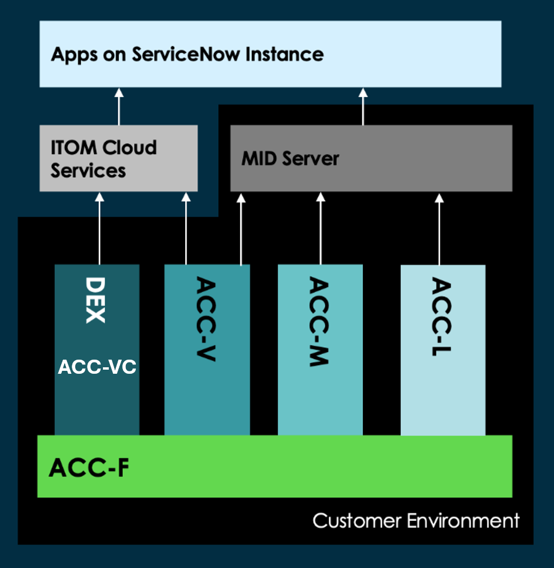
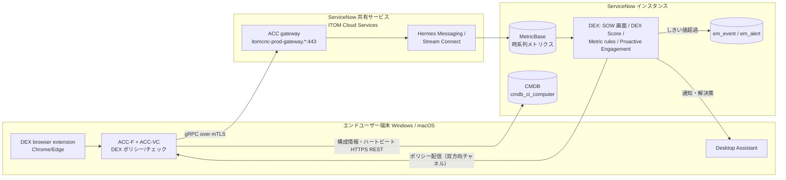
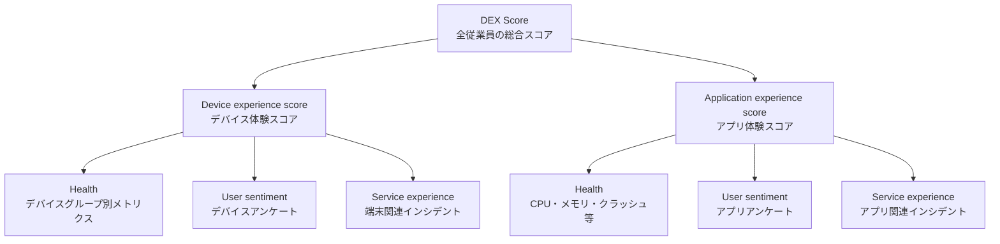
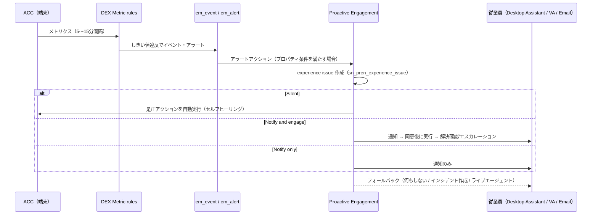

# Digital End-user Experience（DEX）

## 概要

**Digital End-user Experience（DEX、デジタルエンドユーザーエクスペリエンス／デジタル従業員体験）** は、従業員が使う **アプリケーション、ネットワーク、デバイス（PC）** の健全性とパフォーマンスを監視し、症状ではなく根本原因に対処できるようにする ServiceNow のアプリケーション群（スイート）である。公式ドキュメントは DEX を「アプリケーション・ネットワーク・デバイスにわたる end-to-end の可視性」を提供するものと説明している。[出典](https://www.servicenow.com/docs/r/QykF2iRSIs6VXztArCSo3w/vwZfDVmVoEeCnfawtTEkNw)

DEX の要点は次のとおりである。

| 観点 | 内容 |
|---|---|
| 目的 | 端末・アプリ・ネットワークの体験品質を計測し、問題を検知して **プロアクティブに解決（セルフヒーリング／セルフサービス）** し、インシデント対応を高速化する |
| データ収集 | エンドユーザー端末にインストールする **Agent Client Collector（ACC）**（DEX 用コンテンツは **ACC-VC**、**MID-less** 構成）と **DEX browser extension**（Web/SaaS アプリ用） |
| 主な画面 | **Service Operations Workspace（SOW）** 上の DEX ランディングページ／Devices／Applications／Insights／Metrics analyzer、**DEX Administration**、**Digital Experience Score** ダッシュボード |
| 従業員向け | **Desktop Assistant**（端末常駐アプリ）、**Employee Center** の Device health check、Virtual Agent |
| ITSM 連携 | Incident の **Investigation タブ**、DEX 用 AI エージェント（診断・解決計画）、Proactive Engagement 経由のインシデント起票 |
| 製品上の位置付け | 公式ドキュメント上は **IT Service Management（ITSM）配下** に置かれる Store アプリ。ライセンスは ITOM と共通の **Subscription Unit（SU）** 体系（EUC 端末 4 台 = 1 SU） |
| プラグイン | `sn_dex`（Digital End-User Experience）ほか |

[出典](https://www.servicenow.com/docs/r/QykF2iRSIs6VXztArCSo3w/xZEdGqsffmIDESqO46AB1w) [出典](https://www.servicenow.com/docs/r/QykF2iRSIs6VXztArCSo3w/8zdzHr6hVx5R4DZVwNhSOg)

> 本ナレッジでは DEX を ITOM 領域（`02_リファレンス/itom/`）に置いているが、ServiceNow 公式ドキュメントでは DEX は **IT Service Management** のドキュメント（`it-service-management/digital-end-user-experience-dex/...`）に分類されている。ライセンス集計は ITOM/OT SU Licensing で行われる（[ITOM 概要とパッケージ](itom-overview.md) 参照）。[出典](https://www.servicenow.com/docs/r/australia/it-service-management/digital-end-user-experience-dex/dex-subscription.html)

関連ファイル：[Agent Client Collector（ACC）](agent-client-collector.md)、[ITOM 概要とパッケージ](itom-overview.md)、[ITSM Pro/Enterprise 固有機能](../itsm/itsm-pro-features.md)、[Incident Management](../itsm/incident-management.md)、[Service Portal と Employee Center](../platform/portals-employee-center.md)、[Software Asset Management](../itam/software-asset-management.md)。

---

## 1. 構成要素（コンポーネント）

### 1.1 DEX スイートの構成要素一覧

Australia リリースの DEX ドキュメントは、DEX の主要機能として以下を挙げている。[出典](https://www.servicenow.com/docs/r/QykF2iRSIs6VXztArCSo3w/xZEdGqsffmIDESqO46AB1w) [出典](https://www.servicenow.com/docs/r/QykF2iRSIs6VXztArCSo3w/vwZfDVmVoEeCnfawtTEkNw)

| コンポーネント（英語正式名） | 日本語訳 | 役割 |
|---|---|---|
| Application and Device Health | アプリケーションとデバイスの健全性 | 端末・アプリのメトリクスを収集し、ユーザー・アプリ・デバイス・ロケーション別に集約表示する中核機能。SOW 上の DEX 画面群 |
| DEX Content Playbook | DEX コンテンツプレイブック | OS ごとのメトリクス収集・アクション実行のための **ポリシー（policy）・チェック（check）・アクション（action）** のコンテンツ集 |
| Desktop Assistant | デスクトップアシスタント | 従業員端末に常駐するセルフサービスハブ。依頼、端末の健全性確認、接続テスト、障害通知、Virtual Agent／ライブエージェントへの接続 |
| DEX Self-service（Digital End-user Experience Self-service） | DEX セルフサービス | Device health check（端末健全性チェック）と推奨解決策の提示。Employee Center／Desktop Assistant／Virtual Agent から利用 |
| Digital Experience Score（DEX Score） | デジタル体験スコア | デバイス・アプリの健全性、ユーザーセンチメント（アンケート）、サービスデスク体験を一つのスコアに統合するダッシュボード |
| Proactive Engagement | プロアクティブエンゲージメント | Metric rules のアラートを起点に、従業員へ通知し自己解決（または自動修復）させる仕組み |
| AI capabilities | AI 機能 | Now Assist（Australia 以降は「ServiceNow Otto」名称の記載あり）による根本原因分析、DEX 用 AI エージェント |

コミュニティの DEX Welcome Guide（ServiceNow 社員執筆）は、上記に加えて次の要素を挙げている（ServiceNow Community の記事であり、リリースにより名称が異なる可能性がある）。[出典](https://www.servicenow.com/community/dex-articles/dex-digital-end-user-experience-welcome-guide/ta-p/2998341)

| 要素 | 説明 |
|---|---|
| Browser Extension | Chrome／Edge 用拡張機能。Web・SaaS アプリの稼働・性能メトリクスを収集 |
| DEX Insights | IT 管理者・DEX オペレーター向けの分析・トレンド表示（Xanadu で導入） |
| DEX Metrics | Mac／Windows の端末・アプリ性能監視。Metric Rules がアラートと是正アクションを起動 |
| Application Network Experience（ANE） | レイテンシ、パケットロス、ジッターを使って従業員報告の問題のボトルネックを特定 |
| DEX Console | エージェントがごみ箱の消去、閲覧履歴の消去、サービスの停止、端末再起動などのアクションを実行する画面 |

### 1.2 関連アプリケーション（プラグイン）

| アプリケーション | ID（スコープ） | インストール方法 | 出典 |
|---|---|---|---|
| Digital End-User Experience | `sn_dex` | Store から取得し、All > System Applications > All Available Applications でインストール。Application and Device Health はこのコンポーネントとして含まれる | [出典](https://www.servicenow.com/docs/r/QykF2iRSIs6VXztArCSo3w/3Ei~nK2qqh_Lci8rn9XW7A) |
| DEX Desktop Assistant | `sn_dex_desktop`（ロール接頭辞より） | Store アプリとして個別にインストール（DEX のインストールが前提） | [出典](https://www.servicenow.com/docs/r/BgFKZnPHldZ62gGtzQ71Mw/UEiIlkbc1vvRvxiYvgCAjA) |
| Digital End-user Experience Self-service | ID は公開情報では確認できず | DEX インストール時に自動インストール。ベースシステムでは **非アクティブ**（issue configuration を有効化して使う） | [出典](https://www.servicenow.com/docs/r/QykF2iRSIs6VXztArCSo3w/NJuls04daOp_JLwBu5XqOw) |
| Digital Experience Score | `sn_dex_score` | admin ロールでインストール | [出典](https://www.servicenow.com/docs/r/QykF2iRSIs6VXztArCSo3w/dleuokhJloF5I1L9mSq_ag) |
| Digital Experience Feedback Survey | `sn_dex_feedback_sur` | Digital Experience Score と一緒にインストールされ、従業員へアンケートを送る | [出典](https://www.servicenow.com/docs/r/QykF2iRSIs6VXztArCSo3w/dleuokhJloF5I1L9mSq_ag) |
| DEX for Microsoft 365 | — | DEX インストール時に自動インストール | [出典](https://www.servicenow.com/docs/r/QykF2iRSIs6VXztArCSo3w/qXb~3H0H9vijcrvVyjwlTw) |
| Proactive Engagement | `sn_pren`（プロパティ接頭辞より） | ITSM 側のアプリ。DEX のアラートアクション（解決策）を担う | [出典](https://www.servicenow.com/docs/r/MlbQAgTiiiMOLOw9T36wJg/H1yp7OTwu7yJVtGF4wjaUg) |
| ITOM Cloud Services Core | `sn_itom_cloud_svc` | MID-less ACC の前提プラグイン | [出典](https://www.servicenow.com/docs/r/Recj91eIo1YnsOabQjgskg/~Ldj_~kTvhB0rc_Q57gC8g) |
| ServiceNow Otto for IT Service Management | `sn_itsm_gen_ai` | DEX の AI エージェント（agentic workflow）の前提 | [出典](https://www.servicenow.com/docs/r/MlbQAgTiiiMOLOw9T36wJg/Q43mIvmGzYiftA2ws9VNYw) |

---

## 2. アーキテクチャ（ACC ベースのデータ収集）

### 2.1 全体像

DEX は、エンドユーザー端末（Windows／macOS）にインストールした **Agent Client Collector（ACC）** でメトリクス・構成情報・イベントを収集し、インスタンスに送る。DEX の ACC は **MID Server を経由しない（MID-less）** 構成をとり、ServiceNow の共有サービス（**ITOM Cloud Services**）経由でインスタンスと通信する。DEX の FAQ は「DEX は MID Server を必要とせず、MID-less ACC のみを使う」と明記している。[出典](https://www.servicenow.com/community/dex-articles/digital-end-user-experience-dex-faq/ta-p/2998930) [出典](https://www.servicenow.com/community/dex-articles/acc-and-digital-end-user-experience/ta-p/3339325)



- **キャプション：** DEX（ACC-VC）と ACC-V／ACC-M／ACC-L の関係および通信経路
- **図の説明：** 最下段に全モジュール共通の基盤 **ACC-F** があり、その上に **DEX（ACC-VC）**、**ACC-V**、**ACC-M**、**ACC-L** の 4 つの縦長ブロックが並ぶ（いずれも「Customer Environment（顧客環境）」の枠内）。DEX（ACC-VC）からの矢印は **ITOM Cloud Services** を経由して最上段の「Apps on ServiceNow Instance」に向かう。ACC-V は ITOM Cloud Services と MID Server の両方に矢印が出ており、ACC-M と ACC-L は **MID Server** を経由してインスタンスに向かう。すなわち DEX の端末エージェントは MID Server を使わず、クラウド側サービス経由でインスタンスに接続することを示している。
- **出典：** https://www.servicenow.com/community/dex-articles/acc-and-digital-end-user-experience/ta-p/3339325 （ServiceNow Community「ACC and Digital End-User Experience」、取得日 2026-11-04）



### 2.2 ACC のモジュールと DEX での使い分け

ACC は 1 つのインストーラーに複数モジュールを含む。DEX が使うのは **ACC-F** と **ACC-VC** である。[出典](https://www.servicenow.com/community/dex-articles/acc-and-digital-end-user-experience/ta-p/3339325)

| モジュール | 用途 | DEX での利用 |
|---|---|---|
| ACC-F（Framework） | すべての端末に入る基盤層。他モジュールはすべて ACC-F に依存。ACC チームが四半期ごとに更新 | 使用 |
| ACC-VC | DEX 用。Windows／Mac 上でチェックとポリシーを実行して端末固有情報を収集。新しい DEX コンテンツに合わせて更新される | 使用 |
| ACC-V | ITOM（Visibility）用。ACC-VC と一部機能を共有 | 使用しない |
| ACC-M / ACC-L | ITOM（Monitoring／Log）用 | 使用しない |

- Windows 用（.MSI）と Mac 用（.PKG）のインストーラーには 4 つのコンポーネントがすべて同梱される。各コンポーネントは端末上と、インスタンス上のスコープ付きアプリケーションの両方に存在し、プラットフォームから設定・制御できる。[出典](https://www.servicenow.com/community/dex-articles/acc-and-digital-end-user-experience/ta-p/3339325)
- DEX 用の MID-less ACC は、サーバー用の MID ベース ACC（ACC-M/V）と同時に運用できる。[出典](https://www.servicenow.com/community/dex-articles/digital-end-user-experience-dex-faq/ta-p/2998930)
- ACC 自体の仕様（acc.yml、チェック定義、ポリシー、テーブル）は [Agent Client Collector（ACC）](agent-client-collector.md) を参照。

### 2.3 データフロー

ServiceNow Community の解説（ServiceNow 社員執筆）によるデータフローは次のとおり。[出典](https://www.servicenow.com/community/dex-articles/acc-and-digital-end-user-experience/ta-p/3339325)

1. インストール後、エージェントは **証明書交換** によって組織のインスタンスに登録される。
2. エージェントはダウンロードした証明書を使って ServiceNow の共有サービスに接続する。接続は **相互 TLS（mTLS）で保護された暗号化 gRPC チャネル** である。
3. 端末の生メトリクスは共有サービス（**Hermes Messaging** と **Stream Connect**）を通り、インスタンスへ push される。
4. 一部の構成メトリクスとエージェントのハートビートは、HTTPS の REST エンドポイント経由でインスタンスへ直接送られる。
5. インスタンスは同じ双方向チャネルで **DEX ポリシー** をエージェントへ配信する。

補足事項：

- ACC は mTLS で通信するため、プロキシでの復号・検査は不要とされる（復号・検査を行うと通信できなくなる可能性がある【推定】）。[出典](https://www.servicenow.com/community/dex-articles/digital-end-user-experience-dex-faq/ta-p/2998930)
- DEX をインストールすると **mTLS が自動的に有効化** される。公式ドキュメントは「他の ServiceNow 連携で使われているレガシーなセキュリティ製品が動作しなくなる可能性があるため、それらの連携を TLS／mTLS 対応に更新すること」と警告している。[出典](https://www.servicenow.com/docs/r/QykF2iRSIs6VXztArCSo3w/3Ei~nK2qqh_Lci8rn9XW7A)
- ACC をインストールすると CMDB の Computer（`cmdb_ci_computer`）テーブルにデータが入り、DEX が OS や構成情報の情報源（source of truth）になる。[出典](https://www.servicenow.com/community/dex-articles/digital-end-user-experience-dex-faq/ta-p/2998930)
- ブラウザー拡張機能（Web アプリ監視）がデータを収集・返送するにも ACC が必要。[出典](https://www.servicenow.com/community/dex-articles/digital-end-user-experience-dex-faq/ta-p/2998930)

### 2.4 データの保存と保持期間

| 項目 | 仕様 | 出典 |
|---|---|---|
| 時系列データの格納先 | **MetricBase** データストア | [出典](https://www.servicenow.com/docs/r/QykF2iRSIs6VXztArCSo3w/8zdzHr6hVx5R4DZVwNhSOg) |
| 保持期間の例 | 5 分間隔のデータは最大 **7 日間** 保持。ロールアップ（集約値）はトレンド分析用により長く保持 | 同上 |
| 保持ポリシーの変更 | シリーズ上限を定めるデータ収集・保持ポリシーは **変更不可** | 同上 |
| 収集間隔 | メトリクスの設定により 5／10／15 分ごと | [出典](https://www.servicenow.com/docs/r/MlbQAgTiiiMOLOw9T36wJg/1wj9qYysWLhQyGENavLQHg) |
| リアルタイム性 | ダッシュボードはリアルタイムではなく、一部データは数分ごとの収集 | [出典](https://www.servicenow.com/community/dex-articles/digital-end-user-experience-dex-faq/ta-p/2998930) |
| アラート | しきい値違反で `em_event` にイベント、`em_alert` にアラートを作成（Event Management の基盤を利用） | [出典](https://www.servicenow.com/docs/r/MlbQAgTiiiMOLOw9T36wJg/1wj9qYysWLhQyGENavLQHg) |

### 2.5 システム要件

Australia 版「DEX system requirements」の記載は次のとおり。[出典](https://www.servicenow.com/docs/r/QykF2iRSIs6VXztArCSo3w/~xUr~f8uM743jEOePN797g)

| 項目 | 要件 |
|---|---|
| 最低インスタンスリリース | Vancouver Patch 6 |
| ACC-F バージョン | 3.4.1、3.5.1（同ページ記載。Australia で最新版の対応状況は ACC 側のリリースノートで要確認） |
| Windows | Windows 10 Enterprise、Windows 11 Professional、Windows 11 Enterprise、Windows 11 Surface on ARM64 |
| macOS | Monterey、Ventura、Sonoma、Sequoia |
| ブラウザー拡張機能 | Google Chrome 114 以上、Microsoft Edge 96 以上 |
| CPU 負荷 | Windows／macOS とも平均約 1% |
| CPU 保護 | acc.yml のしきい値に達すると CPU protection mode に入る。DEX 展開では **ACC CPU Protection Threshold を 20%** に設定することが推奨される |
| メモリ・ディスク・ポート | 公開情報（同ページ）では確認できず |

- VDI もサポートされる。**非永続 VDI** ではゴールデンイメージに ACC を入れ、証明書を永続ストレージに保存する構成をとる。永続 VM もサポート。非永続 VDI 監視は Zurich（2025-12 更新）で正式機能化された。[出典](https://www.servicenow.com/community/dex-articles/digital-end-user-experience-dex-faq/ta-p/2998930) [出典](https://www.servicenow.com/docs/r/u1slaAtcFiiXFQcd9RcR_A/gPAmWx28doPojpvq6c96zQ)
- Desktop Assistant の macOS 最低要件は Ventura 13／Sonoma 14 と FAQ に記載（Sequoia 対応は上記 DEX 要件に準ずる）。[出典](https://www.servicenow.com/community/dex-articles/digital-end-user-experience-dex-faq/ta-p/2998930)

---

## 3. インストールと初期設定

### 3.1 インスタンス側のインストール

1. All > System Applications > All Available Applications を開く。
2. Digital End-User Experience（`sn_dex`）を名前または ID で検索する（なければ ServiceNow Store から申請）。
3. バージョンを選び **Install** を選択する。Review Installation Details ダイアログで依存アプリを確認し、必要なら Store のリンクから依存アプリのエンタイトルメントを取得する。
4. 任意で **Load demo data**（開発・テストインスタンス向け）を選択し、Install を実行する。

- 前提：admin ロール、アプリと関連 Store アプリの有効なエンタイトルメント（KB0030186 参照）。
- データ移行に関する注意は KB1646364（Xanadu 以前）、KB2144029（`dex` device テーブルの allocated／last logged in user／last logged in location 列）、KB2141007（Alert Metadatas テーブルの CI type 列）。Zurich へのアップグレード前に確認する。

[出典](https://www.servicenow.com/docs/r/QykF2iRSIs6VXztArCSo3w/3Ei~nK2qqh_Lci8rn9XW7A) [出典](https://www.servicenow.com/docs/r/m4LmCVvkm6_8u3nlIuep5Q/WdMP2ffx0BhYtsvPC3VW~g)

### 3.2 設定フロー（公式の 9 ステップ）

「Configuring Digital End-User Experience」は次の順序を示している。[出典](https://www.servicenow.com/docs/r/UMl~97STJe3fa_KTmzD1Gg/DPd9mKosJ~3OAMsaQT~iLw)

| # | ステップ | 要点 |
|---|---|---|
| 1 | Application and Device Health のインストール | `sn_dex` と admin ロール |
| 2 | ローカル端末に DEX と ACC を導入して検証 | MID ベース ACC を使っている場合は **MID-less ACC に変換**。Windows で完全な Playbook コンテンツを取得するには ACC を **ローカルシステムアカウント** で実行 |
| 3 | 従業員端末へ一括展開 | ACC と DEX browser extension を展開 |
| 4 | Application and Device Health の統合 | 監視対象アプリを一覧から選ぶか、カスタムアプリを追加して監視を有効化 |
| 5 | Application and Device Health 画面の確認 | DEX Content Playbook のポリシー・チェック・アクション |
| 6 | DEX Desktop Assistant の設定 | セルフサービス、障害通知、Employee Center／Virtual Agent／エージェントへの導線 |
| 7 | Proactive Engagement の設定 | 問題検知ルールと解決策 |
| 8 | DEX Self-service の設定 | DEX と同時に自動インストールされるプラグイン。Device health check |
| 9 | Digital Experience Score の設定 | 導入計画と設定 |

### 3.3 ガイド付きセットアップ（DEX Administration のカード）

DEX のインストール後、SOW の主ナビゲーションの **DEX Administration** アイコンからガイド付きセットアップを開く。カードは次のとおり（Xanadu 版ページの記載）。[出典](https://www.servicenow.com/docs/r/Recj91eIo1YnsOabQjgskg/~bEA5zIuTet44cbnQ6cJSA)

| カード | 内容 |
|---|---|
| Agent deployment on Windows devices | Windows への ACC インストール |
| Agent deployment on macOS devices | macOS への ACC インストール |
| Deploy browser extension | DEX browser extension の有効化 |
| Desktop Assistant deployment | 従業員端末での Desktop Assistant の有効化 |
| Digital End-user Experience Self-service configuration | インスタンス上の DEX Self-service 設定 |

### 3.4 ACC（MID-less）のインストール

**前提**：ITOM Cloud Services プラグイン（ITOM Cloud Services Core、`sn_itom_cloud_svc`）のインストールとインスタンスの ITOM Cloud Services へのオンボーディング、エージェント登録キー（All > Agent Client Collector > Deployment > Agent Registration Key）、`agent_client_collector_admin` ロール。[出典](https://www.servicenow.com/docs/r/QykF2iRSIs6VXztArCSo3w/XFmgyhMjdWyqiqt0MZRweA) [出典](https://www.servicenow.com/docs/r/Recj91eIo1YnsOabQjgskg/~Ldj_~kTvhB0rc_Q57gC8g)

**Windows のインストールコマンド**（Australia 版「Install ACC for DEX on Windows」）[出典](https://www.servicenow.com/docs/r/QykF2iRSIs6VXztArCSo3w/XFmgyhMjdWyqiqt0MZRweA)

```
msiexec /i <msi_file_path> /quiet /qn /norestart CONNECT_WITHOUT_MID="true" ACC_CNC="<gateway_endpoint>" REGISTRATION_KEY="<registration_key>" INSTANCE_URL="https://<instance_url>"
```

| パラメーター | 意味 |
|---|---|
| `CONNECT_WITHOUT_MID` | `true` で MID-less インストール。省略すると通常の MID Server websocket 方式になる |
| `ACC_CNC` | ACC の公開ゲートウェイエンドポイント（下表） |
| `REGISTRATION_KEY` | 有効なエージェント登録キー |
| `INSTANCE_URL` | エージェントを登録するインスタンス |
| `ACC_ALLOW_LIST`（任意） | `0` で allow list 無効化（既定は有効）。セキュリティリスクがあり一時的な使用に限る |
| `ACC_VALIDATE_SIG`（任意） | `0` でインストーラーの証明書検証を省略（既定は有効）。非標準の署名検証ツール使用時のみ |

| リージョン | ゲートウェイエンドポイント（443） |
|---|---|
| AMER | `itomcnc-prod-gateway.amer.sncapps.service-now.com:443` |
| EMEA | `itomcnc-prod-gateway.emea.sncapps.service-now.com:443` |
| APAC | `itomcnc-prod-gateway.apac.sncapps.service-now.com:443` |

**インストール後の手順（Windows）**[出典](https://www.servicenow.com/docs/r/QykF2iRSIs6VXztArCSo3w/XFmgyhMjdWyqiqt0MZRweA)

1. Agent Client Collector サービスを開始する。既定ではパフォーマンス監視、「サービスとしてログオン」、デバッグプログラム権限を持つ ServiceNow ユーザーで動作する。
2. DEX メトリクス収集のため、ACC の実行アカウントを次のいずれかにする：Remote Desktop ユーザーを ServiceNow ユーザーに追加／**ローカルシステムアカウントで実行**（Windows の Playbook コンテンツを完全に取得するのに必要）／管理されたグループユーザーで実行（セキュリティ・監査要件がある組織向け）。
3. サービスを再起動する。

**macOS**：同様に `CONNECT_WITHOUT_MID="true"`、`ACC_CNC`、`REGISTRATION_KEY`、`INSTANCE_URL` を指定するコマンドを root で実行し、インストール後に ServiceNow 用 sudoers ファイルを設定する。DEX Self-service のチェック・アクションは macOS ではローカルアカウント `_servicenow` で実行され、アカウント名が誤っているとチェック・アクションが完了しないまま実行されたように見える。[出典](https://www.servicenow.com/docs/r/Recj91eIo1YnsOabQjgskg/~Ldj_~kTvhB0rc_Q57gC8g) [出典](https://www.servicenow.com/docs/r/QykF2iRSIs6VXztArCSo3w/8mcZ0wwBUjIeyQQuAqMRXg)

- 登録確認：Agent Client Collector > Agents にエージェントレコードが MID フィールド空欄で表示される。自動アップグレードのため SYSTEM で実行することが推奨される。【第三者情報】（Community 記事）[出典](https://www.servicenow.com/community/employee-center-articles/tracking-software-usage-with-servicenow-acc-mid-less-without/ta-p/3511521)
- 大量展開は Jamf や Microsoft Endpoint Configuration Manager（MECM）などの端末管理ツールを使う。[出典](https://www.servicenow.com/docs/r/QykF2iRSIs6VXztArCSo3w/dI4Ux4b0gNBb2xc~OSTTmw)

---

## 4. Digital Experience Score（DEX Score）

### 4.1 概要

**Digital Experience Score（DEX Score、デジタル体験スコア）** は、デバイスとアプリケーションの **健全性（Health）**、**ユーザーセンチメント（User sentiment）**、**サービス体験（Service experience）** を一つの 0〜100 のスコアに統合し、組織全体の従業員体験のトレンドを追跡するためのアプリケーション（`sn_dex_score`）とダッシュボードである。[出典](https://www.servicenow.com/docs/r/QykF2iRSIs6VXztArCSo3w/xZEdGqsffmIDESqO46AB1w) [出典](https://www.servicenow.com/docs/r/Mr7qUatbFXax1_h~z60rmA/Aj6~HTfp_3IjJ6xGMjYlWQ)

### 4.2 スコアの階層と算出式

DEX Score は 3 階層で計算される。すべての階層で同じ加重平均式を使う。[出典](https://www.servicenow.com/docs/r/Mr7qUatbFXax1_h~z60rmA/Aj6~HTfp_3IjJ6xGMjYlWQ)

```
加重平均 = Σ(スコア × 重み) / Σ(重み)
```



| 階層 | 内容 |
|---|---|
| DEX Score | Device experience score と Application experience score の加重平均 |
| Device / Application experience score | 各エンティティ（デバイスグループまたはデバイス、アプリケーション）のスコアの平均 |
| メトリクスカテゴリ | 各エンティティのスコアは Health、User sentiment、Service experience の加重平均 |

| カテゴリ | アプリケーションレベル | デバイスレベル |
|---|---|---|
| Health | 関連デバイスにわたる正規化済み CPU 使用率・メモリ使用率・クラッシュレポートの加重平均 | デバイスグループごとの正規化済みメトリクススコアの加重平均 |
| User sentiment | アプリに対するユーザーフィードバックの正規化済みセンチメントスコアの平均 | グループ内デバイスに対するフィードバックの正規化済みスコアの平均 |
| Service experience | アプリに関する解決済みインシデントの正規化済みメトリクススコアの加重平均 | グループ内デバイスに関する解決済みインシデントの同スコアの加重平均 |

**定性マッピング（全階層共通）**

| 評価 | スコア |
|---|---|
| Good | 75 超 |
| Average | 45〜75 |
| Poor | 45 未満 |

**計算例（公式ドキュメントの例示値。既定値かどうかは確認できず）**

- 重みの例：DEX Score 階層は Device 50／Application 50、アプリ・デバイス階層は Health 50／User sentiment 30／Service experience 20。
- アプリ体験スコア：(55×50 + 58×30 + 72×20) / 100 = 59.3 → **59**（Average）
- デバイス体験スコア：(64×50 + 68×30 + 70×20) / 100 = 66.4 → **66**（Average）
- DEX Score：(55×50 + 54×50) / 100 = 54.5 → ドキュメントは **54** と表記（四捨五入なら 55 となり、丸め方法は公開情報では確認できず）。
- 注意：公式の DEX Score の例は、直前のアプリ体験スコア（59）とデバイス体験スコア（66）ではなく、別の例示値（Application 55／Device 54）を使っている（公式ドキュメント側の不整合）。直前の結果を使うなら (59×50 + 66×50) / 100 = 62.5 となり、公式例の値とは一致しない。

重みは DEX Score Hierarchy Weights（`dex_score_hierarchy_weights`）テーブルで管理される（4.5 参照）。

### 4.3 メトリクス定義

「DEX Score metric definitions」に掲載されているメトリクスは次のとおり。[出典](https://www.servicenow.com/docs/r/Mr7qUatbFXax1_h~z60rmA/gwMvF2~Aoe2hZVfnOV1u5A)

| メトリクス | カテゴリ | 対象 | 説明 |
|---|---|---|---|
| Application crashes | Application（Health） | インストール型アプリ | 期間内にアプリが停止した回数 |
| CPU usage | Application | インストール型アプリ | アプリが消費する CPU の割合（%） |
| Memory usage | Application | インストール型アプリ | アプリが消費するメモリの割合（%） |
| Average DNS lookup | Application | Web アプリ | DNS 解決の平均時間 |
| Average page load time | Application | Web アプリ | ページ要求から完全読み込みまでの平均時間 |
| Average response time | Application | Web アプリ | ユーザー要求に対する平均応答時間 |
| Failed web requests | Application | Web アプリ | エラーコード、HTTP 408、または成功コードなしの要求 |
| Battery health | Device（Health） | Windows / macOS | 容量・サイクル数・インピーダンスに基づくバッテリー状態 |
| CPU usage | Device | Windows / macOS | 端末の CPU 使用率 |
| Disk usage | Device | Windows / macOS | ディスク使用率 |
| Memory usage | Device | Windows / macOS | 端末のメモリ使用量 |
| Wifi receive rate / Wifi transmit rate | Device | Windows / macOS | 受信・送信速度 |
| Wifi RSSI | Device | **macOS のみ** | 無線信号強度（負値、0 に近いほど強い） |
| Application survey | User sentiment | アプリ利用者 | 利用状況に基づき無作為抽出したユーザーへの定期アンケート。1〜5 評価を 0〜100 に正規化 |
| Device survey | User sentiment | 端末利用者 | **6 か月ごと** に端末利用者へ送るアンケート。1〜5 評価を 0〜100 に正規化 |
| Customer satisfaction for resolved incidents | Service desk | アプリ／デバイスグループ | インシデント解決後の満足度アンケート（0〜100、加重） |
| Mean time to resolve an incident | Service desk | 同上 | 作成から解決までの平均時間（時間） |
| Percentage of first assignment resolution | Service desk | 同上 | 再割り当て回数 0 のインシデントの割合 |
| Percentage of incidents that breached SLA | Service desk | 同上 | SLA 違反インシデントの割合 |
| Percentage of reopened incidents | Service desk | 同上 | 再オープン回数が 1 以上の割合 |
| Number of resolved incidents | Service desk | 同上 | 解決・クローズ件数（**スコアには寄与しない**） |
| Number of closed major incidents | Service desk | 同上 | 重大インシデントの解決・クローズ件数（**スコアには寄与しない**） |
| Total outages due to incidents | Service desk | 同上 | インシデントによる停止・劣化時間の合計（**スコアには寄与しない**） |

### 4.4 Digital Experience Score のプロパティ

| プロパティ | 既定値 | 説明 |
|---|---|---|
| `sn_dex_score.active` | `true` | Digital Experience Score アプリの有効／無効。有効時に計算・ダッシュボード・設定が利用可能 |
| `sn_dex_score.company_target_score` | `75` | 組織の目標 DEX Score（0〜100 の整数）。DEX Score ダッシュボードに表示される |

[出典](https://www.servicenow.com/docs/r/QykF2iRSIs6VXztArCSo3w/~Ss3Q3rMi2h3wRilcKdemA)

### 4.5 Digital Experience Score のロールとテーブル

| ロール | 名称 | 内容 | 含むロール |
|---|---|---|---|
| Dashboard User | `sn_dex_score.dashboard_user` | Digital Experience Score ダッシュボードにアクセス可能 | `sn_sow.sow_user` |
| Dashboard Application Pages User | `sn_dex_score.dashboard_application_pages_user` | ダッシュボードのアプリケーションページのみアクセス可能 | なし |
| Dashboard Device Pages User | `sn_dex_score.dashboard_device_pages_user` | ダッシュボードのデバイスページのみアクセス可能 | なし |
| Digital Workplace Leader | `sn_dex_score.digital_workplace_leader` | ダッシュボード利用に加え、メトリクス定義、DEX Score システムプロパティ、メトリクススコアの定性マッピング、アンケート設定を構成可能 | `sn_dex_score.dashboard_user`、`sn_dex_feedbck_sur.dex_feedback_survey_admin`、`sn_dex.user` |

| テーブル | 名称 | 内容 |
|---|---|---|
| DEX Score Hierarchy Weights | `dex_score_hierarchy_weights` | 健全性・ユーザーセンチメント・サービス体験メトリクスの重み（アプリ・デバイス・DEX 全体の各階層） |
| DEX Score Metric Definition | `dex_score_metric_definition` | 上限・下限などの事前定義値を持つメトリクス定義 |

[出典](https://www.servicenow.com/docs/r/QykF2iRSIs6VXztArCSo3w/eYDoujOlt34xebpvWJVpYw)

> ロール名 `sn_dex_feedbck_sur.dex_feedback_survey_admin` は公式ドキュメントの表記（スコープ名の綴りが `feedbck`）をそのまま記載している。アプリ ID の表記（`sn_dex_feedback_sur`）と異なるため、実インスタンスで確認すること。

---

## 5. DEX の画面（Service Operations Workspace と DEX Administration）

### 5.1 位置付け

DEX のオペレーター向け画面は独立したワークスペースではなく、**Service Operations Workspace（SOW、サービスオペレーションワークスペース）** の中に組み込まれている。このため、DEX のデータを可視化するには何らかのエディションの **ITSM（Standard／Pro／Enterprise）** のエンタイトルメントが必要とされる。[出典](https://www.servicenow.com/community/dex-articles/digital-end-user-experience-dex-faq/ta-p/2998930) [出典](https://www.servicenow.com/docs/r/QykF2iRSIs6VXztArCSo3w/OTaYoIk_m8GD9yMbJN1_xg)

公式ドキュメントのランディングページは「DEX workspace を通じたデジタルワークプレイスの管理」「Reference（DEX Workspace administration）」という見出しを持ち、本ナレッジでいう「DEX Workspace」は SOW 上の DEX 画面群と DEX Administration を指す。[出典](https://www.servicenow.com/docs/r/QykF2iRSIs6VXztArCSo3w/xZEdGqsffmIDESqO46AB1w)

### 5.2 主な画面

| 画面 | アクセス | 内容 | 出典 |
|---|---|---|---|
| Landing page（ランディングページ） | Workspaces > Service Operations Workspace（Home アイコン） | 直近 2 時間のデータを表示。Employee experience overview（アクティブアラート、影響デバイス、アクティブデバイス）、デバイス数を地域別に表示する **世界地図**（ドリルダウンで Devices ページへ） | [出典](https://www.servicenow.com/docs/r/QykF2iRSIs6VXztArCSo3w/OTaYoIk_m8GD9yMbJN1_xg) |
| Devices | SOW の主ナビゲーション | **All devices**（DEX オペレーター向け）と **Devices by ACC status**（オペレーター・管理者向け）の 2 タブ（Zurich で分割）。デバイス名・アプリバージョンでフィルター。アクティブデバイスフィルターは直近 5 分 | [出典](https://www.servicenow.com/docs/r/m4LmCVvkm6_8u3nlIuep5Q/WdMP2ffx0BhYtsvPC3VW~g) |
| Device（個別デバイス／Device health page） | Devices から選択 | 端末の健全性・性能メトリクス、GPU／VRAM 使用率（Zurich 2026-03 更新で導入、Australia に含まれる）、直近 24 時間のアラート・変更要求・インシデントのタイムライン（Device events timeline、Zurich）、デバイスのアプリのアラート | 同上 |
| Applications | SOW の主ナビゲーション | 監視対象のインストール型アプリ・Web アプリ、アプリごとのインシデント・アラート件数と影響デバイス。アプリバージョン別の性能（Australia）。Teams・Zoom の Call quality ビュー | 同上 |
| Insights | Insights アイコン | 端末の性能、コンプライアンス、ユーザー操作、ネットワーク健全性の簡易ビュー（Xanadu で導入）。複数デバイスを選択して是正アクションを一括実行（Australia）。エージェントイベントログのレポート作成と名前付きクエリの左ナビ保存（Australia、保存・取得は DEX Engineer／Administrator のみ） | [出典](https://www.servicenow.com/docs/r/3ongaT2PAVB3Cqoicgnoxg/ENxzXgOUPxuH_I0ixtdlyQ) |
| Metrics analyzer | SOW | アプリ・デバイス・ロケーション・OS 別に CI メトリクスを期間指定で分析（Zurich 2025-12 更新で導入）。Web アプリのページ単位の監視結果も表示 | [出典](https://www.servicenow.com/docs/r/u1slaAtcFiiXFQcd9RcR_A/gPAmWx28doPojpvq6c96zQ) |
| DEX Administration | SOW の主ナビゲーションの **DEX Administration** アイコン（All > SOW > DEX Administration） | ガイド付きセットアップ、デバイス／アプリ構成、主要コンポーネント監視、**Metric rules** カード、是正アクションの作成（Create Remedial Action） | [出典](https://www.servicenow.com/docs/r/MlbQAgTiiiMOLOw9T36wJg/C_Uptk599b4SMeRRKvXQPg) |
| Users | — | Zurich で DEX 独自の Users ページ／Users list ページは削除され、SOW の Users ページへリダイレクト | [出典](https://www.servicenow.com/docs/r/m4LmCVvkm6_8u3nlIuep5Q/WdMP2ffx0BhYtsvPC3VW~g) |
| Digital Experience Score ダッシュボード | DEX Score アプリ | 組織・アプリ・デバイスグループ別の体験スコア。Suboptimal devices 列は Average／Poor の端末一覧にリンク（Zurich） | [出典](https://www.servicenow.com/docs/r/QykF2iRSIs6VXztArCSo3w/eYDoujOlt34xebpvWJVpYw) |

> **Brazil での変更:** Devices ページに DEX ダッシュボードへのリンクが追加され、複数ロールを持つユーザーが DEX ホームに素早く移動できるようになった。[出典](https://www.servicenow.com/docs/r/delta-zurich-brazil/brazil-zurich-digitalenduserexperience-release-notes.html)

画面のスクリーンショットは公式ドキュメントの動的表示のため取得できなかった。公式の「Landing page」ページ（https://www.servicenow.com/docs/r/QykF2iRSIs6VXztArCSo3w/OTaYoIk_m8GD9yMbJN1_xg ）を参照。

### 5.3 監視対象アプリケーション

- 監視対象アプリは **DEX Application（`dex_application`）** テーブルに登録する。このテーブルは `sn_acc_vis_content_application` を拡張している。[出典](https://www.servicenow.com/docs/r/Recj91eIo1YnsOabQjgskg/yZ8Eg74y~gEgOTn5i~8kmw)
- Zurich から、DEX アプリケーションを Service Offering／Service Instance テーブルの既存サービスにマッピングできる（CSDM との整合）。[出典](https://www.servicenow.com/docs/r/u1slaAtcFiiXFQcd9RcR_A/gPAmWx28doPojpvq6c96zQ)
- 上限：インスタンスあたり **アクティブアプリ 200 件**（SaaS アプリと監視端末のインストール型アプリを含む）、**1 ユーザーあたり週 40 アクティブアプリ** まで。[出典](https://www.servicenow.com/docs/r/QykF2iRSIs6VXztArCSo3w/8zdzHr6hVx5R4DZVwNhSOg)
- Web アプリの監視には DEX browser extension の有効化が必要。[出典](https://www.servicenow.com/docs/r/m4LmCVvkm6_8u3nlIuep5Q/WdMP2ffx0BhYtsvPC3VW~g)

---

## 6. Metric rules とアラート

### 6.1 Metric rules の概要

**Metric rules（メトリクスルール）** は、性能メトリクスが指定条件から逸脱したときにアラートを起こすための条件・しきい値の定義である。**Metric Rules（`dex_metric_rules`）** テーブルに格納される。[出典](https://www.servicenow.com/docs/r/MlbQAgTiiiMOLOw9T36wJg/C_Uptk599b4SMeRRKvXQPg) [出典](https://www.servicenow.com/docs/r/Recj91eIo1YnsOabQjgskg/yZ8Eg74y~gEgOTn5i~8kmw)

- メニュー：Workspaces > Service Operations Workspace > DEX Administration（Administration）アイコン > **Metric rules** カード。作成は All > SOW > DEX Administration > Metric rules > **Create metric rule**。
- 一覧の列：Name、CI type、Application name、Alert severity、Alert status、（Proactive Engagement 導入時）Action。
- ベースシステムに **事前定義の Metric rules** が含まれるが、インストール時は **非アクティブ**。削除すると **復元できない**。
- 上限：インスタンスあたり **アクティブな Metric rules は 50 件** まで。[出典](https://www.servicenow.com/docs/r/QykF2iRSIs6VXztArCSo3w/8zdzHr6hVx5R4DZVwNhSOg)
- 編集には `sn_dex.admin` が必要とされ、アラートアクション（解決策）の追加には Proactive Engagement の管理ロール（Engagement Admin）が必要とされる。Engagement Admin の正式ロール名は公開情報では確認できず。
- Zurich で **メトリクスベース** と **構成ベース** のプロアクティブルールを 1 つの画面で管理できるようになった（Enhanced metric rule experience）。[出典](https://www.servicenow.com/docs/r/u1slaAtcFiiXFQcd9RcR_A/gPAmWx28doPojpvq6c96zQ)

### 6.2 Metric rule の作成手順

[出典](https://www.servicenow.com/docs/r/QykF2iRSIs6VXztArCSo3w/RjPh94hOsh~U4lqKRfcxSw)

1. All > SOW > DEX Administration > Metric rules > Create metric rule を開く。
2. **CI selection**：監視するデバイスまたはアプリの種類を選ぶ → Next。
3. **メトリクスとアラート条件** を選ぶ → Next。
4. **Alert action**：メトリクスルールの解決策を定義する（ページの版によっては入力パラメーター付き是正アクションは選択不可と記載）→ Next。
5. 解決タイプを選び詳細を入力する。入力パラメーター付きの是正アクションの場合は各パラメーターの Advanced settings を入力する。
6. **Continue to Engagement Settings** を選び、エンドユーザーへの働きかけ方（Engagement settings）を設定する。
7. **Add Resolution** を選び、ルール名と有効化を設定する。以降、条件に合致するたびに解決策が起動する。

### 6.3 アラート処理の仕組み

[出典](https://www.servicenow.com/docs/r/MlbQAgTiiiMOLOw9T36wJg/1wj9qYysWLhQyGENavLQHg)

1. DEX はメトリクスを 5／10／15 分ごとに収集し、しきい値と比較する。
2. 違反があると `em_event` にイベント、`em_alert` にアラートを作成する。
3. デバイスアラートはベースシステムの相関ルールでグループ化される（相関期間はプロパティ `sn_dex.alert.correlation_rule.device_period`、既定 1 時間）。アプリケーションアラートは、クローズされるまでアプリ×メトリクスルールごとに 1 件を再利用する。
4. 影響ユーザー・デバイスは **`dex_alert_impacted_users`**、詳細は **`dex_alert_metadata`** に記録される。
5. 解決策が定義されていれば、影響ユーザーごとに **experience issue**（`sn_pren_experience_issue`）が作成される。
6. 影響デバイスがすべて一覧から外れるとアラートは自動クローズされる（デバイスアラートは experience issue もクローズ）。

- Metric Rules からのアラートは Event Management や Express List に連携できる。[出典](https://www.servicenow.com/community/dex-articles/digital-end-user-experience-dex-faq/ta-p/2998930)

> **Brazil での変更:** Metric rules と event rules に **デバイスごと・ルールごとのレート制限** が導入され、1 つのノイジーなルールがインスタンスをアラート・イベントで溢れさせることを防ぐ。また、アラート発生前のイベント評価を制御できる **metric rule events の拡張ポイント（extension point）** が追加された。[出典](https://www.servicenow.com/docs/r/delta-zurich-brazil/brazil-zurich-digitalenduserexperience-release-notes.html)

### 6.4 イベント監視（Event monitoring）

Australia で、Windows／macOS のシステムイベント（アプリケーションクラッシュ、予期しないシャットダウン、ディスク警告、ログオン失敗、サービス障害など）を監視する機能が追加された。ベースのイベントを有効化・無効化でき、カスタムイベントも追加できる。[出典](https://www.servicenow.com/docs/r/m4LmCVvkm6_8u3nlIuep5Q/WdMP2ffx0BhYtsvPC3VW~g)

---

## 7. プロアクティブな解決とセルフヒーリング

### 7.1 Proactive Engagement との連携

DEX は ITSM の **Proactive Engagement（プロアクティブエンゲージメント）** と連携し、端末・アプリを監視して潜在的な問題をユーザーに知らせ、解決を案内する（Xanadu で統合）。[出典](https://www.servicenow.com/docs/r/3ongaT2PAVB3Cqoicgnoxg/ENxzXgOUPxuH_I0ixtdlyQ)



**解決タイプ（Remediation action types）**[出典](https://www.servicenow.com/docs/r/MlbQAgTiiiMOLOw9T36wJg/1wj9qYysWLhQyGENavLQHg)

| タイプ | 内容 |
|---|---|
| Remedial action | CI アクション（端末上のコマンド・スクリプト）、カタログアイテム、フロー、Virtual Agent トピックを実行 |
| Create incident | インシデントを作成 |
| Self-help instructions | ユーザー向けの自己解決手順 |
| URL | ヘルプリソースへ誘導 |

**実行モード**

| モード | 内容 |
|---|---|
| Silent | ユーザーの関与なしで是正を実行（セルフヒーリング） |
| Notify and engage | 通知し、ユーザーの同意後に実行。ユーザーが解決を確認またはエスカレーション |
| Notify only | 通知のみ。アクションは要求・実行しない |

- **フォールバック**：ユーザーが応答しない、または問題が解消しない場合、「何もしない」「インシデント作成」「ライブエージェントへ接続」を選べる。
- **通知チャネル**：Virtual Agent のプッシュ通知、メール、デスクトッププッシュ通知（Desktop Assistant）。端末の稼働状態に関わらず更新を届けられる Desktop Assistant が推奨されている。チャネルの有効化はプロパティ `sn_pren_channel_configuration`（管理ウィザード）で行い、関連プラグインがある場合のみ表示される。[出典](https://www.servicenow.com/docs/r/QykF2iRSIs6VXztArCSo3w/RjPh94hOsh~U4lqKRfcxSw) [出典](https://www.servicenow.com/docs/r/MlbQAgTiiiMOLOw9T36wJg/H1yp7OTwu7yJVtGF4wjaUg)
- **ユースケース例**：ディスク使用率しきい値、クラッシュ頻度、VPN 再接続、Wi-Fi 接続修復、サービス再起動。コミュニティ記事は、ネットワーク・バッテリー・CPU/メモリのほか、Wi-Fi 接続不良、端末クラッシュ、アプリクラッシュ、アプリフリーズ、Jamf 実行、Zscaler 切断を挙げている。[出典](https://www.servicenow.com/docs/r/MlbQAgTiiiMOLOw9T36wJg/1wj9qYysWLhQyGENavLQHg) [出典](https://www.servicenow.com/community/dex-articles/dex-digital-end-user-experience-welcome-guide/ta-p/2998341)

### 7.2 Proactive Engagement のスロットリング（プロパティ）

[出典](https://www.servicenow.com/docs/r/MlbQAgTiiiMOLOw9T36wJg/H1yp7OTwu7yJVtGF4wjaUg)

| プロパティ | 既定値 | 説明 |
|---|---|---|
| `sn_pren.resolution_freeze_period` | 72 時間 | 同一ユーザー・同一メトリクスルールに対する凍結期間。0 で無効 |
| `sn_pren.device_resolution.user_limit_per_throttling_window` | 100 ユーザー | スロットリング期間内にデバイス解決策を受け取る最大ユーザー数 |
| `sn_pren.device_resolution.throttling_window_duration` | 8 時間 | デバイスのスロットリング期間 |
| `sn_pren.application_resolution.user_limit_per_throttling_window` | 100 ユーザー | 同、アプリケーション解決策 |
| `sn_pren.application_resolution.throttling_window_duration` | 1 時間 | アプリケーションのスロットリング期間 |
| `sn_dex.alert.correlation_rule.device_period` | 1 時間 | デバイスアラートの相関期間 |

- 公式ページでは throttling_window_duration の単位を「分」と説明しつつ既定値を「時間」で記載しており不整合がある。設定時はインスタンス上の値を確認すること。
- アラートクローズ：デバイスアラートは Proactive Engagement でユーザーが解決すると自動クローズされるが、**アプリケーションアラートは開いたまま** になる。

### 7.3 自動修正スクリプト（オフラインでのセルフヒーリング）

検知方式は 2 種類ある。[出典](https://www.servicenow.com/docs/r/MlbQAgTiiiMOLOw9T36wJg/1wj9qYysWLhQyGENavLQHg)

| 方式 | 内容 |
|---|---|
| Metric-based | Metric rules が時系列データをしきい値条件で評価（インスタンス側） |
| Auto-correction scripts | ポリシー内のチェック定義が一定頻度で既知の問題を検出・修正。**端末上で実行され、オフラインでも動作** |

### 7.4 是正アクション（Remedial actions）

是正アクションは、端末上でコマンド・スクリプトを実行して問題を修復する ACC ベースのアクションである。`sn_dex.engineer` が実行でき、`sn_dex.service_desk_user` は許可されたアクションを実行できる。[出典](https://www.servicenow.com/docs/r/QykF2iRSIs6VXztArCSo3w/vwZfDVmVoEeCnfawtTEkNw)

| リリース | 追加された主な是正アクション |
|---|---|
| Zurich（2025-12 更新） | Add a registry key、Modify a registry key value（Windows）、Clear Google Chrome browsing data、Clear Recycle Bin、Configure device power scheme、Delete network drive／Map network drive（Windows）、Delete a file（Windows）、Elevate temporary admin access、Modify USB storage access（Windows）、Remediate Zscaler connectivity、Repair corrupt Outlook files、Reset Google Chrome browser settings、Restart Audio Services（Windows）、Restart Microsoft OneDrive、Restart Microsoft Outlook（Windows）。Clear application cache が Microsoft Teams に対応 |
| Australia | **Reset Network Adapter**（強い信号なのに Wi-Fi 接続不良・低速の場合）、**Disable Startup Program**（起動時間短縮）、**Sync device to Intune** |
| Brazil | Windows サービスの開始・停止、システムキャッシュのクリア、プリントスプーラーのリセット。**Flow Designer から是正アクションを実行** 可能（端末がオンラインかつアクションが該当端末に適用可能な場合のみ実行） |

[出典](https://www.servicenow.com/docs/r/u1slaAtcFiiXFQcd9RcR_A/gPAmWx28doPojpvq6c96zQ) [出典](https://www.servicenow.com/docs/r/m4LmCVvkm6_8u3nlIuep5Q/WdMP2ffx0BhYtsvPC3VW~g) [出典](https://www.servicenow.com/docs/r/delta-zurich-brazil/brazil-zurich-digitalenduserexperience-release-notes.html)

- Zurich から DEX Administration の **Create Remedial Action** ページで是正アクションを作成し、チェック定義から作成または既存アクションをチェック定義へリンクできる。複数の影響端末に対して一括実行可能。
- Clear app cache アクションに対応するアプリは **Action App Config（`dex_action_app_config`）** テーブルで管理される。[出典](https://www.servicenow.com/docs/r/Recj91eIo1YnsOabQjgskg/yZ8Eg74y~gEgOTn5i~8kmw)

---

## 8. ITSM（Incident）との連携

### 8.1 Incident の Investigation タブ

サービスデスクエージェントは、SOW のインシデントレコードの **Investigation（調査）タブ** で DEX の端末情報を参照し、診断と是正を行える（Zurich 2025-12 更新で導入）。[出典](https://www.servicenow.com/docs/r/MlbQAgTiiiMOLOw9T36wJg/AaYcDaBMkpmhkAjuaLS6Pw)

| 項目 | 内容 |
|---|---|
| 前提 | Service Operations Workspace for ITSM 8.2 以上。インシデントの Configuration item が **DEX 監視対象デバイス** であること |
| Device health checklist | 選択期間における端末の総合健全性と性能メトリクス。Refresh で最新化 |
| Top processes by CPU and memory usage | CPU・メモリ上位 10 プロセスのスナップショット。**30 分ごと** に自動取得され、インシデント作成時かつ CI がタグ付けされたときにも取得（Australia）。取得間隔（30 分）は Australia のリリースノートの記載 [出典](https://www.servicenow.com/docs/r/m4LmCVvkm6_8u3nlIuep5Q/WdMP2ffx0BhYtsvPC3VW~g) |
| Suggested resolutions | 問題診断と推奨解決策。是正アクションとして実行可能 |
| Action library | 追加の是正アクション一覧 |
| Playbooks パネル（Playbook Experience） | 実行中アクションの表示・キャンセル、実行履歴 |

- ITSM 側の Investigate フレームワークでは、DEX ビューが `cmdb_ci_computer` を対象とする（[ITSM 概要とパッケージ](../itsm/itsm-overview.md) 参照）。
- Core UI のインシデント画面からも DEX の device health ページを開ける。[出典](https://www.servicenow.com/docs/r/QykF2iRSIs6VXztArCSo3w/vwZfDVmVoEeCnfawtTEkNw)

### 8.2 DEX issue diagnosis and resolution agentic workflow（AI エージェント）

DEX 監視対象端末のインシデントを AI エージェントで診断・解決する agentic workflow である（Zurich で導入。Zurich の 2026-03 更新で Zoom 通話品質診断に拡張され、Australia GA にも含まれる）。[出典](https://www.servicenow.com/docs/r/MlbQAgTiiiMOLOw9T36wJg/Q43mIvmGzYiftA2ws9VNYw)

| 項目 | 内容 |
|---|---|
| AI エージェント | ① **DEX diagnosis AI agent**：デバイス健全性チェックのメトリクス、デバイス／サービスイベント、類似の過去インシデントから根本原因分析。データ不足時はその旨と必要データを示す ② **DEX resolution plan AI agent**：是正アクション、自己解決手順、過去の解決策、ナレッジ記事から解決計画を作成。Work notes 更新前に確認を求める |
| 前提プラグイン | ServiceNow Otto for IT Service Management（`sn_itsm_gen_ai`）、Digital End-User Experience（`sn_dex`） |
| ロール | `sn_dex.service_desk_user` + `itil`、または `sn_dex.engineer` + `itil` |
| 起動 | SOW のインシデントで Otto（Now Assist）パネルを開き、「Diagnose and resolve this incident」のように "diagnose and resolve" を含むプロンプトを入力。管理者は All > AI Agent Studio > Create and manage でテスト |
| 対象条件 | 物理端末で、デバイス CI が **ちょうど 1 件**（Configuration item または Affected CIs）、DEX 対応 OS、作成から **1 か月以内** のインシデント、ワークフローが有効化済み |
| 分析範囲 | インシデント発生の **24 時間前** からの端末健全性データ |

- 【推定】ライセンス上は Now Assist（Pro Plus／Enterprise Plus 等、Australia では製品ティア Foundation／Advanced／Prime）の権利が必要と考えられるが、DEX 用の具体的な SKU は公開情報では確認できず。製品ティアについては [Now Assist と AI Agents](../platform/now-assist-ai-agents.md) を参照。
- Now Assist による **Zoom 通話品質の根本原因分析** と **起動時間（Boot time）分析** は Zurich の 2026-03 更新で追加され、Australia GA にも含まれる。[出典](https://www.servicenow.com/docs/r/u1slaAtcFiiXFQcd9RcR_A/gPAmWx28doPojpvq6c96zQ) [出典](https://www.servicenow.com/docs/r/m4LmCVvkm6_8u3nlIuep5Q/WdMP2ffx0BhYtsvPC3VW~g)

### 8.3 インシデント自動起票について

DEX はメトリクス違反をアラート（`em_alert`）として扱う。メトリクス違反のたびにインシデントを無条件で自動起票する仕組みは、公式ドキュメントでは確認できない。一方、Proactive Engagement の解決タイプまたはフォールバックに **Create incident** を設定すれば、ルール単位でインシデントを作成できる（Real-time proactive resolution）。[出典](https://www.servicenow.com/docs/r/MlbQAgTiiiMOLOw9T36wJg/1wj9qYysWLhQyGENavLQHg)

- DEX の FAQ は DEX の狙いを「従業員に悪影響が出る前に体験上の問題をプロアクティブに検知し、是正すること（"The intent of DEX is to proactively detect experience issues and remediate them before they negatively impact employees."）」と説明している。[出典](https://www.servicenow.com/community/dex-articles/digital-end-user-experience-dex-faq/ta-p/2998930)

インシデント管理全般は [Incident Management](../itsm/incident-management.md) を参照。

---

## 9. 従業員向け機能（Employee Center・Desktop Assistant・Self-service）

### 9.1 DEX Self-service（Device health check）

**Digital End-user Experience Self-service** は、従業員が自分の端末の健全性を確認し、推奨解決策を適用できる機能である。[出典](https://www.servicenow.com/docs/r/QykF2iRSIs6VXztArCSo3w/8mcZ0wwBUjIeyQQuAqMRXg) [出典](https://www.servicenow.com/docs/r/QykF2iRSIs6VXztArCSo3w/NJuls04daOp_JLwBu5XqOw)

| 項目 | 内容 |
|---|---|
| インストール | DEX と同時に自動インストール。ベースシステムでは **非アクティブ** |
| 有効化 | ベースシステムの **issue configuration** を有効化。Proactive Engagement の解決策も有効化する |
| チャネル | **Employee Center**（ウィジェット）、**Desktop Assistant**、**ServiceNow Otto for ITSM Virtual Agent** |
| 対応 OS | Windows、macOS（issue configuration ごとに対象 OS を指定。合致するものだけ端末に表示） |
| 管理者の設定項目 | デバイス健全性カテゴリ、issue、device actions、フォールバックオプション |
| 解決策の種類 | 是正アクション、自己解決手順、ヘルプリソースへのリンク |
| Device actions タブ | 問題がなくても保守・最適化のためにユーザーが実行できるアクション（Employee Center と Desktop Assistant） |

**利用の流れ**

1. Employee Center、Desktop Assistant、Virtual Agent から **Device health check** を開く。
2. 複数端末を持つ場合は端末を選ぶ。
3. 性能カテゴリ別に **Good／Average／Poor** で健全性が表示される。
4. 任意で device actions を実行する。
5. 検出された問題ごとに推奨解決策を適用する。
6. 解決したかをフィードバックする。解決しなければフォールバックが提示される。

- Employee Center Standard で DEX のセルフヘルプは利用可能。Virtual Agent／Now Assist のユースケースには追加の権利が必要な場合がある。[出典](https://www.servicenow.com/community/dex-articles/digital-end-user-experience-dex-faq/ta-p/2998930)

> **Brazil での変更:** Employee Center の Device Health Check の Diagnose ビューで、保留中のアクションがないのにカテゴリが「Poor」や「Average」の場合に、その理由（IT チームが追加メトリクスを確認中である旨）を説明するようになった。[出典](https://www.servicenow.com/docs/r/delta-zurich-brazil/brazil-zurich-digitalenduserexperience-release-notes.html)

Employee Center 自体は [Service Portal と Employee Center](../platform/portals-employee-center.md) を参照。

### 9.2 Desktop Assistant

**Desktop Assistant（デスクトップアシスタント）** は従業員の PC に常駐するセルフサービスハブで、依頼、端末健全性の確認、ネットワーク接続テスト、障害（Outage）通知、カタログ・Employee Center へのアクセス、Virtual Agent とのチャット、ライブエージェントへの接続を提供する。Xanadu で Now Assist（生成 AI）を組み込んだ。[出典](https://www.servicenow.com/docs/r/QykF2iRSIs6VXztArCSo3w/vwZfDVmVoEeCnfawtTEkNw) [出典](https://www.servicenow.com/docs/r/3ongaT2PAVB3Cqoicgnoxg/ENxzXgOUPxuH_I0ixtdlyQ)

| 項目 | 内容 | 出典 |
|---|---|---|
| ロール | `sn_dex_desktop.admin`（構成管理・問題解決）、`sn_dex_desktop.user`（利用のみ）、`sn_dex_desktop.notification_template_admin`（Incident Management の Brazil リリースノートで `sn_comm_management.comm_plan_viewer` に含まれていたロールとして言及される。役割（通知テンプレート管理）はロール名からの【推定】で、DEX のドキュメントでは確認できず） | [出典](https://www.servicenow.com/docs/r/QykF2iRSIs6VXztArCSo3w/vwZfDVmVoEeCnfawtTEkNw) [出典](https://www.servicenow.com/docs/r/release-notes/incident-management-rn.html) |
| インストーラー取得 | All > Desktop Assistant > Deployment > Installer and Uninstaller（`admin` または `sn_dex_desktop.admin`）。Windows は MSI x64（`Desktop_Assistant_<Version>.msi`） | [出典](https://www.servicenow.com/docs/r/QykF2iRSIs6VXztArCSo3w/dI4Ux4b0gNBb2xc~OSTTmw) |
| 配布 | 手動（ウィザード）または Jamf、MECM 等で一括配布。管理者権限が必要 | 同上 |
| 認証 | インスタンス側に OAuth／SSO プロバイダーを構成。インストーラー使用時はログイン画面の instance URL が自動入力されないため、構成ファイルで指定する | 同上 |
| クライアントバージョン | 2.6.0 以上（新しい版のドキュメント記載） | 同上 |
| 上限 | インスタンスあたり **75,000 台** | 同上 |
| ホーム画面 | 既定で 2 セクション：**My resources**（Device health check、Network test カード）、**Quick links**（Employee Center、Outages カード）（Zurich 2025-12） | [出典](https://www.servicenow.com/docs/r/u1slaAtcFiiXFQcd9RcR_A/gPAmWx28doPojpvq6c96zQ) |
| カスタマイズ | CSS 変数でテーマ変更、ロゴ変更、ハイパーリンクカードの追加とセクションへの割り当て（Zurich 2025-12） | 同上 |
| 通知 | Major Incident Management や Proactive Engagement からアラートを Desktop Assistant に送信可能 | [出典](https://www.servicenow.com/community/dex-articles/dex-digital-end-user-experience-welcome-guide/ta-p/2998341) |

- Xanadu へのアップグレード時は、インスタンスに最新版をインストールした後、端末側も管理者権限で再インストールする必要があった。[出典](https://www.servicenow.com/docs/r/3ongaT2PAVB3Cqoicgnoxg/ENxzXgOUPxuH_I0ixtdlyQ)

---

## 10. 外部データ・外部製品との連携

### 10.1 連携一覧

| 連携先 | 種別 | 内容 | 出典 |
|---|---|---|---|
| Microsoft 365（Teams） | DEX for Microsoft 365（DEX に同梱） | Azure にカスタムアプリを登録して認証し、アプリケーション監視を有効化。SOW > Applications > Teams > Application metrics > **Call quality** で、ユーザー単位の通話品質・ネットワーク指標・セッションデータを表示（Zurich） | [出典](https://www.servicenow.com/docs/r/QykF2iRSIs6VXztArCSo3w/qXb~3H0H9vijcrvVyjwlTw) [出典](https://www.servicenow.com/docs/r/QykF2iRSIs6VXztArCSo3w/z~wALZJUePX7aqaZJcMOBg) |
| Zoom | DEX for Zoom | Zoom アカウントにカスタム OAuth アプリを作成して認証。デバイスに割り当てられたユーザーまたは直近 15 日以内にログインしたユーザーの通話について、音声・映像・画面共有の品質、ジッター、レイテンシ、パケットロスを表示。**Zoom Room** の性能・問題・根本原因も監視（Zurich 2025-12）。Now Assist による根本原因分析（Zurich 2026-03 更新で導入、Australia に含まれる） | [出典](https://www.servicenow.com/docs/r/t~YvqQkg2oQX4L7ySrpyuQ/xteYT5VhPCeIRly_NMVesA) |
| Microsoft Intune | 是正アクション | Australia でベースシステムに **Sync device to Intune** 是正アクションが追加。前提設定（Graph API 権限等）の詳細は公開情報では確認できず。なお Community の DEX FAQ（2024-07 初版、2026-03 更新）は、今後の Windows 対応で Intune や MECM などのツールを活用する予定と述べている | [出典](https://www.servicenow.com/docs/r/m4LmCVvkm6_8u3nlIuep5Q/WdMP2ffx0BhYtsvPC3VW~g) [出典](https://www.servicenow.com/community/dex-articles/digital-end-user-experience-dex-faq/ta-p/2998930) |
| Microsoft Intune（CMDB） | Service Graph Connector | DEX とは別に、Intune の端末・ソフトウェア情報を CMDB に取り込む Service Graph Connector for Microsoft Intune がある。データソースは SG-Intune Computer／Devices／Software など。設定は SGC Central で行う（[Service Graph Connectors](service-graph-connectors.md) 参照） | [出典](https://www.servicenow.com/docs/r/zurich/servicenow-platform/service-graph-connectors/cmdb-integration-intune.html) |
| Jamf | 是正アクション | DEX から Jamf ポリシーを起動し、不具合のあるソフトウェアのインストール／再インストールが可能。Proactive Engagement のユースケースにも「Jamf execution」がある | [出典](https://www.servicenow.com/community/dex-articles/digital-end-user-experience-dex-faq/ta-p/2998930) |
| ScreenMeet | リモート操作 | リモートコントロールによるトラブルシューティング（DEX 自体には画面キャプチャ機能はない） | 同上 |
| Zscaler | 是正アクション | Remediate Zscaler connectivity（Zurich）、Zscaler 切断のプロアクティブ検知 | [出典](https://www.servicenow.com/docs/r/u1slaAtcFiiXFQcd9RcR_A/gPAmWx28doPojpvq6c96zQ) |
| Software Asset Management | プラットフォーム内 | DEX のソフトウェアメータリング（利用状況）データを SAM のライセンス回収（reclamation）に利用。SAM は DEX で強化された端末データを受け取る | [出典](https://www.servicenow.com/docs/r/QykF2iRSIs6VXztArCSo3w/vwZfDVmVoEeCnfawtTEkNw) |
| Event Management | プラットフォーム内 | DEX のアラートは `em_event`／`em_alert` を使用 | [出典](https://www.servicenow.com/docs/r/MlbQAgTiiiMOLOw9T36wJg/1wj9qYysWLhQyGENavLQHg) |
| Flow Designer | プラットフォーム内 | Brazil でフローから是正アクションを実行可能に | [出典](https://www.servicenow.com/docs/r/delta-zurich-brazil/brazil-zurich-digitalenduserexperience-release-notes.html) |
| Splunk、Microsoft AD／Azure、Jenkins | 一般 API 連携 | FAQ で一般的な API 連携として言及 | [出典](https://www.servicenow.com/community/dex-articles/digital-end-user-experience-dex-faq/ta-p/2998930) |

### 10.2 Tanium との関係

Tanium は ServiceNow DEX の直接のデータソースではなく、**ServiceNow と提携する別製品** である。DEX の FAQ は Tanium・Nexthink を「連携先」としては挙げていない。FAQ は DEX を、Tanium などの他の端末・アプリ監視製品の **置き換え（replacement）** と位置付けている。また Nexthink、Lakeside Systrack、1E を競合として挙げている。[出典](https://www.servicenow.com/community/dex-articles/digital-end-user-experience-dex-faq/ta-p/2998930)

ServiceNow と Tanium の関係について公開されている事項：

- **Service Graph Connector for Tanium** は、Tanium のハードウェア、ソフトウェア、ソフトウェア利用状況のデータを CMDB に取り込む（IRE 経由）。ユーザー端末（Computer クラス）だけを取り込む **Service Graph Connector for Tanium Endpoints** もある。[出典](https://www.servicenow.com/docs/r/q4dSP2Icgr1SFv5wanVXvQ/RJrfTkuw1gy_9giI3zRfow) [出典](https://www.servicenow.com/docs/r/zS6yb8e~gR8BPjeviYdV9g/T8b5ed~dRd2it1ytOOY8YQ)
- 2025-11 に両社は、Tanium のリアルタイム端末インテリジェンスと ServiceNow AIOps を組み合わせた agentic workflow（アラートの自動トリアージ、セルフヒーリング）を発表した。[出典](https://www.businesswire.com/news/home/20251118730589/en/Tanium-and-ServiceNow-Advance-Autonomous-IT-Innovations-to-Strengthen-Enterprise-Infrastructure)
- 2026-05-06（Knowledge 2026）に **ITOM AI Prime powered by Tanium** が発表された。ServiceNow ITOM AI Prime と Tanium Autonomous IT Platform を組み合わせたバンドル製品（bundled offering、単一のソリューション）として提供される（具体的な SKU 名は公開情報では確認できず）。Tanium のリアルタイム端末データを CMDB に供給し、ワークフローと AI エージェントがリアルタイムのテレメトリーに基づいて判断できるようにする。OS とサードパーティのパッチ適用も、承認済みの変更プロセスに沿って実行する。【第三者情報】（Tanium プレスリリース）[出典](https://www.tanium.com/press-releases/tanium-combines-forces-with-servicenow-to-deliver-new-autonomous-it-solution-powered-by-industry-leading-platforms) [出典](https://www.businesswire.com/news/home/20260506341909/en/Tanium-Combines-Forces-with-ServiceNow-to-Deliver-New-Autonomous-IT-Solution-Powered-by-Industry-Leading-Platforms/)
- Tanium 端末に対する ITOM の SU カウントは別途「ITOM SU Overview – Tanium」で定義されている（[Agent Client Collector](agent-client-collector.md) と [ITOM 概要とパッケージ](itom-overview.md) を参照）。
- Tanium 側には ServiceNow 連携の DEX 系製品（Tanium Total Experience 等）がある。【第三者情報】ServiceNow DEX と Tanium のデータを統合した DEX ビューを公式に提供しているかは公開情報では確認できず。

---

## 11. パッケージとライセンス

### 11.1 製品パッケージ

| 項目 | 内容 | 出典 |
|---|---|---|
| 提供形態 | ServiceNow Store から入手するスタンドアロンアプリ（「DEX Application & Device Health」等の Store リスティング） | [出典](https://www.servicenow.com/community/dex-articles/digital-end-user-experience-dex-faq/ta-p/2998930) [出典](https://www.servicenow.com/docs/r/QykF2iRSIs6VXztArCSo3w/3Ei~nK2qqh_Lci8rn9XW7A) |
| 前提となる権利 | 収集データを可視化するには ITSM（Standard／Pro／Enterprise のいずれか）の権利が必要（DEX が SOW 上で動くため） | [出典](https://www.servicenow.com/community/dex-articles/digital-end-user-experience-dex-faq/ta-p/2998930) |
| Employee Center | DEX のセルフヘルプは Employee Center Standard で可 | 同上 |
| Virtual Agent／Now Assist | 追加の権利が必要な場合あり | 同上 |
| AI 製品ティア | Australia で ServiceNow AI Platform に Foundation（基本的なインサイト）、Advanced（生産性ユースケース）、Prime（自律アクションとカスタム AI 資産）の 3 ティアが導入されたと DEX のリリースノートに記載 | [出典](https://www.servicenow.com/docs/r/m4LmCVvkm6_8u3nlIuep5Q/WdMP2ffx0BhYtsvPC3VW~g) |
| 価格 | 公開されていない。アカウントチームに問い合わせ | [出典](https://www.servicenow.com/docs/r/QykF2iRSIs6VXztArCSo3w/8zdzHr6hVx5R4DZVwNhSOg) |

### 11.2 Subscription Unit（SU）によるカウント

DEX は ITOM と同じ **Subscription Unit（SU）** 方式でライセンスされる。[出典](https://www.servicenow.com/docs/r/QykF2iRSIs6VXztArCSo3w/8zdzHr6hVx5R4DZVwNhSOg) [出典](https://www.servicenow.com/content/dam/servicenow-assets/public/en-us/doc-type/legal/servicenow-subscription-unit-overview-digital-enduser-experience-dex.pdf)

| 項目 | 内容 |
|---|---|
| 管理対象リソース | End-user Computing（EUC）デバイス：CMDB で DEX が管理するテーブルの CI として表現される、物理または仮想の **非サーバー** デバイス（`cmdb_ci_computer` およびサブクラス等） |
| 比率 | **EUC 4 台 = 1 SU**（例：1,000 SU = 4,000 EUC） |
| カウント対象 | Desktop Assistant、Application and Device Health、DEX Content Playbook の **いずれかがアクティブな** コンピューター |
| 重複排除 | 同一 CI で複数の DEX 機能が使用を報告しても 1 回だけカウント |
| 権利の範囲 | 購入 SU 数まで |
| 容量上限 | アクティブアプリ 200 件／インスタンス、40 アクティブアプリ／ユーザー／週、アクティブ Metric rules 50 件／インスタンス |
| 集計画面 | ITOM/OT SU Licensing アプリと ITOM Licensing Dashboard の DEX タブ。集計テーブル `sn_itom_licensing_itom_lu_dex_ci` 等（[ITOM 概要とパッケージ](itom-overview.md) 参照） |
| ACC-V との関係 | DEX v2 サブスクリプションがある場合、DEX 管理下の端末に対する ACC-V／Event Management の使用量は ITOM アプリに計上されない（[ITOM 概要とパッケージ](itom-overview.md) 参照） |

- SU Overview（DEX）の PDF は 2024-05-09 付の版として検索結果に表示された（本文は直接取得できず、内容は検索結果と公式ドキュメントの記載による）。契約時は発注書が参照する版を確認すること。【推定】
- ライセンスモデル全般は [ライセンスモデル](../../03_導入編/01-licensing-model.md)、[価格情報](../../03_導入編/02-pricing.md) を参照。

---

## 12. ロール

### 12.1 DEX（`sn_dex`）のロール

[出典](https://www.servicenow.com/docs/r/Recj91eIo1YnsOabQjgskg/yZ8Eg74y~gEgOTn5i~8kmw) [出典](https://www.servicenow.com/docs/r/QykF2iRSIs6VXztArCSo3w/vwZfDVmVoEeCnfawtTEkNw)

| ロール | 名称 | 説明 | 含むロール |
|---|---|---|---|
| DEX administrator | `sn_dex.admin` | ユーザーアクセス、監視対象アプリ、オンボーディング／オフボーディング、トラブルシューティングを管理 | `agent_client_collector_admin`、`report_admin`、`sn_dex.user`、`sn_dex.engineer`、`sn_cmdb_editor` |
| DEX engineer | `sn_dex.engineer` | 是正アクションへのアクセスと実行 | `sn_dex.user` |
| DEX user | `sn_dex.user` | DEX 機能を使って監視・分析 | `agent_client_collector_user`、`cmdb_read`、`dependency_views`、`mbplus_reader`、`sam_user`、`sn_cmdb_editor`、`sn_incident_read`、`sn_sow.sow_home`、`sn_sow.sow_list`、`sn_sow.sow_user` |
| DEX Service Desk agent | `sn_dex.service_desk_user` | L1／L2 サポート担当がインシデントプラットフォームから DEX を使い、インシデントに紐づく端末を調査し、許可された是正アクションを実行 | 記載なし |

- Zurich から、`dex_user`／`dex_engineer` ロールから ITIL 関連ロールが外された後も、Express list、Alerts、Incident レコードへのアクセスを制御できるようになった（ITIL role assignment for DEX users）。[出典](https://www.servicenow.com/docs/r/u1slaAtcFiiXFQcd9RcR_A/gPAmWx28doPojpvq6c96zQ)
- Australia では Insights のカスタムレポート（名前付きクエリ）の保存・取得が DEX Engineer と Administrator に制限される。[出典](https://www.servicenow.com/docs/r/m4LmCVvkm6_8u3nlIuep5Q/WdMP2ffx0BhYtsvPC3VW~g)

### 12.2 関連アプリのロール

| アプリ | ロール | 説明 |
|---|---|---|
| Desktop Assistant | `sn_dex_desktop.admin` | 構成管理と問題解決 |
| Desktop Assistant | `sn_dex_desktop.user` | 利用のみ（構成変更不可） |
| Digital Experience Score | `sn_dex_score.dashboard_user` ほか | 4.5 節参照 |
| AI エージェント | `itil` との組み合わせ | 8.2 節参照 |
| ACC | `agent_client_collector_admin`、`agent_client_collector_user` | [Agent Client Collector](agent-client-collector.md) 参照 |

ロール設計一般は [ユーザー・グループ・ロール](../platform/users-groups-roles.md) を参照。

---

## 13. 主要テーブル

| テーブル | 名称 | 説明 | 出典 |
|---|---|---|---|
| `dex_application` | DEX Application | 監視対象として構成されたアプリの親テーブル。`sn_acc_vis_content_application` を拡張 | [出典](https://www.servicenow.com/docs/r/Recj91eIo1YnsOabQjgskg/yZ8Eg74y~gEgOTn5i~8kmw) |
| `dex_metric_rules` | Metric Rules | DEX のメトリクスルール | 同上 |
| `dex_alert_metadata` | Alert Metadata | メトリクスルールからの受信イベントのデータ | 同上 |
| `dex_alert_impacted_users` | Alert Impacted Users | メトリクスルールで影響を受けたユーザー・デバイス | 同上 |
| `dex_alert_location` | Alert Locations | メトリクスルールで影響を受けたロケーション | 同上 |
| `dex_action_app_config` | Action App Config | Clear app cache アクションに対応するアプリ | 同上 |
| `dex_ci_device_config` | CI Device Configuration | ログオンユーザー情報を含む端末構成データ | 同上 |
| `dex_score_hierarchy_weights` | DEX Score Hierarchy Weights | DEX Score の階層別の重み | [出典](https://www.servicenow.com/docs/r/QykF2iRSIs6VXztArCSo3w/eYDoujOlt34xebpvWJVpYw) |
| `dex_score_metric_definition` | DEX Score Metric Definition | メトリクス定義（上限・下限等） | 同上 |
| `sn_pren_experience_issue` | Experience issue（Proactive Engagement） | 影響ユーザーごとの体験課題 | [出典](https://www.servicenow.com/docs/r/MlbQAgTiiiMOLOw9T36wJg/1wj9qYysWLhQyGENavLQHg) |
| `em_event` / `em_alert` | Event / Alert | DEX メトリクス違反のイベントとアラート | 同上 |
| `cmdb_ci_computer` | Computer | DEX 監視端末の CI | [出典](https://www.servicenow.com/community/dex-articles/digital-end-user-experience-dex-faq/ta-p/2998930) |

- Zurich のデータ移行ガイドでは「Dex device テーブル」（allocated、last logged in user、last logged in location 列）と「Alert Metadatas テーブル」（CI type 列）が言及されている。Dex device テーブルの物理名は公開情報では確認できず。[出典](https://www.servicenow.com/docs/r/m4LmCVvkm6_8u3nlIuep5Q/WdMP2ffx0BhYtsvPC3VW~g)
- ACC 側のテーブル（`sn_agent_cmdb_ci_agent` 等）は [Agent Client Collector](agent-client-collector.md) を参照。

---

## 14. 主要プロパティ一覧

| プロパティ | 既定値 | 説明 |
|---|---|---|
| `sn_dex_score.active` | `true` | Digital Experience Score の有効化 |
| `sn_dex_score.company_target_score` | `75` | 組織の目標 DEX Score |
| `sn_dex.alert.correlation_rule.device_period` | 1 時間 | デバイスアラートの相関期間 |
| `sn_pren.resolution_freeze_period` | 72 時間 | ユーザー×ルールの凍結期間 |
| `sn_pren.device_resolution.user_limit_per_throttling_window` | 100 | デバイス解決策のユーザー上限 |
| `sn_pren.device_resolution.throttling_window_duration` | 8 時間 | デバイス解決策のスロットリング期間 |
| `sn_pren.application_resolution.user_limit_per_throttling_window` | 100 | アプリ解決策のユーザー上限 |
| `sn_pren.application_resolution.throttling_window_duration` | 1 時間 | アプリ解決策のスロットリング期間 |
| `sn_pren_channel_configuration` | 記載なし | 通知チャネルの有効化 |

その他、ACC の acc.yml で設定する CPU Protection Threshold（DEX 推奨 20%）がある。[出典](https://www.servicenow.com/docs/r/QykF2iRSIs6VXztArCSo3w/~xUr~f8uM743jEOePN797g)

---

## 15. リリース別の変遷

| リリース | 主な追加・変更 |
|---|---|
| Washington DC | DEX 導入の最低推奨リリース（Welcome Guide 記載）。システム要件の最低リリースは Vancouver Patch 6 |
| Xanadu | DEX Insights、Proactive Engagement との統合、Desktop Assistant の Now Assist 対応、Actions／Actions Library、ページネーション改善 |
| Yokohama | （個別のリリースノートは本ファイルでは未精査） |
| Zurich | Teams 通話品質（DEX for Microsoft 365）、DEX Administration ワークスペース、是正アクションの作成・一括実行、Device events timeline、Devices ページの 2 タブ化、ランディングページ刷新（Users ページ等を削除）、Coral テーマ。2025-12 更新：Metrics analyzer、非永続 VDI 監視、Web アプリのページ単位監視、DEX issue diagnosis and resolution agentic workflow、Investigation タブ、Desktop Assistant カスタマイズ、Zoom 通話品質／Zoom Room、約 18 の是正アクション。2026-03 更新：Zoom 診断、起動時間インサイト、GPU メトリクス |
| Australia | Reset Network Adapter／Disable Startup Program／Sync device to Intune、Insights のレポート（エージェントイベントログ）と名前付きクエリ保存、Now Assist による Zoom 通話品質 RCA（Zurich 2026-03 更新で導入済み）、Boot time insights（Zurich 2026-03 更新で導入済み）、上位プロセススナップショット（30 分ごと）、Windows／macOS のシステムイベント監視、GPU メトリクス（Zurich 2026-03 更新で導入済み）、アプリバージョン別性能、Insights からの一括是正、全プラットフォーム言語のローカライズ |
| Brazil | サービス開始・停止／システムキャッシュクリア／プリントスプーラーリセットの是正アクション、Flow Designer からの是正アクション実行、Metric rule のレート制限、アラートイベントの拡張ポイント、Devices ページから DEX ダッシュボードへのリンク、Employee Center Device Health Check の説明改善。廃止なし |

[出典](https://www.servicenow.com/docs/r/3ongaT2PAVB3Cqoicgnoxg/ENxzXgOUPxuH_I0ixtdlyQ) [出典](https://www.servicenow.com/docs/r/u1slaAtcFiiXFQcd9RcR_A/gPAmWx28doPojpvq6c96zQ) [出典](https://www.servicenow.com/docs/r/m4LmCVvkm6_8u3nlIuep5Q/WdMP2ffx0BhYtsvPC3VW~g) [出典](https://www.servicenow.com/docs/r/delta-zurich-brazil/brazil-zurich-digitalenduserexperience-release-notes.html) [出典](https://www.servicenow.com/community/dex-articles/dex-digital-end-user-experience-welcome-guide/ta-p/2998341)

---

## 16. 設計・運用上の留意点

- **mTLS の影響確認**：DEX のインストールで mTLS が自動有効化されるため、既存連携（レガシーなセキュリティ製品）への影響を事前に検証する。[出典](https://www.servicenow.com/docs/r/QykF2iRSIs6VXztArCSo3w/3Ei~nK2qqh_Lci8rn9XW7A)
- **プロキシ／SSL インスペクション**：ACC は mTLS／gRPC でクラウドゲートウェイと通信するため、ゲートウェイ宛ての通信は SSL 復号・検査の対象外にする必要がある。【推定】（FAQ の「プロキシでの復号・検査は不要」との記載から）
- **ACC の実行アカウント**：Windows で Playbook コンテンツを完全に取得するにはローカルシステムアカウントで実行する。
- **事前定義ルールは非アクティブ**：導入後に Metric rules を選んで有効化する。削除すると復元できないため、不要なものは削除ではなく非アクティブのままにしておくのが安全。【経験則】
- **上限の把握**：アクティブアプリ 200／インスタンス、アクティブ Metric rules 50／インスタンス、Desktop Assistant 75,000 台／インスタンス。大規模環境では監視対象アプリの選定が必要。
- **通知過多の抑止**：Proactive Engagement の凍結期間・スロットリングと、Brazil の Metric rule レート制限を活用する。
- **SU の重複**：同じ端末に ITOM 用 ACC-V を入れている場合は、DEX v2 サブスクリプションでの計上除外ルールを確認する。

導入・運用の一般的な知見は [ライセンスコスト最適化](../../04_応用編/06-license-cost-optimization.md)、[CMDB 成功の要因](../../04_応用編/05-cmdb-success-factors.md) を参照。

---

## 確認できなかった事項

- DEX Self-service プラグインの正式 ID、Proactive Engagement の Engagement Admin ロールの正式名。
- Australia で対応する ACC-F の最新バージョン（DEX 要件ページは 3.4.1／3.5.1 を記載）。
- 「Sync device to Intune」是正アクションの前提設定（Microsoft Graph 権限、資格情報）と動作仕様。
- DEX Score の重みの既定値（公式は例示値のみ）、Dex device テーブルの物理名。
- DEX 用の Now Assist／AI エージェントに必要な具体的な SKU。
- ITOM AI Prime powered by Tanium と DEX の具体的なデータ連携の有無。
- 画面スクリーンショット（公式ドキュメントの画像は取得できず）。

---

## 参照元

**ServiceNow 公式ドキュメント（Australia ほか）**

- Digital End-User Experience（ランディング）: https://www.servicenow.com/docs/r/QykF2iRSIs6VXztArCSo3w/xZEdGqsffmIDESqO46AB1w
- Exploring Digital End-User Experience: https://www.servicenow.com/docs/r/QykF2iRSIs6VXztArCSo3w/vwZfDVmVoEeCnfawtTEkNw
- Install Digital End-User Experience: https://www.servicenow.com/docs/r/QykF2iRSIs6VXztArCSo3w/3Ei~nK2qqh_Lci8rn9XW7A
- Installed with DEX: https://www.servicenow.com/docs/r/Recj91eIo1YnsOabQjgskg/yZ8Eg74y~gEgOTn5i~8kmw
- DEX system requirements: https://www.servicenow.com/docs/r/QykF2iRSIs6VXztArCSo3w/~xUr~f8uM743jEOePN797g
- Install ACC for DEX on Windows: https://www.servicenow.com/docs/r/QykF2iRSIs6VXztArCSo3w/XFmgyhMjdWyqiqt0MZRweA
- Install ACC for DEX on macOS: https://www.servicenow.com/docs/r/Recj91eIo1YnsOabQjgskg/~Ldj_~kTvhB0rc_Q57gC8g
- Configuring Digital End-User Experience: https://www.servicenow.com/docs/r/UMl~97STJe3fa_KTmzD1Gg/DPd9mKosJ~3OAMsaQT~iLw
- DEX installation and initial configuration: https://www.servicenow.com/docs/r/Recj91eIo1YnsOabQjgskg/~bEA5zIuTet44cbnQ6cJSA
- Landing page: https://www.servicenow.com/docs/r/QykF2iRSIs6VXztArCSo3w/OTaYoIk_m8GD9yMbJN1_xg
- Components installed with Digital Experience Score: https://www.servicenow.com/docs/r/QykF2iRSIs6VXztArCSo3w/eYDoujOlt34xebpvWJVpYw
- Install Digital Experience Score: https://www.servicenow.com/docs/r/QykF2iRSIs6VXztArCSo3w/dleuokhJloF5I1L9mSq_ag
- Digital Experience Score properties: https://www.servicenow.com/docs/r/QykF2iRSIs6VXztArCSo3w/~Ss3Q3rMi2h3wRilcKdemA
- DEX Score metrics calculation: https://www.servicenow.com/docs/r/Mr7qUatbFXax1_h~z60rmA/Aj6~HTfp_3IjJ6xGMjYlWQ
- DEX Score metric definitions: https://www.servicenow.com/docs/r/Mr7qUatbFXax1_h~z60rmA/gwMvF2~Aoe2hZVfnOV1u5A
- Using metric rules for DEX: https://www.servicenow.com/docs/r/MlbQAgTiiiMOLOw9T36wJg/C_Uptk599b4SMeRRKvXQPg
- Configuring Proactive Engagement resolutions with DEX: https://www.servicenow.com/docs/r/QykF2iRSIs6VXztArCSo3w/RjPh94hOsh~U4lqKRfcxSw
- Metric rule triggering Proactive Engagement through alerts: https://www.servicenow.com/docs/r/MlbQAgTiiiMOLOw9T36wJg/H1yp7OTwu7yJVtGF4wjaUg
- Real-time proactive resolution: https://www.servicenow.com/docs/r/MlbQAgTiiiMOLOw9T36wJg/1wj9qYysWLhQyGENavLQHg
- Incident investigation with DEX: https://www.servicenow.com/docs/r/MlbQAgTiiiMOLOw9T36wJg/AaYcDaBMkpmhkAjuaLS6Pw
- DEX issue diagnosis and resolution agentic workflow: https://www.servicenow.com/docs/r/MlbQAgTiiiMOLOw9T36wJg/Q43mIvmGzYiftA2ws9VNYw
- Exploring Digital End-user Experience Self-service: https://www.servicenow.com/docs/r/QykF2iRSIs6VXztArCSo3w/8mcZ0wwBUjIeyQQuAqMRXg
- Configuring Digital End-user Experience Self-service: https://www.servicenow.com/docs/r/QykF2iRSIs6VXztArCSo3w/NJuls04daOp_JLwBu5XqOw
- Install DEX Desktop Assistant: https://www.servicenow.com/docs/r/BgFKZnPHldZ62gGtzQ71Mw/UEiIlkbc1vvRvxiYvgCAjA
- Download and install Desktop Assistant: https://www.servicenow.com/docs/r/QykF2iRSIs6VXztArCSo3w/dI4Ux4b0gNBb2xc~OSTTmw
- Configuring DEX for Microsoft 365: https://www.servicenow.com/docs/r/QykF2iRSIs6VXztArCSo3w/qXb~3H0H9vijcrvVyjwlTw
- Monitor Microsoft Teams call quality: https://www.servicenow.com/docs/r/QykF2iRSIs6VXztArCSo3w/z~wALZJUePX7aqaZJcMOBg
- Monitor Zoom call quality using DEX: https://www.servicenow.com/docs/r/t~YvqQkg2oQX4L7ySrpyuQ/xteYT5VhPCeIRly_NMVesA
- DEX subscription: https://www.servicenow.com/docs/r/QykF2iRSIs6VXztArCSo3w/8zdzHr6hVx5R4DZVwNhSOg
- DEX subscription（Australia パス）: https://www.servicenow.com/docs/r/australia/it-service-management/digital-end-user-experience-dex/dex-subscription.html
- ServiceNow Subscription Unit Overview – DEX（PDF）: https://www.servicenow.com/content/dam/servicenow-assets/public/en-us/doc-type/legal/servicenow-subscription-unit-overview-digital-enduser-experience-dex.pdf
- Service Graph Connector for Microsoft Intune: https://www.servicenow.com/docs/r/zurich/servicenow-platform/service-graph-connectors/cmdb-integration-intune.html
- Service Graph Connector for Tanium: https://www.servicenow.com/docs/r/q4dSP2Icgr1SFv5wanVXvQ/RJrfTkuw1gy_9giI3zRfow
- Service Graph Connector for Tanium Endpoints: https://www.servicenow.com/docs/r/zS6yb8e~gR8BPjeviYdV9g/T8b5ed~dRd2it1ytOOY8YQ

**リリースノート**

- Combined DEX release notes Zurich → Australia: https://www.servicenow.com/docs/r/m4LmCVvkm6_8u3nlIuep5Q/WdMP2ffx0BhYtsvPC3VW~g
- DEX release notes（Zurich）: https://www.servicenow.com/docs/r/u1slaAtcFiiXFQcd9RcR_A/gPAmWx28doPojpvq6c96zQ
- DEX release notes（Xanadu）: https://www.servicenow.com/docs/r/3ongaT2PAVB3Cqoicgnoxg/ENxzXgOUPxuH_I0ixtdlyQ
- Combined DEX release notes Zurich → Brazil: https://www.servicenow.com/docs/r/delta-zurich-brazil/brazil-zurich-digitalenduserexperience-release-notes.html
- Incident Management release notes（Brazil、ロール変更）: https://www.servicenow.com/docs/r/release-notes/incident-management-rn.html

**ServiceNow Community**

- ACC and Digital End-User Experience（画像出典）: https://www.servicenow.com/community/dex-articles/acc-and-digital-end-user-experience/ta-p/3339325
- Digital End-User Experience (DEX) FAQ: https://www.servicenow.com/community/dex-articles/digital-end-user-experience-dex-faq/ta-p/2998930
- DEX Welcome Guide: https://www.servicenow.com/community/dex-articles/dex-digital-end-user-experience-welcome-guide/ta-p/2998341
- Tracking software usage with ServiceNow ACC MID-less: https://www.servicenow.com/community/employee-center-articles/tracking-software-usage-with-servicenow-acc-mid-less-without/ta-p/3511521

**第三者情報**

- Business Wire（Tanium／ServiceNow、2026-05）: https://www.businesswire.com/news/home/20260506341909/en/Tanium-Combines-Forces-with-ServiceNow-to-Deliver-New-Autonomous-IT-Solution-Powered-by-Industry-Leading-Platforms/
- Tanium プレスリリース（ITOM AI Prime powered by Tanium、2026-05-06）: https://www.tanium.com/press-releases/tanium-combines-forces-with-servicenow-to-deliver-new-autonomous-it-solution-powered-by-industry-leading-platforms
- Business Wire（Tanium／ServiceNow、2025-11）: https://www.businesswire.com/news/home/20251118730589/en/Tanium-and-ServiceNow-Advance-Autonomous-IT-Innovations-to-Strengthen-Enterprise-Infrastructure
