# Discovery（ディスカバリー）

## 概要

ServiceNow Discovery（ディスカバリー）は、ネットワーク上のコンピューター、サーバー、プリンター、IP 機器と、その上で動作するアプリケーションを自動的に発見し、収集したデータで CMDB（Configuration Management Database）の構成アイテム（CI）を作成・更新するアプリケーションである。Discovery は ServiceNow AI Platform 本体とは別のサブスクリプションで提供され、Discovery（`com.snc.discovery`）プラグインの有効化が必要である。[出典](https://www.servicenow.com/docs/r/australia/it-operations-management/discovery/r-discovery.html) [出典](https://www.servicenow.com/docs/r/australia/it-operations-management/discovery/c_GetStartedWithDiscovery.html) [出典](https://www.servicenow.com/docs/r/australia/it-operations-management/discovery/t_ActivateTheDiscoveryPlugin.html)

本ファイルの要点は以下のとおり。

| 観点 | 要点 |
|---|---|
| 方式 | **Horizontal discovery（水平ディスカバリー）**：ネットワークを走査し、デバイスとアプリケーションを見つけて CI 間の直接的な関係（例：アプリケーション "Runs on" サーバー）を作る。ビジネスサービスは意識しない。**Top-down discovery（トップダウン）** は Service Mapping が行い、サービスを構成する CI を地図化する |
| 4フェーズ | Scanning（Shazzam probe によるポートスキャン）→ Classification（分類）→ Identification（識別）→ Exploration（詳細探索） |
| 収集手段 | Scanning と Classification は常に **Probes / Sensors**。Identification と Exploration は Probes / Sensors または **Patterns**（Horizontal Pattern probe 経由）。新規開発は Patterns が推奨 |
| 実行基盤 | 顧客ネットワーク内の **MID Server** がプローブ・パターンを実行し、**ECC Queue（`ecc_queue`）** を介してインスタンスとやり取りする。Discovery はエージェントレス（SSH / WMI / PowerShell / SNMP / HTTP 等） |
| 起動方法 | **Discovery schedule（`discovery_schedule`）**、Discover now、Quick Discovery（DiscoverNow）、スクリプト／API |
| 認証情報 | **Credentials（`discovery_credentials`）**。Order（順序）、**Credential affinity（`dscy_credentials_affinity`）**、Credential alias、Applicative credentials、外部保管（CyberArk 等） |
| クラウド | パターンベースの Cloud Discovery（AWS / Azure / GCP / IBM / OCI / Alibaba / VMware ほか）、イベント駆動（AWS Config、Azure change processing、GCP Cloud Logging）、AWS SSM、Service Graph Connectors |
| エージェント型 | **Agent Client Collector（ACC）**。ACC for Visibility Content（ACC-VC）がプッシュ型ディスカバリーを行う。MID Server 経由／MID-less の双方 |
| 運用 UI | **Discovery Admin Workspace**（Home / Schedules / Diagnostics / Content 360 / Insights / Tuning / Settings）、Discovery Home、Discovery Status、Discovery Log、Timeline |
| トラブルシュート | Error Framework の **refined code（`SN-DISC-xxxx`）**、Discovery Log、ECC Queue ペイロード、`<credentials_debug>` |
| ロール | `discovery_admin`（Discovery 全般）、`pd_admin`（Pattern Designer）、`agent_client_collector_admin` 等（ACC）、`admin` |

> 基準リリースは Australia（2026-05 GA）。Brazil での変更点は「[13. Brazil での変更点](#13-brazil-での変更点)」にまとめた。Discovery は ServiceNow Store アプリ（Discovery and Service Mapping Patterns、Discovery Admin Workspace、ACC 等）の更新頻度が高いため、機能の有無は「ファミリーリリース」と「Store アプリのバージョン」の両方で確認する必要がある。[出典](https://www.servicenow.com/docs/r/australia/release-notes/itom-visibility-rn.html)

関連ファイル：[ITOM 概要とパッケージ](./itom-overview.md)、[MID Server](../platform/mid-server.md)、[CMDB と CSDM](../platform/cmdb-csdm.md)、[Service Mapping](./service-mapping.md)、[Cloud Management](./cloud-management.md)、[Service Graph Connectors](./service-graph-connectors.md)、[Event Management と AIOps](./event-management-aiops.md)。

---

## 1. 位置付けと全体像

### 1.1 Discovery と ITOM Visibility

Discovery は、ITOM（IT Operations Management）の可視化領域である **ITOM Visibility** の中核アプリケーションである。ITOM Visibility は Discovery（`com.snc.discovery`）プラグインと Service Mapping（`com.snc.service-mapping`）プラグインの有効化で利用可能になり、いずれも ITOM Visibility サブスクリプションが必要である。ITOM Visibility のフル機能には ServiceNow Store から最新の ITOM Visibility アプリケーション群をインストールする必要がある。[出典](https://www.servicenow.com/docs/r/australia/release-notes/itom-visibility-rn.html)

ライセンス（ITOM のサブスクリプションユニット：SU）の考え方は [ITOM 概要とパッケージ](./itom-overview.md) と [ライセンスモデル](../../03_導入編/01-licensing-model.md) を参照。

### 1.2 Discovery の技法と種類

公式ドキュメントは、ディスカバリー技法を次の2つに区分している。[出典](https://www.servicenow.com/docs/r/australia/it-operations-management/discovery/c_GetStartedWithDiscovery.html)

| 技法 | 実行主体 | 内容 |
|---|---|---|
| Horizontal discovery（水平ディスカバリー） | Discovery | ネットワークを走査してデバイスとアプリケーションを見つけ、CI 間の直接的な関係（例：アプリケーション CI "Runs on" コンピューター CI）を作る。ビジネスサービスは意識しない |
| Top-down discovery（トップダウン） | Service Mapping | Web サイトを構成する Web サーバー・サーバー・DB など、ビジネスサービスを構成する CI を地図化する。通常は水平ディスカバリーを先に実行し、その後トップダウンでサービス関係を描く |

Discovery アプリケーション内の水平ディスカバリーには以下の種類がある。[出典](https://www.servicenow.com/docs/r/australia/it-operations-management/discovery/c_GetStartedWithDiscovery.html)

| 種類 | 内容 |
|---|---|
| Network discovery（ネットワークディスカバリー） | 社内の IP ネットワークを発見する。IP 範囲が分かっていれば不要 |
| CI discovery（CI ディスカバリー） | デバイス、コンピューター、アプリケーションを発見する。最も頻繁に実行する標準の種類 |
| Cloud discovery（クラウドディスカバリー） | AWS や Azure 等のクラウドリソースを発見する |
| Serverless discovery（サーバーレスディスカバリー） | ホストを先に発見せずにアプリケーションを発見する。パターンに依存する |

Discovery schedule の **Discover** フィールドで選べる種類（Configuration items、IP addresses、Networks、Service、Serverless、Cloud application、Cloud resources、Certificates）は「[5.2 Discover の種類](#52-discover-フィールドの種類)」を参照。

### 1.3 構成要素

Discovery を構成する主要コンポーネントは以下のとおり。[出典](https://www.servicenow.com/docs/r/australia/it-operations-management/discovery/c_GetStartedWithDiscovery.html)

| コンポーネント | 説明 |
|---|---|
| Probes（プローブ） | ネットワーク上の CI を調べるスクリプト。多数が標準提供され、カスタマイズや新規作成、パラメーター設定が可能 |
| Sensors（センサー） | プローブが返したデータを解析して CMDB を更新するスクリプト。Probes と Sensors は JavaScript で記述される |
| Patterns（パターン） | データを収集・処理し CMDB を更新する一連の操作（オペレーション）。**Nebula Discovery Language（NDL）** で記述され、水平ディスカバリーの後半フェーズで実行される。Pattern Designer で作成・カスタマイズする |
| Classifiers（分類子） | 次のフェーズでどのトリガープローブを実行するかを指定するレコード。パターン利用時は分類子のトリガープローブ（Horizontal Pattern probe）がパターンを起動する |
| Identifiers（識別子／identification rules） | 既存 CI との照合や新規 CI 作成時に確認する属性を指定する |
| MID Server | 社内ネットワークでプローブとパターンを実行する。Discovery データは保存しない |
| IP Service Affinity（`ip_service_affinity`） | 各 IP アドレスの発見に成功したプロトコルを保存し、次回はそのプロトコルを先に試す |

MID Server はインスタンスをポーリングしてプローブを取得・実行し、結果をセンサー処理用に返す。通信はすべてファイアウォールの内側から HTTPS（SOAP over HTTPS）で開始されるため、特別なファイアウォール規則や VPN は不要である。Discovery はエージェントレスであり、UNIX/Linux には SSH、スイッチやプリンターには SNMP を使う。[出典](https://www.servicenow.com/docs/r/australia/it-operations-management/discovery/c_GetStartedWithDiscovery.html)

MID Server 自体の仕様（要件、ECC Queue、選択ロジック、クラスタ）は [MID Server](../platform/mid-server.md) を参照。

### 1.4 アーキテクチャ（概念図）

以下は公式ドキュメントの処理フロー記述を基に作成した概念図である。[出典](https://www.servicenow.com/docs/r/australia/it-operations-management/discovery/c_DiscoProcessFlows.html) [出典](https://www.servicenow.com/docs/r/australia/it-operations-management/discovery/c_DiscoveryProbesAndSensors.html)

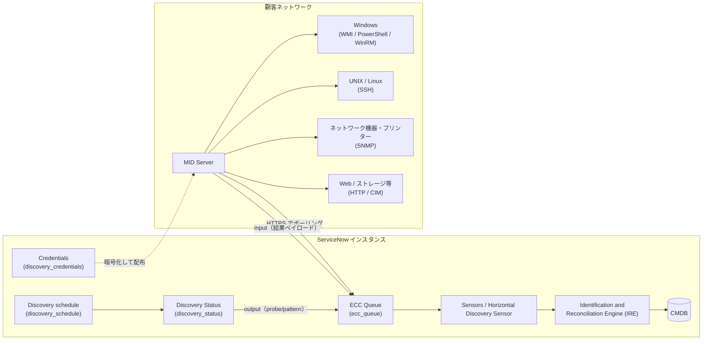

### 1.5 プラグインと関連アプリケーション

Discovery（`com.snc.discovery`）を有効化すると、以下のプラグインもインストールされる。[出典](https://www.servicenow.com/docs/r/australia/it-operations-management/itom-visibility/plugin-app-itom-visibility.html)

| プラグイン / アプリ | ID | 説明 |
|---|---|---|
| Cloud Provisioning and Governance Core | `com.snc.cloud.core` | Cloud API ベースのディスカバリーやイベント処理に関するリソースブロック・Cloud API マッピング |
| Service Watch Suite commons | `com.snc.service-watch.commons` | Discovery と Service Mapping の共通 UI コンポーネント |
| Discovery - IP Based | `com.snc.discovery.ip_based` | Discovery と Service Mapping が使う水平ディスカバリーの共通コンポーネント |

Discovery と組み合わせて使う主な Store アプリ／プラグインは以下のとおり。[出典](https://www.servicenow.com/docs/r/australia/it-operations-management/itom-visibility/plugin-app-itom-visibility.html) [出典](https://www.servicenow.com/docs/r/australia/it-operations-management/discovery-and-service-mapping-patterns/c_MappingPatternsCustomization.html) [出典](https://www.servicenow.com/docs/r/australia/it-operations-management/discovery/discovery-admin-workspace.html)

| アプリ / プラグイン | ID | 用途 |
|---|---|---|
| Discovery and Service Mapping Patterns | `sn_itom_pattern` | Store で毎月リリースされる最新パターン群 |
| Visibility Content | `sn_pattern_design` | Tokyo までのファミリーリリースに含まれていたパターンの更新版 |
| Pattern Designer (NG version) | `com.snc.ng.pattern.designer` | パターンの作成・編集・デバッグ |
| Discovery Admin Workspace | `sn_disco_workspace` | Discovery 運用のワークスペース |
| Cloud Discovery Workspace | `sn_cloud_ops_ws` | クラウドディスカバリー用ワークスペース |
| Performance Analytics Content Pack for Cloud Resources | `sn_disco_cd` | クラウドリソースの集計ビュー |
| Agent Client Collector Framework | `sn_agent` | ACC の管理（インスタンス・MID Server 側） |
| Agent Client Collector for Visibility Content | `sn_acc_vis_content` | エージェントベースのインフラディスカバリーと SAM メトリクス収集 |
| CMDB CI Class Models | `sn_cmdb_ci_class` | CMDB クラス階層の拡張（識別ルール含む） |
| File-based Discovery | `com.snc.discovery.file_based_discovery` | ファイル署名によるソフトウェア検出（要有効化申請） |
| External Credential Storage | （プラグイン名のみ公開） | 外部資格情報ストア連携（要申請） |

### 1.6 ロール

| ロール | 用途 | 出典 |
|---|---|---|
| `discovery_admin` | Discovery アプリケーションのテーブルへのアクセス。Discovery の構成・実行担当者に付与する。Discovery Admin Workspace へのアクセス（`admin` も可） | [出典](https://www.servicenow.com/docs/r/australia/it-operations-management/discovery/t_ConfigureDiscovery.html) [出典](https://www.servicenow.com/docs/r/australia/it-operations-management/discovery/discovery-admin-workspace.html) |
| `admin` | プラグイン有効化、プローブ・センサー・分類子の作成、資格情報作成、システムプロパティ変更など | [出典](https://www.servicenow.com/docs/r/australia/it-operations-management/discovery/create-discovery-ci-classification.html) |
| `pd_admin` | Pattern Designer でのパターン作成・変更 | [出典](https://www.servicenow.com/docs/r/australia/it-operations-management/discovery-and-service-mapping-patterns/t_CreatePatternPatDef.html) |
| `agent_admin` | Global IP Exclusion、IP 範囲除外、gMSA 構成などで `discovery_admin` と並んで指定されるロール | [出典](https://www.servicenow.com/docs/r/australia/it-operations-management/discovery/global-exlude-list.html) |
| `credential_admin` / `connection_admin` | Credential alias の作成手順で「読み取りのみ」として指定 | [出典](https://www.servicenow.com/docs/r/australia/platform-security/connections-and-credentials/discovery-credential-alias.html) |
| `sn_cloud_ops_ws.cloud_ops_admin` | Cloud Discovery Workspace の管理者ロール | [出典](https://www.servicenow.com/docs/r/australia/it-operations-management/discovery/t_IdentifyCauseNoSenDefEM.html) |
| `agent_client_collector_admin` / `agent_client_collector_integration` / `agent_client_collector_user` | ACC の管理・REST API・参照（[8.7](#87-acc-のロール) 参照） | [出典](https://www.servicenow.com/docs/r/australia/it-operations-management/agent-client-collector/acc-users.html) |

`discovery_admin` が内包するロール（contains roles）の一覧は、Australia の公開ドキュメントでは確認できなかった。

### 1.7 主なメニュー（モジュール）

| メニュー | 用途 |
|---|---|
| Discovery > Home | Discovery Home ページ（スケジュール・CI・エラーの集約ビュー） |
| Discovery > Discovery Schedules | スケジュールの作成・Quick Discovery・Cloud Discovery スケジュール作成 |
| Discovery > Status | Discovery Status（実行結果） |
| Discovery > Credentials | 資格情報（Connections & Credentials > Credentials と同じテーブル） |
| Discovery > MID Servers | MID Server 一覧、Pattern Sync to MID |
| Discovery > Discovery Range Sets | IP 範囲セット |
| Discovery > IP Networks | Network discovery 結果（`cmdb_ci_ip_network`） |
| Discovery > Output and Artifacts > ECC Queue / Discovery Log | ECC Queue とログ |
| Discovery Definition > Probes / Sensors / Port Probes | プローブ・センサー・ポートプローブ |
| Discovery Definition > CI Classification > {種類} | 分類子 |
| Discovery Definition > IP Services | IP サービス（ポートとプロトコルの対応）と IP Service Affinities |
| Discovery Definition > Properties | Discovery プロパティ |
| Discovery Definition > Configuration Console | Discovery Configuration Console |
| Pattern Designer > Discovery Patterns | パターン一覧・編集 |
| Pattern Designer > Migrate CPG to Pattern | CAPI からパターンへの移行 |
| Global IP Exclusion > IP Exclusion | 全スケジュール共通の除外 IP |
| Connections & Credentials > Credentials / Connection & Credential Aliases | 資格情報・エイリアス |
| Workspaces > Discovery Admin Workspace | Discovery Admin Workspace |
| ITOM Guided Setup > ITOM Discovery Guided Setup | ガイド付きセットアップ（ITOM Configuration Console に置き換え） |

出典：[Schedule](https://www.servicenow.com/docs/r/australia/it-operations-management/discovery/t_CreateADiscoverySchedule.html)、[Status](https://www.servicenow.com/docs/r/australia/it-operations-management/discovery/c_DiscoveryStatus.html)、[ECC Queue](https://www.servicenow.com/docs/r/australia/it-operations-management/discovery/r_DiscoveryStatusECCQueue.html)、[Port probes](https://www.servicenow.com/docs/r/australia/it-operations-management/discovery/r_PortProbes.html)、[IP Services](https://www.servicenow.com/docs/r/australia/it-operations-management/discovery/t_CheckIPServiceAffinity.html)、[Configuration Console](https://www.servicenow.com/docs/r/australia/it-operations-management/discovery/c_DiscoveryConfigurationConsole.html)、[Pattern](https://www.servicenow.com/docs/r/australia/it-operations-management/discovery-and-service-mapping-patterns/t_CreatePatternPatDef.html)、[CAPI migration](https://www.servicenow.com/docs/r/australia/it-operations-management/discovery/migrate-from-capi-to-pattern.html)、[Global exclude](https://www.servicenow.com/docs/r/australia/it-operations-management/discovery/global-exlude-list.html)、[Alias](https://www.servicenow.com/docs/r/australia/platform-security/connections-and-credentials/discovery-credential-alias.html)、[Guided Setup](https://www.servicenow.com/docs/r/australia/it-operations-management/discovery/discovery-guided-setup.html)、[Network discovery](https://www.servicenow.com/docs/r/australia/it-operations-management/discovery/c_NetworkDiscovery.html)

### 1.8 主要テーブル

| テーブル | ラベル / 用途 |
|---|---|
| `discovery_schedule` | Discovery Schedules |
| `discovery_status` | Discovery Status（スケジュール実行ごとの結果） |
| `discovery_device_history` | Discovery Device History（デバイスごとの処理結果） |
| `ecc_queue` | ECC Queue（output / input メッセージ） |
| `discovery_credentials` | Credentials（暗号化保存） |
| `dscy_credentials_affinity` | Credential Affinity |
| `ip_service_affinity` | IP Service Affinity |
| `discovery_port_probe` | Port probes |
| `discovery_classy` | Classifiers（拡張：`discovery_classy_windows`、`discovery_classy_unix`、`discovery_classy_snmp`、`discovery_classy_http`、`discovery_classy_proc`、`discovery_classy_appl`、`discovery_classy_cim`、`discovery_classy_scan_app` 等） |
| `discovery_classifier_probe` | Classifier Probes（分類子の Triggers probes） |
| `discovery_proc_handler` | プロセスハンドラー |
| `discovery_spkg_keys` | Software Filter Keys |
| `cmdb_identifier` / `cmdb_identifier_entry` | 識別ルールと識別属性 |
| `cmdb_serial_number` | Serial Number |
| `sa_pattern` | Discovery Patterns（パターンと共有ライブラリ） |
| `sa_ci_to_pattern` | Related CI Types（削除戦略の設定） |
| `sa_custom_operation` | Custom Operations（ページネーション設定） |
| `cmdb_ire_partial_payloads` | CMDB IRE Partial Payloads |
| `ip_exclusion` | IP exclusion（Global Excludes List） |
| `cmdb_ci_ip_network` | IP Network（Network discovery の結果） |
| `discovery_sensitive_data_filter` | Discovery Sensitive Data Filters |
| `discovery_perf_metric_probe_sensor`（＋ `_rollup_by_build` / `_rollup_by_status` / `_rollup_by_target`） | Discovery パフォーマンスメトリクス |
| `sn_cmp_cloud_event` | Cloud Events（イベント駆動クラウドディスカバリー） |
| `service_account_field_options` | Discovery Manager のラベルカスタマイズ |

出典：[Status](https://www.servicenow.com/docs/r/australia/it-operations-management/discovery/c_DiscoveryStatus.html)、[Devices](https://www.servicenow.com/docs/r/australia/it-operations-management/discovery/r_DiscoveryStatusDevices.html)、[Credentials](https://www.servicenow.com/docs/r/australia/platform-security/connections-and-credentials/credentials-getting-started.html)、[Ports](https://www.servicenow.com/docs/r/australia/it-operations-management/discovery/r_DiscoveryPortsAndProtocols.html)、[Configuration Console](https://www.servicenow.com/docs/r/australia/it-operations-management/discovery/c_DiscoveryConfigurationConsole.html)、[Identifiers](https://www.servicenow.com/docs/r/australia/it-operations-management/discovery/c_DiscoveryIdentifiers.html)、[Patterns](https://www.servicenow.com/docs/r/australia/it-operations-management/discovery/c-UsingPatternsForHorizontalDiscovery.html)、[Deletion strategy](https://www.servicenow.com/docs/r/australia/it-operations-management/discovery/deletion-strategy.html)、[Global exclude](https://www.servicenow.com/docs/r/australia/it-operations-management/discovery/global-exlude-list.html)、[Sensitive data](https://www.servicenow.com/docs/r/australia/it-operations-management/discovery/sensitive-data-filters.html)、[Performance](https://www.servicenow.com/docs/r/australia/it-operations-management/discovery/discovery-performance-framework.html)、[AWS events](https://www.servicenow.com/docs/r/australia/it-operations-management/discovery/aws-events-driven-discovery.html)、[Discovery Manager](https://www.servicenow.com/docs/r/australia/it-operations-management/discovery/discovery-manager.html)、[Process fingerprints](https://www.servicenow.com/docs/r/australia/it-operations-management/discovery/discover-application-based-process.html)

Discovery Log のテーブル名は、本調査で参照した Australia の公開ページでは明示されていなかった（Auto Flush の対象として `discovery_status` レコードを編集する手順のみ記載）。

---

## 2. Horizontal discovery の処理フロー

### 2.1 4つのフェーズ

Horizontal discovery は、Discovery schedule、Discover now、Quick Discovery のいずれかで開始され、対象は1つ以上の IP アドレスまたは IP 範囲である。処理は以下の4フェーズで進む。[出典](https://www.servicenow.com/docs/r/australia/it-operations-management/discovery/c_DiscoProcessFlows.html) [出典](https://www.servicenow.com/docs/r/australia/it-operations-management/discovery/disco-process-flow-patterns.html)

| フェーズ | 何をするか | 使う仕組み |
|---|---|---|
| 1. Scanning（スキャン） | **Shazzam probe**（続いて port probes）が ECC Queue に置かれ、MID Server が対象ホストの代表的なポート（WMI、HTTP、SSH、SNMP 等）を走査する。応答したポートでマシン種別の見当を付ける（例：22番が開いていれば UNIX/Linux とみなす） | Probes / Sensors（常に） |
| 2. Classification（分類） | 応答したポートプローブのレコードから分類プローブを決めて実行し、OS バージョン等を取得して CI クラスを決める。**1デバイスにつき分類プローブは1つ** | Probes / Sensors（常に） |
| 3. Identification（識別） | CI クラスと分類子（classifier）の条件から使用する分類子を決め、そこに定義された識別トリガープローブ（例：HP-UX なら Multi Probe-HP-UX Identity）を実行。CI 識別子（identification rules）で CMDB の既存 CI を更新するか新規作成するかを決める | Probes / Sensors **または** Patterns |
| 4. Exploration（探索） | 分類子の Triggers probes 関連リストから探索プローブを実行し、インストール済みアプリケーション、メモリ、NIC 等の詳細と、アプリケーションとデバイスの関係を収集する | Probes / Sensors **または** Patterns |

パターン利用時は、分類子のトリガープローブに **Horizontal Pattern probe** を指定し、Identification と Exploration を1つのパターンで統合して実行する。このとき更新は **Horizontal Discovery Sensor** のみが行い、他のプローブ・センサーは使わない。パターンがホスト上のアプリケーションを見つけるには、ホストへの資格情報に加えて **applicative credentials（アプリケーション用資格情報）** が必要な場合がある。[出典](https://www.servicenow.com/docs/r/australia/it-operations-management/discovery/disco-process-flow-patterns.html)

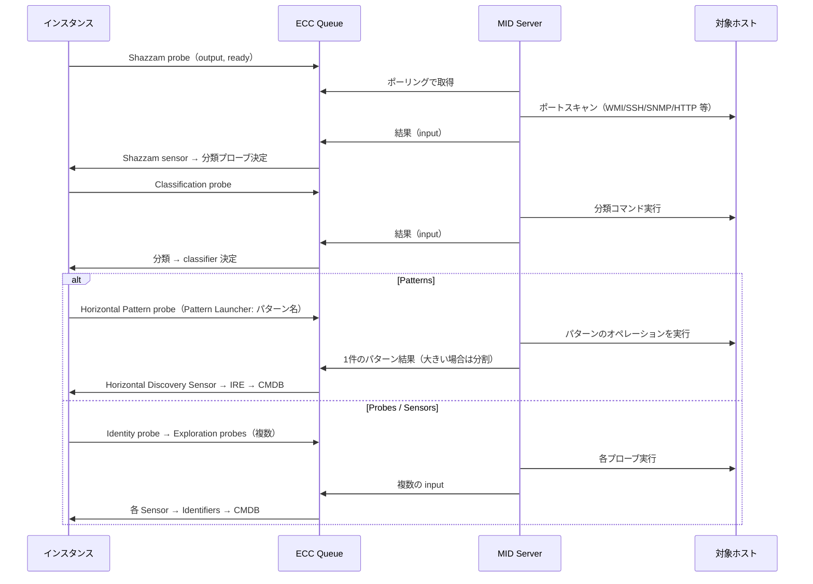

### 2.2 Shazzam とポートプローブ

ポートスキャンはディスカバリーの最初のステップであり、パターンを使う場合でも **Shazzam probe** が実行される。各ポートプローブは **IP Service**（どのポートでどのプロトコルを使うかを定義するレコード）を使う。Discovery が必要とするポートをファイアウォールで塞がないよう注意する。[出典](https://www.servicenow.com/docs/r/australia/it-operations-management/discovery/r_DiscoveryPortsAndProtocols.html)

#### 既定のポートプローブ

| ポートプローブ | 既定の分類テーブル | 既定の IP Service とポート |
|---|---|---|
| `dns` | Process Classification [`discovery_classy_proc`] | dns（53） |
| `http` | HTTP Classification [`discovery_classy_http`] | http（80）、https（443） |
| `ip_phone` | SNMP Classification [`discovery_classy_snmp`] | sip（5060） |
| `osx` | Scan Results Application Classifier [`discovery_classy_scan_app`] | afp（548） |
| `printer` | Scan Results Application Classifier [`discovery_classy_scan_app`] | hp-pdl-datastr（9100）、printer（515） |
| `slp` | Process Classification [`discovery_classy_proc`] | slp（427） |
| `snmp` | SNMP Classification [`discovery_classy_snmp`] | snmp（161） |
| `ssh` | UNIX Classification [`discovery_classy_unix`] | ssh（22） |
| `tls_ssl_certs` | （記載なし） | SSL：443、8443、9443、636、993、995、989、990 / StartTLS：25、110、143、389、21、587 |
| `vmapp` | Application Classification [`discovery_classy_appl`] | vmapp_https（5480）、vmapp6_https（9443） |
| `wbem` | CIM Classification [`discovery_classy_cim`] | wbem_https（5989） |
| `winrm` | Windows Classification [`discovery_classy_windows`] | winrm（5985）、winrm_ssl（5986） |
| `wins` | Process Classification [`discovery_classy_proc`] | ms-nb-ns（137） |
| `wmi` | Windows Classification [`discovery_classy_windows`] | epmap（135） |

出典：[Shazzam probe, port probes, and protocols](https://www.servicenow.com/docs/r/australia/it-operations-management/discovery/r_DiscoveryPortsAndProtocols.html)

#### Discovery が使う主なポート（抜粋）

| 名前 | ポート | プロトコル | 用途 / 作成 CI |
|---|---|---|---|
| ssh | 22 | TCP | UNIX 系 |
| dns | 53 | TCP/UDP | 各 IP の名前解決 |
| http / https | 80 / 443 | TCP | Web サーバー（`cmdb_ci_web_server`） |
| epmap | 135 | TCP | Microsoft RPC（WMI、DCOM） |
| ms-nb-ns / wins | 137 | UDP | NetBIOS 名前解決 |
| Microsoft netbios | 139 | TCP | — |
| snmp | 161 | UDP | ネットワーク機器 |
| snmptrap | 162 | UDP | — |
| Microsoft-ds | 445 | TCP | — |
| wbem_https | 5989 | TCP | CIM 分類 |
| winrm / winrm_ssl | 5985 / 5986 | TCP | Windows（WinRM） |
| Microsoft SQL server | 1433 | TCP | — |
| Oracle TNS | 1521 | TCP | — |
| MySQL | 3306 | TCP | — |
| postgresql | 5432 | TCP | `cmdb_ci_database` |
| BEA Weblogic | 7001 | TCP | `cmdb_ci_app_server` |
| Tomcat HTTP | 8080 | TCP | — |
| IBM DB2 | 50000 | TCP | — |
| vmapp_https | 5480 | TCP | vCenter Server Appliance |

Windows の動的ポート範囲は TCP/UDP とも 49152-65535 である。[出典](https://www.servicenow.com/docs/r/australia/it-operations-management/discovery/r_DiscoveryPortsAndProtocols.html)

ネットワーク要件（MID Server からターゲットへの到達性）の整理は [MID Server](../platform/mid-server.md) および [連携設計](../../03_導入編/09-integration-design.md) も参照。

#### ポートプローブの優先順位

ポートプローブがプロトコルの使用を検知すると、Shazzam sensor がポートプローブレコードを見て起動する分類プローブを決める。基本4プロトコルには優先順位があり、**1 - WMI、2 - SSH、3 - SNMP、4 - HTTP** の順に試行する。WMI が成功したデバイスには他のポートプローブは起動されず、失敗した場合に SSH、次に SNMP と進む。これにより複数プロトコル（例：SSH・SNMP・HTTP）が動くデバイスも正しく分類できる。[出典](https://www.servicenow.com/docs/r/australia/it-operations-management/discovery/r_PortProbes.html)

HTTP 分類は最も優先度が低く、Shazzam が 80/443 の開放を確認し、かつ WMI/SSH/SNMP の上位プローブが（ポート未開放や資格情報不備などで）失敗した場合にのみ使われる（Madrid で導入）。[出典](https://www.servicenow.com/docs/r/australia/it-operations-management/discovery/discovery-classifiers.html)

#### Port Probe フォーム（Discovery Definition > Port Probes）

| フィールド | 説明 |
|---|---|
| Name / Description | 名前と説明（例：SSH = Secure Shell login） |
| Scanner | Shazzam の走査手法（例：WMI は Generic TCP、SNMP は SNMP） |
| Active / CIs / IPs | 有効化、CI ディスカバリーでの有効化、IP ディスカバリーでの有効化 |
| Triggered by services | ポート利用を定義する IP Service。非標準ポートとプロトコルの対応付けに使う |
| Use classification | 使用する分類テーブル |
| Classification priority | 実行優先度（既定 1:WMI、2:SSH、3:SNMP、4:HTTP） |
| Supplementary | 上位の識別成功後に補助的な分類を優先度順に起動する |
| Conditional | 非条件付きプローブのいずれかが開ポートを返した場合にのみ実行（Windows 名・DNS 名解決用） |
| Script | 実行スクリプト |

出典：[Port probes](https://www.servicenow.com/docs/r/australia/it-operations-management/discovery/r_PortProbes.html)

#### Shazzam の調整

Shazzam の動作は Discovery Definition > Probes > Shazzam の Probe Parameters で調整する（ロール：`admin`）。[出典](https://www.servicenow.com/docs/r/australia/it-operations-management/discovery/t_ConfigureTheShazzamProbe.html)

| パラメーター | 既定値 | 説明 |
|---|---|---|
| `BannerTCP_waitForConnectMS` | 1500 | BannerTCP スキャナーの接続・バナー待ち（ms） |
| `GenericTCP_waitForConnectMS` | 1000 | GenericTCP の接続待ち（ms） |
| `HTTP_waitForConnectMS` / `HTTP_waitForResponseMS` | 500 / 500 | HTTP の接続待ち・応答待ち（ms） |
| `DNS_waitForResponseMS` | 1000 | DNS 応答待ち（ms） |
| `NBT_waitForResponseMS` | 500 | NBT 応答待ち（ms） |
| `SNMP_taps` / `SNMP_tapIntervalMS` / `SNMP_waitForResponseMS` | 2 / 1000 / 1000 | SNMP の要求回数・間隔・最終要求後の待ち（ms） |
| `delay_wbem` | true | WBEM ポートが開いたシステムの分類を最後の Shazzam sensor ジョブまで遅らせる。大規模時はノードのメモリ不足要因となり得るため false で分散可能 |
| `shazzam_report_inactive` | true | 生存しているが非アクティブ（開ポートなし、ただし接続拒否あり）のデバイスを報告 |
| `shazzam_report_dead` | false | 全ポートが閉じた（dead）IP を報告 |
| `scanner_log` / `debug` | false / false | スキャナーログ・デバッグログ |
| `TLS_keepOriginalCertificate` | false | `cmdb_ci_certificate` の certificate_file に元の証明書を格納（ペイロード増大） |
| `DNS_alternativePort` / `NBT_alternativePort` / `SNMP_alternativePort` | — | 非推奨（Deprecated） |

Shazzam のペイロード制御には MID Server プロパティ `shazzam.chunk_size`（並列走査する最大 IP 数）、`mid.shazzam.regulator.interval_ms`（パケット送出間隔）、`mid.shazzam.regulator.packets_per_interval`（間隔あたりのパケット数）がある（追加しなくても既定値で動作）。また、システムプロパティ `glide.discovery.shazzam_ranges_json`（ラベル：Use JSON for IP ranges in Shazzam）は Shazzam ペイロードを JSON 化してサイズを大幅に縮小する。新規インスタンスでは true、アップグレードインスタンスでは false かつ非表示であり、手動追加またはKB0687626 の更新セットで有効化する。[出典](https://www.servicenow.com/docs/r/australia/it-operations-management/discovery/t_ConfigureTheShazzamProbe.html)

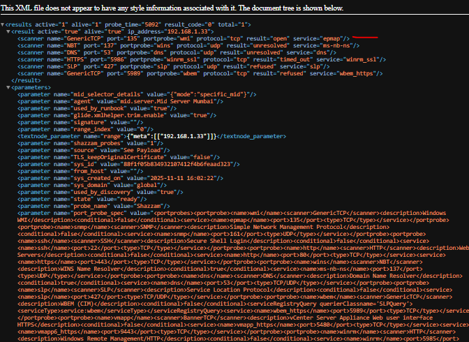

- **キャプション:** Shazzam プローブの結果として ECC Queue に返った input レコードの XML ペイロード例（ServiceNow Community 記事のスクリーンショット）。【第三者情報】
- **画面の説明:** ブラウザーで XML を表示した画面。先頭の `<results active="1" alive="1" probe_time="5092" ...>` の下に、対象 IP（192.168.1.33）ごとの `<result>` があり、スキャナー別の `<scanner>` 要素が並ぶ。例：GenericTCP port 135（portprobe=wmi、protocol=tcp、result=open、service=epmap）、NBT port 137（wins、udp、unresolved）、DNS port 53（dns、udp、unresolved）、HTTPS port 5986（winrm_ssl、tcp、timed_out）、SLP port 427（refused）、GenericTCP port 5989（wbem、refused）。後半の `<parameters>` には `mid_selector_details`（mode=specific_mid）、`agent`（mid.server.<MID名>）、`range`（JSON 形式の IP 範囲）、`shazzam_probes`、`name`=Shazzam、`port_probe_spec`（wmi / snmp / ssh / http / wins / dns / slp / wbem / vmapp / winrm 等のポートプローブ定義：scanner、port、type、conditional）が並ぶ。135/tcp が open であることから Windows 分類（WMI）に進むことが読み取れる。
- **出典:** https://www.servicenow.com/community/itom-articles/servicenow-discovery-how-windows-ci-discovery-works-using-probes/ta-p/3440105 （取得日: 2026-11-03）

### 2.3 Classification（分類）と分類子

**Classifier（分類子）** は、Identification と Exploration で起動するプローブ（または Horizontal Pattern probe）を Discovery に指示するレコードである。分類は3種類に分かれる。[出典](https://www.servicenow.com/docs/r/australia/it-operations-management/discovery/discovery-classifiers.html)

| 分類の種類 | 内容 |
|---|---|
| Device classification（デバイス分類） | Windows、UNIX/Linux、ルーター、スイッチ、ロードバランサー等のデバイス種別を分類する。コンピューター CI を識別すると Active processes probe を起動してさらに探索する |
| Process classification（プロセス分類） | 実行中プロセスからアプリケーションを分類する。Exploration フェーズで、Computer [`cmdb_ci_computer`] とその拡張の CI を識別した後に実行される。デバイス分類と異なり **Runs on::Runs** 関係を持つ子 CI を作る。条件一致時は process handler スクリプトでパラメーターを整形し重複 CI を防ぐ |
| IP address（IP scan）classification | 資格情報なし（credential-less）で、開ポートとバナーだけからデバイス・ソフトウェアを推定する |

既定の Linux 分類子はディスクサイズ、メモリ、現在の接続数などを返す11個の探索プローブを起動する。各データは異なるタイミングで返り、処理完了まで ECC Queue に保持される。[出典](https://www.servicenow.com/docs/r/australia/it-operations-management/discovery/discovery-classifiers.html)

#### CI Classification フォーム（Discovery Definition > CI Classification > {種類}）

| フィールド / 関連リスト | 説明 |
|---|---|
| Name | CI 名 |
| OID / Operator | SNMP System OID と照合方法（Is / Starts with）。SNMP System OIDs 分類子のみ |
| Active | 無効化すると、その段階で分類を停止し、より低い Order の分類子も起動しない |
| Order | 実行順 |
| Table | 分類先テーブル（例：Linux Server [`cmdb_ci_linux_server`]） |
| Classifier / Manufacturer / Model | SNMP 系の分類子用 |
| Relationship type | 例：Runs on::Runs（アプリケーション・プロセス分類子のみ） |
| Match criteria | Any of the parameters / All of the parameters |
| On classification script | 分類成功時に実行するスクリプト。`g_probe_parameters['node_port'] = 16001;` のように、起動するプローブのパラメーターを設定できる |
| Classification Criteria（関連リスト） | 分類パラメーターと値の条件 |
| SNMP OID Classifications（関連リスト） | SNMP デバイスの OID 指紋（SNMP のみ） |
| Triggers probes（関連リスト） | 分類後に起動する探索プローブ。パターン利用時は Probe 列に **Horizontal Pattern** を、Pattern 列にパターンを指定する（Probe 列にパターンを指定してはならない） |
| Versions（関連リスト） | 変更のたびにバージョンが作られ、Revert to this version で戻せる |

テンプレート OID（Net-SNMP の `1.3.6.1.4.1.8072.3.2` で始まるもの、Windows OS の `1.3.6.1.4.1.311.1.1.3` で始まるもの）を SNMP OID 分類に追加することは誤分類の原因となるため許可されない（KB0751287）。[出典](https://www.servicenow.com/docs/r/australia/it-operations-management/discovery/create-discovery-ci-classification.html)

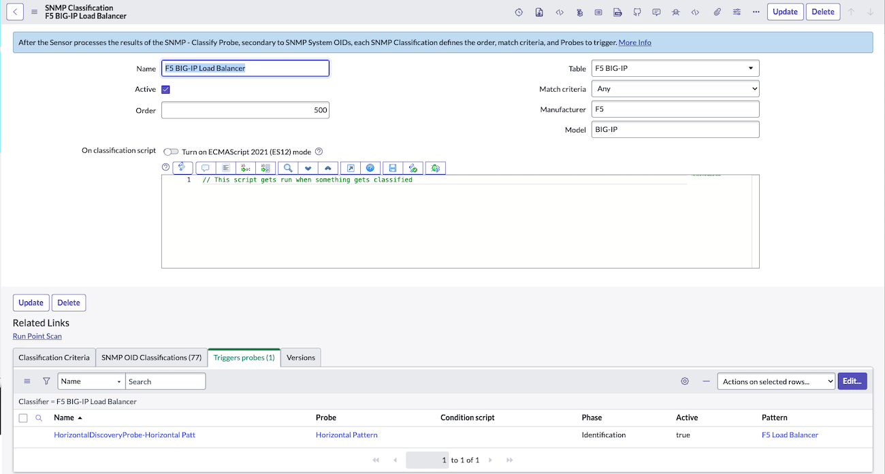

- **キャプション:** Discovery classification form（公式ドキュメント「Create a Discovery CI classification」の図）。Horizontal Pattern probe を定義した分類子の例。
- **画面の説明:** ヘッダーは「SNMP Classification / F5 BIG-IP Load Balancer」。上部の青い注記に「SNMP - Classify Probe の結果をセンサーが処理した後、SNMP System OIDs に次いで各 SNMP Classification が順序・一致条件・起動プローブを定義する」旨が表示される。左列に Name（F5 BIG-IP Load Balancer）、Active（チェック済）、Order（500）、右列に Table（F5 BIG-IP）、Match criteria（Any）、Manufacturer（F5）、Model（BIG-IP）。中央に On classification script のエディター（ECMAScript 2021 (ES12) モードのトグル付き）。下部の Related Links に Run Point Scan、関連リストタブ「Classification Criteria / SNMP OID Classifications (77) / Triggers probes (1) / Versions」。Triggers probes タブには 1 行があり、Name「HorizontalDiscoveryProbe-Horizontal Patt…」、Probe「Horizontal Pattern」、Phase「Identification」、Active「true」、Pattern「F5 Load Balancer」。
- **出典:** https://www.servicenow.com/docs/r/australia/it-operations-management/discovery/create-discovery-ci-classification.html （取得日: 2026-11-02）

### 2.4 Identification（識別）

分類後、Discovery は識別子（identifiers）でデバイスが既に CMDB に存在するかを判定する。プローブベースでは identity probe（マルチプローブ）がシリアル番号・名前・ネットワーク識別情報を取得し、identity sensor 経由で識別子に渡す。識別子は一致 CI があれば更新（または何もしない）、なければ作成（または何もしない）し、継続設定なら分類子の探索プローブを起動する。**パターン利用時は identity probe を使わず**、パターンのオペレーションで指定した CI タイプに対応する識別ルールで識別・探索を行う。[出典](https://www.servicenow.com/docs/r/australia/it-operations-management/discovery/c_DiscoveryIdentifiers.html) [出典](https://www.servicenow.com/docs/r/australia/it-operations-management/discovery/c_HowDiscoveryIdentifiersWork.html)

識別ルールは CMDB の Identification and Reconciliation（IRE）フレームワークのもので、`cmdb_identifier`（ルール）と `cmdb_identifier_entry`（属性）に格納される。既定の主なルールは以下のとおり。[出典](https://www.servicenow.com/docs/r/australia/it-operations-management/discovery/c_DiscoveryIdentifiers.html)

| ルール | 適用テーブル / 属性 |
|---|---|
| ESX Server Rule | ESX Server [`cmdb_ci_esx_server`]：correlation_id |
| Hardware Rule | Hardware [`cmdb_ci_hardware`]：serial_number、serial_number_type、name、ip_address、mac_address ／ Serial Number [`cmdb_serial_number`]：serial_number、serial_number_type ／ Network Adapter [`cmdb_ci_network_adapter`]：ip_address、mac_address |
| Storage Server Rule | Storage Server [`cmdb_ci_storage_server`]：cim_object_path、name、serial_number 等 |
| WBEM Service Rule | WBEM Service [`cmdb_ci_wbem_service`]：cim_object_path |

- 独立ルール（例：`cmdb_ci_hardware`）では `sys_class_name` を属性にできないため、クラス別に照合したい場合はクラスごとにルールを作り Applies to に指定する（例：NIC ボンディング環境向けに名前・IP・MAC で識別する Linux Server 用ルール）。[出典](https://www.servicenow.com/docs/r/australia/it-operations-management/discovery/c_DiscoveryIdentifiers.html)
- カスタム識別子は既定の識別子と異なる Order 値にする（小さい順に評価）。
- 重複 CI の扱いは `glide.identification_engine.skip_duplicates` と `glide.identification_engine.skip_duplicates.threshold` で制御する。
- Geneva 以前からのアップグレード環境では `glide.discovery.use_cmdb_identifiers` を true にして新しい識別子を使う。
- シリアル番号は資産追跡に必須であり、プローブ・センサー・パターンをカスタマイズした場合もシリアル番号が取得されることを確認し、接頭辞付与など書式変更をしてはならない。

IRE と識別・調整ルールの詳細は [CMDB と CSDM](../platform/cmdb-csdm.md) を参照。

### 2.5 Exploration（探索）と ADM

Exploration では分類子の Triggers probes に定義された探索プローブ（またはパターン）が詳細情報を収集する。**Application Dependency Mapping（ADM）** は TCP 接続を検出して CI と関係を発見する機能で、有効時は Exploration で常に ADM プローブを実行する。[出典](https://www.servicenow.com/docs/r/australia/it-operations-management/discovery/r_ApplicationDependencyMapping.html)

| 種類 | 内容 | 既定 |
|---|---|---|
| Standard ADM | netstat / lsof で TCP 接続のスナップショットを1回取得（24時間間隔の間に生じた接続は検出しない） | 有効 |
| Enhanced ADM（ADME） | 対象ホストにスクリプトを置き、TCP 接続を定期サンプリング。`glide.discovery.enable_adme` で有効化 | 無効 |

ADM は Windows、UNIX、Solaris（ADME はグローバルゾーンのみ）、AIX、HP-UX をサポートし、WMI 利用時は PowerShell 3.0 が必要。ADM は多言語に未対応で、英語以外の値が返ると解析できずディスカバリーが失敗する。IPv6 はサポートされる。[出典](https://www.servicenow.com/docs/r/australia/it-operations-management/discovery/r_ApplicationDependencyMapping.html)

`glide.discovery.application_mapping`（既定 true）を無効にすると、アプリケーション間の関係作成は止まるが、ADM プローブ・センサーやプロセス分類は止まらない。`glide.discovery.active_processes_filter`（既定 false）を有効にすると、Process Classification に一致するプロセスのみに絞り込む。[出典](https://www.servicenow.com/docs/r/australia/it-operations-management/discovery/r_DiscoveryProperties.html)

### 2.6 IP Service Affinity

IP Services テーブルはポートとプロトコルを対応付ける（80=HTTP、22=SSH、161=SNMP 等）。システムプロパティ `glide.discovery.ip_service_affinity` を有効にすると、Discovery は IP アドレスごとに最後に成功したポート（プロトコル）を記憶し、次回はそれを先に試す。既定値は false だが、**Australia から新規に Discovery を導入する顧客では既定 true**。複数の SSH ポートを使う場合は有効化が必要。確認は Discovery Definition > IP Services > 対象サービス > IP Service Affinities タブ。組織がカスタムポートを使う場合以外は IP Services を変更しない。[出典](https://www.servicenow.com/docs/r/australia/it-operations-management/discovery/t_CheckIPServiceAffinity.html) [出典](https://www.servicenow.com/docs/r/australia/it-operations-management/discovery/r_DiscoveryProperties.html)

---

## 3. Probes と Sensors

### 3.1 役割と ECC Queue

**Probe（プローブ）** が情報を収集し、**Sensor（センサー）** が処理する。いずれも ECC Queue から指示を受ける。MID Server 上のワーカージョブは、Queue が **output** かつ State が **ready** のエントリーを監視し、プローブを実行して結果を **input** エントリーとして返す。ECC Queue に input が挿入されると on insert のビジネスルールがセンサープロセッサーを起動し、該当センサーが CMDB を更新する。プローブに post-processing script（PPP）が定義されていれば MID Server 上で前処理（JSON 化等）してから送る。[出典](https://www.servicenow.com/docs/r/australia/it-operations-management/discovery/c_DiscoveryProbesAndSensors.html) [出典](https://www.servicenow.com/docs/r/australia/it-operations-management/discovery/r_ListOfDiscoveryProbes.html)

各リリースでパターンが多くのプローブ・センサーを置き換えており、プローブ・センサーの情報はパターン未使用の顧客や、アップグレード後も維持されたカスタムプローブを持つ顧客向けと位置付けられている（Probe から Pattern への移行は KB0694477）。[出典](https://www.servicenow.com/docs/r/australia/it-operations-management/discovery/c_DiscoveryProbesAndSensors.html)

コード署名（Code Signing）が有効なインスタンスでは、Discovery はプローブ、プローブパラメーター、センサー、Horizontal Pattern probe の署名を検証し、未署名・改ざんされたペイロードをブロックする。インスタンス側はプローブとプローブパラメーター、MID Server 側はパターン・MID Script Include・MID スクリプトファイルを検証する。信頼されないプローブパラメーターは付与されずにプローブだけが起動し、署名が無効なパターンは MID Server にダウンロードされない（既にあれば削除される）。[出典](https://www.servicenow.com/docs/r/australia/it-operations-management/discovery/code-sign-disco-probes.html)

### 3.2 デバイス種別ごとのプローブ方式

| デバイス | プローブ方式 |
|---|---|
| Windows コンピューター・サーバー | リモート WMI クエリ、シェルコマンド |
| UNIX / Linux サーバー | シェルコマンド（SSH v2）。Bourne 互換シェルに対応 |
| ストレージ | CIM/WBEM クエリ |
| プリンター | SNMP クエリ |
| ネットワーク機器（スイッチ、ルーター等） | SNMP クエリ |
| Web サーバー | HTTP ヘッダーの確認 |
| UPS | SNMP クエリ |

出典：[Discovery probes and sensors](https://www.servicenow.com/docs/r/australia/it-operations-management/discovery/c_DiscoveryProbesAndSensors.html)

### 3.3 主なプローブ

プローブ一覧は Discovery Definition > Probes で確認する。[出典](https://www.servicenow.com/docs/r/australia/it-operations-management/discovery/r_ListOfDiscoveryProbes.html)

| プローブ | 概要 |
|---|---|
| CIM probe | WBEM で CIM Object Manager にデータオブジェクトとプロパティを問い合わせる |
| DNS probe | CI の DNS 名を決定する |
| Horizontal Pattern probe | 水平ディスカバリーでパターンを起動する（[4.3](#43-horizontal-pattern-probe-とペイロード分割)） |
| PowerShell probe | MID Server ホスト上で PowerShell V2 スクリプトを実行する |
| SCPRelay probe | MID Server を中継にしてホスト間でファイル／ディレクトリをコピーする |
| SNMP probes | OID 群を問い合わせて走査し、結果をセンサーに渡す。MID Server は既定で全 SNMP バージョンに対応 |
| SSHCommand probe | ECC Queue トピック名 SSHCommand で対象ホスト上のシェルコマンドを実行する |
| vCenter probes | vSphere を使って VM、ネットワーク、NIC、タグ等を走査（旧 VMware - vCenter probe は Istanbul で非推奨化され複数プローブに分割） |
| Windows probes | 指定ユーザーとして Windows 上でコマンドを実行（[3.7](#37-windows-ディスカバリーの権限と方式)） |
| WMIRunner probe | WMI インターフェイスで Windows からデータを取得（IPv6 対応） |
| Port probes | Shazzam がプロトコル活動を検出するために使う |

### 3.4 マルチプローブとマルチセンサー

**Multiprobe（マルチプローブ）** は複数のシンプルプローブを含み、1回の認証で複数のクエリを実行する。代表的な用途は identity probe である。マルチプローブのデータは **Multisensor（マルチセンサー）** が処理し、通常同名である。主な既定マルチプローブは以下のとおり。[出典](https://www.servicenow.com/docs/r/australia/it-operations-management/discovery/r_MultiprobesIncludedWithDiscovery.html)

| マルチプローブ | 含まれるプローブ |
|---|---|
| Linux - Identity | Linux - Hardware Information（DMI/BIOS）、Linux - Network |
| Windows - Identity | Windows - Network、Windows - OS/Hardware Information |
| Windows - ADM / Unix - ADM | Active Processes、Active Connections |
| AIX / HP-UX / Solaris - Identity | 各 OS の Network と Serial Number |
| UNIX - Classify | ESX - OS、UNIX - OS |
| SNMP - Identity / SNMP - Load Balancer - Identity 等 | SNMP - Identity Info、各ベンダーのシリアル取得 |
| Windows - Storage 2008 / 2012 | WMI 版と PowerShell 版のストレージ情報 |

Solaris - Serial Number プローブには Oracle の SNEEP ツールのインストールが必要で、Fujitsu PRIMEPOWER では root で実行する必要がある。マルチプローブの作成は Probe type: Multiprobe、ECC queue topic: MultiProbe とし、Includes probes にシンプルプローブを追加する（マルチプローブを入れ子にしてはならない）。マルチセンサーは Sensor type: MultiSensor とし、Responds to Probes 関連リストで各シンプルプローブ用スクリプトを定義する。[出典](https://www.servicenow.com/docs/r/australia/it-operations-management/discovery/r_MultiprobesIncludedWithDiscovery.html)

### 3.5 センサー

すべてのプローブには対応するセンサーが必要である（Discovery > Discovery Definition > Sensors）。[出典](https://www.servicenow.com/docs/r/australia/it-operations-management/discovery/r_Sensors.html)

| フィールド | 説明 |
|---|---|
| Name | センサー名 |
| Reacts to probe | 処理対象のプローブ |
| Sensor Class [`sys_class_name`] | Sensor（シンプル）/ MultiSensor / Import Export Map（未使用） |
| Sensor type [`sensor_type`] | Javascript（最も一般的）/ XML（データを分割し追加プローブ起動に利用）/ Classifier・Java・Multiline Text（未使用） |
| Active | 有効化 |
| Script | 処理スクリプト。`g_probe_parameters` で起動プローブのパラメーターを設定可能 |
| Responds to probes（関連リスト） | マルチセンサーが処理するマルチプローブ内のシンプルプローブ |
| Triggers probes（関連リスト） | 追加探索のために起動するプローブ |
| （フォーム構成で追加可）Agent、Apply Defaults、Classification type、Coalesce、Condition script、Data option（Insert and Update / Insert Only / Update Only）、External names | — |

**Discovery Sensors** 取引クォータルール（Discovery Sensors Transaction Quota Rule、既定有効）は、センサーのトランザクションが **20分** を超えるとキャンセルし、ECC Queue input を error にし、Discovery Status の Completed Count を更新し、「Transaction cancelled: maximum execution time exceeded」をログに記録する。残りのディスカバリーは継続する。System Definition > Quota Rules（Transaction Quotas プラグインが必要）で Maximum Duration（秒）を変更・無効化できる。[出典](https://www.servicenow.com/docs/r/australia/it-operations-management/discovery/r_Sensors.html)

### 3.6 プローブの管理とカスタマイズ

- プローブは分類子上で有効でなければ起動しない。パターンへの置き換えに伴い、分類子上で有効でない既定プローブもある。[出典](https://www.servicenow.com/docs/r/australia/it-operations-management/discovery/r_Probes.html)
- カスタマイズしたプローブ・センサーはアップグレードされない。カスタマイズをテキストに退避し、プローブ・センサーを更新後に再適用する（Align versions of customized probes and sensors）。プローブとセンサーのメジャーバージョンが不一致の場合、センサーは処理を停止する（[10.4](#104-よくあるエラーメッセージ)）。[出典](https://www.servicenow.com/docs/r/australia/it-operations-management/discovery/r_Probes.html) [出典](https://www.servicenow.com/docs/r/australia/it-operations-management/discovery/c_DiscoveryErrorMessages.html)
- SSH の特権コマンドは、プローブパラメーター `must_sudo`（既定 false）を true にしたプローブで sudo を使う。対象側で `/etc/sudoers` を visudo で設定する必要がある。[出典](https://www.servicenow.com/docs/r/australia/platform-security/connections-and-credentials/r_SSHCredentialsForm.html)
- `glide.discovery.use_probe_results_cache`（既定 false、以前のリリースでは true）を有効にすると、前回から結果が変わったときのみセンサー処理する。[出典](https://www.servicenow.com/docs/r/australia/it-operations-management/discovery/r_DiscoveryProperties.html)
- カスタムプローブは Discovery Definition > Probes で作成し、対応するセンサーを Discovery Definition > Sensors で作成したうえで、対象分類子（例：CI Classification > Windows）の Triggers probes 関連リストに追加して起動させる。新規の収集要件は、公式にはパターン（[4.](#4-patterns)）での実装が推奨される方向である。【第三者情報】[出典](https://www.servicenow.com/community/itom-articles/servicenow-discovery-how-windows-ci-discovery-works-using-probes/ta-p/3440105)

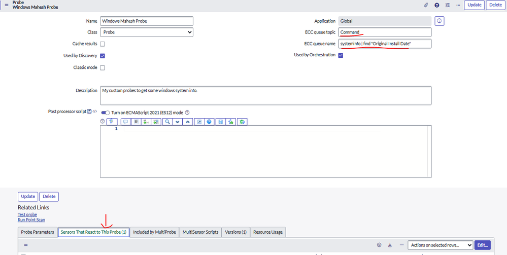

- **キャプション:** Discovery Definition > Probes で作成したカスタムプローブ「Windows Mahesh Probe」の Probe フォーム（ServiceNow Community 記事のスクリーンショット）。【第三者情報】
- **画面の説明:** 左列に Name（Windows Mahesh Probe）、Class（Probe）、Cache results（未チェック）、Used by Discovery（チェック）、Classic mode（未チェック）。右列に Application（Global）、ECC queue topic（Command）、ECC queue name（`systeminfo | find "Original Install Date"`＝MID Server が対象で実行するコマンド）、Used by Orchestration（チェック）。中段に Description と Post processor script（ECMAScript 2021 (ES12) mode トグル付きのスクリプトエディター）。Related Links に Test probe、Run Point Scan。下部の関連リストタブは Probe Parameters / Sensors That React to This Probe (1) / Included by MultiProbe / MultiSensor Scripts / Versions (1) / Resource Usage。
- **出典:** https://www.servicenow.com/community/itom-articles/servicenow-discovery-how-windows-ci-discovery-works-using-probes/ta-p/3440105 （取得日: 2026-11-03）

### 3.7 Windows ディスカバリーの権限と方式

- 公式ドキュメントは、**Windows デバイスのディスカバリーにはパターンを使う**こととし、旧来の Windows プローブは古く今後使うべきでないとしている。[出典](https://www.servicenow.com/docs/r/australia/it-operations-management/discovery/r_DiscoWinProbesAndPermissions.html)
- Windows プローブは管理共有（administrative share）を一時保存に使う。MID Server のスクリプトファイル `LaunchProc.psm1` がプロセスを起動し、出力を対象マシンの `admin$` 共有に書き込み、結果を回収する（New York 以降の WMI プローブの既定）。別の共有を使う場合は MID Server プロパティ `mid.powershell.target_base_dir` を変更する。管理共有へのアクセスにはローカル Administrators グループ相当の権限が必要。[出典](https://www.servicenow.com/docs/r/australia/it-operations-management/discovery/r_DiscoWinProbesAndPermissions.html)
- MID Server は PowerShell と PowerShell Remoting（WinRM）または WMI で Windows と通信する。WinRM では PSSession を問い合わせ完了まで維持し、WMI ではコマンドごとに資格情報を送る。PowerShell は複数 Windows ドメインのディスカバリーに推奨される方法で、PowerShell を構成しない場合 MID Server は WMI を使う。[出典](https://www.servicenow.com/docs/r/australia/it-operations-management/discovery/r_PowerShellForDiscovery.html)
- **Microsoft JEA（Just Enough Administration）** を使うと、MID Server のリモート Windows コマンドを制約付きエンドポイント経由で実行でき、ポートは 5985/5986 に限定される。要件は Rome 以降、MID Server と対象が Windows ドメインに参加、非管理者のドメイン資格情報、対象に PowerShell 5.0 / WMF 5.1、PowerShell Remoting 有効。Rome 以降は JEA v2 プロファイル（RestrictedRemoteServer、NoLanguage）を KB0965705 の手順で使う。[出典](https://www.servicenow.com/docs/r/australia/it-operations-management/discovery/microsoft-jea-discovery.html)
- **gMSA（Group Managed Service Account）** を MID Server のサービスアカウントにすると、パスワード管理を Windows に任せ、インスタンスに資格情報を保存せずに Windows ディスカバリーを実行できる（ロール：`agent_admin`、`discovery_admin` または `admin`）。[出典](https://www.servicenow.com/docs/r/australia/it-operations-management/discovery/gmsa-configuration-for-discovery.html)
- 対象側の PowerShell 実行ポリシー（Group Policy 含む）やエンドポイント保護製品が Discovery スクリプトをブロックしていないかを確認する（ServiceNow を信頼された発行元に追加）。Windows 対象では SMB 445 の受信許可と、管理共有でのファイル作成・読み取り権限が必要。[出典](https://www.servicenow.com/docs/r/australia/it-operations-management/discovery/disco-start-issue-resolve.html)

> **Brazil での変更:** File-based Discovery と Windows ADME について、MID Server 構成パラメーターで既定の PowerShell 5 より **PowerShell 7** を優先させられるようになった（MID Server と対象ホストの双方）。[出典](https://www.servicenow.com/docs/r/release-notes/discovery-rn.html)

---

## 4. Patterns

### 4.1 パターンとは

**Pattern（パターン）** は、CI の属性と外向き接続を検出するコマンド列であり、Discovery にどの CI を探し、どの資格情報を使い、CMDB のどのテーブルを埋めるかを指示する。Service Mapping と Discovery は既定パターンを共有する。パターンはすべて Discovery Patterns [`sa_pattern`] テーブルに格納される。[出典](https://www.servicenow.com/docs/r/australia/it-operations-management/discovery-and-service-mapping-patterns/c_MappingPatternsCustomization.html) [出典](https://www.servicenow.com/docs/r/australia/it-operations-management/discovery/c-UsingPatternsForHorizontalDiscovery.html)

| パターン種別 | 利用者 | 結果 |
|---|---|---|
| Infrastructure pattern | Discovery のみ | デバイスのインベントリ |
| Application pattern | Discovery と Service Mapping | Discovery：アプリケーションのインベントリ / Service Mapping：サービスインスタンスマップ |

水平ディスカバリーでは1つのパターンでメイン CI タイプと全関連 CI タイプを発見するが、トップダウンではメイン CI タイプのみを発見する。パターンオペレーションは多言語に未対応で、英語以外の値が返ると解析に失敗する。[出典](https://www.servicenow.com/docs/r/australia/it-operations-management/discovery-and-service-mapping-patterns/c_MappingPatternsCustomization.html)

### 4.2 Probes と Patterns の比較

| 観点 | Probes による水平ディスカバリー | Patterns による水平ディスカバリー |
|---|---|---|
| フェーズ | 4フェーズすべてでプローブ | Identification / Exploration のみパターン。Shazzam とポートプローブは引き続き使用 |
| 新しい CI の発見 | プローブ・センサーの作成／カスタマイズが必要（Java/JavaScript とプローブ連携の知識が必要） | 毎メジャーリリースと Store でパターンが追加される。Pattern Designer で作成・カスタマイズ |
| 機能 | 標準のネットワーク・CI ディスカバリー。一部アプリはパターン必須 | 上記に加えクラウドディスカバリー、構成ファイル追跡、CI 削除戦略 |
| ECC Queue とトラブルシュート | プローブ数に応じて多数の ECC Queue レコード。複数レコードの分析が必要 | パターン用の ECC Queue レコードは追加で1件。分析対象が1件で済む |
| 性能 | 多数のプローブ起動・処理のオーバーヘッド | パターン1本を順に実行するため高速化し得る |

出典：[Patterns and horizontal discovery](https://www.servicenow.com/docs/r/australia/it-operations-management/discovery/c-UsingPatternsForHorizontalDiscovery.html)

### 4.3 Horizontal Pattern probe とペイロード分割

**Horizontal Pattern probe** は **Horizontal Discovery Sensor** と組み合わせて動作し、ECC Queue には「Pattern Launcher」＋パターン名として表示される。独自のデバイス／プロセス分類子でパターンを使う場合は分類子にこのプローブを指定する（プローブ・センサー自体の変更は不要）。[出典](https://www.servicenow.com/docs/r/australia/it-operations-management/discovery/r-HorizontalPatternProbe.html)

ロードバランサーやネットワークスイッチ等で大量データを収集する場合、Horizontal Pattern probe はペイロードを分割して複数の ECC Queue レコードを作る。まず全体サイズ・件数の上限（サイズを先に判定）、次に CI ごとの関連アイテム数で分割し、関連アイテムがチャンクサイズを超える CI は親 CI のコピーを含む複数ページに分かれる（例：関連 50,000 件・チャンク 100 なら 500 ページ）。[出典](https://www.servicenow.com/docs/r/australia/it-operations-management/discovery/r-HorizontalPatternProbe.html)

| MID Server プロパティ | 既定値 | 説明 |
|---|---|---|
| `mid.discovery.max_total_items_size_per_page` | 3,145,728 bytes（3 MB） | ECC Queue 1ページあたりの全アイテム（CI・関連・リレーション・参照）の最大サイズ。最初に判定 |
| `mid.discovery.max_ci_count_per_page` | 500 | 1ページあたりの最大 CI 数 |
| `mid.discovery.max_relation_count_per_page` | 10,000 | 1ページあたりの最大リレーション数 |
| `mid.discovery.max_related_count_per_page` | 100 | 1チャンクあたりの最大関連アイテム数 |
| `mid.discovery.should_minify_pattern_payload` | false | パターンペイロードの JSON 空白を削除して縮小 |

これらは MID Server ごとの設定であり、関係する全 MID Server に適用する。サイズ上限を上げる場合は MID Server の JVM ヒープも増やす必要があり、過大な値は MID Server とインスタンスノードのメモリ不足を招く。[出典](https://www.servicenow.com/docs/r/australia/it-operations-management/discovery/r-HorizontalPatternProbe.html)

### 4.4 分類子へのパターン追加手順

ロール：`discovery_admin`。[出典](https://www.servicenow.com/docs/r/australia/it-operations-management/discovery/c-UsingPatternsForHorizontalDiscovery.html)

1. All > Discovery Definition > CI Classification > {分類子の種類} で分類子を開く。
2. Triggers probes 関連リストで既存の識別・探索プローブを無効化する。
3. Edit で **Horizontal Pattern** probe を追加し、Pattern 列で関連付けるパターンを指定する。
4. 他のプローブを削除または無効化する。

注意点：

- この手順はカスタム分類子、または既定でパターンを含まない分類子向けである。**既にプローブで CMDB を作成済みの分類子をパターンに切り替えると重複 CI が発生し得る**ため、その分類子で一度もプローブ実行していない場合にのみ行う。
- パターンを削除しても Horizontal Pattern probe は分類子から自動削除されない。パターン未指定の Horizontal Pattern probe を使うと、Discovery は分類段階で停止する。
- トップダウン用パターンを水平ディスカバリーに使う場合、Pattern Designer > Discovery Patterns でパターンを開き、Basic タブの Identification Sections に entry point type が TCP または All のセクションが少なくとも1つあることを確認する。プロセス分類子なら Relationship type を Runs on::Runs、Condition をパターンと同じにする。

### 4.5 Pattern Designer

Pattern Designer（Pattern Designer > Discovery Patterns、ロール：`pd_admin`）でパターンを作成・変更する。[出典](https://www.servicenow.com/docs/r/australia/it-operations-management/discovery-and-service-mapping-patterns/t_CreatePatternPatDef.html)

| Basic タブの項目 | 説明 |
|---|---|
| Pattern type | Application（トップダウンと水平の双方）/ Infrastructure（水平のホストディスカバリー） |
| Name | 一意な名前（例：Apache on Unix pattern） |
| CI type | 発見対象の CI タイプ |
| Operating system | Application パターンのみ。All または OS を選択 |
| Run Order | Application パターンのみ。紛らわしいパターンとの実行順（例：MS Exchange を IIS の Before に） |
| Enforce Process Classification | Application パターンで、プロセスが分類条件に一致した場合のみ MID Server が実行 |

- 事前に対応する CI タイプと CI 分類が必要。ドメインセパレーション環境では子ドメインを持たないドメインにログインして作業する。
- 保存後、Debug Mode にホストの IP を入れてテストし、Discovery > MID Servers の **Pattern Sync to Mid** で MID Server にパターンを配布する。[出典](https://www.servicenow.com/docs/r/australia/it-operations-management/discovery-and-service-mapping-patterns/t_CreatePatternPatDef.html)
- **Extension section（拡張セクション）** は共有ライブラリ（shared library）で構成され、Identification section を変更せずに属性追加やロジック変更ができる。共有ライブラリの変更は利用する全パターンに影響する。拡張セクションは Identification section が少なくとも1つ成功した後に Order 順で実行され、公開（publish）は不要。[出典](https://www.servicenow.com/docs/r/australia/it-operations-management/discovery-and-service-mapping-patterns/modify-pattern-using-extensions.html)
- パターン内の資格情報の扱い（Password2 暗号化）、バージョン比較・復元、インスタンス間のコピーなど詳細は [Service Mapping](./service-mapping.md) と公式の Pattern Designer ドキュメントを参照。

### 4.6 Pattern Orchestrator、部分ペイロード、ページネーション

- **Pattern Orchestrator** は、親パターンから子パターンを階層的に起動し、大きなペイロードによる遅延や MID Server の OOM を避ける仕組みで、Pattern Designer の Pattern Orchestrator タブ（Trigger Rules、Orchestrator Input、Orchestrator Output）で設定する。Trigger Rules の Batch Size は Count / All / Use Parent Context Only。サービスアカウントは入力名を `service_account` にする必要がある。[出典](https://www.servicenow.com/docs/r/australia/it-operations-management/discovery/c-UsingPatternsForHorizontalDiscovery.html)
- **Source Native Key**：複数パターンが同じ CI の部分情報を得た場合、CMDB IRE Partial Payloads [`cmdb_ire_partial_payloads`] に保持し、十分に揃った時点で相関して完全な CI にする。
- **Pagination**：Custom Operations [`sa_custom_operation`] の Is pagination capable（既定非表示）を true にすると、パターンのステップに Paginated フィールドが現れ、ページ単位（トークン受け渡し）で処理できる。

### 4.7 パターンの提供形態と Configuration Console

- ServiceNow は新しいパターンを **毎月** ServiceNow Store で公開する。メジャーリリースには以前 Store で公開されたパターンが取り込まれる。インストールは System Applications > All Available Applications > All から Discovery and Service Mapping Patterns（`sn_itom_pattern`）を選ぶ（ロール：`admin`）。[出典](https://www.servicenow.com/docs/r/australia/it-operations-management/discovery-and-service-mapping-patterns/c_MappingPatternsCustomization.html) [出典](https://www.servicenow.com/docs/r/australia/it-operations-management/discovery-and-service-mapping-patterns/install-discovery-service-mapping-patterns.html)
- **Discovery Configuration Console**（Discovery Definition > Configuration Console）で、CI タイプ単位、CI 詳細単位、ARP データ（既定オフ）、ソフトウェアのキーワードフィルター（Windows 既定：Hotfix、Language Pack、Security Update。`discovery_spkg_keys`）、File-based Discovery のパス・拡張子を制御する。Discovery は全データをインスタンスに返してから設定を適用する（キーワードフィルターも対象ホスト上ではなくインスタンス側で適用）。上位カテゴリの無効化は関連ポートプローブやパターンライブラリを無効化する（例：Network Devices を止めると SNMP ポートプローブが無効）。[出典](https://www.servicenow.com/docs/r/australia/it-operations-management/discovery/c_DiscoveryConfigurationConsole.html)

### 4.8 CI 削除戦略と構成ファイル追跡

**Deletion strategy（削除戦略）** はパターンでのみ利用でき（プローブ不可）、メイン CI は見つかったが関連 CI が見つからなくなった場合の扱いを Related CI Types [`sa_ci_to_pattern`] で関連 CI タイプごとに設定する。Infrastructure パターンのメイン CI には設定できず、メイン CI の削除は Application または Cloud Resource パターンでのみ可能。[出典](https://www.servicenow.com/docs/r/australia/it-operations-management/discovery/deletion-strategy.html)

| 値 | 動作 |
|---|---|
| Keep（既定） | レコードを保持し何もしない |
| Delete | 関連 CI レコードとメイン CI との関係を削除 |
| Mark as absent | Status [`install_status`] を Absent にする（`cmdb_ci_network_adapter` と `cmdb_ci_ip_address` は Absent 時に削除される） |
| Delete relations | 関係のみ削除 |
| Mark as retired | Status を Retired にする |

構成ファイル追跡（Configuration file tracking）では、水平ディスカバリーが特定アプリケーションの構成ファイルを CMDB に追加し、版の比較ができる（`glide.discovery.enable_file_tracking` 等で制御）。[出典](https://www.servicenow.com/docs/r/australia/it-operations-management/discovery/r_DiscoveryProperties.html)

### 4.9 Serverless discovery

Serverless discovery はホストを先に発見せずにアプリケーションを発見する方式で、Scanning と Classification を飛ばし、Infrastructure パターンが必要である。[出典](https://www.servicenow.com/docs/r/australia/it-operations-management/discovery/serverless-discovery.html)

| 種類 | 内容 |
|---|---|
| Standard serverless | 不明なホスト上のリモートアプリケーション CI を REST/HTTP 等で発見。ホストの IP は不要で、パターンに入力パラメーターを定義する（Web 系アプリ向け） |
| Host-based serverless | 既に発見済みのホストをプロキシにして、その上の CI（IP を持たない CI 等）を発見。ホストの資格情報を使い、入力パラメーターは不要 |

---

## 5. Discovery schedule

### 5.1 概要と作成経路

Discovery schedule は、水平ディスカバリーが何を探し、いつ実行し、どの MID Server を使うかを決める（ロール：`discovery_admin` または `admin`）。Discovery > Discovery Schedules で以下を選ぶ。[出典](https://www.servicenow.com/docs/r/australia/it-operations-management/discovery/t_CreateADiscoverySchedule.html)

- **New**：ネットワーク内コンポーネント用の水平スケジュール
- **Quick Discovery**：単一 IP をスケジュールなしで発見
- **Create a Cloud Discovery schedule**：Discovery Manager ウィザードでクラウドアカウント用スケジュールを作成

Discovery Admin Workspace（Workspaces > Discovery Admin Workspace > Schedules > New Discovery）からは、IP-based / Cloud / Certificate（DAW v1.20.0 以降）を選んでウィザード形式で作成できる。IP-based では名前、ロケーション、IP 範囲（既存の range set（推奨）または手入力）、MID Server（Cluster / Auto-select / 個別）、実行方法（Run on demand / Run at a scheduled time / **Run after series**（他スケジュール完了後に連鎖）／最大実行時間超過でのキャンセル）を指定し、Finish または Finish and run で作成する。[出典](https://www.servicenow.com/docs/r/australia/it-operations-management/discovery/t-dawCreateNewDiscoSchedule.html) [出典](https://www.servicenow.com/docs/r/australia/it-operations-management/discovery/discovery-admin-workspace-schedules.html)

セキュリティのベストプラクティスとして、ディスカバリー対象の範囲を必要なネットワーク・デバイスに限定し、最も安全な資格情報を使い、実行前に資格情報をテストする（不正な資格情報は失敗の主因）。[出典](https://www.servicenow.com/docs/r/australia/it-operations-management/discovery/t_CreateADiscoverySchedule.html)

### 5.2 Discover フィールドの種類

| 値 | 内容 |
|---|---|
| Configuration items | 識別子で CMDB の CI と照合して更新する標準の種類。特定 MID Server で全プロトコル（SSH/WMI/SNMP）を走査するか、Behavior で高度な構成を行う（Behavior 選択時は MID Server フィールド不可）。IPv6 アドレスリストのスキャンに対応 |
| IP addresses | 資格情報なしで指定範囲の稼働 IP を発見し、Device history を作るが **CMDB は更新しない**。1デバイス上の複数 IP も表示 |
| Networks | IP ネットワーク（ルーター、スイッチ）を発見し IP Network [`cmdb_ci_ip_network`] を埋める。ルーターと L3 スイッチを CMDB で更新 |
| Service | Service Mapping 用（トップダウン） |
| Serverless | ホストでディスカバリーを実行せずに CI を発見、または既存 CMDB のプロキシホスト上の CI を発見 |
| Cloud application | 指定したパターンのクラウドリソースのみ発見 |
| Cloud resources | クラウドサービスアカウントからのみ選択可能（新規スケジュールでは選べない） |
| Certificates | URL ベースの証明書ディスカバリー（Certificate Discovery Type：URL Certificate Discovery が追加される） |

出典：[Discovery Schedule form reference](https://www.servicenow.com/docs/r/australia/it-operations-management/discovery/discovery-schedule-form.html)

### 5.3 Discovery Schedule フォーム

| フィールド | 説明 |
|---|---|
| Name | 一意の名前 |
| Discover | 上表の種類 |
| MID Server selection method | Auto-Select MID Server / Specific MID Cluster / Specific MID Server / Use Behavior（[5.5](#55-mid-server-選択の順序)） |
| MID Server / MID Server Cluster / Behavior | 選択方式に応じて表示 |
| Active | オフでも手動実行は可能 |
| Location | 発見した CI に設定するロケーション |
| Max run time | 経過で残りのタスクをキャンセル（未完了でも）。空なら完了まで実行 |
| Max Idle time | 入力処理がなく処理中もない状態の上限。最新の ECC Queue 変更から計測し、開始時点で固定。既定ではフォーム非表示で、`discovery_schedule` リストに列を追加して設定 |
| Run と関連フィールド | 実行頻度。**システムタイムゾーン**で動作し、Run as tz を追加しても実時刻には影響しない |
| Log state changes | デバイスの状態変化ごとにログ（Devices 関連リストの Completed / Current activity） |
| Shazzam batch size | Shazzam probe 1本が走査する IP 数。バッチ完了ごとに分類を開始できる。既定 1000、256 未満は UI ポリシーで 0 に変換。Shazzam の最大範囲サイズプロパティを超えられない |
| Discovery Agent | AWS MID（AWS SSM）/ MID。`glide.discovery.enable_ssm` 有効、Discover=Configuration Items、Run after が Cloud Resources スケジュールの場合のみ |
| Shazzam cluster support | クラスタ内の複数 MID Server に Shazzam 処理を分散 |
| Use SNMP Version | 既定 ALL。v1 / v2c / v3 に変更可 |
| URL Certificate Batch Size | 証明書ディスカバリーのバッチ URL 数 |
| Quick ranges / Discover now（関連リンク） | IP の一括入力、即時実行 |
| 関連リスト | IP Ranges、Discovery Range Sets、Discovery Status、Global IP Exclusion、Discovery Attributes、Certificate URLs |

出典：[Discovery Schedule form reference](https://www.servicenow.com/docs/r/australia/it-operations-management/discovery/discovery-schedule-form.html)

#### Run（実行頻度）の選択肢

Daily（毎日指定時刻）、Weekly（毎週指定曜日）、Monthly（毎月指定日。存在しない日の月は実行しない。例：30日指定の2月）、Once（1回）、Periodically（Repeat Interval ごと。初回は Starting の時刻）。Cancel Discovery if longer than でキャンセルした場合、MID Server が処理中のものは完了まで許可されるが、未取得の output レコードはキャンセルされる。[出典](https://www.servicenow.com/docs/r/australia/it-operations-management/discovery/discovery-quick-start.html)

同一スケジュールの自動起動の同時実行数は `glide.discovery.max_concurrent_invocations_per_schedule`（既定 3、0 以下で無制限）で制限され、上限到達後の起動はキャンセルされる（Run after が「Even if canceled」のスケジュールは対象外）。[出典](https://www.servicenow.com/docs/r/australia/it-operations-management/discovery/r_DiscoveryProperties.html)

### 5.4 Shazzam の分散と IP 数の上限

ポートスキャン段階では対象 IP を条件に合う MID Server 間で均等に分割し、Shazzam batch size で各 Shazzam probe の IP 数を決める。公式例では 16,000 IP を3台で既定バッチサイズ 5,000 とした場合、2台が 5,000、1台が 6,000（Shazzam probe 2本）を担当する。[出典](https://www.servicenow.com/docs/r/australia/it-operations-management/discovery/t_CreateADiscoverySchedule.html)

> 注：同じ Australia ドキュメント内で、Shazzam batch size の既定値はフォームリファレンスでは「1000」、MID Server 選択順序の例では「既定 5,000」と記載が分かれている。実機の既定値を確認すること。[出典](https://www.servicenow.com/docs/r/australia/it-operations-management/discovery/discovery-schedule-form.html) [出典](https://www.servicenow.com/docs/r/australia/it-operations-management/discovery/t_CreateADiscoverySchedule.html)

- Shazzam は IPv4 と IPv6 を合わせて最大 **20,000** アドレスのリストを処理できる。IPv6 を1件でも含むスケジュールで合計が 20,000 を超えると失敗する。IPv6 のみの場合は範囲ではなくリストで指定する（IPv6 の範囲・ネットワークは非対応で無視）。[出典](https://www.servicenow.com/docs/r/australia/it-operations-management/discovery/t_CreateADiscoverySchedule.html)
- 除外 IP 数の合計が **500,000** を超えると Discovery はキャンセルされる。[出典](https://www.servicenow.com/docs/r/australia/it-operations-management/discovery/exclude-ip-ranges.html)
- IPAM 連携の自動生成スケジュールでは、`glide.discovery.schedule_ipv4_limit`（既定 65,536）が1スケジュールあたりの IPv4 数の上限。[出典](https://www.servicenow.com/docs/r/australia/it-operations-management/discovery/r_DiscoveryProperties.html)

### 5.5 MID Server 選択の順序

**Auto-Select MID Server**（IPv6 非対応）の場合：[出典](https://www.servicenow.com/docs/r/australia/it-operations-management/discovery/t_CreateADiscoverySchedule.html)

1. Discovery アプリケーションを持ち、該当 IP 範囲が構成された MID Server を探す。
2. なければ ALL アプリケーションを持ち、該当 IP 範囲が構成された MID Server を探す。
3. 複数該当すれば Up の MID Server を選び、複数 Up ならランダム。
4. Up がなければ Discovery アプリケーションの既定 MID Server（Up であれば）。
5. なければ ALL アプリケーションの既定 MID Server（Up であれば）。
6. それもなければ、Paused / Upgrading の MID Server を対象に上記を繰り返す（Up に戻るまで処理はされない）。

**Specific MID Cluster** の場合、負荷分散クラスタでは Up の MID Server（複数ならランダム）、フェイルオーバークラスタでは Up のうち Order が最小のものを使う。いずれも見つからなければ Paused / Upgrading を探す。クラスタ選択時、Discovery と ALL の既定 MID Server は無視される。MID Server は負荷分散とフェイルオーバーの両方のクラスタには所属できない。**Specific MID Server** はクラスタ所属でもその1台のみを使う。クラスタまたは個別 MID Server を選ぶと、Discovery アプリケーションが未割り当てなら自動追加される。スケジュールで選べる MID Server は、設定ユーザーと同じドメインのものに限られる（ドメインセパレーション）。[出典](https://www.servicenow.com/docs/r/australia/it-operations-management/discovery/discovery-schedule-form.html)

MID Server の Supported Applications / IP Ranges / Capabilities、クラスタの詳細は [MID Server](../platform/mid-server.md) を参照。

### 5.6 IP 範囲の構成と除外

- **Discovery Range Sets**（Discovery > Discovery Range Sets）：複数スケジュールで再利用できる IP 範囲の集合。Discovery IP ranges の種類は IP Address List / IP Address Range / IP Network。[出典](https://www.servicenow.com/docs/r/australia/it-operations-management/discovery/exclude-ip-ranges.html)
- **Quick ranges**：スケジュールの関連リンクから `10.10.10.0/24`、`10.10.11.0-10.10.11.165`、`10.0.2.1,10.0.2.15` 形式を1つのカンマ区切り文字列で入力し、Make Ranges で作成。Up かつ Validated の MID Server のみ使用され、Auto-select 時は MID Server に Discovery（または ALL）アプリと IP 範囲が必要。IPv6 範囲・ネットワークは無視される。既存範囲の編集には使えない。[出典](https://www.servicenow.com/docs/r/australia/it-operations-management/discovery/t_CreateAQuickRange.html)
- **範囲セット内の除外**：Discovery Range Item Excludes 関連リストで IP Address List / IP Address Range / IP Network を除外（IPv6 は非対応、ロール：`discovery_admin` または `agent_admin`）。[出典](https://www.servicenow.com/docs/r/australia/it-operations-management/discovery/exclude-ip-ranges.html)
- **Global Excludes List**（Global IP Exclusion > IP Exclusion、`ip_exclusion`）：Configuration items / IP addresses / Networks を発見する全スケジュールに効く除外リスト（Rome 以降の水平ディスカバリー）。IP Address List / Subnet / Range の3種のコレクションを参照し、既定で Active。IPv6 は UI で入力できても無視される。[出典](https://www.servicenow.com/docs/r/australia/it-operations-management/discovery/global-exlude-list.html)
- **Discovery Attributes**：スケジュール・範囲セット・IP 範囲の各レベルで、発見 CI のロケーションや資産タグ等のフィールド値を自動設定する。[出典](https://www.servicenow.com/docs/r/australia/it-operations-management/discovery/t_CreateADiscoverySchedule.html)
- **Network discovery**：IP 範囲が不明な組織向け。1台の MID Server がシード（既定は MID Server ホストのデフォルトルーター）からルーティングテーブルをたどってルーターと L3 スイッチを探索する。SNMP 資格情報とポート 161 が必要。結果の IP ネットワークを Range Set に変換して CI ディスカバリーに使う。BGP ルーターの探索は既定で無効（`glide.discovery.bgp_router_disable`）。[出典](https://www.servicenow.com/docs/r/australia/it-operations-management/discovery/c_NetworkDiscovery.html)

### 5.7 Discovery behaviors

**Discovery behavior** は、Shazzam が起動するプローブと、それを起動する MID Server を決める。単一 MID Server ではなく、複数 MID Server に同一または異なるセグメントのタスクを割り振れる。CMDB を更新するスケジュール（Configuration items）で利用できる。[出典](https://www.servicenow.com/docs/r/australia/it-operations-management/discovery/c_DiscoveryBehaviors.html)

| 利用場面 | 内容 |
|---|---|
| 負荷分散 | 1つ以上のドメインに配置した複数 MID Server で負荷分散 |
| 複数ドメインの複数プロトコル | ある MID Server は全プロトコル、別ドメインの MID Server は WMI のみ、など |
| ACL 保護 SNMP デバイス | ACL で許可された MID Server ホストからのみ走査 |
| 2プロトコル稼働デバイス | SSH と SNMP が同時に動くデバイスで、どちらを探索するかを制御 |

スケジュールで Use Behavior を選ぶのは、複数 Windows 資格情報が必要、2つ以上のプロトコルを複数 MID Server で実行、単一 MID Server では不足する大規模ディスカバリー、複数ドメインの走査、のような場合である。[出典](https://www.servicenow.com/docs/r/australia/it-operations-management/discovery/discovery-schedule-form.html)

### 5.8 Quick Discovery、DiscoverNow、API

- **Quick Discovery（DiscoverNow）**：単一 IP に CI ディスカバリーを即時実行（ロール：`discovery_admin`）。Discovery > Discovery Schedules の Quick Discovery、または Discovery > Home の Schedules タイルから開く。Up かつ Validated の MID Server のみ選択でき、IP を含むサブネットに MID Server が割り当て済みなら自動入力される。ネットワーク（例：`10.105.37.0/24`）は指定不可。IPv6 の対象アドレスに対応。負荷分散クラスタの MID Server が使用不可になってもクラスタ内の別 MID Server は自動割り当てされない。Status レコードの Schedule 列は空になる。[出典](https://www.servicenow.com/docs/r/australia/it-operations-management/discovery/t_CreateADiscoverySchedule.html)
- **スクリプト**：`var d = new Discovery(); var statusID = d.discoveryFromIP(TARGET_IP, TARGET_MIDSERVER);`。IP は必須、MID Server（sys_id または名前）は任意。成功時は Discovery Status の sys_id、実行可能な MID Server がない／検証失敗時は `undefined` を返す（ロール：`admin`）。[出典](https://www.servicenow.com/docs/r/australia/it-operations-management/discovery/t_CreateADiscoverySchedule.html)
- **DiscoveryAPI（スコープアプリ用）**：`discoverIpAddress()`（単一 IPv4）、`reportCiIpAddressStatus()`、`reportCiStatus()`。`ReportCiStatusOutputJS` のゲッター（`getCiOperationStatus()`、`getCmdbCI()`、`getDiscoveryState()`、`getIpAddress()`、`getIssues()`、`getIssuesLink()`、`toJson()`）で `discovery_device_history` / `discovery_status` の値を取得する。API 経由の実行は Discovery Status の Source が DiscoveryAPI になる。[出典](https://www.servicenow.com/docs/r/australia/it-operations-management/discovery/discovery-api-plugin.html) [出典](https://www.servicenow.com/docs/r/australia/it-operations-management/discovery/c_DiscoveryStatus.html)

### 5.9 クローン後の構成

インスタンスクローンでは Discovery schedule がコピーされるため、ターゲット側で MID Server 選択方式に応じた再構成が必要である（Discovery functionalities はクローンされない）。不要なら KB0789119 のポストクローンスクリプトでスケジュールを無効化・キャンセルする。[出典](https://www.servicenow.com/docs/r/australia/it-operations-management/discovery/PostCloneDiscoveryConfig.html)

| MID Server 選択方式 | クローン後の対応 |
|---|---|
| Specific MID | 各スケジュールの MID Server を更新 |
| Cluster | クラスタを作成して MID Server を所属させ、スケジュールのクラスタ名を更新（または MID cluster [`ecc_agent_cluster`] を Clone Exclude Tables から外す） |
| Use Behavior | Behavior と functionality を作成し、スケジュールに再設定 |
| Auto-select | ターゲット側の全 MID Server の IP 範囲・Supported applications・Capabilities を確認 |

クローン全般は [アップデートセットとクローン](../platform/update-sets-cloning.md) を参照。

### 5.10 ドメインセパレーション

Discovery のドメインセパレーション対応レベルは **Standard** であり、子ドメインへの委任管理はなく、サービスプロバイダー（SP）が管理を保持する。Kingston 以降は1台の MID Server で複数ドメインをサポートできる。[出典](https://www.servicenow.com/docs/r/australia/it-operations-management/discovery/c_DiscoveryDomainSeparation.html)

ドメインセパレーション全般は [ドメインセパレーション](../platform/domain-separation.md) を参照。

---

## 6. Credentials（資格情報）

### 6.1 格納場所と種類

MID Server は Credentials [`discovery_credentials`] テーブルの資格情報を使い、Discovery、Orchestration、Service Mapping、Cloud Management のリソースにアクセスする。資格情報は暗号化フィールドに保存され、入力後は参照できない。[出典](https://www.servicenow.com/docs/r/australia/platform-security/connections-and-credentials/credentials-getting-started.html)

作成は Discovery > Credentials（または Service Mapping > Credentials、Orchestration > Credentials、Connections & Credentials > Credentials）で New を押し、種類を選ぶ（ロール：`admin`）。サポートされる種類は以下のとおり。[出典](https://www.servicenow.com/docs/r/australia/platform-security/connections-and-credentials/t_CreateCredential.html)

| 種類 | 主な用途 |
|---|---|
| Applicative credentials | ホストとは別にアプリケーション自体が要求する資格情報（[6.5](#65-applicative-credentials)） |
| Basic authentication | REST/HTTP 等の基本認証 |
| Chef server / Infoblox | 各製品連携 |
| CIM | CIM/WBEM（ストレージ等） |
| Cloud credentials | AWS（Access Key ID / Secret access key）、Azure Service Principal（Tenant ID、Client ID、Client secret。Client assertion 非対応）、Azure Enterprise Agreement 等 |
| Container image repository | コンテナイメージリポジトリ |
| JDBC / JMS | データベース・メッセージング |
| OAuth 2.0 | OAuth 連携 |
| SAP | SAP |
| SNMP | Community（v1/v2c）、SNMPv3 |
| SSH | SSH Password、SSH Private Key |
| VMware | vCenter |
| Windows | Windows（ドメイン／ローカル） |

資格情報の範囲は特定の MID Server またはスケジュールに限定することが推奨される（不要な資格情報を避ける）。各種類のフォームには **Applies to**（All MID servers / Specific MID servers）と **MID servers** があり、Specific を選んでも MID Server 選択には影響せず、その資格情報を参照できる MID Server を決めるだけである。[出典](https://www.servicenow.com/docs/r/australia/platform-security/connections-and-credentials/t_CreateCredential.html) [出典](https://www.servicenow.com/docs/r/australia/platform-security/connections-and-credentials/c_SNMPCredentials.html)

資格情報・接続・エイリアスのプラットフォーム全般の仕様は [IntegrationHub](../platform/integrationhub.md) と [プラットフォームセキュリティと暗号化](../platform/platform-security-encryption.md) も参照。

### 6.2 MID Server による利用と暗号化

- Windows MID Server は既定で MID Server サービスのログオン資格情報で Windows デバイスを発見するため、サービスアカウントには少なくともローカル管理者権限を付与する。Linux/UNIX とネットワーク機器には、インスタンスの SSH / SNMP 資格情報を使う。[出典](https://www.servicenow.com/docs/r/australia/platform-security/connections-and-credentials/credentials-getting-started.html)
- MID Server が資格情報を要求したときの復号・再暗号化の流れ：①インスタンスで password2 固定鍵により復号 → ②MID Server の公開鍵で再暗号化 → ③ロードバランサーで SSL 暗号化 → ④MID Server で SSL 復号 → ⑤MID Server の秘密鍵で復号。マルチテナントインスタンス用の個別暗号鍵はない。[出典](https://www.servicenow.com/docs/r/australia/platform-security/connections-and-credentials/credentials-getting-started.html)

### 6.3 Order（順序）と Credential affinity

- **Order**：値の小さい資格情報から順に試行する。Order 未設定なら資格情報はランダムに試行される。よく使う資格情報（例：150 個の SSH 資格情報のうち 90% のデバイスで使う5個）に小さい値を付けると高速化でき、ログイン失敗回数によるロックアウト（例：3回失敗でロック）がある環境では該当資格情報を先頭にする。[出典](https://www.servicenow.com/docs/r/australia/platform-security/connections-and-credentials/credentials-getting-started.html)
- **Credential affinity**：初回は利用可能な資格情報を順に試し、成功した資格情報とデバイスの対応を Credential Affinity [`dscy_credentials_affinity`] に記録する。以降はその資格情報を先に使い、資格情報が変わった場合は全資格情報を再試行して新しいアフィニティを作る。Orchestration と Discovery の双方が導入され Credential alias が有効な場合は複数のアフィニティが存在し得て、Order が最小のアフィニティの資格情報がプローブに挿入される。[出典](https://www.servicenow.com/docs/r/australia/platform-security/connections-and-credentials/c_CredentialAffinity.html)

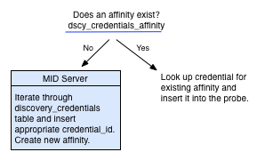

- **キャプション:** Lookup process for credential affinity（公式ドキュメント「Credential affinity for Discovery and Orchestration」の Figure 1）。
- **図の説明:** 上部に「Does an affinity exist? dscy_credentials_affinity」という判定がある。「Yes」の矢印は右下の「Look up credential for existing affinity and insert it into the probe.（既存アフィニティの資格情報を検索してプローブに挿入する）」へ、「No」の矢印は左下の青い「MID Server」の箱へ向かい、「Iterate through discovery_credentials table and insert appropriate credential_id. Create new affinity.（`discovery_credentials` を順に試して適切な credential_id を挿入し、新しいアフィニティを作成する）」と記載されている。
- **出典:** https://www.servicenow.com/docs/r/australia/platform-security/connections-and-credentials/c_CredentialAffinity.html （取得日: 2026-11-02）

### 6.4 Credential alias（Discovery 用）

Credential alias を使わない場合、Discovery schedule はインスタンス内のすべての資格情報にアクセスできる。エイリアスを使うと、特権資格情報の不要な露出を防ぎ、スケジュールが使える資格情報を限定できる。[出典](https://www.servicenow.com/docs/r/australia/platform-security/connections-and-credentials/discovery-credential-alias.html)

**仕組み**：ECC Queue にディスカバリータスクが挿入されると、ビジネスルール **Insert Discovery Affinity & Cred Aliases**（旧称 Insert Discovery Affinity）が、スケジュールで定義されたエイリアスをプローブに付与する。ECC Queue レコードには次の2つの任意パラメーターが入る。

| パラメーター | 内容 |
|---|---|
| `credential_tag` | スケジュールで定義した sys_alias ID のリスト（資格情報の Credential alias に対応） |
| `credential_id` | 対象デバイスのアフィニティが存在する場合の資格情報 sys_id |

MID Server の資格情報選択順序：

1. プローブのコマンド種別（SSH、Windows、SNMP 等）に一致する資格情報のみ残す。
2. タグで絞る。スケジュールのタグに紐づく資格情報、またはレコードに `credential_tag` がない場合のみ残る。
3. アフィニティを適用し、`credential_id` と一致する資格情報を先頭に移す。残りは Order 順。
4. 成功する資格情報が見つかるまで繰り返す。

注意点：スケジュールにエイリアスを定義して使う場合、（資格情報が他のエイリアスに関連付いていなければ）既存の資格情報と対象のアフィニティは無視される。タグに含まれないアフィニティ資格情報はタグフィルターで落とされ、以前成功していても試行されない。タグはスケジュールとその IP 範囲に対して効き、個々のデバイスには効かない。[出典](https://www.servicenow.com/docs/r/australia/platform-security/connections-and-credentials/discovery-credential-alias.html)

**作成手順**（ロール：`admin`。`credential_admin` と `connection_admin` は読み取りのみ）：Connections & Credentials > Connection & Credential Aliases で New、Type に Credential を選んで保存 → Connections & Credentials > Credentials で資格情報を開き、Credential alias フィールドのロックを外してエイリアスを選択 → 保存。1つの資格情報を複数エイリアスに、1つのエイリアスに複数資格情報を割り当てられる。[出典](https://www.servicenow.com/docs/r/australia/platform-security/connections-and-credentials/discovery-credential-alias.html)

### 6.5 Applicative credentials

ホストの資格情報とは別に、アプリケーション自体が要求する資格情報を **applicative credentials** という（例：ABAP SAP Central Services（ASCS）は SSH/Windows ホスト資格情報に加えて必要）。CI タイプごとに作成し（例：`cmdb_ci_appl_sap_ascs`）、複数あれば定義順に試行する。Discovery の要件ドキュメントに記載がない限り構成は不要。[出典](https://www.servicenow.com/docs/r/australia/platform-security/connections-and-credentials/applicative-creds.html)

| フォーム項目 | 説明 |
|---|---|
| Name | 空白・特殊文字を使わない |
| Active / User name / Password | — |
| CI type | CI タイプ |
| Credential Alias | 特定スケジュール向けに割り当てる場合、アプリが使う CI タイプのテーブル名を指定（例：Microsoft SQL Database → `cmdb_ci_db_mssql_instance`、MySQL Server → `cmdb_ci_db_mysql_instance`、Oracle Database → `cmdb_ci_db_ora_instance`、Oracle WebLogic Module → `cmdb_ci_app_server_weblogic`、Microsoft Exchange Mailbox → `cmdb_ci_exchange_mailbox`、SAP 系 → `cmdb_ci_appl_sap_ascs`、IBM Security Access Manager → `cmdb_ci_app_server_webseal`、Tibco EMS → `cmdb_ci_appl_tibco_message`） |
| Applies to / Order | 対象 MID Server と試行順 |

> **Brazil での変更:** Discovery and Service Mapping Patterns v1.35.0 で、Windows 上の Oracle Database ディスカバリーに **Oracle Wallet** を使えるようになり、applicative credentials をインスタンスに保存せずに済む（`glide.discovery.oracle_wallet_authentication` を true）。[出典](https://www.servicenow.com/docs/r/release-notes/discovery-store-apps-rn.html)

### 6.6 種類別の要点

| 種類 | 要点 | 出典 |
|---|---|---|
| Windows | Windows ホストにサービスとして MID Server を導入。ドメインユーザー（対象のローカル管理者）またはローカル管理者アカウント（UAC 無効）。UAC 有効時は管理者タスクが失敗し得るため無効化が推奨される。対話ログオン権限は不要。`Domain\UserName`、`UserName@example.domain.com`、`WORKGROUP\UserName`、`.\user` 形式。MID Server と対象のドメインが異なる場合は MID Server ホストに PowerShell 3.0〜5.1 が必要 | [出典](https://www.servicenow.com/docs/r/australia/platform-security/connections-and-credentials/r_WindowsCredentialsForm.html) |
| SSH | コマンドは root 権限（root 資格情報または sudo）で実行する必要がある。**SSH private key 資格情報の利用が推奨**（MitM 攻撃への耐性）。RSA / DSA / ECDSA / ED25519 の鍵（`-----BEGIN` で始まる形式）。Private Key 型の Password 欄には必要に応じ sudo パスワードを入れる | [出典](https://www.servicenow.com/docs/r/australia/platform-security/connections-and-credentials/r_SSHCredentialsForm.html) |
| SNMP | Community string（ユーザー名なし）。既定の読み取りコミュニティ `public` は自動で試行される。SNMP（v3 以外）では構成済みの全コミュニティ文字列を使う。SNMP v1 / v2c / v3 対応で、v3 資格情報が有効なら SNMP version は v3 か All、v1/v2 なら v1 / v2c / All（既定 All） | [出典](https://www.servicenow.com/docs/r/australia/platform-security/connections-and-credentials/c_SNMPCredentials.html) [出典](https://www.servicenow.com/docs/r/australia/it-operations-management/discovery/c_SNMPSupportForDiscovery.html) |
| Cloud（AWS） | AWS 上の MID Server に IAM ロール（インスタンスプロファイル）が定義されている場合、インスタンス上の資格情報より IAM ロールの一時資格情報が優先される | [出典](https://www.servicenow.com/docs/r/australia/platform-security/connections-and-credentials/r_CloudManagementCredentialsForm.html) |

### 6.7 資格情報のテスト

資格情報フォームの Related Links > **Test credential** でテストできる（保存前でも可）。対応する種類は SSH private keys、Windows、SNMP v3、VMware、JDBC、JMS。Test Credential ダイアログでは Target（IP。VMware はホスト URL、JMS はプロバイダー URL。MID Server 自体は指定不可）、Port、MID Server（Windows 資格情報は Windows MID Server 必須、Up かつ Validated のみ）、DB Type / DB Name（JDBC）、Initial Context Factory（JMS）を入れる。テスト成功は、ディスカバリーに必要な権限を持つことを保証しない。[出典](https://www.servicenow.com/docs/r/australia/platform-security/connections-and-credentials/t_CreateCredential.html)

### 6.8 外部資格情報ストア

インスタンスに資格情報を保存したくない場合、外部の資格情報リポジトリを使える。インスタンスは資格情報の一意 ID、種類、アフィニティのみを保持し、MID Server が顧客提供の JAR ファイル（Credential Resolver）で ID を実際の資格情報に解決する。Credential affinity は外部ストアでも同様に機能する。[出典](https://www.servicenow.com/docs/r/australia/platform-security/connections-and-credentials/c_ExternalCredentialStorage.html)

- 処理：MID Server が `discovery_credentials` から Credential ID を含む資格情報オブジェクトを取得 → プローブ／パターン実行ごとに Credential ID・対象 IP・種類を Credential Resolver に渡す → Resolver（CyberArk 等ではベンダーのアプリ経由）がボールトから取得 → MID Server が実行。標準提供の Resolver（CyberArk）では、MID Server は資格情報をプロセスメモリ内に暗号化して数秒程度だけキャッシュする。
- エラー時は MID Server ログに `Problem with client's CredentialResolver:` のプレフィックスで出力される。
- プロパティ **Enable External Credential Storage**（`com.snc.use_external_credentials`）で有効化・無効化する。無効化すると外部資格情報はすべて inactive になり、再有効化しても自動では active に戻らない。
- External Credential Storage プラグインは申請制。資格情報フォームの External credential store にチェックすると User name / Password が Credential ID（最大40文字）に置き換わる。

> 注：Australia ドキュメント内でも、対応製品の記載が「CyberArk のみ（他は ServiceNow API で構成可能）」（Get started with credentials、SNMP credentials）と「CyberArk vault または BeyondTrust」（External credential storage）で分かれている。[出典](https://www.servicenow.com/docs/r/australia/platform-security/connections-and-credentials/credentials-getting-started.html) [出典](https://www.servicenow.com/docs/r/australia/platform-security/connections-and-credentials/c_ExternalCredentialStorage.html)

### 6.9 資格情報なしのディスカバリー（credential-less）

| 方式 | 内容 |
|---|---|
| IP addresses スキャン | Discover=IP addresses。開ポートとバナーから推定し、CMDB は更新しない |
| Credentialless Discovery Network Device パターン | Shazzam で「生存しているが非アクティブ」なホスト、または資格情報ベースの分類プローブがすべて失敗したホストに対し、Hardware [`cmdb_ci_hardware`] の CI を作成・更新する。MID Server プロパティ `mid.discovery.credentialless.enable` を true にする必要がある |
| Nmap による credential-less discovery | 認証失敗で CI を識別できない場合、MID Server 上の Nmap で逆引き DNS、（同一サブネットなら）MAC アドレス、アプリケーション、OS とバージョンを取得する。Windows ホストの MID Server に Nmap を導入する（install.service-now.com からのダウンロード不可の環境は手動導入）。後で資格情報ベースのディスカバリーが成功すると情報は調整される。ルーター・スイッチはハードウェアとして分類され専用 CI は作らない。資格情報が使えない既知サブネットに限定し、長期利用しない。AWS / Azure / IBM Cloud / GCP との間の Nmap スキャンは各社の利用規約に反することが多い |

出典：[credential-less host](https://www.servicenow.com/docs/r/australia/it-operations-management/discovery/credential-less-host-discovery.html)、[Nmap](https://www.servicenow.com/docs/r/australia/it-operations-management/discovery/nmap-credential-less-discovery.html)、[Schedule form](https://www.servicenow.com/docs/r/australia/it-operations-management/discovery/discovery-schedule-form.html)

> **Brazil での変更:** credential-less Discovery で UDP ポートの確認と OS の推測が可能になった。いずれも既定無効で、MID Server プロパティ `mid.discovery.credentialless.include_udp_scan`（TCP に加え UDP を確認）と `mid.discovery.credentialless.include_os_scan_guess`（完全一致しない場合に OS を推測）を true にする。[出典](https://www.servicenow.com/docs/r/release-notes/discovery-rn.html)

---

## 7. Cloud discovery

クラウド管理（プロビジョニング・ガバナンス・コスト）は [Cloud Management](./cloud-management.md)、外部データの取り込みは [Service Graph Connectors](./service-graph-connectors.md) を参照。本節は Discovery によるクラウドの可視化を扱う。

### 7.1 レイヤーと方式

ITOM Visibility のクラウドディスカバリーは AWS、Microsoft Azure、GCP、IBM Cloud、Oracle Cloud Infrastructure（OCI）、Alibaba Cloud を対象とし、2つのレイヤーで考える。[出典](https://www.servicenow.com/docs/r/australia/it-operations-management/discovery/cloud-discovery-wizard.html)

| レイヤー | 内容 | 方式 |
|---|---|---|
| Cloud metadata（topology）layer | VM、ネットワーク、サブネット等の構造的インベントリ | Pattern-based Cloud Discovery、Service Graph Connectors |
| OS layer | インストール済みソフトウェア、サービス、プロセス、システム構成 | IP-based Horizontal Discovery、Agent Client Collector for Visibility Content、Service Graph Connectors（限定的） |

| 方式 | 主な特徴 |
|---|---|
| Pattern-based Cloud Discovery / IP-based Horizontal Discovery | Discovery and Service Mapping Patterns を使うプル型。OS・アプリ資格情報と MID Server からのファイアウォール到達性が必要（IP-based）。AWS / Azure / GCP / OCI / Alibaba / IBM。AWS / Azure / GCP で継続的可視化に対応 |
| Agent Client Collector for Visibility Content | エージェントによるプッシュ型。ほぼリアルタイム、OS 層のみ。MID Server あり／なし、OS 資格情報不要。Windows / Linux / macOS、AWS / Azure / GCP |
| Service Graph Connectors | クラウドプロバイダー API からの定期インポート。読み取りアクセスが必要、OS 資格情報・MID Server ファイアウォール到達性は不要。AWS / Azure / GCP。継続的可視化は AWS のみ |

**継続的可視化（Continuous visibility）** には、一定間隔でインスタンスがプロバイダーに接続するプル型（パターンベースの Cloud Discovery が Azure と GCP で対応）と、クラウド側が変更イベントをインスタンスに送るプッシュ型（Service Graph Connectors とパターンベース Cloud Discovery が AWS で対応）がある。AWS / Azure / GCP の継続的可視化に Cloud Provisioning and Governance は不要。[出典](https://www.servicenow.com/docs/r/australia/it-operations-management/discovery/cloud-discovery-wizard.html)

### 7.2 Discovery Manager（Cloud Discovery スケジュール）

Cloud Discovery Schedule Configuration（Discovery Manager）でサービスアカウントとサブアカウント、資格情報、データセンターを指定してスケジュールを作る（ロール：`discovery_admin`）。対応プラットフォームは Alibaba Cloud、AWS、GCP、IBM Cloud、Microsoft Azure、OpenStack、OCI、oVirt、VMware。「sub-accounts」は AWS では管理アカウント配下のメンバーアカウント、Azure ではサブスクリプション、GCP ではプロジェクトを指す。[出典](https://www.servicenow.com/docs/r/australia/it-operations-management/discovery/discovery-manager.html)

- 事前に Up かつ Validated の MID Server が少なくとも1台必要で、**Cloud Management capability** を構成しておく。
- 待機時間の上限は `cdu.record.watcher.timeout` で設定できる。
- ラベルは Service Account Field Options [`service_account_field_options`] でカスタマイズできる（例：Azure の Subscription GUID の表示名）。
- GCP では専用 MID Server（16コア、8 GB、JVM 4 GB）とインターネット接続、IAM の Viewer 権限が要件として示されている（KB2156327）。[出典](https://www.servicenow.com/docs/r/australia/it-operations-management/discovery/google-gcp-discovery-pattern.html)

### 7.3 AWS

AWS のディスカバリー手法：Cloud metadata discovery、Cloud OS-level discovery、Event-driven cloud discovery、AWS Systems Manager（SSM）による収集、ACC-VC による収集、Service Graph Connector。[出典](https://www.servicenow.com/docs/r/australia/it-operations-management/discovery/understanding-aws-discovery.html)

| 用途（抜粋） | Cloud Discovery（Pattern） | AWS SSM | SGC | ACC-VC（MID なし） | ACC-VC（MID あり） | IP-based（Pattern） |
|---|---|---|---|---|---|---|
| ITSM 基本・汎用仮想 CI クラス | Yes | Yes | Yes | No | No | No |
| ITSM ハードウェア CI クラス | No | Yes | Yes | Yes | Yes | Yes |
| アプリケーションのパターンディスカバリー | No | Yes | No | No | Most | Yes |
| トップダウンサービスマッピング | No | No | No | No | Most | Yes |
| SAM（ファイルベース） | No | No | No | No | Yes | Yes |
| 証明書ディスカバリー | No | No | No | No | Yes | Yes（ホスト関係なし） |
| 要件：MID Server | Yes | Yes | No | No | Yes | Yes |
| 要件：OS 資格情報 | No | No | No | No | No | Yes |
| 要件：SSM エージェント／S3 バケット | No | Yes | Yes | No | No | No |

出典：[AWS cloud discovery methods and use cases](https://www.servicenow.com/docs/r/australia/it-operations-management/discovery/aws-discovery-methods-use-case.html)

- **イベント駆動ディスカバリー**：AWS Config が SNS 通知を ServiceNow の Cloud Events REST API に送り、条件（SubscriptionConfirmation、ConfigurationItemChangeNotification、CloudWatch によるタグ変更）を満たすイベントを Cloud Events [`sn_cmp_cloud_event`] に書き込む。Cloud Event Scheduler が Ready のイベントをバッチ処理し、response mapping またはパターンで CMDB を更新する。`sn_cmp.cloud_event.use_response_mapping_aws` は **Australia から既定 true**。[出典](https://www.servicenow.com/docs/r/australia/it-operations-management/discovery/aws-events-driven-discovery.html)
- **AWS SSM ディスカバリー**：インスタンス → MID Server → AWS（SSM、S3、Parameter Store）→ SSM エージェントがコマンド実行し結果を S3 へ → MID Server が回収して ECC Queue 経由で CMDB 更新。OS ローカル資格情報や ACC、VPC アクセスが不要。要件は Cloud Discovery Workspace 1.7.1 以降、CMDB CI Class Models 1.74.0 以降、Discovery and Service Mapping Patterns 1.27.0 以降など。スケジュールの Discovery Agent に AWS MID を指定（`glide.discovery.enable_ssm`）。[出典](https://www.servicenow.com/docs/r/australia/it-operations-management/discovery/aws-ssm-discovery.html) [出典](https://www.servicenow.com/docs/r/australia/it-operations-management/discovery/discovery-schedule-form.html)

> **Brazil での変更（Store：Discovery and Service Mapping Patterns v1.35.0）:** AWS のアクティブデータセンター判定が Config API から Resource Explorer API に変更され、AWS Marketplace 製品、AWS Linux/Windows Server CI（クラウドディスカバリー）等のパターンが追加された。[出典](https://www.servicenow.com/docs/r/release-notes/discovery-store-apps-rn.html)

### 7.4 Microsoft Azure

- Azure では MID Server にリソースへのアクセス権を与える **Service Principal** を作成する。インスタンスの資格情報には Tenant ID（Directory ID）、Client ID（Application ID）、Secret key を入れる。[出典](https://www.servicenow.com/docs/r/australia/it-operations-management/discovery/azure-cloud-discovery.html)
- **管理グループ（management group）** を使うと、テスト成功時に配下のサブスクリプション（サブアカウント）一覧が返り、サブアカウントごとの資格情報なしに Azure API で一時資格情報を取得してディスカバリーできる。
- **Azure change processing**：スケジュールジョブが Azure API で前回以降に変更されたリソースを収集し、response mapping で CMDB を更新する。既定は5分ごと（最小1分）、初回は過去4時間分を処理するため数時間かかることがある。ドメイン判定に失敗したイベントの可視範囲は `sn_cmp.error_events.default_domain` で制限できる。[出典](https://www.servicenow.com/docs/r/australia/it-operations-management/discovery/azure-change-processing.html)

### 7.5 GCP ほか

- GCP はグローバルリソース（グローバル外部 IP、グローバル LB、イメージ、スナップショット、インスタンステンプレート、VPC、ファイアウォール）とリージョナルリソースを発見する。BigQuery / Bigtable の発見には MID Server プロパティ `sn_itom_pattern.google_dbservice_table_collection` を true にする。Google Cloud Logging のイベントで CMDB を自動更新できる。[出典](https://www.servicenow.com/docs/r/australia/it-operations-management/discovery/google-gcp-discovery-pattern.html)
- **CAPI からパターンへの移行**：Cloud API（CAPI）ベースのクラウドディスカバリーは将来非推奨予定。Pattern Designer > Migrate CPG to Pattern で前提チェック（Paris 以降、`sn_itom_pattern`）後、AWS / Azure を一括または個別に移行する（KB0827153、ロール：`discovery_admin`）。[出典](https://www.servicenow.com/docs/r/australia/it-operations-management/discovery/migrate-from-capi-to-pattern.html)

### 7.6 Patterns と Service Graph Connectors の比較

公式ドキュメントは、パターンを ITOM Visibility のネイティブディスカバリーの中核（エージェントレス・エージェント・クラウドネイティブを組み合わせ、より深く動的な視点）、Service Graph Connectors を既存システムからの迅速な時点データ取り込みと位置付けている。同じリソース種別でも CMDB の CI クラスが異なる場合があるため、プロバイダーごとに方針を決める（例：GCP はコネクター、AWS と Azure はパターン）。[出典](https://www.servicenow.com/docs/r/australia/it-operations-management/discovery/cloud-discovery-methods-comparison.html)

| プロバイダー | パターンが対応するリソース種別数 | SGC が対応するリソース種別数 |
|---|---|---|
| AWS | 83 | 70 |
| Azure | 60 | 22 |
| GCP | 120 | 107 |

（公式ページの比較グラフの代替テキストに基づく。Store アプリの更新で変動する。）[出典](https://www.servicenow.com/docs/r/australia/it-operations-management/discovery/cloud-discovery-methods-comparison.html)

### 7.7 コンテナ・Kubernetes

- パターンで Kubernetes と OpenShift のコンポーネントを発見し、それらを含むアプリケーションサービスを作成する。Kubernetes イベントも発見して CMDB を頻繁に更新する。Docker はイメージ CI のみ収集するよう構成できる。[出典](https://www.servicenow.com/docs/r/australia/it-operations-management/discovery/container-discovery.html)
- **Kubernetes Visibility Agent（KVA）** はクラスタ内のリソース変更を検出して継続的ディスカバリーを行い、CMDB を最新化する。[出典](https://www.servicenow.com/docs/r/australia/it-operations-management/discovery/acc-kubernetes-visibility-landing-page.html)
- Australia では KVA と Service Mapping で Kubernetes 外を含むサービスマップ、KubeVirt VM の CMDB 追加、OKE 対応などが追加された。[出典](https://www.servicenow.com/docs/r/australia/release-notes/itom-visibility-rn.html)

> **Brazil での変更（Store：Patterns v1.35.0）:** Kubernetes クラスタを MID Server クラスタで発見できるようになった（`sn_itom_pattern.k8s_midserver` に MID Server クラスタ名）。大規模ペイロード用の「Kubernetes Cluster - Per-Namespace LP」パターンが追加された。[出典](https://www.servicenow.com/docs/r/release-notes/discovery-store-apps-rn.html)

---

## 8. Agent Client Collector（ACC）

### 8.1 ACC の構成要素

**Agent Client Collector（ACC）** は Windows、Linux、macOS にインストールする ServiceNow のエージェントで、Sensu（Sensu-Go）フレームワークを基盤とし、Sensu コミュニティや Nagios 互換プラグインで拡張できる。[出典](https://www.servicenow.com/docs/r/australia/it-operations-management/agent-client-collector/acc-concept.html) [出典](https://www.servicenow.com/docs/r/australia/it-operations-management/agent-client-collector/how-acc-v-works.html)

| 略称 | 名称 | 主な用途 |
|---|---|---|
| ACC-F | Agent Client Collector Framework（`sn_agent`） | エージェントと MID Server の管理基盤 |
| ACC-VC | Agent Client Collector for Visibility Content（`sn_acc_vis_content`） | エージェントによるインフラディスカバリーと SAM メトリクス |
| ACC-M | Agent Client Collector Monitoring | 監視（イベント・メトリクス） |
| ACC-L | Agent Client Collector Log Analytics | ログ収集（Health Log Analytics） |
| DEX | Digital End-User Experience | ITOM Cloud Services Core（`sn_itom_cloud_svc`）を利用 |

出典：[ACC system requirements](https://www.servicenow.com/docs/r/australia/it-operations-management/agent-client-collector/acc-sys-requirements.html)

監視（ACC-M）とログ（ACC-L）の詳細は [Event Management と AIOps](./event-management-aiops.md) を参照。

### 8.2 アーキテクチャ

エージェントはホスト上で **check（チェック）** を実行し、イベントやメトリクスに変換する。**Policy（ポリシー）** は監視対象 CI と実行チェックの組み合わせで、チェック定義をポリシーに関連付けたものを check instance と呼ぶ（頻度や DB ログイン資格情報などを個別にカスタマイズ可能）。エージェントは収集データを MID Server 経由でインスタンスに送り、インスタンスはホストと実行プロセスから分類したアプリケーション（例：Microsoft SQL Server）の CI を作る。CI 作成後、関連するアクティブなポリシーが MID Server に配布され、MID Server からエージェントに送られる。CI データは CMDB、イベントデータは Events テーブルに格納される。[出典](https://www.servicenow.com/docs/r/australia/it-operations-management/agent-client-collector/acc-concept.html)

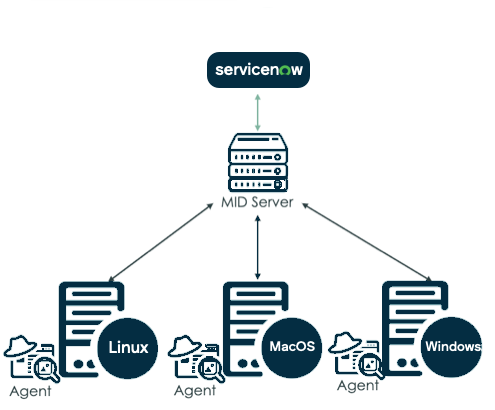

- **キャプション:** Agent client collector configuration flow（公式ドキュメント「ACC architecture」の図）。
- **図の説明:** 最上部に ServiceNow のロゴ（インスタンス）、その下に MID Server のアイコンがあり、両者は双方向の矢印で結ばれている。MID Server から下段の3台のサーバー（Linux、MacOS、Windows）へそれぞれ双方向の矢印が伸び、各サーバーの左下に「Agent」のアイコンがある。すなわち、インスタンスで定義したポリシーとチェックを MID Server が取得してエージェントに渡し、エージェントの実行結果が MID Server を経由してインスタンスに戻る流れを示す。
- **出典:** https://www.servicenow.com/docs/r/australia/it-operations-management/agent-client-collector/acc-concept.html （取得日: 2026-11-02）

### 8.3 要件と規模

- **前提**：MID Server 利用時は登録・検証済み MID Server（本番では少なくとも2台推奨）、エージェントホストから MID Server への検証済み接続、ACC リスナーのポートへの到達性。MID-less の場合は MID-less ACC の手順に従う。[出典](https://www.servicenow.com/docs/r/australia/it-operations-management/agent-client-collector/acc-sys-requirements.html)
- **必要プラグイン（ACC-VC）**：Agent Client Collector for Visibility Content、Agent Client Collector Framework、Discovery [`com.snc.discovery`]。
- **最小要件**：ACC-F は 1 GB RAM・300 MB ディスク・1 CPU コア、ACC-M / ACC-VC は 1 GB RAM・1 GB ディスク・1 CPU コア。対応 OS は x86-64 のみ（ACC-F v3.1.1 で Apple Silicon の ARM64 をネイティブ対応。詳細は KB1172387）。
- **接続**：エージェントは MID Server に HTTP/S（WebSocket over TLS）で常時接続し、1台の MID Server が複数エージェントを扱う。1エージェントは同時に1台の MID Server に接続し、必要に応じて切り替える（フェイルオーバー）。1台あたりの最大エージェント数は MID Server プロパティ `sn_agent.mid.max_allowed_agents`（既定 4,000）。ACC-VC では既定 1 GiB の MID Server で 700 エージェント、8 GiB で 8,000 エージェント、8 GiB の MID Server 5 台で最大 40,000 エージェントの例が示されている。[出典](https://www.servicenow.com/docs/r/australia/it-operations-management/agent-client-collector/acc-installation.html) [出典](https://www.servicenow.com/docs/r/australia/it-operations-management/agent-client-collector/how-acc-v-works.html)
- エージェントは Ruby 3.3.2 同梱、既定ユーザーはローカルユーザー `servicenow`。Linux でシリアル番号取得に `sudo dmidecode`、TCP 接続とプロセスの対応付けに `sudo ss` が必要など、機能ごとに必要権限が異なる。[出典](https://www.servicenow.com/docs/r/australia/it-operations-management/agent-client-collector/acc-installation.html)
- MID Server 接続の設定は単一行コマンド `acc gateway mid -a <api-key> -b wss://<MID>:8800` の形式で行う（例示値。`acc.yml` を更新）。[出典](https://www.servicenow.com/docs/r/australia/it-operations-management/agent-client-collector/configure-acc-with-mid.html)

### 8.4 ACC-VC によるディスカバリー

ACC-VC はチェックとポリシーでホストデータを定期収集する。主なシステムチェック定義は **Enhanced Discovery** で、Enhanced Discovery Policy が既定 **24時間（86,400秒）** ごとに実行する。インスタンスが ECC Queue にトピック **MonitoringProbe** の output を作り、MID Server が WebSocket over TLS でエージェントに送る。結果は Check Type EnhancedDiscovery から Script Include **EnhancedDiscoveryHandler** に渡され、IRE 互換ペイロードへの変換や非 CI データ（`cmdb_running_processes`、`cmdb_tcp_connections` 等）の調整を行う。[出典](https://www.servicenow.com/docs/r/australia/it-operations-management/agent-client-collector/how-acc-v-works.html)

ACC-VC が起動される契機：定期スケジュール、コンピューター／サーバー CI の削除時、MID Server の停止・復帰、対象ホストの停止・復帰、ネットワーク断。ACC-VC は発見したターゲットを既存の VM インスタンス CI（vCenter、AWS、GCP、Azure）と関係付ける。[出典](https://www.servicenow.com/docs/r/australia/it-operations-management/agent-client-collector/how-acc-v-works.html)

### 8.5 IP ベースの水平ディスカバリーとの共存

ACC-VC は IP ベースの水平ディスカバリーと共存できる。競合回避のため、対象ホストの IP に既に水平ディスカバリーで発見された CI（`discovery_source` が ServiceNow）がある場合、ACC-VC はディスカバリーを行わない。この動作は `sn_agent.disco_disable_ci_clobber_of_agentless_disco` を false にすると上書きでき、水平ディスカバリーが一定期間（`sn_agent.disco_ci_clobber_of_agentless_disco_threshold_days`、既定14日）行われていなければ無視される。[出典](https://www.servicenow.com/docs/r/australia/it-operations-management/agent-client-collector/using-enhanced-discovery-and-agent-less-discovery-together.html)

### 8.6 MID-less ACC と MID Server 自動選択

- **MID-less ACC**：エージェントからクラウド経由でインスタンスにデータを送り、MID Server をより恒常的なリソースに使えるようにする。単一行コマンドで MID 構成から MID-less 構成への移行も可能。[出典](https://www.servicenow.com/docs/r/australia/it-operations-management/agent-client-collector/acc-configuring-without-mid.html)
- **MID Server 自動選択**（既定無効）：インスタンスが MID Server リストを定期送信し、エージェントがレイテンシーと接続数で最適な MID Server を選ぶ。真のロードバランサーではなくフェイルオーバー機構と位置付けられ、制限区域の MID Server に接続を試みてセキュリティアラートを生む、ネットワーク切り替え（社内／Wi-Fi／VPN）で再接続できない等の注意がある。アプリケーションロードバランサーを使えば backend URL は1つで済む。[出典](https://www.servicenow.com/docs/r/australia/it-operations-management/agent-client-collector/acc-auto-mid-selection.html)

### 8.7 ACC のロール

| ロール | 権限 |
|---|---|
| `agent_client_collector_admin` | ACC の全権限（REST API、ポリシー・チェック・エージェント・WebSocket の追加・編集・削除、MID Server 管理） |
| `agent_client_collector_integration` | REST API アクセス |
| `agent_client_collector_user` | チェックとポリシーの参照、一部 REST API |
| `evt_mgmt_admin` | ACC リスナーの起動 |

出典：[ACC user roles](https://www.servicenow.com/docs/r/australia/it-operations-management/agent-client-collector/acc-users.html)

### 8.8 アップグレードとプラグイン

- エージェントのアップグレードはインスタンスから管理でき、単一エージェント（一覧から最大50台まで選択可）またはスケジュールジョブ／バックグラウンドスクリプトによる一括アップグレード（レート制限付き）を選ぶ。各段階（InstanceVerification、AgentVerification、Upgrade）は Agent Upgrade Histories に記録される。前提として MID Server の WebSocket サーバー、MID Web Server が稼働していること（ロール：`agent_client_collector_admin`）。[出典](https://www.servicenow.com/docs/r/australia/it-operations-management/agent-client-collector/acc-agent-upgrade-overview.html)
- ACC プラグイン（tar.gz）はチェックと依存関係を持ち、エージェントはプラグインと同一バージョンか1つ下のバージョンである必要がある（例：ACC エージェント 4.1.0 と ACC-F Store 5.1.0）。[出典](https://www.servicenow.com/docs/r/australia/it-operations-management/agent-client-collector/acc-assets.html)
- **ACC File-Based Discovery（FBD）**：エンドポイントのファイルシステムを走査してソフトウェアとファイル在庫を発見する（Windows / Linux / macOS）。Discovery Definition > Configuration Console の File Based Discovery で有効化する。必要プラグインは File-based Discovery、Software Asset Management - File Signature Normalization、ACC-VC、Software Asset Management Professional。初回はフルスキャンで指紋を保存し、以後は差分のみ送るデルタスキャンを行う。[出典](https://www.servicenow.com/docs/r/australia/it-operations-management/agent-client-collector/file-based-discovery-overview.html)

SAM との関係は [Software Asset Management](../itam/software-asset-management.md) を参照。

> **Brazil での変更:** ACC 7.0.1 でエージェントのエラーが Service Error Management から **Error Framework**（コード接頭辞 `SN-ACC`）に記録されるようになり、パッケージマネージャー経由のソフトウェア発見、Windows アンインストール時のメンテナンストークン、非永続 VDI 対応などが追加された。ACC-VC 2.1.1 は Windows 非永続 VDI（NPVDI）でのディスカバリーとソフトウェアメータリングに対応した。SAM の最終使用日時の判定で Windows UserAssist レジストリキーは使われなくなった。[出典](https://www.servicenow.com/docs/r/release-notes/agent-client-collector-rn-static.html)

---

## 9. 運用 UI と監視

### 9.1 セットアップ方法

Discovery 有効化後の主なセットアップ方法は以下のとおり。[出典](https://www.servicenow.com/docs/r/australia/it-operations-management/discovery/discovery-setup.html)

| 方法 | 内容 |
|---|---|
| ITOM Configuration Console for Discovery | 管理者の割り当て、MID Server の配置・検証、IP / クラウド資格情報、スケジュール作成・レビュー、診断までを一か所で実施。ServiceNow Otto による自動実装を含む（追加プラグインが必要）。v28.3.1 以降は各タスクに推奨・非推奨の設定ガイダンスを表示。ITOM Configuration Console は Zurich Patch 8 以降で利用可能 |
| ITOM Discovery Guided Setup | All > ITOM Guided Setup > ITOM Discovery Guided Setup。Learn / Crawl / Walk / Run の4フェーズ。ITOM Configuration Console に置き換えられた |
| Without Guided Setup | MID Server、資格情報、ロールを個別に構成し、スケジュールを作る |
| Discovery Quick Start | MID Server と資格情報の準備後に、サブネットディスカバリーと CI ディスカバリーを構成するウィザード |

出典：[ITOM Configuration Console](https://www.servicenow.com/docs/r/australia/it-operations-management/discovery/itom-conf-console.html)、[Guided Setup](https://www.servicenow.com/docs/r/australia/it-operations-management/discovery/discovery-guided-setup.html)

手動セットアップでは、最初に少なくとも2台の MID Server を導入して異なるスケジュール・IP 範囲に割り当てること、MID Server に Discovery または ALL アプリケーションを割り当てること（Istanbul 以降）、Windows の資格情報は MID Server サービスのログオンで提供されること、UNIX・vCenter・SNMP の資格情報はインスタンスで構成することが示されている。言語プラグインを有効化している場合、MID Server ユーザーの言語を English/None にする。[出典](https://www.servicenow.com/docs/r/australia/it-operations-management/discovery/t_ConfigureDiscovery.html) [出典](https://www.servicenow.com/docs/r/australia/it-operations-management/discovery/discovery-setup.html)

### 9.2 Discovery Admin Workspace

Discovery Admin Workspace（Workspaces > Discovery Admin Workspace）は、スケジュール、診断、チューニング、異常検知などを1か所に集約したワークスペースである。前提は Discovery プラグインと、Store 版の Discovery Admin Workspace、Visibility Content、Discovery and Service Mapping Patterns（CMDB Workspace は任意）。アクセスできるロールは `discovery_admin` と `admin`。[出典](https://www.servicenow.com/docs/r/australia/it-operations-management/discovery/discovery-admin-workspace.html)

| ページ | 主な機能 |
|---|---|
| Home | オンボーディング（ITOM Configuration Console への導線）、Quick overview（Active schedules、Schedules with anomalies 等）。v1.17.0 以降。`sn_disco_workspace.enable_error_framework` が false だと旧画面 |
| Schedules | Quick Discovery、New Discovery（IP-based / Cloud / Certificate）、Overview（Active schedules、異常なしで完了したスケジュール、X 日間の傾向。失敗＝critical、CI 発見率低下＝major、長時間・エラー多発＝minor）。v1.19.0 以降 |
| IP inventory / Schedule details / Status details | IP データ、スケジュール・ステータスの詳細 |
| Diagnostics | Errors タブ（refined code ごとのエラーカード、Severity / Category / Domain フィルター、AI Insights）、Anomaly detection タブ |
| Content 360 | ワークスペースのページとして存在（本調査では機能詳細を未確認） |
| Insights | Discovery Operations Monitor、Kubernetes Explorer、Nutanix、MID Server dashboard、Agent Health、Missing compute resources、Shazzam Insights、Tag Governance Insights、Virtual Machine Explorer、URL Discovery insights for SAM、Oracle GLAS |
| Tuning | 構成チェックの実行と、優先度・カテゴリ・スイート別の失敗チェック表示 |
| Settings | 時間スケール、異常検知の設定など |

出典：[Home](https://www.servicenow.com/docs/r/australia/it-operations-management/discovery/discovery-admin-workspace-home.html)、[Schedules](https://www.servicenow.com/docs/r/australia/it-operations-management/discovery/discovery-admin-workspace-schedules.html)、[Diagnostics](https://www.servicenow.com/docs/r/australia/it-operations-management/discovery/discovery-admin-workspace-diagnostics.html)、[Insights](https://www.servicenow.com/docs/r/australia/it-operations-management/discovery/discovery-admin-workspace-insights.html)、[Tuning](https://www.servicenow.com/docs/r/australia/it-operations-management/discovery/discovery-admin-workspace-tuning.html)

Australia リリースノートでは、DAW のクラウド対応拡大（Alibaba、IBM、OCI、OpenStack、oVirt、VMware）、URL Discovery Insights・Discovery Operations Monitor ダッシュボード、IPAM 連携によるスケジュール自動作成、マルチクラウドのスケジュール作成、Microsoft Teams / Outlook へのリアルタイム通知（スケジュール失敗、異常検知、MID ダウン等）が挙げられている。[出典](https://www.servicenow.com/docs/r/australia/release-notes/itom-visibility-rn.html)

### 9.3 Discovery Status

Discovery > Status の各レコードはスケジュールの1回の実行を表し、日時、モード、デバイスに送ったプローブ数、処理したセンサー数などを持つ。既定では直近30日分の Discovery レコードが一覧表示される。更新が一定時間ないスケジュールは Discovery Status Monitor ジョブが自動分析する（既定は CI ディスカバリーが対象）。[出典](https://www.servicenow.com/docs/r/australia/it-operations-management/discovery/c_DiscoveryStatus.html)

| フィールド | 説明 |
|---|---|
| Number | 自動採番 |
| Description | 通常は Scheduled。手動実行は Discover Now |
| Schedule | スケジュール名 |
| State | Starting / Active / Completed / Canceled |
| Started / Completed | 開始・完了したプローブ数 |
| Source | Schedule Discovery、Quick Discovery、DiscoveryAPI など |
| From Schedule：Discover / Max Run Time / Log state changes | スケジュールからの読み取り専用データ（Discover は Configuration items、IP addresses、Networks、Processes/Connections (ADM)） |

関連リンク・関連リストとして、Refresh、Show Discovery timeline、Discovery Log、ECC Queue、Devices（Device history）がある。[出典](https://www.servicenow.com/docs/r/australia/it-operations-management/discovery/c_DiscoveryStatus.html)

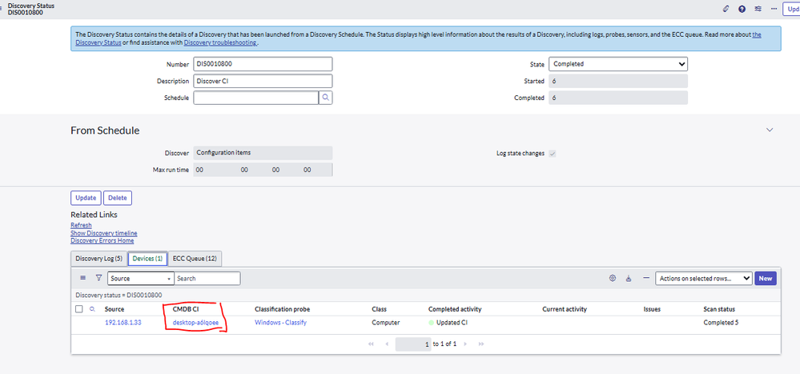

- **キャプション:** Quick Discovery（1 IP）実行後の Discovery Status レコードの例（ServiceNow Community 記事のスクリーンショット）。【第三者情報】
- **画面の説明:** ヘッダーは「Discovery Status - DIS0010800」。上部の青い説明バナーに「Discovery Status は Discovery Schedule から起動された Discovery の詳細（ログ、プローブ、センサー、ECC Queue）を表示する」旨と Discovery troubleshooting へのリンク。上段左に Number（DIS0010800）、Description（Discover CI）、Schedule（空欄＝Quick Discovery）、右に State（Completed）、Started（6）、Completed（6）。「From Schedule」セクションに Discover（Configuration items）、Max run time（00 00 00 00）、Log state changes（チェック済み）。Related Links に Refresh、Show Discovery timeline、Discovery Errors Home。下部のタブは「Discovery Log (5) / Devices (1) / ECC Queue (12)」で、Devices タブには Source（192.168.1.33）、CMDB CI（desktop-a6lqoee）、Classification probe（Windows - Classify）、Class（Computer）、Completed activity（Updated CI）、Current activity（空）、Issues、Scan status（Completed 5）の列が表示されている。
- **出典:** https://www.servicenow.com/community/itom-articles/servicenow-discovery-how-windows-ci-discovery-works-using-probes/ta-p/3440105 （取得日: 2026-11-03）。同等の公式例は [Discovery status](https://www.servicenow.com/docs/r/australia/it-operations-management/discovery/c_DiscoveryStatus.html) の Figure 1 を参照。

ステータスの取り消しは Discovery Status レコードから行える。アクティブなディスカバリーをキャンセルすると、処理開始済みのセンサージョブは即時終了し、Ready のまま未開始のセンサージョブは削除される。[出典](https://www.servicenow.com/docs/r/australia/it-operations-management/discovery/t_CreateADiscoverySchedule.html)

### 9.4 Device history（Devices 関連リスト）

Devices 関連リスト（`discovery_device_history`）はスキャンした全デバイスの要約で、Source（IP）、Completed activity、Current activity、CMDB CI、Started（Shazzam と Ping を除くデバイス固有プローブ数）、Completed（作成されたセンサーレコード数）、Scan status（例：Scan 17 of 19）、Issues を持つ。成功は緑で表示される。Device history に表示されるのは Computer [`cmdb_ci_computer`]、Network Gear [`cmdb_ci_netgear`]、PDU [`cmdb_ci_pdu`]、Printer [`cmdb_ci_printer`]、UPS [`cmdb_ci_ups`] とその子クラスである。プローブの失敗は、最終的に分類・更新に成功しても Issue として数えられる。[出典](https://www.servicenow.com/docs/r/australia/it-operations-management/discovery/r_DiscoveryStatusDevices.html)

| Completed activity の値 | いつ | 意味 |
|---|---|---|
| Alive, not active, not classified | Shazzam 後 | 応答はあるが分類に使える開ポートがない |
| Active | Shazzam 後 | 分類に使える開ポートがある |
| Classified | 分類プローブ後 | デバイス種別を分類でき、識別へ進む |
| Active, couldn't classify | 分類プローブ後 | 分類できなかった（理由付きの場合あり。例：No WMI connection） |
| Created CI | 識別プローブ／パターン後、または Discovery - Device Complete ビジネスルール後 | 新規 CI 作成 |
| Identified CI | 識別プローブ／パターン後 | 既存 CI を特定 |
| Identified, ignored extra IP | 識別後 | 同じ Discovery Status 内で別 IP から既に発見済み |
| Updated CI | 探索プローブ／パターン後、または Device Complete ビジネスルール後 | 追加情報で更新 |
| Unclassified / Classified | Shazzam 後（credential-less、Discover=IP Addresses） | 既存 CI と一致しなかった／一致した |
| Active, Windows Cluster VIP | Windows - Classify 後 | Windows クラスタ VIP として更新 |
| Classified, but not disabled | 分類後 | 一致した分類子自体が無効 |
| Classified, couldn't identify | 識別後 | CI を作成も一致もできなかった |
| Identified, not updating CI | 識別後 | CI は特定したが更新しないと判断 |

IP addresses スキャンでは CMDB を更新しないため、Completed activity には分類状態（Classified / Unclassified / Alive, not classified）のみが表示される。[出典](https://www.servicenow.com/docs/r/australia/it-operations-management/discovery/r_DiscoveryStatusDevices.html)

### 9.5 ECC Queue（Discovery 観点）

- ECC Queue は Discovery > Output and Artifacts > ECC Queue、または ECC > Queue から参照する。インスタンスから対象への指示は **output**、対象からインスタンスへの結果は **input**。[出典](https://www.servicenow.com/docs/r/australia/it-operations-management/discovery/r_DiscoveryStatusECCQueue.html)
- 状態遷移：output は ready → processing → processed（MID Server が処理）。input は ready → processing → processed、エラー時は error。ビジネスルールで処理されない input は ready のまま残ることがある。

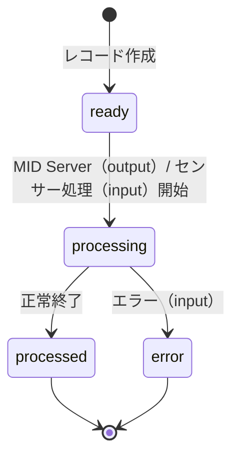

- 既定では7日より古い ECC Queue レコードは自動削除される（テーブルローテーション：`ecc_queue_event`、`ecc_queue`）。公式ドキュメントはトラブルシュートのため Discovery の ECC Queue データを少なくとも1か月保持することを推奨している。[出典](https://www.servicenow.com/docs/r/australia/it-operations-management/discovery/r_DiscoveryStatusECCQueue.html)
- センサーは処理成功後に ECC Queue の添付を削除するのが通常動作で、プロパティ（Discovery Definition > Properties の Save ECC queue attachments、`glide.discovery.sensors.save_attachments`）を有効にすると保持される（デバッグ用）。なお、Discovery properties ページでは同プロパティの既定値が true と記載されている。[出典](https://www.servicenow.com/docs/r/australia/it-operations-management/discovery/r_DiscoveryStatusECCQueue.html) [出典](https://www.servicenow.com/docs/r/australia/it-operations-management/discovery/r_DiscoveryProperties.html)

### 9.6 Discovery timeline

Discovery Status の Show Discovery Timeline で、プローブ・センサー（パターン含む）の流れ、各所要時間（キュー待ちと処理）、ECC Queue レコードを図示する（ロール：`discovery_admin` または `admin`）。デバイス単位のタイムラインも表示できる。既定の最大表示は ECC Queue 300 件（プローブ150・センサー150）で、`glide.discovery.timeline.max_entries` で変更する。プローブは黒（キュー時間は銀色）、センサーは赤（キュー時間は緑）、選択中は黄色で表示され、ダブルクリックで ECC Queue レコードを開く。[出典](https://www.servicenow.com/docs/r/australia/it-operations-management/discovery/c_DiscoveryStatusTimelines.html)

### 9.7 Discovery Log

| 種類 | 内容 |
|---|---|
| Probe-based | 分類失敗、CMDB 更新、認証失敗など、ステータスに関連する各アクションごとにレコードを作成。Identification Engine ログのエラーも表示 |
| Pattern-based | パターン実行全体で1つの水平ディスカバリーログを作成。ECC queue input が HorizontalDiscoveryProbe の行の Here リンクから Horizontal Discovery Log ウィンドウを開き、Identification Section 名から Debug できる。ペイロード処理エラーは IRE Error Documentation ボタンで原因と解決策を確認 |

Discovery Log の列：Created、Level（Debug / Error / Information / Warning）、Message、ECC queue input、CI、Source（プローブ名）、Device（IP）。プローブベースのログ保持期間は既定30日（2,592,000秒）で、Auto Flushes [`sys_auto_flush`] の `discovery_status` レコードの Age in seconds で変更する（即時反映は Table Cleaner ジョブ実行）。`glide.discovery.save_pattern_log`（既定 true）を false にすると成功したパターンログは保存されない。パターンベースのペイロード取得は KB0998923 を参照。[出典](https://www.servicenow.com/docs/r/australia/it-operations-management/discovery/r_DiscoveryLog.html) [出典](https://www.servicenow.com/docs/r/australia/it-operations-management/discovery/t_CreateADiscoverySchedule.html) [出典](https://www.servicenow.com/docs/r/australia/it-operations-management/discovery/r_DiscoveryProperties.html)

### 9.8 パフォーマンス関連

- **Discovery performance metrics**：プローブ／パターンとセンサーの処理時間を収集し、ビルド別・ステータス別・ターゲット IP 別にロールアップする（`glide.discovery.perf.metrics.*` プロパティ、`discovery_perf_metric_probe_sensor*` テーブル）。アップグレード前後の性能比較に使える。[出典](https://www.servicenow.com/docs/r/australia/it-operations-management/discovery/discovery-performance-framework.html) [出典](https://www.servicenow.com/docs/r/australia/it-operations-management/discovery/c_DiscoveryTroubleshooting.html)
- **Event Framework**：通常は ECC Queue の各 input に対して一度限りの Schedule Item [`sys_trigger`] を作成・削除するため DB の負荷（churn）が大きい。`discovery.use.event.processing` を true にすると、イベントテーブルを循環利用する Event Framework で処理し、スロットリングと優先度制御ができる（既定優先度 100。`com.glide.queue.discovery.sensors.processing_jobs.priority`、`com.glide.queue.discovery.cloud.sensors.processing_jobs.priority`）。要件は DAW v1.9.0 以降、Xanadu Patch 9 / Yokohama Patch 4 以降。[出典](https://www.servicenow.com/docs/r/australia/it-operations-management/discovery/t_ConfigureDiscoveryEventFramework.html)
- **Sensitive data filters**：Discovery Sensitive Data Filters [`discovery_sensitive_data_filter`] に正規表現を定義すると、MID Server の Post Processor スクリプトが ECC Queue input の送信前に該当値を `REDACTED` に置換する（例：`(?i)(?:pwd|password|passwd|secret)=(\S+)`）。要件は Discovery XP11 / YP10 / ZP4 以降、Visibility Content 6.29.0。[出典](https://www.servicenow.com/docs/r/australia/it-operations-management/discovery/sensitive-data-filters.html)

性能全般の知見は [パフォーマンスチューニング](../../04_応用編/03-performance-tuning.md) を参照。

> **Brazil での変更:** Discovery で遅いパターンテーブルの日次パフォーマンススナップショットが追加された（リリースノートの概要記述）。詳細仕様は公開情報では確認できず。[出典](https://www.servicenow.com/docs/r/release-notes/discovery-rn.html)

---

## 10. トラブルシューティング

### 10.1 調べ方の全体像

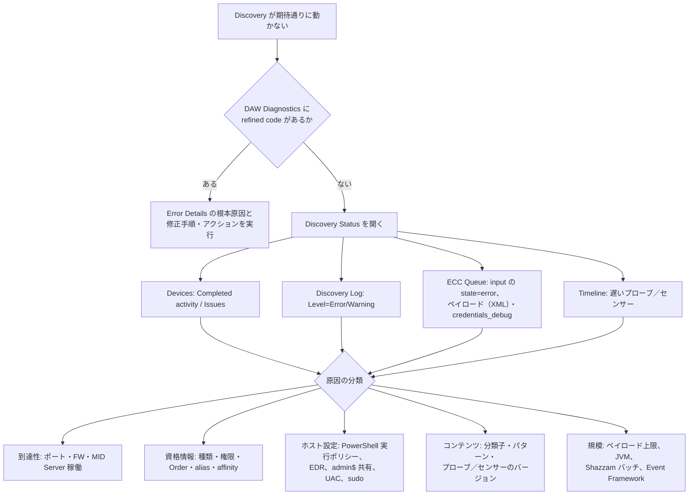

（公式ドキュメントの各手順を基に作成した整理図。）[出典](https://www.servicenow.com/docs/r/australia/it-operations-management/discovery/disco-start-issue-resolve.html) [出典](https://www.servicenow.com/docs/r/australia/it-operations-management/discovery/c_DiscoveryTroubleshooting.html)

初回のディスカバリーでは未知のデバイス・プロセスや認証失敗など想定外の結果が出ることが多い。ECC Queue の XML アイコンからプローブの実ペイロードを確認し、Discovery Log でプローブの状況を確認する（Validate discovery results）。[出典](https://www.servicenow.com/docs/r/australia/it-operations-management/discovery/t_CreateADiscoverySchedule.html)

### 10.2 Error Framework と refined code

Discovery Admin Workspace の Diagnostics は **Error Framework** を使い、対処可能なエラーを **refined code（`SN-DISC` 形式）** で分類する。Discovery 実行時に基本ルール（Base rules）で既知のログパターンを標準コードに対応付け、完了後に精緻化ルール（Refinement rules）で追加文脈に基づきコード変更や重要度引き下げを行う（例：SNMP 接続エラーが出ても別プロトコルで発見できた場合は informational に下げ、既定ビューから除外）。Error Framework は既定で有効で、`sn_disco_workspace.enable_error_framework` を false にすると旧 Diagnostics に戻る。Error Framework はシステムのデバッグログを置き換えるものではない。[出典](https://www.servicenow.com/docs/r/australia/it-operations-management/discovery/error-framework-daw.html)

Error Framework のエラーには重要度（Severity）と状態（State）がある。[出典](https://www.servicenow.com/docs/r/sPnEbors95h6DhgBlE~f0A/NcS2hmKcIEcf83C060fNmw)

| Severity（重要度） | 意味 |
|---|---|
| Critical | 対象デバイスまたはスケジュールの Discovery 完了を妨げる |
| High | 結果に大きく影響するが実行は止めない |
| Medium | 一部の結果に影響する可能性がある |
| Low | 影響は最小限 |
| Info | 情報のみ。対応不要 |

| State（状態） | 意味 |
|---|---|
| Open | 未解決で有効 |
| Closed | 解決済み |
| Ignored | 認識済みで、アクティブなビューから抑止 |

Closed / Ignored のレコードは7日間、エラーインスタンスのレコードは90日間保持される。エラーアクション（Error actions）では、エラーインスタンスの状態変更（Open / Ignored / Resolved）、対象 IP の Global IP Exclusion への追加、対象デバイス／スケジュールの Discovery 再試行、是正メッセージの表示ができる。[出典](https://www.servicenow.com/docs/r/sPnEbors95h6DhgBlE~f0A/NcS2hmKcIEcf83C060fNmw)

要件：Brazil、または Australia Patch 3 以降、DAW v1.17.0 以降、`discovery_admin`。AI Insights には ServiceNow Otto for Error Framework（`com.sn_ef_gen_ai`、Australia Patch 3 以降）と ServiceNow Otto（`sn_genai_platform`）が必要。[出典](https://www.servicenow.com/docs/r/australia/it-operations-management/discovery/disco-start-issue-resolve.html)

| refined code（開始・分類失敗でよく出るもの） | 原因 |
|---|---|
| SN-DISC-5602 | Windows の MID Server が稼働していない |
| SN-DISC-1007 | SSH 接続失敗 |
| SN-DISC-3486 | 前のプローブが失敗したためプローブをスキップ |
| SN-DISC-3888 | Discovery の ECC Queue が欠落または空 |
| SN-DISC-6004 | 対象の SSL 証明書が信頼されていない（DAW v1.20.0 が必要） |

出典：[Discovery start and classification issue resolution](https://www.servicenow.com/docs/r/australia/it-operations-management/discovery/disco-start-issue-resolve.html)

refined code で解決しない場合は、①MID Server から対象へのポート到達性とファイアウォール、②Windows の SMB 445 受信、③アカウントの権限（Windows では分類時に使う管理共有でのファイル作成・読み取り）、④PowerShell 実行ポリシー、⑤エンドポイント保護製品による Discovery スクリプトのブロック（除外と ServiceNow の信頼された発行元への追加）を手動で確認する。[出典](https://www.servicenow.com/docs/r/australia/it-operations-management/discovery/disco-start-issue-resolve.html)

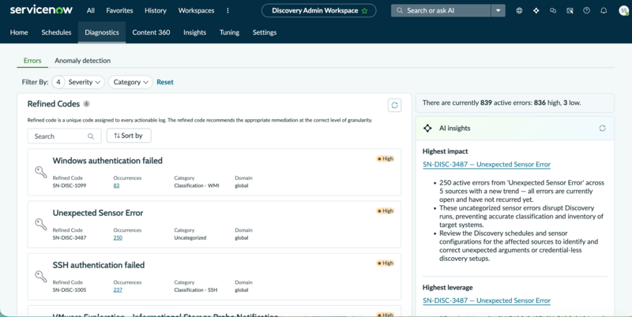

- **キャプション:** Discovery Admin Workspace Diagnostics page（公式ドキュメント「Discovery start and classification issue resolution」の図）。
- **画面の説明:** 上部のタブは Home / Schedules / Diagnostics（選択中）/ Content 360 / Insights / Tuning / Settings。Diagnostics 内に「Errors / Anomaly detection」のサブタブ、Filter By（Severity、Category、Reset）。左側の「Refined Codes」一覧に、エラーカード「Windows authentication failed（Refined Code SN-DISC-1099、Occurrences 83、Category Classification - WMI、Domain global、High）」「Unexpected Sensor Error（SN-DISC-3487、250、Uncategorized、High）」「SSH authentication failed（SN-DISC-1005、237、Classification - SSH、High）」が並ぶ。右側に「There are currently 839 active errors: 836 high, 3 low.」と表示され、その下の「AI insights」パネルに Highest impact として SN-DISC-3487 — Unexpected Sensor Error（250件、5ソース、未解決、分類・インベントリを阻害、スケジュールとセンサー構成の見直しを推奨）、Highest leverage として同じく SN-DISC-3487 が表示されている。
- **出典:** https://www.servicenow.com/docs/r/australia/it-operations-management/discovery/disco-start-issue-resolve.html （取得日: 2026-11-02）

### 10.3 エラーコード群（パターン／コマンド）

公式ドキュメントは共通エラーを以下に分類している。[出典](https://www.servicenow.com/docs/r/australia/it-operations-management/discovery/c_DiscoveryErrorMessages.html)

| 区分 | エラー |
|---|---|
| Input/output | CONNECTION_FAILED、CONNECTION_TIMEOUT、CONNECTION_REFUSED、CONNECTION_CIPHER_UNSUPPORTED、CONNECTION_PROTOCOL_UNSUPPORTED、CONNECTION_LOST、INVALID_CONNECTION_PARAMETER、FILE_NOT_FOUND、IO_ERROR |
| Authentication | NO_CREDENTIALS、AUTHENTICATION_FAILED、INVALID_CREDENTIALS_TYPE |
| SSH | SSH_SHELL_UNSUPPORTED、SSH_SCRIPT_TRANSFER_FAILED、SSH_INVALID_SESSION |
| Windows | POWER_SHELL_VERSION_UNSUPPORTED |
| Command | COMMAND_TIMEOUT、INVALID_COMMAND、COMMAND_FILTER_ERROR、COMMAND_PARSER_ERROR、COMMAND_KEY_MAPPER_ERROR、COMMAND_VALUE_NORMALIZER_ERROR、TERMINAL_SESSION_LOST_ERROR、TERMINAL_SESSION_ENVIRONMENT_MODIFICATION_ERROR |
| Generic component | INVALID_COMPONENT、INVALID_COMPONENT_PARAMETER、INVALID_OPERATION |

パターンベースで認証・権限・資格情報なし・MID から到達不可・コマンド構文誤りのエラーが出た場合は、パターンで使うコマンドの検証（Validate commands used in pattern-based discovery）を行う。[出典](https://www.servicenow.com/docs/r/australia/it-operations-management/discovery/r_DiscoveryLog.html)

### 10.4 よくあるエラーメッセージ

| メッセージ | 原因と対処 |
|---|---|
| `org.xml.sax.SAXParseException: The entity name must immediately follow the '&'…` | XML ファイルに保存されたパスワードに特殊文字を使っている |
| Identified, ignored extra IP | 同じスケジュール内で同一デバイスの別 IP を発見済み（例：NIC 2枚）。警告であり対処不要 |
| Authentication failures | 認証できない。該当マシンの資格情報を追加する |
| Identified, not updating CI, now finished | どの CI 識別子にも一致しない |
| The impersonation of user failed | PowerShell 由来。資格情報のユーザー名にドメインを付ける |
| Connection failed to WMI service. Error: Permission denied | MID Server サービスの資格情報とアクセス権を確認。MID Server ホストで `wmic /node:target /user:user /password:password path win32_operatingsystem` を実行して確認 |
| Connection failed to WMI service. Error: The remote server machine does not exist or is unavailable | サービスアカウントのアクセス権、ドメイン管理者アカウントの利用、ファイアウォールを確認。PowerShell では `gwmi win32_operatingsystem -computer <ip> -credential '<username>'` で確認 |
| Provider is not capable of the attempted operation | WMI リポジトリ破損 |
| The result file can't be fetched because it doesn't exist | 管理共有への書き込み権限がロックダウンされている（PRB581515） |
| Please run sneep as root… | Solaris で Oracle SNEEP が必要。Fujitsu PRIMEPOWER は root で実行 |
| … major version = X while … major version = Y | プローブとセンサー（マルチセンサー）のメジャーバージョン不一致。センサーは解消まで処理を停止 |
| … minor version = X while … minor version = Y | マイナーバージョン不一致。処理は継続 |
| Payload length exceeds limit of 5000000 | プローブ結果がサイズ上限超過で MID Server が破棄。MID Server プロパティ `mid.discovery.max_payload_size` を負数（例：-1）にすると上限を外せる |
| Sensor error when processing … : No sensors defined | 対応するセンサーがないか無効。Discovery Log（Level=Error）の Short Message でセンサー名を確認 |
| Probe not found | ECC Queue ペイロードのプローブ sys_id と Discovery Definition > Probes のレコードの sys_id（Copy sys_id）を比較 |
| Sensor error … Transaction cancelled: maximum execution time exceeded | センサー処理が20分を超えた（[3.5](#35-センサー)） |

出典：[Discovery error messages](https://www.servicenow.com/docs/r/australia/it-operations-management/discovery/c_DiscoveryErrorMessages.html)、[No Sensor Defined](https://www.servicenow.com/docs/r/australia/it-operations-management/discovery/t_IdentifyCauseNoSenDefEM.html)、[Probe not found](https://www.servicenow.com/docs/r/australia/it-operations-management/discovery/t_FindTheCauseOfAProbeNotFoundError.html)、[Sensors](https://www.servicenow.com/docs/r/australia/it-operations-management/discovery/r_Sensors.html)

### 10.5 資格情報のデバッグ

一部プローブは ECC Queue のペイロードに **`<credentials_debug>`** セクションを挿入し、資格情報検索の詳細（資格情報の種類・タグ・アフィニティ、対象 IP、使用した各資格情報の種類・分類・タグ・名前・sys_id・外部資格情報 ID）を確認できる。WMIRunner、PowerShell、JMS、SSHCommand で資格情報が失敗した場合、または WMIRunner / PowerShell / SSHCommand のプローブパラメーター `credentials_debug` を true にした場合（成功時も）に出力される。[出典](https://www.servicenow.com/docs/r/australia/platform-security/connections-and-credentials/r_CredentialTroubleshooting.html)

MID Server は全資格情報が失敗した IP をキャッシュ上の除外リストに入れ、以後そのデバイスへのアクセスを止める。除外リストは **5分後**、MID Server 再起動時、またはインスタンス上の資格情報レコード更新時にクリアされる。[出典](https://www.servicenow.com/docs/r/australia/platform-security/connections-and-credentials/r_CredentialTroubleshooting.html)

資格情報と権限の調査手順は KB0657528（Credentials and Permissions troubleshooting on Discovery, Service Mapping, and Orchestration）が案内されている。[出典](https://www.servicenow.com/docs/r/australia/it-operations-management/discovery/c_DiscoveryTroubleshooting.html)

### 10.6 規模・性能の問題

| 症状 | 確認・対処 | 出典 |
|---|---|---|
| スケジュールが遅い／途中でキャンセルされる | Now Support の「Troubleshoot Discovery Performance, Cancellation, and Timeout」記事、Cancel discovery if longer than の設定、Max run time / Max Idle time | [出典](https://www.servicenow.com/docs/r/australia/it-operations-management/discovery/c_DiscoveryTroubleshooting.html) |
| パターンの ECC Queue ページが過剰 | `mid.discovery.max_related_count_per_page` 等の調整、ミニファイ、JVM ヒープ | [出典](https://www.servicenow.com/docs/r/australia/it-operations-management/discovery/r-HorizontalPatternProbe.html) |
| 多数 IP 範囲でノードがメモリ不足 | `glide.discovery.shazzam_ranges_json`、`delay_wbem` | [出典](https://www.servicenow.com/docs/r/australia/it-operations-management/discovery/t_ConfigureTheShazzamProbe.html) |
| スケジュールの重複起動 | `glide.discovery.max_concurrent_invocations_per_schedule` | [出典](https://www.servicenow.com/docs/r/australia/it-operations-management/discovery/r_DiscoveryProperties.html) |
| 停滞したステータス | Discovery Status Monitor ジョブ、`glide.discovery.schedule_monitoring.stale_check_seconds`（既定 1200 秒） | [出典](https://www.servicenow.com/docs/r/australia/it-operations-management/discovery/r_DiscoveryProperties.html) |
| センサー処理の DB 負荷 | Event Framework（`discovery.use.event.processing`） | [出典](https://www.servicenow.com/docs/r/australia/it-operations-management/discovery/t_ConfigureDiscoveryEventFramework.html) |
| 発見漏れの計算資源 | Insights の Missing compute resources | [出典](https://www.servicenow.com/docs/r/australia/it-operations-management/discovery/discovery-admin-workspace-insights.html) |

その他、Now Support の Discovery Troubleshooting Guide（ホストを分類できない、Shazzam が特定デバイスを見つけない等）、Known Error Portal、ITOM フォーラムが案内されている。[出典](https://www.servicenow.com/docs/r/australia/it-operations-management/discovery/c_DiscoveryTroubleshooting.html) [出典](https://www.servicenow.com/docs/r/australia/it-operations-management/discovery/r-discovery.html)

CMDB 品質面の運用知見は [CMDB成功の要因](../../04_応用編/05-cmdb-success-factors.md) を参照。

---

## 11. 主要プロパティ一覧

Discovery プロパティは Discovery Definition > Properties で編集する。以下は抜粋。[出典](https://www.servicenow.com/docs/r/australia/it-operations-management/discovery/r_DiscoveryProperties.html)

| プロパティ | 既定値 | 説明 |
|---|---|---|
| `glide.discovery.ip_service_affinity` | false（Australia 新規顧客は true） | IP ごとに成功したポート／プロトコルを記憶 |
| `glide.discovery.max_concurrent_invocations_per_schedule` | 3 | 同一スケジュールの同時自動起動数（0 以下で無制限） |
| `glide.discovery.enforce_unique_ips` | false | 同じ IP を持つ後続デバイス発見時に他デバイスの IP をクリア |
| `glide.discovery.exclude_ip_sync_classes` | `cmdb_ci_lb` | IP を NIC の IP に置き換えない CI クラス |
| `glide.discovery.hostname.case` | Lower case | ホスト名の大文字小文字（Upper case / No change） |
| `glide.discovery.hostname.include_domain` | false | ホスト名にドメインを含める（AIX / Solaris パターンでは DNS 名をホスト名にしない） |
| `glide.discovery.hostname.always_update` | true | 信頼できるソースなら常にホスト名を最新値で更新（プローブベースのみ） |
| `glide.discovery.discover_software` | true | ソフトウェアパッケージを発見 |
| `glide.discovery.application_mapping` | true | アプリケーションマッピング（関係作成） |
| `glide.discovery.active_processes_filter` | false | Process Classification に一致するプロセスのみ |
| `glide.discovery.enable_adme` | false | Enhanced ADM |
| `glide.discovery.L3_mapping` | true | サーバー・ネットワーク機器をルーター／L3 スイッチに関連付け |
| `glide.discovery.use_probe_results_cache` | false | 結果が変わった場合のみセンサー処理 |
| `glide.discovery.sensors.save_attachments` | true（プロパティページ記載） | センサー処理後も ECC Queue 添付を保持 |
| `glide.discovery.debug.ci_identification` | false | CI Identification Log へのデバッグ出力 |
| `glide.discovery.log_debug` | false | Discovery のデバッグログ |
| `glide.discovery.save_pattern_log` | true | 成功したパターンログも保存 |
| `glide.discovery.schedule_monitoring.stale_check_seconds` | 1200 | ステータスを停滞とみなす秒数 |
| `glide.discovery.schedule_ipv4_limit` | 65,536 | 自動生成 IPv4 スケジュールの IP 数上限 |
| `glide.discovery.ip_based.active` | true（Probe→Pattern 移行済みインスタンス） | 同一デバイスの全 IP をフルサイクルで処理 |
| `glide.discovery.shazzam_ranges_json` | 新規 true / アップグレード false | Shazzam ペイロードの JSON 化 |
| `glide.discovery.use_cmdb_identifiers` | — | CMDB 識別子の使用（Geneva 以前からのアップグレード時に追加） |
| `glide.discovery.timeline.max_entries` | — | タイムラインの最大エントリー |
| `glide.discovery.enable_ssm` | — | AWS SSM エージェントによるディスカバリー |
| `com.snc.use_external_credentials` | true | 外部資格情報ストアの利用 |
| `sn_disco_workspace.enable_error_framework` | true（既定で有効） | DAW の Error Framework |

ネットワーク関連（`glide.discovery.bgp_router_disable`、`glide.discovery.network_owner_method`、`glide.discovery.physical_interface_types` 等）、ソフトウェア関連（`glide.discovery.enable.software_simplify` 等）、ファイル追跡（`glide.discovery.file_tracking.*`）、証明書（`glide.discovery.certs.*`）、性能メトリクス（`glide.discovery.perf.metrics.*`）、キュー優先度（`glide.queue.discovery.*`）なども同ページに定義されている。[出典](https://www.servicenow.com/docs/r/australia/it-operations-management/discovery/r_DiscoveryProperties.html)

主な MID Server プロパティ（Discovery 関連）：`mid.discovery.max_payload_size`、`mid.discovery.max_total_items_size_per_page` ほかペイロード分割系、`mid.discovery.credentialless.enable`、`mid.powershell.target_base_dir`、`shazzam.chunk_size`、`mid.shazzam.regulator.*`、`sn_agent.mid.max_allowed_agents`。各出典は本文の該当節を参照。

---

## 12. AI 機能

Australia の Discovery の AI 機能は、いずれも **ServiceNow Otto for IT Operations Management（ITOM）** のインストールが必要で、利用可否はライセンス（製品ティア）に依存する。[出典](https://www.servicenow.com/docs/r/australia/it-operations-management/discovery/exploring-ai-in-discovery.html)

| 機能 | 内容 |
|---|---|
| Pattern diagnostic agentic workflow | パターンベースで欠落した CI 属性を調査。ギャップ特定、ログ解析、根本原因、修正提案を ServiceNow Otto パネルで行う。Pattern diagnostic agent と EF Remediation Agent を使用。ロール `discovery_admin`、AI Search の有効化を推奨、`glide.discovery.save_pattern_log` を true にしておく |
| AI Insights for discovery errors | DAW Diagnostics で最も影響の大きいエラー（Highest impact）と、1件の解決で最も多くの発生が消えるエラー（Highest leverage）を提示 |
| 証明書管理・ファイアウォールルール要求の AI | Certificate Inventory and Management、Firewall Audits and Reporting の AI 機能 |

出典：[AI in Discovery](https://www.servicenow.com/docs/r/australia/it-operations-management/discovery/exploring-ai-in-discovery.html)、[Pattern Diagnostic agentic workflow](https://www.servicenow.com/docs/r/australia/it-operations-management/discovery/pattern-diagnostic-agentic-workflow.html)

ServiceNow Otto と Now Assist / AI Agents の関係・全体像は [Now Assist と AI Agents](../platform/now-assist-ai-agents.md) を参照。Certificate Inventory and Management と Firewall Audits and Reporting は Discovery の章に含まれるが、本ファイルでは扱わない（公式ドキュメント「Certificate Inventory and Management」「Firewall Audits and Reporting」を参照）。

---

## 13. Brazil での変更点

Brazil（リリースノート上は「Brazil Early Availability」として記載）で判明している Discovery 関連の変更は以下のとおり。

| 区分 | 変更 | 出典 |
|---|---|---|
| Discovery（新機能） | MID Server パラメーターで File-based Discovery と Windows ADME に PowerShell 7 を優先使用 | [出典](https://www.servicenow.com/docs/r/release-notes/discovery-rn.html) |
| Discovery（変更） | credential-less Discovery に UDP スキャン（`mid.discovery.credentialless.include_udp_scan`）と OS 推測（`mid.discovery.credentialless.include_os_scan_guess`）。既定無効 | [出典](https://www.servicenow.com/docs/r/release-notes/discovery-rn.html) |
| Discovery（変更） | 遅いパターンテーブルの日次パフォーマンススナップショット（概要記述のみ） | [出典](https://www.servicenow.com/docs/r/release-notes/discovery-rn.html) |
| Discovery（非推奨） | `findOrCreateRelationshipType` 関数が非推奨（Zurich Patch 10、Australia Patch 2 Hotfix 2a、Australia Patch 3、Brazil から）。関係タイプを作成せず、存在しなければエラー。カスタムスクリプトは `findCIRelationshipType` に変更する | [出典](https://www.servicenow.com/docs/r/release-notes/discovery-rn.html) |
| Discovery Admin Workspace 1.20.0 | 証明書ディスカバリーの構成・管理（Schedules ページの Certificate Discovery タブ、URL Monitoring データの活用）、IP Inventory に Shazzam タブ、Kubernetes explorer ダッシュボード、複数スケジュールで使う range set の IP 範囲から Discovery Schedule Range [`discovery_schedule_range`] へのリンク | [出典](https://www.servicenow.com/docs/r/release-notes/discovery-rn.html) |
| Discovery and Service Mapping Patterns 1.35.0 | Oracle 12種・Red Hat 7種のアプリケーションパターン、IBM Flash System、AWS Marketplace、OCI UK Sovereign Cloud、Cisco Nexus VRF、Kubernetes の MID Server クラスタ対応と大規模ペイロード用パターン、Windows での Oracle Wallet、AWS アクティブデータセンター判定を Resource Explorer API に変更 | [出典](https://www.servicenow.com/docs/r/release-notes/discovery-store-apps-rn.html) |
| ITOM Content Service | 101 の分類子（Oracle、IBM、Microsoft、Apache、SAP、Dell EMC、Red Hat、BMC 等） | [出典](https://www.servicenow.com/docs/r/release-notes/discovery-store-apps-rn.html) |
| AI Agent Topology Mapping 2.2.0 | Microsoft Foundry (new) と Foundry Hub の AI エージェント・アシスタントの発見 | [出典](https://www.servicenow.com/docs/r/release-notes/discovery-store-apps-rn.html) |
| ACC 7.0.1 / ACC-VC 2.1.1 | Error Framework（`SN-ACC`）、パッケージマネージャー経由ソフトウェアの発見、メンテナンストークン、VDI / NPVDI 対応、UserAssist 不使用 | [出典](https://www.servicenow.com/docs/r/release-notes/agent-client-collector-rn-static.html) |
| ITOM Visibility | Cryptographic Asset Compliance（PQC 対応の暗号資産管理）が ITOM Visibility の構成要素として記載 | [出典](https://www.servicenow.com/docs/r/release-notes/itom-visibility-rn.html) |

なお、Store アプリ（DAW 1.20.0、Patterns 1.35.0、ACC 7.0.1 等）の変更は、対応リリースの条件を満たせば Australia でも利用できる場合がある（例：DAW の証明書ディスカバリーは Brazil、Australia、Zurich Patch 8 以降が対象）。[出典](https://www.servicenow.com/docs/r/australia/it-operations-management/discovery/discovery-admin-workspace-schedules.html)

---

## 14. 公開情報で確認できなかった事項・ドキュメント間の差異

| 事項 | 状況 |
|---|---|
| `discovery_admin` が内包するロール | Australia の公開ドキュメントでは確認できず |
| Discovery Log のテーブル名 | 本調査で参照したページでは明示なし |
| Shazzam batch size の既定値 | フォームリファレンスは 1000、MID Server 選択順序の例は「既定 5,000」と記載が分かれる |
| 外部資格情報ストアの対応製品 | 「CyberArk のみ」と「CyberArk または BeyondTrust」の記載が併存 |
| `glide.discovery.sensors.save_attachments` | ECC Queue ページは「通常は削除」、Discovery properties ページは「既定 true」と記載 |
| Brazil の「遅いパターンテーブルの日次スナップショット」 | リリースノートの概要記述のみで、詳細仕様は公開情報では確認できず |
| Australia の Discovery 新機能の扱い | 「Combined Discovery release notes（Australia → Brazil）」は Australia 欄を「No updates」としているが、ITOM Visibility リリースノート（Australia）は DAW 機能拡張・PowerShell 7 対応・Discovery のコード署名強制などを挙げており、リリースノート間で記載粒度が異なる。[出典](https://www.servicenow.com/docs/r/delta-australia-brazil/brazil-australia-discovery-release-notes.html) |
| ACC の最大エージェント数プロパティ名 | Installation ページの要約は `snagent.mid.maxallowedagents`、本文は `sn_agent.mid.max_allowed_agents`（既定 4,000）と表記揺れ。後者が正と推定【推定】 |
| Discovery の価格 | 公式の定価は非公開。[価格情報](../../03_導入編/02-pricing.md) を参照 |

---

## 参照元

すべて 2026-11-02 に確認。

**Discovery（Australia）**
- https://www.servicenow.com/docs/r/australia/it-operations-management/discovery/r-discovery.html
- https://www.servicenow.com/docs/r/australia/it-operations-management/discovery/c_GetStartedWithDiscovery.html
- https://www.servicenow.com/docs/r/australia/it-operations-management/discovery/c_DiscoProcessFlows.html
- https://www.servicenow.com/docs/r/australia/it-operations-management/discovery/disco-process-flow-patterns.html
- https://www.servicenow.com/docs/r/australia/it-operations-management/discovery/c-UsingPatternsForHorizontalDiscovery.html
- https://www.servicenow.com/docs/r/australia/it-operations-management/discovery/c_DiscoveryProbesAndSensors.html
- https://www.servicenow.com/docs/r/australia/it-operations-management/discovery/r_ListOfDiscoveryProbes.html
- https://www.servicenow.com/docs/r/australia/it-operations-management/discovery/r_DiscoveryPortsAndProtocols.html
- https://www.servicenow.com/docs/r/australia/it-operations-management/discovery/r_PortProbes.html
- https://www.servicenow.com/docs/r/australia/it-operations-management/discovery/t_ConfigureTheShazzamProbe.html
- https://www.servicenow.com/docs/r/australia/it-operations-management/discovery/r_Sensors.html
- https://www.servicenow.com/docs/r/australia/it-operations-management/discovery/r_Probes.html
- https://www.servicenow.com/docs/r/australia/it-operations-management/discovery/r_MultiprobesIncludedWithDiscovery.html
- https://www.servicenow.com/docs/r/australia/it-operations-management/discovery/r-HorizontalPatternProbe.html
- https://www.servicenow.com/docs/r/australia/it-operations-management/discovery/discovery-classifiers.html
- https://www.servicenow.com/docs/r/australia/it-operations-management/discovery/create-discovery-ci-classification.html
- https://www.servicenow.com/docs/r/australia/it-operations-management/discovery/c_DiscoveryIdentifiers.html
- https://www.servicenow.com/docs/r/australia/it-operations-management/discovery/c_HowDiscoveryIdentifiersWork.html
- https://www.servicenow.com/docs/r/australia/it-operations-management/discovery/t_CheckIPServiceAffinity.html
- https://www.servicenow.com/docs/r/australia/it-operations-management/discovery/r_ApplicationDependencyMapping.html
- https://www.servicenow.com/docs/r/australia/it-operations-management/discovery/r_DiscoWinProbesAndPermissions.html
- https://www.servicenow.com/docs/r/australia/it-operations-management/discovery/r_PowerShellForDiscovery.html
- https://www.servicenow.com/docs/r/australia/it-operations-management/discovery/microsoft-jea-discovery.html
- https://www.servicenow.com/docs/r/australia/it-operations-management/discovery/gmsa-configuration-for-discovery.html
- https://www.servicenow.com/docs/r/australia/it-operations-management/discovery/c_SNMPSupportForDiscovery.html
- https://www.servicenow.com/docs/r/australia/it-operations-management/discovery/code-sign-disco-probes.html
- https://www.servicenow.com/docs/r/australia/it-operations-management/discovery/c_DiscoveryConfigurationConsole.html
- https://www.servicenow.com/docs/r/australia/it-operations-management/discovery/deletion-strategy.html
- https://www.servicenow.com/docs/r/australia/it-operations-management/discovery/serverless-discovery.html
- https://www.servicenow.com/docs/r/australia/it-operations-management/discovery/c_NetworkDiscovery.html
- https://www.servicenow.com/docs/r/australia/it-operations-management/discovery/t_CreateADiscoverySchedule.html
- https://www.servicenow.com/docs/r/australia/it-operations-management/discovery/discovery-schedule-form.html
- https://www.servicenow.com/docs/r/australia/it-operations-management/discovery/t-dawCreateNewDiscoSchedule.html
- https://www.servicenow.com/docs/r/australia/it-operations-management/discovery/discovery-quick-start.html
- https://www.servicenow.com/docs/r/australia/it-operations-management/discovery/t_CreateAQuickRange.html
- https://www.servicenow.com/docs/r/australia/it-operations-management/discovery/exclude-ip-ranges.html
- https://www.servicenow.com/docs/r/australia/it-operations-management/discovery/global-exlude-list.html
- https://www.servicenow.com/docs/r/australia/it-operations-management/discovery/c_DiscoveryBehaviors.html
- https://www.servicenow.com/docs/r/australia/it-operations-management/discovery/c_DiscoveryDomainSeparation.html
- https://www.servicenow.com/docs/r/australia/it-operations-management/discovery/PostCloneDiscoveryConfig.html
- https://www.servicenow.com/docs/r/australia/it-operations-management/discovery/discovery-api-plugin.html
- https://www.servicenow.com/docs/r/australia/it-operations-management/discovery/c_DiscoveryStatus.html
- https://www.servicenow.com/docs/r/australia/it-operations-management/discovery/r_DiscoveryStatusDevices.html
- https://www.servicenow.com/docs/r/australia/it-operations-management/discovery/r_DiscoveryStatusECCQueue.html
- https://www.servicenow.com/docs/r/australia/it-operations-management/discovery/c_DiscoveryStatusTimelines.html
- https://www.servicenow.com/docs/r/australia/it-operations-management/discovery/r_DiscoveryLog.html
- https://www.servicenow.com/docs/r/australia/it-operations-management/discovery/r_DiscoveryProperties.html
- https://www.servicenow.com/docs/r/australia/it-operations-management/discovery/discovery-performance-framework.html
- https://www.servicenow.com/docs/r/australia/it-operations-management/discovery/t_ConfigureDiscoveryEventFramework.html
- https://www.servicenow.com/docs/r/australia/it-operations-management/discovery/sensitive-data-filters.html
- https://www.servicenow.com/docs/r/australia/it-operations-management/discovery/t_ActivateTheDiscoveryPlugin.html
- https://www.servicenow.com/docs/r/australia/it-operations-management/discovery/discovery-setup.html
- https://www.servicenow.com/docs/r/australia/it-operations-management/discovery/t_ConfigureDiscovery.html
- https://www.servicenow.com/docs/r/australia/it-operations-management/discovery/itom-conf-console.html
- https://www.servicenow.com/docs/r/australia/it-operations-management/discovery/discovery-guided-setup.html
- https://www.servicenow.com/docs/r/australia/it-operations-management/discovery/discovery-admin-workspace.html
- https://www.servicenow.com/docs/r/australia/it-operations-management/discovery/discovery-admin-workspace-home.html
- https://www.servicenow.com/docs/r/australia/it-operations-management/discovery/discovery-admin-workspace-schedules.html
- https://www.servicenow.com/docs/r/australia/it-operations-management/discovery/discovery-admin-workspace-diagnostics.html
- https://www.servicenow.com/docs/r/australia/it-operations-management/discovery/error-framework-daw.html
- https://www.servicenow.com/docs/r/australia/it-operations-management/discovery/discovery-admin-workspace-insights.html
- https://www.servicenow.com/docs/r/australia/it-operations-management/discovery/discovery-admin-workspace-tuning.html
- https://www.servicenow.com/docs/r/australia/it-operations-management/discovery/exploring-ai-in-discovery.html
- https://www.servicenow.com/docs/r/australia/it-operations-management/discovery/pattern-diagnostic-agentic-workflow.html
- https://www.servicenow.com/docs/r/australia/it-operations-management/discovery/c_DiscoveryTroubleshooting.html
- https://www.servicenow.com/docs/r/australia/it-operations-management/discovery/c_DiscoveryErrorMessages.html
- https://www.servicenow.com/docs/r/australia/it-operations-management/discovery/t_IdentifyCauseNoSenDefEM.html
- https://www.servicenow.com/docs/r/australia/it-operations-management/discovery/t_FindTheCauseOfAProbeNotFoundError.html
- https://www.servicenow.com/docs/r/australia/it-operations-management/discovery/disco-start-issue-resolve.html
- https://www.servicenow.com/docs/r/australia/it-operations-management/discovery/nmap-credential-less-discovery.html
- https://www.servicenow.com/docs/r/australia/it-operations-management/discovery/credential-less-host-discovery.html
- https://www.servicenow.com/docs/r/australia/it-operations-management/discovery/discover-application-based-process.html

**Cloud discovery / コンテナ**
- https://www.servicenow.com/docs/r/australia/it-operations-management/discovery/cloud-discovery-wizard.html
- https://www.servicenow.com/docs/r/australia/it-operations-management/discovery/discovery-manager.html
- https://www.servicenow.com/docs/r/australia/it-operations-management/discovery/understanding-aws-discovery.html
- https://www.servicenow.com/docs/r/australia/it-operations-management/discovery/aws-discovery-methods-use-case.html
- https://www.servicenow.com/docs/r/australia/it-operations-management/discovery/aws-events-driven-discovery.html
- https://www.servicenow.com/docs/r/australia/it-operations-management/discovery/aws-ssm-discovery.html
- https://www.servicenow.com/docs/r/australia/it-operations-management/discovery/azure-cloud-discovery.html
- https://www.servicenow.com/docs/r/australia/it-operations-management/discovery/azure-change-processing.html
- https://www.servicenow.com/docs/r/australia/it-operations-management/discovery/google-gcp-discovery-pattern.html
- https://www.servicenow.com/docs/r/australia/it-operations-management/discovery/cloud-discovery-methods-comparison.html
- https://www.servicenow.com/docs/r/australia/it-operations-management/discovery/migrate-from-capi-to-pattern.html
- https://www.servicenow.com/docs/r/australia/it-operations-management/discovery/container-discovery.html
- https://www.servicenow.com/docs/r/australia/it-operations-management/discovery/acc-kubernetes-visibility-landing-page.html

**Patterns**
- https://www.servicenow.com/docs/r/australia/it-operations-management/discovery-and-service-mapping-patterns/c_MappingPatternsCustomization.html
- https://www.servicenow.com/docs/r/australia/it-operations-management/discovery-and-service-mapping-patterns/t_CreatePatternPatDef.html
- https://www.servicenow.com/docs/r/australia/it-operations-management/discovery-and-service-mapping-patterns/modify-pattern-using-extensions.html
- https://www.servicenow.com/docs/r/australia/it-operations-management/discovery-and-service-mapping-patterns/install-discovery-service-mapping-patterns.html
- https://www.servicenow.com/docs/r/australia/it-operations-management/itom-visibility/plugin-app-itom-visibility.html

**Agent Client Collector**
- https://www.servicenow.com/docs/r/australia/it-operations-management/agent-client-collector/exploring-agent-client-collector.html
- https://www.servicenow.com/docs/r/australia/it-operations-management/agent-client-collector/acc-concept.html
- https://www.servicenow.com/docs/r/australia/it-operations-management/agent-client-collector/how-acc-v-works.html
- https://www.servicenow.com/docs/r/australia/it-operations-management/agent-client-collector/acc-discovery.html
- https://www.servicenow.com/docs/r/australia/it-operations-management/agent-client-collector/using-enhanced-discovery-and-agent-less-discovery-together.html
- https://www.servicenow.com/docs/r/australia/it-operations-management/agent-client-collector/acc-sys-requirements.html
- https://www.servicenow.com/docs/r/australia/it-operations-management/agent-client-collector/acc-installation.html
- https://www.servicenow.com/docs/r/australia/it-operations-management/agent-client-collector/configure-acc-with-mid.html
- https://www.servicenow.com/docs/r/australia/it-operations-management/agent-client-collector/acc-auto-mid-selection.html
- https://www.servicenow.com/docs/r/australia/it-operations-management/agent-client-collector/acc-configuring-without-mid.html
- https://www.servicenow.com/docs/r/australia/it-operations-management/agent-client-collector/acc-agent-upgrade-overview.html
- https://www.servicenow.com/docs/r/australia/it-operations-management/agent-client-collector/acc-users.html
- https://www.servicenow.com/docs/r/australia/it-operations-management/agent-client-collector/acc-assets.html
- https://www.servicenow.com/docs/r/australia/it-operations-management/agent-client-collector/file-based-discovery-overview.html

**Credentials（Platform security）**
- https://www.servicenow.com/docs/r/australia/platform-security/connections-and-credentials/credentials-getting-started.html
- https://www.servicenow.com/docs/r/australia/platform-security/connections-and-credentials/c_CredentialAffinity.html
- https://www.servicenow.com/docs/r/australia/platform-security/connections-and-credentials/discovery-credential-alias.html
- https://www.servicenow.com/docs/r/australia/platform-security/connections-and-credentials/t_CreateCredential.html
- https://www.servicenow.com/docs/r/australia/platform-security/connections-and-credentials/applicative-creds.html
- https://www.servicenow.com/docs/r/australia/platform-security/connections-and-credentials/r_WindowsCredentialsForm.html
- https://www.servicenow.com/docs/r/australia/platform-security/connections-and-credentials/r_SSHCredentialsForm.html
- https://www.servicenow.com/docs/r/australia/platform-security/connections-and-credentials/c_SNMPCredentials.html
- https://www.servicenow.com/docs/r/australia/platform-security/connections-and-credentials/r_CloudManagementCredentialsForm.html
- https://www.servicenow.com/docs/r/australia/platform-security/connections-and-credentials/c_ExternalCredentialStorage.html
- https://www.servicenow.com/docs/r/australia/platform-security/connections-and-credentials/r_CredentialTroubleshooting.html

**リリースノート**
- https://www.servicenow.com/docs/r/australia/release-notes/itom-visibility-rn.html
- https://www.servicenow.com/docs/r/release-notes/discovery-rn.html
- https://www.servicenow.com/docs/r/release-notes/discovery-store-apps-rn.html
- https://www.servicenow.com/docs/r/release-notes/agent-client-collector-rn-static.html
- https://www.servicenow.com/docs/r/release-notes/itom-visibility-rn.html
- https://www.servicenow.com/docs/r/delta-australia-brazil/brazil-australia-discovery-release-notes.html

**Error Framework・ECC Queue（Australia 版、ID 形式 URL）**
- https://www.servicenow.com/docs/r/sPnEbors95h6DhgBlE~f0A/NcS2hmKcIEcf83C060fNmw
- https://www.servicenow.com/docs/r/sPnEbors95h6DhgBlE~f0A/BVFgMoSEO4IOOWIXFgUsrA
- https://www.servicenow.com/docs/r/sPnEbors95h6DhgBlE~f0A/J5msaQzM9vG5NzU39asypg

**コミュニティ（画像出典・第三者情報）**
- https://www.servicenow.com/community/itom-articles/servicenow-discovery-how-windows-ci-discovery-works-using-probes/ta-p/3440105
