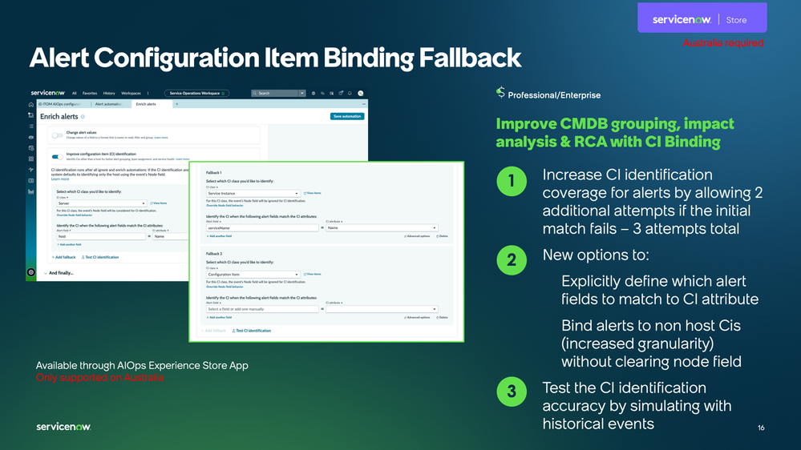
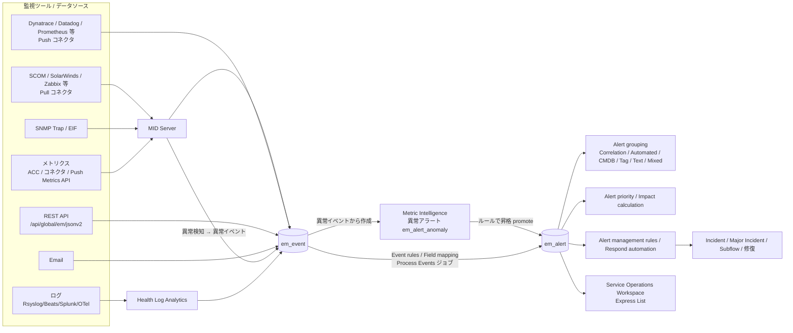
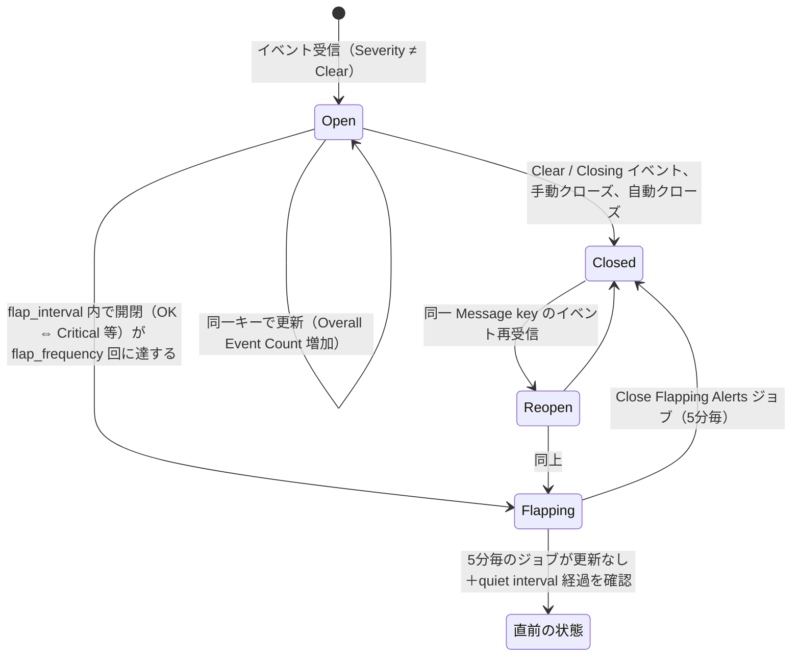
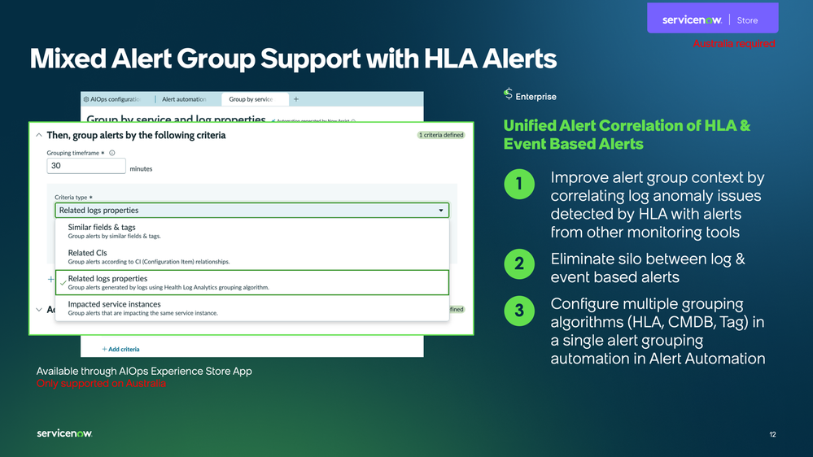
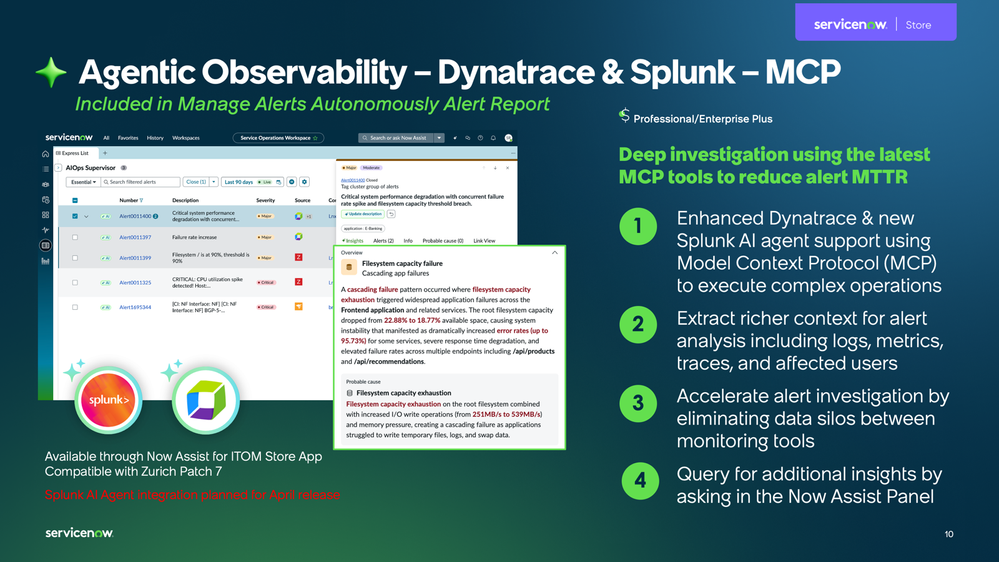
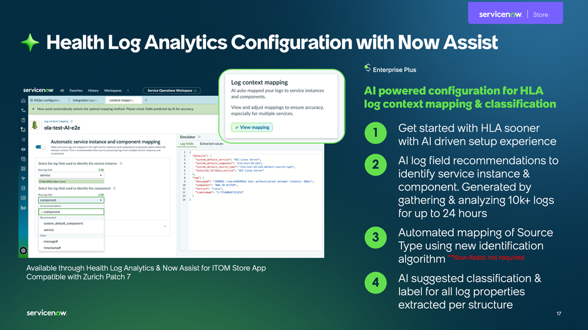

# Event Management と AIOps（イベント管理と AIOps）

## 概要

**Event Management（イベント管理）** は、ServiceNow の **ITOM AIOps** 製品群の中核アプリケーションで、外部監視ツール（SCOM、SolarWinds、Dynatrace、Datadog、Prometheus など）から届く **Event（イベント）** を受け取り、重複排除・正規化・CI（構成アイテム）への紐付け（binding）を行って **Alert（アラート）** に集約し、さらに **Alert grouping（アラートグルーピング）**、**Alert priority（アラート優先度）**、**Impact calculation（影響度計算）** によってノイズを削減し、業務影響の大きいものから Incident（インシデント）化・自動修復する仕組みである。[出典](https://www.servicenow.com/docs/r/guxhDnVk8OUAJKLm7WZsYA/fnKD95P09JB8UzZ5OsXgqw)

ITOM AIOps は Event Management を中心に、次のアプリケーションで構成される。[出典](https://www.servicenow.com/docs/r/u7nZu9GEUxWr9UkuDmbe6w/77F6fXXw64~htXxNArb_hw)

| 構成要素 | 役割 | 主なプラグイン / アプリ ID |
|---|---|---|
| Event Management（イベント管理） | イベント受信、アラート生成、ルール、グルーピング、影響度計算 | `com.glideapp.itom.snac` |
| Event Management Connectors（コネクタ） | サードパーティ監視ツールとの Push / Pull 連携 | `sn_em_connector` |
| Health Log Analytics（HLA、ヘルスログ分析） | ログをリアルタイム解析し異常をアラート化 | `sn_occ`, `com.glideapp.itom.occultus`（Core） |
| Metric Intelligence（メトリクスインテリジェンス、Metric Data） | メトリクスの動的しきい値・異常スコア算出 | `com.snc.sa.metric`, `com.snc.clotho`（MetricBase） |
| Service Operations Workspace for ITOM（サービスオペレーションワークスペース） | NOC オペレーター向け UI（Express List、Alert Automation、Integrations Launchpad 等） | `sn_sow_itom_cont` ほか |
| Service Analytics（サービス分析） | 機械学習ベースのアラート集約（Alert Aggregation）・RCA | `com.snc.sa.analytics` |

本ファイルの基準リリースは **Australia（2026-05 GA）** である。ただし ITOM AIOps の多くのコンポーネント（Event Management Connectors、Service Operations Workspace ITOM Apps、HLA、AIOps Experience など）は **ServiceNow Store から月次〜四半期で配信** されるため、ファミリーリリースと Store バージョンの両方を意識する必要がある。[出典](https://www.servicenow.com/docs/r/delta-australia-brazil/brazil-australia-itomaiops-release-notes.html)

関連ファイル：
- ITOM 全体像とパッケージ → [ITOM 概要とパッケージ](./itom-overview.md)
- CI の自動収集 → [Discovery](./discovery.md)、サービスマップ → [Service Mapping](./service-mapping.md)
- CMDB の設計 → [CMDB と CSDM](../platform/cmdb-csdm.md)
- MID Server → [MID Server](../platform/mid-server.md)
- インシデント連携 → [Incident Management](../itsm/incident-management.md)
- Now Assist / AI エージェント全般 → [Now Assist と AI Agents](../platform/now-assist-ai-agents.md)

---

## 1. Australia / Brazil におけるリリース動向

### 1.1 Australia での主な変更（Event Management）

Zurich → Australia の Event Management 統合リリースノートでは、Australia で以下が記載されている。[出典](https://www.servicenow.com/docs/r/m4LmCVvkm6_8u3nlIuep5Q/l5TTtePNQlkBxppLTO0~aQ)

| 区分 | 内容 |
|---|---|
| 新機能 | **Unified alert grouping across Event Management and HLA**：Event Management と Health Log Analytics のアラートを1つのグループにまとめ、圧縮率とアラート品質を向上 |
| 新機能 | **Explicit node-based control for CI binding**：Node フィールドの使い方を明示的に制御でき、アラートと CI の紐付け精度を向上（後方互換あり） |
| ハイライト | **AI-guided Implementation Planner（AI ガイド付き実装プランナー）**：「Streamline Event Management setup with the new AI-guided Implementation Planner」。管理者が ITOM AIOps をより速く正確に構成できるよう支援する（詳細仕様はリリースノートに記載なし） |
| ハイライト | **OpenTelemetry（OTel）メトリクスの MID Server API 経由サポート**：「Support OpenTelemetry (OTel) metrics through the MID Server API」。メトリクス取り込みの簡素化と異常検知の改善を目的とする（第11.2節参照） |
| 変更 | Coral テーマの改善（配色、ダークモード等） |
| 廃止予定（Deprecation） | **Alert Clustering Definitions（ACD）** を廃止予定とし、Service Operations Workspace の **Alert Automation** に置き換え（既存設定は引き続きサポート） |
| 廃止予定（Deprecation） | **Service Management Dashboard**：サポート終了、新規アクティベート不可 |
| アクティベーション | 「Event Management is available with activation of the Event Management plugin (`com.glideapp.itom.snac`)」（詳細は「Request Event Management」参照）。Australia のリリースノートのこの記述には Store の言及はない |

> **Brazil での変更:** Brazil のドキュメントには「Configure Event Management using ServiceNow Otto for Setup」というページがあり、「The ITOM Configuration console gives administrators a single place to complete all Event Management setup steps」「The console contains two modules: Discovery and Event Management」と記載されている。別ページ（Access the IT Operations Management configuration console）では、ITOM AIOps と ServiceNow Otto for ITOM プラグインが前提で、ServiceNow Otto for ITOM と ServiceNow Otto の両プラグインを入れたときだけ「Configure with AI」UI アクションが表示されるとしている。Australia の AI-guided Implementation Planner がこのコンソールに置き換わったのか、名称が変わっただけなのかは、公開情報では確認できず。[出典](https://www.servicenow.com/docs/r/it-operations-management/event-management/aiops-conf-console.html) [出典](https://www.servicenow.com/docs/r/it-operations-management/event-management/access-itom-config-console.html)

### 1.2 Zurich で導入された主な機能（Australia でも有効）

同リリースノートの Zurich 部分には次の記載がある。括弧内の数値はリリースノートの各項目に付記されたバージョン番号をそのまま転記したもので、**どの Store アプリのバージョンかはリリースノート上で明示されていない**（同ページには Event Management、Integrations Launchpad、Express List、Alert Automation、SOW for ITOM の各 Store バージョン詳細へのリンクが並んでいる）。したがってこれらは「Zurich ファミリーで利用可能になった機能」と「その機能を提供した Store バージョン」を区別して読む必要がある。[出典](https://www.servicenow.com/docs/r/m4LmCVvkm6_8u3nlIuep5Q/l5TTtePNQlkBxppLTO0~aQ)

- **ITOM AIOps configuration center**（集中設定ハブ、26.11.0）
- **Incident creation delay**：Respond automation で Incident 作成前に待機時間を設け、自然回復したアラートを自動クローズ（26.11.0）
- AIOps 360 Overview ダッシュボードの Recommended カテゴリ、アラートの Dependency view、Express List の複数アラート一括対応（Respond to multiple alerts）、SOW リストの Live updates 機能更新（いずれも 26.11.0）
- Express List の新アラートグループのリンク表示（Link View）、HLA / Metric Intelligence アラートの異常情報のプレビュー表示、ライブ更新の自動再開プロパティと時間範囲設定（いずれも 26.9.0）
- AWS の複数サブスクリプション対応、Integrations Launchpad からの Dynatrace メトリクスコネクタ構成、Datadog / Kafka の **メトリクスコネクタ**（Metric Intelligence 向け、いずれも 2.17.1）
- **Mixed alert grouping**（CMDB ベースとタグベースのグルーピングを1グループに統合。SOW 版を含む。バージョン付記なし）
- **AIOps 360 overview dashboard**、Impact calculation の対象アプリケーションサービスのフィルタリング、Integrations Launchpad のメトリクスコネクタ（バージョン付記なし）
- SCOM 2025 対応、Kafka コネクタの OAuth 対応

- Zurich での廃止事項：`em_alert_lists_auto_refresh` テーブルによるライブ更新制御（`sys_ux_list` のプロパティへ移行）、未使用の V1 コネクタ定義、vRealize コネクタの XML API（JSON API へ）

> **Store 配信時期の注意:** 同リリースノートの Zurich 部分には **ITOM Event Management guided setup（ガイド付きセットアップ、27.2.1）** も掲載されている。ただし本ファイル第7章の SOW ITOM Apps Store リリースノートでは 27.x 系が 2026-03（27.0.0）以降に配信されており、27.2.1 が同じアプリ系列の番号であれば Australia GA（2026-05）後の Store 更新に当たる。リリースノートは 27.2.1 をどのアプリの番号か明示していないため、「Zurich 以降のインスタンスで利用可能な、Australia 期の Store 更新で提供された機能」と解釈するのが妥当である。【推定】[出典](https://www.servicenow.com/docs/r/m4LmCVvkm6_8u3nlIuep5Q/l5TTtePNQlkBxppLTO0~aQ) [出典](https://www.servicenow.com/docs/r/store-release-notes/store-rn-itom-service-ops-workspace-itom-apps.html)

### 1.3 Australia 向け AIOps Store 機能（2026 Q1）

ServiceNow 公式コミュニティブログ（ITOM Blog、ServiceNow 社員投稿）では、Australia を前提とした Store 機能として以下が紹介されている。[出典](https://www.servicenow.com/community/itom-blog/why-it-s-one-two-three-strikes-you-score-in-the-australia-aiops/ba-p/3531189)

| 機能 | 概要 | 備考（スライド記載のエディション表記） |
|---|---|---|
| Alert CI Binding Fallback | CI 特定に失敗した場合に追加で2回（計3回）フォールバック。アラートフィールドと CI 属性を明示的にマッピング、Node フィールドをクリアせずに非ホスト CI へバインド、過去イベントでのシミュレーション | AIOps Experience Store App、Australia のみ対応、Professional/Enterprise |
| Mixed Alert Group Support with HLA Alerts | HLA・CMDB・タグの複数アルゴリズムを1つのグルーピングオートメーションに設定 | AIOps Experience Store App、Australia のみ対応、Enterprise |
| Advanced Alert Grouping Conditions | **最小アラート数**（一定数以上一致した場合のみグループ化）と **Seed alert criteria**（条件を満たすアラートが1件以上必要） | — |
| Conversational Alert Grouping | 自然言語でグルーピング条件を指示し、エージェントがオートメーションを生成 | Now Assist |
| HLA Hypothesizer skill | アラートがプロアクティブかリアクティブかを判定し、放置時の障害シナリオと次のアクションを提示（Manage Alerts Autonomously の一部） | — |
| Dynatrace / Splunk MCP 連携 | Model Context Protocol で外部 AI エージェントに問い合わせ、ログ・メトリクス・トレース・影響ユーザーをアラート要約に反映 | Now Assist for ITOM Store App、Zurich Patch 7 互換、Professional/Enterprise Plus |
| HLA セットアップの AI 推奨 | 最大24時間・1万件超のログを分析し、Service instance / Component 識別フィールドを推奨。Source type の自動マッピング（Now Assist 不要） | HLA & Now Assist for ITOM Store App、Enterprise Plus |



**図1: Alert Configuration Item Binding Fallback（Australia 向け AIOps 機能紹介スライド）**
Service Operations Workspace の「ITOM AIOps configuration」→「Alert automations」→「Enrich alerts」画面。「Improve configuration item (CI) identification」トグルを有効にすると、「Select which CI class you'd like to identify」（例：Server）と「Identify the CI when the following alert fields match the CI attributes」（Alert field: host = CI attribute: Name）を指定できる。右側に「Fallback 1」（CI class: Service Instance、Alert field: serviceName = Name）と「Fallback 2」（CI class: Configuration Item）が追加されており、各 Fallback に「Override Node field behavior」リンクと「Test CI identification」ボタンがある。スライドには「Available through AIOps Experience Store App / Only supported on Australia」「Professional/Enterprise」と記載。
出典: https://www.servicenow.com/community/itom-blog/why-it-s-one-two-three-strikes-you-score-in-the-australia-aiops/ba-p/3531189 （取得日: 2026-11-03）

> **Brazil での変更:** Australia → Brazil の Event Management リリースノートでは、新機能・変更・廃止はいずれも「No updates for this release」とされている。一方、アクティベーションの記述は「**ServiceNow Store にリクエストしてインストール**」となっている（Australia のリリースノートは「プラグイン `com.glideapp.itom.snac` の有効化」という記述で Store に言及していない。差異はリリースノートの記述上のものであり、提供方式が実際に変わったかどうかは公開情報では確認できず）。また、ローカライズ言語として日本語を含む7言語（US English、UK English、French、German、Italian、Japanese、Spanish）が列挙されている。Brazil のハイライトには「ServiceNow Otto for ITOM による自動アラート処理」が挙げられている。[出典](https://www.servicenow.com/docs/r/delta-australia-brazil/brazil-australia-eventmanagement-release-notes.html) ITOM AIOps 全体の Brazil リリースノートも「No updates」で、Event Management・HLA・Metric Intelligence は Store で月次／四半期更新されるアプリとして列挙されている。[出典](https://www.servicenow.com/docs/r/delta-australia-brazil/brazil-australia-itomaiops-release-notes.html)

> **Brazil 期の Store 変更（2026-08 以降）:** Service Operations Workspace ITOM Apps 27.2.17（2026-08）で、ITOM 各アプリの「Now Assist」表記が **ServiceNow Otto** にリブランドされた。[出典](https://www.servicenow.com/docs/r/store-release-notes/store-rn-itom-service-ops-workspace-itom-apps.html)

---

## 2. アーキテクチャとイベント処理フロー

### 2.1 全体アーキテクチャ

Event Management へのイベント流入経路は、メール、スクリプト、SNMP トラップ、Web サービス API、および MID Server 経由のコネクタである。MID Server は外部イベントツールをポーリングし、インスタンスへイベントを送る接続を維持する。[出典](https://www.servicenow.com/docs/r/guxhDnVk8OUAJKLm7WZsYA/fnKD95P09JB8UzZ5OsXgqw)



### 2.2 イベント処理の6ステップ

`em_event` テーブルに到着したイベントは、以下の順で処理される。[出典](https://www.servicenow.com/docs/r/guxhDnVk8OUAJKLm7WZsYA/fnKD95P09JB8UzZ5OsXgqw)

| # | ステップ | 内容 |
|---|---|---|
| 1 | Match Event Rule（イベントルールの照合） | Event source、ルールのフィルター、Additional information フィルター等から最適なルールを選択。フィルターのないルールは無視される。複数一致時は Order（順序）で決定 |
| 2 | Ignore Rule（無視） | ルールの Ignore が選択されていればアラートは作成しないが、イベント自体はレビュー用に保持 |
| 3 | Apply Transforms（変換） | 定義済みの変換を実行。Compose パラメータがあればアラート表示用の内容を追加 |
| 4 | Threshold Accumulation（しきい値の累積） | Threshold が有効なら、しきい値到達までイベントを蓄積し、到達時に1件のアラートを生成 |
| 5 | Event Field Mapping（イベントフィールドマッピング） | ルール不一致でもフィールドマッピングを検索。変換後に Severity がない場合は参照用に保持しアラートを作らない |
| 6 | Alert Generation（アラート生成） | `em_alert` を **Message key** で検索。一致すれば既存アラートを更新、なければ新規作成。同一キーのイベントは1アラートに集約され、CI にバインドされる |

### 2.3 Message key（メッセージキー）による重複排除

`em_event.message_key` は関連イベントを同一アラートにまとめる一意 ID（最大 1024 文字）。空の場合は **Source + Node + Type + Resource + Metric Name** の組み合わせから自動生成される。[出典](https://www.servicenow.com/docs/r/xIukoQY2A2qGfsWn8TUt1A/pBka97NfmlatDZI_FcHd1Q) 公式のベストプラクティスでも、重複排除と並列処理のために取り込み前に Source / Node / Type / Resource / Metric Name を埋めることが推奨されている。[出典](https://www.servicenow.com/docs/r/Tm19yM2Ui3~uN9XFBacppg/WX5uB5nhCpuS1TthTDtUZQ)

---

## 3. Event（イベント）— `em_event` テーブル

### 3.1 イベントフィールド

`em_event` テーブルの主要フィールドは次のとおり（Australia ドキュメント）。[出典](https://www.servicenow.com/docs/r/xIukoQY2A2qGfsWn8TUt1A/pBka97NfmlatDZI_FcHd1Q)

| フィールド | ラベル | 最大長 | 説明 |
|---|---|---|---|
| `source` | Source（ソース） | 100 | イベントを生成した監視ソフトウェア（例：SolarWinds、SCOM） |
| `node` | Node（ノード） | 100 | ノード名、FQDN、IP アドレス、MAC アドレス。CMDB の CI と一致すれば CI にバインド |
| `type` | Type（タイプ） | 100 | メトリクスタイプ（例：Disk、CPU）。アラート生成時のイベント識別に使用 |
| `resource` | Resource（リソース） | 100 | ノード上のリソース（例：Disk C、CPU-1、プロセス、サービス） |
| `metric_name` | Metric Name（メトリクス名） | — | 測定対象メトリクス名 |
| `event_class` | Source instance（ソースインスタンス） | — | イベントを生成したマシン／ソフトウェア名。Node が空かつアラート自動生成時は必須 |
| `message_key` | Message key（メッセージキー） | 1024 | 同一アラートにまとめるための一意 ID |
| `ci_type` | CI type（CI タイプ） | 100 | CI タイプ情報の文字列 |
| `severity` | Severity（重大度） | — | 後述 |
| `resolution_state` | Resolution state（解決状態） | — | 後述 |
| `time_of_event` | Time of event（イベント発生時刻） | 40 | ソース側の発生時刻。UTC/GMT、形式 `yyyy-MM-dd HH:mm:ss` |
| `state` | State（処理状態） | — | Ready / Processed / Ignored / Error |
| `alert` | Alert（アラート） | — | 生成されたアラートへの参照 |
| `description` | Description（説明） | 4000 | イベント理由の詳細（スタックトレース等） |
| `additional_info` | Additional information（追加情報） | — | 追加データの JSON 文字列。**値は文字列のみサポート**（数値も引用符で囲む）。プレーンテキストは `Additional_content` キーの JSON に変換される |
| `processing_notes` | Processing notes（処理メモ） | — | イベント処理ログ |

> カスタムデータを `em_event` に独自カラムとして追加するのは非推奨で、`additional_info` に入れることが公式に推奨されている。また `em_event` の Classification フィールドを手動・スクリプト・イベントルールで変更してはならない。[出典](https://www.servicenow.com/docs/bundle/zurich-it-operations-management/page/product/event-management/task/send-events-via-web-service.html) [出典](https://www.servicenow.com/docs/r/sPnEbors95h6DhgBlE~f0A/LO~TxHZ5iImFpp0Q7z71uQ)

### 3.2 Severity（重大度）の値

`severity` は 0（Clear）〜5（OK）の数値で、1 が Critical である（Web サービス API ドキュメント）。[出典](https://www.servicenow.com/docs/bundle/zurich-it-operations-management/page/product/event-management/task/send-events-via-web-service.html) 各値の意味は次のとおり。[出典](https://www.servicenow.com/docs/r/xIukoQY2A2qGfsWn8TUt1A/pBka97NfmlatDZI_FcHd1Q)

| 値 | ラベル | 意味 |
|---|---|---|
| 1 | Critical（クリティカル） | 即時対応が必要。リソースが機能していない、または重大問題が差し迫っている |
| 2 | Major（メジャー） | 中核機能が大きく損なわれている、または性能劣化 |
| 3 | Minor（マイナー） | 部分的・非クリティカルな機能喪失または性能劣化 |
| 4 | Warning（警告） | 注意が必要だがリソースは機能している |
| 5 | OK | アラートは作成されるが、リソースは機能している |
| 0 | Clear（クリア） | 対応不要。アラートは作成されず、**既存アラートをクローズ** |

> 2〜4 の数値と各ラベルの対応は「0=Clear、1=Critical、5=OK」の公式記述（Web サービス API ページは「1 – Critical から 5 – OK、0 – Clear」とのみ記載し 2〜4 のラベルは示していない）と、Event field format ページのラベルの並び順（Critical、Major、Minor、Warning、OK、Clear。数値は付記なし）からの対応であり、厳密な値はインスタンスの `sys_choice`（`name=em_event`、`element=severity`）で確認すること。【推定】

### 3.3 Resolution state（解決状態）

| 値 | 意味 |
|---|---|
| （空） | 一致するアラートの解決は保留 |
| New | 一致するアラートをオープン |
| Closing | 一致するアラートをクローズ |

[出典](https://www.servicenow.com/docs/r/xIukoQY2A2qGfsWn8TUt1A/pBka97NfmlatDZI_FcHd1Q)

### 3.4 Web サービス API によるイベント送信

Event Management は REST でのイベント投入をサポートする。必要ロールは `evt_mgmt_integration`。[出典](https://www.servicenow.com/docs/bundle/zurich-it-operations-management/page/product/event-management/task/send-events-via-web-service.html)

| 項目 | 内容 |
|---|---|
| 推奨 URL | `POST https://<instance>.service-now.com/api/global/em/jsonv2`（1コールで複数レコード。`em_event` のビジネスルールは**起動しない**。高性能） |
| 代替 URL | `em_event.do?JSONv2&sysparm_action=insertMultiple`（ビジネスルールを起動する。低速） |
| ヘッダー | `Content-Type: application/json`、`Accept: application/json` |
| ボディ | `{"records":[{...}]}` 形式 |

リクエスト例（公式例を整形）：

```json
{
  "records": [
    {
      "source": "SCOM",
      "event_class": "SCOM 2007 on scom.server.com",
      "resource": "C:",
      "node": "name.of.node.com",
      "metric_name": "Percentage Logical Disk Free Space",
      "type": "Disk space",
      "severity": "4",
      "description": "Example description of the event.",
      "additional_info": "{\"scom-severity\": \"Medium\", \"metric-value\": \"38\"}"
    }
  ]
}
```

MID Server から代替 URL を使う場合は MID Server パラメータ `mid.probe.event.queue.compress=false`、`mid.probe.event.bulk_size=100`、`mid.probe.event.endpoint.url=em_event.do?JSONv2%26sysparm_action=insertMultiple` を設定する。[出典](https://www.servicenow.com/docs/bundle/zurich-it-operations-management/page/product/event-management/task/send-events-via-web-service.html)

REST API 全般については [Web Services / REST API](../platform/web-services-api.md) を参照。

---

## 4. Event rules（イベントルール）

### 4.1 概要と画面

**Event rule（イベントルール）** は、イベントをフィルター・変換・しきい値処理・CI バインドしてアラートを生成するためのルールで、`evt_mgmt_admin` ロールで **All > Event Management > Rules > Event Rules** から作成する。既存の未関連付け（unassociated）イベントからルールを作成することもでき、その場合はイベントのフィールドがルールにコピーされる。古い形式のルールにはバナーが表示され「Save and Upgrade」で変換が必要。[出典](https://www.servicenow.com/docs/r/sPnEbors95h6DhgBlE~f0A/LO~TxHZ5iImFpp0Q7z71uQ)

関連テーブル（Event Management 導入時にインストール）：`em_match_rule`（Event Match Rule）、`em_match_field`（Event Match Field）、`em_compose_field`（Event Compose Field）、`em_mapping_rule`（Event Mapping Rule）、`em_event_filter`（Event Filter）、`em_threshold_rule`（Threshold Rule）。[出典](https://www.servicenow.com/docs/r/sPnEbors95h6DhgBlE~f0A/HY9DIzHsel~lMx8JvzuCwA)

### 4.2 Event Rule Info（基本情報）

| フィールド | 説明 |
|---|---|
| Active | 無効化すると他の一致ルールが探索される。他に Ignore ルールがなくフィルターで除外されなければアラートは作成される |
| Source | 対象の Event class。空なら全イベントに適用 |
| Order | 複数ルール一致時の評価順（昇順） |
| Description | 説明 |
| Apply additional matching rules | 複数ルールを順次適用。CI バインド設定は最後のバインドルールが有効。選択時は Thresholds タブが無効 |
| Assignment group | チームベース統合用。空ならグローバルルール。グローバルルールが先に、次にイベントのソースインスタンスのグループルールが実行 |

[出典](https://www.servicenow.com/docs/r/sPnEbors95h6DhgBlE~f0A/LO~TxHZ5iImFpp0Q7z71uQ)

### 4.3 Event Rule Designer の4セクション

| セクション | 目的 |
|---|---|
| Event Filter（イベントフィルター） | 条件でイベントを包含／除外（Ignore 含む） |
| Transform and compose alert output（変換とアラート出力構成） | アラートに表示されるフィールドの順序・可視性、正規表現による抽出・合成 |
| Threshold（しきい値） | イベント発生頻度に基づいてアラートを作成／クローズ |
| Binding（バインディング） | アラートを CMDB の CI に紐付け（CI identifiers） |

**何のアクションも構成されていないイベントルールはスキップされる**（Ignore・Threshold・Binding のいずれか、またはマッチ／合成フィールドの指定が必要）。Event Additional info / Event Raw info は自動更新されないため「Refresh event rules」で更新する。[出典](https://www.servicenow.com/docs/r/sPnEbors95h6DhgBlE~f0A/LO~TxHZ5iImFpp0Q7z71uQ)

> 新しい代替手段：Service Operations Workspace の **Alert Automation の Ignore / Enrich** が、アラートのフィルタリングと標準化の新しい方法として案内されている（第7章参照）。[出典](https://www.servicenow.com/docs/r/sPnEbors95h6DhgBlE~f0A/LO~TxHZ5iImFpp0Q7z71uQ)

### 4.4 Event rule のベストプラクティス（公式）

- 広く適用するルールを作り、特定ケースは **より小さい Order 値** で追加する。命名を統一する（例：`ACME.OEM.Normalize`）。
- CI へのバインドは **ビジネスルールではなくイベントルール** で行う。Node フィールドにはホストの一意な識別子を入れる。
- `em_event` テーブルにビジネスルールを作らない（可能ならジョブを使う）。アラートテーブルのビジネスルールは数ミリ秒で終わること、**非同期ビジネスルールは使わない**。
- SNMP トラップは MIB を先にアップロードしてからルールを書く。Web サービス API を優先し、メールは低ボリュームのソースに限定。

[出典](https://www.servicenow.com/docs/r/Tm19yM2Ui3~uN9XFBacppg/WX5uB5nhCpuS1TthTDtUZQ)

---

## 5. Alert（アラート）— `em_alert` テーブル

### 5.1 アラートの主要フィールドとタブ

[出典](https://www.servicenow.com/docs/r/LZHoJyH9VPKmhdIph_6gSw/MHs40UMR2~g4cUpbRJ1AUQ)

| フィールド | 説明 |
|---|---|
| Number | Event Management が採番する一意 ID（例：Alert0010056） |
| Source / Node / Type / Resource / Metric Name | イベントから継承 |
| Configuration item | バインドされた CI |
| Task | 関連タスク（Incident、Change、Problem 等） |
| Description | 説明 |
| Message key | 集約キー |
| Severity | Critical / Major / Minor / Warning / OK / Clear。イベントがアラートをクローズする場合は、レポート用に**直前の重大度が保持**される |
| State | Open / Reopen / Flapping / Closed |
| Acknowledged | ユーザーが確認済みか |
| Maintenance | 影響リソースがメンテナンス中か |
| Parent | 親アラート番号（指定すると当該アラートは Secondary になる） |
| Feedback | 親アラートのみ。None / No Feedback / Yes / No |
| Knowledge article | 関連ナレッジ |
| Overall Event Count | バインドされたイベント数（イベントがパージされても保持） |
| Source instance | イベントを生成したマシン／ソフトウェア |
| Correlated Alerts / Primary Alerts | 相関した二次アラート／一次アラート |

追加タブ：**Impacted Services**（関連サービス）、**Flapping**（Flap count、Flap start window、Flap last update time、Flap last state）、**History**（Initial / Last event generation time 等）、**Activities**、**More Information**（Priority Breakdown、Additional information）。

### 5.2 アラートの状態（State）

| State | 意味 |
|---|---|
| Open | ユーザー対応が必要 |
| Reopen | 一度クローズしたアラートに再び対応が必要 |
| Flapping | クローズ後、同一ソースからの同一イベントが高頻度で発生し開閉を繰り返している |
| Closed | クローズ済み、対応不要 |

[出典](https://www.servicenow.com/docs/r/LZHoJyH9VPKmhdIph_6gSw/MHs40UMR2~g4cUpbRJ1AUQ)



> 上図は公式記述（状態定義、Flapping の出入り条件、ジョブ）をもとに整理したもの。Flapping への遷移元の状態は公式ページで特定されておらず（「重大度が OK と対応の必要な重大度の間を行き来する」状態と説明）、図では開閉を繰り返すアラートとして Open / Reopen から示した。quiet interval 経過後に新イベントが届いた場合は、**Flapping のアラートが再オープンされるのではなく新しいアラートが生成**され、その状態は新イベントの Severity に依存する（図では表現していない）。Flapping 解除の扱いは、Configure alert flapping ページでは「5分毎のバックグラウンドジョブが直前の状態値に戻す」、Components installed ページでは「Close Flapping Alerts（5分毎）が Flapping のアラートをクローズする」と記載されており、両方を併記した。[出典](https://www.servicenow.com/docs/r/u7nZu9GEUxWr9UkuDmbe6w/rj6Ob8gdOftM7MsQtk82Dw) [出典](https://www.servicenow.com/docs/r/sPnEbors95h6DhgBlE~f0A/HY9DIzHsel~lMx8JvzuCwA)

### 5.3 Flapping（フラッピング）の設定

**All > Event Management > Administration > Event Management Properties**（`evt_mgmt_admin`）で設定する。[出典](https://www.servicenow.com/docs/r/u7nZu9GEUxWr9UkuDmbe6w/rj6Ob8gdOftM7MsQtk82Dw)

| プロパティ | 説明 |
|---|---|
| `evt_mgmt.flap_interval` | フラッピング判定の時間窓（秒）。この窓内で Flap count が `flap_frequency` に達すると Flapping |
| `evt_mgmt.flap_frequency` | Flapping とみなす再発回数 |
| `evt_mgmt.flap_quiet_interval` | Flapping を抜けるのに必要な静穏時間（秒） |

Flapping からの離脱：quiet interval 経過後に新イベントが届く（新アラートが生成され、状態はイベントの Severity 依存）か、5分毎のバックグラウンドジョブが更新なしと quiet interval 経過を確認した場合（アラートは直前の状態値に戻る）。デフォルト値は公開ドキュメントでは確認できず。

### 5.4 自動クローズとその他の主要プロパティ

| プロパティ | 説明 | 出典 |
|---|---|---|
| `evt_mgmt.alert_auto_close_interval` | 一定時間更新のないアラートを自動クローズ（Auto Close Alerts ジョブ、10分毎）。**0 にすると機能が無効化され性能劣化の恐れ** | [公式](https://www.servicenow.com/docs/r/Tm19yM2Ui3~uN9XFBacppg/WX5uB5nhCpuS1TthTDtUZQ) |
| 同上の既定値 | 公式の Components installed ページでは Auto Close Alerts ジョブが「既定で7日を超えて更新のないアラートをクローズ」と記載（＝168 時間。コミュニティ回答の「168」とも一致） | [公式](https://www.servicenow.com/docs/r/sPnEbors95h6DhgBlE~f0A/HY9DIzHsel~lMx8JvzuCwA) / [Community](https://www.servicenow.com/community/itom-forum/event-management-question-about-auto-close-interval-property/m-p/965151) |
| `evt_mgmt.event_processor_enable_multi_node` | マルチノードでのイベント処理。本番では Yes 推奨 | [公式](https://www.servicenow.com/docs/r/Tm19yM2Ui3~uN9XFBacppg/WX5uB5nhCpuS1TthTDtUZQ) |
| `evt_mgmt.event_processor_job_count` | イベント処理ジョブ数。推奨 4（`process events*` ジョブの数と一致を確認） | 同上 |
| `evt_mgmt.self_health_active` | Event Management 自己ヘルス監視（CMDB に CI を作成）。既定 No | 同上 |
| `evt_mgmt.update_alert_restricted_fields_elapsed_time` | 既定 86,400 秒（24時間） | [公式](https://www.servicenow.com/docs/r/u7nZu9GEUxWr9UkuDmbe6w/rj6Ob8gdOftM7MsQtk82Dw) |
| `evt_mgmt.alert_rule_delay` | Alert management rule の実行遅延（既定 5 秒）を変更する場合に All Properties で**新規作成** | [公式](https://www.servicenow.com/docs/r/sPnEbors95h6DhgBlE~f0A/lhzFY54e4qurWPK1U4~kpQ) |

公式ベストプラクティスの補足：アラートを Closed・OK・Open の状態で「作成」しない、Acknowledge は既知かつ一時的に無視するアラートに限定、Incident 作成時にアラートをクローズしない、削除前にアラートをクローズする、イベント保持期間は既定を維持しアーカイブは別テーブルへスケジュールジョブで行う。[出典](https://www.servicenow.com/docs/r/Tm19yM2Ui3~uN9XFBacppg/WX5uB5nhCpuS1TthTDtUZQ)

### 5.5 Alert priority（アラート優先度）

Alert priority は複数要素の重み付けで算出されるスコアで、Alerts リストでは上位桁が表示される（例：7302020.003 → 7302）。[出典](https://www.servicenow.com/docs/r/u7nZu9GEUxWr9UkuDmbe6w/aD0Cih4P5z7mVoYVsSH59g)

**計算式:** `(Services × 1,000,000) + (Severity × 100,000) + (CI type × 100) + (Role × 10) + Secondary + (State × 0.001)`

| 要素 | 設定テーブル | 内容 |
|---|---|---|
| Services（業務サービス重要度） | `em_alert_priority_category_mapping` | 影響サービスの重要度スコア合計 |
| Severity | 同上 | 公式ページに記載された既定値は Critical = 1 のみ（再マッピング可）。Major / Minor / Warning の既定値は公式ページに記載がなく、インスタンスの `em_alert_priority_category_mapping` で確認する。OK は計算対象外 |
| CI type | `em_alert_priority_ci_type` | CI クラス毎の重み（例：`cmdb_ci_Mainframe`=80、`cmdb_ci_Server`=60） |
| Role | `em_alert_priority_category_mapping` | Parent > None > Secondary（数値の既定値は公式ページに記載なし） |
| Secondary | 直接カウント | 親配下の二次アラート数 |
| State | `em_alert_priority_category_mapping` | Open=1、Reopen=2、Flapping=3。Closed は対象外 |

- 公式例 7302020.003 の内訳：Services = 7（影響サービス2件の 3 + 4）、Severity = 3、CI type = 20、Role = 2、Secondary = 0、State = 3（Flapping）。すなわち 7×1,000,000 + 3×100,000 + 20×100 + 2×10 + 0 + 3×0.001 = 7,302,020.003。
- > 注意：Critical の既定値 1 は、例の Severity 値 3 より小さい。スコアが大きいほど優先度が高い計算式と、Critical = 1 という既定値の関係（重みの向き）は公式ページでは説明されていない。重みを調整する際はインスタンスの既定マッピングを確認すること。
- カテゴリ順序は `em_alert_priority_category_order` で定義。
- 計算はグループ内の全アラートが対象。1,000件超のグループでは厳密でない場合がある。
- 再計算トリガー：新規アラート、Closed からの状態変化、Role 変化、CI バインド（1回）、二次アラート数変化、Severity 変化。
- キュー：`em_alert_trigger_queue`。スケジュールジョブ **Event Management - Alert Priority Queue** の2本が毎分・最大1,000件/バッチで並列（マルチスレッド）処理する。Alert priority ページではこのジョブを「Event Management: Queue With Alert Priority」と表記しているが、Components installed ページのジョブ名は「Alert Priority Queue」であり、同じジョブを指す。
- **Event Management - Calculate Alert Priority Grouping**（30分毎）：システム内の最高・最低の優先度スコアをもとに、アラートを Urgent / High / Moderate / Low の各グループに振り分ける。

[出典](https://www.servicenow.com/docs/r/u7nZu9GEUxWr9UkuDmbe6w/aD0Cih4P5z7mVoYVsSH59g) [出典](https://www.servicenow.com/docs/r/sPnEbors95h6DhgBlE~f0A/HY9DIzHsel~lMx8JvzuCwA)

---

## 6. Alert management rules（アラート管理ルール）

### 6.1 概要

**Alert management rule（アラート管理ルール）** は、条件に一致したアラートに対して Incident 作成、サブフロー実行、外部アプリ起動などを自動化するルール。**Event Management > Rules > Alert Management Rules** で作成する。プラグインは Alert Rule Management（`sn_em_arm`）。Components installed ページでは、スケジュールジョブ「Evaluate Scoped Alert Rules Management0/1」が **11 秒毎** に新規・更新アラートへ適用すると記載されている（Create an alert management rule ページでは評価ジョブを「Event Management - Evaluate Alert Management Rules」と表記しており、間隔の記載はない）。また同ページによると、ルールはアラート更新の **5 秒後** に実行され、その間に再更新があるとタイマーがリセットされる（`evt_mgmt.alert_rule_delay` で変更可）。このため、ルールが動かないと感じても十数秒は待ってから調査するのがよい。【経験則】[出典](https://www.servicenow.com/docs/r/sPnEbors95h6DhgBlE~f0A/lhzFY54e4qurWPK1U4~kpQ) [出典](https://www.servicenow.com/docs/r/sPnEbors95h6DhgBlE~f0A/HY9DIzHsel~lMx8JvzuCwA) [出典](https://www.servicenow.com/docs/r/u7nZu9GEUxWr9UkuDmbe6w/77F6fXXw64~htXxNArb_hw)

### 6.2 フォーム項目

| タブ | 項目 | 説明 |
|---|---|---|
| Info | Name / Active / Description | Active 時はアラートフィルターと1つ以上のアクション（有効なサブフロー、ワークフロー、クイックレスポンス）が必須 |
| Info | Order | 評価順（昇順）。既定 100 |
| Info | Multiple alert rules | 「Search for additional rules」（後続ルールも実行）／「Stop search for additional rules」 |
| Info | Assignment group | 空ならグローバル。グローバル→グループの順で実行 |
| Alert Filter | Rule is activated when | 「Alert changes to filter」（新たに一致した時）／「Alert matches filter」（一致する毎回の更新時） |
| Alert Filter | Conditions / Related List Conditions | 条件ビルダー。評価ジョブは更新時刻で検出するため「Created on」ではなく **「Updated on」を使う** |
| Actions | Remediation Subflows | Subflow、Execution（Automatic / Manual / Both）、Automatic executions limit、Active |
| Actions | Launch Applications | 表示名と URL（例：`http://${source}.com:${port}/${cmdb_ci.name}`） |
| Actions | Remediation Workflows | **廃止予定**（Flow Designer を使用） |

動作上の注意：アクションのないルールはスキップされ自動で非アクティブ化、ルールの完了順は呼び出し順と一致しない、アラート更新から **5 秒後** に実行（更新が続くとタイマーリセット）。[出典](https://www.servicenow.com/docs/r/sPnEbors95h6DhgBlE~f0A/lhzFY54e4qurWPK1U4~kpQ)

### 6.3 ベースシステムのサブフロー

| サブフロー | 説明 |
|---|---|
| Acknowledge Alert | アラートを Acknowledged に |
| Change Alert to Maintenance Mode | Maintenance に変更 |
| Close Alert | クローズ |
| Create Incident | アラート項目から Incident を作成。既に Incident が紐付いている、または Maintenance の場合は実行されない |
| Create Major Incident Candidate | Major Incident 候補を作成（Maintenance / Secondary は対象外） |
| Create Major Incident from Alert | Major Incident を作成（同上） |
| Create Major Incident (Candidate) with Impact | Impact フィールドを入力に使用 |
| Attach Knowledge Article (legacy) / Create Task (legacy) / Overwrite Alert Template (legacy) | London 以前からの移行インスタンス向け |

[出典](https://www.servicenow.com/docs/r/sPnEbors95h6DhgBlE~f0A/ojtGfioZyNKNl3VKtOFzzQ)

Incident 側の仕様は [Incident Management](../itsm/incident-management.md)、サブフロー作成は [Workflow Studio / Flow Designer](../platform/flow-designer-workflow-studio.md) を参照。

---

## 7. Alert Automation（アラートオートメーション、Service Operations Workspace）

**Alert Automation** は Service Operations Workspace for ITOM 上でアラートの無視・補強・グループ化・対応をノーコードで構成する機能で、アプリは SOW Alert Automation（`sn_sow_alert_rules`）。[出典](https://www.servicenow.com/docs/r/u7nZu9GEUxWr9UkuDmbe6w/77F6fXXw64~htXxNArb_hw)

| 種類 | 目的 |
|---|---|
| Ignore（無視） | 誤検知・ノイズアラートを除外 |
| Enrich（補強） | アラートに文脈を付与・標準化（CI identification、Compose、正規表現抽出） |
| Group（グループ化） | 関連アラートを1つのプライマリアラートに集約（Criteria type：Similar fields & tags / Related CIs / Related logs properties / Impacted service instances） |
| Respond（対応） | 通知、エスカレーション、Incident 作成（Create Incident Advanced）、修復 |

処理は Ignore → Enrich → Group → Respond の順で、各オートメーションはトリガー条件とアクションを持ち、**新たに到着するアラートにのみ** 適用される（公式ドキュメントの記述。ただし同ページには AI 生成コンテンツである旨の注記がある）。[出典](https://www.servicenow.com/docs/r/guxhDnVk8OUAJKLm7WZsYA/GGvvEKPdMscw73HWyg6aig)

Australia では従来の **Alert Clustering Definitions（ACD）** が廃止予定となり、Alert Automation に置き換えられた。[出典](https://www.servicenow.com/docs/r/m4LmCVvkm6_8u3nlIuep5Q/l5TTtePNQlkBxppLTO0~aQ)

SOW ITOM Apps の Store 更新（2026年）の主な Alert Automation 関連変更：[出典](https://www.servicenow.com/docs/r/store-release-notes/store-rn-itom-service-ops-workspace-itom-apps.html)

| バージョン | 時期 | 内容 |
|---|---|---|
| 27.0.0 | 2026-03 | Event Management と HLA のグルーピング統合、CI バインド改善、統合 Incident 作成 |
| 27.0.17 | 2026-05 | Create Incident Advanced による統合 Incident 作成フロー |
| 27.1.1 | 2026-06 | プロアクティブなグルーピング推奨、Mixed グループの Link View 強化 |
| 27.2.6 | 2026-07 | シミュレーションで Mixed / CMDB グループのオートメーション名表示 |
| 27.2.17 | 2026-08 | Respond で Incident 項目に固定値・自由テキスト、Enrich の Compose で改行保持、Otto リブランド |
| 27.2.24 | 2026-09 | Push コネクタ資格情報設定、自動クローズの AI 理由表示 |

---

## 8. Alert grouping（アラートグルーピング）

### 8.1 グルーピングの種類

1つのアラートは同時に1つのグループにしか属さない。[出典](https://www.servicenow.com/docs/r/sPnEbors95h6DhgBlE~f0A/SBN4GRlqDU4Nx7fKToN2~w)

| 種類（アイコン） | 作成方法 | 親アラート |
|---|---|---|
| Log Analytics（L） | HLA のイベント処理中に形成 | 実アラート |
| Rule-based（R） | Alert correlation rule。`em_alert` のビジネスルール「Calculate correlation rule」が作成・更新時に実行 | 実アラート（Primary） |
| Automated（A） | スケジュールジョブ（機械学習で学習したパターン） | 仮想アラート |
| CMDB（C） | スケジュールジョブ。Rule-based / Automated に入らなかったアラートを CI 関係で | 仮想アラート |
| Network traffic based（N） | スケジュールジョブ。ML Service Mapping のサービス候補を利用 | 仮想アラート |
| Text（T） | スケジュールジョブ。Description、Metric Name、CI Class のテキスト類似 | 仮想アラート |
| Tag Cluster（Tag） | スケジュールジョブ。ユーザー定義のタグクラスタリング定義 | 仮想アラート |
| Shared Impacted Services | 同一 Top Service に解決されるアラートを自動グループ化 | — |
| Mixed | CMDB ベースとタグベースのグルーピングを1グループに統合（Zurich で導入）。※ types ページには記載がなく、統合リリースノートの Zurich 部分に基づく [出典](https://www.servicenow.com/docs/r/m4LmCVvkm6_8u3nlIuep5Q/l5TTtePNQlkBxppLTO0~aQ)。Australia の「Unified alert grouping across Event Management and HLA」（HLA と Event Management のアラートを統合）は、リリースノート上は Mixed とは別項目として記載されている | 公開情報では確認できず |
| Manual（M） | ユーザーが手動作成 | 実アラート |

[出典](https://www.servicenow.com/docs/r/sPnEbors95h6DhgBlE~f0A/SBN4GRlqDU4Nx7fKToN2~w) [出典](https://www.servicenow.com/docs/r/it-operations-management/event-management/alert-group-use-cases.html)

### 8.2 自動グルーピングの仕組み

- **Alert Aggregation Learner**（Service Analytics Alert Aggregation Learner - Daily）：過去アラートから日次でパターンを学習するオフラインジョブ。
- **Real-time Alert Aggregation** ジョブ：**毎分** 実行され、学習パターン、CMDB 関係、テキスト類似、タグ、プロセス間ネットワーク接続からグループを生成。同一 CI・同一パターン ID のアラートが同じグループに入る。
- 仮想親アラートは既定で「最も古く、最も重大度が高い」アラートを代表とする。ロジックはスクリプトインクルード `GroupingProduceGroupMainAlertHook` の `getMainAlert` メソッドでカスタマイズ可能。
- ドメインセパレーション環境では同一ドメインのアラートのみでグループ化される。

[出典](https://www.servicenow.com/docs/r/it-operations-management/event-management/alert-group-use-cases.html)

関連テーブル：`em_agg_group`（Alert Aggregation Group）、`em_agg_group_alert`、`em_alert_correlation_rule`、`sa_agg_pattern`、`sa_agg_pattern_element`、`sa_agg_group_pattern`、`em_agg_group_prediction` など。[出典](https://www.servicenow.com/docs/r/sPnEbors95h6DhgBlE~f0A/HY9DIzHsel~lMx8JvzuCwA)

### 8.3 Australia での拡張

- Event Management と HLA の **統合グルーピング**（ファミリーリリースノート記載）。[出典](https://www.servicenow.com/docs/r/m4LmCVvkm6_8u3nlIuep5Q/l5TTtePNQlkBxppLTO0~aQ)
- **最小アラート数** と **Seed alert criteria** による高度なグループ条件、自然言語によるグルーピング作成（Now Assist）。[出典](https://www.servicenow.com/community/itom-blog/why-it-s-one-two-three-strikes-you-score-in-the-australia-aiops/ba-p/3531189)



**図2: Mixed Alert Group Support with HLA Alerts（Australia 向け AIOps 機能紹介スライド）**
Service Operations Workspace の「AIOps configuration」→「Alert automation」→「Group by service and log properties」画面。「Then, group alerts by the following criteria」セクションに「Grouping timeframe」（例：30 minutes）と「Criteria type」ドロップダウンがあり、選択肢は「Similar fields & tags（類似フィールドとタグ）」「Related CIs（CI 関係）」「Related logs properties（HLA のグルーピングアルゴリズム）」「Impacted service instances（同一サービスインスタンスへの影響）」。スライドには「Available through AIOps Experience Store App / Only supported on Australia」「Enterprise」と記載。
出典: https://www.servicenow.com/community/itom-blog/why-it-s-one-two-three-strikes-you-score-in-the-australia-aiops/ba-p/3531189 （取得日: 2026-11-03）

---

## 9. Alert impact（アラート影響度）とインパクトプロファイル

> **用語について:** 「Alert impact profile」という名称の独立した機能・テーブルは、公開ドキュメントでは確認できなかった。本章では、アラートの業務影響を表現する公式機能である **Impact calculation（影響度計算）**、**Impact rules（影響ルール）**、**Impacted Services**、**Alert priority**、および AI による **Analyze alert impact** を「アラートの影響プロファイル」を構成する要素として整理する。

### 9.1 Impact calculation（影響度計算）

Impact calculation は、障害が CI・アプリケーションサービス・アラート・アラートグループにどの程度影響するかを算出する。[出典](https://www.servicenow.com/docs/r/sPnEbors95h6DhgBlE~f0A/4PAZHz5T6BXNubfMeaympw)

- **対象サービス:** Service Instance（`cmdb_ci_service_auto`）およびその拡張クラスのみ。Technology Management Service（`cmdb_ci_service_technical`）や Business Service（`cmdb_ci_service_business`）では計算されない。Zurich 以降、対象アプリケーションサービスのフィルタリングが可能。
- **影響要素:** 影響ルール、関連アクティブアラート数、CI の過去履歴、アプリケーションサービス内の CI 関係、ネットワーク／ストレージ経路の有無、メンテナンス状態。
- **Impact tree（影響ツリー）:** 100% down、60% affected、40% / 20% impaired で表示。2つ以上のクラスタで影響があれば 100% down。メンテナンス中 CI は緑で「(In Maintenance)」表示。
- **冗長経路:** ネットワーク／ストレージ経路では冗長要素の重大度を1段階下げる（例：Critical → Major）。
- **メンテナンス:** アクティブな計画変更（Change request）がある、または状態が In Maintenance の CI のアラートは影響計算から除外され Alerts タブから非表示。

### 9.2 Impact rules（影響ルール、`em_impact_rule`）

| ルール | 説明 |
|---|---|
| Application Cluster Member | クラスタメンバーの影響割合のクラスタへの伝播 |
| Inclusion | Contains 関係に適用（読み取り専用） |
| Infrastructure Dependencies | インフラ関係の伝播定義 |
| CI application service | アプリケーションサービス内の親子への影響 |
| CI Impact | 子→親は常に 100%（親は子の最高重大度を継承） |
| CI Parent in Application | 親エンティティのみに影響 |
| Network Path / Storage Path | 従来型ネットワーク／ストレージの親子 |
| OS Cluster Member | ホストクラスタメンバーのクラスタ全体への影響 |

[出典](https://www.servicenow.com/docs/r/sPnEbors95h6DhgBlE~f0A/4PAZHz5T6BXNubfMeaympw)

オペレーター（`evt_mgmt_operator`）は Impact tree で CI を選び Impact ルールの **Influence**（子 CI の影響を継承する割合、0 で無視）と **Critical** 列（Critical をどう継承するか）を変更して影響度を調整できる。[出典](https://www.servicenow.com/docs/r/sPnEbors95h6DhgBlE~f0A/5rSs5rG8aYw8Folx5Oe4zQ)

### 9.3 Impact calculation のプロパティとテーブル

| プロパティ | 説明 | 既定 |
|---|---|---|
| `evt_mgmt.impact_calculation.alert_group_support` | アラートグループの影響計算サポート | 記載なし |
| `evt_mgmt.impact_maintenance.sleep_time_sec` | CI メンテナンス状態のチェック間隔 | 記載なし |
| `evt_mgmt.impact_calculation.alert_copy_delay` | アラート作成／更新後に影響計算へ使うまでの遅延（1件ずつ処理時） | 2000 ms |
| `evt_mgmt.impact_calculation.alert_copy_delay_when_alerts_are_processed_in_batch_msec` | 同（バッチ処理時、`evt_mgmt.max_objs_in_alert_query` > 1） | 30000 ms |
| `evt_mgmt.impact_calculation.cleanup_age_seconds.em_alert_history` / `.em_impact_status` | 履歴テーブルのクリーンアップ（既定で90日超を削除） | — |

関連テーブル：`em_impact_graph`、`em_impact_status`、`em_impact_infra_rel_def`、`em_impact_maint_ci`、`em_impact_filter_service`、`em_alert_history`、`svc_ci_assoc`、`cmdb_rel_ci`、`sa_network_paths`。主なジョブ：Impact Calculator Trigger（6秒毎）、Impact Tree Builder（11秒毎）、Impact Topology Consumer（19秒毎）、Maintenance Calculator（1分毎）。[出典](https://www.servicenow.com/docs/r/sPnEbors95h6DhgBlE~f0A/4PAZHz5T6BXNubfMeaympw) [出典](https://www.servicenow.com/docs/r/sPnEbors95h6DhgBlE~f0A/HY9DIzHsel~lMx8JvzuCwA)

### 9.4 Analyze alert impact（AI エージェントによる影響分析）

**Analyze alert impact agentic workflow** は AI Agent Studio で構成するエージェント型ワークフローで、アラートの重大度・業務／サービス影響・推定原因（最近のデプロイ等）・担当チームを、外部オブザーバビリティツール（Dynatrace、Kentik、New Relic）と連携して分析する（Australia ドキュメント）。[出典](https://www.servicenow.com/docs/r/xIukoQY2A2qGfsWn8TUt1A/x_RtovfAR9tgru0EceOHMA)

| AI エージェント | 役割 |
|---|---|
| Alert Impact Summary AI Agent | 特定アラートの影響サマリー取得 |
| Alert Information Retrieval AI Agent | オブザーバビリティ詳細の収集 |
| Dynatrace Analysis AI Agent | 推定根本原因、影響エンティティ・環境 |
| Kentik Analysis AI Agent | ネットワーク性能、接続性、DDoS、異常 |
| New Relic Analysis AI Agent | サービス・ユーザー影響、根本原因仮説、担当チーム |

- 構成: **AI Agent Studio > Create and manage > Analyze alert impact**。利用前に「Select channels and status」で有効化が必要。
- 利用: Now Assist パネル（Brazil 期 Store では ServiceNow Otto 表記）で「What is the impact of Alert0010056NR?」のように質問。

公式コミュニティブログでは、**Manage Alerts Autonomously** として「Alert Triage & Analyze」（自動割当・自動 Acknowledge、技術分析、過去発生の確認とノイズクローズ、過去 Incident の提示）と「Analyze Alert Impact」（影響ユーザー・サービスの特定、推定原因、影響サービスインスタンス評価、優先度インサイト）の2ワークフローが紹介されている（2026-03-19 投稿）。[出典](https://www.servicenow.com/community/itom-blog/stop-fighting-fires-manage-alerts-autonomously-with-an-agentic/ba-p/3510578)



**図3: Agentic Observability – Dynatrace & Splunk – MCP（Manage Alerts Autonomously Alert Report）**
Service Operations Workspace の Express List「AIOps Supervisor」ビュー。左にアラート一覧（Number、Description、Severity、Source 列。例：「Critical system performance degradation with concurrent…」Major、「Filesystem / is at 90%, threshold is 90%」Major、「CRITICAL: CPU utilization spike detected」Critical）、右にアラートのプレビューパネル（タブ：Insights、Alerts、Info、Probable cause、Link View）。Overview に「Filesystem capacity failure / Cascading app failures」の AI 要約、Probable cause に「Filesystem capacity exhaustion」と根拠（I/O 増加等）が表示されている。スライドには「Available through Now Assist for ITOM Store App / Compatible with Zurich Patch 7」「Professional/Enterprise Plus」と記載。
出典: https://www.servicenow.com/community/itom-blog/why-it-s-one-two-three-strikes-you-score-in-the-australia-aiops/ba-p/3531189 （取得日: 2026-11-03）

AI エージェント全般は [Now Assist と AI Agents](../platform/now-assist-ai-agents.md) を参照。

---

## 10. Health Log Analytics（HLA、ヘルスログ分析）

### 10.1 概要

**Health Log Analytics** は機械生成のテキストログをリアルタイムに収集・分析・相関し、エンドユーザーに影響が出る前に異常を検知して Event Management にイベントを送る。HLA アラートは他のアラートと同じ All alerts リストに表示される。CMDB はイベント品質を高めるが必須ではない。[出典](https://www.servicenow.com/docs/r/sPnEbors95h6DhgBlE~f0A/vpinqstVYAl2SvRdClKPTg)

### 10.2 処理段階

| 段階 | 内容 |
|---|---|
| Ingestion（取り込み） | Rsyslog、Beats、Splunk、Elasticsearch、MID Server、TCP。Integrations Launchpad のガイド付きセットアップでコネクタ作成 |
| Structuring（構造化） | Message、Timestamp、Host、Severity、External-ID と意味的特徴（長さ、英単語数、分散等）を自動抽出。エージェントヒントやトランスポートヘッダーでログを Component に自動マッピング |
| Enrichment（補強） | メッセージの可変部分、キーワード（WARN、Failed 等）、文脈プロパティ（ユーザー、送信元 IP、ポート） |
| Analysis（分析） | 各ログ行をインデックス化し、プロパティから振る舞いモデルを構築。逸脱を異常として検出 |
| ML/AI | 教師なし機械学習で動的しきい値を設定しリアルタイムに逸脱検知 |
| Alerts | Event Management にイベント送信 |

前提：ログは **UTF-8**（バイナリログ非対応）。非英語ログは追加設定が必要な場合がある。運用ツールとして Log correlators、アラートミュート、Log alert filters、Lexical keywords、カスタムアラートルール、Content packs、更新セットによるデータ入力移行がある。[出典](https://www.servicenow.com/docs/r/sPnEbors95h6DhgBlE~f0A/vpinqstVYAl2SvRdClKPTg)

### 10.3 プラグイン・ロール・テーブル

| 区分 | 内容 |
|---|---|
| プラグイン／アプリ | Health Log Analytics（Store、`sn_occ`。Core と Event Management に依存）、Health Log Analytics Core（Store、`com.glideapp.itom.occultus`）、Health Log Analytics Viewer、SOW Log Analytics（`sn_sow_hla`） |
| ロール | 管理者：`evt_mgmt_admin`（および `admin`）、オペレーター：`evt_mgmt_operator` |
| 主要テーブル | `sn_occ_base_data_input_config`（Data Inputs）、`sn_occ_data_input_config_midserver`（MID Server Data Input）、`sn_occ_event_mapper`（Data Input Mapping）、`sn_occ_custom_alert`（Define Alert）、`sn_occ_log_correlator`、`sn_occ_sources`（Log Sources）、`sn_occ_metric_state`（Muted Metrics）、`sn_occ_source_type` / `sn_occ_source_type_structure`、`sn_occ_system_settings`（System Properties）、`sn_occ_timestamp_formats`、`sn_occ_health_check` |

[出典](https://www.servicenow.com/docs/r/sPnEbors95h6DhgBlE~f0A/x1sGIvNZxpwu4N67k8zKRg) [出典](https://www.servicenow.com/docs/r/u7nZu9GEUxWr9UkuDmbe6w/77F6fXXw64~htXxNArb_hw)

### 10.4 HLA Store バージョンの主な変更（2025〜2026）

| バージョン | 時期 | 内容 |
|---|---|---|
| 36.0.19 | 2025-05 | **OpenTelemetry ログ標準のネイティブサポート**、Elastic Common Schema 改善、Integrations Launchpad に MID Server データ入力、Amazon Data Firehose への MID レス取り込み |
| 37.0.15 | 2025-08 | Cribl データ入力のウィザード |
| 38.0.17 | 2025-12 | **オンプレミス展開で HLA が利用可能に**、「Map Log Context」管理画面 |
| 39.0.16 | 2026-03 | Now Assist スキルによるログフィールド分類・Service Instance / Component マッピング推奨、「What If?」Hypothesizer スキル、実装スコアリング |
| 40.0.13 | 2026-06 | Agent Client Collector Log Analytics（ACC-L）連携、HLA メトリクスを統合する Metric Data テーブル |
| 40.5.0 | 2026-09 | ネイティブ API による OpenTelemetry 取り込みソースの登録・管理、Host Label 相関で複数 CMDB クラスを順次検索 |

[出典](https://www.servicenow.com/docs/r/store-release-notes/store-rn-itom-health-log-analytics.html)



**図4: Health Log Analytics Configuration with Now Assist（HLA の AI 支援セットアップ）**
Service Operations Workspace の「AIOps configuration」→「Integration Launchpad」→「context-mapping」画面（データ入力名：ola-test-AI-e2e）。「Automatic service instance and component mapping」トグルが有効で、「Select the log field used to identify the service instance」（Raw log field: service、AI 推奨）と「Select the log field used to identify the component」（component が AI recommendation、その他 system_default_component、service、message#、timestamp# が候補）を選択する。右側の Simulator に JSON 形式のサンプルログ（defaults と log の各フィールド）が表示され、ポップアップ「Log context mapping: AI auto-mapped your logs to service instances and components」と「View mapping」ボタンがある。スライドには「Available through Health Log Analytics & Now Assist for ITOM Store App / Compatible with Zurich Patch 7」「Enterprise Plus」と記載。
出典: https://www.servicenow.com/community/itom-blog/why-it-s-one-two-three-strikes-you-score-in-the-australia-aiops/ba-p/3531189 （取得日: 2026-11-03）

---

## 11. Metric Intelligence（メトリクスインテリジェンス）

### 11.1 概要とアーキテクチャ

**Metric Intelligence**（プラグイン名 Metric Data、`com.snc.sa.metric`。旧称 Operational Intelligence）は、時系列メトリクスに対して統計モデルを学習し、動的なコントロールバウンド（正常範囲）と異常スコアで、イベント監視では見逃す異常な CI の振る舞いを検出する。[出典](https://www.servicenow.com/docs/r/Tm19yM2Ui3~uN9XFBacppg/M9NCz4rtsA86vNO2oFkUdg) [出典](https://www.servicenow.com/docs/r/sPnEbors95h6DhgBlE~f0A/fA0T6eH~9nxRqrlh6bODBQ)

| 段階 | 内容 |
|---|---|
| 収集 | エージェント（Agent Client Collector）は WebSocket で MID Server へ、サードパーティ／カスタム（REST）コネクタは Connector 経由で MID Server へ |
| Normalizer / Batcher | MID Server でデータ整形・バッチ化し、インスタンスの REST API へ送信 |
| Clotho（MetricBase） | インスタンス側の時系列データベース（TSDB、`com.snc.clotho`） |
| Trainer / Learner ジョブ | 履歴データから日次で正常モデルを作成。Exploring Metric Intelligence ページでは「最大14日分の履歴データ」を使用し、多くのモデルは直近14日のデータを収集すると記載 |
| Model cache（MID Server） | 正常モデルのバウンドを MID Server にキャッシュ |
| リアルタイム異常検知（MID Server） | 受信データをバウンドと比較し異常スコア（0〜10）を付与 |

異常検知の処理レベル（Action level）は構成設定 `anomaly_detection_action_level` で指定し、**Metrics Only（収集のみ）→ Bounds（統計モデルとバウンドを作成し Insights Explorer に表示）→ Anomaly Scores（異常スコアの計算・表示）→ Anomaly Alerts → IT Alerts** の順に上位が下位を包含する。`anomaly_detection_action_level` を設定すると `anomaly_detection_enabled` は無視される。既定値は新規レコードで Bounds、アップグレードしたレコードで Anomaly Alerts。[出典](https://www.servicenow.com/docs/r/xIukoQY2A2qGfsWn8TUt1A/h_f6clmg3VJs5YSjz8Q5tA)

異常アラートは通常の IT アラートとは別に Alert Anomaly テーブル（`em_alert_anomaly`、「Metric Intelligence が送った異常イベントから作成され、ユーザーがレビューするための異常アラート」）に保持され、ルールを作成して IT アラートへ昇格（promote）できる。Metric rules では対象メトリクス、しきい値と範囲、生成イベントの Severity を定義する（CI タイプやリソースでの絞り込みも可能）。[出典](https://www.servicenow.com/docs/r/Tm19yM2Ui3~uN9XFBacppg/M9NCz4rtsA86vNO2oFkUdg) [出典](https://www.servicenow.com/docs/r/sPnEbors95h6DhgBlE~f0A/fA0T6eH~9nxRqrlh6bODBQ)

### 11.2 Push Metrics API（MID Server）

| 項目 | 内容 |
|---|---|
| メソッド / URL | `POST /api/mid/sa/metrics`（MID Server 上の MID Web Server。Metric Intelligence 拡張の「Enable REST Listener」が必要） |
| ボディ | JSON 配列。`ci2metric_id`（CI 識別のキー値、旧 `ci_identifier`）、`metric_type`、`node`、`resource_path`、`source`、`timestamp`（エポックミリ秒）、`unit`（`sa_source_metric_type` に関連）、`value` |
| ステータス | 200 / 401 / 500 |

[出典](https://www.servicenow.com/docs/r/api-reference/rest-apis/push-metrics-MID-server.html)

> Zurich → Australia の Event Management 統合リリースノートの Australia 部分（Highlight information）には「Support OpenTelemetry (OTel) metrics through the MID Server API」と記載されている。ただし、OTel メトリクスの受信エンドポイントやペイロード形式が上表の Push Metrics API と同じかどうかは、公開情報では確認できず。[出典](https://www.servicenow.com/docs/r/m4LmCVvkm6_8u3nlIuep5Q/l5TTtePNQlkBxppLTO0~aQ)

### 11.3 主要テーブルとプロパティ

| テーブル | 説明 |
|---|---|
| `sa_time_series` | Metric Time Series Model（統計モデル） |
| `em_alert_anomaly` | Alert Anomaly（異常アラート） |
| `sa_metric_anomaly_score` | Metric Anomaly Score |
| `sa_metric_map` | Metric To CI Mapping |
| `sa_metric_schema_definition` | CI クラス別メトリクス定義（MID ペイロード最適化） |
| `sa_source_metric_type` | 監視システム別メトリクスタイプ |
| `sa_metric_config_setting` / `sa_metric_config_rule` | MID Server 既定設定／上書きルール |
| `sa_metric_learned_param` | MID Server へ同期される学習パラメータ |
| `sa_series_event_history` | CI メンテナンス開始・終了の履歴 |
| `sa_metric_property` | ドメイン別プロパティ |

| プロパティ | 既定値 |
|---|---|
| `sa.metric.map.with.ci.expiration.sec` | 432000 |
| `sa.metric.map.without.ci.expiration.sec` | 86400 |
| `sa_metric.anomaly_score_stale_interval_in_days` | 3 |
| `sa_metric.anomaly_score_next_stale_interval_in_days` | 7 |
| `sa.metric.use.resource.binding` | true |
| `sa_metric.maint_exclusion` | true（メンテナンス期間をモデル学習から除外） |
| `normalized_metric_max_queue_size` | 3000000 |
| `normalized_metric_queue_consumer_count` | 12 |

主なジョブ：Metric Learner job、Observation Interval Learner job、Local level kalman filter model learner job、Stationary nonparametric model learner job、Combined Model Learner Job、Sync metric schema to mid、Process Stale Anomaly Score - Daily、Sync CI Anomaly Scores。[出典](https://www.servicenow.com/docs/r/sPnEbors95h6DhgBlE~f0A/fA0T6eH~9nxRqrlh6bODBQ)

ロール：`evt_mgmt_user`（アラートと基礎メトリクスの参照）、`evt_mgmt_operator`（メトリクス定義・コネクタ設定の参照）、`evt_mgmt_admin`（全メトリクス定義・コネクタ設定の構成）。[出典](https://www.servicenow.com/docs/r/Tm19yM2Ui3~uN9XFBacppg/M9NCz4rtsA86vNO2oFkUdg)

トラブルシュート：MID Server の `mid.log.level` をデバッグにし、`$(MID_SERVER_DIR)/agent` 配下の `Logs/retrieve_metrics{connector instance ID}.log`、`work/metrics/metrics_output_{...}.txt` 等を確認。性能データは `sa_performance_statistics`（Metric Collector でフィルター）。[出典](https://www.servicenow.com/docs/r/Tm19yM2Ui3~uN9XFBacppg/WX5uB5nhCpuS1TthTDtUZQ)

---

## 12. Operator Workspace と Service Operations Workspace for ITOM

### 12.1 位置付け

Event Management のオペレーター UI は歴史的に2系統ある。[出典](https://www.servicenow.com/docs/r/sPnEbors95h6DhgBlE~f0A/5rSs5rG8aYw8Folx5Oe4zQ)

| UI | 対象 | メニュー |
|---|---|---|
| **Operator Workspace（Operators Workspace、オペレーターワークスペース）** | **Utah より前のリリースからアップグレードした顧客** | Event Management > Operators Workspace |
| **Service Operations Workspace for ITOM（SOW）** | **Utah 以降の新規顧客**（現行の主 UI） | Workspaces > Service Operations Workspace（Event Management > Service Operations Workspace） |

Operator Workspace から SOW for ITOM への自動移行ツールは公開情報では確認できず、ServiceNow Community の公式 FAQ では実装パートナーへの相談が推奨されている。[出典](https://www.servicenow.com/community/service-operations-workspace/faq-for-service-operations-workspace/ta-p/2627397)

Operator Workspace（旧ダッシュボード型）は、上部バナーで Severity 別にサービスを表示／非表示、アプリケーションサービスのタイルをアラート重大度で色分けし、タイルからアラート要約・サービスマップ・Impact Tree を開く構成である。[出典](https://www.servicenow.com/docs/r/LZHoJyH9VPKmhdIph_6gSw/TXs~vMaYwBikVIi7JAQJ4Q)

### 12.2 Service Operations Workspace for ITOM の構成

| ページ／機能 | 内容 | アプリ ID |
|---|---|---|
| Home | 自分に割り当てられたアラート、チームのアラート、未割当チームアラート、監視中サービス、オープンアラート | `sn_sow_itom_cont` |
| Lists / Express List | 事前定義リストと My Lists。Express List はライブ更新のアラートリスト（高度フィルター、二次アラート検索、Link View、一括対応） | `sn_itom_aiops_list` |
| Alert record | クイック概要、プレイブック、メトリクス、Impact、Probable cause、AI Insights | `sn_sow_em` |
| Integrations Launchpad | イベント・メトリクス・ログ連携を一元設定 | `sn_itom_integ_app` |
| Alert automations | Ignore / Enrich / Group / Respond | `sn_sow_alert_rules` |
| AIOps Dashboards | KPI、サービスヘルス、AIOps 360 overview | `sn_aiops_dashboard` |
| Metric Explorer | CI のメトリクスとバウンドの可視化 | `sn_itom_metric_exp` |
| ITOM AIOps configuration（AIOps configuration center） | 設定ハブ（Zurich〜） | — |

[出典](https://www.servicenow.com/docs/r/Tm19yM2Ui3~uN9XFBacppg/SMYZRHcDJz3_9sEtNsQQdQ) [出典](https://www.servicenow.com/docs/r/u7nZu9GEUxWr9UkuDmbe6w/77F6fXXw64~htXxNArb_hw)

2026年の SOW ITOM Apps Store 更新では、AIOps Supervisor / AIOps Manager ホームページ（27.1.1、2026-06）、AIOps AI Specialist の限定提供、Express List の条件付き色分けと右から左言語対応（27.2.17）、複数アサインメントグループでの Manager ホームフィルター（27.2.24）などが追加された。[出典](https://www.servicenow.com/docs/r/store-release-notes/store-rn-itom-service-ops-workspace-itom-apps.html) Workspace 全般は [Workspace と UI Builder](../platform/workspaces-ui-builder.md) を参照。

---

## 13. Connectors（コネクタ）

### 13.1 概念

- **Pull connector（プル型）:** MID Server がスケジュールに従って外部監視ツールからイベントを取得する。カスタムプルコネクタはスクリプト、**Connector Definition（`em_connector_definition`）**、**Connector Instance（`em_connector_instance`）** で構成。MID Server との対応は `em_connector_instance_to_mid`。全プルコネクタが外部資格情報ストレージに対応。
- **Push connector（プッシュ型）:** 外部ツールが Webhook 等でインスタンス（または MID Server）へ送信する。**Event Management Connectors**（`sn_em_connector`、Store アプリ）のインストールが前提。
- ジョブ：Connector execution job（10秒毎）、Queue Connector Processor（30秒毎）、Update stuck connectors（2分毎）。

[出典](https://www.servicenow.com/docs/r/sPnEbors95h6DhgBlE~f0A/8gDvGtcyhsWH8f3zf2ZZYQ) [出典](https://www.servicenow.com/docs/r/sPnEbors95h6DhgBlE~f0A/HY9DIzHsel~lMx8JvzuCwA)

### 13.2 Pull コネクタ（Australia）

| コネクタ | 対応バージョン |
|---|---|
| Azure Monitor | 記載なし |
| HPOM | 08.60.005 |
| Hyperic | 5.8.4.0 |
| Logicmonitor | 156 |
| IBM Netcool | 8.1.0 |
| Icinga2 | 2.4.1 |
| Apache Kafka Consumer | 3.0.0, 3.2.0 |
| ServiceNow Cloud Observability | 2.1.1 以上 |
| NagiosXI | 5.5.2 |
| NNMi | 10.30.653 |
| OBM (OMi v2) / OMi | 10.01〜11.01 |
| Op5 | 7.3.15 |
| Opsview | 5.4.0 |
| PRTG | 21.3.71 |
| SAP Solution Manager | 7.2 740 SP16 |
| SCOM | 2007、2012、2016（Zurich の Store 更新で 2025 対応） |
| SolarWinds | NPM 12.0、SAM 6.2.4 |
| vCenter | 6.5 |
| vRealize | vRealize Operations Manager 8.10.0 |
| Zabbix | 5.0.9 |

Azure Metrics / AWS CloudWatch Metrics コネクタは `com.snc.sa.metric` 有効時のみ表示。[出典](https://www.servicenow.com/docs/r/sPnEbors95h6DhgBlE~f0A/8gDvGtcyhsWH8f3zf2ZZYQ)

### 13.3 Push コネクタ（Australia）

| 経路 | コネクタ（認証） |
|---|---|
| インスタンス直接 | AWS、Azure（OAuth/Basic）、New Relic、Dynatrace（OAuth/Basic）、Datadog（OAuth/Basic）、GCP、Logicmonitor、Oracle Cloud、Prometheus、Sentry、ThousandEyes（OAuth/Basic）、Grafana、Generic JSON |
| MID Server 経由 | Microsoft Azure MID Push、BMC TrueSight、GCP MID Push、Logicmonitor MID Push、SNMP traps（MID Server 上の SNMP リスナー）、EIF listener |
| その他 | Azure Monitor Bi-directional、Catchpoint、Email（受信メールアクション）、Oracle Enterprise Manager トラップ、Honeycomb、Instana、Scout APM、Panopta |

Generic JSON の Push URL：`https://<instance>/api/sn_em_connector/em/inbound_event?source=genericJson`（イベントルールの構成が必要）。サードパーティ提供：AppDynamics、Juniper Mist、NetScout nGeniusONE、Splunk、ScienceLogic、SevOne、Site24x7 等。[出典](https://www.servicenow.com/docs/r/sPnEbors95h6DhgBlE~f0A/8gDvGtcyhsWH8f3zf2ZZYQ)

> **Brazil 期の Store 変更（2026-08）:** Azure Monitor Issues 連携（Related Records タブ、ステータス・重大度等の双方向同期、OAuth 2.0、マルチテナント）、**Dynatrace Grail** の Problem イベントコネクタ（根本原因エンティティまたは CMDB タグで CI バインド、Gen3 ペイロード対応）、コネクタ毎の関連アラート取得件数の上限設定が追加された。[出典](https://www.servicenow.com/community/itom-forum/itom-aiops-august-2026-store-release-highlights/m-p/3588416)

外部 CMDB 連携（Service Graph Connectors）は別製品であり、[Service Graph Connectors](./service-graph-connectors.md) を参照。

### 13.4 ドメインセパレーション用プロパティ

| プロパティ | 既定 |
|---|---|
| `evt_mgmt.connector_domain_info_table_name` | `core_company` |
| `evt_mgmt.connector_domain_info_column_name` | `name` |
| `evt_mgmt.connector_domain_id_column_name` | `sys_domain` |
| `evt_mgmt.connector_domain_path_column_name` | `sys_domain_path` |

[出典](https://www.servicenow.com/docs/r/sPnEbors95h6DhgBlE~f0A/HY9DIzHsel~lMx8JvzuCwA) 詳細は [ドメインセパレーション](../platform/domain-separation.md)。

---

## 14. ロール一覧

| ロール | 名称 | 権限 |
|---|---|---|
| `evt_mgmt_admin` | Event Management Administrator | 全機能の読み書き・構成。**admin に昇格可能**、グローバルスコープのスクリプトを追加・変更可能。`evt_mgmt_user`、`template_editor_global` を含む |
| `evt_mgmt_operator` | Event Management Operator | `evt_mgmt_user` の権限＋アラートの Acknowledge、Close、Incident 作成、修復実行 |
| `evt_mgmt_user` | Event Management User | 全 Event Management 機能の参照、Incident 管理のための `itil` を含む |
| `evt_mgmt_integration` | Event Management Integrator | `em_event` と `em_registered_nodes` への作成権限（外部イベントソース連携、REST 投入） |
| `evt_aiops_manager` | Event Management AIOps Manager | NOC チームのパフォーマンス管理、エージェント型ワークフォース（AI Specialist）のオンボーディング。`evt_team_operator` を含む |
| `evt_team_operator` | Event Management Team Operator | 自チーム（Assignment group）の統合とアラートオートメーションを管理 |

[出典](https://www.servicenow.com/docs/r/sPnEbors95h6DhgBlE~f0A/HY9DIzHsel~lMx8JvzuCwA)

> `evt_mgmt_admin` は admin に昇格可能なため、付与対象は限定すべきである。ロール設計全般は [ユーザー・グループ・ロール](../platform/users-groups-roles.md) を参照。

---

## 15. 主要テーブル一覧（Event Management）

| テーブル | ラベル |
|---|---|
| `em_event` | Event |
| `em_alert` | Alert |
| `em_alert_history` | Alerts History（既定で90日超を削除） |
| `em_match_rule` / `em_match_field` / `em_compose_field` | Event Match Rule / Field / Compose Field |
| `em_mapping_rule` | Event Mapping Rule |
| `em_event_filter` | Event Filter |
| `em_threshold_rule` | Threshold Rule |
| `em_alert_correlation_rule` | Alert Correlation Rule |
| `em_alert_rule` | Alert Rule |
| `em_agg_group` / `em_agg_group_alert` | Alert Aggregation Group / Group Alerts |
| `em_alert_template` / `em_incident_template` | Alert Template / Task Template |
| `em_connector_definition` / `em_connector_instance` / `em_connector_instance_to_mid` | コネクタ |
| `em_registered_nodes` | Registered Nodes |
| `em_unique_nodes` | Event Management License Usage（ライセンス使用量） |
| `em_event_type` | Event Type |
| `em_event_stats` | Event Processing Statistics |
| `em_ci_remediation` | CI Remediation |
| `em_impact_*`（graph / status / rule / rule_definition / infra_rel_def / maint_ci / filter_service / inclusion_class） | 影響度計算 |
| `em_sla_configuration` / `em_ci_severity_task` | SLA Configuration / Event Management SLA |
| `em_monitor_*` | 自己ヘルス監視 |
| `sa_rca_*`、`sa_agg_*` | RCA・アラート集約（Service Analytics） |

[出典](https://www.servicenow.com/docs/r/sPnEbors95h6DhgBlE~f0A/HY9DIzHsel~lMx8JvzuCwA)

## 16. 主要スケジュールジョブ（Event Management）

| ジョブ | 間隔 |
|---|---|
| Process Events | 5 秒 |
| Process Metric Binding | 5 秒 |
| Connector execution job | 10 秒 |
| Evaluate Scoped Alert Rules Management0 / 1 | 11 秒 |
| Impact Calculator Trigger | 6 秒 |
| Impact Tree Builder | 11 秒 |
| Alert Priority Queue（2本が並列実行。Alert priority ページでの表記は「Queue With Alert Priority」） | 1 分 |
| Maintenance Calculator | 1 分 |
| Update virtual alerts for aggregation groups | 1 分 |
| Close Threshold Alerts | 2 分 |
| Close Flapping Alerts | 5 分 |
| Auto Close Alerts | 10 分 |
| Calculate Alert Priority Grouping | 30 分 |
| Node Count | 1 時間 |
| Alert Aggregation Learner | 日次 |
| Recover Stuck Events | 起動時 |

[出典](https://www.servicenow.com/docs/r/sPnEbors95h6DhgBlE~f0A/HY9DIzHsel~lMx8JvzuCwA)

`process events*` ジョブは Running または Ready であるべきで、Queued / Error のジョブは Ready に戻す。`em_event` の Bucket フィールドは 0 より大きくする（遅延回避）。[出典](https://www.servicenow.com/docs/r/Tm19yM2Ui3~uN9XFBacppg/WX5uB5nhCpuS1TthTDtUZQ)

---

## 17. ライセンス・パッケージの概要

- ITOM 製品はサブスクリプションユニット（SU）で CI カテゴリに紐付けてライセンスされ、単品またはバンドルで購入する。Event Management のライセンス使用量は `em_unique_nodes` テーブルで集計される。[出典](https://www.servicenow.com/docs/r/sPnEbors95h6DhgBlE~f0A/y5L~1SujMuCHZYScdrbXLQ) [出典](https://www.servicenow.com/docs/r/sPnEbors95h6DhgBlE~f0A/HY9DIzHsel~lMx8JvzuCwA)
- 2026年4月の新パッケージでは ITOM が **ITOM Advanced / ITOM Prime** の2階層となり、Event Management（相関）、Metric Intelligence、HLA、AIOps/SRE 機能は Prime に含まれるとするコミュニティ記事がある。【第三者情報】[出典](https://www.servicenow.com/community/architect-articles/navigating-the-april-2026-servicenow-itom-licensing-model/ta-p/3555121)
- Store 機能の紹介スライドでは Professional / Enterprise / Enterprise Plus といったエディション表記が使われている（第1.3節参照）。

詳細は [ITOM 概要とパッケージ](./itom-overview.md)、[ライセンスモデル](../../03_導入編/01-licensing-model.md)、[エディション比較](../../03_導入編/03-edition-comparison.md) を参照。

---

## 18. 確認できなかった事項

- 「**Alert impact profile**」という名称の独立機能・テーブル（本ファイルでは Impact calculation 等で代替整理）。
- `em_event.severity` の 2〜4 の数値とラベルの厳密な対応（0=Clear、1=Critical、5=OK のみ公式記述で確認）。
- `evt_mgmt.flap_interval` / `flap_frequency` / `flap_quiet_interval` の既定値（`evt_mgmt.alert_auto_close_interval` は Auto Close Alerts ジョブの説明で既定7日と確認済み）。
- Alert priority の Severity（Major / Minor / Warning）および Role の既定数値。
- Alert management rule の格納テーブル名（公式ページに記載なし）。
- OpenTelemetry メトリクス（MID Server API）サポートの受信エンドポイントやペイロード形式（Australia のハイライトに記載があることは確認済み。第11.2節参照）。
- Australia リリースノートで言及された「AI-guided Implementation Planner」の詳細仕様と、Brazil の「ServiceNow Otto for Setup」/ ITOM Configuration console との関係（第1.1節参照）。
- Operator Workspace の正式な廃止日・プラグイン ID。
- Brazil で Event Management の提供方式が実際に変わったかどうか（Australia のリリースノートは「プラグイン `com.glideapp.itom.snac` の有効化」、Brazil のリリースノートは「Store にリクエストしてインストール」と記述が異なることのみ確認）。
- Zurich 部分のリリースノートに付記された Store バージョン番号（26.9.0、26.11.0、27.2.1、2.17.1）がそれぞれどの Store アプリのものか。

---

## 参照元

- Event Management process flow: https://www.servicenow.com/docs/r/guxhDnVk8OUAJKLm7WZsYA/fnKD95P09JB8UzZ5OsXgqw
- Components installed with Event Management（Australia）: https://www.servicenow.com/docs/r/sPnEbors95h6DhgBlE~f0A/HY9DIzHsel~lMx8JvzuCwA
- Event field format for event collection（Australia）: https://www.servicenow.com/docs/r/xIukoQY2A2qGfsWn8TUt1A/pBka97NfmlatDZI_FcHd1Q
- Send events via web service（Zurich）: https://www.servicenow.com/docs/bundle/zurich-it-operations-management/page/product/event-management/task/send-events-via-web-service.html
- Event Management configuration preferences: https://www.servicenow.com/docs/r/Tm19yM2Ui3~uN9XFBacppg/WX5uB5nhCpuS1TthTDtUZQ
- Configure alert flapping（Australia）: https://www.servicenow.com/docs/r/u7nZu9GEUxWr9UkuDmbe6w/rj6Ob8gdOftM7MsQtk82Dw
- View alert information: https://www.servicenow.com/docs/r/LZHoJyH9VPKmhdIph_6gSw/MHs40UMR2~g4cUpbRJ1AUQ
- Alert priority（Australia）: https://www.servicenow.com/docs/r/u7nZu9GEUxWr9UkuDmbe6w/aD0Cih4P5z7mVoYVsSH59g
- Create or edit an event rule（Australia）: https://www.servicenow.com/docs/r/sPnEbors95h6DhgBlE~f0A/LO~TxHZ5iImFpp0Q7z71uQ
- Create an alert management rule（Australia）: https://www.servicenow.com/docs/r/sPnEbors95h6DhgBlE~f0A/lhzFY54e4qurWPK1U4~kpQ
- Event Management subflows in the base system（Australia）: https://www.servicenow.com/docs/r/sPnEbors95h6DhgBlE~f0A/ojtGfioZyNKNl3VKtOFzzQ
- Alert grouping types and creation methods（Australia）: https://www.servicenow.com/docs/r/sPnEbors95h6DhgBlE~f0A/SBN4GRlqDU4Nx7fKToN2~w
- Alert grouping and use cases（Brazil）: https://www.servicenow.com/docs/r/it-operations-management/event-management/alert-group-use-cases.html
- Alert automation in Service Operations Workspace for ITOM: https://www.servicenow.com/docs/r/guxhDnVk8OUAJKLm7WZsYA/GGvvEKPdMscw73HWyg6aig
- Alert impact calculation（Australia）: https://www.servicenow.com/docs/r/sPnEbors95h6DhgBlE~f0A/4PAZHz5T6BXNubfMeaympw
- Adjust alert impact while triaging an alert（Australia）: https://www.servicenow.com/docs/r/sPnEbors95h6DhgBlE~f0A/5rSs5rG8aYw8Folx5Oe4zQ
- Analyze alert impact agentic workflow（Australia）: https://www.servicenow.com/docs/r/xIukoQY2A2qGfsWn8TUt1A/x_RtovfAR9tgru0EceOHMA
- Exploring Health Log Analytics（Australia）: https://www.servicenow.com/docs/r/sPnEbors95h6DhgBlE~f0A/vpinqstVYAl2SvRdClKPTg
- Components installed with Health Log Analytics（Australia）: https://www.servicenow.com/docs/r/sPnEbors95h6DhgBlE~f0A/x1sGIvNZxpwu4N67k8zKRg
- Health Log Analytics Store release notes: https://www.servicenow.com/docs/r/store-release-notes/store-rn-itom-health-log-analytics.html
- Exploring Metric Intelligence: https://www.servicenow.com/docs/r/Tm19yM2Ui3~uN9XFBacppg/M9NCz4rtsA86vNO2oFkUdg
- Components installed with Metric Intelligence（Australia）: https://www.servicenow.com/docs/r/sPnEbors95h6DhgBlE~f0A/fA0T6eH~9nxRqrlh6bODBQ
- Configure the action level for anomaly detection（Australia）: https://www.servicenow.com/docs/r/xIukoQY2A2qGfsWn8TUt1A/h_f6clmg3VJs5YSjz8Q5tA
- Push Metrics API: https://www.servicenow.com/docs/r/api-reference/rest-apis/push-metrics-MID-server.html
- Configure Event Management connectors（Australia）: https://www.servicenow.com/docs/r/sPnEbors95h6DhgBlE~f0A/8gDvGtcyhsWH8f3zf2ZZYQ
- Service Operations Workspace for ITOM user interface: https://www.servicenow.com/docs/r/Tm19yM2Ui3~uN9XFBacppg/SMYZRHcDJz3_9sEtNsQQdQ
- Event Management operator environment: https://www.servicenow.com/docs/r/LZHoJyH9VPKmhdIph_6gSw/TXs~vMaYwBikVIi7JAQJ4Q
- Plugins or applications installed with ITOM AIOps（Australia）: https://www.servicenow.com/docs/r/u7nZu9GEUxWr9UkuDmbe6w/77F6fXXw64~htXxNArb_hw
- Subscriptions for IT Operations Management: https://www.servicenow.com/docs/r/sPnEbors95h6DhgBlE~f0A/y5L~1SujMuCHZYScdrbXLQ
- Combined Event Management release notes, Zurich → Australia: https://www.servicenow.com/docs/r/m4LmCVvkm6_8u3nlIuep5Q/l5TTtePNQlkBxppLTO0~aQ
- Configure Event Management using ServiceNow Otto for Setup（Brazil）: https://www.servicenow.com/docs/r/it-operations-management/event-management/aiops-conf-console.html
- Access the IT Operations Management configuration console（Brazil）: https://www.servicenow.com/docs/r/it-operations-management/event-management/access-itom-config-console.html
- Event Management release notes, Australia → Brazil: https://www.servicenow.com/docs/r/delta-australia-brazil/brazil-australia-eventmanagement-release-notes.html
- ITOM AIOps release notes, Australia → Brazil: https://www.servicenow.com/docs/r/delta-australia-brazil/brazil-australia-itomaiops-release-notes.html
- Service Operations Workspace ITOM Apps release notes: https://www.servicenow.com/docs/r/store-release-notes/store-rn-itom-service-ops-workspace-itom-apps.html
- ServiceNow Community ITOM Blog「Why it's one, two, three strikes you score in the Australia AIOps」: https://www.servicenow.com/community/itom-blog/why-it-s-one-two-three-strikes-you-score-in-the-australia-aiops/ba-p/3531189
- ServiceNow Community ITOM Blog「Stop fighting fires: Manage alerts autonomously」: https://www.servicenow.com/community/itom-blog/stop-fighting-fires-manage-alerts-autonomously-with-an-agentic/ba-p/3510578
- ServiceNow Community「ITOM AIOps August 2026 Store Release Highlights」: https://www.servicenow.com/community/itom-forum/itom-aiops-august-2026-store-release-highlights/m-p/3588416
- ServiceNow Community FAQ for Service Operations Workspace: https://www.servicenow.com/community/service-operations-workspace/faq-for-service-operations-workspace/ta-p/2627397
- ServiceNow Community（auto close interval）【第三者情報】: https://www.servicenow.com/community/itom-forum/event-management-question-about-auto-close-interval-property/m-p/965151
- ServiceNow Community「Navigating the April 2026 ServiceNow ITOM licensing model」【第三者情報】: https://www.servicenow.com/community/architect-articles/navigating-the-april-2026-servicenow-itom-licensing-model/ta-p/3555121
