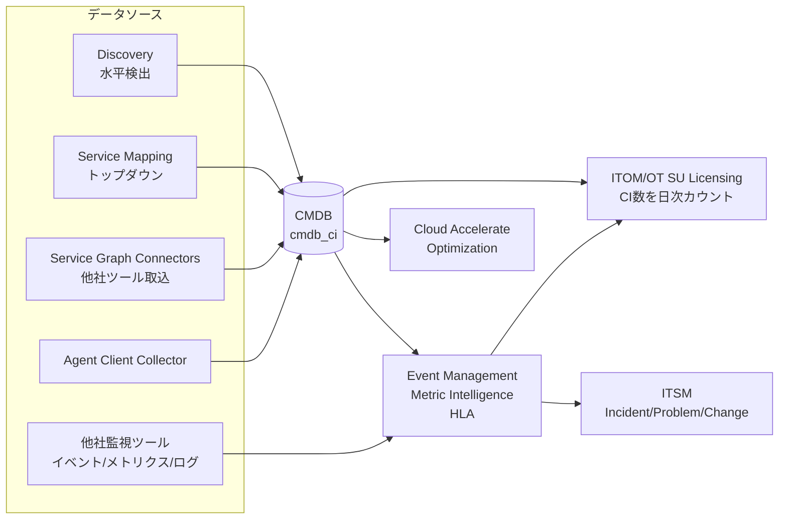
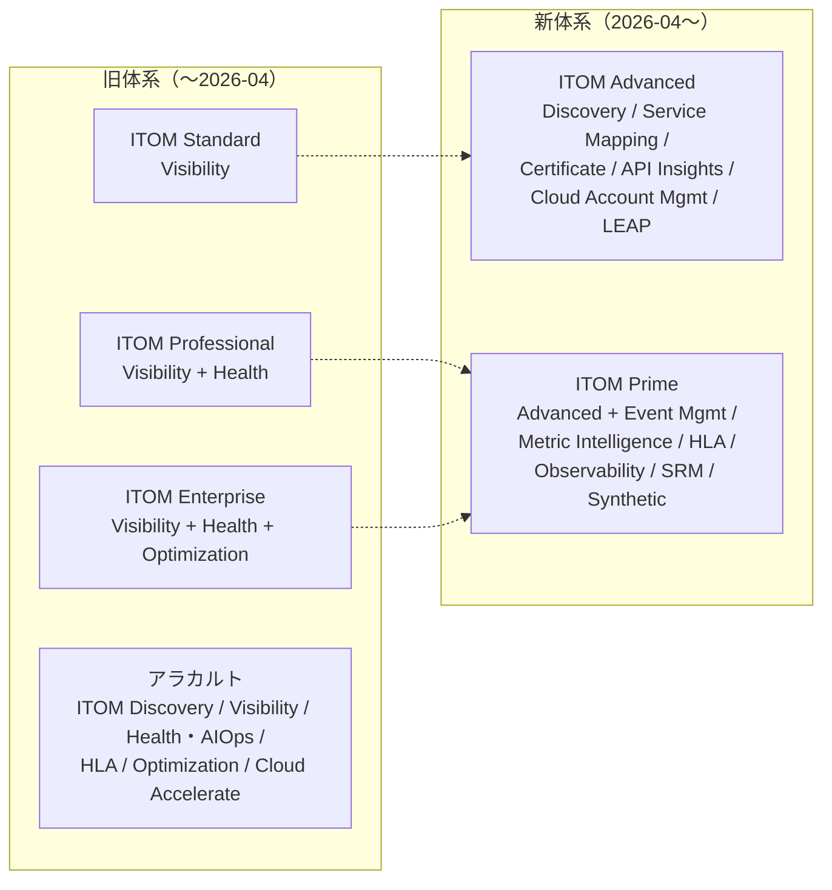
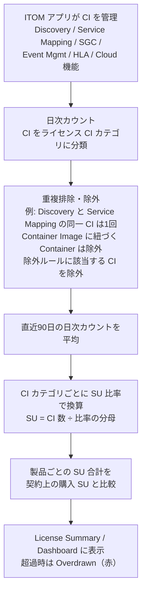
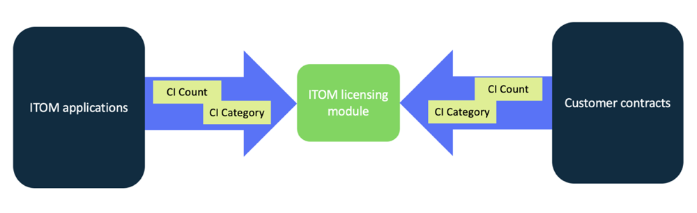
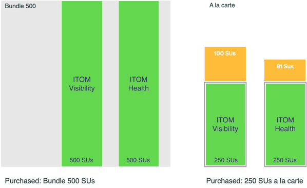
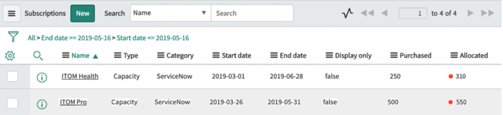
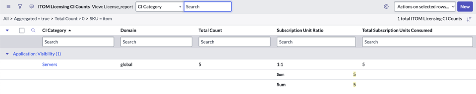
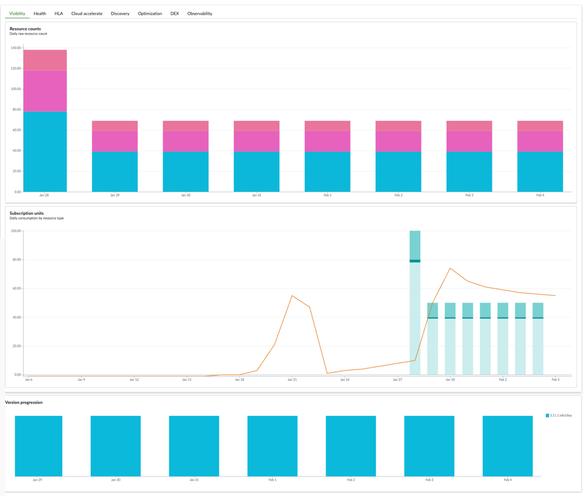

# ITOM 概要とパッケージ（IT Operations Management）

## 概要

**IT Operations Management（ITOM、IT運用管理）** は、ServiceNow AI Platform 上で IT インフラとサービスを **可視化（Visibility）**・**健全性監視（Health / AIOps）**・**最適化（Optimization / Cloud）** するための製品群である。Australia 版の公式ドキュメントは ITOM の目的を「インフラとサービスの可視化」「AI による障害の予防と解決（AIOps）」「クラウド戦略の加速（Cloud Accelerate）」の3点で説明している。[出典](https://www.servicenow.com/docs/r/australia/it-operations-management/r_ITOMApplications.html)

本ファイルは ITOM の**製品の組み合わせ方と課金方法**を扱う。答える内容は次のとおり。

| 問い | 該当セクション |
|---|---|
| ITOM にはどんな製品（課金単位）とアプリケーションがあるか | [2. ITOM の製品構成](#2-itom-の製品構成australia) |
| Visibility / Health / Optimization とは何か | [3.1 3つの領域](#31-visibility--health--optimization3つの領域) |
| ITOM Standard / Professional / Enterprise の違いは何か | [3.2 旧パッケージ](#32-旧パッケージitom-operator-standard--professional--enterprise) |
| 2026-04 以降の ITOM Advanced / ITOM Prime には何が含まれるか | [4. 新パッケージ](#4-新パッケージitom-advanced--itom-prime2026-04-以降) |
| Subscription Unit（SU）はどう数えるか、比率はいくつか | [5. SU の仕様](#5-subscription-unitsuによる課金の仕様) |
| バンドルとアラカルトはどう消費されるか | [6. バンドルとアラカルト](#6-サブスクリプションの種類バンドルとアラカルト) |
| インスタンス上でどう使用量を確認するか（メニュー・テーブル・ロール） | [7. ITOM/OT SU Licensing アプリ](#7-itomot-su-licensing-アプリケーション) |
| 構成モジュールのプラグイン ID は何か | [8. 構成モジュールとプラグイン](#8-構成モジュールとプラグイン) |
| Brazil で何が変わるか | [9. Brazil での変更](#9-brazil-での変更点) |

> **重要な前提（2026-11 時点）:** ITOM の商用パッケージは 2026-04 に刷新され、旧体系（ITOM Standard / Professional / Enterprise）から **ITOM Advanced / ITOM Prime** の2層に移行した。一方、製品ドキュメント（Australia / Brazil）の課金説明は製品単位（ITOM Visibility、ITOM AIOps など）とバンドル単位の SU 消費を説明しており、パッケージ名には触れていない。公式ドキュメントは、適用する CI カテゴリと比率は顧客契約で決まる（The customer contract for your organization determines the CI categories from the available options）と説明している。契約上の権利（Entitlement）と SU 比率は、必ず契約書（Order Form）と ServiceNow アカウントチームで確認する。[出典](https://www.servicenow.com/docs/r/australia/it-operations-management/itom-license-module.html)

---

## 1. 用語

| 英語 | 日本語 | 説明 |
|---|---|---|
| IT Operations Management (ITOM) | IT運用管理 | インフラの検出・マッピング・監視・クラウド管理を扱う ServiceNow の製品群 |
| Subscription Unit (SU) | サブスクリプションユニット | ITOM の課金単位。ユーザー数ではなく、ITOM アプリが管理する IT リソース（CI）数を、CI カテゴリごとの比率で換算した値 |
| Managed IT Resource | 管理対象 IT リソース | SU 換算の対象になるリソース。Server、PaaS Resource、Container などの種別（Managed IT Resource Type）に分かれる |
| CI category | CI カテゴリ | ライセンス上のリソース分類。製品ドキュメントでは Containers、PaaS、FaaS、Servers などと表記 |
| Subscription Unit Ratio | SU 比率 | 1 SU に相当する CI の数。契約で決まる |
| Unresolved Monitored Object | 未解決の監視対象 | イベントやメトリクスを受信したが CMDB の CI に紐付かない IT リソース |
| Bundle | バンドル | 複数の ITOM 製品をまとめて購入する形態。対象製品それぞれに同数の SU が付与される |
| A la carte | アラカルト（個別購入） | ITOM 製品を1つずつ購入する形態 |
| Overdrawn | 超過（オーバードロー） | 消費 SU が購入 SU を上回った状態 |
| ITOM/OT SU Licensing | ITOM/OT SU ライセンス | SU の購入数と消費数を計算・表示する Store アプリ |
| OTM (Operational Technology Management) | OT 管理 | 製造業向けの OT（制御系）資産管理。ITOM と同じライセンス機構で SU を管理する |

---

## 2. ITOM の製品構成（Australia）

### 2.1 課金対象の ITOM 製品一覧

Australia 版の「Subscriptions for IT Operations Management」（2026-10-18 更新）は、利用に応じて課金される ITOM 製品として次の10製品を挙げている。[出典](https://www.servicenow.com/docs/r/sPnEbors95h6DhgBlE~f0A/y5L~1SujMuCHZYScdrbXLQ)

このページが含まれるアプリケーションを挙げているのは #1〜#3 と #6 だけである。#4・#5・#9 は短い説明だけで、#7・#8・#10 は製品名しか載っていない。そのため、それらの行の「含まれるアプリケーション / 機能」列は、行内に示した別ページの情報で補っている。

| # | 製品（英語正式名） | 日本語 | 含まれるアプリケーション / 機能 | SU のカウント方法 |
|---|---|---|---|---|
| 1 | **ITOM Visibility** | ITOM 可視化 | Discovery、Firewall Audits and Reporting、Certificate Inventory and Management、Service Mapping、Cryptographic Asset Compliance、AI Agent Topology Mapping、ITOM Content Service、Tag Governance（機能限定）、Cloud Discovery Workspace、Cloud License Estimator。Service Graph Connectors と CMDB 360 がデータを供給する | Horizontal Discovery（水平検出）と Top-down Discovery（Service Mapping）で検出した CI 数＋Service Graph Connectors が CMDB に投入した CI 数 |
| 2 | **ITOM Discovery** | ITOM ディスカバリー | Discovery、Service Graph Connectors、CMDB 360（エントリーレベルの代替パッケージ。ITOM Visibility の「サブセット」） | Discovery で検出した CI 数＋Service Graph Connectors で取り込んだ CI 数 |
| 3 | **ITOM AIOps** | ITOM AIOps | Event Management、Metric Intelligence | アラート・イベント・メトリクスを取得した CI 数（全 CI カテゴリ） |
| 4 | **Health Log Analytics (HLA)** | ヘルスログ分析 | Health Log Analytics（Subscriptions ページにはアプリの列挙なし。ITOM 製品一覧ページより [出典](https://www.servicenow.com/docs/r/australia/it-operations-management/r_ITOMApplications.html)） | ライセンス対象リソースから受信したログデータに基づく CI 数。消費は ITOM AIOps 側にも反映されるため、**HLA には ITOM AIOps サブスクリプションも必要** |
| 5 | **ITOM Optimization** | ITOM 最適化 | Cloud Provisioning and Governance（CPG。現在は Cloud Services Catalog に移行）。Subscriptions ページはクラウドリソースのライフサイクル管理の自動化と説明するだけで、アプリは挙げていない。CPG は ITOM 製品一覧ページと ITOM Optimization ランディングページより [出典](https://www.servicenow.com/docs/r/australia/it-operations-management/r_ITOMApplications.html) / [出典](https://www.servicenow.com/docs/r/australia/it-operations-management/itom-optimization-landing-page.html) | 公式ドキュメントに記載なし（専用の使用量カウントジョブあり。[7.5](#75-テーブルとスケジュールジョブ) 参照） |
| 6 | **ITOM Cloud Accelerate** | ITOM クラウドアクセラレート | Tag Governance、Cloud Migration Assessment、Cloud Configuration Governance、Cloud Action Library（製品ページでは Cloud Account Management、Cloud Services Catalog も説明） | Cloud Migration Assessment / Cloud Configuration Governance / Cloud Action Library が管理・監視する CI 数。複数機能が同じ CI を報告した場合は重複を除く |
| 7 | **Service Reliability Management (SRM)** | サービス信頼性管理 | アラート・インシデントへの対応・連携・追跡・自己修復（Subscriptions ページには製品名のみ。ITOM 製品一覧ページより [出典](https://www.servicenow.com/docs/r/australia/it-operations-management/r_ITOMApplications.html)） | 記載なし（前提：ITSM Standard と ITOM Operator Professional の両サブスクリプションが必要。ITOM 製品一覧ページの記載 [出典](https://www.servicenow.com/docs/r/australia/it-operations-management/r_ITOMApplications.html)） |
| 8 | **SLO Management** | SLO 管理 | 合意したサービス品質目標の定義・追跡・達成。SLA と併用する（Subscriptions ページには製品名のみ。ITOM 製品一覧ページより [出典](https://www.servicenow.com/docs/r/australia/it-operations-management/r_ITOMApplications.html)。SLI / エラーバジェットについては [Event Management と AIOps](./event-management-aiops.md) を参照） | 記載なし |
| 9 | **Service Observability** | サービスオブザーバビリティ | 複数の監視ツールのテレメトリを1つのワークフローに集約し、分散システムのインシデントをトリアージ・管理する（Subscriptions ページは「既存の他社監視ツールのデータを集約できる」と書くだけで、アプリは挙げていない。ITOM 製品一覧ページより [出典](https://www.servicenow.com/docs/r/australia/it-operations-management/r_ITOMApplications.html)） | 記載なし（ライセンスダッシュボード上は個別に集計） |
| 10 | **Synthetic Monitoring** | 合成監視 | API エンドポイントに対してユーザートランザクションをシミュレーションし、性能のボトルネックを見つける（Subscriptions ページには製品名のみ。ITOM 製品一覧ページより [出典](https://www.servicenow.com/docs/r/australia/it-operations-management/r_ITOMApplications.html)） | 記載なし |

補足：

- ITOM/OT SU Licensing アプリのランディングページと ITOM Licensing Dashboard は、上記に加えて **Digital End-User Experience（DEX）** も SU 集計対象として表示する。DEX の SU 比率は EUC（End User Computing）デバイス 4 台 = 1 SU と DEX のドキュメントに記載されている。[出典](https://www.servicenow.com/docs/r/australia/it-operations-management/itom-licensing-dashboard.html) / [出典](https://www.servicenow.com/docs/r/australia/it-service-management/digital-end-user-experience-dex/dex-subscription.html)
- ITOM Visibility を使うには Discovery と Service Mapping のプラグインの有効化が必要であり、これらのプラグインは ITOM Visibility サブスクリプションに依存する。[出典](https://www.servicenow.com/docs/r/australia/it-operations-management/itom-visibility/itom-visibility-landing-page.html)
- ITOM アプリケーションの多くは ServiceNow Store 経由で更新され、ファミリーリリースとは独立した独自のリリーススケジュールを持つ。最新機能を使うには Store アプリの更新が必要である。[出典](https://www.servicenow.com/docs/r/australia/it-operations-management/r_ITOMApplications.html)

### 2.2 ドキュメント上の領域見出し（Visibility / Health / Optimization）

Australia 版の ITOM ランディングページは、アプリケーションを今も「Visibility: Discovery」「Visibility: Service Mapping」「Health: Event Management」「Health: Health Log Analytics」「Health: Agent Client Collector」「Optimization: Cloud Provisioning and Governance」という**領域：アプリ名**の形式で掲載している。これは旧パッケージ時代の3領域（[3.1](#31-visibility--health--optimization3つの領域)）の名残である。[出典](https://www.servicenow.com/docs/r/australia/it-operations-management/r_ITOMApplications.html)

| 領域見出し | アプリケーション | 説明（公式ドキュメント要約） | 詳細ファイル |
|---|---|---|---|
| Visibility | Discovery | インフラ構成要素を継続的にスキャン・識別し CMDB を最新に保つ | [Discovery](./discovery.md) |
| Visibility | Service Mapping | アプリケーションサービスを検出し、使用するデバイス・アプリ・構成プロファイルをマッピング | [Service Mapping](./service-mapping.md) |
| Health | Event Management | 各種ソースからイベントを収集し、原因を特定してアラートに変換・グループ化 | [Event Management と AIOps](./event-management-aiops.md) |
| Health | Health Log Analytics | 関連ログをトリアージし、生データから根本原因を見つける | [Event Management と AIOps](./event-management-aiops.md) |
| Health | Agent Client Collector (ACC) | インフラにインストールするエージェント。監視チェックを実行し MID Server 経由でインスタンスへ送信。Sensu フレームワークがベース | [Event Management と AIOps](./event-management-aiops.md) / [MID Server](../platform/mid-server.md) |
| Optimization | Cloud Provisioning and Governance | クラウドリソースへの統合インターフェース。Cloud Services Catalog アプリに移行 | [Cloud Management](./cloud-management.md) |

### 2.3 製品名の変遷：ITOM Health → ITOM AIOps

ITOM のヘルス領域の製品名は、ドキュメント上で次のように変わっている。

| ドキュメント版 | 製品名 | 内容 |
|---|---|---|
| Xanadu 版（2025-01-30 更新） | **ITOM Health** | Event Management など。「HLA には ITOM Health サブスクリプションも必要」と記載 [出典](https://www.servicenow.com/docs/r/LZHoJyH9VPKmhdIph_6gSw/P1uAlkn352WkEJxmmYC0Xw) |
| Zurich 版（2026-03-12 更新） | **ITOM AIOps** | Event Management など。HLA の前提も ITOM AIOps に変更 [出典](https://www.servicenow.com/docs/r/guxhDnVk8OUAJKLm7WZsYA/8XAnPqUIHAXKSJUAjYY0Mw) |
| Australia 版（2026-10-18 更新） | **ITOM AIOps** | Event Management と Metric Intelligence を含むと明記 [出典](https://www.servicenow.com/docs/r/sPnEbors95h6DhgBlE~f0A/y5L~1SujMuCHZYScdrbXLQ) |

Yokohama 版の表記は本調査では確認できなかった。ITOM Licensing Dashboard のタブ名とスケジュールジョブ名（`ITOM Health Licensing Usage Count`）には、今も「Health」という名称が残っている。[出典](https://www.servicenow.com/docs/r/australia/it-operations-management/components-installed-with-itom-su-licensing.html)

### 2.4 ITOM のデータの流れ（全体像）

ITOM Visibility が CMDB に集めたデータは、ITOM AIOps（アラートを CI にマッピング）、ITOM Optimization、Software Asset Management、Customer Service Management、Security Operations などの基盤になる。[出典](https://www.servicenow.com/docs/r/australia/it-operations-management/itom-visibility/itom-visibility-landing-page.html) CMDB の詳細は [CMDB と CSDM](../platform/cmdb-csdm.md) を参照。

---

## 3. 旧パッケージ体系

### 3.1 Visibility / Health / Optimization（3つの領域）

ITOM は長く、次の3領域で製品を組み立ててきた。

| 領域 | 日本語 | 主なアプリケーション | 確度 |
|---|---|---|---|
| **ITOM Visibility** | 可視化 | Discovery、Service Mapping（＋Certificate Inventory、Firewall Audits、Service Graph Connectors、CMDB 360 など） | 公式（現行製品名として存続） |
| **ITOM Health** | 健全性 | Event Management、Operational Intelligence（現 Metric Intelligence）、Health Log Analytics、Agent Client Collector | 公式（Xanadu 版まで製品名。Zurich 以降 ITOM AIOps） |
| **ITOM Optimization** | 最適化 | Cloud Management / Cloud Provisioning and Governance、Orchestration | 公式（現行製品名として存続） |

[出典](https://www.servicenow.com/docs/r/australia/it-operations-management/r_ITOMApplications.html) / [出典](https://www.servicenow.com/docs/r/LZHoJyH9VPKmhdIph_6gSw/P1uAlkn352WkEJxmmYC0Xw)

Optimization の CPG プラグイン（`com.snc.cloud.mgmt`）は、Orchestration（`com.snc.runbook_automation`）を依存プラグインとして有効化する。[出典](https://www.servicenow.com/docs/r/australia/it-operations-management/plugin-itom-optimization.html)

### 3.2 旧パッケージ：ITOM (Operator) Standard / Professional / Enterprise

2026-04 の刷新前、ITOM は Standard / Professional（Pro）/ Enterprise の3段階のパッケージ（バンドル）で販売されていた。公式資料では **「ITOM Operator Standard, Professional, and Enterprise package」** という名称が使われている（2023-05-04 発効の SU Overview）。[出典](https://www.servicenow.com/community/s/cgfwn76974/attachments/cgfwn76974/configuration-management-db-forum/6069/1/it-operations-management-itom-servicenow-subscription-unit-overview.pdf)

各パッケージに含まれる領域は、公式の一次資料では確認できなかった。第三者情報では次の対応が一般的に説明されている。

| パッケージ | 含まれる領域（第三者情報） | 主なアプリケーション |
|---|---|---|
| ITOM Standard | Visibility | Discovery、Service Mapping |
| ITOM Professional（ITOM Pro） | Visibility ＋ Health | ＋ Event Management、Operational Intelligence（Metric Intelligence） |
| ITOM Enterprise | Visibility ＋ Health ＋ Optimization | ＋ Cloud Management |

【第三者情報】[出典（Cookdown）](https://www.cookdown.com/blog/the-hidden-costs-of-servicenow-itom) / [出典（ScienceSoft）](https://www.scnsoft.com/servicenow/itom)

> **注意（情報の不一致）:** 旧パッケージの内訳は情報源によって異なる。ServiceNow Community の回答（2023-06）は Standard に Event Management と Cloud Management を含めており、上表と矛盾する。別の第三者は「ITOM Visibility / ITOM Professional / ITOM AIOps Enterprise」という名称を使い、Enterprise に HLA と Cloud Accelerate を入れている。契約時期によって SKU 構成が変わってきたためと考えられる【推定】。既存顧客は自社の Order Form の SKU 名で判断すること。[出典（Community）](https://www.servicenow.com/community/itom-forum/itom-packages/m-p/2586582) / [出典（Cyntexa）](https://cyntexa.com/blog/what-is-servicenow-itom/)

公式ドキュメントで旧パッケージ名が残っている箇所：

| 箇所 | 記載 | 出典 |
|---|---|---|
| ITOM/OT SU Licensing のバンドル説明 | 「ITOM Pro bundle」がバンドル消費の例として登場 | [出典](https://www.servicenow.com/docs/r/australia/it-operations-management/itom-licensing-bundle-individual-subscription.html) |
| Subscriptions 画面のサンプル図 | 「ITOM Pro」（Type: Capacity）と「ITOM Health」（アラカルト）が並ぶ 2019 年日付のサンプル | 同上（[6.3 の図](#63-バンドルとアラカルトの併用) 参照） |
| Service Reliability Management | 「SRM is available when you have both ITSM Standard and ITOM Operator Professional subscriptions」（ITSM Standard と ITOM Operator Professional の両サブスクリプションがある場合に利用可能） | [出典](https://www.servicenow.com/docs/r/australia/it-operations-management/r_ITOMApplications.html) |

### 3.3 旧パッケージに付属する Protocols と Spokes

2023-05-04 発効の SU Overview は、ITOM Operator Standard / Professional / Enterprise の各パッケージに次の Protocol と Spoke の権利が含まれると定めている。ただし、使用に必要な IntegrationHub Transactions の権利は別途必要である。[出典](https://www.servicenow.com/community/s/cgfwn76974/attachments/cgfwn76974/configuration-management-db-forum/6069/1/it-operations-management-itom-servicenow-subscription-unit-overview.pdf)

| 種別 | 対象 |
|---|---|
| Protocols | PowerShell、SSH |
| Spokes | Jenkins、Microsoft Active Directory、Microsoft Azure Active Directory、Microsoft SCCM for Client Software Distribution、Kubernetes、F5 Networks |

Australia 版のドキュメントは、ITOM バンドルが「選択された Spoke と Protocol について Integration Hub / Workflow Data Fabric の権利を提供する」と記載している。権利の詳細は次のとおり。[出典](https://www.servicenow.com/docs/r/australia/it-operations-management/itom-licensing-subscription-types.html)

- ITOM バンドルには、選択された Spoke・Protocol を使う Integration Hub の権利が含まれる。
- ITOM Cloud Accelerate には追加で **Integration Hub Enterprise** バンドルの権利が必要である。
- ITOM バンドルには、選択された Spoke・Protocol を使う Workflow Data Fabric の権利も含まれる。ITOM Cloud Accelerate アプリ以外から Cloud Action Library を使う場合は、追加で **Workflow Data Fabric Enterprise** バンドルの権利が必要である。
- Cloud Account Management には **Cloud Governance Suite** SKU が必要である（Australia 版ドキュメントの現行記述「Cloud Account Management requires the Cloud Governance Suite SKU.」）。一方、2026 年の pricing ページは ITOM Advanced に Cloud Account Management を含めている（[4.2](#42-itom-advanced--itom-prime-の構成公式-pricing-ページ) 参照）。両者の関係（新 SKU では Cloud Governance Suite が不要になるのか）は公開情報では確認できないため、新 SKU での扱いは契約で確認する【推定】。

関連：[IntegrationHub](../platform/integrationhub.md)、[Workflow Data Fabric](../platform/workflow-data-fabric.md)

---

## 4. 新パッケージ：ITOM Advanced / ITOM Prime（2026-04 以降）

### 4.1 位置付け

ServiceNow は 2026 年に製品を **Foundation / Advanced / Prime** の3ティアに再編した。各ティアには AI が組み込まれ、上位ティアは下位ティアの機能を積み増す形をとる。[出典](https://www.servicenow.com/docs/r/australia/intelligent-experiences/ai-native-sku-overview.html) 製品横断の整理は [プラットフォームのパッケージ構成](../platform/platform-licensing-packaging.md) を参照。

ITOM は他製品と異なり、**Foundation ティアがなく、ITOM Advanced と ITOM Prime の2ティア**で構成される。

| 項目 | 内容 | 確度・出典 |
|---|---|---|
| ティア | ITOM Advanced / ITOM Prime（Prime に "RECOMMENDED" 表示） | 公式 pricing ページ（2026-08-11 時点のアーカイブで確認） [出典](https://www.servicenow.com/products/it-operations-management/pricing.html) |
| Foundation がない | ITOM の新パッケージには Foundation 層がない | 【第三者情報】ServiceNow Community 寄稿 [出典](https://www.servicenow.com/community/architect-articles/navigating-the-april-2026-servicenow-itom-licensing-model/ta-p/3555121) |
| 切替時期 | 2026-04-09 に新 SKU を導入。旧 SKU の新規販売終了は 2026-07-01 とされる | 【第三者情報】（ServiceNow の一次発表は未確認）。詳細は [プラットフォームのパッケージ構成](../platform/platform-licensing-packaging.md) |
| Store アプリ | 「ITOM - Advanced」（初版 1.0.7、2026-04）と「ITOM - Prime」（初版 1.0.3、2026-04）が Store アプリとして提供される | 公式 Store リリースノート [出典](https://www.servicenow.com/docs/r/C17ZqvSaMwUVpMBg8Nc5sg/0GjkrppnhBYMGV8qrvwZoQ) / [出典](https://www.servicenow.com/docs/r/store-release-notes/store-rn-itom-prime.html) |
| SU は維持 | 新パッケージでも SU が基本の課金単位。SU 比率表は 2026-04-09 発効版に改訂 | 公式 SU Overview（[5.4](#54-su-比率managed-it-resource-type-と比率)） |

### 4.2 ITOM Advanced / ITOM Prime の構成（公式 pricing ページ）

servicenow.com の ITOM pricing ページ（Wayback Machine 2026-08-11 取得のアーカイブで確認）は、2つのパッケージを次のように掲載している。[出典](https://www.servicenow.com/products/it-operations-management/pricing.html)

**パッケージカードの記載**

| ITOM Advanced | ITOM Prime（"RECOMMENDED"） |
|---|---|
| 説明：Agentic workflows that automate IT operations, working side by side with your team to prevent issues.（IT 運用を自動化し、チームと並んで問題を予防するエージェント型ワークフロー） | 説明：AI Specialists that independently manage infrastructure health, make decisions, and drive uptime.（インフラの健全性を自律的に管理し、判断し、稼働率を高める AI スペシャリスト） |
| Discovery | **Includes Advanced, and:**（Advanced のすべて＋以下） |
| Service Mapping | AI Specialists |
| Certificate Inventory and Management | Event Management |
| AI Agent Topology Mapping | Metric Intelligence |
| Now Assist for ITOM (Advanced) | Health Log Analytics |
| API Insights | Now Assist for ITOM (Prime) |
| Learning Enhanced Automation Playbook (LEAP) | Service Observability |
| Cloud Account Management | Service Reliability Management |
| | Synthetic Monitoring |

**機能比較表（Compare features）の記載**（○＝含む、×＝含まない）

| 区分 | 機能 | ITOM Advanced | ITOM Prime |
|---|---|---|---|
| AI Agents and Skills | Now Assist for ITOM | ○ | ○ |
| | Now Assist for Service Graph Connectors | ○ | ○ |
| | Platform AI Skills and Agents | ○ | ○ |
| | Document Intelligence | ○ | ○ |
| | Now Assist for CMDB | ○ | ○ |
| | Now Assist for Setup | ○ | ○ |
| ITOM Capabilities | Agentless Discovery | ○ | ○ |
| | IT Service Graph Connectors | ○ | ○ |
| | CMDB 360 | ○ | ○ |
| | Service Mapping | ○ | ○ |
| | Tag Governance | ○ | ○ |
| | TLS Certificate Inventory and Management | ○ | ○ |
| | Firewall Audits and Reporting | ○ | ○ |
| | API Insights | ○ | ○ |
| | Cloud Account Management | ○ | ○ |
| | Agent Client Collector - Framework | ○ | ○ |
| | Kubernetes Visibility Agent | ○ | ○ |
| | LEAP | ○ | ○ |
| | Event Management | × | ○ |
| | Metric Intelligence | × | ○ |
| | Agent Client Collector - Monitoring | × | ○ |
| | SLO/SLI Management | × | ○ |
| | Service Reliability Management | × | ○ |
| | Health Log Analytics | × | ○ |
| | Service Observability | × | ○ |
| | Synthetic Monitoring | × | ○ |
| Platform Capabilities | AI Control Tower、Workflow Data Fabric、CMDB、CSDM、Knowledge Management、Employee Center、Now Mobile、Workflow Automation、Application Development、Predictive Intelligence、App Engine Starter、Universal Request Pro、Mobile Publishing、Platform Analytics Advanced、Process Mining | ○ | ○ |

※ 名称は 2026-08-11 時点の pricing ページの表記である。2026-08 以降、Now Assist 製品は ServiceNow Otto にリブランドされている（ITOM - Advanced 1.1.3。[4.3](#43-store-アプリitom---advanceditom---primeのバージョン履歴) 参照）。たとえば「Now Assist for Setup」は [8.2](#82-itom-のセットアップ導線) の「ServiceNow Otto for Setup」と同じものである。

pricing ページの脚注は「App Engine Starter のテーブルは、パッケージ化されたアプリケーションの構成用である」としている。

> **ポイント:** 新パッケージは「**可視化（Advanced）**」と「**可視化＋監視・AIOps・オブザーバビリティ（Prime）**」に分かれる。旧 Professional に相当する「Visibility ＋ Event Management」という中間の組み合わせはない。Event Management や AIOps のアラート相関が必要な場合は Prime が前提になる、と Community 寄稿も指摘している。【第三者情報】[出典](https://www.servicenow.com/community/architect-articles/navigating-the-april-2026-servicenow-itom-licensing-model/ta-p/3555121)

### 4.3 Store アプリ「ITOM - Advanced」「ITOM - Prime」のバージョン履歴

| アプリ | バージョン | 時期 | 主な内容 |
|---|---|---|---|
| ITOM - Advanced | 1.0.7 | 2026-04 | 初版の製品説明 |
| | 1.0.8 | 2026-05 | AI Agent Topology Mapping、ITOM URL Discovery、ITOM Configuration Console |
| | 1.0.10 | 2026-06 | AI エージェントの初回リリース、AIOps LEAP プレイブック |
| | 1.1.0 | 2026-07 | 複数ルールのファイアウォールタスク、Tag-Based Service Mapping エージェント |
| | 1.1.3 | 2026-08 | Cryptographic Asset Compliance、Otto へのリブランド |
| | 1.1.5 | 2026-09 | LEAP マルチタクソノミー、LEAP MCP Server、ITOM URL Discovery の上限 |
| | 1.1.7 | 2026-10 | Microsoft Foundry のトポロジーマッピング、LEAP のサードパーティモデル対応 |
| ITOM - Prime | 1.0.3 | 2026-04 | 初版。ITOM - Advanced に AIOps と Service Observability を追加した製品と説明 |
| | 1.0.4 | 2026-05 | ITOM MCP Server（Claude、ChatGPT 等の外部 AI ツールとの接続） |
| | 1.1.0 | 2026-07 | AI agents for AIOps / Observability（New Relic、Dynatrace、Kentik）/ HLA / SLO、LEAP |
| | 1.2.1 | 2026-08 | AIOps AI Specialist（Controlled Availability） |
| | 1.2.5 | 2026-10 | 最新（2026-10 時点） |

[出典（Advanced）](https://www.servicenow.com/docs/r/C17ZqvSaMwUVpMBg8Nc5sg/0GjkrppnhBYMGV8qrvwZoQ) / [出典（Prime）](https://www.servicenow.com/docs/r/store-release-notes/store-rn-itom-prime.html)

AI 機能（Now Assist for ITOM、AI エージェント）の詳細は [Now Assist と AI Agents](../platform/now-assist-ai-agents.md) と [Event Management と AIOps](./event-management-aiops.md) を参照。

### 4.4 Service Ops（ITSM＋ITOM 統合 SKU）とクレジット

| 項目 | 内容 | 確度 |
|---|---|---|
| Service Ops Advanced / Service Ops Prime | ITSM と ITOM を1つのクレジットメーターにまとめ、トゥルーアップと更新サイクルを1本化した組み合わせ SKU | 【第三者情報】 |
| クレジット換算 | 「1 Credit = 1 ITOM SU」「10 Credits = 1 ITSM Fulfiller User」 | 【第三者情報】 |
| GenAI アドオン | ITOM の生成 AI 用アドオン SKU は廃止され、Now Assist for ITOM が両ティアに異なるレベルで組み込まれた | 【第三者情報】 |

[出典](https://www.servicenow.com/community/architect-articles/navigating-the-april-2026-servicenow-itom-licensing-model/ta-p/3555121) / ITSM 側の説明は [ITSM 概要とパッケージ](../itsm/itsm-overview.md) を参照。

### 4.5 旧体系から新体系への対応（目安）

上図の対応は機能の重なりに基づく目安【推定】である。ServiceNow は旧→新の公式対応表を公開しておらず、移行の可否・条件は契約更新時にアカウントチームと確認する。ITOM/OT SU Licensing アプリには、2026 Packaging SKU に移行した場合の SU 消費を予測する機能がある（[7.6](#76-2026-packaging-sku-への移行予測)）。

---

## 5. Subscription Unit（SU）による課金の仕様

### 5.1 SU の基本

ITOM の課金は、**ITOM アプリが管理する IT リソース（CI）の数**を **CI カテゴリごとの SU 比率**で換算した SU 数で行う。ユーザー数（Fulfiller 数）では課金しない。公式ドキュメントの説明は次のとおり。[出典](https://www.servicenow.com/docs/r/sPnEbors95h6DhgBlE~f0A/y5L~1SujMuCHZYScdrbXLQ)

- ライセンス対象のリソースは CI カテゴリに割り当てられる。
- ライセンス使用量は SU で測定され、1 SU がカバーするリソース数は CI カテゴリによって異なる。
- 顧客契約が、利用可能な選択肢から**適用する CI カテゴリ**と**各カテゴリの SU 比率**を決める。
- 契約の情報は ServiceNow プラットフォームに同期される（インスタンス上の License Summary に反映される）。

SU Overview（契約の付属文書）は、SU を「定義された比率（Defined Ratios）で Managed IT Resource に適用する測定単位」と定義している。【第三者情報】（SU Overview の定義を引用した第三者 Wiki） [出典](https://wiki.licenseware.io/wiki/servicenow-itom-subscription-units/)

### 5.2 SU 計算の流れ

公式ドキュメントの「Data collection and aggregation for licensing process」の手順は次のとおり。[出典](https://www.servicenow.com/docs/r/australia/it-operations-management/data-collection-aggregation-licensing-process.html)

1. ITOM ライセンス機構が、各 ITOM 製品が管理する CI を**毎日**カウントし、ライセンス CI カテゴリに分類する（詳細ロジックは Now Support の KB0748149「ITOM Subscription Unit license calculation logic」）。
2. 同じ ITOM 製品内の異なる機能が同じ CI を管理している場合は、重複を除く。例：Discovery と Service Mapping の両方が同じ CI を検出した場合、CI カウントには1回だけ現れる。
3. Container Image と関係を持つ Container CI は SU カウントから除外する。
4. ライセンスモジュールは ITOM アプリの CI カウントを集計し、**直近90日の日次平均 CI 数**を求める。
5. 直近90日の日次平均 CI 数を顧客契約のライセンス情報と比較し、ライセンス統計を生成する。

*図1：ITOM application license flow（ITOM アプリケーションのライセンスの流れ）*

画面説明：左に「ITOM applications」、右に「Customer contracts（顧客契約）」の箱があり、中央の緑の箱「ITOM licensing module（ITOM ライセンスモジュール）」に向かって両側から矢印が伸びている。左の矢印には「CI Count」「CI Category」のラベル（ITOM アプリが実際に管理している CI 数とカテゴリ）、右の矢印にも「CI Count」「CI Category」のラベル（契約上の購入数とカテゴリ・比率）が付いている。ライセンスモジュールが両者を突き合わせて消費状況を算出することを表す。
出典：https://www.servicenow.com/docs/r/australia/it-operations-management/data-collection-aggregation-licensing-process.html （Australia 版、2026-03-12 更新）／取得日：2026-11-03

### 5.3 CI カテゴリ（Australia）

Australia 版の「Check which CI types require an ITOM subscription」ページと「Subscriptions for IT Operations Management」ページ（2026-10-18 更新）は、「The latest version ... supports the following CI categories:」（最新版は次の CI カテゴリをサポートする）の下に**15項目**を挙げている。どのカテゴリを適用するかは顧客契約による。15項目めの「UMOs」は、6番めの Unresolved Monitored Object の略記と見られ、同じものが重複して載っている可能性がある【推定】。Brazil 版の同じページ（2026-10-18 更新）も、同じ15項目を挙げている。[出典](https://www.servicenow.com/docs/r/australia/it-operations-management/check-ci-type-require-license.html) / [出典](https://www.servicenow.com/docs/r/australia/it-operations-management/itom-license-module.html) / [出典（Brazil）](https://www.servicenow.com/docs/r/brazil/it-operations-management/itom-license-module.html)

| # | CI カテゴリ（英語） | 日本語 | 主な CMDB クラス（判明分） |
|---|---|---|---|
| 1 | Servers | サーバー | `cmdb_ci_server`、`cmdb_ci_vm_instance`、`cmdb_ci_ucs_rack_unit`、`cmdb_ci_ucs_blade`、`cmdb_ci_mainframe_hardware` と派生クラス |
| 2 | PaaS | PaaS リソース | `cmdb_ci_cloud_appserver`、`cmdb_ci_cloud_database`、`cmdb_ci_dynamodb_table`、`cmdb_ci_cloud_directory`、`cmdb_ci_cloud_gateway`、`cmdb_ci_cloud_messaging_service`、`cmdb_ci_cloud_webserver` と派生クラス |
| 3 | FaaS | FaaS（サーバーレス関数） | `cmdb_ci_cloud_function`（2024-05 の SU Licensing 3.5.0 で PaaS から分離） |
| 4 | Containers | コンテナ | `cmdb_ci_oslv_container` と派生クラス |
| 5 | Container Images | コンテナイメージ | 公開情報では確認できず |
| 6 | Unresolved Monitored Object | 未解決の監視対象 | `em_unique_nodes`（`type` = `unknown`） |
| 7 | Unclassed category | 未分類カテゴリ | 公開情報では確認できず |
| 8 | End User Devices | エンドユーザーデバイス | `cmdb_ci_computer`（2023 版定義）。Community 投稿では `cmdb_ci_pc_hardware` も |
| 9 | IoT | IoT | `cmdb_ci_iot`、`cmdb_ci_converged_infra`（SU Licensing 2.0.0 で追加） |
| 10 | Customer Prem Devices | 顧客宅内機器 | Community 投稿では `cmdb_ci_modem_network`、`cmdb_ci_optical_network_terminal`、`cmdb_ci_media_gateway`、`cmdb_ci_wap_network` |
| 11 | APIs | API | Community 投稿では `cmdb_ci_api` |
| 12 | AI Agents | AI エージェント | 2026 版 SU Overview では `cmdb_ci_function_ai` が挙げられているとされる【第三者情報】 |
| 13 | GPUs | GPU | 公開情報では確認できず |
| 14 | Service Instances | サービスインスタンス | 公開情報では確認できず |
| 15 | UMOs | （Unresolved Monitored Objects の略記と見られる【推定】） | 公開情報では確認できず（#6 と同じものなら `em_unique_nodes`） |

出典：Servers / PaaS / Containers / EUC / Unresolved Monitored Object の CMDB クラスは 2023-05-04 発効の SU Overview。[出典](https://www.servicenow.com/community/s/cgfwn76974/attachments/cgfwn76974/configuration-management-db-forum/6069/1/it-operations-management-itom-servicenow-subscription-unit-overview.pdf) FaaS / IoT はリリースノート。[出典](https://www.servicenow.com/docs/r/store-release-notes/store-rn-itom-su-licensing.html) Customer Prem Devices / APIs / EUC の追加クラスは Community 投稿（2026-09）。[出典](https://www.servicenow.com/community/itom-forum/article-for-itom-licensing-calculations-servicenow-it-operations/td-p/3596603)

補足：

- **Networking Devices / Networking Devices Advanced** というカテゴリも存在する（SU Licensing 1.1.0 で「Networking Devices Advanced」カテゴリを追加）。Community 投稿は Networking Devices に `cmdb_ci_netgear`、Networking Devices Advanced に `cmdb_ci_site`、`cmdb_ci_ni_interface` などを挙げている。ただし Australia 版の15項目の CI カテゴリ一覧には含まれていない。[出典](https://www.servicenow.com/docs/r/store-release-notes/store-rn-itom-su-licensing.html) / [出典](https://www.servicenow.com/community/itom-forum/article-for-itom-licensing-calculations-servicenow-it-operations/td-p/3596603)
- **CI クラスの継承:** `itom_lu_metadata` テーブルは親 CI タイプだけを保持し、親を拡張した子 CI タイプは既定でカウント対象に含まれる。例：Apache Web Server は Web Server の拡張なので CI カウントに含まれる。[出典](https://www.servicenow.com/docs/r/australia/it-operations-management/check-ci-type-require-license.html)
- **Non-Human Identity:** SU Licensing 3.13.0（2026-06）で `Non_human_identity` カテゴリが追加されたが、3.16.0（2026-09）で削除された。[出典](https://www.servicenow.com/docs/r/store-release-notes/store-rn-itom-su-licensing.html)

### 5.4 SU 比率（Managed IT Resource Type と比率）

SU 比率は契約付属の **ITOM Subscription Unit Overview**（servicenow.com の legal 文書）で定義され、表記は「Subscription Unit : Managed IT Resource」（1 SU あたりのリソース数）である。2023 版と 2026 版で比率が変わっている。

| Managed IT Resource Type | 2023-05-04 発効版 | 2026-04-09 発効版【第三者情報】（PDF 本文未確認。下記出典参照） |
|---|---|---|
| Server（物理・仮想サーバー） | 1 : 1 | 1 : 1 |
| PaaS Resource | 1 : 3 | 1 : 3 |
| Container | 1 : 3 | **1 : 10** |
| End User Computing Device | 1 : 4 | 1 : 4 |
| Unresolved Monitored Object | 1 : 1 | **1 : 4** |
| FaaS Resource | （カテゴリなし。PaaS に含む） | 1 : 20 |
| Container Image | （なし） | 1 : 3 |
| AI Agent | （なし） | 1 : 3 |
| GPU | （なし） | 1 : 1 |
| API | （なし） | 1 : 1 |
| Service Instance | （なし） | 1 : 1 |

出典：
- 2023 版：ServiceNow Subscription Unit Overview（ITOM）, Effective May 4, 2023。本調査で PDF 本文を確認。[出典](https://www.servicenow.com/community/s/cgfwn76974/attachments/cgfwn76974/configuration-management-db-forum/6069/1/it-operations-management-itom-servicenow-subscription-unit-overview.pdf)
- 2026 版：ServiceNow 公式 PDF「IT Operations Management (ITOM) - ServiceNow Subscription Unit Overview」（ファイル名に tanium を含む、2026-04-09 発効）。本調査では PDF を直接取得できず（HTTP 403）、検索エンジンの抜粋と第三者の転記で値を確認した。[出典](https://www.servicenow.com/content/dam/servicenow-assets/public/en-us/doc-type/legal/it-operations-management-itom-servicenow-subscription-unit-overview-tanium.pdf) / 【第三者情報】[出典（Redress Compliance）](https://redresscompliance.com/servicenow-itom-licensing-guide.html)

> **注意:**
> - 比率は**契約が参照する SU Overview の版**で決まる。新しい比率（例：Container 1:10）は、契約がその版の SKU を参照している場合にのみ適用され、旧契約の顧客は旧比率のまま、と第三者は説明している。【第三者情報】[出典](https://redresscompliance.com/servicenow-itom-licensing-guide.html)
> - 比率の書き方は資料によって逆になる。SU Overview と License Report 画面は「1:3」（1 SU : 3 リソース）と書き、Community 投稿は「3:1」（3 リソース = 1 SU）と書く。意味は同じである。
> - 製品ドキュメントの OTM Licensing dashboard ページ（Zurich 版・Australia 版とも 2026-10-08 更新）は、「one server, three PaaS resources, three containers, or one unresolved monitored object equal 1 SU」（1 server、3 PaaS、3 containers、1 unresolved monitored object がそれぞれ 1 SU）と例示している。これは 2023 版の比率に対応し、2026 版の比率は反映されていない。[出典](https://www.servicenow.com/docs/r/australia/operational-technology/otm-licensing-dashboard.html) / [出典（Zurich）](https://www.servicenow.com/docs/r/zurich/operational-technology/otm-licensing-dashboard.html)
> - SU Licensing 3.5.0（2024-05）のリリースノートは「SU ベースの ITOM サブスクリプションを持たないインスタンス向けの既定 SU 比率を更新した」と記載している。サブスクリプション記録がない場合（オンプレミスや非本番など）は既定比率で試算表示される。[出典](https://www.servicenow.com/docs/r/store-release-notes/store-rn-itom-su-licensing.html)

### 5.5 Managed IT Resource Type の定義（2023 版 SU Overview）

2023-05-04 発効の SU Overview は、各リソース種別を次のように定義している。[出典](https://www.servicenow.com/community/s/cgfwn76974/attachments/cgfwn76974/configuration-management-db-forum/6069/1/it-operations-management-itom-servicenow-subscription-unit-overview.pdf)

| 種別 | 定義（要約） |
|---|---|
| Server | 下記 CMDB テーブルの CI として表現され、ITOM アプリケーションが管理する物理または仮想サーバー |
| PaaS Resource | CMDB テーブルの CI として表現され、ITOM アプリが管理するクラウドベースのプラットフォームサービス |
| Container | CMDB テーブルの CI として表現され、ITOM アプリが管理する OS レベルの仮想化 |
| End User Computing Device | 他の種別に該当せず、**ITOM コンポーネントがインストールされた**物理または仮想のコンピューティングデバイス。CMDB の CI として表現され ITOM アプリが管理するもの |
| Unresolved Monitored Object | ITOM Health アプリがイベントまたはパフォーマンスメトリクスを受信したが、CMDB の CI として表現されていない IT リソース。`em_unique_nodes` テーブルに `type` = `unknown` で記録される |

2026 版では、Unresolved Monitored Object の対象にイベント・メトリクスに加えて**ログ**が加わったとされる。【第三者情報】[出典](https://redresscompliance.com/servicenow-itom-licensing-guide.html)

EUC デバイスについては、SU Licensing 3.11.0（2025-12）で「EUD は ServiceNow のコンポーネント（Agent Client Collector）がインストールされている場合のみ ITOM Health にカウントする」、3.16.0（2026-09）で「Health / HLA / Observability / Cloud Accelerate の EUD カウントを ACC のある配備に限定する」と変更されている。[出典](https://www.servicenow.com/docs/r/store-release-notes/store-rn-itom-su-licensing.html)

### 5.6 製品ごとのカウント対象

| 製品 | カウントされる CI | 備考 |
|---|---|---|
| ITOM Visibility | 水平検出・トップダウン検出で検出した CI ＋ Service Graph Connectors が投入した CI | 3.16.0 で Certificate Management と Cryptographic Asset Compliance が管理するサーバーも Visibility にカウント。3.12.0 で API Insight の使用量を Visibility 下に追加 |
| ITOM Discovery | Discovery で検出した CI ＋ Service Graph Connectors で取り込んだ CI | Visibility と Discovery の両方の SU サブスクリプションがある場合、使用量はまず Visibility（または Visibility を含むバンドル）に充当される（3.5.0） |
| ITOM AIOps | アラート・イベント・メトリクスを取得した CI（全カテゴリ） | Unresolved Monitored Object もここで発生 |
| Health Log Analytics | ライセンス対象リソース種別から受信したログデータに基づく CI | ITOM AIOps 側にも消費が反映される |
| ITOM Cloud Accelerate | Cloud Migration Assessment / Cloud Configuration Governance / Cloud Action Library が管理・監視する CI | 機能間の重複を除去 |
| ITOM Optimization / DEX / Service Observability | 各専用ジョブで集計 | カウント条件の公式説明は確認できず |

[出典](https://www.servicenow.com/docs/r/sPnEbors95h6DhgBlE~f0A/y5L~1SujMuCHZYScdrbXLQ) / [出典](https://www.servicenow.com/docs/r/store-release-notes/store-rn-itom-su-licensing.html)

### 5.7 除外・重複排除のルール（判明分）

ITOM/OT SU Licensing は、除外ルール（`itom_license_exclusion_metadata`）に基づき CI を除外リスト（`license_exclusion_list`）に登録してカウントから外す。リリースノートで確認できる主なルールは次のとおり。[出典](https://www.servicenow.com/docs/r/store-release-notes/store-rn-itom-su-licensing.html)

| 種別 | 内容 | 導入バージョン |
|---|---|---|
| 重複排除 | Discovery と Service Mapping が同じ CI を検出した場合は1回 | 公式ドキュメント |
| 重複排除 | VM インスタンスとサーバー CI の重複（VM-server exclusion）。2.2.0 で、片方が直近90日に検出されていない場合の除外条件を修正。3.3.0 で、VM Server レコードと Virtualization Instance の除外関係の向きを Discovery に合わせて反転 | 2.2.0 以前（導入版は公開情報では確認できず） |
| 重複排除 | UCS Blade を Runs On::Runs 関係でカウント済みサーバーと重複排除 | 2.4.0 |
| 重複排除 | KVM VM と Server の重複排除（KVM Discovery の関係方向を考慮） | 3.4.0 |
| 除外 | Container Image と関係を持つ Container | 公式ドキュメント |
| 除外 | Hyper-V デスクトップ VM、vCenter の Windows デスクトップ VM、Azure デスクトップ VM | 2.0.0 |
| 除外 | Google Cloud BigQuery Dataset Replicas | 3.3.0 |
| 除外 | Nutanix コントローラー、VxRail コントローラー、vSphere Clustered Services コントローラー、Hyper-V ストレージ | 3.5.0 |
| 除外 | Windows 11 / 12 の VM | 3.6.0 |
| 除外 | DR サイトのサーバー。Azure Virtual Desktop の除外ルールを更新 | 3.7.0 |
| 除外 | DEX v2 サブスクリプションがある場合、DEX 管理下の EUD に対する ACC-V / Event Management の使用量を ITOM アプリに計上しない | 3.4.0 |
| 除外 | ServiceWatch を ライセンス対象の CMDB ソースから除外 | 3.5.0 |
| 除外 | 退役（Retired）の CI はカウントしない（ただし Discovery が再検出すると Installed に戻る） | 【第三者情報】Community 投稿 |

### 5.8 SU 計算例

以下は 2026 版 SU Overview の比率（第三者の転記で確認、【第三者情報】。[5.4](#54-su-比率managed-it-resource-type-と比率) 参照）を使った**説明用の試算例**である。実際の比率は契約で確認する。

| CI カテゴリ | 90日平均 CI 数 | 比率（SU : リソース） | SU |
|---|---|---|---|
| Servers | 1,200 | 1 : 1 | 1,200 |
| PaaS | 300 | 1 : 3 | 100 |
| FaaS | 2,000 | 1 : 20 | 100 |
| Containers（Image と無関係なもの） | 5,000 | 1 : 10 | 500 |
| Unresolved Monitored Object | 400 | 1 : 4 | 100 |
| **合計** | | | **2,000 SU** |

公式ドキュメントの License Report の図（[7.4](#74-license-report-フォーム)）では、Visibility の Servers が Total Count 5、比率 1:1、Total Subscription Units Consumed 5 と表示される例が示されている。端数処理（切り上げ・切り捨て）の規則は公開情報では確認できなかった。

---

## 6. サブスクリプションの種類（バンドルとアラカルト）

### 6.1 種類

ITOM のサブスクリプションは次の3通りで購入できる。[出典](https://www.servicenow.com/docs/r/australia/it-operations-management/itom-licensing-subscription-types.html)

| 種類 | 内容 |
|---|---|
| アラカルト（Individual / a la carte） | ITOM 製品ごとに個別に SU を購入する |
| バンドル（Bundle） | 複数の ITOM 製品をまとめて購入する |
| 併用 | 必要な製品の大半をバンドルで買い、SU を多く消費する製品だけアラカルトで追加する |

想定より多く消費した場合は、バンドルまたはアラカルトのどちらでも SU を追加購入できる。

### 6.2 バンドルの仕様

[出典](https://www.servicenow.com/docs/r/australia/it-operations-management/itom-licensing-bundle-subscription.html)

| 仕様 | 内容 |
|---|---|
| 付与数 | バンドルの対象となる**各 ITOM アプリケーションに同数の SU** が付与される。例：ITOM Visibility と ITOM AIOps を対象とする 500 ユニットのバンドルなら、各アプリに 500 ユニット |
| 融通不可 | バンドルの SU は、同じバンドル内の別アプリにも融通できない。Visibility の 500 を使い切っても、AIOps の残りを Visibility に回せない |
| 消費レベル | バンドルの消費レベルは、**バンドル内の製品のうち最も多い消費量**で決まる |
| 同時購入数 | バンドルは一度に1つしか購入できない |
| 表示 | Subscriptions ウィンドウの Allocated に実消費数を表示し、超過時は赤で表示する |

### 6.3 バンドルとアラカルトの併用

同じ ITOM アプリについてバンドルとアラカルトの両方を持つ場合の消費順序は次のとおり。[出典](https://www.servicenow.com/docs/r/australia/it-operations-management/itom-licensing-bundle-individual-subscription.html)

1. ライセンスモジュールは、まず**バンドル**から差し引く。
2. バンドルを使い切った後に、**アラカルト**から差し引く。
3. バンドルとアラカルトの合計を超えた場合は、**アラカルト側が Overdrawn（超過）**と表示される。
4. バンドルだけで購入しているアプリが超過した場合は、**バンドルが Overdrawn** と表示される（アプリは個別に表示されない）。

公式ドキュメントの例：ITOM AIOps が 860 SU を消費し、バンドル（500）とアラカルト（250）の合計を超えたため、ITOM AIOps のアラカルトが Overdrawn になる。アラカルトのない ITOM Visibility は 550 SU を消費し、ITOM Visibility を含む ITOM Pro バンドルが Overdrawn になる。

*図2：Licensing module calculates bundle and a la carte subscriptions for the same ITOM applications（同じ ITOM アプリに対するバンドルとアラカルトの計算）*

画面説明：左側に灰色の枠「Bundle 500」があり、その中に緑の棒「ITOM Visibility 500 SUs」と「ITOM Health 500 SUs」が並ぶ（下に「Purchased: Bundle 500 SUs」）。右側の「A la carte」には、緑の棒「ITOM Visibility 250 SUs」と「ITOM Health 250 SUs」があり、それぞれの上にオレンジの超過分「100 SUs」「81 Sus」が載っている（下に「Purchased: 250 SUs a la carte」）。バンドル分を使い切った後にアラカルト分が消費され、さらに超えた分がオレンジ（超過）として表示されることを示す図である。製品名は旧称の「ITOM Health」（現 ITOM AIOps）で描かれている。
出典：https://www.servicenow.com/docs/r/australia/it-operations-management/itom-licensing-bundle-individual-subscription.html （Australia 版、2026-03-12 更新）／取得日：2026-11-03

*図3：Subscriptions window showing overdrafts on the bundle and a la carte subscriptions（バンドルとアラカルトの超過を示す Subscriptions ウィンドウ）*

画面説明：Subscriptions リストに2行が表示されている。列は Name、Type、Category、Start date、End date、Display only、Purchased、Allocated。1行目は Name「ITOM Health」、Type「Capacity」、Category「ServiceNow」、Purchased「250」、Allocated「310」（赤い点＝超過）。2行目は Name「ITOM Pro」、Type「Capacity」、Purchased「500」、Allocated「550」（赤い点＝超過）。旧パッケージ名「ITOM Pro」がバンドル、「ITOM Health」がアラカルトとして表示されるサンプルで、日付は 2019 年である。図の数値（Health のアラカルト Allocated 310）は本文の例（AIOps 860 SU）と一致しないため、図は表示形式の参考として扱う。
出典：https://www.servicenow.com/docs/r/australia/it-operations-management/itom-licensing-bundle-individual-subscription.html （Australia 版、2026-03-12 更新）／取得日：2026-11-03

### 6.4 アラカルトの仕様

[出典](https://www.servicenow.com/docs/r/australia/it-operations-management/itom-licensing-individual-subscription.html)

- アラカルトで購入した各 ITOM アプリの消費を個別に計算・表示する。
- あるアプリの未消費 SU を、別アプリの超過分に充当することはできない。
- 購入数を超えたアプリのアラカルトサブスクリプションは Overdrawn と表示される。

---

## 7. ITOM/OT SU Licensing アプリケーション

### 7.1 基本情報

| 項目 | 内容 |
|---|---|
| アプリケーション名 | ServiceNow ITOM/OT SU Licensing（3.3.0 で「Servicenow ITOM/OT SU Licensing」に改称） |
| アプリ ID / プラグイン | `sn_itom_licensing`（アプリ ID）、`com.snc.itom.license`（ドキュメント上の表記） |
| 提供形態 | ServiceNow Store アプリ。ITOM 製品をインストールすると自動的にインストールされる（個別インストールは不要） |
| 目的 | ITOM アプリの SU 購入数と消費数を計算・表示する |
| 対象製品 | ITOM Visibility、ITOM Discovery、ITOM AIOps、Health Log Analytics、ITOM Optimization、ITOM Cloud Accelerate、Digital End-User Experience（DEX）、Service Observability |
| 前提 | ITOM サブスクリプションを購入していること（ない場合 ITOM License モジュールに情報が表示されない）。Store から最新版をインストールしていること |
| 更新方法 | All > System Applications > All Available Applications > All で `sn_itom_licensing` を検索し、Updates タブから更新（admin ロール） |

[出典](https://www.servicenow.com/docs/r/australia/it-operations-management/install-itom-su-licensing.html) / [出典](https://www.servicenow.com/docs/r/australia/it-operations-management/explore-itom-licensing.html)

### 7.2 ロールと機能

| 機能 | 必要ロール |
|---|---|
| 割り当て SU に対するリソース使用量の確認（License Summary、License Report、Licenses by CI Type、Report ITOM Licensable CIs の閲覧） | `sn_itom_license.reader` |
| ITOM Licensing Dashboard | `sn_itom_license.reader`（Australia 版ダッシュボードページ）。Explore ページでは admin と記載 |
| 2026 Packaging SKU の CI 消費予測 | `admin` |
| アプリの更新 | `admin` |

[出典](https://www.servicenow.com/docs/r/australia/it-operations-management/explore-itom-licensing.html) / [出典](https://www.servicenow.com/docs/r/australia/it-operations-management/itom-licensing-dashboard.html)

> **注意:** ダッシュボードの必要ロールは、ダッシュボードのページ（`sn_itom_license.reader`）と Explore ページ（admin）で記載が異なる。SU Licensing 3.14.0（2026-08）で ACL のロール権限が見直されているため、実インスタンスで確認すること。

### 7.3 メニュー（All > ITOM License）

| メニュー | 用途 |
|---|---|
| License Summary | 購入したサブスクリプション（バンドル・アラカルト）ごとの Purchased / Allocated を表示。各サブスクリプションの **ITOM CI subscription unit ratio** タブに契約上のライセンス CI カテゴリと比率が表示される |
| Licenses by CI Type | CI カテゴリと所属 CI タイプの一覧（`itom_lu_metadata`）。カテゴリを展開すると SU が必要な CI タイプが分かる。SU 不要のカテゴリも含まれる |
| License Report | アプリ × CI カテゴリごとの 90日平均 CI 数・SU 比率・消費 SU（[7.4](#74-license-report-フォーム)） |
| License Daily Usage Count | 日次 CI カウント |
| Report ITOM Licensable CIs | アプリ別にライセンス対象 CI の一覧を生成（Discovery、Optimization、Visibility、HLA、Governance、Health を選択 → Populate licensable CIs → Show licensable CIs）。2026 Packaging SKU の予測にも使う |
| ITOM Licensing Dashboard | 日次リソース数・SU 推移・ライセンスアプリのバージョンを可視化（[7.7](#77-itom-licensing-dashboard)） |

OTM（Operational Technology Management）は **OTM License** メニュー（例：All > OTM License > OTM Licensing Dashboard）に同等のメニューがあり、Licenses by CI types ページの SKU Type 列が `otm` のものが OTM ライセンスである（既定フィルター：SKU Type contains otm）。[出典](https://www.servicenow.com/docs/r/australia/it-operations-management/otm-license-module.html)

[出典](https://www.servicenow.com/docs/r/australia/it-operations-management/check-ci-type-require-license.html) / [出典](https://www.servicenow.com/docs/r/australia/it-operations-management/itom-licensing-count.html) / [出典](https://www.servicenow.com/docs/r/australia/it-operations-management/check-ci-count.html)

#### Subscriptions フォームの項目

[出典](https://www.servicenow.com/docs/r/australia/it-operations-management/itom-subscriptions-form.html)

| 項目 | 説明 |
|---|---|
| Name | バンドル名、またはアラカルトで購入した ITOM アプリ名 |
| Start date | サブスクリプションの開始日 |
| End date | サブスクリプションの有効期限 |
| Purchased | バンドルまたはアプリごとの購入 SU 数 |
| Allocated | 消費した SU 数。バンドルの場合はバンドル内アプリの**最大消費数**（例：Visibility 300、AIOps 200 なら 300） |

Allocated の色分け（既定の閾値は 90%）：

| 色 | 意味（公式記載） |
|---|---|
| Green | 購入数の 10% 未満を使用（※閾値 90% との整合から「90% 未満」の誤記の可能性あり） |
| Yellow | 90% 超 100% 未満を使用 |
| Red | 100% 以上を使用し超過（Overdrawn） |

### 7.4 License Report フォーム

[出典](https://www.servicenow.com/docs/r/australia/it-operations-management/license-report-form.html)

| 項目 | 説明 |
|---|---|
| CI Category | アプリケーションごとの CI のグルーピング（2026 Packaging SKU のカテゴリを含む） |
| Domain | CI が属するドメイン（[ドメインセパレーション](../platform/domain-separation.md)） |
| Total Count | アプリ内の CI タイプ別の **90 日間の日次カウントの平均**。フィルターの Aggregated 条件が true の場合のみこの定義。false の場合はその日のアプリ×カテゴリの日次カウント |
| Subscription Unit Ratio | 1 SU として数える CI 数。契約で決まる |
| Total Subscription Units Consumed | 期間内に ITOM アプリが消費した SU の合計。CI カテゴリごとの CI 数に SU 比率を適用して計算 |
| Sum | アプリおよび全 ITOM アプリの SU 消費合計（Total Subscription Units Consumed の下に強調表示） |

License Report の情報には、バンドルで購入したサブスクリプションの統計は含まれない。バンドルを含む全体は License Summary で確認する。[出典](https://www.servicenow.com/docs/r/australia/it-operations-management/check-ci-count.html)

*図4：The License Report window showing subscription statistics for the IT Operations Management applications a la carte（アラカルトの ITOM アプリの SU 統計を示す License Report）*

画面説明：リストのタイトルは「ITOM Licensing CI Counts」、ビューは「License_report」。フィルター条件は「All > Aggregated = true > Total Count > 0 > SKU = itom」。列は CI Category、Domain、Total Count、Subscription Unit Ratio、Total Subscription Units Consumed。「Application: Visibility (1)」のグループの下に、CI Category「Servers」、Domain「global」、Total Count「5」、Subscription Unit Ratio「1:1」、Total Subscription Units Consumed「5」の行があり、その下に Sum「5」が2段（アプリ合計と全体合計）表示されている。
出典：https://www.servicenow.com/docs/r/australia/it-operations-management/check-ci-count.html （Australia 版、2026-03-12 更新）／取得日：2026-11-03

### 7.5 テーブルとスケジュールジョブ

#### テーブル

[出典](https://www.servicenow.com/docs/r/australia/it-operations-management/components-installed-with-itom-su-licensing.html) / [出典](https://www.servicenow.com/docs/r/australia/it-operations-management/itom-licensing-dashboard.html)

| テーブル（ラベル） | テーブル名 | 内容 |
|---|---|---|
| ITOM Licensing CI Counts | `itom_lu_ci_counts` | 日次・集計の CI カウント（License Report・ダッシュボードの元データ） |
| UsageAnalytics Counts for Tables | `usageanalytics_count` | Usage Analytics のカウント（ダッシュボードの茶色の線） |
| ITOM Licensing MetaData | `itom_lu_metadata` | CI カテゴリと所属 CI タイプ（親タイプのみ） |
| ITOM Licensing Category MetaData | `itom_lu_category_metadata` | ライセンスのメタデータ（OTM の SKU Type もここで識別） |
| ITOM Licensable CIs | `itom_lu_licensable_cis` | ライセンス対象 CI の一覧、2026 Packaging SKU の予測結果 |
| ITOM LU Discovery Source Mapping | `itom_lu_discovery_source_mapping` | カテゴリごとのライセンス対象ディスカバリーソース |
| ITOM Licensing Discovery Sources | `itom_lu_discovery_sources` | 全ディスカバリーソースのカテゴリ |
| ITOM LU Governance App Mapping | `itom_lu_governance_app_mapping` | ガバナンス系アプリとライセンス対象 CI の対応 |
| ITOM LU Governance CIs | `itom_lu_governance_ci` | Governance ライセンスでカウントした CI |
| ITOM License Exclusion Metadata | `itom_license_exclusion_metadata` | ライセンスごとの除外ルール |
| License Exclusions | `license_exclusion_list` | 除外ルールによりカウントから除外する CI |
| Visibility LU Temporary | `visibility_lu_temp` | Discovery ライセンスでカウントした CI（公式記載のまま） |
| ITOM LU DEX CIs | `sn_itom_licensing_itom_lu_dex_ci` | DEX ライセンスでカウントした CI |
| Historical Licensable CIs | `sn_itom_licensing_itom_lu_historical_cis` | 日次のライセンス対象 CI の履歴 |

SU Licensing 1.0.6（2022-02）でライセンス機能はファミリーリリースから Store アプリに移ったが、ライセンス用テーブルはファミリーリリース側に残っている。[出典](https://www.servicenow.com/docs/r/store-release-notes/store-rn-itom-su-licensing.html)

#### スケジュールジョブ

[出典](https://www.servicenow.com/docs/r/australia/it-operations-management/components-installed-with-itom-su-licensing.html)

| スケジュールジョブ | 内容 |
|---|---|
| ITOM Exclusion Tables Update Store | 除外リストを更新 |
| ITOM Licensing Aggregator Store | 直近90日の日次 CI カウントの平均を計算 |
| ITOM Visibility Licensing Usage Count Store | ITOM Visibility の日次 CI カウント |
| ITOM Licensing Visibility CI Listing Store | ITOM Visibility のライセンス対象 CI 一覧を作成 |
| ITOM Licensing Discovery CI Listing Store | Discovery のライセンス対象 CI 一覧を作成 |
| ITOM Health Licensing Usage Count Store | ITOM AIOps の日次 CI カウント |
| Event Management - Node Count Store | Event Management のノード数を計算 |
| ITOMHealthCIReporterWithOTOMCountITOMStore | ITOM のライセンス対象 CI 一覧を作成 |
| ITOMHealthCIReporterWithOTOMCountOTOMStore | OTM のライセンス対象 CI 一覧を作成 |
| ITOM Optimization Licensing Usage Count Store | ITOM Optimization の日次 CI カウント |
| ITOM Licensing Optimization CI Listing Store | ITOM Optimization のライセンス対象 CI 一覧 |
| ITOM Cloud Accelerate Licensing Usage Count Store | ITOM Cloud Accelerate の日次 CI カウント |
| ITOM Licensing Cloud Accelerate CI Listing Store | ITOM Cloud Accelerate のライセンス対象 CI 一覧 |
| ITOM DEX Licensing Usage Count Store | ITOM DEX の日次 CI カウント |
| ITOM Licensing DEX CI Listing Store | ITOM DEX のライセンス対象 CI 一覧 |
| ITOM Service Observability Licensing Usage Count Store | Service Observability の CI カウント |
| ITOM Licensing Service Observability CI Listing Store | Service Observability のライセンス対象 CI 一覧 |
| OTOM Licensing Visibility CI Listing Store | ITOM Visibility（OTM）のライセンス対象 CI 一覧 |
| OTOM Licensing Discovery CI Listing Store | Discovery（OTM）のライセンス対象 CI 一覧 |
| ITOM Licensing Historical Table Update Store | ライセンス対象 CI を日次で履歴テーブルに保存 |

日次カウントの実行時刻はランダム化できる（SU Licensing 2.4.0 で追加。システムプロパティで制御し、既定は無効）。プロパティ名は公開情報では確認できなかった。[出典](https://www.servicenow.com/docs/r/store-release-notes/store-rn-itom-su-licensing.html)

### 7.6 2026 Packaging SKU への移行予測

ITOM/OT SU Licensing は、現在の SU 消費と、2026 Packaging SKU（新パッケージ）に移行した場合の予測消費を比較する機能を持つ（SU Licensing 3.13.0、2026-06 で「Report Estimate ITOM Licensable CIs」として追加）。[出典](https://www.servicenow.com/docs/r/sPnEbors95h6DhgBlE~f0A/yVsPyVEyJZVo_~PhtnsNDg) / [出典](https://www.servicenow.com/docs/r/store-release-notes/store-rn-itom-su-licensing.html)

| 項目 | 内容 |
|---|---|
| 必要ロール | `admin` |
| 前提 | ITOM/OT SU Licensing を Store の最新版に更新。**有効な ITOM ライセンスがなくても**移行後の消費を試算できる |
| 手順 | All > ITOM License > Report ITOM Licensable CIs → アプリのチェックボックスを選択 → Show Licensable CIs |
| 計算ジョブ | **Usage count estimator** ジョブ（毎日自動実行）。最新の CI データに SU 比率を適用して CI カテゴリごとの SU 消費を予測 |
| 結果の格納先 | `itom_lu_licensable_cis`（フィルター「Contains Estimate」で予測レコードのみ、「Created-on-today」で当日分を表示） |
| 新カテゴリの識別 | **CI New Category** = true は、現在のライセンスでカバーされず 2026 Packaging SKU で新たにライセンス対象となるカテゴリ |
| 次の作業 | 予測 SU と事前見積もりを比較し、超過する場合は ITOM の使用範囲を見直すか SU を追加購入する |

> **ポイント:** 2026 版の比率（【第三者情報】、[5.4](#54-su-比率managed-it-resource-type-と比率) 参照）では Container が 1:10 に緩和される一方、Container Image（1:3）、AI Agent（1:3）、GPU・API・Service Instance（各 1:1）が新たにカウント対象になる。Kubernetes 環境やクラウドネイティブ環境では、移行前に必ず予測機能で消費を確認する【経験則】。SU Licensing 3.13.0 では、新 SKU で Container のカウントが Container Image に移ってしまう不具合が修正されている。[出典](https://www.servicenow.com/docs/r/store-release-notes/store-rn-itom-su-licensing.html)

### 7.7 ITOM Licensing Dashboard

ITOM Licensing Dashboard は、購入済みサブスクリプションに対するリソース消費と状態の統計を ITOM アプリごとに表示する。メニューは **All > ITOM License > ITOM Licensing Dashboard**。OTM 用には **All > OTM License > OTM Licensing Dashboard** がある（OTM ダッシュボードの必要ロールは admin）。[出典](https://www.servicenow.com/docs/r/australia/it-operations-management/itom-licensing-dashboard.html) / [出典（OTM）](https://www.servicenow.com/docs/r/australia/operational-technology/otm-licensing-dashboard.html)

*図5：ITOM Licensing dashboard（ITOM ライセンスダッシュボード）*

画面説明：上部のタブで ITOM アプリを切り替える（Visibility、Health、HLA、Cloud accelerate、Discovery、Optimization、DEX、Observability。図は Visibility を選択）。画面は3つの領域からなる。
1. **Resource counts（Daily raw resource count）**：CI に分類する前の検出リソースの日次件数を、リソース種別ごとに色分けした積み上げ棒グラフ（図では1月28日に約140件、以降は約70件で推移）。棒にカーソルを合わせると、リソース種別ごとの件数と比率の表が表示される。
2. **Subscription units（Daily consumption by resource type）**：ライセンス CI カテゴリ別の SU 数を直近120日分の棒グラフで表示し、オレンジ（茶色）の折れ線で Usage Analytics のカウント（SU 比率を用いた直近90日の平均消費）を重ねる。日付の棒にカーソルを合わせると Available CIs の一覧（CI カテゴリ別の件数と比率）が開く。
3. **Version progression**：各日にインスタンスで使われていた ITOM Licensing アプリのバージョン（図では 3.11.1）を表示する。新バージョンのインストール時にカウントが急増した理由の説明に使う。
出典：https://www.servicenow.com/docs/r/australia/it-operations-management/itom-licensing-dashboard.html （Australia 版、2026-03-12 更新）／取得日：2026-11-03

ダッシュボードの元テーブルは `itom_lu_ci_counts` と `usageanalytics_count`。ダッシュボードのユースケースは、ITOM 製品ごとのリソース使用量の検証と、特定リソースで購入 SU を超過したケースの報告である。

### 7.8 Subscription Management との関係

SU Licensing 3.11.0（2025-12）で、Subscription Management の ITOM サブスクリプションが ITOM Licensing Dashboard にリンクされた。Subscription Management（プラットフォーム共通の権利・使用量管理）の詳細は [プラットフォームのパッケージ構成](../platform/platform-licensing-packaging.md) と [ユーザー・ロール・ライセンスの基本](../../01_入門編/08-users-roles-licensing-basics.md) を参照。[出典](https://www.servicenow.com/docs/r/store-release-notes/store-rn-itom-su-licensing.html)

### 7.9 ITOM/OT SU Licensing の主なバージョン履歴

[出典](https://www.servicenow.com/docs/r/store-release-notes/store-rn-itom-su-licensing.html)

| バージョン | 時期 | 主な変更 |
|---|---|---|
| 1.0.6 | 2022-02 | 日次カウント・90日平均・ライセンス対象リソースのオンデマンド一覧を導入。ライセンス機能をファミリーリリースから Store アプリへ移行 |
| 1.1.0 | 2022-03 | ITOM Discovery と ITOM Visibility を別々にカウント。Networking Devices Advanced カテゴリ追加 |
| 2.0.0 | 2022-05 | ITOM Governance の value stream、IoT カテゴリ追加 |
| 2.1.0 | 2022-08 | サブスクリプション記録なし（オンプレミス・非本番）でのカウント、90日推移のダッシュボード |
| 2.2.0 | 2022-09 | HLA と ITOM Health の混在をサポート |
| 3.0.1 | 2023-05 | ITOM SDX License のサポート |
| 3.1.0 | 2023-08 | 履歴ライセンス CI 一覧、CI ドリルダウン付き Polaris ダッシュボード、CSDM Lifecycle Attributes 対応 |
| 3.3.0 | 2023-11 | Cloud Accelerate バンドル追加、プラグイン名を「ITOM/OT SU Licensing」に変更 |
| 3.4.0 | 2024-02 | OT Foundation アプリの使用量 |
| 3.5.0 | 2024-05 | FaaS カテゴリを分離、Visibility を Discovery より先に充当、既定 SU 比率を更新、ServiceWatch を対象外に |
| 3.8.0 | 2025-02 | Observability の value stream、Discovery 未導入でも SGC 使用量をカウント |
| 3.10.0 | 2025-05 | ダッシュボードに ITOM Observability を追加。CMDB クラスとカテゴリの対応で、より近い親（直接の対応）を優先 |
| 3.11.0 | 2025-12 | Subscription Management との連携、EUD の Health カウントを ACC 導入時に限定 |
| 3.12.0 | 2026-03 | API Insight 使用量を Visibility に、ITOM Observability バンドル、KubernetesVisibilityAgent を Container / Container Image のソースに追加 |
| 3.13.0 | 2026-06 | 2026 ITOM SKU 移行の推定ツール、ITOM Prime + Tanium Endpoint Management のサポート（Tanium のディスカバリーソース2種） |
| 3.14.0 | 2026-08 | ITOM Licensing レコードの ACL ロール権限を見直し |
| 3.16.0 | 2026-09 | Certificate Management / Cryptographic Asset Compliance 管理下のサーバーを Visibility にカウント、EUD カウントを ACC 配備に限定、Non-Human Identity カテゴリを削除 |

---

## 8. 構成モジュールとプラグイン

### 8.1 製品別の主要プラグイン（Australia）

| 製品 | プラグイン / アプリ（ID） | 役割 |
|---|---|---|
| ITOM Visibility | Discovery（`com.snc.discovery`） | ネットワーク上のアプリとデバイスを検出し CMDB を更新 |
| | Discovery - IP Based（`com.snc.discovery.ipbased`） | Discovery と Service Mapping が共用する水平検出コンポーネント |
| | Discovery Admin Workspace（ドキュメント要約上の表記は `sndiscoworkspace`） | Discovery の管理ワークスペース |
| | Service Mapping（`com.snc.service-mapping`） | サービスマッピングの中核 |
| | Event Management and Service Mapping Core（`com.snc.service-watch`） | Event Management と Service Mapping の共通コンポーネント |
| | Pattern Designer (NG version)（`com.snc.ng.pattern.designer`） | ディスカバリーパターンの作成・編集・デバッグ |
| | Cloud Provisioning and Governance Core（`com.snc.cloud.core`） | クラウド API ベースのディスカバリー |
| | ITOM Visibility License（`com.snc.itom.vis.license`） | ITOM Visibility の Store アプリのライセンスを有効化 |
| | Agent Client Collector Framework / for Visibility Content | エージェントベースのインフラ検出 |
| ITOM AIOps | Event Management（`com.glideapp.itom.snac`） | イベント・アラート処理 |
| | Metric Intelligence（`com.snc.sa.metric`、`sn_metrics_ng`） | メトリクスの異常検知 |
| | Health Log Analytics（`sn_occ`） | ログ分析 |
| 共通（全 ITOM 製品） | ITOM Licensing（`com.snc.itom.license`） | ITOM の SU 使用量管理。公式ドキュメントでは ITOM AIOps のプラグイン一覧に掲載されているが、ITOM 製品をインストールすると自動的に入る共通コンポーネントである（[7.1](#71-基本情報) 参照） |
| ITOM Optimization | Cloud Provisioning and Governance（`com.snc.cloud.mgmt`） | 依存：`com.snc.cloud.core`、Cloud Config Management（`com.snc.config.mgmt`）、Orchestration（`com.snc.runbook_automation`）、Service Portal - Core（`com.glide.service-portal`） |
| | ITOM Optimization Licensing（`com.sn_itom_opt_licensing`） | Optimization ライセンス購入後に入れるプロキシアプリ。Optimization に含まれる全アプリをインストール可能にする |
| ITOM Cloud Accelerate | Cloud Services Catalog、Cloud Configuration Governance、Cloud Action Library、Cloud Migration Assessment、Cloud Account Management、Cloud Discovery Workspace など | クラウドのプロビジョニング・ガバナンス・移行 |

[出典（Visibility）](https://www.servicenow.com/docs/r/australia/it-operations-management/itom-visibility/plugin-app-itom-visibility.html) / [出典（AIOps）](https://www.servicenow.com/docs/r/australia/it-operations-management/plugin-app-itom-health.html) / [出典（Optimization）](https://www.servicenow.com/docs/r/australia/it-operations-management/plugin-itom-optimization.html) / [出典（Cloud Accelerate）](https://www.servicenow.com/docs/r/australia/it-operations-management/itom-cloud-accelerate/plugin-app-cloud-accelerate.html)

※ Discovery Admin Workspace など一部の ID は、ドキュメントの AI 要約部分でアンダースコアが省かれた表記（`sndiscoworkspace`、`snitomlicensing` 等）になっている。正確な ID はインスタンスの Plugins 画面で確認する。

### 8.2 ITOM のセットアップ導線

| 導線 | 内容 |
|---|---|
| ServiceNow Otto for Setup（旧 Now Assist for Setup） | Admin Home の「Manage your products」で IT Operations Management を選び、「Start setup」で必要なアプリとプラグインを一括インストール。ITOM Visibility と AIOps のインストールにも使う |
| ITOM Configuration Console | Discovery と Event Management を構成するガイド付きコンソール（ITOM - Advanced 1.0.8 で追加） |
| ITOM Guided Setup | Guided Setup > ITOM Guided Setup で、ITOM アプリの構成タスクを順に実施 |

[出典](https://www.servicenow.com/docs/r/australia/it-operations-management/exploring-nowassist-setup-itom-aiops.html) / [出典](https://www.servicenow.com/docs/r/australia/it-operations-management/itom-optimization-landing-page.html)

### 8.3 ITOM と関連製品

| 関連製品 | ITOM との関係 | 参照 |
|---|---|---|
| CMDB / CSDM | ITOM Visibility が CI を投入する先。CMDB 自体はプラットフォーム機能 | [CMDB と CSDM](../platform/cmdb-csdm.md) |
| Service Graph Connectors | 他社ツールの CI を CMDB に投入。ITOM Visibility / Discovery の SU にカウントされる | [Service Graph Connectors](./service-graph-connectors.md) |
| MID Server | Discovery・Service Mapping・Event Management・ACC のデータ収集の中継 | [MID Server](../platform/mid-server.md) |
| ITSM | Event Management のアラートからインシデントを作成。SRM は ITSM のサブスクリプションも必要 | [ITSM 概要とパッケージ](../itsm/itsm-overview.md) |
| ITAM（SAM / HAM） | Discovery のデータをソフトウェア・ハードウェア資産管理に利用 | [ITAM 概要](../itam/itam-overview.md) |
| DEX | ITOM/OT SU Licensing で SU を集計（EUC 4台 = 1 SU） | [Workplace Service Delivery 等](../employee/workplace-legal-other.md) |
| OTM | 製造業向け。ITOM のライセンスに加え OTM 固有ライセンスを同じ機構で管理 | [業界向けソリューション](../industry/industry-solutions.md) |

---

## 9. Brazil での変更点

> **Brazil での変更:** ITOM Cloud Accelerate の次のアプリケーションは、Brazil リリースから**将来の廃止（deprecation）に向けた準備**に入る。新規インスタンスでは非表示になりインストールされないが、既存顧客は引き続きサポートされる：Cloud Services Catalog、Cloud Services Catalog Content Pack、Cloud Configuration Governance、Cloud Configuration Governance Content Pack、Cloud Action Library、Cloud Services Catalog Terraform Connector、Cloud Config Management、Cloud Provisioning and Governance（詳細は Now Support の KB0867184「Deprecation Process」）。この記載は Australia 版の「Plugins or applications installed with ITOM Cloud Accelerate」ページにある。ITOM Optimization（CPG）と Cloud Accelerate の機能構成に影響するため、詳細は [Cloud Management](./cloud-management.md) を参照。[出典](https://www.servicenow.com/docs/r/australia/it-operations-management/itom-cloud-accelerate/plugin-app-cloud-accelerate.html)

> **Brazil での変更:** Brazil 版ドキュメント（2026-09-10 更新）に「AI in IT Operations Management」ページが掲載され、ITOM の AI 機能（Discovery、Service Mapping、Firewall Audits、Certificate Management、LEAP、AIOps、Service Observability、SLO Management、ACC Monitoring など）が Foundation / Advanced / Prime の AI ティアに沿って整理された。利用できる生成 AI スキル・エージェント型ワークフロー・AI エージェントはライセンスによって異なる。AI モデルプロバイダーとして Now LLM Service、Azure OpenAI、Google Gemini、Anthropic Claude on AWS を選択できる。[出典](https://www.servicenow.com/docs/r/brazil/it-operations-management/ai-in-it-operations-management.html)

> **Brazil での変更:** Brazil 版の ITOM/OT SU Licensing の Explore ページ（2026-09-10 更新）は、機能一覧に「Predict CI consumption for 2026 Packaging SKU（admin）」を明記している。[出典](https://www.servicenow.com/docs/r/brazil/it-operations-management/explore-itom-licensing.html)

Brazil 版の「Subscriptions for IT Operations Management」ページ（2026-10-18 更新）は、Australia 版と同じ10製品と、同じ15項目の CI カテゴリ（UMOs を含む）を挙げている。この2点に Brazil での差異はない。[出典（Brazil）](https://www.servicenow.com/docs/r/brazil/it-operations-management/itom-license-module.html) / [出典（Australia）](https://www.servicenow.com/docs/r/australia/it-operations-management/itom-license-module.html)

ITOM/OT SU Licensing、ITOM - Advanced、ITOM - Prime は Store アプリであり、ファミリーリリース（Australia / Brazil）とは独立して更新される（[4.3](#43-store-アプリitom---advanceditom---primeのバージョン履歴)、[7.9](#79-itomot-su-licensing-の主なバージョン履歴)）。

---

## 10. 実務上の確認ポイント

| # | 確認ポイント | 理由 |
|---|---|---|
| 1 | 契約の SKU 名（旧 ITOM Standard / Pro / Enterprise、アラカルト、新 ITOM Advanced / Prime）と、参照している SU Overview の版（発効日） | 比率とカテゴリは契約が参照する版で決まる（[5.4](#54-su-比率managed-it-resource-type-と比率)） |
| 2 | License Summary の **ITOM CI subscription unit ratio** タブ | インスタンスに同期された契約上のカテゴリと比率を確認できる |
| 3 | Discovery のスコープ（IP 範囲）と Service Graph Connectors の取り込み範囲 | 検出・投入した CI がそのまま Visibility / Discovery の SU になる。廃止機器・ラボ・未管理セグメントを除くと SU を抑えられる【経験則】 |
| 4 | Event Management に流すイベントの CI 紐付け率 | CMDB に紐付かないイベント送信元は Unresolved Monitored Object として SU を消費する |
| 5 | HLA を使う場合の ITOM AIOps 契約 | HLA には ITOM AIOps のサブスクリプションも必要 |
| 6 | コンテナ・クラウドネイティブ環境の新カテゴリ | 2026 版では Container Image・AI Agent・GPU・API・Service Instance が対象。移行前に予測機能で確認 |
| 7 | ITOM/OT SU Licensing のバージョン | バージョンアップでカウントロジックが変わり、数値が急変することがある（ダッシュボードの Version progression で確認） |

コスト最適化の実践は [ライセンスコスト最適化](../../04_応用編/06-license-cost-optimization.md)、価格情報は [価格情報](../../03_導入編/02-pricing.md)、エディション比較は [エディション比較](../../03_導入編/03-edition-comparison.md)、ライセンスモデル全般は [ライセンスモデル](../../03_導入編/01-licensing-model.md) を参照。ITOM の定価は公開されていない（pricing ページは「Get Custom Quote」のみ）。

---

## 11. 確認できなかった事項

- 旧パッケージ（ITOM Standard / Professional / Enterprise）の公式な機能内訳表（第三者情報のみ。情報源間で不一致あり）
- 2026-04-09 発効の SU Overview の PDF 本文（HTTP 403 のため直接取得できず。比率は検索エンジン抜粋と第三者の転記で確認）と、新カテゴリ（Container Images、GPUs、Service Instances など）の対象 CMDB クラス
- ITOM Advanced / ITOM Prime の公式な SU 単価・定価、および旧 SKU から新 SKU への公式な対応表
- SU 計算の端数処理規則、KB0748149（ITOM Subscription Unit license calculation logic）の本文（Now Support ログインが必要）
- 日次カウント時刻のランダム化を制御するシステムプロパティ名
- Yokohama 版での ITOM Health / ITOM AIOps の表記
- CI カテゴリ一覧の「UMOs」が Unresolved Monitored Object と同じものかどうか

---

## 参照元

- IT Operations Management（Australia、製品一覧）：https://www.servicenow.com/docs/r/australia/it-operations-management/r_ITOMApplications.html
- Subscriptions for IT Operations Management（Australia）：https://www.servicenow.com/docs/r/sPnEbors95h6DhgBlE~f0A/y5L~1SujMuCHZYScdrbXLQ
- Subscriptions for IT Operations Management（Zurich）：https://www.servicenow.com/docs/r/guxhDnVk8OUAJKLm7WZsYA/8XAnPqUIHAXKSJUAjYY0Mw
- Subscriptions for IT Operations Management（Xanadu）：https://www.servicenow.com/docs/r/LZHoJyH9VPKmhdIph_6gSw/P1uAlkn352WkEJxmmYC0Xw
- ITOM Visibility（Australia）：https://www.servicenow.com/docs/r/australia/it-operations-management/itom-visibility/itom-visibility-landing-page.html
- ITOM Optimization（Australia）：https://www.servicenow.com/docs/r/australia/it-operations-management/itom-optimization-landing-page.html
- Exploring ITOM/OT SU Licensing：https://www.servicenow.com/docs/r/australia/it-operations-management/explore-itom-licensing.html
- ITOM/OT SU Licensing subscription types：https://www.servicenow.com/docs/r/australia/it-operations-management/itom-licensing-subscription-types.html
- ITOM/OT SU Licensing Bundle subscription：https://www.servicenow.com/docs/r/australia/it-operations-management/itom-licensing-bundle-subscription.html
- ITOM/OT SU Licensing Bundle and Individual (ala carte) subscription：https://www.servicenow.com/docs/r/australia/it-operations-management/itom-licensing-bundle-individual-subscription.html
- ITOM/OT SU Licensing Individual (ala carte) subscription：https://www.servicenow.com/docs/r/australia/it-operations-management/itom-licensing-individual-subscription.html
- Subscriptions form for the ITOM products：https://www.servicenow.com/docs/r/australia/it-operations-management/itom-subscriptions-form.html
- License Report form：https://www.servicenow.com/docs/r/australia/it-operations-management/license-report-form.html
- Check CI count used for ITOM subscriptions：https://www.servicenow.com/docs/r/australia/it-operations-management/check-ci-count.html
- Check which CI types require an ITOM subscription：https://www.servicenow.com/docs/r/australia/it-operations-management/check-ci-type-require-license.html
- View CIs consuming ITOM subscription units：https://www.servicenow.com/docs/r/australia/it-operations-management/itom-licensing-count.html
- Predict CI consumption for 2026 Packaging SKU（Australia）：https://www.servicenow.com/docs/r/sPnEbors95h6DhgBlE~f0A/yVsPyVEyJZVo_~PhtnsNDg
- Data collection and aggregation for licensing process：https://www.servicenow.com/docs/r/australia/it-operations-management/data-collection-aggregation-licensing-process.html
- Components installed with ITOM/OT SU Licensing：https://www.servicenow.com/docs/r/australia/it-operations-management/components-installed-with-itom-su-licensing.html
- Update ServiceNow ITOM/OT SU Licensing：https://www.servicenow.com/docs/r/australia/it-operations-management/install-itom-su-licensing.html
- ITOM/OT SU Licensing dashboard：https://www.servicenow.com/docs/r/australia/it-operations-management/itom-licensing-dashboard.html
- Subscriptions for IT Operations Management（Brazil）：https://www.servicenow.com/docs/r/brazil/it-operations-management/itom-license-module.html
- Subscriptions for IT Operations Management（Australia、版固定 URL）：https://www.servicenow.com/docs/r/australia/it-operations-management/itom-license-module.html
- Exploring ITOM/OT SU Licensing（Brazil）：https://www.servicenow.com/docs/r/brazil/it-operations-management/explore-itom-licensing.html
- OTM Licensing dashboard（Australia）：https://www.servicenow.com/docs/r/australia/operational-technology/otm-licensing-dashboard.html
- OTM Licensing dashboard（Zurich）：https://www.servicenow.com/docs/r/zurich/operational-technology/otm-licensing-dashboard.html
- Subscriptions for Operational Technology Management：https://www.servicenow.com/docs/r/australia/it-operations-management/otm-license-module.html
- Plugins or applications installed with ITOM Visibility：https://www.servicenow.com/docs/r/australia/it-operations-management/itom-visibility/plugin-app-itom-visibility.html
- Plugins or applications installed with ITOM AIOps：https://www.servicenow.com/docs/r/australia/it-operations-management/plugin-app-itom-health.html
- Plugins activated with ITOM Optimization：https://www.servicenow.com/docs/r/australia/it-operations-management/plugin-itom-optimization.html
- Plugins or applications installed with ITOM Cloud Accelerate：https://www.servicenow.com/docs/r/australia/it-operations-management/itom-cloud-accelerate/plugin-app-cloud-accelerate.html
- Install ITOM using ServiceNow Otto for Setup：https://www.servicenow.com/docs/r/australia/it-operations-management/exploring-nowassist-setup-itom-aiops.html
- ServiceNow product tiers（Australia）：https://www.servicenow.com/docs/r/australia/intelligent-experiences/ai-native-sku-overview.html
- AI in IT Operations Management（Brazil）：https://www.servicenow.com/docs/r/brazil/it-operations-management/ai-in-it-operations-management.html
- DEX subscription：https://www.servicenow.com/docs/r/australia/it-service-management/digital-end-user-experience-dex/dex-subscription.html
- ServiceNow ITOM/OT SU Licensing release notes：https://www.servicenow.com/docs/r/store-release-notes/store-rn-itom-su-licensing.html
- ITOM - Advanced release notes：https://www.servicenow.com/docs/r/C17ZqvSaMwUVpMBg8Nc5sg/0GjkrppnhBYMGV8qrvwZoQ
- ITOM - Prime release notes：https://www.servicenow.com/docs/r/store-release-notes/store-rn-itom-prime.html
- IT Operations Management (ITOM) Pricing（Wayback Machine 2026-08-11 のアーカイブで確認）：https://www.servicenow.com/products/it-operations-management/pricing.html
- ITOM Subscription Unit Overview（2026-04-09 発効、tanium 版）：https://www.servicenow.com/content/dam/servicenow-assets/public/en-us/doc-type/legal/it-operations-management-itom-servicenow-subscription-unit-overview-tanium.pdf
- ITOM Subscription Unit Overview（2023-05-04 発効、Community 添付）：https://www.servicenow.com/community/s/cgfwn76974/attachments/cgfwn76974/configuration-management-db-forum/6069/1/it-operations-management-itom-servicenow-subscription-unit-overview.pdf
- Navigating the April 2026 ServiceNow ITOM Licensing Model（Community 寄稿）：https://www.servicenow.com/community/architect-articles/navigating-the-april-2026-servicenow-itom-licensing-model/ta-p/3555121
- Article for ITOM Licensing calculations（Community、2026-09）：https://www.servicenow.com/community/itom-forum/article-for-itom-licensing-calculations-servicenow-it-operations/td-p/3596603
- ITOM packages（Community、2023-06）：https://www.servicenow.com/community/itom-forum/itom-packages/m-p/2586582
- 【第三者情報】Redress Compliance「ServiceNow ITOM Licensing Guide」：https://redresscompliance.com/servicenow-itom-licensing-guide.html
- 【第三者情報】Licenseware「ServiceNow ITOM subscription units」：https://wiki.licenseware.io/wiki/servicenow-itom-subscription-units/
- 【第三者情報】Cookdown「The hidden costs of ServiceNow ITOM」：https://www.cookdown.com/blog/the-hidden-costs-of-servicenow-itom
- 【第三者情報】ScienceSoft「ServiceNow ITOM」：https://www.scnsoft.com/servicenow/itom
- 【第三者情報】Cyntexa「What is ServiceNow ITOM?」：https://cyntexa.com/blog/what-is-servicenow-itom/
