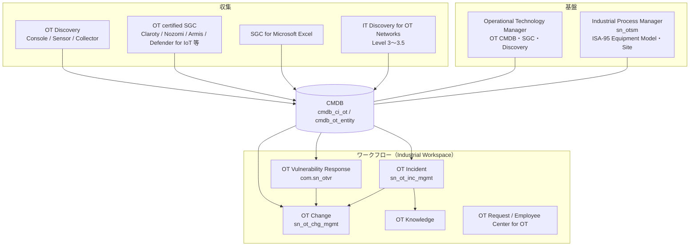
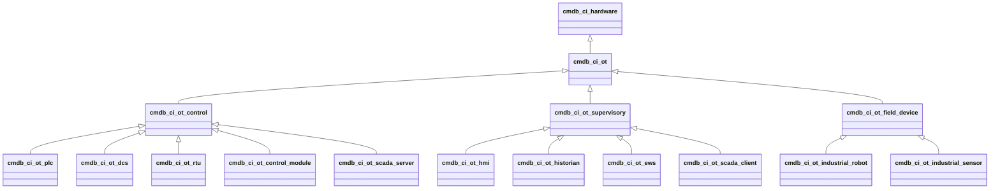
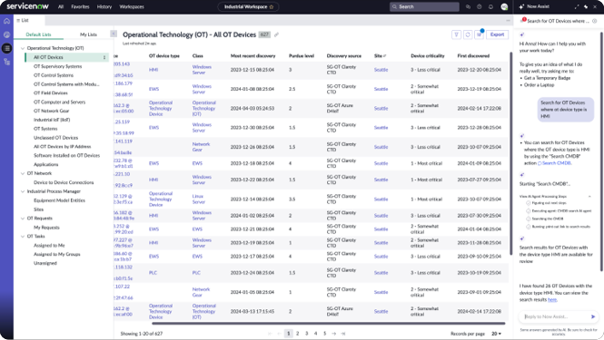
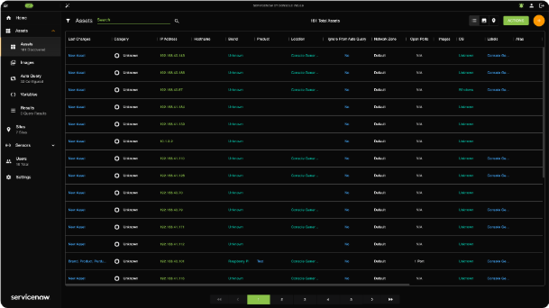
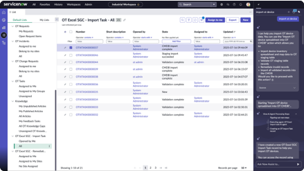
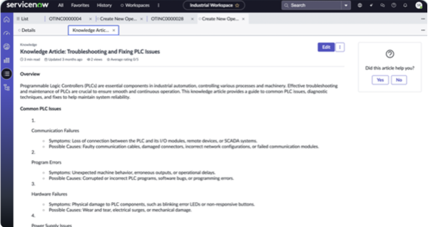

# Operational Technology（OT）Management（OT Discovery / OT Service Management / OT Vulnerability Response）

## 概要

**Operational Technology Management（OTM、OT 管理）** は、工場・プラント・公益設備などの **OT（Operational Technology、制御系技術）** の機器とプロセスを ServiceNow AI Platform 上で管理する製品群である。PLC・DCS・SCADA・HMI などの制御機器を CMDB に OT デバイスとして登録し、ISA-95 の設備モデル（Equipment Model）と結び付けたうえで、OT 専用のインシデント・変更・ナレッジ・リクエスト・脆弱性対応のワークフローを **Industrial Workspace（産業用ワークスペース）** で回す。[出典](https://www.servicenow.com/docs/r/australia/operational-technology/operational-technology-overview.html)

本ファイルは次の問いに答える。

| 問い | 該当節 |
|---|---|
| OTM はどのアプリケーションで構成され、どの順に入れるか | [1](#1-製品構成とアプリケーション一覧) |
| ITOM・ITSM・SecOps（VR）とどう棲み分けるか | [2](#2-itom--itsm--secops-との関係) |
| OT デバイスは CMDB でどう表現されるか（Purdue モデル、OT Entity、ISA-95） | [3](#3-ot-のデータモデルcmdb--csdm) |
| OT デバイスをどう収集するか（OT Discovery、SGC） | [4](#4-ot-デバイスの収集ot-discovery)、[5](#5-ot-向け-service-graph-connector) |
| OT Incident / Change / Knowledge / Request の仕様 | [6](#6-ot-service-managementotsm) |
| OT Vulnerability Response の仕様 | [7](#7-ot-vulnerability-responseotvr) |
| ロール・テーブル・プロパティの一覧 | [8](#8-ロール一覧)、[9](#9-主要テーブル一覧)、[10](#10-主要システムプロパティ) |
| ライセンス（OTM SU、ITOM/OT SU Licensing） | [11](#11-ライセンスotm-サブスクリプションと-su) |
| AI 機能（OT Manager Foundation 等） | [12](#12-ai-機能ot-manager-foundation--otto-for-otsm) |
| リリースごとの変更と Brazil | [13](#13-リリース別の変更点と-brazil) |
| 製造業での導入時の留意点 | [14](#14-製造業での導入時の留意点) |

### 用語

| 英語 | 日本語 | 説明 |
|---|---|---|
| Operational Technology (OT) | 運用技術・制御系技術 | 産業プロセスを監視・制御するハードウェア/ソフトウェア（PLC、DCS、SCADA 等） |
| ICS / PCN | 産業制御システム / プロセス制御ネットワーク | OT デバイスが接続されるネットワーク。公式ドキュメントは OT デバイスを「OT（ICS または PCN）ネットワーク上の CI」と定義する |
| Purdue model | パデューモデル | 産業ネットワークを Level 0〜5 の階層で表す参照モデル。ServiceNow は ITOM 管理の IT CI を Level 4〜5、OT データモデルのデバイスを Level 0〜3.5 に置く（[出典](https://www.servicenow.com/docs/r/B0Z4zoSWAekbvp6dQcybtA/5_dooZRAHmVzx5Krz7B6ww)：Differences between OT and standard IT networks、Australia） |
| ISA-95 Equipment Model | ISA-95 設備モデル | サイト→エリア→ワークセンター→ワークユニット等の設備階層。Industrial Process Manager が管理する |
| Site | サイト | 生産が行われる産業拠点を表す論理グループ（`cmn_location` とは別概念） |
| OT Device Details（OT entity） | OT デバイス詳細 | `cmdb_ot_entity`。CI を OT デバイスとして扱うための付帯レコード |
| NIDS | ネットワーク侵入検知システム | Claroty・Defender for IoT 等の OT 監視センサー。CMDB では `cmdb_ci_nids` |
| Industrial Workspace | 産業用ワークスペース | OT データと業務を扱う Next Experience ワークスペース |
| OT certified | OT 認定 | ServiceNow OT 製品と互換性があると認定されたサードパーティ SGC / VR 連携 |

## 1. 製品構成とアプリケーション一覧

### 1.1 Australia のアプリケーション

Australia 版の Operational Technology ドキュメントは、OTM を次のアプリケーションで構成すると説明している。[出典](https://www.servicenow.com/docs/r/australia/operational-technology/operational-technology-overview.html)（2026-07-09 更新）

| アプリケーション | 役割 | 区分（目安） |
|---|---|---|
| Operational Technology Manager | OT 管理の基盤データとリレーションを作る。CMDB、Service Graph Connector、Discovery をサポート | 基盤（Visibility） |
| Industrial Process Manager | ISA-95 Equipment Model のデータ基盤（サイト単位の設備モデル）を作る | 基盤（Visibility） |
| Operational Technology Discovery | OT 環境のデバイス可視性を高める（ネイティブ OT Discovery / IT Discovery for OT Networks） | Visibility |
| Operational Technology Vulnerability Response | 機器が自動化しているプロセスの重要度に基づき、サイト単位で OT 脆弱性を優先付け・修正 | セキュリティ |
| Operational Technology Incident Management | OT デバイスのインシデントを起票から解決まで管理 | OTSM |
| Operational Technology Change Management | OT デバイスと生産プロセスへの変更を統制 | OTSM |
| Operational Technology Knowledge Management | OT システム・デバイス・解決済みインシデントの知識を蓄積・共有 | OTSM |
| Operational Technology Request Management | OT カタログアイテムのリクエストを定義済みフローで処理 | OTSM |
| Recommended Actions for OTSM | Industrial Workspace のレコード（OT インシデント等）でトリアージ・解決のリアルタイム推奨 | OTSM（AI） |
| AI Enhanced Recommended Actions for OTSM | OT インシデントに関連する外部情報を取り込み、関連性を説明 | OTSM（AI） |
| Employee Center for OT | OT・産業系サービスリクエストを申請するポータル | OTSM |
| Industrial Workspace for OT | OT データと運用を扱うユーザーインターフェース | 共通 UI |

関連する ServiceNow 製品として、IT Service Management（サービス管理）、Vulnerability Response（セキュリティ）、IT Operations Management（可視化）が挙げられている。[出典](https://www.servicenow.com/docs/r/australia/operational-technology/operational-technology-overview.html)

- 「区分（目安）」列は、ServiceNow のコミュニティ記事が新機能を **Operational Technology Visibility / Operational Technology Service Management / Operational Technology Asset Management** の3領域に分けて紹介していることに基づく整理である【推定】。[出典](https://www.servicenow.com/community/sam-blog/what-s-new-in-australia-release-for-operational-technology/ba-p/3559565)
- OTM ソリューションは **Now Mobile ではサポートされない**。[出典](https://www.servicenow.com/docs/r/australia/operational-technology/operational-technology-overview.html)
- OTM はデータの整理に **CSDM（Common Service Data Model）** を使う。[出典](https://www.servicenow.com/docs/r/australia/operational-technology/operational-technology-overview.html)

### 1.2 推奨導入順

公式ドキュメントの推奨順は次のとおり。[出典](https://www.servicenow.com/docs/r/australia/operational-technology/operational-technology-overview.html)

1. **基盤：** Operational Technology Manager と Industrial Process Manager
2. **ワークフロー：** Vulnerability Response、Incident Management、Change Management、Knowledge Management、Request Management、Recommended Actions

上図は公式ドキュメントの記述（各アプリの説明、OTVR の前提プラグイン、変更要求をインシデント・修正タスクから作成できること）を組み合わせて作成した概念図である。[出典](https://www.servicenow.com/docs/r/australia/operational-technology/operational-technology-overview.html) [出典](https://www.servicenow.com/docs/r/australia/operational-technology/operational-technology-vulnerability-response/install-operational-technology-vulnerability-response.html)

### 1.3 配布形態とインストール

- OTM の各アプリケーションは **ServiceNow Store アプリ** として配布され、ファミリーリリースとは独立して更新される（OT Manager や Industrial Process Manager のリリースノートは Store の版として公開されている）。[出典](https://www.servicenow.com/docs/r/delta-yokohama-brazil/brazil-yokohama-operationaltechnologymanager-release-notes.html)
- インストールには **admin** ロールが必要。手順は **All > System Applications > All Available Applications > All** で名称または ID を検索し、依存プラグイン/Store アプリを確認して Install する。デモデータは開発・テストインスタンスでの初回インストール時のみ推奨。[出典](https://www.servicenow.com/docs/r/rhd8Gkl66~pcDwo5uAjpBQ/nmwlU~ogC9Wq_FSAWFrNng)（Zurich 版）
- 主要プラグイン ID（判明分）：

| アプリケーション | プラグイン / スコープ | 出典 |
|---|---|---|
| Operational Technology Manager | 公開情報では確認できず（`com.sn_ot_foundation` とする情報があるが公式ページで裏付けが取れない【推定】） | Australia 版 [Install Operational Technology Manager](https://www.servicenow.com/docs/r/B0Z4zoSWAekbvp6dQcybtA/cq~ZI0G~sEzZ~2DBw6DcXw) は「名称または ID で検索」とのみ記載し ID を示していない |
| Industrial Process Manager | `sn_otsm` | [出典](https://www.servicenow.com/docs/r/australia/operational-technology/operational-technology-vulnerability-response/install-operational-technology-vulnerability-response.html) |
| Operational Technology Incident Management | `sn_ot_inc_mgmt` | [出典](https://www.servicenow.com/docs/r/australia/operational-technology/operational-technology-incident-management/components-installed-with-operational-technology-service-management.html) |
| Operational Technology Change Management | `sn_ot_chg_mgmt` | [出典](https://www.servicenow.com/docs/r/australia/operational-technology/operational-technology-change-management/oper-tech-change-management-reference.html) |
| Operational Technology Vulnerability Response | `com.sn_otvr`（ロール接頭辞 `sn_otvr`） | [出典](https://www.servicenow.com/docs/r/australia/operational-technology/operational-technology-vulnerability-response/components-installed-with-operational-technology-vulnerability-response.html) |
| ITOM/OT SU Licensing | `sn_itom_licensing` | [出典](https://www.servicenow.com/docs/r/australia/operational-technology/otm-su-license-landing-page.html) |
| Industrial Core（OT 認定 SGC のクラスマッピング） | `com.sn_ot_core`（OT Manager リリースノートの Yokohama 新機能「POWER tool updates」に必須プラグインとして記載。Components ページには ID の記載なし） | [出典](https://www.servicenow.com/docs/r/delta-yokohama-brazil/brazil-yokohama-operationaltechnologymanager-release-notes.html) [出典](https://www.servicenow.com/docs/r/australia/operational-technology/operational-technology-manager/components-installed-with-operational-technology-manager.html) |
| OT Asset Management（参考・別製品） | `com.sn_otam` | [出典](https://www.servicenow.com/docs/r/australia/it-asset-management/enterprise-asset-management/installed-with-otam.html) |

### 1.4 OT Setup（Admin Home / Product Hub）

Australia では、OT の構成項目（Configuration items）を **Admin Home** と **Product Hub** から完了させる。これらは **ServiceNow Otto for Setup** フレームワークを使う。[出典](https://www.servicenow.com/docs/r/australia/operational-technology/ot-setup-landing.html)（2026-08-26 更新）

OT 管理者ロールの割り当て手順（Assign OT admin roles）は次のとおり。前提は admin ロール。[出典](https://www.servicenow.com/docs/r/australia/operational-technology/assign-ot-admin-roles-sn-otto-setup-ot.html)（2026-08-22 更新）

1. All メニューの **Admin Center** 配下から **Admin Home** を開く。
2. **Operational Technology** カードを選択する。
3. 「Configure your product」で構成コンソール（Configuration Console）を開く。
4. **Operational Data > Role Assignment > Assign Admins** を選ぶ。
5. ユーザーを検索・選択し、1つ以上の管理ロールと **Implementation Agent** ロール（`sn_ia_config.ia_user`、必須）を選択する。
6. **Assign roles** を押す（既に保持しているロールはスキップされる）。完了したら **Mark as configured**。

各アプリの細かな設定（変更モデル、リスク計算機等）は、従来どおり **Industrial Workspace Admin > Guided Setup**（Industrial Guided Setup）からも行う。[出典](https://www.servicenow.com/docs/r/australia/operational-technology/operational-technology-change-management/select-change-model.html)

## 2. ITOM / ITSM / SecOps との関係

| 観点 | IT 側（既存製品） | OT 側（OTM） | 関係 |
|---|---|---|---|
| 対象範囲（Purdue） | ITOM は Level 4〜5（エンタープライズ）の CI を `IT` タイプとして扱う | OT データモデルは Level 0〜3.5 のデバイスを扱う | IT は Level 4〜5、OT は Level 0〜3.5 [出典](https://www.servicenow.com/docs/r/B0Z4zoSWAekbvp6dQcybtA/5_dooZRAHmVzx5Krz7B6ww)。Level 3.5 は IT と OT の機器が混在する Industrial DMZ [出典](https://www.servicenow.com/docs/r/australia/operational-technology/discovery-for-operational-technology.html) |
| 構成情報 | CMDB / CSDM（[CMDB と CSDM](../platform/cmdb-csdm.md)） | 同じ CMDB に `cmdb_ci_ot` 系クラスと `cmdb_ot_entity` を追加 | OT は CMDB を拡張する（別 DB ではない） |
| 収集 | ITOM Discovery（[Discovery](discovery.md)）、SGC（[Service Graph Connectors](service-graph-connectors.md)） | OT Discovery、OT 認定 SGC、IT Discovery for OT Networks | IT Discovery for OT Networks は Discovery の仕組みで Level 3〜3.5 を走査 |
| インシデント・変更 | ITSM の `incident` / `change_request`（[Incident](../itsm/incident-management.md)、[Change](../itsm/change-management.md)） | OT 専用の `sn_ot_incident` 等とサイト単位のアクセス制御 | 「IT と OT は別だが必要に応じて組み合わせ可能」[出典](https://www.servicenow.com/docs/r/australia/operational-technology/operational-technology-change-management/exploring-operational-technology-change-mgt.html) |
| 脆弱性 | SecOps Vulnerability Response（`sn_vul`、[SecOps](../secops/security-operations.md)） | OT Vulnerability Response（`com.sn_otvr`）は `sn_vul` を前提に OT 固有リスク要素・サイト割り当てを追加 | OTVR の構成の一部は SEM Workspace（USEM）にリダイレクトされる |
| 資産管理 | HAM / EAM（[ITAM 概要](../itam/itam-overview.md)、[Agile・APM・EAM](../spm/agile-apm-eam.md)） | OT Asset Management（OTAM、`sn_otam`）が Industrial 系モデルカテゴリで OT 資産を管理 | Claroty CTD SGC は OT クラスのデバイスについて Industrial product model category の資産を作成し、EAM と互換にする（Washington DC / Xanadu の新機能）[出典](https://www.servicenow.com/docs/r/xanadu/delta-washingtondc-xanadu/xanadu-washingtondc-servicegraphconnectorintegrationforclarotyctd-release-notes.html)。OTAM は `com.sn_otam` [出典](https://www.servicenow.com/docs/r/australia/it-asset-management/enterprise-asset-management/installed-with-otam.html) |
| ライセンス | ITOM SU（[ITOM 概要](itom-overview.md)） | OTM SU（OT Foundation / OT Visibility / OT Vulnerability Response） | 同じ ITOM/OT SU Licensing アプリで計測。OT に再分類された IT CI は OTM 側で1回だけ数える |

- IT Discovery for OT Networks は、Level 3.5（Industrial DMZ）と Level 3（サイト運用）を処理対象とし、**Level 0〜2 に対して Discovery を実行すべきではない**（産業運用の中断を避けるため）と明記されている。[出典](https://www.servicenow.com/docs/r/australia/operational-technology/discovery-for-operational-technology.html)
- OT Change Management と IT Change Management は別アプリだが、必要に応じて組み合わせられ、サイトごとに異なる変更ワークフローを使える。[出典](https://www.servicenow.com/docs/r/australia/operational-technology/operational-technology-change-management/exploring-operational-technology-change-mgt.html)

## 3. OT のデータモデル（CMDB / CSDM）

### 3.1 OT が管理・使用する CSDM 要素

公式ドキュメント「Operational Technology and CSDM tables」（Australia、2026-03-12 更新）は、OT が管理する CSDM テーブルを3種類に分ける。[出典](https://www.servicenow.com/docs/r/australia/operational-technology/operational-technology-manager/ot-use-case.html)

| 要素 | 主テーブル | 説明 |
|---|---|---|
| OT devices（OT デバイス） | `cmdb_ci_ot`（Hardware を拡張した OT ハードウェアクラス群） + `cmdb_ot_entity`（OT Device Details） + `cmdb_ot_entity_type` | OT（ICS / PCN）ネットワーク上の CI |
| ISA equipment model entities（ISA 設備モデルエンティティ） | `cmdb_ci_ot_isa_entity`（Calculated Application Service を拡張） | OT デバイスが自動化する産業プロセス。親を持たないレコードは **サイト** を表す |
| OT system services（OT システムサービス） | OT System Service クラス（本ページでは「Calculated Application Service を拡張」と記載し、テーブル名は示さない）。CMDB CI Class Models ページではテーブル `cmdb_ci_ot_system_service`、親 `cmdb_ci_ot_system`（[3.4](#34-ot-拡張クラスcmdb-ci-class-models)、[出典](https://www.servicenow.com/docs/r/australia/servicenow-platform/cmdb-ci-class-models/cmdb-ci-class-models-operation-technology.html)） | DCS などの制御システム。OT デバイスや設備モデルエンティティに関連付けられる |

> **注記：** OT System Service の親クラスは公式ページ間で表記が食い違っている（CSDM ページ：Calculated Application Service を拡張／CI Class Models ページ：`cmdb_ci_ot_system`）。実際の階層はインスタンスの `sys_db_object` で確認すること。

### 3.2 OT デバイスの表現（CI + OT Device Details）

- OT デバイスは通常の CI であり、**CI に OT Device Details（`cmdb_ot_entity`）への参照が付与されることで OT デバイスとして扱われる**（公式文言：「OT Device Details are added through a reference to the cmdb_ot_entity table」）。参照を保持する列名は公開情報では確認できず。[出典](https://www.servicenow.com/docs/r/australia/operational-technology/operational-technology-manager/ot-use-case.html)
- OT デバイスは「CI クラスレコード（IT クラス CI でも OT クラス CI でもよい）」と「OT device details レコード（OT device type（機能）と OT 固有属性）」の2つで構成される。[出典](https://www.servicenow.com/docs/r/B0Z4zoSWAekbvp6dQcybtA/5_dooZRAHmVzx5Krz7B6ww)
- したがって **任意の CI クラス**（Windows Server、Network Gear 等）を OT デバイスとして扱える。IT クラスの CI を OT として文脈付けする機能（Automated IT OT Bulk Contextualization）もある（[13](#13-リリース別の変更点と-brazil)）。
- 1台の OT デバイスは **最低2レコード**（CI と OT entity）で表され、複数の IP / MAC を持つ場合などは 6 レコード以上に分散する。[出典](https://www.servicenow.com/docs/r/australia/operational-technology/operational-technology-manager/ot-use-case.html)
- `cmdb_ot_entity` は **Purdue Level** や **OT device type** などの OT 固有属性を持つ。OT device type は `cmdb_ot_entity_type` テーブルで定義され、デバイスの機能・役割（産業プロセスを自動化する CI の機能）を表す。[出典](https://www.servicenow.com/docs/r/australia/operational-technology/operational-technology-manager/ot-use-case.html)

`cmdb_ot_entity` の主なフィールド（判明分）：

| フィールド（ラベル） | 列名 | 説明 | 出典 |
|---|---|---|---|
| Purdue level | `purdue_level` | デバイスの Purdue レベル。Defender for IoT (Azure) SGC のデバイス属性マッピングでは `properties.purdueLevel` が `cmdb_ot_entity.purdue_level` にマップされる | [出典](https://www.servicenow.com/docs/r/ldpO9cHSRLMKlk1MhfnmNw/JAMIOie1ZczJtlxEf9~_3A)（Attribute mapping and classification for SGC for Microsoft Defender for IoT (Azure)、Australia、de-DE 版で確認） |
| Device criticality / Business criticality | `business_criticality` | デバイスの重要度。同マッピング表で `cmdb_ot_entity.business_criticality`（デバイスの重要度）にマップされる。OTVR のリスク計算で「OT Device Criticality」として使われる | [出典](https://www.servicenow.com/docs/r/ldpO9cHSRLMKlk1MhfnmNw/JAMIOie1ZczJtlxEf9~_3A)、[出典](https://www.servicenow.com/docs/r/australia/operational-technology/operational-technology-vulnerability-response/calculate-vulnerability-risk.html) |
| OT device type | 公開情報では列名確認できず | `cmdb_ot_entity_type` への参照と推定【推定】 | [出典](https://www.servicenow.com/docs/r/australia/operational-technology/operational-technology-manager/ot-use-case.html) |
| Is Virtual | 公開情報では列名確認できず | OT デバイスが仮想かどうかを示す。OT Supervisory System、OT Control System、OT Field Devices、Unclassed OT Devices が対象で、Industrial Workspace の OT デバイスフォームに追加された（Yokohama） | [出典](https://www.servicenow.com/docs/r/delta-yokohama-brazil/brazil-yokohama-operationaltechnologymanager-release-notes.html) |

- 参照を保持する列名（CI 側か `cmdb_ot_entity` 側か）は公開情報では確認できず。

> **Purdue Level の値：** 公式ドキュメントは選択肢の一覧を公開していない。ServiceNow 社員によるコミュニティ記事（Zurich）のスクリーンショットでは、All OT Devices リストの Purdue level 列に `1`、`1.5`、`2`、`2.5`、`3`、`3.5` といった値が表示されており、0.5 刻みの値を取りうることが分かる【第三者情報】。Device criticality 列は `1 - Most critical`、`2 - Somewhat critical`、`3 - Less critical` の3段階が表示されている。[出典](https://www.servicenow.com/community/operational-technology-blog/what-s-new-in-zurich-release-for-operational-technology/ba-p/3309803)

### 3.3 Purdue モデルとの対応

| Purdue Level | 一般的な内容 | ServiceNow での扱い |
|---|---|---|
| Level 5 | エンタープライズネットワーク | ITOM（IT）[出典](https://www.servicenow.com/docs/r/B0Z4zoSWAekbvp6dQcybtA/5_dooZRAHmVzx5Krz7B6ww) |
| Level 4 | 事業計画・物流（ERP 等） | ITOM（IT） |
| Level 3.5 | Industrial DMZ（IDMZ）。IT と OT のサーバー・PC が混在 | OT データモデル。IT Discovery for OT Networks の対象 [出典](https://www.servicenow.com/docs/r/australia/operational-technology/discovery-for-operational-technology.html) |
| Level 3 | サイト運用（Historian、MES 等） | OT。IT Discovery for OT Networks の対象 |
| Level 2 | 監視制御（HMI、SCADA） | OT。`cmdb_ci_ot_supervisory` は通常 Level 2〜3 [出典](https://www.servicenow.com/docs/r/australia/servicenow-platform/cmdb-ci-class-models/cmdb-ci-class-models-operation-technology.html) |
| Level 1 | 基本制御（PLC、DCS コントローラ、RTU） | OT。`cmdb_ci_ot_control` は通常 Level 1〜2 |
| Level 0 | 物理プロセス（センサー、アクチュエータ） | OT。`cmdb_ci_ot_field_device` 系 |

「一般的な内容」列は Purdue モデル一般の説明であり【経験則】、ServiceNow 固有の記述は出典列のとおり。IT Discovery を Level 0〜2 に対して実行しないよう公式に注意喚起されている点に留意する。

### 3.4 OT 拡張クラス（CMDB CI Class Models）

OT 拡張クラスは **CMDB CI Class Models** Store アプリが追加する。主なクラスは次のとおり。[出典](https://www.servicenow.com/docs/r/australia/servicenow-platform/cmdb-ci-class-models/cmdb-ci-class-models-operation-technology.html)（2026-06-18 更新）

| クラス | テーブル | 親クラス | 説明 |
|---|---|---|---|
| Operations Technology | `cmdb_ci_ot` | `cmdb_ci_hardware` | 産業制御技術の基底クラス |
| OT Control System | `cmdb_ci_ot_control` | `cmdb_ci_ot` | 産業制御システムの基底クラス（通常 Level 1〜2） |
| OT Supervisory System | `cmdb_ci_ot_supervisory` | `cmdb_ci_ot` | 監視システムの基底クラス（通常 Level 2〜3） |
| PLC | `cmdb_ci_ot_plc` | `cmdb_ci_ot_control` | OT デバイスを制御するプログラマブルロジックコントローラ |
| DCS | `cmdb_ci_ot_dcs` | `cmdb_ci_ot_control` | 制御をプロセス全体に分散させる分散制御システム |
| DPU | `cmdb_ci_ot_dpu` | `cmdb_ci_ot_control` | 専用産業ネットワーク上で大量の I/O を処理するユニット |
| RTU | `cmdb_ci_ot_rtu` | `cmdb_ci_ot_control` | DCS / SCADA リモート局のデータ収集・制御ユニット |
| IED | `cmdb_ci_ot_ied` | `cmdb_ci_ot_control` | 外部とデータ・制御信号をやり取りする電力系統デバイス |
| CNC | `cmdb_ci_ot_cnc` | `cmdb_ci_ot_control` | フライス盤・旋盤・ボール盤・3D プリンタ等のコンピュータ制御工作機械 |
| Industrial 3D Printer | `cmdb_ci_ot_industrial_3d_printer` | `cmdb_ci_ot_control` | 積層造形装置 |
| Quality Inspection Control System | `cmdb_ci_ot_qics` | `cmdb_ci_ot_control` | 品質・検査機能の制御システム |
| OT Control Module | `cmdb_ci_ot_control_module` | `cmdb_ci_ot_control` | PLC・DCS 等の制御システムに接続されるモジュール |
| OPC Server | `cmdb_ci_ot_opc_server` | `cmdb_ci_ot_control` | OPC で外部アプリにデータを共有するソフトウェア |
| SCADA Server | `cmdb_ci_ot_scada_server` | `cmdb_ci_ot_control` | 遠隔地のデータ収集・処理・制御を行うシステム |
| HMI | `cmdb_ci_ot_hmi` | `cmdb_ci_ot_supervisory` | オペレーターがコントローラと対話する装置/ソフトウェア |
| Historian | `cmdb_ci_ot_historian` | `cmdb_ci_ot_supervisory` | 産業プロセスデータを保存・分析する中央 DB |
| EWS | `cmdb_ci_ot_ews` | `cmdb_ci_ot_supervisory` | 制御アプリ・機器の構成・保守・診断用エンジニアリングワークステーション |
| OPC Client | `cmdb_ci_ot_opc_client` | `cmdb_ci_ot_supervisory` | OPC サーバーからデータを取得・制御するソフトウェア |
| SCADA Client | `cmdb_ci_ot_scada_client` | `cmdb_ci_ot_supervisory` | オペレーターが SCADA サーバーを操作するクライアント |
| Industrial Actuator | `cmdb_ci_ot_industrial_actuator` | `cmdb_ci_ot_field_device` | バルブ等の機構を動かす機械部品 |
| Industrial Drive | `cmdb_ci_ot_industrial_drive` | `cmdb_ci_ot_field_device` | 機械の速度を調整する装置 |
| Industrial Robot | `cmdb_ci_ot_industrial_robot` | `cmdb_ci_ot_field_device` | 製造用ロボット |
| Industrial Sensor | `cmdb_ci_ot_industrial_sensor` | `cmdb_ci_ot_field_device` | 機器状態を監視するセンサー |
| OT System Service | `cmdb_ci_ot_system_service` | `cmdb_ci_ot_system` | 産業プロセスを管理・制御・監視する技術・システム。CSDM ページでは「Calculated Application Service を拡張」と記載されており表記が食い違う（[3.1](#31-ot-が管理使用する-csdm-要素) 参照） |
| Network Gear | `cmdb_ci_netgear` | `cmdb_ci_hardware` | ネットワーク通信機器 |
| Protocol Converter | `cmdb_ci_protocol_converter` | `cmdb_ci_hardware_network_gear`（公式表記のまま） | プロトコル変換装置 |
| Firmware Installation | `cmdb_firmware_install` | — | OT デバイス上のファームウェア |
| Key Value | `cmdb_key_value` | — | 連携から得た追加 OT 属性を Key-Value で保持 |
| Software Instance | `cmdb_sam_sw_install` | — | SAM がない場合の OT デバイス上のソフトウェア |

- `cmdb_ci_ot_field_device` は公式表の「親クラス」列から存在が分かるが、クラス自体の行は同ページに記載がない。
- Purdue レベルが公式に明記されているのは OT Control System（Level 1〜2）と OT Supervisory System（Level 2〜3）の2クラスのみ。

### 3.5 ISA-95 Equipment Model とサイト

Industrial Process Manager は ISA-95 設備モデルを管理する。[出典](https://www.servicenow.com/docs/r/australia/operational-technology/operational-technology-manager/ot-use-case.html) [出典](https://www.servicenow.com/docs/r/australia/operational-technology/industrial-process-manager/components-installed-with-industrial-process-manager.html)

| テーブル | ラベル | 内容 |
|---|---|---|
| `cmdb_ci_ot_isa_entity` | ISA Equipment Model | サイト（親なし）または生産プロセスの一部を表す設備モデルエンティティ |
| `isa_entity_template` | Equipment Model Template | 設備モデルテンプレート |
| `isa_entity_level` | Equipment Model Level | 階層レベル。既定の ISA-95 テンプレートは area、work center、work units を含む |
| `isa_entity_type` | Equipment Entity Type | レベルの種別。既定は process cell、production unit、production line、storage zone |
| `ot_subnet_mapping` | OT subnet mapping | サブネットと設備モデルエンティティの対応（OT デバイスの自動マッピング） |

**Site（サイト）と Location（ロケーション）の違い：** サイトは ISA Equipment Model Entity の一部で、生産が行われる産業拠点を表す論理グループであり、設備モデルの定義とアクセス制御に使う。ロケーションは設備や機器の物理的な場所で、`cmn_location` テーブルの値である。OT デバイスはロケーションを持ちつつ、別途設備モデルのサイトに割り当てられる。[出典](https://www.servicenow.com/docs/r/australia/operational-technology/industrial-process-manager/site-vs-location-ot.html)

### 3.6 OT のリレーションタイプ

| リレーション（Forward::Reverse） | 意味 |
|---|---|
| Producer for::Consumer of | 設備エンティティ間の物の流れ |
| Contains Element::Element of | 設備エンティティ間の階層 |
| Automated by::Automates | OT デバイスが設備エンティティを制御する |
| Detects::Detected by | NIDS（`cmdb_ci_nids`）が OT デバイスを検出した |
| Owns::Owned by | OT 制御モジュールが制御システム（PLC、DCS 等）に所有される |

出典：[Operational Technology and CSDM tables](https://www.servicenow.com/docs/r/australia/operational-technology/operational-technology-manager/ot-use-case.html)

### 3.7 Industrial Workspace の OT リスト

- **キャプション：** Industrial Workspace の「Operational Technology (OT) - All OT Devices」リスト（Zurich の Agentic search 機能紹介画像）
- **画面説明：** 上部ヘッダーに「Industrial Workspace」。左ペインの Default Lists に **Operational Technology (OT)**（All OT Devices、OT Supervisory Systems、OT Control Systems、OT Control Systems with Modules、OT Field Devices、OT Computer and Servers、OT Network Gear、Industrial IoT (IIoT)、OT Systems、Unclassed OT Devices、All OT Devices by IP Address、Software Installed on OT Devices、Applications）、**OT Network**（Device to Device Connections）、**Industrial Process Manager**（Equipment Model Entities、Sites）、**OT Requests**、**OT Tasks** が並ぶ。中央のリストは OT device type（HMI、EWS、PLC、Network Gear 等）、Class（Windows Server、Operational Technology (OT)、Linux Server 等）、Most recent discovery、Purdue level（1〜3.5）、Discovery source（SG-OT Claroty CTD、SG-OT Azure D4IoT）、Site、Device criticality、First discovered の列を持つ（627 件）。右側の Now Assist パネルで「Search for OT Devices where device type is HMI」と自然言語で問い合わせ、「Search CMDB」アクションで 26 件を返している。
- **出典：** https://www.servicenow.com/community/operational-technology-blog/what-s-new-in-zurich-release-for-operational-technology/ba-p/3309803 （取得日：2026-11-04）

## 4. OT デバイスの収集（OT Discovery）

### 4.1 2つの方式

Operational Technology Discovery は次の2方式を持つ。[出典](https://www.servicenow.com/docs/r/australia/operational-technology/operational-technology-discovery-landing.html)

| 方式 | 対象 | 仕組み |
|---|---|---|
| **Operational Technology Native Discovery** | OT デバイス全般 | Discovery Console for OT、Discovery Sensor for OT、OT Discovery Collector で OT 環境を監視・クエリし、**Service Graph Connector for ServiceNow OT Discovery** でインスタンスへ取り込む |
| **IT Discovery for OT Networks** | ICS ネットワークの指定 Purdue レベルにある IT クラス機器（スイッチ、ルーター、コンピューター） | 通常の Discovery（MID Server）を OT Discovery スケジュールで実行し、OT entity レコードを作成・更新 |

### 4.2 Native Discovery のコンポーネント

| コンポーネント | 役割 | システム要件（Australia） |
|---|---|---|
| Discovery Console for OT | OT 環境のデバイスを発見・監視・クエリする中心コンソール。最初にここから始める。対話型構成ウィザードで Console・Sensor・Collector・資産・クエリ・サイトを設定 | RAM 16 GB、ディスク 100 GB、CPU 2、同一マシンに Linux ディストリビューション |
| Discovery Sensor for OT | OT デバイスを発見・クエリするアプライアンス。Console に **登録（Register）** する | RAM 2 GB（全クエリ実行時は 8 GB 推奨）、ディスク 100 GB、CPU 2、仮想 NIC 2、Linux（VM または x86 ベアメタル） |
| OT Discovery Collector | Sensor が届かない OT ネットワーク区画の機器を発見する軽量ソフトウェア。OT ゾーンの深部に配置。ネイティブプロトコルに対応しアプライアンス不要。Console への登録は不要 | Windows 10/11（x86_64、ARM・Apple Silicon 非対応）または Linux |
| Service Graph Connector for ServiceNow OT Discovery | 接続した OT Discovery 環境のデータを IntegrationHub ETL で取り込む。**OT コンポーネントより先にインストール** する | — |

出典：[Native Discovery components](https://www.servicenow.com/docs/r/australia/operational-technology/operational-technology-discovery-native-components.html)、[System resources](https://www.servicenow.com/docs/r/australia/operational-technology/ot-discovery-system-resources.html)（2026-06-30 更新）、[Discovery Console for OT](https://www.servicenow.com/docs/r/australia/operational-technology/ot-discovery-console-landing.html)、[Discovery Sensor for OT](https://www.servicenow.com/docs/r/australia/operational-technology/explore-ot-sensor.html)、[OT Discovery Collector](https://www.servicenow.com/docs/r/australia/operational-technology/exploring-ot-collectors.html)、[SGC for OT Discovery](https://www.servicenow.com/docs/r/australia/operational-technology/explore-service-graph-connector.html)

- Console の **Appliances** ページには、Console に紐づく Sensor と Collector が別々に一覧表示され、どちらも同じ操作ができる。[出典](https://www.servicenow.com/docs/r/australia/operational-technology/explore-ot-sensor.html)
- Australia のドキュメントには、コンテナ版 OT Discovery パッケージのインストール、**Rocky 10** へのインストール、証明書生成、Console のアップグレード（コンテナ版は対象外）、Discovery Console for OT API、SGC Central でのサイトインポートとサイトマッピングのページがある。[出典](https://www.servicenow.com/docs/r/australia/operational-technology)
- 対応する産業プロトコル（Modbus、EtherNet/IP、S7 等）、使用ポート、能動/受動の別の詳細は、確認した公開ページでは確認できず。ServiceNow のコミュニティ記事は Australia の OT Discovery を「産業向けに安全なプロトコルで資産を目録化し、サイト・ゾーン・サポートチーム別に整理する」と説明している。[出典](https://www.servicenow.com/community/sam-blog/what-s-new-in-australia-release-for-operational-technology/ba-p/3559565)

- **キャプション：** Discovery Console for OT の Assets 画面（Australia の新機能紹介画像）
- **画面説明：** 暗色テーマのコンソール。左ナビゲーションに Home、**Assets**（Assets、Images、Auto Query、Variables、Results）、**Sites**、**Sensors**、**Users**、**Settings** があり、左下に servicenow ロゴ。中央の Assets リストは「181 Total Assets」と表示され、列は Last Changes、Category、IP Address、Hostname、Brand、Product、Location、Query From Auto Query、Network Zone、Open Ports、Images、OS、Labels、Alias。右上に検索・表示切替・ACTIONS ボタン。下部にページネーション。
- **出典：** https://www.servicenow.com/community/sam-blog/what-s-new-in-australia-release-for-operational-technology/ba-p/3559565 （取得日：2026-11-04）

### 4.3 IT Discovery for OT Networks

| 項目 | 内容 |
|---|---|
| 対象 | Level 3.5（IDMZ）と Level 3（サイト運用）にある IT クラスの OT 機器（スイッチ、ルーター、コンピューター） |
| 処理 | CI 発見後、CMDB に対応する OT entity レコードがあるか確認し、属性に変更があれば更新、なければ作成。発見したデバイスにインストールされたアプリケーションの OT entity レコードも作成し、Industrial Workspace の Operational Technology で確認できる |
| 実行 | **OT Discovery スケジュール** で実行。即時の Quick Discovery またはフル OT Discovery を起動できる。スケジュールに定義した属性（ロケーション等）は CI と OT entity レコードに反映される |
| 安全上の注意 | **Purdue Level 0〜2 に対して Discovery を実行すべきではない** |
| ロール | `ot_discovery_admin`（OT Discovery を実行できるが、作成された OT CI は閲覧できない）[出典](https://www.servicenow.com/docs/r/australia/operational-technology/operational-technology-manager/components-installed-with-operational-technology-manager.html) |

出典：[IT Discovery for OT Networks](https://www.servicenow.com/docs/r/australia/operational-technology/discovery-for-operational-technology.html)。MID Server や Discovery の一般仕様は [Discovery](discovery.md)、[MID Server](../platform/mid-server.md) を参照。

## 5. OT 向け Service Graph Connector

### 5.1 共通の仕組み

OT 向け SGC は通常の SGC と同じく **IntegrationHub ETL → RTE（Robust Transform Engine）→ IRE（Identification and Reconciliation Engine）** で CMDB に書き込む。接続設定と監視は **Integration Commons for CMDB**（`sn_cmdb_int_util`）の CMDB Integrations Dashboard と共通接続フレームワーク（CCF）を使う。共通仕様は [Service Graph Connectors](service-graph-connectors.md) を参照。[出典](https://www.servicenow.com/docs/r/australia/operational-technology/operational-technology-manager/sgc-cmdb-integration-claroty-ctd.html)

- OT Manager とともにインストールされる **Industrial Core** プラグインが、OT 認定 SGC 向けのクラスマッピングを提供する。[出典](https://www.servicenow.com/docs/r/australia/operational-technology/operational-technology-manager/components-installed-with-operational-technology-manager.html)
- OT 系 SGC の多くは **NIDS センサー（サイト）を先に取り込み、検証（Validate NIDS sensors）してからデバイスを取り込む**。**学習モード（learning mode）のセンサーは検証に失敗し、デバイス取り込みの対象外** になる。[出典](https://www.servicenow.com/docs/r/australia/operational-technology/operational-technology-manager/sgc-cmdb-integration-claroty-ctd.html)

### 5.2 コネクタ一覧

| コネクタ | 提供・ドキュメント | 取り込む内容 | 備考 |
|---|---|---|---|
| Service Graph Connector Integration for **Claroty CTD** | ServiceNow 公式ドキュメント（OT Manager 配下） | サイト（センサー/NIDS）、各サイトが検出したデバイス、接続（ベースライン）、インストール済みプログラム | Claroty CTD 4.4.3 以降と 5.1 に対応 |
| Service Graph Connector for **Claroty xDome**（Medigate を含む） | ServiceNow Store | OT・IoT・IoMT データ | OT 認定。Claroty xDome & Medigate VR Integration と組み合わせて VR / OTVR に対応【第三者情報：Store 掲載の検索結果要約】 |
| Service Graph Connector for **Microsoft Defender for IoT (Azure)** | ServiceNow 公式ドキュメント | OT デバイスとセンサーアプライアンス | 下表参照 |
| Service Graph Connector for **Microsoft Defender for IoT (On-premises Management Console)** | ServiceNow 公式ドキュメント | センサーアプライアンス、OT デバイス、ネットワーク接続 | **Yokohama で将来の非推奨化を準備中と告知**（新規インスタンスでは非表示・有効化されないが、サポートは継続）。新規導入は Azure 版を推奨【推定】[出典](https://www.servicenow.com/docs/r/delta-yokohama-brazil/brazil-yokohama-operationaltechnologymanager-release-notes.html) |
| Service Graph Connector for **Microsoft Excel**（OT） | ServiceNow 公式ドキュメント | 既存の OT データをフラットファイルから取り込み | Import task でアップロード・検証・取り込み。Pre-import OT Worksheet Entry Review ツールあり |
| Service Graph Connector for **ServiceNow OT Discovery** | ServiceNow 公式ドキュメント | ネイティブ OT Discovery のデータ | SGC Central でサイトインポート/サイトマッピング |
| ServiceNow Service Graph Connector for **Nozomi Networks** | Nozomi 社が開発・保守 | Nozomi CMC / Vantage から OT 資産と NIDS アプライアンス、アラート（任意でインシデント化） | 一方向・スケジュール実行。「最初の ServiceNow OT 認定連携」とされる【第三者情報】 |
| Service Graph Connector for **Armis** | ServiceNow Store | 管理/非管理デバイス、OT・IoT デバイスをエージェントレス・パッシブに識別・分類 | OT 認定。利用に ITOM Visibility または ITOM Discovery のサブスクリプションが必要とされる。CMDB フォームに OT Information セクションを追加【第三者情報】 |
| **Dragos** / **Tenable OT Security** | 各社 | OT 資産同期、VR 連携 | OT 認定 SGC / VR 連携を各社が公表【第三者情報】 |

出典：[Claroty CTD](https://www.servicenow.com/docs/r/australia/operational-technology/operational-technology-manager/sgc-cmdb-integration-claroty-ctd.html)、[Defender for IoT (Azure)](https://www.servicenow.com/docs/r/australia/operational-technology/operational-technology-manager/integration-sgc-microsoft-defender-iot-azure.html)、[SGC for Microsoft Excel](https://www.servicenow.com/docs/r/australia/operational-technology/operational-technology-manager/service-graph-connector-for-OT-excel.html)、[SGC for OT Discovery](https://www.servicenow.com/docs/r/australia/operational-technology/explore-service-graph-connector.html)、[Nozomi Networks](https://www.nozominetworks.com/integrations/servicenow-service-graph-connector)、[Store: Armis](https://store.servicenow.com/store/app/e43a2fe21b246a50a85b16db234bcb55)、[Store: Claroty xDome](https://store.servicenow.com/store/app/62cd23a61b646a50a85b16db234bcbee)

- Store ページは JavaScript で描画されるため、Claroty xDome・Armis・Dragos・Tenable の認定状況・対応バージョン・前提ライセンスは本調査では Store 本文から直接確認できなかった（検索結果の要約に依拠）。導入前に Store の最新掲載を確認すること。
- Armis SGC について、2025-03 のコミュニティ投稿で「OT 資産を取り込むと CI は作成されるが OT Device Details（`cmdb_ot_entity`）が作成されない」という報告があり、回答はない【第三者情報】。OT 認定でない構成やマッピング設定次第で、CI は入っても OT デバイスとして扱われない場合がある点に注意する。[出典](https://www.servicenow.com/community/service-graph-connectors-forum/service-graph-connector-armis-to-servicenow-integration/td-p/3204534)

### 5.3 Claroty CTD SGC の詳細

**データフロー：** Claroty CTD のデータは4つのステージングテーブル（Devices、Baselines、Programs、Sites）に入り、RTE で CMDB クラスへ変換され、IRE が Computer、Hardware、IP Address、Network Adapter、OT Device Details、OT Control Module、OT Control System、Serial Number などに書き込む。[出典](https://www.servicenow.com/docs/r/australia/operational-technology/operational-technology-manager/sgc-cmdb-integration-claroty-ctd.html)

**既定のクエリフィルター：**

| フィルター | 既定値 | 意味 |
|---|---|---|
| `approved_exact` | true | 未承認デバイスを取り込まない |
| `valid_exact` | true | 無効なデバイスを取り込まない |
| `special_hint_exact` | 0 | ユニキャスト以外のアドレス種別を取り込まない |
| `ghost_exact` | false | ゴーストと分類されたデバイスを取り込まない |

既定フィルター値の変更は IntegrationHub Enterprise のエンタイトルメントに関わる。[出典](https://www.servicenow.com/docs/r/australia/operational-technology/operational-technology-manager/sgc-cmdb-integration-claroty-ctd.html)

**対象 CMDB クラス：** `cmdb_ci_computer`、`cmdb_key_value_v2`（External system metadata）、`cmdb_firmware_install`、`cmdb_ci_hardware`、`cmdb_ci_ip_address`、`cmdb_ci_network_adapter`、`cmdb_ci_nids`、`cmdb_ci_ot`、`cmdb_ot_entity`（OT Device）、`cmdb_ci_ot_control_module`、`cmdb_ci_ot_control`、`cmdb_serial_number`、`cmdb_ci_spkg`、`cmdb_software_instance`、`cmdb_sam_sw_install`。[出典](https://www.servicenow.com/docs/r/australia/operational-technology/operational-technology-manager/sgc-claroty-ctd-classes.html)

**主なリレーション：**

| 親 | リレーション | 子 |
|---|---|---|
| Hardware | Owns::Owned by | Network Adapter / IP Address |
| Hardware | Reference | OT Device（`cmdb_ot_entity`）/ External system metadata / Software Installation |
| NIDS（`cmdb_ci_nids`） | Owns::Owned by | IP Address |
| NIDS（`cmdb_ci_nids`） | Detects::Detected by | Hardware |
| OT Control System | Owns::Owned by | OT Control Module |
| OT Control Module | Reference | OT Device（`cmdb_ot_entity`） |

出典：[CMDB classes targeted in the SGC for Claroty CTD](https://www.servicenow.com/docs/r/australia/operational-technology/operational-technology-manager/sgc-claroty-ctd-classes.html)

### 5.4 Microsoft Defender for IoT (Azure) SGC の詳細

| 項目 | 内容 |
|---|---|
| 前提 | Operational Technology Manager、Integration Commons for CMDB（`sn_cmdb_int_util`）、Defender for IoT センサー版 22.2.3.22 または 22.2.5.9 |
| ステージングテーブル | `sn_msftd4iotazsgc_sg_ot_azure_d4iot_devices_import`（SG-OT Azure D4IoT Devices Import）、`sn_msftd4iotazsgc_sg_ot_azure_d4iot_sensors_import`（SG-OT Azure D4IoT Sensors Import） |
| 対象クラス（OT） | Operational Technology (OT)、OT Control System、OT Control Module、OT Device Details、OT Field Device、DCS、EWS、Historian、HMI、IED、Industrial Actuator、Industrial Drive、Industrial Robot、Industrial Sensor、PLC、RTU |
| 対象クラス（IT/IoT） | 各種サーバー、Computer、IoT Device、HVAC Equipment、IP Camera、IP Firewall、IP Phone、Netgear、Network Adapter、NIDS、Printer、Wireless Access Point、UPS 等 |
| 手順 | ガイド付きセットアップ → CCF で接続設定 → NIDS センサー検証 → Standard モードでデバイス取り込み → CMDB Integrations Dashboard で監視 |

出典：[SGC for Microsoft Defender for IoT (Azure)](https://www.servicenow.com/docs/r/australia/operational-technology/operational-technology-manager/integration-sgc-microsoft-defender-iot-azure.html)

- 取り込み元は CI の **Discovery source** として `SG-OT Claroty CTD`、`SG-OT Azure D4IoT` のように表示される（[3.7](#37-industrial-workspace-の-ot-リスト) の画面参照）。OTM ライセンスの集計では「SG-OT Excel」で管理される CI を `last_scan` 日付で区分する。[出典](https://www.servicenow.com/docs/r/australia/operational-technology/check-otm-ci-count.html)

### 5.5 SGC for Microsoft Excel（スプレッドシート取り込み）

OT 現場では台帳が Excel で管理されていることが多いため、**Service Graph Connector for Microsoft Excel** が用意されている。データ入りの Excel フラットファイルを IntegrationHub ETL で取り込み、CMDB に CI を作成する。Import task がステージングレコードのアップロード・検証・取り込みを扱う。[出典](https://www.servicenow.com/docs/r/australia/operational-technology/operational-technology-manager/service-graph-connector-for-OT-excel.html)

関連ページとして、Pre-import OT Worksheet Entry Review ツールのロール割り当て、SGC が使うシステムプロパティ、スクリプトインクルード、テスト（トラブルシュート）がある。[出典](https://www.servicenow.com/docs/r/australia/operational-technology)

Zurich では、非構造化データを含む OT デバイス台帳を AI エージェントが変換・整理して CMDB に取り込む **Device import** が追加された。[出典](https://www.servicenow.com/community/operational-technology-blog/what-s-new-in-zurich-release-for-operational-technology/ba-p/3309803)

- **キャプション：** Industrial Workspace の「OT Excel SGC - Import Task - All」リスト（Zurich の Device import 機能紹介画像）
- **画面説明：** 左ペインに OT Requests、OT Incidents、OT Change Requests、OT Tasks、Knowledge、**OT Excel SGC - Import Task**、OT Excel SGC - Remediation… などのリスト。中央は Number（OTEXCEL…）、Short description、Opened by、State（CMDB import complete、Staging import submitted、Validation complete、New 等）、Assigned to、Updated の列を持つ Import Task 一覧（21 件）。右の Now Assist パネルで「Import OT device」を依頼し、AI がスプレッドシートのアップロード、検証、取り込みの手順を案内している。
- **出典：** https://www.servicenow.com/community/operational-technology-blog/what-s-new-in-zurich-release-for-operational-technology/ba-p/3309803 （取得日：2026-11-04）

## 6. OT Service Management（OTSM）

### 6.1 OT Incident Management

**目的：** OT デバイスに起因して影響を受けた生産プロセスを復旧するために OT インシデントを起票・処理する。生産への影響と文脈を確認でき、**IT インシデントとは分離して** 監視・管理する。OT インシデント担当者用の専用ロールがある。[出典](https://www.servicenow.com/docs/r/australia/operational-technology/operational-technology-incident-management/exploring-operational-technology-incident-mgt.html)

| 項目 | 内容 |
|---|---|
| プラグイン | `sn_ot_inc_mgmt` |
| テーブル | `sn_ot_incident`（OT Incidents、サイト横断の OT インシデント）、`sn_ot_incident_task`（OT Incident Tasks）、`dl_ot_inc_priority`（OT Incident Priority Rule Lookup、優先度計算ルール） |
| 移行 | 旧版で `incident` テーブルにあった OT インシデントを新テーブルへ移行する手順（Migrate incidents to the new incident table）がある |
| 状態モデル | State Management の **State Models** で既定モデル **OT Incident: Default Flow** を開き、State Transition を編集。**サイトごとに1つ** の状態モデルを作成できる。前提はスコープを Operational Technology Incident Management にし、admin または `state_model_admin` ロール |
| アクセス制御 | 「OT インシデントは OT ユーザーのみが閲覧できる」。IT と OT のデータを分離する |
| サイト可視性 | Fulfiller は自サイトのインシデントか自分にアサインされたものだけを扱える（Visibility of incidents across sites） |
| 主な操作 | 起票（Report an OT incident）、OT 変更要求からの起票、タスク作成、子インシデント、インシデントとタスクの同期、メール通知、解決・クローズ、関連デバイス・設備モデルエンティティの編集 |
| AI | OT インシデントの要約、解決メモ生成、OT ナレッジ記事生成（Otto for OTSM） |

出典：[Components installed with OT Incident Management](https://www.servicenow.com/docs/r/australia/operational-technology/operational-technology-incident-management/components-installed-with-operational-technology-service-management.html)、[Create an incident state model](https://www.servicenow.com/docs/r/australia/operational-technology/operational-technology-incident-management/create-ot-incident-site-state-model.html)、[Access control for incidents](https://www.servicenow.com/docs/r/australia/operational-technology/operational-technology-incident-management/access-control-ot-incidents.html)、[OT ドキュメント目次](https://www.servicenow.com/docs/r/australia/operational-technology)

- 個々の状態値（New / In Progress / Resolved 等の完全な一覧）と `sn_ot_incident` の親テーブル（`task` を直接拡張するか `incident` を拡張するか）は、確認した公開ページでは確認できず。
- 旧ロール `ot_incident_user` はサポート終了。スケジュールジョブ（検索結果では「Assign New OT Incident Roles」）が旧ロール保持者に新ロールを割り当てる。[出典](https://www.servicenow.com/docs/r/australia/operational-technology/operational-technology-incident-management/components-installed-with-operational-technology-service-management.html)

### 6.2 OT Change Management

| 項目 | 内容 |
|---|---|
| プラグイン | `sn_ot_chg_mgmt` |
| 変更モデル | **OT Change Basic**（承認なし）と **OT Change Advanced**（承認あり。変更承認ポリシーを作成し承認グループを割り当てられる） |
| 設定場所 | **Industrial Workspace Admin > Guided Setup** → Operational Technology Change Management の Get Started → Change Models の Configure（`sn_ot_change_admin` または admin） |
| 起票元 | 新規作成のほか、OT デバイス詳細、（OTVR の）修正タスク、インシデントレコードから変更要求を作成できる |
| 変更カテゴリ | OT 変更要求をカテゴリで分類し、検索性と関係者への周知を高める |

出典：[Select a change model](https://www.servicenow.com/docs/r/australia/operational-technology/operational-technology-change-management/select-change-model.html)、[OT Change Management reference](https://www.servicenow.com/docs/r/australia/operational-technology/operational-technology-change-management/oper-tech-change-management-reference.html)、[OT ドキュメント目次](https://www.servicenow.com/docs/r/australia/operational-technology)

**Basic OT Change Model のプレイブック（4ステージ）：**

| ステージ | アクティビティ |
|---|---|
| Initiate | 変更内容の記述、リスクの把握、担当割り当て（Assignment group は type = OT） |
| Plan | 正当性、実施計画、リスク・影響分析、バックアウト計画、テスト計画、スケジュール（Planned start/end） |
| Implement | 対象 OT デバイスで変更を実施しステージを完了 |
| Close | Close code と Close notes でクローズ |

出典：[Basic OT Change Model playbook](https://www.servicenow.com/docs/r/australia/operational-technology/operational-technology-change-management/basic-ot-change-model.html)

**Advanced OT Change Model：** Initiate → Plan → Approve → Implement → Post-implementation Review → Close の6ステージを持つ。Post-implementation Review の後に、完了が必要な変更タスクを一覧する Spin-off Tasks セクションがある。[出典](https://www.servicenow.com/docs/r/australia/operational-technology/operational-technology-change-management/advanced-ot-change-model.html)（Australia）

**OT 変更承認：**

- 承認者は変更が行われるサイト/エリアの **サイト承認グループ** のメンバーで、`sn_ot_change_read` ロールが必要。
- 承認グループの **51% 以上** の承認で次に進む。承認者を手動で追加することもできる。
- 承認は Advanced モデルのみ（Basic には承認ポリシーがない）。変更要求作成時にフローが変更モデルに基づき承認ポリシーを適用し、Decision レコードを評価、一致する承認定義を実行して、サイトレベルの承認者を追加する。
- CAB（変更諮問委員会）への言及は公式ページにない。

出典：[Operational Technology change approval](https://www.servicenow.com/docs/r/australia/operational-technology/operational-technology-change-management/ot-change-approval.html)

- OT 変更要求・変更タスクのテーブル名は、確認した公開ページでは確認できず（`sn_ot_change_request` 等の名称は検索でも裏付けが得られなかった）。インスタンスの `sys_db_object` で `sn_ot_` 接頭辞を確認すること。

### 6.3 OT Knowledge Management

OT システム・デバイス・解決済みインシデントの知識を蓄積する。OT ナレッジベースの作成、アクセス確認、ナレッジワークフロー割り当て、OT インシデントからの記事作成、Industrial Workspace での記事作成、ナレッジギャップ報告、公開/廃止承認ができる。ロールは標準の `knowledge`、`knowledge_manager`、`knowledge_admin` を使う（OT 固有ロールはない）。[出典](https://www.servicenow.com/docs/r/australia/operational-technology/operational-technology-knowledge-management/operational-technology-knowledge-management-roles.html) [出典](https://www.servicenow.com/docs/r/australia/operational-technology)

一般のナレッジ管理仕様は [ナレッジ管理](../platform/knowledge-management.md) を参照。

### 6.4 OT Request Management と Employee Center for OT

- OT Request Management は OT カタログアイテムのリクエストを定義済みフローで処理する。[出典](https://www.servicenow.com/docs/r/australia/operational-technology/operational-technology-overview.html)
- インストールされるロールは次のとおり。[出典](https://www.servicenow.com/docs/r/ldpO9cHSRLMKlk1MhfnmNw/HcTWx77icPZh94HbxfhGog)（Components installed with OT Request Management、Australia、de-DE 版で確認）

| ロール | 説明 | 含むロール |
|---|---|---|
| `sn_request_read` | Request（`sc_request`）、Requested Item（`sc_req_item`）、Catalog Task（`sc_task`）の読み取り | なし |
| `sn_request_write` | 上記レコードの書き込み | `task_editor`、`dependency_views`、`agent_workspace_user`、`view_changer`、`cmdb_read`、`cmdb_query_builder_read`、`sn_request_read` |
| `sn_request_comment_write` | Requested Item のコメント書き込み（テーブルの書き込み権限も別途必要） | なし |

- **Employee Center for OT** の Industrial services タブにアクセスし、リクエストを提出するには `cmdb_ot_viewer` ロールが必要。「Report an incident」リクエストを使うには OT Incident Management のインストール・構成が必要。[出典](https://www.servicenow.com/docs/r/B0Z4zoSWAekbvp6dQcybtA/9zARrq1U27eoARvfUNd_Jg)（Configuring the Employee Center for OT、Australia）

一般仕様は [Request Management](../itsm/request-management.md)、[Service Portal と Employee Center](../platform/portals-employee-center.md) を参照。

## 7. OT Vulnerability Response（OTVR）

### 7.1 概要

OTVR は、OT エンジニアと OT 脆弱性管理者が「OT デバイスの脆弱性は何か」「OT 固有のリスクでどう優先付けするか」「修正の進捗はどうか」に答えるためのアプリケーションである。機器が自動化しているプロセスの重要度に基づき、**サイト単位で** 脆弱性を優先付け・修正する。[出典](https://www.servicenow.com/docs/r/australia/operational-technology/operational-technology-vulnerability-response/exploring-oper-tech-vulnerability-response.html) [出典](https://www.servicenow.com/docs/r/australia/operational-technology/operational-technology-overview.html)

| 機能 | 内容 |
|---|---|
| Operational Technology Vulnerability Response (PA) dashboard | 検出から封じ込め/修正までの OT 脆弱アイテム（VIT）の量・パフォーマンス・進捗を追跡 |
| OT Vulnerability Risk Rollup dashboard | 設備モデルの各レベルにおける OT デバイスのリスクスコアを表示 |
| OT Vulnerability Solution Management | Xanadu 版以降で利用可能 |
| Industrial Workspace での閲覧 | 脆弱アイテムとソリューション、脆弱性例外、修正タスク、CVE を Industrial Workspace で表示 |

出典：[Exploring OTVR](https://www.servicenow.com/docs/r/australia/operational-technology/operational-technology-vulnerability-response/exploring-oper-tech-vulnerability-response.html)、[OT ドキュメント目次](https://www.servicenow.com/docs/r/australia/operational-technology)

### 7.2 前提とインストール

| 項目 | 内容 |
|---|---|
| プラグイン | `com.sn_otvr`（デモデータあり） |
| 前提プラグイン | **Vulnerability Response（`sn_vul`）**、**Industrial Process Manager（`sn_otsm`）**、**Operational Technology Manager** |
| インストール権限 | admin |
| ガイド付きセットアップ | **Industrial Workspace Admin > Guided Setup**（`sn_vul.vulnerability_admin` が必要） |

出典：[Install OTVR](https://www.servicenow.com/docs/r/australia/operational-technology/operational-technology-vulnerability-response/install-operational-technology-vulnerability-response.html)、[Configuring OTVR](https://www.servicenow.com/docs/r/australia/operational-technology/operational-technology-vulnerability-response/configuring-oper-tech-vulnerability-response.html)

### 7.3 構成手順

1. Store から OTVR をインストール（admin）。
2. 管理ユーザー/グループにロールを割り当てる。
3. **OT Vulnerability Remediation Owner** ロールを割り当てる。
4. **サイト割り当てグループ** を作成する。Equipment Model Manager で定義したサイトごとに1グループ作成し、`cmdb_ot_isa_viewer` または `cmdb_ot_isa_editor` を持つユーザーをサイトに割り当て、サイトのグループに追加する。Remediation Owner は自サイトの脆弱アイテムだけを見る。
5. **OT Remediation Target Rules** を構成する（脆弱アイテムをサイト単位/分類単位のグループに割り当て、修正期限を設定）。
6. デモデータを読み込み、OT 脆弱アイテムの修正目標を計算させる。
7. **OT リスク計算機** を構成する。
8. **OT リスクロールアップ計算機** を構成する（デバイスのリスクスコアを設備モデルの各レベルと親エンティティに集約）。
9. 環境に応じた **認定連携**（Claroty CTD、Defender for IoT 等）をインストールし、脆弱アイテムを作成させる。

手順 5・7・8 は **Security Exposure Management（SEM）Workspace**（USEM の一部。SecOps VR 30.0.0 以降）にリダイレクトされる。OTVR 2.0.0 以降、SEM Workspace で脆弱アイテムの割り当てルール、修正目標ルール、リスク計算機、リスクロールアップ計算機を設定する。Industrial Workspace で作成した修正タスクについては、既存の修正タスクルールを更新し、取り込まれた脆弱アイテムが OT デバイスを自動追加しないようにする。[出典](https://www.servicenow.com/docs/r/australia/operational-technology/operational-technology-vulnerability-response/configuring-oper-tech-vulnerability-response.html)

USEM・SEM Workspace と VR のデータモデルは [Security Operations](../secops/security-operations.md) の第4章を参照。

### 7.4 OT リスク計算機

| 項目 | 内容 |
|---|---|
| 計算機名 | **Default Risk Calculator with OT** |
| リスクルール名 | **OT Default Risk Rule** |
| 要素 | Equipment Model Entity Criticality（Service の Business criticality）、OT Device Criticality（CI の OT device details の Device Criticality）、Purdue Level（CI の OT device details の Purdue level）。導入文では Production process criticality も要素として挙げられる |
| 制約 | 脆弱性計算機は **同時に1つだけ** 有効にできる。OT 以外の VIT もスコア付けするには、既存のリスクルールを Default Risk Calculator with OT にコピーし、OT Default Risk Rule の後に実行される順序にする |
| メニュー | **All > Industrial Workspace > Guided Setup > Operational Technology Vulnerability Response > Vulnerability Risk Calculators > Configure**、または **Workspaces > Security Exposure Management > Administration > Risk Calculator** |
| 必要ロール | `sn_sec_wf.manage_admin_rules` |
| 設定方法 | リスクルールを開き、Scoring Criteria で各基準の重み（weightage %）を設定して Update |

出典：[Configure risk calculators](https://www.servicenow.com/docs/r/australia/operational-technology/operational-technology-vulnerability-response/calculate-vulnerability-risk.html)

### 7.5 OT 脆弱アイテムのフォーム項目

| フィールド | 説明 |
|---|---|
| Number | 自動採番 |
| State | 既定は Open。即時修正の準備ができたら Under Investigation に変更できる |
| Risk rating | Critical / High / Medium / Low / None（Solution レコードのリスク評価とは別） |
| Risk score | 環境へのリスクの計算値 |
| Vulnerability / Source | 関連する脆弱性 ID / 検出したスキャナー |
| Configuration item | 関連する OT 資産 |
| Assignment group / Assigned to | 修正担当グループ / 担当者 |
| Created / Last opened / Updated | 作成日 / 最後に（再）オープンした日時 / 最終スキャン日 |
| Summary / Severity | 脆弱性の説明 / NVD と連携の重大度マップに基づく正規化重大度 |
| Vulnerability score (v3) / (v2) | CVSS v3 / v2 スコア |
| Exploit exists / Exploit attack vector / Exploit skill level | エクスプロイト有無、最も危険な攻撃ベクター、必要な最低スキル |
| Date published / Last modified | 脆弱性の公開日 / 最終更新日 |
| Threat / Remediation notes | 脆弱性エントリーから引き継ぐ脅威情報 / 推奨対処（Threat の編集は元レコードに反映） |
| Related Link: Calculate Risk Score | 計算機が有効なとき Risk Score を更新 |

出典：[OTVR vulnerable item form fields](https://www.servicenow.com/docs/r/australia/operational-technology/operational-technology-vulnerability-response/ot-vulnerable-item-fields.html)。VIT の状態遷移は VR 共通（[Security Operations 4.5](../secops/security-operations.md)）。OT 脆弱アイテムが専用テーブルか `sn_vul_vulnerable_item` の共用かは、確認した公開ページでは確認できず。

### 7.6 OTVR のロールとビジネスルール

| ロール | 名前 | 説明 | 含むロール |
|---|---|---|---|
| OT Vulnerability Remediation Owner | `sn_otvr.remediation_owner` | 脆弱アイテムの修正タスク作成と既存修正タスクのスケジュール | `cmdb_ot_isa_viewer`、`cmdb_ot_viewer`、`sn_vul.close_vi_vg`、`sn_vul.remediation_owner` |
| OT VR Integration Viewer | `sn_otvr.integration_viewer` | 連携レコードの閲覧 | なし |
| OT VR Integration Admin | `sn_otvr.integration_admin` | 連携レコードの閲覧・編集 | `sn_sec_cmn.admin`、`sn_otvr.integration_viewer`、`sn_vul.read_all` |

ビジネスルール **Associate OT VITs To Remediation Task**（テーブル：Remediation Task `sn_vul_vulnerability`）は、OT 修正タスク作成時に、タスクのフィルターグルーピング設定に基づいて関連 VIT をグループ化する。[出典](https://www.servicenow.com/docs/r/australia/operational-technology/operational-technology-vulnerability-response/components-installed-with-operational-technology-vulnerability-response.html)

### 7.7 OTVR の認定連携

Australia のドキュメントには次の VR 連携がある。[出典](https://www.servicenow.com/docs/r/australia/operational-technology)

| 連携 | 主な内容 |
|---|---|
| Vulnerability Response Integration with **Claroty CTD** | 接続、実行（SGC 構成後に実行）、Auto-Closure 連携の有効化、Full Import 連携、システムプロパティ、データマッピング、エラー |
| Vulnerability Response Integration with **Microsoft Defender for IoT (Azure)** | ガイド付きセットアップ、サポート |
| Vulnerability Response for **Microsoft Defender for IoT (On-premises Management Console)** | ロール割り当て。対となる SGC for Defender for IoT (On-premises Management Console) は Yokohama で将来の非推奨化準備中と告知されている（[5.2](#52-コネクタ一覧)）|
| Import **Armis** Device Vulnerabilities into ServiceNow | OT 認定・OTVR 対応。v2.0 で AQL フィルターにより対象デバイスを絞り込める【第三者情報：Store 掲載の検索結果要約】 |
| Claroty xDome & Medigate VR Integration | VR / OTVR ワークフローに対応【第三者情報】 |

## 8. ロール一覧

| アプリ | ロール | 説明 | 含むロール |
|---|---|---|---|
| OT Manager | `cmdb_ot_viewer`（Operational Technology Manager Viewer） | OT デバイスレコードの読み取り | — |
| OT Manager | `cmdb_ot_editor`（OT Manager Editor） | OT 拡張クラスの CRUD。OT CI に限定され IT CI は編集不可 | — |
| OT Manager | `cmdb_ot_admin`（OT Manager Admin） | OT デバイスの CRUD と特定 OT entity type 構成の管理。IT CI は編集不可 | `cmdb_ot_isa_viewer_all` を含むと IPM 側に記載 |
| OT Manager | `ot_discovery_admin`（OT Discovery Administrator） | OT Discovery を実行できるが、作成された OT CI は閲覧不可 | — |
| IPM | `cmdb_ot_isa_viewer`（Equipment Model Viewer） | 割り当てられた ISA 設備モデルの閲覧 | — |
| IPM | `cmdb_ot_isa_editor`（Equipment Model Editor） | 割り当てられた ISA 設備モデルの閲覧・編集 | — |
| IPM | `cmdb_ot_isa_admin`（Equipment Model Admin） | Editor を継承。Industrial Guided Setup の実行、テンプレート・レベル・エンティティタイプの編集 | `cmdb_ot_isa_editor` |
| IPM | `cmdb_ot_isa_viewer_all`（Equipment Model Viewer All） | すべての ISA 設備モデルとテンプレートの閲覧 | — |
| IPM | `cmdb_ot_isa_bypass_qbr`（ISA Site Viewer） | OT Progress Scorecard ですべてのサイトを閲覧 | — |
| IPM | `sn_isa_schedule_admin`（Equipment Model Downtime Planner） | 設備エンティティのスケジュール（停止計画）の作成・変更・削除と関連付け | — |
| IPM | `sn_ot_amazing_admin` / `sn_ot_amazing_write` / `sn_ot_amazing_read`（Amazing Admin / Editor / Viewer） | OT サブネットレコードの全件 CRUD / 自分に関連するエンティティの CRUD / 全件閲覧 | — |
| OT Incident | `sn_ot_incident_admin`（OT Incident Admin） | 全設備モデルエンティティの OT インシデントの CRUD、優先度ルックアップルールとシステムプロパティの構成 | `cmdb_ot_isa_viewer_all`、`sn_ot_incident_write` |
| OT Incident | `sn_ot_incident_write`（OT Incident Fulfiller） | OT インシデントの閲覧・作成・編集 | `sn_ot_incident_read` |
| OT Incident | `sn_ot_incident_read`（OT Incident Reader） | OT インシデントの閲覧のみ | `cmdb_ot_viewer`、`cmdb_ot_isa_viewer` |
| OT Change | `sn_ot_change_manager`（Change Manager） | OT 変更モデルレコードの管理 | `sn_ot_change_write`、`sn_sttrm_condition_read` |
| OT Change | `sn_ot_change_admin`（Change Admin） | OT 変更の CRUD、カテゴリとシステムプロパティの構成 | `cmdb_ot_isa_viewer_all`、`sn_ot_change_write` |
| OT Change | `sn_ot_change_write`（Change Write user） | OT 変更の作成・閲覧・編集、IT 変更タスクの担当・編集・クローズ | `cmdb_ot_viewer`、`cmdb_ot_isa_viewer`、`sn_ot_change_read` |
| OT Change | `sn_ot_change_read`（Change Read user） | OT 変更の閲覧のみ（承認者に必要） | `cmdb_ot_viewer`、`cmdb_ot_isa_viewer` |
| OTVR | `sn_otvr.remediation_owner` ほか | [7.6](#76-otvr-のロールとビジネスルール) 参照 | — |
| OTVR（VR 側） | `sn_vul.vulnerability_admin` / `sn_sec_wf.manage_admin_rules` | ガイド付きセットアップ / リスク計算機の設定 | — |
| OT Knowledge | `knowledge` / `knowledge_manager` / `knowledge_admin` | 標準ナレッジロール | — |
| ライセンス | `sn_itom_license.reader` | OTM License > License Report の閲覧 | — |
| OT Setup | `sn_ia_config.ia_user`（Implementation Agent） | Admin Home 経由の OT 管理ロール割り当て時に必須 | — |

出典：[OT Manager components](https://www.servicenow.com/docs/r/australia/operational-technology/operational-technology-manager/components-installed-with-operational-technology-manager.html)、[IPM components](https://www.servicenow.com/docs/r/australia/operational-technology/industrial-process-manager/components-installed-with-industrial-process-manager.html)、[OT Incident components](https://www.servicenow.com/docs/r/australia/operational-technology/operational-technology-incident-management/components-installed-with-operational-technology-service-management.html)、[OT Change components](https://www.servicenow.com/docs/r/australia/operational-technology/operational-technology-change-management/components-installed-with-operational-technology-change-request.html)、[OTVR components](https://www.servicenow.com/docs/r/australia/operational-technology/operational-technology-vulnerability-response/components-installed-with-operational-technology-vulnerability-response.html)、[OT Knowledge roles](https://www.servicenow.com/docs/r/australia/operational-technology/operational-technology-knowledge-management/operational-technology-knowledge-management-roles.html)、[Check CI count](https://www.servicenow.com/docs/r/australia/operational-technology/check-otm-ci-count.html)、[Assign OT admin roles](https://www.servicenow.com/docs/r/australia/operational-technology/assign-ot-admin-roles-sn-otto-setup-ot.html)

- ロールの「含むロール」が空欄のものは、公式ページに記載がない（含むロールがないとは限らない）。
- Zurich / Australia で、開発者が完全な admin なしで一部の管理構成を行えるよう **粒度の細かい管理ロール** が複数追加された（ロール名は確認できず）。[出典](https://www.servicenow.com/docs/r/delta-yokohama-brazil/brazil-yokohama-operationaltechnologymanager-release-notes.html)
- OT Asset Management（OTAM）のロールは別プラグイン（`com.sn_otam`）に属し、`sn_otam.ot_asset_manager`（OT asset manager、`sn_eam.asset_manager` を含む）と `sn_otam.ot_asset_technician`（OT asset technician、`sn_eam.asset_technician` を含む）がある。[出典](https://www.servicenow.com/docs/r/australia/it-asset-management/enterprise-asset-management/installed-with-otam.html)（Australia）

## 9. 主要テーブル一覧

| テーブル | ラベル | アプリ | 説明 |
|---|---|---|---|
| `cmdb_ci_ot` | Operations Technology | CMDB CI Class Models | OT ハードウェアの基底クラス（[3.4](#34-ot-拡張クラスcmdb-ci-class-models)） |
| `cmdb_ot_entity` | OT Device Details（OT Device） | OT Manager | CI を OT デバイスにする付帯レコード（Purdue level、デバイス種別、重要度） |
| `cmdb_ot_entity_type` | OT device type | OT Manager | OT デバイス種別（機能・役割） |
| `cmdb_ci_nids` | Network Intrusion Detection System | CMDB | OT 監視センサー（Claroty、Defender 等） |
| `cmdb_key_value` / `cmdb_key_value_v2` | Key Value / External system metadata | CMDB | 連携元の追加属性 |
| `cmdb_firmware_install` | Firmware Installation | CMDB | OT デバイスのファームウェア |
| `cmdb_ci_ot_isa_entity` | ISA Equipment Model | IPM | 設備モデルエンティティ/サイト |
| `isa_entity_template` / `isa_entity_level` / `isa_entity_type` | Template / Level / Entity Type | IPM | ISA-95 テンプレート定義 |
| `ot_subnet_mapping` | OT subnet mapping | IPM | サブネットと設備モデルの対応 |
| `cmdb_ci_ot_system_service` | OT System Service | CMDB | OT システムサービス |
| `sn_ot_incident` | OT Incidents | OT Incident | OT インシデント |
| `sn_ot_incident_task` | OT Incident Tasks | OT Incident | OT インシデントタスク |
| `dl_ot_inc_priority` | OT Incident Priority Rule Lookup | OT Incident | 優先度計算ルール |
| `sn_vul_vulnerability` | Remediation Task | VR / OTVR | 修正タスク（OT VIT のグルーピング対象） |
| `sn_msftd4iotazsgc_sg_ot_azure_d4iot_devices_import` / `..._sensors_import` | SG-OT Azure D4IoT Devices / Sensors Import | Defender for IoT SGC | ステージング |
| `itom_lu_ci_counts` | ITOM Licensing CI Counts | ITOM/OT SU Licensing | 日次 CI カウント（OTM ダッシュボードのデータ源） |
| `usageanalytics_count` | UsageAnalytics Counts for Tables | Platform | 90日平均 SU の算出に使用 |

出典は各節に記載。テーブルの完全な一覧は、各アプリの **Application Files** テーブル（公式ドキュメントの「Find components installed with an application」）で確認するよう公式ページが案内している。[出典](https://www.servicenow.com/docs/r/australia/operational-technology/operational-technology-manager/components-installed-with-operational-technology-manager.html)

## 10. 主要システムプロパティ

### 10.1 ISA Equipment Model

| プロパティ | 型 | 既定 | 説明 |
|---|---|---|---|
| `sn_isa_model.cmdb_relationships_sync_levels` | Integer | 記載なし | CMDB リレーションを同期する階層数 |
| `sn_isa_model.short_code_validation_max_length` | Integer | 記載なし | ショートコード検証の最大長 |
| `sn_isa_model.excluded_operational_statuses` | String | 記載なし | 設備モデルページで非表示にする Operational status |
| `sn_isa_model.user_search_matching_attribute` | String | Email 列 | ユーザー照合に使う `sys_user` の列 |
| `sn_isa_model.user_sites_cache.expiry_time` | Integer | 600（秒） | ユーザーサイトキャッシュの有効期限 |
| `sn_isa_model.use_user_sites_cache` | Boolean | 記載なし | ISA エンティティのセッションキャッシュを有効化 |
| `sn_isa_model.isa_entity.validate_and_generate_locations` | Boolean | false | Auto generate location アクションと Location Validation Map タブを表示し、ISA 階層と `cmn_location` 階層の同期チェック、新規 ISA エンティティに対応するロケーションの自動作成を行う |

出典：[ISA Equipment Model system properties](https://www.servicenow.com/docs/r/australia/operational-technology/industrial-process-manager/isa-equipment-model-system-properties.html)

### 10.2 OT サブネットマッピング

OT サブネットマッピングは OT デバイスをネットワークサブネットに自動で結び付け、制御モジュールの設備モデルへの割り当てやデバイスのロケーション設定も行う。Amazing Admin ロールが **Industrial Workspace Admin > Industrial Process Manager > OT Subnet Mapping Properties** で設定する。

| プロパティ | 既定 | 説明 |
|---|---|---|
| `sn_otsm.map_all_ot_assets.all_discovery_sources` | true | すべての Discovery source の OT デバイスをマップする（有効時は次のプロパティより優先） |
| `sn_otsm.map_all_ot_assets.discovery_sources` | 記載なし | マップ対象の Discovery source（カンマ区切り）。上記が無効のときのみ有効 |
| `sn_otsm.subnet_mapping.auto_assign_ot_control_modules` | true | Owns::Owned by に基づき OT 制御モジュールを設備モデルエンティティへ自動割り当て |
| `sn_otsm.subnet_mapping.location_auto_update` | true | マップしたサブネットのロケーションを OT デバイス自身のロケーションより優先 |

出典：[System properties used by the OT subnet mapping feature](https://www.servicenow.com/docs/r/australia/operational-technology/industrial-process-manager/system-properties-used-by-automated-mapping-feature.html)

OT Incident / OT Change / Claroty CTD VR 連携のシステムプロパティは設定ページの存在は確認できたが（Set the system properties）、プロパティ名の一覧は公開情報では確認できず。[出典](https://www.servicenow.com/docs/r/australia/operational-technology)

## 11. ライセンス（OTM サブスクリプションと SU）

### 11.1 OTM のサブスクリプション

| 項目 | 内容 |
|---|---|
| 対象製品 | **ServiceNow OT Foundation**、**ServiceNow OT Visibility**、**ServiceNow OT Vulnerability Response**（OT Vulnerability and Response とも表記） |
| 計量単位 | Subscription Unit（SU）。監視デバイス数やサブスクリプション期間などに基づく |
| ITOM との関係 | OTM は ITOM のライセンスに加え OTM 固有のライセンスを含む。OTM ライセンスは ITOM と同じ方法で監視する |
| 計測アプリ | **ITOM/OT SU Licensing**（`sn_itom_licensing`、Store アプリ）。インストール/更新時にデモデータと不足する Store アプリ/プラグインも入る |
| メニュー | **OTM License** メニュー（ITOM と同等の項目）。**All > OTM License > OTM Licensing Dashboard**、**OTM License > License Report** |
| SKU Type | ITOM Licensing Category MetaData で SKU Type 列に `otm` を含むものが OTM ライセンス（既定フィルター：SKU Type contains otm） |

出典：[OTM licensing and subscriptions](https://www.servicenow.com/docs/r/australia/operational-technology/otm-su-license-landing-page.html)、[Subscriptions for OTM](https://www.servicenow.com/docs/r/australia/it-operations-management/otm-license-module.html)

### 11.2 CI カウントの仕様

| 項目 | 内容 |
|---|---|
| 前提 | 有効な OTM サブスクリプション、Store 最新版の ITOM SU Licensing |
| ロール | `sn_itom_license.reader` |
| 表示 | **OTM License > License Report**。既定は過去90日の日次平均。Aggregated フィルターを false にすると日次カウント |
| 指標 | Total Count（CI タイプ別の90日平均）、Subscription Unit Ratio（契約から取得）、カテゴリ別消費 SU、OTM 全体の消費 SU |
| 重複排除 | 同一製品内で複数機能が管理する CI は重複を除く |
| **IT/OT の二重計上防止** | **OT CI として分類された IT CI は、ITOM ではなく OTM ライセンスで1回だけカウントされる** |
| SG-OT Excel | SG-OT Excel が管理する CI は `last_scan` が90日前以内/当日/より古いかで区分される |
| ドメイン | SU 消費はドメイン別に分解でき、組織間の配賦に使える |

出典：[Check CI count used for OTM subscriptions](https://www.servicenow.com/docs/r/australia/operational-technology/check-otm-ci-count.html)（2026-10-08 更新）

### 11.3 OTM Licensing Dashboard

| 項目 | 内容 |
|---|---|
| バージョン | ITOM Licensing 4.0（Store）の一部 |
| メニュー / ロール | **All > OTM License > OTM Licensing Dashboard** / admin |
| 領域1 | 日次の生リソース数（重複排除・正規化・照合前）をリソース種別で表示 |
| 領域2 | OT アプリ別・ライセンスカテゴリ別の SU 消費（過去120日の棒グラフ）と、90日平均 SU（UsageAnalytics、茶色の線） |
| 領域3 | 各日に使われた OTM Licensing のバージョン（インストール後の急増の説明用） |
| データソース | `itom_lu_ci_counts`、`usageanalytics_count` |

出典：[OTM Licensing dashboard](https://www.servicenow.com/docs/r/australia/operational-technology/otm-licensing-dashboard.html)（2026-10-08 更新）

### 11.4 SU 比率について

- 公式ドキュメントは「比率は顧客契約から取得する」としており、**OT Foundation / OT Visibility / OT Vulnerability Response の OT カテゴリ別 SU 比率は公開情報では確認できず**。ダッシュボードの例示（サーバー1台 = 1 SU、PaaS 3 = 1 SU、コンテナ 3 = 1 SU、Unresolved Monitored Object 1 = 1 SU）は ITOM の比率であり、OT カテゴリの比率ではない。[出典](https://www.servicenow.com/docs/r/australia/operational-technology/otm-licensing-dashboard.html)
- 別製品の **OT Asset Management（OTAM）** は独自の資産ベース比率を公開しており、検索結果の要約では **OT Field Devices 10:1、OT Network Gear 5:1** とされる【第三者情報】。これを OT Visibility / OT Foundation に当てはめてはならない。
- ITOM/OT SU Licensing アプリの全体仕様（テーブル、ジョブ、バンドル/アラカルト、2026 Packaging SKU 予測）は [ITOM 概要と パッケージ](itom-overview.md) の第7章を参照。ITOM/OT SU Licensing 3.4.0（2024-02）で OT Foundation アプリの使用量が計測対象に加わった（同ファイル 7.9）。
- Armis SGC は ITOM Visibility または ITOM Discovery のサブスクリプションを前提とすると Store に記載されているとされる【第三者情報】。サードパーティ SGC の利用条件は SGC ごとに確認する。
- 価格は公開されていない。ライセンス全般は [ライセンスモデル](../../03_導入編/01-licensing-model.md)、[価格情報](../../03_導入編/02-pricing.md) を参照。

## 12. AI 機能（OT Manager Foundation / Otto for OTSM）

| 機能 | 内容 | リリース |
|---|---|---|
| **OT Manager Foundation**（旧 Now Assist for OTM） | Industrial Workspace の OT デバイスデータ作業を AI で簡素化。OT CMDB 検索（自然言語）、OT デバイス取り込みを自動化するエージェントワークフロー。名称の経緯は表下の注記を参照 | Australia |
| AI ライセンス階層 | Foundation（基本的な AI インサイト）、Advanced（生産性向上の AI）、Prime（自律的な AI アクションと独自 AI 資産の作成） | Zurich / Australia |
| Shift summarization | OT の変更と設備レベルの更新を生成 AI で要約し、シフト引き継ぎを支援 | Zurich |
| Agentic search | CI データを自然言語で検索（AI がクエリを生成し Industrial Workspace に結果表示） | Zurich |
| Device import | 非構造化データを含む台帳を AI エージェントが変換し CMDB に取り込み | Zurich |
| Incident summarization（Otto for OTSM） | OT インシデント要約、解決メモ生成、繰り返し問題のナレッジ記事生成 | Zurich〜 |
| AI Native OT Service Management | 分散した保守ドキュメントを統合ナレッジベースにまとめ、タスク内で関連ガイド・マニュアルを推奨 | Australia |
| Recommended Actions / AI Enhanced Recommended Actions for OTSM | トリアージ・解決の推奨、外部情報の関連性説明 | Australia |

出典：[OT Manager Foundation](https://www.servicenow.com/docs/r/australia/operational-technology/now-assist-for-otm-landing.html)、[OTM release notes（Yokohama→Brazil）](https://www.servicenow.com/docs/r/delta-yokohama-brazil/brazil-yokohama-operationaltechnologymanager-release-notes.html)、[Zurich 新機能（Community）](https://www.servicenow.com/community/operational-technology-blog/what-s-new-in-zurich-release-for-operational-technology/ba-p/3309803)、[Australia 新機能（Community）](https://www.servicenow.com/community/sam-blog/what-s-new-in-australia-release-for-operational-technology/ba-p/3559565)、[OT 概要](https://www.servicenow.com/docs/r/australia/operational-technology/operational-technology-overview.html)

- **名称と廃止の関係（出典ごとに記載内容が異なる）：**
  - OT Manager リリースノート：Australia で「Now Assist for Operational Technology Manager (OTM) was renamed to Operational Technology (OT) Manager Foundation」（改称）。[出典](https://www.servicenow.com/docs/r/delta-yokohama-brazil/brazil-yokohama-operationaltechnologymanager-release-notes.html)
  - OT Manager Foundation ページ：「Now Assist for OTM is being prepared for future deprecation」。旧 Now Assist for OTM は新規インスタンスでは非表示・インストールされないがサポートは継続し、後継として OT Manager Foundation プラグインを案内している（Deprecation Process KB0867184 を参照）。[出典](https://www.servicenow.com/docs/r/australia/operational-technology/now-assist-for-otm-landing.html)
  - 両者を合わせると、機能は OT Manager Foundation の名称で提供が続き、旧 Now Assist for OTM プラグインは既存インスタンスでのみ残って将来非推奨になる、と読める【推定】。
- Now Assist / AI Agents 全般は [Now Assist と AI Agents](../platform/now-assist-ai-agents.md) を参照。

- **キャプション：** Industrial Workspace で OT インシデント（OTINC…）から開いたナレッジ記事（Australia の AI Native OTSM 紹介画像）
- **画面説明：** 上部ヘッダーに「Industrial Workspace」。タブに List、OTINC0000004、Create New Ope…、OTINC0000028、Knowledge Artic… が並ぶ。本文は「Knowledge Article: Troubleshooting and Fixing PLC Issues」で、Overview に PLC の役割、Common PLC Issues に Communication Failures、Program Errors、Hardware Failures、Power Supply Issues とそれぞれの Symptoms / Possible Causes が箇条書きされている。右側に「Did this article help you?」の Yes/No、右上に Edit ボタン。
- **出典：** https://www.servicenow.com/community/sam-blog/what-s-new-in-australia-release-for-operational-technology/ba-p/3559565 （取得日：2026-11-04）

## 13. リリース別の変更点と Brazil

### 13.1 OT Manager のリリース別変更（Store 版、ファミリーリリース別表）

| リリース | 新機能 | 変更 |
|---|---|---|
| Yokohama | OT Visibility ダッシュボード（サイト単位フィルター）を Industrial Workspace に追加、**Is Virtual** フィールド、CMDB 検索、IT CI の CMDB グループ単位の OT 変換、Mapped equipment model entity、Industrial Core（`com.sn_ot_core`）を必須化 | OT デバイスのリスト・フォームから **Manufacturer / Model Number を削除**、OT デバイスフォームに **Is Virtual** 追加、OT Subnets 関連リストを **OT Subnet Mappings** に改称、OT Network メニューに **Device to Device Connections** リスト（OT デバイスレコードにも関連リスト）を追加。非推奨：OT Manager ダッシュボード、Excel ステージングタスクテーブル、**SGC for Microsoft Defender for IoT (On-premises Management Console) を将来の非推奨化に向け準備中**（新規インスタンスでは非表示） |
| Zurich | **Enhanced Access Control for OT**（データフィルター、deny-unless ACL、ACL クエリルール）、AI ライセンス3階層、**OT ネットワークマップ**（サイトのサブネットと各サブネットの OT デバイスを表示）、CMDB OT クラスモデル更新（多くのクラスに IP Network Subnets 関連リスト） | Automated IT OT Bulk Conversion を **Automated IT OT Bulk Contextualization** に改称、OT デバイスフォームに VLAN 関連リスト、CMDB グループ一括文脈付けは1レコード1グループ・ジョブは1回 10,000 CI まで、粒度の細かい管理ロール追加、OT device details の別タブを廃しフォームビューに統合。読み取り専用サイトアクセスのユーザーには Network Adapters 等の関連リストの New ボタンを非表示 |
| Australia | Zurich と同等の機能群に加え、Now LLM Service 関連の変更 | **Now Assist for OTM → OT Manager Foundation** に改称。その他 Zurich と同じ変更 |
| Brazil | 更新なし | 更新なし |

出典：[OTM release notes（Yokohama→Brazil）](https://www.servicenow.com/docs/r/delta-yokohama-brazil/brazil-yokohama-operationaltechnologymanager-release-notes.html)（2026-10-08 更新）

- Yokohama の Changes には、OT デバイスフォームの **Is Virtual** フィールド追加、OT Subnets 関連リストの **OT Subnet Mappings** への改称、**Device to Device Connections** リストの追加、Manufacturer / Model Number フィールドの削除が明記されている。[出典](https://www.servicenow.com/docs/r/delta-yokohama-brazil/brazil-yokohama-operationaltechnologymanager-release-notes.html)
- Australia では OTAM 側で Work Planning（停止・再起動手順のテンプレート化）と Help Repair Asset（Now Assist による修理ガイド）が追加された。[出典](https://www.servicenow.com/community/sam-blog/what-s-new-in-australia-release-for-operational-technology/ba-p/3559565)

### 13.2 Brazil

> **Brazil での変更:** Brazil 版 Operational Technology 概要ページ（2026-09-10 更新）のアプリケーション一覧は Australia と同じ12アプリで、Now Mobile 非対応の注記も同じである。OT Manager のリリースノートでは Brazil の行は「No updates」。[出典](https://www.servicenow.com/docs/r/brazil/operational-technology/operational-technology-overview.html) [出典](https://www.servicenow.com/docs/r/delta-yokohama-brazil/brazil-yokohama-operationaltechnologymanager-release-notes.html)

> **Brazil での変更（未確認情報）:** 検索エンジンの要約では「Brazil で Operational Technology Discovery、Claroty CTD SGC、Claroty CTD VR 連携は将来のリリースで非推奨になる」との記述が見られたが、Brazil 版の OT Discovery ランディングページ（2026-09-10 更新）、Claroty CTD SGC ページ（2026-09-10 更新）、SGC for OT Discovery ページ（2026-10-15 更新）を直接確認したところ、非推奨の注記は確認できなかった。導入計画時には Brazil 版リリースノートの Deprecations と Store の版履歴を確認すること。[出典](https://www.servicenow.com/docs/r/brazil/operational-technology/operational-technology-discovery-landing.html) [出典](https://www.servicenow.com/docs/r/brazil/operational-technology/operational-technology-manager/sgc-cmdb-integration-claroty-ctd.html) [出典](https://www.servicenow.com/docs/r/brazil/operational-technology/sgc-ot-discovery.html)

OTM のアプリは Store 配布のため、機能追加はファミリーリリース名より Store の版で追う必要がある（[1.3](#13-配布形態とインストール)）。

## 14. 製造業での導入時の留意点

以下は公式仕様から導かれる設計上の留意点と、一般に語られる実務知見をまとめたものである。

### 14.1 データモデル・CMDB

| # | 留意点 | 根拠 |
|---|---|---|
| 1 | **サイト（ISA-95）を先に設計する。** OT のアクセス制御（インシデント、変更、OTVR の可視性）はサイトと設備モデルに強く依存する。サイトとロケーション（`cmn_location`）は別概念であり、`sn_isa_model.isa_entity.validate_and_generate_locations` で同期できる | [出典](https://www.servicenow.com/docs/r/australia/operational-technology/industrial-process-manager/site-vs-location-ot.html) [出典](https://www.servicenow.com/docs/r/australia/operational-technology/industrial-process-manager/isa-equipment-model-system-properties.html) |
| 2 | **OT デバイス = CI + `cmdb_ot_entity`。** 取り込んだ CI に OT Device Details が作成されないと OT デバイスとして扱われず、OT ワークフローや OT ライセンス集計の対象外になる。SGC の OT 認定有無とマッピングを確認する | [出典](https://www.servicenow.com/docs/r/australia/operational-technology/operational-technology-manager/ot-use-case.html)、Armis 事例【第三者情報】[出典](https://www.servicenow.com/community/service-graph-connectors-forum/service-graph-connector-armis-to-servicenow-integration/td-p/3204534) |
| 3 | **Level 3〜3.5 の IT 機器の扱いを決める。** IDMZ には IT と OT の機器が混在する。IT CI を OT として文脈付けすると、ライセンスは OTM 側で1回だけカウントされる（ITOM 側から外れる） | [出典](https://www.servicenow.com/docs/r/australia/operational-technology/check-otm-ci-count.html) |
| 4 | **IRE ルールと複数ソースの整合。** 同じ PLC が Claroty・Defender・Excel・IT Discovery から来うる。Discovery source 別の優先度（Reconciliation rules）を設計する | SGC 共通仕様：[Service Graph Connectors](service-graph-connectors.md)【経験則】 |
| 5 | OT デバイスは数が多く、CI が 1 台あたり複数レコードに分散する（最低2、IP/MAC が多いと6以上）ため、CMDB の容量・ヘルス指標の監視対象に加える | [出典](https://www.servicenow.com/docs/r/australia/operational-technology/operational-technology-manager/ot-use-case.html)【経験則】 |

### 14.2 収集（Discovery / SGC）と安全

| # | 留意点 | 根拠 |
|---|---|---|
| 1 | **Level 0〜2 に IT Discovery を実行しない。** 能動的スキャンは制御機器を停止させるおそれがあるため、公式に禁止相当の注意がある。Level 0〜2 は NIDS（パッシブ監視）製品の SGC か、ネイティブ OT Discovery の Sensor / Collector で扱う | [出典](https://www.servicenow.com/docs/r/australia/operational-technology/discovery-for-operational-technology.html) |
| 2 | **既存の OT セキュリティ製品（Claroty、Nozomi、Defender for IoT、Armis 等）を持つ工場では、まずその SGC で取り込む** のが一般的。新たにセンサーを置く必要がなく、OT 部門の受け入れも得やすい。ただし Defender for IoT の **On-premises Management Console 版 SGC は Yokohama で将来の非推奨化準備中**と告知されているため、新規導入では Azure 版を選ぶ | 【経験則】、[出典](https://www.servicenow.com/docs/r/delta-yokohama-brazil/brazil-yokohama-operationaltechnologymanager-release-notes.html) |
| 3 | NIDS センサーが **学習モードだとデバイス取り込みができない**。センサーの運用状態を OT セキュリティ担当と事前に確認する | [出典](https://www.servicenow.com/docs/r/australia/operational-technology/operational-technology-manager/sgc-cmdb-integration-claroty-ctd.html) |
| 4 | Claroty CTD SGC は既定で未承認・無効・ゴースト・非ユニキャストのデバイスを除外する。取り込み件数が Claroty 画面と合わない場合はフィルターを確認する（変更には IntegrationHub Enterprise が関わる） | [出典](https://www.servicenow.com/docs/r/australia/operational-technology/operational-technology-manager/sgc-cmdb-integration-claroty-ctd.html) |
| 5 | ネイティブ OT Discovery の Console・Sensor は Linux、Collector は Windows 10/11（x86_64）または Linux が必要。工場ネットワークへのサーバー設置・ファイアウォール開放は OT 部門の変更管理プロセスを通す | [出典](https://www.servicenow.com/docs/r/australia/operational-technology/ot-discovery-system-resources.html)【経験則】 |
| 6 | 紙・Excel の台帳しかない工場では **SGC for Microsoft Excel** や AI の Device import で初期ロードし、後から自動収集に置き換える段階的アプローチが取れる | [出典](https://www.servicenow.com/docs/r/australia/operational-technology/operational-technology-manager/service-graph-connector-for-OT-excel.html) |

### 14.3 プロセス・組織

| # | 留意点 | 根拠 |
|---|---|---|
| 1 | **OT のインシデント・変更は IT と分離される**（専用テーブル、OT ユーザーのみ閲覧）。IT ヘルプデスクが OT インシデントを見られないことを前提に、エスカレーション経路（OT → IT）を設計する | [出典](https://www.servicenow.com/docs/r/australia/operational-technology/operational-technology-incident-management/access-control-ot-incidents.html) |
| 2 | **OT 変更承認はサイト承認グループの 51% 以上**。生産計画（停止窓）との整合をとるため、Advanced モデルを使うサイトと Basic でよいサイトを分ける | [出典](https://www.servicenow.com/docs/r/australia/operational-technology/operational-technology-change-management/ot-change-approval.html) |
| 3 | 状態モデルはサイトごとに作れるが、サイトごとに変えすぎると全社レポートが難しくなる。原則は既定の OT Incident: Default Flow を使う | [出典](https://www.servicenow.com/docs/r/australia/operational-technology/operational-technology-incident-management/create-ot-incident-site-state-model.html)【経験則】 |
| 4 | **OTVR は「パッチを当てられない」前提で設計する。** OT 機器は停止できない・ベンダー認定がないとパッチ不可のことが多いため、修正期限ルール（Remediation Target Rules）と例外（Exception）、補償的統制を現実的に設定する。リスク計算機は設備重要度・デバイス重要度・Purdue レベルを要素に持つので、これらの属性を CMDB で整備しておくことが前提 | [出典](https://www.servicenow.com/docs/r/australia/operational-technology/operational-technology-vulnerability-response/calculate-vulnerability-risk.html)【経験則】 |
| 5 | OTVR のリスク計算機は **同時に1つしか有効にできない**。IT の VR と同一インスタンスで使う場合、IT 用のリスクルールを Default Risk Calculator with OT に移植し順序を調整する必要がある。SecOps チームと設計を共有する | [出典](https://www.servicenow.com/docs/r/australia/operational-technology/operational-technology-vulnerability-response/calculate-vulnerability-risk.html) |
| 6 | OT エンジニア・保全担当・OT セキュリティ・IT の4者で役割（ロール）を分ける。`cmdb_ot_editor` / `cmdb_ot_admin` は IT CI を編集できないため、IT 部門の CMDB 管理者と権限が自然に分離される | [出典](https://www.servicenow.com/docs/r/australia/operational-technology/operational-technology-manager/components-installed-with-operational-technology-manager.html) |
| 7 | OTM は **Now Mobile 非対応**。現場作業者のモバイル利用は、OT Asset Management / Industrial Connected Workforce 等の別製品を含めて検討する | [出典](https://www.servicenow.com/docs/r/australia/operational-technology/operational-technology-overview.html) |

### 14.4 ライセンス

| # | 留意点 | 根拠 |
|---|---|---|
| 1 | OT カテゴリの SU 比率は契約次第で公開されていない。PoC で CI 数（OT デバイス数）を把握し、ITOM/OT SU Licensing の License Report で見込みを検証する | [出典](https://www.servicenow.com/docs/r/australia/operational-technology/check-otm-ci-count.html) |
| 2 | サードパーティ SGC は SGC 自体が無償でも、取り込んだ CI が ITOM / OTM の SU を消費しうる。IT 再分類 CI の移動（ITOM → OTM）も含めて全体最適で見積もる | [出典](https://www.servicenow.com/docs/r/australia/operational-technology/check-otm-ci-count.html)【経験則】 |
| 3 | OTVR は SecOps の Vulnerability Response（`sn_vul`）を前提とするため、VR のエンタイトルメントの有無も確認する | [出典](https://www.servicenow.com/docs/r/australia/operational-technology/operational-technology-vulnerability-response/install-operational-technology-vulnerability-response.html) |

日本市場や製造業向けの導入全般は [日本市場における導入](../../03_導入編/15-japan-market.md)、[業界向けソリューション](../industry/industry-solutions.md)、CMDB の成功要因は [CMDB成功の要因](../../04_応用編/05-cmdb-success-factors.md) を参照。

## 15. 確認できなかった事項

| 事項 | 状況 |
|---|---|
| `cmdb_ot_entity` の全フィールドと Purdue level の選択肢の公式一覧 | 公開情報では確認できず（スクリーンショットから 1〜3.5 の値を確認したのみ） |
| OT Change の変更要求/変更タスクのテーブル名、OT Request のテーブル名 | 公開情報では確認できず |
| `sn_ot_incident` の親テーブルと状態値の完全な一覧 | 公開情報では確認できず |
| OT 脆弱アイテムのテーブル名（`sn_vul_vulnerable_item` 共用か専用か） | 公開情報では確認できず |
| ネイティブ OT Discovery の対応プロトコル・ポート | 確認した公開ページでは確認できず |
| OT Foundation / OT Visibility / OT VR の SU 比率と CI カテゴリ | 契約依存とされ公開情報では確認できず |
| Claroty xDome、Armis、Dragos、Tenable の Store 掲載の詳細（認定状況・対応版・前提ライセンス） | Store ページが JavaScript 描画のため本文を直接取得できず、検索要約に依拠 |
| Brazil での OT Discovery / Claroty CTD 関連の非推奨化 | 検索要約のみで、Brazil 版各ページでは確認できず |
| Operational Technology Manager のプラグイン ID、`cmdb_ot_entity` と CI を結ぶ参照列名、粒度の細かい OT 管理ロールの名称 | 公開情報では確認できず（Industrial Core は `com.sn_ot_core` とリリースノートに記載） |

## 参照元

**ServiceNow 公式ドキュメント（Australia）**

- Operational Technology（目次）：https://www.servicenow.com/docs/r/australia/operational-technology
- Operational Technology（概要）：https://www.servicenow.com/docs/r/australia/operational-technology/operational-technology-overview.html
- Operational Technology and CSDM tables：https://www.servicenow.com/docs/r/australia/operational-technology/operational-technology-manager/ot-use-case.html
- Differences between OT and standard IT networks（Australia）：https://www.servicenow.com/docs/r/B0Z4zoSWAekbvp6dQcybtA/5_dooZRAHmVzx5Krz7B6ww
- Install Operational Technology Manager（Australia）：https://www.servicenow.com/docs/r/B0Z4zoSWAekbvp6dQcybtA/cq~ZI0G~sEzZ~2DBw6DcXw
- Attribute mapping and classification for SGC for Microsoft Defender for IoT (Azure)（Australia、de-DE）：https://www.servicenow.com/docs/r/ldpO9cHSRLMKlk1MhfnmNw/JAMIOie1ZczJtlxEf9~_3A
- Components installed with OT Request Management（Australia、de-DE）：https://www.servicenow.com/docs/r/ldpO9cHSRLMKlk1MhfnmNw/HcTWx77icPZh94HbxfhGog
- Configuring the Employee Center for OT（Australia）：https://www.servicenow.com/docs/r/B0Z4zoSWAekbvp6dQcybtA/9zARrq1U27eoARvfUNd_Jg
- Installed with OT Asset Management（Australia）：https://www.servicenow.com/docs/r/australia/it-asset-management/enterprise-asset-management/installed-with-otam.html
- Advanced OT Change Model playbook（Australia）：https://www.servicenow.com/docs/r/australia/operational-technology/operational-technology-change-management/advanced-ot-change-model.html
- Operational Technology (OT) extension classes：https://www.servicenow.com/docs/r/australia/servicenow-platform/cmdb-ci-class-models/cmdb-ci-class-models-operation-technology.html
- Operational Technology Manager：https://www.servicenow.com/docs/r/australia/operational-technology/operational-technology-manager/operational-technology-manager.html
- Components installed with Operational Technology Manager：https://www.servicenow.com/docs/r/australia/operational-technology/operational-technology-manager/components-installed-with-operational-technology-manager.html
- Components installed with Industrial Process Manager：https://www.servicenow.com/docs/r/australia/operational-technology/industrial-process-manager/components-installed-with-industrial-process-manager.html
- Site vs location：https://www.servicenow.com/docs/r/australia/operational-technology/industrial-process-manager/site-vs-location-ot.html
- ISA Equipment Model system properties：https://www.servicenow.com/docs/r/australia/operational-technology/industrial-process-manager/isa-equipment-model-system-properties.html
- System properties used by the OT subnet mapping feature：https://www.servicenow.com/docs/r/australia/operational-technology/industrial-process-manager/system-properties-used-by-automated-mapping-feature.html
- Operational Technology Discovery：https://www.servicenow.com/docs/r/australia/operational-technology/operational-technology-discovery-landing.html
- OT Native Discovery components：https://www.servicenow.com/docs/r/australia/operational-technology/operational-technology-discovery-native-components.html
- IT Discovery for OT Networks：https://www.servicenow.com/docs/r/australia/operational-technology/discovery-for-operational-technology.html
- OT Discovery System resources：https://www.servicenow.com/docs/r/australia/operational-technology/ot-discovery-system-resources.html
- Discovery Console for OT：https://www.servicenow.com/docs/r/australia/operational-technology/ot-discovery-console-landing.html
- Explore the Discovery Sensor for OT：https://www.servicenow.com/docs/r/australia/operational-technology/explore-ot-sensor.html
- Explore the OT Discovery Collector：https://www.servicenow.com/docs/r/australia/operational-technology/exploring-ot-collectors.html
- Explore the SGC for ServiceNow OT Discovery：https://www.servicenow.com/docs/r/australia/operational-technology/explore-service-graph-connector.html
- SGC Integration for Claroty CTD：https://www.servicenow.com/docs/r/australia/operational-technology/operational-technology-manager/sgc-cmdb-integration-claroty-ctd.html
- CMDB classes targeted in the SGC for Claroty CTD：https://www.servicenow.com/docs/r/australia/operational-technology/operational-technology-manager/sgc-claroty-ctd-classes.html
- SGC for Microsoft Defender for IoT (Azure)：https://www.servicenow.com/docs/r/australia/operational-technology/operational-technology-manager/integration-sgc-microsoft-defender-iot-azure.html
- SGC for Microsoft Excel：https://www.servicenow.com/docs/r/australia/operational-technology/operational-technology-manager/service-graph-connector-for-OT-excel.html
- Exploring OT Incident Management：https://www.servicenow.com/docs/r/australia/operational-technology/operational-technology-incident-management/exploring-operational-technology-incident-mgt.html
- Components installed with OT Incident Management：https://www.servicenow.com/docs/r/australia/operational-technology/operational-technology-incident-management/components-installed-with-operational-technology-service-management.html
- Create an incident state model：https://www.servicenow.com/docs/r/australia/operational-technology/operational-technology-incident-management/create-ot-incident-site-state-model.html
- Access control for incidents：https://www.servicenow.com/docs/r/australia/operational-technology/operational-technology-incident-management/access-control-ot-incidents.html
- Exploring OT Change Management：https://www.servicenow.com/docs/r/australia/operational-technology/operational-technology-change-management/exploring-operational-technology-change-mgt.html
- Components installed with OT Change Management：https://www.servicenow.com/docs/r/australia/operational-technology/operational-technology-change-management/components-installed-with-operational-technology-change-request.html
- Select a change model：https://www.servicenow.com/docs/r/australia/operational-technology/operational-technology-change-management/select-change-model.html
- Basic OT Change Model playbook：https://www.servicenow.com/docs/r/australia/operational-technology/operational-technology-change-management/basic-ot-change-model.html
- Operational Technology change approval：https://www.servicenow.com/docs/r/australia/operational-technology/operational-technology-change-management/ot-change-approval.html
- OT Change Management reference：https://www.servicenow.com/docs/r/australia/operational-technology/operational-technology-change-management/oper-tech-change-management-reference.html
- OT Knowledge Management roles：https://www.servicenow.com/docs/r/australia/operational-technology/operational-technology-knowledge-management/operational-technology-knowledge-management-roles.html
- Exploring OT Vulnerability Response：https://www.servicenow.com/docs/r/australia/operational-technology/operational-technology-vulnerability-response/exploring-oper-tech-vulnerability-response.html
- Install OT Vulnerability Response：https://www.servicenow.com/docs/r/australia/operational-technology/operational-technology-vulnerability-response/install-operational-technology-vulnerability-response.html
- Configuring OT Vulnerability Response：https://www.servicenow.com/docs/r/australia/operational-technology/operational-technology-vulnerability-response/configuring-oper-tech-vulnerability-response.html
- Configure risk calculators：https://www.servicenow.com/docs/r/australia/operational-technology/operational-technology-vulnerability-response/calculate-vulnerability-risk.html
- Components installed with OT Vulnerability Response：https://www.servicenow.com/docs/r/australia/operational-technology/operational-technology-vulnerability-response/components-installed-with-operational-technology-vulnerability-response.html
- OTVR vulnerable item form fields：https://www.servicenow.com/docs/r/australia/operational-technology/operational-technology-vulnerability-response/ot-vulnerable-item-fields.html
- OTM licensing and subscriptions：https://www.servicenow.com/docs/r/australia/operational-technology/otm-su-license-landing-page.html
- Subscriptions for Operational Technology Management：https://www.servicenow.com/docs/r/australia/it-operations-management/otm-license-module.html
- Check CI count used for OTM subscriptions：https://www.servicenow.com/docs/r/australia/operational-technology/check-otm-ci-count.html
- OTM Licensing dashboard：https://www.servicenow.com/docs/r/australia/operational-technology/otm-licensing-dashboard.html
- Operational Technology Setup：https://www.servicenow.com/docs/r/australia/operational-technology/ot-setup-landing.html
- Assign OT admin roles：https://www.servicenow.com/docs/r/australia/operational-technology/assign-ot-admin-roles-sn-otto-setup-ot.html
- OT Manager Foundation：https://www.servicenow.com/docs/r/australia/operational-technology/now-assist-for-otm-landing.html

**ServiceNow 公式ドキュメント（その他のリリース）**

- OT Manager release notes（Yokohama→Brazil）：https://www.servicenow.com/docs/r/delta-yokohama-brazil/brazil-yokohama-operationaltechnologymanager-release-notes.html
- Operational Technology（Brazil 概要）：https://www.servicenow.com/docs/r/brazil/operational-technology/operational-technology-overview.html
- Operational Technology Discovery（Brazil）：https://www.servicenow.com/docs/r/brazil/operational-technology/operational-technology-discovery-landing.html
- SGC Integration for Claroty CTD（Brazil）：https://www.servicenow.com/docs/r/brazil/operational-technology/operational-technology-manager/sgc-cmdb-integration-claroty-ctd.html
- SGC for ServiceNow OT Discovery（Brazil）：https://www.servicenow.com/docs/r/brazil/operational-technology/sgc-ot-discovery.html
- Install Operational Technology Manager（Zurich）：https://www.servicenow.com/docs/r/rhd8Gkl66~pcDwo5uAjpBQ/nmwlU~ogC9Wq_FSAWFrNng
- SGC Integration for Claroty CTD release notes（Washington DC→Xanadu）：https://www.servicenow.com/docs/r/xanadu/delta-washingtondc-xanadu/xanadu-washingtondc-servicegraphconnectorintegrationforclarotyctd-release-notes.html

**ServiceNow Community / Store**

- What's New in Australia Release for Operational Technology Management（2026-06-15）：https://www.servicenow.com/community/sam-blog/what-s-new-in-australia-release-for-operational-technology/ba-p/3559565
- What's new in Zurich release for Operational Technology（2025-09-10）：https://www.servicenow.com/community/operational-technology-blog/what-s-new-in-zurich-release-for-operational-technology/ba-p/3309803
- Service Graph Connector - Armis to ServiceNow integration（Community 投稿、2025-03-12）：https://www.servicenow.com/community/service-graph-connectors-forum/service-graph-connector-armis-to-servicenow-integration/td-p/3204534
- ServiceNow Store：Service Graph Connector for Armis：https://store.servicenow.com/store/app/e43a2fe21b246a50a85b16db234bcb55
- ServiceNow Store：Service Graph Connector for Claroty xDome：https://store.servicenow.com/store/app/62cd23a61b646a50a85b16db234bcbee

**第三者**

- Nozomi Networks：ServiceNow Service Graph Connector：https://www.nozominetworks.com/integrations/servicenow-service-graph-connector
