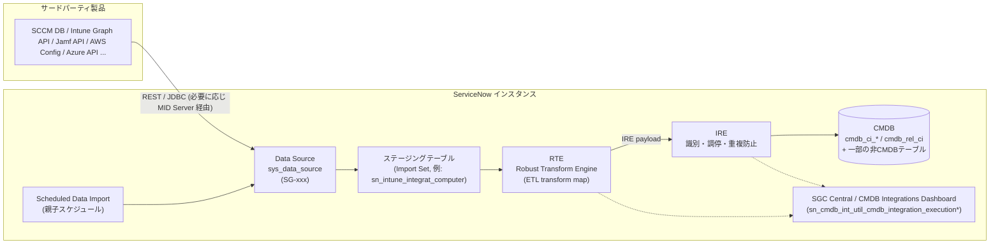
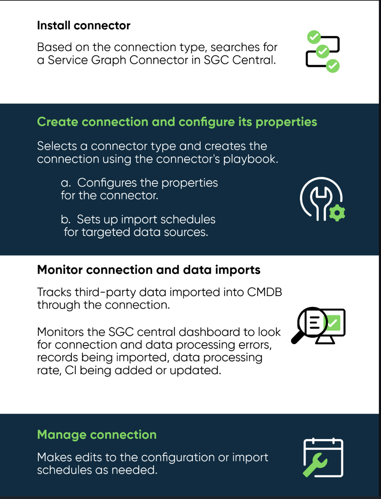
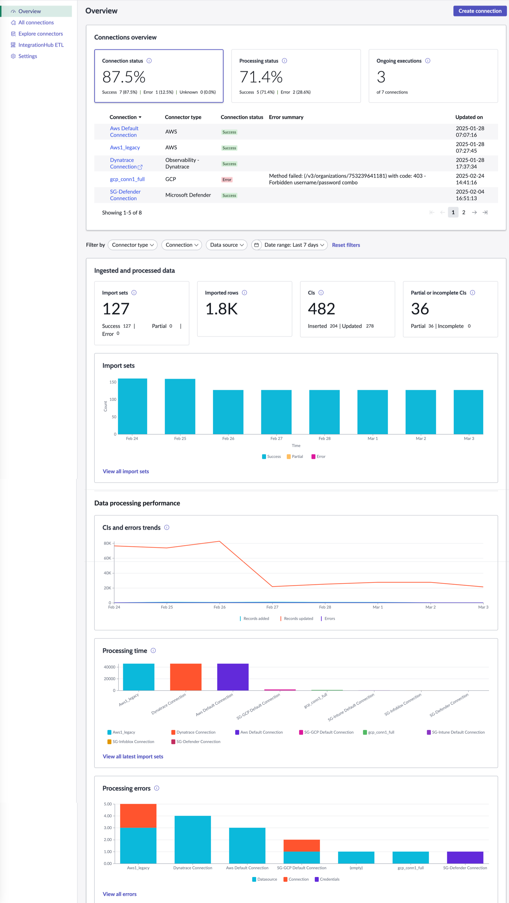
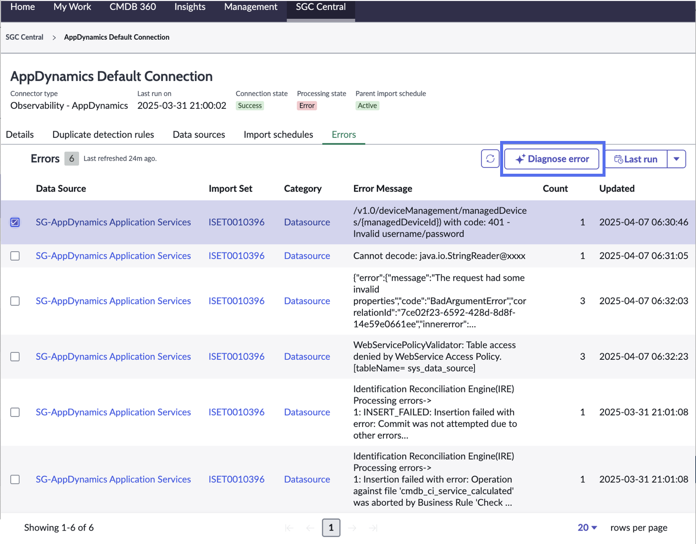

# Service Graph Connectors（サービスグラフコネクタ）

## 概要

**Service Graph Connectors（SGC、サービスグラフコネクタ）** は、サードパーティ製品（クラウド、エンドポイント管理、監視、セキュリティ、ネットワーク、OT 等）のデータを CMDB（および一部の非 CMDB テーブル）へ取り込むための **事前定義済み（purpose-built）の統合アプリ** である。ServiceNow Store で配布され、ServiceNow 自身が提供するもの、パートナー／ベンダーが提供する「Service Graph certified」コネクタの両方がある。[出典](https://www.servicenow.com/docs/r/australia/servicenow-platform/configuration-management-database-cmdb/cmdb-sgc-intro.html)

Service Graph Connectors の要点は次のとおり。

| 観点 | 内容 |
|---|---|
| 目的 | サードパーティデータを **CSDM（Common Service Data Model）** に沿った正しい CI クラス・属性へ、重複なく、一貫した品質で取り込む |
| 処理エンジン | **IntegrationHub ETL**（ETL transform map の定義）＋ **RTE（Robust Transform Engine）**（変換）＋ **IRE（Identification and Reconciliation Engine）**（識別・調停・CMDB 書き込み） |
| 管理 UI | **SGC Central**（CMDB Workspace / Service Graph Workspace 内のビュー）。コネクタの探索・インストール、接続（connection）の作成・編集・監視・デバッグを一元管理 |
| 監視 | SGC Central の Overview ダッシュボード、および Integration Commons for CMDB の **CMDB Integrations Dashboard** |
| 共通基盤アプリ | **Integration Commons for CMDB**（`sn_cmdb_int_util`）。RTE 変換・スクリプトインクルード・共通ロールを提供 |
| 種類 | Service Graph Connectors / API Service Graph Connectors / Partner-built connectors |
| ライセンス | ITOM（Visibility / Discovery）のサブスクリプションユニット（SU）計上対象（詳細は「ライセンス上の扱い」節） |

関連ファイル：CMDB と CSDM の全体は [CMDB と CSDM](../platform/cmdb-csdm.md)、エージェントレス探索は [Discovery](./discovery.md)、クラウド管理は [Cloud Management](./cloud-management.md)、ITOM のパッケージは [ITOM 概要とパッケージ](./itom-overview.md)、汎用連携基盤は [IntegrationHub](../platform/integrationhub.md)、MID Server は [MID Server](../platform/mid-server.md) を参照。

---

## 1. Service Graph Connectors の種類

Service Graph Connectors には次の 3 種類がある。[出典](https://www.servicenow.com/docs/r/australia/servicenow-platform/configuration-management-database-cmdb/cmdb-sgc-intro.html)

| 種類（英語） | 日本語 | 説明 |
|---|---|---|
| Service Graph Connectors | サービスグラフコネクタ | サードパーティ製品のデータを CMDB および非 CMDB テーブルへインポート・統合する |
| API Service Graph Connectors | API サービスグラフコネクタ | API ゲートウェイ製品等から **API そのもののデータ** を CMDB および非 CMDB テーブルへ取り込む（Apigee、Kong、MuleSoft 等） |
| Partner-built connectors | パートナー製コネクタ | パートナー・ベンダーが構築し ServiceNow Store に掲載するコネクタ。Store 上で「Service Graph certified」として絞り込める |

- Service Graph Connectors は ServiceNow Store アプリとして提供される。最新の全コネクタ一覧は公式ドキュメントではなく ServiceNow Store を参照するよう公式ドキュメントで明記されている。[出典](https://www.servicenow.com/docs/r/australia/servicenow-platform/service-graph-connectors/cmdb-sgc-available.html)
- Store の SGC 一覧（Service Graph certified フィルタ）: https://store.servicenow.com/sn_appstore_store.do#!/store/integrations?freeTrial=service_graph_certified

---

## 2. Service Graph Connectors の仕組み（データパイプライン）

### 2.1 4 段階のパイプライン

公式ドキュメントでは、Service Graph Connectors（API Service Graph Connectors を含む）は構成データのパイプラインを次の 4 段階で処理すると説明している。[出典](https://www.servicenow.com/docs/r/australia/servicenow-platform/configuration-management-database-cmdb/cmdb-sgc-intro.html)

| # | 段階（英語） | 内容 |
|---|---|---|
| 1 | Ingest | 識別ルール（identification rules）を用いてクラス・属性・データソースを特定しデータを取り込む |
| 2 | Standardize | データを CMDB に準拠する形に標準化する（RTE 変換、Integration Commons の共通変換） |
| 3 | Reconcile | 調停ルール（reconciliation rules）により、複数ソースのデータを単一の整合した姿に調停する |
| 4 | Ingest into CMDB | 調停済みデータを CMDB に書き込む |

### 2.2 内部コンポーネントとデータの流れ

Service Graph Connectors は **IntegrationHub ETL** 上に構築されており、IntegrationHub ETL は **RTE** と **IRE** の 2 つを中核コンポーネントとして使う。データはまずデータソースからインポートされ、Import Sets の一時的なステージングテーブルに格納される。RTE はステージングテーブルのデータと ETL transform map を用いて **IRE ペイロード** を生成し、IRE が識別・調停処理を行って CMDB（または IRE がサポートする非 CMDB テーブル）に書き込む。[出典](https://www.servicenow.com/docs/r/australia/servicenow-platform/integration-hub-etl/integrationhub-etl.html)



| コンポーネント | 役割 | 根拠 |
|---|---|---|
| Data Source（`sys_data_source`） | 外部ソースへの取得定義。コネクタごとに `SG-` で始まる名前のデータソースが同梱される（例：`SG-SCCM Computer Identity`、`SG-Intune Devices`） | [SCCM](https://www.servicenow.com/docs/r/australia/servicenow-platform/service-graph-connectors/cmdb-integration-sccm.html) |
| Scheduled Data Import | 親（Parent scheduled data import）と子のスケジュールで取得順序を制御 | [SCCM 設定](https://www.servicenow.com/docs/r/australia/servicenow-platform/service-graph-connectors/sgcc-configure-sccm-integ.html) |
| ステージングテーブル | Import Set 行として生データを一時保存（コネクタのスコープ名前空間のテーブル） | [IntegrationHub ETL](https://www.servicenow.com/docs/r/australia/servicenow-platform/integration-hub-etl/integrationhub-etl.html) |
| ETL transform map | IntegrationHub ETL が生成する変換・マッピング定義。1 データソースに 1 つ | 同上 |
| RTE | ステージングのデータを ETL transform map で変換し IRE ペイロードを生成 | 同上 |
| IRE | 識別ルール・調停ルール・IRE データソースルールを適用し CI を作成／更新 | [IRE](https://www.servicenow.com/docs/r/australia/servicenow-platform/configuration-management-database-cmdb/ire.html) |
| Integration Commons for CMDB | 共通の RTE 変換・スクリプトインクルード、CMDB Integrations Dashboard、SGC 共通ロール | [Integration Commons](https://www.servicenow.com/docs/r/australia/servicenow-platform/cmdb-integration-commons/integration-commons-for-cmdb.html) |

### 2.3 IntegrationHub ETL の用語

IntegrationHub ETL（プラグイン `sn_int_studio`）は ETL transform map を作成・管理する Store アプリであり、Service Graph Connectors の変換定義もこの形式で提供される。主要用語は次のとおり。[出典](https://www.servicenow.com/docs/r/australia/servicenow-platform/integration-hub-etl/integrationhub-etl.html)

| 用語（英語） | 説明 |
|---|---|
| CMDB application | サードパーティベンダーを表すレコード（例：SCCM 2019）。**Name** と **Discovery Source** の 2 属性を持つ。新しい統合を作る前に、その CMDB application 用の Discovery Source（`discovery_source` の選択肢）を構成しておく必要がある |
| Data source | 生データの取得元フィード（例：SCCM Computer Identity）。REST エンドポイントごとに 1 データソース＋1 ETL transform map |
| ETL transform map | IntegrationHub ETL の出力。CMDB / 非 CMDB テーブルへのマッピング定義 |
| Source data | インポートされた生データ |
| Transform | 列に適用する変換操作（書式変換、値置換、連結など） |
| Transformed data | 変換後のデータ |

- 1 つの CMDB application は複数の ETL transform map を持ち、各 ETL transform map は単一の Data Source に紐づく（例：SCCM の Computer Identity / Disk / Application がそれぞれ別のデータソースと map を持つ）。
- **ネストされた JSON ペイロード** を扱う場合は、データソースで **Data in single column** オプションを設定する。フィールド名は英字または `_` で始まり英数字と `_` のみ、`temp` / `object` は予約語、同一階層では配列／オブジェクトの表現を一貫させる必要がある。
- **Read-only mode**：データソースから入力データを検出できない Service Graph Connector を IntegrationHub ETL で開くと読み取り専用モードになり、設定の閲覧はできるが更新はできない。既存コネクタの研究やトラブルシュートに使う。
- **非 CMDB テーブル対応（Australia で導入）**：Australia リリースから、IntegrationHub ETL は IRE がサポートする一部の非 CMDB テーブルへの統合に対応した。非 CMDB テーブルではクラスアソシエーションは必須ではなく、リレーションの追加は適用されず、クラスアソシエーションは CMDB リレーションではなく参照フィールドに基づく。[出典](https://www.servicenow.com/docs/r/australia/servicenow-platform/integration-hub-etl/integrationhub-etl.html)

### 2.4 Import Set＋Transform Map との違い

公式ドキュメントでは、IntegrationHub ETL（＝ SGC の処理方式）は従来の Import Set＋Transform Map に対して次の利点があるとしている。[出典](https://www.servicenow.com/docs/r/australia/servicenow-platform/integration-hub-etl/integrationhub-etl.html)

| 観点 | IntegrationHub ETL / SGC | Import Set＋Transform Map |
|---|---|---|
| IRE の適用 | 全データが統合処理の一部として自動的に IRE を通る | IRE を簡単に適用する手段がない（スクリプトで IRE API を呼ぶ等が必要） |
| 作成体験 | ガイド付きセットアップ（Guided Setup）でタスク順序・依存関係を管理 | 個別に定義 |
| テスト | 少量データでの統合テストを実行し、結果をプレビューして調整後に定期実行をスケジュール | 個別検証が必要 |

Import Set 全般は [データインポート/エクスポート](../platform/import-export-data.md) を参照。

---

## 3. IRE（Identification and Reconciliation Engine）との関係

### 3.1 IRE の役割

**IRE** は、さまざまなデータソースにまたがる識別（identification）と調停（reconciliation）の中央フレームワークであり、識別ルール・調停ルール・IRE データソースルールを適用してから CMDB にデータを挿入する。IRE により、CI の一意識別による **重複 CI の防止** と、**権限のある（authoritative）データソースのみが CI 属性を更新できる** 状態が保たれる。Service Graph Connectors は IntegrationHub ETL 経由で必ず IRE を通るため、IRE の設定が SGC の取り込み品質を直接左右する。[出典](https://www.servicenow.com/docs/r/australia/servicenow-platform/configuration-management-database-cmdb/ire.html)

公式ドキュメントが SGC で使用される IRE 関連ルールとして挙げているものは次のとおり。[出典](https://www.servicenow.com/docs/r/australia/servicenow-platform/configuration-management-database-cmdb/cmdb-sgc-intro.html)

| ルール（英語） | 日本語 | SGC における意味 |
|---|---|---|
| Identification rules | 識別ルール | CI を一意に識別するための条件（クラスごとの識別属性の組）。弱い識別ルールは大量の重複 CI の原因になる |
| Reconciliation rules | 調停ルール | どの Discovery Source（例：Discovery、SCCM、Intune）が CI 属性を更新できるか、その優先順位 |
| IRE data source rules | IRE データソースルール | 特定の Discovery Source があるクラスの CI を **新規作成** することを禁止し、既存 CI の **更新のみ** 許可する |
| Data refresh rules | データリフレッシュルール | ある Discovery Source のデータを一定期間で stale（古い）とみなし、優先度の低い認可済みソースが更新できるようにする |
| Identification inclusion rules | 識別包含ルール | 識別対象とする CI を絞り込む |
| Duplicate CI detection | 重複 CI 検出 | 重複を de-duplication task（重複排除タスク）にまとめる |

### 3.2 source_name / source_native_key による識別

IRE ペイロードには任意で `sys_object_source_info` オブジェクトを含めることができ、`source_name`（例：`SCCM`）と `source_native_key`（ソース側の一意キー）、`source_feed`、`source_recency_timestamp` を渡せる。これらと Source（`sys_object_source`）テーブルで CI を一意に識別できる場合、識別ルールによるマッチング（より低速）は不要になる。この挙動はシステムプロパティ `glide.identification_engine.skip_sys_object_source_matching` で識別ルール優先に切り替えられる。[出典](https://www.servicenow.com/docs/r/australia/servicenow-platform/configuration-management-database-cmdb/ire.html)

```json
{
  "items": [{
    "className": "cmdb_ci_win_server",
    "values": { "name": "SAMLABVM52" },
    "sys_object_source_info": {
      "source_native_key": "16777219",
      "source_name": "SCCM",
      "source_feed": "SCCM Computer Identity",
      "source_recency_timestamp": "2019-08-26 13:00:00"
    }
  }]
}
```

（公式ドキュメント掲載のサンプル。SCCM のような SGC が source 情報付きでペイロードを送る典型例。）

### 3.3 部分ペイロード（Partial payloads）とマルチフィード

SCCM のように「ディスクフィード」「コンピュータフィード」など複数フィードを持つソースでは、あるフィードだけでは依存先 CI（コンピュータ）を一意識別できない場合がある。IRE の拡張機能（`CreateOrUpdateCIEnhanced()` 等）は次のように動作する。[出典](https://www.servicenow.com/docs/r/australia/servicenow-platform/configuration-management-database-cmdb/ire.html)

| 機能 | API オプション | 既定 | 説明 |
|---|---|---|---|
| Partial payloads | `partial_payloads` | 有効 | 一意識別に足りない項目を partial item として CMDB IRE Partial Payloads（`cmdb_ire_partial_payloads`）に JSON で保存し、後続フィードで不足データが届いた時点でマージして確定する。有効時は `partial_commits` と `deduplicate_payloads` も自動有効 |
| Partial commits | `partial_commits` | 有効 | 一部項目のエラーがあっても残りの有効項目はコミットする |
| Deduplicate payload items | `deduplicate_payloads` | 有効 | ペイロード内の重複項目をマージ |
| Generate summary | `generate_summary` | 無効 | クラス別更新件数などのサマリを出力 |

- partial item と判定される IRE エラー：`MISSING_MATCHING_ATTRIBUTES`、`REQUIRED_ATTRIBUTE_EMPTY`、`MISSING_DEPENDENCY`、`INSERT_NOT_ALLOWED_FOR_SOURCE`（IRE データソースルールにより作成禁止）。
- 識別キーは CMDB IRE Partial Payloads Index（`cmdb_ire_partial_payloads_index`）に保存される。
- 90 日より古い partial payload は削除される。1 partial payload の項目数上限は `glide.identification_engine.partial_payload_items_max_size`（既定 1000）。
- SGC Central の Overview にある「Partial or incomplete CIs」カードは、この partial / incomplete の件数を示す（後述）。

### 3.4 タイムスタンプと調停

IRE はペイロード処理時に CI の `last_discovered`（Most recent discovery）と `discovery_source` を常に更新する。ペイロードに `last_discovered` が含まれる場合は CMDB の値より新しい場合のみ更新する。関連プロパティとして `glide.identification_engine.skip_updating_source_last_discovered_if_older`、`glide.identification_engine.skip_updating_last_scan_if_older` などがある。[出典](https://www.servicenow.com/docs/r/australia/servicenow-platform/configuration-management-database-cmdb/ire.html)

調停ルールには 2 種類ある。[出典](https://www.servicenow.com/docs/r/australia/servicenow-platform/configuration-management-database-cmdb/r_ReconciliationRulesPrinciples.html)

| 種類 | 保存テーブル | 説明 |
|---|---|---|
| Static reconciliation rules（静的） | `cmdb_reconciliation_definition` | Discovery Source 間の優先順位と更新可能属性を定義する従来型ルール。子クラスのルールは親クラスのルールを上書きする。属性を空にするとクラス全属性の更新を認可 |
| Dynamic reconciliation rules（動的） | `cmdb_dynamic_reconciliation_definition` | CMDB 360 が保持する全ソースの値に基づき「最大値」「最も多く報告された値」等を選ぶ。CMDB 360 の有効化が必要。1 クラス属性につき 1 ルール。同一属性では静的ルールより優先 |

> 実務上、SGC を導入すると Discovery と SGC（例：SCCM、Intune、Jamf）が同じ Computer CI を更新しうるため、どのソースにどの属性の更新権限を与えるかを調停ルールで設計することが重要になる【経験則】。詳細は [CMDB 成功の要因](../../04_応用編/05-cmdb-success-factors.md) を参照。

### 3.5 Dynamic IRE（Australia で導入）

Australia では **Dynamic IRE** が追加された。Dynamic IRE は Hardware（`cmdb_ci_hardware`）クラスとその子孫クラスにのみ適用され、動的な識別プロセスにより識別ルールの手動作成・保守を不要にし、複数データソース間の重複 CI を最小化する。[出典](https://www.servicenow.com/docs/r/australia/release-notes/cmdb-rn.html)

> **Brazil での変更:** Brazil では Dynamic IRE が新規（zBoot）インスタンスで既定で有効になり、静的 IRE を使用しているアップグレードインスタンスは Dynamic IRE へ切り替え可能となった。データペイロード取り込み時に IRE 識別ルールが自動更新される点が利点とされる。[出典](https://www.servicenow.com/docs/r/release-notes/cmdb-rn.html)

### 3.6 CMDB 360 との関係

Service Graph Connectors のデータは IRE を通じて CMDB 360（旧 Multisource CMDB。ソース別の属性値を `cmdb_multisource_data` 等に保持する機能）にも反映され、ソース間比較や動的調停ルールの根拠となる。ITOM Visibility のドキュメントは「SGC と CMDB 360 が ITOM Visibility にデータを提供する」と位置づけている。[出典](https://www.servicenow.com/docs/r/sPnEbors95h6DhgBlE~f0A/ZxnlEGNtKwEoUdC_0lEN7g)

- Australia で **Multisource Report Builder** は削除され、CMDB Workspace / Service Graph Workspace の CMDB 360 を使うよう案内されている。[出典](https://www.servicenow.com/docs/r/australia/release-notes/rn-summary-deprecated-info.html)

---

## 4. ロール

Service Graph Connectors には、`admin` の付与を最小限にするための専用ロールが用意されている。[出典](https://www.servicenow.com/docs/r/australia/servicenow-platform/configuration-management-database-cmdb/cmdb-sgc-intro.html)

| ロール | 権限レベル | 主な権限 |
|---|---|---|
| Administrator（`admin`） | 最上位 | SGC（API SGC 含む）のインストール・アップグレード、接続作成と接続プロパティ構成、接続・インポート監視、接続管理、**バックグラウンドスクリプト実行**、**グローバルスコープのテーブルへのアクセス付与** |
| SGC-admin（`sn_cmdb_int_util.sgc_admin`） | 2 番目 | 接続の作成・更新・削除、Guided Setup によるコネクタ構成、コネクタが使うシステムプロパティの読み書き、下位ロールの全操作 |
| CMDB installation administrator（`cmdb_inst_admin`） | — | IntegrationHub ETL による統合の作成・カスタマイズ、全 SGC アプリモジュールの読み取り、システムプロパティの読み書き、カスタムテーブル・Scheduled Import・Data Source の作成／更新／削除、関連する他アプリのレコード（例：`em_event`）の読み取り |
| SGC-viewer（`sn_cmdb_int_util.sgc_viewer`） | 参照のみ | 全アプリモジュール・CCF・CMDB Workspace 上の SGC 接続・システムプロパティ・Scheduled Import の実行履歴とログ・データソース・カスタムテーブル・関連レコードの閲覧 |

プレイブック（後述）の段階ごとの必要ロールは、多くのコネクタで共通して次のとおり。[出典](https://www.servicenow.com/docs/r/australia/servicenow-platform/service-graph-connectors/sgcc-configure-sccm-integ.html)

| プレイブック段階 | 必要ロール |
|---|---|
| Prerequisites（前提条件） | `admin`（バックグラウンドスクリプト実行、グローバルテーブルへのアクセス付与のため） |
| Setup（セットアップ） | SGC-Admin（`sn_cmdb_int_util.sgc_admin`）または `admin` |

- Intune の Advanced data sources の構成には `admin` が必要。[出典](https://www.servicenow.com/docs/r/australia/servicenow-platform/service-graph-connectors/sgcc-configure-intune-integ.html)
- ServiceNow Community の SGC Central FAQ では、CMDB Workspace の SGC Central タブはロールベースで `cmdb_inst_admin` または `admin` が必要とされている。[出典](https://www.servicenow.com/community/cmdb-articles/service-graph-connector-central-sgcc-best-practices-and-faqs/ta-p/3278092)

ロール全般は [ユーザー・グループ・ロール](../platform/users-groups-roles.md) を参照。

---

## 5. SGC Central

### 5.1 SGC Central とは

**SGC Central**（Service Graph Connector Central）は、Service Graph Workspace または CMDB Workspace 内のビューとして提供されるアプリケーション（`sn_sgc_central`）であり、コネクタの探索とインストール、および接続（connection）の作成・編集・監視・デバッグというライフサイクル全体を管理する。プレイブック（Playbook）ガイド付きのデプロイでカスタマイズを最小化し、プレイブックがないコネクタは各コネクタ付属の Guided Setup を使う。[出典](https://www.servicenow.com/docs/r/australia/servicenow-platform/sgcc-landing.html)



- **キャプション:** SGC Central の利用ワークフロー（公式ドキュメント「Exploring SGC Central」の Figure 1）。
- **画面の説明:** 4 段の図。①「Install connector」— 接続タイプに基づき SGC Central でコネクタを検索・インストール。②「Create connection and configure its properties」— コネクタ種別を選び、そのコネクタのプレイブックで接続を作成し、a. コネクタのプロパティを構成、b. 対象データソースのインポートスケジュールを設定。③「Monitor connection and data imports」— 接続経由で CMDB に取り込まれたデータを追跡し、SGC Central ダッシュボードで接続／データ処理エラー、取り込みレコード、処理速度、追加・更新 CI を監視。④「Manage connection」— 必要に応じて構成やインポートスケジュールを編集。
- **出典:** https://www.servicenow.com/docs/r/australia/servicenow-platform/sgcc-explore.html （取得日: 2026-11-02）

### 5.2 アクセス方法（メニュー位置）

SGC Central は次のいずれかで開く。[出典](https://www.servicenow.com/docs/r/australia/servicenow-platform/sgcc-create-connection.html)

- **Workspaces > Service Graph Workspace** を開き、左ナビゲーションパネルの **Ingestion** アイコンを選択して SGC Central ビューを開く。
- **Workspaces > CMDB Workspace > SGC Central**。

SGC Central の左ナビゲーションには **Overview / All connections / Explore connectors / IntegrationHub ETL / Settings** がある（公式スクリーンショットより）。[出典](https://www.servicenow.com/docs/r/australia/servicenow-platform/sgcc-overview-page-features.html)

> **Brazil での変更:** Brazil（2026-09 EA）で **Service Graph Workspace は非推奨（deprecated）** となり、Service Graph Workspace の機能は CMDB Workspace に統合された。Brazil 以降は CMDB Workspace > SGC Central を主経路と考えるのが妥当である。[出典](https://www.servicenow.com/docs/r/release-notes/cmdb-rn.html)

### 5.3 インストールと前提

SGC Central（`sn_sgc_central`）は `admin` ロールでインストールする。インストール時に関連する Store アプリ・プラグインが未導入なら併せて導入される。[出典](https://www.servicenow.com/docs/r/australia/servicenow-platform/sgcc-install.html)

- 手順：**All > System Applications > All Available Applications > All** で `sn_sgc_central` を検索 → バージョン選択 → Install。依存アプリの追加エンタイトルメントが必要な場合は Store へのリンクに従う。
- 対応する CMDB Workspace のバージョン：

| ServiceNow リリース | 対応 CMDB Workspace バージョン |
|---|---|
| Australia | 8.0.0 以降 |
| Zurich | 7.4.1 以降 |
| Yokohama | 7.3.0 以降 |

- Australia のリリースノートでは「CMDB Workspace v9.0（Service Graph Workspace を含む）」が紹介されており、Australia インスタンスでも最新の CMDB Workspace Store アプリをダウンロードして最新機能を使える。[出典](https://www.servicenow.com/docs/r/australia/release-notes/cmdb-rn.html)
- **ドメインセパレーション：** SGC Central はドメインセパレーション **非対応（Support level: No support）**。ドメインフィールドがテーブルに存在しても管理用ビジネスロジックはない。[出典](https://www.servicenow.com/docs/r/australia/servicenow-platform/sgcc-domain-separation.html)（ドメインセパレーション全般は [ドメインセパレーション](../platform/domain-separation.md)）

### 5.4 SGC Central でインストールされるコンポーネント

[出典](https://www.servicenow.com/docs/r/australia/servicenow-platform/sgcc-installed-components.html)

**テーブル**

| テーブル（ラベル） | テーブル名 | 内容 |
|---|---|---|
| Connection Record Tabs | `sn_sgc_central_connection_record_tabs` | 接続編集ページのタブ定義（既定タブ Details / Data Sources / Scheduled Imports / Errors とコネクタ固有タブ、表示順） |
| Connection property config | `sn_sgc_central_conn_prop_config` | Connection Properties タブの項目定義（グループ順、説明、必須、既定値） |
| Service Graph Connection Trigger | `sn_sgc_central_service_graph_connection_trigger` | 接続作成フローでプレイブックコンテキストを初期化するトリガーレコード。参照するメタデータレコードのアプリケーションスコープ（＝ SGC のスコープ）に基づきプレイブックが選ばれる |
| Service Graph Connector | `sn_sgc_central_service_graph_connector` | コネクタ情報（スコープ、App ID、プロバイダ） |
| SGC Installed Connection | `sn_sgc_central_st_installed_connection` | インストール済み／ドラフト接続（処理ステータス、最終実行、インポート頻度など） |
| SGC IntegrationHub ETL | `sn_sgc_central_st_integrationhub_etl` | SGC Central の IntegrationHub ETL 一覧表示用の ETL リスト |

**スケジュールジョブ**

| ジョブ | 内容 |
|---|---|
| SGC central collection | コネクタのインポート結果を読み、ダッシュボードのスコア・メトリクスを更新する（日次）。**SGC Central インストール直後に `admin` が即時実行し、スケジュールを調整する必要がある** |
| SGC central collection onDemand with lookback | 過去データをオンデマンドで収集。既定のルックバック期間は 30 日 |

[出典（スケジュールジョブ）](https://www.servicenow.com/docs/r/australia/servicenow-platform/sgcc-config-scheduled-jobs.html)

**Store アプリ**

| アプリ | スコープ | 内容 |
|---|---|---|
| Integration Commons for CMDB | `sn_cmdb_int_util` | CMDB Integrations Dashboard、RTE 変換、スクリプトインクルード |
| CMDB Workspace | `sn_cmdb_ws` | SGC Central を含む CMDB 機能の統合ワークスペース |

**関連テーブル（Integration Commons / CCF）**：ServiceNow Community の SGC Central FAQ によると、SGC Central に表示されるにはコネクタが **Common Connector Framework（CCF）** 上に構築されている必要があり、登録済みコネクタは `sn_cmdb_int_util_service_graph_connector_metadata`、接続固有プロパティは `sn_cmdb_int_util_service_graph_connection_property` に格納される。[出典](https://www.servicenow.com/community/cmdb-articles/service-graph-connector-central-sgcc-best-practices-and-faqs/ta-p/3278092)

### 5.5 コネクタのインストール（Explore connectors）

SGC Central の **Explore connectors** から 2 通りでコネクタを導入できる。いずれも `admin` が必要。

| 方法 | 手順 | 出典 |
|---|---|---|
| エンタイトルメントあり | Explore connectors > **Entitlements available** セクション > **Explore in Application Manager** → Application Manager でエンタイトルメントを確認してインストール | [出典](https://www.servicenow.com/docs/r/australia/servicenow-platform/sgcc-install-sgc-entitlements.html) |
| エンタイトルメントなし | Explore connectors > **Available from ServiceNow Store** セクション > **Explore in ServiceNow Store** → Store でリクエスト・インストール | [出典](https://www.servicenow.com/docs/r/australia/servicenow-platform/sgcc-install-store-connectors.html) |

Explore connectors では新バージョンが利用可能でアップグレード対象となるコネクタも確認できる。[出典](https://www.servicenow.com/docs/r/australia/servicenow-platform/sgcc-explore.html)

### 5.6 初回セットアップ作業（Prerequisites 段階）

コネクタで最初に接続を作るとき、プレイブックの **Prerequisites** 段階で次の作業が表示される（`admin` が必要）。[出典](https://www.servicenow.com/docs/r/australia/servicenow-platform/sgcc-first-time-setup.html)

1. **Update data source access**：Data Source（`sys_data_source`）テーブルの Application Access を、Global スコープに切り替えたうえで **Can create / Can update / Can delete** をチェックして更新する（コネクタのスコープからデータソースを作成できるようにするため）。その後アプリケーションピッカーをコネクタのスコープに戻す。
2. **Clear cache**：バックグラウンドスクリプトで次を実行する（数分かかる場合がある）。

```javascript
GlideTableManager.invalidateTable("sys_data_source");
GlideCacheManager.flushTable("sys_data_source");
GlideTableManager.invalidateTable("sys_db_object");
GlideCacheManager.flushTable("sys_db_object");
```

### 5.7 接続の作成（Create connection）

接続（connection）は「あるコネクタで、ある外部環境（テナント／アカウント／DB）に接続する単位」であり、SGC-admin または `admin` が作成する。[出典](https://www.servicenow.com/docs/r/australia/servicenow-platform/sgcc-create-connection.html)

1. SGC Central を開く。
2. **Overview** ページ（または **All connections** ページ）で **Create connection** を選択。
3. **Create connection** ウィンドウでコネクタ種別を選び、プレイブックの指示に従う（プレイブック非対応なら Guided Setup）。
   - コネクタ種別を選択するとアプリケーションスコープがそのコネクタのスコープに切り替わる。
   - 初回は前節の初期セットアップ作業が必要。

プレイブックの典型的な Setup 段階のアクティビティは「Select alias template（認証テンプレート選択）→ Create and test connection（接続情報入力とテスト）→ Configure properties / Set configuration properties（接続・コネクタプロパティ）→ Configure import schedule（親スケジュールを Active にし実行周期を設定、Execute Now も可）→ Confirm connection creation」である。作成後は **View all connections** で **Installed connections** 一覧に表示される。[出典](https://www.servicenow.com/docs/r/australia/servicenow-platform/service-graph-connectors/sgcc-configure-sccm-integ.html)

Community FAQ のベストプラクティスとして、オンボーディング中に **Guided Setup とプレイブックを混在させない** ことが挙げられている。また単一インスタンスしかサポートしないコネクタでは Create Connection モーダルにバナーが表示される（例：Infoblox は既定接続 `SG_Infoblox_Connection` のみ）。[出典](https://www.servicenow.com/community/cmdb-articles/service-graph-connector-central-sgcc-best-practices-and-faqs/ta-p/3278092)

### 5.8 SGC Central でプレイブック構成をサポートするコネクタ（Australia）

Australia の公式ドキュメントで「SGC Central で接続の作成・管理をサポートする」と列挙されているコネクタは次のとおり。[出典](https://www.servicenow.com/docs/r/australia/servicenow-platform/sgcc-managing-connection.html)

| 分類 | コネクタ |
|---|---|
| API Service Graph Connectors | Apigee Edge、Apigee X、AWS API Gateway、Azure API Management、Boomi Cloud API Management、Kong Gateway、Kong Konnect、MuleSoft |
| Public cloud providers | AWS、Microsoft Azure、GCP、Wiz |
| Endpoint / IT asset management | Microsoft Intune、Jamf、Microsoft SCCM、Tanium、Tanium Endpoints |
| Monitoring / observability | Observability - AppDynamics、Observability - Dynatrace、Observability - Dynatrace SaaS、Observability - New Relic、SolarWinds |
| Security | Akamai API Security、Microsoft Defender Endpoint |
| Software / server / network | Infoblox、Trellix |

### 5.9 接続の閲覧（All connections）

**All connections** ページには **Installed** タブと **Drafts** タブがある。[出典](https://www.servicenow.com/docs/r/australia/servicenow-platform/sgcc-viewing-installed-connection.html)

- **Installed**：接続名を選ぶと、詳細・データソース・インポートスケジュール・エラーを確認できる（SGC-admin または `admin`）。
- **Drafts**：作成途中の接続。**Configure**（最後に構成した箇所から再開）または **Resume setup**（単一インスタンスコネクタの初回セットアップ）を選ぶ。
- 接続を選ぶとアプリケーションスコープがそのコネクタのスコープに切り替わる。

接続詳細ページのヘッダーには Connector type、Last run on、Connection state、Processing state、Parent import schedule が表示され、タブとして Details / Duplicate detection rules / Data sources / Import schedules / Errors がある（5.11 節の公式スクリーンショットより）。

### 5.10 Overview ダッシュボード（監視・分析）

SGC Central の **Overview** ページは、SGC 接続のインストール・性能・エラーを監視する集中ダッシュボードであり、SGC-admin または `admin` が利用する。[出典](https://www.servicenow.com/docs/r/australia/servicenow-platform/sgcc-overview-page-features.html)



- **キャプション:** SGC Central の Overview ページ（公式ドキュメントのサンプル画面）。
- **画面の説明:** 左ナビに Overview / All connections / Explore connectors / IntegrationHub ETL / Settings。右上に **Create connection** ボタン。上段「Connections overview」に 3 枚のカード（**Connection status**＝接続テスト成功率と Success/Error/Unknown 件数、**Processing status**＝最終インポートが全成功した接続の割合、**Ongoing executions**＝実行中の接続数）と、接続ごとの Connection / Connector type（AWS、Observability - Dynatrace、GCP、Microsoft Defender 等）/ Connection status / Error summary / Updated on の表。中段に「Filter by」（Connector type、Connection、Data source、Date range）。その下の「Ingested and processed data」に **Import sets**（Success/Partial/Error）、**Imported rows**、**CIs**（Inserted/Updated）、**Partial or incomplete CIs** の各カードと Import sets の日次棒グラフ。下段「Data processing performance」に **CIs and errors trends**（Records added / Records updated / Errors の折れ線）、**Processing time**（接続別上位 10）、**Processing errors**（Datasource / Connection / Credentials 別の積み上げ棒）。
- **出典:** https://www.servicenow.com/docs/r/australia/servicenow-platform/sgcc-overview-page-features.html （取得日: 2026-11-02）

**Connections overview のカード**

| カード | 内容 | 表の主な列 |
|---|---|---|
| Connection status | 接続テスト成功率と Success / Error / Unknown 件数 | Connection、Connector type、Connection status（Success / Error）、Error summary、Updated on |
| Processing status | 最終実行のインポートが全て成功した接続の割合（Success / Error 件数）。**最終実行でエラーになった Import Set のみ** カードでは処理エラーとして数える | Connection、Last processing status、Activated schedules、Processed、Success、Error（キャンセルされた Import Set を含む）、Error summary（View details リンク）、Last processed on |
| Ongoing executions | インポート実行中の接続数 | Connection、Activated schedules、In progress、Processed、Processing time |

**Ingested and processed data / Data processing performance のカード**

| カード | 内容 |
|---|---|
| Import sets | フィルタ条件で処理された Import Set 数（success / partial / error）。View all import sets |
| Imported rows | 全 Import Set の取り込み行数 |
| CIs | 処理 CI 数（added / updated） |
| Partial or incomplete CIs | IRE の partial / incomplete ペイロードとなった CI 数 |
| CIs and errors trends | 日次の追加・更新 CI と処理エラーの推移 |
| Processing time | 最新 Import Set の処理時間が長い上位 10 接続 |
| Processing errors | 処理エラーの多い上位 10 接続（データソース／接続／資格情報別） |

**インジケーター（Platform Analytics）と元テーブル**

| インジケーター | 元テーブル | 計算 |
|---|---|---|
| Records added / Records updated / Records added or updated | `sn_cmdb_int_util_cmdb_integration_execution_audit` | 前日の Inserted / Updated 操作件数 |
| Errors / SGC.processing.errors / SGC.connection.errors | `sn_cmdb_int_util_cmdb_integration_execution_error` | 前日のエラー件数（資格情報・データソース・接続別） |
| SGC.Integrations.ImportSet | `sn_cmdb_int_util_cmdb_integration_execution_import_set` | 前日の Import Set 総数 |
| SGC.Fully.successful.ImportSet | 同上 | Errors = 0 の件数 |
| SGC.Fully.error.ImportSet | 同上 | Errors ≠ 0 かつ Rows = Errors |
| SGC.Part.success.ImportSet | 同上 | Errors ≠ 0 かつ Rows ≠ Errors |
| SGC.Integrations.Importset.rows.ingested | `sn_cmdb_int_util_cmdb_integration_execution` | 取り込み行数合計 |
| SGC.Integrations.Processing Rate | `sn_cmdb_int_util_cmdb_integration_execution` | 処理行数 ÷ 処理時間（時間） |

### 5.11 処理エラーの診断（Now Assist / ServiceNow Otto）

SGC Central では、Service Graph Connector diagnosis skill を有効化しておくと、処理エラーを AI で診断できる（SGC-admin または `admin`）。[出典](https://www.servicenow.com/docs/r/australia/servicenow-platform/sgcc-diagnose-proc-errors.html)

1. Overview の **Processing status** カードを選択。
2. エラー件数のある接続の Error summary から **View details** を選択。
3. **Errors** タブで失敗した Import Set のエラーを **1 件だけ** 選択（ボタンは 1 件選択時のみ有効）。
4. **Diagnose error** を選択 → Error diagnosis ウィンドウに **Explanation**（説明）と **Recommendation**（推奨対処）が表示され、AI Search でマッチしたナレッジ記事へのリンクが Source として示される。



- **キャプション:** 接続詳細ページの Errors タブ（公式ドキュメントのサンプル画面「AppDynamics Default Connection」）。
- **画面の説明:** 上部タブに Home / My Work / CMDB 360 / Insights / Management / SGC Central（CMDB Workspace）。接続ヘッダーに Connector type（Observability - AppDynamics）、Last run on、Connection state（Success）、Processing state（Error）、Parent import schedule（Active）。タブは Details / Duplicate detection rules / Data sources / Import schedules / Errors。Errors 一覧の列は Data Source（SG-AppDynamics Application Services）、Import Set（ISET 番号）、Category（Datasource）、Error Message（HTTP 401 認証エラー、WebService Access Policy による `sys_data_source` へのアクセス拒否、「Identification Reconciliation Engine(IRE) Processing errors -> INSERT_FAILED」等）、Count、Updated。右上に **Diagnose error** ボタン（青枠で強調）と **Last run** ボタン。
- **出典:** https://www.servicenow.com/docs/r/australia/servicenow-platform/sgcc-diagnose-proc-errors.html （取得日: 2026-11-02）

- この診断機能は「ServiceNow Otto for CMDB」アプリの **Otto SGC diagnosis skill**（Import Set 処理エラーの要約と修正推奨）として説明されている。Yokohama で Now Assist for SGC の診断スキルとして登場し、Brazil では Now Assist の名称が **ServiceNow Otto** に変更されている。[出典](https://www.servicenow.com/docs/r/australia/servicenow-platform/configuration-management-database-cmdb/cmdb-sgc-intro.html)、[出典（Brazil CMDB RN）](https://www.servicenow.com/docs/r/release-notes/cmdb-rn.html)
- Now Assist / AI 全般は [Now Assist と AI Agents](../platform/now-assist-ai-agents.md) を参照。

### 5.12 Settings（コネクタのシステムプロパティ）

SGC Central の **Settings** > **Browse system properties by connector** でコネクタを選び、そのコネクタのシステムプロパティを編集できる（`admin`）。コネクタ選択時にアプリケーションスコープが切り替わる。システムプロパティはインスタンス全体に効き（コネクタ同梱）、接続プロパティ（Connection properties タブ）は接続単位である点が異なる。[出典](https://www.servicenow.com/docs/r/australia/servicenow-platform/sgcc-settings.html)、[出典（Community FAQ）](https://www.servicenow.com/community/cmdb-articles/service-graph-connector-central-sgcc-best-practices-and-faqs/ta-p/3278092)

### 5.13 Guided Setup の位置づけ

各コネクタは従来 **Guided Setup**（ガイド付きセットアップ）で構成していたが、Australia 時点の主要コネクタのドキュメントは「構成上の問題がない限り SGC Central を使う。Guided Setup 方式は非推奨化予定」と明記している。Microsoft Intune コネクタでは **バージョン 2.7.0 から Guided Setup は非推奨（deprecated）**。[出典（AWS）](https://www.servicenow.com/docs/r/australia/servicenow-platform/service-graph-connectors/cmdb-integration-aws-sg.html)、[出典（Intune）](https://www.servicenow.com/docs/r/australia/servicenow-platform/service-graph-connectors/cmdb-integration-intune.html)

- 参考：Australia ではプラットフォーム機能「Adoption Services」の Guided Setup（Guided Setup 全般）も将来の非推奨化に向け準備中とされている（コネクタ個別の Guided Setup とは別物の可能性があるが、方向性は一致）。[出典](https://www.servicenow.com/docs/r/australia/release-notes/rn-summary-deprecated-info.html)

---

## 6. Integration Commons for CMDB と CMDB Integrations Dashboard

### 6.1 Integration Commons for CMDB

**Integration Commons for CMDB**（Store アプリ、スコープ `sn_cmdb_int_util`、プラグイン `com.snc.cmdb.integration_util`）は、CMDB Integrations Dashboard と、RTE 変換・スクリプトインクルードを含む共通基盤である。[出典](https://www.servicenow.com/docs/r/australia/servicenow-platform/cmdb-integration-commons/integration-commons-for-cmdb.html)

- 含まれる変換の対象属性は、IRE が識別に必要とする属性、またはクラス導出に使える属性である（異なる統合間で値を標準化するため）。
- RTE 変換は IntegrationHub ETL からも利用できる。
- ServiceNow Store の SGC はこのアプリに依存しているため、SGC をインストールすると Integration Commons for CMDB も自動的にインストールされる。
- 依存：CMDB and CSDM Data Foundations Dashboards v2.3.5 以降。
- 追加機能：Application Dependency Mapping（ADM）アダプタ（実行中プロセス、TCP 接続、アプリケーションを CMDB に投入）、接続詳細へのアクセス、CMDB データ削除管理、並列ロードのパーティションサイズ計算。
- アップグレードや新規統合の展開後は **Quick start tests for Integration Commons for CMDB** の実行が推奨されている。

### 6.2 CMDB Integrations Dashboard

CMDB Integrations Dashboard は、全 SGC と IntegrationHub ETL で作成したカスタム統合の状態・処理結果・処理エラーを一元表示する（Xanadu から Next Experience UI で提供）。[出典](https://www.servicenow.com/docs/r/australia/servicenow-platform/cmdb-integration-commons/cmdb-integ-dashboard.html)

- メニュー：**All > Self-Service > Dashboards**（または **All > Platform Analytics > Library > Dashboards**）> **CMDB Integrations Dashboard**。必要ロール：なし（公式記載）。
- タブ：**CMDB Execution Status**（統合数、処理行数、実行中の統合、日次統計、更新クラス）、**CMDB Integration Errors**（インポート・統合エラー数、エラーレコード数）。
- フィルタ：Import Date、CMDB Applications（例：SCCM やカスタム統合）、CMDB Import（特定の実行）。

---

## 7. 主要コネクタ一覧（Australia）

### 7.1 Service Graph Connectors（ServiceNow 提供、公式ドキュメント掲載分）

Australia の公式ドキュメント「Service Graph Connectors」に掲載されているコネクタは次のとおり（Brazil 版の一覧も同一構成）。Store にはこれ以外にも多数（パートナー製含む）ある。[出典](https://www.servicenow.com/docs/r/australia/servicenow-platform/service-graph-connectors/cmdb-sgc-available.html)、[出典（Brazil）](https://www.servicenow.com/docs/r/servicenow-platform/service-graph-connectors/cmdb-sgc-available.html)

| 分類（英語） | 日本語 | コネクタ |
|---|---|---|
| Public cloud providers | パブリッククラウド | AWS、GCP、Microsoft Azure、Wiz |
| Endpoint or IT asset management applications | エンドポイント／IT 資産管理 | Google Console、Jamf、Microsoft Intune、Microsoft SCCM、Tanium、Tanium Endpoints、VMware Workspace ONE UEM |
| Monitoring and observability applications | 監視／オブザーバビリティ | AppDynamics、Datadog、Dynatrace、Dynatrace SaaS、OpenTelemetry、New Relic、SolarWinds |
| Security solutions | セキュリティ | Microsoft Defender for Endpoint、Microsoft Active Directory、Netskope、Qualys、Rapid7、Splunk、Akamai API Security |
| Software, server, or network applications | ソフトウェア／サーバー／ネットワーク | Infoblox、Trellix |
| Operational Technology (OT) applications | OT | Claroty CTD、Microsoft Defender for IoT（On-premises Management Console）、Microsoft Defender for IoT（Azure）、Operational Technology（Excel import） |

**API Service Graph Connectors**：Apigee Edge、Apigee X、AWS API Gateway、Azure API Management、Boomi Cloud API Management、Kong Gateway、Kong Konnect、MuleSoft。[出典](https://www.servicenow.com/docs/r/australia/servicenow-platform/configuration-management-database-cmdb/api-sgc-available.html)

**非推奨・非推奨予定のコネクタ**

| コネクタ | 状況 | 出典 |
|---|---|---|
| Service Graph Connector for OpenTelemetry（`com.snc.cmdb.lightstep_integration`） | Australia で「将来リリースで非推奨予定」、後継なし | [出典](https://www.servicenow.com/docs/r/australia/release-notes/cmdb-rn.html) |
| Service Graph Connector Integration for Claroty CTD | Australia から非推奨化準備（新規インストール不可・非表示、サポートは継続）。Brazil の非推奨情報にも同記載 | [出典](https://www.servicenow.com/docs/r/australia/release-notes/rn-summary-deprecated-info.html)、[Brazil](https://www.servicenow.com/docs/r/release-notes/rn-summary-deprecated-info.html) |
| Telco SD-WAN 系（Fortinet、VeloCloud、Meraki の SGC） | TSOM で Telco SD-WAN connectors として改称（第三者検索結果経由の公式 RN 情報。本書では詳細未確認） | 公開情報では詳細確認できず |

### 7.2 主要コネクタの比較サマリ

| コネクタ | 接続方式 / 認証 | MID Server | 主な取り込み対象 | 対応 ServiceNow（Australia 文書） | SGC Central 必要バージョン |
|---|---|---|---|---|---|
| Microsoft SCCM（MECM） | JDBC（SQL Server）。ユーザー名/パスワード、Windows 統合認証、Air gap | 統合認証では必須、JDBC 全般で推奨 | Computer、Disk、Network Adapter、IP、OS、Processor、Software、Software Usage | Yokohama / Zurich / Australia | 3.5.0 以降 |
| Microsoft Intune | REST（Microsoft Graph API v1.0 / Beta）、OAuth 2.0 client credentials | 直接接続できない場合のみ | Computer、Handheld Computing Device、Network Adapter、IP、Software | Yokohama / Zurich / Australia | 2.5.0 以降 |
| Jamf | REST（Jamf Pro API / Classic API）、OAuth（API Roles and Clients）または Basic / Bearer | 公開情報では必須記載なし | Computer（macOS）、Handheld（iPhone/iPad）、Disk、Network、Printer、Software、Software Usage | Xanadu / Yokohama / Zurich（文書記載のまま） | 2.13.0 以降 |
| AWS | REST（AWS Config / Organizations / SSM / STS）、IAM アクセスキー | 任意 | 40 超の CI クラス（VM、ネットワーク、DB、Kubernetes/EKS、Lambda 等）、EC2 のディープディスカバリ（ソフトウェア・プロセス・TCP） | Yokohama / Zurich / Australia | 2.7.0 以降 |
| Microsoft Azure | REST（Azure Management API、差分は Azure Resource Graph、ソフトウェアは Log Analytics API）、OAuth 2.0 client credentials | 公開情報では必須記載なし | VM、ネットワーク、DB、Kubernetes、Resource Group、Windows/Linux Server、Software 等 | Yokohama / Zurich / Australia | 1.9.0 以降 |

以降の各節の出典は節見出し直下に記載する。

### 7.3 Service Graph Connector for Microsoft SCCM

出典：[概要](https://www.servicenow.com/docs/r/australia/servicenow-platform/service-graph-connectors/cmdb-integration-sccm.html)、[SGC Central 構成](https://www.servicenow.com/docs/r/australia/servicenow-platform/service-graph-connectors/sgcc-configure-sccm-integ.html)

Service Graph Connector for Microsoft SCCM（SG-SCCM）は、Microsoft System Center Configuration Manager（SCCM）／Microsoft Endpoint Configuration Manager（MECM）のデータを CMDB にインポートする。SCCM データベースへの書き込みは行わない（読み取り専用）。

- **対応バージョン**：SCCM/MECM 2603、2509、2503。ServiceNow Yokohama、Zurich、Australia。
- **ユースケース**：ITOM Visibility（ハードウェア／ソフトウェアインベントリ、差分インポート）、ITSM（検出 CI へのインシデント／問題／変更、デバイス所有者の自動割り当て）、SAM/ITAM（Software Asset Management Professional 連携、ソフトウェア使用状況、削除ソフトウェア検出によるライセンス回収、Software Editions、SCCM Asset Intelligence 対応）。SAM は [Software Asset Management](../itam/software-asset-management.md) を参照。

**データソース**

| データソース | 用途 |
|---|---|
| SG-SCCM Computer Identity | コンピュータ識別（資産タグ、割り当て、DNS ドメイン等）。プレイブックでは `<接続名>-SCCM Computer Identity` が親インポートスケジュール |
| SG-SCCM Computer OU | 組織単位（OU）。`sn_sccm_integrate_sccm_2019_computer_related` に格納 |
| SG-SCCM Disk | ディスク |
| SG-SCCM Last Discovered Update | 最終検出日時 |
| SG-SCCM Network | ネットワークアダプタ（既定では IP/MAC のないアダプタを除外。含める場合は SQL statement の where 句を削除） |
| SG-SCCM Operating System | OS |
| SG-SCCM Processor | プロセッサ |
| SG-SCCM Software / SG-SCCM Removed Software | Asset Intelligence を使わない場合 |
| SG-SCCM Software AI / SG-SCCM Removed Software AI | SCCM Asset Intelligence を使う場合 |

**対象 CMDB クラス**：CI Relationship（`cmdb_rel_ci`）、Computer（`cmdb_ci_computer`）、Disk（`cmdb_ci_disk`）、IP Address（`cmdb_ci_ip_address`）、Network Adapter（`cmdb_ci_network_adapter`）、Serial Number（`cmdb_serial_number`）、Software Installation（`cmdb_sam_sw_install`、SAM 導入時）、Software Instance（`cmdb_software_instance`）と Software（`cmdb_ci_spkg`）（SAM 未導入時）、Software Usage（`samp_sw_usage`）。

**前提（SQL Server 側）**：SCCM DB に接続する SQL 認証ログインを作成し、SCCM DB を選択して **`db_datareader`** ロールを付与する。

**プレイブックの認証テンプレート（Select alias template）**

| テンプレート | 説明 |
|---|---|
| SCCM JDBC Connection Credentials | ユーザー名／パスワードで JDBC 接続（ユーザーに `db_datareader`） |
| SCCM JDBC Conn Cred (Integrated Auth) | Windows 統合認証（ドメイン資格情報）。MID Server エージェントの実行アカウントに `db_datareader` が必要 |
| SCCM Air Gap | インターネット直結のない制限環境向け（コネクタ 3.7.0 から）。高セキュアサーバー／低セキュアサーバーに Air gap ソリューションを構成し、PowerShell スクリプトをダウンロード・実行 |

**Create and test connection の項目（JDBC）**：Connection name、Query timeout（秒、0 は無制限）、Connection timeout（秒、MID Server 接続キャッシュプール）、Host、Database name、Override default port（SQL Server 既定 1433）、Instance name、MID Server（統合認証では必須、JDBC では推奨）、Format（`com.microsoft.sqlserver.jdbc.SQLServerDriver` 固定）、Username、Password、Use MID Server。
**Air gap の項目**：Connection name、Parent directory（低セキュアサーバー上の SCCM データ格納パス）、Archive data after retrieval、Archive path、MID server（低セキュアサーバーに配置したもの）。

**接続／コネクタプロパティ**：Map asset tags（SCCM の資産タグを `cmdb_ci_computer` の asset tag にマップ）、Avoid creating duplicate records（Discovery 併用時に `cmdb_ci_disk` の重複を回避）、Transform disk name to disk number（ディスク名を `Disk #<番号>` 形式に）。**Customize data source SQL statement** でデータソースごとに SQL をカスタマイズ可能。

**アップグレード時の注意**：最新版インストール後、SCCM データソースの Data Source（`sys_data_source`）の last run datetime（`last_run_datetime`）値をクリアしてフルインポートさせる。SG-SCCM Removed Software / Removed Software AI は毎回「Use last run datetime」をオフにする。

### 7.4 Service Graph Connector for Microsoft Intune

出典：[概要](https://www.servicenow.com/docs/r/australia/servicenow-platform/service-graph-connectors/cmdb-integration-intune.html)、[SGC Central 構成](https://www.servicenow.com/docs/r/australia/servicenow-platform/service-graph-connectors/sgcc-configure-intune-integ.html)、[対象クラス](https://www.servicenow.com/docs/r/australia/servicenow-platform/service-graph-connectors/cmdb-intune-classes.html)

Service Graph Connector for Microsoft Intune は、モバイルデバイス・コンピュータ・ソフトウェアのデータを Microsoft Intune から CMDB に取り込む。

- **対応**：Microsoft Intune Graph API v1.0 / Graph API Beta。ServiceNow Yokohama、Zurich、Australia。
- **ユースケース**：Android / Apple / Windows モバイルデバイスのハードウェア・アプリインベントリ（SAM 有無いずれも可）、BYOD／会社所有デバイスのコンプライアンス追跡、ITSM（インシデント等、デバイス所有者の追跡と割り当て）、Azure Monitor 連携による差分通知。
- Intune で削除された検出アプリのレコードは CMDB から自動削除される。

**前提（Microsoft 側）**：Intune 管理者から Client ID / Client Secret / Token URL を取得し、Microsoft ポータルの App registrations で次の **Graph API アプリケーション権限** を付与する。

| 権限 | 種別 |
|---|---|
| `DeviceManagementManagedDevices.Read.All` | Application |
| `DeviceManagementApps.Read.All` | Application |
| `User.Read.All` | Application |

**依存（自動インストールされるもの中心）**：Integration Commons for CMDB、CMDB CI Class Models、Datastream Action プラグイン（`com.glide.hub.action_type.datastream`）、IntegrationHub Zip step（`com.glide.hub.action_step.zip`）、IntegrationHub JSON Parser step（`com.glide.hub.action_step.jsonparser`）、SGC Central（`sn_sgc_central`）、および **ITOM Licensing プラグイン（`com.snc.itom.license`）**。

**データソースとステージングテーブル**

| データソース | ステージングテーブル | 主な対象クラス | リソース | 種別 |
|---|---|---|---|---|
| SG-Intune Computer | `sn_intune_integrat_computer` | Computer、SG-Intune Computer Related、IP Address、Serial Number、Software / Software Instance（SAM なし）または Software Installation（SAM あり） | Computers | Regular |
| SG-Intune Devices | `sn_intune_integrat_devices` | Handheld Computing Device、Serial Number、Network Adapter、SG-Intune Device Related、IP Address、Software 系 | Mobile devices | Regular |
| SG-Intune Software | `sn_intune_integrat_software` | Software | Discovered apps | Regular |
| SG-Intune Device Reports | `sn_intune_integrat_device_reports` | Computer または Handheld、Serial Number、Network adapter、Related、IP Address（Wi-Fi IPv4 のみ）、Software 系 | Computers and mobile devices | Advanced |
| SG-Intune Software Reports | `sn_intune_integrat_software_reports` | Software 系（Publisher を含む） | Discovered apps | Advanced |

- **Advanced data sources（2.7.0 以降）**：既定では無効で、SGC Central の接続構成時に **Advanced data sources** を選択して有効化する。大量デバイス環境での高速化・性能改善・ソフトウェアの発行元（Publisher）取得が目的。Device Reports は Computer / Devices の、Software Reports は Software の代替。添付ファイル作成のため `glide.attachment.extensions` を null または `zip, json` に設定する必要がある（KB1641546）。Advanced では **Activate report trigger job**（Scheduled Script Execution）を構成し、Microsoft 側でデバイス／ソフトウェアレポートを生成させてから数時間後（通常 3〜4 時間）に関連ジョブ・インポートが順に実行される。
- Device Reports のみが取得する属性：Device Category、Device State、Security Patch Level、System Management BIOS Version、Wi-Fi Subnet ID。逆に Azure AD Registered、Device Enrollment Type、Management Agent は Device Reports では取得されない。
- **対象 CMDB クラス**：Computer（`cmdb_ci_computer`）、Handheld Computing Device（`cmdb_ci_handheld_computing`）、IP Address（`cmdb_ci_ip_address`）、Network Adapter（`cmdb_ci_network_adapter`）、Serial Number（`cmdb_serial_number`）、SG-Intune Computer Related（`sn_intune_integrat_computer_related`）、SG-Intune Device Related（`sn_intune_integrat_device_related`）、Software（`cmdb_ci_spkg`）、Software Installation（`cmdb_sam_sw_install`）、Software Instance（`cmdb_software_instance`）。

**Create and test connection の項目**

| 項目 | 内容 |
|---|---|
| Connection Name | 例：SG-Intune connection |
| Connection URL | Global `https://graph.microsoft.com` / US Government `https://graph.microsoft.us` / China `https://microsoftgraph.chinacloudapi.cn` / Germany `https://graph.cloudapi.de/` |
| OAuth Client ID / OAuth Client Secret | App registration の値 |
| OAuth Token URL | 例：Global `https://login.microsoftonline.com/<tenantid>/oauth2/v2.0/token` |
| Use MID server / Mid Selection | ServiceNow と Intune の直接接続ができない場合のみ |

親インポートスケジュールは `<接続名>-SG-Intune Devices`。

### 7.5 Service Graph Connector for Jamf

出典：[概要](https://www.servicenow.com/docs/r/australia/servicenow-platform/service-graph-connectors/cmdb-integration-jamf.html)、[SGC Central 構成](https://www.servicenow.com/docs/r/australia/servicenow-platform/service-graph-connectors/sgcc-configure-jamf-integration.html)

Service Graph Connector for Jamf は、Jamf（Jamf Pro）から macOS コンピュータ、iPhone / iPad、ディスク、ネットワーク、ソフトウェアのデータを CMDB に取り込む。

- **対応 ServiceNow**：Australia 版文書でも「Xanadu / Yokohama / Zurich」と記載（Australia 対応の明記は公開情報では確認できず。Store の互換性情報で要確認）。
- **ユースケース**：macOS / iOS / iPadOS のハードウェア・ソフトウェアインベントリ、コンプライアンス追跡、重複データ検出による夜間インポート高速化、SAM（パッケージ・インストール追跡、使用状況、ライセンス回収）、ITSM（トップユーザーに基づく所有者自動割り当て）。

**データソースとステージングテーブル**

| # | データソース | ステージングテーブル |
|---|---|---|
| 1 | SG-Jamf Computers | `sn_jamf_integrate_sg_jamf_computers` |
| 2 | SG-Jamf Lookup Mac Software Bundle Ids | `sn_cmdb_int_util_mac_software_bundleid_lookup` |
| 3 | SG-Jamf Mobile Devices | `sn_jamf_integrate_sg_jamf_mobile_devices` |
| 4 | SG-Jamf Remove Computers Software | `sn_jamf_integrate_jamf_remove_software` |
| 5 | SG-Jamf Remove Mobile Software | `sn_jamf_integrate_remove_mobile_software` |
| 6 | SG-Jamf Software Usage | `sn_jamf_integrate_jamf_software_usage` |

- macOS アプリの発行元情報を得るため、**SG-Jamf Lookup Mac Software Bundle Ids を Computers / Mobile Devices より先に実行** する。
- SG-Jamf Software Usage には Software Asset Management Professional プラグイン（`com.snc.samp`）の有効化が必要。
- 差分同期（`is_delta_enabled_for_computers`、`is_delta_enabled_for_mobiles`）は Jamf 2.14 以降が必要。
- **対象クラス**：Computer（`cmdb_ci_computer`）、Handheld Computing device（`cmdb_ci_handheld_computing`）、CI Relationship、Disk、IP Address、Network Adapter、Printer、Serial Number、Software Installation（SAM あり）、Software Instance / Software（SAM なし）、Software Usage（`samp_sw_usage`）。マルチインスタンス構成では、データの出所を区別するキー／値の列と Jamf の拡張属性が利用できる。

**認証テンプレート**

| テンプレート | 用途 |
|---|---|
| SG-Jamf OAuth Connection | OAuth / クライアント資格情報（Jamf Pro の API Roles and Clients 機能で API クライアントを作成。トークン有効期間は 60 秒超が必須、3600 秒推奨） |
| SG-Jamf Basic Connection | Basic 認証または Bearer トークン（Connection Host に Jamf ベース URL / IP、Jamf ユーザーに Computers と Mobile Devices の読み取り権限） |

**構成プロパティ**：Import managed application records only（管理対象アプリのみ取り込み）、Use JAMF Pro API（ページングにより Classic API より高性能なコンピュータ取得）。

### 7.6 Service Graph Connector for AWS

出典：[概要](https://www.servicenow.com/docs/r/australia/servicenow-platform/service-graph-connectors/cmdb-integration-aws-sg.html)、[AWS リソース](https://www.servicenow.com/docs/r/australia/servicenow-platform/service-graph-connectors/sgc-cmdb-aws-concepts.html)、[SGC Central 構成](https://www.servicenow.com/docs/r/australia/servicenow-platform/service-graph-connectors/sgcc-configure-aws-integ.html)、[対象クラス](https://www.servicenow.com/docs/r/australia/servicenow-platform/service-graph-connectors/cmdb-aws-classes.html)

Service Graph Connector for AWS は、AWS ネイティブ技術とセキュリティベストプラクティスを用いて AWS データを ServiceNow に取り込む。

- **対応 ServiceNow**：Yokohama、Zurich、Australia。
- **ユースケース**：クラウドリソース・関係・状態の可視化、ITAM/SAM のためのアプリケーションのディープディスカバリ、ガバナンス／コンプライアンス。

**利用する AWS サービス**

| AWS サービス | 必須/任意 | 用途 |
|---|---|---|
| AWS Config サービス＋Configuration recorder | **必須** | リソース構成の記録。同梱スクリプト `EnableAWSConfig.yml` で有効化。全対象アカウント・リージョンで有効化する |
| AWS Config aggregator | 任意（推奨） | 複数アカウント／リージョン／AWS Organizations のデータを単一箇所から取得し高速化。削除検出には `config:ListDiscoveredResources` で各アカウント・リージョンをループする |
| AWS Systems Manager（SSM）＋SSM Inventory | ディープディスカバリに必須 | EC2 のホスト名・シリアル・CPU・TCP・プロセス、インストール済みソフトウェア。全 EC2 に SSM Agent、インスタンスプロファイル `AmazonSSMForInstancesRole`、各リージョンで Inventory 構成 |
| AWS STS（AssumeRole） | 必須 | 一時資格情報で各アカウントにアクセス。既定ロール名 `SnowOrganizationAccountAccessRole` |
| AWS Organizations（ListAccounts） | 組織利用時 | 管理アカウント ID を指定すると全アカウントから収集 |

**プレイブック**

- Prerequisites：Download basic scripts（必須）、Download deep discovery scripts（EC2 ディープディスカバリ時）、Download Amazon EKS scripts（EKS 利用時）。
- Create and test connection：Connection name（例：`SG_AWS_CredentialAlias_Org`）、Access Key ID、Secret Access Key（IAM ユーザー）、Use MID Server（任意）。
- Set configuration properties：Organization details、S3 account details（S3 account ID / bucket name / region。EC2 詳細の収集先バケット）、AWS regions（既定は全リージョン。変更時は全 AWS データソースの Last run datetime をクリア）、STS assume role name、SSM SendCommand document（Linux / Windows）、Management account ID / Standalone account ID（スタンドアロン時は組織データが取り込まれない。KB1642159）、AWS config aggregator（account / name / region）、AWS key rotation（キー自動ローテーション）。

**主なデータソースとプロパティ**

| 名称 | 種別 | 内容 |
|---|---|---|
| SG-AWS-Image-Id | データソース | Image CI のメタデータ（BYOL 判定用） |
| SG-AWS-SendCommand / SG-AWS-SSM-GetS3Object | データソース | SSM によるディープディスカバリ |
| SG-AWS-Software-Inventory | データソース | SSM Inventory のソフトウェア |
| `sn_aws_integ.load_all_images` | プロパティ | 初回取得時に全 Image CI のメタデータを読み込み、その後自動で無効化 |
| `sn_aws_integ.enableOptimizedDeletion` | プロパティ | フルインポート時の退役 CI 削除を最適化 |
| `sn_aws_integ.is_software_inventory_enabled` | プロパティ | SendCommand / GetS3Object の性能最適化 |
| `SgAwsApplicationProperties` | スクリプトインクルード | 大規模インポート時のメモリエラー回避 |

**対象 CMDB クラス（抜粋）**：Amazon Redshift（`cmdb_ci_aws_redshift`）、Application（`cmdb_ci_appl`）、Availability Zone（`cmdb_ci_availability_zone`）、AWS Datacenter（`cmdb_ci_aws_datacenter`）、AWS Organizational Unit（`cmdb_ci_aws_org_unit`）、Cloud DataBase（`cmdb_ci_cloud_database`）、Cloud Function（`cmdb_ci_cloud_function`）、Cloud Gateway、Cloud Load Balancer（`cmdb_ci_cloud_load_balancer`）、Cloud Mgmt Network Interface（`cmdb_ci_nic`）、Cloud Network（`cmdb_ci_network`）、Cloud Object Storage、Cloud Organizations、Cloud Resource（`cmdb_ci_cmp_resource`）、Cloud Service Account（`cmdb_ci_cloud_service_account`）、Cloud Subnet（`cmdb_ci_cloud_subnet`）、Compute Security Group、Docker Container / Image、DynamoDB Table、Hardware Type（`cmdb_ci_compute_template`）、Image（`cmdb_ci_os_template`）、Instance Scale Set、IP Address、Key Value（`cmdb_key_value`）、Kubernetes Cluster / DaemonSet / Deployment / Namespace / Node / Pod / ReplicaSet / Service / Volume、Network Adapter、Server（`cmdb_ci_server`）、Software / Software Installation / Software Instance、Storage Mapping / Volume / Volume Snapshot、Virtual Machine Instance（`cmdb_ci_vm_instance`）、VNIC Endpoint ほか。

**その他の機能**

- **BYOL**：AWS 上の Oracle Database サーバーの Image CI について、ライセンス情報が見つかると `cmdb_key_value` に key `Windows_OS_License_Type_automatic`、value `BYOL` を設定。
- **Event-based discovery**：AWS から取得したイベントで、コネクタが取り込んだ CI を作成・更新できる。
- **EKS の退役管理**：EKS 側で削除された Pod / Service / Volume 等は Kubernetes 系クラスと Docker Container で自動的に Retired になる。
- **Shared VPC / サブネット**：異なる AWS アカウント間の VPC・サブネット・NIC の関係を取り込む。
- **アップグレード時**：`sys_update_xml` からカスタマイズ記録を削除 → 依存アプリを先に更新 → 最新版導入後にフルインポート（全 AWS データソースの Use last run datetime をクリア）→ AWS スクリプトを再ダウンロード・再実行。

**Cloud Discovery（パターン）との違い**：公式ドキュメント「AWS discovery solutions comparison」は、ITOM Visibility の **Discovery and Service Mapping Patterns**（Cloud Discovery）と **Service Graph Connector for AWS** をリソースタイプ単位で比較している。例えば AWS::Lambda::Function（`cmdb_ci_cloud_function`）や AWS::RDS::DBInstance（`cmdb_ci_cloud_database`）は両方が対応する一方、AWS::SQS::Queue、AWS::KMS::Key、AWS::ECS::Cluster などはパターンのみ対応、AWS::IAM::Role や AWS::CloudFront::Distribution は SGC では汎用の `cmdb_ci_cmp_resource` に、パターンでは専用クラス（`cmdb_aws_iam_role` 等）に格納される。[出典](https://www.servicenow.com/docs/r/australia/servicenow-platform/service-graph-connectors/aws-discovery-methods-platcap.html)（Cloud Discovery は [Discovery](./discovery.md)、[Cloud Management](./cloud-management.md) を参照）

### 7.7 Service Graph Connector for Microsoft Azure

出典：[概要](https://www.servicenow.com/docs/r/australia/servicenow-platform/service-graph-connectors/cmdb-integration-azure.html)、[SGC Central 構成](https://www.servicenow.com/docs/r/australia/servicenow-platform/service-graph-connectors/sgcc-configure-azure-integ.html)、[対象クラス](https://www.servicenow.com/docs/r/australia/servicenow-platform/service-graph-connectors/cmdb-azure-classes.html)

Service Graph Connector for Microsoft Azure は Microsoft Azure のデータを CMDB に取り込む。

- **対応 ServiceNow**：Yokohama、Zurich、Australia。SGC Central での構成にはコネクタ 1.9.0 以降が必要。
- **API**：フル取得は **Azure Management API**、差分（delta）取得は **Azure Resource Graph API**（DNS は Azure Management、パスが Resource Graph）。初回取得後は差分インポートになり、プロパティ `sn_sg_azure_integ.is_delta_sync_enabled` を `false` にするとフル取得に戻せる。
- **前提（Azure 側）**：OAuth 資格情報（Client ID、Client Secret、Token URL）を取得。ハードウェアデータには Microsoft Graph API の `User.Read` 権限と、サブスクリプションの IAM で **Reader** ロール。ソフトウェアデータには Log Analytics API の `Data.Read` 権限と **Log Analytics workspace** の構成。
- **プレイブック**：Review setup instructions → Select services（Hardware only が既定、Hardware and software を選ぶとソフトウェア接続が追加。ソフトウェアにはハードウェア接続が必要）→ Create and test hardware connection → Configure hardware import schedule（親スケジュール `<接続名>-SG-Azure Subscriptions`）→ Create and test software connection（Connection URL `https://api.loganalytics.io/v1/workspaces/<workspace_id>`）→ Configure software import schedule（`<接続名>-SG-Azure TCP`）→ Connection setup complete。
- **その他**：複数接続とワークスペースの設定、VM insights による Azure データ収集、データ同期構成、Event-based discovery、アップグレード後はフルデータロードが必須。
- **対象 CMDB クラス（抜粋）**：Application、Availability Zone、Azure Datacenter（`cmdb_ci_azure_datacenter`）、Cloud DataBase、Cloud Function、Cloud LB IPAddress、Cloud Load Balancer、Cloud Mgmt Network Interface、Cloud Network、Cloud Public IP Address、Cloud Resource、Cloud Service Account、Cloud Storage Account、Cloud Subnet、Cloud WebServer、Compute Security Group、Computer、Hardware Type、Image、Instance Scale Set、IP Address、Key Value、Kubernetes Cluster、Linux Server（`cmdb_ci_linux_server`）、Resource Group（`cmdb_ci_resource_group`）、Serial Number、Server、Software / Software Installation / Software Instance、Storage Volume、Virtual Machine Instance、Windows Server（`cmdb_ci_win_server`）。

### 7.8 その他の主要コネクタ（概要のみ）

| コネクタ | 概要 | 備考 |
|---|---|---|
| GCP | Google Cloud のリソースを取り込む。SGC Central 構成はコネクタ 1.8.0 以降 | [出典](https://www.servicenow.com/docs/r/zS6yb8e~gR8BPjeviYdV9g/9XtHFSFGzbpc_FgrHAo1ZQ)（Zurich 版） |
| Tanium / Tanium Endpoints | Tanium のエンドポイントインベントリ。Tanium Endpoints はサービスアカウント・ペルソナの構成が必要 | 公式一覧に記載 |
| Microsoft Defender for Endpoint / Active Directory / Qualys / Rapid7 等 | セキュリティ製品のデバイス・資産情報を CMDB へ。Security Posture Control 等の SecOps 系機能のデータ源にもなる | [Security Operations](../secops/security-operations.md) |
| AppDynamics / Dynatrace / Datadog / New Relic / SolarWinds | 監視製品のアプリ・サービス・ホストを CMDB へ。サービスマップや Event Management の CI 紐づけの基盤 | [Event Management と AIOps](./event-management-aiops.md)、[Service Mapping](./service-mapping.md) |
| Infoblox | DNS/DHCP/IPAM 情報。単一インスタンスのみ対応で既定接続 `SG_Infoblox_Connection` を使う | [出典（Community）](https://www.servicenow.com/community/cmdb-articles/service-graph-connector-central-sgcc-best-practices-and-faqs/ta-p/3278092) |

各コネクタの詳細仕様（データソース、クラス、プロパティ）は公式ドキュメントの各コネクタページを参照。

---

## 8. ライセンス上の扱い

- ITOM のサブスクリプション文書（Zurich 版）では、**ITOM Visibility** は Discovery が検出した CI に加え **Service Graph Connectors が CMDB に投入した CI** も報告（計上）し、**ITOM Discovery**（ITOM Visibility のサブセットとなるエントリーレベルの選択肢）は Discovery と Service Graph Connectors が持ち込んだ CI 数を提供するとされている。サブスクリプションユニット（SU）あたりの CI 配分比率は顧客契約で定まる。[出典](https://www.servicenow.com/docs/r/guxhDnVk8OUAJKLm7WZsYA/8XAnPqUIHAXKSJUAjYY0Mw)
- Australia 版の ITOM Visibility 文書でも、SGC と CMDB 360 が ITOM Visibility にデータを提供すると位置づけられている。[出典](https://www.servicenow.com/docs/r/sPnEbors95h6DhgBlE~f0A/ZxnlEGNtKwEoUdC_0lEN7g)
- Intune コネクタは依存として **ITOM Licensing プラグイン（`com.snc.itom.license`）** を挙げている。[出典](https://www.servicenow.com/docs/r/australia/servicenow-platform/service-graph-connectors/sgcc-configure-intune-integ.html)
- 各コネクタの Store 掲載ページに必要な SKU（例：SU ベースの ITOM Visibility または ITOM Discovery）が記載されており、特定のサードパーティ SGC を ITOM SU / ITAM SU ベースの SKU で利用可能にする依存アプリ「Service Graph Connector Licensing」が Store に存在する【第三者情報】（検索エンジン経由で確認した Store 掲載文。Store ページ本文は本調査では取得できず）。
- SGC が投入した CI のうち、まだ ITOM Visibility / Discovery で管理されていないものが増えると SU 消費が増える、という趣旨の記載が AWS コネクタの Store 掲載にある【第三者情報】（同上）。

> 価格・SU 換算比率は公開情報では確認できず。ライセンス全般は [ライセンスモデル](../../03_導入編/01-licensing-model.md)、[ITOM 概要とパッケージ](./itom-overview.md) を参照。

---

## 9. 設計・運用上のポイント

公式ドキュメント・公式 Community 記事に記載のポイント：

| ポイント | 内容 | 出典 |
|---|---|---|
| CI タイプの一貫した対応付け | 例：IP アドレスはサーバーではなくネットワークインターフェースに一貫して紐づける | [出典](https://www.servicenow.com/docs/r/australia/servicenow-platform/configuration-management-database-cmdb/cmdb-sgc-intro.html) |
| IRE を通す | 取り込み前に IRE で識別・分類し、重複 CI を防ぎ属性値を一貫させる | 同上 |
| SGC Central を使う | Guided Setup は非推奨化予定。プレイブックと Guided Setup を混在させない | [出典](https://www.servicenow.com/community/cmdb-articles/service-graph-connector-central-sgcc-best-practices-and-faqs/ta-p/3278092) |
| 監視の習慣化 | Overview カードとダッシュボードを定期確認。SGC central collection ジョブの稼働を確認（ダッシュボードが空の場合、ジョブ未実行・初回ロード失敗・フィルタを確認） | 同上 |
| 最新化 | コネクタと SGC Central を最新に保つ。アップグレード後は last run datetime のクリアやフルロードなどコネクタ別の手順に従う | 同上、各コネクタページ |
| Quick start tests | アップグレード・新規統合後に Integration Commons for CMDB の Quick start tests を実行 | [出典](https://www.servicenow.com/docs/r/australia/servicenow-platform/cmdb-integration-commons/integration-commons-for-cmdb.html) |
| カスタマイズ | 同梱 ETL transform map を直接改変するとアップグレード時の差分（`sys_update_xml`）になり、AWS ではアップグレード前に削除が求められる。必要な変更は IntegrationHub ETL で慎重に行う | [出典](https://www.servicenow.com/docs/r/australia/servicenow-platform/service-graph-connectors/cmdb-integration-aws-sg.html) |

実務上の知見（【経験則】）：

- 【経験則】Discovery と SGC（SCCM / Intune / Jamf 等）を併用すると、同一デバイスを複数ソースが更新する。導入前に「どのソースを、どのクラス・属性の権威（authoritative）とするか」を調停ルール・IRE データソースルールで設計し、Discovery Source ごとの優先度を明文化しておくと重複・上書き合戦を避けやすい。
- 【経験則】自作の REST 連携や Import Set で CMDB を更新するより、対応 SGC がある製品は SGC を使う方が IRE 適用・CSDM 準拠・監視・アップグレード追随の点で保守性が高い。
- 【経験則】大規模環境（Intune の大量デバイス、AWS の多数アカウント）では、Advanced data sources、AWS Config aggregator、リージョン絞り込み、パーティションサイズ／並列ロード設定などコネクタ固有の性能オプションを初期から検討する。

連携設計全般は [連携設計](../../03_導入編/09-integration-design.md)、落とし穴は [連携の落とし穴](../../04_応用編/08-integration-pitfalls.md) を参照。

---

## 10. リリース別の変更点まとめ

| リリース | 変更 | 出典 |
|---|---|---|
| Xanadu | CMDB Integrations Dashboard が Next Experience UI で提供 | [出典](https://www.servicenow.com/docs/r/australia/servicenow-platform/cmdb-integration-commons/cmdb-integ-dashboard.html) |
| Yokohama | Now Assist for SGC（Import Set 失敗の診断スキル）登場（CMDB 合算リリースノートの記載。第三者検索結果経由で確認） | 公開情報の要約に基づく【第三者情報】 |
| Australia | IntegrationHub ETL が IRE 対応の非 CMDB テーブルへの統合をサポート | [出典](https://www.servicenow.com/docs/r/australia/servicenow-platform/integration-hub-etl/integrationhub-etl.html) |
| Australia | Dynamic IRE 追加（Hardware クラス系）。IRE による lookup / 関連テーブルの重複排除タスク自動生成 | [出典](https://www.servicenow.com/docs/r/australia/release-notes/cmdb-rn.html) |
| Australia | CMDB Workspace v9.0（Service Graph Workspace を含む）、Service Graph Workspace - Content プラグイン（`sn_cmdb_sgw_conten`）追加 | 同上 |
| Australia | Multisource Report Builder 削除（CMDB 360 を使用） | 同上 |
| Australia | SGC for OpenTelemetry 非推奨予定、SGC Integration for Claroty CTD 非推奨化準備 | 同上、[非推奨情報](https://www.servicenow.com/docs/r/australia/release-notes/rn-summary-deprecated-info.html) |
| Brazil | Service Graph Workspace 非推奨、CMDB Workspace に機能統合 | [出典](https://www.servicenow.com/docs/r/release-notes/cmdb-rn.html) |
| Brazil | Dynamic IRE が新規インスタンスで既定有効 | 同上 |
| Brazil | Now Assist の名称が ServiceNow Otto に（Duplicate CI Remediator 等） | 同上 |

> **Brazil での変更:** Brazil 版「Getting started with Service Graph Connectors」「Service Graph Connectors（一覧）」「Components installed with SGC Central」は Australia 版と内容上の差分がほぼなく（要約文の改稿のみ）、SGC Central の CMDB Workspace 対応バージョン表も Australia 8.0.0 / Zurich 7.4.1 / Yokohama 7.3.0 のまま（Brazil 行は未記載）であった（2026-11-02 時点）。[出典](https://www.servicenow.com/docs/r/servicenow-platform/sgcc-explore.html)

---

## 11. 確認できなかった事項

- 各コネクタの Store 上の最新バージョン番号、Australia 時点での正確な互換性（特に Jamf の Australia 対応）は公開ドキュメントでは確認できず（Store の各アプリページで要確認）。
- SGC が登録する `discovery_source` の具体的な選択肢値（例：SCCM 用の値）は公開情報では確認できず。
- SU 換算比率、価格は公開情報では確認できず。
- Telco SD-WAN 系 SGC の改称の詳細は本調査では一次資料を取得できず。

---

## 参照元

公式ドキュメント（Australia）

- Getting started with Service Graph Connectors: https://www.servicenow.com/docs/r/australia/servicenow-platform/configuration-management-database-cmdb/cmdb-sgc-intro.html
- Service Graph Connectors（一覧）: https://www.servicenow.com/docs/r/australia/servicenow-platform/service-graph-connectors/cmdb-sgc-available.html
- API Service Graph Connectors: https://www.servicenow.com/docs/r/australia/servicenow-platform/configuration-management-database-cmdb/api-sgc-available.html
- SGC Central: https://www.servicenow.com/docs/r/australia/servicenow-platform/sgcc-landing.html
- Exploring SGC Central: https://www.servicenow.com/docs/r/australia/servicenow-platform/sgcc-explore.html
- Install SGC Central: https://www.servicenow.com/docs/r/australia/servicenow-platform/sgcc-install.html
- Components installed with SGC Central: https://www.servicenow.com/docs/r/australia/servicenow-platform/sgcc-installed-components.html
- Perform initial setup tasks: https://www.servicenow.com/docs/r/australia/servicenow-platform/sgcc-first-time-setup.html
- Create a connection: https://www.servicenow.com/docs/r/australia/servicenow-platform/sgcc-create-connection.html
- Managing connections: https://www.servicenow.com/docs/r/australia/servicenow-platform/sgcc-managing-connection.html
- View a connection: https://www.servicenow.com/docs/r/australia/servicenow-platform/sgcc-viewing-installed-connection.html
- Monitor and analyze connections: https://www.servicenow.com/docs/r/australia/servicenow-platform/sgcc-overview-page-features.html
- Diagnose a processing error: https://www.servicenow.com/docs/r/australia/servicenow-platform/sgcc-diagnose-proc-errors.html
- Configure scheduled jobs: https://www.servicenow.com/docs/r/australia/servicenow-platform/sgcc-config-scheduled-jobs.html
- Install a connector using an entitlement: https://www.servicenow.com/docs/r/australia/servicenow-platform/sgcc-install-sgc-entitlements.html
- Install a connector from ServiceNow Store: https://www.servicenow.com/docs/r/australia/servicenow-platform/sgcc-install-store-connectors.html
- Configure connector settings: https://www.servicenow.com/docs/r/australia/servicenow-platform/sgcc-settings.html
- Domain separation and SGC Central: https://www.servicenow.com/docs/r/australia/servicenow-platform/sgcc-domain-separation.html
- IntegrationHub ETL: https://www.servicenow.com/docs/r/australia/servicenow-platform/integration-hub-etl/integrationhub-etl.html
- Integration Commons for CMDB: https://www.servicenow.com/docs/r/australia/servicenow-platform/cmdb-integration-commons/integration-commons-for-cmdb.html
- CMDB Integrations Dashboard: https://www.servicenow.com/docs/r/australia/servicenow-platform/cmdb-integration-commons/cmdb-integ-dashboard.html
- Identification and Reconciliation Engine (IRE): https://www.servicenow.com/docs/r/australia/servicenow-platform/configuration-management-database-cmdb/ire.html
- Reconciliation rules: https://www.servicenow.com/docs/r/australia/servicenow-platform/configuration-management-database-cmdb/r_ReconciliationRulesPrinciples.html
- Service Graph Connector for Microsoft SCCM: https://www.servicenow.com/docs/r/australia/servicenow-platform/service-graph-connectors/cmdb-integration-sccm.html
- Configure SCCM using SGC Central: https://www.servicenow.com/docs/r/australia/servicenow-platform/service-graph-connectors/sgcc-configure-sccm-integ.html
- Service Graph Connector for Microsoft Intune: https://www.servicenow.com/docs/r/australia/servicenow-platform/service-graph-connectors/cmdb-integration-intune.html
- Configure Intune using SGC Central: https://www.servicenow.com/docs/r/australia/servicenow-platform/service-graph-connectors/sgcc-configure-intune-integ.html
- CMDB classes targeted in SGC for Microsoft Intune: https://www.servicenow.com/docs/r/australia/servicenow-platform/service-graph-connectors/cmdb-intune-classes.html
- Service Graph Connector for Jamf: https://www.servicenow.com/docs/r/australia/servicenow-platform/service-graph-connectors/cmdb-integration-jamf.html
- Configure Jamf using SGC Central: https://www.servicenow.com/docs/r/australia/servicenow-platform/service-graph-connectors/sgcc-configure-jamf-integration.html
- Service Graph Connector for AWS: https://www.servicenow.com/docs/r/australia/servicenow-platform/service-graph-connectors/cmdb-integration-aws-sg.html
- Configure AWS using SGC Central: https://www.servicenow.com/docs/r/australia/servicenow-platform/service-graph-connectors/sgcc-configure-aws-integ.html
- AWS resources used by the connector: https://www.servicenow.com/docs/r/australia/servicenow-platform/service-graph-connectors/sgc-cmdb-aws-concepts.html
- CMDB classes targeted in SGC for AWS: https://www.servicenow.com/docs/r/australia/servicenow-platform/service-graph-connectors/cmdb-aws-classes.html
- AWS discovery solutions comparison: https://www.servicenow.com/docs/r/australia/servicenow-platform/service-graph-connectors/aws-discovery-methods-platcap.html
- Service Graph Connector for Microsoft Azure: https://www.servicenow.com/docs/r/australia/servicenow-platform/service-graph-connectors/cmdb-integration-azure.html
- Configure Azure using SGC Central: https://www.servicenow.com/docs/r/australia/servicenow-platform/service-graph-connectors/sgcc-configure-azure-integ.html
- CMDB classes targeted in SGC for Microsoft Azure: https://www.servicenow.com/docs/r/australia/servicenow-platform/service-graph-connectors/cmdb-azure-classes.html
- ITOM Visibility（Australia）: https://www.servicenow.com/docs/r/sPnEbors95h6DhgBlE~f0A/ZxnlEGNtKwEoUdC_0lEN7g
- Configure GCP using SGC Central（Zurich）: https://www.servicenow.com/docs/r/zS6yb8e~gR8BPjeviYdV9g/9XtHFSFGzbpc_FgrHAo1ZQ

リリースノート

- CMDB release notes（Australia）: https://www.servicenow.com/docs/r/australia/release-notes/cmdb-rn.html
- Deprecation information for all Australia features and products: https://www.servicenow.com/docs/r/australia/release-notes/rn-summary-deprecated-info.html
- CMDB release notes（Brazil）: https://www.servicenow.com/docs/r/release-notes/cmdb-rn.html
- Deprecation information for all Brazil features and products: https://www.servicenow.com/docs/r/release-notes/rn-summary-deprecated-info.html
- Exploring SGC Central（Brazil）: https://www.servicenow.com/docs/r/servicenow-platform/sgcc-explore.html
- Service Graph Connectors（Brazil 一覧）: https://www.servicenow.com/docs/r/servicenow-platform/service-graph-connectors/cmdb-sgc-available.html

その他

- Subscriptions for IT Operations Management（Zurich）: https://www.servicenow.com/docs/r/guxhDnVk8OUAJKLm7WZsYA/8XAnPqUIHAXKSJUAjYY0Mw
- ServiceNow Community: Service Graph Connector Central (SGCC) Best Practices and FAQs: https://www.servicenow.com/community/cmdb-articles/service-graph-connector-central-sgcc-best-practices-and-faqs/ta-p/3278092
- ServiceNow Store（Service Graph certified 一覧）: https://store.servicenow.com/sn_appstore_store.do#!/store/integrations?freeTrial=service_graph_certified
