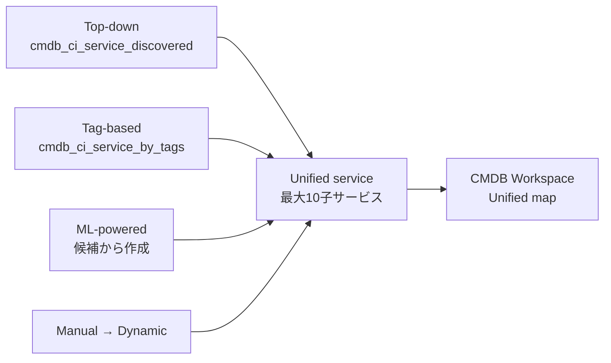
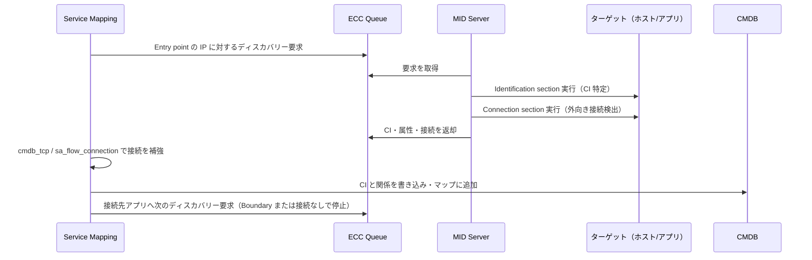
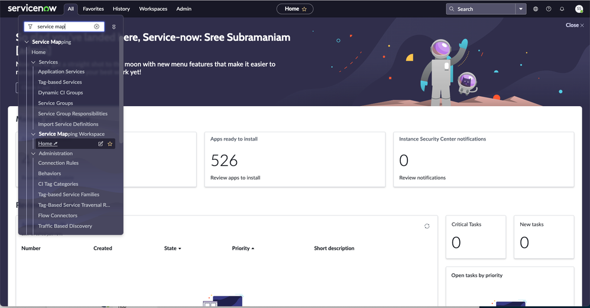
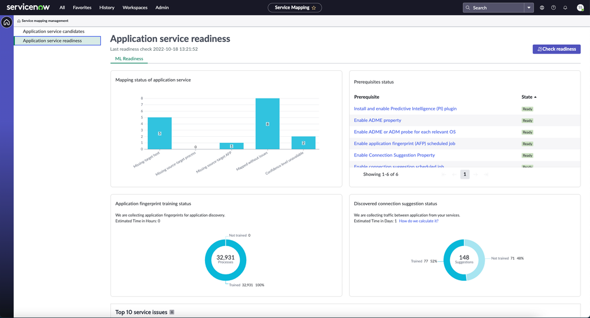
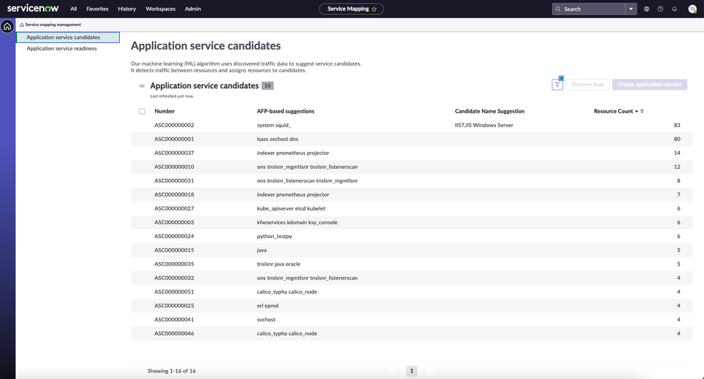
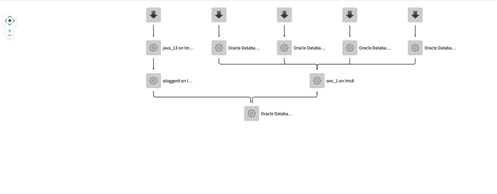
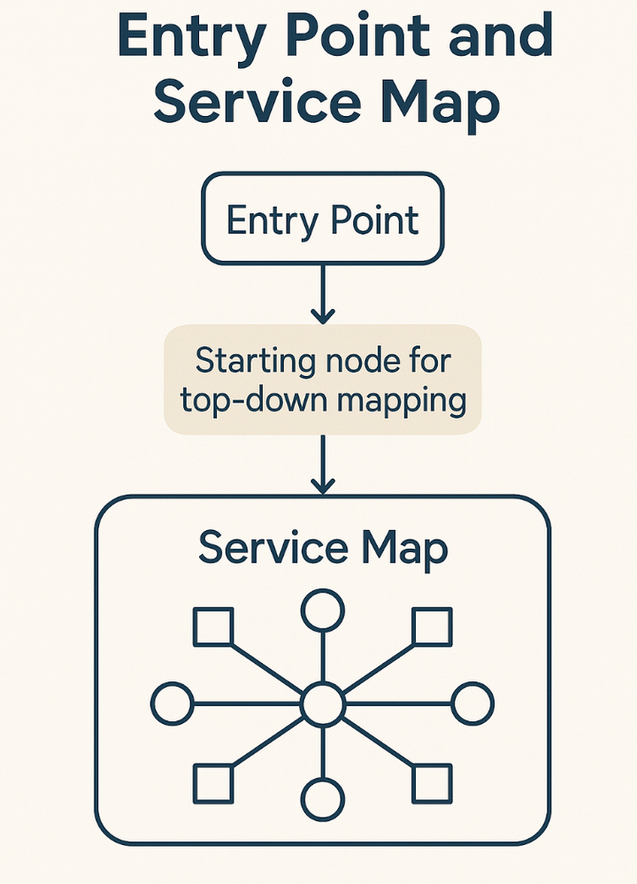

# Service Mapping（サービスマッピング）

## 概要

Service Mapping（サービスマッピング）は、ServiceNow ITOM（IT Operations Management）の **ITOM Visibility** に含まれる製品で、組織内の Service instance（サービスインスタンス、= Application service／アプリケーションサービス）を発見し、そのサービスを構成するデバイス・アプリケーション・構成プロファイルの依存関係マップを CMDB 上に作成する。[出典](https://www.servicenow.com/docs/r/sPnEbors95h6DhgBlE~f0A/iEnX0dmE9l6USMvKxyjTzQ)

- Discovery（ディスカバリー）の **Horizontal discovery（水平ディスカバリー）** は、デバイスやアプリケーションを接続関係のない独立したオブジェクトとして棚卸しする。
- Service Mapping の **Top-down mapping（トップダウンマッピング）** は、コンポーネント間の接続に基づいて依存関係をマップし、障害オブジェクトがサービスの他の部分に与える影響をすぐに把握できるようにする。
- Service Mapping のマップは定期的に再生成（Dynamic maps）され、障害のあるオブジェクトと影響を受けるコンポーネントがハイライトされる。

Service Mapping の結果は、Event Management（イベント管理、アラートのサービス影響分析）、Dependency Views（依存関係ビュー）、Application Portfolio Management（APM）、Change Management の影響分析、Incident の影響サービス特定などで利用される。[出典](https://www.servicenow.com/docs/r/sPnEbors95h6DhgBlE~f0A/iEnX0dmE9l6USMvKxyjTzQ)

本ファイルの基準リリースは **Australia**（2026-05 GA）である。Service Mapping の多くの新機能は Store アプリ **Service Mapping Plus**（`sn_sm_scoped_app`）や **AI Agents for Service Mapping**（`sn_sm_gen_ai`）としてファミリーリリースとは独立に配信されるため、機能有無はファミリーとアプリバージョンの両方で判断する必要がある。

関連ファイル：
- 前提となる Discovery： [discovery.md](./discovery.md)
- ITOM 全体とライセンス： [itom-overview.md](./itom-overview.md)
- MID Server： [../platform/mid-server.md](../platform/mid-server.md)
- CMDB と CSDM： [../platform/cmdb-csdm.md](../platform/cmdb-csdm.md)
- Event Management / AIOps： [event-management-aiops.md](./event-management-aiops.md)
- Cloud Management： [cloud-management.md](./cloud-management.md)
- Service Graph Connectors： [service-graph-connectors.md](./service-graph-connectors.md)
- CMDB 成功要因（応用）： [../../04_応用編/05-cmdb-success-factors.md](../../04_応用編/05-cmdb-success-factors.md)

---

## 1. 製品構成・ライセンス・プラグイン

### 1.1 ライセンスとプラグイン

Service Mapping は ITOM Visibility サブスクリプションの一部として提供される。ITOM Visibility は Discovery（`com.snc.discovery`）プラグインと Service Mapping（`com.snc.service-mapping`）プラグインの有効化によって利用可能になり、両プラグインには ITOM Visibility サブスクリプションが必要である。[出典](https://www.servicenow.com/docs/r/sPnEbors95h6DhgBlE~f0A/75d1Tix4~BSpibBomfiDbQ)

| プラグイン／アプリ | ID / スコープ | 役割 | 出典 |
|---|---|---|---|
| Service Mapping | `com.snc.service-mapping` | Service Mapping 本体。IT サービスをマップし、Event Management や Service Operations と連携 | [公式](https://www.servicenow.com/docs/r/sPnEbors95h6DhgBlE~f0A/75d1Tix4~BSpibBomfiDbQ) |
| Discovery | `com.snc.discovery` | 水平ディスカバリー。Service Mapping の前提 | [公式](https://www.servicenow.com/docs/r/sPnEbors95h6DhgBlE~f0A/75d1Tix4~BSpibBomfiDbQ) |
| ITOM Visibility License | `com.snc.itom.vis.license` | ITOM Visibility ライセンスを要する Store アプリの有効化を可能にする | [公式](https://www.servicenow.com/docs/r/sPnEbors95h6DhgBlE~f0A/75d1Tix4~BSpibBomfiDbQ) |
| ITOM Map（内部） | `com.itom-map-app` | Service Mapping・Event Management・Service Operations Workspace のマップ基盤となる内部依存プラグイン | [公式](https://www.servicenow.com/docs/r/sPnEbors95h6DhgBlE~f0A/75d1Tix4~BSpibBomfiDbQ) |
| Service Mapping Plus | `sn_sm_scoped_app`（Store） | ML ベースのマッピング（Automated Service Suggestions）、Tag-based マッピング Workspace、Multi-source service mapping、Lightweight Service Model 等 | [公式](https://www.servicenow.com/docs/r/sPnEbors95h6DhgBlE~f0A/zRk5WtU1NKQdno6uhRBUIw) |
| AI Agents for Service Mapping | `sn_sm_gen_ai`（Store） | Service Mapping 用 AI エージェント（Now Assist 導入が前提） | [公式（Australia）](https://raw.githubusercontent.com/ServiceNow/ServiceNowDocs/australia/markdown/it-operations-management/service-mapping/service-mapping-ai-agents.md) |
| Discovery and Service Mapping Patterns | `sn_itom_pattern`（Store） | パターンのコンテンツ更新。ファミリーリリースを待たずに新規・修正パターンを配信 | 【第三者情報】[Community](https://www.servicenow.com/community/itom-articles/getting-ready-for-top-down-discovery/ta-p/3543154) |
| Visibility Content | `sn_pattern_design` | パターン関連コンテンツ（Tokyo 以降必要とされる） | 【第三者情報】[Community](https://www.servicenow.com/community/itom-articles/getting-ready-for-top-down-discovery/ta-p/3543154) |
| ITOM Content Service | Store | Service Fingerprints（プロセス分類）と ML 候補のフィルタリングに必要 | [公式](https://www.servicenow.com/docs/r/sPnEbors95h6DhgBlE~f0A/h2q8~4vgsPQ_pGsWrdgC9Q) |

> **Brazil での変更:** Service Mapping 全般の有効化は従来どおり「Request Service Mapping」の手順で行い、Service Mapping Plus と AI Agents for Service Mapping は ServiceNow Store から有効化・更新する。AI 機能の利用には、AI Agents for Service Mapping の有効化、Service Mapping Candidate skill、Service Mapping Candidates Impact skill、CMDB MCP Server（Service Mapping tools）の有効化が追加で必要とされる。[出典](https://www.servicenow.com/docs/r/delta-zurich-brazil/brazil-zurich-servicemapping-release-notes.html)

ライセンス体系（ITOM Visibility / ITOM Pro 等のエディション、課金単位 Subscription Unit）の詳細は [itom-overview.md](./itom-overview.md) および [../../03_導入編/01-licensing-model.md](../../03_導入編/01-licensing-model.md) を参照。

### 1.2 前提条件（依存関係）

Service Mapping は以下に依存する。[出典](https://www.servicenow.com/docs/r/sPnEbors95h6DhgBlE~f0A/iEnX0dmE9l6USMvKxyjTzQ)

| 前提 | 内容 |
|---|---|
| Discovery | Discovery 製品が有効化・設定済みであること（Service Mapping は Discovery が有効な場合のみ使用可能）。Service Mapping は水平ディスカバリーの結果を利用する |
| MID Server | Service Mapping とデバイス・アプリケーション間の通信を仲介する。詳細は [../platform/mid-server.md](../platform/mid-server.md) |
| Credentials（資格情報） | ネットワークデバイス・アプリケーションへのアクセス用の資格情報とユーザーを定義する |
| Domain separation（任意） | ドメインセパレーション利用時、管理者・ユーザーは自ドメインの Application service のみ閲覧・管理できる |

---

## 2. 用語：Service instance と Application service

### 2.1 Service instance（サービスインスタンス）

Australia の公式ドキュメントでは、Service Mapping の対象を **Service instance（サービスインスタンス）** と呼ぶ。Service instance は「サービスを提供するように構成された、相互接続されたアプリケーションとホストの集合」であり、社内メールシステムや顧客向け Web サイトなどが例である。同じドキュメント内では「Application service（アプリケーションサービス）」「Application service map」という呼称も併用され、実質的に同義として扱われている。[出典](https://www.servicenow.com/docs/r/sPnEbors95h6DhgBlE~f0A/iEnX0dmE9l6USMvKxyjTzQ)

CSDM（Common Service Data Model）上、Application service は「Business Application の特定のデプロイ（環境ごとのインスタンス）」に相当し、Business Application、Technical Service Offering、Business Service Offering、親 Application service と関係付けられる。CSDM の詳細は [../platform/cmdb-csdm.md](../platform/cmdb-csdm.md) を参照。[出典](https://www.servicenow.com/docs/r/q4dSP2Icgr1SFv5wanVXvQ/LKd87HjvwYKREPw7DmJc5Q)

### 2.2 Application service の種類（Population method）とテーブル

Application service は、CI を「どのように投入（populate）するか」によって種類とテーブルが異なる。[出典](https://www.servicenow.com/docs/r/servicenow-platform/configuration-management-database-cmdb/application-services.html) / [出典](https://www.servicenow.com/docs/r/q4dSP2Icgr1SFv5wanVXvQ/LKd87HjvwYKREPw7DmJc5Q)

| 種類（Population method） | テーブル | 必要ライセンス【推定】 | 投入方法 |
|---|---|---|---|
| Discovered（Top-Down Discovery） | `cmdb_ci_service_discovered`（Mapped Application Service） | Service Mapping | Entry point からのパターンベース（トップダウン）ディスカバリー |
| Created Manually（Manual） | `cmdb_ci_service_discovered` | 不要 | CI と関係を手動で登録 |
| Tag-based（Tags） | `cmdb_ci_service_by_tags`（Tag-Based Application Service） | Service Mapping | 発見済みのアセットタグ（キー・バリュー）から構築 |
| Dynamic CI Group | `cmdb_ci_query_based_service` | 不要 | 関連付けた CMDB Group のメンバーで投入 |
| Dynamic（Dynamic Service） | `cmdb_ci_service_calculated` | 不要 | `cmdb_rel_ci` の CI リレーションシップの変化に追随して自動更新 |
| Converted Business Service | `cmdb_ci_service_discovered` | 不要 | レガシーの `cmdb_ci_service`（Business service）や `cmdb_ci_service_manual` から変換（`cmdb_ci_service` からの変換は不可逆） |

- 「必要ライセンス」列は【推定】である。出典の「Application services」ページにはライセンスの記載がない。CSDM の Service instance 作成ページで、Top-Down Discovery と Tags の必要ロールが Service Mapping のロール（`sm_admin`）、その他の方式の必要ロールがベースシステムの `app_service_admin` とされていること（2.3）、および Service Mapping 本体に ITOM Visibility サブスクリプションが必要であること（1.1）から推定した。正確な権利範囲は契約・ライセンスガイドで確認すること。

**表以外の作成・投入方法：** 公式「Application services」ページには、上表のほかに次の方法も挙げられている。[出典](https://www.servicenow.com/docs/r/servicenow-platform/configuration-management-database-cmdb/application-services.html)

| 方法 | 内容 |
|---|---|
| Ingesting APM maps（APM マップ取り込み） | Dynatrace / AppDynamics の APM（アプリケーション性能監視）のアプリケーションモデルから Application service を作成する。連携アプリは ServiceNow Store で提供される |
| Application service API | CI/CD パイプライン等から Application service を一括作成する自動化向けの API（`createOrUpdateService` 等）。API で作成した手動サービスは `cmdb_ci_service_discovered` に格納される |
| CSV ファイルからの作成 | CSV ファイルからサービス情報を抽出し、Application service の候補を作成する。ナビゲーターの **Service Mapping > Services > Import Service Definitions** に対応する（図1） |

- 親テーブルは Service Instance `[cmdb_ci_service_auto]` である。[出典](https://www.servicenow.com/docs/r/q4dSP2Icgr1SFv5wanVXvQ/LKd87HjvwYKREPw7DmJc5Q)
- API で作成した手動サービスも `cmdb_ci_service_discovered` に格納される。
- 1つのサービスに複数の作成方式を混在させることはできない。例外として、Top-down と Manual は同一サービスで併用できる。[出典](https://www.servicenow.com/docs/r/servicenow-platform/configuration-management-database-cmdb/application-services.html)
- Dynamic service は、CI を直接追加・削除して編集することはできない。
- Dynamic CI Group の分類は通常 Application service だが、レガシーの Event Management / Service Mapping UI から作成した場合は Technical service になる。
- ドメインセパレーション有効時、サービスの CI はサービスと同じドメインに属している必要があり、別ドメインの CI を含めると `createOrUpdateService` API は失敗する。
- 一覧画面の種類フィルタとしては Tag-based、discovered、manual、dynamic CI group、converted、dynamic、empty が表示される。[出典](https://www.servicenow.com/docs/r/q4dSP2Icgr1SFv5wanVXvQ/LKd87HjvwYKREPw7DmJc5Q)

【第三者情報】Community 投稿では、Dynamic CI Group 型は最大 10,000 CI、単一 Application service には 1,000 CI を超えて入れないことを推奨、方式の変換（例：calculated → tag-based）には `sys_class_name` やポピュレーターの更新を伴うスクリプトが必要、といった知見が共有されている。[出典](https://www.servicenow.com/community/common-service-data-model/application-services-how-to-use-them/ta-p/2308712) / [出典](https://www.servicenow.com/community/itom-blog/save-the-sys-id-converting-an-application-service-for-service/ba-p/3289663)

### 2.3 Application service の作成画面（CSDM フロー）

Australia では、CSDM のガイド付きフローで Service instance（Application service）を作成できる。[出典](https://www.servicenow.com/docs/r/q4dSP2Icgr1SFv5wanVXvQ/LKd87HjvwYKREPw7DmJc5Q)

**メニュー：**
- **All > CSDM > Manage Technology Management Services > Service Instance**（New で作成）
- 一覧：**CSDM > Manage Technology Management Services > Application Service**、**Configuration > Application Services > Application Services**、**Service Mapping > Services > Service Instances**

**ウィザードの構成：**

| ステップ／タブ | 主な内容 |
|---|---|
| Provide Basic Details（基本情報） | Number、Name、Environment、Version、Model ID、Operational Status、Support Group、Change Group、Managed By Group、Owned By |
| 関係（Relationship） | Business Application、Technical Service Offering、Business Service Offering、Parent Application Service |
| Populate the Application Service（投入方法の選択） | Choose a Method で Top-Down Discovery / Dynamic CI Group / Tags / Manual / Dynamic Service 等を選択 |
| Preview the Service | 投入結果のプレビュー |
| Advanced Details | Additional Info、Questionnaire、Reject Messages、Worknotes |
| 作成後 | View CMDB Group CI's、View Service CI's、View Map |

**ロール：** Top-Down Discovery と Tags は、CSDM ページ上は `sm_admin` と記載されている（Australia の Service Mapping のロール定義では `service_mapping_admin`。9.1 参照）。Dynamic CI Group・Manual・Dynamic Service は `app_service_admin` が必要。Owned By に新しいユーザーを設定する場合は `sm_app_owner` ロールを付与する。[出典](https://www.servicenow.com/docs/r/q4dSP2Icgr1SFv5wanVXvQ/LKd87HjvwYKREPw7DmJc5Q)

---

## 3. マッピング方式の全体像と選択基準

### 3.1 4つの基本方式

公式ドキュメント「Choose the right method for discovery and mapping application services」（参照したのは Yokohama 版の英語ページ）では、Service Mapping の CI 収集・サービス構成方式として次の4つが挙げられる。Australia 版（2026-03 更新）にも同名ページがあり、同じ4方式（pattern-based、tag-based、traffic-based、Predictive Intelligence ベース）が挙げられているが、表の細部が Australia 版と一致するかは英語の Australia 版ページで照合できていない。[出典](https://www.servicenow.com/docs/r/sPnEbors95h6DhgBlE~f0A/iEnX0dmE9l6USMvKxyjTzQ) / [出典（Yokohama）](https://www.servicenow.com/docs/r/Tm19yM2Ui3~uN9XFBacppg/oqkGxCqQ7VwkBp~TSxM10Q)

| 方式 | 仕組み | 適するケース | 長所 | 短所 | 要件 |
|---|---|---|---|---|---|
| **Pattern-based discovery**（Top-down、主方式） | Pattern（コマンド列）で CI 属性と外向き接続を検出 | 正確で信頼性の高いサービスマップが必要な場合 | 精密で完全な Service instance | 構築に時間と労力 | 資格情報・ユーザー・権限の設定 |
| **Tag-based discovery** | Discovery / Cloud Provisioning and Governance が収集したタグで CI をグルーピング | 既にタグ運用がある組織、クラウド・コンテナ | 多数のサービスを効率的にマップ。Service Mapping Plus 1.16.3 以降は専用 Workspace | 正確性はタグの一貫性に依存。タグ不備の CI は漏れる | 一貫したタグ付け。Workspace は SMP 1.16.3 以降 |
| **Discovery based on Predictive Intelligence**（Automated Service Suggestions、ML ベース） | ML がアプリケーションフィンガープリント・CI・プロセス間の接続を評価し、接続とサービス候補を生成 | 大規模オンプレミス環境で多数のサービスを一括マップ | 接続と接続先 CI を自動追加。接続ルールを編集・自作可能 | 学習が必要。繰り返しディスカバリーが必要。動的接続を誤って追加・削除することがある | TCP 接続とプロセスのディスカバリー、反復実行 |
| **Traffic-based discovery** | トラフィックベースの接続をたどって CI を発見 | 初期段階でパターンが見逃した CI を拾う | パターンで見つからない CI を捕捉 | 運用に影響しない冗長 CI が増えマップが煩雑化 | パターンベースと併用 |

公式ドキュメントは「多くの環境では方式の組み合わせが有効」としており、例としてパターンベースを基本にし、初期マッピング時にトラフィックベースを追加し、チューニング後に無効化する運用を挙げている。[出典](https://www.servicenow.com/docs/r/Tm19yM2Ui3~uN9XFBacppg/oqkGxCqQ7VwkBp~TSxM10Q)

### 3.2 実務上の推奨アプローチ

【第三者情報】ServiceNow 社員による Community の Quick Start Guide（2026年）は、次の方針を推奨している。[出典](https://www.servicenow.com/community/itom-articles/quick-start-guide-for-service-mapping/ta-p/3521583)

| 方式 | 推奨対象 | 特徴 |
|---|---|---|
| Tag-based（推奨） | クラウドネイティブ、コンテナ、VM（AWS、Azure、GCP、OCI、Alibaba、IBM Cloud、VMware vCenter、Nutanix） | ホスト資格情報不要、自動更新 |
| ML-based（推奨） | 内製・カスタム・パッケージアプリ | プロセスと TCP 接続から CMDB データをクラスタリング。Service Mapping Plus 必須 |
| Top-down | レガシーなオンプレミス、複雑なパッケージ（Oracle、SAP 等） | 最も粒度が細かいが、広範な資格情報・パターンのカスタマイズ・エラー対応が必要 |
| Kubernetes Visibility Agent（KVA） | EKS、AKS、GKE、OKE、OpenShift、Rancher、オンプレ K8s | クラスタ内の Informer ポッドがイベントをほぼリアルタイムで送信。MID Server スキャン不要 |

- 同ガイドは「Tag-based と ML-based でサービスの約 70〜80% をマップし、Top-down は必要なレガシーアプリに限定する」ことを推奨している。【第三者情報】
- 体制として、Tag-based / ML-based はパートタイムの管理者、Top-down は通常フルタイムの担当者が必要とされる。【第三者情報】

### 3.3 方式の組み合わせ：Multi-source service mapping

**Multi-source service mapping** は、異なる CMDB データソース由来のマップ済み・未マップのサービスを1つの **Unified service（統合サービス）** にまとめ、複合マップを作る機能である（Service Mapping Plus 1.18.3、2026-03 で導入）。[出典](https://www.servicenow.com/docs/r/sPnEbors95h6DhgBlE~f0A/U6XBcS0UFsusPIYRdsGaXw) / [出典](https://www.servicenow.com/docs/r/C17ZqvSaMwUVpMBg8Nc5sg/wrdC4KwqlA20qz8j_acmPw)

| 項目 | 内容 |
|---|---|
| 要件 | Australia 以降、Service Mapping Plus 最新版、統合対象となる2つ以上の既存サービス（または2つ以上の継続更新されるデータソース） |
| 対応データソース | Discovered（Top-down/水平、MID Server と Patterns）、Tag-based、ML-powered（traffic-based mapping を含む）、Manual（Dynamic application service に変換）。公式ページの詳細節では Traffic-based mapping は ML-powered maps の下位項目として記載されている（冒頭の要約節では独立した項目として並ぶ） |
| 上限 | 既定で1つの Unified service に最大10サービス。プロパティ `sn_sm_scoped_app.sm.unified_services.max_children_per_service` で変更可 |
| 制約 | Unified service をさらに統合することはできない（単一サービスのみ追加可） |
| 作成手順 | Service Mapping Workspace でサーバータグや URI 等で検索 → 統合するサービスを選択（Top-down と Tag-based など混在可）→ ランキングアルゴリズムの推奨を確認 → 完了。選択した未マップサービスは non-operational のインスタンスになる |
| 表示 | CMDB Workspace の「Unified map」 |
| 削除時 | Unified service を削除しても子サービスは既定で non-operational のまま残る |

- Service Mapping Plus 1.22.0（2026-07）で、サービスを CSDM のビジネスコンテキストに紐付ける **Enrichment step** が追加された。[出典](https://www.servicenow.com/docs/r/C17ZqvSaMwUVpMBg8Nc5sg/wrdC4KwqlA20qz8j_acmPw)

---

## 4. Top-down mapping（パターンベースのトップダウンマッピング）

### 4.1 処理フロー

Top-down mapping は Entry point から出発し、Pattern で CI と外向き接続を順に発見していく方式である。公式ドキュメント「Pattern-based discovery in Service Mapping」（Yokohama 版）の処理フローは以下のとおり。Australia 版で変更がないかは英語ページで照合できていない。[出典（Yokohama）](https://www.servicenow.com/docs/r/Tm19yM2Ui3~uN9XFBacppg/AjS6GFhdFDhZBZSR07NwRw)

1. **ホストの水平ディスカバリー：** Discovery が Shazzam プローブでポートスキャンし、Classification・Identification・Exploration プローブを実行する。MID Server がプローブを実行し、結果を ECC Queue 経由で返し、ホストが CMDB に登録される。
2. **アプリケーションのトップダウンディスカバリー：** Service Mapping は Entry point の IP に対するアプリケーションディスカバリー要求を作成し、MID Server を割り当てる。MID Server は Pattern の **Identification section** を実行して Entry point に一致する CI を特定し、次に **Connection section** を実行して外向き接続を発見する。
3. 結果（CI・属性・接続）は ECC Queue 経由で返り、Service Mapping は `cmdb_tcp` と `sa_flow_connection` テーブルの情報で接続を補強（enrich）したうえで CMDB に書き込み、CI をサービスマップに追加する。
4. 新しい CI が接続しているすべてのアプリケーションに対し、さらにディスカバリー要求が送られる（再帰的に下流をたどる）。
5. **停止条件：** 外向き接続のない CI、または **Boundary（境界）** に指定された CI に到達するとマッピングを停止する。Boundary は外向き接続の追跡を止める。
6. **Service recomputation（サービス再計算）：** システムは定期的に CMDB の CI 変更を照会し、ネットワーク・ストレージのパス情報を追加し、CI impact rules（影響ルール）を適用する。

**関連テーブル：**

| テーブル | 用途 |
|---|---|
| `cmdb_ci_service_discovered` | Mapped Application Service。新しい Service instance レコードを格納 |
| `cmdb_tcp` | TCP Connection。netstat / lsof 等の結果。トップダウン中の接続補強に利用 |
| `sa_flow_connection` | Flow Connector。Netflow / VPC ログ由来の接続 |
| `ecc_queue` | Service Mapping と MID Server 間の要求・応答の受け渡し |
| `svc_ci_assoc` | Service CI Association。サービスとそれに含まれる CI の対応（Workspace の未マップサーバーレポート等でも利用）[出典](https://www.servicenow.com/docs/r/sPnEbors95h6DhgBlE~f0A/66SJGtWe9Kx2SoQ9V9OkVQ) |

【第三者情報】`svc_ci_assoc` は Service Mapping がサービス定義と CI リレーションシップ（`cmdb_rel_ci`）から自動計算するテーブルで、`cmdb_rel_ci` から直接データを投入することは推奨されない、と Community で説明されている。[出典](https://www.servicenow.com/community/enterprise-architecture-forum/how-is-the-svc-ci-assoc-table-populated/m-p/3343333)

### 4.2 単一サービスのマッピング手順（Classic Service Mapping）

Australia の公式手順「Map a single application service using classic Service Mapping」は以下のとおり。単一サービスのマッピングは一括マッピングを補完する位置付けである。[出典](https://www.servicenow.com/docs/r/sPnEbors95h6DhgBlE~f0A/X4w5SP~mVw~LmwTbOasLDw)

**前提：** Service Mapping が有効、MID Server がアプリケーションサービスのディスカバリー用に構成済み、ホストとアプリケーションの資格情報が登録済み。Azure / AWS の PaaS に依存するサービスでは、先にデータセンターをディスカバリーし、クラウドサービスアカウントに水平ディスカバリースケジュールを作成しておく。

**必要ロール：** `service_mapping_admin`

**手順：**
1. **All > Service Mapping > Home** を開く。
2. **Map** タイルの **Additional options** をクリックし、**Define A Single Service Map** をクリックする。
3. 基本属性を入力する。
   - **Name：** 他の Application service と重複しない一意の名前。
   - **Owner：** サービス責任者。該当ユーザーがいなければ `sm_app_owner` ロールを持つユーザーを作成するか、`service_mapping_admin` を持つユーザーを選ぶ。
4. Entry point を追加する（詳細は 7章）。
   - **Discoverable by Service Mapping：** Web Application などのアプリケーションタイルを選択（**See More Types** で全種類）。種類に応じた属性を入力し **Add**。複数ある場合は **Add Entry Point** で繰り返す。
   - **Manually created（任意）：** Service Mapping が発見できない Entry point は、**CI Type**（例：`cmdb_ci_appl`）と **CI Name** を選んで **Submit**。アプリケーションクラスタ等、一部の CI タイプは選択不可。
5. **Save** / **Update** で `cmdb_ci_service_discovered` に保存され、バックグラウンドでディスカバリーが開始される。**View Map** をクリックすると定義を保存してディスカバリーを開始し、マップ画面を開く。状態は **In Progress** になる。

**レビューとチューニング：**
- エラーのないサービスはオーナーにレビュー依頼し、オーナーが承認または変更要求を行う。管理者はコメントに基づいてマップを微調整する。
- 再ディスカバリーの頻度は Discovery schedule で制御する。
- Predictive Intelligence ベースのディスカバリーが有効な場合、新規サービスにはパターンベースの CI のみが含まれ、生成された CI Connection suggestions（接続候補）で補完する。
- 必要に応じて Traffic-based discovery や Connection rules（接続ルール）を有効化して CI を追加する。

**エラー対応：** エラーは症状と **Discovery messages（ディスカバリーメッセージ）** を使って個別に修正する。高度な解決が必要なエラーに対する半自動修正機能は提供されない。

**サービスが大きすぎる場合：**
- 兆候：マップの代わりに CI 一覧ビューしか提示されない、または「サービスが大きすぎてマップが不完全で、CI 接続数が上限を超えた」旨のディスカバリーメッセージが出る。
- 対処：カスタムパターンを修正して無関係な CI をマップしないようにする、またはブランチを新規・既存の別サービスに移してサービスを分割する。
- 予防：Microsoft MQ や Active Directory のような **中央の共通 IT コンポーネントを Entry point にしない**（巨大サービスとなり、マッピングと監視の性能問題を招く）。

### 4.3 前提となる環境準備（実務）

【第三者情報】ServiceNow 社員による Community 記事「Getting Ready for Top-Down Discovery」（v2.1、2026-05、エージェントレス方式が対象、公式ドキュメントではない）は、以下を準備項目として挙げている。[出典](https://www.servicenow.com/community/itom-articles/getting-ready-for-top-down-discovery/ta-p/3543154)

| 区分 | 主な内容 |
|---|---|
| プラグイン | `com.snc.discovery`、`com.snc.service-mapping`、`sn_itom_pattern`（最新版を維持）、`sn_pattern_design` |
| Entry point 情報 | URL、ホスト＋ポート（例：`dbserver01.corp.local:1521`）、ロードバランサー VIP（LB 資格情報が必要）。最もリードタイムが長い項目 |
| DNS | 設定ファイルや接続文字列、LB プールで見つかるバックエンドホストを含め、MID Server がすべて名前解決できること |
| MID Server 配置 | 経路上の全ホストへ到達可能。ネットワークゾーン／DMZ ごとに1台。インスタンスへは外向き HTTPS 443 のみ |
| Windows | WMI/DCOM 135、RPC 動的ポート 49152–65535（制限可）、SMB 445、WinRM 5985/5986。ローカル Administrators 権限。UAC トークンフィルタに注意 |
| Linux/UNIX | SSH 22。特定コマンド（`ps`、`netstat`/`ss`、`dmidecode` 等）の sudo。シェルは bash / sh |
| アプリ別 | 例：SQL Server 1433/UDP 1434、Oracle 1521（Applicative credential）、IBM MQ 1414、SAP RFC 33NN、F5 iControl REST 443 |
| 冗長性 | 本番では MID Server を最低2台（HA/フェイルオーバー）と推奨（Quick Start Guide） |

よくある失敗として、「ホスト CI は作られるがアプリ CI ができない（アプリ資格情報不足・ポート遮断・スキャン時に未稼働・パターン古い）」「Web 層で止まる（設定ファイルが読めない、バックエンドが別ゾーン、JNDI/Spring Cloud Config 等で接続先がローカルにない）」が挙げられている。【第三者情報】

MID Server の要件・配置は [../platform/mid-server.md](../platform/mid-server.md)、資格情報と水平ディスカバリーは [discovery.md](./discovery.md) を参照。

### 4.4 Traffic-based discovery（トラフィックベースディスカバリー）

Traffic-based discovery は、パターンベースのマッピングを補完し、トラフィックベースの接続をたどって CI を発見する。[出典](https://www.servicenow.com/docs/r/sPnEbors95h6DhgBlE~f0A/Nc~BmgMGFb2e4_PVEPNMaw)

**有効化レベル（上位 → 下位、下位ほど優先）：**

| レベル | 内容 |
|---|---|
| Product（製品全体） | 既定 Off。プロパティ `sa.traffic_based_discovery.active`。これが有効でないと下位レベルでは有効化できない |
| Service instance | そのサービス内の全 CI に適用（CI タイプ／特定 CI のルールで上書き可） |
| CI type | CI タイプを含める／除外するルール。サービス単位の設定より優先 |
| Specific CI | 個別 CI を含める／除外するルール。CI タイプルールとサービス設定の両方より優先 |

**関連プロパティ：**

| プロパティ | 既定値 | 内容 | 出典 |
|---|---|---|---|
| `sa.traffic_based_discovery.active` | false | 製品レベルの有効化 | [公式](https://www.servicenow.com/docs/r/sPnEbors95h6DhgBlE~f0A/Nc~BmgMGFb2e4_PVEPNMaw) |
| `sa_ml.connection_suggestions.active` | （条件による） | Predictive Intelligence による接続候補（Connection suggestions）機能 | [公式](https://www.servicenow.com/docs/r/sPnEbors95h6DhgBlE~f0A/Nc~BmgMGFb2e4_PVEPNMaw) |
| `sa.traffic_based_discovery.conn_aging_time` | 72（時間） | トラフィックベース接続が最後の検出からアクティブとみなされる期間 | 公式（旧リリース版ページ）[出典](https://www.servicenow.com/docs/r/u7nZu9GEUxWr9UkuDmbe6w/hV4k5Og1a4ydgRhmfw5VlA) |
| `sa.traffic_based_discovery.ignored_ports` | 445, 139, 111, 2049, 860, 3260, 135, 53 | 無視するポート | 同上 |
| `sa.traffic_based_discovery.max_connections` | 30 | 単一 CI からのトラフィックベース接続の上限 | 同上 |

> 注：`conn_aging_time`・`ignored_ports`・`max_connections` は Australia 版ページでは確認できず、旧リリース版ページの記載に基づく。ページによりプロパティ名の表記揺れ（`sa.trafficbaseddiscovery.active` 等）があるため、インスタンスの `sys_properties` で正確な名前を確認すること。

**データソース（テーブル）：**

| テーブル | データ源 | 用途 |
|---|---|---|
| Flow Connector `[sa_flow_connection]` | Netflow、VPC ログ | トップダウン中に依存関係を発見し接続を追加 |
| Flow Services IP/Port and Statistics `[sa_flow_service]` | Netflow、VPC ログ | ポートで待ち受けるサービスの検出（ベースシステムでは未使用） |
| Flow Server Communication `[sa_flow_server_comm]` | Netflow、VPC ログ | サービス間通信の検出（ベースシステムでは未使用） |
| TCP Connection `[cmdb_tcp]` | netstat、lsof | トップダウン中の接続発見 |

**挙動：**
- ベースシステムでは netstat / ss / lsof の TCP データのみを使用する。Netflow / VPC ログの利用には追加設定が必要。水平ディスカバリーの一部として「improved Application Dependency Mapping (ADM)」（改良版 ADM）が収集した TCP 接続データも使われる。
- Predictive Intelligence あり：トラフィックデータとアプリケーションフィンガープリントから **接続候補（suggestions）を生成** し、**Connection rules（接続ルール）に一致した候補は自動追加** する（公式原文：「Service Mapping automatically adds connections to service instances based on connection rules.」）。一致しない候補は Suggestions から手動で追加・却下する（4.6・6.5 参照）。
- Predictive Intelligence なし：トラフィックベース接続を **自動追加** する（無関係 CI の手動クリーンアップが必要な場合あり）。
- トラフィックのみで作られた接続は削除されないが、同じ接続がパターンベースでも作られた場合はトラフィックベース側が削除される。
- 推奨運用：初期ディスカバリー時に使い、チューニング後は無効化してマップをクリーンに保つ。

### 4.5 CMDB-based mapping（CMDB ベースのトップダウンマッピング）

CMDB-based mapping は、CMDB に既に登録されているデータを使い、MID Server にアクセスせずにトップダウンディスカバリーを実行して Application service をマップする Top-down 系の機能である。[出典（Xanadu）](https://www.servicenow.com/docs/r/LZHoJyH9VPKmhdIph_6gSw/3rDZMCS6o7v5KMbgDeTqNg) / [出典（Brazil）](https://www.servicenow.com/docs/r/it-operations-management/service-mapping/cmdb-based-mapping.html)

| 項目 | 内容 |
|---|---|
| 導入時期 | Xanadu 版ドキュメント（2024-08 更新）に掲載。要件は「Service Mapping Plus の August 2024 版」（6.7 の表では 1.13.0 に相当【推定】） |
| 有効化 | システムプロパティ `sa.topdown.enable_cmdb_based_mapping` を `true` に設定（`sys_properties.list` で検索） |
| 必要ロール | `service_mapping_admin` |
| 前提データ | TCP Connection `[cmdb_tcp]`、Running Process `[cmdb_running_process]`、Hardware `[cmdb_ci_hardware]` が投入済みであること（Service Graph Connectors など MID Server 以外のソースでも可） |
| 処理 | トップダウンディスカバリーは IP アドレスから関連ホストを取得し、利用可能な MID Server を探す。MID Server がなく CMDB-based mapping が有効な場合、CMDB に登録済みの着信トラフィックからその IP 上のターゲットプロセスを特定し、プロセスに紐づくアプリケーションをマップのノードとする。アプリケーションが見つからない場合は ADM ロジックで分類・作成し、分類できない場合は `cmdb_ci_appl` に単純なアプリケーションを作成する |

- Service Mapping Plus 1.20.0（2026-05）のリリースノートにも「CMDB-based mapping」のサポートが記載されている（6.6 参照）。コア機能（Xanadu 期、SMP 2024-08 版が要件）と 1.20.0 の記載の違いは公開情報では確認できず。[出典](https://www.servicenow.com/docs/r/C17ZqvSaMwUVpMBg8Nc5sg/wrdC4KwqlA20qz8j_acmPw)
- 【第三者情報】Community の Quick Start Guide は CMDB-based mapping を「ML-based のアプローチ（Xanadu+）」の一つとして分類しているが、公式ドキュメント上はトップダウンディスカバリーの実行方式として説明されている。[出典](https://www.servicenow.com/community/itom-articles/quick-start-guide-for-service-mapping/ta-p/3521583)

### 4.6 Boundaries・Behaviors・Connection rules

Top-down マップの範囲と内容を調整する設定として、Boundary（境界）、Connection rules（接続ルール）、Behaviors（ビヘイビア）がある。

**Boundary（境界）：** [出典](https://www.servicenow.com/docs/r/sPnEbors95h6DhgBlE~f0A/bf7_wmfmbaULxe6cv_fB4w)

| 項目 | 内容 |
|---|---|
| 目的 | Boundary に指定した地点でディスカバリーを止め、その先の外向き接続をたどらないようにする。パターンまたは Traffic-based discovery で発見された不要な CI を除くために使う |
| 操作 | **All > CSDM > Manage Technology Management Services > Service Instance** でサービスを選び **View Map** → マップを **Edit** ビューにする → 不要な CI へつながるコネクタを右クリック → **Mark boundary**。CI に境界アイコンが付く |
| 必要ロール | `service_mapping_admin` |
| 影響 | CI を除くとその接続も削除され、その CI の外向き接続経由でのみ到達していた下流 CI も除かれる |
| 制約 | マップから編集できるのは Service Mapping が発見したサービスのみ。Tag-based サービスと Dynamic サービスはマップから微調整・編集できない |

- Traffic-based 接続の除去は、接続候補（suggestions）が無効なら CI を右クリック → Traffic Based Connections List で User decision を **Remove** に設定、有効なら接続候補の手順で管理する。

**Connection rules（接続ルール）：** [出典](https://www.servicenow.com/docs/r/sPnEbors95h6DhgBlE~f0A/4GbwgTQK15fHQk3wi7zH1w)

| 項目 | 内容 |
|---|---|
| 目的 | Predictive Intelligence が生成した接続候補を絞り込み、トラフィックベース接続とその接続先 CI を発見済みサービスに自動追加する。Global スコープのルールは複数サービスにまとめて適用できる |
| メニュー | **Service Mapping > Administration > Connection Rules**、またはサービスマップの **Suggestions > Global Rules** |
| 必要ロール | `service_mapping_admin` |
| 前提 | フィンガープリントベース（Predictive Intelligence）のアプリケーションディスカバリー、`sa_ml.connection_suggestions.active` = true |
| 主な項目 | Active（有効なルールのみ評価）、Name、Order（適用順）、Condition（条件）、Scope（複数サービス向けは Global）、Excluded Services（適用除外の Discovered Application Service） |
| 条件の元テーブル | Connection Suggestion `[sa_ml_connection_suggestion]`（トップダウンディスカバリー実行時のみ投入） |

- 【第三者情報】ML ベースで作成したサービスには、作成時にそのサービス専用のローカル接続ルールが作られる（6.5）。[出典](https://www.servicenow.com/community/itom-articles/quick-start-guide-for-service-mapping/ta-p/3521583)

**Behaviors（ビヘイビア）：** Classic UI の **Service Mapping > Administration > Behaviors** メニューに存在する（5.3 の図1）。Behaviors の目的・テーブル・項目を説明する Australia 版公式ページは、本ファイル作成時の調査では特定できず、公開情報では確認できず。

**Application service 用の Discovery schedule：** Top-down サービスの再ディスカバリー頻度は Discovery schedule で制御する（4.2）。[出典](https://www.servicenow.com/docs/r/sPnEbors95h6DhgBlE~f0A/X4w5SP~mVw~LmwTbOasLDw) スケジュール自体の設定項目は [discovery.md](./discovery.md) を参照。Application service 専用スケジュールの設定項目は、本ファイルでは公開情報で確認できていない。

---

## 5. Tag-based mapping（タグベースマッピング）

### 5.1 仕組み

Tag-based mapping は、CI に付与されたタグ（キーとバリューのペア）を使って Application service を作成する方式である。Australia の公式仕様は以下のとおり。[出典](https://www.servicenow.com/docs/r/sPnEbors95h6DhgBlE~f0A/v7C5Qvg3rmvaQQFlB8hKGA)

1. Discovery および Cloud Provisioning and Governance がクラウド・リソース CI のタグを発見し、Key Value `[cmdb_key_value]` テーブルに格納する。
2. 管理者が **CI Tag Category（タグカテゴリ）** を作成し、カテゴリ内のタグキーを定義する（カテゴリは用途の似たタグをまとめる。例：値 "production" / "staging" を持つ環境系タグ）。
3. 管理者が **Tag-based Service Family（タグベースサービスファミリー）** を作成し、マッピングに使うタグカテゴリを選ぶ。タグ値を指定して範囲を絞ることもできる。
4. Service Mapping はファミリー定義に一致するタグ値を持つ CI を CMDB から照会し、**Service candidates（サービス候補）** を作成する。
5. 管理者がマップする候補を選択してマッピングを開始すると、新しいサービスが Tag-Based Application Service `[cmdb_ci_service_by_tags]` に作成される。
6. **Traversal rules（トラバーサルルール）** により、タグ付き CI 間の CI リレーションシップに基づいて接続が作られ、リレーションシップに含まれる CI はタグがなくてもマップに含まれる。

**特性・制約：**
- タグベースマッピングには資格情報も特権ユーザーも不要。
- 正しいタグを持つ CI のみが含まれるため、関連していてもタグが正しくない CI は漏れる。
- 複数タグを持つ CI は複数のサービスに属し得る。
- ドメインセパレーション環境では、該当するリーフドメインを選択し、そのリーフドメインの CI のみが投入される。
- タグのマッチングは大文字小文字を区別しない。マッピング後にタグカテゴリを変更しても既存サービスには反映されない。[出典](https://www.servicenow.com/docs/r/8K~WUyyBmjUR0pLPxM8yeA/DjudS7ua4e6M6Z6rKR0XVg)
- Service Mapping Plus 1.15.2（2025-05）以降、1つの Tag-based service family あたりのサービス候補は最大 200。[出典](https://www.servicenow.com/docs/r/C17ZqvSaMwUVpMBg8Nc5sg/wrdC4KwqlA20qz8j_acmPw)
- 候補が出ない場合は、使用したタグキーの値が `cmdb_key_value` に存在するか確認する。[出典](https://www.servicenow.com/docs/r/xIukoQY2A2qGfsWn8TUt1A/kSFSg6POchxq5eIOEj7Dlw)
- サービス名はカテゴリの並び順に従って生成され、先頭カテゴリが名前の先頭になる。[出典](https://www.servicenow.com/docs/r/xIukoQY2A2qGfsWn8TUt1A/kSFSg6POchxq5eIOEj7Dlw)

**対応プロバイダー：**

| 区分 | プロバイダー | タグ付け対象 |
|---|---|---|
| Cloud | AWS、Azure、GCP、IBM Cloud Platform | IaaS、PaaS、FaaS、CaaS リソース |
| Hyper-converged | Nutanix | 仮想マシン |
| Containers | Kubernetes、OpenShift Container Platform、AWS ECS | コンテナ |
| Virtualization | VMware vCenter | 仮想マシン |

タグの準拠状況の管理には **Tag Governance** アプリ（オンプレミス／クラウドの非準拠リソースを特定・是正）が関連する。クラウドリソースの発見は [cloud-management.md](./cloud-management.md) を参照。

### 5.2 Traversal rules（トラバーサルルール）

Traversal rules は、CMDB リレーションシップを通じて関連 CI を見つけ、タグが直接付いていない CI もサービスマップに含めるための定義である。[出典](https://www.servicenow.com/docs/r/sPnEbors95h6DhgBlE~f0A/JhQ_t78ep0XJihqrEB5Rww)

- テーブル：Traversal Rules for Application Services `[svc_traversal_rules]`
- 管理ロール：`service_mapping_admin`
- 事前定義ルールが付属し、カスタムルールを追加できる（一覧は公式「Predefined traversal rules for application services」参照）。

| フィールド | 内容 |
|---|---|
| Parent Type | マッピングを開始する CI クラス |
| Relationship | Parent と Child の間のリレーションシップタイプ |
| Child Type | マップ対象となる関連 CI のクラス |
| Priority Level | 適用順。数値が小さいほど優先 |
| Is Reverse | 選択すると Child CI からマッピングを開始する |

- 既定ではタグベースディスカバリーで有効にできるトラバーサルルール（CI リレーションシップ）は **5件** まで。上限はシステムプロパティで変更できる（既定値 5）。Service Mapping はタグベースディスカバリーで有効なリレーションシップのみを使う。[出典（Components installed with Service Mapping、Australia）](https://www.servicenow.com/docs/r/sPnEbors95h6DhgBlE~f0A/KnqoEVMhV6np3afu7Q4nKQ) / [出典（Traversal rules in Service Mapping、Australia）](https://www.servicenow.com/docs/r/sPnEbors95h6DhgBlE~f0A/JhQ_t78ep0XJihqrEB5Rww)
  - 注：公式ページ間でプロパティ名の表記が異なる。Components ページは `svc_by_tags.max.traversal.rules.active`、Traversal rules ページは `svc_traversal.rules.active`（同ページ内にも `svctraversal.rules.active` という表記揺れあり）としている。インスタンスの `sys_properties` で正確な名前を確認すること。
- タグベースディスカバリーはルールの順序で対象 CI を特定するため、正しい順序で追加することが重要。

### 5.3 メニューと Workspace

- Classic UI：**Service Mapping > Administration > CI Tag Categories**、**Tag-based Service Families**、**Tag-Based Service Traversal Rules**（下図のメニュー参照）。[出典](https://www.servicenow.com/docs/r/LZHoJyH9VPKmhdIph_6gSw/oHZgHaVgIewPb2cjjYVkAg)
- Service Mapping Plus 1.16.3（2025-08）以降：Service Mapping Workspace の **Tag-based service mapping** ダッシュボードで、オンプレミスとクラウドの CI をサービスにマップ・管理できる。[出典](https://www.servicenow.com/docs/r/sPnEbors95h6DhgBlE~f0A/66SJGtWe9Kx2SoQ9V9OkVQ)
- Service Mapping Plus 1.17.0 / 1.17.2：統合された Tag-based マップを CMDB Workspace から表示可能。[出典](https://www.servicenow.com/docs/r/C17ZqvSaMwUVpMBg8Nc5sg/wrdC4KwqlA20qz8j_acmPw)

【第三者情報】Quick Start Guide の Tag-based 手順：①`cmdb_key_value`（Configuration > CMDB Key Value）でタグを正規化し、OOTB の Tag Governance カテゴリと揺れのあるキー名用のカスタムカテゴリを作る → ②Tag-Based Service Families で Application + Environment 等のカテゴリを選択 → ③Service Candidates を確認し Create Services（タグ付き CI が Entry point になる）→ ④Operational Status を Operational に設定。日次ジョブでサービスが再計算される。[出典](https://www.servicenow.com/community/itom-articles/quick-start-guide-for-service-mapping/ta-p/3521583)

*図1：Classic UI のアプリケーションナビゲーターで「service map」をフィルタした Service Mapping メニュー*

画面説明：左上の All メニューのフィルタに「service map」と入力した状態。**Service Mapping** 配下に Home、**Services**（Application Services、Tag-based Services、Dynamic CI Groups、Service Groups、Service Group Responsibilities、Import Service Definitions）、**Service Mapping Workspace**（Home）、**Administration**（Connection Rules、Behaviors、CI Tag Categories、Tag-based Service Families、Tag-Based Service Traversal Rules、Flow Connectors、Traffic Based Discovery など）が並ぶ。メニュー名はリリース・バージョンにより異なる場合がある（Australia では「Service Instances」表記もある）。

出典：https://www.servicenow.com/community/itom-blog/automated-service-suggestions-machine-learning-is-supercharging/ba-p/2372224 （2022年の ServiceNow Community ITOM Blog 掲載画面。取得日：2026-11-02）

---

## 6. Machine learning based mapping（ML ベース：Automated Service Suggestions）

### 6.1 仕組み

**Automated Service Suggestions（自動サービス提案）** は、機械学習で Application service を提案する機能である。[出典](https://www.servicenow.com/docs/r/sPnEbors95h6DhgBlE~f0A/h2q8~4vgsPQ_pGsWrdgC9Q)

1. 発見済みのプロセスから、ML が可能性の高い **Application fingerprint（アプリケーションフィンガープリント、AFP）** を特定する。
2. フィンガープリントと CI の関係を評価し、接続を作成してサービスマップを構成する。
3. マッピングの開始点となる **Entry point を自動計算** し、**Application service candidates（ASC、アプリケーションサービス候補）** を生成する。各候補は Entry point と、既に識別済みのリソースの集合を含む。
4. 利用者は候補を選び、新しい Application service を作成するか、既存サービスに追加する。

経緯（主体ごとに区別して記載）：
- **Quebec：** Service Mapping 本体に、Predictive Intelligence ベースの接続提案（Connection suggestions）による ML ベースのマッピングが導入された。**Rome：** グローバル／ローカルポリシーによる提案接続の自動承認が追加された（2022 年の Community ITOM Blog の記述）。
- **Service Mapping Plus 1.0.2（2022-02）：** ML ベースの拡張機能を Store アプリ Service Mapping Plus として本体から分離して提供開始（リリースノート上の記載は「Service Mapping Plus offers extended features for Service Mapping」）。
- **Service Mapping Plus 1.6.0（2022-11）：** Automated Service Suggestions（候補からのサービス作成）の提供開始。
- ML ベースのマッピングは Top-down と共存できる。[出典](https://www.servicenow.com/community/itom-blog/automated-service-suggestions-machine-learning-is-supercharging/ba-p/2372224) / [出典](https://www.servicenow.com/docs/r/C17ZqvSaMwUVpMBg8Nc5sg/wrdC4KwqlA20qz8j_acmPw)

**要件・制約：**

| 項目 | 内容 | 出典 |
|---|---|---|
| Service Mapping Plus | `sn_sm_scoped_app` のインストールが必要（admin ロールでインストール。関連 Store アプリ・プラグインも導入される） | [公式](https://www.servicenow.com/docs/r/sPnEbors95h6DhgBlE~f0A/zRk5WtU1NKQdno6uhRBUIw) |
| Predictive Intelligence | Service Mapping は Predictive Intelligence が処理したデータで接続候補を生成。準備状況は Application service readiness ダッシュボードで確認 | [公式](https://www.servicenow.com/docs/r/sPnEbors95h6DhgBlE~f0A/zRk5WtU1NKQdno6uhRBUIw) |
| ITOM Content Service | Service Fingerprints に必要（Store からインストールしオプトイン）。SMP 1.16.3 以降の候補フィルタリングにも必要 | [公式](https://www.servicenow.com/docs/r/sPnEbors95h6DhgBlE~f0A/h2q8~4vgsPQ_pGsWrdgC9Q) |
| 前提データ | ホスト・プロセス・TCP 接続のディスカバリー、反復実行による学習 | [公式](https://www.servicenow.com/docs/r/Tm19yM2Ui3~uN9XFBacppg/oqkGxCqQ7VwkBp~TSxM10Q) |
| ドメインセパレーション | SMP 1.9.0 以降対応（リーフドメインのみ機能利用可） | [公式](https://www.servicenow.com/docs/r/C17ZqvSaMwUVpMBg8Nc5sg/wrdC4KwqlA20qz8j_acmPw) |
| オンプレミス版インスタンス | 現時点で非対応（製品管理部門への問い合わせが案内されている） | [公式](https://www.servicenow.com/docs/r/sPnEbors95h6DhgBlE~f0A/h2q8~4vgsPQ_pGsWrdgC9Q) |
| ロール | `service_mapping_admin` | [公式](https://www.servicenow.com/docs/r/sPnEbors95h6DhgBlE~f0A/zRk5WtU1NKQdno6uhRBUIw) |

**関連テーブル：**
- Application service candidate `[sa_ml_application_service_candidate]`（Workspace の未マップサーバーレポートのソース）[出典](https://www.servicenow.com/docs/r/sPnEbors95h6DhgBlE~f0A/66SJGtWe9Kx2SoQ9V9OkVQ)
- `sa_ml_application_service_candidate_to_server`（候補とサーバーの対応。SMP 1.10.0 で ACL / ACL ロール追加）[出典](https://www.servicenow.com/docs/r/C17ZqvSaMwUVpMBg8Nc5sg/wrdC4KwqlA20qz8j_acmPw)
- ITOM Content Service 側で共有される Application Service Candidate `[application_service_candidate]`（ITOM Content Service 1.6.2 / Discovery Admin Workspace 1.11.0 以降）[出典](https://www.servicenow.com/docs/r/sPnEbors95h6DhgBlE~f0A/0UE2xgIyFniG7k8I5b1QPg)

### 6.2 Service Fingerprints（サービスフィンガープリント）

Service Fingerprints は、アプリケーションサービス候補を構成する一意で分類済みのコンポーネントを識別し、Product、Product category、Publisher、Description などを表示して、コンポーネントによる候補検索・選択を助ける。ITOM Content Service は Predictive Intelligence が識別したプロセスを分類し、新しい CI の発見と CMDB の週次更新を可能にする。提案は Discovery Admin Workspace で確認・管理する。SMP 1.14.1 で ML 候補画面に Service Fingerprint タブが、1.15.0 で名前提案のソースとして Service Fingerprint が追加された。[出典](https://www.servicenow.com/docs/r/sPnEbors95h6DhgBlE~f0A/h2q8~4vgsPQ_pGsWrdgC9Q) / [出典](https://www.servicenow.com/docs/r/C17ZqvSaMwUVpMBg8Nc5sg/wrdC4KwqlA20qz8j_acmPw)

### 6.3 Application service readiness ダッシュボード

Application service readiness ダッシュボードは、Predictive Intelligence ベースのサービスディスカバリーの前提条件と課題を表示する。Service Mapping Workspace の **Application service readiness** アイコンから開き、Predictive Intelligence の有効化、ML readiness、データ学習状況を確認する。[出典](https://www.servicenow.com/docs/r/sPnEbors95h6DhgBlE~f0A/66SJGtWe9Kx2SoQ9V9OkVQ)

*図2：Service Mapping Workspace の Application service readiness（ML Readiness タブ）*

画面説明：Workspaces > Service Mapping の左ペイン「Service mapping management」で **Application service readiness** を選択した画面。右上に **Check readiness** ボタン、上部に最終チェック日時。ウィジェットは4つ：①**Mapping status of application service**（Missing target host、Missing source-target process、Missing source-target AFP、Mapped without issues、Confidence level unavailable の棒グラフ）、②**Prerequisites status**（Install and enable Predictive Intelligence (PI) plugin、Enable ADME property、Enable ADME or ADM probe for each relevant OS、Enable application fingerprint (AFP) scheduled job、Enable Connection Suggestion Property、Enable connection suggestion scheduled job と各 State＝Ready）、③**Application fingerprint training status**（学習済みプロセス数のドーナツ）、④**Discovered connection suggestion status**（学習済み／未学習の接続提案数のドーナツ）。下部に Top 10 service issues。

出典：https://www.servicenow.com/community/itom-blog/automated-service-suggestions-machine-learning-is-supercharging/ba-p/2372224 （2022年時点の画面。取得日：2026-11-02）

### 6.4 候補からのマッピング手順

Australia の公式手順は以下のとおり。[出典](https://www.servicenow.com/docs/r/sPnEbors95h6DhgBlE~f0A/zRk5WtU1NKQdno6uhRBUIw)

1. **Workspaces > Service Mapping** を開く。
2. **ML powered candidates** を選択する（SMP 1.16.3 以降は無視・無関係な候補が除外される。ITOM Content Service 必須）。
3. 検索方法を選ぶ。
   - **Service Fingerprints** タブ：含まれるコンポーネントで候補を選ぶ。
   - **Application Service Suggestions** タブ：基本情報で候補を選ぶ。
4. （任意）**Preview map** で提案コンポーネントを確認する。プレビューは不在（absent）の接続を省くため候補と異なる場合がある（[KB1205971](https://support.servicenow.com/kb?id=kb_article_view&sysparm_article=KB1205971)。閲覧には Now Support へのログインが必要な場合がある）。**List navigation** で一覧に戻る。
5. **Map application service** を選択する。
6. 次のいずれかを選ぶ。
   - **Create new service：** Name（一意の名前が提案済み。**Other name suggestions** で別案）、Number（自動採番）、Description、Service owner（変更の承認・却下者）、Service group（既定 All＝全グループが利用可）。
   - **Add to existing service：** 既存サービス名を入力して選択。
7. **Map service** を選択する。（任意）**View map** で作成・更新されたサービスを表示する。

*図3：Application service candidates（ML 候補一覧）*

画面説明：Service Mapping Workspace の左ペインで **Application service candidates** を選択した画面。説明文「機械学習アルゴリズムが発見済みトラフィックデータを使ってサービス候補を提案する」。一覧の列は **Number**（ASC000000002 形式）、**AFP-based suggestions**（例：「tnslsnr java oracle」「kube_apiserver etcd kubelet」などプロセス名の組み合わせ）、**Candidate Name Suggestion**（例：IIS7, IIS Windows Server）、**Resource Count**。右上にフィルタ、**Preview map**、**Create application service** ボタン。現行バージョンでは Service Fingerprints タブ等が追加されている。

出典：https://www.servicenow.com/community/itom-blog/automated-service-suggestions-machine-learning-is-supercharging/ba-p/2372224 （2022年時点の画面。取得日：2026-11-02）

*図4：ML 候補の Preview map*

画面説明：候補を選択して Preview map を開いた状態。上段に入口（Entry point）を示す下向き矢印アイコンが5つ並び、その下に「java_13 on lms…」「Oracle Databa…」などのアプリケーション CI（歯車アイコン）、さらに「ologgerd on l…」「ons_1 on lms8」を経由して最下段の「Oracle Databa…」へ接続が集約されるトップダウン型のマップ。左上にパン／ズームのコントロール。SMP 1.11.1 以降、ML 候補の Preview Map は Unified map を読み込む。

出典：https://www.servicenow.com/community/itom-blog/automated-service-suggestions-machine-learning-is-supercharging/ba-p/2372224 （取得日：2026-11-02）

### 6.5 接続候補（Connection suggestions）と接続ルール

ML ベースで作成したサービスは、接続候補と **Connection rules（接続ルール）** で継続的に拡充する。既定の接続ルールは編集でき、独自ルールも作成できる。[出典](https://www.servicenow.com/docs/r/Tm19yM2Ui3~uN9XFBacppg/oqkGxCqQ7VwkBp~TSxM10Q)

【第三者情報】Quick Start Guide の ML ベース手順：①Readiness Dashboard で Check Readiness（プロセス、TCP データ、フィンガープリント、ML クラスタリングを確認）→ ②Application Service Candidates をサービスオーナーと確認 → ③作成時に Entry point、ローカル接続ルール、高信頼度の接続が自動追加される → ④ディスカバリー後、**Actions > Connection Suggestions** で高信頼度は「Added by rule」、中信頼度は手動追加して再ディスカバリー → ⑤レビュー・承認後 Operational に設定。[出典](https://www.servicenow.com/community/itom-articles/quick-start-guide-for-service-mapping/ta-p/3521583)

### 6.6 CMDB-based mapping との関係

CMDB-based mapping は、MID Server を使わずに CMDB の既存データでトップダウンディスカバリーを行う Top-down 系の機能であり、仕様は 4.5 に記載する。Service Mapping Plus 1.20.0（2026-05）のリリースノートには「Support for IIS server candidate creation and CMDB-based mapping」とあり、ML 候補（IIS サーバー候補）側からの CMDB-based mapping 対応を指すと読めるが、具体的な内容は公開情報では確認できず。[出典](https://www.servicenow.com/docs/r/C17ZqvSaMwUVpMBg8Nc5sg/wrdC4KwqlA20qz8j_acmPw)

### 6.7 Service Mapping Plus の主なバージョン履歴

Service Mapping Plus は Store アプリで、ファミリーと独立して更新される。[出典](https://www.servicenow.com/docs/r/C17ZqvSaMwUVpMBg8Nc5sg/wrdC4KwqlA20qz8j_acmPw)

| バージョン | 時期 | 主な追加・変更 |
|---|---|---|
| 1.0.2 | 2022-02 | リリースノート上の最初の版。Service Mapping の拡張機能（ML ベースマッピング等）を Store アプリとして提供 |
| 1.6.0 | 2022-11 | Automated service suggestions（サービス作成） |
| 1.8.0 | 2023-05 | 既存サービスを更新する提案、名前ソース（LB 名・プロセス名）追加、ホーム検索・タイル等 |
| 1.9.0 | 2023-08 | ドメインセパレーション対応（リーフドメインのみ） |
| 1.11.1 | 2024-02 | ML 候補の Preview Map が Unified map を読込 |
| 1.13.0 | 2024-08 | 冗長な再計算回避フィルタ、未マップサーバー一覧に install status / class 列、90日以内ディスカバリーのフィルタ |
| 1.14.1 / 1.15.0 | 2024-11 / 2025-02 | Service Fingerprint タブ、名前提案ソースに Service Fingerprint |
| 1.15.2 | 2025-05 | Tag-based service family あたり候補 200 件上限 |
| 1.16.3 | 2025-08 | Tag-based mapping Workspace、候補のノイズ・非稼働サーバー除外の改善 |
| 1.17.0 / 1.17.2 | 2025-12 / 2026-01 | 統合 Tag-based マップを CMDB Workspace で表示 |
| 1.18.3 | 2026-03 | Multi-Source Service Mapping |
| 1.20.0 | 2026-05 | IIS サーバー候補作成、CMDB-based mapping のサポート（4.5・6.6 参照） |
| 1.22.0 | 2026-07 | Multi-source の Enrichment step（CSDM 連携）、AI エージェント作成サービス等のウィジェット |
| 1.23.2 | 2026-08 | 会話型 AI 体験のブランド名が「Now Assist」から「ServiceNow Otto」に変更（リリースノート原文：「ServiceNow Otto replaces Now Assist as the new brand name for the conversational AI experience.」）。本ファイル 10章・11章の「Now Assist」表記はそれ以前の名称 |
| 1.24.4 / 1.24.5 | 2026-09 | Lightweight Service Model（Dynamic / Tag-based サービスを Lightweight に変換して性能向上）。SMP リリースノートでは 1.24.5 の項に記載、Brazil 差分リリースノートでは「1.24.4 以降で利用可能」と記載されており、両資料で版番号が異なる |
| 1.25.1 | 2026-10 | 空の ASC 除去、ML テーブルの ACL 追加、ASC 再計算エラー修正、Lightweight モデル変換の不具合修正等 |

---

## 7. Entry points（エントリーポイント）

### 7.1 定義

**Entry point（エントリーポイント）** は、クライアントが Service instance にアクセスする地点であり、すべてのディスカバリー（トップダウンマッピング）の開始点である。通常は URL、または IP アドレス（ホスト名）とポートで表される。例えばメールサービスをマップする場合、メールサーバーの IP アドレスまたはホスト名が Entry point になる。Pattern も Entry point を使って CI の外向き接続を発見する。[出典](https://www.servicenow.com/docs/r/Tm19yM2Ui3~uN9XFBacppg/AjS6GFhdFDhZBZSR07NwRw) / [出典](https://www.servicenow.com/docs/r/sPnEbors95h6DhgBlE~f0A/zPrBGSiMWZVf06hJ_MQO~A)

*図5：Entry point とサービスマップの関係（概念図）*

画面説明：上から「Entry Point」→「Starting node for top-down mapping（トップダウンマッピングの開始ノード）」→「Service Map」の順に矢印でつながる概念図。Service Map 内では中心ノードから周囲の複数ノード（円と四角）へ放射状に接続が伸び、Entry point を起点に依存コンポーネントが展開されることを表す。製品画面ではなく Community 記事の説明図。

出典：https://www.servicenow.com/community/itom-articles/understanding-entry-points-in-service-mapping-the-foundation-of/ta-p/3416105 （取得日：2026-11-02）

### 7.2 Entry point のデータモデル

Entry point タイプは Endpoint タイプの CI として CMDB にモデル化される。[出典](https://www.servicenow.com/docs/r/sPnEbors95h6DhgBlE~f0A/zPrBGSiMWZVf06hJ_MQO~A)

| 種類 | 親テーブル | 説明 |
|---|---|---|
| 標準 Entry point | Endpoint `[cmdb_ci_endpoint]` | Endpoint CI タイプの子クラスとして作成 |
| Inclusion 型 Entry point | Inclusion Endpoint `[cmdb_ci_endpoint_inclusion]` | サーバーが独立オブジェクトとして扱われるアプリケーションをホストする場合（Inclusion）に使用 |

Entry point タイプは以下を持つ。
- **CI attributes：** CMDB テーブルのフィールドとして追加される属性。
- **Identifiers：** Service Mapping と Discovery が新規 CI と既存 CI を区別するための識別子（例：Active Directory Forest CI を既存レコードに一致させ重複を防ぐ）。
- **CI type hierarchy：** 子クラスは親の属性を継承し、独自属性を追加できる。

【第三者情報】Community の事例では、VIP＋ポートの Entry point で `cmdb_ci_endpoint_tcp` の Identity Rule 不足エラーが報告されており、TCP 型 Entry point は `cmdb_ci_endpoint_tcp` クラスとして扱われることがうかがえる。[出典](https://www.servicenow.com/community/itom-articles/understanding-entry-points-in-service-mapping-the-foundation-of/ta-p/3416105)

### 7.3 事前定義の Entry point タイプ

Service Mapping には一般的なアプリケーションの大半をカバーする事前定義の Entry point タイプが含まれる。単一サービス定義画面では、Web Application などのタイルから選択し、**See More Types** で全種類を表示する。[出典](https://www.servicenow.com/docs/r/sPnEbors95h6DhgBlE~f0A/X4w5SP~mVw~LmwTbOasLDw)

【第三者情報】Community ガイドでは、選択可能な種類として Web app、SAP、Exchange、Citrix、SharePoint、MQ などが例示されている。代表的な Entry point の形式は URL（HTTP/S）、TCP（IP＋ポート）、データベース、ロードバランサー VIP。[出典](https://www.servicenow.com/community/itom-forum/article-step-by-step-servicenow-top-down-service-mapping-a/td-p/3388742) / [出典](https://www.servicenow.com/community/itom-articles/quick-start-guide-for-service-mapping/ta-p/3521583)

完全な Entry point タイプ一覧は公開情報では確認できず、インスタンスの CI Class Manager（Endpoint 配下）で確認する必要がある。

### 7.4 Entry point タイプの作成手順

アプリケーションに対応する事前定義タイプがない場合は新規作成する。[出典](https://www.servicenow.com/docs/r/sPnEbors95h6DhgBlE~f0A/zPrBGSiMWZVf06hJ_MQO~A)

- **必要ロール：** `service_mapping_admin` または `admin`
- ドメインセパレーション環境では、グローバルドメインへのアクセス権がある場合、子ドメインを持たない該当ドメインにログインする。

1. **All > Configuration > CI Class Manager** を開く。
2. **Open Hierarchy** を選択する。
3. 標準 Entry point：Class Hierarchy ペインで **Endpoint** を右クリック → **Add Child Class**。
   Inclusion 型：**Inclusion Endpoint** を右クリック → **Add Child Class**。
4. 通常の CI クラス作成と同じ要領でパラメータ（属性・識別ルール等）を定義する。
5. 続けて Pattern を作成・カスタマイズし、Identification section にこの Entry point タイプを関連付ける（8章）。

### 7.5 Entry point 設計の注意点

| 注意点 | 内容 | 出典 |
|---|---|---|
| 中央コンポーネントを避ける | Microsoft MQ、Active Directory などの共通基盤を Entry point にすると巨大サービスになり性能問題を起こす | [公式](https://www.servicenow.com/docs/r/sPnEbors95h6DhgBlE~f0A/X4w5SP~mVw~LmwTbOasLDw) |
| 不明ならオーナーに確認 | Entry point が分からない場合はサービスオーナーに依頼する | [公式](https://www.servicenow.com/docs/r/sPnEbors95h6DhgBlE~f0A/X4w5SP~mVw~LmwTbOasLDw) |
| 手動 Entry point | 発見不能な CI は Manually created で静的に追加（CI Type と CI Name を指定） | [公式](https://www.servicenow.com/docs/r/sPnEbors95h6DhgBlE~f0A/X4w5SP~mVw~LmwTbOasLDw) |
| リードタイム | Entry point 情報収集は準備の中で最もリードタイムが長い | 【第三者情報】[Community](https://www.servicenow.com/community/itom-articles/getting-ready-for-top-down-discovery/ta-p/3543154) |
| 到達性確認 | パターン対応の有無、MID Server の到達性、資格情報・権限を接続ごとに確認し、止まった箇所のログで原因を追う | 【第三者情報】[Community](https://www.servicenow.com/community/itom-articles/understanding-entry-points-in-service-mapping-the-foundation-of/ta-p/3416105) |
| ML 方式では不要 | ML ベースでは Entry point が自動計算されるため事前定義は不要 | [公式](https://www.servicenow.com/docs/r/sPnEbors95h6DhgBlE~f0A/h2q8~4vgsPQ_pGsWrdgC9Q) |

---

## 8. Patterns（パターン）

### 8.1 定義と種類

**Pattern（パターン）** は、CI の属性と外向き接続を検出するためのコマンド（操作）のシーケンスである。Pattern-based discovery は Service Mapping がデバイスとアプリケーションのデータを収集する主たる方式である（公式ドキュメント Yokohama 版の記述。Australia 版との差異は未照合）。[出典（Yokohama）](https://www.servicenow.com/docs/r/Tm19yM2Ui3~uN9XFBacppg/AjS6GFhdFDhZBZSR07NwRw)

| 種類 | 利用者 | 用途 |
|---|---|---|
| Infrastructure pattern | Discovery のみ | デバイス一覧の作成（水平ディスカバリー） |
| Application pattern | Service Mapping と Discovery の両方 | アプリケーション CI の識別と接続検出 |

- Pattern と Shared library（共有ライブラリ）はいずれも Discovery Patterns `[sa_pattern]` テーブルに格納される。[出典](https://www.servicenow.com/docs/r/sPnEbors95h6DhgBlE~f0A/iZ4HV9FLcdt_eQp3a1uxGQ)
- 各 Pattern（その Identification / Connection section を含む）は個別ファイルとして扱われる。
- Shared library は再利用可能なディスカバリーステップのシーケンスで、単独では使われず Infrastructure / Application pattern に属する。

### 8.2 Pattern の構成セクション

| セクション | 内容 | 補足 |
|---|---|---|
| **Identification section（識別セクション）** | CI をどのように識別するかを定義 | 一意の名前、Order（順序番号）、Application pattern では Entry point タイプを設定。Order が最小のセクションが最初に使われる。Discovery 用の Application pattern では Entry point タイプに TCP または All を指定 |
| **Connection section（接続セクション）** | CI 間をどのように接続するか（外向き接続）を定義 | Service Mapping 専用（Discovery では使われない） |
| **Extension section（拡張セクション）** | Identification section を変更せずにディスカバリーロジックを追加・変更 | 各 Extension section は1つの Shared library（新規または既存）を含む。Identification section の後に、少なくとも1つの Identification section が成功した場合のみ実行。複数ある場合は Order 最小から。単一なら既定 Order 1。Extension section は「公開（publish）」ではなく「保存」 |

[出典](https://www.servicenow.com/docs/r/sPnEbors95h6DhgBlE~f0A/iZ4HV9FLcdt_eQp3a1uxGQ) / [出典](https://www.servicenow.com/docs/r/xIukoQY2A2qGfsWn8TUt1A/gHswqg_A3H9zh1mMqiBd0A)

**Shared library の挙動：**
- Shared library の変更を保存すると、それを使うすべての Pattern に影響する。
- Shared library を無効化すると、利用する Pattern はそのステップをスキップする。
- ライブラリステップの Precondition（前提条件）は作成した Pattern にのみ適用され、Precondition が失敗するとそのライブラリの全ステップがスキップされる。

**言語の制約：** Pattern は現状多言語に対応しておらず、英語以外の戻り値は解析に失敗しディスカバリーが失敗する（日本語 OS のロケール出力などに注意）。[出典](https://www.servicenow.com/docs/r/Tm19yM2Ui3~uN9XFBacppg/AjS6GFhdFDhZBZSR07NwRw)

### 8.3 Pattern Designer

**Pattern Designer** は Pattern を作成・編集・デバッグするツールで、Steps ツリーでステップを定義する（新規ライブラリは「Untitled Step」から始まる）。新しい Extension section は **Debug** で実行して検証する。[出典](https://www.servicenow.com/docs/r/sPnEbors95h6DhgBlE~f0A/iZ4HV9FLcdt_eQp3a1uxGQ)

- **必要ロール：** `pd_admin`
- ドメインセパレーション環境では子ドメインを持たないドメインにログインする（グローバルドメインへのアクセスが必要）。
- 基本的なプログラミング知識が推奨される。
- ベンダー提供 Pattern を直接改変するとアップグレード時に更新を受けられなくなるリスクがあるため、Extension section で拡張する方法が用意されている【経験則】。

### 8.4 Pattern のコンテンツ更新

【第三者情報】新しい Pattern は ServiceNow Store の「Discovery and Service Mapping Patterns」アプリ（`sn_itom_pattern`）でメジャーリリースの間にも定期的に公開され、次のファミリーリリースを待たずに更新・修正済み Pattern を利用できる。Pattern の active 状態を切り替えてもバージョン番号は増えず、「変更済み」扱いにもならず、引き続き更新を受け取る。新規 Pattern の要望は ServiceNow Ideas Portal から行う。[出典](https://store.servicenow.com/store/app/851a63e21b246a50a85b16db234bcb70) / [出典](https://store.servicenow.com/store/app/4e996b221b246a50a85b16db234bcb4d)

Discovery 側の Pattern（水平ディスカバリー）の詳細は [discovery.md](./discovery.md) を参照。

---

## 9. ロールとアクセス制御

### 9.1 ロール一覧（Australia）

Australia の公式ドキュメントで定義されている Application service 関連ロールは以下のとおり。[出典](https://www.servicenow.com/docs/r/sPnEbors95h6DhgBlE~f0A/ljw9EjPtjKE1mWz0fjXKyA)

| ロール | 区分 | 権限 |
|---|---|---|
| `app_service_admin` | ベースシステム | Service instance の作成・変更、サービスグループ作成、マップの閲覧・編集 |
| `app_service_user` | ベースシステム | 稼働中（operational）Service instance のマップ閲覧、getContent REST API でのサービス内容取得。`itil` ロールに含まれる |
| `service_mapping_admin` | Service Mapping | アプリケーションのセットアップ、マップ作成・修正・保守、高度な設定。アプリケーション管理者向け。Service Mapping Workspace へのアクセスに必要 |
| `service_mapping_user` | Service Mapping | 変更・移行計画や継続性・可用性分析のため、稼働中サービスのマップを閲覧 |
| `sm_app_owner` | Service Mapping | サービスオーナー向け。マッピングに必要な情報を提供し、結果をレビューして承認または変更提案 |
| `pd_admin` | Pattern Designer | Pattern の作成・編集 [出典](https://www.servicenow.com/docs/r/sPnEbors95h6DhgBlE~f0A/iZ4HV9FLcdt_eQp3a1uxGQ) |
| `evt_mgmt_admin` / `evt_mgmt_operator` / `evt_mgmt_user` / `evt_mgmt_integration` | Event Management | Event Management 側のロール（[event-management-aiops.md](./event-management-aiops.md) 参照） |

**ロールの包含関係（Australia「Components installed with Service Mapping」）：** [出典](https://www.servicenow.com/docs/r/sPnEbors95h6DhgBlE~f0A/KnqoEVMhV6np3afu7Q4nKQ)

| ロール | Contains roles（含むロール） |
|---|---|
| `service_mapping_admin` | `app_service_admin`、`app_service_owner`、`discovery_admin`、`itil_admin`、`itom_admin`、`sam_core_admin`、`personalize_dictionary`、`pd_admin`、`pd_user`、`service_mapping_user` |
| `service_mapping_user` | 公開ページ上の表記は `sam_core_user.service_mapping_user`、`itil.service_mapping_user` で、包含の向きは不明瞭（実機で確認） |
| `sm_app_owner` | `service_mapping_user` |
| `app_service_admin` | `itil` |
| `app_service_user` | `cmdb_read` |
| `pd_admin` | `pd_user` |

**`sm_admin` / `sm_user` との関係：**
- Australia 版の「Control user access to application services」と「Components installed with Service Mapping」には `sm_admin`、`sm_user` は登場せず、Service Mapping の管理・閲覧ロールは `service_mapping_admin`、`service_mapping_user` として定義されている。サービスオーナー用は旧来どおり `sm_app_owner`。[出典](https://www.servicenow.com/docs/r/sPnEbors95h6DhgBlE~f0A/ljw9EjPtjKE1mWz0fjXKyA) / [出典](https://www.servicenow.com/docs/r/sPnEbors95h6DhgBlE~f0A/KnqoEVMhV6np3afu7Q4nKQ)
- 一方、旧リリースの資料・Community 記事（例：2026 年の Quick Start Guide）や、CSDM の Service instance 作成ページ（Top-Down Discovery / Tags の必要ロール）では `sm_admin`、`sm_user` が使われている。[出典](https://www.servicenow.com/docs/r/q4dSP2Icgr1SFv5wanVXvQ/LKd87HjvwYKREPw7DmJc5Q) / 【第三者情報】[Community](https://www.servicenow.com/community/itom-articles/quick-start-guide-for-service-mapping/ta-p/3521583)
- `sm_admin` → `service_mapping_admin` への改名の時期、および現行インスタンスに `sm_admin` が別名・旧ロールとして残っているかは公開情報では確認できず。実機の **User Administration > Roles** で確認すること。
- `sn_cmdb_editor` または `itil` ロールのみのユーザーも、すべての Service instance を閲覧できる。

### 9.2 Service group によるアクセス制限

セキュリティ・機密上の理由でサービスへのアクセスを制限する場合は、Service group（サービスグループ）とロールを関連付ける。[出典](https://www.servicenow.com/docs/r/sPnEbors95h6DhgBlE~f0A/ljw9EjPtjKE1mWz0fjXKyA)

- **メニュー：** Configuration > Application Services > Service Group Responsibilities（Service Mapping / Event Management にも同等メニュー）
- **必要ロール：** `app_service_admin` または `service_mapping_admin`
- **フォーム：** Application Service Group、Role
- 新規サービスは既定で **All** グループに属し、全ユーザーが閲覧・管理できる。**All グループにユーザーロールを直接割り当てないこと。**
- ロールを Service group に割り当てると、そのグループと All グループへのアクセスが付与される。親グループへのアクセスは子グループにも及ぶ。
- 例：金融系サービスを Financial Services グループにまとめ、`app_service_admin` を含む `financial_services_admin` ロールを作成してグループに割り当てると、そのロールを持つユーザーのみがアクセスできる。

ロール設計の一般論は [../platform/users-groups-roles.md](../platform/users-groups-roles.md)、ドメインセパレーションは [../platform/domain-separation.md](../platform/domain-separation.md) を参照。

---

## 10. Service Mapping Workspace

Service Mapping Workspace は、リソースの分析・監視・更新、Application service の作成、マッピングタスク管理のための可視化とレポートを提供する。[出典](https://www.servicenow.com/docs/r/sPnEbors95h6DhgBlE~f0A/66SJGtWe9Kx2SoQ9V9OkVQ)

- **メニュー：** Workspaces > Service Mapping
- **必要ロール：** `service_mapping_admin`

**タイル：**

| タイル | 内容 | 条件 |
|---|---|---|
| Mapped application services | マップ済みサービス数。選択で Operational status と Business criticality を表示 | — |
| ML-powered candidates | Automated Service Suggestions の候補数 | SMP 1.16.3 以降はフィルタ済み。ITOM Content Service 必須 |
| Mapped servers | サービスに紐づくサーバー数（状態・オーナー表示） | Now Assist 導入時は Now Assist 指標に置換 |
| Maps created by Now Assist | AI エージェントが作成したマップ。Service Mapping AI Agent の activity を開く | Now Assist 導入時のみ |
| Business app linked to service instance | Service instance と CSDM 関係を持つ Business application 数。Business App Map Agent の activity を開く | Now Assist 導入時のみ |

**レポート（ウィジェット）：** Service maps by operation type（棒）、Service maps by creation method（円）、Service maps by criticality（棒）、Unmapped servers（SMP 1.16.3 以降は「with candidate」「without relevant candidate」に分割）。ソーステーブルは `cmdb_ci_service_discovered`、`cmdb_ci_server`、`svc_ci_assoc`、`sa_ml_application_service_candidate`。

**その他：** Refresh アイコン、Search for server、Tag-based service mapping アイコン（ダッシュボード）、Application service readiness アイコン、Application Service Suggestions タブ、AI Agents パネル（Now Assist 導入時）。

> 注：上表のタイル名・条件の「Now Assist」は Australia 版公式ドキュメントの表記である。Service Mapping Plus 1.23.2（2026-08）以降は、会話型 AI 体験のブランド名が「ServiceNow Otto」に変更されている（UI 上のタイル名が具体的にどう変わったかは公開情報では確認できず）。[出典](https://www.servicenow.com/docs/r/C17ZqvSaMwUVpMBg8Nc5sg/wrdC4KwqlA20qz8j_acmPw)

【第三者情報】Unified Map を Service Mapping Workspace から開くには、システムプロパティ `sn_sm_scoped_app.sa.unified_map.enabled` を true にし、Mapped application services ウィジェットでサービスを選び View map で CMDB Workspace の Unified Map を開く、と第三者ブログで説明されている。[出典](https://www.lovemytool.com/2024/10/using-servicenow-service-mapping-to.html)

---

## 11. AI Agents for Service Mapping（Now Assist）

**AI Agents for Service Mapping**（ITOM AI Agents for Service Mapping、アプリスコープ `sn_sm_gen_ai`）は、CMDB 上のサービスマップの作成・保守を自動化するエージェント群である。エージェントは定期スケジュールでバックグラウンド実行され、管理者の個別入力なしに対象レコードを処理する。以下は Australia 版公式ドキュメントのソース（ServiceNowDocs GitHub リポジトリの australia ブランチ）に基づく。[出典（Australia）](https://raw.githubusercontent.com/ServiceNow/ServiceNowDocs/australia/markdown/it-operations-management/service-mapping/service-mapping-ai-agents.md)

| エージェント | 内容 | 出典 |
|---|---|---|
| Service Mapping AI Agent | Application Service Candidates（ASC）から ML ベースのサービスマップを自動作成 | [公式（Australia）](https://raw.githubusercontent.com/ServiceNow/ServiceNowDocs/australia/markdown/it-operations-management/service-mapping/service-mapping-ai-agents.md) |
| Tag-Based Service Map Creation AI Agent | クラウドのメタデータタグに基づく候補からサービスマップを作成。タグでまとめられた VM が同一アプリケーションに属するかを検証する。トポロジーを構成するには候補に CI が2つ以上必要 | [公式（Australia）](https://raw.githubusercontent.com/ServiceNow/ServiceNowDocs/australia/markdown/it-operations-management/service-mapping/service-mapping-ai-agents.md) |
| Business App Map Agent（Business App Mapping AI Agent） | Business application を Application service に紐付ける（CSDM 関係の作成） | Australia 版 AI Agents ページには記載なし。Australia 版 Workspace ページに「Business app linked to service instance」タイルから **Business App Map Agent** の activity を開く旨の記載があり、[SMP 1.22.0（2026-07）リリースノート](https://www.servicenow.com/docs/r/C17ZqvSaMwUVpMBg8Nc5sg/wrdC4KwqlA20qz8j_acmPw) に「Business Applications linked by AI Agent」ウィジェットの追加が記載されている。[Workspace（Australia）](https://www.servicenow.com/docs/r/sPnEbors95h6DhgBlE~f0A/66SJGtWe9Kx2SoQ9V9OkVQ) |

**スケジュールと処理件数（Australia）：** [出典](https://raw.githubusercontent.com/ServiceNow/ServiceNowDocs/australia/markdown/it-operations-management/service-mapping/service-mapping-ai-agents.md)
- スケジュールジョブ **SM Gen AI - Agent Invocation Orchestrator** が **15分ごと** に実行される。
- 各エージェントの既定の処理件数は **100件**。上限に達するとエージェントの状態が **Paused** になり、上限を引き上げるまで停止する。上限はプロパティ `sn_sm_gen_ai.agent_invocation_limit.ServiceMapCreationAISpecialist`（Service Mapping AI Agent）と `sn_sm_gen_ai.agent_invocation_limit.TagBasedServiceMapCreationAISpecialist`（Tag-Based Agent）で変更し、変更後に Service Mapping Workspace でエージェントを再有効化する。上限を上げると AI リソース消費が増える。
- 過去90日以内に処理済みの候補はスキップされる。一時的なプラットフォームエラー（同時実行 AI エージェントのプラン上限到達など）の場合は次回実行で処理され、それ以外の失敗は自動再試行されない。

**有効化と運用（Australia）：** [出典](https://raw.githubusercontent.com/ServiceNow/ServiceNowDocs/australia/markdown/it-operations-management/service-mapping/service-mapping-ai-agents.md)
- エージェントは既定で無効。Service Mapping AI Agent と Tag-Based Service Map Creation AI Agent は、Service Mapping ホーム（Workspace）の1つの有効化ボタンで同時に有効化される。有効化と監視は Service Mapping admin ロール（`service_mapping_admin`）で行い、AI Agent Studio の設定は不要。エージェント定義とトークン使用量の管理は AI admin が AI Agent Studio で行う。
- エージェントの活動は Service Mapping のリストナビゲーションの AI Activity で確認する。
- 作成されたサービスマップは既定で **non-operational** に設定され、管理者がレビューしてから Mapped Application Services 一覧のサービスレコードで operational にする。
- Business App Map Agent の有効化方法（個別有効化の可否）は Australia 版 AI Agents ページには記載なし。
- 前提条件の版番号（ITOM AI agents for Service Mapping 1.3.1 以降、Service Mapping Plus 1.20.0 以降など）は、Australia 版 AI Agents ページ・Workspace ページのいずれにも記載がなく、公開情報では確認できず。Now Assist の導入が前提であることは Workspace ページの記載（Now Assist 導入時に AI Agent activation パネルが表示される）から読み取れる。[出典](https://www.servicenow.com/docs/r/sPnEbors95h6DhgBlE~f0A/66SJGtWe9Kx2SoQ9V9OkVQ)
- 名称：本章の「Now Assist」は Australia 版ドキュメントの表記。Service Mapping Plus 1.23.2（2026-08）以降は「ServiceNow Otto」が会話型 AI 体験の新ブランド名として Now Assist を置き換えている。[出典](https://www.servicenow.com/docs/r/C17ZqvSaMwUVpMBg8Nc5sg/wrdC4KwqlA20qz8j_acmPw)

Now Assist / AI Agents の基盤は [../platform/now-assist-ai-agents.md](../platform/now-assist-ai-agents.md) を参照。

> **Brazil での変更:** **Service Mapping MCP tools** が CMDB MCP Server プラグイン（v1.0.0）として提供され、Claude などの AI クライアントからライブの Application service データを照会し、サービストポロジーの問い合わせ、マッピングのギャップ発見、自然言語による Application service 作成ができる。また **Lightweight Service Model**（Brazil 差分リリースノートでは Service Mapping Plus 1.24.4 以降、SMP リリースノートでは 1.24.5 の項に記載。6.7 参照）により、Dynamic / Tag-based サービスを Lightweight に変換し、履歴スナップショットを持たずに現行データのみを保持することでストレージを削減し、大規模 CI でのマッピング性能を向上できる。Brazil の差分リリースノートでは、Service Mapping 本体の変更・削除・廃止は「なし」とされている。[出典](https://www.servicenow.com/docs/r/delta-zurich-brazil/brazil-zurich-servicemapping-release-notes.html)

---

## 12. レビュー・承認と運用

### 12.1 レビューと Operational 化

公式手順では、エラーのないサービスをオーナー（`sm_app_owner`）に送ってレビューを受け、承認または変更要求に基づいて微調整する。`sm_app_owner` はマッピングに必要な情報を提供し、結果をレビューして承認または変更を提案する。[出典](https://www.servicenow.com/docs/r/sPnEbors95h6DhgBlE~f0A/X4w5SP~mVw~LmwTbOasLDw) / [出典](https://www.servicenow.com/docs/r/sPnEbors95h6DhgBlE~f0A/ljw9EjPtjKE1mWz0fjXKyA)

【第三者情報】Quick Start Guide によれば、全方式共通で「管理者がマップを送付 → `sm_app_owner` が完全性・正確性・無関係 CI の有無をレビュー → 承認／却下（却下時は修正して再提出）→ 承認後 Operational Status を Operational に設定」という流れで、Operational 化後に変更影響分析、インシデントの根本原因分析、Event Management 連携、ダッシュボードで利用される。Top-down サービスは作成時の状態が Development から始まるとされる。[出典](https://www.servicenow.com/community/itom-articles/quick-start-guide-for-service-mapping/ta-p/3521583)

`app_service_user` / `service_mapping_user` は **operational** なサービスのマップのみ閲覧できる点に注意（9.1）。

### 12.2 保守（再ディスカバリーと再計算）

| 方式 | 保守の仕組み | 出典 |
|---|---|---|
| Top-down | Discovery schedule による再ディスカバリー、定期的なサービス再計算（CMDB 変更の照会、ネットワーク・ストレージパス追加、CI impact rules 適用） | [公式](https://www.servicenow.com/docs/r/Tm19yM2Ui3~uN9XFBacppg/AjS6GFhdFDhZBZSR07NwRw) |
| Tag-based | 日次ジョブで再計算 | 【第三者情報】[Community](https://www.servicenow.com/community/itom-articles/quick-start-guide-for-service-mapping/ta-p/3521583) |
| ML-based | 接続ルールが新たな一致を追加。SMP 1.8.0 以降は既存サービスを更新する提案 | [公式](https://www.servicenow.com/docs/r/C17ZqvSaMwUVpMBg8Nc5sg/wrdC4KwqlA20qz8j_acmPw) |

### 12.3 関連テーブル早見表

| テーブル | 名称 | 用途 |
|---|---|---|
| `cmdb_ci_service_auto` | Service Instance | Application service の親クラス |
| `cmdb_ci_service_discovered` | Mapped Application Service | Top-down／Manual／変換サービス |
| `cmdb_ci_service_by_tags` | Tag-Based Application Service | Tag-based サービス |
| `cmdb_ci_query_based_service` | Dynamic CI Group | CMDB Group ベース |
| `cmdb_ci_service_calculated` | Calculated / Dynamic Application Service | `cmdb_rel_ci` 追随 |
| `svc_ci_assoc` | Service CI Association | サービスと CI の対応 |
| `svc_traversal_rules` | Traversal Rules for Application Services | Tag-based のトラバーサルルール |
| `cmdb_key_value` | Key Value | 発見されたタグ |
| `cmdb_ci_endpoint` / `cmdb_ci_endpoint_inclusion` | Endpoint / Inclusion Endpoint | Entry point の親クラス |
| `sa_pattern` | Discovery Patterns | Pattern と Shared library |
| `cmdb_tcp` | TCP Connection | netstat / lsof 由来の接続 |
| `sa_flow_connection` / `sa_flow_service` / `sa_flow_server_comm` | Flow 系 | Netflow / VPC ログ由来 |
| `sa_ml_application_service_candidate` | Application service candidate | ML 候補 |
| `cmdb_rel_ci` | CI Relationship | CI 間の関係 |

---

## 13. 確認できなかった事項

以下は公開情報では確認できず（2026-11-02 時点）。

- 事前定義 Entry point タイプの完全な一覧と、各タイプの属性名（URL、ポート、ホスト等）の正式なフィールド名。
- Australia 版ドキュメントにおける Traffic-based discovery の `conn_aging_time`・`ignored_ports`・`max_connections` プロパティの既定値（旧リリース版の記載を引用）。
- `sm_admin` から `service_mapping_admin` への改名時期と、現行インスタンスでの `sm_admin` の扱い。
- Lightweight Service Model の正確な導入版（SMP リリースノートは 1.24.5、Brazil 差分リリースノートは 1.24.4）。
- CMDB-based mapping について、Xanadu 期の機能と SMP 1.20.0 で記載された「サポート」の差異。
- Service Mapping の Behaviors の仕様（目的・テーブル・項目）。
- 3.1・4.1・8.1 で引用した Yokohama 版ページの内容が Australia 版英語ページと一致するか。
- Application service の状態値（Operational status 以外のマップ状態、例：In Progress 以外の値）の完全な一覧と遷移。
- AI Agents for Service Mapping の前提条件の版番号（ITOM AI agents for Service Mapping / Service Mapping Plus の必要版）と、Business App Map Agent の仕様・有効化方法（Australia 版 AI Agents ページに記載なし）。実行間隔は 15分ごと・既定 100件で確定済み（11章）。
- タグベースディスカバリーのトラバーサルルール上限プロパティの正式名（Components ページは `svc_by_tags.max.traversal.rules.active`、Traversal rules ページは `svc_traversal.rules.active`。5.2 参照）。
- Brazil の GA 日付と、Brazil ファミリーで Service Mapping 本体に入る変更の全容（差分リリースノートの一部は AI 生成の免責付き）。

---

## 参照元

**ServiceNow 公式ドキュメント（Australia 版を優先）**
- Exploring Service Mapping（Australia）: https://www.servicenow.com/docs/r/sPnEbors95h6DhgBlE~f0A/iEnX0dmE9l6USMvKxyjTzQ
- Choose the right method for discovery and mapping application services（Yokohama）: https://www.servicenow.com/docs/r/Tm19yM2Ui3~uN9XFBacppg/oqkGxCqQ7VwkBp~TSxM10Q
- Pattern-based discovery in Service Mapping（Yokohama）: https://www.servicenow.com/docs/r/Tm19yM2Ui3~uN9XFBacppg/AjS6GFhdFDhZBZSR07NwRw
- Map a single application service using classic Service Mapping（Australia）: https://www.servicenow.com/docs/r/sPnEbors95h6DhgBlE~f0A/X4w5SP~mVw~LmwTbOasLDw
- Create entry point types for Service Mapping（Australia）: https://www.servicenow.com/docs/r/sPnEbors95h6DhgBlE~f0A/zPrBGSiMWZVf06hJ_MQO~A
- Enhance patterns without modifying identification sections（Australia）: https://www.servicenow.com/docs/r/sPnEbors95h6DhgBlE~f0A/iZ4HV9FLcdt_eQp3a1uxGQ
- Enhance patterns without changing their identification sections（旧リリース）: https://www.servicenow.com/docs/r/xIukoQY2A2qGfsWn8TUt1A/gHswqg_A3H9zh1mMqiBd0A
- Tag-based discovery in Service Mapping（Australia）: https://www.servicenow.com/docs/r/sPnEbors95h6DhgBlE~f0A/v7C5Qvg3rmvaQQFlB8hKGA
- Use tags to populate application services: https://www.servicenow.com/docs/r/8K~WUyyBmjUR0pLPxM8yeA/DjudS7ua4e6M6Z6rKR0XVg
- Map application services using tags with classic Service Mapping: https://www.servicenow.com/docs/r/xIukoQY2A2qGfsWn8TUt1A/kSFSg6POchxq5eIOEj7Dlw / https://www.servicenow.com/docs/r/LZHoJyH9VPKmhdIph_6gSw/oHZgHaVgIewPb2cjjYVkAg
- Traversal rules in Service Mapping（Australia）: https://www.servicenow.com/docs/r/sPnEbors95h6DhgBlE~f0A/JhQ_t78ep0XJihqrEB5Rww
- Traffic-based discovery in Service Mapping（Australia）: https://www.servicenow.com/docs/r/sPnEbors95h6DhgBlE~f0A/Nc~BmgMGFb2e4_PVEPNMaw
- Traffic-based discovery in Service Mapping（旧リリース、プロパティ既定値）: https://www.servicenow.com/docs/r/u7nZu9GEUxWr9UkuDmbe6w/hV4k5Og1a4ydgRhmfw5VlA
- Automated Service Suggestions（Australia）: https://www.servicenow.com/docs/r/sPnEbors95h6DhgBlE~f0A/h2q8~4vgsPQ_pGsWrdgC9Q
- Map application services based on Automated Service Suggestions（Australia）: https://www.servicenow.com/docs/r/sPnEbors95h6DhgBlE~f0A/zRk5WtU1NKQdno6uhRBUIw
- ITOM Content Service（Australia）: https://www.servicenow.com/docs/r/sPnEbors95h6DhgBlE~f0A/0UE2xgIyFniG7k8I5b1QPg
- Components installed with Service Mapping（Australia、ロール・プロパティ）: https://www.servicenow.com/docs/r/sPnEbors95h6DhgBlE~f0A/KnqoEVMhV6np3afu7Q4nKQ
- Configure Service Mapping to work with the CMDB（Xanadu）: https://www.servicenow.com/docs/r/LZHoJyH9VPKmhdIph_6gSw/3rDZMCS6o7v5KMbgDeTqNg
- CMDB-based mapping（Brazil）: https://www.servicenow.com/docs/r/it-operations-management/service-mapping/cmdb-based-mapping.html
- Remove CIs not belonging to application services（Australia、Boundary）: https://www.servicenow.com/docs/r/sPnEbors95h6DhgBlE~f0A/bf7_wmfmbaULxe6cv_fB4w
- Add CIs to application services using connection rules（Australia）: https://www.servicenow.com/docs/r/sPnEbors95h6DhgBlE~f0A/4GbwgTQK15fHQk3wi7zH1w
- Service Mapping Workspace（Australia）: https://www.servicenow.com/docs/r/sPnEbors95h6DhgBlE~f0A/66SJGtWe9Kx2SoQ9V9OkVQ
- Service Mapping Workspace（Zurich）: https://www.servicenow.com/docs/r/guxhDnVk8OUAJKLm7WZsYA/nS008eR8tkTd9Xn55nZ4Jg
- Multi-source service mapping（Australia）: https://www.servicenow.com/docs/r/sPnEbors95h6DhgBlE~f0A/U6XBcS0UFsusPIYRdsGaXw
- Control user access to application services（Australia）: https://www.servicenow.com/docs/r/sPnEbors95h6DhgBlE~f0A/ljw9EjPtjKE1mWz0fjXKyA
- Create a Service instance (application service)（Australia）: https://www.servicenow.com/docs/r/q4dSP2Icgr1SFv5wanVXvQ/LKd87HjvwYKREPw7DmJc5Q
- Application services（CMDB、Brazil 版）: https://www.servicenow.com/docs/r/servicenow-platform/configuration-management-database-cmdb/application-services.html
- Plugins or applications installed with ITOM Visibility（Australia）: https://www.servicenow.com/docs/r/sPnEbors95h6DhgBlE~f0A/75d1Tix4~BSpibBomfiDbQ
- AI Agents for Service Mapping（Australia、ServiceNowDocs GitHub ソース）: https://raw.githubusercontent.com/ServiceNow/ServiceNowDocs/australia/markdown/it-operations-management/service-mapping/service-mapping-ai-agents.md
- AI Agents for Service Mapping（旧 URL、2026-11 時点で 404）: https://www.servicenow.com/docs/r/sPnEbors95h6DhgBlE~f0A/F1OLwrhGxuvclQVHleDwKw
- Service Mapping Plus release notes: https://www.servicenow.com/docs/r/C17ZqvSaMwUVpMBg8Nc5sg/wrdC4KwqlA20qz8j_acmPw
- Brazil Service Mapping release notes（Zurich→Brazil 差分）: https://www.servicenow.com/docs/r/delta-zurich-brazil/brazil-zurich-servicemapping-release-notes.html

**ServiceNow Support（KB）**
- KB1205971（ML 候補の Preview map と候補の差異）: https://support.servicenow.com/kb?id=kb_article_view&sysparm_article=KB1205971

**ServiceNow Store**
- Discovery and Service Mapping Patterns: https://store.servicenow.com/store/app/851a63e21b246a50a85b16db234bcb70
- Pattern コンテンツ: https://store.servicenow.com/store/app/4e996b221b246a50a85b16db234bcb4d
- Service Mapping Plus: https://store.servicenow.com/store/app/02496bae1be06a50a85b16db234bcbf2

**ServiceNow Community（第三者情報扱い）**
- Quick Start Guide for Service Mapping: https://www.servicenow.com/community/itom-articles/quick-start-guide-for-service-mapping/ta-p/3521583
- Getting Ready for Top-Down Discovery: https://www.servicenow.com/community/itom-articles/getting-ready-for-top-down-discovery/ta-p/3543154
- Automated Service Suggestions（ITOM Blog、2022）: https://www.servicenow.com/community/itom-blog/automated-service-suggestions-machine-learning-is-supercharging/ba-p/2372224
- Understanding Entry Points in Service Mapping: https://www.servicenow.com/community/itom-articles/understanding-entry-points-in-service-mapping-the-foundation-of/ta-p/3416105
- Step-by-step Top-Down Service Mapping: https://www.servicenow.com/community/itom-forum/article-step-by-step-servicenow-top-down-service-mapping-a/td-p/3388742
- Application Services – how to use them: https://www.servicenow.com/community/common-service-data-model/application-services-how-to-use-them/ta-p/2308712
- Save the sys_id – converting an application service: https://www.servicenow.com/community/itom-blog/save-the-sys-id-converting-an-application-service-for-service/ba-p/3289663
- How is the svc_ci_assoc table populated: https://www.servicenow.com/community/enterprise-architecture-forum/how-is-the-svc-ci-assoc-table-populated/m-p/3343333

**第三者ブログ**
- LoveMyTool – Using ServiceNow Service Mapping: https://www.lovemytool.com/2024/10/using-servicenow-service-mapping-to.html
