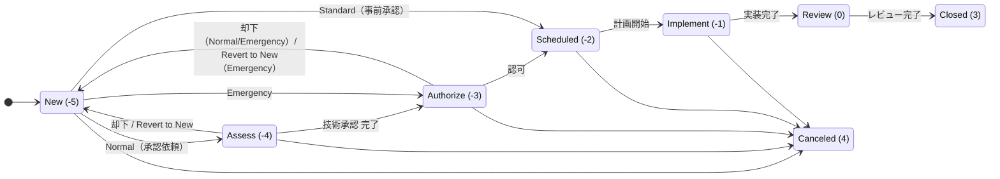
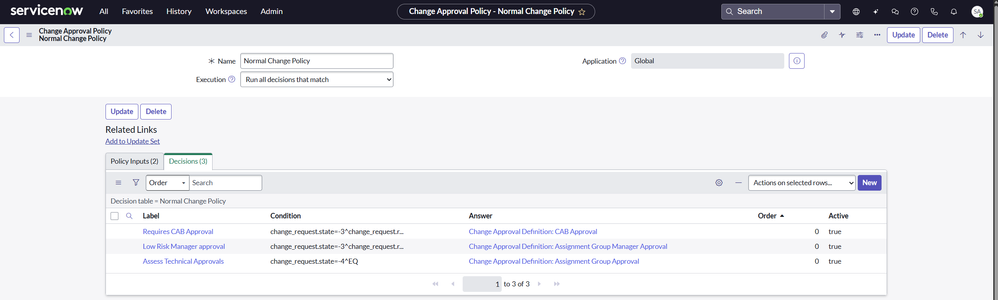
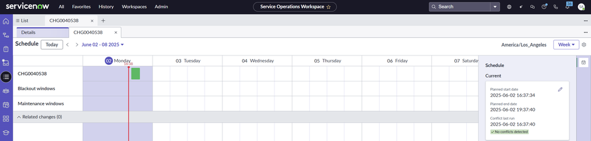
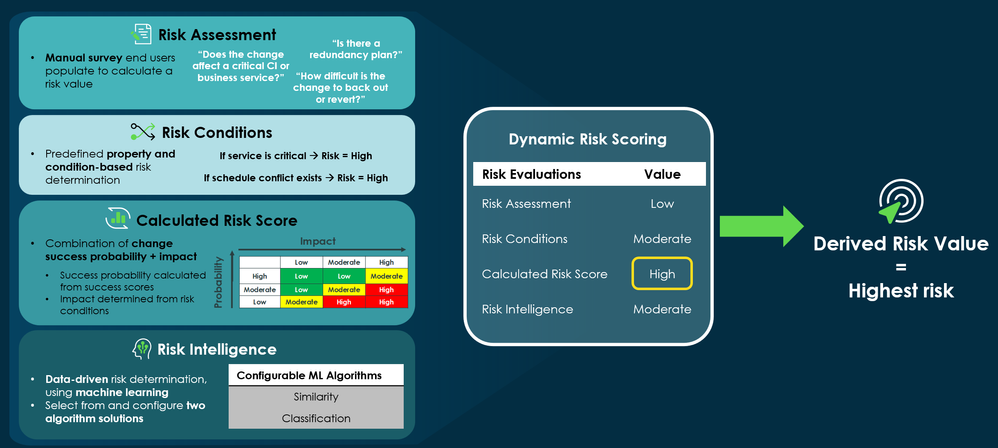
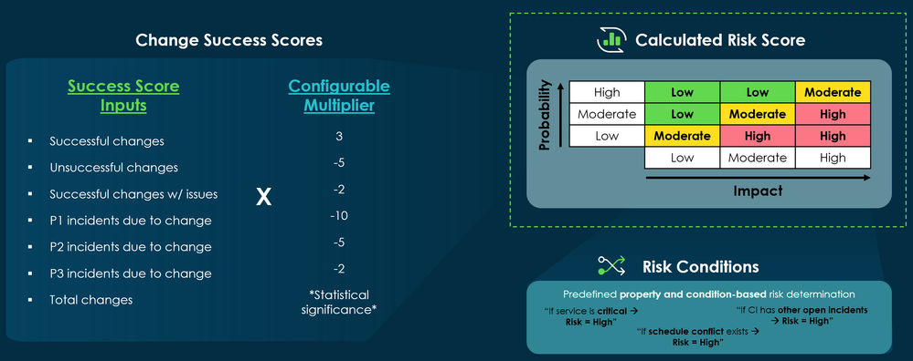
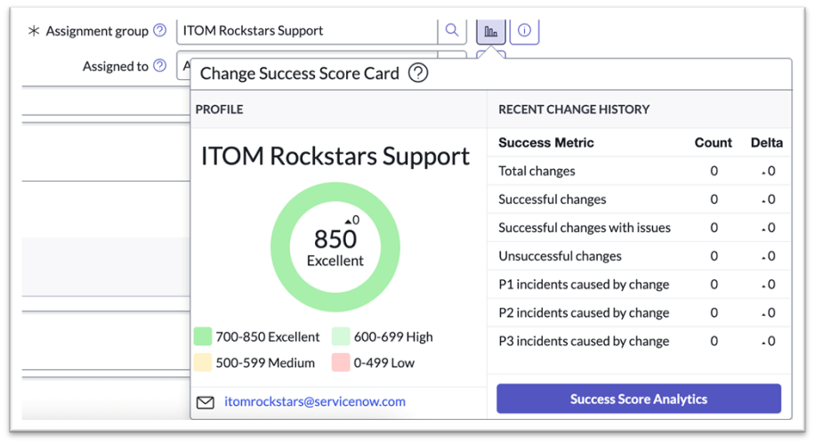

# Change Management（変更管理）

## 概要

ServiceNow の **Change Management（変更管理）** は、IT サービスや構成アイテム（CI）に対する変更を、記録・リスク評価・承認・スケジュール・実装・レビューの各段階で統制し、変更に起因する障害を減らしながら変更のスループットを上げるための ITSM コアアプリケーションである。Change Management は ServiceNow AI Platform の機能として**デフォルトで有効**であり、関連プラグインもデフォルトで有効化されている（Australia リリースノート）。[出典](https://www.servicenow.com/docs/r/delta-zurich-brazil/brazil-zurich-changemanagement-release-notes.html)

ServiceNow の Change Management は、従来の「Type（タイプ）＝Normal / Standard / Emergency ＋固定の State model（状態モデル）＋ Workflow」から、Quebec 以降の **Change Model（変更モデル）＋ Flow ＋ Change Approval Policies（変更承認ポリシー）＋ 複数のリスク評価エンジン**による「Modern Change（モダン変更管理）」へ移行してきた。Modern Change は「人手による固定的な承認チェーン」を「リスクに基づくルーティング」に置き換える考え方であると ServiceNow Community 記事は説明している。[出典](https://www.servicenow.com/community/itsm-articles/modern-change-adoption-guide/ta-p/3558000)

本ファイルは Australia リリース（2026-05 GA）を基準に以下を扱う。ITIL の変更管理プロセス自体の説明は [ITILとITSMの基礎](../../01_入門編/06-itil-itsm-basics.md)、Release Management と DevOps の全体像は [Release Management と DevOps](release-management.md)、ITSM のエディション差は [ITSM Pro/Enterprise 固有機能](itsm-pro-features.md) を参照。

| 節 | 内容 |
|---|---|
| データモデル | `change_request`、`change_task`、Change Model 関連テーブル、承認・競合・リスク関連テーブル |
| 変更タイプと Change Model | Normal / Standard / Emergency、ベースの Change Model、Standard Change Catalog |
| State（状態）値と遷移 | 数値値、タイプ別の遷移、Revert to New、Type 変更の制約 |
| Change Approval Policies | Decision Table、Approval Definition、ベースポリシー、Flow アクション |
| CAB Workbench | CAB Definition、会議、アジェンダ、SOW 統合 |
| Conflict detection | 競合種別、プロパティ一覧、ブラックアウト/メンテナンス スケジュール |
| Risk（リスク） | Risk conditions、Risk assessment、Risk Intelligence、Calculated Risk Score、Now Assist |
| Change Success Score | スコア範囲、乗数、PA ジョブ、API |
| DevOps Change Velocity | DevOps Change Model、ロール、テーブル、連携ツール |
| ロール / プラグイン / API | ITSM Roles、`sn_change_admin`、主要プラグイン ID、`sn_chg_rest` |
| リリース差分 | Australia の新機能、Brazil での変更 |

---

## 用語と前提

`change_request` テーブルを中心とする Change Management の用語を以下に整理する。

| 用語（英語） | 日本語 | 説明 |
|---|---|---|
| Change request | 変更要求 | 変更の記録。`change_request` テーブル（`task` 拡張）。番号の接頭辞は `CHG`。 |
| Change task | 変更タスク | 変更要求に紐づく作業単位。`change_task` テーブル（番号接頭辞 `CTASK`）。 |
| Type | 変更タイプ | `change_request.type` フィールド。ベースの値は Normal（通常）、Standard（標準）、Emergency（緊急）。 |
| Change model | 変更モデル | 状態・状態遷移・遷移条件・承認ポリシー・テンプレートをまとめた「目的別の変更プロセス定義」。`chg_model` テーブル。Quebec で導入。 |
| State model | 状態モデル | 状態とその遷移規則。旧来は Type ごとのスクリプトインクルード、Change Model 以降は `sttrm_*` テーブルで定義。 |
| CAB (Change Advisory Board) | 変更諮問委員会 | 高リスク変更を審議する会議体。CAB Workbench で運営する。 |
| Change Approval Policy | 変更承認ポリシー | Decision Table に基づき、条件ごとに承認・却下・承認依頼の方法を決めるルール。 |
| Conflict detection | 競合検出 | 同一 CI 上の他の変更、ブラックアウト期間、メンテナンス期間外などをチェックする機能。 |
| Blackout schedule / Maintenance schedule | ブラックアウト スケジュール / メンテナンス スケジュール | 変更を禁止する期間 / 変更を実施すべき期間。 |
| Risk / Impact | リスク / 影響度 | `change_request.risk`、`change_request.impact`。複数のリスク評価エンジンで算出される。 |
| Change Success Score | 変更成功スコア | 割り当てグループ（チーム）ごとの変更実績に基づくスコア（ITSM Pro 以上）。 |

> 用語の一般的な定義（ITIL 4 の Change Enablement など）は [ITILとITSMの基礎](../../01_入門編/06-itil-itsm-basics.md) を参照。

---

## データモデル

### `change_request` テーブル

`change_request` テーブルは `task` テーブルを拡張したテーブルで、変更要求 1 件を 1 レコードとして保持する。`task` から `number`、`state`、`assignment_group`、`assigned_to`、`short_description`、`description`、`cmdb_ci`、`priority`、`approval` などの共通フィールドを継承する。継承の仕組みは [データモデルとSystem Dictionary](../platform/data-model-dictionary.md) を参照。

主要フィールド（ベースシステムで一般に存在するもの）を以下に示す。列名は ServiceNow の標準的な列名であり、実際の有無・ラベルは対象インスタンスの Dictionary で確認すること。【経験則】（個々の列名を網羅した公式一覧ページは今回の調査で確認できず）

| ラベル（英語） | 日本語 | 列名 | 説明 |
|---|---|---|---|
| Number | 番号 | `number` | `CHG` + 連番。 |
| Requested by | 依頼者 | `requested_by` | 変更の依頼者。State 遷移時の通知先。 |
| Category | カテゴリ | `category` | 変更の分類。 |
| Service / Service offering | サービス / サービスオファリング | `business_service` / `service_offering` | 影響を受けるサービス。 |
| Configuration item | 構成アイテム | `cmdb_ci` | 主対象 CI。競合検出・リスク算出の入力。 |
| Type | タイプ | `type` | Normal / Standard / Emergency（ほかにモデル利用時の値あり）。 |
| Model | モデル | `chg_model` | 適用する Change Model（Change Model 有効時）。 |
| State | 状態 | `state` | 数値で保持（後述の「State 値」参照）。 |
| On hold / On hold reason | 保留 / 保留理由 | `on_hold` / `on_hold_reason` | 変更の一時保留。Change Model の遷移条件「Not On Hold」で参照される。 |
| Priority / Risk / Impact | 優先度 / リスク / 影響度 | `priority` / `risk` / `impact` | リスク算出結果は `risk` に格納。 |
| Assignment group / Assigned to | 割り当てグループ / 担当者 | `assignment_group` / `assigned_to` | Change Success Score は Assignment group 単位で算出。 |
| Short description / Description | 概要 / 説明 | `short_description` / `description` | |
| Justification | 正当性 | `justification` | 変更理由。 |
| Implementation plan | 実装計画 | `implementation_plan` | |
| Risk and impact analysis | リスクと影響分析 | `risk_impact_analysis` | |
| Backout plan | 切り戻し計画 | `backout_plan` | |
| Test plan | テスト計画 | `test_plan` | |
| Planned start date / Planned end date | 計画開始日時 / 計画終了日時 | `start_date` / `end_date` | 競合検出のトリガーとなる。 |
| Actual start / Actual end | 実績開始 / 実績終了 | `work_start` / `work_end` | |
| CAB required / CAB date / CAB delegate / CAB recommendation | CAB 要否 / CAB 日付 / CAB 代理 / CAB 勧告 | `cab_required` / `cab_date` / `cab_delegate` / `cab_recommendation` | CAB 運営に使用。 |
| Conflict status / Conflict last run | 競合ステータス / 競合最終実行 | `conflict_status` / `conflict_last_run` | 競合検出の結果。 |
| Exclude from conflict detection | 競合検出から除外 | （列名は公開情報で確認できず） | **Australia で追加**。true にすると競合チェック対象外となる。 |
| Close code / Close notes | クローズコード / クローズメモ | `close_code` / `close_notes` | 一般的な値は `successful`（Successful）、`successful_issues`（Successful with issues）、`unsuccessful`（Unsuccessful）。【第三者情報】 |
| Unauthorized | 未承認 | `unauthorized` | 未承認変更（Unauthorized change）の識別。 |
| Standard change template version | 標準変更テンプレート版 | `std_change_producer_version` | Standard Change Catalog から作成した場合のテンプレート版。 |

`close_code` の値は CloudBees 等の連携ドキュメントで `successful`、`successful_issues`、`unsuccessful` として扱われている。【第三者情報】[出典](https://docs.cloudbees.com/docs/cloudbees-unify/latest/service-now/update-change-request)

### `change_task` テーブル

`change_task` テーブルは `task` テーブルを拡張したテーブルで、変更要求の実装・テスト・レビュー作業を分割して割り当てるために使う。`change_task.change_request` で親の変更要求を参照する。Change Management REST API では `/sn_chg_rest/change/{change_sys_id}/task/{task_sys_id}` で変更タスクを操作でき、API はタスクが指定の変更要求に属することを検証してから削除する。[出典](https://www.servicenow.com/docs/bundle/zurich-api-reference/page/integrate/inbound-rest/concept/change-management-api.html)

ServiceNow Community 記事は、変更タスクは CTASK の Assignment group で割り当て、担当者（Assigned to）で受諾を示すこと、またタスクの担当者を承認者にしないことを推奨している。[出典](https://www.servicenow.com/community/itsm-articles/modern-change-management-maturity-journey-amp-faq/ta-p/3279260)

### Change Model（変更モデル）関連テーブル

Change Model は Quebec で導入された「Multimodal Change（マルチモーダル変更）」の仕組みで、汎用の State Transition Model（状態遷移モデル）テーブル群の上に構築されている。ServiceNow Community の ITSM ブログは次のテーブル構成を説明している。[出典](https://www.servicenow.com/community/itsm-blog/breaking-the-change-barrier/ba-p/2294272)

| テーブル | ラベル | 役割 |
|---|---|---|
| `sttrm_model` | State Transition Model | 任意のテーブルに対し、choice リストを状態定義として状態遷移モデルを構成する汎用テーブル。現時点では `chg_model` 拡張経由でのみ使われる。 |
| `chg_model` | Change Model | `sttrm_model` を拡張した変更用モデル。名前、ランディングページ表示有無、カード色、説明、Record presets（読み取り専用のプリセット値）を持つ。 |
| `sttrm_state` | Model State | モデルで使う状態。`state` フィールドの choice から値をコピーし、モデルは choice の全部または一部を使える。初期状態（Initial state）を指定できる。 |
| `sttrm_state_transition` | Model State Transition | 2 状態間の遷移。条件が満たされモデルが評価されると状態が変わる。Automated（自動）フラグを立てると条件成立時に自動遷移する。 |
| `sttrm_transition_condition` | Transition Condition | 遷移に紐づく条件。1 遷移に複数条件を持てる。条件ビルダーまたはスクリプトで定義し、テーブル（とその拡張）単位で適用される。 |

ServiceNow Community の投稿は、ベースの遷移条件タイプとして **Authorized** と **Not On Hold** を挙げている。【第三者情報】[出典](https://www.servicenow.com/community/itsm-forum/change-model-condition-types-in-servicenow/m-p/3386037)

> 注意: 汎用の Workflow Studio 側の State Management（`sys_state_model` 系）とは別の仕組みである。テーブル名の厳密な確認はインスタンスの Dictionary で行うこと。

### 承認・CAB・競合・リスク関連テーブル

| テーブル | 用途 | 出典 |
|---|---|---|
| `sysapproval_approver` | 承認レコード（プラットフォーム共通）。Change Approval Policy が生成する。 | [Community](https://www.servicenow.com/community/in-other-news/using-change-approval-policies/ba-p/2286835) |
| `chg_policy_applied` | Applied Change Policies。変更要求に適用されたポリシー・合致した Decision・日時のログ。 | [Community](https://www.servicenow.com/community/in-other-news/using-change-approval-policies/ba-p/2286835) |
| Change Approval Definition | 承認定義（Decision の Answer レコード）。テーブル名は公開情報では確認できず。 | 同上 |
| `cab_definition` | CAB Definition。`cmn_schedule` から Domain / Domain path を継承し、Child Schedule・Schedule Entry テーブルを共用する。 | [Docs](https://www.servicenow.com/docs/r/it-service-management/change-management/cab-workbench.html) |
| `conflict` | 競合検出結果（Conflicts 関連リスト）。【経験則】公式ページでテーブル名は確認できず。 | — |
| `sn_chg_probability_risk_lookup` | Calculated Risk Score のリスクルックアップ表（Success probability × Impact → Risk）。 | [Docs](https://www.servicenow.com/docs/r/t~YvqQkg2oQX4L7ySrpyuQ/g2ukWhXDlhBkKQM2uOWapw) |
| `sn_chg_probability_details` | 変更要求ごとの Success probability 定義の詳細。変更要求の読み取り権限で参照可。 | 同上 |

---

## 変更タイプと Change Model

### ITIL の 3 タイプ

ServiceNow のベースシステムは ITIL の 3 つの変更タイプを提供する。`com.snc.change_management`（Change Management - Core）プラグインは Change Request の Type フィールドを Normal / Standard / Emergency に変更する。[出典](https://www.servicenow.com/docs/r/Mr7qUatbFXax1_h~z60rmA/B9L7HE8z6XTvk1sNiONoig)

| タイプ | 日本語 | 性質 | 状態の進み方（概要） | 主な承認 |
|---|---|---|---|---|
| Normal | 通常変更 | 標準的な評価・承認を経る変更 | New → Assess → Authorize → Scheduled → Implement → Review → Closed | Assess で技術承認（割り当てグループ）、Authorize で CAB 承認（Moderate/High リスク）または低リスク時のグループマネージャー承認 |
| Standard | 標準変更 | 事前承認済み・低リスク・実績のある変更 | Assess と Authorize を経由しない | 事前承認（テンプレート承認時に承認済み） |
| Emergency | 緊急変更 | 迅速な実施が必要な変更。Standard と同様に Assess を省くが承認は必要 | New → Authorize → Scheduled → Implement → Review → Closed | Authorize で `$cab_approval`（CAB 承認グループ）への承認 |

状態遷移の詳細は公式の「State model and transitions」ページに基づく。[出典](https://www.servicenow.com/docs/r/it-service-management/change-management/c_ChangeStateModel.html) / 承認内容は Normal / Emergency のベースポリシーに基づく。[出典](https://www.servicenow.com/community/in-other-news/using-change-approval-policies/ba-p/2286835)

### Change Model（変更モデル）

**Change Model** は、目的に合わせた状態モデル・状態遷移・遷移条件を定義できる仕組みである。公式ドキュメント（Australia）は、Change Model が **states（状態）、state transitions（状態遷移）、approval policies（承認ポリシー）、change templates（変更テンプレート）** から構成され、これらは個別レコードとして管理されて複数モデル間で再利用できると説明している。[出典](https://www.servicenow.com/docs/r/QykF2iRSIs6VXztArCSo3w/BiUOnkqFOLRgUczOq~P_Sg)

- ベースのモデル例として **ITIL mode 1（逐次型）** と **ITIL mode 2（適応型）** の例が提供される。
- ITIL 変更タイプ：Normal、Standard、Emergency。
- Federated change types（連携型の変更タイプ）：DevOps、Cloud Infrastructure、Unauthorized、App、Low Risk、Patching。
- テンプレートはモデルごとに作成でき、親子カテゴリを持ち、独自の提案（proposal）・承認ワークフローを持つ。
- モデル機能へのアクセスは User criteria（ユーザー条件）レコードと Change Models のプロパティで制御する。

[出典](https://www.servicenow.com/docs/r/QykF2iRSIs6VXztArCSo3w/BiUOnkqFOLRgUczOq~P_Sg)

ServiceNow Community 記事は、OOTB（標準提供）のモデルとして Standard、Emergency、Normal、Change Registration、Cloud Infrastructure、Unauthorized、DevOps を挙げ、Flow と Workflow は移行期間中に並行稼働できるが Flow を推奨するとしている。[出典](https://www.servicenow.com/community/itsm-articles/modern-change-management-maturity-journey-amp-faq/ta-p/3279260)

#### Change Model の導入経緯と旧 State Model との関係

| 項目 | 内容 |
|---|---|
| 導入リリース | Quebec（Multimodal Change） |
| 位置付け | 旧来の「Change Management – State Model」プラグインを置き換えることを意図。両者は同時稼働可能で段階移行できる。 |
| アップグレード顧客 | Multimodal Change はデフォルト無効で、既存の State Model の挙動が維持される。旧来のインターセプター（変更作成時のタイプ選択画面）も維持される。 |
| 新規顧客 | Multimodal Change と Flow Designer がデフォルト。 |
| UI | カード型のランディングページで利用可能なモデルと事前承認済み変更（標準変更）を表示する。 |
| プロパティ | `sys_properties.list` を `*change_model` でフィルタすると Multimodal Change のプロパティを確認できる。 |
| 自動化 | 変更用の Flow と Flow アクションが ITSM spoke に追加されている。 |

[出典](https://www.servicenow.com/community/itsm-blog/breaking-the-change-barrier/ba-p/2294272)

`com.snc.change_management.change_model.type_compatibility` システムプロパティは、変更要求を Type で作成するか、Model で作成するか、両方かを制御する。公式ドキュメントはデフォルトを false としつつ、アップグレードしたインスタンスでは true になっていると説明している。false の場合、Type を渡して変更を作成しようとするとエラーになる（DevOps パイプライン連携での説明）。[出典](https://www.servicenow.com/docs/r/QykF2iRSIs6VXztArCSo3w/kYawifgINsRlYqcbPCDx_A)

#### Change Model の属性（Attributes）

Change Model には動作を補う属性を追加できる。属性はモデルに追加された場合のみ有効である。[出典](https://www.servicenow.com/docs/r/it-service-management/change-management/c_ChangeStateModel.html)

| 属性 | 意味 |
|---|---|
| `allow_ci_modification` | 構成アイテムの変更を許可する。属性が無い場合は初期状態がデフォルトとなる。 |
| `allow_implementation` | その変更が実装されることを示す。Change model の implementation states フィールドを置き換えるもので、両方が尊重される。 |

#### カスタム Change Model 作成の例（Community 記事）

ServiceNow Community の「Modern Change Adoption Guide」（2026-06 公開）は、「Cloud Provisioning」モデルを例に、カスタムモデル作成時の設計を説明している。[出典](https://www.servicenow.com/community/itsm-articles/modern-change-adoption-guide/ta-p/3558000)

- モデルは組織構造ではなく、**デリバリーパターン**（マイクロサービスのリリース、ルーター変更、クラウドプロビジョニング等）単位で作ることを推奨。
- モデルごとに状態モデル、遷移規則、必須項目、自動化 Flow、リスクパラメータを定義する。
- 前提プラグイン：`com.snc.change_management`（Change Management）と `com.snc.bestpractice.change_risk`（Change Risk Calculator）を System Definition > Plugins で確認する。
- 遷移条件の例：New → Authorize（CI・割り当てグループ・概要・正当性・リスクが入力済み、リスクが Moderate/High）、New → Implement（自動承認、計画開始が現在以降、Low リスク）、Implement → Review（全タスク完了）。
- 承認ポリシーの例：Low リスクは自動承認、Moderate/High は CAB Approval 定義へ。モデル有効化までポリシーは非アクティブにしておく。
- 中間状態をむやみに追加しないことを推奨。

### Standard Change Catalog（標準変更カタログ）

**Standard Change Catalog** は、Change Management が標準変更として承認した変更テンプレートを保持するカタログである。標準変更は「事前承認済み・低リスク・実績のある変更」であり、カタログ内でカテゴリに分類され、提案（proposal）プロセスでカタログに掲載する変更を統制する。テンプレートから要求を送信すると事前承認済みの情報が自動入力される。[出典](https://www.servicenow.com/docs/r/Mr7qUatbFXax1_h~z60rmA/kFr0bNzDwdRT5feChNJE2A)

| 項目 | 内容 |
|---|---|
| プラグイン | Change Management - Standard Change Catalog（`com.snc.change_management.standard_change_catalog`） |
| テンプレートのライフサイクル | Propose（提案）→ Approve（承認、カタログ掲載）→ Modify（修正）/ Retire（廃止） |
| アクセス | `itil` ロールで標準変更の参照・変更要求送信が可能。テンプレートへのアクセスはユーザー単位で、カテゴリはロール・地理的位置・部門で表示制御される。 |
| プロパティ | All > Change > Administration > Standard Change Properties。Catalog / Category（生成テンプレートの配置先）、Fields to copy（通常変更から「Propose a New Standard Change Template」レコードプロデューサーへコピーするフィールド）、Two step（要求者が Submit を押すまで変更要求レコードを挿入しない）など。 |
| 既定の提案ワークフロー | Standard Change Proposal ワークフローが Change Management グループのメンバーへ承認を送る。 |
| 制約 | 標準変更で一連の CI を一括更新することはできない（個別に提案する）。 |
| 主なテーブル | `std_change_proposal`（提案）、`std_change_record_producer`（標準変更テンプレートのレコードプロデューサー）、`std_change_template`、`std_change_producer_version`（バージョン）、`std_change_properties`。【経験則】プラグインのインストール一覧ページで種類は確認したが、個別列は確認できず。 |

[出典（プロパティ）](https://www.servicenow.com/docs/r/QykF2iRSIs6VXztArCSo3w/aLH19NKwO9x2MAZuQuSXhg)

**Australia での変更（変更テンプレート）:** Australia では、Change Model 用のテンプレートで **template field policies（テンプレート フィールド ポリシー）** により必須・読み取り専用フィールドを設定できるようになり、Change Model 用テンプレートも既存の標準変更テンプレートと同様に **提案・レビュー・バージョン管理・廃止**ができるようになった。また **Enhanced data model for change templates（変更テンプレートの拡張データモデル）** によりカテゴリ分けとロールベースアクセスが全 Change Model に拡張された。これは新規作成の標準変更ではオプションであり、既存の標準変更カタログには影響せず、移行も不要である。[出典](https://www.servicenow.com/docs/r/delta-zurich-brazil/brazil-zurich-changemanagement-release-notes.html)

**Standard Change Template Intelligence:** Predictive Intelligence のクラスタリングで過去の変更から標準変更テンプレート候補を提案する機能（`com.snc.change_management.ml.sctp`、Now Support 経由で要求）。最小クラスタ品質は `chg_ml_prop_sctp.quality` で設定する。[出典](https://www.servicenow.com/docs/r/QykF2iRSIs6VXztArCSo3w/wCAsw5O9AVOByjSWDKFbzA)

---

## State（状態）値と遷移

### State 値一覧

`change_request.state` フィールドは数値で状態を保持する。公式ドキュメントの状態モデルは次のとおり。[出典](https://www.servicenow.com/docs/r/it-service-management/change-management/c_ChangeStateModel.html)

| State | 日本語 | 値 | 説明 | 依頼者へのメール |
|---|---|---|---|---|
| New | 新規 | -5 | 未提出。依頼者は提出前に何度でも保存できる。 | — |
| Assess | 評価 | -4 | ピアレビューと技術承認。 | — |
| Authorize | 認可 | -3 | Change Management と CAB が変更をスケジュールし認可する。 | — |
| Scheduled | スケジュール済み | -2 | 認可・スケジュール済み。 | 送信 |
| Implement | 実装 | -1 | 実装作業を実施。 | 送信 |
| Review | レビュー | 0 | 作業完了、成否を評価。Cancel は無効。 | 送信 |
| Closed | クローズ | 3 | 完了。以降の対応なし。 | — |
| Canceled | 取り消し | 4 | Closed と Review を除き、どの状態からでも取り消し可能。 | 送信 |

レガシーの State model（状態モデル）では、変更タイプごとに `ChangeRequestStateModel_<type>` スクリプトインクルード（例：Normal 用の `ChangeRequestStateModel_normal`）が利用可能な状態、各状態の次の状態、`canMove` / `moving` 関数を定義する。`ChangeRequestStateHandler` スクリプトインクルードの `STATE_NAMES` マップは State フィールドに格納される数値値と覚えやすい名前を対応付ける。名前に SNC を含むスクリプトインクルードは読み取り専用のため、SNC なしの拡張版を編集する。なお Quebec 以降は状態の制御が Change Model に置き換えられている。[出典](https://www.servicenow.com/docs/r/QykF2iRSIs6VXztArCSo3w/u8MCRun~dvfBfG4bDUlz4A) / [出典](https://www.servicenow.com/docs/r/QykF2iRSIs6VXztArCSo3w/CaYy9XJfghANjnKZkzZCeQ)

### タイプ別の状態遷移

図の説明：Normal は New → Assess → Authorize → Scheduled → Implement → Review → Closed の全状態を通る。Standard は Assess と Authorize を経由せず（事前承認済み）、承認により次の適切な状態へ進む。Emergency は Standard に近いが認可（Authorize）が必要。Canceled へは Closed 後と Review を除き遷移できる。Authorize での却下は Normal・Emergency とも New に戻る。[出典](https://www.servicenow.com/docs/r/it-service-management/change-management/c_ChangeStateModel.html)

### Revert to New（新規に戻す）

- Normal 変更は Assess から New に戻せる。Emergency 変更は Authorize（公式文中では "Authorized"）から New に戻せる。
- フォームの Context menu（コンテキストメニュー）の **Revert to New** から実行し、ワークフローを再始動し、保留中の承認をすべて取り消す。
- 承認依頼後に変更範囲の不備に気付いた場合に使う。

[出典](https://www.servicenow.com/docs/r/it-service-management/change-management/c_ChangeStateModel.html)

### Type（タイプ）変更の制約

- `change_request.type` の ACL により、Type は **New 状態かつ承認が 1 件も生成されていない場合のみ**編集できる。
- Standard → Normal / Emergency、Normal ⇔ Emergency に変更可能。
- 却下された Normal / Emergency 変更は New に戻るため、Type を変更して再提出できる。

[出典](https://www.servicenow.com/docs/r/it-service-management/change-management/c_ChangeStateModel.html)

### 状態モデルのカスタマイズ

旧来（State Model プラグイン）では新しい状態を追加し、スクリプトインクルードや UI ポリシーで遷移をカスタマイズできる（公式「Add a state to the state model」「Configure state model transitions」）。Change Model を使う場合は `sttrm_state` / `sttrm_state_transition` / `sttrm_transition_condition` で状態と遷移条件を定義する。Change Model の遷移規則はプラットフォームで強制され、手動で迂回できない。[出典](https://www.servicenow.com/docs/r/it-service-management/change-management/c_ChangeStateModel.html) / [出典](https://www.servicenow.com/community/itsm-articles/modern-change-adoption-guide/ta-p/3558000)

ServiceNow Community には、「Change Model: Check State Transition」ビジネスルールによりクローズが拒否される事例や、REST で状態を更新すると 200 が返るが状態モデルが実行されない事例が報告されている。連携から状態を進める場合は Change Management API や Change Model の遷移条件を考慮すること。【第三者情報】[出典](https://www.servicenow.com/community/secops-forum/can-t-close-a-cr-because-of-a-business-rule-stack-change-model/m-p/3409772) / [出典](https://www.servicenow.com/community/api-insights-forum/change-request-state-transition-via-rest-api-returns-200-but/m-p/3478055)

> **Brazil での変更:** Change Model に **State field policies（状態フィールド ポリシー）** が追加され、状態ごとにフィールドを必須・読み取り専用にでき、変更要求の作成・更新時にフォームで強制される。[出典](https://www.servicenow.com/docs/r/delta-zurich-brazil/brazil-zurich-changemanagement-release-notes.html)

---

## Change Approval Policies（変更承認ポリシー）

### 概要

**Change Approval Policy（変更承認ポリシー）** は、ポリシー入力（Policy inputs）と結果を決める Decisions（決定）を持つレコードで、プラットフォームの **Decision Table（デシジョンテーブル）** を基盤とする。Decision は条件ビルダーで無制限に定義でき、各 Decision の Answer（回答）が **Change Approval Definition（変更承認定義）** である。Madrid 以降の新規顧客では Normal / Emergency の Workflow が Change Approval Policy アクティビティを既定で使う。[出典](https://www.servicenow.com/community/in-other-news/using-change-approval-policies/ba-p/2286835)

ポリシーはプラットフォーム上の任意データや REST API 経由の外部データを入力にでき、自動承認・自動却下・ユーザー/グループへの手動レビューを決定する。ポリシーは通常、変更が New から Assess/Authorize へ遷移する際に Flow から呼び出される。Flow Designer には OOTB の **Apply Change Approval Policy** アクションがある。[出典](https://www.servicenow.com/community/itsm-articles/modern-change-management-maturity-journey-amp-faq/ta-p/3279260)

### ポリシーの作成（Decision Builder）

| 項目 | 内容 |
|---|---|
| 前提 | Decision Builder（`sn_decision_design`）プラグイン |
| 必要ロール | `admin` または `change_manager` |
| メニュー | All > Change > Change Policy → Create new change approval policy |
| Name | ポリシー名 |
| Execution（実行方式） | **First decision that matches**（Decisions の Order 昇順で最初に合致した Decision の承認定義を適用）/ **Run all decisions that match**（合致した全 Decision の承認定義を適用） |
| Policy input（入力） | Label と Type（Choice、Date、Date/Time、Decimal、Due Date、Integer、Long、Reference、String、String (Full UTF-8)、True/False）。Reference の場合は参照テーブルを指定。 |
| Condition column（条件列） | 列ラベル、説明、Input、Table（Reference 時自動）、Data to evaluate（参照レコード自体かそのフィールドか）、Condition type、Default operator |
| 結果列 | 各行に Change Approval Definition を選択 |

[出典](https://www.servicenow.com/docs/r/QykF2iRSIs6VXztArCSo3w/rcQre2omm1oACZOzLYNLkQ)

### Change Approval Definition（変更承認定義）

| フィールド | 内容 |
|---|---|
| Action | Approve（指定ユーザーとして自動承認）/ Reject（指定ユーザーとして自動却下）/ Generate User approval（指定ユーザーへ承認依頼）/ Generate Group approval（指定グループへ承認依頼） |
| Approver source | **Change Request**（変更要求の列から承認者を動的に取得）/ **Approval Definition**（参照フィールドで静的に指定） |
| Wait for | グループ承認のみ。最初の応答か全員の応答か。 |
| Mandatory | 承認対象者からの応答を必須にする。 |

[出典](https://www.servicenow.com/community/in-other-news/using-change-approval-policies/ba-p/2286835)

Community の FAQ 記事は、承認タイプとして最初の応答、全承認者、グループの一定割合などを挙げ、ポリシーで「No Approval」を選択した場合は承認を省略して次状態へ進められると説明している。【第三者情報】（Approval Definition の選択肢に関する記述は記事により差異があるため、インスタンスで確認すること）[出典](https://www.servicenow.com/community/itsm-articles/modern-change-management-maturity-journey-amp-faq/ta-p/3279260)

### ベースのポリシー

| ポリシー | Decisions / Inputs | 挙動 |
|---|---|---|
| Normal Change Policy | 3 Decisions、2 Inputs（`change_request`、`manager_approved`） | **Assess Technical Approvals**：Assess 状態（`state=-4`）で割り当てグループへ承認。**Requires CAB Approval**：Authorize 状態（`state=-3`）でリスク Moderate/High なら `$cab_approval` グループへ承認。**Low Risk Manager Approval**：低リスクの Normal 変更は割り当てグループのマネージャーが最終認可でき、それ以上の承認は不要（Kingston で Normal 変更 Workflow に追加された低リスク・マネージャー承認を、Policy として再現したもの）。 |
| Emergency Change Policy | — | Authorize 状態で `$cab_approval` グループへ承認。 |

[出典](https://www.servicenow.com/community/in-other-news/using-change-approval-policies/ba-p/2286835)

*キャプション:* Change Approval Policy「Normal Change Policy」のフォーム。
*画面説明:* Core UI のフォーム上部に Name（Normal Change Policy）、Execution（Run all decisions that match）、Application（Global）がある。下部の関連リストに「Policy Inputs (2)」と「Decisions (3)」のタブがあり、Decisions には Label・Condition・Answer・Order・Active の列で 3 行が並ぶ：「Requires CAB Approval」（条件 `change_request.state=-3^…`、回答 Change Approval Definition: CAB Approval）、「Low Risk Manager approval」（条件 `change_request.state=-3^…`、回答 Assignment Group Manager Approval）、「Assess Technical Approvals」（条件 `change_request.state=-4`、回答 Assignment Group Approval）。
*出典:* https://www.servicenow.com/community/itsm-articles/modern-change-management-maturity-journey-amp-faq/ta-p/3279260 （取得日: 2026-11-03）

### 承認設計のベストプラクティス（Community 記事）

ServiceNow Community 記事は次を推奨している。[出典](https://www.servicenow.com/community/itsm-articles/modern-change-management-maturity-journey-amp-faq/ta-p/3279260)

- 承認者数は少なく、レベルごとに責任を持つグループまたは個人を 1 つにする。
- 推奨承認：ピアレビュー（全リスク）、Change Management の品質レビュー（中/高）、CAB（高）、サービスオーナー（計画停止時のみ）、専門チーム（必要時）。
- 承認を変更の「通知」の代わりに使わない。
- 旧 Workflow（Workflow Editor > Change Request - Normal）は、モデルベースの変更を無視するよう修正すれば Change Model と並行稼働できる。

承認全般の仕組み（`sysapproval_approver`、承認ルール）は [Workflow Studio / Flow Designer](../platform/flow-designer-workflow-studio.md) も参照。

---

## CAB Workbench（CAB ワークベンチ）

### 概要

**CAB Workbench（Change Advisory Board ワークベンチ）** は、CAB マネージャーが CAB 会議をスケジュール・計画・運営するためのツールである。公式ドキュメント（Brazil 版ページ）は次の機能を挙げている。[出典](https://www.servicenow.com/docs/r/it-service-management/change-management/cab-workbench.html)

| 機能 | 内容 |
|---|---|
| Meeting schedule（会議スケジュール） | 定期的な CAB 会議シリーズを作成し、メンバーが事前に変更要求を評価できるようにする。 |
| Attendees（出席者） | 会議の各回に Board members（委員）を定義し、CAB マネージャー不在時の Delegates（代理）も定義する。 |
| Agenda（アジェンダ） | フィルタ条件で各回に載せる変更要求を決める。依頼者には議論される会議が通知され、変更の理由・期待結果・リスクを説明できる。 |
| Change calendar（変更カレンダー） | 計画変更を日・週・月で表示し、メンテナンス期間・ブラックアウト期間も表示。 |
| Approval（承認） | 会議の決定に基づき変更要求を承認・却下する。 |
| Meeting notes（会議メモ） | 会議ごとのメモを記録し出席者へ共有する。 |

CAB 会議の運営（Change > Change Advisory Board > CAB Workbench）では、CAB マネージャーが会議を開始し、アジェンダ項目の一時停止・スキップ・復帰・繰り上げ・繰り下げ、Pending / All / My / Approved でのフィルタ、割り当て時間に対する経過時間のタイマー確認、出席者の接続状況と招待への回答の確認を行う。会議全体のメモは CAB Meeting レコードに保存され出席者へメール送信され、変更固有のメモは変更要求に直接追加される。カレンダー表示では競合・ブラックアウト・メンテナンス期間が強調表示される。[出典](https://www.servicenow.com/docs/r/it-service-management/change-management/manage-cab-meeting-using-cab-workbench.html)

`cab_definition`（CAB Definition）テーブルは Schedule（`cmn_schedule`）テーブルから Domain と Domain path を継承し、Child Schedule と Schedule Entry テーブルを共用するため、ドメイン分離のサポートも Schedule と同様に動作する（`domain_master` 属性で親レコードからドメインを導出）。ドメイン分離の詳細は [ドメインセパレーション](../platform/domain-separation.md) を参照。[出典](https://www.servicenow.com/docs/r/it-service-management/change-management/cab-workbench.html)

### プラグイン・ロール・プロパティ

| 項目 | 値 | 出典 |
|---|---|---|
| プラグイン | Change Management - CAB Workbench（`com.snc.change_management.cab`）。有効化時に Service Portal（`com.glide.service-portal`）と Service Portal 共通コンポーネント（`com.snc.app_common.service_portal`）も有効化される。有効化には `admin` ロール。 | [Docs: Activate Change Management - CAB Workbench（Xanadu）](https://www.servicenow.com/docs/r/Recj91eIo1YnsOabQjgskg/V9xE5x10EugCMs~OGAmmfg) |
| CAB マネージャー | `sn_change_cab.cab_manager` | [Docs](https://www.servicenow.com/docs/r/QykF2iRSIs6VXztArCSo3w/lzl1cW8mOtAt6Yx8UjgcPg) |
| 参照 | `sn_change_read` で CAB Workbench を参照可能 | 同上 |
| SOW 表示 | `sn_change_cab.com.snc.change_management.cab.use_sow_meeting` が true かつ `sn_sow.sow_user` ロールを持つ場合、CAB 会議は Service Operations Workspace の CAB Workbench で開く。false の場合は Core UI で開く。 | [Docs](https://www.servicenow.com/docs/r/QykF2iRSIs6VXztArCSo3w/7ziQ9zbuaEl1CvT9Ryp~og) |

CAB Workbench は Istanbul で導入された。【第三者情報】（Istanbul 期の Community 告知記事による）[出典](https://www.servicenow.com/community/in-other-news/coming-in-istanbul-change-advisory-board-cab-workbench/ba-p/2292081)

### Service Operations Workspace（SOW）での CAB

- Utah で Change Management が Service Operations Workspace（SOW）に統合された。
- 2025 年 5 月に SOW の CAB Workbench 体験が改善され、アジェンダ項目の一時停止・延期・復元、事前 CAB レビュー（pre-CAB review）が可能になった。
- Community 記事は、CAB は高リスク変更のみ（変更量の 5〜15% 程度）を対象にすることを推奨している。

[出典](https://www.servicenow.com/community/itsm-articles/modern-change-management-maturity-journey-amp-faq/ta-p/3279260) / [出典](https://www.servicenow.com/community/itsm-articles/modern-change-adoption-guide/ta-p/3558000)

Zurich へのアップグレード後は CAB Workbench（CAB カレンダー、会議、定義）が SOW 内で開き動作するようになったと Community で報告されている。【第三者情報】[出典](https://www.servicenow.com/community/itsm-forum/cab-workbench-integration-with-service-operations-workspace-sow/m-p/3469427)

SOW 全般は [Workspace と UI Builder](../platform/workspaces-ui-builder.md) を参照。

---

## Conflict detection（競合検出）

### 概要

**Conflict detection（競合検出）** は、変更要求に関連付けられた CI について、ブラックアウト スケジュールとメンテナンス スケジュール、および他の変更要求との重なりをチェックする機能である。[出典](https://www.servicenow.com/docs/r/QykF2iRSIs6VXztArCSo3w/HQtY4pGQb30K3L5cH7hUYg)

| 項目 | 内容 |
|---|---|
| 自動実行 | `change.conflict.refresh.conflicts` を有効にすると、Configuration item・Planned start date・Planned end date（Yokohama 版では State も）の変更時に自動実行。 |
| 手動実行 | 変更要求から手動で競合検出を実行し詳細を確認できる。 |
| 実行メカニズム | `change.conflict.useprogressworker` で Flow または Progress Worker を選択。既定は false（Flow）。 |
| 権限 | `change.conflict.role` にロールをカンマ区切りで指定（例 `itil`）。そのロールは `change_request` レコードへのアクセス権も必要。プロパティ設定には `admin`。 |
| 競合の種類 | アクティブな変更要求との競合、ブラックアウト スケジュールとの競合、メンテナンス スケジュール外での実施。 |

[出典](https://www.servicenow.com/docs/r/QykF2iRSIs6VXztArCSo3w/HQtY4pGQb30K3L5cH7hUYg) / [出典](https://www.servicenow.com/docs/r/xanadu/it-service-management/change-management/configure-conflict-properties.html)

**Australia の新機能:** **Exclude from conflict detection（競合検出から除外）** フィールドが追加された。true にした変更要求は競合チェックの対象外となり、他の変更要求で競合検出を実行した際にも競合変更として表示されない。[出典](https://www.servicenow.com/docs/r/delta-zurich-brazil/brazil-zurich-changemanagement-release-notes.html)

### 競合検出プロパティ一覧

All > Change > Administration > Conflict Properties（公式の「Configure conflict analysis properties」）で設定する。[出典](https://www.servicenow.com/docs/r/xanadu/it-service-management/change-management/configure-conflict-properties.html)

| プロパティ | 説明 | 既定値 / 値 |
|---|---|---|
| `change.conflict.role` | 競合検出を利用できるロール（カンマ区切り） | 例 `itil` |
| `change.conflict.blackout` | 変更がブラックアウト期間内かをチェック | Yes/No |
| `change.conflict.relatedchildblackout` | 子 CI のブラックアウト期間内かをチェック | Yes/No |
| `change.conflict.relatedparentblackout` | 親 CI のブラックアウト期間内かをチェック | Yes/No |
| `change.conflict.currentci` | 同じ CI に既にスケジュールされた他の変更をチェック | Yes/No |
| `change.conflict.currentwindow` | CI のメンテナンス期間内かをチェック | Yes/No |
| `change.conflict.relatedchildwindow` | 子 CI のメンテナンス期間内かをチェック | Yes/No |
| `change.conflict.relatedparentwindow` | 親 CI のメンテナンス期間内かをチェック | Yes/No |
| `change.conflict.ci_maint_sched` | CI の Maintenance schedule 参照フィールドのスケジュールに対しチェック | Yes/No |
| `change.conflict.relatedservices` | 関連するアプリケーションサービスへの影響をメンテナンス/ブラックアウト期間でチェック | Yes/No |
| `change.conflict.assigned_to` | 同じ担当者に同時刻で割り当てられた他の変更をチェック | Yes/No |
| `change.conflict.mode` | CI 競合チェックの範囲。**Basic**：変更の CI のみ。**Advanced**：Affected CIs（影響を受ける CI）関連リスト全体（変更の CI は自動で関連リストに追加） | Basic / Advanced |
| `change.conflict.refresh.conflicts` | CI・計画開始・計画終了の変更時に自動再実行 | Yes/No |
| `change.conflict.refresh.scheduled` | スケジュールされた変更競合チェッカーを有効化 | Yes/No |
| `change.conflict.populateimpactedcis` | 競合 CI を持つビジネス/アプリケーションサービスを Impacted CI 関連リストに追加 | Yes/No |
| `change.conflict.identifymostcritical` | 競合時に最も重要な影響サービスを特定 | Yes/No |
| `change.conflict.next_available.schedule_window` | 次に空いている時間を探す日数 | 90 |
| `change.conflict.next_available.choice_limit` | 次の空き時間候補の計算件数 | 100 |
| `change.conflict.log` | ChangeCheckConflict のログレベル | Notice（Emergency〜Debug） |
| `change.conflict.allow_contiguous_changes` | 連続（隣接）する変更の重なりを競合として扱うかの制御 | Enabled |
| `change.conflict.show_conflict_message` | 競合メッセージの表示 | User Preference / Always / Never（既定 User Preference） |
| `change.conflict.consolidated_conflicts` | 競合タイプとスケジュール、または競合タイプと競合変更の一意な組み合わせごとに 1 件だけ登録 | Enabled |
| `change.conflict.max_count` | 競合検出 1 回あたり・競合タイプごとに生成される競合レコードの最大数。存在しない場合は作成する。 | 数値（既定は公開情報で確認できず） |

> 補足: `change.conflict.max_count` は Zurich で追加された（Zurich リリースノート）。[出典](https://www.servicenow.com/docs/r/u1slaAtcFiiXFQcd9RcR_A/L8~iAL~JJZi61HD~QCmCuw)

Community では、Affected/Impacted CI の競合が検出されない場合に `change.conflict.mode` を Advanced にし、`change.conflict.populateimpactedcis` や `change.refresh_impacted.include_affected_cis` を確認するよう助言されている。【第三者情報】[出典](https://www.servicenow.com/community/itsm-forum/oob-change-request-conflict-detection-for-affected-impacted-cis/m-p/3589479)

### Blackout / Maintenance schedule（ブラックアウト / メンテナンス スケジュール）

| 項目 | 内容 |
|---|---|
| Blackout schedule | 通常の変更作業をスケジュールすべきでない期間（例：年末のコードフリーズ）。 |
| Maintenance schedule | 変更要求をスケジュールすべき期間（例：深夜 0〜4 時）。 |
| メニュー | Change > Schedules > Blackout Schedules / Maintenance Schedules |
| 必要ロール | `itil_admin` または `admin`（Australia 公式ページ） |
| Time zone | Floating を選ぶと、ログインユーザー基準で変更フォームの計画開始・終了を評価する。 |
| Child schedule | 親のブラックアウトを継承し、CI のサブセットにより限定的な期間を適用できる。 |

[出典](https://www.servicenow.com/docs/r/QykF2iRSIs6VXztArCSo3w/Gyeat1enp08Zj9DzXEzZrA)

Community 記事は、グローバルなスケジュールよりサービス・CI・割り当てグループ単位の細かいスケジュールを使うことで誤検知を減らすよう推奨している。Scheduling Assistant（スケジューリング アシスタント）で競合のない期間を選択できる。[出典](https://www.servicenow.com/community/itsm-articles/modern-change-management-maturity-journey-amp-faq/ta-p/3279260)

スケジュール（`cmn_schedule`）自体の仕組みは [SLAとスケジュール](../platform/sla-schedules.md) を参照。

### SOW の Schedule タブ

*キャプション:* Service Operations Workspace で変更要求（CHG0040538）を開いたときの Schedule タブ。
*画面説明:* 上部に Details / CHG0040538 のサブタブ、左上に「Schedule」「Today」と週の範囲（June 02 - 08 2025）、右上にタイムゾーン（America/Los_Angeles）と表示単位（Week）。カレンダーの行は「CHG0040538」（当該変更の計画期間が緑のバー）、「Blackout windows」「Maintenance windows」「Related changes (0)」。右側パネルに Schedule > Current として Planned start date、Planned end date、Conflict last run と「No conflicts detected」のバッジが表示される。
*出典:* https://www.servicenow.com/community/itsm-articles/modern-change-management-maturity-journey-amp-faq/ta-p/3279260 （取得日: 2026-11-03）

SOW の Schedule タブはブラックアウトと関連変更の競合をカレンダー表示し、次の競合のないスロットを探して自動スケジュールできる。Change Management API にも、CI や変更要求の空き時間を取得する `GET /sn_chg_rest/change/ci/{cmdb_ci_sys_id}/schedule`、`GET /sn_chg_rest/change/{change_sys_id}/schedule`、最初の空き時間を設定する `PATCH /sn_chg_rest/change/{change_sys_id}/schedule/first_available` がある。[出典](https://www.servicenow.com/community/itsm-articles/modern-change-management-maturity-journey-amp-faq/ta-p/3279260) / [出典](https://www.servicenow.com/docs/bundle/zurich-api-reference/page/integrate/inbound-rest/concept/change-management-api.html)

> **Brazil での変更:** **Change lockdown（変更ロックダウン）** が追加され、重大な IT・クリティカル・財務イベント時に、変更マネージャーが進行中の変更要求の全部または一部を一時停止できる。**Change lockdown conflict detection** により、アクティブなロックダウンと重なる変更要求は「Inside Change Lockdown conflict」としてフラグが立ち保留（On hold）になり、ロックダウン外に再スケジュールすると競合は解除される。Change lockdown は Change Management - Collision Detector（`com.snc.change.collision`）プラグインに依存し、Brazil へのアップグレード時に同プラグインが自動有効化される。[出典](https://www.servicenow.com/docs/r/delta-zurich-brazil/brazil-zurich-changemanagement-release-notes.html) なお、Brazil にアップグレードした PDI で「Change Lockdown - Request Approval」フローが破損と表示され承認が割り当てられないという Community 報告がある。【第三者情報】[出典](https://www.servicenow.com/community/upgrades-and-patching-forum/brazil-change-lockdown/m-p/3610643)

---

## Risk（リスク）評価

### リスク評価エンジンの全体像

Change Management は複数のリスク評価方式を併用でき、各エンジンがそれぞれリスク値を算出し、**最も高い（保守的な）リスク**が変更要求に設定される。変更要求フォームの **Calculate risk** 関連リンクでエンジンを実行する。[出典](https://www.servicenow.com/docs/r/t~YvqQkg2oQX4L7ySrpyuQ/g2ukWhXDlhBkKQM2uOWapw)

| 方式 | 日本語 | 仕組み | ライセンス（Community 記事による） |
|---|---|---|---|
| Risk Conditions | リスク条件 | プロパティ・条件ベースのルール（ノーコード/ローコード） | ITSM（Standard） |
| Risk Assessment | リスクアセスメント | 重み付き質問への回答によるサーベイ型。主観的で、利用は徐々に減らすことを推奨 | ITSM（Standard） |
| Risk Intelligence | リスクインテリジェンス | ML（Classification または Similarity）。過去 10,000 件以上が必要とされ、説明性は低め | ITSM Pro 以上 |
| Calculated Risk Score | 算出リスクスコア | 変更成功確率（Success probability）と Impact のマトリクス | ITSM Pro 以上 |

[出典](https://www.servicenow.com/community/itsm-articles/modern-change-management-maturity-journey-amp-faq/ta-p/3279260)

*キャプション:* 4 つのリスク評価方式と、最も高いリスクを採用する Dynamic Risk Scoring の概念図。
*画面説明:* 左に 4 つの方式が縦に並ぶ。Risk Assessment（エンドユーザーが回答する手動サーベイ。例「重要な CI やビジネスサービスに影響するか」「冗長化計画はあるか」「切り戻しの難しさ」）、Risk Conditions（「サービスがクリティカルなら Risk=High」「スケジュール競合があれば Risk=High」）、Calculated Risk Score（成功確率×影響度のマトリクス）、Risk Intelligence（Similarity と Classification の 2 つの ML アルゴリズムから選択）。中央の表は各評価の結果例（Risk Assessment=Low、Risk Conditions=Moderate、Calculated Risk Score=High、Risk Intelligence=Moderate）で、右側に「Derived Risk Value = Highest risk」と示される。
*出典:* https://www.servicenow.com/community/itsm-articles/modern-change-management-maturity-journey-amp-faq/ta-p/3279260 （取得日: 2026-11-03）

### Risk Calculator と Risk Conditions（リスク条件）

| 項目 | 内容 |
|---|---|
| プラグイン | Best Practice - Change Risk Calculator（`com.snc.bestpractice.change_risk`）。ベースシステムで既定有効。 |
| 算出方式の設定 | Change > Administration > Risk Properties で選択（プロパティの技術名は公式ページに記載なし） |
| 方式：UI Action | **Calculate Risk** 関連リンクで手動適用。合致する条件があり、ユーザーが `admin` または `itil` を持つ場合のみ表示。 |
| 方式：Business Rule | 変更要求テーブルの before insert/update ビジネスルールで自動評価。 |
| 方式：None | リスク・影響ルールを処理しない。 |
| Risk Assessment 有効時 | Change Management - Risk Assessment プラグインを有効にすると、**Run Risk Calculation** ビジネスルールが **Calculate Risk** ビジネスルールを置き換える。 |

[出典](https://www.servicenow.com/docs/r/Recj91eIo1YnsOabQjgskg/dHur4iV~EvIxe2DLx4fmGA)

Risk Conditions は All > Change > Administration > Risk Conditions で管理し、Order の小さい順に評価され、最初に合致した条件が適用される。値が更新されない場合は条件の Active チェックを確認する。【第三者情報】（Community の解説による）[出典](https://www.servicenow.com/community/developer-articles/getting-started-with-servicenow-change-request-risk-calculation/ta-p/2362172) / 公式手順: [Add or modify risk and impact conditions](https://www.servicenow.com/docs/r/QykF2iRSIs6VXztArCSo3w/hqiDU_txsdqnItaA_4rGcg)

### Risk Assessment（リスクアセスメント）

Risk Assessment は、変更要求に対するリスクアセスメントの質問・しきい値・条件を定義し、回答からリスクを算出する機能で、Change Management - Risk Assessment（`com.snc.change_management.risk_assessment`）プラグインが必要。[出典](https://www.servicenow.com/docs/r/Mr7qUatbFXax1_h~z60rmA/B9L7HE8z6XTvk1sNiONoig) / [出典](https://www.servicenow.com/docs/r/Recj91eIo1YnsOabQjgskg/mjTOaHwPpQreWciZdly3xA)

Now Assist for ITSM には、変更要求の内容からリスクアセスメント質問への回答と理由を自動生成するスキルがあり、既定で有効（適切なロールを持つユーザーが利用可能）とされる。前提条件は Zurich Patch 11 / Australia Patch 4 以降、ロールは `sn_change_write` と `change_manager`。Service Operations Workspace（SOW）で使う場合は Service Operations Workspace for ITSM 9.2 以降が必要（Core UI でも利用可能）。[出典](https://www.servicenow.com/docs/r/MlbQAgTiiiMOLOw9T36wJg/DuFv1lSncd1vmo0N7SvAsw)

### Risk Intelligence（リスクインテリジェンス）

**Risk Intelligence** は Predictive Intelligence を使って変更のリスクを予測し、承認者の迅速な判断を支援する機能で、低リスクの結果を承認ポリシーへ入力できる。[出典](https://www.servicenow.com/docs/r/QykF2iRSIs6VXztArCSo3w/jJlxmeBeUweSFTLbwHKILQ)

| 項目 | 内容 |
|---|---|
| プラグイン | Change Management - Risk Intelligence（`com.snc.change_management.ml.risk`）。Now Support 経由で要求。Predictive Intelligence Core（`com.snc.change_management.ml`）が自動インストールされる。 |
| ソリューション | Risk for proposed change（提案変更のリスク） |
| `chg_ml_prop_risk.model_type` | Solution type。**Similarity**（新規レコードを既存と比較し、件数または信頼度合計が最大のグループからリスクを取得）/ **Classification**（ML で作成時にリスク等の値を設定） |
| `chg_ml_prop_risk.solution_enabled` | ソリューションの有効/無効 |
| `chg_ml_prop_risk.classification_confidence_threshold` | 結果を返すための最小信頼度 |
| 学習データ | 過去 10,000 件以上の変更が必要とされる（Community 記事） |
| ライセンス | ITSM Pro 以上（Community 記事） |

[出典（プラグイン）](https://www.servicenow.com/docs/r/Mr7qUatbFXax1_h~z60rmA/B9L7HE8z6XTvk1sNiONoig) / [出典（プロパティ）](https://www.servicenow.com/docs/r/QykF2iRSIs6VXztArCSo3w/wCAsw5O9AVOByjSWDKFbzA) / [出典（件数・ライセンス）](https://www.servicenow.com/community/itsm-articles/modern-change-management-maturity-journey-amp-faq/ta-p/3279260)

Predictive Intelligence 全般は [Predictive Intelligence と AI Search](../platform/predictive-intelligence-ai-search.md) を参照。

### Calculated Risk Score（算出リスクスコア）

Calculated Risk Score は、リスクルックアップ表 `sn_chg_probability_risk_lookup` で **Success probability（成功確率）× Impact（影響度）** に対応するリスク値を返す。[出典](https://www.servicenow.com/docs/r/t~YvqQkg2oQX4L7ySrpyuQ/g2ukWhXDlhBkKQM2uOWapw)

- ルックアップ表は全組み合わせ 9 レコードを既定で持ち、変更マネージャーが追加・削除できる。重複は「Check impact and probability combination」ビジネスルールで検出される。
- リスク値は Impact / Probability 値と独立に変更できる。
- Domain Separation プラグイン導入時、ルックアップ表はプロセス分離される。
- 変更要求ごとの成功確率の定義は `sn_chg_probability_details` で参照できる。
- Risk evaluator（リスク評価器）の種類：Calculated (Impact + Success Probability)、Calculated (Impact + Change Success Score)、Calculated (Impact + Change Model Success)、Not set。
- 関連プラグイン：Change Management - Success Probability（`com.snc.change_management.success_probability`）。[出典](https://www.servicenow.com/docs/r/Mr7qUatbFXax1_h~z60rmA/B9L7HE8z6XTvk1sNiONoig)

*キャプション:* Change Success Score の入力と乗数、および Calculated Risk Score のマトリクス、Risk Conditions の例。
*画面説明:* 左側「Change Success Scores」は Success Score Inputs（Successful changes、Unsuccessful changes、Successful changes w/ issues、P1/P2/P3 incidents due to change、Total changes）と Configurable Multiplier（3、-5、-2、-10、-5、-2、Total changes は統計的有意性に使用）を対比する。右上「Calculated Risk Score」は縦軸 Probability（成功確率 High/Moderate/Low）、横軸 Impact（Low/Moderate/High）の 3×3 マトリクスで、例えば成功確率 High × 影響 Low = Low、成功確率 Low × 影響 High = High。右下「Risk Conditions」は「サービスがクリティカルなら High」「CI に他のオープンインシデントがあれば High」「スケジュール競合があれば High」の例。
*出典:* https://www.servicenow.com/community/itsm-articles/modern-change-management-maturity-journey-amp-faq/ta-p/3279260 （取得日: 2026-11-03）

### Now Assist による変更リスクの説明

Now Assist for IT Service Management（ITSM）の **change risk explanation（変更リスク説明）** スキルは、変更要求の算出リスク評価の理由を説明し、寄与したリスク要因の理解に役立つ関連変更要求の一覧を示す。Risk フィールドの Now Assist アイコンから Core UI と SOW で実行でき、説明を詳しくしたり短くしたりできる。管理者はスキルをコピーして入力フィールドを追加し、Now Assist Skill Kit（NASK）でプロンプトを編集できる。[出典](https://www.servicenow.com/docs/r/QykF2iRSIs6VXztArCSo3w/qCO_4jfSU1JwbgjB0uMsMw)

Community 記事は、Now Assist（Change Summarization、Change Risk Explainer）や Agentic AI Change Planner を ITSM Pro Plus 以上（生成 AI アドオン）の機能として挙げている。製品名・パッケージ名はリリースにより変わるため、最新は [Now Assist と AI Agents](../platform/now-assist-ai-agents.md) を参照。[出典](https://www.servicenow.com/community/itsm-articles/modern-change-management-maturity-journey-amp-faq/ta-p/3279260)

---

## Change Success Score（変更成功スコア）

### 概要

**Change Success Score（変更成功スコア）** は、割り当てグループ（チーム）ごとの変更実績を、信用スコアのように数値化する仕組みである。スコアはリスク算出（Calculated Risk Score の Impact + Change Success Score）や承認ポリシーの入力に使え、高スコアのチームには承認を簡素化し、低スコアのチームにはより多くの監督を課す運用が可能になる。Change Success Score には ITSM Professional のサブスクリプションが必要。[出典](https://www.servicenow.com/docs/r/delta-zurich-brazil/brazil-zurich-changemanagement-release-notes.html) / [出典](https://www.servicenow.com/community/itsm-articles/modern-change-adoption-guide/ta-p/3558000)

| 項目 | 内容 | 出典 |
|---|---|---|
| プラグイン | Change Management - Change Success Score（`com.snc.change_management.change_success_score`） | [Docs](https://www.servicenow.com/docs/r/Mr7qUatbFXax1_h~z60rmA/B9L7HE8z6XTvk1sNiONoig) |
| スコア範囲 | 0〜850（最大値は `com.snc.change_management.success_score.maximum_score`、プロパティが無い場合 850） | [Docs](https://www.servicenow.com/docs/r/api-reference/server-api-reference/ChangeSuccessScopedAPI.html) |
| 評価帯 | 700–850 Excellent、600–699 High、500–599 Medium、0–499 Low | [Community](https://www.servicenow.com/community/itsm-articles/modern-change-management-maturity-journey-amp-faq/ta-p/3279260) |
| 初期値 | 各チーム 500 から開始し、日次の Performance Analytics ジョブで増減 | 同上 |
| 計算方法 | Performance Analytics の Formula indicator（数式インジケーター）が Automated indicator（自動インジケーター）の値に乗数を掛ける。インジケーターグループ「Change success score - multipliers」 | [Docs](https://www.servicenow.com/docs/r/Sx3eYflWQ2rS18vmPDBm0Q/xLownSPMSka~kMoJM92Fsw) |
| データ収集 | Foundation プラグインでインストールされるインジケーターが前日完了の変更を日次収集。PA ジョブは日次メトリクス、履歴メトリクス、履歴スコア、当日スコア（履歴は過去 30 日） | [Community](https://www.servicenow.com/community/itsm-articles/modern-change-management-maturity-journey-amp-faq/ta-p/3279260) |
| 集計単位 | チーム（Assignment group）、変更タイプ、Change Model | 同上 |
| API | `sn_chg_score` 名前空間の `ChangeSuccess`（Scoped）。チーム・Change Model・変更タイプ単位のスコア取得メソッドを持つ。プラグインの有効化が必要。 | [Docs](https://www.servicenow.com/docs/r/api-reference/server-api-reference/ChangeSuccessScopedAPI.html) |

### 既定の乗数

| 自動インジケーター | 乗数 |
|---|---|
| Successful change（成功） | +3 |
| Successful change with issues（問題ありで成功） | -2 |
| Failed / Unsuccessful change（失敗） | -5 |
| P1 incident caused by change（変更起因の P1 インシデント） | -10 |
| P2 incident caused by change | -5 |
| P3 incident caused by change | -2 |

乗数は Performance Analytics > Indicator Groups >「Change success score - multipliers」の Formula indicator で変更できる。[出典](https://www.servicenow.com/docs/r/Sx3eYflWQ2rS18vmPDBm0Q/xLownSPMSka~kMoJM92Fsw)

Community 記事は、「Outages for Change」のような独自インジケーターを KB 記事の手順で追加できること、UI16 フォームでは Assignment group の横にスコアカードアイコンが表示されること、執筆時点で SOW にはスコアモーダルが未表示であることを述べている。[出典](https://www.servicenow.com/community/itsm-articles/modern-change-management-maturity-journey-amp-faq/ta-p/3279260)

*キャプション:* 変更要求フォーム（Core UI）で Assignment group 横のアイコンから開く Change Success Score Card。
*画面説明:* フォームの Assignment group（例 ITOM Rockstars Support）右にグラフアイコンがあり、クリックすると「Change Success Score Card」が表示される。左側 PROFILE にはグループ名、ドーナツグラフでスコア（850、Excellent）、凡例（700-850 Excellent、600-699 High、500-599 Medium、0-499 Low）、グループのメールアドレス。右側 RECENT CHANGE HISTORY には Success Metric ごとの Count と Delta（Total changes、Successful changes、Successful changes with issues、Unsuccessful changes、P1/P2/P3 incidents caused by change）、下部に「Success Score Analytics」ボタン。
*出典:* https://www.servicenow.com/community/itsm-articles/modern-change-management-maturity-journey-amp-faq/ta-p/3279260 （取得日: 2026-11-03）

Performance Analytics 全般は [レポートとアナリティクス](../platform/reporting-analytics.md) を参照。

---

## DevOps Change Velocity

### 概要

**DevOps Change Velocity（DCV）** は、計画・コーディング・テスト・オーケストレーションの DevOps ツールチェーンからデータを収集してソフトウェアデリバリーライフサイクル全体を可視化し、CI/CD パイプラインから変更要求を自動作成し、DevOps データに基づいて承認・却下を自動化する製品である。DCV と Digital Product Release（DPR）は ITSM Pro 以上で利用できる（Community 記事）。[出典](https://www.servicenow.com/docs/r/QykF2iRSIs6VXztArCSo3w/ekC~Zu6H2nTP6iQIDUtSFw) / [出典](https://www.servicenow.com/community/itsm-articles/modern-change-management-maturity-journey-amp-faq/ta-p/3279260)

Release Management や Digital Product Release との関係は [Release Management と DevOps](release-management.md) を参照。

### DevOps Change Model

DCV にはベースシステムの DevOps Change Model が 2 つあり、既定で有効である。[出典](https://www.servicenow.com/docs/r/QykF2iRSIs6VXztArCSo3w/kYawifgINsRlYqcbPCDx_A)

| モデル | 状態 | フロー |
|---|---|---|
| DevOps | New, Assess, Authorize, Scheduled, Implement, Review, Closed, Canceled | 割り当てグループ設定で New → Assess。Assess でポリシーデータを収集し承認ポリシーを適用。承認で Authorize、却下で New に戻り依頼者へメール。Authorize は通常承認を省略して Scheduled へ。計画開始到来で Implement。 |
| DevOps Simplified | New, Authorize, Scheduled, Implement, Review, Closed, Canceled（Assess なし） | Authorize で承認。承認で Scheduled、却下で New。 |

| 項目 | 内容 |
|---|---|
| 承認ポリシー | DevOps Model Change Policy / DevOps Simplified Model Change Policy。入力はテスト結果（回帰・負荷・結合・合格率）、コードのセキュリティとカバレッジ、コミット情報、オープンインシデント・障害、リスク、変更要求データ。 |
| 結果 | 条件成立で自動承認、不成立で自動却下、またはユーザー/グループへの手動承認。 |
| 既定 | 既定では手動承認のみが有効とされる一方、公式ページの Important 注記ではベースの DevOps モデルをそのまま使うと承認は既定で自動になるとも記載されており、記述に揺れがある。インスタンスで確認すること。 |
| モデルの指定 | パイプライン Step フォームの Model フィールド、またはパイプラインの change ステップでモデルの sys_id / 名前を渡す。優先順位は Record presets ＞ パイプラインの値 ＞ Step フォームの値。 |
| 制約 | Argo CD や Split ツールを使う変更は DevOps / DevOps Simplified モデルをサポートしない。 |
| コールバック | 変更が実装状態に達するとオーケストレーションツールへコールバック。未設定時はモデルの Implement 状態、それも無ければ `sn_devops.change_request.implement_state`（既定 -1）を使う。 |
| 関連プロパティ | `com.snc.change_management.change_model.type_compatibility`（Type / Model のどちらで作成するか。前述） |

[出典](https://www.servicenow.com/docs/r/QykF2iRSIs6VXztArCSo3w/kYawifgINsRlYqcbPCDx_A)

### ロール

| ロール | 説明 | 包含ロール |
|---|---|---|
| `sn_devops.admin`（DevOps Administrator） | アプリの設定。Administration モジュールにアクセスできる唯一のロール。 | `sn_devops.app_owner`、`sn_devops.integration`、`sn_devops.tool_owner`、`action_designer` |
| `sn_devops.integration`（DevOps Integration） | 外部ツールからのインバウンド連携 | `flow_operator`、`cmdb_read` |
| `sn_devops.app_owner`（DevOps App Owner） | アプリとパイプライン・リポジトリ・計画・成果物リポジトリの管理、変更自動化の実行 | `sn_devops.viewer`、`cmdb_read` |
| `sn_devops.tool_owner`（DevOps Tool Owner） | ツールの作成・管理（検出・設定・認証情報・削除） | `sn_devops.viewer` |
| `sn_devops.viewer`（DevOps Viewer） | 読み取り | `sn_devops_ws.workspace_user`、`cmdb_read`、`sn_devops.report_viewer` |

ユーザー `devops.integration.user`（連携ユーザー、ツール設定前にパスワード設定が必要）と `devops.system`（システムユーザー）がインストールされる。[出典](https://www.servicenow.com/docs/r/Mr7qUatbFXax1_h~z60rmA/9mrUVl1L2YzaQMjUjEBGuA)（Yokohama 版ページ）

### 主なテーブルとスケジュールジョブ

| 区分 | テーブル |
|---|---|
| コア | `sn_devops_tool`、`sn_devops_app`、`sn_devops_pipeline`、`sn_devops_pipeline_execution`、`sn_devops_repository`、`sn_devops_plan`、`sn_devops_work_item`、`sn_devops_environment` |
| ビルド・成果物 | `sn_devops_artifact`、`sn_devops_artifact_version`、`sn_devops_artifact_repository`、`sn_devops_package` |
| コミット | `sn_devops_commit`、`sn_devops_branch`、`sn_devops_committer` |
| イベント | `sn_devops_event`、`sn_devops_inbound_event`、`sn_devops_callback` |
| テスト | `sn_devops_test_result`、`sn_devops_test_execution`、`sn_devops_test_type` |
| オーケストレーション | `sn_devops_step`、`sn_devops_step_execution`、`sn_devops_task_execution`、`sn_devops_orchestration_task` |

スケジュールジョブ：`[DevOps] Historical Data Collection`（オンデマンド。DevOps Insights 導入後に履歴を見るには実行が必要）、`[DevOps] Daily Data Collection`（日次）、`DevOps auto discover tool associations`（日次で新しいパイプライン・計画・リポジトリを検出）、`Tool connectivity history`（毎時）。[出典](https://www.servicenow.com/docs/r/Mr7qUatbFXax1_h~z60rmA/9mrUVl1L2YzaQMjUjEBGuA)

### 連携ツール（Brazil 版ページ）

DCV は外部ツールの Webhook 通知や REST 呼び出し、ポーリングでデータを取り込み、DevOps API で任意のツールと連携できる。既定のコネクタは次のとおり。[出典](https://www.servicenow.com/docs/r/it-service-management/devops-change-velocity/dev-ops-overview.html)

| 種別 | ツール |
|---|---|
| Planning | Azure Boards、Azure DevOps Server、Jira（Server/Cloud）、ServiceNow Agile Development 2.0、GitHub / GitHub Enterprise、Rally |
| Coding | Azure Repos、Azure DevOps Server、Bitbucket（オンプレ/Cloud）、GitHub、GitLab |
| Orchestration | Azure Pipelines、Azure DevOps Server、Jenkins、GitLab、GitHub、Argo CD |
| Artifact | JFrog、Azure Artifacts、Azure DevOps Server |
| Software quality | SonarQube |
| Feature flags | Split |
| Security | Veracode、Checkmarx One、Checkmarx SAST |

サードパーティ拡張：Jenkins plugin for ServiceNow DevOps（Jenkins Marketplace）、ServiceNow DevOps extension for Azure DevOps（Visual Studio Marketplace）、ServiceNow DevOps custom actions for GitHub Actions（GitHub Marketplace）。

---

## ロール

### Change Management のロール

ITSM Roles - Change Management（`com.snc.itsm.roles.change_management`）プラグインは以下のロールをインストールする（Australia）。ITSM Roles（`com.snc.itsm.roles`）が前提。[出典](https://www.servicenow.com/docs/r/QykF2iRSIs6VXztArCSo3w/lzl1cW8mOtAt6Yx8UjgcPg)

| ロール | 説明 | 包含ロール |
|---|---|---|
| `sn_change_admin`（Change admin） | Change Management のシステムプロパティの設定・認可。グローバル `admin` を置き換えるアプリ固有の書き込み権限（**Australia で追加**） | `sn_change_write`、`sn_change_cab.cab_manager`、`change_manager` |
| `sn_change_read`（Change read） | Change Management と関連レコードの読み取り。全変更要求と CAB Workbench を参照可 | `sn_cmdb_user`、`dependency_views`、`view_changer`、`cmdb_read`、`app_service_user`、`cmdb_query_builder_read` |
| `sn_change_write`（Change write） | Change Management と関連レコードの書き込み | `sn_change_read`、`template_editor`、`cmdb_query_builder` |
| `sn_service_desk_agent` | Tier 1 サービスデスク担当者 | `sn_incident_write`、`sn_problem_write`、`sn_change_write`、`sn_request_write` ほか |

その他の Change 関連ロール：

| ロール | 用途 | 出典 |
|---|---|---|
| `itil` | 従来からの ITSM 作業者ロール。変更要求の作成・更新が可能 | [Community](https://www.servicenow.com/community/itsm-articles/modern-change-management-maturity-journey-amp-faq/ta-p/3279260) |
| `change_manager` | 変更マネージャー。Change Policy の作成、SOW Admin Center の変更関連設定、REST の DELETE 等 | [Docs](https://www.servicenow.com/docs/r/QykF2iRSIs6VXztArCSo3w/rcQre2omm1oACZOzLYNLkQ) |
| `sn_change_cab.cab_manager` | CAB マネージャー | [Docs](https://www.servicenow.com/docs/r/QykF2iRSIs6VXztArCSo3w/lzl1cW8mOtAt6Yx8UjgcPg) |
| `approver_user` | 承認者（`itil` または `sn_change_read`/`sn_change_write`、または `business_stakeholder` と組み合わせ） | [Community](https://www.servicenow.com/community/itsm-articles/modern-change-management-maturity-journey-amp-faq/ta-p/3279260) |
| `business_stakeholder` | Business Stakeholder（`com.snc.business_stakeholder`）。ITSM 全製品のレコードを参照・承認 | [Docs](https://www.servicenow.com/docs/r/Mr7qUatbFXax1_h~z60rmA/B9L7HE8z6XTvk1sNiONoig) |
| `itil_admin` | ブラックアウト/メンテナンス スケジュールの作成など | [Docs](https://www.servicenow.com/docs/r/QykF2iRSIs6VXztArCSo3w/Gyeat1enp08Zj9DzXEzZrA) |

Australia リリースノートは `sn_change_admin` を「従来の general admin と ITIL ロールを置き換える」細粒度ロールとして説明している。[出典](https://www.servicenow.com/docs/r/delta-zurich-brazil/brazil-zurich-changemanagement-release-notes.html) なお、同リリースノートは `sn_change_admin` の包含ロールを `sn_change_writer`、`change_manager`、`sn_change_cab.cab_manager` と表記しているが、ITSM Roles のコンポーネントページ（上表の出典）では `sn_change_write` である。

ロールとライセンス（Fulfiller / Requester / Approver 等）の関係は [ユーザー・グループ・ロール](../platform/users-groups-roles.md) と [ライセンスモデル](../../03_導入編/01-licensing-model.md) を参照。

---

## プラグイン一覧

公式「Activate Change Management - Core」ページ（Yokohama 版）に記載のプラグイン。Australia では Change Management はデフォルト有効。[出典](https://www.servicenow.com/docs/r/Mr7qUatbFXax1_h~z60rmA/B9L7HE8z6XTvk1sNiONoig)

| プラグイン | ID | 内容 |
|---|---|---|
| Change Management - Core | `com.snc.change_management` | ベースプラグイン。Type を Normal/Standard/Emergency に変更 |
| State model | `com.snc.change_management.state_model` | 変更の状態モデル |
| Change Management - Collision Detector | `com.snc.change.collision` | 変更間のスケジュール衝突検出 |
| Change Risk Calculator | `com.snc.bestpractice.change_risk` | リスク算出（既定有効） |
| Change risk assessment | `com.snc.change_management.risk_assessment` | リスクアセスメント |
| Standard change catalog | `com.snc.change_management.standard_change_catalog` | 標準変更カタログ |
| Best practice - bulk CI changes | `com.snc.bestpractice.bulkchange` | CI の一括変更 |
| Mass update CI | `com.snc.change_management.mass_update_ci` | CI の一括更新 |
| CAB workbench | `com.snc.change_management.cab` | CAB Workbench |
| ITSM Roles / ITSM Roles - Change Management | `com.snc.itsm.roles` / `com.snc.itsm.roles.change_management` | 細粒度ロール |
| Business Stakeholder | `com.snc.business_stakeholder` | `business_stakeholder` ロール |
| Change Management - Change Schedule | `com.snc.change_management.soc` | 変更スケジュール |
| Change Management - Change Success Score | `com.snc.change_management.change_success_score` | 変更成功スコア |
| Change Management - Approval policy | `com.sn_chg_pol_appr` | 承認ポリシー |
| Change Management - ATF Tests | `com.snc.change_management.atf` | ATF テスト |
| Change Management - Risk Intelligence | `com.snc.change_management.ml.risk` | ML によるリスク予測（Now Support 経由） |
| Change Management - Standard Change Template Intelligence | `com.snc.change_management.ml.sctp` | 標準変更テンプレート候補の提案（Now Support 経由） |
| Change Management - Predictive Intelligence Core | `com.snc.change_management.ml` | PI 機能の前提（自動インストール） |
| Change Management - Change Model Foundation Data | `com.snc.change_management.change_model.foundation` | Change Model と Change Flow の基礎データ |
| Performance Analytics - Content Pack - Change Management | `com.snc.pa.change` | Change Velocity ダッシュボード（Process Optimization と併用） |
| Process Optimization | `com.sn_process_optimization` | Change Velocity ダッシュボード |
| Change Management - Success Probability | `com.snc.change_management.success_probability` | 変更成功確率 |
| Change Management - Data Archiving | `com.glide.auxdb` | 変更データのアーカイブ |

**Australia で追加されたプラグイン（既定有効）:** [出典](https://www.servicenow.com/docs/r/8_SIK58xmFJIEc2bL5YTYg/boWeBD1EB9spWQm_TQp4Jw)

| ID | 内容 |
|---|---|
| `com.snc.service.change_management.flows` | 影響サービス（Impacted services）の更新を Flow で行う（Progress Worker テーブルへの依存を置き換え） |
| `com.snc.service.dynamic_ci_flows` | 影響 CI グループ（Affected CI group）の同期を Flow で行う |
| `com.snc.itsm.state_transition_model.flows` | 状態遷移テンプレートの公開・廃止ライフサイクルを管理する Flow |

ITSM Enhanced Security Features（`com.snc.itsm.enhanced_security`）は Zurich へのアップグレード時に初めて自動有効化され（それ以前は新規インスタンスでのみ有効化。Zurich で導入）、Australia / Brazil へのアップグレード時にも自動有効化される。このプラグインは複数の ITSM テーブルに「deny unless authenticated」ACL を追加する。[出典](https://www.servicenow.com/docs/r/delta-zurich-brazil/brazil-zurich-changemanagement-release-notes.html)

> ITSM Roles の詳細や ITSM のパッケージ構成は [ITSM 概要とパッケージ](itsm-overview.md) を参照。

---

## Change Management REST API

**Change Management API**（`sn_chg_rest`）は Normal / Standard / Emergency の変更要求と Change Model に基づく変更要求を作成・取得・更新・削除する REST API である。既定のベースパスは `/api/sn_chg_rest/change`、バージョン指定は `/api/sn_chg_rest/{api_version}/change`（例 v1）。[出典](https://www.servicenow.com/docs/bundle/zurich-api-reference/page/integrate/inbound-rest/concept/change-management-api.html)

| メソッド | パス | 用途 |
|---|---|---|
| GET | `/sn_chg_rest/change` | 条件に合う変更要求の取得 |
| POST | `/sn_chg_rest/change` | 変更要求の作成（Change Model 指定可） |
| DELETE | `/sn_chg_rest/change/{sys_id}` | 変更要求の削除 |
| DELETE | `/sn_chg_rest/change/normal/{sys_id}` ほか `emergency`、`standard` | タイプ別の削除（POST/GET/PATCH もタイプ別パスあり） |
| DELETE | `/sn_chg_rest/change/{change_sys_id}/task/{task_sys_id}` | 変更タスクの削除 |
| DELETE | `/sn_chg_rest/change/{sys_id}/conflict` | 実行中の競合チェックの取り消し |
| GET | `/sn_chg_rest/change/model`、`/sn_chg_rest/change/model/{sys_id}` | Change Model の取得 |
| GET | `/sn_chg_rest/change/ci/{cmdb_ci_sys_id}/schedule` | CI の空き時間の取得 |
| GET | `/sn_chg_rest/change/{change_sys_id}/schedule` | 変更要求の空き時間の取得 |
| PATCH | `/sn_chg_rest/change/{change_sys_id}/schedule/first_available` | 計画開始・終了を最初の空き時間に設定 |
| GET | `/sn_chg_rest/change/worker/{sys_id}` | 非同期ワーカーの状態と結果の取得 |

必要ロール：DELETE は `change_manager` または `admin`、GET は `change_manager`・`itil`・`sn_change_read`・`admin`、PATCH/POST は `change_manager`・`itil`・`admin`。なお schedule 系 GET（`/change/ci/{cmdb_ci_sys_id}/schedule`）は公式 API ページ上 `sn_change_writer` と表記されているが、ITSM Roles がインストールするロールは `sn_change_write` であり、誤記の可能性がある。インスタンス上でどちらが存在するか確認すること。Standard 変更は公開済みの標準変更テンプレートから作成する。

> **Brazil での変更:** **ITIL change process assignment for change models** により、ChangeRequest API が一致する変更要求を作成する際に Change Model を使えるようになった。[出典](https://www.servicenow.com/docs/r/delta-zurich-brazil/brazil-zurich-changemanagement-release-notes.html)

REST 全般は [Web Services / REST API](../platform/web-services-api.md) を参照。

---

## Service Operations Workspace（SOW）での変更管理

Change Management は Utah で Service Operations Workspace（SOW）に統合された。SOW の **Dynamic Overview（動的概要）** はフォームの煩雑さを減らして状態モデルに沿ってユーザーを誘導し、状態ごとにサイドバーカード、カードの順序、アクティビティストリーム、ジャーナルフィールドを構成できる。[出典](https://www.servicenow.com/community/itsm-articles/modern-change-management-maturity-journey-amp-faq/ta-p/3279260)

- `sn_change_read` / `sn_change_write` は SOW のホームとリストページへのアクセスを与え、`change_manager` は SOW Admin Center の変更関連設定へのアクセスを与える。[出典](https://www.servicenow.com/docs/r/MlbQAgTiiiMOLOw9T36wJg/YgjezgSonqhHOrxtmy_B7w)
- Create a change request ページは Australia でリフロー（400% ズーム、幅 320 CSS ピクセルで縦積み表示）に対応し、システムプロパティで無効化できる。[出典](https://www.servicenow.com/docs/r/delta-zurich-brazil/brazil-zurich-changemanagement-release-notes.html)

---

## その他の関連機能

| 機能 | 内容 | 出典 |
|---|---|---|
| Change Management for Field Service | 変更要求から Field Service の作業指示（Work order）を作成し、進捗を変更レコードで追跡（Australia リリースノート） | [Docs](https://www.servicenow.com/docs/r/8_SIK58xmFJIEc2bL5YTYg/boWeBD1EB9spWQm_TQp4Jw) |
| Archiving | 変更要求、変更タスク、競合データをアーカイブルールでアーカイブ（Vancouver で更新） | [Docs](https://docs.servicenow.com/bundle/vancouver-release-notes/page/release-notes/it-service-management/change-management-rn.html) |
| Change Velocity ダッシュボード | `com.snc.pa.change` と Process Optimization で変更の KPI を追跡 | [Docs](https://www.servicenow.com/docs/r/Mr7qUatbFXax1_h~z60rmA/B9L7HE8z6XTvk1sNiONoig) |
| Operational Technology Change Management | OT 向けの変更管理（別アプリケーション） | [Docs](https://www.servicenow.com/docs/r/DjdvBeNqWv6v7pa2hJg5gA/KhuZduOGvuOxt~FLflq8cA) |

Field Service との連携は [Field Service Management](../customer/field-service-management.md)、CMDB/CI の考え方は [CMDB と CSDM](../platform/cmdb-csdm.md) を参照。

---

## エディション（ITSM Standard / Pro / Pro Plus）による機能差

ServiceNow Community の FAQ 記事（ServiceNow 社員執筆）は Modern Change の機能とライセンスを次のように整理している。正式な契約上の範囲は ServiceNow の営業資料・契約で確認すること。[出典](https://www.servicenow.com/community/itsm-articles/modern-change-management-maturity-journey-amp-faq/ta-p/3279260)

| 区分 | 機能 |
|---|---|
| ITSM（Standard） | 自動化 Flow、Change Model、Risk Conditions とリスク算出、Risk Assessment、Conflict Detection、Change Impact Visualization、Change Calendar、Approval Definitions と Policies、SOW の CAB、Standard Change Catalogue、連携、レポート |
| ITSM Pro 以上 | Change Success Score、Risk Intelligence、Calculated Risk Score、Platform Analytics の Change ダッシュボード、DevOps Change Velocity、Digital Product Release |
| ITSM Pro Plus 以上（生成 AI / Agentic AI アドオン） | Now Assist（Change Summarization、Change Risk Explainer）、Agentic AI Change Planner |

詳細は [ITSM Pro/Enterprise 固有機能](itsm-pro-features.md) と [エディション比較](../../03_導入編/03-edition-comparison.md) を参照。

---

## リリース別の変更点

### Australia（基準リリース）

Australia の Change Management リリースノートの要点（2026-11-02 取得）。[出典](https://www.servicenow.com/docs/r/delta-zurich-brazil/brazil-zurich-changemanagement-release-notes.html) / [出典](https://www.servicenow.com/docs/r/8_SIK58xmFJIEc2bL5YTYg/boWeBD1EB9spWQm_TQp4Jw)

| 区分 | 内容 |
|---|---|
| 新機能 | 細粒度管理ロール `sn_change_admin`（`sn_change_write`、`change_manager`、`sn_change_cab.cab_manager` を包含） |
| 新機能 | Exclude from conflict detection フィールド |
| 新機能 | Change Model 用テンプレート（template field policies、提案・レビュー・バージョン管理・廃止） |
| 新機能 | Enhanced data model for change templates（カテゴリとロールベースアクセス） |
| アクセシビリティ | Create a change request ページのリフロー対応 |
| プラグイン | `com.snc.service.change_management.flows`、`com.snc.service.dynamic_ci_flows`、`com.snc.itsm.state_transition_model.flows`（Progress Worker から Flow へ） |
| 連携 | Change Management for Field Service |
| 変更・削除・非推奨 | 記載なし |

### Zurich 以前の主な導入時期

| リリース | 内容 | 出典 |
|---|---|---|
| Istanbul | CAB Workbench | [Community](https://www.servicenow.com/community/in-other-news/coming-in-istanbul-change-advisory-board-cab-workbench/ba-p/2292081) |
| Kingston | Normal 変更 Workflow に低リスク・マネージャー承認を追加（後に Normal Change Policy の Low Risk Manager Approval Decision として再現） | [Community](https://www.servicenow.com/community/in-other-news/using-change-approval-policies/ba-p/2286835) |
| Madrid | Change Approval Policies が Normal/Emergency ワークフローの既定に | 同上 |
| Quebec | Change Model（Multimodal Change） | [Community](https://www.servicenow.com/community/itsm-blog/breaking-the-change-barrier/ba-p/2294272) |
| Utah | Change Management が SOW に統合 | [Community](https://www.servicenow.com/community/itsm-articles/modern-change-management-maturity-journey-amp-faq/ta-p/3279260) |
| Vancouver | 変更要求・変更タスク・競合データのアーカイブルール更新 | [Docs](https://docs.servicenow.com/bundle/vancouver-release-notes/page/release-notes/it-service-management/change-management-rn.html) |
| Zurich | `change.conflict.max_count`（競合タイプごとの競合レコード上限）、競合検出の進捗を Change - Conflict Detection フローと Change Management Worker テーブルで追跡（`change.conflict.useprogressworker` で Progress Worker と切替）、`sn_change_cab.com.snc.change_management.cab.use_sow_meeting` で CAB 会議を SOW / Core UI のどちらで開くか制御 | [Docs](https://www.servicenow.com/docs/r/u1slaAtcFiiXFQcd9RcR_A/L8~iAL~JJZi61HD~QCmCuw) |

### Brazil での変更

> **Brazil での変更:** Zurich→Brazil の統合リリースノート（2026-09 時点）で、Brazil の新機能として以下が記載されている。変更・削除・非推奨は「No updates」。[出典](https://www.servicenow.com/docs/r/delta-zurich-brazil/brazil-zurich-changemanagement-release-notes.html) / Brazil リリースノート: [出典](https://www.servicenow.com/docs/r/7GoNY9eeDRD0FzxldbEmXw/D_mhWKm2geWsLaiEnGQEjg)
>
> | 新機能 | 内容 |
> |---|---|
> | Compliance dynamic schema | リスク・コンプライアンス情報を名前-値ペアで保持し、`change_request` テーブルに列を追加せずに済む。サンプルのカテゴリ・属性は無効化・置換可能。スクリプトから dynamic schema scripting API で読み書き可能。 |
> | Change lockdown | 重大イベント時に進行中の変更要求の全部または一部を一時停止。 |
> | Change lockdown conflict detection | ロックダウンと重なる変更を「Inside Change Lockdown conflict」としてフラグし保留。 |
> | Scaled change | 影響 CI ごとに子変更レコードを作成・調整し、スケジューリング・競合検出・承認ワークフローを適用。 |
> | ITIL change process assignment for change models | ChangeRequest API が変更作成時に Change Model を使用。 |
> | State field policies for change models | 状態ごとに必須・読み取り専用フィールドを設定。 |

---

## 確認できなかった事項

以下は公開情報で確認できなかった、または情報源間で不一致があったため、実機での確認が必要である。

- `change_request` の全フィールド一覧（列名・型）を網羅した公式ページ。本ファイルの主要フィールド表は一般的な列名に基づく。
- 「Exclude from conflict detection」フィールドの列名。
- Change Approval Definition のテーブル名、および Action の選択肢の完全な一覧（「No Approval」の扱い）。
- `conflict` テーブル名、スケジュール競合チェッカーのジョブ名。
- リスク算出方式を保持するシステムプロパティの技術名。
- `change.conflict.max_count` の既定値。
- REST API `GET /sn_chg_rest/change/ci/{cmdb_ci_sys_id}/schedule` の必要ロール。公式 API ページは `sn_change_writer` と表記するが、ITSM Roles がインストールするのは `sn_change_write` であり、誤記か別ロールかは公開情報では確認できず。Australia リリースノートも `sn_change_admin` の包含ロールを `sn_change_writer` と表記しており、同じ表記揺れがある。
- DevOps Change Model の承認の既定（手動のみか自動か）について、公式ページ内に記述の揺れがある。
- Brazil の GA 日付、および Change lockdown / Scaled change の詳細仕様（テーブル・ロール・プロパティ）。

---

## 参照元

- Change Management release notes（Zurich→Brazil 統合、Australia/Brazil）: https://www.servicenow.com/docs/r/delta-zurich-brazil/brazil-zurich-changemanagement-release-notes.html
- Change Management release notes（Australia）: https://www.servicenow.com/docs/r/8_SIK58xmFJIEc2bL5YTYg/boWeBD1EB9spWQm_TQp4Jw
- Change Management release notes（Zurich）: https://www.servicenow.com/docs/r/u1slaAtcFiiXFQcd9RcR_A/L8~iAL~JJZi61HD~QCmCuw
- Change Management release notes（Brazil）: https://www.servicenow.com/docs/r/7GoNY9eeDRD0FzxldbEmXw/D_mhWKm2geWsLaiEnGQEjg
- Change Management release notes（Vancouver）: https://docs.servicenow.com/bundle/vancouver-release-notes/page/release-notes/it-service-management/change-management-rn.html
- State model and transitions: https://www.servicenow.com/docs/r/it-service-management/change-management/c_ChangeStateModel.html
- Change model management（Australia）: https://www.servicenow.com/docs/r/QykF2iRSIs6VXztArCSo3w/BiUOnkqFOLRgUczOq~P_Sg
- Activate Change Management - Core（Yokohama）: https://www.servicenow.com/docs/r/Mr7qUatbFXax1_h~z60rmA/B9L7HE8z6XTvk1sNiONoig
- Components installed with ITSM Roles - Change Management（Australia）: https://www.servicenow.com/docs/r/QykF2iRSIs6VXztArCSo3w/lzl1cW8mOtAt6Yx8UjgcPg
- Roles in Service Operations Workspace for ITSM: https://www.servicenow.com/docs/r/MlbQAgTiiiMOLOw9T36wJg/YgjezgSonqhHOrxtmy_B7w
- Create a Change approval policy using decision builder（Australia）: https://www.servicenow.com/docs/r/QykF2iRSIs6VXztArCSo3w/rcQre2omm1oACZOzLYNLkQ
- Change Advisory Board (CAB) workbench: https://www.servicenow.com/docs/r/it-service-management/change-management/cab-workbench.html
- Activate Change Management - CAB Workbench（Xanadu）: https://www.servicenow.com/docs/r/Recj91eIo1YnsOabQjgskg/V9xE5x10EugCMs~OGAmmfg
- Legacy: Add a state to the state model（Australia）: https://www.servicenow.com/docs/r/QykF2iRSIs6VXztArCSo3w/u8MCRun~dvfBfG4bDUlz4A
- Update the state model script include（Australia）: https://www.servicenow.com/docs/r/QykF2iRSIs6VXztArCSo3w/CaYy9XJfghANjnKZkzZCeQ
- CAB meeting management using the CAB workbench: https://www.servicenow.com/docs/r/it-service-management/change-management/manage-cab-meeting-using-cab-workbench.html
- CAB SOW meeting property: https://www.servicenow.com/docs/r/QykF2iRSIs6VXztArCSo3w/7ziQ9zbuaEl1CvT9Ryp~og
- Detect change conflicts（Australia）: https://www.servicenow.com/docs/r/QykF2iRSIs6VXztArCSo3w/HQtY4pGQb30K3L5cH7hUYg
- Configure conflict analysis properties（Xanadu）: https://www.servicenow.com/docs/r/xanadu/it-service-management/change-management/configure-conflict-properties.html
- Create blackout and maintenance schedules in Change Management（Australia）: https://www.servicenow.com/docs/r/QykF2iRSIs6VXztArCSo3w/Gyeat1enp08Zj9DzXEzZrA
- Risk Calculator property（Xanadu）: https://www.servicenow.com/docs/r/Recj91eIo1YnsOabQjgskg/dHur4iV~EvIxe2DLx4fmGA
- Add or modify risk and impact conditions: https://www.servicenow.com/docs/r/QykF2iRSIs6VXztArCSo3w/hqiDU_txsdqnItaA_4rGcg
- Define risk assessments: https://www.servicenow.com/docs/r/Recj91eIo1YnsOabQjgskg/mjTOaHwPpQreWciZdly3xA
- Calculated Risk Score（Australia）: https://www.servicenow.com/docs/r/t~YvqQkg2oQX4L7ySrpyuQ/g2ukWhXDlhBkKQM2uOWapw
- Predictive Intelligence for Change Management: https://www.servicenow.com/docs/r/QykF2iRSIs6VXztArCSo3w/jJlxmeBeUweSFTLbwHKILQ
- Intelligent solutions system properties（Australia）: https://www.servicenow.com/docs/r/QykF2iRSIs6VXztArCSo3w/wCAsw5O9AVOByjSWDKFbzA
- Explain the risk of a change request by using Now Assist for ITSM: https://www.servicenow.com/docs/r/QykF2iRSIs6VXztArCSo3w/qCO_4jfSU1JwbgjB0uMsMw
- Generate change risk assessment answers by using Now Assist for ITSM: https://www.servicenow.com/docs/r/MlbQAgTiiiMOLOw9T36wJg/DuFv1lSncd1vmo0N7SvAsw
- Success score calculation（Australia）: https://www.servicenow.com/docs/r/Sx3eYflWQ2rS18vmPDBm0Q/xLownSPMSka~kMoJM92Fsw
- ChangeSuccess - Scoped API: https://www.servicenow.com/docs/r/api-reference/server-api-reference/ChangeSuccessScopedAPI.html
- Exploring DevOps Change Velocity: https://www.servicenow.com/docs/r/QykF2iRSIs6VXztArCSo3w/ekC~Zu6H2nTP6iQIDUtSFw
- DevOps change models（Australia）: https://www.servicenow.com/docs/r/QykF2iRSIs6VXztArCSo3w/kYawifgINsRlYqcbPCDx_A
- Components installed with DevOps Change Velocity（Yokohama）: https://www.servicenow.com/docs/r/Mr7qUatbFXax1_h~z60rmA/9mrUVl1L2YzaQMjUjEBGuA
- DevOps Change Velocity integrations（Brazil）: https://www.servicenow.com/docs/r/it-service-management/devops-change-velocity/dev-ops-overview.html
- Change Management API（Zurich）: https://www.servicenow.com/docs/bundle/zurich-api-reference/page/integrate/inbound-rest/concept/change-management-api.html
- Standard change catalog（Yokohama）: https://www.servicenow.com/docs/r/Mr7qUatbFXax1_h~z60rmA/kFr0bNzDwdRT5feChNJE2A
- Configure standard change catalog properties（Australia）: https://www.servicenow.com/docs/r/QykF2iRSIs6VXztArCSo3w/aLH19NKwO9x2MAZuQuSXhg
- Operational Technology Change Management roles: https://www.servicenow.com/docs/r/DjdvBeNqWv6v7pa2hJg5gA/KhuZduOGvuOxt~FLflq8cA
- ServiceNow Community – Modern Change Management Maturity Journey & FAQ: https://www.servicenow.com/community/itsm-articles/modern-change-management-maturity-journey-amp-faq/ta-p/3279260
- ServiceNow Community – Modern Change Adoption Guide: https://www.servicenow.com/community/itsm-articles/modern-change-adoption-guide/ta-p/3558000
- ServiceNow Community – Breaking the change barrier（Multimodal Change）: https://www.servicenow.com/community/itsm-blog/breaking-the-change-barrier/ba-p/2294272
- ServiceNow Community – Using Change Approval Policies: https://www.servicenow.com/community/in-other-news/using-change-approval-policies/ba-p/2286835
- ServiceNow Community – Coming in Istanbul: CAB Workbench: https://www.servicenow.com/community/in-other-news/coming-in-istanbul-change-advisory-board-cab-workbench/ba-p/2292081
- ServiceNow Community – CAB Workbench Integration with SOW（Zurich）: https://www.servicenow.com/community/itsm-forum/cab-workbench-integration-with-service-operations-workspace-sow/m-p/3469427
- ServiceNow Community – Change Model Condition Types: https://www.servicenow.com/community/itsm-forum/change-model-condition-types-in-servicenow/m-p/3386037
- ServiceNow Community – Getting started with change request risk calculation: https://www.servicenow.com/community/developer-articles/getting-started-with-servicenow-change-request-risk-calculation/ta-p/2362172
- ServiceNow Community – OOB conflict detection for affected/impacted CIs: https://www.servicenow.com/community/itsm-forum/oob-change-request-conflict-detection-for-affected-impacted-cis/m-p/3589479
- ServiceNow Community – Can't close a CR (Change Model: Check State Transition): https://www.servicenow.com/community/secops-forum/can-t-close-a-cr-because-of-a-business-rule-stack-change-model/m-p/3409772
- ServiceNow Community – State transition via REST returns 200 but state does not change: https://www.servicenow.com/community/api-insights-forum/change-request-state-transition-via-rest-api-returns-200-but/m-p/3478055
- ServiceNow Community – Brazil change lockdown: https://www.servicenow.com/community/upgrades-and-patching-forum/brazil-change-lockdown/m-p/3610643
- CloudBees – Update or close a ServiceNow change request（close_code の値）: https://docs.cloudbees.com/docs/cloudbees-unify/latest/service-now/update-change-request
