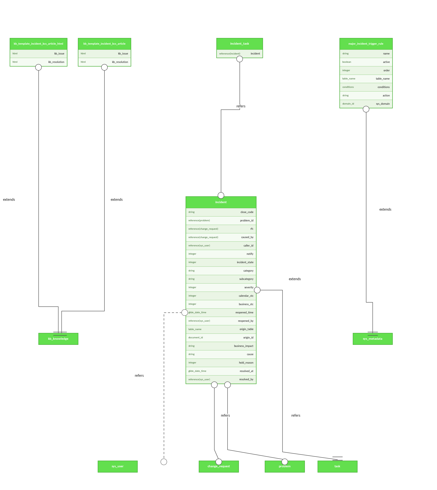
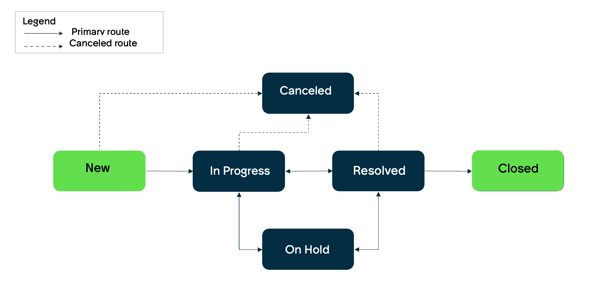
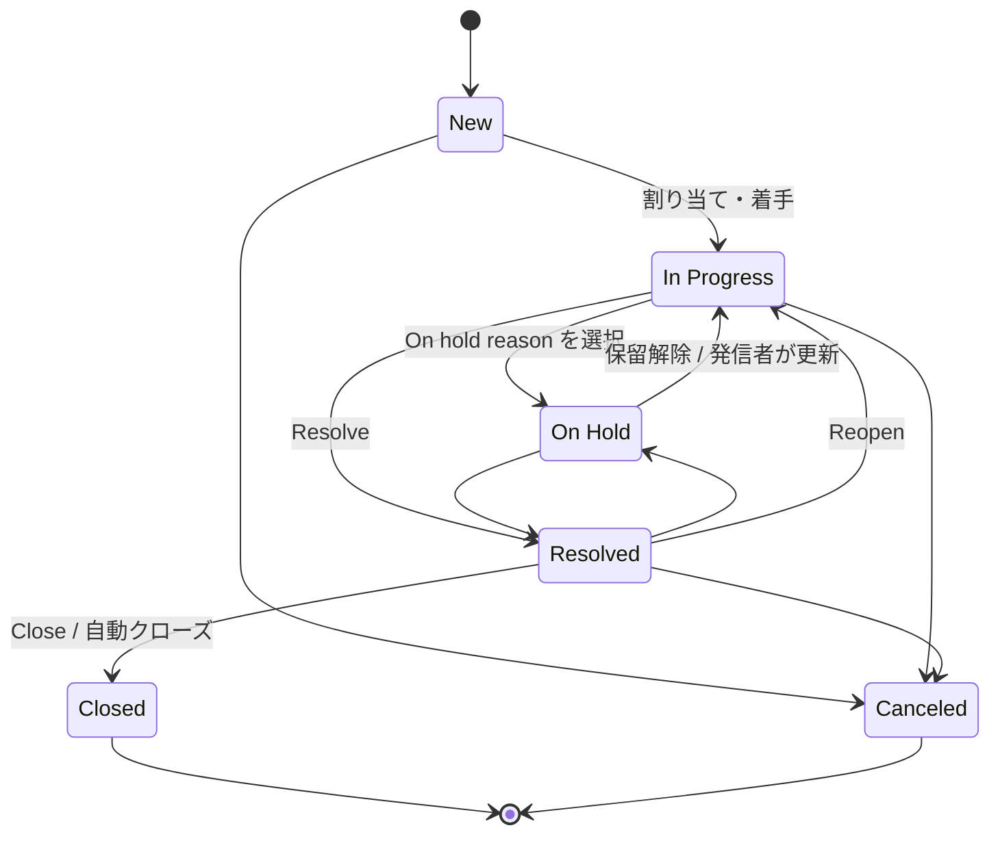
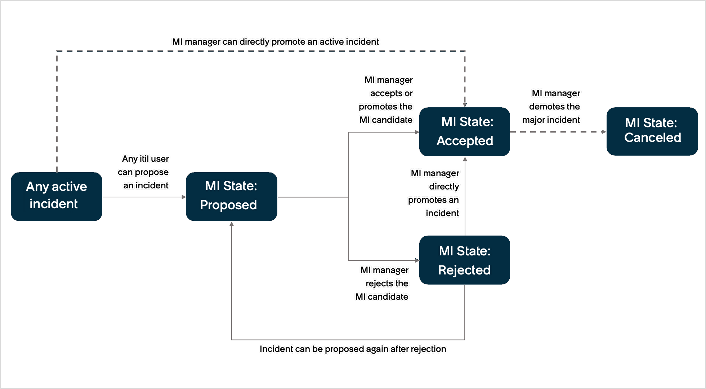
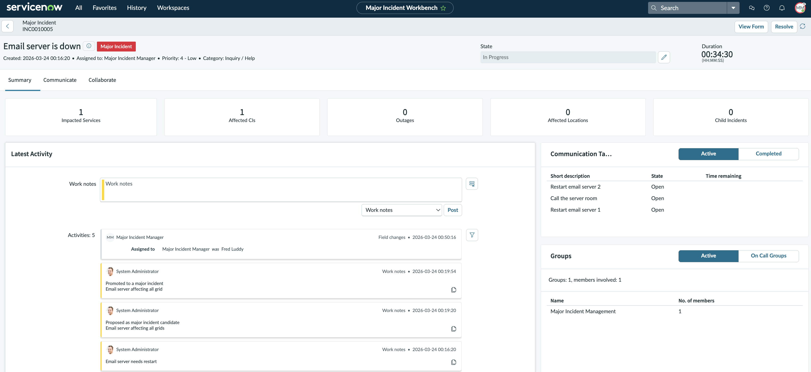

# Incident Management（インシデント管理）

## 概要

ServiceNow の **Incident Management（インシデント管理）** は、サービスの中断・品質低下（インシデント）を記録し、分類・優先度付け・割り当て・調査・解決・クローズまでのライフサイクルを管理する ITSM のコアアプリケーションである。ServiceNow 公式ドキュメントは、Incident Management の目的を「通常のサービス運用を可能な限り迅速に回復し、ビジネスへの影響を最小限に抑え、品質を維持すること」と説明している。[出典](https://www.servicenow.com/docs/r/australia/it-service-management/incident-management/domain-separation-incident-management.html)

本ファイルは Australia リリース（2026-05 GA）を基準に、以下を扱う。

| 節 | 内容 |
|---|---|
| データモデル | `incident` テーブル、`incident_task` テーブル、関連テーブル |
| 主要フィールド | フォーム項目と列名、Category/Subcategory、Channel |
| State（状態）遷移 | 6 状態、On hold reason、親子・タスクとの同期 |
| Impact / Urgency / Priority | Priority Lookup Rules（優先度ルックアップルール） |
| Assignment（割り当て） | Assignment rules、Data lookup、CI/Service Offering ベースの自動設定、Predictive Intelligence |
| Resolution（解決）とクローズ | Resolution code、自動クローズ、Reopen（再オープン） |
| Major Incident Management | 候補（Candidate）、Trigger rules、Workbench、Post Incident Report |
| On-Call Scheduling | シフト・ロスター・エスカレーション、テーブル、ロール |
| ロール / プロパティ / プラグイン | `itil`、ITSM Roles、各種システムプロパティ |
| リリース差分 | Zurich・Australia の変更点、Brazil での変更 |

関連トピックは以下のファイルを参照する。

- ITSM 全体とパッケージ：[ITSM 概要とパッケージ](./itsm-overview.md)
- 問題管理への連携：[Problem Management](./problem-management.md)
- 変更管理への連携：[Change Management](./change-management.md)
- リクエストへの変換：[Request Management](./request-management.md)
- SLA の仕組み：[SLAとスケジュール](../platform/sla-schedules.md)、[ITSMにおけるサービスレベル管理](./service-level-management-itsm.md)
- ITSM Pro 機能（Predictive Intelligence、Now Assist 等）：[ITSM Pro/Enterprise 固有機能](./itsm-pro-features.md)、[Predictive Intelligence と AI Search](../platform/predictive-intelligence-ai-search.md)、[Now Assist と AI Agents](../platform/now-assist-ai-agents.md)
- Service Operations Workspace（SOW）：[Workspace と UI Builder](../platform/workspaces-ui-builder.md)
- Event Management からの自動起票：[Event Management と AIOps](../itom/event-management-aiops.md)
- 実務上の設計の勘所：[ITSMプロセス設計の実践知](../../04_応用編/11-itsm-process-design-tips.md)

---

## 1. データモデル

### 1.1 `incident` テーブルの位置づけ

`incident` テーブル（Incident）は `task` テーブル（Task）を拡張（extend）したテーブルであり、`task` のすべてのフィールド、ルール、ポリシーを継承する。Incident プラグイン（`com.snc.incident`）の有効化によりインストールされる。[出典](https://www.servicenow.com/docs/r/australia/it-service-management/incident-management/installed-with-incident.html)

`incident` テーブルと `incident_task` テーブル（Incident Task）はドメインセパレーションに対応しており、フルフィラー（Fulfiller）は自分が属する（テナント）ドメインで作成されたインシデント／インシデントタスクのみを参照できる。親ドメインに属する ITIL ユーザーは子ドメインのインシデントも参照できる。[出典](https://www.servicenow.com/docs/r/australia/it-service-management/incident-management/domain-separation-incident-management.html)（詳細は [ドメインセパレーション](../platform/domain-separation.md)）

### 1.2 データモデル図

- **キャプション:** Incident Management data model（Incident Management アプリケーションのテーブル関連図）
- **図の説明:** 中央に `incident` テーブルがあり、`task` テーブルを extends（拡張）している。`incident` の固有列として `close_code`（string）、`problem_id`（reference → `problem`）、`rfc`（reference → `change_request`）、`caused_by`（reference → `change_request`）、`caller_id`（reference → `sys_user`）、`notify`（integer）、`incident_state`（integer）、`category`（string）、`subcategory`（string）、`severity`（integer）、`calendar_stc`（integer）、`business_stc`（integer）、`reopened_time`（glide_date_time）、`reopened_by`（reference → `sys_user`）、`origin_table`（table_name）、`origin_id`（document_id）、`business_impact`（string）、`cause`（string）、`hold_reason`（integer）、`resolved_at`（glide_date_time）、`resolved_by`（reference → `sys_user`）が記載されている。上部には `incident_task`（`incident` 列で `incident` を参照）、`major_incident_trigger_rule`（`name`、`active`、`order`、`table_name`、`conditions`、`action`、`sys_domain` を持ち `sys_metadata` を拡張）、KCS 記事テンプレート `kb_template_incident_kcs_article` / `kb_template_incident_kcs_article_html`（`kb_issue`、`kb_resolution` を持ち `kb_knowledge` を拡張）が配置されている。
- **出典:** [Incident Management data model（ServiceNow Docs, Australia）](https://www.servicenow.com/docs/r/australia/it-service-management/incident-management/incident-mangmt-data-model.html)（取得日：2026-11-03）

### 1.3 主な関連テーブル

| テーブル名 | 表示名 | 役割 | 出典 |
|---|---|---|---|
| `task` | Task | `incident` の親テーブル | [出典](https://www.servicenow.com/docs/r/australia/it-service-management/incident-management/installed-with-incident.html) |
| `incident` | Incident | インシデント本体 | 同上 |
| `incident_task` | Incident Task | 他グループへの作業依頼用の子タスク | [出典](https://www.servicenow.com/docs/r/australia/it-service-management/incident-management/create-incident-task.html) |
| `major_incident_trigger_rule` | Major Incident Trigger Rule | 重大インシデント候補の自動判定ルール | [出典](https://www.servicenow.com/docs/r/australia/it-service-management/incident-management/incident-mangmt-data-model.html) |
| `kb_template_incident_kcs_article` 等 | KCS 記事テンプレート | インシデントからのナレッジ作成（KCS 連携） | 同上 |
| `problem` / `change_request` | Problem / Change Request | 関連する問題・変更（`problem_id`、`rfc`、`caused_by`） | 同上 |
| `cmn_rota` ほか | On-Call Scheduling 関連 | オンコール（[8章](#8-on-call-schedulingオンコール-スケジューリング)） | [出典](https://www.servicenow.com/docs/r/australia/it-service-management/on-call-scheduling/tables-oob-oncall.html) |
| `cmdb_ci_outage` | Outage | Task Outage 機能でのタスク―停止記録の対応付け | [出典](https://www.servicenow.com/docs/r/m4LmCVvkm6_8u3nlIuep5Q/qTbynCinnYsivpLIT1FFHw) |

### 1.4 CSDM との関係

CSDM（Common Service Data Model）に従う場合、Business application（ビジネスアプリケーション）は Incident Management で参照しない。アプリケーション関連のインシデントでは **Configuration item（構成アイテム）** フィールドに Application Service（アプリケーションサービス）を設定し、インフラ CI がサービスに影響する場合は **Impacted Services/CIs（影響を受けるサービス/CI）** 関連リストでアプリケーションサービスを特定する。[出典](https://www.servicenow.com/docs/r/australia/it-service-management/incident-management/itsm-incident-use-case-trouble.html)（詳細は [CMDB と CSDM](../platform/cmdb-csdm.md)）

---

## 2. `incident` テーブルの主要フィールド

### 2.1 Incident フォームの項目（公式記載）

Incident フォームは **All > Incident > Create New**（またはインシデント一覧の **New**）から開く。作成に必要なロールは `itil`、`sn_incident_write`、`admin` のいずれか。[出典](https://www.servicenow.com/docs/r/australia/it-service-management/incident-management/create-an-incident.html)

下表の「列名」は、公式データモデル図で確認できた列は ◎、`task` テーブル由来または一般に知られる列名は ○（【第三者情報】。正確な列名はインスタンスの System Dictionary で確認すること）とした。

| フォームラベル | 日本語訳 | 列名 | 説明・挙動 |
|---|---|---|---|
| Number | 番号 | `number` ○ | システム自動採番の一意な番号（既定プレフィックス INC は【第三者情報】） |
| Caller | 発信者 | `caller_id` ◎ | 問題を報告したユーザー。アラートや変更要求から作成されたインシデントでは任意 |
| Category / Subcategory | カテゴリ / サブカテゴリ | `category` ◎ / `subcategory` ◎ | 問題の種類。カテゴリ選択後にサブカテゴリを選ぶ（[2.2](#22-category--subcategory既定値)） |
| Service | サービス | `business_service` ○ | 影響を受けるビジネスサービス。依存関係ビュー（Dependency view）アイコンでサービスマップを表示 |
| Service Offering | サービスオファリング | `service_offering` ○ | サービスレベル・範囲・オプションを定義するオファリング |
| Configuration Item | 構成アイテム | `cmdb_ci` ○ | 影響を受ける CI。候補は CI 名のアルファベット順 |
| Channel | チャネル | `contact_type` ○ | 報告経路。選択肢：Chat、Email、Phone、Monitoring、Self-service、Virtual agent、Walk-in |
| Origin | 発生元 | `origin_table` ◎ / `origin_id` ◎ | 自動設定（手入力不可）。例：アラートから作成された場合は Alert |
| State | 状態 | `state` ○（旧 `incident_state` ◎） | ライフサイクル上の段階。進捗管理には Incident State や Problem State ではなく **State** を使う |
| Impact | 影響度 | `impact` ○ | ビジネスプロセスへの影響 |
| Urgency | 緊急度 | `urgency` ○ | 重大な影響が出るまで解決を待てる時間 |
| Priority | 優先度 | `priority` ○ | Impact と Urgency から決定（既定で読み取り専用） |
| Assignment Group | 割り当てグループ | `assignment_group` ○ | 作業するグループ（[5章](#5-assignment割り当て)） |
| Assigned To | 担当者 | `assigned_to` ○ | 作業するユーザー。Assignment Group を変更すると自動でクリアされる |
| Short Description | 件名 | `short_description` ○ | 概要 |
| Description | 説明 | `description` ○ | 詳細 |
| Attachments | 添付 | （`sys_attachment`） | スクリーンショットや PDF 等 |
| Watch List | ウォッチリスト | `watch_list` ○ | Additional comments 追加時に通知されるユーザー |
| Work Notes List | 作業メモリスト | `work_notes_list` ○ | Work notes 追加時に通知されるユーザー（管理者が通知を設定する必要あり） |
| Additional Comments | 追加コメント | `comments` ○ | インシデントを参照できる全ユーザーに見える（顧客向け） |
| Work Notes | 作業メモ | `work_notes` ○ | 解決手順・実施内容（内部向け） |
| Actions Taken | 実施アクション | ― | 重大インシデント向けの内部用ジャーナル。`com.snc.incident.mim` 有効時のみ表示 |
| Parent Incident | 親インシデント | `parent_incident` ○ | Related Records セクション |
| Problem | 問題 | `problem_id` ◎ | 関連する問題レコード |
| Change Request | 変更要求 | `rfc` ◎ | 関連する変更要求 |
| Caused by Change | 原因となった変更 | `caused_by` ◎ | インシデントを引き起こした変更要求 |

出典：[Create an incident（Australia）](https://www.servicenow.com/docs/r/australia/it-service-management/incident-management/create-an-incident.html)、[Incident Management data model](https://www.servicenow.com/docs/r/australia/it-service-management/incident-management/incident-mangmt-data-model.html)

補足：

- テンプレートを適用すると、テンプレートに含まれるフィールドは既存値が上書きされ、含まれないフィールドは変更されない。[出典](https://www.servicenow.com/docs/r/australia/it-service-management/incident-management/create-an-incident.html)
- 作成後はタイトルバーの More options メニューからレコードをメール送信でき、依頼者と担当者が自動的に宛先に追加される。[出典](https://www.servicenow.com/docs/r/australia/it-service-management/incident-management/create-an-incident.html)
- **Restrict（制限）**：機微情報を含むインシデントは **Restrict** を押して制限付きにでき、制限フィールドは非表示・閲覧専用になる。制限付きレコードにアクセスできるのは、割り当てグループに属し sensitive agent ロールを持つルーティングエージェントと、すべてのプライマリチケットエージェントである。[出典](https://www.servicenow.com/docs/r/australia/it-service-management/incident-management/restrict-incident-access.html)
- **Special Handling Notes（特別対応メモ）**：Special Handling Notes プラグイン（`com.sn_shn`）を有効化し、フォームレイアウトに「Special Handling Notes Pop Up」を追加すると、条件に合うレコードで注意書きをポップアップ表示できる。[出典](https://www.servicenow.com/docs/r/australia/it-service-management/incident-management/create-special-handling-notes.html)

### 2.2 Category / Subcategory（既定値）

`incident` テーブルの Category/Subcategory は、ベースシステムで以下が定義されている。管理者はカテゴリ／サブカテゴリを追加でき、Assignment rules や通知の条件に使える。[出典](https://www.servicenow.com/docs/r/australia/it-service-management/incident-management/r_CategorizingIncidents.html)

| Category | Subcategory |
|---|---|
| Inquiry / Help | Antivirus、Email、Internal Application |
| Software | Email、Operating System |
| Hardware | CPU、Disk、Keyboard、Memory、Monitor、Mouse |
| Network | DHCP、DNS、IP Address、VPN、Wireless |
| Database | DB2、MS SQL Server、Oracle |

> 公式ドキュメントは、インシデントが何度別チームに回されたか（たらい回し回数）が Incident Management の KPI の一つであり、正しい分類がルーティングとプロアクティブな Problem Management に役立つと説明している。[出典](https://www.servicenow.com/docs/r/australia/it-service-management/incident-management/r_CategorizingIncidents.html)

### 2.3 Major Incident 関連フィールド

インシデントが重大インシデントのライフサイクルに入ると、Incident フォームに **Major Incident** タブと **Post Incident Report** タブが表示される（参照ロール：`itil`、`sn_incident_read`、`admin`）。[出典](https://www.servicenow.com/docs/r/australia/it-service-management/incident-management/view-major-info.html)

| タブ | フィールド | 説明 |
|---|---|---|
| Major Incident | Major incident state（重大インシデント状態） | Proposed / Accepted / Rejected / Canceled（[7.3](#73-major-incident-state重大インシデント状態)） |
| Major Incident | Proposed by / Proposed | 候補として提案したユーザー / 日時 |
| Major Incident | Promoted by / Promoted | 重大インシデントに昇格させたユーザー / 日時 |
| Major Incident | Business impact（ビジネス影響） | 重大インシデントで特定されたビジネス影響（列名 `business_impact` ◎） |
| Major Incident | Probable cause（推定原因） | 推定原因（データモデル上の `cause` 列 ◎ に対応すると考えられる【推定】） |
| Post Incident Report | Overview / Findings / Timeline | PIR の概要、所見（原因・教訓）、タイムライン |

### 2.4 Reopen（再オープン）関連フィールド

| フィールド | 説明 |
|---|---|
| Reopen count（再オープン回数） | 再オープンされた回数 |
| Last reopened by（最終再オープン者） | 最後に再オープンしたユーザー（列名 `reopened_by` ◎） |
| Last reopened at（最終再オープン日時） | 最後に再オープンした日時（列名 `reopened_time` ◎） |

Last reopened by / Last reopened at は Kingston リリースで追加されたため、それ以前に再オープンされたインシデントでは Reopen count のみ値を持ち、2 項目は空になっている場合がある。[出典](https://www.servicenow.com/docs/r/australia/it-service-management/incident-management/reopening-incident.html)

### 2.5 Resolution Information（解決情報）フィールド

| フィールド | 日本語訳 | 列名 | 説明 |
|---|---|---|---|
| Resolved by | 解決者 | `resolved_by` ◎ | 解決したユーザー |
| Resolved | 解決日時 | `resolved_at` ◎ | 解決日時 |
| Resolution code | 解決コード | `close_code` ◎ | 解決の分類（[6.3](#63-resolution-code解決コードの選択肢)の選択肢参照） |
| Resolution notes | 解決メモ | `close_notes` ○ | 解決方法の記録 |

出典：[Resolve and close an incident（Australia）](https://www.servicenow.com/docs/r/australia/it-service-management/incident-management/resolve-and-close-an-incident.html)

---

## 3. State（状態）遷移

### 3.1 State 一覧

`incident` テーブルの State（状態）は以下の 6 つで構成される。[出典](https://www.servicenow.com/docs/r/australia/it-service-management/incident-management/c_IncidentManagementStateModel.html)

| State | 日本語訳 | 意味 | 値（`state`） |
|---|---|---|---|
| New | 新規 | 記録されたが未調査 | 1 |
| In Progress | 対応中 | 割り当て済みで調査中 | 2 |
| On Hold | 保留 | 情報・証拠・解決策の提供のため、責任が一時的に別の主体へ移っている | 3 |
| Resolved | 解決済み | 再発しないよう満足な修正が提供された | 6 |
| Closed | クローズ | Resolved で一定期間経過し、満足に解決されたことが確認された | 7 |
| Canceled | キャンセル | トリアージの結果、重複・不要・インシデントではないと判明 | 8 |

- 「値」列は公式ドキュメントの状態モデル頁には記載がなく、ServiceNow Community で一般に参照される値である【第三者情報】。[出典](https://www.servicenow.com/community/servicenow-ai-platform-forum/incidentstate-canceled-and-incidentstate-closed-constants-both/m-p/1217875) 値の定義はスクリプトインクルード `IncidentStateSNC` / `IncidentState` に定数として保持されており、アップグレード済みインスタンスで定数値が不整合になった事例も報告されているため、インスタンスの `sys_choice`（`incident.state`）で確認すること【第三者情報】。
- 公式ドキュメントは、`incident_state` が 7（Closed）未満かつ Active が false の場合に Active を true に戻すビジネスルールの存在に触れ、状態の選択肢値を変更するとこの種のロジックが期待通り動かなくなる可能性があると注意している。[出典](https://www.servicenow.com/docs/bundle/zurich-platform-administration/page/administer/field-administration/concept/c_IntValsForDfltChoiceList.html)
- この 6 状態モデルは Incident Management - Core プラグイン（`com.snc.incident_management`）が提供する「新しい状態モデル」である。新規インスタンスでは既定で利用可能で、Geneva 以前からのアップグレード顧客はプラグインを申請する必要がある。旧状態モデルからの移行時は、カスタマイズ・ワークフロー・スクリプトインクルード・ビジネスルールが参照する旧状態値を新状態にマッピングする必要がある。[出典](https://www.servicenow.com/docs/r/australia/it-service-management/incident-management/activate-incident-management-core-plugin.html)

### 3.2 状態遷移図

- **キャプション:** Incident management state model flow（インシデント管理の状態モデルフロー）
- **図の説明:** 凡例は実線が Primary route（主経路）、破線が Canceled route（キャンセル経路）。主経路は New → In Progress → Resolved → Closed。In Progress と Resolved は双方向（Resolved から In Progress へ戻る＝再オープン）。On Hold は In Progress と双方向、Resolved とも双方向の矢印で結ばれている。New、In Progress、Resolved からは破線で Canceled へ遷移できる。New と Closed が緑色（開始・終了）、それ以外は濃紺で表示されている。
- **出典:** [Life cycle of an Incident（ServiceNow Docs, Australia）](https://www.servicenow.com/docs/r/australia/it-service-management/incident-management/c_IncidentManagementStateModel.html)（取得日：2026-11-03）

同じ遷移を Mermaid で表すと次のとおり（公式図の読み取り）。

> 状態遷移の制御（どの状態からどの状態へ遷移可能か）をカスタマイズする場合、Community では State Model（`sys_state_model` 等）や UI ポリシー／クライアントスクリプトで制御する例が紹介されている【第三者情報】。[出典](https://www.servicenow.com/community/developer-forum/what-is-the-ootb-solution-for-controlling-incident-state/td-p/3367535)

### 3.3 On Hold と On hold reason

State を **On Hold** にすると **On hold reason（保留理由、列名 `hold_reason` ◎）** が表示される。Australia の選択肢は次の 4 つ。[出典](https://www.servicenow.com/docs/r/australia/it-service-management/incident-management/c_IncidentManagementStateModel.html)

| On hold reason | 日本語訳 | 補足 |
|---|---|---|
| Awaiting Caller | 発信者待ち | **Additional comments が必須**になる |
| Awaiting Change | 変更待ち | |
| Awaiting Problem | 問題待ち | |
| Awaiting vendor | ベンダー待ち | |

- 発信者（Caller）がインシデントを更新すると、On hold reason がクリアされ State が **In Progress** に変わり、Assigned to のユーザーと Watch list のユーザーにメール通知が送られる。[出典](https://www.servicenow.com/docs/r/australia/it-service-management/incident-management/c_IncidentManagementStateModel.html)
- インシデントはクローズまでに複数回 On Hold にできる。[出典](https://www.servicenow.com/docs/r/australia/it-service-management/incident-management/c_IncidentManagementStateModel.html)

> **Brazil での変更:** On Hold（理由が `Awaiting Caller Information`）のインシデントについて、発信者へ回答依頼通知を繰り返し送り、全試行で応答がなければ Resolution code「**Resolved - No response from caller**」で自動解決する機能（Auto resolve On-hold incident）が追加された（zboot＝新規プロビジョニングのインスタンスのみ）。プロパティは `com.snc.incident.strike.count`（試行回数、既定 3、0 で無効）と `com.snc.incident.strike.wait_period`（試行間隔の営業日数、既定 1）。発信者が返信・コメントすると In Progress に戻る。[出典](https://www.servicenow.com/docs/r/release-notes/incident-management-rn.html)、[出典](https://www.servicenow.com/docs/r/it-service-management/incident-management/resolve-and-close-an-incident.html)（Brazil の保留理由ラベルは「Awaiting Caller Information」と記載されており、Australia の「Awaiting Caller」から表記が変わっている可能性がある。公開情報では変更の有無を確認できず）

### 3.4 親子インシデントの状態同期

親インシデント（Parent Incident）と子インシデント（Child Incident）は、親の状態に応じて子の状態が同期する。[出典](https://www.servicenow.com/docs/r/australia/it-service-management/incident-management/parent-child-state-sync.html)

| 親の State | 親の On hold reason | 子の State | 子の On hold reason |
|---|---|---|---|
| In Progress | ― | In Progress | ― |
| On Hold | Awaiting Change / Awaiting Problem / Awaiting Vendor | 親と同じ | 親と同じ |
| On Hold | Awaiting caller | 更新されない | 更新されない |
| Resolved | ― | Resolved（親の Resolution notes が子のアクティビティログにコピーされる） | ― |
| Closed | ― | **クローズされない**（子は発信者または自動クローズで閉じる） | ― |
| Canceled | ― | NA（公式の表の表記のまま） | NA |

- 公式の表では、親が Canceled の行は子の State と On hold reason がどちらも「NA」になっている。「更新されない」とも「伝播する」とも書かれていない。そのため、親をキャンセルしたときに子がどうなるかは、公開情報では確認できず。[出典](https://www.servicenow.com/docs/r/australia/it-service-management/incident-management/parent-child-state-sync.html)
- 上表は標準ライフサイクルのみに適用され、親が重大インシデントとして Proposed / Accepted の場合、子の状態は自動では変わらない（ただし重大インシデントを解決すると関連する子インシデントもすべて解決される。[7.1](#71-定義とプロセス) 参照）。[出典](https://www.servicenow.com/docs/r/australia/it-service-management/incident-management/parent-child-state-sync.html)、[出典](https://www.servicenow.com/docs/r/australia/it-service-management/incident-management/major-incident-management-process.html)
- ITIL ユーザーが親を再オープンすると、親と子の両方が In Progress で再オープンされる。ESS ユーザー（ロールなし）が親を再オープンした場合、親のみ In Progress になり子は再オープンされない。[出典](https://www.servicenow.com/docs/r/australia/it-service-management/incident-management/parent-child-state-sync.html)

### 3.5 Incident Task（インシデントタスク）との同期

`incident_task` は、当初の割り当てグループ以外のグループと連携・作業依頼するために使う。インシデントの **Incident Tasks** 関連リストの New、またはフォームヘッダーのコンテキストメニュー **Create Incident Task** から作成する（ロール：`itil`、`sn_incident_write`、`admin`）。[出典](https://www.servicenow.com/docs/r/australia/it-service-management/incident-management/create-incident-task.html)

- `incident_task` の主な項目：Number、Incident、Configuration item、State、Priority、Assignment group（空欄なら自動割り当て）、Assigned to（グループ変更でクリア）、Short description、Description、Work notes list、Work notes。[出典](https://www.servicenow.com/docs/r/australia/it-service-management/incident-management/create-incident-task.html)
- クローズ済みの `incident_task` はフォーム項目を編集できない（Zurich で変更）。[出典](https://www.servicenow.com/docs/r/m4LmCVvkm6_8u3nlIuep5Q/qTbynCinnYsivpLIT1FFHw)
- プロパティ `com.snc.incident.incident_task.closure` が有効な場合、インシデントが **Closed** になると未完了タスクは **Closed Incomplete**、**Canceled** になると **Closed Skipped** に設定される。[出典](https://www.servicenow.com/docs/r/australia/it-service-management/incident-management/inci-inci-task-state-sync.html)
- 割り当てられたエージェントにタスク単位の読み書き権限を与えるロール `sn_incident_task_assigned_user`（Incident task assigned user）が Incident プラグインとともにインストールされる。ITSM Roles プラグイン（`com.snc.itsm.roles`）が無い場合、Work notes / Work notes list の参照、および Assigned to、Short description、Description、Priority、State、Work notes、Work notes list の更新ができないという制限がある。[出典](https://www.servicenow.com/docs/r/australia/it-service-management/incident-management/installed-with-incident.html)

---

## 4. Impact / Urgency / Priority マトリクス

### 4.1 定義

| 項目 | 日本語訳 | 定義（公式） |
|---|---|---|
| Impact | 影響度 | インシデント・問題・変更がビジネスプロセスに与える影響の大きさ |
| Urgency | 緊急度 | 重大なビジネス影響が出るまでに解決をどれだけ遅らせられるか |
| Priority | 優先度 | Impact と Urgency に基づき、サービスデスクがどれだけ早く対応すべきかを示す |

出典：[Define priority lookup rules（Australia）](https://www.servicenow.com/docs/r/australia/it-service-management/incident-management/def-prio-lookup-rules.html)

### 4.2 Priority Lookup Rules（優先度ルックアップルール）

`incident` の Priority は **Data Lookup（データルックアップ）** によって Impact × Urgency から自動計算される。既定では Priority フィールドは読み取り専用で、Impact と Urgency を選択することで設定される。[出典](https://www.servicenow.com/docs/r/australia/it-service-management/incident-management/def-prio-lookup-rules.html)

- **メニュー:** All > System Policy > Rules > Priority Lookup Rules
- **必要ロール:** `data_lookup_admin` または `admin`（個々の対応者はルールを変更できない）
- **フォーム項目:** Impact、Urgency、Priority、Application（適用スコープ）、Active、Order（小さい値から評価）
- **計算方法の変更:** ルールを変更するか、UI ポリシー「**Priority is managed by Data Lookup - set as read-only**」を無効化して独自ロジックを作成する。

Australia 公式ドキュメントに記載されたサンプルのマトリクスは以下のとおり。[出典](https://www.servicenow.com/docs/r/australia/it-service-management/incident-management/def-prio-lookup-rules.html)

| Impact ＼ Urgency | 1 - High | 2 - Medium | 3 - Low |
|---|---|---|---|
| **1 - High** | 1 - Critical | 2 - High | 3 - Moderate |
| **2 - Medium** | 2 - High | 3 - Moderate | 4 - Low |
| **3 - Low** | 3 - Moderate | 4 - Low | 4 - Low |

> 注意：ServiceNow Community の ITSM ブログ「Managing incident priority」によると、ベースシステムの優先度ルックアップ表では Impact 3 - Low × Urgency 3 - Low が **5 - Planning** になる。[出典](https://www.servicenow.com/community/itsm-blog/managing-incident-priority/ba-p/2294101) 一方、Australia 版ドキュメントのサンプル表は 3×3 を「4 - Low」としている。実際の値は、インスタンスの Priority Lookup Rules で確認すること。Community の回答によると、このルールは `dl_u_priority` テーブル（リストの URL は `dl_u_priority_list.do`）に格納されている【第三者情報】。[出典](https://www.servicenow.com/community/incident-management-forum/unable-to-find-newly-added-impact-and-urgency-choices-under/m-p/3415628)

Priority は SLA 定義の開始条件等で使われることが多い（SLA の仕組みは [SLAとスケジュール](../platform/sla-schedules.md) を参照）。公式ドキュメントも Priority lookup rules を「インシデントの優先度と、優先度ごとの SLA を決める組み合わせ」と説明している。[出典](https://www.servicenow.com/docs/r/australia/it-service-management/incident-management/def-prio-lookup-rules.html)

---

## 5. Assignment（割り当て）

### 5.1 割り当ての仕組み一覧

| 仕組み | 概要 | 設定場所 / ロール | 出典 |
|---|---|---|---|
| Assignment rules（割り当てルール） | 条件に合うインシデントを指定グループ/ユーザーに割り当て | All > System Policy > Rules > Assignment（`assignment_rule_admin` または `admin`） | [出典](https://www.servicenow.com/docs/r/australia/it-service-management/incident-management/t_DefinAnAssignRuleIncidents.html) |
| Assignment data lookup rules（割り当てデータルックアップ） | Matcher（照合）フィールドと Setter（設定）フィールドで割り当て値を決定。最低 1 つの matcher と 1 つの setter が必要 | Assignment Lookup Rules | [出典](https://www.servicenow.com/docs/r/UrSRFFKWBbfQBgoRlt~ltw/3GrOAbST0_GFZyR0O~5Pew) |
| CI / Service Offering ベースの自動設定 | ビジネスルール「**Populate Assignment Group based on CI/SO**」が、Assignment group と Assigned to が空のときに CI またはサービスオファリングのサポートグループ等から設定 | プロパティで参照フィールドを変更可 | [出典](https://www.servicenow.com/docs/r/australia/it-service-management/incident-management/create-an-incident.html) |
| Predictive Intelligence | Short description から Assignment group を予測（Incident Assignment ソリューション） | ITSM Pro 機能 | [出典](https://www.servicenow.com/docs/r/australia/it-service-management/predictive-intelligence-for-incident.html) |
| On-Call Scheduling | 現在オンコールのメンバーへ割り当て・エスカレーション | [8章](#8-on-call-schedulingオンコール-スケジューリング) | [出典](https://www.servicenow.com/docs/r/australia/it-service-management/on-call-scheduling/c_OnCallScheduling.html) |
| Major Incident の自動割り当て | Major Incident Management Group プロパティに基づく | [7.7](#77-重大インシデントの割り当て) | [出典](https://www.servicenow.com/docs/r/australia/it-service-management/incident-management/major-incident-assignment.html) |

### 5.2 CI / Service Offering からの割り当てグループ設定

ビジネスルール「Populate Assignment Group based on CI/SO」は、インシデントの作成・更新時に Assignment group と Assigned to が空の場合に動作する。参照元フィールドは次のプロパティで変更でき、この順で優先される。[出典](https://www.servicenow.com/docs/r/australia/it-service-management/incident-management/create-an-incident.html)

| プロパティ | 意味 |
|---|---|
| `com.snc.incident.ci_assignment_group.field_name` | CI 側で割り当てグループとして使うフィールド名（優先） |
| `com.snc.incident.service_offering_assignment_group.field_name` | サービスオファリング側で割り当てグループとして使うフィールド名 |

制約：`itil` ロールのユーザーは、`admin` または `security_admin` ロールを持つグループ（および親グループがこれらのロールを持つグループ）にインシデントを割り当てられない。[出典](https://www.servicenow.com/docs/r/australia/it-service-management/incident-management/create-an-incident.html)

### 5.3 Assignment rules と Data lookup の併用

Data lookup rules と Assignment rules は同時に定義できる。インシデントが一度割り当てられた後の重複ルールは、データルックアップ定義で既存値の置換オプションを使っていない限り無視される。[出典](https://www.servicenow.com/docs/r/platform-administration/table-administration-and-data-management/c_DataLookupRules.html)

> 実行順序について、Community では「before エンジン（Assignment rules を含む）→ after エンジン（Data lookup を含む）、間にビジネスルールが order 順で挟まる」と説明されることがあるが、公式の優先順位表で確認すること【第三者情報】。[出典](https://blog.certifhub.com/?p=908122)

### 5.4 Predictive Intelligence による予測

Predictive Intelligence for Incident Management（Australia）が提供するソリューション定義は次のとおり（詳細は [Predictive Intelligence と AI Search](../platform/predictive-intelligence-ai-search.md)）。[出典](https://www.servicenow.com/docs/r/australia/it-service-management/predictive-intelligence-for-incident.html)

| ソリューション定義 | 種類 | 予測・推奨内容 |
|---|---|---|
| Incident Assignment | Classification | Short description → Assignment group |
| Incident Categorization | Classification | Short description → Category |
| Incident Service | Classification | Short description → Service |
| Incident Configuration Item | Classification | Short description → Configuration item |
| Major Incident Detection | Similarity | 類似のアクティブな重大インシデントの推奨、重大インシデントの提案 |
| Similar Incidents (Major Incident Workbench) | Similarity | まだ子になっていない類似インシデントの推奨 |
| Similar Incidents / Similar Open Incidents / Similar Closed Incidents / Similar Resolved Incidents | Similarity | 類似インシデントの推奨 |

- 必要プラグイン：分類系は `com.glide.platform_ml` と `com.snc.incident.ml_solution`。MIM 系は `com.snc.incident.mim.ml_solution` と `com.glide.platform_ml` または `com.snc.contextual_search_ml`。[出典](https://www.servicenow.com/docs/r/australia/it-service-management/predictive-intelligence-for-incident.html)
- ビジネスルール **Update Prediction Results**（Incident テーブル）は、インシデントのクローズ時にソリューションの Precision（適合率）と Coverage（カバレッジ）統計を更新する（Incident Assignment / Incident Categorization のみ）。[出典](https://www.servicenow.com/docs/r/australia/it-service-management/predictive-intelligence-for-incident.html)

### 5.5 Service Operations Workspace の Experts on-call

Service Operations Workspace（SOW）のインシデントレコードでは、コンテキストサイドパネルの **Experts on-call（オンコール担当者）** パネルが、以下の順でサポートグループのオンコール情報を推奨表示する（ロール：`itil`、`admin`、`sn_incident_read`、`sn_change_read`）。[出典](https://www.servicenow.com/docs/r/australia/it-service-management/service-operations-workspace/on-call-sow.html)

1. 主サービス（Service フィールド）のサポートグループ
2. Impacted Services/CIs 関連リストの上位サービスのサポートグループ
3. 主 CI（Configuration item フィールド）のサポートグループ
4. Affected CIs 関連リストの上位 CI のサポートグループ
5. エージェントの Assignment group

エスカレーション追跡ページを表示するには、プロパティ `com.snc.on_call_rotation.log_escalations` を有効にする必要がある。Microsoft Teams チャットでオンコールメンバーに連絡することもできる。[出典](https://www.servicenow.com/docs/r/australia/it-service-management/service-operations-workspace/on-call-sow.html)

---

## 6. Resolution（解決）とクローズ

### 6.1 解決の考え方

インシデントは、ユーザーに一時的な回避策（Workaround）または恒久的な解決策が提供された時点で「解決」とみなされる。解決されるとエスカレーションが停止し、発信者が解決内容を確認できる。発信者が満足すれば発信者がクローズするか、自動クローズのプロパティに従って一定期間後に自動クローズされる。原因は判明したが修正できない場合は、インシデントから Problem を作成し、IT サービスの変更が必要な場合は Change を作成する。クローズ時に顧客満足度調査（Survey）を生成することもできる。[出典](https://www.servicenow.com/docs/r/australia/it-service-management/incident-management/c_IncidentResolutionAndRecovery.html)

### 6.2 Resolve と Close の手順・ロール

| 操作 | 必要ロール（公式記載） | 手順 |
|---|---|---|
| Resolve（解決） | `itil`、`list_updater`、`sn_incident_write`、`admin` | All > Incident > Open → Resolution Information を入力 → **Resolve** |
| Close（クローズ） | `itil_admin` または `admin` | Resolved のインシデントで **Close Incident** |

出典：[Resolve and close an incident（Australia）](https://www.servicenow.com/docs/r/australia/it-service-management/incident-management/resolve-and-close-an-incident.html)

- Closed / Canceled 後も、`admin` ロールがあれば Subcategory、Service、Service Offerings、Description、Contact type、Watch list、Work notes list、Parent Incident、Problem、Change Request、Caused by Change、Resolved by、Resolved、Reassignment count を編集できる。[出典](https://www.servicenow.com/docs/r/australia/it-service-management/incident-management/resolve-and-close-an-incident.html)
- 同じ Resolution code を持つ複数インシデントは一覧から一括クローズでき、一括クローズ用 UI アクションを作成することもできる。[出典](https://www.servicenow.com/docs/r/australia/it-service-management/incident-management/c_IncidentResolutionAndRecovery.html)

### 6.3 Resolution code（解決コード）の選択肢

Australia の公式ドキュメント（SOW での重大インシデントの解決）に記載された Resolution code の選択肢は以下。[出典](https://www.servicenow.com/docs/r/australia/it-service-management/service-operations-workspace/resolve-close-mim-sow.html)

| Resolution code | 日本語訳（参考） |
|---|---|
| Duplicate | 重複 |
| Known error | 既知のエラー |
| No resolution provided | 解決策なし |
| Resolved by caller | 発信者により解決 |
| Resolved by change | 変更により解決 |
| Resolved by problem | 問題により解決 |
| Resolved by request | リクエストにより解決 |
| Solution provided | 解決策を提供 |
| Workaround provided | 回避策を提供 |

- 上記は重大インシデントの解決画面の記載であり、通常インシデントの `close_code` も同じ選択肢リストを使うのが一般的である【第三者情報】（Community でも同様の値が例示されている。[出典](https://www.servicenow.com/community/developer-forum/closing-out-an-issue-using-the-table-rest-api/m-p/2547693)）。REST API で `close_code` を設定する場合は選択肢の値を指定する必要がある【第三者情報】。
- Resolution code と Resolution notes は Resolve 時に必須となるのが一般的である（データポリシーによる）【第三者情報】。[出典](https://www.servicenow.com/community/virtual-agent-forum/data-policy-exception-the-following-fields-are-mandatory/m-p/3440056)

> **Brazil での変更:** 自動解決用に Resolution code「**Resolved - No response from caller**」が使われる（[3.3](#33-on-hold-と-on-hold-reason) 参照）。[出典](https://www.servicenow.com/docs/r/release-notes/incident-management-rn.html)

### 6.4 自動クローズ（Auto close）

Resolved のインシデントは、スケジュールジョブ **Autoclose Incidents**（System Scheduler > Scheduled Jobs > Scheduled Jobs）がビジネスルール **Incident Autoclose** を実行することで自動クローズされる。[出典](https://www.servicenow.com/docs/r/australia/it-service-management/incident-management/configure-incident-auto-close.html)

| 設定 | 内容 |
|---|---|
| メニュー | Incident > Administration > Incident Properties（ロール：`admin`） |
| `glide.ui.autoclose.time` | Resolved のインシデントを自動クローズするまでの日数（整数）。**0 で無効** |
| `com.snc.incident.autoclose.basedon.resolved_at` | true：Resolution date（解決日）基準、false（UI 上は No）：Updated（最終更新日）基準。London 以降の新規顧客は true、それ以前からの既存顧客は手動で true にする必要がある |
| 実行ユーザー | 既定ではジョブ実行時にログインしている管理者の名前が Updated by に入る。ジョブの Job context に `fcRunAs=<user_name>` と `fcScriptName=incident autoclose` を追加すると変更できる |

出典：[Configure incidents to close automatically](https://www.servicenow.com/docs/r/australia/it-service-management/incident-management/configure-incident-auto-close.html)、[Configure default user for auto-closing incidents](https://www.servicenow.com/docs/r/australia/it-service-management/incident-management/change-default-user.html)

注意点：

- インシデントに Inactivity Monitor（非アクティブ監視）があると、トリガーのたびに自動クローズのクロックがリセットされクローズされない。回避するには Inactivity Monitor の Reset Condition を `[Incident state] [is not] [Resolved]` に設定する。[出典](https://www.servicenow.com/docs/r/australia/it-service-management/incident-management/configure-incident-auto-close.html)
- **重大インシデント（Accepted）は自動クローズされない。** `major_incident_manager` または `admin` が解決を確認したうえで手動でクローズする。[出典](https://www.servicenow.com/docs/r/australia/it-service-management/incident-management/close-major-incident.html)

> **Brazil での変更:** Resolved インシデントの自動クローズ期間が暦日（calendar days）ではなく**営業日（business days）**で計算されるように変更された（プロパティは `glide.ui.autoclose.time` のまま、0 で無効）。[出典](https://www.servicenow.com/docs/r/release-notes/incident-management-rn.html)

### 6.5 Reopen（再オープン）

Resolved のインシデントは、解決通知メールの **Reopen incident** リンク、または Incident フォーム／ポータル（Service Portal、Employee Center 等）の **Reopen** で再オープンでき、State は Resolved → **In Progress** に変わる。[出典](https://www.servicenow.com/docs/r/australia/it-service-management/incident-management/reopening-incident.html)

| 条件 | 内容 |
|---|---|
| 再オープンできる人 | インシデント書き込み権限を持つエージェント（`sn_incident_write`）、Caller（発信者）、Opened by（起票者） |
| エージェントの範囲 | フォームでは他エージェント担当分も再オープン可。ポータルでは自分の担当、または自分が Caller / 起票者のもののみ |
| ESS ユーザー | Caller であればフォームで Reopen 可能。ただし**重大インシデントの解決・再オープン・クローズは不可** |
| Closed のインシデント | 再オープン不可。解決通知メールに件名「Please reopen」で返信すると**新規インシデント**が作成され、`com.snc.incident.clone_fields_on_reopen` に列挙したフィールドがコピーされる |

出典：[Reopening an incident（Australia）](https://www.servicenow.com/docs/r/australia/it-service-management/incident-management/reopening-incident.html)

### 6.6 Problem / Change / Request / Knowledge との連携

| 操作 | 概要 | 出典 |
|---|---|---|
| Create a record from incident | インシデントから Problem / Change 等を作成（関連付け） | [出典](https://www.servicenow.com/docs/r/australia/it-service-management/incident-management/t_PromoteAnIncident.html) |
| Create a request from an incident | インシデントからリクエストを作成 | [出典](https://www.servicenow.com/docs/r/australia/it-service-management/incident-management/create-request-from-incident.html) |
| Create a knowledge article | インシデントからナレッジ記事を作成（KCS Integration `com.snc.incident.knowledge`） | [出典](https://www.servicenow.com/docs/r/australia/it-service-management/incident-management/create-knowledge-incident.html) |
| Problem の回避策共有 | 関連 Problem で回避策/修正が共有されると、インシデントのアクティビティに Work notes と Problem へのリンクを含むイベントが追加される（Zurich）。KE 記事が Problem に紐づくと、Problem と KE 記事へのリンクが追加される | [出典](https://www.servicenow.com/docs/r/m4LmCVvkm6_8u3nlIuep5Q/qTbynCinnYsivpLIT1FFHw) |
| `com.snc.incident.communicate_prb_workaround_to_inc_worknotes` | Problem の Share fix 時、顧客向け Additional comments ではなく内部向け Work notes に記録する | [出典](https://www.servicenow.com/docs/r/australia/it-service-management/incident-management/incident-management-properties.html) |

Problem・Change 側の仕様は [Problem Management](./problem-management.md)、[Change Management](./change-management.md)、[Request Management](./request-management.md) を参照。

---

## 7. Major Incident Management（重大インシデント管理）

本章は重大インシデント（Major Incident, MI）を扱う。

### 7.1 定義とプロセス

重大インシデントは「多数のユーザーに影響し、1 つ以上の重要サービスを奪う、最高影響度・最高緊急度のインシデント」であり、通常より短い時間軸・高い優先度で協調対応する。何を重大インシデントとするかは組織で定義・合意する必要がある。[出典](https://www.servicenow.com/docs/r/australia/it-service-management/incident-management/major-incident-management-process.html)

| フェーズ | 内容 |
|---|---|
| Identification（特定） | Trigger rules による自動特定、または既存インシデントを候補として提案。MI マネージャーが候補をレビューし対応を開始 |
| Communication and Collaboration（連絡と協働） | コミュニケーションプラン（誰に・どの手段・頻度・文面）を定義。種類・優先度・対象者別に複数定義可（例：P1 は P2 より高頻度） |
| Resolution（解決） | 合意した手順で解決。**重大インシデントを解決すると関連する子インシデントがすべて解決され、各発信者に通知される** |
| Post incident review（事後レビュー） | 解決後に分析し再発防止と対応プロセスを評価。解決時に Post Incident Report（PIR）が作成され、レビュー・更新後に関係者へ共有 |

プロセス要件として、インシデントマネージャー／重大インシデントチーム／管理グループの体制確保、関係者への情報提供、サービス回復後のレビュー、根本原因分析のための Problem 作成が挙げられている。[出典](https://www.servicenow.com/docs/r/australia/it-service-management/incident-management/major-incident-management-process.html)

### 7.2 プラグイン

| プラグイン | ID | 説明 |
|---|---|---|
| Incident Management - Major Incident Management | `com.snc.incident.mim` | MIM 本体。**新規・既存顧客とも手動で有効化が必要**（`admin`）。デモデータを含む |
| Incident Communications Management | `com.snc.iam` | MIM 有効化時に自動有効化。インシデントコミュニケーションプラン／タスク |
| Incident Updates | `com.snc.incident.updates` | MIM 有効化時に自動有効化 |
| Task-Outage Relationship | `com.snc.task_outage` | MIM 有効化時に自動有効化 |
| Notify | `com.snc.notify` | 音声通話・電話会議・SMS。Twilio Direct Driver と別途 Twilio 契約が必要 |
| On-Call Scheduling | `com.snc.on_call_rotation` | オンコールスケジュールとエスカレーション |

出典：[Activate Major Incident Management（Australia）](https://www.servicenow.com/docs/r/australia/it-service-management/incident-management/activate-major-incident-management-plugin.html)

- 有効化メニュー：All > System Applications > All Available Applications > All。ドメインセパレーションと委任管理が有効な場合、管理ユーザーはグローバルドメインにいる必要がある。[出典](https://www.servicenow.com/docs/r/australia/it-service-management/incident-management/activate-major-incident-management-plugin.html)
- 有効化前に、アプリケーションと関連 ServiceNow Store アプリのエンタイトルメント（権利）が有効であることを確認する。[出典](https://www.servicenow.com/docs/r/australia/it-service-management/incident-management/activate-major-incident-management-plugin.html)
- SOW で MIM を使う場合は「Major Incident Management（sn-sow-mim）」を Admin Center で有効化・設定する。[出典](https://www.servicenow.com/docs/r/australia/it-service-management/service-operations-workspace/incident-sow.html)
- MIM のアプリケーションスコープは `sn_major_inc_mgmt`（`sn_major_inc_mgmt.major_incident_management_group` などのプロパティ名の接頭辞より）【推定】。[出典](https://www.servicenow.com/docs/r/australia/it-service-management/incident-management/incident-management-properties.html)

> **Brazil での変更:** 新規プロビジョニング（zboot）インスタンスで、エンタイトルメントがある場合に Major Incident Management 等のアプリケーションを一括自動インストールするスケジュールジョブが追加された。[出典](https://www.servicenow.com/docs/r/release-notes/incident-management-rn.html)

### 7.3 Major incident state（重大インシデント状態）

重大インシデントの状態は、通常の `state` とは別の **Major incident state** フィールドで管理される。[出典](https://www.servicenow.com/docs/r/australia/it-service-management/incident-management/view-major-info.html)

| Major incident state | 意味 |
|---|---|
| Proposed（提案済み） | 候補が作成または提案された初期状態 |
| Accepted（承認済み） | MI マネージャーが直接作成した、または候補を昇格させた状態 |
| Rejected（却下） | MI マネージャーが候補を却下した |
| Canceled（キャンセル） | MI マネージャーが重大インシデントを降格（Demote）した |

- **キャプション:** Major Incident Management state flow（重大インシデント管理の状態フロー）
- **図の説明:** 左端の「Any active incident（任意のアクティブなインシデント）」から、「Any itil user can propose an incident（`itil` ユーザーは誰でも提案可能）」の矢印で「MI State: Proposed」へ。Proposed から「MI manager accepts or promotes the MI candidate」で「MI State: Accepted」へ、「MI manager rejects the MI candidate」で「MI State: Rejected」へ分岐。Rejected からは「MI manager directly promotes an incident」で Accepted へ、または「Incident can be proposed again after rejection（却下後に再提案可能）」で Proposed へ戻る。Accepted から破線「MI manager demotes the major incident」で「MI State: Canceled」へ。また上部の破線「MI manager can directly promote an active incident」は、アクティブなインシデントから直接 Accepted へ昇格できることを示す。
- **出典:** [Major Incident Management process（ServiceNow Docs, Australia）](https://www.servicenow.com/docs/r/australia/it-service-management/incident-management/major-incident-management-process.html)（取得日：2026-11-03）

### 7.4 候補（Candidate）の作成と昇格・却下・降格

| 操作 | 方法 | 必要ロール | 補足 |
|---|---|---|---|
| 候補の自動判定 | Major Incident Trigger Rules（[7.6](#76-major-incident-trigger-rules)） | （ルール作成は `incident_manager` / `admin`） | ベースシステムのトリガールールは**既定で無効** |
| 手動で提案 | Incident フォームのコンテキストメニュー **Propose Major Incident**。理由とビジネス影響の入力を求められる | `itil`、`sn_incident_write`、`admin` | Resolved / Closed / Canceled では表示されない |
| ナビゲーションから候補作成 | Incident > Major Incidents > **Create Major Incident Candidate** | 同上 | |
| 候補の承認（昇格） | Incident > Major Incidents > Candidates → 追加アクション **Promote to Major Incident**。Work notes とビジネス影響の入力を求められる | `major_incident_manager` | Major incident state が Proposed → Accepted。承認者に割り当て |
| 候補の却下 | 同 → **Reject Major Incident Candidate**。却下理由を入力 | `major_incident_manager` | `state` は変わらず Major incident state のみ Rejected。Assigned to に通知 |
| 直接昇格 | コンテキストメニュー **Promote to Major Incident** | `major_incident_manager` | Resolved / Closed / Canceled では表示されない |
| 直接作成 | Incident > Major Incidents > **Create Major Incident** | `major_incident_manager` | |
| 降格（Demote） | All > Major Incidents > Open → **Demote Major Incident**。理由を入力 | `major_incident_manager` | Major incident state が Canceled、`state` は変わらない |
| クローズ | All > Major Incidents > Open → **Close Incident** | `major_incident_manager` または `admin` | Resolved であることが前提。自動クローズ対象外 |

出典：[Create a major incident candidate](https://www.servicenow.com/docs/r/australia/it-service-management/incident-management/create-major-incident-candidate.html)、[Create a major incident](https://www.servicenow.com/docs/r/australia/it-service-management/incident-management/create-a-major-incident.html)、[Accept or reject a major incident candidate](https://www.servicenow.com/docs/r/australia/it-service-management/incident-management/accept-reject-major-incident-candidate.html)、[Demote a major incident](https://www.servicenow.com/docs/r/australia/it-service-management/incident-management/demote-major-incident.html)、[Close a major incident](https://www.servicenow.com/docs/r/australia/it-service-management/incident-management/close-major-incident.html)

補足：

- 重大インシデントを Proposed / Accepted の状態でキャンセル（`state` = Canceled）すると、Major incident state も Canceled になる。[出典](https://www.servicenow.com/docs/r/australia/it-service-management/incident-management/close-major-incident.html)
- UI16 のモジュールリンクを SOW にリダイレクトする機能が有効な場合、上記 UI16 メニューは SOW の同等ページに自動遷移する。[出典](https://www.servicenow.com/docs/r/australia/it-service-management/incident-management/accept-reject-major-incident-candidate.html)
- スクリプトで却下する場合、Community では `new sn_major_inc_mgmt.MajorIncidentTriggerRules().MAJOR_INCIDENT_STATE.REJECTED` 定数を使う例が示されている【第三者情報】。[出典](https://www.servicenow.com/community/api-insights-forum/rejecting-a-major-incident-candidate-via-api/m-p/3560648)

### 7.5 「新規作成」か「昇格」か（`major_incident_creation` プロパティ）

プロパティ **Create major incident from candidate**（`sn_major_inc_mgmt.com.snc.incident.mim.major_incident_creation`）により、候補から重大インシデントを作る方式が変わる。[出典](https://www.servicenow.com/docs/r/australia/it-service-management/incident-management/major-incident-trigger-rules.html)、[出典](https://www.servicenow.com/docs/r/australia/it-service-management/incident-management/create-a-major-incident.html)

| プロパティ値 | 手動昇格時の挙動 | Trigger rule「Propose」時 | Trigger rule「Promote」時 |
|---|---|---|---|
| Create new（新規作成） | 新しいインシデントが重大インシデントとして作成され、候補はその**子**になる | 候補として提案 → 承認後に新しい重大インシデントを作成し、元インシデントを子にする | 新しいインシデントを作成して重大インシデントに昇格、既存インシデントを子にする |
| Promote（昇格） | 候補インシデント自身が重大インシデントになる（新規作成なし） | 候補として提案 → 承認後に新しい重大インシデントを作成し、元インシデントを子にする（公式記載どおり） | 既存インシデント自身を重大インシデントに昇格 |

- 新規に作成された親の重大インシデントでは Caller と Company は任意になる。[出典](https://www.servicenow.com/docs/r/it-service-management/incident-management/major-incident-management.html)
- 「Promote」設定時の Propose の挙動は公式ドキュメントで Create new と同一の記述になっている（ドキュメント記載のまま転記。実機での確認を推奨）。

### 7.6 Major Incident Trigger Rules

- **メニュー:** All > Major Incidents > Administration > Major Incident Trigger Rules
- **必要ロール:** `incident_manager` または `admin`（SOW で設定する場合は `sn_mim_sow_admin` と `major_incident_manager` または `incident_manager`）
- **テーブル:** `major_incident_trigger_rule`

出典：[Create trigger rules for major incidents（Australia）](https://www.servicenow.com/docs/r/australia/it-service-management/incident-management/major-incident-trigger-rules.html)、[Configure major incident trigger rules（SOW）](https://www.servicenow.com/docs/r/QykF2iRSIs6VXztArCSo3w/ZokxRT80a_TgQxV6CxPrgA)

| フィールド | 説明 |
|---|---|
| Name | 一意な名前 |
| Table | ルールを実行するテーブル |
| Application | 適用スコープ |
| Execution Order | 小さい順に評価。**いずれかのルールの条件を満たした時点で候補とみなし、残りは評価しない** |
| Action to take | **Propose Major Incident**（候補として提案）／ **Promote Major Incident**（直接昇格） |
| Active | 有効化 |
| Conditions | 実行条件 |

評価タイミング：インシデントの作成・更新のたびに**非同期**で評価される。ただし、Parent Incident が空（子インシデントでない）、まだ Proposed / Accepted でない、Active であることが前提。[出典](https://www.servicenow.com/docs/r/australia/it-service-management/incident-management/major-incident-trigger-rules.html)

公式の例：ビジネスサービスの重要度が 1/2 なら Order 100、子インシデント数が 20 超なら Order 200、P1 なら Order 300。[出典](https://www.servicenow.com/docs/r/australia/it-service-management/incident-management/major-incident-trigger-rules.html)

> 「一定時間内に同種インシデントが N 件発生」のような時間窓を伴う条件は、トリガールールの単純条件では表現しにくく、Flow 等で補う例が Community で紹介されている（2019〜2020 年の投稿）【第三者情報】。[出典](https://www.servicenow.com/community/developer-forum/create-trigger-rules-for-major-incident/m-p/2011252)

### 7.7 重大インシデントの割り当て

重大インシデントは、提案時・昇格時にプロパティ **Major Incident Management Group**（`sn_major_inc_mgmt.major_incident_management_group`、グループの sys_id）の値に基づいてグループに自動割り当てされる。On-Call Scheduling（`com.snc.on_call_rotation`）が有効でシフトが定義されていれば、オンコールの個人にも割り当てられる。[出典](https://www.servicenow.com/docs/r/australia/it-service-management/incident-management/major-incident-assignment.html)

| 操作 | 条件 | Assignment group | Assigned to |
|---|---|---|---|
| 手動または Trigger rule で候補として提案 | グループが空 | プロパティのグループ | オンコール有効・シフト定義あり・対応可能者ありならオンコール担当者。オンコール無効なら空のまま |
| 同上 | グループが空でない | 変更なし | 変更なし |
| 手動で重大インシデントに昇格 | グループが空 | プロパティのグループ | 昇格させたユーザー |
| 同上 | グループが空でない | プロパティのグループに再割り当て（元グループのメンバーに通知） | 昇格させたユーザーで上書き（前任者に通知） |
| 重大インシデントを作成 | グループが空 | プロパティのグループ | 作成したユーザー |
| 同上 | グループが空でない | 変更なし | 変更なし |

インシデントコミュニケーションプラン（source が重大インシデント）／コミュニケーションタスクは、グループが空の場合に元のインシデント（タスクはプラン）から Assignment group / Assigned to をコピーする。[出典](https://www.servicenow.com/docs/r/australia/it-service-management/incident-management/major-incident-assignment.html)

### 7.8 Major Incident Workbench（重大インシデント ワークベンチ）

Major Incident Workbench は、MI マネージャー、コミュニケーションマネージャー、解決グループ向けのシングルペインビューで、重大インシデントまたは候補のフォームヘッダーの **View Workbench** から開く。[出典](https://www.servicenow.com/docs/r/australia/it-service-management/incident-management/major-incident-workbench.html)

- **キャプション:** Major incident workbench（Summary タブ表示中の重大インシデント ワークベンチ）
- **画面の説明:** 上部ヘッダーに「Major Incident Workbench」、レコード番号（例：INC0010005）、件名「Email server is down」と赤い「Major Incident」ラベル、作成日時・担当者・Priority・Category が表示される。右上に **View Form**（フォームに戻る）と **Resolve**（解決）ボタン、State（例：In Progress）と編集アイコン、Duration（インシデント作成からの経過時間タイマー。解決で停止）がある。タブは **Summary / Communicate / Collaborate**。Summary タブには Impacted Services、Affected CIs、Outages、Affected Locations、Child Incidents の件数カード、左側に Latest Activity（Work notes 入力欄と Post ボタン、アクティビティ一覧。例：「Proposed as major incident candidate」「Promoted to a major incident」の作業メモ）、右側に Communication Tasks（Active/Completed 切替、短い説明・状態・残り時間）と Groups（Active / On Call Groups 切替、グループ名とメンバー数）が並ぶ。
- **出典:** [Major incident workbench（ServiceNow Docs, Australia）](https://www.servicenow.com/docs/r/australia/it-service-management/incident-management/major-incident-workbench.html)（取得日：2026-11-03）

ワークベンチの主な仕様：

- 未解決なら **Resolve** ボタン、まだ Accepted でなければ昇格／却下の選択リストがヘッダーに表示される。[出典](https://www.servicenow.com/docs/r/australia/it-service-management/incident-management/major-incident-workbench.html)
- Groups ウィジェットは、インシデント、インシデントコミュニケーションプラン、インシデントタスクの Assignment group / Assigned to、およびアクティブな電話会議の参加者から集計される。[出典](https://www.servicenow.com/docs/r/australia/it-service-management/incident-management/major-incident-workbench.html)
- サイドバーのチャットはレコードフィードであり、書き込みはアクティビティストリームに表示される。[出典](https://www.servicenow.com/docs/r/australia/it-service-management/incident-management/major-incident-workbench.html)
- ワークベンチから類似インシデントの追加、コミュニケーションプランの追加、オンコールのエスカレーションパスの参照ができる。[出典](https://www.servicenow.com/docs/r/australia/it-service-management/incident-management/major-incident-workbench.html)

### 7.9 Post Incident Report（PIR：事後インシデントレポート）

Post Incident Report タブは、重大インシデントの原因・対応・所見を記録するためのもので、MI マネージャーは **Resolved 状態のときに**レポートを編集できる。[出典](https://www.servicenow.com/docs/r/australia/it-service-management/incident-management/mi-workbench-pir-tab.html)

| セクション | 内容 |
|---|---|
| Overview | インシデントの概要 |
| Findings | 原因と教訓 |
| Resolution | 解決手順。関連 Problem / Change を **Add** / **Manage** で追加・編集可能 |
| Timeline | インシデント、インシデントコミュニケーションプラン、コミュニケーションタスクのアクティビティ。**Regenerate Timeline** で最新化 |
| Related Improvement Records | Continual Improvement Management（`com.sn_cim`）有効時に表示 |

- **View Complete Report** で全情報を集約し、**Download Report PDF** で PDF 出力できる。カスタム UI ページを紐づける場合はプロパティ `sn_major_inc_mgmt.pir_export_pdf_ui_page` を使う。[出典](https://www.servicenow.com/docs/r/australia/it-service-management/incident-management/mi-workbench-pir-tab.html)、[出典](https://www.servicenow.com/docs/r/australia/it-service-management/incident-management/incident-management-properties.html)
- Incident フォームの Related Links：**Regenerate PIR Timeline**（Resolved かつ `major_incident_manager`）、**Preview PIR**（Resolved / Closed かつ `itil`）。[出典](https://www.servicenow.com/docs/r/australia/it-service-management/incident-management/mi-workbench-pir-tab.html)
- PDF の Incident Response Timeline における **Time to Identify** は、最初の関連アラート作成時刻またはインシデント作成時刻（早い方。アラートがない／Event Management 無効ならインシデント作成時刻）から、候補として初めて提案された時刻（直接作成の場合は昇格時刻）までの時間。[出典](https://www.servicenow.com/docs/r/australia/it-service-management/incident-management/mi-workbench-pir-tab.html)
- SOW の Post incident report タブは、MIM が Admin Center で有効・設定済みで、重大インシデントが Resolved の場合に、PIR の生成・設定・公開・エクスポートができる。[出典](https://www.servicenow.com/docs/r/australia/it-service-management/service-operations-workspace/incident-sow.html)
- Now Assist for ITSM の AI エージェントによる PIR 下書き生成（Generate post incident reviews agentic workflow）も提供されている（詳細は [Now Assist と AI Agents](../platform/now-assist-ai-agents.md)）。[出典](https://www.servicenow.com/docs/r/it-service-management/now-assist-for-it-service-management-itsm/now-assist-itsm-aiagents-mim-usecase.html)

> Workbench と SOW で同じ重大インシデントの PIR の表示内容（動的タイムラインの有無等）が異なるという報告が Community にある【第三者情報】。[出典](https://www.servicenow.com/community/incident-management-forum/why-does-the-post-incident-report-for-the-same-major-inc-is/td-p/3496734)

### 7.10 コミュニケーション（Task Communications Management / Incident Communications Management）

Task Communications Management を使い、所定の条件に基づいて重大インシデントに紐づくコミュニケーションプラン定義を作成しておくと、重大インシデント作成時にインシデントコミュニケーションプランとコミュニケーションタスクが生成される。[出典](https://www.servicenow.com/docs/r/it-service-management/incident-management/major-incident-management.html)

関連プロパティ（[9.3](#93-major-incident-management-プロパティ) も参照）：

- `com.snc.incident.incident_alert.closure`：インシデントのクローズ／キャンセル時に未完了のインシデントコミュニケーションプランをクローズ（既定 false、`com.snc.iam` 有効時のみ表示）
- `com.snc.iam.incident_alert_task.closure`：プランのクローズ／キャンセル時に未完了のコミュニケーションタスクをクローズ（既定 false）

出典：[Incident Management properties（Australia）](https://www.servicenow.com/docs/r/australia/it-service-management/incident-management/incident-management-properties.html)

---

## 8. On-Call Scheduling（オンコール スケジューリング）

### 8.1 概要

On-Call Scheduling アプリケーションは、サポートグループのうち担当可能なメンバーを特定する（例：インシデント割り当て時）。オンコールスケジュール、ロスターのローテーション、エスカレーションポリシーを設定し、グループへの通知をエスカレーションし、エスカレーションの現在の連絡先を判定する。[出典](https://www.servicenow.com/docs/r/australia/it-service-management/on-call-scheduling/c_OnCallScheduling.html)

- プラグイン：On-Call Scheduling（`com.snc.on_call_rotation`）。`admin` が有効化。**zBoot（新規）顧客では既定で有効**。有効化により Subscription-based notifications、Advanced Schedules support、NG shared components、ServiceNow common calendar、Fullcalendar library が有効になる。[出典](https://www.servicenow.com/docs/r/australia/it-service-management/on-call-scheduling/t_ActivateOnCallScheduling.html)
- 主なモジュール：On-Call Scheduling > On-Call Schedules、My Group Schedules、Administration > Trigger Rules。[出典](https://www.servicenow.com/docs/r/australia/it-service-management/on-call-scheduling/create-custom-esc-policy-oncall.html)
- ITSM Mobile Agent で、自分のシフト参照・休暇申請・グループのオンコール担当者参照・休暇承認・ギャップ管理ができる。[出典](https://www.servicenow.com/docs/r/australia/it-service-management/on-call-scheduling/mobile-experience-ocs.html)

### 8.2 用語

| 用語 | 日本語訳 | 説明 |
|---|---|---|
| Shift | シフト | オンコールスケジュールの単位（テーブル `cmn_rota`） |
| Roster | ロスター | シフトのメンバー、交代間隔、エスカレーション設定を保持（`cmn_rota_roster`） |
| On-call Member | オンコールメンバー | ロスターに参加するメンバー（`cmn_rota_member`） |
| Escalation policy | エスカレーションポリシー | ロスター／メンバーへの通知順序を定める |
| Escalation trigger rule | エスカレーショントリガールール | エスカレーション開始条件と実行アクション（`trigger_rule`） |
| Time off / Coverage | 休暇 / 代行 | 休暇申請と代行（カバレッジ）の設定 |

### 8.3 主要テーブル

On-Call Scheduling がインストールする主なテーブルは以下のとおり。`v_` で始まるテーブル（例：`v_alternate_rotation`）はレポート生成用の参照専用テーブルで、これらを使ってレポートを作成してはならない。[出典](https://www.servicenow.com/docs/r/australia/it-service-management/on-call-scheduling/tables-oob-oncall.html)

| テーブル名 | 表示名 | 説明 |
|---|---|---|
| `cmn_rota` | Shift | シフトのオンコールスケジュール |
| `cmn_rota_roster` | Roster | シフトのメンバー、間隔、エスカレーション設定 |
| `cmn_rota_member` | On-call Member | スケジュールとエスカレーションに参加するグループメンバー |
| `roster_schedule_span` | Roster Schedule Span | スケジュールスパン定義（グループ参照と On-call タイプを追加） |
| `trigger_rule` | Trigger Rule | `sysrule_assignment`（Assignment Rule）を拡張。エスカレーション開始条件とアクション |
| `trigger_rule_table_cfg` | Trigger Rule Table Configuration | `task` を拡張しないテーブルでトリガールールを有効化 |
| `cmn_rota_escalation` | Rotation Escalation | エスカレーション一覧 |
| `cmn_rota_contact_preference` | Shift Contact Preference | 既定／カスタムエスカレーションの連絡設定 |
| `on_call_communication_type` | On-Call Communication Type | 通信チャネルの種類 |
| `sys_on_call_group_template` / `sys_on_call_shift_template` | On-Call Group / Shift Template | グループ／シフトのテンプレート |
| `on_call_user_preference` / `on_call_user_contact_preference` | On-Call User (Contact) Preference | メンバーの設定・連絡設定 |
| `on_call_escalation` / `on_call_escalation_level` / `on_call_escalation_con_attempt` / `on_call_escalation_comm` | On-Call Escalation（Level / Contact Attempt / Notification） | エスカレーション追跡（レベル・連絡試行・通知と応答） |
| `on_call_escalation_response` | On-Call Escalation Response | ワークフローによる応答の追跡（消費後に削除） |
| `on_call_add_member` / `on_call_remove_member` / `on_call_swap_member` | On-Call Add / Remove / Move Member | ロスターのメンバー追加・削除・順序変更の記録 |
| `v_on_call` / `v_rotation` / `v_user_rotation` / `v_alternate_rotation` | 各種ビュー | 通知履歴・シフトスケジュール（参照専用） |

### 8.4 エスカレーション

On-Call Scheduling はタスクの応答時間を監視し、確認（Acknowledge）されない場合のアクション（メール・SMS 送信等）をトリガールールで起動する。公式の例：重要顧客のクリティカルなインシデントで SMS を受けた 3 次サポート担当が 30 分応答しない場合、トリガールールがエスカレーションを開始し、次の連絡先（ラインマネージャー）へ SMS を送る。送信回数や待ち時間はエスカレーションポリシーで定義する。[出典](https://www.servicenow.com/docs/r/australia/it-service-management/on-call-scheduling/escalations-oncall.html)

**Escalation trigger rule（エスカレーショントリガールール）**（All > On-Call Scheduling > Administration > Trigger Rules）[出典](https://www.servicenow.com/docs/r/australia/it-service-management/on-call-scheduling/create-trigger-rule-oncall.html)

| 項目 | 内容 |
|---|---|
| 作成可能ロール | `rota_manager`：自分が管理するグループのみ、Trigger action = Workflow のみ。`rota_admin`：全グループ、Workflow / Subflow。`admin`：全グループ、Workflow / Subflow / Script |
| Table | 対象タスクテーブル（`task` 非拡張テーブルは `trigger_rule_table_cfg` に登録が必要） |
| Run Trigger | Run once ／ Every time trigger field changes（Trigger fields 例：assignment group、priority、state） |
| Trigger when / Match conditions / Conditions | Condition matches または Default、All / Any |
| Group | 指定するとグループレベルのルール、未指定（または Trigger fields に Assignment group を含む）ならグローバルレベル |
| Trigger action | Subflow / Workflow / Script。**Zurich 以降、新規ユーザーには Subflow のみ表示**（既存・アップグレードは両方表示）。Script は `rota_admin` / `admin` のみ |
| 選択可能なサブフロー | On-Call: Assign、On-Call: Assign and Notify、On-Call: Assign By Acknowledgement、On-Call: Escalations by Email |

**Escalation policy（エスカレーションポリシー）**（On-Call Schedules のシフトカード → Override escalation、または My Group Schedules → Override Escalation Policy）[出典](https://www.servicenow.com/docs/r/australia/it-service-management/on-call-scheduling/create-custom-esc-policy-oncall.html)

| 項目 | 内容 |
|---|---|
| 編集可能ロール | `rota_manager`：自グループのみ。`rota_admin` / `admin`：全グループ |
| Escalation type | ロスター 1 つ → **Rotate through members**（主・副・第三のメンバー順）、複数 → **Rotate through rosters**、カスタム階層 → **Custom** |
| 複数ポリシー | 1 シフトに複数ポリシー可（例：インシデントの Priority やタスク種別ごと）。既定ポリシーは条件不一致時に使用 |
| Escalation step | Name、Escalation level、Time to next step、Escalation set、Number of reminders、Time between reminders、Escalation audience（Roster / Groups / Users / Devices / Group manager） |

- On-Call: Conference Call Escalation ワークフローに対するトリガールールでは、リマインダー間隔はポリシーの設定にかかわらず 60 秒になる。[出典](https://www.servicenow.com/docs/r/australia/it-service-management/on-call-scheduling/escalations-oncall.html)
- エスカレーションの連絡手段として Slack、Microsoft Teams、モバイルプッシュ、SMS、音声を設定できる（`rota_admin`）。強制チャネルには Notify が必要。[出典](https://www.servicenow.com/docs/r/australia/it-service-management/on-call-scheduling/on-call-scheduling-capabilities.html)、[出典](https://www.servicenow.com/docs/r/it-service-management/on-call-scheduling/workflows-oncall.html)

**On-Call ワークフロー一覧**（Brazil 版ドキュメント記載）[出典](https://www.servicenow.com/docs/r/it-service-management/on-call-scheduling/workflows-oncall.html)

| ワークフロー | 説明 |
|---|---|
| On-Call: Assign by Acknowledgement | SMS / 音声 / メールで受諾依頼を送り、休暇者をスキップしつつ受諾または拒否までエスカレーション |
| On-Call: Escalations by Email | 確認されるまでエスカレーションポリシーに従いメール送信 |
| On-Call: Assign | 現在のプライマリオンコール担当者に直接割り当て |
| On-Call: Check Assignment Response | 受信 SMS の返信に基づき割り当て |
| On-Call: Assign by Acknowledgement Voice | 音声応答に基づき割り当て |
| On-Call: Time-off approval | 休暇申請時にマネージャーへ承認依頼 |
| On-Call: Conference Call Escalation | 電話会議にグループ追加時、最初のメンバーから順に呼び出し |

### 8.5 新しいエンジン

| 機能 | 内容 | 出典 |
|---|---|---|
| New schedule engine（新スケジュールエンジン） | メンバーの移動・追加・削除の高速化、休日カレンダー由来のギャップ解消、前回ローテーションを参照した公平な割り当て。新規シフトは自動で新エンジン、既存シフトはシフトレコードの **Migrate Now** または一括移行ジョブ **On-Call Upgrade shifts to 2024 schedule engine** で移行 | [出典](https://www.servicenow.com/docs/r/australia/it-service-management/on-call-scheduling/oncall-schedule-engine.html) |
| New trigger engine（新トリガーエンジン） | オンコールのサブフローをイベントキューではなく Flow runner キューで高優先度起動し、通知を高速化。サブフローのみ対象。プロパティ `com.snc.on_call_rotation.new_trigger_engine` を true に設定 | [出典](https://www.servicenow.com/docs/r/australia/it-service-management/on-call-scheduling/on-call-new-trigger-engine.html) |

### 8.6 On-Call Scheduling のロール

| ロール | 名称 | 説明 | 含むロール |
|---|---|---|---|
| `sn_on_call_admin` | On-call administrator | プロパティ・トリガールールを含む全オンコール機能を設定 | `sn_trigger_table_cfg_read`、`sn_trigger_table_cfg_write`、`sn_sow_on_call.sn_on_call_sow_admin`、`rota_admin` |
| `rota_admin` | Shift administrator | シフトの CRUD、ロスター・カバレッジ・休暇管理、テンプレート作成、エスカレーション設計 | `assignment_rule_admin` |
| `rota_manager` | Shift manager | 単一グループのシフト管理（グループマネージャー、委任されたユーザー、シフトマネージャーとして設定されたユーザー）。全グループは管理不可 | ― |
| `itil` | ― | 自分のシフト参照、休暇申請、連絡設定、レポート実行（グループのシフトは参照のみ） | ― |
| `rota_prem_dashboard_user` | Premium Dashboard user | On-Call Premium ダッシュボード（グループ横断の実績）を参照 | ― |
| `roster_admin` | （レガシー） | **非推奨（Deprecated）**。新規ユーザーに付与しない | ― |

出典：[Assigning On-Call Scheduling roles（Australia）](https://www.servicenow.com/docs/r/australia/it-service-management/on-call-scheduling/roles-assigning-oncall.html)、[On-Call Scheduling capabilities](https://www.servicenow.com/docs/r/australia/it-service-management/on-call-scheduling/on-call-scheduling-capabilities.html)

> `rota_admin` は全カレンダーの作成・編集や任意のスケジュール削除が可能で、チーム単位の委任には権限が広すぎるとの指摘が Community にある【第三者情報】。[出典](https://www.servicenow.com/community/developer-forum/on-call-scheduling-permissions/m-p/2012617)

---

## 9. ロール・プロパティ・プラグイン

### 9.1 Incident Management 関連ロール

| ロール | 名称 | 説明 | 含むロール | 提供元 |
|---|---|---|---|---|
| `itil` | ITIL | フルフィラーの基本ロール。インシデントの作成・更新・解決 | ― | ベース |
| `sn_incident_read` | Incident read | Incident Management アプリと関連レコードの読み取り | `dependency_views`、`agent_workspace_user`、`view_changer`、`cmdb_read`、`cmdb_query_builder_read` | ITSM Roles |
| `sn_incident_write` | Incident write | Incident Management アプリと関連レコードの書き込み | `sn_incident_read`、`template_editor` | ITSM Roles |
| `sn_service_desk_agent` | Service desk agent | 1 次サービスデスク向け（情報収集・検証・迅速な解決） | `sn_incident_write`、`sn_problem_write`、`sn_change_write`、`sn_request_write`、`tracked_file_reader`（ITSM Gen AI 有効時は `knowledge_user`、`now_assist_panel_user` も） | ITSM Roles |
| `incident_manager` | Incident Manager | インシデントプロパティと重大インシデントのトリガールールを管理。Communication Plan Definitions の作成・編集 | `itil` | ITSM Roles（既存ロールに責務追加） |
| `sn_incident_admin` | Incident Admin | Incident Management の全機能（プロパティ含む）を設定 | `incident_manager`、`sn_sow_inc.sn_incident_sow_admin`、`sn_bm_client_benchmark_data_viewer` | ITSM Roles（**Australia で追加**） |
| `sn_incident_task_assigned_user` | Incident task assigned user | 割り当てられたインシデントタスクの読み書き | ― | Incident プラグイン |
| `major_incident_manager` | Major Incident Manager | 候補の承認・却下、昇格、降格、重大インシデントのクローズ | `itil`（Brazil リリースノートに「アップグレードインスタンスは itil の継承を保持する」とあることから、Australia 時点では `itil` を継承。[出典](https://www.servicenow.com/docs/r/release-notes/incident-management-rn.html)。下記 Brazil 参照） | MIM |
| `communication_manager` | Communication Manager | 重大インシデントのコミュニケーション担当 | ― | MIM【第三者情報】 |
| `sn_mim_admin` | ― | MIM の全機能（重大インシデントプロパティ、トリガールール）を設定 | ― | **Australia で追加** |
| `sn_tcm_admin` | ― | Task Communications Management の全機能（コミュニケーションプラン・タスク） | ― | **Australia で追加** |
| `sn_iam_admin` | ― | Incident Communications Management の全機能（プラン、タスク、連絡先情報） | ― | **Australia で追加** |
| `sn_contact_admin` | ― | Contact Management（連絡先定義、責任、MI ユーザー、受信者リスト、グループ） | ― | **Australia で追加** |
| `sn_task_outage_admin` | ― | Task Outage（`task` と `cmdb_ci_outage` のマッピング） | ― | **Australia で追加** |
| `sn_mim_sow_admin` | ― | SOW で重大インシデントのトリガールール等を設定 | ― | SOW MIM |
| `business_stakeholder` | Business Stakeholder | 全 ITSM 製品レベルのレコード参照・承認 | `sn_incident_read`、`sn_problem_read`、`sn_change_read`、`sn_request_read`、`approver_user` | `com.snc.business_stakeholder` |
| `data_lookup_admin` | ― | Priority Lookup Rules の設定 | ― | ベース |
| `assignment_rule_admin` | ― | Assignment rules の設定 | ― | ベース |
| `itil_admin` | ― | インシデントのクローズ（公式記載） | ― | ベース |

出典：[Components installed with ITSM Roles — Incident Management](https://www.servicenow.com/docs/r/australia/it-service-management/incident-management/inci-roles-instld-itsm-roles.html)、[Request ITSM Roles — Incident Management](https://www.servicenow.com/docs/r/australia/it-service-management/incident-management/req-itsm-roles-inci-mgmt.html)、[Zurich→Australia 統合リリースノート](https://www.servicenow.com/docs/r/m4LmCVvkm6_8u3nlIuep5Q/qTbynCinnYsivpLIT1FFHw)、[Accept or reject a major incident candidate](https://www.servicenow.com/docs/r/australia/it-service-management/incident-management/accept-reject-major-incident-candidate.html)、[Configure major incident trigger rules（SOW）](https://www.servicenow.com/docs/r/QykF2iRSIs6VXztArCSo3w/ZokxRT80a_TgQxV6CxPrgA)、[Community: MIM 有効化ブログ](https://www.servicenow.com/community/itsm-blog/the-power-of-major-incident-management-part-1-activation-and/ba-p/2293735)

補足：

- ITSM Roles プラグイン（`com.snc.itsm.roles`）は ITSM 全体でより細かな（granular）ロールのセキュリティモデルを提供する。新規インスタンスでは既定で利用可能で、Madrid 以前からのアップグレード顧客は申請が必要。サブプラグインは ITSM Roles — Incident Management（`com.snc.itsm.roles.incident_management`）等。サブプロダクション環境で検証後に本番で有効化することが推奨されている。[出典](https://www.servicenow.com/docs/r/australia/it-service-management/incident-management/req-itsm-roles-inci-mgmt.html)
- `sn_incident_write` 等の granular ロールと `itil` のライセンス上の扱い（フルフィラー課金対象か）は公式ドキュメント上で明示されておらず、Community でも質問が出ている。ライセンスについては [ユーザー・ロール・ライセンスの基本](../../01_入門編/08-users-roles-licensing-basics.md) と [ライセンスモデル](../../03_導入編/01-licensing-model.md) を参照（公開情報では確認できず）。[出典](https://www.servicenow.com/community/upgrades-and-patching-forum/licensing-information-about-sn-incident-read-and-sn-incident/m-p/3196407)
- `itil_admin` がクローズに必要と公式手順に記載されている一方、発信者によるクローズや自動クローズも可能である（[6.1](#61-解決の考え方)）。実際にどのロールが Close Incident UI アクションを表示できるかはインスタンスの UI アクション条件で確認すること。

> **Brazil での変更（ロール）:** [出典](https://www.servicenow.com/docs/r/release-notes/incident-management-rn.html)
> - `incident_manager` から `itil` が外され、`incident_write` に置き換えられる（zboot のみ）。※ `incident_write` はリリースノートの表記どおり。ITSM Roles にこの名前のロールはなく、`sn_incident_write` の誤記と考えられる【推定】。
> - `major_incident_manager` は `itil` を継承しなくなり、ITSM Roles プラグイン（`com.snc.itsm.roles`）の `sn_incident_write`、`sn_problem_write`、`sn_change_write`、`sn_request_write` を継承する。アップグレードインスタンスは `itil` を保持（変更は zboot のみ）。
> - `sn_comm_management.comm_plan_mgr` も同様に変更（zboot のみ）。`sn_comm_management.comm_plan_viewer` から `sn_dex_desktop.notification_template_admin` が除かれ、`com.snc.itsm.roles` があれば `sn_incident_write`、なければ `itil` に追加される（zboot のみ）。
> - `comm_channel` の create / write ACL から `itil` チェックが除かれ、`commTaskGr.state.canWrite` スクリプトと `sn_comm_management.comm_plan_mgr`、`sn_comm_management.comm_plan_admin`、`sn_tcm_admin`、`sn_incident_write` 等のロールでアクセス制御される。

### 9.2 Incident Management プロパティ

**メニュー:** Incident > Administration > Incident Properties（`admin` または Australia 以降は `sn_incident_admin`）[出典](https://www.servicenow.com/docs/r/australia/it-service-management/incident-management/incident-management-properties.html)

| プロパティ | 説明 | 既定値 |
|---|---|---|
| `com.snc.incident.autoclose.basedon.resolved_at` | true：Resolution date（解決日）基準、false（UI 上は No）：Updated（最終更新日）基準 | 新規顧客 true（London 以降）。既存顧客は手動 |
| `glide.ui.autoclose.time` | Resolved から自動クローズまでの日数。0 で無効 | 公開情報では確認できず |
| `com.snc.incident.incident_task.closure` | インシデントのクローズ／キャンセル時に未完了インシデントタスクをクローズ | 新規顧客 true |
| `com.snc.incident.incident_alert.closure` | インシデントのクローズ／キャンセル時に未完了コミュニケーションプランをクローズ（`com.snc.iam` 有効時のみ表示） | false |
| `com.snc.iam.incident_alert_task.closure` | プランのクローズ／キャンセル時に未完了コミュニケーションタスクをクローズ（`com.snc.iam` 有効時のみ表示） | false |
| `com.snc.incident.clone_fields_on_reopen` | メール（件名 Please reopen）で再オープンした際、新規インシデントにコピーするフィールド（カンマ区切り） | 公開情報では確認できず |
| `com.snc.incident.copy.enable` | コンテキストメニューに **Copy Incident** を表示 | 公開情報では確認できず |
| `com.snc.incident.create.child.enable` | コンテキストメニューに **Create Incident**（子インシデント作成）を表示 | 公開情報では確認できず |
| `com.snc.incident.copy.attach` | コピー／子作成時に添付をコピー | 公開情報では確認できず |
| `com.snc.incident.copy.attributes` | コピー／子作成時にコピーするフィールド（解決情報はコピーされない） | 公開情報では確認できず |
| `com.snc.incident.copy.related_lists` | コピー／子作成時にコピーする関連リスト | 公開情報では確認できず |
| `com.snc.incident.copy.rl.task_ci.attributes` | Affected CIs 関連リストからコピーする属性 | 公開情報では確認できず |
| `com.snc.incident.copy.rl.task_cmdb_ci_services.attributes` | Impacted Services 関連リストからコピーする属性 | 公開情報では確認できず |
| `glide.ui.incident_activity.fields` | アクティビティフォーマッターに表示するフィールド | 公開情報では確認できず |
| `glide.ui.incident_activity.image.comments` / `.image.work_notes` | アクティビティのアイコンパス | 公開情報では確認できず |
| `glide.ui.incident_activity.style.comments` / `.style.work_notes` | Additional comments / Work notes のスタイル（HTML） | 公開情報では確認できず |
| `com.snc.incident.communicate_prb_workaround_to_inc_worknotes` | Problem の Share fix をインシデントの Work notes（内部）に記録 | 公開情報では確認できず |
| `com.snc.incident.create_from_interaction.save` | Interaction（インタラクション）からインシデントを保存済み状態で作成 | **Australia 以降の新規顧客は true**、既存顧客は手動 |
| `com.snc.incident.create_from_interaction.copy_attachments` | Interaction の添付をインシデントにコピー | **Australia 以降の新規顧客は true**、既存顧客は手動 |
| `com.snc.incident.ci_assignment_group.field_name` | CI から割り当てグループを取得するフィールド名 | 公開情報では確認できず |
| `com.snc.incident.service_offering_assignment_group.field_name` | サービスオファリングから割り当てグループを取得するフィールド名 | 公開情報では確認できず |

出典：[Incident Management properties（Australia）](https://www.servicenow.com/docs/r/australia/it-service-management/incident-management/incident-management-properties.html)、[Create an incident](https://www.servicenow.com/docs/r/australia/it-service-management/incident-management/create-an-incident.html)

> **Brazil での追加プロパティ:** `com.snc.incident.strike.count`（自動解決の試行回数、既定 3）、`com.snc.incident.strike.wait_period`（試行間隔の営業日数、既定 1）。[出典](https://www.servicenow.com/docs/r/it-service-management/incident-management/resolve-and-close-an-incident.html)

### 9.3 Major Incident Management プロパティ

**メニュー:** Incident > Administration > Major Incident Properties（`com.snc.incident.mim` 有効時。`admin` または `incident_manager`、Australia 以降は `sn_mim_admin` も）[出典](https://www.servicenow.com/docs/r/australia/it-service-management/incident-management/incident-management-properties.html)

| プロパティ | 説明 | 既定値 |
|---|---|---|
| `sn_major_inc_mgmt.com.snc.incident.mim.major_incident_creation` | Create major incident from candidate：新規作成（候補を子にする）か、候補自身を昇格させるか | 公開情報では確認できず |
| `sn_major_inc_mgmt.com.snc.incident.mim.compose_email_on_iatasks` | Workbench で Compose Email を表示するコミュニケーションタスク種別（カンマ区切り） | 公開情報では確認できず |
| `sn_major_inc_mgmt.pir_export_pdf_ui_page` | エクスポートする PIR にカスタム UI ページを紐づける | 公開情報では確認できず |
| `sn_major_inc_mgmt.major_incident_management_group` | 昇格時に再割り当てするグループの sys_id | 公開情報では確認できず |
| `sn_comm_management.default_email_recipient_field` | コミュニケーションタスクメールの受信者の配置先 | BCC |
| `sn_comm_management.email_client_recipient_items_enabled` | コミュニケーションタスクのメール送信で受信者リストを有効化 | 公開情報では確認できず |
| `sn_major_inc_mgmt.com.snc.major_incident.create.copy.attributes` | 重大インシデント作成時に子インシデントからコピーするフィールド | 公開情報では確認できず |

### 9.4 On-Call Scheduling の主なプロパティ

| プロパティ | 説明 | 出典 |
|---|---|---|
| `com.snc.on_call_rotation.new_trigger_engine` | 新トリガーエンジン（Flow runner キュー）を使用 | [出典](https://www.servicenow.com/docs/r/australia/it-service-management/on-call-scheduling/on-call-new-trigger-engine.html) |
| `com.snc.on_call_rotation.log_escalations` | エスカレーションのログ記録（SOW のエスカレーション追跡に必要） | [出典](https://www.servicenow.com/docs/r/australia/it-service-management/service-operations-workspace/on-call-sow.html) |

その他のプロパティは公式の「System properties for On-Call Scheduling」頁を参照（本ファイルでは未網羅）。

### 9.5 Incident Management 関連プラグイン

| プラグイン | ID | 説明 |
|---|---|---|
| Incident | `com.snc.incident` | Incident 本体（`incident` テーブル、`sn_incident_task_assigned_user`） |
| Incident Management - Core | `com.snc.incident_management` | 6 状態の新状態モデル。新規インスタンスは既定で利用可能 |
| ITSM Roles / ITSM Roles — Incident Management | `com.snc.itsm.roles` / `com.snc.itsm.roles.incident_management` | Granular ロール |
| Business Stakeholder | `com.snc.business_stakeholder` | `business_stakeholder` ロール |
| Incident Management Best Practice – San Diego | `com.snc.best_practice.incident.sandiego` | インシデントと問題の連携・進捗の通知強化 |
| KCS Integration for Incident Management | `com.snc.incident.knowledge` | Advanced Knowledge Management との統合 |
| Incident Management Notification | `com.snc.incident_notification` | 通知 |
| Incident Updates | `com.snc.incident.updates` | インシデント更新通知 |
| Incident Management — ATF Tests | `com.snc.incident.atf` | Incident Management 用 ATF テスト |
| ITSM Enhanced Security Features | `com.snc.itsm.enhanced_security` | インシデント関連テーブルへの「deny unless authenticated」ACL（サポート申請で有効化） |
| Incident Management - Major Incident Management | `com.snc.incident.mim` | MIM（[7.2](#72-プラグイン)）。[出典](https://www.servicenow.com/docs/r/australia/it-service-management/incident-management/activate-major-incident-management-plugin.html) |
| On-Call Scheduling | `com.snc.on_call_rotation` | オンコール。[出典](https://www.servicenow.com/docs/r/australia/it-service-management/on-call-scheduling/t_ActivateOnCallScheduling.html) |
| Special Handling Notes | `com.sn_shn` | 特別対応メモ。[出典](https://www.servicenow.com/docs/r/australia/it-service-management/incident-management/create-special-handling-notes.html) |
| Predictive Intelligence for Incident | `com.snc.incident.ml_solution` 等 | [5.4](#54-predictive-intelligence-による予測)。[出典](https://www.servicenow.com/docs/r/australia/it-service-management/predictive-intelligence-for-incident.html) |

出典：[Incident Management plugins（Australia）](https://www.servicenow.com/docs/r/australia/it-service-management/incident-management/incident-mgmt-plugins.html)、[Activate ITSM Enhanced Security Features](https://www.servicenow.com/docs/r/australia/it-service-management/incident-management/activate-itsm-enhanced-security-inci-mangmnt.html)。MIM、On-Call Scheduling、Special Handling Notes、Predictive Intelligence の 4 行は、各行の出典を参照。

> **Brazil での変更:** ITSM Enhanced Security Features（`com.snc.itsm.enhanced_security`）が**アップグレード時に自動的に有効化**され、複数の ITSM テーブルに「deny unless authenticated」ACL が追加される。元に戻すには ServiceNow サポートへの連絡が必要。[出典](https://www.servicenow.com/docs/r/release-notes/incident-management-rn.html)

---

## 10. UI：Service Operations Workspace（SOW）での Incident

Australia では、エージェント向けの主たる UI は **Service Operations Workspace（SOW）** である（UI16 の Incident モジュールリンクを SOW へリダイレクトする機能もある）。SOW のインシデントレコードページには次のタブがある。[出典](https://www.servicenow.com/docs/r/australia/it-service-management/service-operations-workspace/incident-sow.html)

| タブ / 領域 | 内容 | 表示条件 |
|---|---|---|
| Overview | Summary、Impact、Cause、Resolution。Compose で Comments / Work notes を追加 | 常時 |
| Investigation | 影響 CI（`ci_computer` / `ci_server` クラス）のメトリクスと是正アクション | Agent Client Collector（ACC）または MECM アダプターが導入・設定済み（macOS / Windows / Linux） |
| Communicate | 関係者とのコミュニケーションタスク | 重大インシデント：SOW 用 MIM（sn-sow-mim）が有効・設定済み。通常インシデント：Task Communications Management と Incident Communications Management が有効で New Communication を選択 |
| Post incident report | PIR の生成・設定・公開・エクスポート | MIM 有効・設定済みかつ Resolved |
| Details | 件名、割り当て、関連レコード等 | 常時 |
| Related records | Task SLA、Affected CIs 等の一覧 | 常時 |
| Contextual side panel | 発信者・資産情報、Microsoft Teams 連携、Experts on-call | 常時 |

SOW 全般は [Workspace と UI Builder](../platform/workspaces-ui-builder.md)、UI16 については [Next Experience UI](../platform/next-experience-ui.md) を参照。

---

## 11. リリースごとの変更点

### 11.1 Zurich（参考）

[出典](https://www.servicenow.com/docs/r/m4LmCVvkm6_8u3nlIuep5Q/qTbynCinnYsivpLIT1FFHw)

- Coral テーマが Next Experience / Core UI 有効時の新規ポータル・Web・モバイルの既定テーマになり、ダークテーマが追加された。
- クローズ済みインシデントタスクのフォーム項目が編集不可になった。
- Problem から修正／回避策が共有されると、インシデントのアクティビティストリームに Work notes と Problem へのリンクを含むイベントが追加される。KE 記事が Problem に紐づくと、Problem と KE 記事へのリンクを含むイベントが追加される。
- On-Call のエスカレーショントリガールールで、新規ユーザーには Trigger action の Subflow のみ表示されるようになった。[出典](https://www.servicenow.com/docs/r/australia/it-service-management/on-call-scheduling/create-trigger-rule-oncall.html)

### 11.2 Australia（基準リリース）

[出典](https://www.servicenow.com/docs/r/m4LmCVvkm6_8u3nlIuep5Q/qTbynCinnYsivpLIT1FFHw)

- **Granular admin roles（細分化された管理ロール）**：`sn_incident_admin`、`sn_mim_admin`、`sn_tcm_admin`、`sn_iam_admin`、`sn_contact_admin`、`sn_task_outage_admin` を追加（[9.1](#91-incident-management-関連ロール)）。
- **応答テンプレートの Form チャネル**：「Need more information」「Schedule meeting」の応答テンプレートに Form チャネルが追加され、インシデントフォームからテンプレート文をコピーして Work notes・Comments 等で共有できる。
- `com.snc.incident.create_from_interaction.save` と `com.snc.incident.create_from_interaction.copy_attachments` が新規顧客で true に設定される。[出典](https://www.servicenow.com/docs/r/australia/it-service-management/incident-management/incident-management-properties.html)
- 廃止（Deprecation）・削除（Removal）はなし。

### 11.3 Brazil での変更（判明分）

[出典](https://www.servicenow.com/docs/r/release-notes/incident-management-rn.html)

| 区分 | 変更 |
|---|---|
| 新機能 | Major Incident Management 等のアプリを自動インストールするスケジュールジョブ（新規 zboot インスタンス、エンタイトルメントがある場合） |
| 新機能 | Auto resolve On-hold incident（Awaiting Caller Information、`com.snc.incident.strike.count` / `com.snc.incident.strike.wait_period`、zboot のみ） |
| 新機能 | アクセシビリティ改善（UI16 Incident フォーム、MIM の UI List・レコードページ・Workbench タブ、400% までのリフロー） |
| 変更 | `com.snc.itsm.enhanced_security` をアップグレード時に自動有効化 |
| 変更 | `incident_manager` / `major_incident_manager` / `sn_comm_management.comm_plan_mgr` / `sn_comm_management.comm_plan_viewer` のロール構成変更、`comm_channel` ACL 変更 |
| 変更 | 自動クローズ（`glide.ui.autoclose.time`）が営業日ベースに |
| 廃止 | 記載なし |

---

## 12. 確認できなかった事項

- `incident.state` / `hold_reason` / `impact` / `urgency` / `priority` の選択肢の内部値（整数値）は、Australia 公式ドキュメントでは一覧が確認できなかった（本文の State 値は【第三者情報】）。
- Australia の Priority Lookup Rules サンプル表は 3×3 を「4 - Low」としている。Community ブログはベースシステムの値を「5 - Planning」としている。Australia のベースシステムの実データがどちらなのかは、公式情報では確認できず。
- 親インシデントを Canceled にしたときの子インシデントの挙動は、公式の表に「NA」としか書かれておらず、公開情報では確認できず。
- 多くのプロパティ（`glide.ui.autoclose.time` 等）の既定値は公式ドキュメントに記載がなく、公開情報では確認できず。
- `major_incident_manager` ロールの Australia 時点での含有ロールのうち、`itil` 以外を含む完全な一覧は未確認（公開情報では確認できず）。
- Brazil の GA 日付と、Brazil での On-Call Scheduling 固有の変更点は公開情報では確認できず。

---

## 参照元

ServiceNow 公式ドキュメント（Australia、取得日：2026-11-03）

- https://www.servicenow.com/docs/r/australia/it-service-management/incident-management/c_IncidentManagement.html
- https://www.servicenow.com/docs/r/australia/it-service-management/incident-management/c_IncidentManagementStateModel.html
- https://www.servicenow.com/docs/r/australia/it-service-management/incident-management/create-an-incident.html
- https://www.servicenow.com/docs/r/australia/it-service-management/incident-management/r_CategorizingIncidents.html
- https://www.servicenow.com/docs/r/australia/it-service-management/incident-management/def-prio-lookup-rules.html
- https://www.servicenow.com/docs/r/australia/it-service-management/incident-management/t_DefinAnAssignRuleIncidents.html
- https://www.servicenow.com/docs/r/australia/it-service-management/incident-management/incident-management-properties.html
- https://www.servicenow.com/docs/r/australia/it-service-management/incident-management/c_IncidentResolutionAndRecovery.html
- https://www.servicenow.com/docs/r/australia/it-service-management/incident-management/resolve-and-close-an-incident.html
- https://www.servicenow.com/docs/r/australia/it-service-management/incident-management/configure-incident-auto-close.html
- https://www.servicenow.com/docs/r/australia/it-service-management/incident-management/change-default-user.html
- https://www.servicenow.com/docs/r/australia/it-service-management/incident-management/reopening-incident.html
- https://www.servicenow.com/docs/r/australia/it-service-management/incident-management/parent-child-state-sync.html
- https://www.servicenow.com/docs/r/australia/it-service-management/incident-management/inci-inci-task-state-sync.html
- https://www.servicenow.com/docs/r/australia/it-service-management/incident-management/create-incident-task.html
- https://www.servicenow.com/docs/r/australia/it-service-management/incident-management/t_PromoteAnIncident.html
- https://www.servicenow.com/docs/r/australia/it-service-management/incident-management/create-request-from-incident.html
- https://www.servicenow.com/docs/r/australia/it-service-management/incident-management/create-knowledge-incident.html
- https://www.servicenow.com/docs/r/australia/it-service-management/incident-management/restrict-incident-access.html
- https://www.servicenow.com/docs/r/australia/it-service-management/incident-management/create-special-handling-notes.html
- https://www.servicenow.com/docs/r/australia/it-service-management/incident-management/domain-separation-incident-management.html
- https://www.servicenow.com/docs/r/australia/it-service-management/incident-management/itsm-incident-use-case-trouble.html
- https://www.servicenow.com/docs/r/australia/it-service-management/incident-management/incident-mangmt-data-model.html
- https://www.servicenow.com/docs/r/australia/it-service-management/incident-management/incident-mgmt-plugins.html
- https://www.servicenow.com/docs/r/australia/it-service-management/incident-management/installed-with-incident.html
- https://www.servicenow.com/docs/r/australia/it-service-management/incident-management/activate-incident-management-core-plugin.html
- https://www.servicenow.com/docs/r/australia/it-service-management/incident-management/req-itsm-roles-inci-mgmt.html
- https://www.servicenow.com/docs/r/australia/it-service-management/incident-management/inci-roles-instld-itsm-roles.html
- https://www.servicenow.com/docs/r/australia/it-service-management/incident-management/activate-itsm-enhanced-security-inci-mangmnt.html
- https://www.servicenow.com/docs/r/australia/it-service-management/incident-management/major-incident-management-process.html
- https://www.servicenow.com/docs/r/australia/it-service-management/incident-management/activate-major-incident-management-plugin.html
- https://www.servicenow.com/docs/r/australia/it-service-management/incident-management/major-incident-trigger-rules.html
- https://www.servicenow.com/docs/r/australia/it-service-management/incident-management/create-major-incident-candidate.html
- https://www.servicenow.com/docs/r/australia/it-service-management/incident-management/create-a-major-incident.html
- https://www.servicenow.com/docs/r/australia/it-service-management/incident-management/major-incident-assignment.html
- https://www.servicenow.com/docs/r/australia/it-service-management/incident-management/accept-reject-major-incident-candidate.html
- https://www.servicenow.com/docs/r/australia/it-service-management/incident-management/demote-major-incident.html
- https://www.servicenow.com/docs/r/australia/it-service-management/incident-management/close-major-incident.html
- https://www.servicenow.com/docs/r/australia/it-service-management/incident-management/view-major-info.html
- https://www.servicenow.com/docs/r/australia/it-service-management/incident-management/major-incident-workbench.html
- https://www.servicenow.com/docs/r/australia/it-service-management/incident-management/mi-workbench-pir-tab.html
- https://www.servicenow.com/docs/r/australia/it-service-management/predictive-intelligence-for-incident.html
- https://www.servicenow.com/docs/r/australia/it-service-management/on-call-scheduling/c_OnCallScheduling.html
- https://www.servicenow.com/docs/r/australia/it-service-management/on-call-scheduling/on-call-scheduling-capabilities.html
- https://www.servicenow.com/docs/r/australia/it-service-management/on-call-scheduling/t_ActivateOnCallScheduling.html
- https://www.servicenow.com/docs/r/australia/it-service-management/on-call-scheduling/tables-oob-oncall.html
- https://www.servicenow.com/docs/r/australia/it-service-management/on-call-scheduling/escalations-oncall.html
- https://www.servicenow.com/docs/r/australia/it-service-management/on-call-scheduling/create-trigger-rule-oncall.html
- https://www.servicenow.com/docs/r/australia/it-service-management/on-call-scheduling/create-custom-esc-policy-oncall.html
- https://www.servicenow.com/docs/r/australia/it-service-management/on-call-scheduling/oncall-schedule-engine.html
- https://www.servicenow.com/docs/r/australia/it-service-management/on-call-scheduling/on-call-new-trigger-engine.html
- https://www.servicenow.com/docs/r/australia/it-service-management/on-call-scheduling/roles-assigning-oncall.html
- https://www.servicenow.com/docs/r/australia/it-service-management/on-call-scheduling/mobile-experience-ocs.html
- https://www.servicenow.com/docs/r/australia/it-service-management/service-operations-workspace/incident-sow.html
- https://www.servicenow.com/docs/r/australia/it-service-management/service-operations-workspace/on-call-sow.html
- https://www.servicenow.com/docs/r/australia/it-service-management/service-operations-workspace/resolve-close-mim-sow.html
- https://www.servicenow.com/docs/r/QykF2iRSIs6VXztArCSo3w/ZokxRT80a_TgQxV6CxPrgA （Configure major incident trigger rules / SOW）
- https://www.servicenow.com/docs/r/UrSRFFKWBbfQBgoRlt~ltw/3GrOAbST0_GFZyR0O~5Pew （Create an assignment data lookup rule）

ServiceNow 公式ドキュメント（リリースノート・他リリース）

- https://www.servicenow.com/docs/r/m4LmCVvkm6_8u3nlIuep5Q/qTbynCinnYsivpLIT1FFHw （Combined Incident Management release notes: Zurich → Australia）
- https://www.servicenow.com/docs/r/release-notes/incident-management-rn.html （Incident Management release notes: Brazil）
- https://www.servicenow.com/docs/r/it-service-management/incident-management/resolve-and-close-an-incident.html （Brazil）
- https://www.servicenow.com/docs/r/it-service-management/incident-management/major-incident-management.html （Brazil）
- https://www.servicenow.com/docs/r/it-service-management/on-call-scheduling/workflows-oncall.html （Brazil）
- https://www.servicenow.com/docs/r/it-service-management/now-assist-for-it-service-management-itsm/now-assist-itsm-aiagents-mim-usecase.html
- https://www.servicenow.com/docs/r/platform-administration/table-administration-and-data-management/c_DataLookupRules.html
- https://www.servicenow.com/docs/bundle/zurich-platform-administration/page/administer/field-administration/concept/c_IntValsForDfltChoiceList.html

ServiceNow Community・第三者情報（【第三者情報】の根拠）

- https://www.servicenow.com/community/servicenow-ai-platform-forum/incidentstate-canceled-and-incidentstate-closed-constants-both/m-p/1217875
- https://www.servicenow.com/community/developer-forum/what-is-the-ootb-solution-for-controlling-incident-state/td-p/3367535
- https://www.servicenow.com/community/developer-forum/closing-out-an-issue-using-the-table-rest-api/m-p/2547693
- https://www.servicenow.com/community/virtual-agent-forum/data-policy-exception-the-following-fields-are-mandatory/m-p/3440056
- https://www.servicenow.com/community/api-insights-forum/rejecting-a-major-incident-candidate-via-api/m-p/3560648
- https://www.servicenow.com/community/developer-forum/create-trigger-rules-for-major-incident/m-p/2011252
- https://www.servicenow.com/community/incident-management-forum/why-does-the-post-incident-report-for-the-same-major-inc-is/td-p/3496734
- https://www.servicenow.com/community/itsm-blog/the-power-of-major-incident-management-part-1-activation-and/ba-p/2293735
- https://www.servicenow.com/community/developer-forum/on-call-scheduling-permissions/m-p/2012617
- https://www.servicenow.com/community/upgrades-and-patching-forum/licensing-information-about-sn-incident-read-and-sn-incident/m-p/3196407
- https://www.servicenow.com/community/itsm-blog/managing-incident-priority/ba-p/2294101
- https://www.servicenow.com/community/incident-management-forum/unable-to-find-newly-added-impact-and-urgency-choices-under/m-p/3415628
- https://blog.certifhub.com/?p=908122

画像出典（いずれも ServiceNow 公式ドキュメント Australia 版に掲載の図・画面。取得日：2026-11-03。著作権は ServiceNow, Inc. に帰属）

- `incident-state-model.png`：https://www.servicenow.com/docs/r/australia/it-service-management/incident-management/c_IncidentManagementStateModel.html
- `incident-data-model.png`：https://www.servicenow.com/docs/r/australia/it-service-management/incident-management/incident-mangmt-data-model.html
- `major-incident-state-flow.png`：https://www.servicenow.com/docs/r/australia/it-service-management/incident-management/major-incident-management-process.html
- `major-incident-workbench.png`：https://www.servicenow.com/docs/r/australia/it-service-management/incident-management/major-incident-workbench.html
