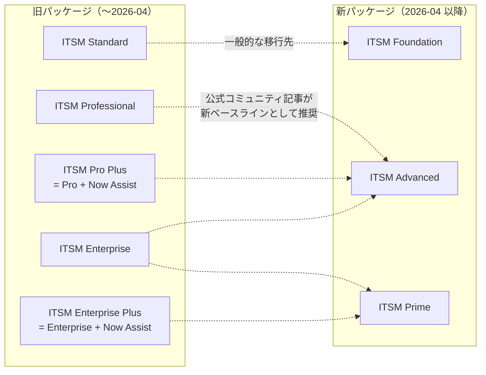
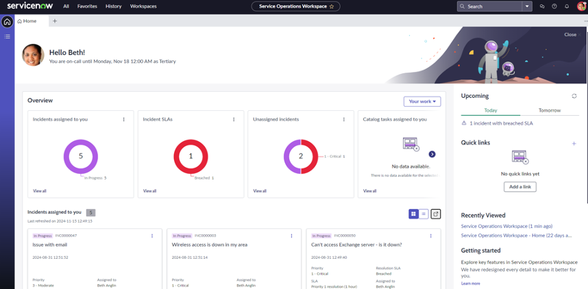
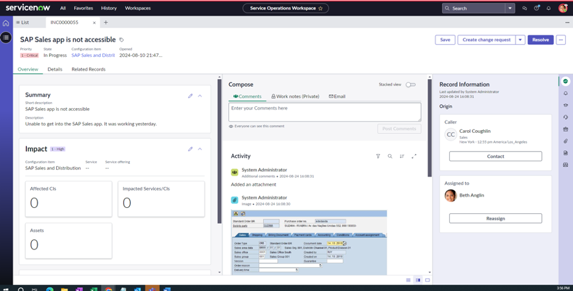
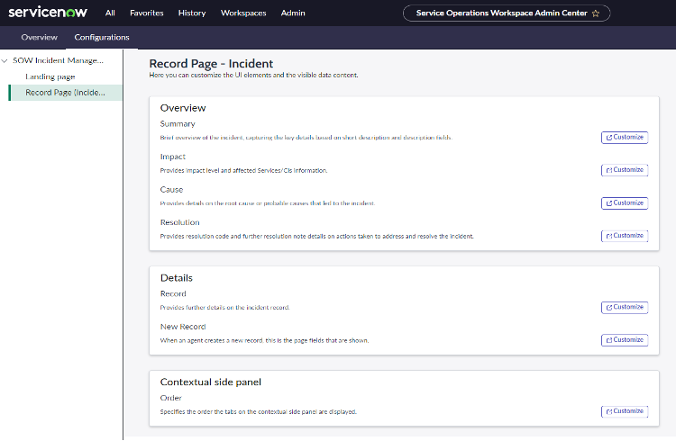
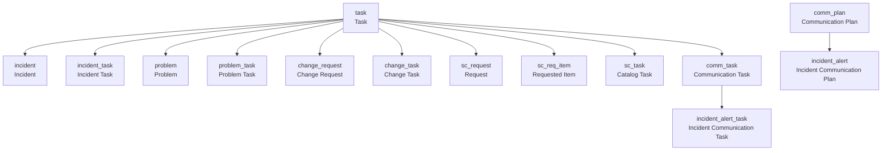

# ITSM 概要とパッケージ（IT Service Management Overview and Packaging）

## 概要

ServiceNow **IT Service Management（ITSM、ITサービス管理）** は、Now Platform（ServiceNow AI Platform）上で提供される IT サービスデリバリー用のアプリケーション群である。Incident（インシデント）、Problem（問題）、Change（変更）、Request（要求）を中核に、Knowledge（ナレッジ）、Service Level Management（サービスレベル管理）、Asset/CMDB、On-Call Scheduling（オンコール）、Walk-up Experience（ウォークアップ窓口）、Virtual Agent、生成 AI（ServiceNow Otto for ITSM、旧 Now Assist for ITSM）などで構成される。[出典](https://www.servicenow.com/docs/bundle/zurich-it-service-management/page/product/it-service-management/reference/r_ITServiceManagement.html)

本ファイルは次の問いに答える。

| 問い | 該当セクション |
|---|---|
| ITSM にはどんなアプリケーション（モジュール）があるか | [ITSM アプリケーション一覧](#itsm-アプリケーションモジュール一覧) |
| ITSM のパッケージ（エディション）は何があり、何が違うか | [ITSM パッケージ](#itsm-パッケージエディション) |
| 2026 年 4 月のパッケージ変更（Foundation / Advanced / Prime）で何が変わったか | [新パッケージ](#新パッケージfoundation--advanced--prime2026-04-以降) |
| Service Operations Workspace（SOW）とは何か、ロール・設定は | [Service Operations Workspace](#service-operations-workspacesow-for-itsm) |
| Simplified ITSM（AI-Native ITSM）とは何か | [Simplified IT Service Management](#simplified-it-service-managementai-native-itsm) |
| ITSM のテーブル構造は | [ITSM 関連テーブル](#itsm-関連テーブル) |

> **重要な前提（2026-11 時点）:** ServiceNow は 2026-04 に ITSM の商用パッケージを刷新し、従来の Standard / Professional / Enterprise（および生成 AI 付きの Pro Plus / Enterprise Plus）から **Foundation / Advanced / Prime** の 3 層へ移行した。ただし公式ドキュメントの一部（SOW のランディングページ等）には現在も「ITSM Professional and Enterprise」という旧名称が残っている。本ファイルは新旧の両方を記載する。契約上の権利（エンタイトルメント）は契約書（Order Form）と ServiceNow アカウントチームで必ず確認すること。[出典](https://www.servicenow.com/community/itsm-articles/itsm-licensing-in-april-2026-foundation-advanced-and-prime-in/ta-p/3544380)

関連ファイル:

- ITIL と ITSM の考え方: [ITILとITSMの基礎](../../01_入門編/06-itil-itsm-basics.md)
- 各プロセスの詳細: [Incident Management](incident-management.md) / [Problem Management](problem-management.md) / [Change Management](change-management.md) / [Request Management](request-management.md) / [Release Management と DevOps](release-management.md) / [サービスレベル管理とサービスポートフォリオ](service-level-management-itsm.md)
- 上位パッケージ固有機能: [ITSM Pro/Enterprise 固有機能](itsm-pro-features.md)
- ライセンス全般: [ライセンスモデル](../../03_導入編/01-licensing-model.md) / [エディション比較](../../03_導入編/03-edition-comparison.md) / [価格情報](../../03_導入編/02-pricing.md) / [プラットフォームのパッケージ構成](../platform/platform-licensing-packaging.md)
- 生成 AI: [Now Assist と AI Agents](../platform/now-assist-ai-agents.md)
- Workspace 一般: [Workspace と UI Builder](../platform/workspaces-ui-builder.md)

---

## ITSM の位置づけと構成要素

### ITSM と Now Platform の関係

ITSM アプリケーションは Now Platform の共通機能（`task` テーブル、Workflow Studio / Flow Designer、SLA エンジン、通知、レポート、ACL、CMDB 等）の上に構築されている。たとえば `incident` テーブルは `task` テーブルを拡張（extends）しており、`task` のフィールド・ビジネスルール・ポリシーをすべて継承する。[出典](https://www.servicenow.com/docs/r/QykF2iRSIs6VXztArCSo3w/HVNtYAg2ZXWZvJ7VX63lXw)

- プラットフォーム共通機能の詳細は [データモデルとSystem Dictionary](../platform/data-model-dictionary.md)、[SLAとスケジュール](../platform/sla-schedules.md)、[CMDB と CSDM](../platform/cmdb-csdm.md) を参照。

### ITSM のユーザー体験（UI）の3系統

ITSM のエージェント（フルフィラー、fulfiller）向け UI は Australia 時点で次の 3 系統が併存する。

| UI | 概要 | 主な対象 | 出典 |
|---|---|---|---|
| Core UI（UI16 / Next Experience のクラシックフォーム・リスト） | `incident.list` などの従来型フォーム/リスト。アプリケーションナビゲーター（All メニュー）からモジュールを開く | 管理者、従来運用 | [出典](https://www.servicenow.com/docs/r/IDeOjpA1hzonPLWG~inEpg/WR7g~P9UDo0UEa48SL6vdQ) |
| Service Operations Workspace（SOW）for ITSM | ITSM と ITOM を統合した構成可能なワークスペース。現在の推奨エージェント UI | Tier 1/Tier 2 エージェント、Major Incident Manager、Change Manager | [出典](https://www.servicenow.com/docs/r/it-service-management/service-operations-workspace/sow-landing-page.html) |
| Simplified ITSM の AI-first フルフィラー体験 | Simplified IT Service Management（Store アプリ）が提供する AI ファーストの簡素化 UI。高度なワークフローは SOW へ誘導 | 小〜中規模のサービスデスク | [出典](https://www.servicenow.com/docs/r/IDeOjpA1hzonPLWG~inEpg/25qrl_cqlBpZ4BR44nhlkw) |

依頼者（requester、従業員）向け UI は、Employee Center（Service Portal ベース）、Employee Slate（Moveworks を基盤とする会話型ポータル、2026 年に登場）、Virtual Agent、Microsoft Teams / Slack、メールである。[出典](https://www.servicenow.com/docs/r/QykF2iRSIs6VXztArCSo3w/XTNmje13cyowJFfBr4GFRA)

- Employee Center の詳細は [Service Portal と Employee Center](../platform/portals-employee-center.md) を参照。

---

## ITSM アプリケーション（モジュール）一覧

### 公式ドキュメント上の ITSM アプリケーション一覧

ServiceNow 公式ドキュメントの IT Service Management ランディングページ（Zurich 版、2026-04-22 更新）は、ITSM 配下に以下のアプリケーション/機能を掲載している。Australia 版ランディングページはカード型の概要ページに再構成されており個別一覧を持たないため、ここでは Zurich 版の一覧を基準にし、Australia/Brazil のリリースノートで確認できた内容を補足する。[出典（Zurich）](https://www.servicenow.com/docs/bundle/zurich-it-service-management/page/product/it-service-management/reference/r_ITServiceManagement.html) / [出典（Australia）](https://www.servicenow.com/docs/bundle/australia-it-service-management/page/product/it-service-management/reference/r_ITServiceManagement.html)

#### コアプロセス（ITIL プラクティス）

| アプリケーション（英語正式名） | 日本語 | 概要 | 詳細ファイル |
|---|---|---|---|
| Incident Management | インシデント管理 | 通常のサービス運用を迅速に回復し、ビジネス影響を最小化する | [incident-management.md](incident-management.md) |
| Major Incident Management | メジャーインシデント管理 | 重大インシデントの昇格・管理・解決・クローズ（プラグインは手動有効化が必要） | [incident-management.md](incident-management.md) |
| Incident Communications Management | インシデントコミュニケーション管理 | メジャーインシデント等の関係者向けコミュニケーションプランの作成・管理 | [incident-management.md](incident-management.md) |
| Problem Management | 問題管理 | 関連インシデントの根本原因（root cause）を特定する | [problem-management.md](problem-management.md) |
| Change Management | 変更管理 | IT サービスへの影響を最小化しながら変更のライフサイクルを統制する | [change-management.md](change-management.md) |
| Request Management | 要求管理 | カタログアイテムの要求を定義済みフローで履行する | [request-management.md](request-management.md) |
| Release Management（v2） | リリース管理 | リリースの計画・設計・構築・構成・テスト | [release-management.md](release-management.md) |
| Digital Product Release | デジタルプロダクトリリース | リリース/プロダクト/プログラムマネージャー向けのリリースプロセス管理 | [release-management.md](release-management.md) |
| Continual Improvement Management（CIM） | 継続的改善管理 | 改善機会・フェーズ・タスク・成功指標の追跡 | [itsm-pro-features.md](itsm-pro-features.md) |
| Service Portfolio Management | サービスポートフォリオ管理 | IT サービスを標準形式で文書化・管理する | [service-level-management-itsm.md](service-level-management-itsm.md) |
| Digital Portfolio Management / Service Builder | デジタルポートフォリオ管理 / サービスビルダー | ソリューション・サービス・インスタンスを単一ワークスペースで管理。Service Builder はサービスとサービスオファリング作成のガイド | [service-level-management-itsm.md](service-level-management-itsm.md) |
| On-call scheduling | オンコールスケジューリング | サポートグループで担当可能なメンバーを特定し、エスカレーションを行う | [incident-management.md](incident-management.md) |
| Task Outage | タスク停止 | タスクを CI の停止（outage）レコードにマッピングする | [incident-management.md](incident-management.md) |
| Collaboration services | コラボレーションサービス | タスクレコードやコミュニケーションプランからのリアルタイムコミュニケーション（Microsoft Teams 連携等） | — |

#### 資産・財務・ベンダー関連（ITSM ランディングに掲載されるもの）

| アプリケーション | 日本語 | 概要 | 詳細ファイル |
|---|---|---|---|
| Asset Management | 資産管理 | IT 資産の物理・技術・契約・財務面を追跡 | [itam-overview.md](../itam/itam-overview.md) |
| Contract Management | 契約管理 | 契約の管理・追跡 | [itam-overview.md](../itam/itam-overview.md) |
| Expense Line | 費用明細 | 手動または定期コスト処理で作成されるコストの追跡 | — |
| Procurement | 調達 | カタログ要求に対する発注書（PO）作成と物品調達 | [request-management.md](request-management.md) |
| Product Catalog | 製品カタログ | 資産モデル情報の中央リポジトリ | [hardware-asset-management.md](../itam/hardware-asset-management.md) |
| Vendor Management Workspace | ベンダー管理ワークスペース | 構成可能な KPI でベンダーのパフォーマンスを監視 | [itsm-pro-features.md](itsm-pro-features.md) |

> 「Asset Management」等は ITSM のランディングページに掲載されるが、高度な資産管理（HAM / SAM）は別製品（ITAM）である。境界は [ITAM 概要](../itam/itam-overview.md) を参照。[出典](https://www.servicenow.com/docs/bundle/zurich-it-service-management/page/product/it-service-management/reference/r_ITServiceManagement.html)

#### エージェント体験・セルフサービス・モバイル

| アプリケーション | 日本語 | 概要 | 詳細ファイル |
|---|---|---|---|
| Service Operations Workspace for ITSM | サービスオペレーションワークスペース | 統合・構成可能なエージェントワークスペース | 本ファイル [SOW](#service-operations-workspacesow-for-itsm) |
| Walk-up Experience | ウォークアップ体験 | 対面およびリモートでの IT 支援窓口（予約、キュー、キオスク） | [itsm-pro-features.md](itsm-pro-features.md) |
| Knowledge Management in Service Operations Workspace | SOW のナレッジ管理 | セルフヘルプ・トラブルシュート・タスク解決用ナレッジ記事 | [knowledge-management.md](../platform/knowledge-management.md) |
| Employee Center | 従業員センター | 従業員向けポータル | [portals-employee-center.md](../platform/portals-employee-center.md) |
| Employee Slate for ITSM | 従業員スレート（ITSM 向け） | 停止・劣化情報の表示、ウォークイン受付、予約（Brazil のリリースノートに掲載） | [portals-employee-center.md](../platform/portals-employee-center.md) |
| ITSM Virtual Agent | ITSM バーチャルエージェント | 一般的な要求・インシデントをチャットで処理 | [virtual-agent.md](../platform/virtual-agent.md) |
| ITSM Mobile Agent | ITSM モバイルエージェント | IT エージェントが移動中にインシデントをトリアージ・解決するモバイルアプリ | [mobile.md](../platform/mobile.md) |
| Coaching | コーチング | エージェントの育成（学習タスク等）。ITSM - Prime では AI Quality Assessment の基盤 | [itsm-pro-features.md](itsm-pro-features.md) |
| Workforce Optimization for ITSM | ITSM 向けワークフォース最適化 | スキル・スケジュール・作業ルーティング・パフォーマンスの管理 | [itsm-pro-features.md](itsm-pro-features.md) |

> **Brazil での変更:** Brazil の ITSM リリースノートは Workforce Optimization for ITSM を「Brazil ではサポートされるが将来のリリースで非推奨（deprecated）になる予定」と明記している。新規採用時は留意が必要。[出典](https://www.servicenow.com/docs/r/release-notes/it-service-management-rn-landing.html)

#### AI・アナリティクス・自動化

| アプリケーション | 日本語 | 概要 | 詳細ファイル |
|---|---|---|---|
| ServiceNow Otto for ITSM（旧 Now Assist for ITSM） | ITSM 向け生成 AI | インシデント/チャット要約、解決メモ生成、解決支援、AI エージェント | [now-assist-ai-agents.md](../platform/now-assist-ai-agents.md) |
| Machine learning solutions for ITSM / Task Intelligence for ITSM | ITSM 向け機械学習 | 分類・ルーティング等の ML モデルの構築・展開・追跡 | [predictive-intelligence-ai-search.md](../platform/predictive-intelligence-ai-search.md) |
| ITSM Predictive Intelligence Workbench | Predictive Intelligence ワークベンチ | ITSM 向け Predictive Intelligence のソリューション管理 | [predictive-intelligence-ai-search.md](../platform/predictive-intelligence-ai-search.md) |
| Recommendation Framework | 推奨フレームワーク | 推奨アクション（Recommended actions）の基盤 | — |
| ITSM Platform Analytics Solutions | ITSM 向け Platform Analytics | 事前構成済みダッシュボード・可視化 | [reporting-analytics.md](../platform/reporting-analytics.md) |
| ITSM Success Dashboard | ITSM 成功ダッシュボード | ITSM 実装の成果を測る KPI | [reporting-analytics.md](../platform/reporting-analytics.md) |
| Benchmarks | ベンチマーク | 他社比較の KPI | [reporting-analytics.md](../platform/reporting-analytics.md) |
| Process Mining for ITSM | ITSM 向けプロセスマイニング | プロセスの分析・最適化 | [process-automation-rpa-mining.md](../platform/process-automation-rpa-mining.md) |
| L1 IT Service Desk AI Specialist | L1 サービスデスク AI スペシャリスト | 大量の L1 インシデントを自律的に調査・解決（Prime 系） | 本ファイル [ITSM - Prime](#itsm---primestore-アプリ) |
| ITSM MCP Server | ITSM MCP サーバー | MCP クライアント（外部 AI）からインシデント・変更・要求・オンコールを操作（Brazil リリースノートに掲載） | [now-assist-ai-agents.md](../platform/now-assist-ai-agents.md) |

#### DevOps・その他

| アプリケーション | 日本語 | 概要 | 詳細ファイル |
|---|---|---|---|
| DevOps Change Velocity | DevOps 変更速度 | DevOps ツールチェーンのデータを取り込み、コンプライアンスを保ちつつ変更を高速化 | [release-management.md](../itsm/release-management.md) |
| DevOps Config | DevOps 構成 | DevOps パイプライン全体の構成データの検証・管理 | [release-management.md](release-management.md) |
| Digital End-User Experience（DEX） | デジタル従業員体験 | アプリ・ネットワーク・デバイスの監視（Application and Device Health、DEX Content Playbook、Desktop Assistant） | [itsm-pro-features.md](itsm-pro-features.md) |
| Site Reliability Operations | SRE 運用 | （公式ランディングページに説明なし） | — |
| Operational Technology Incident / Change Management | OT インシデント/変更管理 | OT（制御系）資産向けのインシデント・変更管理 | [industry-solutions.md](../industry/industry-solutions.md) |

### Brazil の ITSM リリースノート掲載アプリケーション

> **Brazil での変更:** Brazil の IT Service Management リリースノートのランディングページは、次の 14 アプリケーションを掲載している：ServiceNow Otto for ITSM、Change Management、DevOps Change Velocity、Digital End-User Experience、Digital Product Release、Employee Slate for ITSM、Incident Management、ITSM MCP Server、L1 IT Service Desk AI Specialist、On-Call Scheduling、Process Mining for ITSM、Request Management、Service Operations Workspace for ITSM、Workforce Optimization for ITSM。Employee Slate for ITSM、ITSM MCP Server、L1 IT Service Desk AI Specialist が新たに独立項目として登場している。[出典](https://www.servicenow.com/docs/r/release-notes/it-service-management-rn-landing.html)

### 主要プラグイン ID

ITSM のコアアプリケーションは、ベースシステムのプラグインとして提供されるものと、ServiceNow Store アプリとして提供されるものがある。

| プラグイン / アプリ | ID | 備考 | 出典 |
|---|---|---|---|
| Incident Management | `com.snc.incident` | ベースシステムで有効 | 【第三者情報】[Oracle ServiceNow Adapter](https://docs.oracle.com/en/cloud/paas/integration-cloud/servicenow-adapter/servicenow-adapter-capabilities.html) |
| Change Management | `com.snc.change_request` | ベースシステムで有効 | 【第三者情報】同上 |
| Problem Management | `com.snc.problem` | ベースシステムで有効 | 【第三者情報】同上 |
| ITSM Roles | `com.snc.itsm.roles` | `sn_incident_read` 等の細分化ロールと ACL を導入。SOW のロール継承に必要 | [出典](https://www.servicenow.com/docs/r/QykF2iRSIs6VXztArCSo3w/HVNtYAg2ZXWZvJ7VX63lXw) |
| ITSM Roles - Change Management | `com.snc.itsm.roles.changemanagement`（ページにより `change_management` と表記揺れ） | 変更管理の細分化ロールと ACL | [出典](https://www.servicenow.com/docs/r/QykF2iRSIs6VXztArCSo3w/lzl1cW8mOtAt6Yx8UjgcPg) |
| Problem Management Best Practice - Madrid | `com.snc.best_practice.problem.madrid` | Problem と Incident の同期などに必要 | [出典](https://www.servicenow.com/docs/r/BgFKZnPHldZ62gGtzQ71Mw/xQq0flhMvW5wWqKrEG_KMg) |
| Service Operations Workspace ITSM Applications | `sn_sow_itsm_cont` | SOW の ITSM コンテンツ。Store から更新 | [出典](https://www.servicenow.com/docs/r/u1slaAtcFiiXFQcd9RcR_A/ZrYUQ4m1VLOmQivznqG56w) |
| Service Operations Workspace ITOM Applications | `sn_sow_itom_cont` | SOW の ITOM コンテンツ | 同上 |
| Major Incident Management | 公開情報では ID を確認できず | 手動有効化が必要。On-Call Scheduling が関連プラグイン | [出典](https://www.servicenow.com/docs/r/QykF2iRSIs6VXztArCSo3w/N6Ae_uGIHaMRyVn~fuQjZA) |

- インスタンス上で実際にインストールされるコンポーネントは、各アプリの Application Files（`sys_metadata` 系）で確認するのが最も確実である。[出典](https://www.servicenow.com/docs/r/QykF2iRSIs6VXztArCSo3w/lzl1cW8mOtAt6Yx8UjgcPg)

---

## ITSM パッケージ（エディション）

### パッケージ体系の変遷（概要）

ITSM の商用パッケージは次のように変遷している。

> 図中の点線（旧→新の移行先）は確定した公式マッピングではない。Professional → Advanced のみ ServiceNow Community の記事（Bill Martin 氏）が「Professional のフットプリントの大半を使っている顧客にとって新しいベースライン」と述べている。その他は `【推定】` であり、契約ごとに確認が必要。[出典](https://www.servicenow.com/community/itsm-articles/itsm-licensing-in-april-2026-foundation-advanced-and-prime-in/ta-p/3544380)

### 旧パッケージ（Standard / Professional / Pro Plus / Enterprise / Enterprise Plus）

旧パッケージは 2026-04 の刷新前まで販売されていた体系であり、既存契約の顧客は引き続きこの体系で契約している場合がある。各パッケージは下位パッケージの機能をすべて含む（上位互換）。

#### 旧パッケージの機能比較表

| 機能 | Standard | Professional（Pro） | Pro Plus | Enterprise | Enterprise Plus | 出典 |
|---|:-:|:-:|:-:|:-:|:-:|---|
| Incident / Problem / Change and Release / Request Management | ○ | ○ | ○ | ○ | ○ | [出典](https://www.servicenow.com/community/itsm-forum/what-are-the-plugins-for-itsm-professional-suite/m-p/790072) |
| Asset and Cost Management | ○ | ○ | ○ | ○ | ○ | 同上 |
| Knowledge / Configuration Management（CMDB） / Service Level Management | ○ | ○ | ○ | ○ | ○ | 同上 |
| Reports and Dashboards / Benchmarks / Surveys and Assessments | ○ | ○ | ○ | ○ | ○ | 同上 |
| Now Mobile / Mobile Agent | ○ | ○ | ○ | ○ | ○ | 同上 |
| Walk-Up Experience / Agent Workspace | ○（2019 時点の掲載） | ○ | ○ | ○ | ○ | 同上 |
| Virtual Agent（NLU 付き） | — | ○ | ○ | ○ | ○ | [出典](https://www.servicenow.com/community/itsm-articles/itsm-pro-solution-brief/ta-p/2295873) |
| Predictive Intelligence | — | ○ | ○ | ○ | ○ | 同上 |
| Performance Analytics（ITSM 向け） | — | ○ | ○ | ○ | ○ | 同上 |
| Continual Improvement Management | — | ○ | ○ | ○ | ○ | 同上 |
| Service Owner Workspace / Vendor Manager Workspace | — | ○ | ○ | ○ | ○ | 同上 |
| Dynamic Translation | — | ○ | ○ | ○ | ○ | 同上 |
| DevOps Change（DevOps Change Velocity） | — | ○ | ○ | ○ | ○ | 同上、[出典](https://www.servicenow.com/community/itsm-articles/itsm-licensing-in-april-2026-foundation-advanced-and-prime-in/ta-p/3544380) |
| Service Operations Workspace for ITSM | — | ○ | ○ | ○ | ○ | [出典](https://www.servicenow.com/docs/r/it-service-management/service-operations-workspace/sow-landing-page.html) |
| Process Optimization / Process Mining | — | △ | △ | ○ | ○ | 【第三者情報】[出典](https://redresscompliance.com/servicenow-standard-vs-pro-vs-enterprise-which-edition.html) |
| Workforce Optimization for ITSM | — | △ | △ | ○ | ○ | 【第三者情報】同上 |
| Now Assist for ITSM（生成 AI） | — | — | ○ | — | ○ | 【第三者情報】同上 |

凡例: ○＝含まれる、—＝含まれない、△＝情報源により記載が揺れる（2021 年の公式ソリューションブリーフは Pro と Enterprise をまとめて記載しており、どちらに属するか区別していない）。

補足:

- **Standard** は ITSM のコアワークフローと標準レポートを提供し、Performance Analytics や Predictive Intelligence を含まない。【第三者情報】[出典](https://redresscompliance.com/servicenow-standard-vs-pro-vs-enterprise-which-edition.html)
- **Professional** は Standard に 6 アプリケーション（Virtual Agent、Predictive Intelligence、Performance Analytics、Continual Improvement Management、Service Owner Workspace、Vendor Manager Workspace）を追加したもの、と 2019 年の Community 回答は記載している。後年の資料では DevOps Change、Dynamic Translation、Process Optimization、Workforce Optimization も Pro/Enterprise の機能として列挙されており、時期によって構成が変わっている。[出典](https://www.servicenow.com/community/itsm-forum/what-are-the-plugins-for-itsm-professional-suite/m-p/790072) / [出典](https://www.servicenow.com/community/itsm-articles/itsm-pro-solution-brief/ta-p/2295873)
- **Pro Plus / Enterprise Plus** は、Professional / Enterprise に生成 AI（Now Assist for ITSM）を追加した上位 SKU として販売された。一部第三者資料では Now Assist の「アドオン」として表現されている。【第三者情報】[出典](https://redresscompliance.com/servicenow-standard-vs-pro-vs-enterprise-which-edition.html)
- **Enterprise** は Professional の機能に、プロセスマイニング（Process Mining）、Workforce Optimization、高度な自動化などを加えたもの、と第三者資料は説明している。公式の機能一覧表は公開情報では確認できず。【第三者情報】[出典](https://redresscompliance.com/servicenow-standard-vs-pro-vs-enterprise-which-edition.html)

> 旧パッケージの正式な機能一覧（Order Form 添付の Subscription Product Descriptions）は公開 Web 上では確認できなかった。上表は公式 Community・公式ドキュメント・第三者情報からの再構成である。

### 新パッケージ（Foundation / Advanced / Prime、2026-04 以降）

#### 刷新の概要

- 2026-04 の刷新で、ITSM は **Foundation / Advanced / Prime** の 3 層になった。第三者情報では切替日を 2026-04-09 としており、旧 5 層（Standard / Pro / Pro Plus / Enterprise / Enterprise Plus）を置き換えたとしている。【第三者情報】[出典](https://redresscompliance.com/research-notes/servicenow-foundation-advanced-prime-mapping)
- AI はすべての層にバンドルされ、各層に Assist（AI 利用量の単位）の割当（allocation）がある。Virtual Agent の会話数は無制限になった。各層の差は主に「プロセスの範囲」「アナリティクスの深さ」「AI をどこまで使えるか」である。[出典](https://www.servicenow.com/community/itsm-articles/itsm-licensing-in-april-2026-foundation-advanced-and-prime-in/ta-p/3544380)
- ServiceNow 公式ドキュメント「ServiceNow product tiers」は、Foundation / Advanced / Prime を全製品共通の AI 能力の段階として定義している（下表）。新しい層の展開はインスタンスのアップグレードサイクルとは独立している。[出典](https://www.servicenow.com/docs/r/intelligent-experiences/enable-ai-experiences/ai-native-sku-overview.html)

| 層 | 公式の位置づけ（AI の焦点） | 説明 |
|---|---|---|
| Foundation | AI skills and routine AI agents | パターン認識・分類によるタスク単位の支援 |
| Advanced | Agentic workflows | ユーザーと協働してワークフローのステップ全体を自動化 |
| Prime | Autonomous AI workforce | 複数のエージェント型ワークフローにまたがり、AI スペシャリストが自律的に判断・実行 |

#### 新パッケージの ITSM 機能比較表

| 機能 | Foundation | Advanced | Prime | 出典 |
|---|:-:|:-:|:-:|---|
| Incident Management（基本） | ○ | ○ | ○ | [出典](https://www.servicenow.com/community/itsm-articles/itsm-licensing-in-april-2026-foundation-advanced-and-prime-in/ta-p/3544380) |
| Request Management | ○ | ○ | ○ | 同上 |
| Asset / Cost | ○ | ○ | ○ | 同上 |
| Knowledge Management | ○（公開 Foundation ページに掲載、と記事コメントで言及） | ○ | ○ | 同上（Knowledge Management Advanced の包含は未確認） |
| Virtual Agent（会話数無制限） | ○ | ○ | ○ | 同上 |
| Predictive Intelligence | ○ | ○ | ○ | 同上 |
| ServiceNow Otto（Now Assist）for ITSM：既製スキル | ○ | ○ | ○ | 同上、[出典](https://www.servicenow.com/docs/r/intelligent-experiences/enable-ai-experiences/ai-native-sku-overview.html) |
| 既製 AI エージェント（AI Agent Studio で構成） | ○ | ○ | ○ | [出典](https://www.servicenow.com/docs/r/intelligent-experiences/enable-ai-experiences/ai-native-sku-overview.html) |
| Problem Management | — | ○ | ○ | [出典](https://www.servicenow.com/community/itsm-articles/itsm-licensing-in-april-2026-foundation-advanced-and-prime-in/ta-p/3544380) |
| Change Management | — | ○ | ○ | 同上 |
| Major Incident Management | — | ○ | ○ | 同上 |
| On-Call Scheduling | — | ○ | ○ | 同上 |
| Walk-up Experience | — | ○ | ○ | 同上 |
| Platform Analytics Advanced | — | ○ | ○ | 同上 |
| Process Mining for Platform | — | ○ | ○ | 同上 |
| AI Voice Agents | — | ○ | ○ | [出典](https://www.servicenow.com/community/architect-articles/understanding-servicenow-licensing-packaging-tiers-standard/ta-p/3532073) |
| DevOps Change Velocity | — | — | ○ | [出典](https://www.servicenow.com/community/itsm-articles/itsm-licensing-in-april-2026-foundation-advanced-and-prime-in/ta-p/3544380) |
| L1 Service Desk AI Specialist | — | — | ○ | [出典](https://www.servicenow.com/community/architect-articles/understanding-servicenow-licensing-packaging-tiers-standard/ta-p/3532073) |
| AI Agents for ITSM / DEX agent | — | — | ○ | 同上 |
| 新規カスタム AI スキル・AI エージェントの構築（AI Agent Studio） | — | — | ○ | [出典](https://www.servicenow.com/docs/r/intelligent-experiences/enable-ai-experiences/ai-native-sku-overview.html) |
| AI Action Fabric：アウトバウンド A2A | ○ | ○ | ○ | 同上 |
| AI Action Fabric：インバウンド MCP Server Console | — | — | ○ | 同上 |
| AI Control Tower（ServiceNow 内 AI 資産） | ○ | ○ | ○ | 同上 |
| Workflow Data Fabric Foundation（Integration Hub, RPA Hub, Automation Center, Data Catalog） | ○ | ○ | ○ | 同上 |
| Moveworks for ServiceNow（EmployeeWorks） | 層に応じたレベルで同梱 | 同左 | 同左 | 同上 |
| Assist 割当量 | 少 | 中 | 最大 | [出典](https://www.servicenow.com/community/itsm-articles/itsm-licensing-in-april-2026-foundation-advanced-and-prime-in/ta-p/3544380)（具体数は非公開） |

各層の想定顧客（ServiceNow Community 記事より）:

| 層 | 想定顧客 |
|---|---|
| ITSM Foundation | 近い将来に正式な Problem / Change / Major Incident / Walk-up を必要としない、焦点を絞ったサービスデスク |
| ITSM Advanced | 成熟した ITIL プラクティスを持ち、高度なアナリティクスを求め、AI は自作せず既製品を構成して使う組織。旧 ITSM Professional の大半を使っていた顧客の新ベースライン |
| ITSM Prime | IT 運用におけるカスタム AI のロードマップと予算、エージェントを設計・構築・運用するチームを持つ組織 |

[出典](https://www.servicenow.com/community/itsm-articles/itsm-licensing-in-april-2026-foundation-advanced-and-prime-in/ta-p/3544380)

#### 新パッケージに関する注意点

- **DevOps Change Velocity の移動:** 旧 ITSM Professional に含まれていた DevOps Change Velocity は、新体系では Prime のみに含まれる（記事コメントで著者が確認）。旧 Pro から Advanced に移行する場合は機能が減る可能性がある。[出典](https://www.servicenow.com/community/itsm-articles/itsm-licensing-in-april-2026-foundation-advanced-and-prime-in/ta-p/3544380)
- **Foundation には Problem / Change がない:** ITIL の変更管理・問題管理が必要な組織は Advanced 以上が必要である。[出典](https://www.servicenow.com/community/itsm-articles/itsm-licensing-in-april-2026-foundation-advanced-and-prime-in/ta-p/3544380)
- **プラグインが有効でも権利があるとは限らない:** インスタンスでプラグインが有効化されていることは、契約上の利用権を意味しない。[出典](https://www.servicenow.com/community/itsm-articles/itsm-licensing-in-april-2026-foundation-advanced-and-prime-in/ta-p/3544380)
- **「バンドル」は「無制限」ではない:** Assist はテナントのプールから計量され、追加購入の単価は非公開。【第三者情報】[出典](https://redresscompliance.com/research-notes/servicenow-foundation-advanced-prime-mapping)
- **旧 SKU と新 SKU の対応:** 公式ドキュメントは対応表を掲載せず、サポートされる製品ラインはサポート KB（KB3160245）を参照するよう案内している。[出典](https://www.servicenow.com/docs/r/intelligent-experiences/enable-ai-experiences/ai-native-sku-overview.html)
- **Now Assist の名称変更:** 2026 年に Now Assist・Moveworks・「AI Experience」のブランドは **ServiceNow Otto** に統合・改称された（ITSM 向け Store アプリでは 2026-08 リリースのバージョン 17.0.5 / 16.0.6 / 15.1.4 で反映）。製品エンタイトルメントは名称変更では変わらない。[出典](https://www.servicenow.com/docs/r/store-release-notes/store-rn-itsm-now-assist.html)

#### 組み合わせ SKU（Combined SKUs）

| SKU | 構成 | 課金 | 出典 |
|---|---|---|---|
| Enterprise Service Management（ESM）Foundation | ITSM Foundation ＋ コアビジネススイート | ユーザー単位 | [出典](https://www.servicenow.com/community/itsm-articles/itsm-licensing-in-april-2026-foundation-advanced-and-prime-in/ta-p/3544380) |
| ServiceOps Advanced | ITSM Advanced ＋ ITOM Advanced | 共有クレジットモデル | 同上 |
| ITSM Prime add-on | CSM / Industry の Prime 顧客が ITSM Prime 相当の AI を追加するための手段 | 公開情報では確認できず | 同上 |

- ITOM の新パッケージには Foundation 層がない。[ITOM 概要とパッケージ](../itom/itom-overview.md) を参照。[出典](https://www.servicenow.com/community/architect-articles/navigating-the-april-2026-servicenow-itom-licensing-model/ta-p/3555121)
- 価格は公式に公開されていない。価格の推定値は [価格情報](../../03_導入編/02-pricing.md) を参照。

#### パッケージ選定チェックリスト（公式 Community 記事より）

1. 契約期間中に本当に必要な ITIL プロセスはどれか。
2. カスタム AI を構築するのか、出荷済みの AI を構成するだけか。
3. 層ごとの Assist 割当量は想定 AI 利用量を十分にまかなえるか。
4. ITSM 単独か、ITOM / CSM / コアビジネススイートと併用か（併用なら組み合わせ SKU が適合しうる）。

[出典](https://www.servicenow.com/community/itsm-articles/itsm-licensing-in-april-2026-foundation-advanced-and-prime-in/ta-p/3544380)

### ITSM 関連 Store アプリと層の関係

| Store アプリ | 概要 | 関連する層 | 出典 |
|---|---|---|---|
| Simplified IT Service Management（AI-Native ITSM） | AI ファーストの簡素化 ITSM。管理者・従業員・フルフィラー体験を統合 | 公開情報では層の指定を確認できず（エンタイトルメント申請が必要） | [出典](https://www.servicenow.com/docs/r/IDeOjpA1hzonPLWG~inEpg/25qrl_cqlBpZ4BR44nhlkw) |
| ServiceNow Otto for ITSM（旧 Now Assist for ITSM） | ITSM 向け生成 AI スキルと AI エージェント | 全層（範囲は層により異なる） | [出典](https://www.servicenow.com/docs/r/store-release-notes/store-rn-itsm-now-assist.html) |
| ITSM - Prime | L1 Service Desk AI Specialist 等の自律型 AI | Prime | [出典](https://www.servicenow.com/docs/r/store-release-notes/store-rn-itsm-prime.html) |
| Service Operations Workspace for ITSM | 統合エージェントワークスペース | 公式ドキュメント上は「ITSM Professional and Enterprise」に含まれると記載（旧名称のまま） | [出典](https://www.servicenow.com/docs/r/it-service-management/service-operations-workspace/sow-landing-page.html) |

---

## ServiceNow Otto for ITSM（旧 Now Assist for ITSM）

ServiceNow Otto for ITSM は ITSM 向けの生成 AI スキルと AI エージェントを提供する Store アプリである。詳細と設定は [Now Assist と AI Agents](../platform/now-assist-ai-agents.md) と [ITSM Pro/Enterprise 固有機能](itsm-pro-features.md) を参照。ここでは ITSM 全体像の把握に必要な範囲を記す。[出典](https://www.servicenow.com/docs/r/store-release-notes/store-rn-itsm-now-assist.html)

### ITSM 向け AI スキル

| スキル（英語） | 日本語 | 備考 |
|---|---|---|
| Incident summarization | インシデント要約 | |
| Resolution notes generation | 解決メモ生成 | |
| Change request risk explanation | 変更リスクの説明 | |
| Change request summarization | 変更要求の要約 | |
| Requested item summarization | 要求アイテム（RITM）の要約 | |
| Chat summarization | チャット要約 | |
| Attachment summarization | 添付ファイル要約 | |
| Sentiment analysis | 感情分析 | |
| Activity response generation | アクティビティ返信生成 | |
| Generate Release Notes | リリースノート生成 | 既定で有効 |
| Suggested steps generation | 推奨手順生成 | バージョン 15.0.1 で非推奨・削除 |

[出典](https://www.servicenow.com/docs/r/store-release-notes/store-rn-itsm-now-assist.html)

### ITSM 向け AI エージェント・エージェント型ワークフロー（2026-10 時点）

- インシデント: Investigate and resolve ITSM incidents、Triage and categorize ITSM incidents、Categorize incident / Classify service and CI、Create Incident、Link Major Incident / Link incident to problem、Wrap-up and resolve incident、Generate post incident reviews、Incident Analyzer（18.0.2、既定は無効）
- 変更: Generate change request plans and schedule、Assess quality of a change request / Change Quality Assessor、Assess conflicts for a change request、Schedule a change、Change Outage Assistant
- その他: Explain SLA、Manage Microsoft 365 group members、Twilio SMS texter、DEX Diagnosis、Okta lockout and MFA failure agent、Teams on-call agent、SharePoint / Zscaler / Installed Apps の SME エージェント

[出典](https://www.servicenow.com/docs/r/store-release-notes/store-rn-itsm-now-assist.html)

### SOW との関係

Otto for ITSM（Now Assist for ITSM）は SOW 上の Now Assist Panel（Otto パネル）で利用される。Community では、Australia Patch 5 で SOW のインシデント画面からコンテキストサイドバー（Playbooks、Recommendations、Agent Assist）が消えたという報告があり、KB3222535 として「SRP レコードページの代わりに AI-Native ITSM Record Page が表示される。UI Builder で AI-Native ITSM Record Page を無効化すると元に戻る」旨が案内されている。【第三者情報】（Community 投稿）[出典](https://www.servicenow.com/community/itsm-articles/itsm-licensing-in-april-2026-foundation-advanced-and-prime-in/ta-p/3544380)

---

## ITSM - Prime（Store アプリ）

ITSM - Prime は、AI がサービスタスクを自律的に完了し、人間は複雑なケースを扱うことを目指す Store アプリである（初版 1.0.4 が 2026-04、最新 2.4.2 が 2026-10）。[出典](https://www.servicenow.com/docs/r/store-release-notes/store-rn-itsm-prime.html)

| 機能 | 内容 | バージョン |
|---|---|---|
| L1 Service Desk AI Specialist | AI が分類するインシデントフィールド（カテゴリ、割り当てグループ、CI 等）の選択、解決できない場合のフォールバック割り当てグループ、CI 予測の信頼度しきい値、On Hold インシデントの 2 日無応答での自動解決、ダッシュボード指標。L1 SDS プラグインが必要 | 1.0.6（2026-05、Zurich/Australia） |
| ナレッジギャップ検知 | Knowledge Feedback Task の作成（未完了タスクとの重複排除） | 2.0.3 以降 |
| Teams / Slack での対話 | Microsoft Teams または Slack でのリアルタイム会話 | 2.0.3 以降 |
| AI Quality Assessment | Coaching アプリで AI の解決品質を採点 | 2.2.2 以降 |
| デバイス修復 | Incident / Task / Change から Intune・Jamf のエンドポイント修復を起動（Remedial Action Framework 経由） | 2.2.2 以降 |
| 変更管理の AI 支援 | Change Risk Assessment と Dynamic Schema の質問を AI が回答 | 2.3.3 以降 |
| Service Portal の提案 | 起票前にナレッジ記事・カタログアイテムを提案 | 2.3.3 以降 |
| Incident Analyzer | 新規インシデントを調査し作業メモに要約を記載。既定は無効、P1/P2 対象、1 回 4 assists | 2.4.2（2026-10） |

- 2.4.2 では Gemma 4 26B-A4B がサポートモデル（自己ホスト含む）となり、Apriel と GPT-OSS の Now LLM モデルは非推奨になった。[出典](https://www.servicenow.com/docs/r/store-release-notes/store-rn-itsm-prime.html)

---

## Simplified IT Service Management（AI-Native ITSM）

### Simplified ITSM の概要

**Simplified IT Service Management（Simplified ITSM）** は Australia で新しく登場した Store アプリで、「管理者向けの簡素化・自動化された実装」と「従業員とフルフィラー向けの統一された体験」を提供する AI ネイティブな ITSM である。ServiceNow Store で IT Service Management のエンタイトルメントを申請してからインストールする。Store のリリースノートの URL には `ai-native-itsm` という識別子が使われている。[出典](https://www.servicenow.com/docs/r/IDeOjpA1hzonPLWG~inEpg/25qrl_cqlBpZ4BR44nhlkw) / [出典](https://www.servicenow.com/docs/r/store-release-notes/store-rn-itsm-ai-native-itsm.html)

### Simplified ITSM の 3 つの体験

| 体験 | 内容 | 出典 |
|---|---|---|
| 管理者（Administrator） | コンテキストヘルプ付きのガイド付きセットアップ、顧客ごとの既定プリセット（自動適用され、後から確認・変更可能）、学習リソース、単一の管理ページから自然言語で ITSM ワークフローを構成する AI エージェント | [出典](https://www.servicenow.com/docs/r/QykF2iRSIs6VXztArCSo3w/XTNmje13cyowJFfBr4GFRA) |
| 従業員/依頼者（Employee / Requester） | Employee Center ポータル（チャット・カタログ・ナレッジ）、要求者 AI エージェントと AI Search による問題の回避（deflection）とトリアージ、Microsoft Teams / Slack 対応、インシデント・要求アイテムのアンケート。3.0.2 以降は Employee Slate（会話型ポータル） | 同上 |
| フルフィラー/サービスデスク担当（Fulfiller） | AI ファーストのワークスペース、トリアージ・返信ドラフト・解決手順提案を行うエージェント型ワークフロー、要約・解決メモ・ナレッジ記事生成、インシデントと要求アイテムのバックログを示すロール別マネージャーダッシュボード | 同上 |

### Simplified ITSM のバージョン履歴（Store）

| バージョン | 時期 | 主な内容 |
|---|---|---|
| 2.0.1 | 2026-04 | AI ファーストの管理者・従業員・フルフィラー体験の初版 |
| 2.1.0 | 2026-05 | AI Approval Assistant、AI エージェントの修正 |
| 3.0.2 | 2026-06 | Employee Slate の登場、ホーム画面への Catalog task 表示、インシデント詳細レイアウト更新、**Service Operations Workspace へのアップグレードパス**（Problem、Major Incident、On-Call Scheduling、Walk-up Experience などの高度なワークフローは SOW の Admin Center へリダイレクト）、CMDB と Employee Slate のオンボーディングタスク |
| 3.1.1 | 2026-07 | インバウンドメール（Gmail）のガイド付き構成、Employee Slate をインシデント・要求通知の主たる体験に設定可能、AI による L1→L2 再割り当て |
| 3.2.3 | 2026-08 | Employee Slate からの簡素化要求（オーダーガイド送信で request、カタログアイテム要求で requested item を作成）、`sn_incident_admin` ロールで Incident Management、`sn_request_admin` ロールで Request Management を構成、Configuration Console で変更のフォーム・リストを構成 |
| 3.3.1 | 2026-09 | Fulfiller UI 利用状況の AppSee テレメトリ連携 |
| 3.4.0 | 2026-10 | IT サービスデスクと Change Management の AI エージェントが DARE ハーネス上で稼働 |

[出典](https://www.servicenow.com/docs/r/store-release-notes/store-rn-itsm-ai-native-itsm.html) / [出典](https://www.servicenow.com/docs/r/IDeOjpA1hzonPLWG~inEpg/25qrl_cqlBpZ4BR44nhlkw)

- 構成の中心となるコンソールは「Configuration Console」（Product Configuration Console とも表記）で、ITSM、CMDB、Employee Slate のガイド付きセットアップタスクを提供する。[出典](https://www.servicenow.com/docs/r/store-release-notes/store-rn-itsm-ai-native-itsm.html)
- Simplified ITSM がどのパッケージ層を対象にするかは公開情報では確認できず。機能構成（Incident と Request 中心、高度なワークフローは SOW へ誘導）は Foundation 層の範囲と整合的である。`【推定】`

---

## Service Operations Workspace（SOW）for ITSM

### SOW の概要

**Service Operations Workspace（SOW、サービスオペレーションワークスペース）** は、ITSM と ITOM の複数ワークフローを統合したエージェント向けの構成可能なワークスペースである。エージェントは SOW でインシデント・変更・要求・承認を処理し、ワークフローごとに構成可能なダッシュボード・リストビュー・レコードページを使う。公式ドキュメントは SOW を「ITSM Professional and Enterprise サブスクリプションに含まれる」と記載している（2026-09 時点でも旧名称のまま）。[出典](https://www.servicenow.com/docs/r/it-service-management/service-operations-workspace/sow-landing-page.html) / [出典](https://www.servicenow.com/docs/r/release-notes/service-operations-workspace-itsm-rn.html)

- SOW は ServiceNow Store で配布され、Australia では既定で有効（active by default）、既定バージョンは **9.0**。Store から Australia へアップグレードすると 9.0 が自動インストールされる。PIR（Post Incident Review）と AI インシデント機能の一部は 9.2 が必要。[出典](https://www.servicenow.com/docs/r/IDeOjpA1hzonPLWG~inEpg/WR7g~P9UDo0UEa48SL6vdQ)
- Zurich の既定バージョンは 8.0（一部機能は 8.2 以降）。[出典](https://www.servicenow.com/docs/r/u1slaAtcFiiXFQcd9RcR_A/ZrYUQ4m1VLOmQivznqG56w)

> **Brazil での変更:** Brazil の SOW for ITSM の既定バージョンは **9.5**。新規プロビジョニングされた zboot インスタンスでは、エンタイトルメントがあれば SOW for ITSM Advanced Applications 等を一括インストールするスケジュールジョブが動作する。インシデントに添付されたナレッジ記事が Related records タブに既定で表示されるようになった。Migration Utility for Service Operations Workspace（`sn_sow_migration`）は代替なしで非推奨。Agent Client Collector for Investigation（`com.snc.acc_adapter`）と Microsoft Endpoint Configuration Manager for Investigation（`com.snc.mecm_adapter`）は代替なしで非推奨予定。[出典](https://www.servicenow.com/docs/r/release-notes/service-operations-workspace-itsm-rn.html)

### SOW へのアクセス

- Workspaces メニューから **Service Operations Workspace** を選択する。必要ロールは `itil`（または後述の `sn_sow.sow_user` 系ロール）。[出典](https://www.servicenow.com/docs/r/QykF2iRSIs6VXztArCSo3w/m_2drY2jCYlQvQUH8OaTcg)
- Workspace の URL は `/now/sow/home` 形式でアクセスされることが多い。【経験則】（公式ドキュメント上で URL パスは確認できず）
- 管理者向けガイド付きセットアップは **All > Adoption Services > Guided Setup**。[出典](https://www.servicenow.com/docs/r/yokohama/it-service-management/service-operations-workspace/explore-sow.html)
- エージェント向けガイドツアーはナビゲーションバーの Show help アイコン > Take a Tour / Select a Tour。[出典](https://www.servicenow.com/docs/r/yokohama/it-service-management/service-operations-workspace/explore-sow.html)

### SOW の主な機能

| 機能 | 内容 | 出典 |
|---|---|---|
| Landing page（ホーム） | 停止（outage）、サービスアナウンス、自分の割り当てを一覧。Tier 1 エージェントにはマネージャーが割り当てたパフォーマンス・学習タスクも表示 | [出典](https://www.servicenow.com/docs/r/yokohama/it-service-management/service-operations-workspace/explore-sow.html) |
| Incident management | コンテキスト情報と目的別アクション。Agent Client Collector（ACC）のメトリクスを利用 | 同上 |
| Recommended actions | 類似インシデントとナレッジ記事に基づくガイダンス型・フィールド単位の推奨（Incident、Incident task、Problem、Problem task、Change、Change task、Interaction、Request に適用） | 同上 |
| Problem / Change / Major incident | Tier 2 エージェントがこれらのレコードを管理。問題解決のための変更要求作成 | 同上 |
| Request management | インシデントやインタラクションから要求を作成し、カタログ要求と Catalog task をマルチタブで処理 | 同上 |
| On-call scheduling | オンコールスケジュール、ローテーション、エスカレーションポリシー、グループエスカレーション通知、現在のエスカレーション先の特定 | 同上 |
| Microsoft Teams collaboration | タスク内から依頼者・同僚と Teams チャット | 同上 |
| Walk-up experience management | ウォークアップのインタラクション、予約、ストックルーム、キオスクの管理 | 同上 |
| CAB workbench | 変更諮問委員会（CAB）会議の運営。Zurich でリスク値のハイライト表示を追加 | [出典](https://www.servicenow.com/docs/r/u1slaAtcFiiXFQcd9RcR_A/ZrYUQ4m1VLOmQivznqG56w) |
| Major Incident workbench | メジャーインシデントの運営 | [出典](https://www.servicenow.com/docs/r/release-notes/service-operations-workspace-itsm-rn.html) |
| IT Agent Dashboard | エージェント向けダッシュボード（カードの管理） | [出典](https://www.servicenow.com/docs/r/it-service-management/service-operations-workspace/sow-landing-page.html) |
| My Approvals | レコードの表示と承認 | 同上 |
| SOW Admin Center | SOW の構成（ランディングページ、レコードページ、プロパティ、変更管理、Notify 等）を行う管理画面 | [出典](https://www.servicenow.com/docs/r/u1slaAtcFiiXFQcd9RcR_A/ZrYUQ4m1VLOmQivznqG56w) |
| ITOM 連携 | SOW for ITOM と統合し、サービスと運用の統一体験を提供 | [出典](https://www.servicenow.com/docs/r/yokohama/it-service-management/service-operations-workspace/explore-sow.html) |

#### SOW のランディングページ（画面例）

*図1: Service Operations Workspace のランディングページ（Home タブ）。2024-11 頃の画面で、Australia では細部が異なる可能性がある。*

画面の説明: 画面上部のバナーに中央の「Service Operations Workspace」というワークスペース名と、その左側の All / Favorites / History / Workspaces メニューがある。左端の縦アイコンバーにはホーム（家アイコン）とリストのアイコンが並ぶ。本文上部に「Hello Beth!」と、ログインユーザーのオンコール状況（「You are on-call until … as Tertiary」）が表示される。「Overview」セクションには「Your work」フィルターと、ドーナツグラフ型のカード「Incidents assigned to you」（担当インシデント数）、「Incident SLAs」（SLA 違反数）、「Unassigned incidents」（未割り当てインシデント数）、「Catalog tasks assigned to you」が並ぶ。その下の「Incidents assigned to you」には、インシデント番号・状態・優先度・Resolution SLA・担当者を示すカードが表示される。右側パネルには「Upcoming」（Today / Tomorrow のタブ、SLA 違反インシデントの通知）、「Quick links」、「Recently Viewed」、「Getting started」が表示される。

出典: [Quickly setup Service Operations Workspace for ITSM（ServiceNow Community、2024-12-06）](https://www.servicenow.com/community/service-operations-workspace/quickly-setup-service-operations-workspace-for-itsm/ta-p/3119974)（取得日: 2026-11-03）

#### SOW のインシデントレコードページ（画面例）

*図2: SOW でインシデント（INC0000055）を開いたレコードページ。2024-08 頃の画面。*

画面の説明: 上部のタブに「List」と「INC0000055」が並び、レコードを複数タブで開ける。ヘッダーには短い説明（「SAP Sales app is not accessible」）と、Priority（1 - Critical）、State（In Progress）、Configuration item、Opened の各項目、右側に「Save」「Create change request」「Resolve」ボタンがある。その下に「Overview」「Details」「Related Records」のタブがある。左カラムの Overview タブには「Summary」（Short description、Description）と「Impact」（Configuration item、Service、Service offering、Affected CIs、Impacted Services/CIs、Assets の件数）のカードがある。中央カラムは「Compose」（Comments / Work notes (Private) / Email の切り替え）と「Activity」（アクティビティストリーム、添付画像の表示）。右カラムは「Record Information」（Caller の情報と Contact ボタン、Assigned to と Reassign ボタン）。最右端に縦アイコンで並ぶのがコンテキストサイドパネル（contextual side panel）で、推奨アクション、ナレッジ、添付などを切り替える。

出典: [Quickly setup Service Operations Workspace for ITSM（ServiceNow Community、2024-12-06）](https://www.servicenow.com/community/service-operations-workspace/quickly-setup-service-operations-workspace-for-itsm/ta-p/3119974)（取得日: 2026-11-03）

#### SOW Admin Center（画面例）

*図3: Service Operations Workspace Admin Center の「Record Page - Incident」設定画面。*

画面の説明: 上部バナーに「Service Operations Workspace Admin Center」と表示され、「Overview」「Configurations」タブがある。左ナビゲーションの「SOW Incident Management」配下に「Landing page」と「Record Page (Incident)」がある。右側の「Record Page - Incident」では、レコードページの UI 要素と表示データをカスタマイズでき、「Overview」セクション（Summary、Impact、Cause、Resolution）、「Details」セクション（Record、New Record：新規作成時に表示されるフィールド）、「Contextual side panel」セクション（Order：サイドパネルのタブ表示順）が並ぶ。各項目の右に「Customize」ボタンがある。

出典: [Quickly setup Service Operations Workspace for ITSM（ServiceNow Community、2024-12-06）](https://www.servicenow.com/community/service-operations-workspace/quickly-setup-service-operations-workspace-for-itsm/ta-p/3119974)（取得日: 2026-11-03）

### SOW のリリース別新機能（Zurich〜Brazil）

#### Zurich（SOW 8.x）

- Notify（Microsoft Teams 連携）を SOW Admin Center のガイド付きセットアップで構成
- チャットタブの未読メッセージ表示（未読で紫、待ち時間に応じて黄・赤）
- メジャーインシデント（候補）への類似インシデントの子インシデント追加
- On-Call Scheduling の強化（トリガールールでのサブフロー、Priority 等のフィールド変更時の再エスカレーション、カスタム通知プロバイダー）
- アラートの自動消去（info / positive / low は既定 3 秒）
- CAB workbench のリスク値ハイライト、itil ロールでの標準変更テンプレート提案、CI/Service/Service offering の依存関係ビューをワークスペース内タブで開く
- 2025-12 追加: Investigate タブの DEX ビュー（`cmdb_ci_computer`）と SO ビュー（`cmdb_ci_service`、ルールは `sn_sow_investigate_ci_ux_rule`）、変更要求フォームでの競合（ブラックアウト/メンテナンススケジュール）表示、インタラクションのラップアップダイアログ、細分化された Admin Center ロール
- プロパティ: `glide.knowman.recent_task.display`（ナレッジ記事に最近添付されたタスクの表示）

[出典](https://www.servicenow.com/docs/r/u1slaAtcFiiXFQcd9RcR_A/ZrYUQ4m1VLOmQivznqG56w)

#### Australia（SOW 9.x、基準リリース）

| 区分 | 内容 | 関連プロパティ/ロール |
|---|---|---|
| 新機能 | UI16 のモジュールリンク（フォーム・リスト）を対応する SOW 画面へリダイレクト。SOW の全アプリケーションで対応 | `sn_sow_itsm_admin.experience_redirection_enabled.sow` を `true` |
| 新機能 | `admin` ロールなしで SOW 構成ページ・プロパティページに完全アクセスできる細分化管理ロール（ACL にマッピングされ既存の SOW 細分化ロールを包含） | ロール名は公開ページに記載なし |
| 新機能 | 特定のテーブルとタブの組み合わせでコンテキストサイドパネルを非表示にする UX プロパティ | hide ContextualSidebar（SOW Admin Center の SOW Properties） |
| 変更 | 参照フィールドの自動ロード挙動を SOW Admin Center から構成可能 | `ref_search_on_click` |
| 変更 | Record information サイドパネルの Recent incidents / Recent interaction / Recent tasks が「直近 7 日」ではなく「直近 10 件」を表示、View All を追加 | — |
| ハイライト | Request / RITM のチェックリストをワークスペースで作成・追跡 | — |
| 2026-06 新機能（9.2） | インシデントの Overview タブで AI インシデント要約と解決計画の提案を確認（Overview 非表示の L1 エージェントは Details タブ） | — |
| 2026-06 変更（9.2） | `incident_write` を持つ PIR 共同作成者（co-contributor）が状態更新・公開、Incident Summary の更新、PIR カスタムイベント作成、共同作成者の検索・追加・編集・保存を実行可能 | `incident_write` |

[出典](https://www.servicenow.com/docs/r/IDeOjpA1hzonPLWG~inEpg/WR7g~P9UDo0UEa48SL6vdQ)

#### Brazil（SOW 9.5）

前述の「Brazil での変更」を参照。加えて、Major Incident Management の UI List コンポーネント・レコードページ・ワークベンチタブのキーボード操作とスクリーンリーダー対応、400% ズームでのリフロー対応が追加された。[出典](https://www.servicenow.com/docs/r/release-notes/service-operations-workspace-itsm-rn.html)

### SOW for ITSM のロール

SOW for ITSM のロールは以下のとおり（Xanadu 版のロール一覧を基本とし、Zurich 以降の追加分を補足）。`itil` ロールは既定で `sn_sow.sow_user` を含む。`itil` 以外のロールしか持たないユーザーには `sn_sow.sow_user` を明示的に付与する。ロール継承を正しく機能させるには ITSM Roles プラグイン（`com.snc.itsm.roles`）が必要で、これがないと想定ロールを付与しても SOW にアクセスできない場合がある。[出典](https://www.servicenow.com/docs/r/Recj91eIo1YnsOabQjgskg/9doWPFLWXSivPx4mR1BfFg)

#### 共通ロール

| ロール | 説明 | 含むロール |
|---|---|---|
| `itil` | すべての SOW ページへのフルアクセス | `sn_sow.sow_user` |
| `sn_sow.sow_user` | SOW への基本アクセス | — |
| `sn_sow.sow_home` | SOW ホーム（ランディング）ページへのアクセス | `sn_sow.sow_user` |
| `sn_sow.sow_list` | SOW リストページへのアクセス | `sn_sow.sow_user` |
| `admin` | SOW Admin Center を含む全 SOW ページへのアクセスと全モジュールの構成権限 | — |
| `sn_sow_itsm_admin.sow_admin_user` | SOW Admin Center のうち Incident Management の構成のみ | — |
| `sn_sow_admin.sow_admin_center_user` | 変更マネージャー向けの SOW Admin Center アクセス（モダン変更の採用、変更モデル、DevOps 変更自動化） | `sn_ace.ace_user` |
| `awa_agent` | SOW Inbox（Advanced Work Assignment）へのアクセス | — |
| `sn_sow.it_agent_dashboard_user` | IT Agent Dashboard へのアクセス | — |
| `sn_service_desk_agent` | Tier 1 サービスデスクエージェント（情報収集・検証・迅速な解決）。ITSM Roles プラグインが必要 | — |

[出典](https://www.servicenow.com/docs/r/Recj91eIo1YnsOabQjgskg/9doWPFLWXSivPx4mR1BfFg)

#### Zurich で追加された細分化 Admin Center ロール

| ロール | 説明 |
|---|---|
| `sn_sow_admin.sn_sow_admin` | SOW 構成のための SOW Admin Center アクセス |
| `sn_sow_inc_sn_incident_sow_admin` | Incident Management の Admin Center ページ |
| `sn_sow_mim.sn_mim_sow_admin` | Major Incident Management の Admin Center ページ |
| `sn_sow_on_call.sn_on_call_sow_admin` | On-Call Scheduling の Admin Center ページ |
| `sn_sow_problem.sn_problem_sow_admin` | Problem Management の Admin Center ページ |
| `rota_admin` | SOW の Teams / Schedules / Home ページ（8.2 以降） |
| `sn_reacf.sn_remedial_action_admin` | 修復アクションパラメータ（`sn_reacf_remedial_action_parameter`）の Help / Order フィールドの構成 |

[出典](https://www.servicenow.com/docs/r/u1slaAtcFiiXFQcd9RcR_A/ZrYUQ4m1VLOmQivznqG56w)

#### プロセス別ロール

| プロセス | ロール | 説明 | 含むロール |
|---|---|---|---|
| Incident | `sn_incident_read` | インシデントレコードページの参照 | `sn_sow.sow_home`, `sn_sow.sow_list` |
| Incident | `sn_incident_write` | インシデントレコードページの書き込み | `sn_sow.sow_home`, `sn_sow.sow_list` |
| Incident | `incident_manager` | インシデントのプロパティ、メジャーインシデントのトリガールール、コミュニケーションプラン定義の管理 | — |
| Incident | `sn_incident_task_assigned_user` | 自分に割り当てられたインシデントタスクの読み書き（ITSM Roles プラグインがないと制限あり） | — |
| Major Incident | `major_incident_manager` | メジャーインシデントの昇格・管理・解決・クローズ | `ia_admin` |
| Problem | `problem_task_analyst` | 問題タスクをライフサイクルを通じて処理 | — |
| Problem | `problem_coordinator` | 問題と問題タスクを処理 | `itil`, `problem_task_analyst` |
| Problem | `problem_manager` | 問題管理の監督・設定、コーディネーターとしても行動 | `problem_coordinator` |
| Problem | `problem_admin` | 問題と問題タスクの削除も可能な問題マネージャー | `problem_manager` |
| Problem | `sn_problem_read` / `sn_problem_write` | 問題レコードページの参照/書き込み | `sn_sow.sow_home`, `sn_sow.sow_list` |
| Change | `sn_change_read` / `sn_change_write` | 変更レコードページの参照/書き込み | `sn_sow.sow_home`, `sn_sow.sow_list` |
| Change | `change_manager` | SOW Admin Center での変更管理の構成 | `itil`, `sn_sow_admin.sow_admin_center_user`, `sn_chg_soc.change_soc_admin` ほか |
| Change | `sn_devops.viewer` | 変更要求上の DevOps データの参照・追加 | — |
| Request | `sn_request_read` / `sn_request_write` | 要求レコードページの参照/書き込み | `sn_sow.sow_home`, `sn_sow.sow_list` |
| On-call | `oc_read` | Schedules ページ、On-call Schedules、Experts On-call、Escalation Tracking 等の参照 | — |
| Password Reset | `password_reset_service_desk` | ユーザーのパスワードリセット、リセット要求の追跡、ログ参照 | — |

[出典](https://www.servicenow.com/docs/r/Recj91eIo1YnsOabQjgskg/9doWPFLWXSivPx4mR1BfFg) / [出典](https://www.servicenow.com/docs/r/QykF2iRSIs6VXztArCSo3w/HVNtYAg2ZXWZvJ7VX63lXw) / [出典](https://www.servicenow.com/docs/r/Recj91eIo1YnsOabQjgskg/oaFpaGppL4vikcuz5Qdeng)

#### Australia で追加された ITSM の細分化管理ロール

Australia の Incident Management では、`admin` ロールに頼らず機能別に管理を委任できる細分化管理ロールが追加された。

| ロール | 対象 |
|---|---|
| `sn_incident_admin` | Incident Management の機能とプロパティ |
| `sn_mim_admin` | Major Incident Management の機能・プロパティ・トリガールール |
| `sn_tcm_admin` | Task Communications Management |
| `sn_iam_admin` | Incident Communications Management |
| `sn_contact_admin` | Contact Management |
| `sn_task_outage_admin` | Task Outage（Task-to-Outage マッピング含む） |

[出典](https://www.servicenow.com/docs/r/delta-zurich-brazil/brazil-zurich-incidentmanagement-release-notes.html)

> **Brazil での変更（ロール・セキュリティ）:** 新規（zboot）インスタンスでは `incident_manager` が `itil` を継承しなくなり `incident_write` を継承する。`major_incident_manager` と Communication Plan Manager も `itil` の代わりに `sn_incident_write`、`sn_problem_write`、`sn_change_write`、`sn_request_write` を継承する（アップグレードインスタンスは `itil` を維持）。ITSM Enhanced Security Features プラグインがアップグレード時に自動有効化され、ITSM テーブルに「deny unless authenticated」ACL を追加する（戻すにはサポートへの連絡が必要）。`glide.ui.autoclose.time`（解決済みインシデントの自動クローズ）が暦日ではなく営業日でカウントされるようになった（0 で無効）。[出典](https://www.servicenow.com/docs/r/delta-zurich-brazil/brazil-zurich-incidentmanagement-release-notes.html)

### SOW のエージェントペルソナ

| ペルソナ | 条件 | 主な対象業務 |
|---|---|---|
| Tier 1 agent | `itil` または `sn_sow.sow_home` を持ち、サービスデスクグループに所属 | インタラクション、インシデント、要求 |
| Tier 2 agent | `itil` を持つ | インシデント、要求、変更、問題、メジャーインシデント |
| Administrator | — | ワークスペースの実装とセットアップ |

[出典](https://www.servicenow.com/docs/r/yokohama/it-service-management/service-operations-workspace/explore-sow.html)

### SOW の主要システムプロパティ

| プロパティ | 内容 | リリース | 出典 |
|---|---|---|---|
| `sn_sow_itsm_admin.experience_redirection_enabled.sow` | `true` で UI16 のモジュールリンクを SOW へリダイレクト | Australia | [出典](https://www.servicenow.com/docs/r/IDeOjpA1hzonPLWG~inEpg/WR7g~P9UDo0UEa48SL6vdQ) |
| `ref_search_on_click`（UX ページプロパティ） | 参照フィールドのクリック時自動検索 | Australia | 同上 |
| hide ContextualSidebar（UX ページプロパティ） | テーブル×タブ単位でのコンテキストサイドパネル非表示 | Australia | 同上 |
| `glide.knowman.recent_task.display` | ナレッジ記事に最近添付されたタスクの表示 | Zurich | [出典](https://www.servicenow.com/docs/r/u1slaAtcFiiXFQcd9RcR_A/ZrYUQ4m1VLOmQivznqG56w) |
| fuzzy count（UX ページプロパティ） | 関連リストの件数を概算表示してパフォーマンス改善（テーブルごとに設定） | Zurich | 同上 |

---

## ITSM 関連テーブル

### テーブル階層（`task` 拡張）

ITSM の主要レコードはすべて `task` テーブルを拡張しており、`number`、`state`、`assignment_group`、`assigned_to`、`priority`、`short_description`、`work_notes`、`comments`、`cmdb_ci` などの共通フィールドを継承する。`incident` が `task` を拡張することは公式に確認できる。`problem` も `task` を拡張する。[出典](https://www.servicenow.com/docs/r/QykF2iRSIs6VXztArCSo3w/HVNtYAg2ZXWZvJ7VX63lXw) / [出典](https://www.servicenow.com/docs/r/Recj91eIo1YnsOabQjgskg/Em9_CbdItfnoHEFYJPXWxg)

> 上図のうち `incident`、`problem` の `task` 拡張、`incident_alert` の `comm_plan` 拡張、`incident_alert_task` の `comm_task` 拡張は公式ドキュメントで確認。その他の継承関係は一般的に知られた構造（`【経験則】`）であり、正確な定義はインスタンスの System Dictionary（`sys_db_object`）で確認すること。[出典](https://www.servicenow.com/docs/r/BgFKZnPHldZ62gGtzQ71Mw/JDMQZ2EwMDf2Rg71l27yjA)

### プロセス別主要テーブル一覧

| プロセス | テーブル名 | ラベル | 用途 | 確度 |
|---|---|---|---|---|
| 共通 | `task` | Task | ITSM レコードの親テーブル | 公式 |
| 共通 | `task_sla` | Task SLA | タスクに付与された SLA の進捗 | `【経験則】` |
| 共通 | `contract_sla` | SLA Definition | SLA 定義 | `【経験則】` |
| 共通 | `task_ci` | Affected CI | タスクの影響を受ける CI | `【経験則】` |
| 共通 | `interaction` | Interaction | 電話・チャット・ウォークアップ等の接点記録 | `【経験則】` |
| Incident | `incident` | Incident | インシデント | 公式 |
| Incident | `incident_task` | Incident Task | インシデントの作業タスク | `【経験則】` |
| Incident | `incident_alert` | Incident Communication Plan | インシデントのコミュニケーションプラン（`comm_plan` 拡張） | 公式 |
| Incident | `incident_alert_task` | Incident Communication Task | コミュニケーションタスク（`comm_task` 拡張） | 公式 |
| Incident | `cmdb_ci_outage` | Outage | CI の停止記録（Task Outage で使用） | `【経験則】` |
| Problem | `problem` | Problem | 問題 | 公式 |
| Problem | `problem_task` | Problem Task | 問題タスク（調査、RCA など） | `【経験則】` |
| Change | `change_request` | Change Request | 変更要求 | 公式（Change Management API） |
| Change | `change_task` | Change Task | 変更タスク | 公式（Change Management API） |
| Change | `std_change_record_producer` | Standard Change Template | 標準変更テンプレート | `【経験則】` |
| Change | `chg_model` | Change Model | 変更モデル | `【経験則】` |
| Change | `cab_meeting` | CAB Meeting | CAB 会議 | `【経験則】` |
| Request | `sc_request` | Request | 要求（ヘッダー） | `【経験則】` |
| Request | `sc_req_item` | Requested Item（RITM） | 要求アイテム | `【経験則】` |
| Request | `sc_task` | Catalog Task | カタログタスク | `【経験則】` |
| Request | `sc_cat_item` | Catalog Item | カタログアイテム定義 | `【経験則】` |
| Knowledge | `kb_knowledge` | Knowledge | ナレッジ記事 | `【経験則】` |
| On-Call | `cmn_rota` | On-Call Rota | オンコールのローテーション | `【経験則】` |
| CMDB | `cmdb_ci` / `cmdb_ci_service` / `cmdb_ci_computer` | Configuration Item ほか | 構成アイテム | 公式（SOW Investigate タブの記載） |
| SOW | `sn_sow_investigate_ci_ux_rule` | Investigate CI Experience Rules | SOW Investigate タブのビュー規則 | 公式 |

出典: [Components installed with the Incident plugin](https://www.servicenow.com/docs/r/QykF2iRSIs6VXztArCSo3w/HVNtYAg2ZXWZvJ7VX63lXw) / [Components installed with Problem Management](https://www.servicenow.com/docs/r/Recj91eIo1YnsOabQjgskg/Em9_CbdItfnoHEFYJPXWxg) / [Components installed with Incident Communications Management](https://www.servicenow.com/docs/r/BgFKZnPHldZ62gGtzQ71Mw/JDMQZ2EwMDf2Rg71l27yjA) / [Change Management API](https://www.servicenow.com/docs/r/api-reference/rest-apis/change-management-api.html) / [SOW Zurich release notes](https://www.servicenow.com/docs/r/u1slaAtcFiiXFQcd9RcR_A/ZrYUQ4m1VLOmQivznqG56w)

- 各テーブルのフィールド、状態値（State）、ビジネスルールは各プロセスのファイル（[Incident](incident-management.md)、[Problem](problem-management.md)、[Change](change-management.md)、[Request](request-management.md)）で扱う。
- テーブル継承と Dictionary の一般論は [データモデルとSystem Dictionary](../platform/data-model-dictionary.md) を参照。

### ITSM レコード間の関係

| 起点 | 作成/関連付け先 | 方法 |
|---|---|---|
| Incident | Problem / Change / Request | インシデントフォームのメニュー項目から作成し関連付け |
| Problem | Change | 問題から恒久対策の変更を作成 |
| Interaction | Incident / Request | SOW でインタラクションから作成 |
| Major Incident | Child incidents | 類似インシデントを子インシデントとして追加（Zurich〜） |

[出典](https://www.servicenow.com/docs/r/it-service-management/incident-management/work-on-incidents.html) / [出典](https://www.servicenow.com/docs/r/yokohama/it-service-management/service-operations-workspace/explore-sow.html) / [出典](https://www.servicenow.com/docs/r/u1slaAtcFiiXFQcd9RcR_A/ZrYUQ4m1VLOmQivznqG56w)

### ITSM の REST API（概要）

| API | 用途 | 必要ロール（例） |
|---|---|---|
| Table API（`/api/now/table/incident` 等） | 任意の ITSM テーブルの CRUD | テーブルの ACL に依存 |
| Change Management API（`/api/sn_chg_rest/...`） | 変更要求・変更タスクの作成・更新・リスク/競合計算 | GET: `change_manager`, `itil`, `sn_change_read`, `admin`／POST・PATCH: `change_manager`, `itil`, `admin`／DELETE: `change_manager`, `admin` |

[出典](https://www.servicenow.com/docs/r/api-reference/rest-apis/change-management-api.html)

- API の詳細は [Web Services / REST API](../platform/web-services-api.md) を参照。Change Management API の URL パス（`sn_chg_rest`）は `【経験則】`。

---

## Australia / Brazil における ITSM の主な動向（まとめ）

| 観点 | Australia（基準） | Brazil での変更 |
|---|---|---|
| 商用パッケージ | 2026-04 に Foundation / Advanced / Prime へ刷新（リリースとは独立） | 同左 |
| 新アプリ | Simplified ITSM（Store）、ITSM - Prime（Store） | Employee Slate for ITSM、ITSM MCP Server、L1 IT Service Desk AI Specialist がリリースノート上で独立 |
| SOW | 既定 9.0（9.2 で AI インシデント要約、PIR 共同作成） | 既定 9.5、zboot での自動インストール、`sn_sow_migration` 非推奨 |
| 管理委任 | 細分化管理ロール（`sn_incident_admin` 等） | `incident_manager` 等が `itil` 非継承へ（zboot） |
| セキュリティ | — | ITSM Enhanced Security Features 自動有効化 |
| 生成 AI | Now Assist for ITSM | ServiceNow Otto for ITSM へ改称（2026-08 以降の Store 版） |
| 非推奨 | — | Workforce Optimization for ITSM が将来非推奨予定 |

出典: 各節の出典を参照。

---

## 確認できなかった事項

- 旧パッケージ（Standard / Pro / Pro Plus / Enterprise / Enterprise Plus）の公式な機能一覧表（Subscription Product Descriptions）は公開 Web 上で確認できず。
- 新パッケージ（Foundation / Advanced / Prime）の各層の Assist 割当数、および旧 SKU から新 SKU への公式マッピング（KB3160245 はサポートポータル内で非公開）は公開情報では確認できず。
- ServiceNow 公式の ITSM 価格ページ（servicenow.com/products/itsm/pricing.html）は本調査時にアクセス拒否（HTTP 403）となり、内容を直接確認できなかった。
- Simplified ITSM の対象パッケージ層、プラグイン/スコープ ID は公開情報では確認できず。
- Major Incident Management、On-Call Scheduling、Walk-up Experience のプラグイン ID は公開情報では確認できず（各プロセスファイルで扱う）。
- Australia で追加された SOW の細分化管理ロールの具体名はリリースノートに記載がなく確認できず。

---

## 参照元

### ServiceNow 公式ドキュメント

- IT Service Management（Australia）: https://www.servicenow.com/docs/bundle/australia-it-service-management/page/product/it-service-management/reference/r_ITServiceManagement.html
- IT Service Management（Zurich、アプリ一覧）: https://www.servicenow.com/docs/bundle/zurich-it-service-management/page/product/it-service-management/reference/r_ITServiceManagement.html
- IT Service Management release notes（Australia、Simplified ITSM）: https://www.servicenow.com/docs/r/IDeOjpA1hzonPLWG~inEpg/25qrl_cqlBpZ4BR44nhlkw
- IT Service Management release notes landing（Brazil）: https://www.servicenow.com/docs/r/release-notes/it-service-management-rn-landing.html
- Service Operations Workspace for ITSM release notes（Australia）: https://www.servicenow.com/docs/r/IDeOjpA1hzonPLWG~inEpg/WR7g~P9UDo0UEa48SL6vdQ
- Service Operations Workspace for ITSM release notes（Brazil）: https://www.servicenow.com/docs/r/release-notes/service-operations-workspace-itsm-rn.html
- Service Operations Workspace for ITSM release notes（Zurich）: https://www.servicenow.com/docs/r/u1slaAtcFiiXFQcd9RcR_A/ZrYUQ4m1VLOmQivznqG56w
- Roles in Service Operations Workspace for ITSM（Xanadu）: https://www.servicenow.com/docs/r/Recj91eIo1YnsOabQjgskg/9doWPFLWXSivPx4mR1BfFg
- Service Operations Workspace landing page（Brazil）: https://www.servicenow.com/docs/r/it-service-management/service-operations-workspace/sow-landing-page.html
- Exploring Service Operations Workspace for ITSM（Yokohama）: https://www.servicenow.com/docs/r/yokohama/it-service-management/service-operations-workspace/explore-sow.html
- Access Service Operations Workspace for ITSM: https://www.servicenow.com/docs/r/QykF2iRSIs6VXztArCSo3w/m_2drY2jCYlQvQUH8OaTcg
- ServiceNow product tiers（Brazil）: https://www.servicenow.com/docs/r/intelligent-experiences/enable-ai-experiences/ai-native-sku-overview.html
- ServiceNow Otto for ITSM（Store release notes）: https://www.servicenow.com/docs/r/store-release-notes/store-rn-itsm-now-assist.html
- ITSM - Prime（Store release notes）: https://www.servicenow.com/docs/r/store-release-notes/store-rn-itsm-prime.html
- Simplified IT Service Management（Store release notes）: https://www.servicenow.com/docs/r/store-release-notes/store-rn-itsm-ai-native-itsm.html
- Exploring Simplified IT Service Management（Australia）: https://www.servicenow.com/docs/r/QykF2iRSIs6VXztArCSo3w/XTNmje13cyowJFfBr4GFRA
- Components installed with the Incident plugin（Australia）: https://www.servicenow.com/docs/r/QykF2iRSIs6VXztArCSo3w/HVNtYAg2ZXWZvJ7VX63lXw
- Components installed with Problem Management: https://www.servicenow.com/docs/r/Recj91eIo1YnsOabQjgskg/Em9_CbdItfnoHEFYJPXWxg
- Components installed with Problem Management（roles）: https://www.servicenow.com/docs/r/Recj91eIo1YnsOabQjgskg/oaFpaGppL4vikcuz5Qdeng
- Components installed with ITSM Roles - Change Management: https://www.servicenow.com/docs/r/QykF2iRSIs6VXztArCSo3w/lzl1cW8mOtAt6Yx8UjgcPg
- Components installed with Incident Communications Management: https://www.servicenow.com/docs/r/BgFKZnPHldZ62gGtzQ71Mw/JDMQZ2EwMDf2Rg71l27yjA
- Activate Incident Management - Major Incident Management: https://www.servicenow.com/docs/r/QykF2iRSIs6VXztArCSo3w/N6Ae_uGIHaMRyVn~fuQjZA
- Synchronization between incident and problem records: https://www.servicenow.com/docs/r/BgFKZnPHldZ62gGtzQ71Mw/xQq0flhMvW5wWqKrEG_KMg
- Incident Management release notes（Zurich→Brazil 統合）: https://www.servicenow.com/docs/r/delta-zurich-brazil/brazil-zurich-incidentmanagement-release-notes.html
- Work on incidents: https://www.servicenow.com/docs/r/it-service-management/incident-management/work-on-incidents.html
- Change Management API: https://www.servicenow.com/docs/r/api-reference/rest-apis/change-management-api.html

### ServiceNow Community

- ITSM Licensing in April 2026: Foundation, Advanced and Prime in Plain Language（2026-05-28）: https://www.servicenow.com/community/itsm-articles/itsm-licensing-in-april-2026-foundation-advanced-and-prime-in/ta-p/3544380
- Understanding ServiceNow Licensing Packaging Tiers（2026-04-26）: https://www.servicenow.com/community/architect-articles/understanding-servicenow-licensing-packaging-tiers-standard/ta-p/3532073
- Navigating the April 2026 ServiceNow ITOM Licensing Model: https://www.servicenow.com/community/architect-articles/navigating-the-april-2026-servicenow-itom-licensing-model/ta-p/3555121
- ITSM Pro Solution Brief（2021-04-14）: https://www.servicenow.com/community/itsm-articles/itsm-pro-solution-brief/ta-p/2295873
- What are the plugins for ITSM Professional Suite（2019-10）: https://www.servicenow.com/community/itsm-forum/what-are-the-plugins-for-itsm-professional-suite/m-p/790072
- Quickly setup Service Operations Workspace for ITSM（2024-12-06、画像出典）: https://www.servicenow.com/community/service-operations-workspace/quickly-setup-service-operations-workspace-for-itsm/ta-p/3119974

### 第三者情報

- Redress Compliance, ServiceNow Standard vs Pro vs Enterprise: https://redresscompliance.com/servicenow-standard-vs-pro-vs-enterprise-which-edition.html
- Redress Compliance, Foundation/Advanced/Prime mapping research note: https://redresscompliance.com/research-notes/servicenow-foundation-advanced-prime-mapping
- Oracle Integration, ServiceNow Adapter Capabilities（プラグイン ID）: https://docs.oracle.com/en/cloud/paas/integration-cloud/servicenow-adapter/servicenow-adapter-capabilities.html
