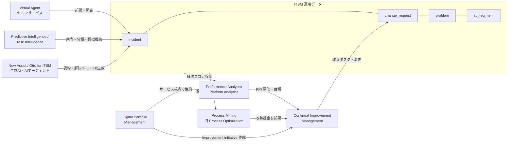
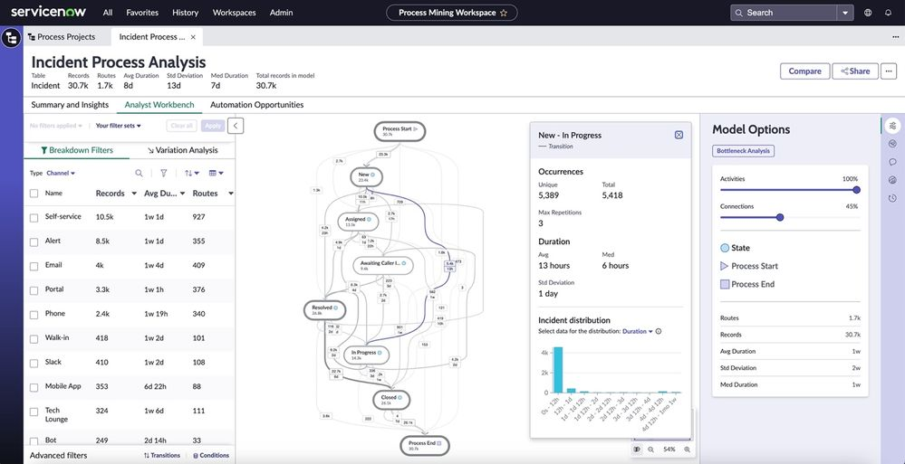
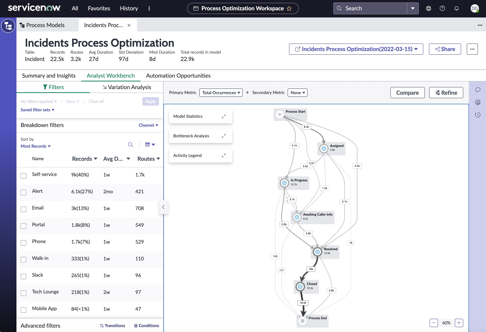
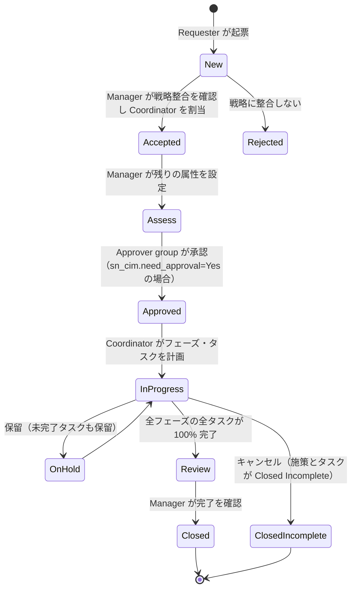
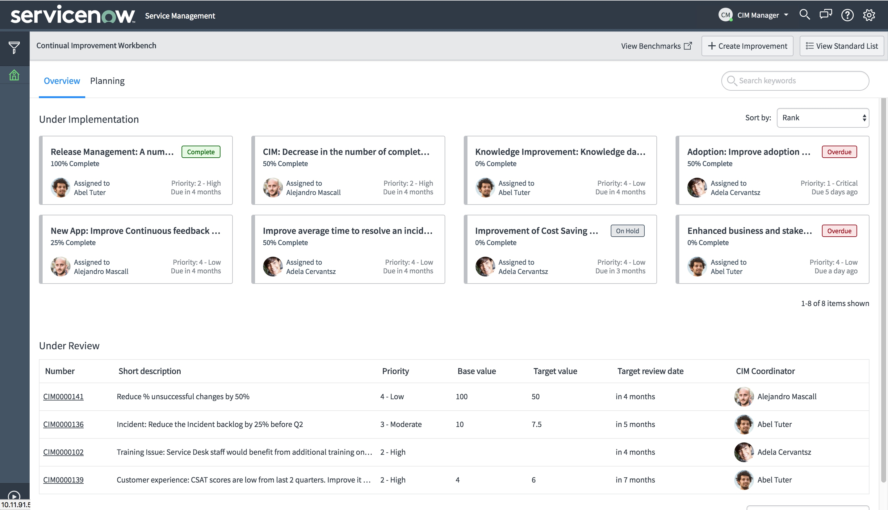
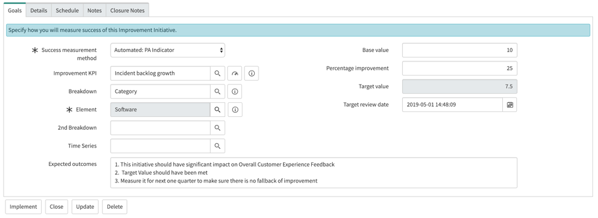

# ITSM Pro/Enterprise 固有機能

## 概要

本ファイルは、ServiceNow IT Service Management（ITSM、IT サービス管理）の上位パッケージで提供される「Standard（標準）を超える機能群」をまとめたリファレンスである。対象は次の 7 領域（＋関連する Task Intelligence）である。

| # | 機能（英語正式名称） | 日本語の意味 | 主な目的 | 本ファイルの節 |
|---|---|---|---|---|
| 1 | Predictive Intelligence for ITSM（＋ Task Intelligence for ITSM） | 予測インテリジェンス | 機械学習による分類（割り当てグループ・カテゴリ等の自動入力）と類似レコード推薦 | [§3](#3-predictive-intelligence-for-itsm) |
| 2 | Performance Analytics for ITSM（Platform Analytics） | パフォーマンス分析 | KPI の時系列収集・トレンド・目標管理 | [§4](#4-performance-analytics-for-itsm) |
| 3 | Virtual Agent（ITSM Virtual Agent） | 仮想エージェント（チャットボット） | セルフサービスでのチケット起票・状況確認 | [§5](#5-virtual-agentitsm-virtual-agent) |
| 4 | Process Optimization（現 Process Mining） | プロセス最適化／プロセスマイニング | 実データから実際のプロセスフローを可視化しボトルネックを特定 | [§6](#6-process-optimization現-process-mining) |
| 5 | Continual Improvement Management（CIM） | 継続的改善管理 | 改善施策（Improvement Initiative）の起案〜効果測定 | [§7](#7-continual-improvement-managementcim) |
| 6 | Now Assist for ITSM（現 ServiceNow Otto for ITSM） | 生成 AI 支援 | 要約・解決メモ生成・ナレッジ生成・変更リスク説明・AI エージェント | [§8](#8-now-assist-for-itsm現-servicenow-otto-for-itsm) |
| 7 | Digital Portfolio Management（DPM） | デジタルポートフォリオ管理 | サービス／ビジネスアプリを Plan-Build-Run で一画面に統合表示 | [§9](#9-digital-portfolio-managementdpm) |

- 基準リリースは **Australia**（2026-05 GA）。Brazil で判明している変更は「> **Brazil での変更:**」で併記する。
- 本ファイルで扱う各機能のうち、プラットフォーム共通の仕組み（Predictive Intelligence の学習基盤、Virtual Agent Designer、Now Assist 全般、Platform Analytics 全般）は、以下のプラットフォーム側リファレンスで詳述している。本ファイルは「ITSM での使われ方・ITSM 固有のコンテンツ」に絞る。
  - [Predictive Intelligence と AI Search](../platform/predictive-intelligence-ai-search.md)
  - [Virtual Agent と会話型AI](../platform/virtual-agent.md)
  - [Now Assist と AI Agents](../platform/now-assist-ai-agents.md)
  - [レポートとアナリティクス](../platform/reporting-analytics.md)
  - [プロセス自動化（RPA・Process Mining・Document Intelligence）](../platform/process-automation-rpa-mining.md)
- ITSM 全体のパッケージ構成は [ITSM 概要とパッケージ](itsm-overview.md)、エディションの比較・ライセンス条件は [エディション比較](../../03_導入編/03-edition-comparison.md) と [ライセンスモデル](../../03_導入編/01-licensing-model.md) を参照。

> **重要（2026 年の名称・パッケージ変更）**
> 1. 2026-04 に ServiceNow は従来の Standard / Pro / Pro Plus / Enterprise / Enterprise Plus の階層を **Foundation / Advanced / Prime** の 3 階層に置き換えたと報じられている（§2 参照）。本ファイルの題名にある「Pro/Enterprise」は既存契約・既存ドキュメントで広く使われる旧名称である。
> 2. 2026-05（Knowledge 2026）に、Now Assist・Moveworks・AI Experience を統合した AI ブランド **ServiceNow Otto** が発表され、ストアアプリ「Now Assist for ITSM」は「**ServiceNow Otto for ITSM**」に改称された（ストア版 17.0.5、2026-08 など）。公式ドキュメント上も両表記が混在している。[出典](https://www.servicenow.com/docs/r/store-release-notes/store-rn-itsm-now-assist.html)
> 3. Process Optimization は Vancouver リリースで **Process Mining** に改称済みである。[出典](https://www.servicenow.com/community/process-mining-article/servicenow-process-mining-formerly-process-optimization-faq/ta-p/2309083)

---

## 1. 機能間の関係（全体像）

ITSM 上位機能は単独でも使えるが、データの流れで相互に連携するよう設計されている。次の図は「データ収集 → 分析 → 改善 → 自動化」の循環を表す。

- Process Mining の ITSM コンテンツパック（`sn_itsm_po`）は、Incident / Change プロセス向けの CIM 改善施策を事前定義しており、Process Mining プロジェクトと自動的にリンクされる。[出典](https://www.servicenow.com/docs/r/AZQZDvc5eDr4fb4UyPv03g/TcTB_vZebwUaWCaR_3D4KA)
- CIM の Improvement Initiative フォームには Performance Analytics のスコアカード（Analytics Hub）が埋め込まれ、改善 KPI を継続監視する。[出典](https://www.servicenow.com/docs/r/QykF2iRSIs6VXztArCSo3w/~9VM~cLts7dNzxTkpTHAOA)
- DPM の Personal Portfolio から Improvement initiative を直接作成できる（CIM プラグインが必要）。[出典](https://www.servicenow.com/docs/r/QykF2iRSIs6VXztArCSo3w/q1kMnETv_tV7PtAuNGuoPA)

---

## 2. パッケージ（エディション）と機能の対応

### 2.1 旧パッケージ（Standard / Pro / Enterprise）での位置づけ

ServiceNow Community の「ITSM Pro onboarding guide」（2021-04 公開、2025-09 最終更新）は、ITSM Pro と Enterprise の包含機能を次のように整理している。[出典](https://www.servicenow.com/community/itsm-articles/itsm-pro-onboarding-guide/ta-p/2296018)

| 区分 | 機能 | ITSM Standard | ITSM Pro | ITSM Enterprise |
|---|---|:-:|:-:|:-:|
| Now Intelligence | Virtual Agent | － | ○ | ○ |
| Now Intelligence | Predictive Intelligence | － | ○ | ○ |
| Now Intelligence | Platform Analytics（Performance Analytics） | 限定版のみ（※1） | ○ | ○ |
| Modern Governance | DevOps Change Velocity | － | ○（※2） | ○ |
| Modern Governance | Digital Product Release | － | ○ | ○ |
| その他 | Continual Improvement Management | － | ○ | ○ |
| その他 | Process Mining（旧 Process Optimization） | － | －（※3） | ○ |
| その他 | Workforce Optimization for ITSM | － | － | ○ |
| 生成 AI | Now Assist for ITSM | － | Pro Plus（追加 SKU） | Enterprise Plus（追加 SKU） |

- ※1 Standard でも「Complimentary Performance Analytics for Incident Management」（機能限定版）がベースシステムに含まれる（§4.2）。
- ※2 2026-04 の新階層では DevOps Change Velocity は Prime のみと指摘するコメントがある【第三者情報】。[出典](https://www.servicenow.com/community/itsm-articles/itsm-licensing-in-april-2026-foundation-advanced-and-prime-in/ta-p/3544380)
- ※3 Process Mining FAQ（Community）は「Vancouver 以降、Process Mining は ITSM・CSM・HRSD・FSM・SPM・Creator Workflows に含まれる」と記載するが、ITSM のどの階層かは明示していない。オンボーディングガイドおよび第三者情報では Enterprise 機能として扱われることが多い。[出典](https://www.servicenow.com/community/process-mining-article/servicenow-process-mining-formerly-process-optimization-faq/ta-p/2309083)
- Digital Portfolio Management について、Xanadu の公式ドキュメントは「表示されるデータは standard / pro ライセンスのどちらかによって異なる」と記載している。[出典](https://www.servicenow.com/docs/r/Recj91eIo1YnsOabQjgskg/ltwbyowRAQEE0kkKWPynGw)
- 正式な包含条件は契約書（Order Form）と ServiceNow の「Product Descriptions」が唯一の根拠である。本表は公開情報の整理であり、契約判断に使う場合はアカウントチームへの確認が必要である。

### 2.2 2026-04 以降の新階層（Foundation / Advanced / Prime）

ServiceNow 公式ドキュメント「ServiceNow product tiers」（Brazil 版、2026-09-10 更新）は、3 階層を次のように定義している。[出典](https://www.servicenow.com/docs/r/intelligent-experiences/enable-ai-experiences/ai-native-sku-overview.html)

| 階層 | 公式定義（要旨） | AI エージェント | 主なプラットフォーム要素 |
|---|---|---|---|
| Foundation | AI 支援のインサイトと定型自動化（分類・パターン認識などタスク単位の支援） | 標準提供（OOTB）のエージェント | Now Assist、AI Control Tower、Workflow Data Fabric（Foundation）、RaptorDB Standard |
| Advanced | ワークフローのステップ全体を自動化するエージェント型ワークフロー | OOTB のエージェント | 同上（WDF Advanced は有償アップグレード） |
| Prime | 意思決定と実行を行う自律的な AI ワーカー（AI specialist） | OOTB ＋ 自然言語指示による新規エージェント構築 | 同上 ＋ AI Action Fabric の受信側 MCP Server Console |

ITSM 固有の階層別内容は公式ドキュメントで確認できなかった。Community 記事（著者は ServiceNow 社員かどうか不明）は次のように整理している【第三者情報】。[出典](https://www.servicenow.com/community/itsm-articles/itsm-licensing-in-april-2026-foundation-advanced-and-prime-in/ta-p/3544380)

| ITSM 階層 | 含まれる主な機能（第三者整理） |
|---|---|
| ITSM Foundation | Incident（基本）・Request・Asset・Cost。Virtual Agent、Predictive Intelligence、Now Assist for ITSM を OOTB レベルで含む |
| ITSM Advanced | Foundation ＋ ITIL 一式（Problem・Change・Major Incident・On-Call・Walk-up）、Platform Analytics Advanced、Process Mining for Platform、より多い Assist 割当 |
| ITSM Prime | Advanced ＋ DevOps Change Velocity、最大の Assist 割当、カスタム AI スキル／AI エージェントの新規構築、L1 Service Desk AI Specialist |

- 生成 AI は全階層にバンドルされ、別途の per-user AI SKU は不要になったとされる【第三者情報】。
- 旧階層から新階層への公式マッピングは公開情報では確認できず。同記事は「Professional を広く使っている顧客は Advanced を新たな比較基準とする」と述べるにとどまる【第三者情報】。
- ストアのリリースノート（Now Assist Suite、2026-07-09）では、Generative AI Controller 13.1.2 が「Good / Better / Best（Foundation / Advanced / Prime）階層モデル」で AI エンタイトルメントを標準化し、Now Assist Admin Console 9.0.5 が契約階層に含まれるスキルのみを管理者に表示するようになったと記載されている。[出典](https://www.servicenow.com/docs/r/store-release-notes/na-suite-rn-2026-07-09.html)
- 価格については [価格情報](../../03_導入編/02-pricing.md) を参照（本ファイルでは扱わない）。

---

## 3. Predictive Intelligence for ITSM

### 3.1 概要

Predictive Intelligence（予測インテリジェンス）は、ServiceNow AI Platform の機械学習フレームワーク（プラグイン `com.glide.platform_ml`）であり、ITSM では過去のチケットを学習してフィールド値の予測（Classification、分類）や類似レコードの推薦（Similarity、類似性）、グルーピング（Clustering、クラスタリング）を行う。学習・推論基盤の詳細は [Predictive Intelligence と AI Search](../platform/predictive-intelligence-ai-search.md) を参照。

ITSM での Predictive Intelligence の利用形態は 3 つある。

| 利用形態 | 対象 | 特徴 |
|---|---|---|
| ① ITSM 用の Solution Definition（ソリューション定義）を直接使う | Incident、Change | ベースシステムのテンプレートを有効化・学習させ、ビジネスルールで自動入力 |
| ② Task Intelligence for ITSM（ストアアプリ `com.snc.itsm_ml_task`） | Incident（＋ Problem / Change の類似） | Admin Console でモデル作成〜デプロイ〜監視。Service Operations Workspace のサイドパネルに推薦表示 |
| ③ ITSM Predictive Intelligence Workbench（旧） | Incident | ガイド付きテンプレート。後継として Task Intelligence または Predictive Intelligence 本体へ移行が案内されている |

[出典①](https://www.servicenow.com/docs/r/it-service-management/predictive-intelligence-for-incident.html) [出典③](https://www.servicenow.com/docs/bundle/yokohama-it-service-management/page/product/itsm-predictive-intel-workbench/concept/itsm-piwb-landing-page.html)

### 3.2 Predictive Intelligence for Incident Management の Solution Definition

公式ドキュメント（Brazil 版、2026-09-10 更新）に掲載されている Incident 向けの Solution Definition は次のとおり。[出典](https://www.servicenow.com/docs/r/it-service-management/predictive-intelligence-for-incident.html)

| Solution Definition | 種類 | 入力フィールド | 出力（予測・推薦） |
|---|---|---|---|
| Incident Assignment | Classification | Short description | Assignment group（割り当てグループ） |
| Incident Categorization | Classification | Short description | Category（カテゴリ） |
| Incident Service | Classification | Short description | Service（サービス） |
| Incident Configuration Item | Classification | Short description | Configuration item（構成アイテム） |
| Major Incident Detection | Similarity | Short description, Description | 紐付け候補の類似アクティブ Major Incident、Major Incident として提案すべき類似インシデント |
| Similar Incidents (Major Incident Workbench) | Similarity | Short description, Description | Major Incident に未リンクの類似インシデント |
| Similar Incidents | Similarity | Short description, Description | 類似インシデント一覧 |
| Similar Open Incidents | Similarity | Short description, Description | 現インシデントを紐付けられる類似オープンインシデント |
| Similar Closed Incidents | Similarity | Short description, Description | 類似クローズ済みインシデント |
| Similar Resolved Incidents | Similarity | Short description, Description | 類似解決済みインシデント |

#### 必要プラグイン

| 用途 | プラグイン |
|---|---|
| Classification（Assignment / Categorization / Service / CI） | `com.glide.platform_ml`、`com.snc.incident.ml_solution` |
| Similar Incidents（Major Incident Management） | `com.glide.platform_ml`、`com.snc.incident.mim.ml_solution` |
| Major Incident Recommendation | `com.snc.contextual_search_ml`、`com.snc.incident.mim.ml_solution` |
| Similar Open / Resolved / Similar Incidents / Similar Knowledge Articles | `com.snc.contextual_search_ml`、`com.snc.incident.mim.ml_solution` |

- 同ページ内でプラグイン ID の表記揺れ（アンダースコア有無）がある。導入時はインスタンスのプラグイン一覧で正確な ID を確認すること。

#### ビジネスルール

| ビジネスルール | テーブル | 動作 |
|---|---|---|
| Update Prediction Results | `incident` | インシデントのクローズ時に、ソリューションの Precision（適合率）と Coverage（カバレッジ）の統計を更新する。Incident Assignment と Incident Categorization のみに適用 |

- 分類用ビジネスルールは、Predictive Intelligence と Incident Management の両方が有効な場合のみ表示される。
- アップグレード時の注意：グローバルドメインでは、テンプレートの `solutionNames` 配列変数に呼び出すソリューションを明示的に列挙する。ドメイン分離環境（MSP 等）ではテンプレート内のコメントアウトされたコードを使う。テンプレートは `applyPredictionForSolution()` を呼び出し、既定値の変更有無にかかわらず予測を適用する。[出典](https://www.servicenow.com/docs/r/it-service-management/predictive-intelligence-for-incident.html)

### 3.3 Predictive Intelligence for Change Management

Change Management では次の 2 つの Solution Definition が提供される（Australia 版、2026-03-12 更新）。[出典](https://www.servicenow.com/docs/r/QykF2iRSIs6VXztArCSo3w/jJlxmeBeUweSFTLbwHKILQ)

| Solution Definition | 種類 | 目的 | プラグイン |
|---|---|---|---|
| Risk for proposed change | Similarity and Categorization | 変更の潜在リスクを予測。低リスク予測を Change Approval Policy（変更承認ポリシー）の自動承認に利用できる | Change Management - Risk Intelligence（`com.snc.change_management.ml.risk`） |
| Standard change candidates | Clustering | 共通フィールドを持つ変更をクラスタリングし、Standard Change（標準変更）提案テンプレートを推薦 | Change Management - Standard Change Template Intelligence（`com.snc.change_management.ml.sctp`） |

| ロール | できること |
|---|---|
| `admin` | Solution Definition とシステムプロパティの設定、標準変更提案ソリューションの学習 |
| `itil` または `sn_change_write` | 変更要求上でリスク予測（情報メッセージとして表示）と標準変更候補を閲覧 |

- これらのプラグインは Now Support から要求して有効化する、と公式ドキュメントに記載されている。
- 変更リスク計算の詳細は [Change Management](change-management.md) を参照。

### 3.4 Task Intelligence for ITSM

Task Intelligence for ITSM は、Predictive Intelligence を ITSM 向けに簡易化したストアアプリであり、Service Operations Workspace（SOW）のサイドパネルにフィールド予測と類似レコードを「実行可能な推薦（actionable recommendations）」として表示する。[出典](https://www.servicenow.com/docs/r/QykF2iRSIs6VXztArCSo3w/BhBLc~i590ni4VnMshledg)

| 項目 | 内容 |
|---|---|
| アプリ ID | `com.snc.itsm_ml_task`（ServiceNow Store から `admin` がインストール。依存するストアアプリ・プラグインも同時に追加される） |
| 管理画面 | Task Intelligence for ITSM Admin Console（モデルの作成・学習・設定・デプロイ・監視） |
| 設定手順 | ① 予測モデルをセットアップ・学習・デプロイ → ② デプロイ済みモデルを使うよう推薦（Recommendation）を設定 → SOW で利用可能 |
| 確認できたロール | `sn_itsm_ml_task.ti_user`（ITSM Task Intelligence Monitoring Dashboard の閲覧専用、2025 年のリリースノート記載。Australia での有効性は未確認） |

Task Intelligence のモデル種別（Yokohama 版の「Managing Task Intelligence for ITSM models」）は次のとおり。[出典](https://www.servicenow.com/docs/r/Mr7qUatbFXax1_h~z60rmA/IzprdEVEkormn7vfKjtGyA)

| モデル | 内容 |
|---|---|
| Incident Categorization | 新規インシデントのフィールドを予測 |
| Similar Incidents | 類似インシデントを特定 |
| Major Incident Recommendation | 類似のアクティブ Major Incident への紐付けや、Major Incident 化の提案 |
| Similar Open Change Requests for Incident | インシデントに関連しそうなオープン変更要求を推薦 |
| Similar Open Problems for Incident | インシデントに関連しそうなオープン問題を推薦 |

- モデルのライフサイクル：テンプレートからセットアップ → 学習テーブル・予測テーブルの定義 → 学習 → 結果評価・予測の挙動設定 → インシデントフォームへデプロイ → 性能監視 → 編集・再学習・再デプロイ。別インスタンスへのエクスポートも可能。[出典](https://www.servicenow.com/docs/r/QykF2iRSIs6VXztArCSo3w/tpDIL~_yqSeETA4FykEYrQ)

### 3.5 ITSM Predictive Intelligence Workbench（旧機能）

- 「Predict Assignment Group for incoming incidents」などのガイド付きテンプレートを持つ旧来のツール。メニューは **All > Predictive Intelligence Workbench > Use Cases > Create New from Template**、必要ロールは `piwb_manager` または `piwb_viewer`（Washington DC 版の記載）。[出典](https://www.servicenow.com/docs/r/BgFKZnPHldZ62gGtzQ71Mw/QmZdfeTHfmFwzmSLPxbLTQ)
- Yokohama 版のランディングページは、同等機能を求める顧客には Task Intelligence for ITSM（`com.snc.itsm_ml_task`）または Predictive Intelligence（`com.glide.platform_ml`）への移行を案内している。新規導入では Workbench を選ばない。[出典](https://www.servicenow.com/docs/bundle/yokohama-it-service-management/page/product/itsm-predictive-intel-workbench/concept/itsm-piwb-landing-page.html)

### 3.6 学習データ要件・ロール・プロパティ

| 項目 | 値 | 出典 |
|---|---|---|
| Classification 学習の最小レコード数 | プロパティ `glide.platform_ml.api.csv_min_line`（既定 10000）。下回ると学習が失敗する | [Predictive Intelligence properties](https://www.servicenow.com/docs/r/intelligent-experiences/predictive-intelligence/predictive-intelligence-properties.html) |
| 推奨レコード数 | 30,000〜300,000 件。300,000 件超の場合は直近 300,000 件で学習（Yokohama 版の記載） | [Create and train a classification solution](https://www.servicenow.com/docs/r/_yCRwrQYX6H0b46tCsDNZA/vTeyKPuVzyw~LrMP0lg1zA) |
| クラスの最小件数 | 学習データ内で 30 件未満のクラス（ラベル）は学習対象から除外 | [Minimum records needed for label](https://www.servicenow.com/docs/r/SRy58xeijUUqttfwLgfrHQ/lrLNhsfxBce912LgDORLmw) |
| ロール | `ml_admin`（`ml_predictor_results` / `ml_predictor_results_task` の CRUD）、`ml_report_user`（同テーブルの参照）、ML Labeler | [Predictive Intelligence roles](https://www.servicenow.com/docs/r/roles-by-product/roles_predictiveintelligence.html) |
| 監視ダッシュボード | Predictive Intelligence > Dashboards > Monitoring（Predictive Intelligence Usage Analytics、`ml_admin` または `ml_report_user`） | [Usage Analytics dashboard](https://www.servicenow.com/docs/r/XRgEFx7nPN6ciT_BBIvnbg/tU7Ejyh9cdmjbws5Y8txew) |
| 学習実行ユーザー | 有効化時に `sharedservice.worker` ユーザーが作成され、`platform_ml_read` / `platform_ml_write` / `platform_ml_create` を持つ（他ユーザーへの付与・編集は不可） | [Install Predictive Intelligence](https://www.servicenow.com/docs/r/intelligent-experiences/install-predictive-intelligence.html) |

- Precision / Coverage の目標値は Solution Definition ごとに設定できる。1 つのモデルで全グループを網羅できない場合、複数の Solution Definition を段階的に呼び出す設計がコミュニティで紹介されている【第三者情報】。[出典](https://www.servicenow.com/community/intelligence-ml-articles/tuning-predictive-intelligence-models-part-1/ta-p/2301076)

---

## 4. Performance Analytics for ITSM

### 4.1 概要

Performance Analytics（PA、パフォーマンス分析）は、レコードを日次などで集計してスコアを時系列で保存し、トレンド・目標（Target）・閾値（Threshold）・ブレークダウン（Breakdown）で KPI を分析する機能である。Xanadu 以降、UI は **Platform Analytics**（Next Experience の分析体験）に統合されつつあり、新規インスタンスおよび移行後は「Performance Analytics」メニューがナビゲーターに表示されず、機能は **Platform Analytics Administration** 配下にまとめられる。[出典](https://www.servicenow.com/docs/r/3ongaT2PAVB3Cqoicgnoxg/qV~ndN2VeOyeNtcXfxuJuA)

- 指標（Indicator）、ブレークダウン、データ収集ジョブ等の仕組みは [レポートとアナリティクス](../platform/reporting-analytics.md) を参照。
- 本節では ITSM 向けの Content Pack（コンテンツパック、事前定義済みの指標・ダッシュボード）と、Standard で使える限定版を扱う。

### 4.2 Complimentary Performance Analytics for Incident Management（限定版）

ベースシステムには、PA を試用するための限定版「Complimentary Performance Analytics for Incident Management」が含まれる（Brazil 版ドキュメント）。[出典](https://www.servicenow.com/docs/r/now-intelligence/performance-analytics/r_StUpPAInctMgmt.html)

| 項目 | 限定版の仕様 |
|---|---|
| 指標 | 指標の追加・削除は不可 |
| 履歴 | 本日から遡って最大 180 日分のスコアのみ可視化 |
| ドメイン | グローバルドメインでのみ利用可 |
| ダッシュボード | Incident Management ダッシュボード（15 指標）を提供（Reporting incidents ページの記載） |
| フル機能化 | PA のサブスクリプション契約、または非本番インスタンスで無償でフル機能プラグインを有効化して評価可能 |
| 管理 | Performance Analytics Admin Console を含み、ここからフル機能を有効化できる |

[ダッシュボード 15 指標の出典](https://www.servicenow.com/docs/r/QykF2iRSIs6VXztArCSo3w/laMgfbcsN69EhM1FQaRlgw)

### 4.3 ITSM 向け Content Pack

ITSM 上位パッケージ（旧 Pro 以上）では、ITSM 各プロセスの Content Pack を有効化できる。ServiceNow 社員による Community 記事（2017 年時点、Kingston〜New York 対象）が列挙する「Performance Analytics for Service Management」エンタイトルメントで有効化できる Content Pack は次のとおり。最新リリースでの名称・構成は差異がありうる。[出典](https://www.servicenow.com/community/platform-analytics-articles/performance-analytics-for-service-management/ta-p/2300095)

| 種別 | Content Pack 名 |
|---|---|
| プロセス別 | Change Management / Problem Management / Request Management (Requested Item) / Request Management (Requests) / Incident SLA Management / Major Incident Management |
| ダッシュボード | ITSM Dashboards（プラグイン `com.snc.pa.itsm_dashboards`） |
| Context Sensitive Analytics | Change Management / Incident / Problem Management（フォーム上で関連指標を表示） |
| Spotlight | Change / Incident / Problem / Request Spotlight（優先度付けのためのスコアリング） |

- Incident Management の指標は `com.snc.pa` と `com.snc.pa.itsm_dashboards` の Content Pack に含まれる。[出典](https://www.servicenow.com/docs/r/US6ajuI5T26ee32kSvfHDw/Co4A345n_YV2Z3FHqfxA5g)
- Incident Management（`com.snc.pa`）と Incident SLA（`com.snc.pa.sla`）は別ソリューションとして提供される。[出典](https://docs.servicenow.com/bundle/newyork-performance-analytics-and-reporting/page/use/dashboards/reference/r_AvailableContentPacks.html)
- 代表的な指標例（Process Mining の ITSM KPI でも使われる）：Average time to resolve incidents（平均解決時間）、% of incidents resolved on first assignment（初回割当解決率）。[出典](https://www.servicenow.com/docs/r/pVA_t2FBRJGAybmbtWqZ2A/yepYmHfjBZrawcJ8~fP66w)

### 4.4 Platform Analytics 移行の影響（ITSM 利用者向け）

| 項目 | 内容（Xanadu リリースノート） |
|---|---|
| Core UI のレスポンシブダッシュボード | 新規顧客には提供されない。既存顧客の既存ダッシュボードは引き続き動作 |
| PA ウィジェット・インタラクティブフィルター | 新規顧客は利用不可。Platform Analytics の Data Visualization とフィルターを使う |
| Analytics Hub | 新規顧客では KPI Details に置き換え |
| Process Mining 連携 | ダッシュボードの Insights 提案から Process Mining プロジェクトを直接作成可能 |

[出典](https://www.servicenow.com/docs/r/3ongaT2PAVB3Cqoicgnoxg/qV~ndN2VeOyeNtcXfxuJuA)

- Core UI ダッシュボードの廃止時期について「Australia で予定」とする ServiceNow 社員の Community 回答（2025-02）があるが、公式な Australia での廃止告知は確認できなかった。[出典](https://www.servicenow.com/community/platform-analytics-forum/when-is-performance-analytics-deprecated/m-p/3177851)
- 2026-04 新階層では、ITSM Advanced に「Platform Analytics Advanced」が含まれるとされる【第三者情報】（§2.2）。

---

## 5. Virtual Agent（ITSM Virtual Agent）

### 5.1 概要

Virtual Agent（仮想エージェント）は ServiceNow の会話型 AI（チャットボット）であり、ITSM 向けには「ITSM Virtual Agent」として IT チケットの起票・状況確認・承認処理などの事前構築済みトピック（Pre-built topics）が提供される。Virtual Agent Designer、NLU、LLM トピック、チャネル連携（Teams / Slack 等）の詳細は [Virtual Agent と会話型AI](../platform/virtual-agent.md) を参照。

### 5.2 ITSM Virtual Agent の事前構築トピック（Australia）

公式ドキュメント「Self-Service pre-built topics for ITSM Virtual Agent」（Australia 版、2026-03-12 更新）に掲載されるトピックは次のとおり。[出典](https://www.servicenow.com/docs/r/QykF2iRSIs6VXztArCSo3w/HL9M0soJWwtVOf553k_3Sw)

| トピック | 内容 | 必要なプラグイン／スポーク | 状態 |
|---|---|---|---|
| Open IT Ticket 2.0 | インシデントを作成。類似のオープンチケットを提示して重複起票を防止（旧名 Intelligent Open IT Ticket） | Predictive Intelligence for Incident（`com.snc.incident.ml`） | 推奨 |
| Open IT Ticket | ナレッジ記事を提示し、解決しなければインシデントを作成 | 任意で Universal Request（`com.snc.universal_request`） | **非推奨**（Open IT Ticket 2.0 を使用） |
| Check IT Ticket Status | ユーザーのアクティブなインシデント／リクエスト一覧を表示し、コメント追加やライブエージェント接続が可能 | なし | 利用可 |
| Check Ticket and Support Status | インシデント・顧客ケース・HR チケットを番号や説明文で検索 | なし | 利用可 |
| Escalate IT Ticket | 理由を必須入力させてチケットの緊急度を引き上げる | なし | 利用可（Yokohama の LLM トピック一覧では Deprecated 表記あり） |
| Process Approval | `approver_user` ロールを持つユーザーのアクティブな承認を一覧表示 | なし | 利用可 |
| Service Disruptions | 計画・計画外の停止や性能劣化を表示 | なし | 利用可 |
| My Assigned Equipment | 割り当て済み機器を表示し、資産関連インシデントを作成 | なし | 利用可 |
| Walk-up Check-in | Walk-up 窓口へのチェックイン、予約 | Walk-up Experience（`com.snc.walkup`） | 利用可 |
| Book Conference Room EXO / OnPrem | 会議室予約（Exchange Online／オンプレ Exchange） | `sn_ex_online_spke` / `sn_exchange_spoke` | 利用可 |
| Set OOO reply Exchange Server | 不在時自動応答の設定 | `sn_exchange_spoke` | 利用可 |
| Get Zoom Meeting Recording | Zoom 録画の取得 | Exchange Online スポーク、Zoom スポーク | 利用可 |
| Windows 365 Cloud PC | Cloud PC の申請（上長承認付き） | Azure AD スポーク（`com.sn.azure_ad.spoke`）、Integration Hub | 利用可 |
| Get Password Reset Link | パスワードリセットリンクの提供 | Password Reset の設定 | **非推奨**（Reset Password を使用） |
| Submit a request | カタログアイテムの検索・申請 | なし | **非推奨**（Fallback setup トピックを使用） |

- 同ページは「Report IT issue」も非推奨で Open IT Ticket 2.0 に置き換えられたと記載している。
- パスワードリセット系トピックには Password Reset プラグイン（`com.glideapp.password_reset`）が必要。[出典](https://www.servicenow.com/docs/r/t~YvqQkg2oQX4L7ySrpyuQ/74DQs5KKaoUcqPbhVG9~gg)

### 5.3 ITSM Virtual Agent の LLM トピック

Now Assist in Virtual Agent を利用する場合、LLM が利用者の意図を判定して起動する「事前構築 LLM トピック」が提供される（Yokohama 版ドキュメント）。[出典](https://www.servicenow.com/docs/r/Mr7qUatbFXax1_h~z60rmA/2N3VeReLoFcYRLQvu1JcKQ)

| LLM トピック | 内容 | 前提 |
|---|---|---|
| Check Ticket and Support Status | IT チケット・サポートケースの状況を 1 問ずつ聞き取りながら確認 | HR ケースを含める場合は Core RCA レコードの Read/Write 許可が必要 |
| Show Pending Approvals | 保留中の承認を一覧表示し、番号指定で承認・却下 | － |
| Check your device's health using DEX | デバイス性能の監視と問題診断 | Now Assist for ITSM と DEX（Digital End-user Experience）のインストール |

- LLM トピックは読み取り専用で、名前に「(Template)」の接尾辞が付く。利用時は ITSM Virtual Agent conversation スコープ内で複製（Duplicate）し、社内命名規則に従って名前を変更する。
- 2026-04 新階層では Virtual Agent の会話数は無制限とされる【第三者情報】。[出典](https://www.servicenow.com/community/itsm-articles/itsm-licensing-in-april-2026-foundation-advanced-and-prime-in/ta-p/3544380)
- Moveworks（2025 年に ServiceNow が買収）は EmployeeWorks として各階層に同梱されると公式ドキュメントに記載されている。ITSM Virtual Agent との役割分担は公開情報では確認できず。[出典](https://www.servicenow.com/docs/r/intelligent-experiences/enable-ai-experiences/ai-native-sku-overview.html)

---

## 6. Process Optimization（現 Process Mining）

### 6.1 概要

Process Mining（プロセスマイニング、旧称 Process Optimization）は、ServiceNow 上のレコードの状態遷移・フィールド変更履歴（監査ログ）から「実際に流れたプロセス」をプロセスマップとして自動描画し、ボトルネック、手戻り（Rework）、ピンポン（Multihop）、逸脱経路を分析する機能である。Vancouver リリースで Process Optimization から Process Mining に改称された（ワークスペース名・ロール名・ドキュメントに旧名が残る箇所がある）。[出典](https://www.servicenow.com/community/process-mining-article/servicenow-process-mining-formerly-process-optimization-faq/ta-p/2309083)

- **キャプション：** Process Mining Workspace で Incident テーブルのプロセスモデル「Incident Process Analysis」を開き、Analyst Workbench タブを表示した画面。
- **画面説明：** 上部ナビゲーションに「Process Mining Workspace」と表示される。ヘッダーにテーブル（Incident）、Records（30.7k）、Routes（1.7k）、Avg / Med Duration、Std Deviation が並び、右上に Compare・Share ボタンがある。タブは「Summary and Insights」「Analyst Workbench」「Automation Opportunities」の 3 つ。左ペインは Breakdown Filters（例：Channel 別に Self-service、Alert、Email、Portal、Phone、Walk-in、Slack 等のレコード数・平均所要時間・ルート数）と Variation Analysis。中央はプロセスマップ（Process Start → New → Assigned → Awaiting Caller Info / In Progress → Resolved → Closed → Process End、矢印に遷移件数）。遷移「New - In Progress」を選択すると Occurrences、Duration（平均・中央値・標準偏差）、分布ヒストグラムが表示される。右ペインは Model Options（Bottleneck Analysis、Activities / Connections のスライダー）。
- **出典：** https://www.servicenow.com/community/process-mining-article/servicenow-process-mining-formerly-process-optimization-faq/ta-p/2309083 （取得日：2026-11-03）

- **キャプション：** 改称前の「Process Optimization Workspace」における Incidents Process Optimization モデルの Analyst Workbench（2022 年頃の画面）。
- **画面説明：** 構成は上記とほぼ同じで、Primary Metric（Total Occurrences）と Secondary Metric を選択するドロップダウン、Compare・Refine ボタン、Model Statistics・Bottleneck Analysis・Activity Legend のパネルがある。現行版と比較すると名称のみが Process Mining に変わったことが分かる。
- **出典：** https://www.servicenow.com/community/process-mining-article/servicenow-process-mining-formerly-process-optimization-faq/ta-p/2309083 （取得日：2026-11-03）

### 6.2 プラグイン・ロール

| 項目 | 内容 |
|---|---|
| プラグイン | `com.sn_po`（Process Mining 本体） |
| ITSM コンテンツパック | ITSM content pack for Process Mining（`sn_itsm_po`、ServiceNow Store） |
| ワークスペース | Process Mining Workspace（Analyst workbench でプロジェクトを閲覧・管理） |

ロール（Brazil 版「Components installed with Process Mining」）。[出典](https://www.servicenow.com/docs/r/now-intelligence/process-mining/components-installed.html)

| ロール | 名称 | 権限 | 包含ロール |
|---|---|---|---|
| `sn_process_mining_admin` | Process mining administrator | 全プロジェクトへのアクセス、全設定の管理、バックグラウンドジョブのスケジュール | `sn_process_mining_power_user` |
| `sn_process_mining_power_user` | Process Mining power user | 全プロジェクトへのアクセス、プロジェクト設定管理、作成・共有、ジョブスケジュール | `sn_process_mining_analyst` |
| `sn_process_mining_analyst` | Process Mining Analyst | プロジェクトの作成・共有、共有されたプロジェクトの閲覧（全プロジェクトにはアクセス不可） | なし |

- 一部のドキュメント（例：Security Incident Response 用 Content Pack、Australia 版）では旧名 `sn_process_optimization_admin` / `sn_process_optimization_power_user` / `sn_process_optimization_analyst` が記載されている。インスタンス上の実際のロール名を確認すること。[出典](https://www.servicenow.com/docs/r/pVA_t2FBRJGAybmbtWqZ2A/fFyMazjYyZ9AtllSYI56KQ)
- Community FAQ は Admin / Power User / Analyst / Viewer の 4 ロールを挙げているが、上記公式ページには Viewer は掲載されていない。

### 6.3 主要テーブル

Process Mining のインストールで 32 テーブルが作成される。主要なものは次のとおり。[出典](https://www.servicenow.com/docs/r/now-intelligence/process-mining/components-installed.html)

| テーブル | ラベル | 用途 |
|---|---|---|
| `ml_capability_definition_promin` | Process Mining Definition | プロジェクト（マイニング定義） |
| `promin_activity_def` | Activity Definition | アクティビティとして扱うフィールド（例：State、Assignment group） |
| `promin_breakdown_field` | Breakdown Definition | ブレークダウン（例：Channel、Priority） |
| `promin_model` / `promin_model_def_version` | Process Model / Version | 生成されたモデルとバージョン |
| `promin_node` / `promin_node_stats` | Process Node / Statistics | マップ上のノード（アクティビティ）と統計 |
| `promin_arc` / `promin_route` / `promin_route_stats` | Process Connection / Route / Route Statistics | 遷移・経路（バリアント）と統計 |
| `promin_filter_set` / `promin_conditions` | Filter set / Filter Set Condition | 保存フィルター |
| `promin_process_def` | Process Configuration | プロセス構成（インサイトフィルター等） |
| `promin_finding_def` / `promin_finding` | Finding Definition / Finding | インサイト（発見事項）の定義と結果 |
| `promin_automated_finding` | Automated Finding Definition | 自動インサイト |
| `promin_job` / `promin_job_m2m_project` | Scheduled Process Mining Jobs | スケジュール実行ジョブ |
| `promin_case_record` / `promin_case_data` | Case Record / Promin case data | ケース（分析対象レコード）データ |
| `promin_permission` | Permission | プロジェクト共有権限 |

### 6.4 主なシステムプロパティ

| プロパティ | 既定値 | 説明 |
|---|---|---|
| `promin.limit.node_def` | 10 | プロセスマップ上の親アクティビティ数の上限 |
| `promin.limit.child_node_def` | 5 | 子アクティビティ数の上限 |
| `promin.limit.breakdown_def` | 10 | 親ブレークダウン数の上限 |
| `promin.limit.child_breakdown_def` | 5 | 子ブレークダウン数の上限 |
| `promin.primary_metric` | caseFreq | Analyst workbench の主指標 |
| `promin.secondary_metric` | avgDuration | Analyst workbench の副指標 |
| `promin.rca.min_condition_and_effect` | 10 | 根本原因分析で Leading influencer とみなす最小レコード割合（%） |
| `promin.rca.min_odds_ratio` | 1 | 根本原因分析の最小オッズ比 |
| `promin.rca.result_count` | 20 | 表示する Leading influencer 数 |
| `promin.perf.result_page_size` | 700 | マイニング結果のページサイズ |
| `promin.pa_integration_required_roles` | － | Platform Analytics のダッシュボード／指標から Process Mining を起動できるロール |
| `promin.metered_usage.allow_unrestricted` | false | 従量利用のガードレールを無効化 |
| `promin.metered_usage.warning_limit` | -1 | 従量利用の警告を出すレコード数（-1 は警告なし） |
| `promin.workspace.hide_from_navigation` | false | Process Mining ロールを持たないユーザーからワークスペースを隠す |
| `promin.feature.enable_evaluation` | true | 評価（Evaluation）機能の有効化 |

[出典](https://www.servicenow.com/docs/r/now-intelligence/process-mining/components-installed.html)

### 6.5 ITSM content pack for Process Mining（`sn_itsm_po`）

ITSM 向けコンテンツパックは、次の ITSM プロセスについて事前構築済みの Process Mining プロジェクト定義を追加する（Australia 版、2026-03-12 更新）。[出典](https://www.servicenow.com/docs/r/AZQZDvc5eDr4fb4UyPv03g/TcTB_vZebwUaWCaR_3D4KA)

| 対象プロセス | 主テーブル | コンテンツ |
|---|---|---|
| Incident Management | `incident` | プロジェクト定義、クラスター分析用 Solution Definition、KPI、インサイト |
| Problem Management | `problem` | 同上 |
| Change Management | `change_request` | 同上 |
| Request Management | `sc_req_item` | 同上 |

- Incident / Change プロセス向けに事前定義の CIM 改善施策が含まれ、Process Mining プロジェクトと自動リンクされる。
- 既定の KPI ダッシュボードが提供され、ダッシュボードや要素を追加作成できる。
- 既定のインサイトフィルター例：Multihop issue（多段再割当）、Solution rejection issue（解決の却下）、Misuse of On Hold state（保留状態の誤用）、SLA missed issues、Change の失敗・事前承認関連。設定は **All > Process Mining > Process Configurations**（必要ロール `sn_process_mining_power_user`）。[出典](https://www.servicenow.com/docs/r/J7UfGStUvhlVOcoqiM3zlQ/Vk36FWFQTP27H4NC746a2g)
- 既定 KPI 例：Average time to resolve incidents、% of incidents resolved on first assignment（Problem / Change / RITM にも同様の KPI）。KPI と一部インサイトには Process Mining ITSM content pack v1.2 以上が必要。[出典](https://www.servicenow.com/docs/r/pVA_t2FBRJGAybmbtWqZ2A/yepYmHfjBZrawcJ8~fP66w)

### 6.6 制約・ライセンス上の注意

| 項目 | 内容 | 出典 |
|---|---|---|
| 対象データ | 各ワークフローのライセンスが必要（例：SPM テーブルをマイニングするには SPM のエンタイトルメントが必要） | [Community FAQ](https://www.servicenow.com/community/process-mining-article/servicenow-process-mining-formerly-process-optimization-faq/ta-p/2309083) |
| 外部データ | ServiceNow 外のアプリケーションのデータをマイニングするには Automation Engine のエンタイトルメントが必要 | 同上 |
| 非本番 | 非本番インスタンスでのサンプルマイニングは 3,600 レコードまで | 同上 |
| PDI | Personal Developer Instance では利用不可 | 同上 |
| ドメイン分離 | データレベルのドメイン分離をサポート | 同上 |
| 2026 新階層 | Prime では Process Mining のレコード上限が 15,000 に引き上げられる、との記述あり（CSM の文脈）【第三者情報】 | [Community 記事](https://www.servicenow.com/community/architect-articles/the-april-2026-servicenow-csm-packaging-redesign-what/ta-p/3562359) |

- Workforce Optimization for ITSM と Process Mining を連携し、ボトルネックをチーム単位で特定する機能もある（Enterprise 機能、プラグイン `com.sn_po` の有効化が前提）。[出典](https://www.servicenow.com/docs/r/Recj91eIo1YnsOabQjgskg/nq77Rldx4cSI~bD7aZJpMw)
- Process Mining のプラットフォーム全般（Task Mining、Automation Discovery 等）は [プロセス自動化（RPA・Process Mining・Document Intelligence）](../platform/process-automation-rpa-mining.md) を参照。

> **Brazil での変更:** 「Process Mining for ITSM」の Zurich→Brazil 統合リリースノートでは、Australia には更新なし、Brazil では有効化情報として「Process Mining is available by default（既定で利用可能）」と記載されている。ハイライトとして、監査ログからの実際のワークフロー経路の自動発見、停滞した承認や手戻りのボトルネック・根本原因分析が挙げられている。新機能・変更・廃止は「No updates」。[出典](https://www.servicenow.com/docs/r/delta-zurich-brazil/brazil-zurich-processminingforitsm-release-notes.html)

---

## 7. Continual Improvement Management（CIM）

### 7.1 概要

Continual Improvement Management（CIM、継続的改善管理）は、サービス・プロセス・機能の改善施策（Improvement Initiative）を、測定可能な目標・フェーズ・タスクとともに一元的に計画・実施・監視するアプリケーションである（Australia 版、2026-03-12 更新）。ITIL 4 の「継続的改善（Continual Improvement）」プラクティスに対応する。[出典](https://www.servicenow.com/docs/r/QykF2iRSIs6VXztArCSo3w/8obpTCUstAAyzqpj8stFfA)

| 特徴 | 内容 |
|---|---|
| Guided Setup | **Continual Improvement > Administration > Guided Setup** から設定。Improvement Manager / Coordinator ロールと CIM Approvers グループ（既定で空）のメンバーを割り当てる |
| Continual Improvement Workbench | タイル表示とリスト表示で、実施中・レビュー中・バックログの改善を計画・承認・監視 |
| ドメイン分離 | 追加設定なしで対応。特定ドメインまたはグローバルドメインで改善を作成可能 |
| 連携 | 連携アプリから改善を作成、改善施策から連携レコードを作成可能 |
| 入手方法 | サブスクリプション購入後、Application Manager から CIM プラグインをインストール |

### 7.2 テーブル・プロパティ・スケジュールジョブ

「Components installed with Continual Improvement Management」（Australia 版）。[出典](https://www.servicenow.com/docs/r/QykF2iRSIs6VXztArCSo3w/Cq7YCLEXohJzH11xiA_vzg)

| テーブル | ラベル | 用途 |
|---|---|---|
| `sn_cim_register` | Improvement Initiative | 改善施策本体（Improvement Register、番号は CIM で始まる） |
| `sn_cim_task` | CIM Task | 改善タスク |
| `sn_cim_related_kpi` | Impacted KPIs | 改善施策が影響する KPI |
| `sn_cim_inbound_m2m` | Inbound CIM Integration | 他アプリから CIM への連携 |
| `sn_cim_outbound_m2m` | Outbound CIM Integration | CIM から他アプリへの連携 |

| プロパティ | 既定値 | 説明 |
|---|---|---|
| `sn_cim.need_approval` | Yes | Accepted から Approved への遷移に手動承認を必須とする |
| `sn_cim.initiative_copy_attributes` | － | アプリケーションタスクレコードへコピーする属性の一覧 |
| `sn_cim.create_default_phase` | No | 新規施策作成時に既定フェーズを作成する |

- プロパティの設定画面：**Continual Improvement > Administration > Properties**
- スケジュールジョブ：`[PA Continual Improvement] Daily CIM data collection`、`[PA Continual Improvement] Historical CIM data collection`（CIM 用 PA データ収集）
- DPM 連携ページでは CIM のプラグイン ID を `com.sn_cim` と記載している。[出典](https://www.servicenow.com/docs/r/Recj91eIo1YnsOabQjgskg/ltwbyowRAQEE0kkKWPynGw)

### 7.3 ロール

[出典](https://www.servicenow.com/docs/r/QykF2iRSIs6VXztArCSo3w/VSrZSYTVhywmKSfJzHJlKA)

| ロール | 名称 | 主な権限 |
|---|---|---|
| `sn_cim.improvement_requester` | Improvement Requester | CIM 有効化時に自動付与。改善施策の起票、自分が起票した施策の追跡、組織内の全 CIM リクエストの閲覧、ウォッチリスト追加 |
| `sn_cim.improvement_coordinator` | Improvement Coordinator | 割り当てられた改善の管理（プロセス／サービス単位）、Workbench 利用、フェーズ・タスク管理。Enterprise Strategy の作成と改善の削除は不可 |
| `sn_cim.improvement_manager` | Improvement Manager | 全改善に責任を持つ。受付・Coordinator のアサイン・進捗監視・レビュー・クローズ。改善の**削除**（Improvement Register から除外）と Enterprise Strategy の作成はこのロールのみ |
| （グループ）CIM Approvers | Approver group | 改善の承認／却下。既定では 1 名の承認で足りる。挙動は Flow Designer の CIM Approval フローで変更可能 |

- Zurich 以降、Coordinator / Manager は ITIL ロールに関する制約なしに改善施策を実施・監視できる。また CIM タスクから変更レコードを作成できる（`itil` または `change_write` を持たないユーザーは管理者への依頼が必要）。[出典](https://www.servicenow.com/docs/r/u1slaAtcFiiXFQcd9RcR_A/~gLxkqSIM1GoxIfkxi7QcA)

### 7.4 改善施策のライフサイクル（状態遷移）

「Managing improvements」（Australia 版）で説明される状態は New → Accepted → Assess → Approved → In Progress → Review → Closed である。[出典](https://www.servicenow.com/docs/r/QykF2iRSIs6VXztArCSo3w/~9VM~cLts7dNzxTkpTHAOA)

| 状態 | 担当 | 内容 |
|---|---|---|
| New | Improvement Requester | 改善の必要性を起票 |
| Accepted | Improvement Manager | 少なくとも 1 つの企業戦略目標（Enterprise Strategy）に整合することを確認し、Coordinator を割当。整合しない場合は却下 |
| Assess | Improvement Manager | 残りの属性を設定し承認へ提出 |
| Approved | Approver group | 承認または却下（1 名または全員が評価） |
| In Progress | Coordinator / Manager | フェーズ・タスクの作成と進捗管理。保留（On Hold）可。キャンセルすると施策とタスクは Closed Incomplete |
| Review | Coordinator | 全 CIM タスク完了後に Review へ |
| Closed | Improvement Manager | 完了を検証してクローズ |

- 図中の「Rejected」「OnHold」「ClosedIncomplete」は公式記述（却下・保留・キャンセル）を図示するための表現であり、実際の State 選択肢の値は公開情報では確認できず。

#### 進捗率の計算

- 進捗（Percent complete）は、Closed Complete のタスクの割合を**タスク期間で重み付け**して算出する。期間は計画終了日に基づき、長いタスクほど進捗への寄与が大きい。例：Task 1（2 日）20%、Task 2（3 日）30%、施策に直接付いた Task 3（2 日・未完了）50%。[出典](https://www.servicenow.com/docs/r/QykF2iRSIs6VXztArCSo3w/~9VM~cLts7dNzxTkpTHAOA)

### 7.5 Workbench・Improvement Register・KPI

| 機能 | 内容・メニュー |
|---|---|
| Continual Improvement Workbench | **All > Continual Improvement > Workbench**。Overview / Planning タブ |
| Improvement Register | Workbench で **View Standard List** を選択すると、全改善（オープン・クローズ）とタスク・フェーズを一覧できる |
| Enterprise Strategies | **Continual Improvement > Enterprise Strategies**（または Organization > Enterprise Strategy）。施策フォームの Strategies フィールドで紐付け。作成は Improvement Manager のみ |
| KPI 監視 | 施策フォームに Analytics Hub（PA スコアカード）が埋め込まれ、Show Records で KPI 値の元レコードを表示。Impacted KPIs 関連リストにもスコアカードが表示される |

- **キャプション：** Continual Improvement Workbench の Overview タブ（CIM Manager でログイン、2019 年頃の UI）。
- **画面説明：** ヘッダー右側に「View Benchmarks」「Create Improvement」「View Standard List」（Improvement Register へのリンク）ボタンがある。「Under Implementation」セクションに改善施策がタイル表示され、各タイルに施策名、完了率（例：50% Complete）、担当者（Assigned to）、優先度、期限、状態バッジ（Complete / Overdue / On Hold）が表示される。下部の「Under Review」セクションは表形式で Number（CIM0000141 等）、Short description、Priority、Base value、Target value、Target review date、CIM Coordinator を並べる。現行リリースでは UI デザインが異なる可能性がある。
- **出典：** https://www.servicenow.com/community/itsm-blog/cim-application-guide-best-practices-for-implementation-how-to/ba-p/2265917 （取得日：2026-11-03）

### 7.6 Improvement Initiative フォームの主なフィールド

DPM から作成する場合の Improvement Initiative フォーム（Australia 版）。[出典](https://www.servicenow.com/docs/r/QykF2iRSIs6VXztArCSo3w/q1kMnETv_tV7PtAuNGuoPA)

| 区分 | フィールド |
|---|---|
| メイン | Number、Business service、Service offering、Business Process、CIM Coordinator、Approver Group、Strategies、State（読取専用）、Priority（読取専用）、Effort estimate（読取専用）、Benefits（読取専用）、Percent complete、Short description、Business justification |
| Goals タブ | Success measurement method（PA Indicator による自動測定など）、Improvement KPI、Base value、Percentage improvement、Target value、Target review date、Expected outcomes |
| Details タブ | Requested for、Type（People / Process / Technology）、Watch list、Parent initiative |
| Schedule タブ | Planned start / end date、Actual start / end date |
| Notes タブ | Additional comments（顧客に表示）、Work notes（非表示） |

- **キャプション：** Improvement Initiative フォームの Goals タブで、PA 指標を使って SMART な目標を設定している例（2019 年頃の UI）。
- **画面説明：** タブは Goals / Details / Schedule / Notes / Closure Notes。「Specify how you will measure success of this Improvement Initiative.」の案内の下に、Success measurement method（Automated: PA Indicator）、Improvement KPI（Incident backlog growth）、Breakdown（Category）、Element（Software）、2nd Breakdown、Time Series、Expected outcomes が左側に、Base value（10）、Percentage improvement（25）、Target value（7.5、自動計算）、Target review date が右側に並ぶ。下部に Implement / Close / Update / Delete ボタン。
- **出典：** https://www.servicenow.com/community/itsm-blog/cim-application-guide-best-practices-for-implementation-how-to/ba-p/2265917 （取得日：2026-11-03）

### 7.7 活用上のポイント

ServiceNow 社員による CIM 実装ガイド（2019 年）は次を推奨している【経験則】。[出典](https://www.servicenow.com/community/itsm-blog/cim-application-guide-best-practices-for-implementation-how-to/ba-p/2265917)

- PA の ITSM Dashboards Content Pack、Benchmarks 等で改善機会を見つけ、ワンクリックで CIM に起票する。
- 高効果・高緊急・低コストの改善から着手し、同時に多数の改善を走らせない。
- 各改善に PA の KPI を紐付けて目標を SMART にし、完了後に価値を定量化する。
- 改善を企業戦略に紐付け、改善した KPI を経営層に報告する。

> **Brazil での変更:** CIM の Brazil 固有の変更点は公開情報では確認できず。

---

## 8. Now Assist for ITSM（現 ServiceNow Otto for ITSM）

### 8.1 概要

Now Assist for ITSM は、ITSM のエージェント（`itil` ユーザー）・依頼者向けに生成 AI スキル（Generative AI skills）と AI エージェントを提供するストアアプリケーションである。2026-08 のストア版（17.0.5 / 16.0.6 / 15.1.4）以降、製品内ラベル・アイコン・ドキュメントは **ServiceNow Otto for ITSM** に改称された。[出典](https://www.servicenow.com/docs/r/store-release-notes/store-rn-itsm-now-assist.html)

- 旧パッケージでは ITSM Pro Plus / Enterprise Plus（または追加 SKU）として提供されていた。2026-04 の新階層では全 ITSM 階層に AI がバンドルされ、階層ごとに Assist（利用単位）の割当が異なるとされる【第三者情報】。[出典](https://www.servicenow.com/community/itsm-articles/itsm-licensing-in-april-2026-foundation-advanced-and-prime-in/ta-p/3544380)
- Now Assist 全般（Now Assist Admin Console、Now Assist Skill Kit（NASK）、AI Agent Studio、Assist の消費、LLM 選択、データ保護）は [Now Assist と AI Agents](../platform/now-assist-ai-agents.md) を参照。導入知見は [Now Assist / AI Agents 導入の知見](../../04_応用編/10-ai-adoption-lessons.md) を参照。

### 8.2 生成 AI スキル一覧（Australia）

公式ドキュメント「Using Now Assist for ITSM Generative AI skills」（Australia 版）に掲載される 21 スキル。[出典](https://www.servicenow.com/docs/r/QykF2iRSIs6VXztArCSo3w/VIvLPX8pFgs5bFApV0nYnw)

| # | スキル（英語） | 内容 |
|---|---|---|
| 1 | Chat summarization | Virtual Agent でのライブエージェントと依頼者のチャットを要約（SOW） |
| 2 | Sidebar discussion summarization | エージェント・依頼者・SME 間の Sidebar（サイドバー）会話を要約 |
| 3 | Incident summarization | インシデントの内容を要約し、状況把握と依頼者への回答を支援 |
| 4 | Incident reassignment summarization | 再割当（引き継ぎ）前に実施済みの対応を要約 |
| 5 | Change request summarization | 変更要求の目的・計画・リスク・現状を要約 |
| 6 | Change request risk explanation | 算出された変更リスク評価の理由を説明 |
| 7 | Resolution notes generation | コンテキストメニュー等から解決メモ（Resolution notes）を生成 |
| 8 | Knowledge article generation | 解決・クローズ済みインシデントからナレッジ記事を生成（SOW とクラシック UI） |
| 9 | Chat reply recommendation | チャットの文脈から返信文を提案 |
| 10 | Email response generation | インシデントの文脈から依頼者宛メールの下書きを生成 |
| 11 | Major Incident email recommendation | テンプレートに基づき Major Incident の関係者向けメールを生成 |
| 12 | Incident Q&A | Now Assist パネルでインシデントに関する質問に会話形式で回答 |
| 13 | Generative AI capabilities request | 要約・解決メモ生成などを会話形式で依頼 |
| 14 | Incident deflection with self-service | セルフサービスの解決策を提示してインシデント起票を抑止 |
| 15 | Sentiment analysis | 依頼者の感情（センチメント）とその理由を表示 |
| 16 | Suggested steps generation | 類似クローズ済みインシデントのクラスタから対応手順を提案 |
| 17 | Activity stream response generation | アクティビティストリームへの返信を生成 |
| 18 | Release notes generation | リリーススコープから構造化されたリリースノートを生成 |
| 19 | Investigating Zoom call issues | Zoom 通話品質問題の調査と解決策提示 |
| 20 | Investigating boot time issues | 起動遅延の根本原因特定と対処提示 |
| 21 | Change risk assessment answer generation | 変更リスクアセスメントの質問への回答と根拠を生成（Core UI / SOW） |

- 利用者は `itil` ロールを持つユーザー。`itil` ユーザーの一部に限定したい場合は、ロールまたはグループを作成して制御する。
- 一部スキルは新規インストール時に既定で有効化される（アップグレードでは有効化状態は変わらない）。Incident summarization は既定で有効。[出典](https://www.servicenow.com/docs/r/QykF2iRSIs6VXztArCSo3w/PKvLwp8i0VXnszt82Grm6w)
- Change request risk explanation は、類似の変更要求とそれが引き起こしたインシデント、該当したリスク条件を入力に、Now Assist パネルの「Explain change risk」で説明を返す。[出典](https://www.servicenow.com/docs/r/QykF2iRSIs6VXztArCSo3w/AnJIDfOoTCaVTN3DW2Cxdg)
- ストア版 15.0.1 で「Suggested Steps」、14.0.4 で「Incident assist」が非推奨・削除されたとストアのリリースノートに記載がある。上記スキル一覧（ドキュメント）との整合は、インスタンスのバージョンで確認すること。[出典](https://www.servicenow.com/docs/r/store-release-notes/store-rn-itsm-now-assist.html)

### 8.3 ストアアプリのバージョン履歴（2026 年分）

| バージョン | 時期 | 主な追加・変更 |
|---|---|---|
| 18.0.2 | 2026-10 | Incident Analyzer（既定は非アクティブ。1 回の実行で 4 assists を消費）、AI ネイティブなフルフィラー体験でのナレッジ作成・編集、Gemma 4 モデル対応（セルフホスト向け、既定ではない）、ガイド付き変更会話 |
| 17.0.5 / 16.0.6 / 15.1.4 | 2026-08 | AI による変更リスク・動的スキーマ質問への回答、Okta ロックアウト／MFA エージェント、Teams オンコールエージェント、Service Portal での AI チケット提案、**ServiceNow Otto への改称** |
| 16.0.3 / 15.1.2 / 14.3.1 | 2026-07 | ルーティングモード選択、フォーム内チケット抑止、Intune / Jamf による修復、KFT（Knowledge Feedback Task）作成の切り替え |
| 15.0.1 | 2026-06 | ナレッジフィードバックタスクの重複排除、変更品質スコアの永続化、KB 利用ダッシュボード、クラスターダッシュボード、会話型の変更設定 |
| 13.1.1 | 2026-05（Zurich / Australia 対応） | ナレッジ記事・カタログアイテム別の Virtual Agent 抑止（Deflection）追跡 |
| 14.0.4 | 2026-05 | Virtual Agent 抑止追跡、**ITSM MCP server** |
| 13.0.10 | 2026-04 | 変更系スキルの設定を NASK に移行、Release notes generation を既定で有効化 |
| 12.2.7 | 2026-03（Zurich） | サードパーティモデル追加、会話型ダッシュボード、アクティビティ返信スキル、Zoom 診断、起動時間監視 |
| 12.1.1 / 11.3.2 | 2026-01 | ITSM AI agent collection 5.1.2、Skill Kit でのプロンプト編集、添付ファイル要約拡張、ロールマスキング、DEX デバイス診断 |

[出典](https://www.servicenow.com/docs/r/store-release-notes/store-rn-itsm-now-assist.html)

- Now LLM の Apriel および GPT-OSS は非推奨で、長期サポートは提供されない（ストアのリリースノート）。
- Australia では、Resolution notes / Knowledge article / Incident summarization スキルを複製し Now Assist Skill Kit でプロンプトを編集できる。Australia Patch 2 で、変更要求のリスク説明・要約のプロンプトを Skill Kit で直接編集できるようになり、変更リスク説明スキルにロールマスキングが追加された。[出典](https://www.servicenow.com/docs/r/delta-yokohama-australia/australia-yokohama-nowassistforitservicemanagementitsm-release-notes.html)

### 8.4 ITSM の AI エージェント

ITSM AI agent collection（ストアでは 4.3.2 / 5.1.2 / 6.0.8 等）として、インシデントのトリアージ・分類、調査、ポストインシデントレビュー、変更計画、変更の競合評価・スケジューリング・品質評価、SLA 説明、インシデントのラップアップ、Microsoft 365 グループ管理、Twilio 通知などのエージェント型ワークフローが提供されてきた（ストアのリリースノート、2025〜2026）。[出典](https://www.servicenow.com/docs/r/store-release-notes/store-rn-itsm-now-assist.html)

- ITSM AI voice agent collection 1.2.0 も Now Assist Suite に含まれる（詳細は空欄）。[出典](https://www.servicenow.com/docs/r/store-release-notes/na-suite-rn-2026-07-09.html)
- Prime 階層では「L1 Service Desk AI Specialist」（自律型 AI ワーカー）が含まれるとされる【第三者情報】。
- 実運用で、Australia Patch 5 の Advanced 顧客が SOW の Incident レコードでコンテキストサイドバー（Playbooks / Recommendations / Agent Assist）が表示されない事象を報告している。KB3222535 は、AI-Native ITSM Record Page が SRP レコードページの代わりに使われていることが原因とし、前者の無効化を案内しているとコメントで紹介されている【第三者情報】。[出典](https://www.servicenow.com/community/itsm-articles/itsm-licensing-in-april-2026-foundation-advanced-and-prime-in/ta-p/3544380)

> **Brazil での変更:** Brazil の ITSM リリースノート目次は「ServiceNow Otto for IT Service Management (ITSM) release notes」として記載し、Brazil で拡張・更新されたと記すが、具体的な変更内容は公開情報（取得時点）では確認できず。プラットフォームの Now Assist（Yokohama→Brazil 統合リリースノート）は Australia・Brazil とも「No updates」。[出典](https://www.servicenow.com/docs/r/release-notes/it-service-management-rn-landing.html)

---

## 9. Digital Portfolio Management（DPM）

### 9.1 概要

Digital Portfolio Management（DPM、デジタルポートフォリオ管理）は、サービス、サービスオファリング、ビジネスアプリケーション、サービスインスタンス（アプリケーションサービス）を、Plan（計画）・Build（構築）・Run（運用）のライフサイクルで一画面に統合して監視・編集するワークスペースである。Service Portfolio Management（SPM、サービスポートフォリオ管理）のタクソノミーと CSDM（Common Service Data Model）を参照してデータを集約する。[出典](https://www.servicenow.com/docs/r/QykF2iRSIs6VXztArCSo3w/Zd2XTd6KbGz0FKuwP2Npxg)

- 関連アプリケーションはすべて任意であり、各アプリは特定のタブ・ビューにデータを追加する。表示されるデータはライセンス（standard / pro）によって異なる。[出典](https://www.servicenow.com/docs/r/Recj91eIo1YnsOabQjgskg/ltwbyowRAQEE0kkKWPynGw)
- CSDM は [CMDB と CSDM](../platform/cmdb-csdm.md)、サービスポートフォリオは [ITSMにおけるサービスレベル管理とサービスポートフォリオ](service-level-management-itsm.md)、APM は [Agile Development・APM・EAM](../spm/agile-apm-eam.md) を参照。

### 9.2 導入と設定

| 項目 | 内容 |
|---|---|
| 入手 | ServiceNow Store で「Digital Portfolio Management」プラグインを検索して有効化 |
| 設定ロール | `sn_dpm.dpm_admin` |
| ガイド付き設定 | **All > Digital Portfolio Management > DPM Admin Center** |
| Admin Center の手順 | ① 構成対象のソリューション（サービス、オファリング、ビジネスアプリ、サービスインスタンス）の特定 → ② 対象のサービス／エンタープライズポートフォリオの特定 → ③ 計画アイテムの評価（使わない場合は Plan ビューを除去）→ ④ Build フェーズのメトリクス評価 → ⑤ KPI グループのマッピング → ⑥ 残りの準備タスク |
| 追加設定 | 他アプリとの連携、KPI グループ、ソリューションページの「Needs attention」パネル、未使用モジュール／フェーズの非表示、ビジネスケイパビリティの関連付け、KPI グループごとの Process Mining プロジェクト作成 |

[出典](https://www.servicenow.com/docs/r/QykF2iRSIs6VXztArCSo3w/Zd2XTd6KbGz0FKuwP2Npxg)

### 9.3 ロール

「Roles for Digital Portfolio Management」（Australia 版、2026-03-12 更新）。[出典](https://www.servicenow.com/docs/r/QykF2iRSIs6VXztArCSo3w/gcsF3AOHGwzVYEMicoGQ7w)

| ロール | 説明 | 包含ロール |
|---|---|---|
| `sn_dpm.dpm_admin`（DPM admin） | DPM Workspace の構成、全 DPM システムプロパティと管理ページの閲覧・更新、KPI グループの作成・更新・削除とマッピング、DPM manager ロールのグループへの付与。Service Portfolio Management の admin / manager ロールがなければサービスポートフォリオの CRUD は不可 | `sn_dpm.dpm_manager`、`sn_ep.enterprise_portfolio_admin`（Enterprise portfolio プラグイン導入時のみ） |
| `sn_dpm.dpm_manager`（DPM manager） | DPM Workspace のエンドユーザー。自分が所有・編集する Personal Portfolio の作成・参照・更新、閲覧権限のあるポートフォリオの参照、DPM Workspace の全データ参照、Demand と CIM アイテムの作成、ロードマップ更新、KPI 閲覧。サービス・オファリング・ビジネスアプリ・サービスインスタンスの編集や Service Builder での作成・編集は不可 | `sn_devops.viewer`、`cmdb_read`、`sn_team_perf.team_performance_user`、`service_viewer`、`sn_ep.enterprise_portfolio_viewer`（Enterprise portfolio プラグイン導入時のみ） |

- Personal Portfolio をグループと共有するには、そのグループが DPM manager ロールを持つ必要がある。[出典](https://www.servicenow.com/docs/r/MlbQAgTiiiMOLOw9T36wJg/3IL5xI9EyhxjfAUOyF_C~w)
- DPM manager ロールがライセンス対象の fulfiller ロールかどうかについて Community で議論があるが、公式な確認はできなかった。[出典](https://www.servicenow.com/community/virtual-agent-forum/can-we-provide-dpm-access-to-all-itil-users-users-without/m-p/3420866)

### 9.4 テーブル

| テーブル | 内容 |
|---|---|
| `dpm_personal_portfolio` | Personal Portfolio（個人ポートフォリオ） |
| `dpm_personal_portfolio_item` | Personal Portfolio に含まれる全タイプのアイテム |
| `dpm_available_item_type` | Personal Portfolio の各タイプ |
| `dpm_navigation_history` | 各タイプのナビゲーション履歴 |
| `dpm_unified_backlog` | Personal Portfolio のバックログ情報 |
| `sn_dpm_kpi_group_m2m_spm_nodes` | SPM ノードと KPI グループの関連 |
| `sn_team_perf_kpi_group` | KPI グループ（KPI、PA 指標、Data Visualization 設定） |

[出典](https://www.servicenow.com/docs/r/QykF2iRSIs6VXztArCSo3w/gcsF3AOHGwzVYEMicoGQ7w)

### 9.5 タブ構成と連携アプリ

DPM のオブジェクト別タブと、データを提供する任意の関連アプリ（Xanadu 版）。[出典](https://www.servicenow.com/docs/r/Recj91eIo1YnsOabQjgskg/ltwbyowRAQEE0kkKWPynGw)

| オブジェクト | タブ | 関連アプリ（任意） | 表示内容 |
|---|---|---|---|
| サービス／サービスオファリング | Needs attention, Info | 不要 | 重要度順の注意事項、一般情報 |
| 〃 | Plan | Strategic Planning（`com.sn_align_ws`）、CIM（`com.sn_cim`）、Demand Management | ロードマップ、改善アイデア、デマンド |
| 〃 | Build | Strategic Planning、PPM（`com.snc.financial_planning_pmo`）、CIM。変更は追加導入不要 | ロードマップ、プロジェクト、変更グラフ、改善施策 |
| 〃 | Run | KPI グループ（`sn_team_perf_kpi_group`、自動導入）、PA 指標 | パフォーマンス、可用性、SLA |
| ビジネスアプリケーション | Needs attention | Audit Management（`sn_audit`）、Technology Portfolio Management（`sn_apm_tpm`） | 監査、技術リスク |
| 〃 | Build | Strategic Planning、PPM、Agile Development（`com.snc.sdlc.agile.2`）、DevOps メトリクス | プロジェクト、エピック・ストーリー・スプリント、フローメトリクス |
| 〃 | Run | APM（`com.snc.apm`）、DevOps accelerate metrics | インシデント・問題・変更件数、デプロイ、技術データ |
| 〃 | Risk | GRC（`com.sn_risk`、`com.snc.governance` 等）、`sn_audit` | ビジネスアプリに紐づくリスク |
| アプリケーションサービス | Needs attention / Run | Event Management、Site Reliability Metrics（`sn_srm`）、`sn_apm_tpm` | アラート、サービス健全性、信頼性指標、技術リスク |

- データ取得方法：UI Builder／データブローカーによるレコード・フィールド参照（70 以上のテーブルの数百のデータ要素）、データブローカーによる Needs attention 属性、PA 指標・データ収集ジョブ・KPI グループ。
- Enterprise portfolio プラグイン（Utah 以降、プラットフォームのコア）が `sn_ep.enterprise_portfolio_admin` / `sn_ep.enterprise_portfolio_viewer` を追加する。

### 9.6 DPM から CIM 改善施策を作成する手順

1. **Digital Portfolio Management Workspace > Personal Portfolios** を開く（`sn_dpm.dpm_manager`）。
2. ビジネスサービスまたはテクニカルサービスを選択する。
3. **Create > Improvement initiative** を選択する。
4. フォーム（§7.6 のフィールド）を入力して保存する。

[出典](https://www.servicenow.com/docs/r/QykF2iRSIs6VXztArCSo3w/q1kMnETv_tV7PtAuNGuoPA)

> **Brazil での変更:** DPM の Brazil 固有の新機能は公開情報では確認できず。ストア版 DPM のリリースノート（2026-07 更新）では Demand フォームに DPM 固有フィールドが表示される不具合の修正が記載されている。[出典](https://www.servicenow.com/docs/r/C17ZqvSaMwUVpMBg8Nc5sg/lkDwbbPUbtlEHUtmFwQe5A)

---

## 10. 機能別クイックリファレンス

| 機能 | 主プラグイン／アプリ ID | 主要ロール | 主要テーブル | 主メニュー／画面 |
|---|---|---|---|---|
| Predictive Intelligence（Incident） | `com.glide.platform_ml`、`com.snc.incident.ml_solution` | `ml_admin`、`ml_report_user` | `ml_predictor_results`、`ml_predictor_results_task` | Predictive Intelligence > Solution Definitions／Dashboards |
| Predictive Intelligence（Change） | `com.snc.change_management.ml.risk`、`com.snc.change_management.ml.sctp` | `admin`（設定）、`itil` / `sn_change_write`（閲覧） | － | 変更要求フォーム（情報メッセージ） |
| Task Intelligence for ITSM | `com.snc.itsm_ml_task` | `admin`、`sn_itsm_ml_task.ti_user` | 公開情報では確認できず | Task Intelligence for ITSM Admin Console、SOW サイドパネル |
| Performance Analytics for ITSM | `com.snc.pa`、`com.snc.pa.itsm_dashboards`、`com.snc.pa.sla` | PA 各ロール（[レポートとアナリティクス](../platform/reporting-analytics.md)） | PA 標準テーブル | Platform Analytics Administration |
| ITSM Virtual Agent | ITSM VA conversations（ID は公開情報では確認できず）、`com.snc.incident.ml` | Virtual Agent 各ロール | Virtual Agent 標準テーブル | Virtual Agent Designer |
| Process Mining | `com.sn_po`、`sn_itsm_po` | `sn_process_mining_admin` / `_power_user` / `_analyst` | `promin_*`、`ml_capability_definition_promin` | Process Mining Workspace、Process Mining > Process Configurations |
| CIM | `com.sn_cim` | `sn_cim.improvement_requester` / `_coordinator` / `_manager` | `sn_cim_register`、`sn_cim_task`、`sn_cim_related_kpi` | Continual Improvement > Workbench／Administration |
| Now Assist（Otto）for ITSM | ストアアプリ（Now Assist for ITSM / ServiceNow Otto for ITSM） | `itil`（利用）、Now Assist 管理ロール | － | Now Assist パネル、SOW、Now Assist Admin Console |
| DPM | Digital Portfolio Management（ストア） | `sn_dpm.dpm_admin` / `sn_dpm.dpm_manager` | `dpm_personal_portfolio` ほか | Digital Portfolio Management > DPM Admin Center、DPM Workspace |

---

## 11. 確認できなかった事項

以下は 2026-11-03 時点の公開情報で確認できなかった。推測で補っていない。

- 旧 ITSM Standard / Pro / Enterprise から Foundation / Advanced / Prime への公式マッピングと、ITSM 各階層の公式な機能一覧（公式価格ページはアクセス不可）。
- Task Intelligence for ITSM の管理ロール名・テーブル名・最小学習件数（Australia 版）。
- ITSM Virtual Agent 会話トピック群のプラグイン ID とスコープ名。
- CIM の State フィールドの実際の選択肢値（Rejected / On Hold / Closed Incomplete の内部値）。
- CIM・DPM・Now Assist（Otto）for ITSM の Brazil 固有の新機能・変更点の詳細。
- Performance Analytics（Core UI ダッシュボード）の Australia での公式廃止告知。
- Moveworks（EmployeeWorks）と ITSM Virtual Agent の役割分担・移行方針。

---

## 参照元

- ITSM Pro onboarding guide（ServiceNow Community）: https://www.servicenow.com/community/itsm-articles/itsm-pro-onboarding-guide/ta-p/2296018
- ServiceNow product tiers（公式、Brazil）: https://www.servicenow.com/docs/r/intelligent-experiences/enable-ai-experiences/ai-native-sku-overview.html
- ITSM licensing in April 2026: Foundation, Advanced and Prime（Community、第三者）: https://www.servicenow.com/community/itsm-articles/itsm-licensing-in-april-2026-foundation-advanced-and-prime-in/ta-p/3544380
- April 2026 CSM packaging redesign（Community、第三者）: https://www.servicenow.com/community/architect-articles/the-april-2026-servicenow-csm-packaging-redesign-what/ta-p/3562359
- Now Assist Suite release notes 2026-07-09: https://www.servicenow.com/docs/r/store-release-notes/na-suite-rn-2026-07-09.html
- Predictive Intelligence for Incident Management: https://www.servicenow.com/docs/r/it-service-management/predictive-intelligence-for-incident.html
- Predictive Intelligence for Change Management（Australia）: https://www.servicenow.com/docs/r/QykF2iRSIs6VXztArCSo3w/jJlxmeBeUweSFTLbwHKILQ
- Configuring Task Intelligence for ITSM（Australia）: https://www.servicenow.com/docs/r/QykF2iRSIs6VXztArCSo3w/BhBLc~i590ni4VnMshledg
- Task Intelligence for ITSM Admin Console（Australia）: https://www.servicenow.com/docs/r/QykF2iRSIs6VXztArCSo3w/tpDIL~_yqSeETA4FykEYrQ
- Managing Task Intelligence for ITSM models: https://www.servicenow.com/docs/r/Mr7qUatbFXax1_h~z60rmA/IzprdEVEkormn7vfKjtGyA
- ITSM Predictive Intelligence Workbench: https://www.servicenow.com/docs/bundle/yokohama-it-service-management/page/product/itsm-predictive-intel-workbench/concept/itsm-piwb-landing-page.html
- Predict Assignment Group for incoming incidents: https://www.servicenow.com/docs/r/BgFKZnPHldZ62gGtzQ71Mw/QmZdfeTHfmFwzmSLPxbLTQ
- Predictive Intelligence properties: https://www.servicenow.com/docs/r/intelligent-experiences/predictive-intelligence/predictive-intelligence-properties.html
- Create and train a classification solution: https://www.servicenow.com/docs/r/_yCRwrQYX6H0b46tCsDNZA/vTeyKPuVzyw~LrMP0lg1zA
- Minimum records needed for label: https://www.servicenow.com/docs/r/SRy58xeijUUqttfwLgfrHQ/lrLNhsfxBce912LgDORLmw
- Predictive Intelligence roles: https://www.servicenow.com/docs/r/roles-by-product/roles_predictiveintelligence.html
- Predictive Intelligence Usage Analytics dashboard: https://www.servicenow.com/docs/r/XRgEFx7nPN6ciT_BBIvnbg/tU7Ejyh9cdmjbws5Y8txew
- Install Predictive Intelligence: https://www.servicenow.com/docs/r/intelligent-experiences/install-predictive-intelligence.html
- Tuning Predictive Intelligence models（Community）: https://www.servicenow.com/community/intelligence-ml-articles/tuning-predictive-intelligence-models-part-1/ta-p/2301076
- Try out Complimentary Performance Analytics for Incident Management: https://www.servicenow.com/docs/r/now-intelligence/performance-analytics/r_StUpPAInctMgmt.html
- Reporting incidents（Australia）: https://www.servicenow.com/docs/r/QykF2iRSIs6VXztArCSo3w/laMgfbcsN69EhM1FQaRlgw
- Incident Management indicators: https://www.servicenow.com/docs/r/US6ajuI5T26ee32kSvfHDw/Co4A345n_YV2Z3FHqfxA5g
- Available Platform Analytics Solutions: https://docs.servicenow.com/bundle/newyork-performance-analytics-and-reporting/page/use/dashboards/reference/r_AvailableContentPacks.html
- Performance Analytics for Service Management（Community）: https://www.servicenow.com/community/platform-analytics-articles/performance-analytics-for-service-management/ta-p/2300095
- Platform Analytics experience release notes（Xanadu）: https://www.servicenow.com/docs/r/3ongaT2PAVB3Cqoicgnoxg/qV~ndN2VeOyeNtcXfxuJuA
- When is Performance Analytics deprecated（Community）: https://www.servicenow.com/community/platform-analytics-forum/when-is-performance-analytics-deprecated/m-p/3177851
- Self-Service pre-built topics for ITSM Virtual Agent（Australia）: https://www.servicenow.com/docs/r/QykF2iRSIs6VXztArCSo3w/HL9M0soJWwtVOf553k_3Sw
- Self-Service pre-built topics for ITSM Virtual Agent（Zurich）: https://www.servicenow.com/docs/r/t~YvqQkg2oQX4L7ySrpyuQ/74DQs5KKaoUcqPbhVG9~gg
- ITSM Virtual Agent pre-built LLM topics: https://www.servicenow.com/docs/r/Mr7qUatbFXax1_h~z60rmA/2N3VeReLoFcYRLQvu1JcKQ
- ServiceNow Process Mining (formerly Process Optimization) FAQ（Community）: https://www.servicenow.com/community/process-mining-article/servicenow-process-mining-formerly-process-optimization-faq/ta-p/2309083
- Components installed with Process Mining: https://www.servicenow.com/docs/r/now-intelligence/process-mining/components-installed.html
- Run automated root cause analysis reports: https://www.servicenow.com/docs/r/pVA_t2FBRJGAybmbtWqZ2A/fFyMazjYyZ9AtllSYI56KQ
- Content pack for ITSM（Process Mining、Australia）: https://www.servicenow.com/docs/r/AZQZDvc5eDr4fb4UyPv03g/TcTB_vZebwUaWCaR_3D4KA
- Configure ITSM insights in the Process Mining dashboard: https://www.servicenow.com/docs/r/J7UfGStUvhlVOcoqiM3zlQ/Vk36FWFQTP27H4NC746a2g
- Configure KPIs for ITSM work items in the Process Mining dashboard: https://www.servicenow.com/docs/r/pVA_t2FBRJGAybmbtWqZ2A/yepYmHfjBZrawcJ8~fP66w
- Process Mining integration with Workforce Optimization for ITSM: https://www.servicenow.com/docs/r/Recj91eIo1YnsOabQjgskg/nq77Rldx4cSI~bD7aZJpMw
- Process Mining for ITSM release notes（Zurich→Brazil）: https://www.servicenow.com/docs/r/delta-zurich-brazil/brazil-zurich-processminingforitsm-release-notes.html
- Continual Improvement Management overview（Australia）: https://www.servicenow.com/docs/r/QykF2iRSIs6VXztArCSo3w/8obpTCUstAAyzqpj8stFfA
- Components installed with CIM（Australia）: https://www.servicenow.com/docs/r/QykF2iRSIs6VXztArCSo3w/Cq7YCLEXohJzH11xiA_vzg
- CIM roles（Australia）: https://www.servicenow.com/docs/r/QykF2iRSIs6VXztArCSo3w/VSrZSYTVhywmKSfJzHJlKA
- Managing improvements（Australia）: https://www.servicenow.com/docs/r/QykF2iRSIs6VXztArCSo3w/~9VM~cLts7dNzxTkpTHAOA
- CIM release notes（Zurich）: https://www.servicenow.com/docs/r/u1slaAtcFiiXFQcd9RcR_A/~gLxkqSIM1GoxIfkxi7QcA
- CIM application guide: best practices（Community）: https://www.servicenow.com/community/itsm-blog/cim-application-guide-best-practices-for-implementation-how-to/ba-p/2265917
- Using Now Assist for ITSM Generative AI skills（Australia）: https://www.servicenow.com/docs/r/QykF2iRSIs6VXztArCSo3w/VIvLPX8pFgs5bFApV0nYnw
- Summarize an incident by using Now Assist for ITSM（Australia）: https://www.servicenow.com/docs/r/QykF2iRSIs6VXztArCSo3w/PKvLwp8i0VXnszt82Grm6w
- Request the generative AI capabilities in ITSM by using the Now Assist panel（Australia）: https://www.servicenow.com/docs/r/QykF2iRSIs6VXztArCSo3w/AnJIDfOoTCaVTN3DW2Cxdg
- Now Assist for ITSM store release notes: https://www.servicenow.com/docs/r/store-release-notes/store-rn-itsm-now-assist.html
- Combined Now Assist for ITSM release notes Yokohama→Australia: https://www.servicenow.com/docs/r/delta-yokohama-australia/australia-yokohama-nowassistforitservicemanagementitsm-release-notes.html
- IT Service Management release notes（Brazil）: https://www.servicenow.com/docs/r/release-notes/it-service-management-rn-landing.html
- Now Assist release notes Yokohama→Brazil: https://www.servicenow.com/docs/r/delta-yokohama-brazil/brazil-yokohama-nowassist-release-notes.html
- Configuring Digital Portfolio Management（Australia）: https://www.servicenow.com/docs/r/QykF2iRSIs6VXztArCSo3w/Zd2XTd6KbGz0FKuwP2Npxg
- Roles for Digital Portfolio Management（Australia）: https://www.servicenow.com/docs/r/QykF2iRSIs6VXztArCSo3w/gcsF3AOHGwzVYEMicoGQ7w
- Roles for Digital Portfolio Management（Zurich）: https://www.servicenow.com/docs/r/MlbQAgTiiiMOLOw9T36wJg/3IL5xI9EyhxjfAUOyF_C~w
- DPM related applications and data sources（Xanadu）: https://www.servicenow.com/docs/r/Recj91eIo1YnsOabQjgskg/ltwbyowRAQEE0kkKWPynGw
- Create an improvement initiative from DPM（Australia）: https://www.servicenow.com/docs/r/QykF2iRSIs6VXztArCSo3w/q1kMnETv_tV7PtAuNGuoPA
- DPM release notes: https://www.servicenow.com/docs/r/C17ZqvSaMwUVpMBg8Nc5sg/lkDwbbPUbtlEHUtmFwQe5A
- DPM access for ITIL users（Community）: https://www.servicenow.com/community/virtual-agent-forum/can-we-provide-dpm-access-to-all-itil-users-users-without/m-p/3420866
