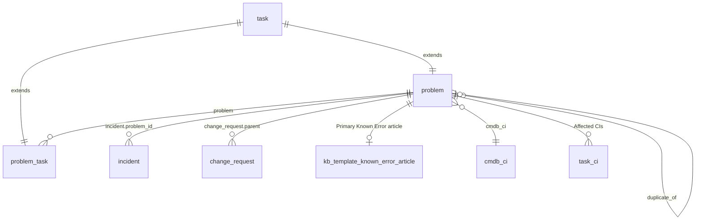
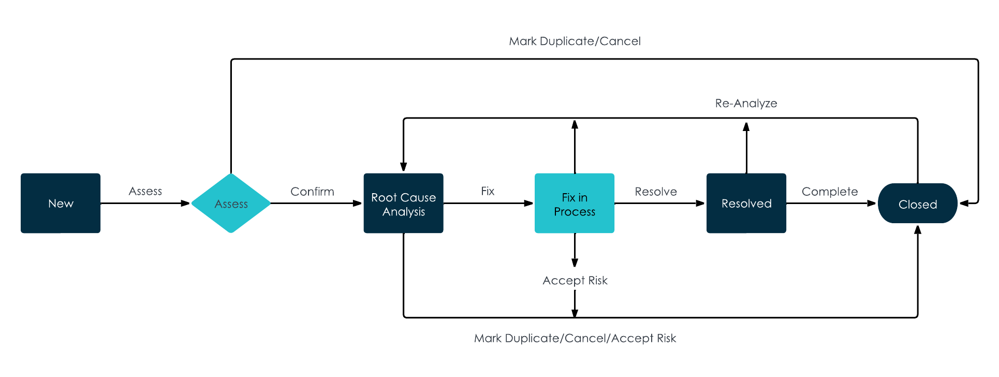
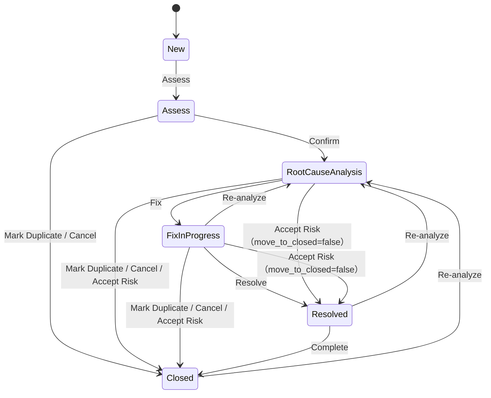
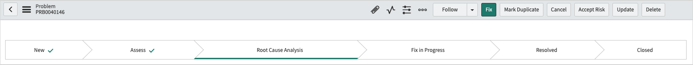
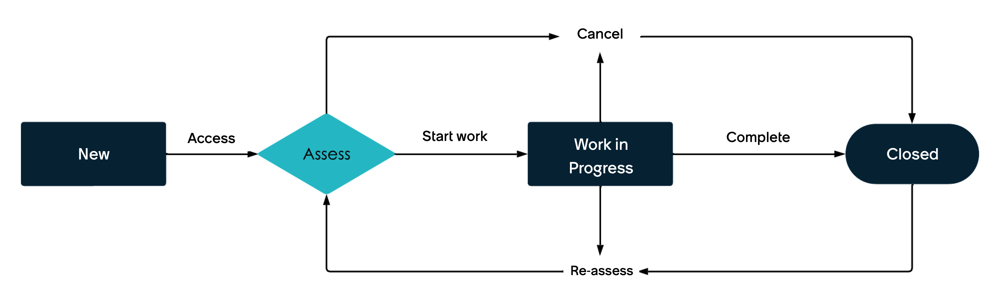
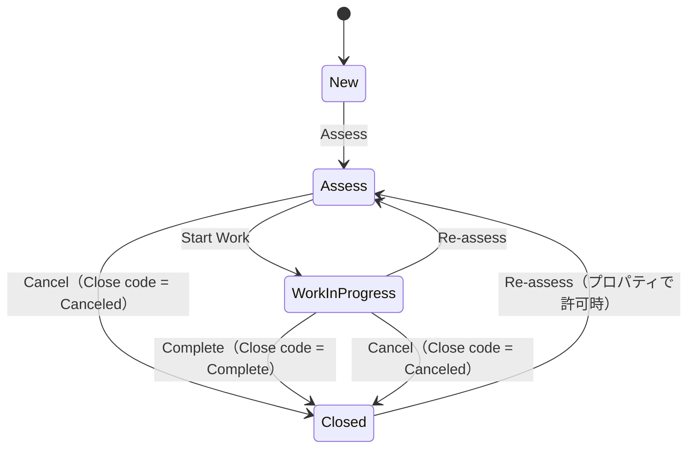
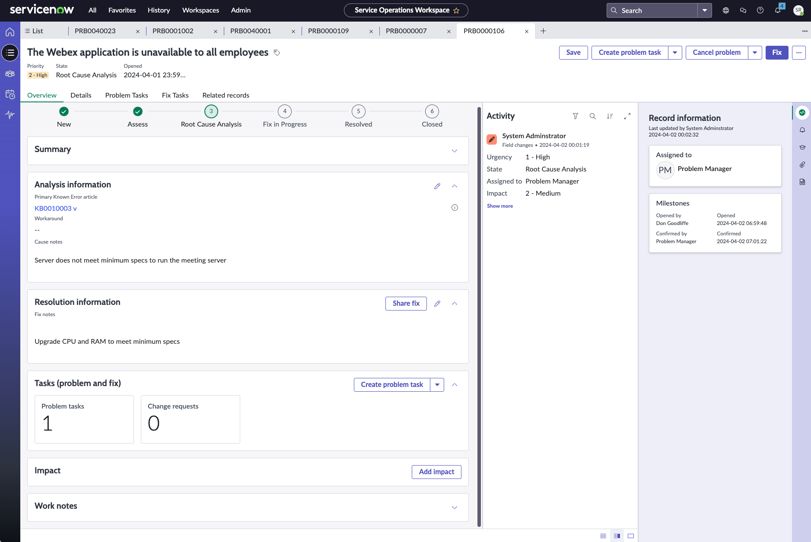

# Problem Management（問題管理）

## 概要

ServiceNow の **Problem Management（問題管理）** は、関連する複数のインシデントとして報告される IT インフラストラクチャ上のエラーの原因（Root cause：根本原因）を特定し、恒久的に解決するための ITSM アプリケーションである。公式ドキュメントは Problem Management の唯一の目的を「インシデントを引き起こす根本的な問題の特定と解決」とし、「解決までの時間よりも根本原因の特定と解決を重視する体系的なプロセス」と説明している。[出典](https://www.servicenow.com/docs/r/australia/it-service-management/problem-management/understanding-state-mgmt-transitions.html)

Problem Management は ServiceNow AI Platform の機能として、既定で有効になっている（Xanadu→Australia の統合リリースノートで "active by default" と記載）。[出典](https://www.servicenow.com/docs/r/Cz0Un5C85RB3j2nhhAK1aQ/3SNCqWF0PNO4Y21UCsTC7w)

本ファイルは Australia リリース（2026-05 GA）を基準に、次の内容を扱う。

| 節 | 内容 |
|---|---|
| プラグインと前提 | Madrid ベストプラクティス系プラグイン、新規顧客と既存（アップグレード）顧客の違い |
| データモデル | `problem`、`problem_task`、Known Error 記事テーブル、関連テーブル |
| Problem フォームのフィールド | フォーム項目、セクション、列名 |
| Problem の State（状態）遷移 | 6 状態、UI アクション、Resolution code、状態値 |
| Problem task（問題タスク） | タイプ、4 状態、Close code、UI アクション |
| Known Error（既知のエラー） | Known Error 記事、Primary Known Error article、レガシーの Known Error 状態 |
| Workaround（回避策）と Fix（修正）の連絡 | Communicate Workaround / Communicate Fix とインシデント同期 |
| 変更管理との連携 | Change request 作成、Fix 記録の追跡 |
| ロール / プロパティ | `problem_coordinator` 等のロール、Problem Properties 全一覧 |
| Problem Management models | `prb_model` / `prb_task_model`、状態遷移条件 |
| Service Operations Workspace | ワークスペースでの操作、モーダル設定 |
| その他 | Priority、Major problem、CSDM、ドメインセパレーション、ATF、ダッシュボード、移行ユーティリティ |

関連ファイル：

- ITIL 上の概念（問題・既知のエラー・回避策）の基礎：[ITILとITSMの基礎](../../01_入門編/06-itil-itsm-basics.md)
- インシデント側の仕様（`problem_id`、On hold reason = Awaiting Problem 等）：[Incident Management](./incident-management.md)
- 恒久対策の実施：[Change Management](./change-management.md)
- Known Error 記事を格納するナレッジベース：[ナレッジ管理](../platform/knowledge-management.md)
- ITSM のパッケージ全体：[ITSM 概要とパッケージ](./itsm-overview.md)

---

## 1. プラグインと前提条件

### 1.1 Problem Management のプラグイン一覧

Problem Management の多くのプラグインはベースシステムで有効化済みであり、それ以外は必要に応じて有効化する。[出典](https://www.servicenow.com/docs/r/australia/it-service-management/problem-management/problem-mgmt-plugins.html)

| プラグイン名 | プラグイン ID | 役割 | 既定状態 |
|---|---|---|---|
| Problem Management | `com.snc.problem` | Problem Management 本体。`problem` テーブル（`task` 拡張）をインストール。関連プラグイン Problem Overview Homepage（`com.glideapp.report.itsm.problem.overview`）も有効化 | 有効（デモデータあり） |
| Problem Management Best Practice — Jakarta | `com.snc.best_practice.problem.jakarta` | Impact / Urgency / Priority のルックアップ（Data lookup）を導入。プライオリティ変更時の Work notes 必須化、Major problem 機能の前提 | 新規インスタンス（Jakarta 以降） |
| Problem Management Best Practice — Madrid | `com.snc.best_practice.problem.madrid` | Problem 用ロール（`problem_task_analyst`、`problem_coordinator`、`problem_manager`、`problem_admin`）、最初に報告されたカテゴリ・Workaround・Cause notes・Fix notes の各フィールド、ナレッジ記事の検索と添付、Workaround / Fix の連絡、Assignment group 変更時の Assigned to クリア | 新規顧客は既定で有効。既存顧客は要リクエスト |
| Problem Management Best Practice — Madrid — State Model | `com.snc.best_practice.problem.madrid.state_model` | 新しいベストプラクティス状態と Guided actions（ガイド付きアクション）による Problem ライフサイクル | 新規顧客は既定で有効。既存顧客は Migration Utility で検証・移行 |
| Problem Management Best Practice — Madrid — Knowledge Integration | `com.snc.best_practice.problem.madrid.knowledge` | Problem からの Known Error 記事作成、Known Error 記事用ナレッジベースの作成。`kb_template_known_error_article` テーブルをインストール | 新規インスタンスで既定で有効 |
| ITSM Roles — Problem Management | `com.snc.itsm.roles.problem_management` | `sn_problem_read` / `sn_problem_write` ロール。ITSM Roles（`com.snc.itsm.roles`）をリクエストすると有効化 | 要リクエスト |
| Business Stakeholder | `com.snc.business_stakeholder` | `business_stakeholder` ロール（全 ITSM 製品の参照・承認） | 任意（ITSM Roles が前提） |
| Problem Management — ATF Tests | `com.snc.problem.atf` | Problem Management のクイックスタートテスト（ATF） | 任意（デモデータあり） |

[出典（Activate Problem Management）](https://www.servicenow.com/docs/r/australia/it-service-management/problem-management/activate-prob-mgmt.html)、[出典（Madrid）](https://www.servicenow.com/docs/r/australia/it-service-management/problem-management/activate-pm-best-practice-madrid.html)、[出典（State Model）](https://www.servicenow.com/docs/r/australia/it-service-management/problem-management/act-pm-best-prac-madrid-state-mod.html)、[出典（Knowledge Integration）](https://www.servicenow.com/docs/r/australia/it-service-management/problem-management/act-pm-best-prac-madrid-know-int.html)、[出典（Jakarta）](https://www.servicenow.com/docs/r/australia/it-service-management/problem-management/act-pm-best-prac-jakarta.html)、[出典（ITSM Roles）](https://www.servicenow.com/docs/r/australia/it-service-management/problem-management/req-itsm-roles-prob-mgmt.html)、[出典（ATF）](https://www.servicenow.com/docs/r/australia/it-service-management/problem-management/activate-problem-mgmt-atf-tests.html)

プラグインの有効化は `admin` ロールで **All > System Applications > All Available Applications > All** から行う。ドメインセパレーションと委任管理が有効なインスタンスでは、管理ユーザーがグローバルドメインにいないと「Application installation is unavailable because another operation is running」エラーになる。[出典](https://www.servicenow.com/docs/r/australia/it-service-management/problem-management/activate-prob-mgmt.html)

### 1.2 新規顧客と既存顧客（レガシー）の違い

Problem Management の State（状態）モデルは、インスタンスの導入時期によって 2 系統に分かれる。この違いはフォームのフィールド、状態値、UI アクションのすべてに影響するため、最初に確認すべき前提である。

| 項目 | Madrid 以降の新規顧客（State Model 有効） | 既存顧客（London 以前から利用、State Model 未移行） |
|---|---|---|
| Problem の状態 | New、Assess、Root Cause Analysis、Fix in Progress、Resolved、Closed | Open、Known Error、Pending Change、Closed/Resolved |
| Problem task の状態 | New、Assess、Work in Progress、Closed | Pending、Open、Work in Progress、Closed Complete、Closed Incomplete、Closed Skipped |
| State フィールド | 読み取り専用（UI アクションで遷移） | 手動で選択 |
| Resolution code / Close code 等 | あり | なし |
| 移行手段 | — | Problem Management Migration Utility（ServiceNow Store アプリ） |

- 公式ドキュメントは「状態ベースの情報は Madrid リリース以降の新規インスタンスでのみ利用可能」とし、State Model プラグインは「既存ユーザー（London 以前）は有効化できない」と記載している。一方で同プラグインの有効化ページは「既存顧客は Migration Utility を使って検証・移行する」としている。つまり既存顧客は単純な有効化ではなく、Migration Utility 経由でのみ移行できる。[出典](https://www.servicenow.com/docs/r/australia/it-service-management/problem-management/understanding-state-mgmt-transitions.html)、[出典](https://www.servicenow.com/docs/r/australia/it-service-management/problem-management/act-pm-best-prac-madrid-state-mod.html)
- 新しい状態は旧バージョンの Problem Management と互換性がないため、有効化前に検証が必要である。[出典](https://www.servicenow.com/docs/r/australia/it-service-management/problem-management/act-pm-best-prac-madrid-state-mod.html)
- 移行手順は「[12.6 Migration Utility](#126-migration-utility移行ユーティリティ)」を参照。

---

## 2. データモデル

### 2.1 主要テーブル

| テーブル（ラベル） | テーブル名 | 親テーブル | 説明 | 出典 |
|---|---|---|---|---|
| Problem（問題） | `problem` | `task` | 問題レコード。`task` からすべてのフィールド、ルール、ポリシーを継承 | [出典](https://www.servicenow.com/docs/r/australia/it-service-management/problem-management/installed-with-pm.html) |
| Problem Task（問題タスク） | `problem_task` | `task` 【推定】 | 問題を完了するための最小作業単位 | [出典](https://www.servicenow.com/docs/r/australia/it-service-management/problem-management/understanding-state-trans-prob-task.html) |
| Known Error article（既知のエラー記事） | `kb_template_known_error_article` | `kb_knowledge` 【推定】 | Known Error 記事を格納（Knowledge Integration プラグインでインストール） | [出典](https://www.servicenow.com/docs/r/australia/it-service-management/problem-management/installed-with-madrid-know-int.html) |
| Problem Priority Data Lookup | `dl_problem_priority` | — | Impact × Urgency → Priority のルックアップルール | [出典](https://www.servicenow.com/docs/r/australia/it-service-management/problem-management/prioritise-problems.html) |
| Problem Models | `prb_model` | — | Problem Management models の問題モデル | [出典](https://www.servicenow.com/docs/r/australia/it-service-management/problem-management/create-problem-model.html) |
| Problem Task Models | `prb_task_model` | — | 問題タスクモデル | [出典](https://www.servicenow.com/docs/r/australia/it-service-management/problem-management/create-problem-task-model.html) |

> `problem_task` と `kb_template_known_error_article` の親テーブルは公式の該当ページに明記がなく、ServiceNow の一般的なテーブル構成（タスク系は `task`、ナレッジテンプレートは `kb_knowledge` 拡張）に基づく `【推定】` である。

### 2.2 関連テーブル・関連リスト

`problem` テーブルは次のテーブルと関連する。関連リストは Problem フォームから参照・追加できる。

| 関連 | テーブル / 参照 | 説明 | 出典 |
|---|---|---|---|
| Incidents（インシデント） | `incident.problem_id` | 問題に紐づくインシデント。インシデントから問題を作成した場合は自動で関連付け | [出典](https://www.servicenow.com/docs/r/australia/it-service-management/problem-management/c_ProblemManagementProcess.html) |
| Problem Tasks（問題タスク） | `problem_task.problem` | 問題配下のタスク | [出典](https://www.servicenow.com/docs/r/australia/it-service-management/problem-management/problem-mgmt-properties.html) |
| Change Requests（変更要求） | `change_request.parent` | 恒久修正のための変更。Fix 記録として追跡 | [出典](https://www.servicenow.com/docs/r/australia/it-service-management/problem-management/problem-mgmt-properties.html) |
| Affected CIs（影響を受ける CI） | `task_ci` | 複数の CI を問題に関連付け | [出典](https://www.servicenow.com/docs/r/australia/it-service-management/problem-management/pm-use-case-product-view.html) |
| Impacted Services/CIs | `task_cmdb_ci_service` | 影響を受けるサービス（サービスインスタンス等） | [出典](https://www.servicenow.com/docs/r/australia/it-service-management/problem-management/pm-use-case-trouble.html) |
| Service Offerings | `task_service_offering` | 影響を受けるサービスオファリング | [出典](https://www.servicenow.com/docs/r/australia/it-service-management/problem-management/pm-use-case-product-view.html) |
| Outages（停止） | `cmdb_ci_outage`（Task-Outage Relationship） | 問題に関連する停止記録（SOW の Related records） | [出典](https://www.servicenow.com/docs/r/australia/it-service-management/problem-management/domain-separation-and-problem-management.html) |
| CSM Case | `sn_customerservice_case.problem` | 重複マーク時に移動対象となる顧客ケース | [出典](https://www.servicenow.com/docs/r/australia/it-service-management/problem-management/problem-mgmt-properties.html) |
| Agile / Release | `rm_defect.parent`、`rm_release.parent`、`rm_enhancement.parent` | Fix 記録として追跡される既定の関連レコード | [出典](https://www.servicenow.com/docs/r/australia/it-service-management/problem-management/problem-mgmt-properties.html) |
| Continual Improvement | `sn_cim_register.source_id` | 改善イニシアチブ（CIM）を Fix 記録として追跡 | [出典](https://www.servicenow.com/docs/r/australia/it-service-management/problem-management/problem-mgmt-properties.html) |

> 上図の `problem → kb_template_known_error_article` の関係は Problem フォームの **Primary Known Error article** フィールドで表現される。`duplicate_of` の列名は Problem フォームの **Duplicate of** フィールドに対応する列名としての `【推定】`。

---

## 3. Problem フォームのフィールド

### 3.1 フィールド一覧（UI16 / Core UI）

以下は Madrid 以降の新規顧客向け Problem フォームのフィールドである。ラベルは公式ドキュメント記載、列名は公式ページに明記がないものを `【推定】` としている（第三者が公開している開発インスタンス由来のサンプルデータ（Hugging Face 上のフォーム入力テスト構成データ）で列名が確認できたもの：`first_reported_by_task`、`cause_notes`、`fix_notes`、`resolution_code`、`short_description`【第三者情報】。特定インスタンスの構成であり、製品既定を保証するものではない）。[出典](https://www.servicenow.com/docs/r/australia/it-service-management/problem-management/problem-form.html)、[出典（第三者サンプルデータ）](https://huggingface.co/datasets/AI-Agent/forms_filling_test_configs/blob/main/Level-3/create_problem_task.json)

#### ヘッダー部

| フィールド（ラベル） | 列名 | 説明 |
|---|---|---|
| Number（番号） | `number` | 読み取り専用。問題を識別する一意の番号（例：PRB0040146） |
| Origin task（起点タスク） | `first_reported_by_task`【第三者情報】 | この問題を最初に識別したタスク（例：インシデント） |
| Category（カテゴリ）/ Subcategory | `category` / `subcategory` | ソフトウェア、ハードウェア等の分類 |
| Service（サービス） | `business_service` | 問題が適用されるビジネスサービス（`cmdb_ci_service_business` を参照。旧ラベル Business Service） |
| Service Offering（サービスオファリング） | `service_offering` | 可用性・範囲・価格等でサービスレベルを定義するオファリング |
| Configuration item（構成アイテム） | `cmdb_ci` | 問題が適用される CI。CI クラスが問題の種類（ハードウェア、ネットワーク、データベース等）を示す |
| State（状態） | `state` | 新規顧客では読み取り専用。New / Assess / Root Cause Analysis / Fix in Progress / Resolved / Closed |
| Resolution code（解決コード） | `resolution_code`【第三者情報】 | 解決（Fix Applied）、重複（Duplicate）、リスク受容（Risk Accepted）、取消（Canceled）を示す。Madrid 以降の新規顧客のみ |
| Duplicate of（重複元） | `duplicate_of`【推定】 | Resolution code が Duplicate の場合、重複元の Problem への参照 |
| Impact（影響度） | `impact` | High / Medium / Low |
| Urgency（緊急度） | `urgency` | High / Medium / Low |
| Priority（優先度） | `priority` | Critical / High / Moderate / Low / Planning。Impact と Urgency から自動計算される読み取り専用 |
| Assignment group（割り当てグループ） | `assignment_group` | 問題を担当するグループ。ビジネスルール **Populate Assignment Group based on CI/SO** により CI → Service offering の順でサポートグループから自動設定 |
| Assigned to（担当者） | `assigned_to` | 問題を担当する Problem coordinator。State Model 有効時は `problem_coordinator` / `problem_manager` / `problem_admin` ロール保持者で絞り込み |
| Problem Statement（問題記述） | `short_description`【第三者情報】 | 問題の記述。更新してフィールドを移動すると Related Search に関連ナレッジ記事を表示 |
| Description（説明） | `description` | 問題の詳細な説明 |
| Related Search（関連検索） | — | 検索結果。Known Error 記事・ナレッジ記事を **Attach** で問題に添付 |

> **Problem Statement** は画面ラベルであり、実体の列は `short_description` とされる `【第三者情報】`（第三者公開のテスト構成データの `fields` 定義で、ラベル "Problem statement" が `short_description` に対応）。[出典（第三者サンプルデータ）](https://huggingface.co/datasets/AI-Agent/forms_filling_test_configs/blob/main/Level-3/create_problem_task.json)

Assignment group の自動設定を既定から変更するには、次のプロパティを新規作成して値に使用するフィールド名を設定する（優先順）。[出典](https://www.servicenow.com/docs/r/australia/it-service-management/problem-management/problem-form.html)

| プロパティ | 意味 |
|---|---|
| `com.snc.problem.ci_assignment_group.field_name` | CI のどのフィールドで Assignment group を設定するか |
| `com.snc.problem.service_offering_assignment_group.field_name` | Service offering のどのフィールドで Assignment group を設定するか |

#### Notes（メモ）セクション

| フィールド | 列名 | 説明 |
|---|---|---|
| Work notes list | `work_notes_list` | 作業メモ追加時に通知を受けるユーザー |
| Work notes（作業メモ） | `work_notes` | 問題に対して行った作業の記録 |

#### Analysis Information（分析情報）セクション

| フィールド | 列名 | 説明 |
|---|---|---|
| Workaround（回避策） | `workaround`【推定】 | 問題を回避するために用いた方法。問題が未解決でも何かを機能させる手段。回避策がある場合、Problem coordinator は **Communicate Workaround** で関連インシデントに通知できる |
| Cause notes（原因メモ） | `cause_notes`【第三者情報】 | 問題を引き起こした原因の記録 |
| Primary Known Error article（主 Known Error 記事） | `known_error_article`【推定】 | この問題（または類似問題）用に作成した Known Error 記事への参照。Knowledge Integration プラグイン有効時のみ表示 |

#### Resolution Information（解決情報）セクション

| フィールド | 列名 | 説明 |
|---|---|---|
| Resolved by（解決者） | `resolved_by`【推定】 | 読み取り専用。問題を解決したユーザー（新規顧客のみ） |
| Resolved（解決日時） | `resolved_at`【推定】 | 読み取り専用。解決日時（新規顧客のみ） |
| Fix notes（修正メモ） | `fix_notes`【第三者情報】 | 問題をどう修正したかの記録。修正がある場合 **Communicate Fix** で関連インシデントに通知できる |

#### Other Information（その他）セクション

| フィールド | 列名 | 説明 |
|---|---|---|
| Opened by / Opened | `opened_by` / `opened_at` | 読み取り専用。起票者と起票日時 |
| Confirmed by / Confirmed | `confirmed_by` / `confirmed_at`【推定】 | 読み取り専用。問題が有効で解決が必要と確認（Confirm）したユーザーと日時（新規顧客のみ） |
| Fix by / Fix | `fix_by` / `fix_at`【推定】 | 読み取り専用。修正（Fix）を開始したユーザーと日時 |

上記に加え、Accept Risk により Resolution code = **Risk Accepted** となった問題の **Risk accepted reason（リスク受容理由）** は、関連インシデント（On Hold / On hold reason = Awaiting Problem）の Work notes にコピーされる（[7.3 節](#73-インシデントとの同期)参照）。[出典](https://www.servicenow.com/docs/r/australia/it-service-management/problem-management/sync-btwn-inci-prob.html)

### 3.2 フォームの関連リスト

Problem フォームの関連リストは、既定で **Incidents** と **Problem Tasks** が表示される。`problem` テーブルは既定で監査（Auditing）が有効であり、管理者はフォームレイアウトに **Audit Records** / **Audit History** 関連リストを追加できる。[出典](https://www.servicenow.com/docs/r/australia/it-service-management/problem-management/problem-configure-forms.html)、[出典](https://www.servicenow.com/docs/r/australia/it-service-management/problem-management/configure-problem-form-layout.html)

### 3.3 レガシー Problem フォーム（既存顧客）

State Model 未移行の既存顧客のフォームには次の特徴的なフィールドがある。[出典](https://www.servicenow.com/docs/r/australia/it-service-management/problem-management/legacy-problem-form.html)

| フィールド | 説明 |
|---|---|
| Business service | 問題が適用されるビジネスサービス |
| Change request | 問題に関連する変更要求 |
| Major problem | レビューが必要な問題として強調するチェックボックス |
| Knowledge | 問題のクローズ時にナレッジ記事を自動提出するチェックボックス |
| State | Open（オープン・未割り当て）、Pending Change（対応する変更要求のクローズ待ち）、Known Error（修正予定なし・回避策あり。`itil` ロールで Known Errors モジュールにアクセス可）、Closed/Resolved（修正済み・クローズ） |
| Parent | 親タスク |
| Short description | 問題の要約 |

---

## 4. Problem の State（状態）遷移

### 4.1 状態一覧

Madrid 以降の新規顧客（State Model 有効）の `problem` テーブルは 6 つの状態を持つ。State フィールドは読み取り専用で、UI アクション（Guided actions）でのみ遷移する。[出典](https://www.servicenow.com/docs/r/australia/it-service-management/problem-management/problem-form.html)

| 状態（ラベル） | 日本語 | 値 | 意味 |
|---|---|---|---|
| New | 新規 | 101 | 起票直後。Assess に必要な必須項目が揃っていれば保存時に直接 Assess へ移行 |
| Assess | 評価 | 102【第三者情報】 | Problem coordinator が問題の規模・範囲・因果関係を分析し、本物の問題かを判断 |
| Root Cause Analysis | 根本原因分析 | 103【第三者情報】 | 根本原因を調査。SME 自身が調査するか Root Cause Analysis タイプの Problem task を作成 |
| Fix in Progress | 修正中 | 104 | 恒久修正を実施中（Change request の作成・紐付け） |
| Resolved | 解決済み | 106【第三者情報】 | 修正が適用された状態（Resolution code = Fix Applied）。Accept Risk のプロパティ設定次第で Risk Accepted でも Resolved になる |
| Closed | クローズ | 107 | 完了。Resolution code により Fix Applied / Risk Accepted / Duplicate / Canceled を区別 |

- 値 101・104・107 は公式の「Map problem states」ページの移行マッピング例（`1 - Open → 101 - New`、`2 - Known Error → 107 - Closed as Risk Accepted`、`3 - Pending Change → 104 - Fix in Progress`、`4 - Closed/Resolved → 107 - Closed as Fix Applied`）で確認できる。[出典](https://www.servicenow.com/docs/r/australia/it-service-management/problem-management/map-problem-state.html)
- 102・103・106 は ServiceNow Community の投稿に基づく `【第三者情報】`。[出典](https://www.servicenow.com/community/itsm-forum/problem-managment/m-p/3577239)
- 実装時は対象インスタンスの `sys_choice`（`problem.state`）で必ず確認すること。

### 4.2 状態遷移図（公式）

- **キャプション:** Figure 1. Problem Management state transitions（Problem の状態遷移図）
- **図の説明:** 左から New →（Assess）→ Assess（ひし形）→（Confirm）→ Root Cause Analysis →（Fix）→ Fix in Process →（Resolve）→ Resolved →（Complete）→ Closed の順に並ぶ。Assess から上部の「Mark Duplicate/Cancel」線で直接 Closed へ遷移する。Root Cause Analysis と Fix in Process から下部の「Mark Duplicate/Cancel/Accept Risk」線で Closed へ遷移する。Fix in Process、Resolved、Closed から上部の「Re-Analyze」線で Root Cause Analysis に戻る。図中では "Fix in Process" と表記されているが、フォーム上の状態名は "Fix in Progress" である。
- **出典:** [Life cycle of a problem（Australia）](https://www.servicenow.com/docs/r/australia/it-service-management/problem-management/understanding-state-mgmt-transitions.html)（取得日：2026-11-03）

### 4.3 遷移と UI アクションの一覧

| 遷移元 | UI アクション | 遷移先 | Resolution code | 必要ロール / 条件 | 出典 |
|---|---|---|---|---|---|
| New | **Assess** | Assess | — | `admin`、`problem_admin`、`problem_manager`、`problem_coordinator`。Assess ダイアログで必須項目を入力 | [出典](https://www.servicenow.com/docs/r/australia/it-service-management/problem-management/assess-a-problem.html) |
| Assess | **Confirm** | Root Cause Analysis | — | 問題が有効で解決が必要な場合 | 同上 |
| Assess | **Mark Duplicate** | Closed | Duplicate | 類似の既存問題がある場合。関連レコードが重複元へ移動 | 同上、[ATF](https://www.servicenow.com/docs/r/australia/it-service-management/problem-management/quick-start-tests-pm.html) |
| Assess | **Cancel** | Closed | Canceled | 問題が有効でない場合 | 同上 |
| Root Cause Analysis | **Fix** | Fix in Progress | — | 恒久修正が可能な場合。続けて Change request を作成または紐付け | [出典](https://www.servicenow.com/docs/r/australia/it-service-management/problem-management/investigate-root-cause.html) |
| Root Cause Analysis / Fix in Progress | **Accept Risk** | Closed（既定）または Resolved | Risk Accepted | 恒久的な解決策がない場合。遷移先は `problem.acceptrisk.move_to_closed` で決定 | 同上、[ATF](https://www.servicenow.com/docs/r/australia/it-service-management/problem-management/quick-start-tests-pm.html) |
| Root Cause Analysis | **Mark Duplicate** / **Cancel** | Closed | Duplicate / Canceled | — | [ATF](https://www.servicenow.com/docs/r/australia/it-service-management/problem-management/quick-start-tests-pm.html) |
| Fix in Progress | **Resolve** | Resolved | Fix Applied | `admin`、`problem_admin`、`problem_coordinator`、`problem_manager` | [出典](https://www.servicenow.com/docs/r/australia/it-service-management/problem-management/resolve-and-complete-problem.html) |
| Resolved | **Complete** | Closed | Fix Applied | 同上 | 同上 |
| Fix in Progress / Resolved / Closed | **Re-analyze** | Root Cause Analysis | — | クローズ後の再分析は、Resolution code ごとにプロパティで許可ロールを制御（既定 `problem_manager`） | 同上、[図](https://www.servicenow.com/docs/r/australia/it-service-management/problem-management/understanding-state-mgmt-transitions.html) |

> Fix in Progress からの Mark Duplicate / Cancel は公式遷移図（4.2 節）に基づく。ATF クイックスタートテストで確認されている Mark Duplicate / Cancel の起点は Assess と Root Cause Analysis である。

- **キャプション:** Figure 1. Root cause analysis（Root Cause Analysis 状態にある Problem フォームのヘッダー、UI16）
- **画面の説明:** Problem PRB0040146 のフォームヘッダー。右上に **Follow**、**Fix**（強調表示）、**Mark Duplicate**、**Cancel**、**Accept Risk**、**Update**、**Delete** ボタンが並ぶ。その下に Process flow formatter（プロセスフロー表示）があり、New ✓、Assess ✓、Root Cause Analysis（現在の状態に下線）、Fix in Progress、Resolved、Closed の 6 段階が左から順に表示される。
- **出典:** [Investigate root cause of a problem（Australia）](https://www.servicenow.com/docs/r/australia/it-service-management/problem-management/investigate-root-cause.html)（取得日：2026-11-03）

### 4.4 各フェーズの詳細

#### New（新規）— 問題の作成

問題の作成に必要なロールは `itil`、`sn_problem_write`、`admin`、`problem_admin`、`problem_manager`、`problem_coordinator` のいずれかである。作成方法は次のとおり。[出典](https://www.servicenow.com/docs/r/australia/it-service-management/problem-management/create-a-problem-v2.html)

| 作成方法 | 操作 |
|---|---|
| Problem モジュールから | **Problem > Create New** |
| インシデントから | インシデントを開き、コンテキストメニューの **Create Problem**。コピーされる項目は `com.snc.problem.create_from_incident.attributes` で指定 |
| サービスカタログから | Record producer（レコードプロデューサー）を作成して問題を起票 |
| メールから | 適切な Inbound email action（受信メールアクション）を構成 |
| インタラクションから | `glide.problem.interaction.allow_create`（Allow problem creation from interaction、既定 false）を有効化（SOW の Interaction から **Create problem**）。`com.snc.problem.create_from_interaction.save`（Create saved problem）で作成時に保存するかを制御（既定：新規顧客 Yes、アップグレード顧客 No）。[出典（Problem Created from Interaction Properties）](https://www.servicenow.com/docs/r/australia/it-service-management/problem-management/problem-mgmt-properties.html) |
| 重大インシデントから自動作成 | 後述の条件を満たす場合 |

インシデントが重大インシデント（Major incident）に昇格した際、次の条件をすべて満たすと問題レコードが自動作成される。[出典](https://www.servicenow.com/docs/r/australia/it-service-management/problem-management/create-a-problem-v2.html)

1. インシデントに関連する問題レコードがない。
2. Major Incident Management が Problem Management とともにインストールされている。
3. `com.snc.best_practice.problem.madrid` と `com.snc.incident.mim` が有効。
4. フロー **Create Problem from Major incident** を有効化している（ベースシステムでは非アクティブで出荷）。

`com.snc.problem.create_from_incident.copy_attachments` が true の場合、添付ファイルとナレッジ記事もインシデントから問題へコピーされる（Madrid プラグイン有効時）。[出典](https://www.servicenow.com/docs/r/australia/it-service-management/problem-management/create-a-problem-v2.html)

保存すると問題は New になり、Assess に必要な必須項目が入力済みであれば直接 Assess へ移行する。[出典](https://www.servicenow.com/docs/r/australia/it-service-management/problem-management/create-a-problem-v2.html)

#### Assess（評価）

Assess は問題の規模・範囲・原因と影響を分析し、徹底的な調査が必要かを判断するフェーズである。**Assess** をクリックすると必須項目のダイアログ（Assess dialog）が表示される。評価後は次のいずれかを選ぶ。[出典](https://www.servicenow.com/docs/r/australia/it-service-management/problem-management/assess-a-problem.html)

| 判断 | アクション | 結果 |
|---|---|---|
| 問題が有効で解決が必要 | **Confirm** | Root Cause Analysis へ |
| 類似の既存問題がある | **Mark Duplicate** | 重複元の問題を指定し Closed（Duplicate）。関連レコードは `problem.duplicate.records_to_move` に従い重複元へ移動 |
| 有効な問題でない | **Cancel** | Closed（Canceled） |

Assess ダイアログに表示する必須項目は **All > System UI > Form Sections** で **Assess Dialog Form View**（Problem）または **PTASK Assess Dialog View**（Problem task）を開き、Section Elements に項目を追加して構成する（`admin`）。[出典](https://www.servicenow.com/docs/r/australia/it-service-management/problem-management/add-field-in-assess-dialog-form.html)

#### Root Cause Analysis（根本原因分析）

Root Cause Analysis フェーズでは、次のいずれかを行う。必要ロールは `problem_admin`、`problem_coordinator`、`problem_manager`、`admin`。[出典](https://www.servicenow.com/docs/r/australia/it-service-management/problem-management/investigate-root-cause.html)

| 状況 | 対応 |
|---|---|
| 自分がその領域の SME（Subject matter expert：専門家） | 自ら調査し、Problem の **Cause notes** と **Fix notes** を記入 |
| SME ではなく支援が必要 | **Root Cause Analysis** タイプの Problem task を作成し関連チームへ割り当てる。タスク完了後、タスクの Cause notes と Proposed fix を **手動で** Problem にコピー |
| 解決可能 | **Fix** → Fix in Progress。新規 Change request を作成するか既存のものを紐付ける |
| 恒久的解決策がないことを認める | **Accept Risk** → Closed または Resolved（Resolution code = Risk accepted） |
| 再分析する | **Re-analyze** → Root Cause Analysis |

既存の Known Error 記事がある場合は **Primary Known Error article** フィールドに参照を設定できる（Knowledge Integration プラグインが必要）。[出典](https://www.servicenow.com/docs/r/australia/it-service-management/problem-management/investigate-root-cause.html)

#### Fix in Progress（修正中）

Fix in Progress では Change request を作成・紐付けて恒久修正を実施する（[8 節](#8-change-management変更管理との連携)）。問題に割り当てられた Problem coordinator には、関連するすべての Change request（`problem.fix.records` で定義された Fix 記録）が完了またはキャンセルされた時点で通知が送られる。[出典](https://www.servicenow.com/docs/r/australia/it-service-management/problem-management/investigate-root-cause.html)

#### Resolved（解決済み）と Closed（クローズ）

**Resolve** をクリックすると Resolved（Resolution code = Fix Applied）になり、**Complete** で Closed（Fix Applied）になる。[出典](https://www.servicenow.com/docs/r/australia/it-service-management/problem-management/resolve-and-complete-problem.html)

- 問題がクローズまたはキャンセルされると、`problem.closed.cancel_open_tasks`（既定 true）が有効な場合、開いている Problem task はすべてキャンセルされる。
- `problem.closed.can_create_tasks`（既定 false）を true にすると、クローズ済みの問題にも Problem task を作成できる。
- クローズ後の **Re-analyze**（Closed → Root Cause Analysis）を実行できるロールは、Resolution code ごとに次のプロパティで制御する：`problem.closed.role.reanalyze_from_canceled`、`problem.closed.role.reanalyze_from_closed_riskaccepted`、`problem.closed.role.reanalyze_from_completed`（いずれも既定 `problem_manager`）。

### 4.5 Resolution code（解決コード）

| Resolution code | 設定される操作 | 最終状態 | 出典 |
|---|---|---|---|
| Fix Applied（修正適用） | Resolve / Complete | Resolved → Closed | [出典](https://www.servicenow.com/docs/r/australia/it-service-management/problem-management/resolve-and-complete-problem.html) |
| Risk Accepted（リスク受容） | Accept Risk | Closed（既定）または Resolved | [出典](https://www.servicenow.com/docs/r/australia/it-service-management/problem-management/investigate-root-cause.html) |
| Duplicate（重複） | Mark Duplicate | Closed | [出典](https://www.servicenow.com/docs/r/australia/it-service-management/problem-management/quick-start-tests-pm.html) |
| Canceled（取消） | Cancel | Closed | [出典](https://www.servicenow.com/docs/r/australia/it-service-management/problem-management/quick-start-tests-pm.html) |

### 4.6 レガシー状態モデル（既存顧客）

State Model 未移行の既存顧客では、次の 4 状態とビジネスルールで運用される（London 以前の挙動）。[出典](https://www.servicenow.com/docs/r/australia/it-service-management/problem-management/c_ProblemManagementProcess.html)、[出典](https://www.servicenow.com/docs/r/australia/it-service-management/problem-management/map-problem-state.html)

| 状態 | 値 | 意味 | 移行先（マッピング例） |
|---|---|---|---|
| Open | 1 | オープン・未割り当て | 101 - New |
| Known Error | 2 | 原因は判明したが恒久修正がない。回避策あり | 107 - Closed as Risk Accepted |
| Pending Change | 3 | 対応する変更要求のクローズ待ち | 104 - Fix in Progress |
| Closed/Resolved | 4 | 修正済み・クローズ | 107 - Closed as Fix Applied |

| ビジネスルール（レガシー） | 動作 |
|---|---|
| `SNC-ITIL-Close-related` | 変更要求がクローズされると Pending Change の問題をクローズ |
| `SNC - ITIL - Resolve Related Incidents` | 問題がクローズされると、State = On Hold かつ On hold reason = Awaiting Problem の関連インシデントを Resolved に設定 |

レガシー（Jakarta〜London）では Resolved 状態の問題のコンテキストメニュー **Resolve Incidents** で、On Hold / Awaiting Problem の関連インシデントを一括解決できる（`itil`）。[出典](https://www.servicenow.com/docs/r/australia/it-service-management/problem-management/t_CloseRelatedIncFromAPRB.html)

---

## 5. Problem task（問題タスク）

### 5.1 概要とタイプ

Problem task は「問題を完了するために実施すべき最小の作業単位」である。Problem coordinator は問題の解決に支援が必要な場合、Problem task を作成して Assignment group やユーザーに割り当てる。[出典](https://www.servicenow.com/docs/r/australia/it-service-management/problem-management/understanding-state-trans-prob-task.html)

| タイプ | 用途 | 固有フィールド |
|---|---|---|
| Root Cause Analysis（根本原因分析） | SME に根本原因の調査と修正案の提示を依頼する | Workaround、Proposed fix notes |
| General（一般） | その他すべてのタスク | Close notes |

SOW では Record Type Selector（`sn_sow_interceptor_record_type_selector`）で独自のタスクタイプを追加できる（[11.3 節](#113-sow-の構成)）。

### 5.2 Problem task の作成

必要ロール：`itil`、`sn_problem_write`、`admin`、`problem_admin`、`problem_coordinator`、`problem_manager`、`problem_task_analyst`。[出典](https://www.servicenow.com/docs/r/australia/it-service-management/problem-management/create-problem-task.html)

1. **All > Problem > Open** で問題を開く。
2. 関連リスト **Problem Tasks** で **New** をクリック。
3. タイプ（Root Cause Analysis / General）を選択。
4. フォームに入力して **Submit**。タスクは New になり、Assess の必須項目が揃っていれば直接 Assess へ移行する。

### 5.3 Problem Task フォームのフィールド

[出典](https://www.servicenow.com/docs/r/australia/it-service-management/problem-management/problem-task-form.html)

| フィールド | 説明 |
|---|---|
| Number | 読み取り専用。タスク番号 |
| Type | 読み取り専用。Root Cause Analysis か General か（新規顧客のみ） |
| Configuration item | 問題が適用される CI |
| Due date（期日） | タスクの完了期日 |
| Source problem（元の問題） | タスクが属する問題の番号 |
| State | 新規顧客は読み取り専用（New / Assess / Work in Progress / Closed） |
| Close code（クローズコード） | 読み取り専用。完了（Complete）かキャンセル（Canceled）か（新規顧客のみ） |
| Priority | Critical / High / Moderate / Low / Planning |
| Assignment group / Assigned to | 担当グループと担当 Problem analyst |
| Short description / Description | タスクの要約と詳細。Short description 更新時に Related Search を表示 |
| Related Search | 検索結果。**Attach** でナレッジ記事をタスクに添付 |
| Work notes list / Work notes | 通知先と作業記録 |
| Cause code（原因コード）※Analysis Information | 例：Environmental disaster、Hardware issue、People/Process/Documentation |
| Workaround（Root Cause Analysis のみ） | 回避策 |
| Completed by | 読み取り専用。タスクを完了したユーザー |
| Completed | タスクがキャンセルされた理由（公式表記どおり） |
| Proposed fix notes（Root Cause Analysis のみ） | 修正案 |
| Close notes（General のみ） | 完了した作業の要約 |

### 5.4 Problem task の状態遷移

| 状態 | 値 | 意味 |
|---|---|---|
| New | 151 | 作成直後 |
| Assess | 152【第三者情報】 | タスクに取り組むための情報が十分かを確認 |
| Work in Progress | 154 | 作業中 |
| Closed | 157 | Close code = Complete（完了）または Canceled（取消） |

値 151・154・157 は公式の「Map problem task states」の移行マッピング例で確認できる。152 は Community 投稿に基づく。[出典](https://www.servicenow.com/docs/r/australia/it-service-management/problem-management/map-problem-task-state.html)、[出典](https://www.servicenow.com/community/itsm-forum/problem-managment/m-p/3577239)

- **キャプション:** Figure 1. Problem task state transitions（Problem task の状態遷移図）
- **図の説明:** 左から New →（Access：図中の表記。正しくは Assess）→ Assess（ひし形）→（Start work）→ Work in Progress →（Complete）→ Closed。Assess と Work in Progress から上部の「Cancel」線で Closed へ遷移する。Work in Progress と Closed から下部の「Re-assess」線で Assess に戻る。
- **出典:** [Life cycle of a problem task（Australia）](https://www.servicenow.com/docs/r/australia/it-service-management/problem-management/understanding-state-trans-prob-task.html)（取得日：2026-11-03）

| 遷移元 | UI アクション | 遷移先 | 備考 | 出典 |
|---|---|---|---|---|
| New | **Assess** | Assess | 必須項目を入力 | [出典](https://www.servicenow.com/docs/r/australia/it-service-management/problem-management/assess-a-problem-task.html) |
| Assess | **Start Work** | Work in Progress | 作業準備が整った場合 | 同上 |
| Work in Progress | **Re-assess** | Assess | 作業中に再評価（Xanadu で導入） | 同上、[出典（Xanadu リリースノート）](https://www.servicenow.com/docs/r/yokohama/delta-xanadu-yokohama/yokohama-xanadu-problemmanagement-release-notes.html) |
| Assess / Work in Progress | **Cancel** | Closed（Canceled） | 重複・不要な場合。Canceled reason の入力が必要。Work in Progress からの Cancel は公式遷移図に基づく（手順ページに記載があるのは Assess からの Cancel のみ） | [出典](https://www.servicenow.com/docs/r/australia/it-service-management/problem-management/assess-a-problem-task.html)、[出典（遷移図）](https://www.servicenow.com/docs/r/australia/it-service-management/problem-management/understanding-state-trans-prob-task.html) |
| Work in Progress | **Complete** | Closed（Complete） | — | [出典](https://www.servicenow.com/docs/r/australia/it-service-management/problem-management/complete-a-problem-task.html) |
| Closed | **Re-assess** | Assess | `problem_task.closed.role.reaassess_from_closed` で許可ロールを制御 | 同上 |

- 必要ロール：`problem_admin`、`problem_coordinator`、`problem_manager`、`problem_task_analyst`、`admin`。[出典](https://www.servicenow.com/docs/r/australia/it-service-management/problem-management/assess-a-problem-task.html)
- すべての Problem task が完了またはキャンセルされると、Problem coordinator に通知が送られる。[出典](https://www.servicenow.com/docs/r/australia/it-service-management/problem-management/complete-a-problem-task.html)
- RCA タスクの成果（Cause notes / Proposed fix）は Problem へ自動転記されず、Problem coordinator が手動でコピーする（[4.4 節](#root-cause-analysis根本原因分析)）。

### 5.5 レガシー Problem task 状態（既存顧客）

| 旧状態 | 旧値 | 移行先（マッピング例） |
|---|---|---|
| Pending | -5 | 151 - New |
| Open | 1 | 151 - New |
| Work in Progress | 2 | 154 - Work in Progress |
| Closed Complete | 3 | 157 - Closed as Complete |
| Closed Incomplete | 4 | 157 - Closed as Canceled |
| Closed Skipped | 7 | 157 - Closed as Canceled |

[出典](https://www.servicenow.com/docs/r/australia/it-service-management/problem-management/map-problem-task-state.html)

---

## 6. Known Error（既知のエラー）

### 6.1 Known Error の扱い（新旧モデルの違い）

ITIL における Known Error（既知のエラー）は「根本原因が判明しているが恒久的な修正がまだない（または修正しない）問題」であり、通常は回避策（Workaround）とセットで記録される。ServiceNow での扱いはモデルによって異なる。

| 観点 | Madrid 以降（State Model） | レガシー |
|---|---|---|
| Known Error の表現 | **状態ではない**。Known Error 記事（`kb_template_known_error_article`）を作成し、Problem の **Primary Known Error article** で参照 | State = **Known Error**（値 2） |
| 恒久修正をしない場合 | **Accept Risk**（Resolution code = Risk Accepted） | Known Error 状態のまま維持 |
| 参照手段 | Known Error ナレッジベース、SOW の **Known Errors** リスト | **Known Errors** モジュール |

- 移行マッピング例では旧 Known Error 状態は「107 - Closed as Risk Accepted」に対応付けられている。[出典](https://www.servicenow.com/docs/r/australia/it-service-management/problem-management/map-problem-state.html)
- 公式ドキュメントは、Known Errors モジュールを「原因が特定されたが修正できない問題をすべて表示するよう `problem` テーブルをフィルタリングしたもの」と説明している。[出典](https://www.servicenow.com/docs/r/australia/it-service-management/problem-management/c_GatherProblemData.html)
- `problem` テーブルには true/false の `known_error` フィールドが残っているが、Community では「レガシーフィールドで、参照するビジネスルールやスクリプトインクルードは見当たらない」と回答されている `【第三者情報】`。[出典](https://www.servicenow.com/community/virtual-agent-forum/quot-known-error-quot-field-on-the-problem-table/m-p/3144203)
- Known Errors モジュール / リストのフィルター条件の正式な定義は、公開情報では確認できず。実装時はインスタンスのモジュール定義（`sys_app_module`）で確認すること。
- State Model で Known Error を「状態」として保持できなくなった点は、Community で実務上の不満として議論されている（根本原因不明のまま回避策で保留したい場合、Risk Accepted で閉じ、原因判明後に Re-analyze する必要がある）`【第三者情報】`。[出典](https://www.servicenow.com/community/itsm-forum/why-was-known-error-removed-as-a-state-on-the-problem-record/m-p/2488764)

### 6.2 Known Error 記事の作成

Known Error 記事は、問題の根本原因と回避策を文書化し、インシデントのデフレクション（Deflection：起票の抑止）に役立てる参照資料である。[出典](https://www.servicenow.com/docs/r/australia/it-service-management/problem-management/create-known-error-from-problem.html)

前提：`admin`、`problem_admin`、`problem_coordinator`、`problem_manager` のいずれか。`com.snc.best_practice.problem.madrid` と `com.snc.best_practice.problem.madrid.knowledge` が有効。

1. **All > Problem > Open** で問題を開く。
2. **Related Links** の **Create Known Error Article** をクリック（Analysis Information タブの **Primary Known Error article** が空のときのみ表示）。
3. **Submit** をクリック（記事内容は Related Links の **View Article** で確認）。
4. フォームに入力。**Search for Duplicates** で既存の Known Error 記事（Short description、Category、Topic に基づく検索）を確認できる。
5. **Publish** でレビュー・承認に回す。

作成された記事はナレッジベースに保存され、Knowledge Management アプリケーションで管理される。公開・廃止のプロセスは記事が属するナレッジベースのワークフローで制御される。ナレッジベースとアクセス制御の設定次第で、IT チーム以外のユーザーも検索でき、インシデントのデフレクションにつながる。[出典](https://www.servicenow.com/docs/r/australia/it-service-management/problem-management/create-known-error-from-problem.html)

Known Error 記事は Xanadu リリースで新規顧客向けに既定で有効化された（"Known error articles are enabled by default for new customers"）。[出典](https://www.servicenow.com/docs/r/yokohama/delta-xanadu-yokohama/yokohama-xanadu-problemmanagement-release-notes.html)

### 6.3 Known Error article フォーム

[出典](https://www.servicenow.com/docs/r/australia/it-service-management/problem-management/known-error-article-form.html)

| フィールド | 説明 |
|---|---|
| Number | 読み取り専用。記事番号 |
| Knowledge base | 記事を格納するナレッジベース（既定は **Known Error**）。記事は `kb_template_known_error_article` テーブルに保存 |
| Category | 読み取り専用。Problem の Category を参照 |
| Valid to（有効期限） | この日付以降、記事は検索結果に表示されない（公式表記は「データベースから削除される」） |
| Version | 読み取り専用。公開済み記事の変更時に Knowledge Management が管理 |
| Workflow | 読み取り専用 |
| Source Task | 読み取り専用。記事の作成元 Problem |
| Attachment link | 選択すると記事が Problem に添付として表示。未選択の場合は記事内容が Problem の作業メモに表示 |
| Display attachments | 記事表示時にすべての添付を表示（Attachment link 未選択時のみ有効） |
| Short description | Known Error の簡潔な説明 |
| Description | Known Error の詳細な説明 |
| Workaround | 回避策 |
| Cause | 原因 |

### 6.4 SOW での Known Error 記事作成

Service Operations Workspace では、**Create problem task** 横のドロップダウンから **Create known error article** を選ぶ。また、次の条件をすべて満たす問題では、コンテキストサイドパネルの Recommendations（推奨）アイコン → **Recommended actions** タブ → **Create article** から作成できる（`problem_coordinator` ロール保持者）。[出典](https://www.servicenow.com/docs/r/australia/it-service-management/service-operations-workspace/work-on-problem-sow.html)

- Impact が High
- Known Error 記事がまだ添付されていない
- Work notes が空でない

### 6.5 レガシーのナレッジ連携（London 以前）

Knowledge Integration プラグインが無効な（London 以前の）Problem では、次の 4 つの方法でナレッジを作成・伝達する。[出典](https://www.servicenow.com/docs/r/australia/it-service-management/problem-management/c_CreateKnowledge.html)

| 方法 | 動作 | 出典 |
|---|---|---|
| **Knowledge** チェックボックス | 問題クローズ時にビジネスルール **Problem Create Knowledge** が Draft 状態のナレッジ記事を作成（Short description → 記事 Short description、Work notes → 記事 Text） | [出典](https://www.servicenow.com/docs/r/australia/it-service-management/problem-management/t_UseTheKnowledgeCheckBox.html) |
| **Communicate Workaround**（レガシー） | Workaround を全関連インシデントのアクティビティストリームに投稿（記事は作成しない） | [出典](https://www.servicenow.com/docs/r/australia/it-service-management/problem-management/communicate-workaround.html) |
| **Post Knowledge** 関連リンク | 即時に記事を作成。問題番号と Short description → 記事 Short description、Description と Workaround → Text、CI → Configuration Item、Topic = Known Error（`itil`、`knowledge`） | [出典](https://www.servicenow.com/docs/r/australia/it-service-management/problem-management/t_PostKnowledge.html) |
| News 投稿 | News カテゴリの記事を素早く作成・公開（標準のレビューを経ない例外） | [出典](https://www.servicenow.com/docs/r/australia/it-service-management/problem-management/c_CreateKnowledge.html) |

Knowledge submission workflow（ナレッジ提出ワークフロー）が有効な場合、記事の代わりに Knowledge submission が作成される。

---

## 7. Workaround（回避策）と Fix（修正）の連絡

### 7.1 Communicate Workaround

Workaround（回避策）は、実際の解決策がまだない問題について、サービス障害を一時的に回復し影響を軽減する方法である。回避策を連絡すると、関連インシデントに回避策が利用可能であることが通知される。[出典](https://www.servicenow.com/docs/r/australia/it-service-management/problem-management/communicate-workaround.html)

前提：`admin`、`problem_admin`、`problem_manager`、`problem_coordinator`。`com.snc.best_practice.problem.madrid` が有効。

1. **All > Problem > Open** で問題を開く。
2. **Analysis information > Workaround** に回避策を入力。
3. 保存する。
4. **Related Links** の **Communicate Workaround** をクリック。

SOW では more actions アイコン（︙）→ **Share workaround** で同等の操作を行う。Risk Accepted の問題にも回避策メモを適用できる。[出典](https://www.servicenow.com/docs/r/australia/it-service-management/service-operations-workspace/work-on-problem-sow.html)

レガシーの Communicate Workaround（`itil`）では、問題番号と Workaround 内容が全関連インシデントのアクティビティストリームに追加され、既定で Caller にメール通知される。グループのオンコールローテーションが有効な場合、回避策が利用可能になったため関連インシデントのエスカレーションが停止する。[出典](https://www.servicenow.com/docs/r/australia/it-service-management/problem-management/communicate-workaround.html)

### 7.2 Communicate Fix

根本原因分析が完了し修正策が決まったら Change request を提出し、修正内容を連絡する。[出典](https://www.servicenow.com/docs/r/australia/it-service-management/problem-management/communicate-a-fix.html)

1. 問題を開き、**Resolution Information > Fix notes** に入力して保存。
2. **Related Links** の **Communicate Fix** をクリック。
3. Fix notes の内容がインシデントの Additional comments にコピーされ、Caller と担当者にメール通知される（Communicate a fix ページの記載）。

SOW では more actions → **Share fix**。

> 公式ドキュメント内で記載に差異がある。「Communicate a fix」ページは Fix notes が **Additional comments** にコピーされるとし、「Synchronization between incident and problem records」ページは **Work notes** にコピーされ、Assigned to と Work notes list のユーザーに通知されるとしている。実装時はインスタンスで挙動を確認すること。[出典](https://www.servicenow.com/docs/r/australia/it-service-management/problem-management/communicate-a-fix.html)、[出典](https://www.servicenow.com/docs/r/australia/it-service-management/problem-management/sync-btwn-inci-prob.html)

### 7.3 インシデントとの同期

`com.snc.best_practice.problem.madrid` と `com.snc.best_practice.problem.madrid.state_model` を有効にすると、Problem レコードの変更が関連インシデントに反映され、更新ごとに通知が送られる。[出典](https://www.servicenow.com/docs/r/australia/it-service-management/problem-management/sync-btwn-inci-prob.html)

| 必要プラグイン | インシデントの状態 | 問題の状態・操作 | インシデントへの作用 |
|---|---|---|---|
| Madrid | Resolved / Closed / Canceled 以外 | **Communicate workaround** | Workaround を Work notes にコピーし、Assigned to と Work notes list に通知（インシデントが New / On Hold / In Progress の場合のみ）。Additional comments にもコピーし、インシデントの Resolution code が Known error の場合は Caller・Assigned to・Watch list に通知 |
| Madrid | Resolved / Closed / Canceled 以外 | **Communicate Fix** | Fix を Work notes にコピーし、Assigned to と Work notes list に通知 |
| Madrid — State Model | On Hold かつ On hold reason = **Awaiting Problem** | 問題が Closed または Resolved、Resolution code = **Fix Applied** | インシデントの Resolution notes に「Related problem … closed. Please see additional comments for fix notes」と表示。State → **Resolved**、Resolution code → **Resolved by problem**。Caller と担当者にメール通知 |
| Madrid — State Model | On Hold かつ On hold reason = **Awaiting Problem** | 問題が Closed または Resolved、Resolution code = **Risk Accepted** | 問題の **Risk accepted reason** をインシデントの Work notes にコピーし、担当者にメール通知 |

インシデント側の On hold reason、Resolution code の詳細は [Incident Management](./incident-management.md) を参照。

### 7.4 関連レコードの紐付け

| 操作 | 手順 | 必要ロール | 出典 |
|---|---|---|---|
| 複数インシデントの追加 | 問題を開き、関連リスト **Incidents** → **Add** → **Add Selected** / **Add All** | `itil`、`admin`、`problem_admin`、`problem_coordinator`、`problem_manager` | [出典](https://www.servicenow.com/docs/r/australia/it-service-management/problem-management/add-multiple-incidents-to-problem.html) |
| クローズ済みインシデントの関連付け | `problem.role.relate_closed_incidents` で許可（新規インスタンス既定：Problem coordinators、アップグレード既定：Nobody） | — | [出典](https://www.servicenow.com/docs/r/australia/it-service-management/problem-management/problem-mgmt-properties.html) |
| CI の関連付け | 単一の主原因 CI は **Configuration item** フィールド、複数 CI は **Affected CIs** または **Impacted Services/CIs** 関連リスト。既定で Service Offering は除外され、Principal Class の CI が選択対象（Paris 以降の新規顧客） | `itil`、`sn_problem_write`、`admin`、`problem_admin`、`problem_coordinator`、`problem_manager` | [出典](https://www.servicenow.com/docs/r/australia/it-service-management/problem-management/add-multiple-cis-to-problem.html) |

複数レコードの一括関連付けには拡張ポイント `global.MRABulkAddRecordsFilter`（Multi-record associator）を実装できる。旧拡張ポイント `global.BulkAddIncidentsFilter` は既存実装で引き続き使えるが、将来廃止予定である。[出典](https://www.servicenow.com/docs/r/australia/it-service-management/problem-management/extension-point-for-problem.html)

---

## 8. Change Management（変更管理）との連携

### 8.1 問題からの変更要求作成

根本原因分析の結果、問題が解決可能であれば変更要求で修正を実施する。必要ロールは `problem_coordinator` または `admin`。[出典](https://www.servicenow.com/docs/r/australia/it-service-management/problem-management/fix-a-change.html)

| 操作 | UI16 | SOW |
|---|---|---|
| 通常変更（Normal change）の作成 | コンテキストメニュー **Create Normal Change** | **Create problem task** 横のドロップダウン → **Create change request**、または **Fix Tasks** タブ → **New** |
| 緊急変更（Emergency change）の作成 | コンテキストメニュー **Create Emergency Change** | 同上 |
| 既存変更の追加 | 関連リスト **Change Requests** → **Add** → **Add Selected**（`itil` 等） | Fix Tasks タブ |

Normal change では RFC（Request For Change）を起票し、CAB（Change Advisory Board：変更諮問委員会）の承認後に修正を適用する。変更作成後、問題は Change Request フォームの関連リストに表示される。[出典](https://www.servicenow.com/docs/r/australia/it-service-management/problem-management/fix-a-change.html)、[出典](https://www.servicenow.com/docs/r/australia/it-service-management/problem-management/c_ProblemManagementProcess.html)

### 8.2 Fix 記録の追跡と通知

プロパティ `problem.fix.records` に列挙された関連レコード（既定：`change_request.parent`、`rm_defect.parent`、`rm_release.parent`、`rm_enhancement.parent`、`sn_cim_register.source_id`）がすべて完了またはキャンセルされると、Problem coordinator に通知が送られる。新しいテーブルを追加する場合は、対応するビジネスルール（例：変更要求用の **Check Related Problem Fixes - Change Req**）も作成する必要がある。[出典](https://www.servicenow.com/docs/r/australia/it-service-management/problem-management/resolve-and-complete-problem.html)、[出典](https://www.servicenow.com/docs/r/australia/it-service-management/problem-management/problem-mgmt-properties.html)

SOW では、Fix Tasks タブに表示される Fix タスクとして構成されているのは Change request のみである。[出典](https://www.servicenow.com/docs/r/australia/it-service-management/service-operations-workspace/problem-sow.html)

変更管理の詳細は [Change Management](./change-management.md) を参照。

---

## 9. ロール

### 9.1 Problem Management 固有ロール（Madrid ベストプラクティス）

`com.snc.best_practice.problem.madrid` でインストールされるロール。[出典](https://www.servicenow.com/docs/r/australia/it-service-management/problem-management/installed-with-madrid-best-prac.html)

| ロール名 | タイトル | 説明 | 含むロール |
|---|---|---|---|
| `problem_task_analyst` | Problem Task Analyst | Problem task に取り組み、そのライフサイクルを管理 | なし |
| `problem_coordinator` | Problem Co-ordinator | Problem または Problem task に取り組み、ライフサイクルを管理 | `problem_task_analyst`、`itil` |
| `problem_manager` | Problem Manager | Problem Management プロセス全体に責任を持ち、設定を構成でき、Problem coordinator としても行動 | `problem_coordinator` |
| `problem_admin` | Problem Admin | プロセス全体に責任を持ち、Problem と Problem task を削除できる | `problem_manager` |

> 公式表のロール名表記には "problem_ coordinator" のように空白が混入しているが、正しくは `problem_coordinator` / `problem_manager` である（他ページの記載と一致）。

### 9.2 ITSM Roles（細分化ロール）

Problem Management に関係する ITSM Roles 系のロールは次のとおり。`sn_problem_read` / `sn_problem_write` は `com.snc.itsm.roles.problem_management`、`business_stakeholder` は `com.snc.business_stakeholder`、`sn_service_desk_agent` は ITSM Roles（Yokohama で追加）によって提供される。`sn_service_desk_agent` と `business_stakeholder` は Problem 専用ではなく、ITSM 全体向けのロールである。[出典](https://www.servicenow.com/docs/r/australia/it-service-management/problem-management/prob-roles-instld-itsm-roles.html)

| ロール名 | タイトル | インストール元プラグイン | 説明 | 含むロール |
|---|---|---|---|---|
| `sn_problem_read` | Problem read | `com.snc.itsm.roles.problem_management` | Problem Management アプリと関連レコードの読み取り | — |
| `sn_problem_write` | Problem write | `com.snc.itsm.roles.problem_management` | Problem Management アプリと関連レコードの書き込み | `sn_problem_read`、`template_editor` |
| `sn_service_desk_agent` | （Service desk agent） | ITSM Roles（Yokohama で追加。ITSM 全体の Tier 1 向け） | Tier 1 サービスデスク向け（Yokohama で導入、SOW 6.1 以降で使用可） | `sn_incident_write`、`sn_problem_write`、`sn_change_write`、`sn_request_write`、`tracked_file_reader`（ITSM Gen AI 有効時は `knowledge_user`、`now_assist_panel_user` も） |
| `business_stakeholder` | Business Stakeholder | `com.snc.business_stakeholder` | 全 ITSM 製品のレコード参照・承認 | `sn_problem_read` 等 |

[出典（Business Stakeholder）](https://www.servicenow.com/docs/r/australia/it-service-management/problem-management/installed-with-business-stakeholder-problem.html)、[出典（Yokohama リリースノート）](https://www.servicenow.com/docs/r/Cz0Un5C85RB3j2nhhAK1aQ/3SNCqWF0PNO4Y21UCsTC7w)

### 9.3 操作別の必要ロール（まとめ）

| 操作 | 必要ロール（いずれか） |
|---|---|
| 問題の作成 | `itil`、`sn_problem_write`、`admin`、`problem_admin`、`problem_manager`、`problem_coordinator` |
| Assess / Confirm / Mark Duplicate / Cancel | `admin`、`problem_admin`、`problem_manager`、`problem_coordinator` |
| Fix / Accept Risk / Re-analyze（RCA 中） | `problem_admin`、`problem_coordinator`、`problem_manager`、`admin` |
| Resolve / Complete | `admin`、`problem_admin`、`problem_coordinator`、`problem_manager` |
| クローズ後の Re-analyze | プロパティで指定（既定 `problem_manager`） |
| Problem task 作成 | `itil`、`sn_problem_write`、`admin`、`problem_admin`、`problem_coordinator`、`problem_manager`、`problem_task_analyst` |
| Problem task の Assess / Start Work / Complete | `problem_admin`、`problem_coordinator`、`problem_manager`、`problem_task_analyst`、`admin` |
| Known Error 記事の作成 / Communicate Workaround / Fix | `admin`、`problem_admin`、`problem_coordinator`、`problem_manager` |
| Change request 作成（UI16） | `problem_coordinator`、`admin` |
| 問題の削除 | `problem_admin`（SOW の記載） |
| Problem Properties の変更 | `admin`、`problem_manager` |
| Problem / Problem task models の作成 | `admin` |

ロールの一般論は [ユーザー・グループ・ロール](../platform/users-groups-roles.md)、ライセンス上の扱い（Fulfiller 等）は [ユーザー・ロール・ライセンスの基本](../../01_入門編/08-users-roles-licensing-basics.md) を参照。

---

## 10. Problem Properties（問題管理プロパティ）

Problem Management プロパティは **Problem > Administration > Problem Properties** で設定する（`admin` または `problem_manager`）。[出典](https://www.servicenow.com/docs/r/australia/it-service-management/problem-management/problem-mgmt-properties.html)、[出典](https://www.servicenow.com/docs/r/australia/it-service-management/service-operations-workspace/configure-problem-properties-sow.html)

### 10.1 Problem State Transition Properties

| プロパティ | ラベル | 型 | 既定値 |
|---|---|---|---|
| `problem.acceptrisk.move_to_closed` | Accept Risk moves the Problem to Closed state instead of Resolved state | true/false | true |
| `problem.closed.can_create_tasks` | Can create a Problem Task on a Closed Problem? | true/false | false |
| `problem.closed.role.reanalyze_from_canceled` | Who can Re-analyze a Canceled Problem? | choice list | `problem_manager` |
| `problem.closed.role.reanalyze_from_closed_riskaccepted` | Who can Re-analyze a Risk Accepted (Closed state) Problem? | choice list | `problem_manager` |
| `problem.closed.role.reanalyze_from_completed` | Who can Re-analyze a Completed Problem? | choice list | `problem_manager` |

### 10.2 Problem Task State Transition Properties

| プロパティ | ラベル | 型 | 既定値 |
|---|---|---|---|
| `problem.closed.cancel_open_tasks` | Cancel open Problem Tasks when closing a Problem | true/false | true |
| `problem_task.closed.role.reaassess_from_closed` | Who can Re-assess a Completed or Canceled Problem Task? | choice list | `problem_coordinator` |
| `problem_task.closed.can_reassess_on_closed_problem` | Can Re-Assess a Problem Task on a Closed Problem? | true/false | アップグレード：true／新規インスタンス：false |

> `problem_task.closed.role.reaassess_from_closed` は公式ドキュメントの表記（"reaassess"）のまま記載している。実際のプロパティ名はインスタンスの `sys_properties` で確認すること。

### 10.3 Problem Related List Properties

| プロパティ | ラベル | 型 | 既定値 |
|---|---|---|---|
| `problem.fix.records` | List of related task records (comma-separated) to track as fixes for this Problem | string | `change_request.parent, rm_defect.parent, rm_release.parent, rm_enhancement.parent, sn_cim_register.source_id` |
| `problem.duplicate.records_to_move` | List of related task records (comma-separated) to move over when a problem is marked as a duplicate of another | string | `incident.problem_id, sn_customerservice_case.problem, problem_task.problem` |
| `problem.role.relate_closed_incidents` | Who can relate closed Incidents to a Problem? | choice | アップグレード：Nobody／新規インスタンス：Problem coordinators |

### 10.4 Problem Created from Incident / Interaction Properties

| プロパティ | ラベル | 型 | 既定値 |
|---|---|---|---|
| `com.snc.problem.create_from_incident.attributes` | List of attributes (comma-separated) that will be copied from the incident to create a new problem | string | `number, description, short_description, cmdb_ci, impact, urgency, priority, company, sys_domain, business_service, category, subcategory` |
| `com.snc.problem.create_from_incident.copy_attachments` | （添付・ナレッジ記事のコピー） | true/false | 公開情報では既定値を確認できず |
| `com.snc.problem.create_from_interaction.save` | Create saved problem | true/false | アップグレード顧客：No／新規顧客：Yes |
| `glide.problem.interaction.allow_create` | Allow problem creation from interaction | true/false | false |

### 10.5 その他のプロパティ

| プロパティ | 用途 | 出典 |
|---|---|---|
| `com.snc.problem_management.models.enabled` | Problem Management models を有効化（Xanadu で導入。Yokohama 以降の新規顧客は既定で有効） | [出典](https://www.servicenow.com/docs/r/australia/it-service-management/problem-management/enable-problem-mgmt-models.html) |
| `com.snc.problem.ci_assignment_group.field_name` | CI のどのフィールドで Assignment group を設定するか（新規作成して使用） | [出典](https://www.servicenow.com/docs/r/australia/it-service-management/problem-management/problem-form.html) |
| `com.snc.problem.service_offering_assignment_group.field_name` | Service offering のどのフィールドで Assignment group を設定するか（同上） | 同上 |

---

## 11. Service Operations Workspace（SOW）での Problem Management

### 11.1 Problem レコード画面の構成

Service Operations Workspace（サービスオペレーションワークスペース）では、問題のライフサイクル管理、回避策・修正の共有、Known Error 記事の作成を行える。[出典](https://www.servicenow.com/docs/r/australia/it-service-management/service-operations-workspace/problem-sow.html)

- **キャプション:** Figure 1. Problem record in Service Operations Workspace（SOW の問題レコード画面）
- **画面の説明:** 上部にワークスペースタブ（PRB0040023、PRB0001002 等）が並び、PRB0000106「The Webex application is unavailable to all employees」が開かれている。ヘッダー右側に **Save**、**Create problem task**（ドロップダウン付き）、**Cancel problem**（ドロップダウン付き）、**Fix** ボタンと more actions（…）がある。ヘッダー左に Priority（2 - High）、State（Root Cause Analysis）、Opened（日時）。タブは **Overview**、**Details**、**Problem Tasks**、**Fix Tasks**、**Related records**。Overview にはステッパー（1 New ✓、2 Assess ✓、3 Root Cause Analysis（現在）、4 Fix in Progress、5 Resolved、6 Closed）と、カード **Summary**、**Analysis information**（Primary Known Error article = KB0010003、Workaround、Cause notes）、**Resolution information**（**Share fix** ボタン、Fix notes）、**Tasks (problem and fix)**（Problem tasks 1、Change requests 0）、**Impact**（**Add impact** ボタン）、**Work notes** が並ぶ。中央に Activity（フィールド変更履歴）、右に Record information（Assigned to、Milestones：Opened by / Opened / Confirmed by / Confirmed）とコンテキストサイドパネルのアイコン列がある。
- **出典:** [Problem Management in Service Operations Workspace（Australia）](https://www.servicenow.com/docs/r/australia/it-service-management/service-operations-workspace/problem-sow.html)（取得日：2026-11-03）

| タブ / 領域 | 内容 |
|---|---|
| Overview | Summary、Analysis information、Resolution information、Problem tasks と Fix tasks、Impact、Work notes。SOW Admin Center で構成可能 |
| Details | Problem フォームの全フィールド。ただし State は読み取り専用。Compose 欄で作業メモを追加 |
| Problem Tasks | 問題に紐づく Problem task |
| Fix Tasks | Fix タスク（SOW では Change request のみ構成） |
| Related records | Incidents、Affected CIs、Outages、Agent Assist から添付したナレッジ |
| Contextual side panel | Agent Assist、Recommendations、添付、テンプレート、SLA |

Overview のヘッダーと Tasks ドロップダウンから、任意で **Create defect**、**Create enhancement**（Agile Development 2.0）、**Create improvement initiative**（Continual Improvement Management）のショートカットを有効化できる。[出典](https://www.servicenow.com/docs/r/australia/it-service-management/service-operations-workspace/problem-sow.html)

### 11.2 SOW での操作一覧

問題の作成は `itil` または `problem_coordinator`。問題リストは **Assigned to you**、**Unassigned**、**Open**、**Resolved**、**Risk Accepted**、**Known Errors**、**All** が用意されている。[出典](https://www.servicenow.com/docs/r/australia/it-service-management/service-operations-workspace/create-problem-sow.html)

| 操作 | SOW での手順 |
|---|---|
| Assess | **Assess** を選択し必須項目を入力 |
| Confirm | **Confirm**（Assess → Root Cause Analysis） |
| Fix | **Fix** を選択し Cause notes と Fix notes を入力 |
| Problem task 作成 | **Create problem task**、または Problem Tasks タブ → **New** |
| Change request 作成 | **Create problem task** 横のドロップダウン → **Create change request**、または Fix Tasks タブ → **New** |
| Outage 作成 | 同ドロップダウン → **Create outage** |
| Known Error 記事作成 | 同ドロップダウン → **Create known error article** |
| 重複マーク | **Cancel** 横のドロップダウン → **Mark duplicate** |
| リスク受容 | **Cancel** 横のドロップダウン → **Accept risk** |
| キャンセル | **Cancel problem** |
| 回避策 / 修正の共有 | more actions → **Share workaround** / **Share fix** |
| 再分析 | Closed / Resolved の問題で **Re-analyze**（→ Root Cause Analysis） |
| 削除 | more actions → **Delete**（`problem_admin`） |
| 依存関係マップ | Configuration item / Service offering / Service の Dependency view アイコン |

[出典](https://www.servicenow.com/docs/r/australia/it-service-management/service-operations-workspace/work-on-problem-sow.html)

Problem task 側（`itil` または `problem_task_analyst`）では **Assign to me**、**Assess**、**Start work**、**Cancel task**、**Complete**、**Re-assess**（Work in Progress / Closed → Assess）、**Delete** を実行できる。[出典](https://www.servicenow.com/docs/r/australia/it-service-management/service-operations-workspace/work-on-problem-task-sow.html)

> **重要:** ベースの Problem ライフサイクル（State Model プラグイン）を使っていない場合、SOW ではライフサイクル操作ができず、**Continue problem** / **Continue problem task** でクラシック UI に遷移して状態遷移を行う。[出典](https://www.servicenow.com/docs/r/australia/it-service-management/service-operations-workspace/work-on-problem-sow.html)

### 11.3 SOW の構成

| 構成項目 | 手順 | 出典 |
|---|---|---|
| 状態遷移時のモーダル（Problem） | Problem フォーム → Configure → **Form Builder** → ビュー **SOW Problem Accept Risk Modal** / **SOW Problem Assess Modal** / **SOW Problem Cancel Modal** / **SOW Problem Fix Modal** | [出典](https://www.servicenow.com/docs/r/australia/it-service-management/service-operations-workspace/configure-problem-state-modals-sow.html) |
| 状態遷移時のモーダル（Problem task） | Form Builder で Problem Task を選び **SOW Problem Task Assess Modal** / **Cancel Modal** / **Complete Modal**（General） / **Complete RCA Modal**（RCA） | [出典](https://www.servicenow.com/docs/r/australia/it-service-management/service-operations-workspace/configure-problem-task-state-modals-sow.html) |
| タスクタイプの追加 | `sn_sow_interceptor_record_type_selector.list` → New。Applies to = Problem task [`problem_task`]、Title、Target table（子テーブル）、Values（既定値） | [出典](https://www.servicenow.com/docs/r/australia/it-service-management/service-operations-workspace/create-task-type-sow.html) |
| SLA 表示 | **All > Problem > Workspace Configuration > Contextual Sidebar** で **SLAs and timings** を Active = true。SLA 定義は既存の Problem resolution / Problem response を使用または新規作成 | [出典](https://www.servicenow.com/docs/r/australia/it-service-management/service-operations-workspace/view-sla-problem-sow.html) |
| UI16 モジュールリンクのリダイレクト | 有効化すると UI16 のモジュールリンクが SOW の同等ページを開く。新規インスタンスでは既定で利用可能、アップグレードインスタンスは SOW Admin Center で構成 | [出典](https://www.servicenow.com/docs/r/australia/it-service-management/problem-management/exploring-problem-management.html) |

ワークスペース一般の仕様は [Workspace と UI Builder](../platform/workspaces-ui-builder.md) を参照。

---

## 12. その他の機能と構成

### 12.1 Problem Management models（問題管理モデル）

Problem Management models は、特定のユースケース向けに状態、状態遷移、状態遷移条件を定義できる機能である（Xanadu でプロパティ導入、Yokohama で新規顧客向けに既定で有効）。[出典](https://www.servicenow.com/docs/r/australia/it-service-management/problem-management/problem-mgmt-models.html)

既定モデル（ベースの非モデルライフサイクルを再現）：

| 種別 | モデル | 説明 |
|---|---|---|
| Problem model | General | ベースの Problem ライフサイクルと同等 |
| Problem task model | Root cause analysis | ベースの Problem task ライフサイクルと同等 |
| Problem task model | General | 同上 |

| 項目 | 内容 |
|---|---|
| 有効化 | `com.snc.problem_management.models.enabled` = true（**All > System Properties > All Properties**）。アップグレード顧客は手動で有効化 |
| 問題モデル作成 | `prb_model.list` または **All > Problem > Administration > Problem Models** → New。Model States（State、Initial state）→ Model State Transitions（From、To、Automatic transition）→ Transition Conditions |
| 問題タスクモデル作成 | `prb_task_model.list` または **All > Problem > Administration > Problem Task Models**。加えて **All > System Definition > Interceptors** の **Problem Task Models** に Interceptor Answer を作成（Target URL：`problem_task.do?sys_id=-1&sysparm_query=prb_task_model=[sys_id]`） |
| Problem Model フォーム | Name、Default problem model、Active、Description、Advanced Security（Available For / Not Available For / Can write タブ）、Read Roles、Write Roles |
| Problem Task Model フォーム | 上記に加え Problem task type（カスタム作成時の既定は Model） |
| Transition Condition フォーム | Name、State Transition、Description、Requires（事前定義条件または Transition Condition）、Condition（条件ビルダー）、Condition（script：true を返すと遷移可）、Active |
| 注意点 | モデル有効化前に作成された問題・タスクは非モデルのライフサイクルを使い続ける。ベースのライフサイクルを変更している場合はカスタムモデルにも同等の変更が必要。無効化前にカスタムモデルの追加機能を非モデル側に反映する |
| SOW との互換性 | SOW 6.x（Xanadu ベース）はモデル対応。SOW 5.x（Washington DC ベース）は非対応で、モデルを有効化するとクラシック UI16 で問題を管理することになる |

[出典（問題モデル作成）](https://www.servicenow.com/docs/r/australia/it-service-management/problem-management/create-problem-model.html)、[出典（問題タスクモデル作成）](https://www.servicenow.com/docs/r/australia/it-service-management/problem-management/create-problem-task-model.html)、[出典（モデルフォーム）](https://www.servicenow.com/docs/r/australia/it-service-management/problem-management/problem-model-form.html)、[出典（遷移条件フォーム）](https://www.servicenow.com/docs/r/australia/it-service-management/problem-management/problem-model-state-transition-condition.html)

> **Brazil での変更:** Model State Transition Condition フォームの **Condition (Script)** フィールドは、**Requires** で Transition Script を選択した場合のみ表示される。また、このフィールドの編集には新しいロール `problem_model_script_admin` が必要になり、ロールがない場合スクリプトエディタは読み取り専用となる。このロールは既存のどのロールにも継承されないため、ユーザーへ直接付与する必要がある。[出典](https://www.servicenow.com/docs/r/it-service-management/problem-management/problem-model-state-transition-condition.html)

### 12.2 Priority（優先度）の計算

`problem` レコードの Priority は Impact と Urgency から Data lookup で計算される（新規インスタンス）。ルールは **Problem Priority Data Lookup**（`dl_problem_priority`）テーブルで変更でき、UI ポリシー **Priority is managed by Data Lookup - set as read-only** を無効化して独自ロジックにすることもできる。[出典](https://www.servicenow.com/docs/r/australia/it-service-management/problem-management/prioritise-problems.html)

| Impact ＼ Urgency | 1 - High | 2 - Medium | 3 - Low |
|---|---|---|---|
| **1 - High** | 1 - Critical | 2 - High | 3 - Moderate |
| **2 - Medium** | 2 - High | 3 - Moderate | 4 - Low |
| **3 - Low** | 3 - Moderate | 4 - Low | 5 - Planning |

保存済みの問題で Impact / Urgency を変更して Priority が変わると、Work notes が必須になる（Jakarta ベストプラクティスプラグインが必要）。SOW 用の優先度ルックアップルールも別途定義できる。

### 12.3 Major problem（重大問題）

問題を優先し、レビューが必要であることを強調するために **Major problem** チェックボックスを使う（Jakarta 以降の新規インスタンス、`com.snc.best_practice.problem.jakarta` が必要）。[出典](https://www.servicenow.com/docs/r/australia/it-service-management/problem-management/categorize-major-problem.html)

- Madrid プラグイン有効時：Problem フォームに Major problem チェックボックスを追加し、**Major problem review** フィールドを Resolution Information タブに追加する。
- Madrid プラグイン無効時：**Review outcome** フィールドを Closure Information タブに追加する。
- チェックすると Work notes が必須になり、レビュー結果・教訓を記録する。

### 12.4 割り当てとフォーム構成

| 項目 | 内容 | 出典 |
|---|---|---|
| Assignment rule（割り当てルール） | **All > System Policy > Assignment** で定義。ベースシステムには **Network Problem**、**Database Problem** 等のルールがある（CI クラスで判定） | [出典](https://www.servicenow.com/docs/r/australia/it-service-management/problem-management/t_DefineAnAssignRuleForPRBs.html) |
| フォームレイアウト | Problem フォーム → **Configure > Form Layout**（`personalize_form`） | [出典](https://www.servicenow.com/docs/r/australia/it-service-management/problem-management/configure-problem-form-layout.html) |
| Form Designer | **Configure > Form Design**（`admin`） | [出典](https://www.servicenow.com/docs/r/australia/it-service-management/problem-management/design-problem-form.html) |
| カテゴリ | 選択肢リスト（Choice list）として Category / Subcategory を定義 | [出典](https://www.servicenow.com/docs/r/australia/it-service-management/problem-management/configure-problem-categories.html) |
| Contextual search | Related Search で Knowledge (All)、Pinned Articles、Incidents、Open Problems、Resolved Problems を切り替え検索 | [出典](https://www.servicenow.com/docs/r/australia/it-service-management/problem-management/problem-with-contextual-search.html) |

### 12.5 エスカレーション（SLA と Inactivity monitor）

公式ドキュメントは問題のエスカレーション手段として次の 2 つを挙げている。[出典](https://www.servicenow.com/docs/r/australia/it-service-management/problem-management/c_ProblemManagementProcess.html)

- **Service level agreements（SLA）:** 問題を強調表示し、チームのパフォーマンス指標として使う。ただし問題の調査・修正は長期化しうるため、**問題全体に SLA を適用することは推奨されない**。
- **Inactivity monitors（非アクティブ監視）:** 一定期間更新されない問題についてイベントを生成し、メール通知やスクリプトを起動する。

SLA の詳細は [SLAとスケジュール](../platform/sla-schedules.md) を参照。

### 12.6 Migration Utility（移行ユーティリティ）

Problem Management Migration Utility は ServiceNow Store で提供されるガイド付きセットアップアプリで、Madrid より前から ServiceNow を利用し、ガイド付き Problem ライフサイクルを採用したい顧客のみが使う。[出典](https://www.servicenow.com/docs/r/australia/it-service-management/problem-management/migration-utility.html)

| アクティビティ | 内容 |
|---|---|
| Introduction | State Model プラグインと新状態の理解。本番のクローンであるサブ本番インスタンスで実施していることを確認 |
| Preparation | 移行準備。既存の Problem / Problem task レコードをすべて削除するオプションもある（削除前にバックアップ） |
| Migrate | Migration job：ベースプラグインの準備・復元、Blocking / Warning modifications の解消、Problem / Problem task 状態のマッピング（**Detect Unmapped States** で未マップ検出）、State Model プラグインの有効化、アクティブ / 非アクティブレコードの移行 |
| Clean-up | 手動クリーンアップ：Problem state model の再有効化、旧モジュール・フィルター・UI アクション・ビジネスルール・UI ポリシー・プロセスフォーマッターの削除、ダッシュボード概要の更新、フォームレイアウトのリセット、インシデントからの問題検索 |

状態マッピング時、新しい状態が 101 - New（タスクは 151 - New）より先で担当者未設定の場合は、指定した **Assigned to** が使われる。[出典](https://www.servicenow.com/docs/r/australia/it-service-management/problem-management/map-problem-state.html)、[出典](https://www.servicenow.com/docs/r/australia/it-service-management/problem-management/clean-up-after-migration.html)

### 12.7 CSDM との関係

Problem フォームは次の CSDM（Common Service Data Model）要素を参照する。[出典](https://www.servicenow.com/docs/r/australia/it-service-management/problem-management/pm-use-case-product-view.html)

| フォーム項目 | 参照先 |
|---|---|
| Service | `cmdb_ci_service_business`（旧ラベル Business Service） |
| Service Offering | `service_offering`（関連リスト `task_service_offering`） |
| Configuration Items | `cmdb_ci` |
| Affected/Causal CIs | 関連リスト `task_ci` |
| Assignment group | Group 属性（CI の Assignment Group から設定可能） |

アプリケーションの問題ではサービスインスタンス（`cmdb_ci_service_discovered` 等）を Configuration item に設定し、インフラ CI の問題では Impacted Services 関連リスト（`task_cmdb_ci_service`）にサービスインスタンスを設定する、という使い分けが示されている。[出典](https://www.servicenow.com/docs/r/australia/it-service-management/problem-management/pm-use-case-trouble.html) CSDM の詳細は [CMDB と CSDM](../platform/cmdb-csdm.md) を参照。

### 12.8 ドメインセパレーション

Problem Management はドメインセパレーションを **Standard** レベルでサポートする。`problem` と `problem_task` テーブルはドメイン分離に対応し、Problem ユーザーは自ドメイン・子ドメイン・グローバルドメインの問題とタスクを作成・更新できる。既知の制約として、Task-Outage Relationship（`cmdb_ci_outage`）テーブルはドメイン分離されない。[出典](https://www.servicenow.com/docs/r/australia/it-service-management/problem-management/domain-separation-and-problem-management.html) 詳細は [ドメインセパレーション](../platform/domain-separation.md) を参照。

### 12.9 ATF クイックスタートテスト

`com.snc.problem.atf` と `com.snc.best_practice.problem.madrid`（状態関連テストは State Model も）を有効化すると、**PRB MGMT: Problem Management test suite** が利用できる。主なテスト：Assess / RCA でのキャンセル（Closed・Canceled）、重複マーク（Closed・Duplicate）、Accept Risk（`move_to_closed` の true/false × RCA / Fix in Progress）、Re-analyze（Fix Applied / Risk Accepted / Canceled から）、Normal / Emergency change 作成、Known Error 記事作成、Communicate Workaround / Fix、インシデントへの Fix 情報・Risk Accepted 理由の反映、General タイプの Problem task 状態管理。[出典](https://www.servicenow.com/docs/r/australia/it-service-management/problem-management/quick-start-tests-pm.html) ATF 全般は [Automated Test Framework (ATF)](../platform/automated-test-framework.md) を参照。

### 12.10 ダッシュボードとレポート

Problem dashboard は Open / Closed の問題に関する KPI を提供する。[出典](https://www.servicenow.com/docs/r/australia/it-service-management/problem.html)

| データビジュアライゼーション | KPI（Performance Analytics Indicator） |
|---|---|
| Open problems (by age and priority) | Number of open problems |
| Open problems (by state and age) | Number of open problems |
| % open critical problems (by state) | % of open critical problems |
| % open problems classified as known error | % of open problems classified as known error |
| Average reassignment of open problems (by category) | Average re-assignment of open problems |
| Closed problems (by age and priority) | Number of closed problems |
| Mean time to close a problem | Average close time of problems |

旧来の Platform Analytics Solutions（Problem Overview、Problem Management、Problem Premium、Problem daily 7d - 28d、Open Problem Age Monitor の各ダッシュボード）は "Legacy" と表記されている。有効化は **Performance Analytics > Guided Setup** から行い、一部ダッシュボードはデータ収集後にオーナーを設定して有効化する。[出典](https://www.servicenow.com/docs/r/australia/it-service-management/problem-management/problem-content-pack.html) レポート全般は [レポートとアナリティクス](../platform/reporting-analytics.md) を参照。

### 12.11 生成 AI（Now Assist）との関係

Now Assist for ITSM の公式ドキュメントで確認できる主要スキルはインシデント要約、解決メモ生成、チャット要約などであり、**Problem レコード専用のネイティブ要約スキルは公開情報では確認できず**。Community では Now Assist Skill Kit によるカスタムスキルで代替する方法が提案されている `【第三者情報】`。[出典](https://www.servicenow.com/community/now-assist-forum/when-is-now-assist-expected-to-be-available-for-use-with/m-p/3341867) 最新の AI 機能は [Now Assist と AI Agents](../platform/now-assist-ai-agents.md) を参照。

> **Brazil での変更:** Brazil の ITSM リリースノート一覧（Change、Incident、Request Management 等 14 項目）には Problem Management 単独の項目がなく、Problem Management 固有の機能変更は公開情報では確認できず（2026-11-03 時点）。Now Assist for ITSM は Brazil で "ServiceNow Otto for ITSM" として掲載されているが、問題管理向けの変更内容は公開情報では確認できず。[出典](https://www.servicenow.com/docs/r/release-notes/it-service-management-rn-landing.html)

---

## 13. リリース別の主な変遷

| リリース | 主な変更 | 出典 |
|---|---|---|
| Jakarta | Problem Management Best Practice — Jakarta：Impact / Urgency / Priority ルックアップ、Major problem | [出典](https://www.servicenow.com/docs/r/australia/it-service-management/problem-management/act-pm-best-prac-jakarta.html) |
| Madrid | ベストプラクティス State Model（New〜Closed の 6 状態、Guided actions）、Problem 専用ロール、Known Error 記事（Knowledge Integration）、Contextual search | [出典（State Model）](https://www.servicenow.com/docs/r/australia/it-service-management/problem-management/understanding-state-mgmt-transitions.html)、[出典（ロール）](https://www.servicenow.com/docs/r/australia/it-service-management/problem-management/installed-with-madrid-best-prac.html)、[出典（Knowledge Integration）](https://www.servicenow.com/docs/r/australia/it-service-management/problem-management/act-pm-best-prac-madrid-know-int.html)、[出典（Contextual search："available for problems in instances starting with the Madrid release"）](https://www.servicenow.com/docs/r/australia/it-service-management/problem-management/problem-with-contextual-search.html) |
| Paris | CI 選択時の Principal Class フィルター（新規顧客） | [出典](https://www.servicenow.com/docs/r/australia/it-service-management/problem-management/add-multiple-cis-to-problem.html) |
| Xanadu | Problem Management models のプロパティ導入、Known Error 記事を新規顧客で既定有効化、Problem task の Work in Progress からの Re-assess、メール通知の問題レコードリンクから SOW の問題レコードへリダイレクト（ITSM Notifications Redirection プラグイン `com.snc.itsm.notifications_redirection`。自動でインストール・有効化）、Migration Utility がカスタマイズを検出できるよう Xanadu ベース問題ファイル一覧を更新 | [出典](https://www.servicenow.com/docs/r/yokohama/delta-xanadu-yokohama/yokohama-xanadu-problemmanagement-release-notes.html) |
| Yokohama | Problem Models を新規 / zBoot 顧客で既定有効化、`sn_service_desk_agent` ロール | [出典](https://www.servicenow.com/docs/r/Cz0Un5C85RB3j2nhhAK1aQ/3SNCqWF0PNO4Y21UCsTC7w) |
| Zurich | Problem Management の更新なし | 同上 |
| Australia | Problem Management の更新なし（廃止・削除もなし） | 同上 |
| Brazil | Transition Condition の Condition (Script) 編集に `problem_model_script_admin` ロールが必要 | [出典](https://www.servicenow.com/docs/r/it-service-management/problem-management/problem-model-state-transition-condition.html) |

---

## 14. 設計上の留意点

以下は公式ドキュメントの記載から導かれる設計上の留意点である。

1. **まず State Model の有無を確認する。** 新規インスタンス（Madrid 以降）とアップグレードインスタンスでは状態値・フィールド・UI アクションが異なる。SOW でライフサイクル操作をするにはベースのライフサイクル（State Model）が前提である。[出典](https://www.servicenow.com/docs/r/australia/it-service-management/service-operations-workspace/work-on-problem-sow.html)
2. **Known Error を状態で表現しない。** State Model では Known Error 記事と Accept Risk（Risk Accepted）で表現する。旧来の「Known Error 状態で保留」運用を求める場合は、Problem Management models による独自状態の追加を検討する `【推定】`。
3. **問題全体に SLA を付けない。** 公式に非推奨。Response（応答）系 SLA や Inactivity monitor で滞留を検知する。[出典](https://www.servicenow.com/docs/r/australia/it-service-management/problem-management/c_ProblemManagementProcess.html)
4. **インシデント連携の前提を揃える。** 問題解決時のインシデント自動解決は、インシデントが On Hold / Awaiting Problem の場合のみ動作する。[出典](https://www.servicenow.com/docs/r/australia/it-service-management/problem-management/sync-btwn-inci-prob.html)
5. **Accept Risk の遷移先を決める。** `problem.acceptrisk.move_to_closed`（既定 true＝Closed）で、Risk Accepted を Resolved として残すか即 Closed とするかを運用に合わせる。
6. **Fix 記録の対象を拡張する場合はビジネスルールも追加する。** `problem.fix.records` の変更だけでは通知が機能しない。[出典](https://www.servicenow.com/docs/r/australia/it-service-management/problem-management/resolve-and-complete-problem.html)

プロセス設計の実践知は [ITSMプロセス設計の実践知](../../04_応用編/11-itsm-process-design-tips.md) を参照。

---

## 15. 確認できなかった事項

- `problem` テーブルの各フィールドの正式な列名（`workaround`、`duplicate_of`、`known_error_article`、`confirmed_by` / `confirmed_at`、`fix_by` / `fix_at`、`resolved_by` / `resolved_at` 等）は公式ドキュメントで明記されておらず、本書では `【推定】` / `【第三者情報】` とした。`first_reported_by_task`、`cause_notes`、`fix_notes`、`resolution_code`、`short_description` は第三者公開のサンプルデータで確認した `【第三者情報】`。[出典（第三者サンプルデータ）](https://huggingface.co/datasets/AI-Agent/forms_filling_test_configs/blob/main/Level-3/create_problem_task.json)
- Problem の状態値 102（Assess）、103（Root Cause Analysis）、106（Resolved）と Problem task の 152（Assess）は Community 情報に基づく。
- Known Errors モジュール / リストの正式なフィルター条件。
- `com.snc.problem.create_from_incident.copy_attachments` の既定値。
- Brazil における Problem Management 固有の新機能（リリースノートに独立項目なし）。
- Problem レコードに対する Now Assist のネイティブ生成 AI スキル。

---

## 参照元

### ServiceNow 公式ドキュメント（Australia）

- https://www.servicenow.com/docs/r/australia/it-service-management/problem-management/c_ProblemManagement.html
- https://www.servicenow.com/docs/r/australia/it-service-management/problem-management/exploring-problem-management.html
- https://www.servicenow.com/docs/r/australia/it-service-management/problem-management/c_ProblemManagementProcess.html
- https://www.servicenow.com/docs/r/australia/it-service-management/problem-management/understanding-state-mgmt-transitions.html
- https://www.servicenow.com/docs/r/australia/it-service-management/problem-management/understanding-state-trans-prob-task.html
- https://www.servicenow.com/docs/r/australia/it-service-management/problem-management/problem-mgmt-models.html
- https://www.servicenow.com/docs/r/australia/it-service-management/problem-management/migration-utility.html
- https://www.servicenow.com/docs/r/australia/it-service-management/problem-management/map-problem-state.html
- https://www.servicenow.com/docs/r/australia/it-service-management/problem-management/map-problem-task-state.html
- https://www.servicenow.com/docs/r/australia/it-service-management/problem-management/clean-up-after-migration.html
- https://www.servicenow.com/docs/r/australia/it-service-management/problem-management/problem-mgmt-plugins.html
- https://www.servicenow.com/docs/r/australia/it-service-management/problem-management/activate-prob-mgmt.html
- https://www.servicenow.com/docs/r/australia/it-service-management/problem-management/installed-with-pm.html
- https://www.servicenow.com/docs/r/australia/it-service-management/problem-management/act-pm-best-prac-jakarta.html
- https://www.servicenow.com/docs/r/australia/it-service-management/problem-management/req-itsm-roles-prob-mgmt.html
- https://www.servicenow.com/docs/r/australia/it-service-management/problem-management/prob-roles-instld-itsm-roles.html
- https://www.servicenow.com/docs/r/australia/it-service-management/problem-management/activate-pm-best-practice-madrid.html
- https://www.servicenow.com/docs/r/australia/it-service-management/problem-management/installed-with-madrid-best-prac.html
- https://www.servicenow.com/docs/r/australia/it-service-management/problem-management/installed-with-business-stakeholder-problem.html
- https://www.servicenow.com/docs/r/australia/it-service-management/problem-management/act-pm-best-prac-madrid-state-mod.html
- https://www.servicenow.com/docs/r/australia/it-service-management/problem-management/act-pm-best-prac-madrid-know-int.html
- https://www.servicenow.com/docs/r/australia/it-service-management/problem-management/installed-with-madrid-know-int.html
- https://www.servicenow.com/docs/r/australia/it-service-management/problem-management/activate-problem-mgmt-atf-tests.html
- https://www.servicenow.com/docs/r/australia/it-service-management/problem-management/problem-configure-forms.html
- https://www.servicenow.com/docs/r/australia/it-service-management/problem-management/configure-problem-form-layout.html
- https://www.servicenow.com/docs/r/australia/it-service-management/problem-management/add-field-in-assess-dialog-form.html
- https://www.servicenow.com/docs/r/australia/it-service-management/problem-management/design-problem-form.html
- https://www.servicenow.com/docs/r/australia/it-service-management/problem-management/configure-problem-categories.html
- https://www.servicenow.com/docs/r/australia/it-service-management/problem-management/t_DefineAnAssignRuleForPRBs.html
- https://www.servicenow.com/docs/r/australia/it-service-management/problem-management/categorize-major-problem.html
- https://www.servicenow.com/docs/r/australia/it-service-management/problem-management/enable-problem-mgmt-models.html
- https://www.servicenow.com/docs/r/australia/it-service-management/problem-management/create-problem-model.html
- https://www.servicenow.com/docs/r/australia/it-service-management/problem-management/create-problem-task-model.html
- https://www.servicenow.com/docs/r/australia/it-service-management/problem-management/pm-use-case-product-view.html
- https://www.servicenow.com/docs/r/australia/it-service-management/problem-management/pm-use-case.html
- https://www.servicenow.com/docs/r/australia/it-service-management/problem-management/pm-use-case-trouble.html
- https://www.servicenow.com/docs/r/australia/it-service-management/problem-management/create-a-problem-v2.html
- https://www.servicenow.com/docs/r/australia/it-service-management/problem-management/assess-a-problem.html
- https://www.servicenow.com/docs/r/australia/it-service-management/problem-management/add-multiple-incidents-to-problem.html
- https://www.servicenow.com/docs/r/australia/it-service-management/problem-management/extension-point-for-problem.html
- https://www.servicenow.com/docs/r/australia/it-service-management/problem-management/add-multiple-cis-to-problem.html
- https://www.servicenow.com/docs/r/australia/it-service-management/problem-management/investigate-root-cause.html
- https://www.servicenow.com/docs/r/australia/it-service-management/problem-management/resolve-and-complete-problem.html
- https://www.servicenow.com/docs/r/australia/it-service-management/problem-management/fix-a-change.html
- https://www.servicenow.com/docs/r/australia/it-service-management/problem-management/add-multi-change-req-to-prob.html
- https://www.servicenow.com/docs/r/australia/it-service-management/problem-management/create-problem-task.html
- https://www.servicenow.com/docs/r/australia/it-service-management/problem-management/assess-a-problem-task.html
- https://www.servicenow.com/docs/r/australia/it-service-management/problem-management/complete-a-problem-task.html
- https://www.servicenow.com/docs/r/australia/it-service-management/problem-management/t_CloseRelatedIncFromAPRB.html
- https://www.servicenow.com/docs/r/australia/it-service-management/problem-management/communicate-workaround.html
- https://www.servicenow.com/docs/r/australia/it-service-management/problem-management/communicate-a-fix.html
- https://www.servicenow.com/docs/r/australia/it-service-management/problem-management/c_CreateKnowledge.html
- https://www.servicenow.com/docs/r/australia/it-service-management/problem-management/t_UseTheKnowledgeCheckBox.html
- https://www.servicenow.com/docs/r/australia/it-service-management/problem-management/create-known-error-from-problem.html
- https://www.servicenow.com/docs/r/australia/it-service-management/problem-management/t_PostKnowledge.html
- https://www.servicenow.com/docs/r/australia/it-service-management/problem-management/problem-content-pack.html
- https://www.servicenow.com/docs/r/australia/it-service-management/problem-management/problem-form.html
- https://www.servicenow.com/docs/r/australia/it-service-management/problem-management/problem-task-form.html
- https://www.servicenow.com/docs/r/australia/it-service-management/problem-management/problem-model-form.html
- https://www.servicenow.com/docs/r/australia/it-service-management/problem-management/problem-model-state-transition-condition.html
- https://www.servicenow.com/docs/r/australia/it-service-management/problem-management/legacy-problem-form.html
- https://www.servicenow.com/docs/r/australia/it-service-management/problem-management/known-error-article-form.html
- https://www.servicenow.com/docs/r/australia/it-service-management/problem-management/prioritise-problems.html
- https://www.servicenow.com/docs/r/australia/it-service-management/problem-management/problem-mgmt-properties.html
- https://www.servicenow.com/docs/r/australia/it-service-management/problem-management/quick-start-tests-pm.html
- https://www.servicenow.com/docs/r/australia/it-service-management/problem-management/domain-separation-and-problem-management.html
- https://www.servicenow.com/docs/r/australia/it-service-management/problem-management/c_GatherProblemData.html
- https://www.servicenow.com/docs/r/australia/it-service-management/problem-management/sync-btwn-inci-prob.html
- https://www.servicenow.com/docs/r/australia/it-service-management/problem-management/problem-with-contextual-search.html
- https://www.servicenow.com/docs/r/australia/it-service-management/problem.html
- https://www.servicenow.com/docs/r/australia/it-service-management/service-operations-workspace/problem-sow.html
- https://www.servicenow.com/docs/r/australia/it-service-management/service-operations-workspace/create-problem-sow.html
- https://www.servicenow.com/docs/r/australia/it-service-management/service-operations-workspace/work-on-problem-sow.html
- https://www.servicenow.com/docs/r/australia/it-service-management/service-operations-workspace/create-problem-task-sow.html
- https://www.servicenow.com/docs/r/australia/it-service-management/service-operations-workspace/work-on-problem-task-sow.html
- https://www.servicenow.com/docs/r/australia/it-service-management/service-operations-workspace/configure-problem-state-modals-sow.html
- https://www.servicenow.com/docs/r/australia/it-service-management/service-operations-workspace/configure-problem-task-state-modals-sow.html
- https://www.servicenow.com/docs/r/australia/it-service-management/service-operations-workspace/configure-problem-properties-sow.html
- https://www.servicenow.com/docs/r/australia/it-service-management/service-operations-workspace/create-task-type-sow.html
- https://www.servicenow.com/docs/r/australia/it-service-management/service-operations-workspace/view-sla-problem-sow.html
- https://www.servicenow.com/docs/r/australia/it-service-management/service-operations-workspace/problem-mgmt-models-sow.html

### リリースノート・Brazil

- https://www.servicenow.com/docs/r/Cz0Un5C85RB3j2nhhAK1aQ/3SNCqWF0PNO4Y21UCsTC7w （Combined Problem Management release notes for upgrades from Xanadu to Australia）
- https://www.servicenow.com/docs/r/yokohama/delta-xanadu-yokohama/yokohama-xanadu-problemmanagement-release-notes.html
- https://www.servicenow.com/docs/r/release-notes/it-service-management-rn-landing.html （Brazil ITSM リリースノート）
- https://www.servicenow.com/docs/r/it-service-management/problem-management/problem-model-state-transition-condition.html （Brazil）

### ServiceNow Community（【第三者情報】）

- https://www.servicenow.com/community/itsm-forum/problem-managment/m-p/3577239
- https://www.servicenow.com/community/virtual-agent-forum/quot-known-error-quot-field-on-the-problem-table/m-p/3144203
- https://www.servicenow.com/community/itsm-forum/why-was-known-error-removed-as-a-state-on-the-problem-record/m-p/2488764
- https://www.servicenow.com/community/now-assist-forum/when-is-now-assist-expected-to-be-available-for-use-with/m-p/3341867

### その他の第三者情報（【第三者情報】）

- https://huggingface.co/datasets/AI-Agent/forms_filling_test_configs/blob/main/Level-3/create_problem_task.json （開発インスタンス由来の Problem サンプルデータ。列名 `first_reported_by_task` / `cause_notes` / `fix_notes` / `resolution_code` / `short_description` の確認に使用）

### 画像の出典（取得日：2026-11-03）

- `problem-state-transitions.png`：https://www.servicenow.com/docs/r/australia/it-service-management/problem-management/understanding-state-mgmt-transitions.html
- `problem-task-state-transitions.png`：https://www.servicenow.com/docs/r/australia/it-service-management/problem-management/understanding-state-trans-prob-task.html
- `problem-rca-ui16-header.png`：https://www.servicenow.com/docs/r/australia/it-service-management/problem-management/investigate-root-cause.html
- `problem-record-sow.png`：https://www.servicenow.com/docs/r/australia/it-service-management/service-operations-workspace/problem-sow.html

画像の著作権は ServiceNow, Inc. に帰属する。本リポジトリでは社内参照目的に限り使用し、外部への再配布はしない。
