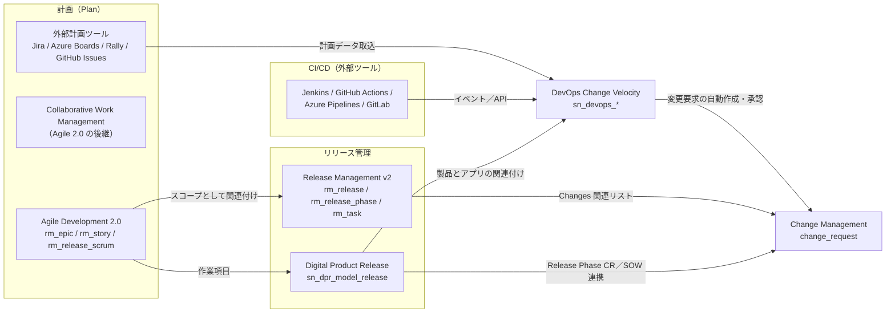
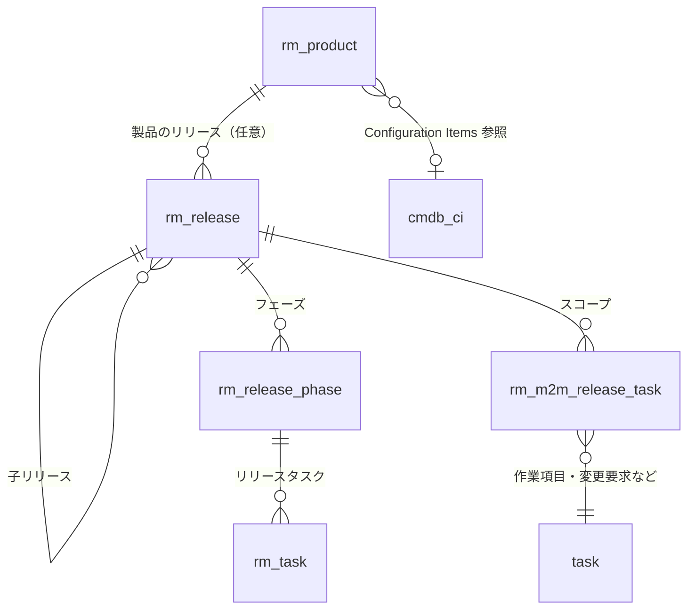
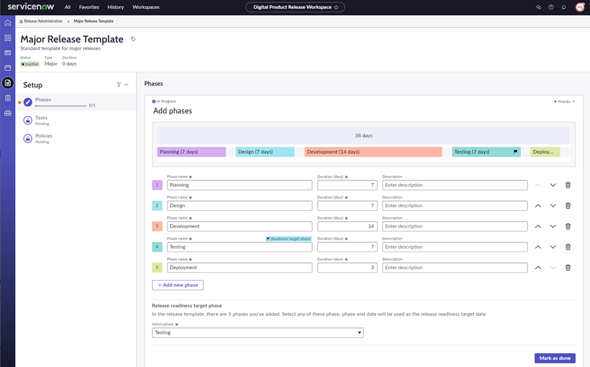
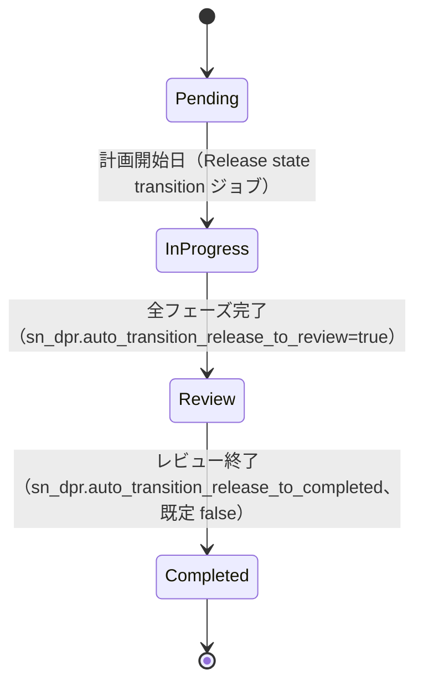
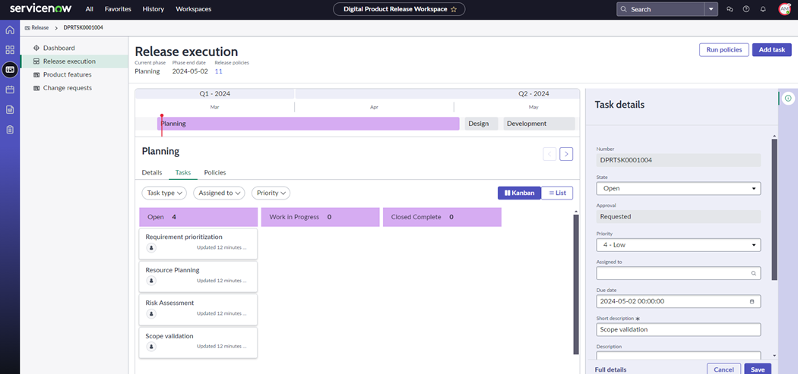
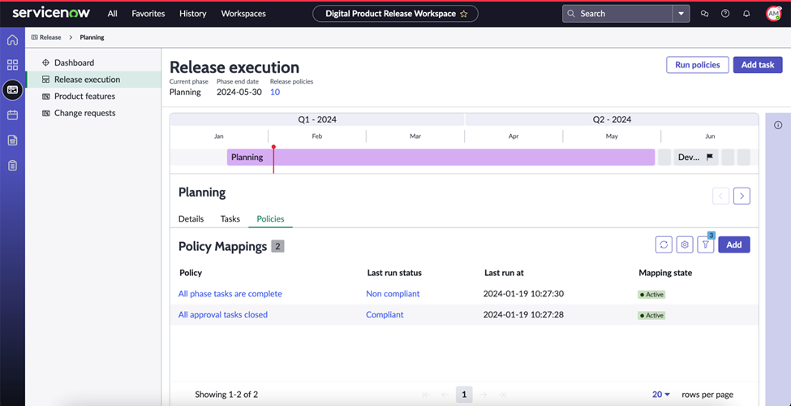
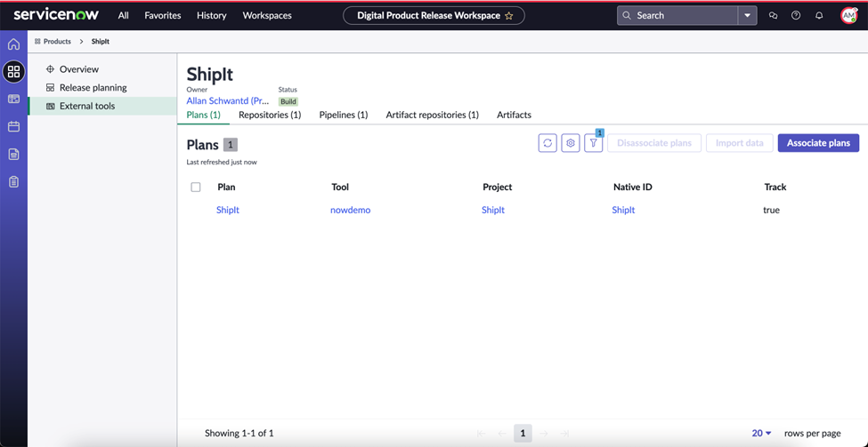
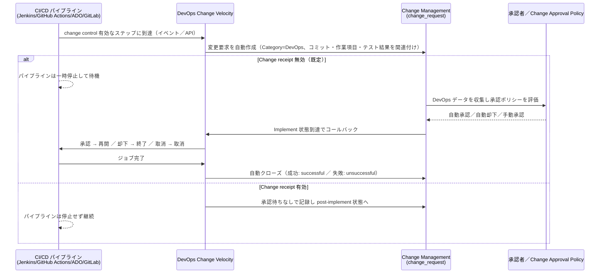

# Release Management と DevOps（リリース管理と DevOps）

## 概要

ServiceNow におけるリリース管理（Release Management）と DevOps 連携は、2026 年時点で次の 4 つのアプリケーション群に分かれている。名前が似ていてテーブルも別系統なので、まずどれを指しているかを特定することが重要である。

| 区分 | アプリケーション | 主なテーブル／スコープ | 位置付け（Australia 時点） |
|---|---|---|---|
| ITIL 型リリース管理（従来型） | Release Management v2（`com.snc.release_management_v2`） | `rm_release`, `rm_release_phase`, `rm_task`, `rm_product`, `rm_m2m_release_task` | ITSM 標準の古典的リリース管理。UI16（Core UI）中心 |
| プロダクト型リリース管理（新世代） | Digital Product Release（DPR、`sn_dpr`） | `sn_dpr_model_release` ほか `sn_dpr_model_*` | Store アプリ。ワークスペース・リリーステンプレート・Policy as Code によるフェーズゲート |
| アジャイル開発のリリース | Agile Development 2.0（`com.snc.sdlc.agile.2.0`） | `rm_release_scrum`, `rm_sprint`, `rm_story`, `rm_epic` | 廃止予定（2030 年 8 月、公式リリースノート）。後継は Collaborative Work Management（CWM） |
| DevOps／CI/CD 連携と変更自動化 | DevOps Change Velocity（`sn_devops` ほか） | `sn_devops_*` | Store アプリ。パイプラインから Change Request（変更要求）を自動作成・自動承認 |

加えて、ServiceNow 上のアプリケーション開発自体の CI/CD 用に **CICD API（`/api/sn_cicd/`）** があり、これも「Continuous integration（継続的インテグレーション）連携」の文脈で扱う（本ファイル後半）。

本ファイルは Australia（2026-05 GA）を基準とし、Brazil での変更点は判明分を併記する。Change Management（変更管理）本体の仕様は [Change Management](./change-management.md)、Agile Development 2.0 と SPM 製品群の詳細は [Agile Development・APM・EAM](../spm/agile-apm-eam.md) を参照。

---

## 1. 製品の関係と使い分け

### 1.1 全体像

Release Management v2・Digital Product Release・Agile Development 2.0・DevOps Change Velocity・Change Management は、次のように連携する。



[出典](https://www.servicenow.com/docs/r/QykF2iRSIs6VXztArCSo3w/W8i6SDK02X~nJtdqAvP3uQ)・[出典](https://www.servicenow.com/docs/r/QykF2iRSIs6VXztArCSo3w/b8XTUyU9IGBBs0C~2gegwQ)・[出典](https://www.servicenow.com/docs/r/QykF2iRSIs6VXztArCSo3w/ekC~Zu6H2nTP6iQIDUtSFw)

### 1.2 Release Management v2 と Digital Product Release の比較

| 観点 | Release Management v2 | Digital Product Release（DPR） |
|---|---|---|
| 提供形態 | プラットフォームプラグイン `com.snc.release_management_v2` | ServiceNow Store アプリ（アプリ ID `sn_dpr`） |
| 主テーブル | `rm_release` | `sn_dpr_model_release` |
| UI | Core UI（All > Release > …） | Digital Product Release Workspace（Next Experience） |
| プロセス定義 | フェーズとタスクを手作業で作成 | Release Template（リリーステンプレート）でフェーズ・タスク・ポリシー・承認を定義し自動展開 |
| ゲート | 「フェーズ内の全タスク完了でフェーズ完了」以上のゲート機能は公開情報では確認できず | Policy as Code Engine（`sn_pace`）によるフェーズゲート検証 |
| プロセス型 | ウォーターフォール型／マージ型などを手動で表現 | Timeline-oriented（日付駆動）／Stage-oriented（段階駆動） |
| DevOps 連携 | 公開情報で明示的な連携は確認できず | DevOps（`sn_devops`）を依存アプリとして同時インストールし、製品に DevOps のプラン・リポジトリ・パイプラインを関連付け |
| 変更管理連携 | Release フォームの Changes 関連リストで紐付け | Release Phase CR テーブル、Service Operations Workspace（SOW）との統合 |

[出典](https://www.servicenow.com/docs/r/QykF2iRSIs6VXztArCSo3w/W8i6SDK02X~nJtdqAvP3uQ)・[出典](https://www.servicenow.com/docs/r/QykF2iRSIs6VXztArCSo3w/5vkhHUTA925YQuezD_MdHw)・[出典](https://www.servicenow.com/docs/r/QykF2iRSIs6VXztArCSo3w/_uNCTiuPKwHTiLMhRWO1gQ)

> 補足：ServiceNow が Release Management v2 を廃止予定とする公式告知は、本調査では確認できなかった。一方、新機能（ワークスペース、テンプレート、ポリシー、AI によるリリースノート生成など）は DPR 側に追加されている。新規導入で「プロダクト単位のリリース計画とゲート管理」を求める場合は DPR が第一候補になる、というのが公開情報からの【推定】である。

### 1.3 ライセンス上の位置付け

- **DevOps Change Velocity**：【第三者情報】ServiceNow Community の DevOps blog に ServiceNow 社員が投稿した記事（2022-11-03 投稿）では、DevOps Change Velocity は単体製品から ITSM Pro パッケージに移され、ITSM Pro（および Enterprise）の顧客が利用できると説明されている。[出典](https://www.servicenow.com/community/devops-blog/got-itsm-pro-have-you-tried-connecting-to-the-world-of-devops/ba-p/2371736)（2022 年時点の記事であり、公式のパッケージング資料では未確認。最新の契約条件は要確認）
- **Digital Product Release**：インストール手順では「アプリと関連 Store アプリに有効なエンタイトルメントが必要」とのみ記載されている。ITSM のどのパッケージに含まれるかは、公開情報では明確に確認できず（ITSM 価格ページの断片に DPR が記載されているとの検索結果があるが未確認、【推定】）。[出典](https://www.servicenow.com/docs/r/QykF2iRSIs6VXztArCSo3w/5vkhHUTA925YQuezD_MdHw)
- **Release Management v2**：ITSM のプラグインとして提供される。パッケージ区分の詳細は [ITSM 概要とパッケージ](./itsm-overview.md) と [エディション比較](../../03_導入編/03-edition-comparison.md) を参照。
- **Agile Development 2.0**：【第三者情報】ServiceNow 社員による Community 記事（2026-04-28）によれば、2026 年 4 月に新規顧客向け販売終了（End of Sale）。[出典](https://www.servicenow.com/community/cwm-articles/start-here-agile-2-0-end-of-support-and-collaborative-work/ta-p/3533752) 公式リリースノート上の廃止予定日は 2030 年 8 月。詳細は「4. Agile Development 2.0 との関係」を参照。

---

## 2. Release Management v2（`rm_release`）

### 2.1 概要と有効化

Release Management v2 は、ハードウェアおよびソフトウェアのリリースの計画・設計・構築・構成・テストを管理するアプリケーションである。計画された各機能はタスクレコードとして表され、デプロイまでリリースチームメンバーに割り当てられる。プロジェクト、エピック、ストーリー、問題（Problem）などの作業項目を 1 つのリリースの中で計画できる。[出典](https://www.servicenow.com/docs/r/it-service-management/release-management/c_ITILReleaseManagement.html)

| 項目 | 内容 |
|---|---|
| プラグイン | Release Management v2（`com.snc.release_management_v2`） |
| 有効化に必要なロール | `admin` |
| 主なメニュー | All > Release > Products、All > Release > Releases |
| Release Management v1 | 公式ドキュメントは v2 のみを記載。v1 の現行サポート状況は公開情報では確認できず |
| 関連機能 | Domain separation（ドメインセパレーション）対応、Software control distribution（CMDB に Definitive Media Library（DML、確定版メディアライブラリ）を作成） |

[出典](https://www.servicenow.com/docs/r/it-service-management/release-management/c_ITILReleaseManagement.html)・[出典](https://www.servicenow.com/docs/r/QykF2iRSIs6VXztArCSo3w/W8i6SDK02X~nJtdqAvP3uQ)

### 2.2 テーブル

Release Management v2 プラグインは次のテーブルをインストールする。

| テーブル（ラベル） | テーブル名 | 説明 |
|---|---|---|
| Product（製品） | `rm_product` | リリースを管理する対象の製品全体を表す。**任意**（製品なしの汎用リリースも定義可能） |
| Release（リリース） | `rm_release` | 製品の個々のリリースを表す |
| Release Phase（リリースフェーズ） | `rm_release_phase` | リリース完了までに必要な作業の各段階を表す |
| Release Tasks（リリースタスク） | `rm_task` | フェーズ内の活動を表すタスク |
| Release Items（リリース項目） | `rm_m2m_release_task` | リリースに関連付けられた作業項目と変更レコードを表す多対多テーブル |

[出典](https://www.servicenow.com/docs/r/Recj91eIo1YnsOabQjgskg/jveNj~bkgmFWTLj8t1roAg)（Xanadu 版。Zurich 版のビジネスステークホルダーロールのページでも同じ 5 テーブルを確認 [出典](https://www.servicenow.com/docs/r/MlbQAgTiiiMOLOw9T36wJg/BUJjpid6nWcw_XfMl5fRbA)）

- `rm_release` の親テーブル（拡張元）は公開ドキュメントでは明示されていない。Release フォームの「Release Hierarchy」が Planned task（計画タスク）の Task Hierarchy ツールを使っていることから、`planned_task` を拡張していると【推定】される。実機の `sys_db_object` で確認すること。



[出典](https://www.servicenow.com/docs/r/QykF2iRSIs6VXztArCSo3w/W8i6SDK02X~nJtdqAvP3uQ)

### 2.3 ロール

| ロール（ラベル） | ロール名 | 説明 | 包含ロール |
|---|---|---|---|
| Release admin | `release_v2_admin` | アプリケーション全体にアクセスできる。リリース定義・スコープ定義に必要 | `release_v2_user` |
| Release user | `release_v2_user` | 機能・タスク関連の各モジュールにアクセスできるが、内容は更新できない | なし |
| Business stakeholder（ビジネスステークホルダー） | `sn_release_read` | Release Management の全テーブルを読み取り専用で参照し、レポートを作成できる | — |

[出典](https://www.servicenow.com/docs/r/Recj91eIo1YnsOabQjgskg/jveNj~bkgmFWTLj8t1roAg)・[出典](https://www.servicenow.com/docs/r/MlbQAgTiiiMOLOw9T36wJg/BUJjpid6nWcw_XfMl5fRbA)

`sn_release_read` の前提条件：

- 必要プラグイン：Business Stakeholder（`com.snc.business_stakeholder`）、Read only roles for Release Management（`com.snc.release_management_read_roles`）、Release Management（`com.snc.release_management_v2`）。
- 新規顧客は read-only ロールプラグインが zBoot 時に有効化されるが、ロールは Release Management プラグインが有効な場合のみ利用可能。
- アップグレード顧客は read-only ロールプラグインと Release Management プラグインを**手動で有効化**する必要がある。
- 公式ページ内で read-only ロールプラグインの ID 表記が揺れている（`com.snc.release_management_read_roles` と `com.snc.release_management_v2`）ため、実機の Plugins 一覧で確認すること。

[出典](https://www.servicenow.com/docs/r/MlbQAgTiiiMOLOw9T36wJg/BUJjpid6nWcw_XfMl5fRbA)（Zurich 版）

### 2.4 Product（製品）の定義

- `rm_product` は製品情報を保持し、その製品のすべてのリリースと作業成果物をグルーピングする。
- **Configuration Items** 参照フィールドで製品を CMDB の CI に紐付けられる。CI を指定すると、リリースプロセスの情報がインスタンス内の他プロセス（インシデント、変更など）とつながる。
- 製品の定義は任意である。リリースは「すべての製品・サービスに関わるエンタープライズリリース」として、製品に紐付けずに定義することも、複数製品に関連付けることもできる。
- リリース定義後は、製品の **Product Hierarchy** 関連リンクで、その製品のリリース・フェーズ・タスクを階層表示できる。

[出典](https://www.servicenow.com/docs/r/QykF2iRSIs6VXztArCSo3w/W8i6SDK02X~nJtdqAvP3uQ)

### 2.5 Release（リリース）の定義

**必要ロール：** `release_v2_admin`

**手順：**

1. All > Release > Products を開き、リリースを追加する製品を開く。リリースが製品に属さない、または複数製品に属する場合は All > Release > Releases から直接定義する。
2. Releases 関連リストで **New** をクリックする。
3. フォームに入力して **Submit** する。

**Release フォームの主なフィールド（Australia）：**

| フィールド | 説明 |
|---|---|
| Number（番号） | リリースの一意な識別子（自動採番） |
| Release type（リリースタイプ） | Major、Minor、Upgrade、Patch など |
| Priority（優先度） | Critical、High、Moderate など |
| State（状態） | Draft、Work in progress、Testing など。選択肢の追加は管理者が行う |
| Percent complete（完了率） | リリース全体に対する進捗率 |
| Short description（簡単な説明） | リスト上でリリースを識別するための短い説明 |
| Description（説明） | リリースの詳細 |
| Planned start date（計画開始日） | 暫定の開始日 |
| Planned end date（計画終了日） | 暫定の終了日 |
| Planned duration（計画期間） | 日数。送信時に計画開始日・終了日から自動計算 |

[出典](https://www.servicenow.com/docs/r/UMl~97STJe3fa_KTmzD1Gg/iOH~ZEt7OlEHl4TaBbrTLg)（Australia 版）

> リリース間の差分：Xanadu／Washington DC 版のドキュメントのフィールド表は Number、Release Type、Description、Planned start/end date、Planned duration のみで、Priority・State・Short description・Percent complete は Australia 版で記載が追加されている（フィールド自体の追加時期かドキュメント整備時期かは公開情報では確認できず）。[出典](https://www.servicenow.com/docs/r/Recj91eIo1YnsOabQjgskg/7qhOWL9JsStIVB8rRK2Omw)

リリース計画時に定義する事項は、リリースタイプ、スケジュール（計画開始日・終了日）、必要なフェーズ、フェーズタスク、スコープである。リリースには子リリース（Child release）を追加することもできる。[出典](https://www.servicenow.com/docs/r/QykF2iRSIs6VXztArCSo3w/W8i6SDK02X~nJtdqAvP3uQ)

### 2.6 Release Phase（リリースフェーズ）と Release Task（リリースタスク）

- `rm_release_phase` は統制と実行のために複数作成する。
  - ウォーターフォール型の例：requirement gathering（要件収集）、design（設計）、development（開発）、testing（テスト）、build（ビルド）、acceptance（受入）、deployment（デプロイ）。
  - マルチマージ型の例：merge 1、merge 2、merge 3 …。
- 各フェーズには `rm_task`（リリースタスク）を関連付ける。**フェーズ内のすべてのタスクが完了するとフェーズが完了**する。
- 公式ドキュメントは「Release managers must keep the release phases updated（リリースマネージャーはフェーズを常に更新しておく必要がある）」としており、フェーズの状態管理はリリースマネージャーの手作業が前提である。

[出典](https://www.servicenow.com/docs/r/QykF2iRSIs6VXztArCSo3w/W8i6SDK02X~nJtdqAvP3uQ)

### 2.7 状態値（State）と State category

`rm_release` と `rm_task` には、Planned task 系の「状態カテゴリ」（どの状態値が open／work／close などに該当するか）が定義されている。公式ドキュメント（Yokohama 版）に記載された値は次のとおり。状態値の**ラベル**は公式ページに記載がなく、公開情報では確認できず（実機の Choice List で確認すること）。

| 状態カテゴリ | `rm_release` | `rm_task` |
|---|---|---|
| default_open_state | 1 | 1 |
| open_states | 1 | 1 |
| default_work_state | 2 | 2 |
| work_in_progress_states | 2, 4, 10 | 2 |
| default_pending_state | -5 | -5 |
| pending_states | -5 | -5 |
| completed_states | 3 | 3 |
| default_close_state | 3 | 3 |
| close_states | 3, 7 | 3, 4, 7 |
| default_skipped_state | 7 | 7 |
| skipped_states | 4, 7 | 4, 7 |

[出典](https://www.servicenow.com/docs/r/Mr7qUatbFXax1_h~z60rmA/JsKQ6ATwG7wxwPAAwRrDow)（Yokohama 版）

- 注意：`rm_release` では状態値 4 が `work_in_progress_states` と `skipped_states` の両方に含まれ、`rm_task` では 4 が `close_states` と `skipped_states` に含まれる。公式表の記載どおりに転記しているが、カスタム状態を追加する場合はカテゴリの重複に注意すること。

### 2.8 スコープ（Scope）の定義と作業項目の関連付け

リリースのスコープは、そのリリースで提供する作業成果物（プロジェクト、エピック、ストーリー、拡張、不具合など）で構成する。マイナーリリースは少数の問題と拡張のみ、メジャーリリースは複数のプロジェクトやエピックを含むことがある。スコープはリリース実行の開始前に定義する。[出典](https://www.servicenow.com/docs/r/QykF2iRSIs6VXztArCSo3w/W8i6SDK02X~nJtdqAvP3uQ)

**必要ロール：** `release_v2_admin`

**手順：**

1. All > Release > Releases を開く。
2. スコープを定義するリリースの番号をクリックする。
3. Release フォームの関連リストから対象を選ぶ：Projects、Scrum Epics、Scrum Stories、SAFe Epics、SAFe Features、SAFe Stories、Defects、Enhancements、Incidents、Problems、Changes。
4. **Attach Task** をクリックし、検索アイコンで対象タスクを探して番号をクリックし、リリースタスクとして追加する。
5. **Submit** する。

**前提：** 作業項目の関連リストを表示するには Agile Development 2.0、Project Portfolio Management、Essential SAFe、SAFe Portfolio の各プラグインが有効である必要がある。

[出典](https://www.servicenow.com/docs/r/UMl~97STJe3fa_KTmzD1Gg/vYymqfxfq1~NLJdotDY4fw)（Australia 版）

- New York リリース以降、SDLC または Scrum（Agile Development 1.0、`com.snc.sdlc.scrum.pp`）によるスコープ定義はサポートされない。[出典](https://www.servicenow.com/docs/r/QykF2iRSIs6VXztArCSo3w/W8i6SDK02X~nJtdqAvP3uQ)
- スコープ定義中は Release フォームの **Release Hierarchy** 関連リストでリリースを階層表示できる。
- リリーススコープ（プロジェクト、ストーリー等）が確定したら **Change Items（変更項目）を生成してリリースに関連付け**、デプロイを変更管理経由で実施できる。[出典](https://www.servicenow.com/docs/r/it-service-management/release-management/c_ITILReleaseManagement.html)

### 2.9 Release Management v2 の制約・注意点

| 項目 | 内容 |
|---|---|
| フェーズ管理 | フェーズの自動遷移やポリシーゲートは公開情報では確認できず。リリースマネージャーによる手動更新が前提 |
| Agile 2.0 依存 | Scrum Epics／Scrum Stories のスコープ関連付けは Agile Development 2.0 前提。Agile 2.0 は廃止予定（4 章参照） |
| ワークスペース | Release Management v2 専用の Next Experience ワークスペースは公開情報では確認できず（ワークスペース型 UI は DPR が提供） |
| DevOps 連携 | DevOps Change Velocity と `rm_release` を直接つなぐ標準機能は公開情報では確認できず |

---

## 3. Digital Product Release（DPR）

### 3.1 概要

Digital Product Release（DPR）は、プロダクト／サービス単位でリリースを計画・実行するための Store アプリケーションである。Digital Product Release Workspace（DPR ワークスペース）で、リリース管理者がリリースプロセスと Release readiness target（リリース準備完了目標日）を定義し、プロダクトマネージャーが製品・機能の作成、バージョン定義、リリースの計画・実行を行う。[出典](https://www.servicenow.com/docs/r/QykF2iRSIs6VXztArCSo3w/b8XTUyU9IGBBs0C~2gegwQ)

ライフサイクルは「製品を作成 → スコープを計画 → readiness target を指定してリリースを開始 → フェーズとタスクを実行 → ポリシーを検証 → 目標日までに準備完了」の流れである。

主な用語：

| 用語 | 意味 |
|---|---|
| Release template（リリーステンプレート） | フェーズ・タスク・ポリシー・承認タスクをあらかじめ定義した「リリースプロセスの設計図」。リリース作成時に自動適用 |
| Release readiness target（Release target） | リリースがデプロイ可能になっているべき日付 |
| Release bundle（リリースバンドル） | 複数リリースをまとめて同時に追跡する単位 |
| Release calendar（リリースカレンダー） | readiness target、リリース、変更要求、ブラックアウト期間を表示 |
| Approval definition（承認定義） | 利害関係者がタスクを承認する方法（ユーザーまたはグループへの依頼）のルール |
| Included products | 製品とサービスの関係を示す製品階層（マルチプロダクトリリースで使用） |

[出典](https://www.servicenow.com/docs/r/QykF2iRSIs6VXztArCSo3w/b8XTUyU9IGBBs0C~2gegwQ)

ペルソナ（公式ドキュメントの記載）：

| ペルソナ | 役割 |
|---|---|
| Release manager（リリースマネージャー） | リリースカレンダーとテンプレートを管理し、ポリシーゲートを含むプロセスを確立 |
| Release coordinator / Program manager | 依存関係の伝達、リリーススコープの承認、状況報告 |
| Product manager（プロダクトマネージャー） | スコープ計画、リリース開始、リリースノート作成（AI 生成または手動） |
| Engineering lead（エンジニアリングリード） | 開発の遂行と、開発スコープのリリースへの接続 |
| Release template admin | リリーステンプレートの作成・管理 |

[出典](https://www.servicenow.com/docs/r/QykF2iRSIs6VXztArCSo3w/b8XTUyU9IGBBs0C~2gegwQ)

### 3.2 インストールと構成コンポーネント

| 項目 | 内容 |
|---|---|
| アプリ ID | `sn_dpr` |
| 必要ロール | `admin` |
| 手順 | All > System Applications > All Available Applications で名前または `sn_dpr` を検索 → バージョンを選び Install → Review Installation Details で依存関係を確認 → 必要に応じてエンタイトルメント取得 → 任意で Load demo data → Install |
| デモデータ | 初回インストール時のみ、開発／テストインスタンスでの利用を推奨 |

[出典](https://www.servicenow.com/docs/r/QykF2iRSIs6VXztArCSo3w/5vkhHUTA925YQuezD_MdHw)

同時にインストールされる主なコンポーネント（Australia）：

| 区分 | 名称（ID） |
|---|---|
| DPR 本体 | Digital Product Release Data Model（`sn_dpr_model`）、Digital Product Release Workspace（`sn_dpr_workspace`）、Digital Product Release Policy Content Pack、Release Timeline Component |
| プラグイン | Global Ranking Application（`com.snc.sdlc.ranking`） |
| ポリシー | Policy as Code Engine（`sn_pace`）、Policy as Code Engine UI（`sn_pace_builder`） |
| DevOps | DevOps（`sn_devops`）、DevOps Workspace（`sn_devops_ws`）、DevOps Integrations（`sn_devops_ints`） |
| その他 | CMDB CI Class Models（`sn_cmdb_ci_class`）、Roadmap UI Builder Component（`sn_roadmap`）、Playbook Experience（`sn_playbook_exp`）、Playbook Experience Components（`now_playbook_exp`）、Quick filter component（`sn_quick_filter`）、Quick filter popover（`sn_filter_popover`） |

[出典](https://www.servicenow.com/docs/r/QykF2iRSIs6VXztArCSo3w/5vkhHUTA925YQuezD_MdHw)

### 3.3 DPR のロール

| ロール（ラベル） | ロール名 | 概要 | 主な包含ロール |
|---|---|---|---|
| Digital Product Release Admin | `sn_dpr_model.release_admin` | リリースプロセスを定義し、リリースを監視 | `sn_dpr_model.release_calendar_admin`, `sn_dpr_model.release_template_admin`, `sn_dpr_model.release_user`, `sn_devops.tool_owner`, `sn_change_write`, `sn_pace.admin`, `sn_pace.mapping_admin`, `pd_operator` |
| Digital Product Manager | `sn_dpr_model.product_manager` | デジタル製品・サービスを管理 | `sn_devops.app_owner`, `sn_change_write`, `sn_dpr_model.release_user`, `sn_dpr_model.product_feature_create/delete/write`, `asset`, `model_manager`, `pd_operator`, `sn_pace.*`（reader 系・`mapping_admin`）, `template_read_global` |
| Digital Product Release Coordinator | `sn_dpr_model.release_coordinator` | プロダクトチームを支援 | `sn_change_write`, `sn_dpr_model.release_user`, `sn_pace.*`（reader 系・`mapping_admin`）, `pd_operator`, `template_read_global` |
| Digital Product Release Template Admin | `sn_dpr_model.release_template_admin` | リリーステンプレートを管理 | `pd_operator`, `personalize_choices`, `sla_manager`, `sn_pace.policy_reader`, `template_editor_global` |
| Digital Product Release Calendar Admin | `sn_dpr_model.release_calendar_admin` | リリースカレンダーを管理（単独では機能せず、他の DPR ロールが必要） | `personalize_choices`, `sn_change_read` |
| Digital Product Release User | `sn_dpr_model.release_user` | リリース参照、リリースタスクの更新・承認。リリースの作成・変更は不可 | `sn_dpr_workspace.workspace_user`, `sn_devops.viewer`, `sn_change_read`, `sn_incident_read`, `sn_problem_read`, `sn_request_read`, `task_editor`, `app_service_user`, `service_viewer`, `sn_dpr_model.product_feature_read`, `sn_pace.policy_reader` |
| Digital Product Release Workspace User | `sn_dpr_workspace.workspace_user` | DPR ワークスペースへのアクセス | `cmdb_read` |
| Product Feature Create／Read／Write／Delete | `sn_dpr_model.product_feature_create` 等 | 製品機能（Product Feature）の作成・参照・更新・削除 | なし |
| Product Enhancement Read | `sn_dpr_model.product_enhancement_read` | 製品拡張（Product Enhancement）の参照 | なし |

[出典](https://www.servicenow.com/docs/r/QykF2iRSIs6VXztArCSo3w/_uNCTiuPKwHTiLMhRWO1gQ)（Australia 版。ロールは計 12 種）

- DPR の管理者・プロダクトマネージャーは `sn_devops.tool_owner`／`sn_devops.app_owner` を包含しており、DevOps Change Velocity の操作権限を同時に持つ点が設計上の特徴である。
- 「Release manager」という名前の技術ロールは上表になく、ペルソナ名と技術ロール名は一致しない（ペルソナ「Release manager」に対応する技術ロールは `sn_dpr_model.release_admin` と考えられる、【推定】）。

### 3.4 DPR のテーブル

| テーブル（ラベル） | テーブル名 | 説明 |
|---|---|---|
| Release | `sn_dpr_model_release` | 製品・サービスのリリース。フェーズ・タスク・ポリシー・承認を持つ |
| Release Phase | `sn_dpr_model_release_phase` | リリース内のフェーズ |
| Release Task | `sn_dpr_model_release_task` | フェーズ内のタスク |
| Release Template | `sn_dpr_model_release_template` | リリース作成時に適用するフェーズ・タスク・承認・ポリシーの定義 |
| Release Association | `sn_dpr_release_association` | リリースとリリーステンプレートの関連 |
| Release Readiness Target | `sn_dpr_model_release_target` | 単発または定期リリースのスケジュール |
| Release Calendar | `sn_dpr_model_release_calendar` | readiness target を保持。除外スケジュールを持てる |
| Release Bundle／Release Bundle M2M | `sn_dpr_model_release_bundle`／`sn_dpr_model_release_bundle_m2m` | リリースバンドルとリリースの関連 |
| Key Date | `sn_dpr_model_release_key_date` | マイルストーン、イベント、期限 |
| Approval Definition | `sn_dpr_model_approval_definition` | リリースタスクの承認依頼をユーザー／グループへ振り分け |
| Policy | `sn_dpr_pace_policy_mapping` | リリースにマッピングされたポリシー（PaCE の Policy Mapping を拡張） |
| Release Phase M2M | `sn_dpr_release_phase_m2m` | リリース・フェーズとポリシーの関連 |
| Release Policy Execution | `sn_dpr_policy_execution` | フェーズに対するポリシー実行結果 |
| Release Phase CI | `sn_dpr_model_release_phase_ci_m2m` | フェーズと CI の関連 |
| Release Phase CR | `sn_dpr_model_release_phase_cr` | フェーズと変更要求の関連 |
| Related Tasks | `sn_dpr_model_release_related_task_m2m` | Task レコード（インシデント等）とリリースの関連 |
| Release Artifact | `sn_dpr_model_release_artifact` | リリースに含まれる成果物 |
| Release notes | `sn_dpr_model_release_notes` | AI 生成または手動のリリースノート |
| Product Feature | `sn_dpr_model_product_feature` | 顧客価値を生む機能・能力 |
| Product Enhancement | `sn_dpr_model_product_enhancement` | 製品機能の拡張（段階的リリースに使用） |
| Work Item | `sn_dpr_model_product_enhancement_work_item_mapping` | 製品拡張と作業項目の関連 |
| Product Model Settings | `sn_dpr_model_product_settings` | 製品単位のリリース設定 |

[出典](https://www.servicenow.com/docs/r/QykF2iRSIs6VXztArCSo3w/_uNCTiuPKwHTiLMhRWO1gQ)（Australia 版、計 23 テーブル）

- ServiceNow Community の回答では、テンプレート上のタスクは `sn_dpr_model_release_task`（Task を拡張）に保存され、承認タスクと非承認タスクがあり、リリース実行ページの Tasks タブに表示されるとされる【第三者情報】。[出典](https://www.servicenow.com/community/digital-product-release-forum/what-is-the-purpose-of-tasks-on-dpr-release-template-who-are/m-p/3476628)

### 3.5 リリーステンプレートとプロセス型

リリーステンプレートは、Phases（フェーズ）→ Tasks（タスク）→ Policies（ポリシー）の順に構成する。各ステップで **Mark as done** を押すとそのステップはロックされ、以後フェーズ・タスクの追加変更やポリシーのマッピングはできない。テンプレートのフェーズ期間合計は `sn_dpr.max_template_duration`（既定 730 日）以下でなければならない。[出典](https://www.servicenow.com/docs/r/Recj91eIo1YnsOabQjgskg/n9vzZ9EHY3cgJRhiZgJDmw)

| プロセス型 | 特徴 |
|---|---|
| Timeline-oriented（タイムライン型） | 各フェーズに終了日と期間が定義される。フェーズ終了日にタスク完了とポリシー準拠を満たしていれば Completed になり、次フェーズが開始。同時に In Progress になれるフェーズは 1 つ |
| Stage-oriented（ステージ型） | フェーズに事前定義の終了日がない。最初のフェーズは手動開始。タスク完了とポリシー準拠（または例外付き準拠）で自動的に Completed。完了済みフェーズから再開でき、そのフェーズ以降のタスクとポリシー状態はリセットされる |

[出典](https://www.servicenow.com/docs/r/QykF2iRSIs6VXztArCSo3w/b8XTUyU9IGBBs0C~2gegwQ)・[出典](https://www.servicenow.com/docs/r/Recj91eIo1YnsOabQjgskg/fVvgoYLQ4AhnONcvSCCsWw)



**図 1：Digital Product Release Workspace のリリーステンプレート編集画面（Phases ステップ）**
画面説明：Digital Product Release Workspace の Release Administration > 「Major Release Template」。左側の Setup パネルに Phases（進捗 0/1）、Tasks（Pending）、Policies（Pending）の 3 ステップが縦に並ぶ。右側の「Add phases」では、Phase name・Duration (days)・Description を行ごとに入力し、Planning 7 日／Design 7 日／Development 14 日／Testing 7 日／Deployment 3 日の 5 フェーズを定義している。上部のバーに合計 38 日のタイムラインが色分け表示され、Testing フェーズに「Readiness target phase」の旗が付く。下部の「Release readiness target phase」で、終了日をリリース準備完了目標日として扱うフェーズ（ここでは Testing）を選択し、「Mark as done」でステップを確定する。ヘッダーに Status: Inactive、Type: Major が表示される。
出典：https://www.servicenow.com/community/digital-product-release-articles/digital-product-release-implementation-amp-configuration-guide/ta-p/2884002 （ServiceNow Community 記事、2024 年 4 月投稿のため画面は旧バージョン）／取得日：2026-11-03

### 3.6 リリースの実行と状態遷移

DPR のリリース実行は次のように進む（Xanadu 版の記載。Australia でも同等の仕組みであることをスケジュールジョブ定義から確認）。

1. 最初のフェーズは Pending で始まる。Timeline 型は計画開始日に、Stage 型は手動開始で In Progress になる。
2. フェーズ内タスクは `sn_dpr.sequential_task_execution` に従う（true：順番に 1 つずつ Open、false：フェーズ開始時に全タスクが Open）。
3. タスク完了とポリシー準拠によりフェーズが Completed になり、次のフェーズが In Progress になる（同時に In Progress のフェーズは 1 つ）。
4. 全フェーズ完了でリリースは Review、さらに Completed に遷移する。

[出典](https://www.servicenow.com/docs/r/Recj91eIo1YnsOabQjgskg/fVvgoYLQ4AhnONcvSCCsWw)



| 対象 | 状態 |
|---|---|
| Release | Pending → In progress → Review → Completed |
| Phase | Pending（既定）→ In Progress → Completed |
| Task | Open、Work in Progress、Closed Complete（承認タスクは Requested を経由） |

[出典](https://www.servicenow.com/docs/r/Recj91eIo1YnsOabQjgskg/fVvgoYLQ4AhnONcvSCCsWw)・[出典](https://www.servicenow.com/docs/r/QykF2iRSIs6VXztArCSo3w/_uNCTiuPKwHTiLMhRWO1gQ)（Task の Work in Progress／Closed Complete は図 2 の Kanban 列名から確認。状態の内部値は公開情報では確認できず）

DPR がインストールするスケジュールジョブ（Australia）：

| ジョブ | 頻度 | 内容 |
|---|---|---|
| Release state transition | 毎時 | 計画開始日に Pending のリリースを In progress へ、全フェーズ完了で Review へ遷移 |
| Release phase state transition | 毎時 | 計画終了日に到達しポリシー状態が準拠のフェーズを完了させ、次フェーズを開始 |
| DPR Execute policies for all active release phases | 毎日 | 進行中フェーズのポリシーを実行 |
| Clean 6 month old unused release target | 毎日 | 6 か月以上未使用の release target を削除 |

[出典](https://www.servicenow.com/docs/r/QykF2iRSIs6VXztArCSo3w/_uNCTiuPKwHTiLMhRWO1gQ)



**図 2：Digital Product Release Workspace の Release execution 画面（Tasks タブ）**
画面説明：パンくずは「Release > DPRTSK0001004」。左ナビゲーションに Dashboard、Release execution、Product features、Change requests が並ぶ。上部に Current phase（Planning）、Phase end date、Release policies（件数）が表示され、右上に「Run policies」「Add task」ボタンがある。四半期単位のタイムライン上に Planning・Design・Development のフェーズが並び、赤い縦線が現在日を示す。中央の Planning フェーズの Tasks タブでは Kanban 表示で Open（4 件：Requirement prioritization、Resource Planning、Risk Assessment、Scope validation）・Work in Progress・Closed Complete の列があり、Task type／Assigned to／Priority でフィルタできる。右側の Task details パネルでは Number、State、Approval（Requested）、Priority、Assigned to、Due date、Short description を編集できる。
出典：https://www.servicenow.com/community/digital-product-release-articles/digital-product-release-implementation-amp-configuration-guide/ta-p/2884002 （ServiceNow Community 記事、2024 年 4 月時点の画面）／取得日：2026-11-03

### 3.7 ポリシー（Policy as Code）によるフェーズゲート

- Digital Product Release Policy Content Pack は、フェーズゲート検証とソフトウェア成果物の継続的評価を自動化するポリシーとデータコレクターを提供する。
- 各フェーズは、マッピングされたポリシーに対して検証される。ポリシーの実行エンジンは Policy as Code Engine（`sn_pace`）。
- GRC: Policy and Compliance Management と連携し、リリースプロセスをリスク・コンプライアンス統制に結び付けられる（[Integrated Risk Management](../irm/integrated-risk-management.md) 参照）。

[出典](https://www.servicenow.com/docs/r/QykF2iRSIs6VXztArCSo3w/b8XTUyU9IGBBs0C~2gegwQ)



**図 3：Release execution 画面の Policies タブ（Policy Mappings）**
画面説明：Planning フェーズの Policies タブに「Policy Mappings（2）」の一覧があり、列は Policy、Last run status、Last run at、Mapping state。例として「All phase tasks are complete」が Non compliant、「All approval tasks closed」が Compliant と表示され、Mapping state はいずれも Active。右上の「Run policies」でポリシーを手動実行でき、「Add」でポリシーを追加マッピングできる。
出典：https://www.servicenow.com/community/digital-product-release-articles/digital-product-release-implementation-amp-configuration-guide/ta-p/2884002 （ServiceNow Community 記事、2024 年 4 月時点の画面）／取得日：2026-11-03

### 3.8 DPR のシステムプロパティ

| プロパティ | 既定値 | 説明 |
|---|---|---|
| `sn_dpr.auto_transition_release_to_review` | true | 全フェーズ完了後にリリースを自動で Review へ |
| `sn_dpr.auto_transition_release_to_completed` | false | Review 終了後にリリースを自動で Completed へ |
| `sn_dpr.stage_workflow_auto_transition` | true | Stage 型リリースとフェーズをスケジュールジョブで自動遷移 |
| `sn_dpr.sequential_task_execution` | true | フェーズ内タスクを順次実行（false で一斉 Open） |
| `sn_dpr.complete_phase_override` | `sn_dpr_model.release_admin` | フェーズを完了できるロール（カンマ区切りで追加可） |
| `sn_dpr.max_template_duration` | 730（日） | テンプレートの最大合計期間 |
| `sn_dpr.mandate_release_target` | false | Stage 型リリースで release target の選択を必須にするか |
| `sn_dpr.out_of_band_release_allowed` | true | release target なしで任意日付のリリース（単発リリース）を作成可能にするか |
| `sn_dpr.out_of_band_release_roles` | `sn_dpr_model.release_admin` | 単発リリースを作成できるロール |
| `sn_dpr.multi_product.create_independent_releases` | false | マルチプロダクトリリースで製品ごとの独立リリースを作るか、メイン＋従属リリースにするか |
| `sn_dpr.multi_product.included_products_limit` | 10 | Included products の上限（独立リリース方式の場合） |
| `sn_dpr.release_calendar_exclusions` | 空 | リリースカレンダーの除外スケジュール欄に出す `cmn_schedule` のエンコードクエリ |
| `sn_dpr.release_kanban_lanes` | 1,2,3 | Release execution の Kanban に表示するレーン |
| `sn_dpr.VulnerabilitiesTypeMapping` | 記載なし | Release Quality ダッシュボードの脆弱性ウィジェットのレベル対応 |
| `sn_dpr_model.allow_any_release_dates` | false | 過去開始日を含む柔軟な日付を許可 |
| `sn_dpr_model.release_related_task_types` | incident／problem／sc_request の JSON | Release scope ページで関連付けできる Task 種別 |
| `sn_dpr_workspace.auto_create_product_enhancement_for_primary_epic` | false | プライマリエピックから Product Enhancement を自動作成 |
| `sn_dpr_workspace.allowed_states_for_create_auto_product_enhancement` | created,planned,wip,complete,proposed,active,design,ready | 自動作成対象とするプライマリエピックの状態 |
| `sn_dpr_workspace.cmdb_model_creation.supported_ci_types` | `cmdb_ci_service_technical`, `cmdb_ci_service_business`, `cmdb_ci_service_auto`, `cmdb_ci_business_app` | 製品・サービス要求時に紐付け可能な CI クラス |

[出典](https://www.servicenow.com/docs/r/Mr7qUatbFXax1_h~z60rmA/ut0WcLAEgxyH33EOLTccfQ)（Yokohama 版。Australia 版のプロパティ一覧ページは本調査で取得できず）

### 3.9 DPR と Change Management／Service Operations Workspace の連携

- **前提：** DPR v2.4 以降と Service Operations Workspace（SOW）v9.0.0 以降の両方を有効化し、両アプリに必要なロールを付与する。
- SOW の **Releases** リストから、DPR ワークスペースに切り替えずにリリースへアクセスできる。フィルタは Open releases、My releases、All releases（取消済み含む）、Release bundles。
- リリースを開くと、フェーズと状態、フェーズごとのタスク、ポリシー準拠情報、関連が表示される。DPR ロールがあれば SOW からリリースを実行できる。
- リリースフェーズから影響を受ける CI（Affected CIs）をインポートし、リリースに紐付いた変更要求を管理できる。
- SOW の変更要求フォームでは、コンテキストサイドパネルの **Related release** カードに、リリース未設定なら **Assign** ボタンが表示される。紐付け後はリリース名・オーナー・目標日などが表示され、リリース名リンクからリリースレコードを開ける。

[出典](https://www.servicenow.com/docs/r/QykF2iRSIs6VXztArCSo3w/c4UaoqWcTA3_uBhiWxf2dQ)・[出典](https://www.servicenow.com/docs/r/QykF2iRSIs6VXztArCSo3w/N7RM1maJ02IK_UuNmdebpw)

- ServiceNow 社員による Community 回答では、DPR ワークスペースから作成した変更要求は、リリースから **software model** フィールドが自動設定されることで紐付くと説明されている【第三者情報】。[出典](https://www.servicenow.com/community/digital-product-release-forum/linking-and-viewing-the-dpr-release-in-the-change-management/m-p/3058450)
- DPR ではリリーススコープに変更要求を入れても「リリースサイクルには影響しない」設計であり、変更要求は Release Scope ではなく専用の Change requests 領域で扱うという Community の説明がある【第三者情報】。[出典](https://www.servicenow.com/community/digital-product-release-forum/update-release-scope-in-dpr-workspace-to-view-related-tasks/m-p/3332328)

### 3.10 DPR と DevOps Change Velocity の連携

DPR は DevOps（`sn_devops`）・DevOps Workspace（`sn_devops_ws`）・DevOps Integrations（`sn_devops_ints`）を依存アプリとしてインストールする。DPR の製品レコードの **External tools** から、DevOps Change Velocity に接続した外部ツールのプラン（Plans）、リポジトリ（Repositories）、パイプライン（Pipelines）、成果物リポジトリ（Artifact repositories）、成果物（Artifacts）を製品に関連付けられる。[出典](https://www.servicenow.com/docs/r/QykF2iRSIs6VXztArCSo3w/5vkhHUTA925YQuezD_MdHw)



**図 4：Digital Product Release Workspace の製品（ShipIt）の External tools 画面**
画面説明：Products > ShipIt を開き、左メニューで Overview、Release planning、External tools のうち External tools を選択した状態。ヘッダーに Owner と Status（Build）が表示される。タブは Plans (1)、Repositories (1)、Pipelines (1)、Artifact repositories (1)、Artifacts。Plans タブの一覧列は Plan、Tool（nowdemo）、Project、Native ID、Track（true）で、右上に「Associate plans」「Disassociate plans」「Import data」ボタンがある。DevOps Change Velocity で接続した外部ツールのオブジェクトを製品に関連付ける画面である。
出典：https://www.servicenow.com/community/digital-product-release-articles/digital-product-release-implementation-amp-configuration-guide/ta-p/2884002 （ServiceNow Community 記事、2024 年 4 月時点の画面）／取得日：2026-11-03

---

## 4. Agile Development 2.0 との関係

### 4.1 Agile Development 2.0 のリリース関連テーブル

Agile Development 2.0 はリリース管理とは別系統のリリーステーブル `rm_release_scrum` を持つ。Release Management v2 の `rm_release` とはテーブルが異なる点に注意する。

| テーブル（ラベル） | テーブル名 | 説明 |
|---|---|---|
| Scrum Release | `rm_release_scrum` | 製品の個々のバージョン（リリース）。各リリースはスプリントのリストを持ち、その期間内にスプリントのストーリーを完了させる |
| SDLC Release | `rm_release_sdlc` | 製品の個々のバージョン（旧 SDLC 系） |
| Sprint | `rm_sprint` | 一定期間に一緒に扱うバックログ項目 |
| Epic | `rm_epic` | まだストーリーに分割されていない関連ストーリー／要件の集合 |
| Story | `rm_story` | 1 スプリントで完了できる自己完結した作業 |
| Scrum Task | `rm_scrum_task` | スプリント中に実施するストーリーの作業単位 |
| Defect／Enhancement | `rm_defect`／`rm_enhancement` | 不具合／既存製品の改善 |
| Documentation Task／Test Task | `rm_doc`／`rm_test` | 文書作成作業／テスト作業 |
| Release Group Assignment | `m2m_release_group` | リリースとグループの関連 |
| Release Product | `m2m_product_release` | リリースと製品の関連 |
| Release Team Member／Sprint Team Member | `scrum_pp_release_team_member`／`scrum_pp_sprint_team_member` | リリース／スプリントに参加するユーザー |
| Team | `scrum_pp_team` | リリース・スプリントでスクラムタスクとストーリーを担当するチーム |
| Design（Theme） | `scrum_theme` | 物理製品または抽象的なゴール |
| Application Model | `cmdb_application_product_model` | リリースを管理する製品全体 |

[出典](https://www.servicenow.com/docs/r/Urgv8z109EjxWLyYw1_~nA/840w8gwn9nFqJuk8JkTsQQ)（Australia 版。テーブル名は小文字表記に正規化して記載）

- 一部リリース版の公式ページでは `rm_release_scrum` の説明文が「有形製品または抽象的ゴール」（Design の説明）になっており、ドキュメント上の記載揺れがある。

### 4.2 Agile Development 2.0 のリリース関連ロール

| ロール名 | 内容 |
|---|---|
| `scrum_admin` | Agile Development 2.0 の全権。`rm_releasescrum_admin`、`rm_sprint_admin`、`rm_story_admin`、`rm_epic_admin` などを包含 |
| `scrum_product_owner` | プロダクトバックログを維持し、ストーリーをプロダクトバックログとリリースの間で移動できる。`scrum_release_planner` を包含 |
| `scrum_release_planner` | リリース計画を担当。デザイン・製品・リリースを管理 |
| `scrum_master` | リリースバックログとスプリントの間でストーリーを移動できる。`scrum_sprint_planner` を包含 |
| `scrum_user` | 基本ロール（読み取り専用）。`cmdb_read` を包含 |
| `sn_agile_read` | Business stakeholder（Agile Development 2.0 の読み取り専用ロール） |

[出典](https://www.servicenow.com/docs/r/Urgv8z109EjxWLyYw1_~nA/840w8gwn9nFqJuk8JkTsQQ)

### 4.3 Release Management v2 との連携方法

| 連携パターン | 内容 |
|---|---|
| スコープとしての関連付け | Release Management v2 の Release フォームの Scrum Epics／Scrum Stories（SAFe 系も同様）関連リストで **Attach Task** し、`rm_m2m_release_task` 経由で `rm_release` のスコープに入れる。Agile Development 2.0 が有効であることが前提 |
| アジャイル側のリリース | ストーリーの Release フィールドは Agile 側のリリース（`rm_release_scrum`）を指し、スプリント計画は `rm_release_scrum` → `rm_sprint` → `rm_story` の構造で行う |
| 位置付けの違い | `rm_release_scrum` はチームのリリース／スプリント計画、`rm_release` は統制（フェーズ・タスク・変更項目）を担う。両者を同期させる標準機能は公開情報では確認できず |
| DevOps 連携 | DevOps Change Velocity は Planning ツールとして「ServiceNow Agile Development 2.0」をサポートし、ストーリー等を作業項目（`sn_devops_work_item`）として取り込み、コミットや変更要求に関連付ける |

[出典](https://www.servicenow.com/docs/r/UMl~97STJe3fa_KTmzD1Gg/vYymqfxfq1~NLJdotDY4fw)・[出典](https://www.servicenow.com/docs/r/Urgv8z109EjxWLyYw1_~nA/840w8gwn9nFqJuk8JkTsQQ)・[出典](https://www.servicenow.com/docs/r/QykF2iRSIs6VXztArCSo3w/qSBq1n771cxd1ygmFSVUrA)

- ストーリーの Release フィールドの参照先テーブル名は、公開ドキュメントでは明示されておらず「Agile 2.0 のリリース（Scrum release）」とする記述は【推定】。実機の `rm_story.release` の辞書定義で確認すること。

### 4.4 Agile Development 2.0 の廃止予定と CWM への移行

**公式（Australia リリースノート）：** Australia リリース以降、Agile Development 2.0 と関連プラグインは廃止（deprecation）予定である。

| プラグイン | 廃止予定 | 代替 |
|---|---|---|
| Agile Development 2.0（`com.snc.sdlc.agile.2.0`） | 2030 年 8 月予定 | ServiceNow Store の Collaborative Work Management（CWM）アプリ |
| Agile Development - Unified Backlog（`com.snc.sdlc.agile.multi_task`） | 「C」リリースで廃止予定 | CWM |
| Scrum Programs（`com.snc.sdlc.scrum_program`） | 「C」リリースで廃止予定 | 代替なし |
| Atlassian Jira Integration for Agile Development（`app_agile_jira_integrations`） | 「C」リリースで廃止予定 | SPW Jira Integration（Store） |
| Microsoft Azure DevOps Integration for Agile Development（`app_agile_ado_integration`） | 「C」リリースで廃止予定 | 代替なし |
| Agile Development 2.0 - ATF Tests（`com.snc.sdlc.agile.2.0.atf`） | 「C」リリースで廃止予定 | 代替なし |
| Agile Development 2.0: ATF Development Tests（`com.snc.sdlc.agile.2.0.atf.dev`） | 「C」リリースで廃止予定 | 代替なし |
| Agile Teams Work Progress Status（`com.sn_scrum_progress`） | 「C」リリースで廃止予定 | 代替なし |
| Performance Analytics Content Pack for Agile 2.0（`com.sn_scrum_dashboards`） | 「C」リリースで廃止予定 | CWM |
| Agile Development v2（`com.snc.sdlc.agile.mobile`） | 「C」リリースで廃止予定 | 代替なし |

[出典](https://www.servicenow.com/docs/r/8_SIK58xmFJIEc2bL5YTYg/OmeGbE3Q4rYRUIqFLX2DOA)（Australia 版。ドイツ語版ページから取得し、プラグイン ID は小文字に正規化。「C」リリースは Brazil の次のファミリーを指す）

**ServiceNow 社員による Community 記事（2026-04-28）のタイムライン**【第三者情報】：

| 時期 | 内容 |
|---|---|
| 2026 年 4 月 | 新規顧客への販売終了（End of Sale）。SPM の SKU から Agile Development を除外 |
| 2027 年 1 月（予定） | Agile Teams SKU の更新終了（End of Renewal）。既存顧客はコンプライアンス違反にならずに継続利用可能 |
| 2030 年以降（日付未定） | サポート終了（End of Support）。すべての有効な契約の満了後に適用。アプリは無効化されないが、以後はサポートケースを受け付けずカスタマイズ扱い |

[出典](https://www.servicenow.com/community/cwm-articles/start-here-agile-2-0-end-of-support-and-collaborative-work/ta-p/3533752)

**2 つの日付の関係：** 公式リリースノートは `com.snc.sdlc.agile.2.0` の廃止予定日を 2030 年 8 月としている。Community 記事は End of Support を「すべての有効な契約の満了後（日付未定）」と説明している。両者の関係（2030 年 8 月が End of Support と同じ日を指すか）は公開情報では確認できず。

移行に関する主な事項【第三者情報】：

- CWM が今後の投資対象であり、Agile 2.0 には新機能開発がない。CWM は全 SPM SKU に含まれ、単体 SKU もある。
- **Connected Work** が Unified Backlog の後継として、ストーリー・インシデント・タスク等のタスク系レコードを取り込む。
- `rm_story` と `rm_scrum_task` は CWM と**同じテーブルを共有**する。一方、スプリントは CWM の新テーブルに移り、構造に互換性がないためスプリント履歴は移行されない（カットオーバースプリントからの新規開始を推奨）。
- `rm_story` の Release フィールドは存在し続けるが CWM ビューでは既定で非表示（Edit views で表示可能）。`rm_release_scrum` の扱いは移行ガイドに記載がなく、公開情報では確認できず。

[出典](https://www.servicenow.com/community/cwm-articles/start-here-agile-2-0-end-of-support-and-collaborative-work/ta-p/3533752)・[出典](https://www.servicenow.com/community/cwm-articles/migration-guide-for-team-level-agile-from-agile-development-2-0/ta-p/3508312)

> **リリース管理への影響（実務上の注意）：** Release Management v2 のスコープ定義（Scrum Epics／Scrum Stories 関連リスト）は Agile Development 2.0 を前提としている。CWM へ移行した場合の Release Management v2 側のスコープ連携は公開情報では確認できず、移行計画時に検証が必要である【推定】。

---

## 5. DevOps Change Velocity

### 5.1 概要

DevOps Change Velocity は、DevOps ツールチェーン（計画・コーディング・テスト・オーケストレーション）を ServiceNow に接続し、変更ワークフローと承認判断を自動化して変更管理を加速する製品である。ツールチェーンからデータを収集し、ソフトウェアデリバリーライフサイクル全体を可視化する。[出典](https://www.servicenow.com/docs/r/QykF2iRSIs6VXztArCSo3w/ekC~Zu6H2nTP6iQIDUtSFw)

| 主な機能 | 内容 |
|---|---|
| Change Automation（変更自動化） | パイプラインから変更要求を自動作成し、自動承認・自動却下・手動承認を判断 |
| Change Traceability（変更トレーサビリティ） | 変更要求に作業項目、コミット、成果物、ビルド、リリースを紐付け |
| DevOps Insights | フローメトリクス、変更加速メトリクスなどの KPI |
| Integrations | 外部 DevOps ツールとの接続（データ収集とプロセス連携） |
| Dashboards | DevOps Insights ダッシュボード、DevOps Pipeline UI |
| User Adoption Journey | crawl → walk → run → fly の段階的導入モデル |

[出典](https://www.servicenow.com/docs/r/QykF2iRSIs6VXztArCSo3w/ekC~Zu6H2nTP6iQIDUtSFw)

想定ユーザーと利点（公式）：開発者は手入力が減り自分のツールで作業を続けられる、Change Manager は人の判断が必要な変更に集中できワンクリックで監査対応できる、Release Manager はリリース計画と進捗の可視性が上がる、運用・サポートは変更とインシデントの相関が容易になり MTTR を短縮できる、IT コンプライアンス担当は変更ポリシー準拠の自動化と証跡収集が得られる。[出典](https://www.servicenow.com/docs/r/QykF2iRSIs6VXztArCSo3w/ekC~Zu6H2nTP6iQIDUtSFw)

### 5.2 インストール

| 項目 | 内容 |
|---|---|
| 提供形態 | ServiceNow Store アプリ（Store ID `e5ff61c51b345d50ee92cb31604bcba4`）。API ドキュメント（Brazil 版）は前提アプリを「DevOps Change Velocity（`sn_devops_chgvlcty`）」と記載 |
| 必要ロール | `admin` |
| 手順 | System Applications > All Available Applications > Not installed タブで検索 → Install → 依存関係を確認 → 任意で Load demo data（インストール時のみ選択可）→ Install。接続環境によっては 1 時間以上かかる |
| 依存 Store アプリ（Australia） | Playbook Experience、CMDB CI Class Models（1.45.1）、Expanded Model and Asset Classes（2.1.0）、Universal Task（2.2.0）、Jira Spoke（4.1.0）、GitHub Spoke（2.2.6）、Jenkins Spoke v2（1.2.0） |
| 前提 | Change Management がインストールされていること（Change acceleration に必須） |

[出典](https://www.servicenow.com/docs/r/UMl~97STJe3fa_KTmzD1Gg/K0p10L42l8P5h~FLDOuqaw)・[出典](https://www.servicenow.com/docs/r/pt-BR/api-reference/rest-apis/devops-api.html)・[出典](https://www.servicenow.com/docs/r/QykF2iRSIs6VXztArCSo3w/1IOGCXHTnX02RprvPaB2wg)

### 5.3 ロールとユーザー

| ロール（ラベル） | ロール名 | 説明 | 包含ロール |
|---|---|---|---|
| DevOps Administrator | `sn_devops.admin` | DevOps アプリの設定・構成。Administration モジュールにアクセスできる唯一のロール | `sn_devops.app_owner`, `sn_devops.integration`, `sn_devops.tool_owner`, `action_designer`（Change Health Scan Content Pack 導入時は `sn_cicd.sys_ci_automation`, `scan_user` も） |
| DevOps Integration | `sn_devops.integration` | ツールから DevOps へのインバウンドアクセス | `flow_operator`, `cmdb_read` |
| DevOps App Owner | `sn_devops.app_owner` | アプリの管理、オブジェクトの関連付け、パイプラインの変更、全ツールの参照（ツールの編集は不可） | `sn_devops.viewer`, `cmdb_read` |
| DevOps Tool Owner | `sn_devops.tool_owner` | ツールの作成・管理、ヘルスとインサイトの参照 | `sn_devops.viewer`（脆弱性連携導入時は `sn_vul.app_sec_manager` 等も） |
| DevOps Viewer | `sn_devops.viewer` | DevOps アプリの基本利用 | `sn_devops_ws.workspace_user`, `cmdb_read`, `sn_devops.report_viewer` |

| ユーザー | 用途 |
|---|---|
| `devops.integration.user` | DevOps Integration User。ツール設定の前にパスワード設定が必要 |
| `devops.system` | DevOps System user。トークン認証成功後に切り替わるユーザー（`sn_devops.token_auth.user`） |

[出典](https://www.servicenow.com/docs/r/QykF2iRSIs6VXztArCSo3w/hLNVDtGDgDq7~7DtEXxnqg)（Australia 版）

- アクティブな DevOps ユーザーには `sn_devops.discovered.user.auto.assign.role`（既定 `sn_devops.viewer`）のロールが自動付与される。[出典](https://www.servicenow.com/docs/r/QykF2iRSIs6VXztArCSo3w/Cy67V7Lf9sOXU2beB3VARQ)

### 5.4 データモデル（主要テーブル）

DevOps Change Velocity は 50 以上の `sn_devops_*` テーブルをインストールする。代表的なものを示す。

| 区分 | テーブル（ラベル: テーブル名） |
|---|---|
| アプリとツール | App: `sn_devops_app`、DevOps Tool: `sn_devops_tool`、Tool Capability Mapping: `sn_devops_tool_capability_mapping`、DevOps Tool Integration: `sn_devops_tool_integration` |
| 計画（Plan） | Plan: `sn_devops_plan`、Plan Version: `sn_devops_plan_version`、Work Item: `sn_devops_work_item`（いずれも Base Planning Item `sn_devops_base_planning_item` を拡張）、App to Plan: `sn_devops_m2m_app_plan` |
| コード（Code） | Repository: `sn_devops_repository`、Branch: `sn_devops_branch`、Commit: `sn_devops_commit`、Committer: `sn_devops_committer` |
| オーケストレーション | Pipeline: `sn_devops_pipeline`、Pipeline Execution: `sn_devops_pipeline_execution`、Step: `sn_devops_step`、Step Execution: `sn_devops_step_execution`、Orchestration Task: `sn_devops_orchestration_task`、Task Execution: `sn_devops_task_execution`、Callback: `sn_devops_callback` |
| 成果物（Artifact） | Artifact: `sn_devops_artifact`、Artifact Version: `sn_devops_artifact_version`、Artifact Repository: `sn_devops_artifact_repository`、Package: `sn_devops_package`（Configuration Item を拡張） |
| テスト | Test Execution: `sn_devops_test_execution`、Test Result: `sn_devops_test_result`、Build Test Summary: `sn_devops_build_test_summary` |
| 環境 | Environment: `sn_devops_environment` |
| イベント・取込 | Inbound Event: `sn_devops_inbound_event`、Event: `sn_devops_event`、Import Request: `sn_devops_import_request` |

[出典](https://www.servicenow.com/docs/r/QykF2iRSIs6VXztArCSo3w/hLNVDtGDgDq7~7DtEXxnqg)（Australia 版）

主なスケジュールジョブ：[DevOps] Daily Data Collection（毎日）、[DevOps] Historical Data Collection（オンデマンド。DevOps Insights 導入後に履歴を見るには実行が必要）、DevOps auto discover tool associations（毎日、新規パイプライン・プラン・リポジトリを検出）、Tool connectivity history（毎時、ツール接続とインバウンドイベントを確認）。[出典](https://www.servicenow.com/docs/r/QykF2iRSIs6VXztArCSo3w/hLNVDtGDgDq7~7DtEXxnqg)

### 5.5 オンボーディング（DevOps Change Workspace）

DevOps Change Workspace のホームにある「Getting started with DevOps Change Velocity」ガイドから、次の順に設定する。

1. **ツールを接続する**（Connect a tool）。パイプラインの変更要求を自動化するにはオーケストレーションツールの接続が必要。接続は Playbook の接続アクティビティで行う。
2. **アプリを作成**し（Create an app）、オブジェクトを関連付ける。
3. **パイプライン**（およびプラン、リポジトリ）をアプリに関連付ける。トレーサビリティと自動化の前提となる。
4. **Automate change** を選び、自動変更要求を構成する。
5. オーケストレーションパイプラインを修正して change control を有効化し、実行して変更要求が自動作成されることを確認する。最初の自動変更要求が作成されるとガイドは完了になる。

| ロール | オンボーディングで実施できること |
|---|---|
| `sn_devops.admin` | 全ステップ |
| `sn_devops.tool_owner` | ツール接続。アプリがなければ admin／app owner に作成を依頼 |
| `sn_devops.app_owner` | アプリ作成、パイプライン関連付け、変更自動化。ツール接続は admin／tool owner に依頼 |

[出典](https://www.servicenow.com/docs/r/UMl~97STJe3fa_KTmzD1Gg/g6cOEe2N~oBAlgh3fTNcNg)（Australia 版）

### 5.6 Change acceleration（変更の加速）の仕組み

Change acceleration は、パイプライン実行中に変更要求を自動作成して変更統制と承認を強制する。ServiceNow Change Management が前提で、Azure Pipelines、Jenkins、GitLab、GitHub Actions をサポートする。[出典](https://www.servicenow.com/docs/r/QykF2iRSIs6VXztArCSo3w/1IOGCXHTnX02RprvPaB2wg)



主な仕様：

- ジョブ（ステップ）で change control を有効にすると、Assess 状態の変更要求が作成される。作成には変更要求に **Assignment group（割り当てグループ）** が設定されている必要がある。
- **Change receipt（変更レシート）有効**：パイプラインは停止せず、変更要求はパイプラインデータをすべて保持したまま承認不要で post-implement 状態に進む。state 自動遷移を止めるには `sn_devops.enable_change_receipt_state_transition` を無効化する。
- **Change receipt 無効**：承認されるまでパイプラインが停止し、承認後に再開する。
- 承認後、変更要求は Implement に遷移しジョブが実行される。ジョブ完了後に変更要求は自動クローズされ、成功時は Close code「Successful」、エラー時は「Unsuccessful」になる。
- 変更要求が承認前に取消またはクローズされると、Jenkins／GitHub／ADO のジョブは失敗し、コンソールにメッセージが出る。
- Category は既定で **DevOps**。DevOps フローは Category が DevOps、または `devops_change` が true の変更要求に適用される。カスタムテンプレートで Category や changeType を設定してはならない。
- **Default Change Handler subflow** が Requested by、Justification、Implementation plan、Backout plan、Test plan、Short description、Description、Start／End date、Risk and impact analysis を設定する（テンプレート値を上書き）。サブフローは `sn_devops.change_request_handler_subflow` で差し替え可能。
- 自動作成された変更要求には Commits、Work Items、Artifact Versions、Test Summaries、Software Quality Summary、Security Summaries の関連リストが付く。オーケストレーションツールの実装詳細はワークノートに追加される（ステップのタスク実行ログのうち 5 KB まで）。
- DevOps フローは同時に 1 つだけ有効にする（競合・エラー回避）。フロー中にビジネスルールやデータポリシーでエラーが出ると、変更要求のワークノートとパイプラインのコンソールログに表示される。

[出典](https://www.servicenow.com/docs/r/QykF2iRSIs6VXztArCSo3w/1IOGCXHTnX02RprvPaB2wg)（Australia 版）

> Australia での変更：変更要求の自動クローズに Change Management - State Model [Legacy] プラグインが不要になった（DevOps Change Velocity 6.3.0、2026 年 3 月）。[出典](https://www.servicenow.com/docs/r/C17ZqvSaMwUVpMBg8Nc5sg/2dwyBIN8pSbtyJfYaP_OhQ)

### 5.7 承認フロー（タイプベース）

| フロー | 動作 |
|---|---|
| DevOps Change Request Manual Approval Flow（既定で有効） | 変更要求が指定状態（却下、実装済み、実装状態）に達するのを待ち、ステップ実行を同期。ベースの DevOps モデルでは起動しない |
| Minimal Automation Approval | DevOps データを収集し Minimal Automation Policy で自動却下／自動承認／手動承認を判断。Normal タイプまたは Normal モデルで起動 |
| Advanced Automation Approval | Advanced Automation Policy で同様に判断。承認後は Scheduled → 計画開始日に Implement。Normal タイプまたは Normal モデルで起動 |
| Demo Change Automation（デモデータのみ） | 意思決定ポリシー（例：低リスクでテスト失敗 0 件）に基づき Normal 変更を自動承認 |

承認でステップは approved になりパイプライン再開、却下でパイプライン終了、取消でパイプライン取消となる。[出典](https://www.servicenow.com/docs/r/QykF2iRSIs6VXztArCSo3w/1IOGCXHTnX02RprvPaB2wg)

### 5.8 DevOps change models（DevOps 変更モデル）

DevOps Change Velocity は、ITIL 型の Normal／Standard／Emergency ワークフローの代替として、モデルベースの変更プロセスを提供する。ベースモデル **DevOps** と **DevOps Simplified** は既定で有効で、いずれも Flow Designer フローで遷移と承認を行い、コールバックでオーケストレーションツールと連携する。DevOps 変更要求には Change Management - Change Models 機能の利用が推奨され、従来のステートモデルもサポートされる。[出典](https://www.servicenow.com/docs/r/QykF2iRSIs6VXztArCSo3w/kYawifgINsRlYqcbPCDx_A)

| モデル | 状態 | 承認 |
|---|---|---|
| DevOps | New → Assess → Authorize → Scheduled → Implement → Review → Closed（Canceled） | Assess で「DevOps Gather Change Policy Data」と「Apply Change Approval Policy」を実行。承認で Authorize、却下で依頼者にメール通知し New に戻る。Authorize では条件不成立で承認をスキップし Scheduled へ |
| DevOps Simplified（Xanadu で導入） | New → Authorize → Scheduled → Implement → Review → Closed（Canceled）。Assess なし | Authorize でポリシーを実行。承認で Scheduled、却下で New に戻る |

- 両モデル共通：New は Assignment group 設定で次状態へ、Scheduled は計画開始日に Implement へ、Implement で Implement フローを起動。
- **制約：** DevOps／DevOps Simplified モデルは Argo CD と Split のツールによる変更要求ではサポートされない。
- 承認ポリシー：DevOps Model Change Policy、DevOps Simplified Model Change Policy。入力は partial data フラグ、回帰／負荷／結合テスト失敗、コードセキュリティ、コードカバレッジ、総コミット数、テスト合格率、オープンインシデント、障害（直近 7 日と現在）、作業項目のないコミット、変更要求、リスク。結果は Auto approval／Auto reject／Manual approval。
- 公式ページ内で「既定では手動承認のみ有効」と「DevOps モデルをそのまま使うと承認は既定で自動化」という記述が併存しており矛盾がある。実機で確認すること。
- Xanadu で DevOps Simplified 変更モデル（Assess 状態をスキップし、承認は別ポリシーで制御）が追加された。[出典](https://www.servicenow.com/docs/r/3ongaT2PAVB3Cqoicgnoxg/lfBtDCE0fTeKmfyud~V04Q)

**タイプ互換プロパティ `com.snc.change_management.change_model.type_compatibility`（既定 false）：**

| Step の設定 | パイプラインから渡す値 | true の場合 | false の場合 |
|---|---|---|---|
| モデル指定 | なし | モデルベース | モデルベース |
| モデル指定 | タイプ | タイプベース | **エラー** |
| モデル指定 | 別モデル | 渡したモデル | 渡したモデル |
| タイプ指定（モデルなし） | なし | タイプベース | **エラー** |
| タイプ指定 | モデル | モデルベース | モデルベース |
| タイプ指定 | 別タイプ | 渡したタイプ | **エラー** |

- 値の優先順位：Record preset（レコードプリセット）＞ パイプラインからの値 ＞ Step フォームの値。プリセットで設定した値はパイプラインから上書きできない。ベース DevOps モデルの既定は Type=Normal。
- **コールバック**：変更要求が実装状態に達するとオーケストレーションツールへコールバックする。実装状態が未設定ならモデルの Implement 状態、それもなければ `sn_devops.change_request.implement_state`（既定 -1）を使う。「Change - DevOps - Update execution state」フローが Implement まで待機し、Step Execution を更新して Change Control Callback フローを起動する。
- アップグレード後は Step フォームに Change model フィールドが表示される。既存のタイプベースパイプラインは「DevOps Pipeline Migration to Change Models」カタログアイテムで移行できる。

[出典](https://www.servicenow.com/docs/r/QykF2iRSIs6VXztArCSo3w/kYawifgINsRlYqcbPCDx_A)（Australia 版）

Change Management 側の Change model・Change Approval Policy 自体の仕様は [Change Management](./change-management.md) を参照。

### 5.9 主要システムプロパティ（DevOps Change Velocity）

Australia 版のプロパティページには 68 件のプロパティが記載されている。変更管理と CI 連携に関わる主なものを示す。

| プロパティ | 既定値 | 説明 |
|---|---|---|
| `sn_devops.change_request.implement_state` | -1（Implement） | DevOps 変更要求の実装状態 |
| `sn_devops.change_request.post_implement_state` | 0（Review） | 実装後の状態 |
| `sn_devops.change_request.closed_state` | 3 | クローズ状態 |
| `sn_devops.change_request.cancel_state` | 4（Canceled） | 取消状態 |
| `sn_devops.change_request.apply_attributes_on_creation` | false | 変更属性を作成後ではなく作成時に適用 |
| `sn_devops.change_request_handler_subflow` | `sn_devops.default_change_handler_subflow` | 変更要求の既定値を設定するサブフロー |
| `sn_devops.cancel_change_on_pipeline_cancel` | false | パイプラインステージ失敗／取消時に変更要求を取消 |
| `sn_devops.change_request_callback_timeout` | 120（分） | パイプラインを中止するまでの待機時間 |
| `sn_devops.enable_change_receipt_state_transition` | Yes | Change receipt 有効時に状態を自動遷移 |
| `sn_devops.enable_change_request_state_transition` | Yes | Manual Approval フロー有効時に New → Assess へ遷移 |
| `sn_devops.enable_change_creation_with_partial_data` | No | DevOps データ取得に一部エラーがあっても変更要求を作成 |
| `sn_devops.custom_change_categorization` | false | DevOps カテゴリの変更要求を DevOps 変更として扱う |
| `sn_devops.change_request.auto_close_successful_code` | successful | autoCloseChange の成功時クローズコード |
| `sn_devops.change_request.auto_close_partial_successful_code` | successful_issues | 問題ありで完了時のクローズコード |
| `sn_devops.change_request.auto_close_failure_code` | unsuccessful | 失敗時のクローズコード |
| `sn_devops.tool_capabilities` | code, plan, orchestration, artifact, test | ツールがサポートするケイパビリティ |
| `sn_devops.enable_import_polling` | false | インポート要求のポーリングを有効化 |
| `sn_devops.devops_log_level` | Warning | ログレベル（Error／Warning／Information／Debug／Trace） |
| `sn_devops.token_auth.user` | devops.system | トークン認証成功後に切り替えるユーザー |
| `sn_devops.discovered.user.auto.assign.role` | `sn_devops.viewer` | アクティブな DevOps ユーザーに自動付与するロール |
| `sn_devops.table_auto_archive_duration` | 9（か月） | テーブルデータの自動アーカイブ期間 |

[出典](https://www.servicenow.com/docs/r/QykF2iRSIs6VXztArCSo3w/Cy67V7Lf9sOXU2beB3VARQ)（Australia 版）

その他の主なプロパティ（システム名は公式表を参照）：インバウンドイベントの最大リトライ 3 回、Jenkins フォルダ探索深度 3、Azure DevOps プロジェクトあたり最大検出パイプライン数 15000、ツール資格情報の期限切れ通知 3 日前、イベント未受信の警告 2 日／重大 7 日、Import based evidence collection for orchestration capability（false。ステップ単位のパイプライン処理を省いてインスタンス負荷を下げる）。[出典](https://www.servicenow.com/docs/r/QykF2iRSIs6VXztArCSo3w/Cy67V7Lf9sOXU2beB3VARQ)

### 5.10 DevOps Config（廃止・廃止準備中）

DevOps Config は、デプロイ前に構成データをポリシーで検証し、リスクのある変更をパイプラインゲートで止める製品で、DevOps Change Velocity とアプリオブジェクト単位で同期して変更要求を作成できた。DevOps Config の廃止状況について、Australia 版の公式ドキュメント同士で記述が食い違っている。

| ページ（Australia 版） | 記述 |
|---|---|
| Install DevOps Config ほか（Configure your pipeline in DevOps Config、Install DevOps Config Policy content pack） | DevOps Config は**廃止済み（deprecated）で、サポート対象外・新規有効化不可** [出典](https://www.servicenow.com/docs/r/UMl~97STJe3fa_KTmzD1Gg/A6pePTGlVEUEXxLgwaixVg) |
| Exploring DevOps Config | Washington DC 以降「将来の廃止に向けて準備中」。新規インスタンスでは非表示・有効化不可だが、**サポートは継続** [出典](https://www.servicenow.com/docs/r/QykF2iRSIs6VXztArCSo3w/Rze1FcRMcO57zc_D8ah86w) |

どちらの記述でも新規インスタンスでは有効化できないため、新規設計では使用しないこと。既存利用中の場合は、インスタンス上のプラグイン状態とサポート可否を確認すること。

### 5.11 リリース履歴（Store アプリのバージョン）

DevOps Change Velocity は Store アプリとして四半期程度で更新される。主なバージョン：

| バージョン | 時期 | 主な内容 |
|---|---|---|
| 1.34.1 | 2022-05 | 標準の変更承認ポリシー、Azure DevOps 履歴インポート、JFrog Artifactory |
| 1.35.0 | 2022-08 | GitHub Actions オーケストレーション、ワークスペースでのオンボーディング、DevOps Insights |
| 2.0.0 | 2023-08 | Veracode 対応のアプリケーションセキュリティ、マルチモーダル変更モデル、統合ユーザーのトークン認証 |
| 3.0.0 | 2023-11 | Minimal automated DevOps change approval |
| 4.0.0 | 2024-05 | カスタムオーケストレーションツール、GitLab マージリクエスト、Jira Cloud |
| 4.1.0 | 2024-08 | DevOps 変更モデル（一部 Xanadu 限定）、SOW での変更トレーサビリティ |
| 5.0.0 | 2024-11 | Azure DevOps／Jira Cloud の OAuth 2.0、GitLab Issues |
| 5.1.0 | 2025-02 | プロアクティブなヘルススキャン、Harness 連携 |
| 6.0.0 | 2025-05 | Bitbucket Cloud 連携 |
| 6.1.0／6.2.0 | 2025-08／2025-12 | インポートベースのエビデンス収集（GitHub・ADO → GitLab・Jenkins）、MID Server クラスタ |
| 6.3.0 | 2026-03 | JFrog 連携強化とベアラートークン認証、Docker の HTTP プロキシ、Legacy State Model プラグインなしの自動クローズ、ヘルススキャン拡張 |
| 7.0.0 | 2026-06 | Jira の OAuth 2.0（3LO）、Bitbucket Cloud の API トークン認証（Bitbucket の App password 廃止に対応） |
| 7.1.1 | 2026-09 | Rally の OAuth 2.0、GitHub Enterprise Server のデータレジデンシー、GitLab パイプライン再実行の詳細取得 |

[出典](https://www.servicenow.com/docs/r/C17ZqvSaMwUVpMBg8Nc5sg/2dwyBIN8pSbtyJfYaP_OhQ)

> **Brazil での変更:** Australia → Brazil の統合リリースノートでは、DevOps Change Velocity の機能削除・廃止はなし。新機能として Rally の OAuth 2.0 認証、GitHub Data Residency 対応が Australia／Brazil 両方の行に記載され、Brazil 固有の Changes は「No updates」とされている。各ツールの認証方式（Rally、Jira、GitHub、Bitbucket、JFrog）の強化が主な変更点である。[出典](https://www.servicenow.com/docs/r/delta-australia-brazil/brazil-australia-devopschangevelocity-release-notes.html)

---

## 6. Continuous integration（CI/CD）連携

### 6.1 サポートされるツールとケイパビリティ

DevOps Change Velocity は、ツールを「ケイパビリティ」（plan／code／orchestration／artifact／test 等）単位で接続する。

| ケイパビリティ | ツール（サポートバージョン） |
|---|---|
| Planning（計画） | Azure Boards（クラウド最新）、Azure DevOps Server 2022.0.1、Jira Server／Jira Cloud、ServiceNow Agile Development 2.0、GitHub（クラウド）、GitHub Enterprise 3.7、Rally |
| Coding（コード） | Azure Repos、Azure DevOps Server 2022.0.1、Bitbucket 7.19.2（オンプレ）、Bitbucket Cloud、GitHub、GitHub Enterprise 3.7、GitLab 13.0.6（オンプレ）／クラウド |
| Orchestration（オーケストレーション） | Azure Pipelines、Azure DevOps Server 2022.0.1、Jenkins 2.289.1、GitLab、GitHub（Actions）、GitHub Enterprise 3.7、Argo CD |
| Artifact（成果物） | JFrog 7（オンプレ）／クラウド、Azure Artifacts、Azure DevOps Server 2022.0.1 |
| Test（テスト） | GitHub、GitHub Enterprise、GitLab、Azure DevOps、Azure DevOps Server、Jenkins のパイプライン実行結果をテストサマリーに表示 |
| Security（セキュリティ） | Veracode、Checkmarx One 1.0.17、Checkmarx SAST 1.0.16 |
| Software quality（品質） | SonarQube 8.9.6／クラウド（Azure DevOps、Azure DevOps Server、Jenkins パイプラインでのスキャン） |
| Feature flag | Split |

[出典](https://www.servicenow.com/docs/r/QykF2iRSIs6VXztArCSo3w/qSBq1n771cxd1ygmFSVUrA)

**接続方式：**

| 方式 | 内容 |
|---|---|
| 既定コネクター（ポーリング） | 上記ツールからデータをポーリングでインポート |
| Webhook／REST | 公開 REST エンドポイントでリアルタイム通知を受信 |
| 拡張機能 | Jenkins 用 ServiceNow DevOps プラグイン（Jenkins Marketplace）、Azure DevOps 用 ServiceNow DevOps 拡張（Visual Studio Marketplace）、GitHub Actions 用 ServiceNow DevOps カスタムアクション（GitHub Marketplace）、GitLab 用 Docker イメージのカスタムアクション |
| 認証 | GitHub／GitHub Enterprise／GitLab は Basic 認証と OAuth に対応。統合ユーザーはトークン認証も可（2.0.0 以降） |
| カスタム統合 | 未サポートの計画・コード・テストツールは手動で構成。DevOps API で任意のコード・計画・オーケストレーションツールと統合可能 |

[出典](https://www.servicenow.com/docs/r/QykF2iRSIs6VXztArCSo3w/qSBq1n771cxd1ygmFSVUrA)

ツール接続の IntegrationHub スポーク（Jira、GitHub、Jenkins v2）は DevOps Change Velocity の依存アプリとしてインストールされる。IntegrationHub 全般は [IntegrationHub](../platform/integrationhub.md)、MID Server 経由の接続は [MID Server](../platform/mid-server.md) を参照。

### 6.2 Jenkins 連携

Jenkins の ServiceNow DevOps プラグインは、ServiceNow DevOps からパイプライン実行を制御するためのパイプラインステップを提供する。

| ステップ | 用途 |
|---|---|
| `snDevOpsStep` | ステージを DevOps の Step にマッピング |
| `snDevOpsChange` | DevOps Step にマッピングされたルートレベルのステージで change control を有効化（`changeRequestDetails`、`changeCreationTimeOut`、`changeStepTimeOut`、`pollingInterval`、`abortOnChangeCreationFailure` 等） |
| `snDevOpsGetChangeNumber` | パイプライン実行に対応する DevOps 変更要求番号を取得 |
| `snDevOpsUpdateChangeInfo` | 既存の変更要求を更新（成功可否を true／false で返す） |
| `snDevOpsArtifact` | 成果物バージョンを登録 |
| `snDevOpsPackage` | 成果物パッケージ（成果物バージョンの集合）を作成 |
| `snDevOpsSecurityResult` | セキュリティスキャン結果を登録 |
| `snDevOpsConfig*` | DevOps Config 用（DevOps Config は廃止済みまたは廃止準備中。5.10 参照） |

[出典](https://www.jenkins.io/doc/pipeline/steps/servicenow-devops/)

Jenkinsfile の記述例（概念例。パラメーターはプラグインのドキュメントで確認すること）：

```groovy
pipeline {
  agent any
  stages {
    stage('Build') {
      steps {
        snDevOpsStep()
        sh './gradlew build'
      }
    }
    stage('Deploy to Prod') {
      steps {
        snDevOpsStep()
        // 変更要求を作成し、承認されるまでこのステージで待機する
        snDevOpsChange(changeRequestDetails: '{"attributes":{"short_description":"Prod deploy"}}')
        sh './deploy.sh prod'
      }
    }
  }
}
```

- Jenkins の最小テストバージョンは 2.289.1（1.36.0 の記載）。Jenkins Spoke v2（1.2.0）が DevOps Change Velocity の依存アプリとしてインストールされる。[出典](https://www.servicenow.com/docs/r/C17ZqvSaMwUVpMBg8Nc5sg/2dwyBIN8pSbtyJfYaP_OhQ)・[出典](https://www.servicenow.com/docs/r/UMl~97STJe3fa_KTmzD1Gg/K0p10L42l8P5h~FLDOuqaw)

### 6.3 GitHub Actions 連携

ServiceNow は GitHub Marketplace で DevOps 用カスタムアクションを公開している。`ServiceNow/servicenow-devops-change` は、ジョブのステップとして追加すると ServiceNow に変更要求を作成し、承認されるまでジョブを待機させる。

```yaml
jobs:
  deploy:
    name: Deploy
    needs: build
    runs-on: ubuntu-latest
    steps:
      - name: ServiceNow Change
        id: create
        uses: ServiceNow/servicenow-devops-change@v6.1.0   # README の例は v6.1.0。2026-11 時点の最新リリースは v7.1.0（入力名は採用前にリポジトリで確認）
        with:
          devops-integration-token: ${{ secrets.SN_DEVOPS_INTEGRATION_TOKEN }}
          instance-url: ${{ secrets.SN_INSTANCE_URL }}
          tool-id: ${{ secrets.SN_ORCHESTRATION_TOOL_ID }}
          context-github: ${{ toJSON(github) }}
          job-name: 'Deploy'
          change-request: '{"attributes":{"short_description":"Automated Software Deployment"}}'
          interval: '100'
          timeout: '3600'
          changeCreationTimeOut: '3600'
          abortOnChangeCreationFailure: true
          abortOnChangeStepTimeout: true
      - name: Output of Change Creation
        run: echo "change-request-number = ${{ steps.create.outputs.change-request-number }}" >> $GITHUB_OUTPUT
```

| 入力 | 必須 | 既定 | 説明 |
|---|---|---|---|
| `devops-integration-token` | 任意 | — | トークン認証用の DevOps 統合トークン |
| `devops-integration-user-name`／`-password` | Basic 認証時に必須 | — | DevOps 統合ユーザーの資格情報 |
| `instance-url` | 必須 | — | ServiceNow インスタンス URL |
| `tool-id` | 必須 | — | ServiceNow DevOps に登録した GitHub ツールの ID |
| `context-github` | 必須 | — | ワークフロー実行情報（`toJSON(github)`） |
| `job-name` | 必須 | — | このアクションを含むジョブの表示名 |
| `change-request` | 任意 | — | 変更要求の属性（JSON） |
| `interval` | 任意 | 100 | API 呼び出し間隔（秒） |
| `timeout` | 任意 | 3600 | アクションが失敗するまでの最大秒数 |
| `changeCreationTimeOut` | 任意 | 3600 | 変更要求作成の待機上限（秒） |
| `abortOnChangeCreationFailure` | 任意 | true | 変更作成失敗／タイムアウト時にパイプラインを中止 |
| `abortOnChangeStepTimeout` | 任意 | true | 変更ステップのタイムアウト時にパイプラインを中止 |

出力：`change-request-number`、`change-request-sys-id`。[出典](https://github.com/ServiceNow/servicenow-devops-change)

- このカスタムアクションは並列ジョブでの使用をサポートしない。[出典](https://github.com/ServiceNow/servicenow-devops-change)
- 変更要求の更新・クローズは別アクション `ServiceNow/servicenow-devops-update-change` を使い、上流ジョブへの `needs` 宣言が必要。[出典](https://github.com/ServiceNow/servicenow-devops-update-change)
- **GitHub Deployment Gates**：変更アクションの `deployment-gate` パラメーターに GitHub の環境名と依存するデプロイジョブを JSON で指定し、デプロイジョブをゲートできる。GitHub App の OAuth 2.0（JWT ベアラートークン）が必要。[出典](https://www.servicenow.com/docs/r/Recj91eIo1YnsOabQjgskg/6n_kAehMfcZbOJTTqEeaHA)

### 6.4 Azure DevOps・GitLab・その他

| ツール | 連携方法 |
|---|---|
| Azure DevOps | Visual Studio Marketplace の ServiceNow DevOps 拡張が必要。Azure Boards（計画）、Azure Repos（コード）、Azure Pipelines（オーケストレーション）、Azure Artifacts に対応。組織レベル接続（1.38.0）、OAuth 2.0（5.0.0） |
| GitLab | コード・オーケストレーションに対応（オンプレ／クラウド）。Docker イメージで提供されるカスタムアクションで変更要求の取得・更新、ユニットテスト結果の公開が可能。マージリクエスト追跡（4.0.0） |
| Argo CD | オーケストレーションとして対応。ただし DevOps／DevOps Simplified 変更モデルは非対応 |
| Harness | 5.1.0 で連携追加 |
| カスタムオーケストレーションツール | 4.0.0 でカスタムオーケストレーションツール対応、5.1.0 で汎用フレームワーク化 |

[出典](https://www.servicenow.com/docs/r/QykF2iRSIs6VXztArCSo3w/qSBq1n771cxd1ygmFSVUrA)・[出典](https://www.servicenow.com/docs/r/C17ZqvSaMwUVpMBg8Nc5sg/2dwyBIN8pSbtyJfYaP_OhQ)・[出典](https://www.servicenow.com/docs/r/QykF2iRSIs6VXztArCSo3w/kYawifgINsRlYqcbPCDx_A)

### 6.5 DevOps API（`/api/sn_devops/`）

ネイティブ対応していないツールは DevOps REST API で統合する。ベースパスは `/api/sn_devops/{api_version}/`（`v1`、`v2` 等）。

| メソッド | パス | 用途 |
|---|---|---|
| POST | `/devops/tool/{capability}` | ツールの Webhook ペイロードを Inbound Event テーブルに格納し、カスタム DevOps サブフローで処理 |
| POST | `/devops/tool/event/{sn_tool_id}` | GitHub／Jira／Bitbucket のペイロードを Events テーブルに送り、組込サブフローで処理 |
| GET | `/devops/orchestration/changeControl` | オーケストレーションタスクが change control 下かどうかを確認 |
| POST | `/devops/orchestration/changeControl` | change control 下のタスクにコールバックを登録し、変更要求の判断後にパイプラインを継続させる |
| PUT | `/devops/orchestration/changeControl/{changeControlId}` | change control 情報を更新 |
| GET | `/devops/orchestration/changeInfo` | パイプライン実行に対応する変更要求の詳細を取得 |
| GET／POST | `/devops/orchestration/stepMapping` | オーケストレーションタスクとステップのマッピングを検証／作成 |
| POST | `/devops/artifact/registration` | 成果物と成果物バージョンを登録し、コミット・パイプライン実行に関連付け |
| POST | `/devops/package/registration` | 成果物パッケージを作成（変更要求にコミットを表示させるため） |
| POST | `/devops/onboarding/app`／`/devops/onboarding/tool` | アプリ／ツールのオンボーディングを非同期で実行 |
| GET | `/devops/onboarding/status` | オンボーディングイベントの状態 |
| GET | `/devops/code/schema`／`/devops/plan/schema`／`/devops/orchestration/schema` | リソースのスキーマ取得 |

[出典](https://www.servicenow.com/docs/r/pt-BR/api-reference/rest-apis/devops-api.html)（Brazil 版。ページ末尾の一部は未確認）

- `POST /devops/onboarding/app` の資格情報ユーザーには、1.34.1 以降 `sn_devops.admin` が必要（それ以前は `devops.integration.user`）。
- v2 のトークン認証では、`devops.system` ユーザーがない場合に `sn_devops.integration` ロールを持つユーザーを `sn_devops.token_auth.user` で指定する。

[出典](https://www.servicenow.com/docs/r/pt-BR/api-reference/rest-apis/devops-api.html)

### 6.6 CICD API（`/api/sn_cicd/`）— ServiceNow アプリ開発の CI/CD

CICD API は、ServiceNow 上で開発するアプリケーション自体のソース管理・アプリリポジトリ・Automated Test Framework（ATF）・Instance Scan を外部の CI/CD ツール（Jenkins、Azure Pipelines、GitLab、GitHub Actions 等）から操作するための REST API である。DevOps Change Velocity（外部アプリのデリバリーを変更管理につなぐ）とは目的が異なる。

| メソッド | パス | 用途 |
|---|---|---|
| POST | `/sc/apply_changes` | リモート Git リポジトリにリンクしたアプリの変更を指定インスタンスに適用 |
| POST | `/app_repo/publish` | アプリをアプリケーションリポジトリに公開 |
| POST | `/app_repo/install` | リポジトリからアプリをインストール（事前に publish が必要） |
| POST | `/app_repo/rollback` | 指定バージョンへロールバック |
| POST | `/app/batch/install` | 複数パッケージ（アプリ・プラグイン）を一括インストール |
| GET | `/app/batch/results/{result_id}` | 一括インストール結果 |
| POST | `/app/batch/rollback/{rollback_id}` | 一括インストールのロールバック |
| POST | `/testsuite/run` | ATF テストスイートを実行 |
| GET | `/testsuite/results/{result_id}` | テストスイートの結果 |
| POST | `/instance_scan/full_scan`／`/instance_scan/point_scan` 等 | Instance Scan の実行（フル、ポイント、スコープアプリ、アップデートセットなど） |
| GET | `/instance_scan/result/{progress_id}` | スキャンの進捗・結果 |
| POST | `/plugin/{plugin_id}/activate` | プラグインの有効化 |
| GET | `/progress/{progress_id}` | 非同期処理の進捗 |

[出典](https://www.servicenow.com/docs/r/api-reference/rest-apis/cicd-api.html)

- 必要ロール：`sn_cicd.sys_ci_automation` または `admin`。ロールがない場合は 403、機能が無効な場合は 405 が返る。
- API は非同期であり、POST の応答に含まれる `links.progress.id` を `/progress/{progress_id}` でポーリングする。
- Tokyo 以降、インスタンス全体ロックを要する要求は拒否されずキューに入る。管理者は System Diagnostics > Application Operation Queue でキューを一時停止・再開できる。

[出典](https://www.servicenow.com/docs/r/api-reference/rest-apis/cicd-api.html)（Brazil 版）

アプリ開発のソース管理・Instance Scan・ATF の詳細は [アプリケーション開発](../platform/app-development.md)、[Automated Test Framework (ATF)](../platform/automated-test-framework.md)、[アップデートセットとクローン](../platform/update-sets-cloning.md) を参照。

---

## 7. 設計上の選択指針

| 要件 | 推奨構成 | 根拠 |
|---|---|---|
| ITIL 型の統制されたリリース（フェーズ・タスク・変更項目）を Core UI で管理したい | Release Management v2 | 2 章 |
| プロダクト単位のリリーステンプレート、readiness target、ポリシーゲート、ワークスペースが必要 | Digital Product Release | 3 章 |
| CI/CD パイプラインのデプロイを変更管理に自動でつなぎ、低リスク変更を自動承認したい | DevOps Change Velocity（Change acceleration＋変更モデル／承認ポリシー） | 5.6〜5.8 |
| パイプラインを止めずに変更の記録だけ残したい（監査証跡目的） | DevOps Change Velocity の Change receipt | 5.6 |
| ServiceNow アプリ自体の CI/CD（ATF 実行、アプリ公開、Instance Scan） | CICD API（`sn_cicd`） | 6.6 |
| チームのスプリント計画（新規導入） | CWM（Agile Development 2.0 は新規販売終了） | 4.4 |

- 実務上は「Release Management v2 または DPR でリリース（何を・いつ出すか）を統制し、DevOps Change Velocity で個々のデプロイ（どう出すか）の変更要求を自動化する」という二層構成が考えられる【推定】。DPR は DevOps を依存アプリとして持ち、製品と DevOps のアプリ・パイプラインの関連付けを画面で提供しているため、二層構成は DPR の方が組みやすい。
- DevOps Change Velocity の自動承認を導入する際は、Change Approval Policy の入力（テスト合格率、カバレッジ、セキュリティ、オープンインシデント等）が実際に取り込まれていることを確認する。データが欠ける場合の挙動は `sn_devops.enable_change_creation_with_partial_data`（既定 No）で制御される。

導入・運用面の知見は [ITSMプロセス設計の実践知](../../04_応用編/11-itsm-process-design-tips.md)、[連携の落とし穴](../../04_応用編/08-integration-pitfalls.md)、[連携設計](../../03_導入編/09-integration-design.md) を参照。

---

## 8. 確認できなかった事項

- Release Management v2 の `rm_release` の状態値ラベル（数値とラベルの対応）と親テーブル。
- Release Management v1 の現行サポート状況、および Release Management v2 の廃止予定の有無。
- Digital Product Release の ITSM パッケージ（Standard／Pro／Enterprise）上の正式な位置付けと、Australia 版のプロパティ一覧（本ファイルは Yokohama 版を引用）。
- DevOps Change Workspace のメニューパス（Core UI の All メニュー上の正確な位置）。
- `rm_story` の Release フィールドの参照先テーブル（`rm_release_scrum` と推定）。
- CWM 移行後に Release Management v2 のスコープ（Scrum Epics／Stories）連携がどうなるか。
- Brazil における Release Management v2・DPR の変更点（Brazil の DPR リリースノートは本調査で取得できず）。

---

## 参照元

**Release Management v2**
- https://www.servicenow.com/docs/r/it-service-management/release-management/c_ITILReleaseManagement.html （Release Management 概要）
- https://www.servicenow.com/docs/r/QykF2iRSIs6VXztArCSo3w/W8i6SDK02X~nJtdqAvP3uQ （Using Release Management v2、Australia）
- https://www.servicenow.com/docs/r/Recj91eIo1YnsOabQjgskg/jveNj~bkgmFWTLj8t1roAg （Components installed with Release Management、Xanadu）
- https://www.servicenow.com/docs/r/Mr7qUatbFXax1_h~z60rmA/JsKQ6ATwG7wxwPAAwRrDow （Default state categories for Release and Release task tables、Yokohama）
- https://www.servicenow.com/docs/r/MlbQAgTiiiMOLOw9T36wJg/BUJjpid6nWcw_XfMl5fRbA （Business stakeholder role for Release Management、Zurich）
- https://www.servicenow.com/docs/r/UMl~97STJe3fa_KTmzD1Gg/iOH~ZEt7OlEHl4TaBbrTLg （Define a release in Release Management、Australia）
- https://www.servicenow.com/docs/r/Recj91eIo1YnsOabQjgskg/7qhOWL9JsStIVB8rRK2Omw （Define a release in Release Management、Xanadu）
- https://www.servicenow.com/docs/r/UMl~97STJe3fa_KTmzD1Gg/vYymqfxfq1~NLJdotDY4fw （Define scope of a release in Release Management、Australia）

**Digital Product Release**
- https://www.servicenow.com/docs/r/QykF2iRSIs6VXztArCSo3w/b8XTUyU9IGBBs0C~2gegwQ （Exploring Digital Product Release、Australia）
- https://www.servicenow.com/docs/r/QykF2iRSIs6VXztArCSo3w/5vkhHUTA925YQuezD_MdHw （Install Digital Product Release、Australia）
- https://www.servicenow.com/docs/r/QykF2iRSIs6VXztArCSo3w/_uNCTiuPKwHTiLMhRWO1gQ （Components installed with Digital Product Release、Australia）
- https://www.servicenow.com/docs/r/Mr7qUatbFXax1_h~z60rmA/ut0WcLAEgxyH33EOLTccfQ （Digital Product Release properties、Yokohama）
- https://www.servicenow.com/docs/r/Recj91eIo1YnsOabQjgskg/fVvgoYLQ4AhnONcvSCCsWw （Release for a product or service、Xanadu）
- https://www.servicenow.com/docs/r/Recj91eIo1YnsOabQjgskg/n9vzZ9EHY3cgJRhiZgJDmw （Create a release template、Xanadu）
- https://www.servicenow.com/docs/r/QykF2iRSIs6VXztArCSo3w/c4UaoqWcTA3_uBhiWxf2dQ （Managing releases in Service Operations Workspace、Australia）
- https://www.servicenow.com/docs/r/QykF2iRSIs6VXztArCSo3w/N7RM1maJ02IK_UuNmdebpw （Associating change requests with releases in SOW、Australia）
- https://www.servicenow.com/community/digital-product-release-articles/digital-product-release-implementation-amp-configuration-guide/ta-p/2884002 （DPR Implementation & Configuration Guide、Community。図 1〜4 の出典）
- https://www.servicenow.com/community/digital-product-release-forum/what-is-the-purpose-of-tasks-on-dpr-release-template-who-are/m-p/3476628 （Community）
- https://www.servicenow.com/community/digital-product-release-forum/linking-and-viewing-the-dpr-release-in-the-change-management/m-p/3058450 （Community）
- https://www.servicenow.com/community/digital-product-release-forum/update-release-scope-in-dpr-workspace-to-view-related-tasks/m-p/3332328 （Community）

**Agile Development 2.0 / CWM**
- https://www.servicenow.com/docs/r/Urgv8z109EjxWLyYw1_~nA/840w8gwn9nFqJuk8JkTsQQ （Components installed with Agile Development 2.0、Australia）
- https://www.servicenow.com/docs/r/8_SIK58xmFJIEc2bL5YTYg/OmeGbE3Q4rYRUIqFLX2DOA （Agile Development 2.0 release notes、Australia）
- https://www.servicenow.com/community/cwm-articles/start-here-agile-2-0-end-of-support-and-collaborative-work/ta-p/3533752 （Community、ServiceNow 社員、2026-04-28）
- https://www.servicenow.com/community/cwm-articles/migration-guide-for-team-level-agile-from-agile-development-2-0/ta-p/3508312 （Community、ServiceNow 社員、2026-03-15）

**DevOps Change Velocity**
- https://www.servicenow.com/docs/r/QykF2iRSIs6VXztArCSo3w/ekC~Zu6H2nTP6iQIDUtSFw （Exploring DevOps Change Velocity、Australia）
- https://www.servicenow.com/docs/r/UMl~97STJe3fa_KTmzD1Gg/K0p10L42l8P5h~FLDOuqaw （Install DevOps Change Velocity、Australia）
- https://www.servicenow.com/docs/r/QykF2iRSIs6VXztArCSo3w/hLNVDtGDgDq7~7DtEXxnqg （Components installed with DevOps Change Velocity、Australia）
- https://www.servicenow.com/docs/r/QykF2iRSIs6VXztArCSo3w/Cy67V7Lf9sOXU2beB3VARQ （DevOps Change Velocity properties、Australia）
- https://www.servicenow.com/docs/r/UMl~97STJe3fa_KTmzD1Gg/g6cOEe2N~oBAlgh3fTNcNg （Onboard to DevOps Change Velocity using Workspace、Australia）
- https://www.servicenow.com/docs/r/QykF2iRSIs6VXztArCSo3w/1IOGCXHTnX02RprvPaB2wg （Accelerating your DevOps change process、Australia）
- https://www.servicenow.com/docs/r/QykF2iRSIs6VXztArCSo3w/kYawifgINsRlYqcbPCDx_A （DevOps change models、Australia）
- https://www.servicenow.com/docs/r/QykF2iRSIs6VXztArCSo3w/qSBq1n771cxd1ygmFSVUrA （DevOps Change Velocity integrations）
- https://www.servicenow.com/docs/r/QykF2iRSIs6VXztArCSo3w/Rze1FcRMcO57zc_D8ah86w （Exploring DevOps Config、Australia）
- https://www.servicenow.com/docs/r/UMl~97STJe3fa_KTmzD1Gg/A6pePTGlVEUEXxLgwaixVg （Install DevOps Config、Australia）
- https://www.servicenow.com/docs/r/C17ZqvSaMwUVpMBg8Nc5sg/2dwyBIN8pSbtyJfYaP_OhQ （DevOps Change Velocity release notes）
- https://www.servicenow.com/docs/r/3ongaT2PAVB3Cqoicgnoxg/lfBtDCE0fTeKmfyud~V04Q （DevOps Change Velocity release notes、Xanadu）
- https://www.servicenow.com/docs/r/delta-australia-brazil/brazil-australia-devopschangevelocity-release-notes.html （Australia → Brazil 統合リリースノート）
- https://www.servicenow.com/community/devops-blog/got-itsm-pro-have-you-tried-connecting-to-the-world-of-devops/ba-p/2371736 （Community DevOps blog：ITSM Pro との関係）

**CI/CD 連携**
- https://www.servicenow.com/docs/r/pt-BR/api-reference/rest-apis/devops-api.html （DevOps API、Brazil）
- https://www.servicenow.com/docs/r/api-reference/rest-apis/cicd-api.html （CICD API、Brazil）
- https://www.servicenow.com/docs/r/Recj91eIo1YnsOabQjgskg/6n_kAehMfcZbOJTTqEeaHA （GitHub Deployment Gates for ServiceNow DevOps Change）
- https://github.com/ServiceNow/servicenow-devops-change （GitHub Action：変更要求の作成）
- https://github.com/ServiceNow/servicenow-devops-update-change （GitHub Action：変更要求の更新）
- https://www.jenkins.io/doc/pipeline/steps/servicenow-devops/ （Jenkins ServiceNow DevOps プラグインのパイプラインステップ）
