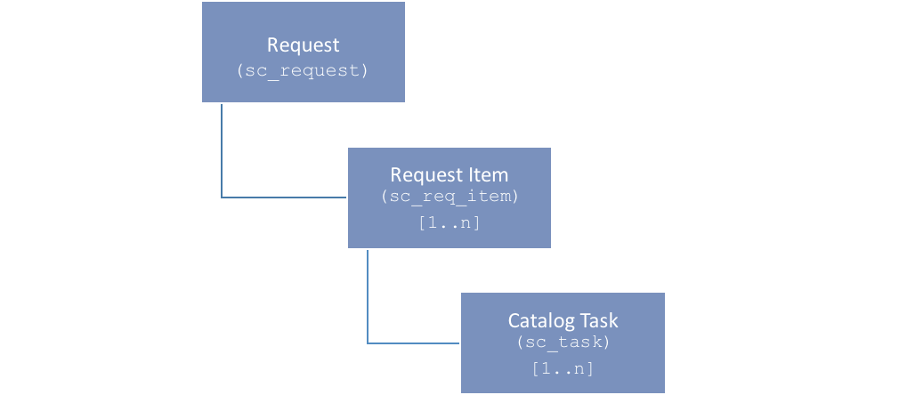
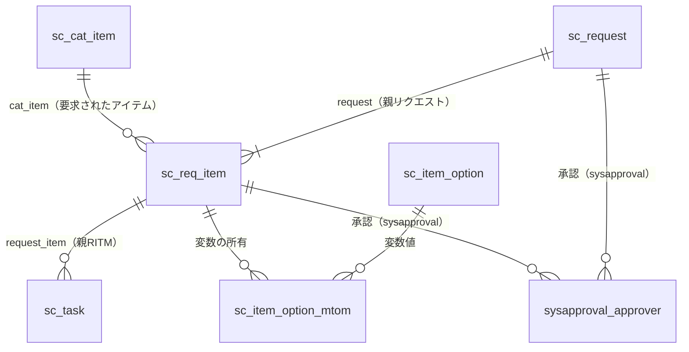
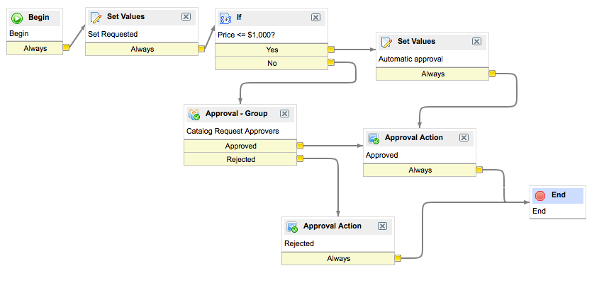
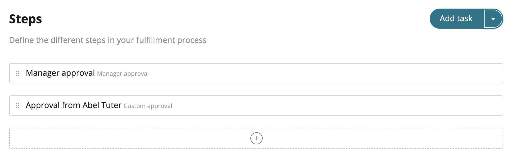
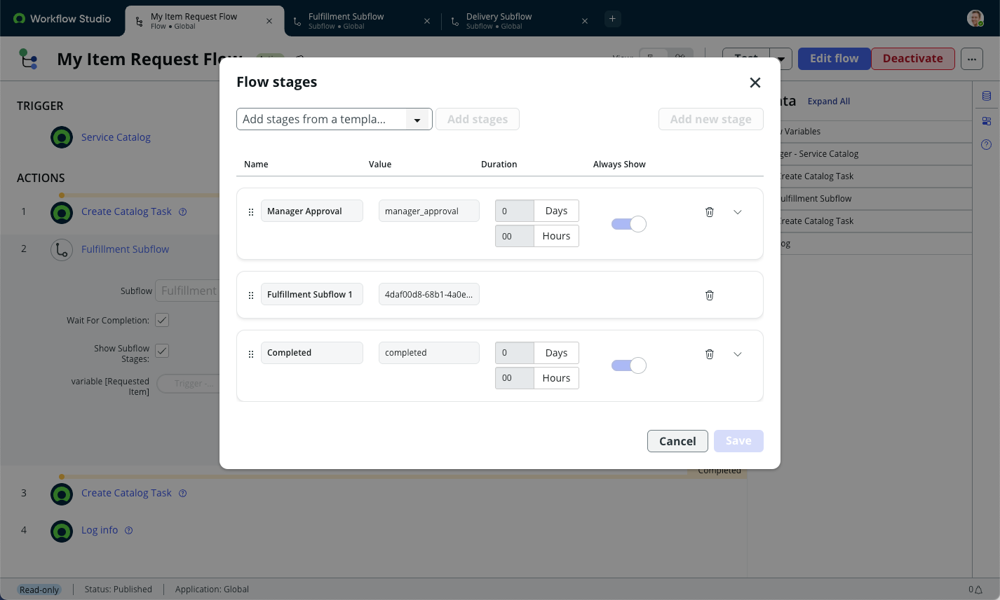
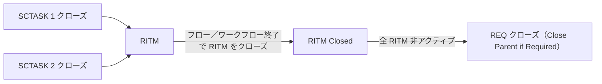
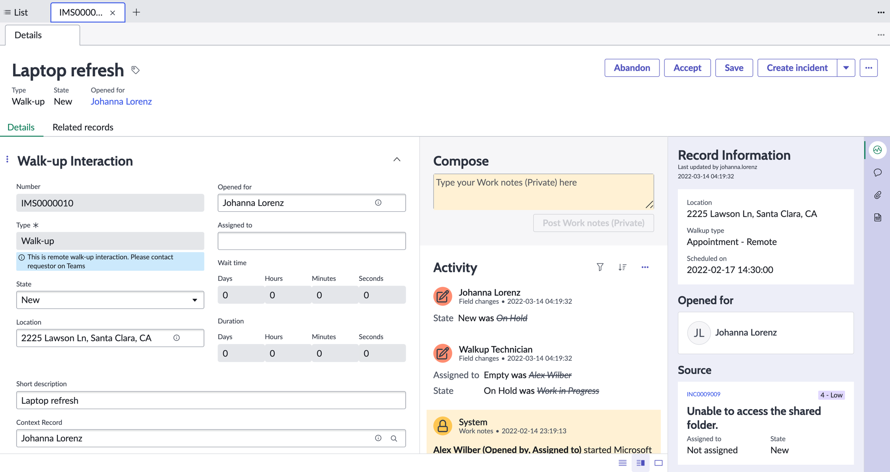

# Request Management（リクエスト管理）

## 概要

ServiceNow の **Request Management（リクエスト管理）** は、従業員がセルフサービスポータル等からサービス・製品・情報を要求（Request）し、それを定義済みのフロー（Flow）に沿って承認・作業・完了させるための ITSM アプリケーションである。公式ドキュメントは Request Management を「カタログアイテムを定義済みのフローに基づいて要求・充足（fulfill）できるようにするもの」と定義している。[出典](https://www.servicenow.com/docs/r/australia/it-service-management/request-management/c_RequestManagement.html)

Request Management は **Service Catalog（サービスカタログ）を起点** とし、Catalog Item [`sc_cat_item`] テーブルのカタログアイテムが要求されたときにのみプロセスが開始される。[出典](https://www.servicenow.com/docs/r/australia/it-service-management/request-management/request-management-architecture.html) カタログアイテムや変数、Catalog Builder、Order Guide（オーダーガイド）などの「要求する側」の仕組みは [サービスカタログ](../platform/service-catalog.md) を参照。本ファイルは「要求された後」のレコード構造と充足プロセスを中心に扱う。

Request Management は ServiceNow AI Platform の機能として **デフォルトで有効** である（プラグインの個別有効化は不要）。[出典](https://www.servicenow.com/docs/r/release-notes/request-management-rn.html)

本ファイルの構成は次のとおり。

| 節 | 内容 |
|---|---|
| データモデル | `sc_request` / `sc_req_item` / `sc_task` の3層構造、カート関連テーブル、レコード生成順序、制約 |
| 主要フィールドと状態 | Request State、State、Stage、Approval の各フィールドと値 |
| 承認（Approval） | 既定の Service Catalog Request ワークフロー、Ask for Approval、承認レコード、承認エンジンのプロパティ |
| Fulfillment | Workflow Studio フロー、レガシーワークフロー、Execution Plan、Service Fulfillment Steps、Catalog Task 作成 |
| Stage | ワークフローステージ、フローステージ、ステージ状態 |
| クローズと連鎖 | Catalog Task → RITM → REQ のクローズ連鎖、キャンセル |
| 代理リクエスト | Requested For、Delegated Request Experience、関連プロパティ |
| Request vs Incident | 使い分け、Incident からの Request 作成、Request Parent Mapping |
| ワークスペース・モバイル | Service Operations Workspace、Mobile Agent |
| Universal Request 連携 | 状態マッピング、部門間転送 |
| ロール・セキュリティ | ITSM Roles、Business Stakeholder、ドメインセパレーション |
| Walk-up Experience | ウォークアップ窓口（対面IT窓口）の機能、ロール、テーブル、SOW での操作 |
| Brazil での変更 | 判明している変更点 |

> **ドキュメント構成上の注意:** Australia の公式ドキュメントでは、リクエストの充足（Fulfillment）、チェックアウトモデル、Execution Plan、代理リクエスト等のページは **Service Catalog**（`/servicenow-platform/service-catalog/`）配下にある。Brazil では同じ内容のページが **IT Service Management > Request Management** 配下に移されている（[Brazil の Request fulfillment ページ](https://www.servicenow.com/docs/r/it-service-management/request-management/request-fulfillment.html)）。本ファイルでは Australia の URL を出典として示す。

---

## Request Management のデータモデル

### 3層構造（REQ / RITM / SCTASK）

Request Management では、ユーザーがカタログアイテムを要求すると、次の階層でレコードが生成される。[出典](https://www.servicenow.com/docs/r/australia/it-service-management/request-management/request-management-architecture.html)

| 階層 | テーブル（ラベル） | 番号の接頭辞（慣用） | 役割 | 件数関係 |
|---|---|---|---|---|
| 1 | `sc_request`（Request／リクエスト） | REQ | 1回の注文（チェックアウト）全体を表す親レコード | 注文ごとに1件 |
| 2 | `sc_req_item`（Requested Item／要求アイテム） | RITM | 注文内の個々のカタログアイテム。変数（Variables）はこのテーブルにのみ紐づく | 1 REQ に 1..n 件 |
| 3 | `sc_task`（Catalog Task／カタログタスク） | SCTASK（TASK） | RITM を充足するための作業単位。フルフィルメントグループに割り当てる | 1 RITM に 0..n 件（図では 1..n） |

3テーブルとも Task [`task`] テーブルを拡張しており、Assignment group（割り当てグループ）、Assigned to（担当者）、State（状態）、Approval（承認）、Work notes（作業メモ）等のタスク共通フィールドを持つ。【経験則】（`sc_request` が `task` を拡張している点は Community の回答でも言及されている。[出典](https://www.servicenow.com/community/itsm-forum/sc-request-state-and-dictionary-choices-no-values-appearing-but/m-p/2431948)）番号接頭辞 REQ/RITM/SCTASK はベースシステムの慣用値で、インスタンスの Number Maintenance（番号管理）設定で変更可能である。【経験則】

公式ドキュメントの例では、PC 2台・椅子1脚・机1台を1回で注文すると、次のように1件の Request と3件の Requested Item が生成される（数量は RITM の Quantity で表現される）。[出典](https://www.servicenow.com/docs/r/australia/servicenow-platform/service-catalog/c_RequestingAServiceCatalogItem.html)

```
Request REQ0000001 -- 4 Things
  Requested item RITM0000001 -- 2 X PC
  Requested item RITM0000002 -- 1 X Chair
  Requested item RITM0000003 -- 1 X Desk
```

> 注：同ページの本文は「4つの request items が生成される」とも記述しているが、直後の具体例では RITM は3件（PC は数量2の1件）として示されている。実際の動作は具体例のとおり「カタログアイテム1種類につき RITM 1件、数量は Quantity フィールド」である。【推定】



- **キャプション:** Request Management hierarchy（Request Management の階層図）
- **画面の説明:** 最上位に「Request (sc_request)」の箱があり、その下に「Request Item (sc_req_item) [1..n]」、さらにその下に「Catalog Task (sc_task) [1..n]」が線で接続されている。1件の Request が複数の Requested Item を、1件の Requested Item が複数の Catalog Task を持てることを示す。
- **出典:** https://www.servicenow.com/docs/r/australia/it-service-management/request-management/request-management-architecture.html （取得日: 2026-11-03）



（参照フィールド名 `cat_item`、`request`、`request_item` はベースシステムの一般的なフィールド名である。【経験則】）

### 関連テーブル一覧

Request Management の処理には、3層テーブルのほかに次のテーブルが関与する。[出典](https://www.servicenow.com/docs/r/australia/it-service-management/request-management/request-management-architecture.html)

| テーブル | ラベル | 役割 |
|---|---|---|
| `sc_cat_item` | Catalog Item（カタログアイテム） | プロセスの起点。このテーブル（およびその拡張）のアイテムが要求されたときのみ Request Management が動く |
| `sc_cart` | Cart（カート） | 一時カート（Temporary cart）またはデフォルトカート（Default cart） |
| `sc_cart_item` | Cart Item（カートアイテム） | カートに追加されたカタログアイテムとユーザー入力値 |
| `sc_item_option` | Options（オプション） | 変数（Variables）の値 |
| `sc_item_option_mtom` | Variable Ownership（変数の所有） | 変数値と RITM の多対多関連 |
| `sysapproval_approver` | Approval（承認） | 承認レコード（後述） |

### レコード生成の順序（チェックアウト処理）

公式ドキュメントは、カタログアイテムを **カートに入れずに直接注文（Order Now）** した場合の処理を次の順序で説明している。[出典](https://www.servicenow.com/docs/r/australia/it-service-management/request-management/request-management-architecture.html)

1. 一時カート（`sc_cart`）が作成される。
2. カタログアイテムとユーザー入力の変数値が、一時カートに Cart Item [`sc_cart_item`] レコードとして追加される。
3. 変数値が Options [`sc_item_option`] と Variable Ownership [`sc_item_option_mtom`] に保存される。
4. 一時カートがチェックアウトされる。
   1. Request [`sc_request`] レコードが初期化される（**まだコミットされない**）。
   2. Requested Item [`sc_req_item`] レコードが初期化される（まだコミットされない）。
   3. RITM の Request 参照が、初期化済みの Request レコードに設定される。
   4. `sc_item_option` / `sc_item_option_mtom` の変数レコードが RITM に基づいて更新される。
   5. **RITM がデータベースにコミットされる。**
   6. **Request がデータベースにコミットされる。**

つまり、データベースへの書き込み順は **RITM → REQ** であり、REQ が最後にコミットされる。この順序は、REQ の insert 時ビジネスルールやフローが RITM を参照する設計に影響する。【推定】

| 注文シナリオ | 使われるカート | 処理 |
|---|---|---|
| 直接注文（カートに入れない） | 一時カート | 上記の手順 |
| カートに入れてからチェックアウト | デフォルトカート | 上記と同じ。複数アイテムの場合は手順2〜4（RITM 単位の初期化〜コミット）がアイテムごとに繰り返される |
| Order Guide（2ステップチェックアウト） | 一時カート（全アイテム） | 直接注文と同じ手順 |
| Order Guide（3ステップチェックアウト） | デフォルトカート | 直接注文と同じ手順 |

[出典](https://www.servicenow.com/docs/r/australia/it-service-management/request-management/request-management-architecture.html)

### データモデル上の制約（公式の注意事項）

公式ドキュメントは Request Management の設定時の制約として、次を明記している。[出典](https://www.servicenow.com/docs/r/australia/it-service-management/request-management/request-management-architecture.html)

| 制約 | 内容 |
|---|---|
| 変数は RITM のみ | 変数（Variables）は Requested Item [`sc_req_item`] にのみ関連付けられ、**`sc_req_item` を拡張したテーブルではサポートされない** |
| Record Producer で 3層テーブルを作らない | データモデルは Record Producer（レコードプロデューサー）による Request / Requested Item / Catalog Task の生成をサポートしない。Record Producer で `sc_request`、`sc_req_item`、`sc_task` やその拡張テーブルにレコードを挿入してはならない |
| before ビジネスルールを書かない | `sc_request`、`sc_req_item`、`sc_cart`、`sc_cart_item` に **before トリガーのビジネスルール** を作成してはならない |
| 既定ワークフローはデモデータ | Request に付与されるベースシステムのワークフローはデモデータ扱い |

Record Producer は Incident 等の任意のタスクレコードを作る仕組みであり、RITM を作りたい場合は通常のカタログアイテム（Catalog Item）を使う。プログラムから RITM を生成する場合は Cart API（`sn_sc.CartJS` 等）や Workflow Studio の **Submit Catalog Item Request** アクション（後述）を使う。【経験則】（Cart API の利用は Community でも推奨されている。[出典](https://www.servicenow.com/community/developer-forum/create-request-from-incident-by-ui-action/m-p/1991627)）

---

## Request Management の主要フィールドと状態値

### フィールド一覧（主要なもの）

公式ドキュメントには3テーブルの完全なフィールド一覧ページは公開されていない（公開情報では確認できず）。以下は公式ドキュメント内で言及されているフィールドと、ベースシステムで一般的なフィールドをまとめたものである。インスタンスの System Dictionary（`sys_dictionary`）で必ず確認すること。

**Request [`sc_request`]**

| フィールド（ラベル） | 列名 | 説明 | 根拠 |
|---|---|---|---|
| Number | `number` | REQ 番号 | 【経験則】 |
| Requested for（依頼対象者） | `requested_for` | リクエストの対象ユーザー。カート内の RITM の Requested For 構成により決まる（後述の代理リクエスト参照） | [公式](https://www.servicenow.com/docs/r/australia/servicenow-platform/service-catalog/delegated-request-exp.html) |
| Opened by（起票者） | `opened_by` | 注文を行ったユーザー | 【経験則】 |
| Request state（リクエスト状態） | `request_state` | リクエスト固有の状態（後述） | 【第三者情報】 |
| State（状態） | `state` | Task 由来の状態 | 【第三者情報】 |
| Approval（承認） | `approval` | REQ レベルの承認状態 | 【経験則】 |
| Stage（ステージ） | `stage` | REQ レベルのステージ | 【第三者情報】 |
| Parent（親） | `parent` 等 | Incident 等の親レコードとの関連。どのフィールドを使うかは Request Parent Mapping の「Request Parent」で指定する | [公式](https://www.servicenow.com/docs/r/australia/servicenow-platform/service-catalog/configure-mapping-for-request.html) |
| Delivery address / Special instructions | `delivery_address` / `special_instructions` | 2ステップチェックアウト時の配送先・特記事項 | 【経験則】 |
| Price | `price` | 合計金額。既定ワークフローの自動承認判定（$1,000）に使われる | [公式（図）](https://www.servicenow.com/docs/r/australia/servicenow-platform/service-catalog/c_ServiceCatalogWorkflowDefinition.html) |

**Requested Item [`sc_req_item`]**

| フィールド（ラベル） | 列名 | 説明 | 根拠 |
|---|---|---|---|
| Request | `request` | 親 REQ への参照 | [公式](https://www.servicenow.com/docs/r/australia/it-service-management/request-management/request-management-architecture.html) |
| Item | `cat_item` | 要求されたカタログアイテム | 【経験則】 |
| Quantity（数量） | `quantity` | 数量。`glide.sc.restrict.quantity.changes` で承認後の変更を制限できる | [公式](https://www.servicenow.com/docs/r/australia/servicenow-platform/service-catalog/r_ServiceCatalogProperties.html) |
| Requested for | `requested_for` | RITM 単位の依頼対象者。Requested For 変数の値が送信時にコピーされる | [公式](https://www.servicenow.com/docs/r/australia/servicenow-platform/service-catalog/delegated-request-exp.html) |
| Opened by | `opened_by` | Opened By のユーザーは RITM の読み取りアクセスを持つ | [公式](https://www.servicenow.com/docs/r/australia/servicenow-platform/service-catalog/c_RequestingAServiceCatalogItem.html) |
| Stage | `stage` | 進捗ステージ。ワークフロー／フローが更新する（後述） | [公式](https://www.servicenow.com/docs/r/australia/build-workflows/workflow-studio/flow-designer-stages.html) |
| State | `state` | 作業状態（後述） | 【第三者情報】 |
| Approval | `approval` | RITM レベルの承認状態 | 【経験則】 |
| Backordered（入荷待ち） | `backordered` | 在庫切れ時にフルフィラーがチェックし、入荷見込みをコメントする。レポート・ダッシュボードに利用可能 | [公式](https://www.servicenow.com/docs/r/australia/servicenow-platform/service-catalog/c_RequestingAServiceCatalogItem.html) |
| Due date（期日） | `due_date` | カタログアイテムの Delivery time 等から計算される。Service Fulfillment Steps 使用時は「Estimated time to deliver（日数）」からフロー起動時点を起点に計算 | [公式（SFS）](https://www.servicenow.com/docs/r/australia/servicenow-platform/service-catalog/create-sf-step.html)／Community（Calculate Request Item Due Date ビジネスルール）[出典](https://www.servicenow.com/community/service-management-forum/how-the-due-date-field-is-auto-filled-in-the-requested-item-form/td-p/414214/page/2) |
| Variables（変数） | — | Variable Editor（変数エディタ）フォーマッターで表示 | [公式](https://www.servicenow.com/docs/r/australia/it-service-management/service-operations-workspace/request-sow.html) |

**Catalog Task [`sc_task`]**

| フィールド（ラベル） | 列名 | 説明 | 根拠 |
|---|---|---|---|
| Request item | `request_item` | 親 RITM への参照（Create Catalog Task アクションの「Requested Item」入力に対応） | [公式](https://www.servicenow.com/docs/r/australia/build-workflows/workflow-studio/create-catalog-task-flow-designer.html) |
| Request | `request` | 親 REQ への参照 | 【経験則】 |
| Assignment group / Assigned to | `assignment_group` / `assigned_to` | フルフィルメントグループ・担当者 | 【経験則】 |
| State | `state` | 作業状態（後述） | 【第三者情報】 |
| Short description / Description | `short_description` / `description` | 作業内容 | [公式](https://www.servicenow.com/docs/r/australia/build-workflows/workflow-studio/create-catalog-task-flow-designer.html) |
| Variables | — | Create Catalog Task アクションの「Catalog Variables」で選んだ変数がタスク上に表示される | [公式](https://www.servicenow.com/docs/r/australia/build-workflows/workflow-studio/create-catalog-task-flow-designer.html) |

### State（状態）と Request State（リクエスト状態）

公式ドキュメント内で確認できる RITM の State 値は、Universal Request の状態マッピング表に現れる **Open、Work in Progress、Pending、Closed Complete、Closed Skipped、Closed Incomplete** の6つである。[出典](https://www.servicenow.com/docs/r/australia/it-service-management/request-management/req-item-state-mapping.html) 数値（選択肢の値）は公式ページでは確認できず、以下は Community 投稿に基づく一般的な値である。【第三者情報】

| State（`sc_req_item` / `sc_task`） | 値（一般的なベースシステム値） | 意味 |
|---|---|---|
| Pending | -5 | 保留・開始待ち |
| Open | 1 | 起票済み・未着手 |
| Work in Progress | 2 | 作業中 |
| Closed Complete | 3 | 完了 |
| Closed Incomplete | 4 | 未完了で終了（承認却下等を含む） |
| Closed Skipped | 7 | スキップして終了 |

> Community では Closed Incomplete を 4 とする投稿と 6 とする投稿があり、Closed Skipped は 7 とするものが多い。[出典1](https://www.servicenow.com/community/developer-forum/difference-in-states-req-and-ritm/m-p/2705978) [出典2](https://www.servicenow.com/community/itsm-forum/how-to-set-ritm-to-closed-skipped-and-request-to-closed-rejected/m-p/2588351) スクリプトで数値を直接使う前に、インスタンスの選択肢リスト（`sys_choice`）を確認すること。【経験則】

Request [`sc_request`] には Task 由来の `state` に加えて、リクエスト固有の **`request_state`**（Request state）フィールドがある。Community 投稿のスクリプト例で使われている値は次のとおり。【第三者情報】[出典](https://www.servicenow.com/community/itsm-forum/how-to-modify-business-rules-so-they-update-the-ritm-and-request/m-p/900728) [出典](https://www.servicenow.com/community/itsm-forum/sc-request-state-and-dictionary-choices-no-values-appearing-but/m-p/2431948)

| `request_state` の値 | 想定される意味 |
|---|---|
| `requested` | 承認待ち（要求済み） |
| `in_process` | 承認済み・処理中 |
| `closed_complete` | 完了 |
| `closed_incomplete` | 未完了で終了 |
| `closed_cancelled` | 取り消し |
| `closed_rejected` | 却下 |
| `closed_skipped` | スキップ |

（`in_process` の綴りは公式ページでは確認できず、Community 由来である。）

### Approval（承認状態）フィールドの値

`approval` フィールドおよび承認レコード（`sysapproval_approver`）の State は、Workflow Studio の Ask for Approval アクションの出力値と同じ体系を使う。[出典](https://www.servicenow.com/docs/r/australia/build-workflows/workflow-studio/ask-approval-flow-designer.html)

| 表示値 | 値 | 意味 |
|---|---|---|
| Not Yet Requested | `not requested` | まだ承認を依頼していない。承認者へのメール通知は送られない |
| Requested | `requested` | 承認依頼中 |
| Approved | `approved` | 承認 |
| Rejected | `rejected` | 却下 |
| Cancelled | `cancelled` | 取り消し |
| No Longer Required | `not_required` | 承認不要になった |
| Skipped | `skipped` | スキップ |

Community では、カタログアイテム作成直後に REQ の Approval が「Not Yet Requested」のまま止まる事象（フロー／ワークフローが起動していない等）が報告されている。[出典](https://www.servicenow.com/community/virtual-agent-forum/the-value-of-the-request-approval-field-is-quot-not-yet/m-p/3571210)【第三者情報】

---

## Request Management における承認（Approval）

### 承認の2つのレベル（REQ と RITM）

Request Management では、承認を **Request（REQ）レベル** と **Requested Item（RITM）レベル** の両方で設定できる。Service Operations Workspace の My Approvals は「request（REQ）」と「requested item（RITM）」の承認を別々に扱う。[出典](https://www.servicenow.com/docs/r/australia/it-service-management/service-operations-workspace/request-sow.html)

| レベル | 主な仕組み | 典型的な用途 |
|---|---|---|
| REQ レベル | `sc_request` に付く既定の **Service Catalog Request** ワークフロー（レガシー） | 注文金額に基づく全体承認 |
| RITM レベル | カタログアイテムの Flow（Workflow Studio）または Workflow の中の承認アクション／アクティビティ | 上長承認、アイテム固有の承認（ソフトウェア所有者、セキュリティ等） |
| SCTASK レベル | `glide.approval_engine.sc_task` で制御される承認エンジン | タスク単位の承認（利用はまれ） |

### 既定の Service Catalog Request ワークフロー（REQ レベル）

ベースシステムには2つのサービスカタログ用ワークフロー（レガシーの Graphical Workflow）が提供されている。[出典](https://www.servicenow.com/docs/r/australia/servicenow-platform/service-catalog/c_ServiceCatalogWorkflowDefinition.html)

| ワークフロー名 | 説明（公式） |
|---|---|
| Service Catalog Request | 単純な注文を充足する単純なワークフロー |
| Service Catalog Item Request | より複雑な注文を充足する、より複雑なワークフロー |



- **キャプション:** Service Catalog Request workflow（既定の Service Catalog Request ワークフロー）
- **画面の説明:** レガシーの Workflow Editor の画面。Begin → **Set Values「Set Requested」** → **If「Price <= $1,000?」** の順に進む。Yes の場合は **Set Values「Automatic approval」** を経て **Approval Action「Approved」** へ、No の場合は **Approval - Group「Catalog Request Approvers」** に進み、Approved なら Approval Action「Approved」、Rejected なら **Approval Action「Rejected」** を経て End に至る。
- **出典:** https://www.servicenow.com/docs/r/australia/servicenow-platform/service-catalog/c_ServiceCatalogWorkflowDefinition.html （取得日: 2026-11-03）

この図から、既定の REQ レベル承認は **合計金額が $1,000 以下なら自動承認、超える場合は Approval - Group（Catalog Request Approvers）によるグループ承認** であることが分かる。Community でも「$1,000 超のときのみ REQ に承認が発生し、それ以下は自動承認」という説明が一般的である。[出典](https://www.servicenow.com/community/ham-forum/how-to-skip-ootb-service-catalog-request-approval-for-specific/m-p/3562560)【第三者情報】

> **注意:** 公式ドキュメントは「Request に付与されるベースシステムのワークフローはデモデータ」と注記している。[出典](https://www.servicenow.com/docs/r/australia/it-service-management/request-management/request-management-architecture.html) Community では、既定フローやワークフローを無効化した結果、自動承認が止まり、REQ が「Waiting for Approval」のまま残ったという事例が報告されている。[出典](https://www.servicenow.com/community/itsm-forum/catelog-item-request-approve-flow-cannot-be-triggerred/td-p/3190298/page/2)【第三者情報】既定ワークフローを変更・無効化する場合は、代わりに REQ の承認と状態を進める仕組みを必ず用意する。【経験則】

レガシーワークフローで、カタログタスクからカタログ変数にアクセスする必要がある場合は、カタログタスクを **親ワークフローから** 作成する。サブフロー（サブワークフロー）で作成したカタログタスクからはカタログ変数にアクセスできない。[出典](https://www.servicenow.com/docs/r/australia/servicenow-platform/service-catalog/c_ServiceCatalogWorkflowDefinition.html)

### Workflow Studio の Ask for Approval アクション（RITM レベル）

Workflow Studio（旧 Flow Designer）では **Ask for Approval** アクションで承認を依頼する。スクリプトなしで自動承認・却下・取り消しのルールや期限を設定できる。[出典](https://www.servicenow.com/docs/r/australia/build-workflows/workflow-studio/ask-approval-flow-designer.html)

| 入力 | 説明 |
|---|---|
| Record | 承認対象のレコード（RITM 等）。承認フィールドを持つ場合 Approval Field が自動設定される |
| Table | 承認状態フィールドを持つテーブル（Task とその拡張） |
| Approval Reason | 承認理由。`sysapproval_approver` に保存される |
| Approval Field | 承認結果を格納するフィールド（例：`approval`） |
| Journal Field | 履歴・コメントの格納先 |
| Rules | 承認／却下ルール。**Anyone approves**（誰か1人）、**All users approve**（全員）、**All responded and anyone approves**（全員回答かつ1人以上承認）、**% of users approve**（割合）、**# of users approve**（人数）。ユーザー／グループ、レコード上のフィールド（例：Requested for の Manager）、Manual approvers（手動追加の承認者）を指定可能 |
| Due Date | 期限。期限到達時に自動で承認・却下・取り消しさせ、フローが無限に待たないようにする |

- 承認ルールのみ設定し却下ルールを設定しない（またはその逆）場合、期待した状態にならないとランタイム値は **cancelled** になる。[出典](https://www.servicenow.com/docs/r/australia/build-workflows/workflow-studio/ask-approval-flow-designer.html)
- 既定では、非アクティブなユーザー・グループにも承認レコードが生成される。この挙動は `com.glide.hub.flow.approval.allow_inactive_entity` で変更できる。[出典](https://www.servicenow.com/docs/r/australia/build-workflows/workflow-studio/ask-approval-flow-designer.html)
- 承認ロジックの全般（Approval Engine、Intelligent Approvals 等）は [Workflow Studio / Flow Designer](../platform/flow-designer-workflow-studio.md) を参照。

### 承認レコード（`sysapproval_approver`）

承認レコードは、承認・却下の対象タスクと承認者を保持するレコードで、通常は Workflow Studio フローまたはレガシーワークフローが生成する。ユーザーは **All > Self-Service > My Approvals** で自分宛ての承認を確認できる。[出典](https://www.servicenow.com/docs/r/australia/build-workflows/approvals/r_Approvals.html)

| フィールド | 説明 |
|---|---|
| Approver | 承認責任者（ユーザー） |
| State | Not Yet Requested / Requested / Approved / Rejected |
| Approving | 承認対象レコードへの document_id 参照（任意のテーブル） |
| Comments | 承認に関するコメント（ジャーナル） |
| Approval Summarizer | 承認対象の主要フィールドを表示するフォーマッター |

承認の操作チャネルは次のとおり。

| チャネル | 内容 | 出典 |
|---|---|---|
| Self-Service > My Approvals（Core UI） | 自分宛て承認の一覧・承認・却下 | [公式](https://www.servicenow.com/docs/r/australia/build-workflows/approvals/r_Approvals.html) |
| Service Operations Workspace の My Approvals | change、request、catalog task、requested item の承認 | [公式](https://www.servicenow.com/docs/r/australia/it-service-management/service-operations-workspace/request-sow.html) |
| ServiceNow Agent（Mobile Agent）アプリ | catalog request、requested item、change request の承認・却下、完了済み承認の参照。ITSM Mobile Experience（`com.sn_itsm_mobile`）プラグインが必要 | [公式](https://www.servicenow.com/docs/r/australia/servicenow-platform/service-catalog/itsm-mobile-request-approval.html) |
| メール | 承認依頼メールからの返信承認 | 詳細は [通知とメール](../platform/notifications-email.md) |

### 承認関連のシステムプロパティ

Service Catalog プロパティ（**Service Catalog > Catalog Administration > Properties**）の「Request Fulfillment」カテゴリに次の承認関連プロパティがある。[出典](https://www.servicenow.com/docs/r/australia/servicenow-platform/service-catalog/r_ServiceCatalogProperties.html)

| プロパティ | 説明 |
|---|---|
| `glide.approval_engine.sc_request` | Service Catalog Requests（`sc_request`）の承認エンジン |
| `glide.approval_engine.sc_task` | Service Catalog Tasks（`sc_task`）の承認エンジン |
| `glide.sc.approval.hover` | ステージウィジェットのマウスオーバーで、現在保留中の承認者名を表示する |
| `glide.sc.restrict.quantity.changes` | 承認後に RITM の数量を変更できないようにする（`catalog_admin` を除く） |

（承認エンジンプロパティの選択肢値は同ページでは列挙されていない。公開情報では確認できず。）

フローステージに承認者を表示する Workflow Studio 側のプロパティは「Stage」の節を参照。

---

## Request Management における Fulfillment（フルフィルメント）

### Fulfillment の全体像

ユーザーがカタログアイテムを注文すると Request が作成され、**フルフィルメントプロセス**（承認の依頼、フルフィルメントタスクの割り当て、充足）に従って処理される。フルフィルメントプロセスは **Workflow Studio フロー、ワークフロー（レガシー）、Execution Plan** のいずれかで定義する。[出典](https://www.servicenow.com/docs/r/australia/servicenow-platform/service-catalog/request-fulfillment.html)

フルフィルメントの準備作業として、公式ドキュメントは次を挙げている。[出典](https://www.servicenow.com/docs/r/australia/servicenow-platform/service-catalog/request-fulfillment.html)

1. タスクに割り当てるフルフィルメントグループ（Fulfillment group）を用意する。
2. Workflow Studio フロー、ワークフロー、または Execution Plan でフルフィルメントプロセスを定義する。
3. フルフィルメントプロセスをカタログアイテムに割り当てる（カタログアイテムの **Flow**、**Workflow**、**Execution Plan** フィールド）。

| 方式 | 定義ツール | 特徴 | 推奨度 |
|---|---|---|---|
| Workflow Studio フロー | Workflow Studio（Flow Designer） | ノーコード。承認・タスク・通知を再利用可能な部品で構築。トリガー種別「Service Catalog」 | 新規構築の標準【経験則】 |
| Service Fulfillment Steps | Catalog Builder の Fulfillment ステップ | ビジネスオーナーがタスクと承認のステップを GUI で定義。裏で Step-based request fulfillment フローが動く | 単純なアイテム向け |
| ワークフロー（レガシー） | Graphical Workflow Editor | 分岐可能（却下で終了、承認で継続など）。ステージで進捗を要約 | 既存資産の保守 |
| Execution Plan | Execution Plan フォーム | 直線的なタスク列のみ。グラフィカルエディタなし。プログラムやインポートで構築する場合に有用 | 公式は「ワークフローを推奨」 |

[出典](https://www.servicenow.com/docs/r/australia/servicenow-platform/service-catalog/request-fulfillment.html) [出典（Execution Plan）](https://www.servicenow.com/docs/r/australia/servicenow-platform/service-catalog/c_ExecutionPlans.html)

### Workflow Studio フローによる Fulfillment

カタログアイテムの **Flow** フィールドに、トリガー種別 **Service Catalog** のフローを設定すると、そのアイテムの要求時にアイテム固有のフローが起動する。このとき、既存のワークフローを外すため **Workflow** と **Execution Plan** フィールドはクリアする。[出典](https://www.servicenow.com/docs/r/australia/build-workflows/workflow-studio/flow-designer-stages.html)

Request Management でよく使う Workflow Studio のコアアクションは次のとおり。

| アクション | 役割 | 主な入出力 |
|---|---|---|
| **Ask for Approval** | 承認依頼 | 上記参照。出力 Approval State |
| **Create Catalog Task** | RITM に紐づく Catalog Task [`sc_task`] を作成 | 入力：Table（`sc_task` 等の Task 拡張）、Requested Item、Short Description、Fields（テンプレート値）、**Wait**（タスクが非アクティブになるまでフローを待機）、Template Catalog Item（変数選択用。データピル不可）、Catalog Variables（タスクに表示する変数）。出力：Catalog Task レコード |
| **Get Catalog Variables** | RITM の変数値をフロー内で参照可能にする | 【経験則】 |
| **Submit Catalog Item Request** | フローから新たに RITM（と REQ）を作成 | 入力：Catalog Item、Quantity、Special Instructions、Delivery Address、Requested for、Don't fail on error、Wait for Completion、Enable timeout、Duration、Schedule。出力：Error Message、Requested Item（Document ID）、Status（0=成功、1=エラー、2=タイムアウト） |

[出典（Create Catalog Task）](https://www.servicenow.com/docs/r/australia/build-workflows/workflow-studio/create-catalog-task-flow-designer.html) [出典（Submit Catalog Item Request）](https://www.servicenow.com/docs/r/australia/build-workflows/workflow-studio/submit-catalog-item-request-flow-designer.html)

- Create Catalog Task / Submit Catalog Item Request は `flow_designer` または `admin` ロールでフローに追加できる。[出典](https://www.servicenow.com/docs/r/australia/build-workflows/workflow-studio/create-catalog-task-flow-designer.html)
- Submit Catalog Item Request は、**list collector、lookup multiple choice、lookup select box** 型の変数をサポートしない。文字列データピル内の引用符は String Replace 変換関数でエスケープする（JSON 形式で保存されるため）。[出典](https://www.servicenow.com/docs/r/australia/build-workflows/workflow-studio/submit-catalog-item-request-flow-designer.html)
- 公式の例では、「Service Catalog Item request」フローが上長と部門長の承認を先に依頼し、承認された場合のみ Create Catalog Task を実行する。Wait を選択しているため、カタログタスクがクローズされるまでフローは「waiting」状態で待機する。[出典](https://www.servicenow.com/docs/r/australia/build-workflows/workflow-studio/create-catalog-task-flow-designer.html)

フロー設計の詳細は [Workflow Studio / Flow Designer](../platform/flow-designer-workflow-studio.md) を参照。

### Service Fulfillment Steps（Catalog Builder）

**Service Fulfillment Steps（サービスフルフィルメントステップ）** は、Catalog Builder でカタログアイテムを作成する際の「Fulfillment」ステップで、タスクと承認の手順を GUI で定義する仕組みである。必要ロールは `catalog_builder_editor`、`catalog_admin`、`admin` のいずれか。[出典](https://www.servicenow.com/docs/r/australia/servicenow-platform/service-catalog/create-sf-step.html)

| ステップ種別 | 設定項目 |
|---|---|
| Task（タスク） | Short description、Description、Assignment group、Assigned to、Priority、When to run（Sequence／Condition） |
| Custom approval（カスタム承認） | Users、Groups、Approval type（**All approve** / **Anyone approves**）、When to run |
| Manager approval（上長承認） | When to run |

- **Sequence:** 「With previous step」（前ステップとグループ化して同時実行）または「After previous step」（前ステップの後に実行）。最初のステップは編集不可。
- **Condition:** カタログアイテムの質問（変数）に基づいてステップを実行するかどうかを決める。
- **Estimated time to deliver:** 日数を指定し、サービスフルフィルメントフローが起動した時点から RITM の期日（Due date）を計算する。

[出典](https://www.servicenow.com/docs/r/australia/servicenow-platform/service-catalog/create-sf-step.html)



- **キャプション:** Service fulfillment steps（Catalog Builder の Fulfillment ステップにおける Steps 領域）
- **画面の説明:** 「Steps — Define the different steps in your fulfillment process」という見出しの下に、「Manager approval（Manager approval）」と「Approval from Abel Tuter（Custom approval）」の2ステップが縦に並んでいる。右上に「Add task」ボタンとドロップダウン（Custom approval／Manager approval を選ぶ）があり、下部の「＋」領域からステップを追加できる。各ステップ左端のハンドルでドラッグして並べ替えられる。
- **出典:** https://www.servicenow.com/docs/r/australia/servicenow-platform/service-catalog/create-sf-step.html （取得日: 2026-11-03）

ベースシステムには **Step-based request fulfillment** フローが用意されており、定義済みの全ステップを実行する **Service Fulfillment Steps base flow** サブフロー（入力 `task`＝RITM、出力 `state`＝`completed` / `failed`）を含む。独自の前後処理が必要な場合は、トリガー種別 Service Catalog のフローからこのサブフローを呼び出し、**Service Catalog > Catalog Administration > Service Fulfillment Steps Registry** に登録する。[出典](https://www.servicenow.com/docs/r/australia/servicenow-platform/service-catalog/configure-flow-sf-flow.html)

> **Australia の新機能:** Catalog Builder の Fulfillment ステップで、個別のステージ（Stage）と状態を定義・追加でき、要求者がリクエストの現在のステージと状態を合わせて確認できるようになった。[出典](https://www.servicenow.com/docs/r/australia/release-notes/service-catalog-rn.html)

### レガシーワークフローと Execution Plan

- **ワークフロー:** Graphical Workflow Editor で、アクティビティと条件の編集、遷移の定義、**ステージによる進捗の要約**、検証、公開ができる。Execution Plan と異なり分岐（例：却下で終了）が可能。サービスカタログワークフローはドメインセパレーションをサポートし、ドメイン固有のワークフローを作った場合は、カタログアイテムの Workflow フィールドで新しいワークフローを明示的に選ぶ必要がある（既存アイテムは元のワークフローを使い続ける）。[出典](https://www.servicenow.com/docs/r/australia/servicenow-platform/service-catalog/c_ServiceCatalogWorkflowDefinition.html)
- **ワークフロー実行中のレコード削除:** 実行中のリクエストワークフローがあるカタログアイテムを削除するとステージに「Catalog item removed」、ワークフローコンテキストを削除すると「Workflow context removed」と表示される。[出典](https://www.servicenow.com/docs/r/australia/servicenow-platform/service-catalog/c_ServiceCatalogWorkflowDefinition.html)
- **Execution Plan:** カタログアイテムの調達・構成・設置方法を記述する直線的なタスク列。1つの Execution Plan を複数のアイテムで共用できる。プランを指定しない場合は既定プランが使われる。グラフィカルエディタはなく、公式はワークフローの使用を推奨している。[出典](https://www.servicenow.com/docs/r/australia/servicenow-platform/service-catalog/c_ExecutionPlans.html)

新規実装ではレガシーワークフロー・Execution Plan ではなく Workflow Studio フローを使うのが一般的である。【経験則】

### チェックアウトモデル（1ステップ／2ステップ）

サービスカタログの既定は **1ステップチェックアウト**（Checkout → Order Summary）で、**2ステップチェックアウト**（Checkout Order → Confirmation Screen → Submit Order → Order Summary）も選べる。2ステップでは確認画面で注文の編集、配送先の指定、添付ファイルの追加ができる。カタログアイテムへのアクセスチェックはチェックアウト時にも行われ、スクリプトや API からの注文にも適用される。[出典](https://www.servicenow.com/docs/r/australia/servicenow-platform/service-catalog/c_EnableATwoStepCheckout.html)

| プロパティ | 既定値 | 説明 |
|---|---|---|
| `glide.sc.checkout.twostep` | false | 2ステップチェックアウトを使う |
| `glide.sc.checkout.twostep.back` | — | 2ステップ確認画面に「Back to Catalog」ボタンを表示 |
| `glide.sc.use_cart_layouts` | true | `sc_layout` によるカートレイアウトを使う。false にすると、親レコード（Incident 等）から作成した Request が親に関連付けられない |
| `glide.sc.checkout.cancel` | — | ESS ユーザーがチェックアウト画面からリクエストを取り消せるようにする |
| `glide.sc.checkout.cancel.condition` | — | 取り消し可能な条件（例：`current.opened_by == gs.getUserID()`） |
| `glide.sc.checkout.task.display` | — | 注文完了画面（Order Status）にリクエスト関連タスクを表示する |
| `glide.sc.allow.checkout.clone` | — | チェックアウト時のリクエストのクローン（カートレイアウト有効時は非推奨・不使用） |
| `glide.sc.allow.clone.roles` | 空＝全員 | 他ユーザー向けにリクエストをクローンできるロール |
| `glide.sc.enable_order_now` | — | 「Order Now」で選択中アイテムのみ注文し、カート内のアイテムは残す |

[出典](https://www.servicenow.com/docs/r/australia/servicenow-platform/service-catalog/r_ServiceCatalogProperties.html) [出典（use_cart_layouts と親関連付け）](https://www.servicenow.com/docs/r/australia/servicenow-platform/service-catalog/create-request-from-other-flow.html)

---

## Request Management における Stage（ステージ）

### Stage と State の違い

Request Management では、**State（状態）** がタスクとしての作業状態（Open、Work in Progress、Closed Complete 等）を表すのに対し、**Stage（ステージ）** は要求者に見せる業務上の進捗段階（承認待ち、手配中、配送中など）を表す。サービスカタログの注文完了画面や My Requests では Stage 列で進捗が表示される。[出典](https://www.servicenow.com/docs/r/australia/servicenow-platform/service-catalog/c_RequestingAServiceCatalogItem.html) Community では「タスク（SCTASK）では State、RITM では主に Stage を使う」と説明されている。[出典](https://www.servicenow.com/community/developer-forum/update-stage-on-ritm-using-script/td-p/1428207)【第三者情報】

| 観点 | State | Stage |
|---|---|---|
| 主な対象 | `sc_task`、`sc_req_item`、`sc_request` | `sc_req_item`（ステージフィールドが既定で存在） |
| 更新者 | フルフィラー、ビジネスルール、フロー | ワークフロー／フローが自動更新 |
| 見る人 | フルフィラー、レポート | 要求者（ポータル、注文状況画面） |
| 表示 | 選択肢の値 | ステージ名＋状態アイコン（ステージウィジェット） |

### レガシーワークフローのステージ

レガシーワークフローでは、選択肢リスト型またはワークフロー型のフィールドをステージフィールドとして指定する。**`sc_req_item` 上のワークフローでは、ステージフィールドはテーブルの Stage フィールドに固定され変更できない。** [出典（Xanadu）](https://www.servicenow.com/docs/r/GCPjp~ldPTNRN99oH1DYFg/2PF2w4lFEOoAD8bJJkVJYg)

| `sc_req_item` のステージ値の出所 | 値 |
|---|---|
| Stage 列の選択肢（`sys_dictionary`） | Waiting for Approval、Fulfillment、Delivery |
| 既定テーブルステージ（`wf_stage_default`） | Request Cancelled、Completed |

- 実行中のアクティビティはそのステージを「In progress」で表示し、Pending／Completed のアクティビティは対応する状態で表示される。取り消されたアクティビティは Stage に「Request Cancelled」を入れる。
- `wf_stage` の「Cancelled」ラベルは予約語で、Stage フィールドには表示されない。

[出典（Xanadu）](https://www.servicenow.com/docs/r/GCPjp~ldPTNRN99oH1DYFg/2PF2w4lFEOoAD8bJJkVJYg)（Xanadu 版の情報。Australia 版の同ページは今回確認できず。）

### Workflow Studio のフローステージ

Workflow Studio では、フロー／サブフローにステージを追加し、ラベル・名前・推定所要時間（Duration）を設定できる。Stage Sets（ステージセット）テーブルから定義済みステージセットのコピーを取り込むこともできる。[出典](https://www.servicenow.com/docs/r/australia/build-workflows/workflow-studio/flow-designer-stages.html)

**ステージの状態（6種類）**

| State | 説明 |
|---|---|
| Pending | 未開始 |
| In progress | 実行中 |
| Skipped | 実行されなかった（通常は条件付きフローロジックブロックが実行されなかった場合） |
| Complete | 完了 |
| Cancelled | 取り消し |
| Error | エラー条件に到達。少なくとも1つのステージが定義されたフローで、ステージ内かつ条件付きフローロジックブロック内でのみ手動設定可能 |

各ステージは独自の状態ラベルを持てる（例：Stage 1 の Pending を「Waiting」、Stage 2 の Pending を「Not yet started」）。Workflow Studio は既定の状態ラベルまたは承認用の状態ラベルを生成できる。[出典](https://www.servicenow.com/docs/r/australia/build-workflows/workflow-studio/flow-designer-stages.html)

**制約と注意事項**

| 項目 | 内容 |
|---|---|
| ステージフィールドは1テーブル1つ | 複数ある場合、テーブルのディクショナリで最初に定義されたステージフィールドだけが使われる |
| トリガー種別 | Record トリガーまたは Service Catalog トリガーのフローでのみ表示。Scheduled トリガーのフローにステージを付けても表示されない |
| Service Catalog トリガー | カタログアイテムの Flow フィールドでフローを関連付け、Workflow と Execution Plan フィールドをクリアする。Stage フィールドは `sc_req_item` の任意のリストビューに現在のステージ状態を表示する |
| 最後に実行されたフローが勝つ | ステージフィールドは最後に実行されたフローのステージのみを表示する。同じテーブルで複数フローがステージを持つ場合は、トリガー条件を分けて上書きを防ぐ |
| 子フロー | 子フローのステージは親のステージフィールドに表示されない。サブフロー設定の **Show Subflow Stages** で親フローの実行詳細に表示できる |
| For Each | For Each ブロックの内部にはステージを置けない（前後のみ） |
| Error は停止しない | Error 状態はフローを停止しない。条件ロジックで処理停止や是正処理を実装する |
| 表示 | 状態アイコンは変更不可。ステージ数と名前の長さを抑え、折り返しを防ぐ |

[出典](https://www.servicenow.com/docs/r/australia/build-workflows/workflow-studio/flow-designer-stages.html)

**ステージ表示のシステムプロパティ**（`sys_properties` に追加）

| プロパティ | 型 | 既定値 | 説明 |
|---|---|---|---|
| `com.glide.hub.flow_engine.stage_display.show_approvers` | true/false | true | ステージフィールドに、ステージに割り当てられた承認者一覧を表示する |
| `com.glide.hub.flow_engine.stage_display.show_approvers_limit` | integer | 5 | 表示する承認者の最大数。10 を超えるとリストビューの描画エラーの恐れ |

[出典](https://www.servicenow.com/docs/r/australia/build-workflows/workflow-studio/flow-designer-stages.html)



- **キャプション:** Sample flow and subflow stages（Workflow Studio の Flow stages ダイアログ）
- **画面の説明:** Workflow Studio で「My Item Request Flow」（TRIGGER は Service Catalog、ACTIONS は 1 Create Catalog Task、2 Fulfillment Subflow〔Wait For Completion と Show Subflow Stages にチェック〕、3 Create Catalog Task、4 Log info）を開き、「Flow stages」ダイアログを表示した画面。ダイアログ上部に「Add stages from a template」ドロップダウンと「Add stages」「Add new stage」ボタンがあり、表の列は Name／Value／Duration（Days・Hours）／Always Show。行として「Manager Approval（manager_approval）」「Fulfillment Subflow 1（サブフローの sys_id）」「Completed（completed）」が並び、下部に Cancel／Save ボタンがある。
- **出典:** https://www.servicenow.com/docs/r/australia/build-workflows/workflow-studio/flow-designer-stages.html （取得日: 2026-11-03）

---

## Request Management のクローズ連鎖とキャンセル

### Catalog Task → RITM → REQ のクローズ連鎖

公式ドキュメントは、**Execution Plan を使う場合** の状態クローズの依存関係を次のように定義している（Execution Plan にのみ適用）。[出典](https://www.servicenow.com/docs/r/australia/servicenow-platform/service-catalog/state-closure-request.html)

| 子の状態 | 親の結果 |
|---|---|
| すべての Catalog Task が Closed Complete | RITM は Closed Complete |
| 少なくとも1つの Catalog Task が Closed Incomplete | RITM は Closed Incomplete |
| すべての Catalog Task が Closed Skipped | RITM は Closed Skipped |
| すべての RITM が Closed Complete | Request は Closed Complete |
| 少なくとも1つの RITM が Closed Incomplete | Request は Closed Incomplete |
| すべての RITM が Closed Skipped | Request は Closed Skipped |

Workflow Studio フローやレガシーワークフローを使う場合は、**RITM の状態はフロー（ワークフロー）の終了処理で設定するのが一般的** で、RITM がすべて非アクティブになると `sc_req_item` のベースシステムのビジネスルール **「Close Parent if Required」** が親 Request をクローズする、と Community で説明されている。[出典](https://www.servicenow.com/community/developer-forum/req-still-active-when-state-is-closed-skipped/m-p/2556725)【第三者情報】ベースシステムのビジネスルールの実行順序はナレッジ記事 KB0825781（Now Support）で説明されているとされる。[出典](https://www.servicenow.com/community/itsm-forum/documenting-ootb-lifecycle-behavior-for-requests-ritms-and/m-p/3352680)【第三者情報】



承認が却下された場合の挙動は、フロー／ワークフローの設計に依存する。Community では、却下時に RITM が Closed Incomplete になるが REQ が更新されない、あるいは RITM が Closed Complete になる、といった事象が多数報告されており、ナレッジ記事 KB0827184 が参照されている。[出典](https://www.servicenow.com/community/itsm-forum/ritm-state-set-to-closed-complete-when-approval-is-rejected/m-p/2808887)【第三者情報】却下時の RITM と REQ の終了状態（Closed Incomplete／Closed Rejected 等）は、フローの中で明示的に設定する設計にするのが安全である。【経験則】

### リクエストのキャンセル

- 要求者によるキャンセルは `glide.sc.checkout.cancel` と `glide.sc.checkout.cancel.condition` で制御する。[出典](https://www.servicenow.com/docs/r/australia/servicenow-platform/service-catalog/r_ServiceCatalogProperties.html)
- サービスカタログのリクエストがキャンセルされると、未受領の関連する購買オーダー（Purchase order）と移動オーダー（Transfer order）もキャンセルされる。[出典](https://www.servicenow.com/docs/r/australia/servicenow-platform/service-catalog/c_RequestingAServiceCatalogItem.html)
- Community では、Request のキャンセル操作により、配下の RITM のクローズ、タスクのクローズ、ワークフローのキャンセルが行われると報告されている。[出典](https://www.servicenow.com/community/servicenow-ai-platform-forum/when-cancelling-a-request-what-causes-tasks-to-close/m-p/1154915)【第三者情報】

---

## Request Management の代理リクエスト（Requested For）

### Requested For と Delegated Request Experience

**Delegated Request Experience（代理リクエスト体験）** は、**Requested For 変数** を使って他のユーザー（または複数ユーザー）のためにカタログアイテムを要求する仕組みである。送信時に Requested For 変数の値が RITM の **Requested For** フィールドにコピーされる（送信後はどちらかを変更してももう一方は自動更新されない）。[出典](https://www.servicenow.com/docs/r/australia/servicenow-platform/service-catalog/delegated-request-exp.html)

| 項目 | 仕様 |
|---|---|
| 構成要素 | カタログアイテムの Requested For 変数、RITM の Requested For フィールド（フォーム・リスト・通知は自動では更新されないため必要に応じて構成） |
| アクセス制御 | カタログアイテムの **Access Type** で、アイテムへのアクセス権がないユーザーのための依頼を許可するか指定（Restricted／Delegated） |
| 複数ユーザー（Also request for） | Requested For 変数の Type Specifications で **Enable also request for** を選択。最大 **50 ユーザー**。カート上はユーザーごとに Cart Item が作られ、送信すると REQ 1件と、ユーザーごとの RITM が作成される。**Service Portal のみ**（Now Mobile、Workspace、Record Producer、Order Guide では不可） |
| 2ステップチェックアウト | **2ステップチェックアウトが有効な場合、代理リクエスト体験はサポートされない** |
| Order Guide | Order Guide とその全アイテムが Requested For 変数を持つ場合のみ対応。Restricted のアイテムは対象ユーザーにアクセス権がなければ除外、Delegated なら含まれる |
| My Requests | RITM の Requested For が REQ と異なる場合は RITM を、同じ場合は REQ を表示 |
| クローン | クローン時は Requested For がクローン先ユーザーに更新される。すべての RITM が同一ユーザー向けの場合のみクローン可能 |
| パラメーター | Core UI では URL に `sysparm_requested_for`（ユーザーの sys_id）、Service Portal ではウィジェットインスタンスオプションに `requested_for_id` と `requested_for_display` |

[出典](https://www.servicenow.com/docs/r/australia/servicenow-platform/service-catalog/delegated-request-exp.html)

**カート送信時の REQ／RITM の Requested For**

| シナリオ | RITM の Requested For | REQ の Requested For |
|---|---|---|
| 全アイテムが Requested For 変数を持ち、同一ユーザー | 変数値 | 変数値 |
| 全アイテムが Requested For 変数を持ち、異なるユーザー | 変数値 | ログインユーザーまたはカートの既定 Requested For |
| どのアイテムも変数を持たない | カートの既定 Requested For | ログインユーザーまたはカートの既定 Requested For |
| 一部のアイテムのみ変数を持つ | 変数があれば変数値、なければログインユーザーまたはカート既定 | ログインユーザーまたはカートの既定 Requested For |

[出典](https://www.servicenow.com/docs/r/australia/servicenow-platform/service-catalog/delegated-request-exp.html)

### 代理リクエストのプロパティ

| プロパティ | 説明 |
|---|---|
| `glide.sc.req_for.roles` | 他ユーザーのために要求できる（Requested for ウィジェットを変更できる）ロールのカンマ区切りリスト。指定がない場合は次のプロパティで既定動作が決まる |
| `glide.sc.req_for.roles.default` | `allow`＝誰でも可、`deny`＝誰も不可。未定義・空・`deny` 以外の文字列は `allow` とみなす。**新規（zBoot）インスタンスでは既定値 `deny`**、アップグレード顧客は必要に応じて追加。`admin` ロールは両プロパティに関係なく常に可 |
| `glide.sc.request_for.order_by` / `glide.sc.request_for.columns` | Requested for ウィジェットの並び順・追加列（`sys_user` のフィールド） |

[出典](https://www.servicenow.com/docs/r/australia/servicenow-platform/service-catalog/config-default-behavior-request-other-user.html) [出典](https://www.servicenow.com/docs/r/australia/servicenow-platform/service-catalog/r_ServiceCatalogProperties.html)

---

## Request と Incident の使い分け

### 定義上の違い

ITIL では、**Incident（インシデント）** は「サービスの計画外の中断または品質低下」、**Service Request（サービス要求）** は「ユーザーが合意済みのサービス提供の一部として何かを提供してほしいと求める正式な要求」と区別される（ITIL の定義の詳細は [ITILとITSMの基礎](../../01_入門編/06-itil-itsm-basics.md) を参照）。ServiceNow Community の解説記事も、Service Request を「情報や不足しているものなど、何かを提供してほしいという利用者からの正式な要求」と説明している。[出典](https://www.servicenow.com/community/itsm-articles/what-is-a-service-request-in-itsm/ta-p/2307381)【第三者情報】

| 観点 | Incident Management | Request Management |
|---|---|---|
| きっかけ | 何かが壊れた・使えない（例：PC が起動しない） | 何かが欲しい・変更したい（例：新しいマウス、ソフトウェア、アクセス権） |
| 主テーブル | `incident` | `sc_request` / `sc_req_item` / `sc_task` |
| 起点 | 電話・メール・ポータル・Record Producer・イベント等 | Service Catalog のカタログアイテム（注文） |
| 入力 | 固定フィールド（Category、Impact、Urgency 等） | アイテムごとの変数（Variables） |
| プロセス | 調査・診断・回復（不定形） | 事前定義の承認・手配・提供（定型） |
| 承認 | 通常なし | 金額・アイテムに応じて承認あり |
| 指標 | 復旧時間、優先度別 SLA | 提供リードタイム（Due date）、RITM 単位の SLA |
| 詳細 | [Incident Management](./incident-management.md) | 本ファイル |

【経験則】（表の運用観点は一般的な実務整理であり、公式ドキュメントの表ではない。）

ポータル（Employee Center 等）上では、ユーザー向けに Incident も Request も「Requests（リクエスト）」としてまとめて表示されることが多く、利用者は区別を意識しないことがある。[出典](https://www.servicenow.com/community/employee-slate-and-employee/servicenow-calls-pages-and-widgets-with-both-incidents-and/m-p/3468275)【第三者情報】「My Requests」に表示する対象（Incident、Request、Task）は **Service Catalog > Catalog Administration > My Request Filter** で定義する（後述の Brazil の変更も参照）。

### Incident から Request を作成する（Create Request）

Incident を処理する中で「実は要求だった」「部品の手配が必要」と判明した場合、Incident から **Create Request** UI アクションでカタログリクエストを作成し、Incident と Request を相互に関連付けて追跡できる。必要ロールは `itil`。[出典](https://www.servicenow.com/docs/r/australia/servicenow-platform/service-catalog/create-request-from-other-flow.html)

**Core UI での手順**（公式）

1. 対象テーブル（例：Incident）で親レコードを開く。
2. 追加アクションメニューから **Create Request** を選ぶ。アクセス可能なアクティブカタログの一覧（カタログが1つならそのカテゴリ）が表示される。
3. カタログアイテム、Order Guide、または Record Producer を選んでチェックアウトする。
4. カタログアイテム／Order Guide の場合、作成された Request は親レコードの **Requests** タブに表示される。Record Producer の場合は、対応するタスクが親レコードのタブに表示される。
5. 1ステップ・2ステップいずれのチェックアウトでも、**Incident の Caller（発信者）が Request の Requested For に自動設定** される。2ステップの場合はフルフィラーが Requested For を変更できる。
6. このフローではウィッシュリストへの追加や Record Producer の保存はできない。関連する Incident はリクエスト処理中の注記（annotation）に表示される。

[出典](https://www.servicenow.com/docs/r/australia/servicenow-platform/service-catalog/create-request-from-other-flow.html)

**前提条件**

| 前提 | 内容 |
|---|---|
| Request Parent Mapping | 親テーブルとの関連付けには **Catalog Administration > Request Parent Mapping** に該当マッピングが必要。Incident 用の「Incident request」マッピングは既定で存在する |
| Record Producer の場合 | Record Producer の Script で `RP.getParameterValue()` により URL の `sysparm_parent_sys_id` と `sysparm_parent_table` を取得して関連付ける |
| カートレイアウト | `glide.sc.use_cart_layouts` が false だと、親レコードから作成した Request が親に関連付けられない |

[出典](https://www.servicenow.com/docs/r/australia/servicenow-platform/service-catalog/create-request-from-other-flow.html)

**Request Parent Mapping のフィールド**（必要ロール：`admin` または `catalog_admin`）

| フィールド | 説明 |
|---|---|
| Name | マッピング名 |
| Parent table | Request の作成元テーブル |
| Request Parent | 親テーブルとの関連を示す Request テーブル側のフィールド |
| Parent requestor | 親テーブル上で要求者とするユーザー参照フィールド（代理リクエスト体験では Requested For 変数に設定される） |

[出典](https://www.servicenow.com/docs/r/australia/servicenow-platform/service-catalog/configure-mapping-for-request.html)

> **元の Incident の扱い:** ベースシステムの Create Request は Incident を自動でクローズ・キャンセルしない。Community では、Request 作成後に Incident を閉じるビジネスルールを追加する、Cart API で RITM を作り Incident をキャンセルする UI アクションを自作する、といったカスタマイズ例が紹介されている。[出典](https://www.servicenow.com/community/itsm-forum/once-request-is-created-from-the-incident-close-the-incident/m-p/3444671) [出典](https://www.servicenow.com/community/itsm-forum/convert-incident-to-request-via-ui-action/m-p/571688)【第三者情報】Incident を残すか閉じるかは、SLA・レポート（誤分類件数の把握）への影響を踏まえて運用ルールとして決める。【経験則】

### Workspace と AI による作成

- **Service Operations Workspace（SOW）:** Incident の **Create change request** の横のドロップダウンから **Create request** を選ぶ、または Agent Assist（コンテキストサイドバー）でカタログアイテムを検索して注文する。Interaction（インタラクション）からは **Create incident** の横のドロップダウンから **Create request** を選ぶ。Requested for は、Incident からなら Caller、Interaction からなら対応中の相手が既定で設定される。必要ロール：`itil` または `sn_request_write`。[出典](https://www.servicenow.com/docs/r/australia/it-service-management/service-operations-workspace/create-catalog-request-sow.html)
- **Agent Workspace（旧）:** Incident と Interaction の Create Request UI アクションのワークスペース用クライアントスクリプトは、`g_service_catalog.openCatalogItem('sc_cat_item', '-1', params)` に `sysparm_parent_table` と `sysparm_parent_sys_id` を渡す実装である（Incident 側の条件は `current.incident_state != global.IncidentState.CLOSED && gs.hasRole("itil")`）。[出典](https://www.servicenow.com/docs/r/australia/it-service-management/request-management/create-request-workspace.html)
- **フルフィラーによる会話型リクエスト（Australia）:** フルフィラーが Incident や Case から ServiceNow Otto のチャットでカタログリクエストを開始すると、親レコードの文脈（番号、Caller 等）から要求者情報が事前入力され、質問文が要求者を指す表現に言い換えられ、送信後は親レコードに自動で関連付けられる。[出典](https://www.servicenow.com/docs/r/australia/servicenow-platform/service-catalog/fulfillers-request-catalog-items-for-others.html)（Now Assist／AI 機能の全体は [Now Assist と AI Agents](../platform/now-assist-ai-agents.md) を参照。）

---

## Request Management のワークスペースとモバイル

### Service Operations Workspace の Request Management

Service Operations Workspace（SOW）の Request Management は、Tier 1 エージェントが複数の Incident、カタログリクエスト、カタログタスクを1つのマルチタブ UI で処理できるようにする。**Service Operations Workspace ITSM Applications**（`sn-sow-itsm-cont`）をインストールすると **Request Management for Service Operations Workspace**（`sn_sow_req`）が自動インストールされる。[出典](https://www.servicenow.com/docs/r/australia/it-service-management/service-operations-workspace/request-sow.html)

| 要素 | 内容 |
|---|---|
| カテゴリ（リスト） | **Request**（アクティブな Request と Requested Item）、**Catalog Task**（自分と自分のグループに割り当てられたアクティブなタスク） |
| フォーム | Request、Request Item、Catalog Task。Core UI フォームのレイアウト、UI アクション、UI ポリシー、クライアントスクリプトが SOW フォームでも有効。SOW 用ビューは Core UI の対応フォームで Service Operations Workspace ビューをカスタマイズして変更 |
| 情報カード | **Requested for** カード（ローカル時刻、部署、所在地、連絡先、Recent requests、Assigned assets）、**Opened by** カード |
| 変数エディタ | Core UI フォームに含まれている場合のみ、RITM と Catalog Task でポップアップ表示 |
| 承認 | My Approvals で change、request、catalog task、requested item の承認 |

[出典](https://www.servicenow.com/docs/r/australia/it-service-management/service-operations-workspace/request-sow.html)

SOW の **UI16 モジュールリンクのリダイレクト** を有効にすると、UI16（Core UI）のパスで開いたリスト・レコードが SOW の対応ページにリダイレクトされる。[出典](https://www.servicenow.com/docs/r/australia/it-service-management/request-management/configuring-request-management.html) ワークスペース全般は [Workspace と UI Builder](../platform/workspaces-ui-builder.md) を参照。

### 通知

リクエストのライフサイクルの各イベントで、Employee Center 利用者や ITIL ユーザーに通知が送られる。**All > System Notification > Email > Notifications** で Table を `sc_request` と `sc_req_item` でフィルタすると、関連する通知を確認できる。Employee Experience Foundation（`com.snc.sn_ex_emp_fd`）プラグインのメール通知レイアウトを適用するとブランド化された通知にできる。エンドユーザー側で通知の購読を有効にする必要がある。必要ロール `admin`。[出典](https://www.servicenow.com/docs/r/australia/servicenow-platform/service-catalog/view-request-notification.html)（Brazil では同じページが Request Management 配下に置かれている。）

### SLA

RITM や Catalog Task に対する SLA 定義（提供期限・対応期限）は、Task SLA の仕組みで設定する。詳細は [SLAとスケジュール](../platform/sla-schedules.md) および [ITSMにおけるサービスレベル管理](./service-level-management-itsm.md) を参照。

---

## Request Management と Universal Request の連携

### 概要

**Universal Request（UR）** は、部門をまたぐ要求の一次受付・振り分けを行うアプリケーションである。Request Management との連携により、カタログアイテムまたは Record Producer の送信から UR を作成でき、**カタログアイテムの場合は RITM が、Record Producer の場合はタスク系レコードが UR の Primary ticket（主チケット）** になる。[出典](https://www.servicenow.com/docs/r/australia/it-service-management/request-management/request-mgmt-integration-ur.html)

| 連携でできること | 内容 |
|---|---|
| UR からのリクエスト作成 | UR の **Create Request** オプション |
| 転送 | **Transfer** でリクエストを他部門または UR キューへ戻す |
| カタログアイテムを UR 化 | リクエストを UR の主チケットとして自動関連付け |
| 関連リスト | UR 上で関連する Request と Requested Item を一覧 |
| Employee Center | 従業員が UR の詳細を参照 |

**システム要件:** Universal Request プラグイン（`com.snc.universal_request`）をインストールし、Universal Request のアプリケーションプロパティ `sn_uni_req.com.snc.ur.request_integration` を `true` にする。[出典](https://www.servicenow.com/docs/r/australia/it-service-management/request-management/request-mgmt-integration-ur.html)

### UR からリクエストを作成する

Routing agent（振り分け担当）が UR からリクエストを作成し、適切な割り当てグループに割り当てる。Request manager（リクエスト担当）が RITM を処理する。[出典](https://www.servicenow.com/docs/r/australia/it-service-management/request-management/create-request-from-ur.html)

- 前提プラグイン：Universal Request（`com.snc.universal_request`）、Request Management（`com.sn_cs_sm_request`）。必要ロール：routing agent。
- 手順：**Universal Request > All** で UR を開き **Create Request** を選択。ダイアログで Assignment group（カタログアイテムのルーティングに基づき自動入力）と Short description を入力。選べるカタログアイテムは割り当てられたサービスデスクグループに依存する。
- 親 UR への自動関連付けには、`glide.sc.use_cart_layouts` が `true` で、かつカタログアイテムの **Use Cart Layout** チェックボックスが選択されている必要がある。
- 結果：RITM フォームに元の UR 番号が表示され、RITM 番号が UR の **Primary ticket** フィールドと **Associated Requests** 関連リストに表示される。

[出典](https://www.servicenow.com/docs/r/australia/it-service-management/request-management/create-request-from-ur.html)

### Requested item の状態マッピング

RITM の状態を UR の状態にマッピングし、RITM の進捗を UR に反映できる（**All > Universal Request > Administration > State Mapping**、必要ロール `admin`）。既定のマッピングは次のとおり。[出典](https://www.servicenow.com/docs/r/australia/it-service-management/request-management/req-item-state-mapping.html)

| RITM の State | UR の State |
|---|---|
| Open | In Progress |
| Work in Progress | In Progress |
| Pending | In Progress |
| Closed Complete | Closed |
| Closed Skipped | Closed |
| Closed Incomplete | Closed |

UR への転送をせずに RITM を Closed Incomplete／Closed Skipped／Closed Complete にした場合、UR の **Needs resolution review** が選択されていれば UR の状態理由が **Confirm response** に変わり、選択されていなければマッピングに従って UR がクローズされる。Needs resolution review の既定値は false。[出典](https://www.servicenow.com/docs/r/australia/it-service-management/request-management/req-item-state-mapping.html)

（公式ページの状態マッピング図はスクリーンショットではなく概念図のため、本ファイルでは表で代替した。）

### 他部門へのリクエスト転送

必要ロール：`itil`、routing agent、`sn_request_write`、`sn_hr_core_case_writer` のいずれか。転送方法は Universal Request プロパティ `sn_uni_req.transfer_type` で制御する。[出典](https://www.servicenow.com/docs/r/australia/it-service-management/request-management/req-transfer-ur.html)

1. **All > Service Catalog > Open Records > Items** で RITM を選び **Transfer** をクリック（割り当てグループのメンバーまたは担当者である必要がある）。
2. Transfer Ticket ダイアログで **Department**、**Transfer reason**（Transfer with resolution／Transfer without resolution）、**Transfer notes**、**Copy additional comments and attachments**（既定で選択。Work notes はコピーされない）を入力して転送する。

Universal Request の詳細は [HR Service Delivery](../employee/hr-service-delivery.md) および [Workplace Service Delivery・Legal Service Delivery 等](../employee/workplace-legal-other.md) も参照。

---

## Request Management のロールとセキュリティ

### 基本ロール

| ロール | 主な権限 | 出典・確度 |
|---|---|---|
| `itil` | REQ／RITM／SCTASK の参照・作業、Incident からの Create Request、SOW でのカタログリクエスト作成 | [公式](https://www.servicenow.com/docs/r/australia/servicenow-platform/service-catalog/create-request-from-other-flow.html)。SCTASK の作成・作業に `itil` が必要との Community 回答あり [出典](https://www.servicenow.com/community/itsm-forum/role-to-create-sctasks/m-p/721416) |
| `catalog_admin` | カタログ管理、Request Parent Mapping、My Request Filter、2ステップチェックアウトの設定、承認後の数量変更 | [公式](https://www.servicenow.com/docs/r/australia/servicenow-platform/service-catalog/configure-mapping-for-request.html)（Brazil で Request Management の ACL からは除外。後述） |
| `catalog_builder_editor` | Catalog Builder で Service Fulfillment Steps を定義 | [公式](https://www.servicenow.com/docs/r/australia/servicenow-platform/service-catalog/create-sf-step.html) |
| `flow_designer` | フローに Create Catalog Task 等のアクションを追加 | [公式](https://www.servicenow.com/docs/r/australia/build-workflows/workflow-studio/create-catalog-task-flow-designer.html) |
| `approver_user` | 承認の実施（承認者ライセンスの考え方は [ユーザー・ロール・ライセンスの基本](../../01_入門編/08-users-roles-licensing-basics.md) 参照） | 【経験則】 |
| `admin` | すべて。代理リクエストは `glide.sc.req_for.roles` に関係なく可能 | [公式](https://www.servicenow.com/docs/r/australia/servicenow-platform/service-catalog/config-default-behavior-request-other-user.html) |

### ITSM Roles — Request Management（細分化ロール）

**ITSM Roles** プラグイン（`com.snc.itsm.roles`）は ITSM アプリケーション間・内でより細かいロールを提供するセキュリティモデルで、新規インスタンスでは既定で利用可能（Madrid 以前からのアップグレード顧客は要申請）。**ITSM Roles — Request Management** プラグインを有効化すると次のロールがインストールされる。[出典](https://www.servicenow.com/docs/r/australia/it-service-management/request-management/request-itsm-roles-rm.html) [出典](https://www.servicenow.com/docs/r/australia/it-service-management/request-management/req-mgmnt-roles-instld-itsm.html)

| ロール | 説明 | 含むロール |
|---|---|---|
| `sn_service_desk_agent` | Request（`sc_request`）／Requested Item（`sc_req_item`）への書き込み | `sn_request_write` |
| `sn_request_read` | Request／Requested Item の読み取り。**その承認者であるユーザーに限る**。将来更新予定のため、`business_stakeholder` ロールを持たないユーザーには付与しないこと | なし |
| `sn_request_write` | Request／Requested Item への書き込み | `task_editor`、`dependency_views`、`agent_workspace_user`、`view_changer`、`cmdb_read`、`cmdb_query_builder_read`、`sn_request_read` |
| `sn_request_comment_write` | Requested Item のコメントへの書き込み。**単独ではコメント書き込みはできず、テーブルへの書き込み権限も必要** | なし |

> **プラグイン ID の表記ゆれ:** 公式ドキュメントでは同じプラグインが `com.snc.itsm.roles.request_management` と `com.snc.service_management.roles.request_management` の2通りで記載されている。[出典](https://www.servicenow.com/docs/r/australia/it-service-management/request-management/request-itsm-roles-rm.html) インスタンスの **All > System Applications > All Available Applications > All** で実際の ID を確認すること。

### Business Stakeholder ロール

**Business Stakeholder** プラグイン（`com.snc.business_stakeholder`、事前に `com.snc.itsm.roles` の有効化が必要）は `business_stakeholder` ロールをインストールする。このロールは Change Management、Request Management を含む全 ITSM 製品で共通の単一ロールで、ITSM 全体のレコードの参照と承認ができる。[出典](https://www.servicenow.com/docs/r/australia/it-service-management/request-management/installed-with-business-stakeholder.html)

| ロール | 含むロール（公式記載） |
|---|---|
| `business_stakeholder` | `sn_incident_read`、`sn_problem_read`、`sn_change_read`、`sn_request_read`、`approver_user`（説明欄）／`pa_viewer.business_stakeholder`、`approver_user.business_stakeholder`、`cmdb_read.business_stakeholder`、`sn_request_comments_write`、`sn_incident_comments_write`（Contains roles 欄） |

（公式ページ内で説明欄と Contains roles 欄の記載が一致しておらず、`sn_request_comments_write` と `sn_request_comment_write` の綴りも異なる。インスタンスで確認すること。）ロール・ライセンス全般は [ユーザー・グループ・ロール](../platform/users-groups-roles.md) と [アクセス制御（ACL）](../platform/access-control-acl.md) を参照。

### ドメインセパレーション

Request Management のドメインセパレーションのサポートレベルは **Standard**（Basic の全項目＋アプリケーションプロパティが必要に応じてドメイン対応、テナントごとにビジネスロジックを構成可能）である。有効化には **Domain Support - Domain Extensions Installer**（`com.glide.domain.msp_extensions.installer`）プラグインが必要。[出典](https://www.servicenow.com/docs/r/australia/it-service-management/request-management/domain-sep-req-management.html)

| 項目 | 内容 |
|---|---|
| ドメイン分離テーブル | `sc_request`、`sc_req_item`、`sc_task` |
| 可視性 | フルフィラーは、自分が可視性を持つ（テナント）ドメイン内で作成された REQ／RITM／SCTASK のみ参照できる |
| 例 | 「Initech」ドメインのユーザーが作成したリクエストは、Initech ドメインまたは global ドメインのフルフィラーのみが参照可能 |
| 親ドメイン | 親ドメインのフルフィラーは全子ドメインのレコードを参照可能 |
| 代理作成 | フルフィラーはアクセス権のあるドメインに対してのみ代理でリクエストを作成できる |
| 複数ドメイン | 現在のレコードに指定されたドメインがそのレコードと参照フィールドの機能を決める |

[出典](https://www.servicenow.com/docs/r/australia/it-service-management/request-management/domain-sep-req-management.html) 詳細は [ドメインセパレーション](../platform/domain-separation.md) を参照。

---

## Walk-up Experience（ウォークアップ対応）

### Walk-up Experience の概要

**Walk-up Experience（ウォークアップ体験）** は、社内の対面 IT サポート窓口（Tech Lounge、Service Center、Genius Bar などと呼ばれるもの）を運営するための ITSM アプリケーションである。マウスやキーボードの要求、アカウントのロック解除、モバイル端末へのソフトウェア設定などを、対面またはリモートでリアルタイムに解決・充足する。[出典](https://www.servicenow.com/docs/r/australia/it-service-management/walk-up-experience/understanding-walkup-experience-new.html)

Walk-up Experience は Request Management と密接に関係する。ウォークアップ窓口の技術者は、**インタラクションを Incident または Request に昇格** でき、窓口のストックルームに在庫がない資産は **Service Catalog からハードウェア・ソフトウェアのリクエストを直接作成** する。[出典](https://www.servicenow.com/docs/r/australia/it-service-management/service-operations-workspace/walkup-sow.html)

**利用者別の主な機能**（Australia）[出典](https://www.servicenow.com/docs/r/australia/it-service-management/walk-up-experience/key-features-of-walk-up-experience.html)

| 利用者 | 機能 |
|---|---|
| 要求者（Requester） | Service Portal のチェックインウィジェットやモバイルからのオンラインチェックイン（ジオロケーションで最寄り窓口へ誘導）、Walk-up Status ウィジェット（営業時間・推定待ち時間・順番。表示には構成が必要）、予約（Appointment）の作成・変更・取消・リマインダー、代理予約（役員秘書など。構成が必要）、メール／モバイル通知（割り当て時、次の順番、クローズ・放棄時）、Microsoft Office 365 Outlook カレンダー連携（ホスト型 Outlook のみ）と iCalendar ファイル、現地での名前・メール入力またはバッジスキャンでのチェックイン、大型モニターでのキュー表示と音声通知、来訪後の1問アンケート、時間外は IT サポート電話番号と Incident 作成リンクを表示 |
| 技術者（Agent） | ワークスペースの個人インボックス（Advanced Work Assignment で配信）、複数インタラクションの同時処理、Incident／Request への昇格、ストックルームの消耗品へのアクセス、予約の表示・受付（空き状況による自動配信または手動選択）、キューの任意の要求者への対応、Agent Assist |
| マネージャー | 技術者と日次運用の監督、ダッシュボードでのパフォーマンス監視、ストックルームの在庫確保 |
| 管理者 | ロケーションのブランディング、キュースケジュール、予約、作業割り当て、通知、CSAT アンケート、ストックルーム、Outlook 連携の構成。チェックインウィジェットのラベルはコーディングなしで変更可能 |

### Walk-up Experience の有効化

Walk-up Experience プラグイン（`com.snc.walkup`、デモデータあり）は `admin` ロールで有効化できる。**All > System Applications > All Available Applications > All** でプラグインを検索して **Install** を選ぶ。[出典](https://www.servicenow.com/docs/r/australia/it-service-management/walk-up-experience/activate-walkup-experience.html)

| 区分 | プラグイン |
|---|---|
| 同時に有効化される | Interaction Logging, Routing, and Queuing（`com.glide.interaction`） |
| 事前に必要 | Asset Management（`com.snc.asset_management`）、Service Portal（`com.glide.service-portal`） |
| 推奨（セキュリティ） | Explicit Roles（`com.glide.explicit_roles`、Paris で導入）。ウォークアップユーザーには `snc_external` が自動付与される |
| オプション | Badge Reader Integration for Walk-up Experience（バッジスキャンでのチェックイン。別途有効化と構成が必要） |
| モバイル | Now Mobile の Services タブでの利用には ServiceNow Mobile Request Native Application Screens and Applet Launcher（`com.glide.mobile-employee`）が必要 |
| CSM 版 | Walk-up Experience for Customer Service Management（`com.snc.walkup_for_csm`、別サブスクリプション）。詳細は [Customer Service Management](../customer/customer-service-management.md) |

ドメインセパレーションと委任管理が有効なインスタンスでは、管理ユーザーが global ドメインにいないと「Application installation is unavailable because another operation is running」エラーでインストールに失敗する。[出典](https://www.servicenow.com/docs/r/australia/it-service-management/walk-up-experience/activate-walkup-experience.html)（Mobile プラグインと CSM 版プラグインは Zurich 版の Key features ページおよび CSM 版のアクティベーションページに基づく。[出典](https://www.servicenow.com/docs/r/MlbQAgTiiiMOLOw9T36wJg/hGBZ3BoEcEd7AK2U0gjgpQ) [出典](https://www.servicenow.com/docs/r/GOfWgam_hnLy1~sy07BOkA/MZuInPEIrlYUN0ddxvNBmg)）

### Walk-up Experience のロール

[出典](https://www.servicenow.com/docs/r/australia/it-service-management/walk-up-experience/installed-with-walkup-experience.html)

| ロール | 説明 | 含むロール |
|---|---|---|
| Walk-up login［`sn_walkup.walkup_login`］ | 現地のチェックイン端末（通常はタブレット）から Walk-up Experience ポータルにログインするための **デバイス用アカウント** のロール。実在の人に付与するものではない。このアカウントには **他のロールを一切付与できない**。セキュリティ上、`admin` ロールではポータルにアクセスできない | なし |
| Walk-up technician［`sn_walkup.walkup_technician`］ | 窓口で IT の問題や要求を処理する技術者 | `interaction_agent`、`workspace_agent`、`awa_agent`、`sn_apptmnt_booking.appointment_booking_user` |
| Walk-up manager［`sn_walkup.walkup_manager`］ | 技術者を管理し、Walk-up Experience Dashboard で運用とパフォーマンスを監視 | `sn_walkup.walkup_technician`、`sn_apptmnt_booking.appointment_booking_manager` |
| Walk-up administrator［`sn_walkup.walkup_admin`］ | Walk-up Experience モジュールの管理・構成 | `sn_walkup.walkup_manager`、`inventory_admin`、`schedule_admin`、`sp_admin`、`sn_apptmnt_booking.appointment_booking_admin`、`awa_admin` |

### Walk-up Experience のテーブル

[出典](https://www.servicenow.com/docs/r/australia/it-service-management/walk-up-experience/installed-with-walkup-experience.html)

| テーブル | ラベル | 説明 |
|---|---|---|
| `wu_reason` | Walk-up Reason for Visit | 来訪理由（よくある問い合わせ理由）の定義 |
| `wu_context` | Walk-up context | オンラインチェックイン（来訪前にキューに並ぶ）の構成。要求者と関連インタラクションの説明を識別 |
| `wu_location_queue` | Walk-up Location Queue | ウォークアップロケーション（窓口）の構成。Queue［`awa_queue`］を拡張。営業時間、オンラインチェックイン、割り当てグループ、ロゴ等のブランディング、代理予約グループなどを設定 |
| `wu_m2m_location_queue_reason` | Walk-up Reason | ロケーションごとの来訪理由の優先順位 |
| `wu_appointment` | Walk-up Appointment | 予約。Task［`task`］を拡張 |

ウォークアップの対応記録そのものは、Interaction［`interaction`］テーブルのレコード（Type＝Walk-up）として管理される（SOW のスクリーンショットでは番号が IMS で始まり、Type が「Walk-up」と表示される）。[出典](https://www.servicenow.com/docs/r/australia/it-service-management/service-operations-workspace/walkup-sow.html) Community では、チェックイン画面から並んだ場合は `wu_context` レコードが作られ、手動で作成したインタラクションには作られないためキュー画面に表示されない、という報告がある。[出典](https://www.servicenow.com/community/developer-forum/walk-up-experience-in-servicenow/m-p/3513595)【第三者情報】

### Walk-up インタラクションの状態

[出典](https://www.servicenow.com/docs/r/australia/it-service-management/service-operations-workspace/walkup-sow.html)

| 状態 | 意味 |
|---|---|
| New | 新規（未割り当て） |
| Queued | キュー待ち（未割り当て） |
| Work in Progress | 技術者に割り当てられ対応中 |
| Closed Complete | 対応完了 |
| Closed Abandoned | 放棄（要求者が来なかった等） |

（SOW のスクリーンショットのアクティビティには On Hold への変更履歴も見えるが、公式のリスト定義には含まれていない。）

### Service Operations Workspace での Walk-up 対応

ウォークアップ担当者は Service Operations Workspace で割り当てられたインタラクションとキューを管理する。[出典](https://www.servicenow.com/docs/r/australia/it-service-management/service-operations-workspace/walkup-sow.html)

**Walk-up のリスト**

| リスト | 内容 |
|---|---|
| My Stockrooms | 自分の担当ロケーションに関連付けられたストックルームと資産 |
| Walk-up Locations | 自分の担当ロケーション |
| Location Kiosks | ロケーションのキオスク（チェックインに使用） |
| My Assigned Walk-ups | 自分に割り当てられたインタラクション（Work in Progress） |
| Open - Unassigned | 全ロケーションの未割り当てオープンインタラクション（New、Queued、Work in Progress） |
| Closed Walk-ups | クローズ済み（Closed Complete、Closed Abandoned） |
| Appointments | 今後の予約 |

**インタラクションを処理する手順**（必要ロール：`itil` または `admin`）[出典](https://www.servicenow.com/docs/r/australia/it-service-management/service-operations-workspace/work-on-walkup-sow.html)

1. **Workspaces > Service Operations Workspace** を開き、サイドバーの **Inbox** を選ぶ。
2. 自分の状態を **Available** にする。割り当て済みのウォークアップがなければ、インタラクションが自動でインボックスに配信される。
3. **Accept** を選ぶ。詳細ページで **Abandon**（拒否）または **Accept**（受付）を選ぶ。
4. すでに割り当てがある場合は **Lists > Walk-up > My Assigned Walk-ups** から開く。キオスクでチェックインする場合は **Location Kiosk** でキオスクを選び **Check-in**（Show kiosk オプション有効時のみ表示）。
5. 充足・解決後、インタラクションの状態を **Closed Complete** にする。



- **キャプション:** Walk-up interaction record in SOW（Service Operations Workspace の Walk-up インタラクションレコード）
- **画面の説明:** タイトル「Laptop refresh」、Type＝Walk-up、State＝New、Opened for＝Johanna Lorenz。右上に **Abandon**、**Accept**、**Save**、**Create incident**（右のドロップダウンで Create request 等を選ぶ）ボタンが並ぶ。Details タブの「Walk-up Interaction」セクションには Number（IMS0000010）、Type、State、Location、Short description、Context Record、Opened for、Assigned to、Wait time（Days/Hours/Minutes/Seconds）、Duration が表示され、「This is remote walk-up interaction. Please contact requestor on Teams」という注記がある。中央に Compose（Work notes 入力）と Activity（状態変更履歴）、右側に Record Information（Location、Walkup type＝Appointment - Remote、Scheduled on）、Opened for カード、Source（元の Incident INC0009009 の情報。Incident から予約を作成した場合のみ表示）がある。上部には Details／Related records（Related Tasks、User's Tasks）のタブがある。
- **出典:** https://www.servicenow.com/docs/r/australia/it-service-management/service-operations-workspace/walkup-sow.html （取得日: 2026-11-03）

**Walk-up からの Incident／Request 作成**

| アクション | 内容 |
|---|---|
| Create incident | 窓口で解決できない問題について Incident を作成（インタラクションを Incident に昇格） |
| Create request | 窓口のストックルームに資産がない場合に Service Catalog からハードウェア／ソフトウェアを要求（インタラクションを Request に昇格）。Requested for はインタラクションの相手が既定で設定される |
| Schedule appointment through incident | Incident レコードから要求者の代わりに予約を作成 |
| Reassign / Transfer / Modify | インタラクションの再割り当て、他の技術者やロケーションへの転送、変更 |

[出典](https://www.servicenow.com/docs/r/australia/it-service-management/service-operations-workspace/walkup-sow.html) [出典](https://www.servicenow.com/docs/r/australia/it-service-management/service-operations-workspace/create-catalog-request-sow.html)

### Walk-up Experience の管理メニュー

Walk-up Experience の管理アプリケーションには、Portal Configurations、Notifications、Appointment Configurations、Walk-up Locations、Schedules、Walk-up Stockrooms、Surveys がある。構成トピックとしては、ポータルのセキュリティとアクセス、サービスチャネルの構成、スケジュール、予約（Appointment Booking）、ストックルーム、ロケーション、キオスク、スキルベースルーティング、通知、CSAT アンケート、ロケーション削除、Microsoft Office 365 カレンダー連携、Badge Reader Integration、セルフサービスのオンラインチェックイン有効化がある。[出典（Yokohama）](https://www.servicenow.com/docs/r/Mr7qUatbFXax1_h~z60rmA/2NKDnpaR5b09hkyRFLEvHw) [出典（Australia 目次）](https://www.servicenow.com/docs/r/australia/it-service-management/walk-up-experience/walkup-experience-configuration.html)

> **予約の操作画面に関する注記:** Australia のドイツ語版ドキュメントでは、技術者が予約を確認する手順として「Employee Workspace」のメニュー（**Workspace Experience > Employee Workspace – Home page > List > Walk-up > Appointments**、必要ロール `sn_walkup.walkup_technician`）が記載されている一方、英語版 SOW ページでは Service Operations Workspace の「Appointments」リストが記載されている。[出典](https://www.servicenow.com/docs/r/t~YvqQkg2oQX4L7ySrpyuQ/gx_At7iohW~n~HmQ_saRLg) どちらのワークスペースを使うかはインスタンスの構成で確認すること（公開情報では整合を確認できず）。

---

## Request Management の設計上のポイント

| 観点 | ポイント | 確度 |
|---|---|---|
| Incident と Request の振り分け | ポータルの入口（「困っている」＝Incident、「欲しい」＝カタログ）を分け、誤分類時は Create Request で Request へ切り替える運用ルールを決める | 【経験則】 |
| 承認のレベル | REQ レベル（既定の $1,000 判定）と RITM レベル（アイテム固有）の役割を決め、二重承認を避ける | 【経験則】 |
| フルフィルメント方式 | 新規は Workflow Studio フロー（または Service Fulfillment Steps）。レガシーワークフロー／Execution Plan は既存資産の保守に限定 | 【経験則】／公式は Execution Plan よりワークフローを推奨 |
| フロー数 | アイテムごとにフローを作ると保守負荷が増える。共通サブフロー化や Service Fulfillment Steps の活用を検討 | 【経験則】 |
| 状態の明示 | 却下・キャンセル時の RITM／REQ の終了状態をフロー内で明示的に設定する | 【経験則】 |
| ステージ | ステージ数は少なく名前は短く。同一テーブルで複数フローがステージを持たないよう条件を分ける | 公式 |
| 禁止事項 | `sc_request`／`sc_req_item`／`sc_cart`／`sc_cart_item` に before ビジネスルールを書かない、Record Producer で 3層テーブルを作らない | 公式 |

実務での設計の知見は [ITSMプロセス設計の実践知](../../04_応用編/11-itsm-process-design-tips.md) を参照。

---

## Brazil での変更

> **Brazil での変更:** Request Management テーブル（`sc_request`、`sc_req_item` 等）の ACL から **カタログ関連ロール（catalog ロールおよび `catalog_admin` ロール）が除外** された。各 ACL には少なくとも1つの Request Management ロールが残る。カタログ関連ロールのみを持ち Request Management ロールを持たないユーザーは、これらの ACL によって Request Management のテーブルや機能にアクセスできなくなる（同じテーブル上の別の ACL が別ロールでアクセスを許可する可能性はある）。この変更はカタログチームが所有する ACL にのみ影響する。[出典](https://www.servicenow.com/docs/r/release-notes/service-catalog-rn.html)

> **Brazil での変更:** Request Management にアクセシビリティの **Reflow サポート** が追加され、ブラウザで最大 400% まで拡大しても縦積みレイアウトに変形し、内容と機能が失われない。[出典](https://www.servicenow.com/docs/r/release-notes/request-management-rn.html)

> **Brazil での変更:** Service Catalog に、サービスサブスクリプションがカタログアイテムの「Available for」ユーザー条件を迂回できるかを制御する `glide.sc.catalog_item.subscription_enforcement` プロパティ（`require_criteria`／`allow_bypass`、既定 `allow_bypass`）が追加された。また、アップグレードインスタンスでは `com.glideapp.servicecatalog.ui16_portal` プラグインで Core UI のカタログ体験から Angular ポータルへ移行できる（新規インスタンスでは既定で有効）。詳細は [サービスカタログ](../platform/service-catalog.md) を参照。[出典](https://www.servicenow.com/docs/r/release-notes/service-catalog-rn.html)

> **Brazil での変更（ドキュメント構成）:** Australia では Service Catalog 配下にあった「Service Catalog request fulfillment」「Service catalog workflows」「Execution Plans」「Service Catalog checkout models」「Create a catalog request from another flow」「Configure a parent mapping for a request」「State closure in the request fulfillment execution plan」「View request notifications」「Delegated request experience」「Define filters for My Requests」等のページが、Brazil では IT Service Management > Request Management 配下に置かれている。確認した範囲では内容はほぼ同一である。[出典](https://www.servicenow.com/docs/r/it-service-management/request-management/request-fulfillment.html)

**参考（Australia・Brazil 共通の記載）:** 「Define filters for My Requests」ページ（必要ロール `catalog_admin` または `admin`、メニュー **Service Catalog > Catalog Administration > My Request Filter**）には、My Request Filter［`request_filter`］テーブルが Filter［`sys_filter`］テーブルの子に再構成（reparent）されたこと、Short Description が Title に、Table Name が Table に移行されたことが記載されている。Applies to は Desktop／Service Portal／Desktop/Service Portal／Mobile、Secondary fields は最大3つ。[出典（Australia）](https://www.servicenow.com/docs/r/australia/servicenow-platform/service-catalog/configure-my-requests.html) [出典（Brazil）](https://www.servicenow.com/docs/r/it-service-management/request-management/configure-my-requests.html)（この再構成が導入されたリリースは公開情報では確認できず。）

Walk-up Experience について、Brazil のリリースノートで新機能・変更は確認できなかった（公開情報では確認できず）。

---

## 参照元

**ServiceNow 公式ドキュメント（Australia）— Request Management**
- https://www.servicenow.com/docs/r/australia/it-service-management/request-management/c_RequestManagement.html
- https://www.servicenow.com/docs/r/australia/it-service-management/request-management/request-management-architecture.html
- https://www.servicenow.com/docs/r/australia/it-service-management/request-management/configuring-request-management.html
- https://www.servicenow.com/docs/r/australia/it-service-management/request-management/request-mgmt-integration-ur.html
- https://www.servicenow.com/docs/r/australia/it-service-management/request-management/create-request-from-ur.html
- https://www.servicenow.com/docs/r/australia/it-service-management/request-management/req-item-state-mapping.html
- https://www.servicenow.com/docs/r/australia/it-service-management/request-management/req-transfer-ur.html
- https://www.servicenow.com/docs/r/australia/it-service-management/request-management/create-request-workspace.html
- https://www.servicenow.com/docs/r/australia/it-service-management/request-management/domain-sep-req-management.html
- https://www.servicenow.com/docs/r/australia/it-service-management/request-management/request-itsm-roles-rm.html
- https://www.servicenow.com/docs/r/australia/it-service-management/request-management/req-mgmnt-roles-instld-itsm.html
- https://www.servicenow.com/docs/r/australia/it-service-management/request-management/installed-with-business-stakeholder.html

**ServiceNow 公式ドキュメント（Australia）— Service Operations Workspace / Walk-up Experience**
- https://www.servicenow.com/docs/r/australia/it-service-management/service-operations-workspace/request-sow.html
- https://www.servicenow.com/docs/r/australia/it-service-management/service-operations-workspace/create-catalog-request-sow.html
- https://www.servicenow.com/docs/r/australia/it-service-management/service-operations-workspace/walkup-sow.html
- https://www.servicenow.com/docs/r/australia/it-service-management/service-operations-workspace/work-on-walkup-sow.html
- https://www.servicenow.com/docs/r/australia/it-service-management/walk-up-experience/key-features-of-walk-up-experience.html
- https://www.servicenow.com/docs/r/australia/it-service-management/walk-up-experience/understanding-walkup-experience-new.html
- https://www.servicenow.com/docs/r/australia/it-service-management/walk-up-experience/activate-walkup-experience.html
- https://www.servicenow.com/docs/r/australia/it-service-management/walk-up-experience/installed-with-walkup-experience.html
- https://www.servicenow.com/docs/r/australia/it-service-management/walk-up-experience/walkup-experience-configuration.html
- https://www.servicenow.com/docs/r/t~YvqQkg2oQX4L7ySrpyuQ/gx_At7iohW~n~HmQ_saRLg （Australia ドイツ語版：Walk-up 予約）

**ServiceNow 公式ドキュメント（Australia）— Service Catalog / Workflow Studio / Approvals**
- https://www.servicenow.com/docs/r/australia/servicenow-platform/service-catalog/request-fulfillment.html
- https://www.servicenow.com/docs/r/australia/servicenow-platform/service-catalog/c_ServiceCatalogWorkflowDefinition.html
- https://www.servicenow.com/docs/r/australia/servicenow-platform/service-catalog/c_ExecutionPlans.html
- https://www.servicenow.com/docs/r/australia/servicenow-platform/service-catalog/state-closure-request.html
- https://www.servicenow.com/docs/r/australia/servicenow-platform/service-catalog/r_ServiceCatalogProperties.html
- https://www.servicenow.com/docs/r/australia/servicenow-platform/service-catalog/c_RequestingAServiceCatalogItem.html
- https://www.servicenow.com/docs/r/australia/servicenow-platform/service-catalog/c_EnableATwoStepCheckout.html
- https://www.servicenow.com/docs/r/australia/servicenow-platform/service-catalog/delegated-request-exp.html
- https://www.servicenow.com/docs/r/australia/servicenow-platform/service-catalog/config-default-behavior-request-other-user.html
- https://www.servicenow.com/docs/r/australia/servicenow-platform/service-catalog/create-request-from-other-flow.html
- https://www.servicenow.com/docs/r/australia/servicenow-platform/service-catalog/configure-mapping-for-request.html
- https://www.servicenow.com/docs/r/australia/servicenow-platform/service-catalog/view-request-notification.html
- https://www.servicenow.com/docs/r/australia/servicenow-platform/service-catalog/configure-my-requests.html
- https://www.servicenow.com/docs/r/australia/servicenow-platform/service-catalog/itsm-mobile-request-approval.html
- https://www.servicenow.com/docs/r/australia/servicenow-platform/service-catalog/fulfillers-request-catalog-items-for-others.html
- https://www.servicenow.com/docs/r/australia/servicenow-platform/service-catalog/configure-flow-sf-flow.html
- https://www.servicenow.com/docs/r/australia/servicenow-platform/service-catalog/create-sf-step.html
- https://www.servicenow.com/docs/r/australia/build-workflows/workflow-studio/flow-designer-stages.html
- https://www.servicenow.com/docs/r/australia/build-workflows/workflow-studio/create-catalog-task-flow-designer.html
- https://www.servicenow.com/docs/r/australia/build-workflows/workflow-studio/submit-catalog-item-request-flow-designer.html
- https://www.servicenow.com/docs/r/australia/build-workflows/workflow-studio/ask-approval-flow-designer.html
- https://www.servicenow.com/docs/r/australia/build-workflows/approvals/r_Approvals.html
- https://www.servicenow.com/docs/r/australia/release-notes/service-catalog-rn.html

**ServiceNow 公式ドキュメント（その他リリース）**
- https://www.servicenow.com/docs/r/GCPjp~ldPTNRN99oH1DYFg/2PF2w4lFEOoAD8bJJkVJYg （Xanadu：Workflow stages）
- https://www.servicenow.com/docs/r/MlbQAgTiiiMOLOw9T36wJg/hGBZ3BoEcEd7AK2U0gjgpQ （Zurich：Key features of Walk-up Experience）
- https://www.servicenow.com/docs/r/Mr7qUatbFXax1_h~z60rmA/2NKDnpaR5b09hkyRFLEvHw （Yokohama：Configuring Walk-up Experience）
- https://www.servicenow.com/docs/r/GOfWgam_hnLy1~sy07BOkA/MZuInPEIrlYUN0ddxvNBmg （Australia：Activate Walk-up Experience for CSM）

**ServiceNow 公式ドキュメント（Brazil）**
- https://www.servicenow.com/docs/r/release-notes/request-management-rn.html
- https://www.servicenow.com/docs/r/release-notes/service-catalog-rn.html
- https://www.servicenow.com/docs/r/it-service-management/request-management/request-fulfillment.html
- https://www.servicenow.com/docs/r/it-service-management/request-management/configure-my-requests.html

**ServiceNow Community（【第三者情報】の根拠）**
- https://www.servicenow.com/community/itsm-articles/what-is-a-service-request-in-itsm/ta-p/2307381
- https://www.servicenow.com/community/developer-forum/difference-in-states-req-and-ritm/m-p/2705978
- https://www.servicenow.com/community/itsm-forum/how-to-set-ritm-to-closed-skipped-and-request-to-closed-rejected/m-p/2588351
- https://www.servicenow.com/community/itsm-forum/how-to-modify-business-rules-so-they-update-the-ritm-and-request/m-p/900728
- https://www.servicenow.com/community/itsm-forum/sc-request-state-and-dictionary-choices-no-values-appearing-but/m-p/2431948
- https://www.servicenow.com/community/virtual-agent-forum/the-value-of-the-request-approval-field-is-quot-not-yet/m-p/3571210
- https://www.servicenow.com/community/ham-forum/how-to-skip-ootb-service-catalog-request-approval-for-specific/m-p/3562560
- https://www.servicenow.com/community/itsm-forum/catelog-item-request-approve-flow-cannot-be-triggerred/td-p/3190298/page/2
- https://www.servicenow.com/community/developer-forum/req-still-active-when-state-is-closed-skipped/m-p/2556725
- https://www.servicenow.com/community/itsm-forum/documenting-ootb-lifecycle-behavior-for-requests-ritms-and/m-p/3352680
- https://www.servicenow.com/community/itsm-forum/ritm-state-set-to-closed-complete-when-approval-is-rejected/m-p/2808887
- https://www.servicenow.com/community/servicenow-ai-platform-forum/when-cancelling-a-request-what-causes-tasks-to-close/m-p/1154915
- https://www.servicenow.com/community/developer-forum/update-stage-on-ritm-using-script/td-p/1428207
- https://www.servicenow.com/community/service-management-forum/how-the-due-date-field-is-auto-filled-in-the-requested-item-form/td-p/414214/page/2
- https://www.servicenow.com/community/developer-forum/create-request-from-incident-by-ui-action/m-p/1991627
- https://www.servicenow.com/community/itsm-forum/convert-incident-to-request-via-ui-action/m-p/571688
- https://www.servicenow.com/community/itsm-forum/once-request-is-created-from-the-incident-close-the-incident/m-p/3444671
- https://www.servicenow.com/community/itsm-forum/role-to-create-sctasks/m-p/721416
- https://www.servicenow.com/community/employee-slate-and-employee/servicenow-calls-pages-and-widgets-with-both-incidents-and/m-p/3468275
- https://www.servicenow.com/community/developer-forum/walk-up-experience-in-servicenow/m-p/3513595
