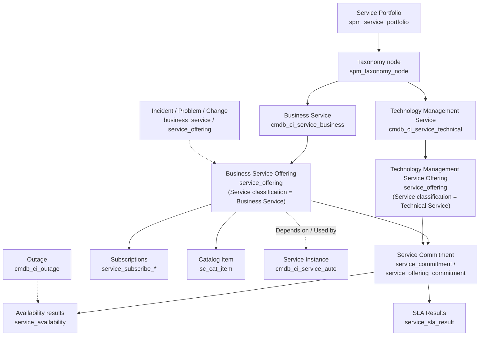
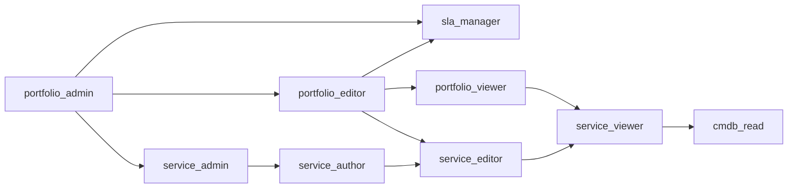
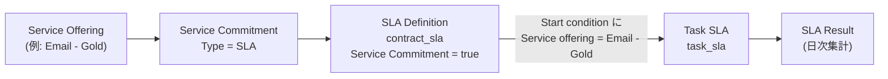
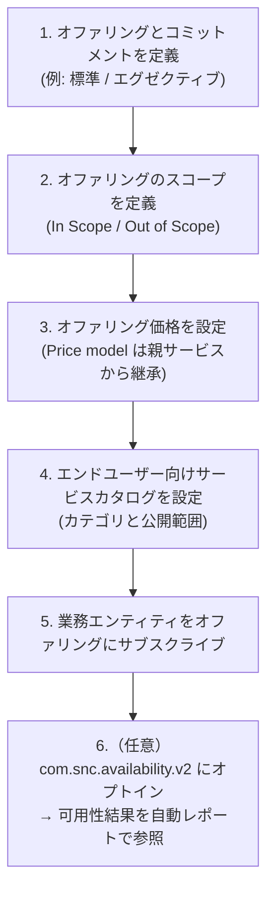
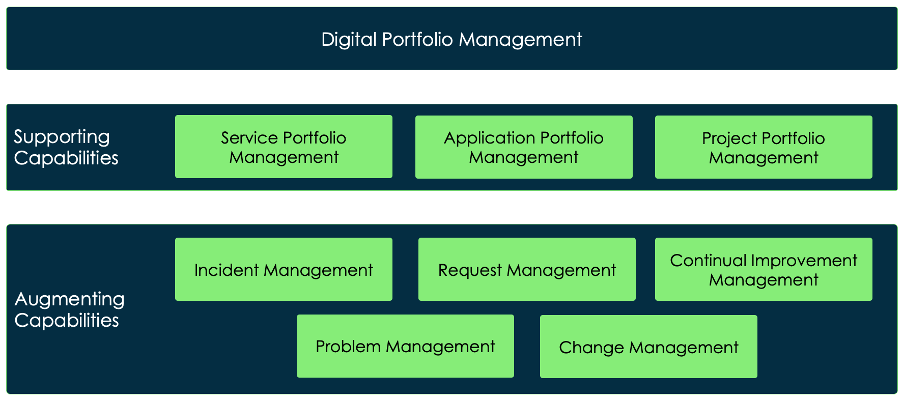
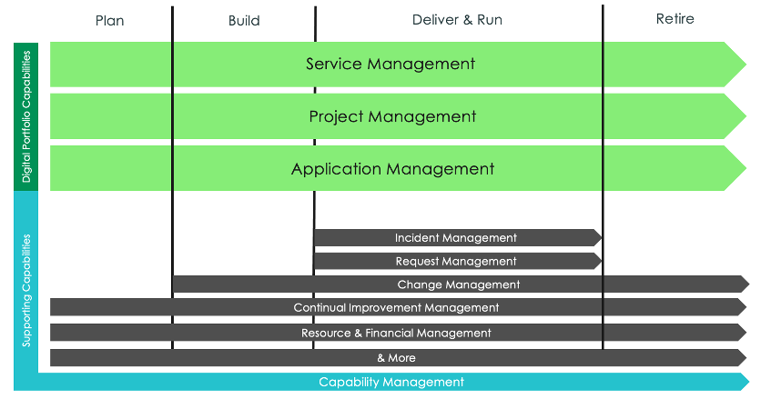

# ITSMにおけるサービスレベル管理とサービスポートフォリオ

## 概要

本ファイルは、ServiceNow の IT Service Management（ITSM）で「サービス」を定義・管理し、サービスレベル（SLA、可用性）を約束・測定する仕組みを扱うリファレンスである。対象は次のとおり。

| 領域 | 本ファイルでの扱い | 主な関連ファイル |
|---|---|---|
| Service Portfolio Management（SPM、サービスポートフォリオ管理） | プラグイン、ロール、テーブル、ポートフォリオ/タクソノミー、ライフサイクル | — |
| Business Service（ビジネスサービス）/ Technology Management Service（技術管理サービス） | フォーム項目、CSDM 上の位置付け | [CMDB と CSDM](../platform/cmdb-csdm.md) |
| Service Offering（サービスオファリング） | フォーム項目、継承ルール、価格、再親付け | [CMDB と CSDM](../platform/cmdb-csdm.md) |
| Service Commitment（サービスコミットメント）、Availability（可用性）、SLA Results | コミットメント種別、可用性計算式、SLA 結果 | [SLAとスケジュール](../platform/sla-schedules.md)（SLA エンジン本体） |
| SLA 運用（ITSM のチケットとオファリングの結び付け） | SLA Definition の Service Commitment 項目、オファリング別 SLA の考え方 | [Incident Management](incident-management.md)、[SLAとスケジュール](../platform/sla-schedules.md) |
| Service Builder（サービスビルダー） | ガイド付き作成ツールのタブ構成・ロール・公開 | — |
| Service Owner Workspace（サービスオーナーワークスペース） | 非推奨（planned deprecation）の経緯と後継 | — |
| Digital Portfolio Management（DPM）/ Digital Product（デジタルプロダクト） | DPM ワークスペース、ロール、テーブル、CSDM 5 の「デジタルプロダクト」との関係 | [CMDB と CSDM](../platform/cmdb-csdm.md)、[Agile Development・APM・EAM](../spm/agile-apm-eam.md) |

**注意（名称の衝突）:** 「SPM」という略称は ServiceNow では **Service Portfolio Management** と **Strategic Portfolio Management**（旧 ITBM、PPM 等を含む製品群）の両方に使われる。本ファイルの SPM は特記しない限り **Service Portfolio Management** を指す。Strategic Portfolio Management は [Strategic Portfolio Management（PPM）](../spm/strategic-portfolio-management.md) を参照。

基準リリースは Australia（2026-05 GA）。Service Portfolio Management は Australia の公式ドキュメントでは「Australia IT Service Management」に属し、ITSM のクラスター（`itsm`）の一部として扱われている。[出典](https://www.servicenow.com/docs/r/QykF2iRSIs6VXztArCSo3w/YVwDuzbaZQZ2zv9olLLRvQ)

> **Brazil での変更:** Zurich→Brazil の Service Portfolio Management 統合リリースノートは、Australia・Brazil ともに「No updates for this release」としている（2026-11-02 時点）。Brazil での SPM 機能変更は公開情報では確認できず。[出典](https://www.servicenow.com/docs/r/delta-zurich-brazil/brazil-zurich-serviceportfoliomanagement-release-notes.html)

---

## 1. 全体像

### 1.1 Service Portfolio Management の目的

Service Portfolio Management（サービスポートフォリオ管理）は、IT サービスを標準化された構造化形式で文書化・管理し、IT の業務運営を改善して顧客の要求に応えるためのアプリケーションである。Portfolio owner（ポートフォリオオーナー）と Service owner（サービスオーナー）が、サービス、サービスオファリング、ポートフォリオを作成・管理する。Service Portfolio Management は、サービス価値の最適化、コスト削減、IT 運用の効率化を狙いとする。[出典](https://www.servicenow.com/docs/r/QykF2iRSIs6VXztArCSo3w/YVwDuzbaZQZ2zv9olLLRvQ) [出典](https://www.servicenow.com/docs/r/QykF2iRSIs6VXztArCSo3w/uEH8ytf_0VcMhfySZ7dSsw)

公式ドキュメントの Service Portfolio Management は、次の 4 つの領域に分かれている。[出典](https://www.servicenow.com/docs/r/QykF2iRSIs6VXztArCSo3w/YVwDuzbaZQZ2zv9olLLRvQ)

| 領域 | 内容 |
|---|---|
| Explore（概要） | 概念と機能 |
| Configure（設定） | サービスオファリング、コミットメント、サブスクリプション、サービスカタログの設定 |
| Use（利用） | サービス、オファリング、ポートフォリオ、SLA の作成・管理、可用性結果などの参照 |
| Reference（リファレンス） | ロール、リスト、フォームなどの管理情報 |

### 1.2 主要概念

Service Portfolio Management の主要概念は以下のとおり（Australia の「Exploring Service Portfolio Management」より）。[出典](https://www.servicenow.com/docs/r/QykF2iRSIs6VXztArCSo3w/uEH8ytf_0VcMhfySZ7dSsw)

| 概念（英語） | 日本語 | 説明 |
|---|---|---|
| Service portfolio | サービスポートフォリオ | サービスとその組織・ステータス情報の構造化された集合。ポートフォリオごとに独自のタクソノミーを持てる |
| Service pipeline | サービスパイプライン | 提案中・審査中で、まだ稼働していないサービス。将来の成長とタイムラインの計画に使う |
| Service catalog | サービスカタログ | 稼働中のサービスと、設計・開発中のサービス。通常リクエストカタログに表示される |
| Retired services | 廃止サービス | 利用が終了したサービス。履歴情報とともに保持 |
| Taxonomy / Taxonomy node | タクソノミー / タクソノミーノード | サービスを一般から個別へ階層化して整理する枠組み。階層数・分岐数に制限はない |
| Service | サービス | 社内チームまたは外部顧客に価値を提供するサービス |
| Service offering | サービスオファリング | 特定の業務ニーズとパフォーマンスレベルに合わせて親サービスを具体化したもの |
| Commitments | コミットメント | オファリングに紐づくビジネス/技術上の約束。可用性や SLA の評価に使う |
| Outages | 停止（アウテージ） | 記録された停止イベント。コミットメントの可用性を減じる |
| Availability results | 可用性結果 | コミットメントおよび Application service（Service instance）について計算された可用性。自動レポートで参照 |
| Service dependencies | サービス依存関係 | サービス影響の特定に使う |
| CSDM alignment | CSDM 整合 | Common Service Data Model（CSDM）と統合し、サービスデータを一元的に扱う |

**「Service catalog」の二義性:** Service Portfolio Management の「Service catalog」は ITIL のサービスポートフォリオ内の区分（Pipeline / Catalog / Retired）を指し、ServiceNow のリクエスト用アプリケーション Service Catalog（`sc_catalog`、[サービスカタログ](../platform/service-catalog.md)）とは別の概念である。ただし、Catalog フェーズのオファリングからリクエスト用カタログアイテムを作成できるため、両者は連携する（6.6 参照）。

### 1.3 データ構造の全体図

以下は、Service Portfolio Management・CSDM・ITSM のレコードの関係を、公式ドキュメントのテーブル情報に基づいて整理した図である。[出典](https://www.servicenow.com/docs/r/q4dSP2Icgr1SFv5wanVXvQ/J59yFfgHNoDkjjO0r~Ef5w) [出典](https://www.servicenow.com/docs/r/QykF2iRSIs6VXztArCSo3w/wvasE8KorcEeUUtUxQn4sA)

- 図中の `service_commitment` と `service_offering_commitment` の関係は 5.1 を参照。
- `service_sla_result` は公式ドキュメントでテーブル名が明記されておらず、Community 情報に基づく（5.6 参照）。`cmdb_ci_outage` も Community 情報に基づく（5.4 参照）。

---

## 2. プラグイン・ロール・テーブル

### 2.1 プラグイン

Australia の「Installed with Service Portfolio Management」に記載されたプラグインは次のとおり。[出典](https://www.servicenow.com/docs/r/QykF2iRSIs6VXztArCSo3w/wvasE8KorcEeUUtUxQn4sA)

| プラグイン名 | ID | 備考 |
|---|---|---|
| Service Portfolio Management Core | `com.snc.service_portfolio_core` | ITSM ライセンス保有顧客には既定で有効。Foundation 有効化時に自動有効化される |
| Service Portfolio Management Foundation | `com.snc.service_portfolio` | 管理者が有効化する。ポートフォリオ、タクソノミー、サービス、オファリングの文書化に使う |
| Service Builder | `com.snc.service_builder` | ServiceNow Store から Service Builder をインストールすると自動的に導入される。SPM と同じロールセットを使う |

その他、関連ドキュメントで登場するプラグイン/アプリケーションは以下。

| プラグイン/アプリ | ID | 用途 | 出典 |
|---|---|---|---|
| Service Portfolio Management - SLA Commitments | `com.snc.service_portfolio.sla_commitment` | SPM に SLA コミットメントのサポートを追加（SLA Results） | [出典](https://www.servicenow.com/docs/r/QykF2iRSIs6VXztArCSo3w/00UyqDvl67_Al9IpP8upQA) |
| CSDM Activation | `com.snc.cmdb.csdm.activation` | CSDM のライフサイクル項目（Life cycle stage / status）を使う場合に必要 | [出典](https://www.servicenow.com/docs/r/MlbQAgTiiiMOLOw9T36wJg/c2lHegE0bXtcpy2WSy_nog) |
| Financial Management for SPM / SPM Estimated Spend | `com.snc.financial_management_for_spm` / `com.snc.spm.spend` | オファリングのコスト・推定支出（Service Builder の Financials タブ任意項目）。ITSM Pro SKU が必要と記載 | [出典](https://www.servicenow.com/docs/r/QykF2iRSIs6VXztArCSo3w/s5awpLFxzWNQtkPXNs8Y5Q) |
| Service Portfolio Management Premium | `com.snc.spm` | 非推奨の Service Owner Workspace を駆動（パフォーマンススコア等） | [出典](https://www.servicenow.com/docs/r/Recj91eIo1YnsOabQjgskg/l5h6hecevY1jaYyzlZIP_A) |
| Digital Portfolio Management | `sn_dpm`（スコープ） | DPM ワークスペース（ServiceNow Store アプリ） | [出典](https://www.servicenow.com/docs/r/UMl~97STJe3fa_KTmzD1Gg/Ka~KPDT6bcDEqIAOlNcMnQ) |

**プラグイン ID 表記の揺れ:** Xanadu→Australia および Zurich→Brazil の統合リリースノートでは、冒頭の AI 生成要約に `com.snc.serviceportfoliocore` と記載され、本文のアクティベーション表には `com.snc.service_portfolio_core` と記載されている。Installed with ページの表記である `com.snc.service_portfolio_core` を正とする。[出典](https://www.servicenow.com/docs/r/Cz0Un5C85RB3j2nhhAK1aQ/pDR4~n4iSYAMrf_1MLRd4g) [出典](https://www.servicenow.com/docs/r/delta-zurich-brazil/brazil-zurich-serviceportfoliomanagement-release-notes.html)

### 2.2 ロール

Service Portfolio Management のロールは Core プラグインと Foundation プラグインに分かれてインストールされる。[出典](https://www.servicenow.com/docs/r/QykF2iRSIs6VXztArCSo3w/wvasE8KorcEeUUtUxQn4sA)

| ロール | インストール元 | 説明 | 含むロール（Contains） |
|---|---|---|---|
| `portfolio_admin` | Core | サービスとサービスポートフォリオの設定・作成・編集・削除。ポートフォリオ、関連コミットメント、可用性の管理。サービスの再親付け（reparent） | `portfolio_editor`、`service_admin`、`sla_manager` |
| `service_editor` | Core | 自分がオーナーまたは Delegate（代理人）であるサービス・オファリングを編集 | `service_viewer` |
| `service_viewer` | Core | すべてのサービスとオファリングを参照 | `cmdb_read` |
| `portfolio_editor` | Foundation | サービスとポートフォリオの編集・削除。ポートフォリオ、タクソノミーノード、サービス、オファリングの更新 | `service_editor`、`portfolio_viewer`、`sla_manager` |
| `portfolio_viewer` | Foundation | ポートフォリオ、タクソノミーノード、サービス、オファリングを参照 | `service_viewer` |
| `service_admin` | Foundation | サービスとオファリングの設定・作成・編集・削除 | `service_author` |
| `service_author` | Foundation | 自分がオーナーまたは作成者であるサービス・オファリングの作成・編集・削除 | `service_editor` |

ロールの包含関係は次のとおり。

**ロールの位置付け（Exploring ページの要約）:** Portfolio admin はサービス・ポートフォリオの作成/編集/削除、コミットメント・可用性・タクソノミーノード・オファリング・再親付けを管理する。Service editor は所有/委任されたサービスとオファリングの編集に加え、停止の記録、可用性と SLA 結果の評価、依存関係による影響の特定を行う。Portfolio admin と Service editor はユーザーをオファリングにサブスクライブでき、Service editor はオファリングにサポートチームを割り当てられる。[出典](https://www.servicenow.com/docs/r/QykF2iRSIs6VXztArCSo3w/uEH8ytf_0VcMhfySZ7dSsw)

**作業別の必要ロール（各手順ページの記載）:**

| 作業 | 必要ロール（ドキュメント記載） | 出典 |
|---|---|---|
| サービスの作成・編集（クラシックフォーム） | `portfolio_admin` または `service_editor` | [出典](https://www.servicenow.com/docs/r/QykF2iRSIs6VXztArCSo3w/blDUGvk1DT9T9E9uorDH_g) |
| サービスオファリングの作成（クラシックフォーム） | `portfolio_admin` | [出典](https://www.servicenow.com/docs/r/QykF2iRSIs6VXztArCSo3w/goZ_avjpLRSNafB97vdNLg) |
| サービス・オファリングの作成（Service Builder） | `service_author`（サービスオーナーにも必要） | [出典](https://www.servicenow.com/docs/r/QykF2iRSIs6VXztArCSo3w/s5awpLFxzWNQtkPXNs8Y5Q) |
| 既存サービス・オファリングの編集（Service Builder） | `service_editor`（Delegate にも必要） | [出典](https://www.servicenow.com/docs/r/QykF2iRSIs6VXztArCSo3w/s5awpLFxzWNQtkPXNs8Y5Q) |
| サービスとコミットメントの設定 | `portfolio_admin` または `service_editor` | [出典](https://www.servicenow.com/docs/r/QykF2iRSIs6VXztArCSo3w/U0upmv1xgKVQH_DryfL17g) |
| オファリングへのコミットメント追加 | `service_editor` | [出典](https://www.servicenow.com/docs/r/UMl~97STJe3fa_KTmzD1Gg/Llg709SNqxFuXqlCx3__jA) |
| 可用性計算のタイムゾーン設定 | `portfolio_admin` または `admin` | [出典](https://www.servicenow.com/docs/r/QykF2iRSIs6VXztArCSo3w/a2zqi~m_L8LFWcKgTIsYcw) |
| SLA Definition の作成 | `admin` | [出典](https://www.servicenow.com/docs/r/QykF2iRSIs6VXztArCSo3w/VjdZWS94BLQajtyl5XK5jg) |

> **ドキュメント間の差異:** クラシックフォームの「サービス作成」は `portfolio_admin` または `service_editor`、Service Builder の「サービス作成」は `service_author` と、手順ページによって記載が異なる。`service_editor` の説明（所有/委任されたものの編集）からは新規作成権限は読み取れないため、新規作成は `service_author` 以上（`service_admin`、`portfolio_admin` は包含）を前提に設計し、インスタンスの ACL で確認すること。【推定】

### 2.3 テーブル

Australia の Installed with ページに記載されたテーブルは次のとおり。[出典](https://www.servicenow.com/docs/r/QykF2iRSIs6VXztArCSo3w/wvasE8KorcEeUUtUxQn4sA)

**Core プラグイン**

| テーブル | 説明 |
|---|---|
| `service_offering` | `cmdb_ci_service` を拡張。サービスオファリング |

**Foundation プラグイン**

| テーブル | 説明 |
|---|---|
| `spm_service_portfolio` | サービスポートフォリオの作成・変更 |
| `spm_taxonomy_layer_definition` | ポートフォリオに紐づくタクソノミー階層（レイヤー）の順序定義。**レガシーのポートフォリオ構造でのみ使用** |
| `spm_taxonomy_node` | ポートフォリオに紐づくタクソノミーノードの作成・変更 |
| `service_scope` | サービスのサービスレベルに対するユーザー定義の範囲（制限）を保存 |
| `service_in_scope` | In Scope（範囲内）サービスとスコープパラメーターの定義 |
| `service_out_scope` | Out of Scope（範囲外）サービスとスコープパラメーターの定義 |
| `service_commitment` | Service Offering フォームの Service Commitments 関連リストのレコードを保存 |
| `service_offering_commitment` | 順序の指定とオファリングの関連付けによるサービスコミットメントの作成・設定 |
| `service_availability` | サービスの計算済み可用性レコードを保存 |
| `service_subscribe_sys_user` | 個々のユーザー単位のサブスクライバー |
| `service_subscribe_sys_user_grp` | グループ単位のサブスクライバー |
| `service_subscribe_department` | 部署単位のオファリングサブスクリプション |
| `service_subscribe_company` | 会社単位のオファリングサブスクリプション |
| `service_subscribe_location` | ロケーション（物理所在地）単位のサブスクリプション |
| `sc_cat_item_service` | Service Catalog へのアイテム登録（Service Catalog Entry。Migration Dashboard のドキュメントでは非推奨とされている） |
| `sc_cat_item_subscribe_mtom` | サブスクリプション対象として公開するカタログアイテム |
| `sc_cat_item_subscribe_no_mtom` | サブスクリプション対象にしないカタログアイテム |

`sc_cat_item_service` の非推奨記載は Xanadu 版の Migration Dashboard ページによる。[出典](https://www.servicenow.com/docs/r/Recj91eIo1YnsOabQjgskg/46c1DuwMFrwtHKHMvbqFeg)

**関連する CSDM/CMDB テーブル**

| テーブル | ラベル（Australia） | 説明 | 出典 |
|---|---|---|---|
| `cmdb_ci_service` | Service | サービスの基底テーブル | [出典](https://www.servicenow.com/docs/r/q4dSP2Icgr1SFv5wanVXvQ/J59yFfgHNoDkjjO0r~Ef5w) |
| `cmdb_ci_service_business` | Business Service | `cmdb_ci_service` を拡張。業務ユーザーに公開されるサービス | [出典](https://www.servicenow.com/docs/r/QykF2iRSIs6VXztArCSo3w/SCsUS3iPlZ40ZeOkeNQvag) |
| `cmdb_ci_service_technical` | Technology Management Service | 旧ラベル Technical Service。テーブル名は不変 | [出典](https://www.servicenow.com/docs/r/QykF2iRSIs6VXztArCSo3w/Epxu5PTcYV0VoUT_Nxkraw) |
| `cmdb_ci_service_auto` | Service Instance（旧 Application Service） | デプロイ済みアプリケーションスタックの論理表現 | [出典](https://www.servicenow.com/docs/r/q4dSP2Icgr1SFv5wanVXvQ/iHT9SvSAjIhuKWFdxOMovw) |
| `sc_catalog` | Service Catalog | オファリングをカタログアイテムとして保持 | [出典](https://www.servicenow.com/docs/r/q4dSP2Icgr1SFv5wanVXvQ/J59yFfgHNoDkjjO0r~Ef5w) |

### 2.4 主なメニュー（Application Navigator）

| メニュー | 用途 | 出典 |
|---|---|---|
| All > Service Portfolio Management > Services | サービス一覧・新規作成 | [出典](https://www.servicenow.com/docs/r/QykF2iRSIs6VXztArCSo3w/blDUGvk1DT9T9E9uorDH_g) |
| All > Service Portfolio Management > Service Offerings | オファリング一覧・新規作成 | [出典](https://www.servicenow.com/docs/r/QykF2iRSIs6VXztArCSo3w/goZ_avjpLRSNafB97vdNLg) |
| All > Service Portfolio Management > Commitments | コミットメント一覧 | [出典](https://www.servicenow.com/docs/r/UMl~97STJe3fa_KTmzD1Gg/Llg709SNqxFuXqlCx3__jA) |
| All > Service Portfolio Management > Availability | 可用性結果 | [出典](https://www.servicenow.com/docs/r/QykF2iRSIs6VXztArCSo3w/cozs9eqd_Ps8u_Vs7xcR8Q) |
| All > Service Portfolio Management > Administration > Availability calculation settings | 可用性計算のタイムゾーン設定 | [出典](https://www.servicenow.com/docs/r/QykF2iRSIs6VXztArCSo3w/a2zqi~m_L8LFWcKgTIsYcw) |
| Service Portfolio Management > Service Level Management > SLA Results | SLA 結果（SLA Commitments プラグイン） | [出典](https://www.servicenow.com/docs/r/QykF2iRSIs6VXztArCSo3w/00UyqDvl67_Al9IpP8upQA) |
| All > Service Portfolio Management > Service Builder | Service Builder（アプリケーションルートは `now/builder`） | [出典](https://www.servicenow.com/docs/r/QykF2iRSIs6VXztArCSo3w/s5awpLFxzWNQtkPXNs8Y5Q) |
| Service Portfolio Management > Migration Dashboard | レガシー構造からの移行状況（Xanadu 版の記載） | [出典](https://www.servicenow.com/docs/r/Recj91eIo1YnsOabQjgskg/46c1DuwMFrwtHKHMvbqFeg) |
| All > Service Level Management > SLA > SLA Definitions | SLA Definition（`contract_sla`） | [出典](https://www.servicenow.com/docs/r/QykF2iRSIs6VXztArCSo3w/VjdZWS94BLQajtyl5XK5jg) |
| All > Digital Portfolio Management > DPM Admin Center | DPM の管理設定 | 【第三者情報】Community 投稿に基づく（7.3 参照） |

SLA Results のメニューは公式ページ上で区切り記号なしに記載されており、上記の階層表記は推定を含む。

---

## 3. サービスポートフォリオとタクソノミー

### 3.1 ポートフォリオ構造（レガシーと標準）

Service Portfolio Management には **レガシーのポートフォリオ構造** と **標準（Standard）のポートフォリオ構造** がある。`spm_taxonomy_layer_definition`（タクソノミーレイヤー定義）はレガシー構造でのみ使われ、標準構造にはタクソノミーレイヤーがない。[出典](https://www.servicenow.com/docs/r/QykF2iRSIs6VXztArCSo3w/wvasE8KorcEeUUtUxQn4sA) [出典](https://www.servicenow.com/docs/r/MlbQAgTiiiMOLOw9T36wJg/L1ip4OWdmrXqu4syfsqiRQ)

- Service portfolio（`spm_service_portfolio`）は、ビジネスサービスと関連アイテムをグループ化する。Business Service と Technology Management Service は `spm_taxonomy_node` を介してポートフォリオに接続される。[出典](https://www.servicenow.com/docs/r/q4dSP2Icgr1SFv5wanVXvQ/J59yFfgHNoDkjjO0r~Ef5w)
- サービスポートフォリオの分類軸の例として、CSDM ドキュメントは Objective（目的）、Capability（ケイパビリティ）、Organization（組織）、Geography（地域）を挙げている。[出典](https://www.servicenow.com/docs/r/q4dSP2Icgr1SFv5wanVXvQ/J59yFfgHNoDkjjO0r~Ef5w)
- Technology Management Service（技術サービス）は、ポートフォリオのタクソノミーに含まれていなくても依存関係として追跡できる。[出典](https://www.servicenow.com/docs/r/QykF2iRSIs6VXztArCSo3w/SCsUS3iPlZ40ZeOkeNQvag)

### 3.2 タクソノミーの編集機能（Yokohama 以降）

Yokohama で、サービスポートフォリオの編集・管理に次の機能が追加された。[出典](https://www.servicenow.com/docs/r/Cz0Un5C85RB3j2nhhAK1aQ/pDR4~n4iSYAMrf_1MLRd4g)

| 機能 | 内容 |
|---|---|
| CSDM ライフサイクル項目 | タクソノミーノードのレコードにライフサイクル項目を追加して CSDM に整合させる |
| ブランチの移動 | 子ノードを含むブランチ全体を別ポートフォリオに移動 |
| 再親付け（Reparent） | ノードをポートフォリオ内の新しい位置に移動 |
| ノードの挿入 | 2 つのノードの間、またはノードとサービスの間に新しいノードを挿入 |

Zurich では、DORA（EU デジタル運用レジリエンス法）対応として、サービスポートフォリオのレコードビューに Managed by、Department、Company フィールドが追加され、Contracts フィールドで複数契約を選択できるようになった。また Digital Portfolio Management（DPM）スコープからサービスポートフォリオやタクソノミーノードを削除できるようになった。[出典](https://www.servicenow.com/docs/r/Cz0Un5C85RB3j2nhhAK1aQ/pDR4~n4iSYAMrf_1MLRd4g)

### 3.3 レガシー構造からの移行（Migration Dashboard）

Migration Dashboard は、非推奨の構造を使っている、または拡張された Service Portfolio Management のタクソノミー内で孤立している既存のサービスとオファリングを、ポートフォリオマネージャーが見つけるためのダッシュボードである（Xanadu 版ドキュメントでは Service Owner Workspace 配下の機能として記載）。[出典](https://www.servicenow.com/docs/r/Recj91eIo1YnsOabQjgskg/46c1DuwMFrwtHKHMvbqFeg)

| 項目 | 内容 |
|---|---|
| メニュー | Service Portfolio Management > Migration Dashboard |
| 参照ロール | `service_viewer`、`portfolio_admin` |
| 修正ロール | `portfolio_admin`、`service_editor` |
| 使い方 | 既定では全ポートフォリオを表示。インタラクティブフィルターで 1 つに絞り込める。件数が 0 より大きいレポートの数値をクリックすると対象サービス/オファリングの一覧が開く |
| 典型的な修正 | Phase と Status の入力、ポートフォリオまたはタクソノミーノードの選択、Parent の設定 → Update |

Australia で Migration Dashboard が提供されているかは、公開情報では確認できず。

---

## 4. サービスとサービスオファリング

### 4.1 サービスの種類（CSDM 上の定義）

Australia の CSDM 用語集による定義は次のとおり。[出典](https://www.servicenow.com/docs/r/q4dSP2Icgr1SFv5wanVXvQ/iHT9SvSAjIhuKWFdxOMovw)

| 種類 | テーブル | 定義 | 補足 |
|---|---|---|---|
| Business service（ビジネスサービス） | `cmdb_ci_service_business` | 業務ユーザーに公開されるサービス種別 | 通常 1 つ以上の Business capability を実装する。**階層化せず 1 階層**とする |
| Business service offering（ビジネスサービスオファリング） | `service_offering`（Service classification = Business Service） | ビジネスサービスを基にしたオファリング。可用性・範囲・価格などのサービスコミットメントを束ねる（シルバー/ゴールドなどの段階） | Service Portfolio Management 構成の出発点 |
| Technology management service（技術管理サービス） | `cmdb_ci_service_technical` | サービスオーナーに公開され、通常ビジネスサービスまたは Service instance を支えるサービス種別 | 旧 Technical service。サービスオーナーが注文できる |
| Technology management service offering（技術管理サービスオファリング） | `service_offering`（Service classification = Technical Service） | Service classification が Technical service のサービスオファリング | 稼働中の Technology management service は少なくとも 1 つのオファリングに紐づく必要がある。マネージドサービスプロバイダーが提供することもある |
| Service instance（サービスインスタンス） | `cmdb_ci_service_auto` | デプロイ済みアプリケーションスタックの論理表現 | 旧 Application service。Business application と多対多 |

`service_offering` テーブルは Business Service Offering と Technology Management Service Offering の両方を格納し、Service classification で区別する。CSDM 全体のモデル・関係の詳細は [CMDB と CSDM](../platform/cmdb-csdm.md) を参照。

### 4.2 「Technical」から「Technology Management」へのラベル変更

`cmdb_ci_service_technical` のラベルは CSDM 5 に合わせて「Technical Service」から「Technology Management Service」に変更された。**テーブル名は変わらない。**

| 情報源 | 記載内容 |
|---|---|
| Xanadu→Australia 統合リリースノート（Yokohama 節） | Yokohama で `cmdb_ci_service_technical` のラベルを Technology Management Service に変更。`service_offering` のラベルは変更なし [出典](https://www.servicenow.com/docs/r/Cz0Un5C85RB3j2nhhAK1aQ/pDR4~n4iSYAMrf_1MLRd4g) |
| Zurich「Applying the CSDM guidelines to SPM」 | Zurich 以降、Technology Management Service（`cmdb_ci_service_technical`）と Technology Management Service Offering（`service_offering`）にラベル変更 [出典](https://www.servicenow.com/docs/r/MlbQAgTiiiMOLOw9T36wJg/c2lHegE0bXtcpy2WSy_nog) |
| Australia「Service offerings in SPM」 | Australia 以降、`cmdb_ci_service_technical` は Technology Management Service、`service_offering` は Technology Management Service Offering とラベル付け [出典](https://www.servicenow.com/docs/r/QykF2iRSIs6VXztArCSo3w/Epxu5PTcYV0VoUT_Nxkraw) |
| Australia「Use SPM services」 | `service_offering` のラベルは Service Offering、`cmdb_ci_service_technical` は Technology Management Service（Australia 以降、CSDM 5 整合） [出典](https://www.servicenow.com/docs/r/QykF2iRSIs6VXztArCSo3w/SCsUS3iPlZ40ZeOkeNQvag) |

> **ドキュメント間の差異:** ラベル変更の導入リリースは Yokohama / Zurich / Australia と情報源ごとに異なる。また `service_offering` 自体のラベルが変わったかについても記載が割れている。`service_offering` は Business と Technical の両方のオファリングを格納するため、「Technology Management Service Offering」は Service classification = Technical Service のオファリングを指す呼称と理解するのが整合的である。【推定】 実際の表示ラベルはインスタンスの Dictionary（`sys_db_object`）で確認すること。

### 4.3 サービスフォーム（Service）

**メニュー:** All > Service Portfolio Management > Services > New。**必要ロール:** `portfolio_admin` または `service_editor`。[出典](https://www.servicenow.com/docs/r/QykF2iRSIs6VXztArCSo3w/blDUGvk1DT9T9E9uorDH_g)

**ヘッダー部**

| フィールド | 説明 |
|---|---|
| Name（名前） | サービスの性質を表す一意の名前 |
| Service portfolio（サービスポートフォリオ） | 所属ポートフォリオ |
| Taxonomy node（タクソノミーノード） | ポートフォリオ内のタクソノミーのリーフノード |
| Phase（フェーズ） | Pipeline / Catalog / Retired |
| Status（ステータス） | フェーズ内のステータス（4.6 参照） |
| Owned by（所有者） | 組織内で責任を持つサービスオーナー |
| Delivery manager（デリバリーマネージャー） | サービスのデリバリーマネージャー |
| Business relation manager（ビジネスリレーションマネージャー） | サービスのリレーションシップマネージャー |
| Performance score / CSAT score | 非推奨の Service Owner Workspace プラグインがある場合のみ表示（夜間計算、読み取り専用） |

公式ページのヘッダー表には「Short Description」の説明として「Type of service」と選択肢（Business Service / Technical Service / Application Service）が記載されているが、これは Service classification の説明と重複しており、表の誤記と考えられる。【推定】

**General タブ**

| フィールド | 説明 / 選択肢 |
|---|---|
| Number（番号） | 自動採番。プレフィックス「BSN」。フィールド追加前に作成されたレコードは空 |
| Version（バージョン） | サービスのバージョン |
| Aliases（別名） | サービスの別名 |
| Service classification（サービス分類） | Business Service / Technical Service / Application Service |
| Consumer type（消費者種別） | Internal / External / Internal and External |
| Start date / End date | 提供開始日 / 廃止日 |
| Last review date | 最終レビュー日 |

**Team タブ:** Delegate（代理人、複数可）、Business contact（業務窓口）、Vendor（ベンダー）、Stakeholders（ステークホルダー）。
**Business Need タブ:** Business need（業務ニーズ）、Business criticality（ビジネス重要度）。

**保存後の関連リスト:** Offerings、In Scope、Out of Scope、Services I depend On、Services Dependent On Me、Incidents、Problems、Change Requests、Other tasks、Knowledge Articles、Service Offering Node Weights、Improvement Initiatives。

### 4.4 サービスオファリングフォーム（Service Offering）

**メニュー:** All > Service Portfolio Management > Service Offerings > New。**必要ロール:** `portfolio_admin`。[出典](https://www.servicenow.com/docs/r/QykF2iRSIs6VXztArCSo3w/goZ_avjpLRSNafB97vdNLg)

**メイン部**

| フィールド | 説明 |
|---|---|
| Name | オファリングの一意の名前 |
| Parent（親） | 親サービス |
| Phase | Pipeline / Catalog / Retired |
| Status | フェーズ内のステータス |
| Short description / Description | 概要 / 詳細 |
| CSAT score | 顧客満足度スコア |
| Total Subscribers（総サブスクライバー数） | 夜間計算（管理者は変更可） |
| Owned by | サービスオーナー（親から継承、編集可） |
| Performance score | 夜間計算。非推奨の Service Owner Workspace プラグインがある場合のみ表示 |

**General タブ:** Aliases、Business criticality（継承・編集可）、Consumer type（Internal / External）、Service classification（Business Service / Technical Service / Application Service）、Version、Start date、End date、Location、CSAT Survey Frequency、CSAT Survey Last Sent。

**Team タブ:** Delivery Manager（継承・編集可）、Delegate（継承・編集可）、Support group（サポートグループ）、Vendor、Stakeholders。

**Price タブ**

| フィールド | 説明 |
|---|---|
| Price model（価格モデル） | 読み取り専用。親サービスで設定 |
| Price unit（価格単位） | 読み取り専用。親サービスで設定。Per Unit 価格の場合に表示 |
| Price（価格） | 価格と通貨 |
| Unit Description（単位の説明） | オファリングの単位の詳細説明 |

**Operations タブ:** Contract（契約）、Maintenance schedule（保守スケジュール）、Service level requirement（サービスレベル要件。SLA と目標）、Prerequisites（前提条件）、Compatibility dependencies（互換性依存関係）、Monitoring requirements（監視要件）。

**Estimated Spend タブ（任意。ドキュメントでは非推奨プラグイン利用時のみと記載）:** Cost model（None（既定）/ Fixed / Per unit）、Estimated spend（読み取り専用）。

**関連リスト:** Service Commitments、Service Offerings I Depend On、Service Offerings Dependent On Me、Outages、Incidents、Problems、Change Requests、Other Tasks、Knowledge Articles、Catalog Items、Subscribed by Group / Location / Department / User / Company、Performance Metrics、Improvement Initiatives。

> **ドキュメント間の差異:** Consumer type の選択肢は、オファリングフォームのページでは Internal / External の 2 つ、サービスフォームと Service Builder では Internal / External / Internal and External の 3 つと記載されている。[出典](https://www.servicenow.com/docs/r/QykF2iRSIs6VXztArCSo3w/goZ_avjpLRSNafB97vdNLg) [出典](https://www.servicenow.com/docs/r/QykF2iRSIs6VXztArCSo3w/s5awpLFxzWNQtkPXNs8Y5Q)

### 4.5 継承・価格・再親付けのルール

**継承ルール** [出典](https://www.servicenow.com/docs/r/QykF2iRSIs6VXztArCSo3w/goZ_avjpLRSNafB97vdNLg)

- オファリングをサービスに初めて追加したとき、**Owned by、Business criticality、Delivery Manager、Delegate** が親サービスから継承され、オファリング側の既存値は上書きされる。
- 親の値が空ならオファリング側も空になる。
- 継承後は編集できる（Business criticality も後から変更可）。
- Price model と Price unit は常に親サービスから継承され、オファリング上では読み取り専用。

**価格** [出典](https://www.servicenow.com/docs/r/QykF2iRSIs6VXztArCSo3w/Epxu5PTcYV0VoUT_Nxkraw) [出典](https://www.servicenow.com/docs/r/QykF2iRSIs6VXztArCSo3w/U0upmv1xgKVQH_DryfL17g)

- Price model と Price unit は親サービスで設定し、オファリングが継承する。
- 親の価格モデルが Per unit の場合、各オファリングに Price unit が必要で、実際の単価はオファリングのレコードで設定する。
- 価格データはカタログアイテムの作成に使われる。

**再親付け（Re-parenting）** [出典](https://www.servicenow.com/docs/r/QykF2iRSIs6VXztArCSo3w/Epxu5PTcYV0VoUT_Nxkraw)

| ルール | 内容 |
|---|---|
| 移動可能な親 | Business service と Technology management service の間で移動できる。**Application service（Service instance）には移動できない** |
| 技術サービスへの移動 | 技術オファリングではパフォーマンススコアが使えない旨のメッセージが出る（技術オファリングはメトリクスモデルから除外され、重み付けモデルを使わない） |
| 重み付け | 移動後は既存の重み付けルールが適用される |
| ブロック条件 | 親が Catalog フェーズでオファリングが 1 つしかない場合、移動できない |
| 事前作業 | 現在の親でのメトリクス重みが 0 より大きい場合、再親付け前に 0 にする |

**オファリング数の制約:** サービスを Catalog フェーズに移すには、少なくとも 1 つのオファリングが必要である。[出典](https://www.servicenow.com/docs/r/QykF2iRSIs6VXztArCSo3w/Epxu5PTcYV0VoUT_Nxkraw) Service Builder でも、サービスの公開には少なくとも 1 つのオファリングが必要とされる。[出典](https://www.servicenow.com/docs/r/QykF2iRSIs6VXztArCSo3w/s5awpLFxzWNQtkPXNs8Y5Q)

### 4.6 ライフサイクル：Phase/Status と CSDM の Life cycle stage

Service Portfolio Management の伝統的なライフサイクルは **Phase（Pipeline / Catalog / Retired）** と **Status** の 2 項目で表す。CSDM Activation プラグイン（`com.snc.cmdb.csdm.activation`）を導入すると、CSDM の **Life cycle stage / Life cycle stage status** がこれに代わる。Zurich ドキュメントの対応表は次のとおり（対象テーブル `cmdb_ci_service`）。[出典](https://www.servicenow.com/docs/r/MlbQAgTiiiMOLOw9T36wJg/c2lHegE0bXtcpy2WSy_nog)

| SPM Phase | SPM Status | CSDM Life cycle stage | CSDM Status |
|---|---|---|---|
| Pipeline | Requirements | Ideation | Under evaluation |
| Pipeline | Definition | Ideation | Under evaluation |
| Pipeline | Analysis | Ideation | Under evaluation |
| Pipeline | Approved | Ideation | Under evaluation |
| Pipeline | Chartered | Design | Chartered |
| Catalog | Design | Design | Design |
| Catalog | Development | Design | Design |
| Catalog | Build/Test/Release | Deploy | Test |
| Catalog | Operational | Operational | In-use |
| Catalog | Retiring | Operational | Pending Retirement |
| Retired | Retired | End of life | Retired |
| Retired | Obsolete | End of life | Obsolete |

- フィールド名を確認するには、All > Service Portfolio Management > Services でビューを Service Portfolio に切り替える。
- CSDM の Stage / Status は Performance Analytics のインジケーターにも表示される。
- Service Builder の Details タブの Lifecycle status も、CSDM Activation プラグインがあれば CSDM 項目、なければレガシーの Phase/Status になる。[出典](https://www.servicenow.com/docs/r/QykF2iRSIs6VXztArCSo3w/s5awpLFxzWNQtkPXNs8Y5Q)
- DPM 5.0.3 以降では、CSDM Activation プラグイン導入時に Phase/Status が Life cycle stage 項目に置き換わる。[出典](https://www.servicenow.com/docs/r/C17ZqvSaMwUVpMBg8Nc5sg/lkDwbbPUbtlEHUtmFwQe5A)

上記の対応表は Zurich 版で確認したもので、Australia 版の同等ページの内容は公開情報では確認できず（同一と想定）。

### 4.7 スコープ（In Scope / Out of Scope）と依存関係

- **スコープ:** サービスの限界を定める。関連サービスを In Scope または Out of Scope に指定する。例：夜間バックアップは Desktop Support では In Scope、Disaster Recovery では Out of Scope。[出典](https://www.servicenow.com/docs/r/QykF2iRSIs6VXztArCSo3w/U0upmv1xgKVQH_DryfL17g)
- **依存関係:** Service / Service Offering フォームの依存関係タブと関連リスト（Services I depend On / Services Dependent On Me）で管理する。[出典](https://www.servicenow.com/docs/r/QykF2iRSIs6VXztArCSo3w/SCsUS3iPlZ40ZeOkeNQvag)
- **CSDM 上の関係:** Business Capability `Provided by::Provides` Business Service、Service portfolio →（参照）Business Service、Business Service →（参照）Business Service Offering、Business Service Offering `Depends on::Used by` Service Instance。[出典](https://www.servicenow.com/docs/r/q4dSP2Icgr1SFv5wanVXvQ/J59yFfgHNoDkjjO0r~Ef5w)

---

## 5. サービスレベル：コミットメント・可用性・SLA 結果

### 5.1 Service Commitment（サービスコミットメント）

Service Commitment は、オファリングの可用性保証、範囲、価格などを定める約束である。CSDM の例では、シルバーのデスクトップオファリングはアップグレードとウイルス対策をカバーし、ゴールドはさらに平日営業時間内の 30 分応答保証を加える。[出典](https://www.servicenow.com/docs/r/q4dSP2Icgr1SFv5wanVXvQ/J59yFfgHNoDkjjO0r~Ef5w)

**追加手順**（必要ロール `service_editor`）[出典](https://www.servicenow.com/docs/r/UMl~97STJe3fa_KTmzD1Gg/Llg709SNqxFuXqlCx3__jA)

1. All > Service Portfolio Management > Service Offerings でオファリングを開く（または Service Portfolio Management > Commitments）。
2. Service Commitments 関連リストで New を選択する。
3. 名前、Commitment Type を入力し、任意で Contract とベンダーペナルティを設定して Submit する。

**Commitment Type（コミットメント種別）**

| 種別 | 動作 |
|---|---|
| Availability / Maintenance window | システム処理に使う。Schedule フィールドが必須になる。オファリングの停止（Outage）に基づいて可用性レコードを作成し、ダウンタイムと可用性の追跡を開始する |
| Response time / Delivery / Other | サービスカタログに情報を表示するだけで、追加機能やホームページのゲージはない |
| Recovery time objective（RTO） | 復旧ポイントからシステムを復旧するまでの時間の保証。Time value フィールドで設定（ベンダーチケットレコードで使用） |
| Recovery point objective（RPO） | バックアップ頻度の保証。Time value フィールドで設定（ベンダーチケットレコードで使用） |
| SLA | SLA で定義されるコミットメント。ベンダーが一定割合の時間でサービスレベルを満たしているかを追跡する。結果は自動計算され、My Services - SLAs ホームページまたは Service Offering SLA Results で参照する |

**ベンダーペナルティ関連フィールド:** Contract（ベンダークレジットレコード作成に使用）、Penalty value per breach（違反ごとの単位時間あたりペナルティ額）、Per（クレジット総額計算の時間単位）、Penalty time per breach（違反ごとにベンダーが許容する無償時間）。

**テーブル:** Service Commitments 関連リストのレコードは `service_commitment` に保存され、`service_offering_commitment` はオファリングとコミットメントの関連付け（順序指定）に使われる。[出典](https://www.servicenow.com/docs/r/QykF2iRSIs6VXztArCSo3w/wvasE8KorcEeUUtUxQn4sA) また、Application service（Service instance）を可用性コミットメントに紐づけるには、`service_offering_commitment` の `cmdb_ci` フィールドに `cmdb_ci_service_auto` のレコードを設定する。[出典](https://www.servicenow.com/docs/r/QykF2iRSIs6VXztArCSo3w/cozs9eqd_Ps8u_Vs7xcR8Q)

> Australia 版の「オファリングへのコミットメント追加」ページは pt-BR 版で内容を確認したため、英語 UI 名は推定を含む。Availability 種別に必要な可用性率（%）のフィールド名は公開情報では確認できず。

### 5.2 Availability（可用性）の計算

可用性コミットメントをサービスオファリングまたは Application service に追加すると、Service Portfolio Management はその項目とコミットメントについて、**前年から 1 年分の可用性レコード**を生成する。[出典](https://www.servicenow.com/docs/r/QykF2iRSIs6VXztArCSo3w/cozs9eqd_Ps8u_Vs7xcR8Q)

**参照方法:** All > Service Portfolio Management > Availability で対象レコードを選択する。

**新しい可用性計算機（`com.snc.availability.v2`）**

| 項目 | 内容 |
|---|---|
| プロパティ | `com.snc.availability.v2`（`sys_properties.list` で「avail」を検索して true に設定） |
| 対象 | 新規顧客は自動で有効。既存顧客はオプトイン（true に設定）が必要 |
| 効果 | 性能・計算精度・保守性の改善。停止の作成に応じて可用性レコードを随時更新する（例：100% から停止発生後に停止時間に応じて 99.95% に更新） |
| 導入リリース | Australia（Australia 版ドキュメントの記載） |

> **ドキュメント間の差異:** Australia 版の可用性ページは「Australia リリースから availability calculator（`com.snc.availability.v2`）を使える」と記載する一方、Xanadu→Australia および Zurich→Brazil の SPM 統合リリースノートは Australia を「No updates」としている。[出典](https://www.servicenow.com/docs/r/QykF2iRSIs6VXztArCSo3w/cozs9eqd_Ps8u_Vs7xcR8Q) [出典](https://www.servicenow.com/docs/r/delta-zurich-brazil/brazil-zurich-serviceportfoliomanagement-release-notes.html)

**可用性結果のフィールドと計算式** [出典](https://www.servicenow.com/docs/r/QykF2iRSIs6VXztArCSo3w/cozs9eqd_Ps8u_Vs7xcR8Q)

| フィールド | 計算式・意味 |
|---|---|
| Committed uptime（約束稼働時間） | 期間終了 − 期間開始 |
| Acceptable downtime（許容ダウンタイム） | スケジュール期間の長さ × コミットメント率 |
| Total downtime（総ダウンタイム） | 停止終了 − 停止開始（壁時計時間。スケジュールを無視） |
| Total availability %（総可用性率） | （利用可能稼働時間 − 総ダウンタイム）÷ 利用可能稼働時間 |
| Commitment downtime（コミットメントダウンタイム） | スケジュールされた稼働時間内の停止時間 |
| Commitment availability %（コミットメント可用性率） | （Committed uptime − Commitment downtime）÷ Committed uptime |
| Met commitment（達成） | コミットメント可用性率がサービスコミットメントを上回れば true |
| MTBF（平均故障間隔） | 期間内の総稼働時間 ÷ コミットメント停止回数 |
| MTRS（平均サービス復旧時間） | コミットメントダウンタイム ÷ コミットメント停止回数 |

その他の表示項目：Display name、Service offering、Service commitment、Start、End、Total outages、Commitment outages。

**計算期間:** Daily、Weekly、Monthly、Annually、Last 7 Days、Last 30 Days、Last 12 Months。

**停止の扱い:** 計画停止（Planned）と計画外停止を区別する。計画停止と重なる計画外停止の時間は総停止時間に含めない。

**スケジュールジョブ:** 日次ジョブがコミットメント可用性レポートを生成する（システムタイムゾーン使用）。Table cleaner が 3 年より古い可用性データをアーカイブする（Vancouver 以降、アーカイブルールは既定で有効）。

### 5.3 可用性計算のタイムゾーン設定

既定では、サービスとコミットメントの可用性はグローバル（システム）タイムゾーンで計算される。**メニュー:** All > Service Portfolio Management > Administration > Availability calculation settings。**必要ロール:** `portfolio_admin` または `admin`。[出典](https://www.servicenow.com/docs/r/QykF2iRSIs6VXztArCSo3w/a2zqi~m_L8LFWcKgTIsYcw)

| プロパティ | 意味 |
|---|---|
| `com.snc.availability.v2` | true であることが前提 |
| `spm.availability.global.tz` | 全コミットメントに既定で使うグローバルタイムゾーン |
| `spm.availability.commitment.tz` | true（画面上は Yes）の場合、各コミットメントの Time zone で計算 |

**手順の要点**

- **コミットメント単位のタイムゾーン:** 「Calculate availability with commitment time zone」を Yes にして保存（グローバルタイムゾーン欄は無効になる）→ `service_commitment.list` で各コミットメントの **Time zone** フィールドを変更。
- **グローバルタイムゾーン:** 上記を No にしてドロップダウンでタイムゾーンを選択し保存 → `service_availability.list` で **Recalculate results** → **Recalculate**（数分かかる場合あり）。
- **選択可能タイムゾーンの設定:** Configure available time zones で Available / Selected を調整。

日本のサービスデスクで JST の営業時間に基づく可用性を出す場合、グローバルタイムゾーンを Asia/Tokyo にするか、コミットメント単位で設定する。【経験則】

### 5.4 Outage（停止）

Service Portfolio Management では、停止（Outage）はコミットメントの可用性を減じるイベントとして記録される。Service editor は停止を記録できる。[出典](https://www.servicenow.com/docs/r/QykF2iRSIs6VXztArCSo3w/uEH8ytf_0VcMhfySZ7dSsw) オファリングフォームには Outages 関連リストがある。[出典](https://www.servicenow.com/docs/r/QykF2iRSIs6VXztArCSo3w/goZ_avjpLRSNafB97vdNLg)

- 停止レコードのテーブルは `cmdb_ci_outage`、種別（Type）は Outage / Degradation / Planned Outage とされる。タスクとの対応は Task Outage（`task_outage`）テーブルで管理される。【第三者情報】 [出典](https://www.servicenow.com/community/itsm-articles/managing-outages-within-a-service-management-environment/ta-p/2751849)
- Degradation（劣化）の停止が可用性計算にどう反映されるかは、公開情報では確認できず。
- インシデントからの停止作成など Incident 側の操作は [Incident Management](incident-management.md) を参照。

### 5.5 SLA 運用：SLA Definition とサービスオファリング

ITSM のチケット（Incident、Request 等）の SLA は、SLA Definition（`contract_sla`）と Task SLA（`task_sla`）で計測する。SLA エンジン、条件、スケジュールの詳細は [SLAとスケジュール](../platform/sla-schedules.md) を参照。本節ではサービスポートフォリオとの接点のみ扱う。

**SLA Definition の Service Commitment フィールド:** SLA Definition フォームの **Service Commitment** は、通常の SLA Definition と **サービスオファリング SLA Definition** を区別するためのオプションである。SLA Definition の作成は All > Service Level Management > SLA > SLA Definitions > New（`admin` ロール）。[出典](https://www.servicenow.com/docs/r/QykF2iRSIs6VXztArCSo3w/VjdZWS94BLQajtyl5XK5jg)

**オファリングがない場合の SLA:** ビジネスサービスオファリングがない場合、SLA は「P1 インシデント」「マイナー変更」のようなプロセスレベルにとどまり、影響を受けたオファリングを参照しない。オファリングは通常、コミットメントに応じて異なる SLA を持つ。CSDM は、運用中のビジネスサービスまたは Technology Management Service ごとに少なくとも 1 つのオファリングを構成するよう推奨している。[出典](https://www.servicenow.com/docs/r/q4dSP2Icgr1SFv5wanVXvQ/J59yFfgHNoDkjjO0r~Ef5w)

**SLA の定義場所:** サービスオファリングは SLA を定義し、メトリクスを収集する場所とされている。関連アプリケーションの Service Level Management（SLM）が SLA の定義と結果を扱う。[出典](https://www.servicenow.com/docs/r/QykF2iRSIs6VXztArCSo3w/Epxu5PTcYV0VoUT_Nxkraw)

**オファリングと SLA を結び付ける典型的な構成**

- コミットメント（Type = SLA）を作成して SLA Definition を選び、SLA コミットメントのレコードで要求達成率と違反時のペナルティを定義する、という構成手順がパートナー記事で紹介されている。【第三者情報】 [出典](https://guidevision.eu/insights/service-level-management-part-2-2)
- SLA Definition の Start condition に Service offering を含めるかどうかは設計判断である。インシデントフォームでは Service offering を先に入力し、Service（`business_service`）をオファリングから自動導出する構成が CSDM のベストプラクティスとして示されている。【第三者情報】 [出典](https://www.servicenow.com/community/itsm-articles/how-to-configure-incident-management-to-align-with-csdm-a/ta-p/2340041)
- SLA の Start/Stop/Pause 条件に頻繁に変わるドットウォーク項目を使うと、SLA Repair と SLA Timeline は最終値しか使わないため結果がずれる。業務ルールで値を入れたタスク上のカスタム項目を使うよう公式ドキュメントは推奨している。[出典](https://www.servicenow.com/docs/r/QykF2iRSIs6VXztArCSo3w/VjdZWS94BLQajtyl5XK5jg)

### 5.6 SLA Results（オファリング単位の SLA 結果）

SLA Results は、オファリングに定義されたサービスコミットメントに対して、日次ジョブで SLA の達成状況を集計する機能である。[出典](https://www.servicenow.com/docs/r/QykF2iRSIs6VXztArCSo3w/00UyqDvl67_Al9IpP8upQA)

| 項目 | 内容 |
|---|---|
| 前提プラグイン | `com.snc.service_portfolio.sla_commitment`（SPM への SLA コミットメントサポート追加） |
| メニュー | Service Portfolio Management > Service Level Management > SLA Results（SPM アプリから SLA Definition の参照・作成も可能） |
| 生成 | 日次ジョブが SLA 結果を生成する（ジョブ名はドキュメントに記載なし） |
| フォーム項目 | Service offering、Service commitment、Start、End、Company、Required SLA percentage（SLA を満たす必要があるタスクの割合） |
| 集計値 | Total tasks（オファリングに対して起票されたインシデント総数）、Breached（違反）、Achieved（達成）、Total achieved %（期間全体の達成率） |

**Community 情報（未検証）:**

- 結果は `service_sla_result`（SLA Result）テーブルに保存され、Script include `SLAResultSummarizer` で集計されるとされる。【第三者情報】 [出典](https://www.servicenow.com/community/itsm-forum/how-sla-results-are-recorded/m-p/3550853)
- 結果を集計するジョブ名は「Calculate SLA result」とする回答と「SPM Performance Score Computation」とする回答があり、一致しない。【第三者情報】 [出典](https://www.servicenow.com/community/itsm-forum/how-sla-results-are-recorded/m-p/3550853)
- サービスコミットメントに紐づく SLA の結果が `service_sla_result` に入らない事例が報告されており、システムプロパティ `com.snc.service.offering.field`（集計に使うタスク側のフィールド。`cmdb_ci` か `service_offering` か）の確認が提案されている。【第三者情報】 [出典](https://www.servicenow.com/community/common-service-data-model-forum/service-commitment-sla-results-not-populating-correctly/m-p/3409019)

### 5.7 サービスとコミットメントの設定手順（公式の全体フロー）

Australia 版「Set up services and commitments」による全体フローは次のとおり（必要ロール `portfolio_admin` または `service_editor`）。[出典](https://www.servicenow.com/docs/r/QykF2iRSIs6VXztArCSo3w/U0upmv1xgKVQH_DryfL17g)

- 手順 4 で、前の手順のデータはサービスのカタログページに表示されるが、そのレイアウトは変更できない。カテゴリと閲覧可能者は管理者が制御する。

---

## 6. サブスクリプションとカタログ

### 6.1 Subscription（サブスクリプション）

ユーザー、会社、ロケーション、グループ、部署がオファリングにサブスクライブでき、その件数がオファリングフォームの Total Subscribers に反映される。[出典](https://www.servicenow.com/docs/r/QykF2iRSIs6VXztArCSo3w/Epxu5PTcYV0VoUT_Nxkraw) サービスオーナーが業務エンティティをオファリングにサブスクライブする。[出典](https://www.servicenow.com/docs/r/QykF2iRSIs6VXztArCSo3w/U0upmv1xgKVQH_DryfL17g)

| サブスクライバー種別 | テーブル |
|---|---|
| User | `service_subscribe_sys_user` |
| Group | `service_subscribe_sys_user_grp` |
| Department | `service_subscribe_department` |
| Company | `service_subscribe_company` |
| Location | `service_subscribe_location` |

- サブスクライバー情報は、影響分析で「誰が」影響を受けるかの特定に使える（CSDM Run ステージの価値）。詳細は [CMDB と CSDM](../platform/cmdb-csdm.md) を参照。
- オファリングにサブスクライバーがいてカタログアイテムが紐づいている場合、カタログアイテムの表示はプラットフォームが自動制御する、と ServiceNow 社員が Community で回答している（2022 年）。【第三者情報】 [出典](https://www.servicenow.com/community/common-service-data-model-forum/subscribe-to-service-offering/m-p/339230)
- ここでいう Subscription は、ライセンス管理の Subscription Management（[ユーザー・ロール・ライセンスの基本](../../01_入門編/08-users-roles-licensing-basics.md)）とは別物である。

### 6.2 カタログアイテム

- オファリングのフェーズやステータスに関係なくカタログアイテムを作成でき、既存のカタログアイテムをオファリングに関連付けることもできる。[出典](https://www.servicenow.com/docs/r/QykF2iRSIs6VXztArCSo3w/Epxu5PTcYV0VoUT_Nxkraw)
- 各カタログアイテムは 1 つのビジネスサービスオファリングに紐づく。[出典](https://www.servicenow.com/docs/r/q4dSP2Icgr1SFv5wanVXvQ/J59yFfgHNoDkjjO0r~Ef5w)
- Service Builder の Operations タブでは、1 つのオファリングに複数のカタログアイテムを選択できる。[出典](https://www.servicenow.com/docs/r/QykF2iRSIs6VXztArCSo3w/s5awpLFxzWNQtkPXNs8Y5Q)
- カタログ自体の設計は [サービスカタログ](../platform/service-catalog.md)、リクエストの処理は [Request Management](request-management.md) を参照。

---

## 7. Service Builder・Digital Portfolio Management・Service Owner Workspace

### 7.1 Service Builder（サービスビルダー）

Service Builder は、ビジネスサービスと Technology Management Service、およびそのオファリングの定義を作成・保守するガイド付きツールである。定義は公開前に編集でき、公開済みサービスはバージョン管理によって更新できる。Service Builder は Service Portfolio Management の機能で、そのプラグインは ServiceNow Store の Digital Portfolio Management 製品群に含まれる。[出典](https://www.servicenow.com/docs/r/QykF2iRSIs6VXztArCSo3w/qug~MeYO8P4ze3SZeDwSVQ)

**ホーム画面のタブ**

| タブ | 内容 |
|---|---|
| Dashboard | 既定のランディングページ。サービスの作成、最近操作したサービスの表示 |
| Services | 全サービスの一覧（State、Classification、Phase、Status、Owner）。編集権限があればここから編集 |

**サービス作成のステップ:** Details（名前・種別・分類）→ Team（オーナー、Delegate、業務窓口）→ Service Performance（パフォーマンス測定基準）→ Manage Offerings（オファリングと、その詳細・チーム・運用・財務・パフォーマンスのサブタブ）→ Review and Submit（公開申請）。作成時は Business service または Technology management service を選ぶ。[出典](https://www.servicenow.com/docs/r/QykF2iRSIs6VXztArCSo3w/qug~MeYO8P4ze3SZeDwSVQ)

**オファリング作成の各タブの項目**（All > Service Portfolio Management > Service Builder → サービスを選択 → Manage offerings → New）[出典](https://www.servicenow.com/docs/r/QykF2iRSIs6VXztArCSo3w/s5awpLFxzWNQtkPXNs8Y5Q)

| タブ | 主な項目 |
|---|---|
| Details | Offering name、Consumer type（Internal / External / Internal and External）、Business criticality、Lifecycle status（CSDM またはレガシー Phase/Status）、Description、Prerequisites |
| Team | Owned by（`service_author`）、Managed by、Delegate（`service_editor`）、Delivery manager、Support group（通常 L2）、Change group、Vendor、Department、Company、Stakeholders |
| Operations | Selected groups / departments / locations / users / companies（サブスクライバー）、Selected commitments（SLA や可用性コミットメント）、Service level requirements、Active contract、Additional contracts、Selected catalog items、Offerings I depend on、Service instance I depend on（ビジネスサービスのみ） |
| Financials | Price model（Per unit / Fixed）、Price unit（Per unit のみ）、Price（Fixed のみ、通貨記号付き）、Unit description（Per unit のみ） |
| Financials（任意） | Cost model、Offering cost、Time period（day / month / quarter / year）、Cost Unit、Units per period、Estimated spend。`com.snc.financial_management_for_spm` と `com.snc.spm.spend` プラグイン、ITSM Pro SKU が必要 |
| Offering Performance | オファリングを測定する KPI group |

**公開と承認:** 公開版は、ドラフトが新しい公開版になるまで有効なまま残る。管理者は標準の承認フローを有効化でき、Workflow Studio のサブフローでカスタマイズできる。サービスは承認に向けていくつかの状態を遷移する。[出典](https://www.servicenow.com/docs/r/QykF2iRSIs6VXztArCSo3w/qug~MeYO8P4ze3SZeDwSVQ)

**Service Builder のバージョン履歴（Store リリースノート）** [出典](https://www.servicenow.com/docs/r/C17ZqvSaMwUVpMBg8Nc5sg/Z7VP0Or6kejzjAxhIxQJfw)

| バージョン（時期） | 主な変更 |
|---|---|
| 1.0.0（2021-09） | 初版。サービスとオファリングのガイド付き作成 |
| 1.1.2（2022-02） | サービス/オファリングへの KPI 追加 |
| 2.0.6（2022-05） | アプリケーションルートを `now/builder` に変更 |
| 2.1.4（2023-02） | ビジネスサービスとビジネスケイパビリティの関係の向きを反転。Shared Platform Capability の一部となり、**Utah 以降は ITSM ライセンス不要**。`com.snc.sla.contract2` の明示的依存を削除 |
| 2.2.2（2023-08） | サービスとオファリングの新しい承認プロセス、子オファリング単位のチェックアウト、サービスチームと技術サービス→Application service 関係のガイダンス |
| 3.0.3（2024-02） | Cancel（チェックアウトとドラフト変更を破棄）。標準アプリシェルで開き、Next Experience テーマに対応 |
| 3.1.3（2024-08） | ドラフトのサービス/オファリング名に [DRAFT] プレフィックス |
| 3.5.0（2025-05） | DORA 対応で Managed by、Department、Company を各フローに追加 |
| 202507.0.0（2025-08） | Application service → Service instance に名称変更。運用ステータスの移動を制限していた旧ライフサイクル業務ルールを削除 |
| 202601.0.0（2026-01） | バージョン番号体系の変更 |
| 202607.0.0 / 202609.0.2（2026-09、Zurich+） | セキュリティ強化（最新掲載版は 202609.0.2） |

### 7.2 Service Owner Workspace（非推奨）

Service Owner Workspace は、Service Portfolio Management Premium プラグイン（`com.snc.spm`）の機能で動作する読み取り専用のワークスペースで、サービスオファリングのパフォーマンススコア（Performance Analytics のデータで算出）や追加メトリクスを表示する。[出典](https://www.servicenow.com/docs/r/Recj91eIo1YnsOabQjgskg/l5h6hecevY1jaYyzlZIP_A)

**非推奨の状況**

- San Diego リリースの時点で **planned deprecation（計画的非推奨）** となっている。新規顧客は Service Owner Workspace を見つけることも有効化することもできず、既存顧客は引き続きサポートされる（Xanadu 版ドキュメントの記載）。[出典](https://www.servicenow.com/docs/r/Recj91eIo1YnsOabQjgskg/l5h6hecevY1jaYyzlZIP_A)
- 新しい標準ポートフォリオ構造を採用する顧客の移行先として Digital Portfolio Management が案内され、非推奨プロセスは KB0867184 で説明されている（Washington DC 版ドキュメントの記載を検索結果で確認。KB 本文は未確認）。
- Australia の SPM ドキュメントでは、Performance score と CSAT score のフィールドは「非推奨の Service Owner Workspace プラグインがある場合のみ表示」と記載されている。[出典](https://www.servicenow.com/docs/r/QykF2iRSIs6VXztArCSo3w/goZ_avjpLRSNafB97vdNLg)
- Australia 版の Service Owner Workspace 専用ドキュメントは、公開情報では確認できず。

**主な機能（既存顧客向け、Xanadu 版の記載）** [出典](https://www.servicenow.com/docs/r/Recj91eIo1YnsOabQjgskg/Xk7DoGpSadWg_c8eucM_kA)

| 機能 | 内容 |
|---|---|
| メトリクスと閾値 | メトリクス定義を作成（またはベースシステムのものを使用）し、ポートフォリオ・サービス・オファリングに適用。上限・下限の閾値を設定 |
| パフォーマンススコア | 日次ジョブでオファリングのスコアを計算し、サービスとタクソノミーノードにロールアップ |
| 既定メトリクス | 新規ポートフォリオ作成時に 5 つの既定メトリクスを追加（オプトアウト可） |
| 均等重み付け | 新規オファリングのメトリクス重みを均等配分（5 メトリクスなら各 20%。割り切れない場合は先頭のメトリクスに多めに配分） |
| オファリング自動作成 | サービスをポートフォリオに追加したとき、指定数のオファリングを自動作成（サービスがポートフォリオに属し、子オファリングがないことが条件） |
| 連携 | Vendor Manager Workspace、Financial Management（推定支出の会計期間別ロールアップ）、Major Incident Management、Continual Improvement Management（CIM） |

**プラグイン ID の揺れ:** Service Owner Workspace のプラグイン ID は、セットアップページでは `com.spm_owner_workspace`、別ページでは `com.spmownerworkspace` と表記されている。[出典](https://www.servicenow.com/docs/r/Recj91eIo1YnsOabQjgskg/Xk7DoGpSadWg_c8eucM_kA)

> 一部の資料（2019 年の Community 回答など）では、Service Owner Workspace が ITSM Professional の構成要素として挙げられている（[ITSM 概要とパッケージ](itsm-overview.md) 参照）。これは非推奨化以前の情報であり、新規導入では DPM と Service Builder を前提に検討する。【推定】

### 7.3 Digital Portfolio Management（DPM）

Digital Portfolio Management は、DPM Workspace で自分が所有または関心を持つ「ソリューション」を一か所で管理するためのアプリケーションである。プラットフォーム全体のデータを取り込み、影響をソリューションの文脈で確認できる。[出典](https://www.servicenow.com/docs/r/QykF2iRSIs6VXztArCSo3w/g8yof6L6ysqPuFFJGuGUAA)

| 項目 | 内容 |
|---|---|
| ソリューション（対象） | Services、Service offerings、Business applications、Service instances |
| 提供形態 | ServiceNow Store からインストール（スコープ `sn_dpm`） |
| ライフサイクル | Plan、Build、Run（Deliver & Run）、Retire の観点でサービス関連データを管理 |
| Personal portfolio（個人ポートフォリオ） | ユーザーが作成し、複数ソリューションをまとめて参照 |
| Enterprise portfolio（エンタープライズポートフォリオ） | 管理者が作成。Service 型は Service Portfolio Management のテーブルを使用し、Business application / Service instance 型は Enterprise Portfolio のテーブルを使用 |
| 編集 | 適切な権限があれば、DPM を離れずにソリューションの詳細を参照・編集できる |
| 管理画面 | DPM Admin Center（ServiceNow Admin Configuration Hub からもアクセス可。DPM 5.2.2 以降） |

[出典](https://www.servicenow.com/docs/r/QykF2iRSIs6VXztArCSo3w/g8yof6L6ysqPuFFJGuGUAA) [出典](https://www.servicenow.com/docs/r/C17ZqvSaMwUVpMBg8Nc5sg/lkDwbbPUbtlEHUtmFwQe5A)

- **キャプション:** Digital Portfolio Management と、それを支える ServiceNow の機能群の関係図
- **図の説明:** 最上段に「Digital Portfolio Management」の帯がある。その下の「Supporting Capabilities（支援機能）」の段に、Service Portfolio Management、Application Portfolio Management、Project Portfolio Management の 3 つの緑色のボックスが並ぶ。最下段の「Augmenting Capabilities（拡張機能）」の段に、Incident Management、Request Management、Continual Improvement Management、Problem Management、Change Management の 5 つのボックスが並ぶ。DPM はサービス・アプリケーション・プロジェクトのポートフォリオを土台とし、ITSM の各プロセスのデータで情報を補強する構造であることを示している。
- **出典:** [All about Digital Portfolio Management（ServiceNow Community SPM Blog, 2022-12-20）](https://www.servicenow.com/community/spm-blog/all-about-digital-portfolio-management/ba-p/2422251)（取得日：2026-11-03）

- **キャプション:** Digital Portfolio Management のライフサイクルと関連機能のマッピング
- **図の説明:** 横軸に Plan、Build、Deliver & Run、Retire の 4 フェーズが縦線で区切られている。上部の「Digital Portfolio Capabilities」として Service Management、Project Management、Application Management の 3 本の緑色の矢印が全フェーズを横断する。下部の「Supporting Capabilities」として、Incident Management と Request Management が Deliver & Run フェーズのみ、Change Management が Build 以降、Continual Improvement Management、Resource & Financial Management、& More が全フェーズにわたる灰色の矢印で示される。最下段に Capability Management の水色の帯が全体を支える。
- **出典:** [All about Digital Portfolio Management（ServiceNow Community SPM Blog, 2022-12-20）](https://www.servicenow.com/community/spm-blog/all-about-digital-portfolio-management/ba-p/2422251)（取得日：2026-11-03）

**ロール** [出典](https://www.servicenow.com/docs/r/UMl~97STJe3fa_KTmzD1Gg/Ka~KPDT6bcDEqIAOlNcMnQ)

| ロール | 説明 | 含むロール |
|---|---|---|
| `sn_dpm.dpm_admin`（DPM Administrator） | DPM Workspace の設定。DPM システムプロパティと管理ページの参照・更新、全個人ポートフォリオの CRUD、DPM Manager ロールのグループ付与、KPI グループの作成・更新・削除・マッピング。**サービスポートフォリオの CRUD には別途 SPM の管理系ロールが必要** | `sn_dpm.dpm_manager`、`sn_ep.enterprise_portfolio_admin`（Enterprise Portfolio プラグイン導入時のみ） |
| `sn_dpm.dpm_manager`（DPM Manager） | DPM Workspace のエンドユーザー。自分が作成した個人ポートフォリオのみ CRUD、エディター/ビューアーとして共有されたポートフォリオの更新/参照、DPM データの参照、デマンドと CIM 項目の作成、ロードマップ更新、KPI 参照。**サービス、オファリング、Business application、Service instance とその関係は編集できず、Service Builder でのサービス作成・編集もできない** | `sn_devops.viewer`、`cmdb_read`、`sn_team_perf.team_performance_user`、`service_viewer`、`sn_ep.enterprise_portfolio_viewer` |

- Service Builder でサービスとオファリングを DPM から編集するには `service_editor` が必要（DPM 3.1.3 で `dpm_manager` から編集権限が分離された）。[出典](https://www.servicenow.com/docs/r/C17ZqvSaMwUVpMBg8Nc5sg/lkDwbbPUbtlEHUtmFwQe5A)
- DPM 7.5.0 / 7.6.2（2026-07、Zurich+）で、`sn_dpm.dpm_manager` から 700 を超える直接の read ACL が削除された。新規・既存インストールとも影響を受け、必要なテーブルへのアクセスは管理者がロール、サブロール、またはユーザーへの直接付与で再設定する必要がある。[出典](https://www.servicenow.com/docs/r/C17ZqvSaMwUVpMBg8Nc5sg/lkDwbbPUbtlEHUtmFwQe5A)

**テーブル** [出典](https://www.servicenow.com/docs/r/UMl~97STJe3fa_KTmzD1Gg/Ka~KPDT6bcDEqIAOlNcMnQ)

| テーブル | 説明 |
|---|---|
| `dpm_personal_portfolio` | 作成された個人ポートフォリオ |
| `dpm_personal_portfolio_item` | 個人ポートフォリオに含まれる全アイテム |
| `dpm_available_item_type` | 個人ポートフォリオで扱うアイテム種別 |
| `dpm_navigation_history` | 個人ポートフォリオ内のナビゲーション履歴 |
| `dpm_unified_backlog` | 個人ポートフォリオのバックログ情報 |
| `sn_dpm_kpi_group_m2m_spm_nodes` | Service Portfolio Management のノードと KPI グループの関連 |
| `sn_team_perf_kpi_group` | KPI レコード、PA インジケーター、可視化プロパティ |

**主なバージョン履歴（Store リリースノートから抜粋）** [出典](https://www.servicenow.com/docs/r/C17ZqvSaMwUVpMBg8Nc5sg/lkDwbbPUbtlEHUtmFwQe5A)

| バージョン（時期） | 主な変更 |
|---|---|
| 4.2.5（2023-11） | ホーム画面刷新（ソリューションカード、閲覧履歴）。Process Mining for DPM（ITSM Process Mining Content Pack と `sn_dpm.enable.po.dpm` = true） |
| 5.0.3（2024-02） | CSDM Activation プラグイン導入時に CSDM ライフサイクル項目を使用 |
| 5.2.2（2024-06） | DPM Admin Center（Overview / Settings）。独自関係マップを Unified CI map に置換 |
| 6.1.9（2025-02） | Admin Center に Troubleshooting タブ。廃止サービスをホームと PA 計算から除外 |
| 7.0.4（2025-05） | ソリューションページの Info タブを設定可能に。ポートフォリオテンプレート（EDUCAUSE、IT Service Portfolio、Sample Organization Structure） |
| 7.2.0（2025-08） | CSDM 命名に合わせ Application Service → Service Instance |
| 7.3.2（2025-12） | `spm_premium` プラグインへのハード依存を削除。DPM 管理作業の必須ロールは `dpm_admin` |
| 7.5.0 / 7.6.2（2026-07） | Enterprise agile planning テーブル対応。`dpm_manager` から 700 超の read ACL 削除 |
| 7.8.0（2026-10、Zurich+） | 不具合・アクセシビリティ修正（最新掲載版） |

**ライセンス:** ServiceNow 社員による Community FAQ（2024-04 公開、2025-12 更新）は、DPM は ITSM の標準ライセンスに含まれ、Strategic Portfolio Management または Enterprise Architecture Workspace を含む ITSM/SPM ライセンスにも追加できると記載している。Enterprise Architecture 機能には APM プラグイン（`com.snc.apm`）と EA Workspace ライセンス、技術リスクには `sn_apm_tpm`（`com.snc.apm` と `com.snc.sams` に依存）が必要とされる。【第三者情報】 [出典](https://www.servicenow.com/community/itsm-articles/digital-portfolio-management-faqs/ta-p/2899678) ライセンスの全体像は [ライセンスモデル](../../03_導入編/01-licensing-model.md) を参照。

### 7.4 Digital Product（デジタルプロダクト）との関係

「Digital product（デジタルプロダクト）」は、ServiceNow のサービス管理で次の 3 つの文脈で使われる。単一のテーブルや機能名ではない点に注意する。

| 文脈 | 内容 | 参照先 |
|---|---|---|
| CSDM 5 の考え方 | CSDM 5 は、IT/アプリケーションサービス中心からデジタルプロダクト中心のモデルへと重心を移し、Ideation & Strategy、Manage Portfolio などのドメインを加えた 7 ドメイン構成とした。プロダクトは Product model（`cmdb_model` とその拡張）で表現される | [CMDB と CSDM](../platform/cmdb-csdm.md) |
| DPM の「ソリューション」 | DPM はサービス、オファリング、Business application、Service instance を「ソリューション」として扱い、Plan/Build/Run の観点で一元管理する。公式ドキュメントでは「digital product」を独立したオブジェクト種別としては定義していない | 7.3 |
| Digital Product Release（DPR） | リリース/プロダクト/プログラムマネージャー向けのリリースプロセス管理アプリケーション（ITSM Pro 以上） | [Release Management と DevOps](release-management.md) |

- CSDM 5 の Manage Portfolio ドメインの主要テーブルは service_portfolio とされている（Community 記事）。Australia の SPM/CSDM ドキュメントの表記は `spm_service_portfolio` である。【第三者情報】 [出典](https://www.servicenow.com/community/common-service-data-model-forum/top-features-of-csdm-5-what-you-need-to-know/m-p/3294791)
- Australia の CSDM 用語集は「Portfolio」を「サービス、プロダクト、プロジェクト、またはアプリケーションの集合」と定義しており、ポートフォリオがプロダクトを含みうることを示している。[出典](https://www.servicenow.com/docs/r/q4dSP2Icgr1SFv5wanVXvQ/iHT9SvSAjIhuKWFdxOMovw)
- `cmdb_ci_digital_product` のような専用のデジタルプロダクト CI テーブルの存在は、公開情報では確認できず。

---

## 8. ITSM プロセスとの連携

### 8.1 タスクへのサービス/オファリングの設定

Incident、Problem、Change などのタスクは、Service（`business_service`）と Service offering（`service_offering`）を参照するフィールドを持つ。各プロセスのフィールド定義は以下を参照。

- [Incident Management](incident-management.md)：`service_offering`、`com.snc.incident.service_offering_assignment_group.field_name`（オファリングから割り当てグループを取得するフィールド）
- [Problem Management](problem-management.md)：`task_service_offering`（影響を受けるオファリング）、`com.snc.problem.service_offering_assignment_group.field_name`
- [Change Management](change-management.md)：`business_service` / `service_offering`

Service / Service Offering フォームの関連リスト（Incidents、Problems、Change Requests、Other tasks）から、サービス単位でタスクを参照できる。[出典](https://www.servicenow.com/docs/r/QykF2iRSIs6VXztArCSo3w/blDUGvk1DT9T9E9uorDH_g)

### 8.2 CSDM に沿ったインシデントの構成（推奨パターン）

ServiceNow Community で公開されている「CSDM に沿ったインシデント管理の構成」ガイドは、次の構成を推奨している。【第三者情報】 [出典](https://www.servicenow.com/community/itsm-articles/how-to-configure-incident-management-to-align-with-csdm-a/ta-p/2340041)

1. エージェントは **Service offering を先に入力**する。
2. **Service はオファリングから自動導出して読み取り専用**にする。
3. クラウドネイティブ環境では CI を空欄にすることもある。

この構成をとると、5.5 のオファリング別 SLA と 5.6 の SLA Results がオファリング単位で正しく集計される前提が整う。【推定】

### 8.3 Continual Improvement Management との連携

Service / Service Offering フォームには Improvement Initiatives 関連リストがあり、サービスのパフォーマンス問題から改善施策（Continual Improvement Management、CIM）につなげられる。[出典](https://www.servicenow.com/docs/r/QykF2iRSIs6VXztArCSo3w/goZ_avjpLRSNafB97vdNLg) DPM の `dpm_manager` も CIM 項目を作成できる。[出典](https://www.servicenow.com/docs/r/UMl~97STJe3fa_KTmzD1Gg/Ka~KPDT6bcDEqIAOlNcMnQ) CIM の詳細は [ITSM Pro/Enterprise 固有機能](itsm-pro-features.md) を参照。

---

## 9. 設計上の考慮点

| 観点 | 推奨・注意点 | 確度 |
|---|---|---|
| オファリングの必須化 | 運用中のビジネスサービス/Technology Management Service には最低 1 つのオファリングを作る。オファリングがないと SLA はプロセスレベルにとどまり、サービス別の達成状況を出せない | 公式（CSDM） |
| ビジネスサービスの階層 | ビジネスサービスは 1 階層とし、階層化は Service portfolio のタクソノミーで表現する | 公式（CSDM） |
| ロール設計 | サービスオーナーには `service_author`、Delegate には `service_editor` を付与する。DPM のみのユーザー（`dpm_manager`）はサービス定義を編集できない | 公式 |
| ライフサイクル項目 | 新規導入では CSDM Activation プラグインを導入し、Life cycle stage / status に統一する。レガシー Phase/Status との二重管理を避ける | 公式＋【経験則】 |
| 可用性計算 | 既存顧客は `com.snc.availability.v2` のオプトインを検討する。可用性計算のタイムゾーンは日本の運用時間に合わせて設定する | 公式＋【経験則】 |
| SLA Results の検証 | SLA Results が集計されない事例が報告されているため、テスト環境でコミットメント→SLA Definition→Task SLA→結果の一連を確認する | 【第三者情報】 |
| Service Owner Workspace | 新規導入では選択できない。サービスオーナー向け UI は DPM と Service Builder で構成する | 公式 |
| DPM のアップグレード | DPM 7.5.0 以降の ACL 削除により、`dpm_manager` ユーザーが参照できなくなるテーブルが出る可能性がある。アップグレード後のアクセス確認を計画に入れる | 公式 |

ITSM プロセス設計の実践知は [ITSMプロセス設計の実践知](../../04_応用編/11-itsm-process-design-tips.md)、CMDB/CSDM の成功要因は [CMDB成功の要因](../../04_応用編/05-cmdb-success-factors.md) を参照。

---

## 10. 確認できなかった事項

- Australia 版の Service Owner Workspace 専用ドキュメント、および KB0867184 の本文。
- Brazil における Service Portfolio Management、Service Builder、DPM の機能変更（SPM の統合リリースノートは「No updates」、Service Builder・DPM の Brazil 版統合リリースノートは見つからず）。
- SLA Results を生成する日次ジョブの正式名、`service_sla_result` テーブル名の公式記載。
- Availability コミットメントの可用性率（%）を入力するフィールド名。
- Degradation 種別の停止が可用性計算に与える影響。
- Service Builder の承認フローにおける状態値の一覧。
- サービスの Status（Phase 内ステータス）の公式な選択肢一覧（4.6 の対応表は Zurich 版ドキュメントによる）。
- 専用のデジタルプロダクト CI テーブルの有無。

---

## 参照元

**ServiceNow 公式ドキュメント（Australia）**

- Service Portfolio Management：https://www.servicenow.com/docs/r/QykF2iRSIs6VXztArCSo3w/YVwDuzbaZQZ2zv9olLLRvQ
- Exploring Service Portfolio Management：https://www.servicenow.com/docs/r/QykF2iRSIs6VXztArCSo3w/uEH8ytf_0VcMhfySZ7dSsw
- Installed with Service Portfolio Management（Australia）：https://www.servicenow.com/docs/r/QykF2iRSIs6VXztArCSo3w/wvasE8KorcEeUUtUxQn4sA
- Service offerings in Service Portfolio Management：https://www.servicenow.com/docs/r/QykF2iRSIs6VXztArCSo3w/Epxu5PTcYV0VoUT_Nxkraw
- Create a service offering in Service Portfolio Management：https://www.servicenow.com/docs/r/QykF2iRSIs6VXztArCSo3w/goZ_avjpLRSNafB97vdNLg
- Create a service in Service Portfolio Management：https://www.servicenow.com/docs/r/QykF2iRSIs6VXztArCSo3w/blDUGvk1DT9T9E9uorDH_g
- Set up services and commitments in Service Portfolio Management：https://www.servicenow.com/docs/r/QykF2iRSIs6VXztArCSo3w/U0upmv1xgKVQH_DryfL17g
- Use Service Portfolio Management services：https://www.servicenow.com/docs/r/QykF2iRSIs6VXztArCSo3w/SCsUS3iPlZ40ZeOkeNQvag
- Add a commitment to a service offering in Service Portfolio Management（pt-BR 版）：https://www.servicenow.com/docs/r/UMl~97STJe3fa_KTmzD1Gg/Llg709SNqxFuXqlCx3__jA
- View availability results in Service Portfolio Management：https://www.servicenow.com/docs/r/QykF2iRSIs6VXztArCSo3w/cozs9eqd_Ps8u_Vs7xcR8Q
- Set the time zone for availability results in Service Portfolio Management：https://www.servicenow.com/docs/r/QykF2iRSIs6VXztArCSo3w/a2zqi~m_L8LFWcKgTIsYcw
- View Service Level Agreement (SLA) results in Service Portfolio Management：https://www.servicenow.com/docs/r/QykF2iRSIs6VXztArCSo3w/00UyqDvl67_Al9IpP8upQA
- Create an SLA definition：https://www.servicenow.com/docs/r/QykF2iRSIs6VXztArCSo3w/VjdZWS94BLQajtyl5XK5jg
- Service Builder：https://www.servicenow.com/docs/r/QykF2iRSIs6VXztArCSo3w/qug~MeYO8P4ze3SZeDwSVQ
- Create a service offering in Service Builder：https://www.servicenow.com/docs/r/QykF2iRSIs6VXztArCSo3w/s5awpLFxzWNQtkPXNs8Y5Q
- Digital Portfolio Management：https://www.servicenow.com/docs/r/QykF2iRSIs6VXztArCSo3w/g8yof6L6ysqPuFFJGuGUAA
- Roles for Digital Portfolio Management：https://www.servicenow.com/docs/r/UMl~97STJe3fa_KTmzD1Gg/Ka~KPDT6bcDEqIAOlNcMnQ
- Service Consumption domain in the CSDM model：https://www.servicenow.com/docs/r/q4dSP2Icgr1SFv5wanVXvQ/J59yFfgHNoDkjjO0r~Ef5w
- CSDM terms：https://www.servicenow.com/docs/r/q4dSP2Icgr1SFv5wanVXvQ/iHT9SvSAjIhuKWFdxOMovw

**ServiceNow 公式ドキュメント（リリースノート・他リリース）**

- Combined Service Portfolio Management release notes for upgrades from Xanadu to Australia：https://www.servicenow.com/docs/r/Cz0Un5C85RB3j2nhhAK1aQ/pDR4~n4iSYAMrf_1MLRd4g
- Combined Service Portfolio Management release notes（Zurich to Brazil）：https://www.servicenow.com/docs/r/delta-zurich-brazil/brazil-zurich-serviceportfoliomanagement-release-notes.html
- Service Builder release notes（Store）：https://www.servicenow.com/docs/r/C17ZqvSaMwUVpMBg8Nc5sg/Z7VP0Or6kejzjAxhIxQJfw
- Digital Portfolio Management release notes（Store）：https://www.servicenow.com/docs/r/C17ZqvSaMwUVpMBg8Nc5sg/lkDwbbPUbtlEHUtmFwQe5A
- Installed with Service Portfolio Management（Zurich）：https://www.servicenow.com/docs/r/MlbQAgTiiiMOLOw9T36wJg/L1ip4OWdmrXqu4syfsqiRQ
- Applying the CSDM guidelines to Service Portfolio Management（Zurich）：https://www.servicenow.com/docs/r/MlbQAgTiiiMOLOw9T36wJg/c2lHegE0bXtcpy2WSy_nog
- Exploring Service Owner Workspace（Xanadu）：https://www.servicenow.com/docs/r/Recj91eIo1YnsOabQjgskg/l5h6hecevY1jaYyzlZIP_A
- Setting up Service Owner Workspace（Xanadu）：https://www.servicenow.com/docs/r/Recj91eIo1YnsOabQjgskg/Xk7DoGpSadWg_c8eucM_kA
- Service Owner Workspace Migration Dashboard（Xanadu）：https://www.servicenow.com/docs/r/Recj91eIo1YnsOabQjgskg/46c1DuwMFrwtHKHMvbqFeg

**ServiceNow Community・第三者**

- All about Digital Portfolio Management（SPM Blog）：https://www.servicenow.com/community/spm-blog/all-about-digital-portfolio-management/ba-p/2422251
- Digital Portfolio Management FAQs：https://www.servicenow.com/community/itsm-articles/digital-portfolio-management-faqs/ta-p/2899678
- How to configure incident management to align with CSDM：https://www.servicenow.com/community/itsm-articles/how-to-configure-incident-management-to-align-with-csdm-a/ta-p/2340041
- How SLA Results are recorded?：https://www.servicenow.com/community/itsm-forum/how-sla-results-are-recorded/m-p/3550853
- Service commitment SLA results not populating correctly：https://www.servicenow.com/community/common-service-data-model-forum/service-commitment-sla-results-not-populating-correctly/m-p/3409019
- Subscribe to service offering：https://www.servicenow.com/community/common-service-data-model-forum/subscribe-to-service-offering/m-p/339230
- Managing outages within a service management environment：https://www.servicenow.com/community/itsm-articles/managing-outages-within-a-service-management-environment/ta-p/2751849
- Top Features of CSDM 5：https://www.servicenow.com/community/common-service-data-model-forum/top-features-of-csdm-5-what-you-need-to-know/m-p/3294791
- GuideVision - Service Level Management part 2：https://guidevision.eu/insights/service-level-management-part-2-2
