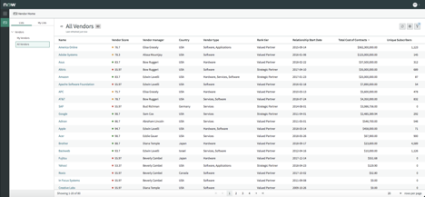
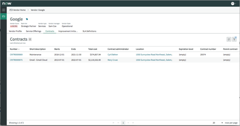
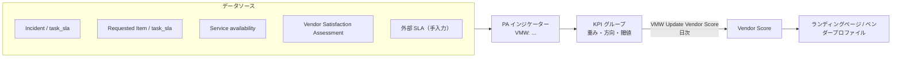
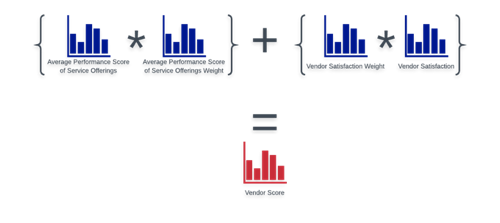
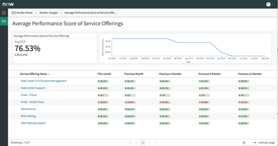
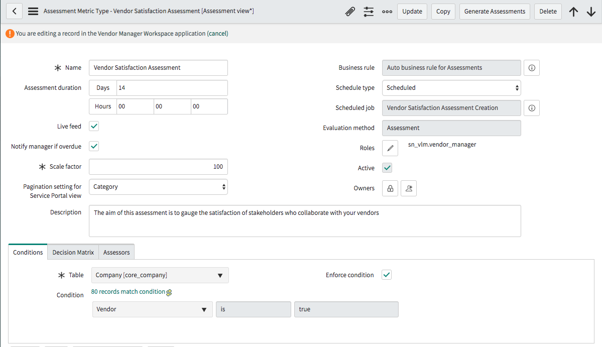
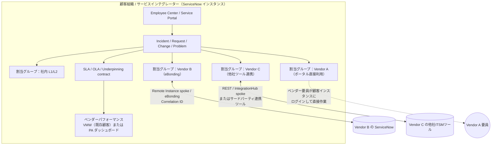

# Vendor Manager Workspace / Service Owner Workspace とマルチソーシング（SIAM）

## 概要

本ファイルは、ServiceNow ITSM で「外部ベンダーをどう管理し、複数ベンダーが関わるサービスをどう運用するか」に関わる 3 つのテーマを扱う。

1. **Vendor Management Workspace（ベンダー管理ワークスペース、旧称 Vendor Manager Workspace、プラグイン `sn_itsm_vendor`）** … ITSM Pro に含まれてきた、ベンダーのパフォーマンス（Vendor Score）・契約・SLA・改善施策・サービスクレジットを一元管理するワークスペース。**Australia リリースで非推奨（deprecated）となり、新規顧客は有効化できない**。
2. **Service Owner Workspace（サービスオーナーワークスペース）** … サービスオーナー／ポートフォリオオーナー向けに、サービスオファリングのパフォーマンススコア・可用性・SLA 違反・CSAT 等を表示する読み取り専用ワークスペース。**San Diego 以降 planned deprecation、後継は Digital Portfolio Management（DPM）**。
3. **マルチソーシング / SIAM（Service Integration and Management、サービス統合管理）** … 複数ベンダーが関わる IT 運用を ServiceNow 上でどう設計するか（ベンダー別割当グループ、ベンダー SLA = Underpinning contract、eBonding、ドメイン分離との使い分け）。

**結論の先出し（Australia 基準）:**

| 論点 | Australia 時点の状況 | 根拠 |
|---|---|---|
| ITSM の Vendor Management Workspace（`sn_itsm_vendor`） | Australia で非推奨。新規顧客には非表示・有効化不可。既存顧客は継続利用 | 公式（TPRM ドキュメント、Zurich 版 VMW ドキュメント） |
| GRC: Vendor Management Workspace（`sn_vrm_ws`） | Third-party Risk Management（TPRM）に含まれる**別アプリ**で、非推奨の影響を受けない | 公式 |
| ITSM VMW の公式な後継製品 | Australia 版 TPRM ドキュメントが「新規顧客は TPRM に含まれる GRC: Vendor Management Workspace（`sn_vrm_ws`）を使うべき」と明記。ただしベンダースコア・KPI グループ・サービスクレジット等の機能対応表は公開されておらず、機能的に同等かは未確認 | 公式（TPRM ドキュメント） |
| Service Owner Workspace | San Diego 以降 planned deprecation。新規顧客は有効化不可。後継は DPM | 公式＋ServiceNow 社員の Community 回答 |
| SIAM 専用アプリ | ServiceNow に「SIAM」という名称の単独製品は公開情報では確認できず。ITSM 標準機能（割当グループ、SLA 定義、会社レコード）、IntegrationHub（eBonding / Remote Instance spoke）、ドメイン分離を組み合わせて設計する | 公式部品＋【経験則】 |

> **ITSM 概要との関係:** [ITSM 概要とパッケージ](itsm-overview.md) では Vendor Management Workspace と Service Owner Workspace を ITSM Pro の構成要素として 1 行で記載している。本ファイルはその詳細版である。サービスポートフォリオ・Service Owner Workspace の周辺（DPM、Service Builder、Service Commitment）は [ITSMにおけるサービスレベル管理とサービスポートフォリオ](service-level-management-itsm.md) を併せて参照。

---

## 1. 用語と製品名の変遷

ServiceNow のベンダー管理関連機能は名称とプラグインが何度か変わっており、資料を読む際に混同しやすい。

| 時期 | 名称 | プラグイン / スコープ | 備考 | 出典 |
|---|---|---|---|---|
| Dublin（2013） | Vendor performance management 機能 | — | Community 記事が「Dublin で vendor performance management 機能が導入され、SIAM 提供を差別化する」と記載 | [出典](https://www.servicenow.com/community/in-other-news/siam-more-than-just-the-latest-it-acronym/ba-p/2273207) |
| New York（2019） | Vendor Manager Workspace（新アプリ） | `com.snc.vlm.vmw`（後に Legacy 扱い） | ServiceNow 社員の Community ブログで「New York の新アプリ」と紹介 | [出典](https://www.servicenow.com/community/itsm-blog/what-is-vendor-manager-workspace/ba-p/2294239) |
| San Diego（2022） | Vendor Manager Workspace (Legacy) | `com.snc.vlm.vmw` | 「San Diego で deprecation 予定」とストアのリリースノートに記載 | [出典](https://www.servicenow.com/docs/r/C17ZqvSaMwUVpMBg8Nc5sg/VG48Tydvmm9r0tlmCjKXaA) |
| ストアアプリ v1.0.6 以降 | **Vendor Management Workspace** | `com.snc.sn_itsm_vendor`（スコープ `sn_itsm_vendor`） | 「app-itsm-vendor は Vendor Management Workspace に改名され `com.snc.sn_itsm_vendor` プラグインを使う」 | [出典](https://www.servicenow.com/docs/r/C17ZqvSaMwUVpMBg8Nc5sg/VG48Tydvmm9r0tlmCjKXaA) |
| Xanadu | Vendor Success Indicators（`com.snc.vendor.insights`）が非推奨準備 | — | 新規インスタンスにはインストールされない | [出典](https://www.servicenow.com/docs/r/Cz0Un5C85RB3j2nhhAK1aQ/SdY46nsZbdSzqgdFsKgmVg) |
| Yokohama | PA Content Pack、UI Components、Demo Data、Service Credits、Vendor Management Mobile が非推奨準備 | — | 非表示化・新規有効化不可・既存はサポート継続 | [出典](https://www.servicenow.com/docs/r/PbLI49fkISDFEQlMw_00Gg/V6CHXwhfdO1ugxeQCJ8uOw) |
| **Australia（2026-05）** | **Vendor Management Workspace for ITSM（`sn_itsm_vendor`）が非推奨** | — | 新規顧客には非表示・有効化不可 | [出典](https://www.servicenow.com/docs/r/Z61H6JNUJXKe8NNPQzK7MQ/XT_s4OKsgYe7JgCQWxggiw) |
| 並行して存在 | **GRC: Vendor Management Workspace** | `sn_vrm_ws` | Third-party Risk Management（旧 Vendor Risk Management）に含まれる別アプリ。非推奨の影響なし | [出典](https://www.servicenow.com/docs/r/Z61H6JNUJXKe8NNPQzK7MQ/XT_s4OKsgYe7JgCQWxggiw) |

> **注意（名称の衝突）:** Australia 以降の公式ドキュメントで単に「Vendor Management Workspace」と書かれている場合、TPRM のドキュメント内では **GRC: Vendor Management Workspace（`sn_vrm_ws`）** を指す、と明記されている。ITSM の `sn_itsm_vendor` とは別物である。[出典](https://www.servicenow.com/docs/r/Z61H6JNUJXKe8NNPQzK7MQ/XT_s4OKsgYe7JgCQWxggiw)

> **注意（`sn_vrm_ws` の表記ゆれ）:** 同じ `sn_vrm_ws` プラグインが、Zurich 版 VMW ドキュメント（有効化ページ）では「GRC: Vendor Risk Management Workspace」、Australia 版 TPRM ドキュメントでは「GRC: Vendor Management Workspace」と表記されている（同一プラグイン）。[出典](https://www.servicenow.com/docs/r/MlbQAgTiiiMOLOw9T36wJg/1U7PSMG8N107YKi~hYjfmA) [出典](https://www.servicenow.com/docs/r/Z61H6JNUJXKe8NNPQzK7MQ/XT_s4OKsgYe7JgCQWxggiw)

---

## 2. Vendor Management Workspace（ITSM、`sn_itsm_vendor`）

### 2.1 位置づけと目的

Vendor Management Workspace（ベンダー管理ワークスペース）は、ITSM のアプリケーションで、ベンダーのパフォーマンスを監視し、ベンダー関連情報を一か所で管理するためのワークスペースである。KPI（Key Performance Indicator、重要業績評価指標）を構成してベンダーメトリクスを作り、ベンダーのパフォーマンスを評価する。Zurich 版ドキュメントが挙げる主な機能は次のとおり。[出典](https://www.servicenow.com/docs/r/MlbQAgTiiiMOLOw9T36wJg/pizyEOYnhV0Y4PXDidJ_LA)

| 機能 | 内容 |
|---|---|
| 一元ダッシュボード | ベンダーの目標を追跡し、注意が必要な領域を把握 |
| 構成可能な KPI | KPI を定義しベンダーメトリクス化（KPI グループ） |
| 高業績ベンダーとの比較 | ベンダーの特性を高業績ベンダーと比較（Success Indicators） |
| 補償（サービスクレジット）の追跡 | ベンダーがサービス合意に違反した際の補償を追跡 |
| 他アプリとの連携 | Service Portfolio Management（SPM）、Contract Management、Assets、SLA、Vendor Risk Management、Continual Improvement Management（CIM）などからデータを取得 |

New York 時点の ServiceNow 社員の解説では、スプレッドシートやメモ、SharePoint などに散在していたベンダー情報と手作業のパフォーマンス算出を、プラットフォーム上のデータ（サービス、インシデント、SLA、障害）で置き換えることが狙いとされている。[出典](https://www.servicenow.com/community/itsm-blog/what-is-vendor-manager-workspace/ba-p/2294239)

### 2.2 ライセンス（含まれるパッケージ）

- Zurich 版ドキュメント：「The Vendor Manager Workspace (sn_itsm_vendor) plugin is available with the ITSM Pro subscription package.」[出典](https://www.servicenow.com/docs/r/MlbQAgTiiiMOLOw9T36wJg/1U7PSMG8N107YKi~hYjfmA)
- ストアのリリースノート：「The Vendor Management Workspace (com.snc.sn_itsm_vendor) plugin is available as a separate subscription.」とも書かれており、時期によって表現が異なる。[出典](https://www.servicenow.com/docs/r/C17ZqvSaMwUVpMBg8Nc5sg/VG48Tydvmm9r0tlmCjKXaA)
- 2019 年の Community 回答では ITSM Professional の追加 6 アプリの 1 つとして Vendor Manager Workspace が挙げられている（[ITSM 概要とパッケージ](itsm-overview.md) 参照）。
- エディション比較の詳細は [エディション比較](../../03_導入編/03-edition-comparison.md)、[ITSM Pro/Enterprise 固有機能](itsm-pro-features.md) を参照。

### 2.3 Australia での非推奨化（最重要）

| 項目 | 内容 | 出典 |
|---|---|---|
| 公式記載（Australia 版 TPRM ドキュメント） | 「The Vendor Management Workspace for ITSM (sn_itsm_vendor) is deprecated as of the Australia release.」新規顧客には非表示で有効化できない | [出典](https://www.servicenow.com/docs/r/Z61H6JNUJXKe8NNPQzK7MQ/XT_s4OKsgYe7JgCQWxggiw) |
| Zurich 版 VMW ドキュメントの予告 | 「Australia リリースから、ワークスペースは非表示になり新規顧客は有効化できない。詳細は KB0867184」 | [出典](https://www.servicenow.com/docs/r/MlbQAgTiiiMOLOw9T36wJg/pizyEOYnhV0Y4PXDidJ_LA) |
| 既存顧客 | 非推奨プロセス（KB0867184）の一般則では、非表示化後も既存顧客はサポート継続。Yokohama で非推奨準備となった各コンポーネントも「hidden ... but will continue to be supported」と記載 | [出典](https://www.servicenow.com/docs/r/MlbQAgTiiiMOLOw9T36wJg/1U7PSMG8N107YKi~hYjfmA) |
| Xanadu→Australia 統合リリースノート | Zurich・Australia のセクションは「No updates for this release」。**ただし統合リリースノートは Australia の Deprecations にも ITSM VMW の非推奨を記載しておらず、TPRM ドキュメントの記載と食い違う**（公式情報源間の不一致）。また Yokohama セクションも「更新なし」としながら Deprecations 行に 5 項目を挙げており、内部的にも不整合がある | [出典](https://www.servicenow.com/docs/r/Cz0Un5C85RB3j2nhhAK1aQ/SdY46nsZbdSzqgdFsKgmVg) |
| 公式な後継製品 | Australia 版 TPRM ドキュメントの Important Considerations：「The Vendor Management Workspace for ITSM has been deprecated as of the Australia release」「new customers should use the GRC: Vendor Management Workspace included with TPRM.」ただし ITSM VMW の機能（ベンダースコア、KPI グループ、サービスクレジット等）から GRC 側への機能対応表・移行手順は公開されておらず、機能的同等性は未確認 | [出典](https://www.servicenow.com/docs/r/Z61H6JNUJXKe8NNPQzK7MQ/XT_s4OKsgYe7JgCQWxggiw) |

> **補足（Community）:** Community では「Yokohama のリリースノートに no replacement と書かれている」との投稿があるが、ServiceNow 社員の回答はなく、アカウントマネージャーに問い合わせるよう勧める返信のみ（2026-09 時点で未解決）。上記の Australia 版 TPRM ドキュメントの案内とは食い違う。【第三者情報】[出典](https://www.servicenow.com/community/itsm-forum/vendor-management-workspace-deprecation/m-p/3389714)

> **Brazil での変更:** Brazil 版の TPRM ランディングページ（2026-09-10 更新）も「Vendor Management Workspace for ITSM (sn_itsm_vendor) is deprecated as of the Australia release」と同じ記載を維持している（「新規顧客は GRC: Vendor Management Workspace を使うべき」の一文は Brazil 版ランディングページでは確認できず）。Brazil で ITSM VMW が復活・置換されたという情報は公開情報では確認できず。[出典](https://www.servicenow.com/docs/r/governance-risk-compliance/third-party-risk-management/third-party-risk-mgt-landing-page.html)

**新規導入での示唆:** Australia 以降に ITSM Pro を新規契約する顧客は ITSM VMW を有効化できない。(a) 公式の案内先は TPRM に含まれる GRC: Vendor Management Workspace（`sn_vrm_ws`。リスク・デューデリジェンス・契約遵守の監視が中心）である（公式 [出典](https://www.servicenow.com/docs/r/Z61H6JNUJXKe8NNPQzK7MQ/XT_s4OKsgYe7JgCQWxggiw)）。ただし TPRM は IRM 系の別ライセンスであり、ITSM VMW の運用パフォーマンス指標（SLA 達成率・可用性等から自動算出するベンダースコア）を同等にカバーするかは未確認のため、(b) Performance Analytics / Platform Analytics の自作ダッシュボード、(c) SLA 定義（Underpinning contract）＋レポート、(d) Source-to-Pay / Supplier 系アプリ、を補完的に組み合わせることになる【推定】。

### 2.4 プラグインと有効化

| 項目 | 内容 | 出典 |
|---|---|---|
| メインプラグイン | Vendor Management Workspace（`sn_itsm_vendor` / `com.snc.sn_itsm_vendor`）。ServiceNow Store プラグインで、ストアから別途インストール | [出典](https://www.servicenow.com/docs/r/MlbQAgTiiiMOLOw9T36wJg/1U7PSMG8N107YKi~hYjfmA) |
| 必要ロール | `admin`。ドメイン分離＋委任管理が有効な場合、admin は global ドメインに所属している必要がある | [出典](https://www.servicenow.com/docs/r/MlbQAgTiiiMOLOw9T36wJg/1U7PSMG8N107YKi~hYjfmA) |
| 手順 | System Applications > All Available Applications でプラグイン名または ID を検索し Install | 同上 |
| 依存して有効化されるプラグイン | Performance Analytics Premium for Service Management、Continual Improvement Management | 同上 |
| 任意：Vendor Risk Management 連携 | Vendor Risk Management（`app-vendor-risk-management`）プラグイン | 同上 |
| 任意：Vendor Risk Workspace 表示 | GRC: Vendor Risk Management Workspace（`sn_vrm_ws`。Australia 版 TPRM ドキュメントでは「GRC: Vendor Management Workspace」と表記、同一プラグイン）をストアから有効化すると VMW 内で表示可能 | 同上 |
| Vendor Success Indicators | 別途ストアからインストール。2024-08-01 以降は新規顧客は有効化不可（既存は動作継続）。Xanadu 以降、プラグイン `com.snc.vendor.insights` は新規インスタンスにはインストールされない | [出典](https://www.servicenow.com/docs/r/MlbQAgTiiiMOLOw9T36wJg/1U7PSMG8N107YKi~hYjfmA) / [出典](https://www.servicenow.com/docs/r/Cz0Un5C85RB3j2nhhAK1aQ/SdY46nsZbdSzqgdFsKgmVg) |
| Vendor Management Mobile | 非推奨準備（非表示・有効化不可・サポート継続） | [出典](https://www.servicenow.com/docs/r/MlbQAgTiiiMOLOw9T36wJg/1U7PSMG8N107YKi~hYjfmA) |
| 旧プラグイン | Vendor Manager Workspace (Legacy)（`com.snc.vlm.vmw`）。San Diego で非推奨予定 | [出典](https://www.servicenow.com/docs/r/C17ZqvSaMwUVpMBg8Nc5sg/VG48Tydvmm9r0tlmCjKXaA) |

**Yokohama で非推奨準備になったコンポーネント（一覧）:** [出典](https://www.servicenow.com/docs/r/PbLI49fkISDFEQlMw_00Gg/V6CHXwhfdO1ugxeQCJ8uOw)

| コンポーネント |
|---|
| Performance Analytics Content Pack - Vendor Management Workspace |
| Vendor Management Workspace UI Components |
| Vendor Manager Workspace Demo Data |
| Service Credits |
| Vendor Management Mobile |

### 2.5 ロール

`sn_itsm_vendor` プラグインが導入するロールは次の 2 つ（Yokohama・Zurich 版で同一）。[出典](https://www.servicenow.com/docs/r/MlbQAgTiiiMOLOw9T36wJg/idjulVv~ScskcsdRMDCB9Q) [出典](https://www.servicenow.com/docs/r/Mr7qUatbFXax1_h~z60rmA/_AbHb04x3t0D24k7FJTe0A)

| ロール | 表示名 | 説明 | 含むロール |
|---|---|---|---|
| `sn_vlm.vendor_admin` | Vendor admin（ベンダー管理者） | Vendor Management Workspace でベンダータイプと KPI グループを作成・編集・削除できる | `sn_vlm.vendor_manager` |
| `sn_vlm.vendor_manager` | Vendor Manager（ベンダーマネージャー） | Vendor Management Workspace でベンダーを閲覧・管理する。ワークスペースのベンダーパフォーマンスメトリクスを構成する | `pa_viewer`、`service_viewer`、`service_credit_mgr` |

**タスク別に必要なロール（ドキュメント記載分）:**

| 操作 | 必要ロール | 出典 |
|---|---|---|
| ベンダーの新規作成 | `sn_vlm.vendor_admin` または `sn_vlm.vendor_manager`（手順本文では「administrators navigate to ... and click New」、編集は vendor manager） | [出典](https://www.servicenow.com/docs/r/MlbQAgTiiiMOLOw9T36wJg/dTCakMLw5SNS1Y2RZl6nAQ) |
| KPI グループの作成 | `sn_vlm.vendor_admin` | [出典](https://www.servicenow.com/docs/r/MlbQAgTiiiMOLOw9T36wJg/R757QNWIOquf94vs7vBrhw) |
| ベンダースコア KPI のターゲット（全員向け） | `pa_target_admin` ＋ `sn_vlm.vendor_manager` | [出典](https://www.servicenow.com/docs/r/MlbQAgTiiiMOLOw9T36wJg/Yl_4QfFiw8eKQ3pqrf558A) |
| ベンダースコア KPI のターゲット（個人向け） | `sn_vlm.vendor_manager` | 同上 |
| ベンダー契約の作成・関連付け | `sn_vlm.vendor_manager` | [出典](https://www.servicenow.com/docs/r/MlbQAgTiiiMOLOw9T36wJg/we85I~sPNvVUGtNGohQZWA) |
| ベンダー SLA とサービスコミットメントの関連付け | `sn_vlm.vendor_manager` ＋ `sla_manager` | [出典](https://www.servicenow.com/docs/r/MlbQAgTiiiMOLOw9T36wJg/AHrfw1x7gi5aBKpuQc14BA) |
| サービスクレジットの作成 | `sn_vlm.vendor_manager`（レポート閲覧には `sn_incident_read` も必要） | [出典](https://www.servicenow.com/docs/r/MlbQAgTiiiMOLOw9T36wJg/Hdye5Mew1_wToBv9IfN09w) |
| Success Indicators（高業績ベンダー比較） | `sn_vlm.vendor_manager` | [出典](https://www.servicenow.com/docs/r/MlbQAgTiiiMOLOw9T36wJg/CsWAGGarA0EzktMOhH6CDQ) |
| ランディングページで購入カタログアイテムのレポートを見る | `sc_req_item` の ACL が有効であること | [出典](https://www.servicenow.com/docs/r/MlbQAgTiiiMOLOw9T36wJg/xJka6bgjykPPgfz6QLb31g) |
| ワークスペースのページカスタマイズ | UI Builder 管理者（UI Builder のセキュリティロール） | [出典](https://www.servicenow.com/docs/r/MlbQAgTiiiMOLOw9T36wJg/nV5gFkWwaxoUAVi9TN0~Vw) |

ペルソナ別の役割分担（Zurich 版 Exploring ページ）：[出典](https://www.servicenow.com/docs/r/MlbQAgTiiiMOLOw9T36wJg/nV5gFkWwaxoUAVi9TN0~Vw)

- **Administrator** … `sn_itsm_vendor` プラグインを有効化。
- **Vendor admin** … ベンダー追加、ベンダーメトリクス設定、KPI グループ作成、他アプリとの連携。
- **Vendor manager** … ベンダーの健全性評価、KPI グループのデータ分析、サービスクレジット・ベンダーチケットの作成、SLA 監視。
- **UI Builder admin** … UI Builder でワークスペースをカスタマイズ。

### 2.6 テーブル

| テーブル | 説明 | 確度・出典 |
|---|---|---|
| `core_company`（Company） | ベンダー自体のレコード。Company フォームの **Vendor** チェックボックス（既定で選択）が「この会社をベンダーとして認識する」フラグ。KPI グループ別ベンダー数のドーナツチャートもこのテーブルから集計 | 公式 [出典](https://www.servicenow.com/docs/r/MlbQAgTiiiMOLOw9T36wJg/dTCakMLw5SNS1Y2RZl6nAQ) [出典](https://www.servicenow.com/docs/r/MlbQAgTiiiMOLOw9T36wJg/xJka6bgjykPPgfz6QLb31g) |
| `sn_itsm_vendor_kpi_group_m2m_vendor`（KPI Vendors） | KPI（KPI グループ）とベンダーの関係を保持 | 公式（プラグイン導入コンポーネント） [出典](https://www.servicenow.com/docs/r/MlbQAgTiiiMOLOw9T36wJg/idjulVv~ScskcsdRMDCB9Q) |
| `ast_contract`（Contract） | ベンダー契約。ランディングページの「New contracts」「Contracts ending」タイルの集計元 | 公式 [出典](https://www.servicenow.com/docs/r/MlbQAgTiiiMOLOw9T36wJg/xJka6bgjykPPgfz6QLb31g) |
| `sn_cim_register`（Improvement Initiative） | ベンダーに関する継続的改善施策。「Improvement initiatives」タイルの集計元 | 公式 同上 |
| `contract_sla`（SLA Definition） | ベンダー SLA（Underpinning contract）の定義。`vendor` フィールドが `core_company` を参照 | 公式（SDK の SLA API） [出典](https://www.servicenow.com/docs/r/ja-JP/application-development/servicenow-sdk/fluent-sla-api.html) |
| `service_offering_metric_data` | Utah で非推奨化されたレガシーのメトリクスデータテーブル（旧インジケーター 4 種とともに非推奨） | 公式 [出典](https://www.servicenow.com/docs/r/MlbQAgTiiiMOLOw9T36wJg/oX8ShWuykF4ZiEVrJd2vlA) |
| KPI グループ本体、KPI、KPI Group Thresholds、Service Credit のテーブル名 | 公開情報では確認できず（ドキュメントは関連リスト名・フォーム名のみ記載） | — |

### 2.7 システムプロパティとスケジュールジョブ

**システムプロパティ**（Vendor Management > Configuration > Vendor Properties で設定）：[出典](https://www.servicenow.com/docs/r/MlbQAgTiiiMOLOw9T36wJg/idjulVv~ScskcsdRMDCB9Q)

| プロパティ | 説明 | 型 | 既定値 |
|---|---|---|---|
| `sn_itsm_vendor.enable.po.vm` | Vendor Management Workspace と Process Mining（Process Optimization）の連携を有効化 | true / false | false |
| `sn_itsm_vendor.po_mining.run_frequency` | 未マイニングのプロジェクトを再マイニングする期間（日） | Integer | 7 |

**スケジュールジョブ:**

| ジョブ | 頻度 | 内容 | 出典 |
|---|---|---|---|
| VMW Update Vendor Score | 日次（オンデマンド実行可） | ベンダースコアを更新 | [出典](https://www.servicenow.com/docs/r/MlbQAgTiiiMOLOw9T36wJg/oX8ShWuykF4ZiEVrJd2vlA) |
| VMW Update Vendor Profile | 月次（オンデマンド実行可） | 全ベンダーのプロファイルを更新 | 同上 |
| Process Mining - VM Remine Projects | 日次 | ベンダーの追加・削除時にプロジェクトを更新し、`run_frequency` 期間内にマイニングされていないプロジェクトを取得 | [出典](https://www.servicenow.com/docs/r/MlbQAgTiiiMOLOw9T36wJg/idjulVv~ScskcsdRMDCB9Q) |
| Vendor Satisfaction Assessment Creation | Assessment Metric Type のスケジュールに従う | ベンダー満足度アセスメントを生成（下記画像参照） | Community 画像 [出典](https://www.servicenow.com/community/itsm-blog/what-is-vendor-manager-workspace/ba-p/2294239) |

### 2.8 メニューとナビゲーション

| 目的 | パス | 出典 |
|---|---|---|
| ワークスペースを開く | All > Workspaces > Vendor Management Workspace（または All > Vendor Management > Workspace） | [出典](https://www.servicenow.com/docs/r/MlbQAgTiiiMOLOw9T36wJg/we85I~sPNvVUGtNGohQZWA) [出典](https://www.servicenow.com/docs/r/MlbQAgTiiiMOLOw9T36wJg/Hdye5Mew1_wToBv9IfN09w) |
| ベンダー一覧（クラシック） | Vendor Management > All Vendors | [出典](https://www.servicenow.com/docs/r/MlbQAgTiiiMOLOw9T36wJg/dTCakMLw5SNS1Y2RZl6nAQ) |
| KPI グループ | Vendor Management > Configuration > KPI Groups | [出典](https://www.servicenow.com/docs/r/MlbQAgTiiiMOLOw9T36wJg/R757QNWIOquf94vs7vBrhw) |
| プロパティ | Vendor Management > Configuration > Vendor Properties | [出典](https://www.servicenow.com/docs/r/MlbQAgTiiiMOLOw9T36wJg/idjulVv~ScskcsdRMDCB9Q) |
| ワークスペース内リスト | List アイコン > Contracts > All Vendor Contracts / My Vendor Contracts | [出典](https://www.servicenow.com/docs/r/MlbQAgTiiiMOLOw9T36wJg/we85I~sPNvVUGtNGohQZWA) |
| ワークスペース内リスト | List アイコン > Service Levels > All Vendor SLAs / My Vendor SLAs | [出典](https://www.servicenow.com/docs/r/MlbQAgTiiiMOLOw9T36wJg/AHrfw1x7gi5aBKpuQc14BA) |
| パフォーマンス（ターゲット設定） | Vendor Management Workspace > Performance アイコン | [出典](https://www.servicenow.com/docs/r/MlbQAgTiiiMOLOw9T36wJg/Yl_4QfFiw8eKQ3pqrf558A) |
| サービスクレジット作成 | All > Vendor Management > Workspace > Vendor Home アイコンから、(1) Lists > All Vendors > ベンダーを選択 > Service Credit タブ、または (2) Lists > Incident / Outage / Service availability のリスト > レコードを選択 > オーバーフローアイコン > Create Service Credit。Company フォームの関連リンク「Create Service Credit」もある（§2.10） | [出典](https://www.servicenow.com/docs/r/MlbQAgTiiiMOLOw9T36wJg/Hdye5Mew1_wToBv9IfN09w)（ワークスペース手順） [出典](https://www.servicenow.com/docs/r/MlbQAgTiiiMOLOw9T36wJg/dTCakMLw5SNS1Y2RZl6nAQ)（関連リンク） |
| Success Indicators | ベンダーを選択 > Success Indicators アイコン | [出典](https://www.servicenow.com/docs/r/MlbQAgTiiiMOLOw9T36wJg/CsWAGGarA0EzktMOhH6CDQ) |

### 2.9 ランディングページ

Vendor Management Workspace のランディングページは、ベンダーマネージャーがベンダーのパフォーマンス・契約状況・改善施策をほぼリアルタイムに監視するための一元ビューである（Zurich 版）。[出典](https://www.servicenow.com/docs/r/MlbQAgTiiiMOLOw9T36wJg/xJka6bgjykPPgfz6QLb31g)

| 要素 | 種類 | 内容 | データソース |
|---|---|---|---|
| New contracts | Single score | 過去 30 日に作成された契約数 | `ast_contract` |
| Contracts ending | Single score | 今後 90 日に終了する契約数 | `ast_contract` |
| Improvement initiatives | Single score | ベンダーに関するアクティブな継続的改善施策の数 | `sn_cim_register` |
| Vendors by KPI group | Donut | KPI グループ別のベンダー数 | `core_company` |
| Vendor score | インジケーター | 過去 90 日のベンダーのパフォーマンス | PA |
| Vendor satisfaction | インジケーター | ベンダーと協働するステークホルダーの満足度 | アセスメント |
| Vendor success characteristics | インジケーター | ベンダー成功に寄与する上位 5 インジケーターと、それに対するベンダーのランキング | Success Indicators |

インジケーターはベンダー別にブレークダウンされ、可視化を選択するとドリルダウン分析に移る。ランディングページは Next Experience の UI Builder で複製・変更できる。

### 2.10 ベンダーレコード（Company フォーム）

ベンダーは `core_company` のレコードとして管理され、Vendor Management Workspace では Company フォームを拡張した項目・関連リストが表示される。[出典](https://www.servicenow.com/docs/r/MlbQAgTiiiMOLOw9T36wJg/dTCakMLw5SNS1Y2RZl6nAQ)（ベンダー管理タスク全体の一覧は Managing vendors using Vendor Management Workspace を参照 [出典](https://www.servicenow.com/docs/r/MlbQAgTiiiMOLOw9T36wJg/oUJHNn9WJZpopcDz~QU9vQ)）

| セクション | フィールド |
|---|---|
| メイン | Name、Vendor state（ベンダー状態）、Website、Rank tier（ランク階層）、Vendor manager（ベンダーマネージャー）、Business owner（ビジネスオーナー）、Parent、Notes |
| General タブ | Vendor type（ベンダータイプ。例：service、hardware、software）、Vendor（ベンダーフラグ、既定で選択）、Manufacturer、Number of employees、Relationship start date（取引開始日）、Banner image、Banner text、Unique subscribers |
| Location タブ | Street、City、State / Province、Zip / Postal code、Country、Phone、Fax phone、Latitude、Longitude |
| Financial タブ | Publicly traded、Stock symbol、Stock price、Total Cost of Contracts（契約総額）、Revenue per year、Market cap、Profit、Fiscal year |

**関連リンク / 関連リスト:** Create Service Credit、See Vendor's Profile、Companies、Service Offerings、Service Commitment for Vendor、Improvement Initiatives、Service Credits、Contracts、SLA Definitions、Vendor Catalog Items、Vendor Stakeholders、Product Models、Assets。

この関連リスト構成から、ベンダーは **サービスオファリング（SPM）・サービスコミットメント・SLA 定義・契約・資産・カタログアイテム**のハブとして位置づけられていることが分かる。

**キャプション:** Vendor Manager Workspace の「All Vendors」リスト画面（New York リリース時点の画面）。

**画面説明:** 左側のナビゲーションに「Vendors」グループがあり、「My Vendors」「All Vendors」のリストを選べる。中央のリストの列は Name、Vendor Score（色付きの状態アイコン付き数値）、Vendor manager、Country、Vendor type（Software / Hardware / Services など）、Rank tier（Valued Partner / Strategic Partner など）、Relationship Start Date、Total Cost of Contracts、Unique Subscribers。Australia の UI とは見た目が異なる可能性がある。

**出典:** https://www.servicenow.com/community/itsm-blog/what-is-vendor-manager-workspace/ba-p/2294239 （取得日 2026-11-08）

**キャプション:** ベンダー（例：Google）のプロファイル画面の Contracts タブ（New York リリース時点）。

**画面説明:** パンくずは「Vendor Home > Vendor: Google」。ヘッダーにベンダー名、Vendor Score、Rank tier（Strategic Partner）、Vendor type（Services）、Vendor manager、Vendor state（Operational）が並ぶ。タブは Vendor Profile、Service Offerings、Contracts、Improvement Initiatives、SLA Definitions。Contracts タブには契約番号（CNTR...）、Short description、Starts、Ends、Total cost、Contract administrator、Location、Expiration level、Contract number、Parent contract の列がある。

**出典:** https://www.servicenow.com/community/itsm-blog/what-is-vendor-manager-workspace/ba-p/2294239 （取得日 2026-11-08）

### 2.11 Vendor KPI Group とベンダースコア

#### 2.11.1 KPI グループの構造

Vendor KPI Group（ベンダー KPI グループ）は、ベンダーの種類ごとに評価指標（PA インジケーター）・重み・閾値をまとめたものである。各グループは関連リストとして **KPIs**、**KPI group thresholds**、**Vendors** を持つ。[出典](https://www.servicenow.com/docs/r/MlbQAgTiiiMOLOw9T36wJg/oX8ShWuykF4ZiEVrJd2vlA)

KPI グループの作成（`sn_vlm.vendor_admin`、Vendor Management > Configuration > KPI Groups）：[出典](https://www.servicenow.com/docs/r/MlbQAgTiiiMOLOw9T36wJg/R757QNWIOquf94vs7vBrhw)

| 対象 | フィールド | 説明 |
|---|---|---|
| KPI グループ | Name | グループ名 |
| KPI グループ | Type | 「Vendors」を選択 |
| KPI（グループ内） | Indicator / Indicator display name | PA インジケーターと表示名 |
| KPI | Weight | 重み。グループ内の合計は 100 |
| KPI | Order | Vendor Score Metrics ウィジェットでの表示順 |
| KPI | Lower Threshold / Upper Threshold | KPI の下限・上限閾値 |
| KPI Group Threshold | Lower Threshold / Upper Threshold | ステータス判定の範囲 |
| KPI Group Threshold | Order | 閾値セットごとに一意な番号 |
| KPI Group Threshold | Status | critical / positive / warning |

手順の流れ：グループ作成（既存グループのコピーも可）→ KPIs 関連リストで KPI 追加 → KPI Group Thresholds で閾値追加 → Vendors 関連リストの Edit でベンダーを割り当て。

#### 2.11.2 既定の KPI グループ（Zurich 版）

[出典](https://www.servicenow.com/docs/r/MlbQAgTiiiMOLOw9T36wJg/oX8ShWuykF4ZiEVrJd2vlA)

| KPI グループ | 含まれる KPI（単位） |
|---|---|
| IT Services | VMW: Average Customer Satisfaction（Number）、Vendor Satisfaction（Percentage）、VMW: Average SLA Achievement（Number）、VMW: Average Availability（Percentage）、VMW: Average Request Activity（Number）、Total Incidents Created（Number） |
| Vendor Fulfillment | VMW: Average Customer Satisfaction（Number）、Vendor Satisfaction（Percentage）、VMW: Average Incident SLA Achievement（Percentage）、Average Request Fulfillment SLA Achievement（Percentage）、Total Incidents Created（Number）、VMW: Average Request Activity（Number） |
| Software | Vendor Satisfaction（Percentage）、Vendor Requested Items（Number）、Manual SLA from External Source（Percentage） |
| Hardware | Software と同じ 3 インジケーター |

- ストアのリリースノート（v3.4.2）：「Legacy indicators have been replaced with the current set of indicators based on the new tables with a 'VMW:' prefix.」[出典](https://www.servicenow.com/docs/r/C17ZqvSaMwUVpMBg8Nc5sg/VG48Tydvmm9r0tlmCjKXaA)
- Utah で `service_offering_metric_data` テーブルと、旧インジケーター 4 種（Average SLA Achievement、Average Customer Satisfaction、Average Availability、Average Request Activity）が非推奨化された。[出典](https://www.servicenow.com/docs/r/MlbQAgTiiiMOLOw9T36wJg/oX8ShWuykF4ZiEVrJd2vlA)
- 「Manual SLA from External Source」は、ベンダー側システムで計測された SLA 達成率を手入力で取り込む想定のインジケーターと読める【推定】。

#### 2.11.3 ベンダースコアの計算

Vendor Score（ベンダースコア）インジケーターは、各 KPI グループの KPI を使って自動計算される。[出典](https://www.servicenow.com/docs/r/MlbQAgTiiiMOLOw9T36wJg/oX8ShWuykF4ZiEVrJd2vlA)

- **単位が Percentage のインジケーターのみ**がスコア計算に使われる。
- 既定でスコアに使われるのは Average Request Fulfillment SLA Achievement、VMW: Average Availability、Average Incident SLA Achievement、Manual SLA from External Source の 4 インジケーター。
- 各インジケーターの寄与 = 重み × KPI スコア。寄与を合計したものがベンダースコア。
- 方向（direction）が **Minimize** のインジケーターは KPI スコアの補数を使う。例：(100 − 88.5) × 0.25 = 2.875%。
- ドキュメントの計算例（すべて Maximize）：

| インジケーター | 重み | KPI スコア | 寄与 |
|---|---|---|---|
| Vendor Satisfaction | 10% | 54.42% | 5.442% |
| VMW: Average Customer Satisfaction | 55% | 83% | 45.65% |
| VMW: Average Availability | 25% | 88.5% | 22.125% |
| VMW: Average SLA Achievement | 10% | 100% | 10.00% |
| **合計** | | | **83.217%（83.22% と表示）** |

- Average Availability と Average SLA Achievement を **Minimize** にした場合の計算例：5.442% + 45.65% + 2.875% + 0%（(100 − 100) × 0.10）= **53.967%**。
- **注意（公式ドキュメントの不整合）:** 上の計算例には、§2.11.2 の既定 KPI グループで単位 Number とされている VMW: Average Customer Satisfaction と VMW: Average SLA Achievement が含まれており、「Percentage 単位のインジケーターのみ使用」という記述と矛盾する。実際の算出対象は実インスタンスで確認すること。
- ヘッダーの色は KPI グループの閾値で決まる。
- フォーミュラインジケーターでスコア算出を調整できる、とされる（Yokohama/Xanadu 版の記載）。[出典](https://www.servicenow.com/docs/r/Recj91eIo1YnsOabQjgskg/iOS49q4Kh5m_ZKaIFwTOJw)

**New York 時点のスコア式（参考・旧仕様）:** 当初の Vendor Score は「Average Performance Score of Service Offerings（SPM のサービスオファリングのパフォーマンススコア平均）× 重み ＋ Vendor Satisfaction × 重み」の 2 指標で構成されていた。[出典](https://www.servicenow.com/community/itsm-blog/what-is-vendor-manager-workspace/ba-p/2294239)

**キャプション:** New York リリース時点の Vendor Score 算出式を示す概念図。

**画面説明:** 左の括弧に「Average Performance Score of Service Offerings」と「Average Performance Score of Service Offerings Weight」の積、右の括弧に「Vendor Satisfaction Weight」と「Vendor Satisfaction」の積があり、両者の和が赤色の「Vendor Score」になる、という図。現行（Zurich 版ドキュメント）の KPI グループ方式とは異なる旧仕様である。

**出典:** https://www.servicenow.com/community/itsm-blog/what-is-vendor-manager-workspace/ba-p/2294239 （取得日 2026-11-08）

**キャプション:** ベンダー（Google）の「Average Performance Score of Service Offerings」メトリクスのドリルダウン画面（New York 時点）。

**画面説明:** パンくずは「Vendor Home > Vendor: Google > Average Performance Score of Service Offerings」。上部左に当月値（例：76.53%）、右に月次推移の折れ線グラフ。下部の表は Service Offering Name ごとに This month、Previous Month、Previous 3 Months、Previous 6 Months、Previous 12 Months の値を色付きバッジで表示する（例：Data Center Environment Management、Email - Cloud、Web Hosting など）。メトリクスを選ぶと現在値と過去値をブレークダウン別に比較できる。

**出典:** https://www.servicenow.com/community/itsm-blog/what-is-vendor-manager-workspace/ba-p/2294239 （取得日 2026-11-08）

#### 2.11.4 ターゲット（目標値）

ベンダースコアに寄与するインジケーターに PA ターゲットを設定できる（Performance アイコン > インジケーターのスコアを選択 > ターゲットアイコン > + > For Everyone / For me > New value、Target start date、End review date を入力して Save）。[出典](https://www.servicenow.com/docs/r/MlbQAgTiiiMOLOw9T36wJg/Yl_4QfFiw8eKQ3pqrf558A)

### 2.12 Vendor Satisfaction Assessment（ベンダー満足度アセスメント）

Vendor Satisfaction（ベンダー満足度）は、Assessments and Surveys の **Vendor Satisfaction Assessment** メトリクスタイプ（アプリに同梱）を使って、ベンダーと協働する社内外ステークホルダーの満足度を測定する。[出典](https://www.servicenow.com/docs/r/MlbQAgTiiiMOLOw9T36wJg/hpLUOFzPPEslg0KJfNbg0w) [出典](https://www.servicenow.com/community/itsm-blog/what-is-vendor-manager-workspace/ba-p/2294239)

**キャプション:** Assessment Metric Type「Vendor Satisfaction Assessment」のフォーム（Vendor Manager Workspace アプリケーションのレコード、New York 時点）。

**画面説明:** ヘッダーに Update、Copy、Generate Assessments、Delete ボタン。主な項目は Name = Vendor Satisfaction Assessment、Assessment duration = 14 Days、Live feed・Notify manager if overdue がオン、Scale factor = 100、Business rule = Auto business rule for Assessments、Schedule type = Scheduled、Scheduled job = Vendor Satisfaction Assessment Creation、Evaluation method = Assessment、Roles = `sn_vlm.vendor_manager`、Active オン。Description は「The aim of this assessment is to gauge the satisfaction of stakeholders who collaborate with your vendors」。Conditions タブで Table = Company [`core_company`]、Condition = Vendor is true（ベンダーフラグが true の会社が対象）、Enforce condition オン。ほかに Decision Matrix、Assessors タブがある。

**出典:** https://www.servicenow.com/community/itsm-blog/what-is-vendor-manager-workspace/ba-p/2294239 （取得日 2026-11-08）

### 2.13 契約・SLA・サービスコミットメントとの連携

| 連携対象 | 操作 | 要点 | 出典 |
|---|---|---|---|
| Contract（`ast_contract`） | List > Contracts > All Vendor Contracts > New | 項目は Contract Management の「Create a contract」に準拠。**開始日は当日または前日以前**である必要がある | [出典](https://www.servicenow.com/docs/r/MlbQAgTiiiMOLOw9T36wJg/we85I~sPNvVUGtNGohQZWA) |
| SLA Definition（`contract_sla`） | List > Service Levels > All Vendor SLAs で作成 | ベンダー SLA とサービスコミットメントを作成しベンダーに関連付け。SLA breakdown definition フィールドでブレークダウン定義を選択 | [出典](https://www.servicenow.com/docs/r/MlbQAgTiiiMOLOw9T36wJg/AHrfw1x7gi5aBKpuQc14BA) |
| Service Commitment | 同上（My Vendor SLAs で確認） | サービスオファリングに対するベンダーのサービス特性 | 同上 |
| Service Offering | Company フォームの関連リスト | ベンダーに紐づくアクティブなオファリングと購読者 | [出典](https://www.servicenow.com/docs/r/MlbQAgTiiiMOLOw9T36wJg/TjCWbK4hO45cGBiZoqXGSQ) |

SLA 定義・サービスコミットメント自体の仕様は [SLAとスケジュール](../platform/sla-schedules.md)、[ITSMにおけるサービスレベル管理とサービスポートフォリオ](service-level-management-itsm.md) を参照。

### 2.14 サービスクレジット（Service Credit）

Service Credit（サービスクレジット）は、ベンダーが合意（通常は障害、インシデント、SLA 違反）に違反した際にベンダーが支払うべき補償を記録するレコードで、違反のたびに作成する。[出典](https://www.servicenow.com/docs/r/MlbQAgTiiiMOLOw9T36wJg/hpLUOFzPPEslg0KJfNbg0w) [出典](https://www.servicenow.com/docs/r/MlbQAgTiiiMOLOw9T36wJg/Hdye5Mew1_wToBv9IfN09w)

| フィールド | 説明（推定を含む） |
|---|---|
| Number | 番号 |
| Vendor | 対象ベンダー |
| Service offering | 対象サービスオファリング |
| Service commitment | 違反したサービスコミットメント |
| Service availability | 関連する可用性レコード |
| Related incident | 関連インシデント |
| Related outage | 関連障害（Outage） |
| Vendor contract | 関連契約 |
| Reference number | 参照番号 |
| Breach penalty time / Breach penalty amount / Per | 違反ペナルティの時間・金額・単位 |
| Credit used | クレジット消化済みか |
| Notes | メモ |

- インシデントからサービスクレジットを作る条件として、インシデントの State が **On Hold**、On hold reason が **Awaiting Vendor** であることが記載されている。[出典](https://www.servicenow.com/docs/r/MlbQAgTiiiMOLOw9T36wJg/Hdye5Mew1_wToBv9IfN09w)
- **Service Credits は Yokohama で非推奨準備（非表示・新規有効化不可）**の対象。[出典](https://www.servicenow.com/docs/r/PbLI49fkISDFEQlMw_00Gg/V6CHXwhfdO1ugxeQCJ8uOw)
- Service Credit のテーブル名は公開情報では確認できず。

### 2.15 Success Indicators（高業績ベンダーとの比較）

Vendor Success Indicators は、全ベンダーにわたって高業績に寄与する上位 5 属性を寄与度順に示す機能である（例：Average Availability、Average SLA Achievement、Avg Perf Score of SO、Avg. Customer Satisfaction）。[出典](https://www.servicenow.com/docs/r/MlbQAgTiiiMOLOw9T36wJg/CsWAGGarA0EzktMOhH6CDQ)

- 統計手法：**カイ二乗検定**で期待値と統計的に異なるかを判定（自由度 1、p 値 < 0.05 で有意）。
- データ要件：上限・下限閾値付近にそれぞれ 5 件以上のベンダーレコードがあることが望ましい。
- 対象：ベンダー KPI グループに所属し、有効なベンダースコアを持つベンダーのみ。
- 比較範囲：自分が管理するベンダー内、および組織内の全ベンダー内での順位。
- プラグイン：`com.snc.vendor.insights`（ストアから別途インストール）。2024-08-01 以降は新規顧客は有効化不可、Xanadu 以降は新規インスタンスにインストールされない。[出典](https://www.servicenow.com/docs/r/MlbQAgTiiiMOLOw9T36wJg/1U7PSMG8N107YKi~hYjfmA) [出典](https://www.servicenow.com/docs/r/Cz0Un5C85RB3j2nhhAK1aQ/SdY46nsZbdSzqgdFsKgmVg)

### 2.16 他アプリケーションとの連携一覧

Zurich 版ドキュメントの連携対象アプリ。[出典](https://www.servicenow.com/docs/r/MlbQAgTiiiMOLOw9T36wJg/TjCWbK4hO45cGBiZoqXGSQ)

| アプリケーション | VMW での用途 |
|---|---|
| Continual Improvement Management | ベンダーの改善・最適化施策 |
| Contract Management | アクティブなベンダー契約数と財務影響 |
| Source-to-Pay Operations | `core_company` 上の supplier 参照によるベンダーオンボーディング |
| Vendor Risk Management（現 Third-party Risk Management） | ベンダーリスク、アセスメント、是正 |
| Process Mining | 業務プロセスの非効率の特定（KPI からドリルダウンしてボトルネック分析） |
| Service Credits | 合意違反時の補償 |
| Service Portfolio Management | 構造化されたベンダーサービス |
| Assessments and Surveys | ステークホルダーのベンダー満足度 |
| Performance Analytics | ダッシュボード上の主要ベンダーメトリクス |
| Incident Management | ベンダーサービスの復旧 |
| Service Catalog | ベンダーのカタログアイテムのセルフサービス要求 |
| Service Offerings | ベンダーに紐づくアクティブなオファリングと購読者 |
| Digital Portfolio Management（DPM） | サービス・オファリング等のソリューションの一元管理 |
| Service Commitment | オファリングに対するベンダーのサービス特性 |
| Service Level Management / SLA Definition | ベンダーのアクティブな SLA 定義 |

関連ファイル：[Integrated Risk Management (GRC)](../irm/integrated-risk-management.md)、[Finance・Supply Chain・その他ワークフロー](../other/finance-supply-chain-esg.md)、[プロセス自動化（RPA・Process Mining・Document Intelligence）](../platform/process-automation-rpa-mining.md)、[ITAM 概要](../itam/itam-overview.md)。

---

## 3. GRC: Vendor Management Workspace（`sn_vrm_ws`）との違い

GRC: Vendor Management Workspace は、Third-party Risk Management（TPRM、サードパーティリスク管理）に含まれる別アプリケーションで、ITSM VMW の非推奨の影響を受けない。[出典](https://www.servicenow.com/docs/r/Z61H6JNUJXKe8NNPQzK7MQ/XT_s4OKsgYe7JgCQWxggiw)

| 観点 | ITSM: Vendor Management Workspace | GRC: Vendor Management Workspace |
|---|---|---|
| スコープ / プラグイン | `sn_itsm_vendor` | `sn_vrm_ws`（TPRM に同梱） |
| 製品ライン | ITSM Pro | IRM / GRC（Third-party Risk Management） |
| 主目的 | 運用パフォーマンス（SLA 達成、可用性、CSAT、満足度）によるベンダースコア | サードパーティのリスク評価、デューデリジェンス、是正、契約リスク、第 4 者以降の監視 |
| 主なロール | `sn_vlm.vendor_admin`、`sn_vlm.vendor_manager` | `sn_vdr_risk_asmt.vendor_risk_manager`（TPR manager）、`sn_vdr_risk_asmt.vendor_assessor`（TPR assessor）、`sn_vdr_risk_asmt.vendor_assessment_reviewer`（Third-party assessment reviewer） |
| ナビゲーション | Workspaces > Vendor Management Workspace | Workspaces > Vendor Management Workspace（Risk タブが既定ホーム、21.1.x 以降は縦型ナビゲーション） |
| Australia での状態 | 非推奨（新規有効化不可） | 現行製品 |
| ライセンス単位（参考） | ITSM Pro の利用者ライセンス | Engagement（契約年ごとに 1 ライセンス消費、Managed activity 開始時にカウント） |

[出典](https://www.servicenow.com/docs/r/Z61H6JNUJXKe8NNPQzK7MQ/Mt0S6CJuB~PC7DNXGZ9m1w)

Australia 版 TPRM ドキュメントは、ITSM VMW の非推奨に関連して「新規顧客は TPRM に含まれる GRC: Vendor Management Workspace を使うべき」と案内している。[出典](https://www.servicenow.com/docs/r/Z61H6JNUJXKe8NNPQzK7MQ/XT_s4OKsgYe7JgCQWxggiw) TPRM のワークスペースでは「合意した条件にサードパーティが従っているか定期的に確認する（performance and contract adherence）」ことも挙げられているが、ITSM のインシデント/SLA データから自動算出される ITSM VMW のベンダースコアと同等の機能があるかは公開情報では確認できず。詳細は [Integrated Risk Management (GRC)](../irm/integrated-risk-management.md) を参照。

---

## 4. Service Owner Workspace

### 4.1 概要と非推奨化

Service Owner Workspace（サービスオーナーワークスペース）は、ポートフォリオマネージャーとサービスオーナーがポートフォリオとサービスを管理・監視するための統合インターフェースである。Service Portfolio Management Premium プラグイン（`com.snc.spm`）が駆動する**読み取り専用**のワークスペースである。[出典](https://www.servicenow.com/docs/r/Recj91eIo1YnsOabQjgskg/LLIj4u2ge1XPwn2S85mlOQ) [出典](https://www.servicenow.com/docs/r/Recj91eIo1YnsOabQjgskg/l5h6hecevY1jaYyzlZIP_A)

| 項目 | 内容 | 出典 |
|---|---|---|
| 非推奨 | 「As of the San Diego release, Service Owner Workspace is in a planned deprecation.」新規顧客は検索・有効化できず、既存顧客はサポート継続 | [出典](https://www.servicenow.com/docs/r/Recj91eIo1YnsOabQjgskg/l5h6hecevY1jaYyzlZIP_A) |
| 後継 | 新しい標準ポートフォリオ構造を採用する顧客は Digital Portfolio Management（DPM）の導入が必要。Community で ServiceNow 社員が「DPM is the replacement and is a store app」と回答（2022-05、accepted solution） | [出典](https://www.servicenow.com/docs/r/Recj91eIo1YnsOabQjgskg/LLIj4u2ge1XPwn2S85mlOQ) [出典](https://www.servicenow.com/community/itsm-forum/service-owner-workspace-future-deprecation/m-p/526754) |
| Australia 版ドキュメント | Service Owner Workspace 専用ページは公開情報では確認できず。Australia の SPM ドキュメントでは Performance score / CSAT score フィールドが「非推奨の Service Owner Workspace プラグインがある場合のみ表示」と記載（[サービスレベル管理](service-level-management-itsm.md) 参照） | — |
| 対象ユーザー | ポートフォリオマネージャー、サービスオーナー | [出典](https://www.servicenow.com/docs/r/Recj91eIo1YnsOabQjgskg/LLIj4u2ge1XPwn2S85mlOQ) |
| 専用ロール | 公開情報では確認できず | — |

### 4.2 プラグインとセットアップ

[出典](https://www.servicenow.com/docs/r/Recj91eIo1YnsOabQjgskg/Xk7DoGpSadWg_c8eucM_kA)

| 手順 | 内容 |
|---|---|
| 1. プラグイン有効化 | Service Owner Workspace（`com.spm_owner_workspace`。別ページでは `com.spmownerworkspace` 表記あり） |
| 2.（任意）Vendor Manager Workspace | 有効化するとベンダーデータを表示可能。**2 つのワークスペースはインターフェースを共有**し、Vendor Manager Workspace アイコンで切り替える |
| 3.（任意）Financial Management | 会計期間ベースの推定支出（estimated spend）を計算。サービスオファリング → サービス → タクソノミーノードへロールアップ |
| 4. メトリクス定義 | サービスパフォーマンス・顧客満足度・購読を追跡するメトリクスを定義し、ポートフォリオ・サービス・オファリングに適用。上限・下限の閾値を設定 |
| 5.（任意）ポートフォリオ自動化 | 新規ポートフォリオに既定メトリクス 5 つを追加／新規オファリングへの均等重み付け（5 メトリクスなら各 20%、7 メトリクスなら 15,15,14,14,14,14,14）／サービスに複数オファリングを一括作成 |

### 4.3 画面構成とパフォーマンススコア

[出典](https://www.servicenow.com/docs/r/Recj91eIo1YnsOabQjgskg/l5h6hecevY1jaYyzlZIP_A)

| 要素 | 内容 |
|---|---|
| Services Home タブ | 全サービスを表示。オファリング詳細はサブタブで開き、階層の最下位までドリルダウン |
| フォームヘッダー | オファリング概要、パフォーマンススコア、推定支出（利用可能な場合） |
| Related items メニュー | 関連サービス情報 |
| リボン | パフォーマンススコア、顧客満足度、総購読者数の推移、推定支出 |
| フォームペイン | サービス可用性、SLA 違反、顧客満足度、安定性、アクティビティ |
| コンテキストサイドパネル | Outages、Critical Incidents、Change Requests、Attachments |
| 制約 | モバイル非対応。Orlando 以降 IE / 旧 Edge 非対応 |

**パフォーマンススコアの仕組み:**

- PA インジケーターが入力メトリクスを提供する（スコアに影響しない追跡専用のインジケーターも設定可）。
- メトリクス定義を自作または既定のものを使い、ポートフォリオに割り当て、オファリングごとに重みを付ける。
- **日次ジョブ**が各オファリングのパフォーマンススコアを計算し、親サービスとタクソノミーノードへロールアップする。
- CSDM 連携：Problem、Change、CIM、Incident のフォームがサービスオファリングを直接参照でき、選択したサービスでオファリングが絞り込まれる。

New York 時点の Vendor Score は「サービスオファリングのパフォーマンススコア平均」を入力の 1 つとしていたため、**Service Owner Workspace（SPM Premium）と Vendor Manager Workspace はもともと一体的に設計されていた**ことが分かる。[出典](https://www.servicenow.com/community/itsm-blog/what-is-vendor-manager-workspace/ba-p/2294239)

### 4.4 後継構成の考え方

| 旧 | 後継・代替（Australia 時点） | 確度 |
|---|---|---|
| Service Owner Workspace のサービス一覧・階層 | Digital Portfolio Management（DPM）のデジタルプロダクト／ポートフォリオビュー、Service Builder | 公式（DPM が後継）＋【推定】（Service Builder の併用） |
| パフォーマンススコア | Performance Analytics / Platform Analytics のダッシュボード（サービスオファリング別ブレークダウン）で再構成 | 【推定】 |
| ベンダー連携 | ITSM VMW も非推奨。新規顧客の公式案内先は TPRM の GRC: Vendor Management Workspace。運用パフォーマンス指標は自作ダッシュボードで補完 | 公式（TPRM への案内）＋【推定】（自作ダッシュボードでの補完） |

DPM の詳細は [ITSMにおけるサービスレベル管理とサービスポートフォリオ](service-level-management-itsm.md)、[Agile Development・APM・EAM](../spm/agile-apm-eam.md)、[CMDB と CSDM](../platform/cmdb-csdm.md) を参照。

---

## 5. マルチソーシング（SIAM）を ServiceNow で設計する

### 5.1 SIAM とは

SIAM（Service Integration and Management、サービス統合管理）は、複数の IT サービスプロバイダー（アウトソーサー、SaaS、クラウド事業者など）が関わる環境で、顧客組織が統合された成果に対する可視性とコントロールを保つための管理モデルである。ServiceNow Community の記事（2013）は、SIAM により統制、コスト管理、サービスの予測可能性、サプライヤー切り替えの柔軟性が改善すると述べ、ServiceNow の差別化要素として ITIL プロセス以外の GRC・PPM・資産管理・コスト管理・独自アプリ、プロバイダー入れ替えを容易にする連携、ドメイン分離アーキテクチャを挙げている。[出典](https://www.servicenow.com/community/in-other-news/siam-more-than-just-the-latest-it-acronym/ba-p/2273207)

SIAM は一般に 3 層で語られる。【第三者情報】[出典](https://exalate.com/blog/siam-servicenow/)

| 層 | 役割 | ServiceNow 上の主な表現 |
|---|---|---|
| Customer organization（顧客組織） | IT 戦略、必要なサービスの定義、ガバナンスとパフォーマンス期待値の設定 | サービスポートフォリオ（DPM / SPM）、ビジネス SLA |
| Service integrator（サービスインテグレーター） | プロバイダー間の調整、プロバイダー横断のインシデント管理、統合レポート、継続的改善 | ServiceNow インスタンスそのもの（統合レイヤー）、Major Incident Management、CIM、PA |
| Service providers（サービスプロバイダー） | 個別の合意に基づくサービス提供、他プロバイダーとの協働 | ベンダー別割当グループ、`core_company`（Vendor）、UC、eBonding |

> ServiceNow には「SIAM」という名前の単独製品は公開情報では確認できない。以下は ITSM 標準機能・IntegrationHub・ドメイン分離を組み合わせる設計論であり、組み合わせ方は【経験則】を含む。

### 5.2 全体アーキテクチャ（典型パターン）

### 5.3 ベンダーの関与モデル（3 パターン）

| パターン | 概要 | 長所 | 短所・留意点 | 確度 |
|---|---|---|---|---|
| A. 直接利用（Vendor in tool） | ベンダー要員に顧客インスタンスのユーザーアカウントとロール（例：`itil`）を付与し、ベンダー別割当グループで直接チケット処理 | データが一元化、SLA 計測が正確、連携開発不要 | ベンダー要員分のフルフィラーライセンスが必要。データアクセス制御（ACL・クエリビジネスルール等）の設計が必要 | 【経験則】 |
| B. eBonding（ツール間連携） | ベンダーの ITSM ツールと双方向でチケットを同期。顧客側ではベンダー割当グループへのアサインを連携トリガーにする | ベンダーは自社ツールで作業でき、ライセンスを顧客側で持たない | 連携の開発・保守コスト、状態値・優先度のマッピング、添付ファイル同期、障害時の再送設計 | 第三者ブログで「ベンダーを割当グループとして追加し外部解決チームへルーティングする」パターンとして紹介【第三者情報】 |
| C. 手動 / メール連携 | インシデントを On Hold（Awaiting Vendor）にしてメールやポータルで依頼、ベンダーチケット番号を手入力 | 最も簡易 | SLA 計測・追跡が属人的。自動化不可 | 【経験則】 |

**参照：** ライセンスの考え方は [ユーザー・グループ・ロール](../platform/users-groups-roles.md)、[ライセンスモデル](../../03_導入編/01-licensing-model.md)。アクセス制御は [アクセス制御（ACL）](../platform/access-control-acl.md)。

### 5.4 ベンダー別割当グループの設計

**ベンダーマスタ:** ベンダーは `core_company` で管理し、Company フォームの Vendor フラグ（既定で選択）を true にすることで、その会社がベンダーとして認識される。[出典](https://www.servicenow.com/docs/r/MlbQAgTiiiMOLOw9T36wJg/dTCakMLw5SNS1Y2RZl6nAQ) ベンダーを選ぶ参照フィールドは Vendor = true の参照修飾子で絞り込むのが一般的なパターンである。【経験則】

**割当グループとベンダーの紐づけ:** `sys_user_group` にはベンダー（会社）を直接参照する OOTB フィールドがない、とする Community 回答があり（Xanadu 時点）、必要に応じて `core_company` を参照するカスタムフィールドを追加する方法が提案されている。【第三者情報】[出典](https://www.servicenow.com/community/developer-forum/company-field-is-not-present-in-group-table/m-p/3177201) 一方、公式の SCIM API ドキュメントは Group 拡張スキーマの `company.value` / `company.name` を Group [`sys_user_group`] テーブルの `company.sys_id` / `company.name` にマッピングしており、情報源間で食い違う。リリース・プラグインにより異なる可能性があるため、実インスタンスの辞書で確認すること。[出典](https://www.servicenow.com/docs/r/api-reference/rest-apis/scim-api.html)

**設計上のポイント【経験則】:**

| 論点 | 推奨例 |
|---|---|
| グループ粒度 | 「ベンダー × サービス（またはサポートレベル）」単位（例：`Vendor A - Network L2`）。ベンダー単位 1 グループだと割当ルールと SLA の切り分けが粗くなる |
| 命名規則 | ベンダー名をプレフィックスにして、レポートでベンダー別集計しやすくする |
| グループタイプ | Type フィールドで「vendor」等の独自タイプを定義し、外部グループを識別 |
| 割当ルール | CI / サービスオファリングの Support group（サポートグループ）・Change group にベンダーグループを設定し、Assignment rules / Predictive Intelligence で自動割当 |
| ベンダー引き継ぎ | インシデントが複数プロバイダー間を移動することを前提に、割当グループの変更履歴（Reassignment count、`metric_instance`）をベンダー別に可視化 |
| 責任の帰属 | 「インシデントのオーナーは常にサービスインテグレーター（顧客側）」とし、ベンダーには割当（作業）だけを委ねるモデルが SIAM では一般的 |

サービスオファリングの Team タブには Support group、Change group、Vendor のフィールドがあり、ベンダーとサポートグループをオファリング単位で定義できる。[サービスレベル管理](service-level-management-itsm.md) を参照。

### 5.5 ベンダー SLA（Underpinning contract）の設計

`contract_sla`（SLA Definition）は Type（SLA / OLA / Underpinning contract）を持ち、**Type はレポート目的のみ**に使われる（タイマーの挙動は変わらない）。Underpinning contract の場合、`vendor` フィールドで `core_company`（ベンダー）を指定する。`overrides` で別の SLA 定義を上書きできる。[出典](https://www.servicenow.com/docs/r/ja-JP/application-development/servicenow-sdk/fluent-sla-api.html)

| SLA 種別 | 対象 | 典型的な開始・停止条件の例【経験則】 |
|---|---|---|
| SLA | 顧客（ビジネス）に対するエンドツーエンドの約束 | インシデント作成〜解決。ベンダー作業中も停止しない |
| OLA | 社内グループ間の約束 | 社内グループに割当〜再割当 |
| Underpinning contract（UC） | ベンダーとの契約上の約束 | 開始：Assignment group がベンダー X のグループに変わった時点。停止：別グループへ再割当、または解決。一時停止：On Hold（Awaiting Caller）など顧客起因の待ち |

**On Hold（Awaiting Vendor）の扱い:** インシデントの On hold reason には Awaiting Caller、Awaiting Change、Awaiting Problem、Awaiting Vendor がある。OOTB のインシデント SLA の一時停止条件は Awaiting Caller のみに設定されていることが多い、と Community で説明されている。ベンダー待ちで顧客向け SLA を止めるかどうかは契約次第で、**SIAM ではエンドツーエンド SLA は止めず、ベンダー UC 側で計測する**のが一般的な考え方である【経験則】。また Service Operations Workspace で Awaiting Vendor 時のベンダー情報フィールドが表示されないという報告（2025-10）もある。【第三者情報】[出典](https://www.servicenow.com/community/incident-management-forum/vendor-detail-fields-are-missing-when-state-is-on-hold-awaiting/m-p/3415801)

> インシデント標準フォーム上のベンダー関連フィールド（ベンダーチケット番号、ベンダー窓口など）の OOTB の正式なフィールド名は、公開情報では確認できず。SIAM で必須となる「ベンダー側チケット番号」は、eBonding の場合 **Correlation ID**（`correlation_id`）に保持するのが一般的である【第三者情報】。

**SIAM における SLA 評価の考え方【第三者情報】:** ベンダーは個別契約の条件だけでなくエンドツーエンドの成果で評価されるべきで、成功は個別コンポーネントの SLA ではなくビジネスが定義した SLA に対して測定すべき、とされる。[出典](https://exalate.com/blog/siam-servicenow/)

SLA エンジンの詳細は [SLAとスケジュール](../platform/sla-schedules.md) を参照。

### 5.6 eBonding（ツール間チケット連携）

eBonding は、異なる組織のチケット管理システム同士をつなぎ、インシデント等を双方向に同期する連携の総称である。

| 手段 | 内容 | 出典・確度 |
|---|---|---|
| ServiceNow Remote Instance spoke | ローカルとリモートの ServiceNow インスタンスを統合し、レコードのエクスポート・インポート・管理を行う IntegrationHub spoke。Brazil 時点で最新は v2.3.2。7 カテゴリ計 31 アクション（Change request 2、Incident 2、Problem 2、Table 4、Attachment 3、Case 8、Record Management 10）。**ローカルインスタンスに Integration Hub サブスクリプションが必要**。ローカル用・リモート用の 2 つの Connection & Credential Alias が必要 | 公式 [出典](https://www.servicenow.com/docs/r/integrate-applications/integration-hub/remote-instance-spoke.html) |
| eBonding spoke | ServiceNow インスタンス間でインシデントを同期する spoke。Create Remote Incident、Lookup Remote Incident、Update Remote Incident の 3 アクション。相手側のインシデント番号を Correlation ID に保持して紐付け。OOTB では添付ファイルを送らない、コピーされるフィールドが少ない、との報告あり。旧 `com.sncintegration.ebonding` 系は Remote Instance spoke への移行を勧められている、とのユーザー投稿もある | 【第三者情報】 [出典](https://www.servicenow.com/community/developer-forum/e-bonding-integrating-servicenow-instances-with-ootb-integration/m-p/3320539) [出典](https://exalate.com/blog/servicenow-ebonding/) |
| REST / IntegrationHub の汎用 spoke | Jira、他社 ITSM ツール等との連携 | [IntegrationHub](../platform/integrationhub.md) |
| サードパーティ連携製品 | Exalate、Perspectium（ServiceBond）など。双方向同期、フィールドマッピング、フィルタによる選択同期 | 【第三者情報】 [出典](https://exalate.com/blog/siam-servicenow/) |
| 1 チケット : 複数ベンダー | 1 レコードを複数の外部サプライヤーに同時に eBond するフレームワーク（Community 記事、GitHub 公開、2021） | 【第三者情報】 [出典](https://www.servicenow.com/community/developer-articles/mutli-source-ebonding-connecting-single-ticket-to-multiple/ta-p/2315823) |

**eBonding 設計チェックリスト【経験則】:**

| 項目 | 検討内容 |
|---|---|
| トリガー | 「Assignment group がベンダー X のグループになったら Create Remote」など、割当グループを起点にする |
| 相関キー | 双方で相手のチケット番号を Correlation ID に保持。重複作成防止 |
| 状態マッピング | 自社の state / on hold reason とベンダー側状態の対応表。解決・クローズ権限をどちらが持つか |
| 同期項目 | 作業メモ（work notes）、コメント、優先度、添付、解決コード。双方向か片方向か |
| 主導権 | 顧客側がマスター（ベンダーは作業のみ）とするのが SIAM の基本 |
| 障害時 | 再送、エラーキュー、監視。連携停止時の手動運用手順 |
| 認証・権限 | 連携ユーザーは必要最小限の権限（incident の作成・参照・更新）に限定 |
| ライセンス | IntegrationHub サブスクリプションの要否（Remote Instance spoke はローカル側に必要） |

連携設計の詳細は [連携設計](../../03_導入編/09-integration-design.md)、[連携の落とし穴](../../04_応用編/08-integration-pitfalls.md)、[Web Services / REST API](../platform/web-services-api.md) を参照。

### 5.7 ドメイン分離との使い分け

Domain separation（ドメイン分離）は、データ・プロセス・管理タスクを 1 インスタンス内で論理的なグループ（ドメイン）に分ける機能で、主にサービスプロバイダー（MSP）が複数顧客を 1 インスタンスで運用するために使う。有効化にはプラグインのアクティベーション依頼が必要である。[出典](https://www.servicenow.com/docs/r/8yND1KuvF7tjP~F577YThQ/9jB67iczS2hdaYybxbEp4Q)

SIAM（顧客が複数ベンダーを統合する）と MSP（1 プロバイダーが複数顧客にサービス提供する）は**向きが逆**であり、ドメイン分離は主に後者のための機能である。

| 状況 | 推奨されやすい構成 | 理由・確度 |
|---|---|---|
| 顧客企業が複数ベンダーを統合（典型的 SIAM） | **単一インスタンス・ドメイン分離なし**。ベンダーは割当グループ＋ACL で制御、外部ツールのベンダーは eBonding | ベンダーごとに異なるプロセスを持たせる必要は通常なく、データを分ける要件は ACL・グループで足りることが多い【経験則】 |
| ベンダー間で互いのチケットを見せてはいけない（競合ベンダー） | まず ACL / クエリビジネスルール / Before Query で割当グループ単位の可視性制御を検討。要件が強ければドメイン分離 | ドメイン分離はアップグレード・運用の複雑性が増すため最後の手段【経験則】 |
| MSP（サービスインテグレーター事業者）が複数顧客に SIAM を提供 | ドメイン分離（顧客ごとのドメイン）＋ベンダー連携は eBonding | ドメイン分離の本来の用途。ServiceNow 社員の解説では、標準サービスはプロセス分離なし、カスタマイズサービスはデータ・プロセス分離ありで限定的な差分のみ許容、と整理 [出典](https://www.servicenow.com/community/architect-articles/domain-separation-part-2-instance-s-architecture/ta-p/2330579) |
| 顧客ごとに大きく異なるプロセス・データ・契約境界 | 別インスタンス＋プロバイダー/コンシューマー型の連携（eBonding） | 「同じデータに対して複数インスタンスで同じプロセスを走らせることはできない」「大量のデータ交換が必要なら 1 インスタンスにすべき」（ServiceNow 社員の解説） [出典](https://www.servicenow.com/community/architect-articles/domain-separation-part-2-instance-s-architecture/ta-p/2330579) |

**公式スタンス（ServiceNow 社員の Community 解説、2020）:** 「The main official recommendation is to use a single instance whenever possible.」インスタンス分割は主に大規模 MSP 向けで、理由は管理性・アップグレード容易性・柔軟性。プロセスカスタマイズは 80%（標準）/ 15%（ルックアップテーブルで構成）/ 5%（下位ドメインでの上書き）を目安とする。[出典](https://www.servicenow.com/community/architect-articles/domain-separation-part-2-instance-s-architecture/ta-p/2330579)

**Vendor Management Workspace とドメイン分離:** VMW のプラグイン有効化時、ドメイン分離と委任管理が有効なら admin ユーザーは global ドメインに所属している必要がある。VMW の各機能のドメイン分離サポートレベルは公開情報では確認できず。[出典](https://www.servicenow.com/docs/r/MlbQAgTiiiMOLOw9T36wJg/1U7PSMG8N107YKi~hYjfmA)

詳細は [ドメインセパレーション](../platform/domain-separation.md)、[インスタンス戦略と環境](../../03_導入編/07-instance-strategy.md) を参照。

### 5.8 ベンダーパフォーマンスの可視化（VMW を使えない場合）

Australia 以降の新規顧客は ITSM VMW を有効化できない。公式には TPRM に含まれる GRC: Vendor Management Workspace の利用が案内されている（[出典](https://www.servicenow.com/docs/r/Z61H6JNUJXKe8NNPQzK7MQ/XT_s4OKsgYe7JgCQWxggiw)）が、ITSM の運用データに基づくパフォーマンス指標は次のように補完構成することになる。【推定】

| 要件 | 代替手段 |
|---|---|
| ベンダー別 SLA 達成率 | `task_sla` を SLA 定義の `vendor`（UC）または割当グループでブレークダウンした PA インジケーター / レポート |
| ベンダー別インシデント件数・MTTR | `incident` を割当グループ（ベンダーグループ）でブレークダウン |
| 再割当（たらい回し）の把握 | Reassignment count、割当グループの `metric_instance` |
| ベンダー満足度 | Assessments and Surveys で `core_company`（Vendor = true）を対象にしたアセスメントを自作 |
| 契約の更新期限 | Contract Management（`ast_contract`）のレポート・通知 |
| ペナルティ（サービスクレジット） | カスタムテーブル、または Contract Management / 財務系アプリで管理 |
| リスク・コンプライアンス（ベンダー管理の公式案内先） | Third-party Risk Management（GRC: Vendor Management Workspace） |
| 改善施策 | Continual Improvement Management（`sn_cim_register`） |

PA・レポートの詳細は [レポートとアナリティクス](../platform/reporting-analytics.md)、ワークスペースの自作は [Workspace と UI Builder](../platform/workspaces-ui-builder.md) を参照。

---

## 6. 設計判断のまとめ

| 判断ポイント | 推奨 | 確度 |
|---|---|---|
| Australia 以降の新規導入で ITSM VMW を前提にするか | 前提にしない（有効化不可）。新規顧客は公式案内どおり TPRM の GRC: Vendor Management Workspace を検討し、運用パフォーマンス指標は PA 等で補完。既存利用顧客は継続利用可だが、将来の削除に備え移行を計画 | 公式（非推奨・TPRM への案内）＋【推定】（補完・計画） |
| 既存の Service Owner Workspace 利用 | DPM への移行を計画 | 公式 |
| ベンダーマスタ | `core_company` の Vendor フラグで一元管理（Source-to-Pay の supplier 参照とも整合させる） | 公式＋【経験則】 |
| ベンダーの作業方法 | 直接利用 / eBonding / 手動を、ベンダーごとにチケット量・ライセンス費用・連携費用で選択 | 【経験則】 |
| ベンダー SLA | Underpinning contract を `vendor` 付きで定義し、エンドツーエンド SLA と分けて計測 | 公式（項目）＋【経験則】 |
| ドメイン分離 | 顧客側 SIAM では原則不要。MSP として複数顧客を扱う場合に検討 | 公式（用途）＋ServiceNow 社員の解説 |

---

## 7. 確認できなかった事項

- ITSM Vendor Management Workspace（`sn_itsm_vendor`）から GRC: Vendor Management Workspace（`sn_vrm_ws`）への機能レベルの対応表と移行手順（新規顧客の案内先が TPRM であることのみ公式に確認）。
- KB0867184（Deprecation Process）の本文。
- Australia 版の ITSM Vendor Management Workspace 専用ドキュメント（Zurich 版までのみ確認。Australia 版 URL は 404）。
- KPI グループ、KPI、KPI Group Thresholds、Service Credit、ベンダータイプの各テーブル名。
- Service Owner Workspace 専用ロール名、Australia 版の Service Owner Workspace ドキュメント。
- インシデントのベンダー関連フィールド（ベンダーチケット番号・ベンダー窓口）の OOTB 正式フィールド名。
- `sys_user_group` の company / vendor フィールドの有無（情報源間で不一致）。
- eBonding spoke の Australia 時点での公式ドキュメントと非推奨状況。
- VMW 各機能のドメイン分離サポートレベル。
- Brazil における ITSM VMW / Service Owner Workspace の追加変更（TPRM ドキュメントが Australia 非推奨の記載を維持していることのみ確認）。

---

## 参照元

**Vendor Management Workspace（ITSM）— 公式ドキュメント**
- Vendor Management Workspace（Zurich）：https://www.servicenow.com/docs/r/MlbQAgTiiiMOLOw9T36wJg/pizyEOYnhV0Y4PXDidJ_LA
- Installed with Vendor Management Workspace（Zurich）：https://www.servicenow.com/docs/r/MlbQAgTiiiMOLOw9T36wJg/idjulVv~ScskcsdRMDCB9Q
- Installed with Vendor Management Workspace（Yokohama）：https://www.servicenow.com/docs/r/Mr7qUatbFXax1_h~z60rmA/_AbHb04x3t0D24k7FJTe0A
- Activate Vendor Management Workspace（Zurich）：https://www.servicenow.com/docs/r/MlbQAgTiiiMOLOw9T36wJg/1U7PSMG8N107YKi~hYjfmA
- Exploring Vendor Management Workspace（Zurich）：https://www.servicenow.com/docs/r/MlbQAgTiiiMOLOw9T36wJg/nV5gFkWwaxoUAVi9TN0~Vw
- Configuring Vendor Management Workspace（Zurich）：https://www.servicenow.com/docs/r/MlbQAgTiiiMOLOw9T36wJg/hpLUOFzPPEslg0KJfNbg0w
- Managing vendors using Vendor Management Workspace（Zurich）：https://www.servicenow.com/docs/r/MlbQAgTiiiMOLOw9T36wJg/oUJHNn9WJZpopcDz~QU9vQ
- Vendor KPI Groups reference（Zurich）：https://www.servicenow.com/docs/r/MlbQAgTiiiMOLOw9T36wJg/oX8ShWuykF4ZiEVrJd2vlA
- Vendor KPI Groups reference（Xanadu）：https://www.servicenow.com/docs/r/Recj91eIo1YnsOabQjgskg/iOS49q4Kh5m_ZKaIFwTOJw
- Landing page（Zurich）：https://www.servicenow.com/docs/r/MlbQAgTiiiMOLOw9T36wJg/xJka6bgjykPPgfz6QLb31g
- Create a vendor（Zurich）：https://www.servicenow.com/docs/r/MlbQAgTiiiMOLOw9T36wJg/dTCakMLw5SNS1Y2RZl6nAQ
- Create KPI groups（Zurich）：https://www.servicenow.com/docs/r/MlbQAgTiiiMOLOw9T36wJg/R757QNWIOquf94vs7vBrhw
- Add targets for vendor score KPIs（Zurich）：https://www.servicenow.com/docs/r/MlbQAgTiiiMOLOw9T36wJg/Yl_4QfFiw8eKQ3pqrf558A
- Associate contracts with vendors（Zurich）：https://www.servicenow.com/docs/r/MlbQAgTiiiMOLOw9T36wJg/we85I~sPNvVUGtNGohQZWA
- Associate SLAs and Service Commitments with Vendors（Zurich）：https://www.servicenow.com/docs/r/MlbQAgTiiiMOLOw9T36wJg/AHrfw1x7gi5aBKpuQc14BA
- Create a service credit（Zurich）：https://www.servicenow.com/docs/r/MlbQAgTiiiMOLOw9T36wJg/Hdye5Mew1_wToBv9IfN09w
- Compare vendor characteristics with high-performing vendors（Zurich）：https://www.servicenow.com/docs/r/MlbQAgTiiiMOLOw9T36wJg/CsWAGGarA0EzktMOhH6CDQ
- Integrating Vendor Management Workspace with other applications（Zurich）：https://www.servicenow.com/docs/r/MlbQAgTiiiMOLOw9T36wJg/TjCWbK4hO45cGBiZoqXGSQ
- Vendor Management Workspace release notes（Yokohama）：https://www.servicenow.com/docs/r/PbLI49fkISDFEQlMw_00Gg/V6CHXwhfdO1ugxeQCJ8uOw
- Vendor Management Workspace release notes（Store）：https://www.servicenow.com/docs/r/C17ZqvSaMwUVpMBg8Nc5sg/VG48Tydvmm9r0tlmCjKXaA
- Combined VMW release notes Xanadu → Australia：https://www.servicenow.com/docs/r/Cz0Un5C85RB3j2nhhAK1aQ/SdY46nsZbdSzqgdFsKgmVg

**GRC / Third-party Risk Management — 公式ドキュメント**
- Third-party Risk Management（Australia）：https://www.servicenow.com/docs/r/Z61H6JNUJXKe8NNPQzK7MQ/XT_s4OKsgYe7JgCQWxggiw
- Monitoring your third-party risk（Australia）：https://www.servicenow.com/docs/r/Z61H6JNUJXKe8NNPQzK7MQ/Mt0S6CJuB~PC7DNXGZ9m1w
- Third-party Risk Management（Brazil）：https://www.servicenow.com/docs/r/governance-risk-compliance/third-party-risk-management/third-party-risk-mgt-landing-page.html

**Service Owner Workspace — 公式ドキュメント**
- Service Owner Workspace（Xanadu）：https://www.servicenow.com/docs/r/Recj91eIo1YnsOabQjgskg/LLIj4u2ge1XPwn2S85mlOQ
- Exploring Service Owner Workspace（Xanadu）：https://www.servicenow.com/docs/r/Recj91eIo1YnsOabQjgskg/l5h6hecevY1jaYyzlZIP_A
- Setting up Service Owner Workspace（Xanadu）：https://www.servicenow.com/docs/r/Recj91eIo1YnsOabQjgskg/Xk7DoGpSadWg_c8eucM_kA

**SIAM・連携・ドメイン分離 — 公式ドキュメント**
- System for Cross-domain Identity Management (SCIM) API：https://www.servicenow.com/docs/r/api-reference/rest-apis/scim-api.html
- ServiceNow Remote Instance Spoke（Brazil）：https://www.servicenow.com/docs/r/integrate-applications/integration-hub/remote-instance-spoke.html
- Service Level Agreement API - ServiceNow Fluent：https://www.servicenow.com/docs/r/ja-JP/application-development/servicenow-sdk/fluent-sla-api.html
- Domain separation for service providers（Xanadu）：https://www.servicenow.com/docs/r/8yND1KuvF7tjP~F577YThQ/9jB67iczS2hdaYybxbEp4Q

**ServiceNow Community**
- What is Vendor Manager Workspace?（ServiceNow 社員、2019-09）：https://www.servicenow.com/community/itsm-blog/what-is-vendor-manager-workspace/ba-p/2294239
- Vendor Management Workspace Deprecation（2025-09〜）：https://www.servicenow.com/community/itsm-forum/vendor-management-workspace-deprecation/m-p/3389714
- Service Owner Workspace future deprecation（2022-05）：https://www.servicenow.com/community/itsm-forum/service-owner-workspace-future-deprecation/m-p/526754
- Domain Separation Part 2 - Instance's architecture（ServiceNow 社員、2020-03）：https://www.servicenow.com/community/architect-articles/domain-separation-part-2-instance-s-architecture/ta-p/2330579
- SIAM: more than just the latest IT acronym（2013-11）：https://www.servicenow.com/community/in-other-news/siam-more-than-just-the-latest-it-acronym/ba-p/2273207
- E-bonding: Integrating ServiceNow Instances with OOTB Integration Hub Spoke & Flow Designer：https://www.servicenow.com/community/developer-forum/e-bonding-integrating-servicenow-instances-with-ootb-integration/m-p/3320539
- Multi-source eBonding（2021-09）：https://www.servicenow.com/community/developer-articles/mutli-source-ebonding-connecting-single-ticket-to-multiple/ta-p/2315823
- Vendor Detail Fields are missing when State is On Hold (Awaiting Vendor) in SOW view（2025-10）：https://www.servicenow.com/community/incident-management-forum/vendor-detail-fields-are-missing-when-state-is-on-hold-awaiting/m-p/3415801
- Company field is not present in group table：https://www.servicenow.com/community/developer-forum/company-field-is-not-present-in-group-table/m-p/3177201

**第三者情報**
- Exalate, Implementing Effective SIAM Operational Delivery through ServiceNow：https://exalate.com/blog/siam-servicenow/
- Exalate, ServiceNow eBonding: The Complete 2026 Guide：https://exalate.com/blog/servicenow-ebonding/

**画像（いずれも取得日 2026-11-08、権利は ServiceNow, Inc. に帰属）**
- `vmw-all-vendors-list.png`、`vmw-vendor-contracts-tab.png`、`vendor-score-formula-newyork.png`、`vmw-avg-performance-score-breakdown.png`、`vendor-satisfaction-assessment-metric-type.png`：https://www.servicenow.com/community/itsm-blog/what-is-vendor-manager-workspace/ba-p/2294239
